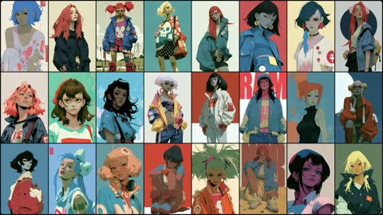
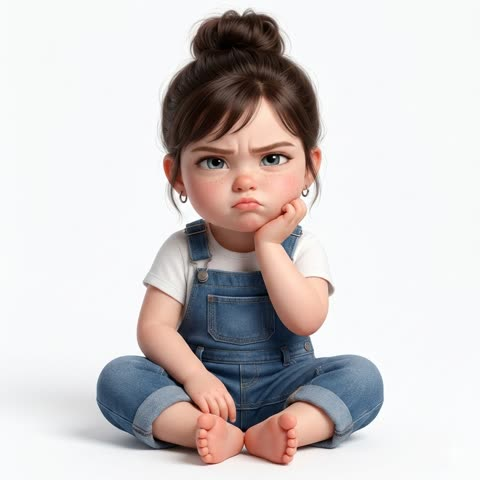
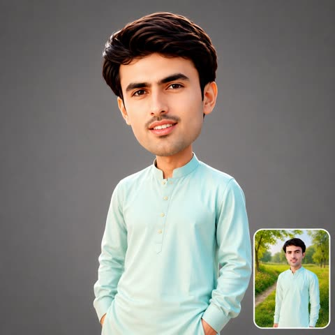
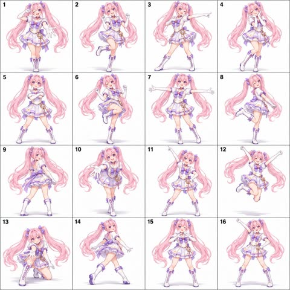
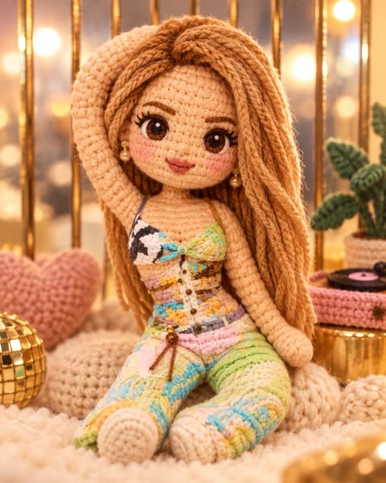
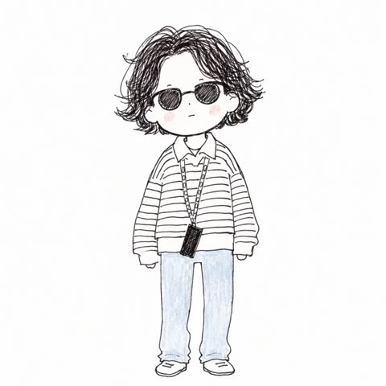

# 角色与手办

[返回目录](../../README_zh.md) · 全部 45 条

<a id="gpt-image-dance-pose-sheet-4x4-character"></a>
### 动漫少女十六格舞蹈姿势表

<a href="https://x.com/Mayz1169/status/2098014577414033912"></a>

以单张参考图锁定角色身份，再按编号写出十六个从起势到收势的动作，让整张图连成一套舞蹈。固定机位、白底和明确的避免清单保证比例、服装和格子排布一致。

GPT Image 2.5 · 上传图改图 · 出处: [@Mayz1169 on X](https://x.com/Mayz1169/status/2098014577414033912) · 1,270 赞，统计于 2026-10-27

[`pose-sheet`](tags.md#tag-pose-sheet) [`character-reference`](tags.md#tag-character-reference) [`dance`](tags.md#tag-dance) [`grid-layout`](tags.md#tag-grid-layout) [`anime`](tags.md#tag-anime)

<details><summary><b>提示词</b></summary>

```text
Create a 4×4 dance pose sheet featuring the character in the uploaded reference image, with exactly 16 equally sized panels in one square image.

CHARACTER CONSISTENCY
Use the uploaded character as the sole reference for character identity and appearance. Preserve the character’s face, hairstyle, colors, body proportions, species, outfit, accessories, and original art style across all 16 panels. Do not redesign the character or add an idol costume. If any body or costume details are not visible in the reference, infer them conservatively and keep them consistent throughout.

ADAPTIVE CHOREOGRAPHY
Design a cohesive dance sequence tailored to this specific character’s personality, appearance, anatomy, clothing, and range of motion. Choose a suitable dance style automatically: lively for an energetic character, graceful for an elegant character, confident for a bold character, playful for a cute character, or restrained for a serious character. Do not force every character into cute idol poses.

Show 16 distinct key poses from the same dance routine, ordered from left to right and top to bottom. Make the sequence feel connected, with natural transitions and a clear beginning, build-up, climax, and ending.

Use the following movement structure, adapting each action to the character:
1. Opening pose that establishes the character’s personality.
2. Small rhythmic step with a coordinated arm gesture.
3. Side step with one arm extended.
4. Compact expressive gesture near the face or upper body.
5. Grounded stance with arms crossing or sweeping inward.
6. Knee lift or an anatomically appropriate weight shift.
7. Open, expansive pose with arms spread.
8. Playful or expressive balance pose.
9. Turning pose showing a three-quarter rear view.
10. Forward-reaching movement with a diagonal body lean.
11. Strong upward-reaching accent.
12. Climactic jump or a grounded full-body extension if jumping is unsuitable.
13. Lowered stance with a forward gesture.
14. Elegant or dynamic side-facing transition.
15. Signature gesture that suits the character.
16. Confident final pose with a clear finishing silhouette.

COMPOSITION AND PRESENTATION
Use a clean white background, thin grid lines, and small readable numbers 1–16 in the upper-left corner of each panel. Include exactly one full-body depiction of the same character per panel. Keep the character’s scale, camera distance, lighting, and rendering style consistent. Use a fixed camera while allowing the character to turn naturally.

Keep the entire character, including hair, ears, horns, wings, tail, hands, feet, and accessories, inside each panel with comfortable margins. Allow room for extended limbs and jumps. Add subtle ground shadows. Show natural secondary movement in hair, fabric, and accessories.

Every pose must have a clear silhouette, convincing balance, anatomically plausible joints, and expressive body language. Adapt all movements to nonhuman anatomy when applicable.

AVOID
Repeated or nearly identical poses, character identity drift, costume changes, inconsistent proportions, extra or missing limbs, malformed hands, cropped body parts, overlapping panels, additional characters, motion trails, background scenery, props not present in the reference, speech bubbles, captions, and watermarks.

Final output: one polished square image containing a clearly organized 4×4 grid of 16 distinct, character-appropriate dance poses.
```

</details>

<a id="gpt-image-grayscale-3d-household-chores-step-grid"></a>
### 灰度3D家务步骤说明图网格

<a href="https://x.com/john_my07/status/2048803726312571335"></a>

用带标签的分块依次固定风格、网格、角色、服装和场景,再用统一的单格模板规定步骤标题、姿势、说明文字和动作箭头。参考图锁定16格中的同一张脸,末尾的限制块让画面保持干净,可直接作为动画参考。

GPT Image 2 · 上传图改图 · 出处: [@john_my07 on X](https://x.com/john_my07/status/2048803726312571335) · 1,187 赞，统计于 2026-10-28

[`instructional-grid`](tags.md#tag-instructional-grid) [`grayscale`](tags.md#tag-grayscale) [`3d-render`](tags.md#tag-3d-render) [`motion-arrows`](tags.md#tag-motion-arrows) [`reference-image`](tags.md#tag-reference-image)

<details><summary><b>提示词</b></summary>

```text
[VISUAL STYLE]
Monochrome grayscale composition featuring a highly detailed 3D-rendered female character. Designed like a professional instructional guide with a technical, diagram-inspired layout. Clean white background, soft studio lighting, and strong contrast to highlight posture, actions, and object interaction.
[GRID LAYOUT]
Structured 4×4 panel grid (16 frames total), evenly spaced with thin black divider lines. Each panel is identical in size and clearly numbered from 1 to 16, showing a continuous sequence of household activities.
[CHARACTER]
Use the provided reference image for the face and overall likeness.
Same facial features, skin tone, and proportions
Natural makeup, soft expression
Consistent identity across all 16 panels
Realistic proportions and clean hairstyle (loose or tied back)
[WARDROBE]
Modern, modest casual outfit:
Fitted crop top (not revealing, clean neckline, practical for movement)
High-waisted straight or slightly wide-leg jeans (full length, neat fit)
Optional minimal sneakers or barefoot indoor styling
Fabric should react naturally to movement (subtle folds and tension)
[SCENE APPROACH]
Minimal, clean environment per panel — only essential props related to the chore.
No clutter, no complex backgrounds — focus stays on the subject and action.
[PANEL STRUCTURE – EACH FRAME]
Top-left: Step number + task title (e.g., “Step 4 – Vacuum Floor”)
Center: Full-body pose performing the chore
Bottom-left: 3–4 concise instruction lines
Overlay: Motion arrows and directional guides showing action flow
[CHORE SEQUENCE EXAMPLES]
Make the Bed
Tidy Up Room
Dust Surfaces
Vacuum Floor
Sweep Floor
Mop Floor
Do Laundry
Hang Clothes
Fold Clothes
Clean Kitchen Counter
Wash Dishes
Take Out Trash
Water Plants
Clean Bathroom
Organize Shelves
Final Room Reset
[MOTION INDICATORS]
Curved arrows → fluid actions (wiping, folding)
Straight arrows → directional movement
Circular arrows → repetitive motions (scrubbing, mopping)
[RENDER QUALITY]
High-detail sculpted 3D style with smooth grayscale shading, soft shadows, and clean linework. Polished, concept-art level finish with clarity in every pose and object interaction.
[RESTRICTIONS]
No color, no unnecessary background detail, no extra characters, no revealing clothing, no clutter — only the subject, props, and instructional elements.
```

</details>

<a id="gpt-image-character-identity-board-from-reference"></a>
### 基于参考图的艺术画册式角色身份板

<a href="https://x.com/aimikoda/status/2068989070332543027"></a>

用参考图锁定主体与画风，再用身份锁定清单保证各视角的脸、发型、服装和体型一致。非对称布局配一个大主视图，加上禁止重叠规则和小型剪影、表情、细节研究区，便于后续生成使用。

GPT Image 2 · 上传图改图 · 出处: [@aimikoda on X](https://x.com/aimikoda/status/2068989070332543027) · 1,149 赞，统计于 2026-10-28

[`character-sheet`](tags.md#tag-character-sheet) [`identity-board`](tags.md#tag-identity-board) [`reference-image`](tags.md#tag-reference-image) [`artbook`](tags.md#tag-artbook) [`consistency`](tags.md#tag-consistency)

<details><summary><b>提示词</b></summary>

```text
Create an artistic 16:9 CHARACTER IDENTITY BOARD.

Use Image A as the subject and the visual medium. Name: Clara. Fix headphones. (just change this line as your needs.)

Soft off-white background. No environment, no logo, no watermark.

DESIGN DIRECTION:
Do not create a standard character reference sheet.
Create a cinematic identity board that feels like a high-end animation studio character study mixed with an artbook layout.

The layout should be asymmetrical, elegant and visually memorable.
Use large empty space, varied image scale and intentional imbalance.
Avoid grids, blueprint design, catalog layout and repetitive turnaround presentation.

IMPORTANT LAYOUT RULE:
Do not overlap any character images.
Every view must have clear separation and breathing room.
Keep all bodies, portraits, silhouettes and detail studies visually distinct.
No cropped faces, no hidden limbs, no stacked figures, no merged poses.

MAIN COMPOSITION:
Place one large hero full-body view slightly off-center as the visual anchor.

Around it, arrange smaller supporting studies with clean spacing:
neutral full-body view, back view, profile view, seated pose, leaning pose, crouching pose, top-down body angle, low-angle body angle, expressive portrait studies.

Each view should feel like a separate clean character study, not a frame from one scene.

IDENTITY LOCK:
Preserve strict identity consistency across all views:
same face, same facial proportions, same hairstyle, same outfit, same body proportions, same posture language, same visual personality.

USEFUL REFERENCE DETAILS:
Make the character readable for future image and video generation:
clear face shape, clear hair silhouette, clear outfit silhouette, clear body shape, clear hands, clear posture, clear expression range.

ARTISTIC SECTIONS:
Include a small silhouette study area with 2-3 simplified black character silhouettes.
Include a small expression study area with subtle emotional variations.
Include a small detail study area showing key visual features of the face, hair and outfit.

TEXT DESIGN:
Add one stylish CHARACTER ID block.
Keep it minimal, bold and art-directed.
Use only:
NAME
ROLE
CORE MOOD
VISUAL SIGNATURE

Use small handwritten-style labels only where helpful.
Subtle editorial arrows and annotation marks are allowed, but keep them minimal and elegant.

STYLE:
minimal, cinematic, premium, artbook-like, clean, expressive, useful for production.

The final image should feel like an artistic character identity board designed to help an AI model understand the character’s face, silhouette, outfit, posture and emotional range.
```

</details>

<a id="nano-banana-3d-caricature-elongated-neck-portrait"></a>
### 长脖子夸张风格3D漫画肖像

<a href="https://x.com/Naiknelofar788/status/2032256273782358153"></a>

以参考图保留相貌，同时点名要变形的部位，如脖子长度、眼睑下垂和厚嘴唇。再用一长串排除项（无颗粒、无噪点、无雀斑）和平整的中性影棚光，让渲染干净、有收藏品质感。

Nano Banana 2 · 上传图改图 · 出处: [@Naiknelofar788 on X](https://x.com/Naiknelofar788/status/2032256273782358153) · 1,034 赞，统计于 2026-10-28

[`3d-caricature`](tags.md#tag-3d-caricature) [`reference-photo`](tags.md#tag-reference-photo) [`studio-lighting`](tags.md#tag-studio-lighting) [`street-fashion`](tags.md#tag-street-fashion) [`portrait`](tags.md#tag-portrait)

<details><summary><b>提示词</b></summary>

```text
Create an exaggerated stylized 3D caricature character portrait with strong intentional deformation and a clean, controlled surface finish. Use the person from the ATTACHED REFERENCE PHOTO. Preserve the subject’s identity, facial likeness, skin tone, and defining features, but reinterpret them into a bold caricatured 3D form with an elongated neck, oversized head-to-neck ratio, droopy eyelids, heavy lips, and slightly asymmetrical facial structure.Render as a human-like 3D character with smooth, studio-clean skin and intentionally designed detail, avoiding random texture or noise. Style with bold accessories such as round or oval glasses, hoop earrings, gold chains, headscarves or bandanas, and street-luxury clothing.

Use neutral studio lighting with soft shadows and even illumination, no dramatic contrast, against a plain neutral grey or off-white background. The overall aesthetic should feel weird, fashion-forward, collectible, and character-driven rather than cute or realistic.

Ultra high definition, premium cinematic 3D render quality, hyper-realistic hyper realism, clean materials, no freckles, no dirt, no grain, no noise, no speckling, no text, no logos, no watermarks.

Aspect ratio 4:5.
```

</details>

<a id="gpt-image-kawaii-character-profile-sheet-from-photo"></a>
### 由人像照片生成的可爱角色设定卡

<a href="https://x.com/ZaraIrahh/status/2048251738604613725"></a>

提示词逐项列出海报需要的版块：大头像、四种命名表情、动作姿势、小物件图标、色板和档案栏。风格一句话定下温暖的日系可爱调性，上传的照片则让各个版块里的角色保持一致。

GPT Image 2 · 上传图改图 · 出处: [@ZaraIrahh on X](https://x.com/ZaraIrahh/status/2048251738604613725) · 569 赞，统计于 2026-10-28

[`character-sheet`](tags.md#tag-character-sheet) [`kawaii`](tags.md#tag-kawaii) [`expressions`](tags.md#tag-expressions) [`color-palette`](tags.md#tag-color-palette) [`profile-poster`](tags.md#tag-profile-poster)

<details><summary><b>提示词</b></summary>

```text
Create an adorable character design sheet based on the uploaded image.
Style: Warm, soft, and semi-realistic cartoon illustration with a cozy Japanese/kawaii style.
Design: Character profile poster including:
Large main portrait
Various facial expressions (happy, annoyed, sleepy, surprised)
Action poses (running, playing) (based on personality)
Small object icons
Color palette section
Profile section with name and personality.
```

</details>

<a id="gpt-image-cute-crazy-scale-expression-grid"></a>
### 从可爱到疯狂的十六格表情网格

<a href="https://x.com/aimikoda/status/2055036470583263712"></a>

提示词给每个格子编号并固定情绪递进顺序，明确禁止随机强度，所以表情从左上到右下逐步升级。参考角色锁定身份，标题文字、标签样式和构图在整张网格中统一设定。

GPT Image 2 · 上传图改图 · 出处: [@aimikoda on X](https://x.com/aimikoda/status/2055036470583263712) · 476 赞，统计于 2026-10-28

[`expression-grid`](tags.md#tag-expression-grid) [`character-consistency`](tags.md#tag-character-consistency) [`4x4-grid`](tags.md#tag-4x4-grid) [`emotion-scale`](tags.md#tag-emotion-scale) [`typography`](tags.md#tag-typography)

<details><summary><b>提示词</b></summary>

```text
Create a clean 4x4 emotional performance grid using the provided character as the fixed identity reference.

Visual style:
Clean modern graphic design layout. Elegant serif header at the top, soft off-white background, even spacing, small readable handwritten-style labels centered below each panel.

Header text:
“MY CUTE ↔ CRAZY SCALE”

Preserve strict facial identity consistency across all 16 panels.

Follow the exact emotional progression from top-left to bottom-right.
Do not randomize expressions or intensity.

GRID ORDER:

Row 1:
1. soft innocent cute
2. shy cute
3. playful cute
4. teasing cute

Row 2:
5. energetic cute
6. chaotic playful
7. emotionally intense
8. unstable smile

Row 3:
9. overly excited
10. wild eyes
11. manic happiness
12. emotionally unhinged

Row 4:
13. chaotic stare
14. dangerous excitement
15. beautiful insanity
16. fully crazy

Format:
4x4 grid, cinematic portrait photography style, neutral background, tight close-up framing, shallow depth of field, no watermark.
```

</details>

<a id="gpt-image-character-dance-pose-sheet-4x4"></a>
### 动漫角色4x4舞蹈姿势表

<a href="https://x.com/Mayz1169/status/2099457417528692871"></a>

用编号的16步编舞清单,从开场姿势到收尾剪影,让每格动作各有分工。严格锁定参考图角色身份,配合固定机位、白底网格和禁止项清单,保证16格角色一致。

GPT Image 2.5 · 上传图改图 · 出处: [@Mayz1169 on X](https://x.com/Mayz1169/status/2099457417528692871) · 391 赞，统计于 2026-10-28

[`pose-sheet`](tags.md#tag-pose-sheet) [`dance`](tags.md#tag-dance) [`character-consistency`](tags.md#tag-character-consistency) [`grid`](tags.md#tag-grid) [`anime`](tags.md#tag-anime)

<details><summary><b>提示词</b></summary>

```text
Create a 4×4 dance pose sheet featuring the character in the uploaded reference image, with exactly 16 equally sized panels in one square image.

CHARACTER CONSISTENCY Use the uploaded character as the sole reference for character identity and appearance. Preserve the character’s face, hairstyle, colors, body proportions, species, outfit, accessories, and original art style across all 16 panels. Do not redesign the character or add an idol costume. If any body or costume details are not visible in the reference, infer them conservatively and keep them consistent throughout.

ADAPTIVE CHOREOGRAPHY Design a cohesive dance sequence tailored to this specific character’s personality, appearance, anatomy, clothing, and range of motion.

Choose a suitable dance style automatically: lively for an energetic character, graceful for an elegant character, confident for a bold character, playful for a cute character, or restrained for a serious character. Do not force every character into cute idol poses.  Show 16 distinct key poses from the same dance routine, ordered from left to right and top to bottom. Make the sequence feel connected, with natural transitions and a clear beginning, build-up, climax, and ending.

Use the following movement structure, adapting each action to the character:
1. Opening pose that establishes the character’s personality.
2. Small rhythmic step with a coordinated arm gesture.
3. Side step with one arm extended.
4. Compact expressive gesture near the face or upper body.
5. Grounded stance with arms crossing or sweeping inward.
6. Knee lift or an anatomically appropriate weight shift.
7. Open, expansive pose with arms spread.
8. Playful or expressive balance pose.
9. Turning pose showing a three-quarter rear view.
10. Forward-reaching movement with a diagonal body lean.
11. Strong upward-reaching accent.
12. Climactic jump or a grounded full-body extension if jumping is unsuitable.
13. Lowered stance with a forward gesture.
14. Elegant or dynamic side-facing transition.
15. Signature gesture that suits the character.
16. Confident final pose with a clear finishing silhouette.

COMPOSITION AND PRESENTATION Use a clean white background, thin grid lines, and small readable numbers 1–16 in the upper-left corner of each panel. Include exactly one full-body depiction of the same character per panel. Keep the character’s scale, camera distance, lighting, and rendering style consistent. Use a fixed camera while allowing the character to turn naturally.  Keep the entire character, including hair, ears, horns, wings, tail, hands, feet, and accessories, inside each panel with comfortable margins. Allow room for extended limbs and jumps. Add subtle ground shadows. Show natural secondary movement in hair, fabric, and accessories.  Every pose must have a clear silhouette, convincing balance, anatomically plausible joints, and expressive body language. Adapt all movements to nonhuman anatomy when applicable.

AVOID Repeated or nearly identical poses, character identity drift, costume changes, inconsistent proportions, extra or missing limbs, malformed hands, cropped body parts, overlapping panels, additional characters, motion trails, background scenery, props not present in the reference, speech bubbles, captions, and watermarks.

Final output: one polished square image containing a clearly organized 4×4 grid of 16 distinct, character-appropriate dance poses.
```

</details>

<a id="nano-banana-grumpy-toddler-3d-render-from-reference"></a>
### 皮克斯风格的闹脾气幼童女孩3D渲染

<a href="https://x.com/Naiknelofar788/status/2028747310759542860"></a>

先逐项列出要复刻的五官特征来锁定参考照片的身份，再把年龄调成幼童。表情、发型、服装、姿势和渲染风格各自分段，让撅嘴和托腮的姿态更容易控制。

Nano Banana 2 · 上传图改图 · 出处: [@Naiknelofar788 on X](https://x.com/Naiknelofar788/status/2028747310759542860) · 369 赞，统计于 2026-10-28

[`toddler`](tags.md#tag-toddler) [`3d-render`](tags.md#tag-3d-render) [`pixar-style`](tags.md#tag-pixar-style) [`reference-photo`](tags.md#tag-reference-photo) [`white-background`](tags.md#tag-white-background)

<details><summary><b>提示词</b></summary>

```text
Create a super cute, hyper-realistic 3D render of a toddler girl who is a younger version of the person in the provided reference photo.

The facial structure must strongly match the reference image. Accurately replicate the exact eye shape, eye color, skin tone, lip shape, nose structure, cheek fullness, eyebrow shape, and overall facial proportions. The toddler version should clearly resemble the same person at a younger age while maintaining realistic childlike softness and rounded features.
If any accessory (such as an earring or similar detail) appears in the reference image, replicate it accurately in size, colour, and placement.
Expression:

Distinctly grumpy and pouty. Chin resting on her left palm. One eye slightly squinted in mild annoyance. Eyebrows gently furrowed. Lips pushed forward in a stubborn pout. Expression must feel natural and emotionally believable, not exaggerated.
Hair:

Hairstyle should be adapted from the reference image while keeping it toddler-appropriate. Styled in a messy high bun with soft, natural baby hair strands framing the face.
Outfit:

White short-sleeve t-shirt under classic blue denim overalls with visible stitching and metal clasps.
Pose & Background:

Sitting cross-legged on a clean white studio background. Feet slightly angled toward the camera. Balanced composition with full body visible.
Style & Quality:

Ultra-detailed Pixar/Disney-inspired 3D animation aesthetic. Professional CGI rendering. 1:1 aspect ratio. 8K resolution. Sharp focus. Cinematic studio lighting with soft subsurface scattering on the skin. Smooth textures, realistic fabric physics, soft global illumination, and natural shadow falloff.
```

</details>

<a id="nano-banana-character-3d-model-rpg-gameplay-sheet"></a>
### 动漫骑士的3D模型与RPG战斗画面

<a href="https://x.com/AI_Kei75/status/2032736793292886320"></a>

用高权重的设计锁定语句让所有分区保持同一角色。上排从平面线稿到线框视图再到带光照的游戏渲染,下排是第三人称战斗截图并带日文HUD,负面提示词则防止画面变平和分区串色。

Nano Banana 2 · 上传图改图 · 出处: [@AI_Kei75 on X](https://x.com/AI_Kei75/status/2032736793292886320) · 362 赞，统计于 2026-10-28

[`game-ui`](tags.md#tag-game-ui) [`3d-render`](tags.md#tag-3d-render) [`character-sheet`](tags.md#tag-character-sheet) [`split-layout`](tags.md#tag-split-layout) [`reference-image`](tags.md#tag-reference-image)

<details><summary><b>提示词</b></summary>

```text
Masterpiece, best quality, (complex split screen presentation layout:1.7), (game development showcase:1.5).

(CRITICAL GLOBAL CONSTRAINT - DESIGN LOCK):
(The exact same character design, hair, and outfit MUST be used across ALL sections of the image:2.0).

[TOP HALF: 3-Panel Horizontal Grid - Static Pose]
The top half is divided into 3 horizontal panels showing the character in the EXACT SAME static pose.
Top Left: (Original 2D blueprint:1.5), flat anime illustration style. It accurately traces the original image.
Top Middle: (3D modeling UI viewport:1.5), grey clay render with visible wireframe topology.
Top Right: (Final in-game 3D render:1.7), fantasy background. (High-end 3D anime game model:1.6), (rendered in Unreal Engine 5:1.5), (volumetric lighting, specular highlights, ambient occlusion, rim light:1.5). The character has clear 3D volume, stylized PBR textures, and prominent 3D shading.

[BOTTOM HALF: Full Width Gameplay Screenshot - Action Pose]
The bottom half is a single, wide (third-person Action JRPG gameplay screenshot:1.8).
The EXACT SAME character is shown from a dynamic third-person perspective (viewed from slightly behind/side), in a (dynamic combat action pose:1.6).
Action: The character is fighting a fantasy monster in a lush, grassy open world 3D environment.
Style: (High-end 3D anime game engine graphics:1.7), identical to the Top Right panel's 3D render style. (Unreal Engine 5, ray tracing, depth of field, 3D magic particles:1.5).
Overlay Elements: (Stylish Japanese game UI HUD, minimap, character portrait, skill icons, glowing magic 3D combat effects, particle sparks:1.6). The base language used for the UI is Japanese.

(Technical Tags): (collage:1.4), (presentation sheet), sharp boundaries between panels.
(Negative prompt): (2D illustration in top right and bottom panels:2.0), (flat drawing:2.0), (anime painting:1.8), (bleeding borders:1.5), (messy layout:1.5), (changing character design:2.0), (photorealism:1.5), (missing UI in bottom half), (static pose in bottom half:1.5), low quality, text bleeding.
</prompt>
```

</details>

<a id="nano-banana-sketchbook-boy-stepping-out"></a>
### 3D卡通男孩从素描本画中走出来

<a href="https://x.com/Emmma___0/status/2029025071009022334"></a>

提示词让同一个角色同时出现两次，一次是页面上的铅笔素描，一次是3D渲染，再用一条腿跨出纸面来表现魔法感。暖色灯串虚化、散落的彩铅和浅景深让桌面场景温馨又可信。

Nano Banana 2 · 文生图 · 出处: [@Emmma___0 on X](https://x.com/Emmma___0/status/2029025071009022334) · 338 赞，统计于 2026-10-28

[`3d-cartoon`](tags.md#tag-3d-cartoon) [`sketchbook`](tags.md#tag-sketchbook) [`character`](tags.md#tag-character) [`bokeh`](tags.md#tag-bokeh) [`cozy`](tags.md#tag-cozy)

<details><summary><b>提示词</b></summary>

```text
A cute stylized 3D cartoon boy stepping out of a sketchbook drawing on a wooden desk, the notebook page showing a pencil sketch version of the same boy labeled "MY WORLD – SKETCHES". The boy has big expressive eyes, short messy brown hair, wearing a white and blue raglan t-shirt, blue jeans, and red sneakers. One leg is stepping out of the sketchbook into the real world. Warm cozy studio lighting, bokeh fairy lights in the background, colored pencils and art supplies scattered on the desk, shallow depth of field, Pixar-style character design, ultra-detailed, cinematic lighting, soft shadows, photorealistic textures, magical creative atmosphere, 3D render, high resolution.
```

</details>

<a id="gpt-image-pixel-art-combat-sprite-sheet-from-character"></a>
### 由角色渲染图生成像素风战斗精灵表

<a href="https://www.reddit.com/r/aigamedev/comments/1wbmvnm/gpt_image_25_nailed_a_16_frame_combat_sprite_sheet"></a>

附上一张全身角色渲染图，并写明像素尺寸（128px）、网格（4x4）和动作类型，让十六帧里的发型、外套和靴子保持一致。要求透明背景并接着生成 GIF，让精灵表可以直接用于动画。

GPT Image 2.5 · 上传图改图 · 出处: [u/Practical_Low29 on Reddit](https://www.reddit.com/r/aigamedev/comments/1wbmvnm/gpt_image_25_nailed_a_16_frame_combat_sprite_sheet) · 303 赞，统计于 2026-10-28

[`sprite-sheet`](tags.md#tag-sprite-sheet) [`pixel-art`](tags.md#tag-pixel-art) [`game-assets`](tags.md#tag-game-assets) [`character-design`](tags.md#tag-character-design) [`animation`](tags.md#tag-animation)

<details><summary><b>提示词</b></summary>

```text
Make a simplified 128px pixel art combat motion sprite sheet of this character, transparent background if you can, arrange it 4x4.
```

</details>

<a id="gpt-image-character-profile-poster-expressions-poses"></a>
### 深色角色档案海报，含表情与动作姿势

<a href="https://x.com/miratechtool/status/2049036432451215756"></a>

用编号清单列出各个板块（主肖像、表情格、动作姿势、物品图标、配色、档案），模型就有了清晰的版面可以填。要求动作依据性格来设计，让姿势和档案文字与上传的人脸保持一致。

GPT Image 2 · 上传图改图 · 出处: [@miratechtool on X](https://x.com/miratechtool/status/2049036432451215756) · 294 赞，统计于 2026-10-28

[`character-sheet`](tags.md#tag-character-sheet) [`profile-poster`](tags.md#tag-profile-poster) [`expressions`](tags.md#tag-expressions) [`reference-image`](tags.md#tag-reference-image) [`layout`](tags.md#tag-layout)

<details><summary><b>提示词</b></summary>

```text
Create a character design chart based on the uploaded image.
Design: Character Profile Poster
Include:

1. Large main portrait

2. Various facial expressions (happy angry, sleepy, surprised, etc.)

3. Action poses (running, playing) (based on personality)

4. Small object icons 5. Color scheme section

5. Profile section, including name and personality
```

</details>

<a id="gpt-image-character-dance-pose-grid"></a>
### 兔耳帽少女的十六个舞蹈姿势

<a href="https://x.com/Mayz1169/status/2098050289819652321"></a>

提示词先让模型解读角色性格并据此编排舞蹈动作，再用严格的 4×4 编号网格、固定机位和白底统一版式。身份锁定和禁止项清单让 16 格里的服装与比例保持一致。

GPT Image 2.5 · 上传图改图 · 出处: [@Mayz1169 on X](https://x.com/Mayz1169/status/2098050289819652321) · 283 赞，统计于 2026-10-28

[`character-sheet`](tags.md#tag-character-sheet) [`dance`](tags.md#tag-dance) [`pose-grid`](tags.md#tag-pose-grid) [`anime`](tags.md#tag-anime) [`seedance-reference`](tags.md#tag-seedance-reference)

<details><summary><b>提示词</b></summary>

```text
Create a single square image featuring a 4×4 grid of 16 unique full-body dance poses based on the uploaded character.

CHARACTER-DRIVEN CHOREOGRAPHY
First, visually interpret the character’s personality and aesthetic through their expression, silhouette, outfit, accessories, proportions, and overall visual style. Use this interpretation to invent a personalized dance vocabulary that feels natural and distinctive to THIS character.

Do not apply a generic dance routine or a predetermined list of poses. Let the character’s attitude determine the rhythm, energy, gestures, posture, footwork, and use of space.

For example, a mischievous character might use cheeky gestures, unexpected weight shifts, and playful hops; a reserved character might favor controlled steps and subtle hand movements; a bold character might use grounded footwork and sharp accents; an ethereal character might move through soft curves and floating transitions. These are illustrative possibilities, not required categories or moves. Combine traits when the design suggests a more nuanced personality.

Develop a recognizable movement motif unique to this character and reinterpret it across several panels without repeating the same pose. Incorporate distinctive design features naturally: flowing sleeves may follow sweeping gestures, heavy boots may inspire grounded steps, and a tail or wings may contribute to balance and expression if present. Do not invent accessories or anatomy.

Make the result feel like this character is expressing themselves through dance, rather than performing an interchangeable pose pack. Keep the movement appropriate to the character’s apparent age, anatomy, clothing, and mobility.

SEQUENCE AND VARIETY
Show 16 distinct key poses from one cohesive, character-specific dance phrase, read left to right and top to bottom. Build a natural progression from an opening gesture through variations and a climax to a signature finish.

Include meaningful variation in silhouette, arm placement, footwork, body orientation, and movement level only where it suits the character. Do not force jumps, squats, exaggerated expressions, or dramatic poses onto a character whose personality calls for restraint. Even subtle choreography should produce clearly distinguishable poses.

Maintain believable balance and natural joints. Use facial expressions, head tilts, hands, and posture to reinforce the same personality throughout. Hair, clothing, and accessories should react naturally to movement.

IDENTITY AND STYLE
Preserve the uploaded character’s identity exactly: face, hairstyle, body proportions, outfit, colors, footwear, and accessories. Maintain the reference image’s rendering style throughout all 16 panels. Do not redesign, recolor, or change costumes. Infer any unseen details conservatively and keep them consistent.

GRID AND PRESENTATION
Exactly four rows and four columns, with 16 equally sized square panels separated by thin black lines. Plain white backgrounds and subtle grounding shadows. Number the panels 1–16 in the upper-left corners.

One full-body character per panel, including all extremities and accessories, with comfortable margins. Consistent character scale, camera distance, lighting, and ground level. Use a fixed eye-level camera; different views should result from the character turning.

If a separate dance-grid reference is provided, use it only for the grid layout and presentation. Do not copy its character, outfit, dance poses, or attitude. The uploaded character must determine the choreography.

OUTPUT
A polished dance reference sheet with strong character identity and 16 individually readable poses. Output only the image, without written analysis.

AVOID
Generic choreography, copied reference poses, repetitive or mirrored duplicates, personality mismatches, forced cuteness or swagger, inconsistent identity, altered outfits, cropped extremities, extra limbs, distorted anatomy, motion trails, missing or extra panels, and text other than panel numbers.
```

</details>

<a id="gpt-image-designer-toy-3d-caricature-before-after-inset"></a>
### 设计师玩具风3D漫画像，附原照对比小图

<a href="https://x.com/Waseem__786Ai/status/2063062634455273585"></a>

提示词先锁定身份特征（五官、发型、肤色、年龄、表情），再设定大头小身的漫画比例。对原照小图的位置、占比、白边和阴影写得很精确，形成前后对比，负面词则排除底座、半身像和卡通感。

GPT Image 2 · 上传图改图 · 出处: [@Waseem__786Ai on X](https://x.com/Waseem__786Ai/status/2063062634455273585) · 275 赞，统计于 2026-10-28

[`3d-caricature`](tags.md#tag-3d-caricature) [`designer-toy`](tags.md#tag-designer-toy) [`before-after`](tags.md#tag-before-after) [`photo-to-3d`](tags.md#tag-photo-to-3d) [`studio-lighting`](tags.md#tag-studio-lighting)

<details><summary><b>提示词</b></summary>

```text
Create a premium stylized 3D caricature of the person in the uploaded image, preserving their exact identity, facial features, hairstyle, skin tone, age, and expression. Oversized head, smaller realistic upper body, luxury designer-toy aesthetic, visible torso and arms, confident natural pose, ultra-detailed CGI, smooth premium materials, soft studio lighting, neutral gray background, hyper-realistic rendering, sharp focus, 1:1 composition.

Include the original uploaded photo as a rounded-corner inset in the bottom-right corner (15–20% of frame) with a subtle white border and soft shadow, creating a clean before-and-after comparison.

Negative prompt: pedestal, base, bust statue, floating head, Pixar, anime, cartoon, low-poly, blurry, distorted face, extra limbs, text, watermark, logo, cluttered background, low quality.

Try it with your own image and share the result 👇🔥
```

</details>

<a id="gpt-image-grayscale-dance-movement-sheet-4x4"></a>
### 灰阶4x4舞蹈动作参考表

<a href="https://x.com/ChillaiKalan__/status/2049007457918198128"></a>

用方括号分段写清版式、角色、单格结构、箭头和渲染风格，让16个编号格保持一致，再用负面提示去掉色彩和杂乱背景。成品动作表可作为参考图交给视频模型生成舞蹈动画。

GPT Image 2 · 文生图 · 出处: [@ChillaiKalan__ on X](https://x.com/ChillaiKalan__/status/2049007457918198128) · 253 赞，统计于 2026-10-28

[`movement-sheet`](tags.md#tag-movement-sheet) [`grayscale`](tags.md#tag-grayscale) [`3d-render`](tags.md#tag-3d-render) [`dance`](tags.md#tag-dance) [`reference-sheet`](tags.md#tag-reference-sheet)

<details><summary><b>提示词</b></summary>

```text
Monochromatic grayscale illustration, 3D-rendered character, clean instructional reference sheet.
White background, comic-style cell grid layout, technical diagram aesthetic.
[LAYOUT]
4×4 grid layout (16 panels total).
Each panel separated by thin black border lines.
Panels are evenly sized and consistently aligned.
Each cell is clearly numbered from 1 to 16.
[CHARACTER]
(Insert character description)
Example: Young female dancer with an athletic build, ponytail hairstyle, wearing a crop top, baggy pants, and sneakers.
The same character must appear consistently in all panels.
[PANEL STRUCTURE – per cell]
Top-left: bold number badge + Korean title text
Center: full-body character pose illustration
Bottom-left: Korean description text (3–4 lines)
Overlay: directional arrows indicating movement flow
[ARROWS / MOTION INDICATORS]
Curved arrows, straight arrows, and circular rotation indicators.
Arrows should be placed around the character to clearly show movement direction and flow.
[RENDERING STYLE]
Highly detailed 3D sculpted style.
Soft studio lighting with subtle shadows.
No color — grayscale only.
Clean linework, polished finish, game concept art quality.
[NEGATIVE PROMPT]
No background scenery.
No color tones.
No additional characters.
No cluttered or complex backgrounds.
```

</details>

<a id="nano-banana-pixar-style-3d-portrait-gradient-background"></a>
### 橙粉渐变背景的皮克斯风格3D人像

<a href="https://x.com/Taaruk_/status/2041366570149265865"></a>

提示词先逐项写角色特征（眼睛、眼镜、发型、服装、歪头），再补光线和渲染关键词。鲜明的渐变背景配柔和轮廓光，让主体干净突出。

Nano Banana 2 · 文生图 · 出处: [@Taaruk_ on X](https://x.com/Taaruk_/status/2041366570149265865) · 226 赞，统计于 2026-10-28

[`pixar-style`](tags.md#tag-pixar-style) [`3d-render`](tags.md#tag-3d-render) [`portrait`](tags.md#tag-portrait) [`gradient-background`](tags.md#tag-gradient-background) [`character`](tags.md#tag-character)

<details><summary><b>提示词</b></summary>

```text
A stylized Pixar-style 3D portrait of a young person with smooth skin, large expressive blue eyes, soft facial features, wearing round transparent glasses, modern hairstyle (short styled hair / soft bob cut), casual outfit (hoodie or minimal sweater), slight head tilt and warm smile, friendly and approachable expression, ultra-clean character design, vibrant orange-to-pink gradient background, soft studio lighting with subtle rim light, cinematic depth of field, ultra-detailed, 8K render, octane render style.
```

</details>

<a id="gpt-image-minimi-tiny-figures-photo-world"></a>
### 人像照片周围的迷你3D小人互动

<a href="https://x.com/Zyrellix/status/2055486410749309438"></a>

提示词列出小人的具体互动，如坐在肩上和包上、挥手、模仿姿势，每个小人都有明确动作。同时要求保留原照片并带真实阴影和景深，让小人自然融入而不是重绘照片。

GPT Image 2 · 上传图改图 · 出处: [@Zyrellix on X](https://x.com/Zyrellix/status/2055486410749309438) · 212 赞，统计于 2026-10-28

[`minimi`](tags.md#tag-minimi) [`miniature`](tags.md#tag-miniature) [`photo-to-3d`](tags.md#tag-photo-to-3d) [`portrait`](tags.md#tag-portrait) [`chibi`](tags.md#tag-chibi)

<details><summary><b>提示词</b></summary>

```text
Transform this photo into a tiny “Minimi” world where miniature 3D characters interact naturally around me — sitting on my shoulder and bag, waving, copying my pose, and exploring the scene. Keep the original photo intact with realistic shadows, depth, motion, warm emotions. Title: “Tiny Moments Beside Me”
```

</details>

<a id="gpt-image-paper-cutout-rabbit-mail-carrier"></a>
### 纸雕风格的兔子邮差走在草地上

<a href="https://x.com/Just_sharon7/status/2084594642507776470"></a>

以风格为先的模板，留有 [subject] 占位：分层纸片、可见切边和层间柔和阴影营造手工层次感。平涂纸色、纯白背景和简单易读的动作让角色一目了然。

GPT Image 2 · 文生图 · 出处: [@Just_sharon7 on X](https://x.com/Just_sharon7/status/2084594642507776470) · 178 赞，统计于 2026-10-28

[`paper-cutout`](tags.md#tag-paper-cutout) [`storybook`](tags.md#tag-storybook) [`stop-motion`](tags.md#tag-stop-motion) [`character`](tags.md#tag-character) [`template`](tags.md#tag-template)

<details><summary><b>提示词</b></summary>

```text
Paper cut-out animation style, [subject], full body character shot, layered paper shapes, handmade paper texture, visible cut edges, soft shadow between layers, simple readable action, charming storybook character design, flat paper colors, slightly imperfect handcrafted details, paper collage background, minimal folk tale scenery, gentle stop-motion animation feel, poetic children’s story atmosphere, clean white background with simple paper elements.
```

</details>

<a id="gpt-image-photo-to-character-sheet-poses"></a>
### 参考照片生成带姿势的编辑风角色设定卡

<a href="https://x.com/Arzoo12sh/status/2102350375076626738"></a>

提示词用参考照片锁定人物，并固定服装和手持道具，让各视角保持一致。随后逐项列出版面模块（三视图、表情、动作姿势、材质特写、色板），带出有标注的编辑风排版。

GPT Image 2.5 · 上传图改图 · 出处: [@Arzoo12sh on X](https://x.com/Arzoo12sh/status/2102350375076626738) · 178 赞，统计于 2026-10-28

[`character-sheet`](tags.md#tag-character-sheet) [`reference-photo`](tags.md#tag-reference-photo) [`turnaround`](tags.md#tag-turnaround) [`editorial-layout`](tags.md#tag-editorial-layout) [`consistency`](tags.md#tag-consistency)

<details><summary><b>提示词</b></summary>

```text
Create a high-resolution professional character sheet of the same young woman from the reference image. Show front, side, and back full-body views, plus multiple facial expressions and dynamic poses. She wears an all-black sweatshirt and black cargo pants, white chunky sneakers, and a black crossbody shoulder bag, holding the same clear cup/bottle of yellow iced drink in her hand. Keep her long brown hair and facial features consistent with the reference. Use a clean light beige/gray studio background, realistic photography, consistent face and body across every pose, editorial character-design sheet layout, neat typography, thin dividers, material close-ups, color palette, and professional poster composition.
```

</details>

<a id="gpt-image-photo-to-character-reference-sheet-natalie"></a>
### 由单张照片生成的写实角色设定表

<a href="https://x.com/SadiaMalik182/status/2102988748732715426"></a>

用大写分区标题（档案、转面、表情、姿势、服装、色板）把一张上传照片扩展成白底编辑式网格设定表。档案字段用方括号留空填写，并明确要求每个分格保持同一个人，从而锁定身份一致性。

GPT Image 2.5 · 上传图改图 · 出处: [@SadiaMalik182 on X](https://x.com/SadiaMalik182/status/2102988748732715426) · 162 赞，统计于 2026-10-28

[`character-sheet`](tags.md#tag-character-sheet) [`turnaround`](tags.md#tag-turnaround) [`expression-sheet`](tags.md#tag-expression-sheet) [`identity-consistency`](tags.md#tag-identity-consistency) [`photorealistic`](tags.md#tag-photorealistic)

<details><summary><b>提示词</b></summary>

```text
Use the uploaded photo as the ONLY identity reference and create a premium professional CHARACTER REFERENCE SHEET of the exact same person.

Preserve the person's recognizable identity exactly, including facial structure, eyes, eyebrows, nose, lips, jawline, skin tone, hair color, hair texture, hairline and hairstyle.

Create a clean Hollywood-style character design sheet with a professional editorial grid layout and white studio background.

CHARACTER PROFILE
Name: [NAME]
Role: [ROLE / PROFESSION]
Age: [AGE]
Height: [HEIGHT]
Body Type: [BODY TYPE]
Personality: [3–5 TRAITS]
Distinctive Traits: [IMPORTANT FEATURES]
Signature Colors: [COLORS]

FULL-BODY TURNAROUND
Show the same person in front view, 3/4 view, side profile and back view.

FACE & IDENTITY DETAILS
Show detailed front face, 3/4 face and side profile.

EXPRESSION SHEET
Show neutral, happy, angry, sad, surprised, worried, confident and determined expressions.

POSE & BODY LANGUAGE
Show neutral standing, walking, sitting, relaxed, tense and action-ready poses.

COSTUME DETAILS
Show close-up details of the neckline, fabric texture, sleeves, accessories, back details and shoes.

COLOR & MATERIAL PALETTE
Include coordinated color swatches and material references matching the character.

VISUAL STYLE:
Premium Hollywood character reference sheet, photorealistic cinematic photography, realistic skin texture, natural studio lighting, highly detailed, clean white background, professional typography, thin divider lines, balanced spacing and polished commercial presentation.

IMPORTANT:
Keep the exact same person consistent across every panel.
Do not change the face, hairstyle, age appearance or body proportions.
Do not copy the original photo's background or pose.
Do not add watermarks, logos, social media handles or promotional text.


@WizstarAI
```

</details>

<a id="gpt-image-anime-idol-16-pose-dance-sheet"></a>
### 动漫偶像16姿势舞蹈编排表

<a href="https://x.com/MahnoorAi12/status/2098691200513720328"></a>

用带编号的4乘4网格固定编舞顺序，并锁定角色外观与固定正面机位。每个姿势占0.5秒，写明起始动作和过渡，方便这张表直接驱动视频生成。

GPT Image 2.5 · 上传图改图 · 出处: [@MahnoorAi12 on X](https://x.com/MahnoorAi12/status/2098691200513720328) · 151 赞，统计于 2026-10-28

[`anime`](tags.md#tag-anime) [`pose-sheet`](tags.md#tag-pose-sheet) [`dance`](tags.md#tag-dance) [`character-consistency`](tags.md#tag-character-consistency) [`cel-shading`](tags.md#tag-cel-shading)

<details><summary><b>提示词</b></summary>

```text
Use this sheet for character appearance and choreography. Follow poses 1→16 from left to right, top to bottom, connecting them into one continuous dance.

Create a continuous 2D anime, crisp cel-shading, vibrant colors animation of the character from the reference sheet, dancing in a plain white space. Preserve her exact face, hairstyle, colors, proportions, outfit, and accessories, matching the reference precisely in every frame. Keep her identity fully consistent throughout.

Her performance is bright, sparkly, and full of hope, with wide-eyed wonder in every gesture.

Use a fixed front-facing camera in one uninterrupted full-body shot. Start immediately in pose 1. Keep her entire silhouette — including hands, hair, wings/tail if present, and feet — inside the frame with comfortable white margins. A soft light-gray oval shadow grounds her on the floor and remains during jumps.

The grid defines choreography order only. Show one character in one continuous space. No reference sheet, split screens, borders, numbers, captions, duplicate figures, afterimages, cuts, or camera movement.

Each numbered pose occupies 0.5 seconds (16 poses = 8 seconds total). Clearly articulate each pose's silhouette, then transition through natural movement into the next. Maintain continuous anatomy and weight transfer: feet push off and land, joints absorb impact, hips and shoulders guide turns. Hair, clothing, and accessories follow with slightly delayed motion. Avoid slideshow transitions, morphing, foot sliding, or sudden changes in limb position.

0.0–0.5s — Pose 1: She stands with feet apart, one hand over the chest and the other arm extended low in welcome, bright smile; bounces softly through the knees, then draws both elbows inward and raises the hands.
0.5–1.0s — Pose 2: She holds both fists near shoulder height with elbows bent, balanced on one leg while the other bends back with the heel lifted; adds a buoyant shoulder accent, then lowers the foot into a wider stance.
1.0–1.5s — Pose 3: She extends one arm horizontally with an open palm while the other hand rests at the waist, front foot pointed outward, leaning gently into the gesture; brings the feet closer as both hands rise toward the face.
1.5–2.0s — Pose 4: She frames the cheeks with both open hands, elbows angled down, feet together, knees soft, head tilted with a sweet smile; releases the gesture and steps outward.
2.0–2.5s — Pose 5: She plants the feet apart and crosses both forearms over the chest with a crisp rhythmic accent, shoulders relaxed; uncrosses the arms and shifts weight onto one leg.
2.5–3.0s — Pose 6: She lifts the opposite knee forward in a lively marching step, one fist near the cheek and the other lower beside the body; lowers the raised foot into a crossing step while opening the arms.
3.0–3.5s — Pose 7: She spreads both arms horizontally with open palms and crosses one foot in front of the other, facing camera with a welcoming smile; uncrosses slightly and draws the hands toward the chest.
3.5–4.0s — Pose 8: She forms a clear heart shape with both hands at chest height, balanced on one leg with the other bent back, gives a playful wink; lowers the foot and opens the hands to begin a turn.
4.0–4.5s — Pose 9: She pivots into a three-quarter back view, looking back over one shoulder with both arms open and low; continues the grounded pivot back toward the front.
4.5–5.0s — Pose 10: She leans forward slightly and extends one foot into a low heel tap, reaching one hand toward the viewer while the opposite arm extends back; retracts the foot and rises smoothly.
5.0–5.5s — Pose 11: She opens into a wide diagonal pose, reaching one arm high overhead while the opposite arm extends low, smiling toward camera; sweeps both arms upward as the knees bend to prepare a jump.
5.5–6.0s — Pose 12: She performs a small joyful jump with both feet leaving the floor and knees bending back, arms open into a high V, eyes closed in a broad smile; descends into a soft, controlled landing.
6.0–6.5s — Pose 13: She lands with both knees bent slightly inward and feet apart, reaching both open palms forward near waist height; lets the knees absorb the landing, then straightens gently and begins a side turn.
6.5–7.0s — Pose 14: She turns into an angled stance, curving one arm above the head while the other extends horizontally, stepping through the turn with one heel raised; rotates back toward the camera.
7.0–7.5s — Pose 15: She makes a V-sign beside one eye and extends the opposite hand toward the viewer in an inviting gesture, winks and taps the opposite foot forward; draws the foot back and begins raising the V-sign arm.
7.5–8.0s — Pose 16: She finishes facing forward with feet confidently apart, extending one arm straight upward with the index finger pointing to the sky while the other hand rests on the hip, radiant smile; holds and settles.

Complete the final pose by 7.8 seconds and hold through 8.0 seconds while her hair and clothing settle.
```

</details>

<a id="gpt-image-editorial-fashion-character-sheet-face-reference"></a>
### 由一张人脸照片生成的时尚编辑角色设定表

<a href="https://x.com/Alina_with_Ai/status/2102234488562655721"></a>

提示词把身份和造型分开处理:上传照片只提供人脸,服装逐件锁定并在结尾的一致性段落再次强调。固定的版面网格包含三视图、四种表情、四个动作姿势、材质和色板,让整张设定表中的角色保持统一。

GPT Image 2.5 · 上传图改图 · 出处: [@Alina_with_Ai on X](https://x.com/Alina_with_Ai/status/2102234488562655721) · 138 赞，统计于 2026-10-28

[`character-sheet`](tags.md#tag-character-sheet) [`face-reference`](tags.md#tag-face-reference) [`fashion`](tags.md#tag-fashion) [`editorial`](tags.md#tag-editorial) [`consistency`](tags.md#tag-consistency)

<details><summary><b>提示词</b></summary>

```text
Create a premium editorial-style CHARACTER REFERENCE SHEET using the uploaded photo as the PRIMARY FACE REFERENCE.

IMPORTANT IDENTITY INSTRUCTION:
Use ONLY the face and identity from the uploaded reference photo. Preserve her facial structure, eyes, eyebrows, nose, lips, jawline, skin tone, natural facial proportions and overall recognizable appearance consistently in every panel.

DO NOT copy the clothing, outfit, accessories, pose, or background from the reference photo.
ONLY use the uploaded photo as the FACE/IDENTITY REFERENCE.

CHARACTER:
24-year-old woman, 5'6" (167 cm), slim build, long naturally wavy dark-brown hair, warm natural skin tone, expressive brown eyes, soft feminine facial features.

OUTFIT — MUST REMAIN EXACTLY THIS:
Long tailored dark-brown wool-blend coat
Black fitted ribbed turtleneck knit
High-waisted wide-leg dark charcoal tailored trousers
Black leather loafers
Black leather shoulder bag
Black sunglasses as an optional accessory

Do NOT replace or redesign the outfit.

CHARACTER SHEET LAYOUT:

TOP SECTION:
Show THREE consistent full-body views of the same woman:

1. FRONT VIEW
Standing naturally with one hand in her trouser pocket and the other holding the black shoulder bag.

2. SIDE VIEW
Natural three-quarter side profile, clearly showing her face, long hair, coat silhouette and shoulder bag.

3. BACK VIEW
Full back view showing the long brown coat, hairstyle, trousers and shoulder bag.

FACIAL EXPRESSIONS:
Create four close-up portraits using the EXACT SAME FACE:
• Neutral
• Thoughtful
• Happy
• Determined

Keep facial identity consistent across all expressions.

IN ACTION:
Create four lifestyle poses:
• EXPLORE — walking outdoors with sunglasses and coffee
• CREATE — sitting with a laptop
• SHOOT — holding a professional camera
• TRAVEL — walking confidently with shoulder bag

OUTFIT / MATERIALS:
Show clean visual material references for:
• Brown wool-blend coat
• Black ribbed turtleneck
• Dark charcoal tailored trousers
• Black leather shoulder bag
• Black leather loafers
• Black sunglasses

KEY ATTRIBUTES:
Creative
Empathetic
Adventurous
Independent
Adaptable
Resilient

COLOR PALETTE:
Black, charcoal gray, warm brown, beige, dark burgundy, muted olive green.

CHARACTER NOTES:
Finds beauty in small moments.
Believes in people and new ideas.
Turns emotions into creative work.
Always searching for what's next.
Sees the world from her own perspective.

DESIGN:
Luxury fashion editorial character sheet, premium magazine layout, warm beige background, elegant typography, clean professional grid, realistic studio photography, subtle shadows, cinematic soft lighting, natural skin texture, photorealistic, highly detailed, cohesive visual identity.

CRITICAL CONSISTENCY:
The SAME WOMAN must appear in every panel.
The uploaded reference photo is the ONLY source of truth for her face.
Do not change her facial identity between panels.
Do not copy the uploaded photo's clothing.
Keep the specified brown coat, black turtleneck, dark trousers, black loafers and black shoulder bag in every relevant panel.

Add tasteful editorial typography:
“CHARACTER SHEET”
“CREATIVE GIRL”
“Good Stories, Brighter People”

Make it look like a professional AI character reference sheet created for a film, fashion campaign, or visual storytelling project.
```

</details>

<a id="gpt-image-character-dance-reference-sheet-4x4"></a>
### Q版角色16帧舞蹈参考图

<a href="https://x.com/Scenario_gg/status/2099797670516695385"></a>

按编号写出16步编舞，每格姿势各不相同，整组读起来是一支连贯的舞。身份锁定、头发与衣料的次级运动以及固定机位等规则，让角色在各格中保持一致。

GPT Image 2.5 · 上传图改图 · 出处: [@Scenario_gg on X](https://x.com/Scenario_gg/status/2099797670516695385) · 123 赞，统计于 2026-10-28

[`dance`](tags.md#tag-dance) [`pose-sheet`](tags.md#tag-pose-sheet) [`grid`](tags.md#tag-grid) [`character-reference`](tags.md#tag-character-reference) [`choreography`](tags.md#tag-choreography)

<details><summary><b>提示词</b></summary>

```text
Create a polished square-format dance reference sheet featuring the character from the uploaded reference image. The final image should be arranged as a clean 4×4 grid containing exactly 16 equally sized panels. Each panel represents the next key pose in a single uninterrupted dance sequence, read from left to right and then top to bottom.

Reference Fidelity

Treat the uploaded character as the definitive visual reference throughout the sheet.

Across all 16 frames, keep the character’s identity completely stable, including:

face and facial features
hairstyle and hair length
color palette
body proportions and species
clothing and garment construction
accessories
overall illustration and rendering style

Any part of the character that is not visible in the reference should be inferred conservatively and then depicted the same way throughout the entire sequence.

Choose a style of dance that feels natural for the character’s personality, anatomy, outfit, and available range of motion.

Movement Logic

The sixteen images are consecutive moments from one continuous routine, not sixteen unrelated dance poses.

Every pose should flow naturally into the next through small steps, weight transfers, pivots, or continuing arm gestures. Keep the supporting limbs and direction of rotation physically consistent from frame to frame.

Changes in orientation, body height, balance, and momentum should happen progressively rather than suddenly.

Each frame should remain visually distinct while the overall routine develops through a clear progression: a relaxed opening, gradual build-up, expressive peak, and controlled settling finish.

Choreography

Follow this exact movement sequence:

1. Begin with feet comfortably apart, knees relaxed, and arms resting low.

2. Shift weight left, tapping the right foot outward as the hands drift left.

3. Transfer weight onto the right foot, letting both hands sweep low toward the right.

4. Draw the left foot inward while the hands continue upward to waist height.

5. Step the left foot forward diagonally, turning the torso slightly left as the arms round forward.

6. Rock onto the front left foot, allowing the rounded arms to rise toward chest height.

7. Push gently back onto the right foot, drawing the elbows toward the ribs.

8. Step the left foot out to the left, opening the left arm in the same direction.

9. Settle into a shallow left lunge while the right arm sweeps across the chest toward the left.

10. Deepen the lunge slightly as the right arm continues its arc overhead into a gentle left side bend.

11. Straighten gradually, keeping the right arm overhead while the left arm opens outward.

12. Reach the routine’s peak in a tall, grounded stance, extending both arms into an open upward diagonal.

13. Soften the knees and lower both arms outward through shoulder height.

14. Shift weight onto the left foot and pivot a quarter-turn left, letting the arms continue downward.

15. Bring the right foot forward into a small staggered stance, lifting the chest as the arms settle low behind the hips.

16. Finish in that same stance, turning the head toward the viewer with a character-appropriate expression and relaxed, deliberate hands.

If the character has nonhuman anatomy, reinterpret the steps and gestures as the closest anatomically appropriate equivalents while preserving the same order, rhythm, direction, and continuity.

Secondary Motion

Hair, loose garments, and hanging accessories should react naturally to the choreography rather than remaining static.

Their movement should follow the character’s momentum:

hair and fabric lag slightly behind steps and sweeping gestures
loose elements swing naturally during turns
hair and garments fall with gravity during bends
movement gradually settles as the routine approaches the final pose
light fabrics flutter subtly
heavier fabrics move with greater weight and slower follow-through
fitted clothing develops believable folds around bending and twisting joints

Keep all secondary motion proportional to this relatively gentle routine.

Hair length, clothing construction, and accessory placement must remain consistent in every frame.

Communicate movement through the changing shapes and positions of the hair and fabric themselves. Do not use motion lines, speed lines, ghosting, or movement trails.

Sheet Presentation

Use a square canvas containing a precise 4×4 grid.

The presentation should include:

exactly 16 equally sized panels
one full-body character in every panel
small, clearly readable numbers 1–16 in the upper-left corner of their corresponding panels
a clean white background
thin grid lines
consistent character scale
a fixed camera viewpoint
consistent lighting and rendering
comfortable empty space around every limb, hairstyle, ear, wing, tail, garment, and accessory
subtle ground shadows
clear silhouettes
anatomically plausible joints
convincing weight distribution and balance

The character should never be cropped by the panel boundaries.

Constraints

Do not introduce repeated or near-identical poses, abrupt movement transitions, identity drift, costume changes, additional characters, new props, scenery, captions, or watermarks.

Avoid extra or missing limbs, malformed hands, implausible joints, inconsistent supporting feet, accidental panel overlap, cropped features, sudden changes in character scale, or unexplained changes in orientation.

The finished sheet should read immediately as sixteen carefully selected consecutive keyframes from one coherent dance performance by the same character.
```

</details>

<a id="nano-banana-photorealistic-character-sheet-three-views"></a>
### 写实角色设定图：特写肖像加正侧背三视图

<a href="https://x.com/MrDavids1/status/2027869658313826744"></a>

提示词用简明语言固定版式：左侧特写，加白底上的正面、侧面、背面全身视图，不要文字和边框。服装与道具放在可替换的方括号段落里，再上传参考照片来保持人物一致。

Nano Banana 2 · 上传图改图 · 出处: [@MrDavids1 on X](https://x.com/MrDavids1/status/2027869658313826744) · 112 赞，统计于 2026-10-29

[`character-sheet`](tags.md#tag-character-sheet) [`turnaround`](tags.md#tag-turnaround) [`identity-consistency`](tags.md#tag-identity-consistency) [`reference-image`](tags.md#tag-reference-image) [`photorealistic`](tags.md#tag-photorealistic)

<details><summary><b>提示词</b></summary>

```text
I'm definitely noticing some improvements to character identity with Nano Banana 2 making it super useful for character sheets. Tested one of myself. Just upload your own image as reference and adjust the character description in brackets in the prompt as needed. I'm using character sheets with video models that have an OMNI feature as you can easily insert yourself into any location in a video with a character sheet.

🗒️Prompt: Create a photorealistic character sheet. Include a closeup portrait which is left aligned, no borders, with a neutral expression and then also include a full view shot that shows the front, side and back of the character. The character is placed on a white background. Don't include any text. No borders, no soft gradients. [The character is a male. He is wearing an oversized olive jacket, insignia on the back of the jacket shows a logo with a hornet and arched text that says HORNETS. He also wears a weathered white t-shirt and dark grey cargo pants, with grey and black converse sneakers. He stands in a confident pose holding a customized shotgun with African wood engravings and a leather shoulder strap attached to the shotgun that has red beads as a decoration.]

You can use Nano Banana 2 via
@Hailuo_AI
```

</details>

<a id="nano-banana-isometric-pixel-art-rogue-dual-daggers"></a>
### 手持双匕首的等距像素风盗贼

<a href="https://x.com/GrilliotTodd/status/2047452990987256077"></a>

一行用分号隔开的短提示词，依次写明画风、朝向、等距视角、纯色背景和手持道具。Nano Banana 2 能在高分辨率下保持干净的像素网格，但若不明确限制，可能会自行加上地面。

Nano Banana 2 · 文生图 · 出处: [@GrilliotTodd on X](https://x.com/GrilliotTodd/status/2047452990987256077) · 104 赞，统计于 2026-10-28

[`pixel-art`](tags.md#tag-pixel-art) [`game-sprite`](tags.md#tag-game-sprite) [`isometric`](tags.md#tag-isometric) [`rogue`](tags.md#tag-rogue) [`solid-background`](tags.md#tag-solid-background)

<details><summary><b>提示词</b></summary>

```text
gpt-image-2 was trained on real game art, while Nano banana was trained on high res pixel art portraits. That's my take.

gpt image 2 on the left, nano banana 2 on the right. same prompt, same pixel post processing.

> gpt image 2 - about 80px tall
> nanobanana 2 - about 150px tall, huge!

NB will always make high res pixel art characters with elaborate backgrounds if you don't carefully prompt it otherwise. - even on this prompt, it includes a floor that i didn't ask for.

gpt-image-2 loves to leave out the background for character work, you don't even have to ask most of the time. Very game ready character sprites.

Nano banana is actually better at pixel grid adherence. It keeps the grid clean at high resolutions. gpt-image-2 can make a mess at higher resoutions.

prompt: "pixel art; a rogue game character facing south east. isometric view. solid background. cape and two daggars, one in each hand."
```

</details>

<a id="nano-banana-toy-character-sprinting-through-design-sheets"></a>
### 玩具角色冲破设计稿纸奔跑

<a href="https://x.com/edizkan_/status/2033783098773569785"></a>

以上传的参考角色生成豆子大小的玩具,在巨型设计稿上奔跑。提示词逐个肢体拆解姿势,并对玩具和草图两处都强调身份一致。单束硬光、85mm微距镜头和浅景深营造出尺度错觉。

Nano Banana 2 · 上传图改图 · 出处: [@edizkan_ on X](https://x.com/edizkan_/status/2033783098773569785) · 89 赞，统计于 2026-10-29

[`toy-photography`](tags.md#tag-toy-photography) [`macro`](tags.md#tag-macro) [`character-sheet`](tags.md#tag-character-sheet) [`spotlight`](tags.md#tag-spotlight) [`reference-image`](tags.md#tag-reference-image)

<details><summary><b>提示词</b></summary>

```text
The moment your character stops being designed…
and starts existing. #AKCB

Recommended generator: Nano Banana 2 (Gemini – Thinking Mode)

Try it and show your results 👇

A cinematic macro toy-photography scene.
A bean-sized version of the uploaded reference character is sprinting explosively captured at the peak stride moment of a high-speed sprint with visual effect.

Character Pose
A dynamic, mid-sprint action pose with amazing visual effects captured from a three-quarter side profile.
Torso: Leaning forward at a sharp angle to convey momentum.
Arms: One arm is bent sharply at the elbow with the fist tucked near the chest; the other arm is extended backward, trailing behind the torso.
Legs: In a full stride. The lead leg is bent forward with the knee high, while the trailing leg is fully extended back with the foot pointed.
Head: Facing forward, aligned with the direction of the run.

The character runs across the surface of several giant black-and-white character design pages fully covering the ground, featuring the same character.
Likeness Preservation (CRITICAL)
The identity of the character must remain exactly identical to the reference in both:
• the miniature physical character

• the character shown in the design sketches
The sketch pages must show the  same character, including:
• dynamic poses small sketches

• head studies and shape explorations

• proportion notes

• accessory sketches

• construction diagrams

• small handwritten annotations
Maintain the exact:
• head shape

• eye shape and spacing

• stylization

• silhouette

• materials and clothing design
If the character wears a balaclava, mask, helmet, or covered face, the sketches must not invent facial anatomy.
No added nose.

No added mouth.

No visible skin where the reference does not show it.
Do not humanize the character.

Do not reinterpret anatomy.
Subject & Action
The miniature character sprints explosively across the design pages, tearing through the sketch sheet as it runs.
The character is captured at the peak stride moment of a full-speed sprint.
Running pose details:
• the body leans sharply forward as if accelerating

• one leg is fully extended forward while the other drives powerfully backward

• arms pump in opposite running motion

• the torso twists slightly creating a dynamic curved spine line

• the pose feels like a high-speed comic-book sprint
The character’s momentum rips through the paper, creating a jagged torn path behind it.
A trail of torn paper curls and fragments with vfx follows behind the running character as if it burst out of its own design.
Oversized design sheets surround the character, each page showing different stages of development of the same character.
One small grey 3d print of the character is in the background as an exact copy of the uploaded image.
Camera & Perspective
Captured from a medium camera distance above the desk, allowing a wider portion of the surrounding design pages to be visible.
Shot with an 85mm macro lens, creating natural compression while keeping the environment readable.
The camera sits slightly elevated and angled downward toward the running character.
The character remains the focal point but occupies roughly one third of the frame, revealing more of the design sheets and workspace around it.
The character remains slightly off-center within the spotlight.
Depth of Field
Extremely shallow depth of field.
The sprinting miniature character and the immediate section of the torn sketch page are razor sharp.
Surrounding pages and distant elements fall into soft blur.
Lighting (VERY DRAMATIC)
A single narrow spotlight / flashlight beam hits the character.
The beam comes from a side-front direction, creating a bright circular pool of light on the design page.
Lighting characteristics:
• extremely hard light

• very high contrast

• no ambient fill light

• the surrounding elements fades into near-total darkness

• sharp dramatic shadows stretch across the paper

• edges of the light beam fall rapidly into black
The environment outside the spotlight should feel almost completely swallowed by darkness, as if the character has been suddenly caught under a stage light.
Dust particles float through the beam.
Environment & Surface Detail
Macro-level detail of the design pages:
• ink texture

• pencil strokes

• paper fibers

• subtle reflections on graphite lines
The torn paper edge reveals fibrous paper layers and curled fragments along the ripped path.

Subtle Heat Burn Detail
Along parts of the torn path, the paper shows light scorching caused by extreme speed friction:
• edges of some tears are slightly darkened and singed

• faint burnt browning transitions into the white paper fibers

• tiny ember-like glowing specks appear briefly along the freshest tear points

• very subtle wisps of heat distortion or smoke rise from a few edges
The burn effect must remain minimal, believable, and physically grounded, enhancing realism without turning into flames or overpowering the scene.

Color Grade
Desaturated sketch pages and environment.
The character receives cool cinematic highlights from the spotlight.
Moody macro photography atmosphere.
Rendering Style
Photorealistic macro toy photography, emphasizing scale illusion between the tiny character and the giant design pages.
Speed Energy VFX
A stylized high-speed energy trail follows behind the running character, emphasizing the explosive sprint.
The trail consists of thin luminous motion streaks and glowing particles streaming backward from the character’s movement direction.
Characteristics:
• energy streaks originate from behind the character’s shoulders, arms, and legs

• streaks extend diagonally backward, following the direction of motion

• the lines are semi-transparent glowing blue light trails

• small sparkling particles scatter along the trail

• the effect should feel like comic-book speed energy, not smoke or fire

• the VFX enhances motion but does not cover or obscure the character
The light streaks interact subtly with the environment:
• faint glow reflecting on the torn paper edges

• slight blue rim light on the character’s silhouette

• a few glowing particles floating through the spotlight beam
The energy trail should feel fast, sharp, and directional, reinforcing the sense that the character is sprinting at extreme speed.
ar 3:2
```

</details>

<a id="gpt-image-fox-pixel-art-idle-sprite-sheet"></a>
### 像素风小狐狸待机动画精灵图

<a href="https://x.com/higgsfield_ai/status/2097849478506320056"></a>

提示词先锁定角色设定、配色和美术风格,再逐帧写明眨眼节奏,并给出网格、单元格尺寸和留白的精确数值,让16个精灵保持对齐。

GPT Image 2.5 · 文生图 · 出处: [@higgsfield_ai on X](https://x.com/higgsfield_ai/status/2097849478506320056) · 75 赞，统计于 2026-10-28

[`pixel-art`](tags.md#tag-pixel-art) [`sprite-sheet`](tags.md#tag-sprite-sheet) [`animation`](tags.md#tag-animation) [`game-asset`](tags.md#tag-game-asset) [`fox`](tags.md#tag-fox)

<details><summary><b>提示词</b></summary>

```text
"Create a polished pixel-art animation sprite sheet featuring an original character named Noxa, a tiny fox who collects lost stars.

CHARACTER DESIGN
Noxa is an adorable upright arctic fox with silvery ivory fur, oversized pointed ears with lavender inner fur, enormous amber eyes, a tiny dark nose, and one large fluffy tail with a midnight-blue tip. Animal face and paws, cute chibi proportions, an oversized head and a compact little body.
She wears a short midnight-indigo cape with a scalloped hem, a golden crescent clasp, and a few embroidered stars. A small teal satchel hangs at her hip. In her right paw she holds a short brass staff topped with a crescent moon enclosing a tiny warm-yellow star. Her expression is curious, slightly mischievous, and lovable.

ART DIRECTION
Premium hand-crafted pixel art for a cozy fantasy RPG. Clearly visible square pixels, precise dark-purple outlines, controlled clusters of color, and restrained highlights. Use ivory, indigo, lavender, teal, and warm gold. Front-facing full-body view with a readable silhouette. Keep the moonlight effect contained in crisp pixels. Avoid realistic fur, painted shading, soft gradients, blur, and 3D rendering.

MOTION
Show a single restrained idle cycle across 16 sequential frames. Her chest gently rises and settles; the tail tip and cape follow with a slight delay. Include one quick blink near the middle of the sequence: eyes open in frames 1-7, half closed in frame 8, closed in frame 9, half open in frame 10, open in frames 11-16. Her paws stay planted, and the staff remains firmly held. Maintain identical anatomy, costume details, proportions, and scale throughout. The final pose should flow naturally into the opening pose.

SHEET LAYOUT
One square 1024 x 1024 image divided into four rows and four columns of equally sized 256 x 256 cells. Read frames across each row, then continue below. Repeat the same centered placement and foot baseline in every cell. Every sprite fits entirely inside the central 208 x 208 area of its cell, leaving at least 24 pixels of empty padding on all sides. Show exactly 16 complete sprites without borders, captions, or extra characters. No sprite or accessory may touch any cell edge.

Use a transparent background with real alpha, without a painted checkerboard, scenery, ground plane, or cast shadows. Output the sprite sheet as one image."
```

</details>

<a id="nano-banana-caped-animal-character-trio"></a>
### storybook 风格的青色斗篷灰猫角色

<a href="https://x.com/iamrealsnow/status/2113141068929826897"></a>

同一模板套用到三种动物，只替换物种、毛色、斗篷颜色和扣饰形状。固定站姿、正面、全身和浅色纯背景，让整组角色风格一致。

Nano Banana 2.1 · 文生图 · 出处: [@iamrealsnow on X](https://x.com/iamrealsnow/status/2113141068929826897) · 60 赞，统计于 2026-10-28

[`character-design`](tags.md#tag-character-design) [`storybook`](tags.md#tag-storybook) [`animals`](tags.md#tag-animals) [`cape`](tags.md#tag-cape) [`character-sheet`](tags.md#tag-character-sheet)

<details><summary><b>提示词</b></summary>

```text
Cat
A cute gray cat character with green eyes, wearing a simple teal hooded cape with a small silver crescent clasp. Standing pose, front view, full body, soft storybook illustration style, plain light background.

Squirrel
A cute orange-brown squirrel character with a big bushy tail, wearing a simple navy cape with a small gold leaf-shaped clasp. Standing pose, front view, full body, soft storybook illustration style, plain light background.

Rabbit
A cute cream-colored rabbit character with tall ears, wearing a simple plum cape with a small gold round clasp. Standing pose, front view, full body, soft storybook illustration style, plain light background.
```

</details>

<a id="gpt-image-robot-chef-futuristic-kitchen-tray"></a>
### 霓虹未来厨房里端着托盘的银色机器人厨师

<a href="https://x.com/Adnan_Ai2/status/2102217167458754843"></a>

提示词先逐项描述机器人的部件（银色机身、机械关节、青蓝色眼睛、耳部组件），再写姿势与视线，最后写厨房环境。青色霓虹与暖色电影光搭配，蒸汽、金属反光和景深增强真实感，结尾标明 9:16 竖构图。

GPT Image 2.5 · 文生图 · 出处: [@Adnan_Ai2 on X](https://x.com/Adnan_Ai2/status/2102217167458754843) · 58 赞，统计于 2026-10-28

[`robot`](tags.md#tag-robot) [`futuristic`](tags.md#tag-futuristic) [`kitchen`](tags.md#tag-kitchen) [`cinematic`](tags.md#tag-cinematic) [`photorealistic`](tags.md#tag-photorealistic)

<details><summary><b>提示词</b></summary>

```text
A highly realistic humanoid futuristic robot chef standing inside a premium futuristic restaurant kitchen. The robot has a sleek silver metallic body with detailed mechanical joints and realistic humanoid proportions. It has glowing cyan-blue eyes, circular futuristic ear components, a metallic face and neck, and an advanced sophisticated robotic design. The robot is holding a large white serving tray with both hands and looking slightly toward the left with a calm and helpful expression. The background features a stainless-steel futuristic kitchen with modern cooking equipment, metallic countertops, ovens, and ventilation systems. Cyan neon accent lights illuminate the kitchen, combined with warm cinematic lighting. Realistic metallic reflections, subtle steam rising in the background, highly detailed mechanical textures, photorealistic 3D rendering, cinematic composition, ultra-realistic, 4K quality, sharp details, natural depth of field, vertical 9:16 composition.
```

</details>

<a id="gpt-image-amigurumi-doll-from-photo-diorama"></a>
### 温馨迷你场景中的钩织娃娃

<a href="https://x.com/MrDasCreates/status/2115351638353613255"></a>

先点明毛线材质和可见针脚,再用大头小身比例固定造型。刺绣五官、粉彩配色、迷你场景和暖光,让照片转换保持统一的手工质感。

GPT Image 2.5 · 上传图改图 · 出处: [@MrDasCreates on X](https://x.com/MrDasCreates/status/2115351638353613255) · 32 赞，统计于 2026-10-29

[`amigurumi`](tags.md#tag-amigurumi) [`crochet`](tags.md#tag-crochet) [`plush`](tags.md#tag-plush) [`diorama`](tags.md#tag-diorama) [`photo-to-doll`](tags.md#tag-photo-to-doll)

<details><summary><b>提示词</b></summary>

```text
Turn your photo into a cozy hand-crocheted amigurumi doll using GPT Image 2.5

Prompt: Transform the uploaded photo into a hand-crocheted amigurumi style doll. Soft chunky yarn with visible stitches, oversized rounded head and tiny body, embroidered facial features with gentle blush, pastel color palette, cozy handmade imperfections, plush texture, sitting in a miniature diorama scene, warm soft lighting, charming stop-motion plush aesthetic.
```

</details>

<a id="nano-banana-felt-designer-toy-history-dioramas"></a>
### 四个历史时刻的毛毡设计师玩具场景

<a href="https://x.com/Gdgtify/status/2107781229164556402"></a>

先用三个概念锚点融合出统一风格，并要求忽略其字面内容、只提取材质逻辑。再用毛毡、苔藓、乙烯基质感，街头小细节，灰色背景和克制的亮色点缀等规则，让2x2四格在不同主题下保持一致。

Nano Banana 2.1 · 文生图 · 出处: [@Gdgtify on X](https://x.com/Gdgtify/status/2107781229164556402) · 29 赞，统计于 2026-10-28

[`designer-toy`](tags.md#tag-designer-toy) [`felt`](tags.md#tag-felt) [`diorama`](tags.md#tag-diorama) [`grid`](tags.md#tag-grid) [`template`](tags.md#tag-template)

<details><summary><b>提示词</b></summary>

```text
do this for 4 unforgettable days in human history , 2x2 grid: CONCEPT ANCHOR 1: "Stylized 3D animated rebel character — expressive oversized eyes, strong attitude pose, streetwear details, colorful hair, soft cinematic toy-like rendering"

::

CONCEPT ANCHOR 2: "Fuzzy green minimalist toy-world — mossy texture, rounded trees, soft felt surfaces, tiny houses, gentle surreal creatures, quiet gray background"

::

CONCEPT ANCHOR 3: "Isometric miniature scene — small props, tiny environmental storytelling, dollhouse-scale staging, clean studio lighting"

INSTRUCTION:
Find the exact visual center of these three concepts.
Ignore the literal character, trash can, animals, and room references.
Extract only the style and material logic.

Render $ SUBJECT as a soft but rebellious designer-toy diorama.

STYLE RULES:
- Convert the subject into a stylized 3D character, object, creature, or environment with clear attitude and expressive shape language.
- Use soft felt, moss, knitted fiber, fuzzy flocking, matte clay, and vinyl-like surfaces.
- Add small street or everyday details: stickers, scuffs, props, miniature objects, signs, containers, tools, or personal items inferred from the subject.
- Keep the world minimal and gallery-like, with calm gray or muted pastel background.
- Use bright accent colors only where they matter: hair-like forms, graffiti-like marks, symbols, accessories, tiny props.
- Blend softness with rebellion: cute surface texture, but confident pose and graphic edge.
- Use shallow studio lighting and clean product-shot presentation.

OUTPUT:
A collectible fuzzy designer-toy scene where $ SUBJECT becomes soft, expressive, slightly punk, and highly tactile.
```

</details>

<a id="gpt-image-brutalist-freestyle-soccer-character-sheet"></a>
### 粗野主义自由式足球角色设定表

<a href="https://x.com/ShamsAmin56/status/2071590431725670517"></a>

先用参考图锁定轮廓与材质，再按顺序列出转面图、特写标注、色板、表情和镜头说明，组成完整设定表。指定背景色值、固定分区顺序并附上规范条款，让16:9版面干净且各视角保持一致。

GPT Image 2 · 上传图改图 · 出处: [@ShamsAmin56 on X](https://x.com/ShamsAmin56/status/2071590431725670517) · 发现于 [freestylefly/awesome-gpt-image-2](https://github.com/freestylefly/awesome-gpt-image-2)

[`character-sheet`](tags.md#tag-character-sheet) [`turnaround`](tags.md#tag-turnaround) [`brutalist`](tags.md#tag-brutalist) [`sci-fi`](tags.md#tag-sci-fi) [`concept-art`](tags.md#tag-concept-art)

<details><summary><b>提示词</b></summary>

```text
Use the uploaded reference image as the primary character design reference, preserving the overall silhouette, proportions, futuristic apparel layering, helmet geometry, visor shape, stone-like brutalist armor surfaces, black hooded coat, tactical streetwear construction, gloves, boots, utility belt, and monochrome industrial aesthetic.

Create a premium production character sheet for a 2D stylized futuristic freestyle road soccer protagonist inspired by Brutalist architecture, industrial concrete textures, geometric forms, and minimalist sci-fi design language.  The presentation should resemble a AAA game character turnaround sheet mixed with a Nike commercial concept presentation.

The character should feel agile, stylish, confident, athletic, and built for urban freestyle football.  Maintain the concrete-textured helmet with glowing orange visor, oversized hood, tactical long coat, mechanical gauntlets, armored boots, and industrial detailing exactly as the design language.  The football should be integrated naturally into the presentation.  Minimal off-white background (#F7F5F0).

Professional production sheet layout.  Extremely clean linework.  Cinematic concept art.  Premium graphic design.  No photorealism.  High-end stylized illustration.  CHARACTER ANGLES Front View  Neutral hero pose.  Left Side View Right Side View Back View 3/4 Front View Dynamic Freestyle Pose  Standing on one foot while balancing the football.  Hero Pose  Football under foot.  Long coat flowing.  Confident posture.  CLOSE-UP CALLOUTS  Helmet Design  Orange illuminated visor  Concrete brutalist surface  Industrial wear  Panel breakdown  Upper Body  Coat construction  Buckles  Fabric folds  Armor integration  Mechanical Gloves  Finger articulation  Industrial joints  Material breakdown  Utility Belt  Equipment  Fasteners  Soccer accessory pouch  Boot Design  Heavy brutalist geometry  Street football grip  Orange illuminated sole accents  Football Design  Minimal futuristic street football  Concrete-inspired panel graphics  Orange accent details  MATERIAL CALLOUTS  Concrete Composite Armor  Carbon Tactical Fabric  Matte Black Nylon  Industrial Rubber  Forged Titanium Components  Orange Energy Lighting  COLOR PALETTE  Concrete White  Matte Black  Graphite Gray  Charcoal  Burnt Orange Glow  Dark Steel  EXPRESSION SHEET  Neutral  Focused  Competitive  Confident Smile  Game Face  Victory Expression  ACTION SILHOUETTES  Ball Juggle  Around The World  Elastico  Rainbow Flick  Backheel  Crossover  Street Sprint  Ball Stall  CAMERA CALLOUTS  Hero Shot Low Angle  Turnaround Orthographic  Close-up Macro Lens  Dynamic Pose 35mm Tracking Camera  Hero Pose 24mm Cinematic Lens  SFX LABELS  WHOOSH  SWISH  TAP  BOUNCE  THUD  ZIP  SPIN  SKRT  VROOM  RUSH  MUSIC HIT  CROWD CHEER  SLOW MOTION LABELS  120 FPS  240 FPS  Freeze Frame  Motion Trails  Speed Ramping  GUIDELINES  Maintain consistent proportions across all views.  Keep the brutalist design language consistent.  Emphasize concrete-inspired hard surfaces contrasted with flexible tactical fabrics.  Preserve the glowing orange visor as the primary focal point.  Use clean production callouts with arrows and labels.  Include measurement guides, material notes, and design annotations.  Keep presentation minimal and premium.  Avoid clutter.  Professional concept art quality suitable for AAA game development, cinematic production, and advertising pitch decks.  LAYOUT  16:9 Landscape  Top Center: MAIN TITLE STREET FLOW // BRUTALIST FREESTYLE  Below: Production Character Sheet  Center: Large Hero Character  Left: Front • Side • Back Views  Right: 3/4 View • Action Pose • Hero Pose  Bottom: Close-ups • Materials • Color Palette • Equipment • Football Design • Expressions • Camera Notes • SFX • Slow Motion • Production Annotations  Minimal off-white background with subtle grid guides, technical drawing arrows, clean typography, and premium commercial presentation quality.
```

</details>

<a id="gpt-image-character-production-reference-sheet"></a>
### 基于参考照片的角色设定总览图

<a href="https://x.com/meAsifAi/status/2097949170594193427"></a>

开头先写身份锁定段落,再按九个编号板块依次列出(肖像、转面、表情、姿势、细节、材质、色板、比例、一致性),让 16:9 版面里每个格子的脸和服装保持一致。

GPT Image 2.5 · 上传图改图 · 出处: [@meAsifAi on X](https://x.com/meAsifAi/status/2097949170594193427) · 发现于 [wangrunlin/awesome-gpt-image-2-5-prompts](https://github.com/wangrunlin/awesome-gpt-image-2-5-prompts)

[`character-sheet`](tags.md#tag-character-sheet) [`turnaround`](tags.md#tag-turnaround) [`reference-image`](tags.md#tag-reference-image) [`identity-lock`](tags.md#tag-identity-lock) [`layout`](tags.md#tag-layout)

<details><summary><b>提示词</b></summary>

```text
Create a premium professional character design reference sheet / production model sheet based strictly on the provided reference image.

REFERENCE & IDENTITY LOCK:
Use the uploaded reference as the single source of truth for the character's identity. Preserve the exact facial identity, facial structure, hairstyle, hairline, eye shape and color, eyebrows, nose, lips, skin tone, body proportions, physique, age appearance, distinctive features, costume design, accessories, footwear, colors, patterns and all recognizable visual details. Do not redesign, beautify, simplify, age, de-age, or reinterpret the character.
CHARACTER DESIGN ANALYSIS:
Before constructing the sheet, internally analyze and lock the character's:

facial construction
head-to-body ratio

body proportions

shoulder width and torso structure

limb length and joint placement

silhouette

hairstyle and hair volume

costume construction

accessory placement

color relationships

material characteristics

distinctive identity anchors

All subsequent views must represent the exact same character design.

PAGE FORMAT:
Create one sophisticated studio-grade character reference board, landscape 16:9, clean neutral/off-white studio background, refined editorial production-board aesthetic, highly organized hierarchy, generous spacing, subtle technical guide lines, restrained professional typography-style labels where appropriate, no decorative clutter.

01 — HERO CHARACTER PORTRAIT

Place one larger polished head-and-shoulders or three-quarter portrait as the visual identity anchor.
Show the character's canonical facial identity clearly with neutral professional expression and accurate hairstyle, skin, costume and accessories.

02 — FULL-BODY TURNAROUND

Create a clearly organized full-body turnaround showing the same character at identical scale and proportions:

FRONT VIEW

3/4 FRONT VIEW

SIDE PROFILE

3/4 BACK VIEW

BACK VIEW

Use a neutral standing pose with consistent posture and anatomical alignment.

Keep head height, eye line, shoulder line, waist, hips, knees and feet consistently aligned across every view.

The costume, hairstyle, accessories, seams, patterns, footwear and silhouette must remain identical from every angle.

03 — EXPRESSION STUDY

Include a clean expression grid containing approximately 6 expressions:

Neutral

Happy / subtle smile

Serious

Angry / determined

Surprised

Sad / emotional

Maintain the exact same facial identity, head proportions, hairstyle and facial construction in every expression.

Expressions should demonstrate believable facial acting rather than exaggerated deformation.

04 — SIGNATURE POSE STUDIES

Include 4–6 full-body pose studies that communicate the character's personality and physical behavior.

Use varied but believable poses such as:

relaxed standing

confident stance

walking

sitting

interacting with an object

dynamic signature pose

Maintain exact character proportions, costume construction and recognizable silhouette in every pose.

05 — COSTUME & DETAIL CALLOUTS

Add several clean close-up detail panels showing the most important design elements:

hairstyle / hair detail

face detail

collar / neckline

sleeves / garment construction

footwear

jewelry or accessories

distinctive emblem / pattern / texture

important prop if present

Show construction and material clearly without turning the sheet into a decorative fashion collage.

06 — MATERIAL STUDIES

Visually communicate the primary materials present in the design:

fabric, leather, metal, denim, silk, knit, plastic, glass, jewelry, hair, skin or other relevant materials.

Show realistic surface behavior, texture, reflectivity and construction appropriate to each material.

07 — COLOR PALETTE

Include a compact professional color palette strip containing the dominant character colors.

Organize colors according to their visual role:

skin

hair

primary costume

secondary costume

accent color

accessories / materials

Keep the palette faithful to the reference.

08 — PROPORTION & SILHOUETTE GUIDE

Include a subtle technical proportion guide beside the turnaround.

Show:

overall height

head-to-body ratio

major horizontal alignment guides

key body proportions

clean silhouette thumbnail

Keep this section understated and production-oriented.

09 — DESIGN CONTINUITY

Treat the entire page as a single canonical character source of truth.

Every panel must depict the SAME person/character with:

identical facial identity

identical body proportions

identical hairstyle

identical costume

identical accessory placement

identical color palette

identical design language

consistent left/right details

No accidental costume changes, missing accessories, duplicated accessories, altered facial features, changing body proportions, inconsistent hairstyles or unexplained design variations.

VISUAL DIRECTION:
High-end professional character design presentation, studio production reference quality, sophisticated concept-art discipline, clean polished rendering, precise construction, controlled neutral lighting, realistic material definition, excellent anatomical consistency, crisp readable details, refined editorial layout, premium art-direction quality.

The sheet should feel like an actual professional animation / game / visual-development production document, not a collection of random AI images.

COMPOSITION:
Clear information hierarchy, balanced negative space, aligned panels, consistent character scale, clean grid system, logical visual flow, no overlapping figures, no cropped bodies, no confusing perspective, no unnecessary scenery.

CAMERA / VIEW CONTROL:
Turnaround views should use consistent orthographic-like framing and neutral perspective. Expression studies should use a consistent head framing. Pose studies may use natural perspective while preserving character proportions.
LIGHTING:
Neutral studio illumination designed for design inspection rather than cinematic drama. Soft, even, physically believable light with controlled shadows and accurate material readability.

PHOTOGRAPHIC / RENDER FINISH:
Ultra-clean high-end visual development presentation, realistic surface detail, natural skin and hair rendering, physically believable materials, sharp but refined detail, professional production-board finish.

OUTPUT QUALITY:
16K: 15360 × 8640 ≈ 132.7 million pixels, high-resolution professional quality.
NEGATIVE CONSTRAINTS:
No character redesign, no identity drift, no inconsistent proportions, no changing face, no changing hairstyle, no costume variations, no missing accessories, no duplicated accessories, no extra limbs, no malformed hands, no distorted anatomy, no random props, no dramatic scenery, no cinematic background, no excessive effects, no clutter, no watermark, no logo, no cropped views.
```

</details>

<a id="gpt-image-clay-skateboard-cat-animation-loop"></a>
### 黏土滑板猫动画循环帧

<a href="https://x.com/nett0eth/status/2097683441298944340"></a>

提示词按顺序写出滑行、蹲、跳、翻板、接板、落地的完整动作，让帧序列首尾相接。画面规则很具体：纯色背景、四肢不裁切、只留淡淡地面阴影，再要求手工感的顿挫动作，避免滑向平滑的 CGI 质感。

GPT Image 2.5 · 文生图 · 出处: [@nett0eth on X](https://x.com/nett0eth/status/2097683441298944340) · 发现于 [wangrunlin/awesome-gpt-image-2-5-prompts](https://github.com/wangrunlin/awesome-gpt-image-2-5-prompts)

[`clay`](tags.md#tag-clay) [`stop-motion`](tags.md#tag-stop-motion) [`cat`](tags.md#tag-cat) [`skateboard`](tags.md#tag-skateboard) [`loop`](tags.md#tag-loop)

<details><summary><b>提示词</b></summary>

```text
Create a 24-frame clay stop-motion loop of an orange-and-white cat riding a skateboard. Handmade plasticine texture, black pixel sunglasses, studded collar, cigarette in mouth. The cat rides, crouches, pops, jumps, flips the board, catches it, lands and loops back. Square 1:1, solid off-white background, full character always visible, no cropped ears/tail/skate, no frame leakage, only a subtle horizontal ground shadow. Slightly choppy handcrafted motion, not smooth CGI.
```

</details>

<a id="gpt-image-crochet-doll-lantern-template"></a>
### 钩织玩偶提着发光提灯的温馨角落

<a href="https://x.com/azed_ai/status/2067925399947067728"></a>

模板为主体、两种服装颜色、道具和场景留出填空位，一套结构可以生成多种玩偶。点明毛线质感、针织细节和阿米古鲁米风格来锁定材质，再用温暖柔和的氛围控制光线。

GPT Image 2 · 文生图 · 出处: [@azed_ai on X](https://x.com/azed_ai/status/2067925399947067728) · 发现于 [freestylefly/awesome-gpt-image-2](https://github.com/freestylefly/awesome-gpt-image-2)

[`crochet`](tags.md#tag-crochet) [`amigurumi`](tags.md#tag-amigurumi) [`handmade`](tags.md#tag-handmade) [`template`](tags.md#tag-template) [`cozy`](tags.md#tag-cozy)

<details><summary><b>提示词</b></summary>

```text
A handcrafted crochet doll of a [subject], made with soft yarn textures and intricate knitted details. Dressed in a vivid [color1] accent and a delicate [color2] garment, holding a small [prop]. Set in a cozy [setting], warm muted atmosphere, charming handmade aesthetic, nostalgic amigurumi style.
```

</details>

<a id="gpt-image-cyberpunk-hacker-girl-character-sheet"></a>
### 赛博朋克少女黑客角色设定表

<a href="https://x.com/Kashberg_0/status/2055865126335762902"></a>

提示词要求正面、侧面、背面三视图加特写和配件细节标注，并指定白底，模型会按真实设定表的版式排布。固定配色、指定文字内容和风格参考让各视图的色彩与图形保持一致。

GPT Image 2 · 文生图 · 出处: [@Kashberg_0 on X](https://x.com/Kashberg_0/status/2055865126335762902) · 发现于 [freestylefly/awesome-gpt-image-2](https://github.com/freestylefly/awesome-gpt-image-2)

[`character-sheet`](tags.md#tag-character-sheet) [`cyberpunk`](tags.md#tag-cyberpunk) [`anime`](tags.md#tag-anime) [`turnaround`](tags.md#tag-turnaround) [`concept-art`](tags.md#tag-concept-art)

<details><summary><b>提示词</b></summary>

```text
Ultra-detailed cyberpunk anime character design sheet of a teenage genius hacker girl named “NEO // RIN”, full body turnaround (front, side, back) plus close-up portrait and accessory callouts. Short silver-white bob haircut with neon cyan and magenta gradient streaks, glowing translucent cyber visor over one eye, pale skin, sharp violet eyes, calm confident expression. Oversized techwear jacket with black tactical cargo pants, belts, straps, dangling utility tags, cropped top, futuristic sneakers, holographic accessories, barcode decals, warning symbols, “BYTE//NULL” typography, hacker aesthetic.
Color palette: matte black, dark gray, white, neon cyan, neon pink.
Style inspired by high-end Japanese concept art, futuristic streetwear, cyberpunk fashion, Akira + Ghost in the Shell + modern anime key visual aesthetics.
Include clean character reference sheet layout with labeled details, logo designs, UI graphics, gadget closeups, and color palette on white background.
Highly polished cel shading, crisp lineart, soft glow effects, intricate clothing folds, layered accessories, dynamic fashion silhouette, professional game concept art quality, 4k, ultra detailed.
```

</details>

<a id="gpt-image-dance-motion-breakdown-grid-16"></a>
### 十六格灰度舞蹈动作分解参考表

<a href="https://x.com/oggii_0/status/2048614158699217302"></a>

提示词按风格、布局、角色、单格结构、箭头、渲染和负面词分块书写。每格固定为编号标题、姿势、说明文字和动作箭头，再用参考图锁定角色，十六格保持一致。

GPT Image 2 · 上传图改图 · 出处: [@oggii_0 on X](https://x.com/oggii_0/status/2048614158699217302) · 发现于 [freestylefly/awesome-gpt-image-2](https://github.com/freestylefly/awesome-gpt-image-2)

[`reference-sheet`](tags.md#tag-reference-sheet) [`grayscale`](tags.md#tag-grayscale) [`3d-character`](tags.md#tag-3d-character) [`motion-diagram`](tags.md#tag-motion-diagram) [`grid-layout`](tags.md#tag-grid-layout)

<details><summary><b>提示词</b></summary>

```text
[STYLE]
Monochrome grayscale illustration, 3D-rendered character, clean instructional reference sheet, white background, comic-style cell grid layout, technical diagram aesthetic.

[LAYOUT]
4×4 grid layout with a total of 16 panels. Each panel is separated by thin black border lines. Cells are numbered from 1 to 16, with consistent panel sizes.

[CHARACTER]
image1 (the same character appears consistently in all panels)

[PANEL STRUCTURE – per cell]
Top-left: bold number badge + English title text
Center: full-body character pose illustration
Bottom-left: English description text (3–4 lines)
Overlay: directional arrows indicating movement

[ARROWS / MOTION INDICATORS]
Curved arrows, straight arrows, and circular rotation indicators placed around the character to show motion flow and direction.

[RENDERING STYLE]
Highly detailed 3D sculpted style, soft studio lighting, subtle shadows, no color, grayscale shading, clean linework, game concept art quality.

[NEGATIVE]
No background scenery, no color tones, no additional characters, no complex background.
```

</details>

<a id="gpt-image-doodle-fashion-chibi-striped-sweater"></a>
### 条纹毛衣手绘涂鸦Q版人物

<a href="https://x.com/Sairah_0/status/2092473965927334071"></a>

以参考图为基础保留人物特征，再用清单限定比例：大头、点状眼睛、腮红。另用风格条目约束松散墨线、淡蜡笔上色和大量留白，使成品像手绘而不是矢量图。

GPT Image 2 · 上传图改图 · 出处: [@Sairah_0 on X](https://x.com/Sairah_0/status/2092473965927334071) · 发现于 [freestylefly/awesome-gpt-image-2](https://github.com/freestylefly/awesome-gpt-image-2)

[`doodle`](tags.md#tag-doodle) [`chibi`](tags.md#tag-chibi) [`fashion-sketch`](tags.md#tag-fashion-sketch) [`hand-drawn`](tags.md#tag-hand-drawn) [`character`](tags.md#tag-character)

<details><summary><b>提示词</b></summary>

```text
Transform the subject from the reference image into a cute, quirky hand-drawn doodle illustration.

Use a minimalist children’s storybook / fashion sketch aesthetic with loose, imperfect black ink lines, visible scribbly pencil strokes, subtle cross-hatching, and a charming handmade feel. Keep the character’s recognizable facial features, hairstyle, face shape, clothing, accessories, and overall identity from the reference while simplifying them into a cute illustrated character.

Character design:
- Oversized head and small simplified body
- Simple dot-like eyes and tiny minimal mouth
- Soft rounded facial features
- Slight rosy pink blush on the cheeks
- Messy, expressive hand-drawn hair with many loose sketch lines
- Slightly exaggerated, playful proportions
- Natural, relaxed pose with a whimsical fashion-illustration feel

Art style:
- Black-and-white pencil/ink doodle drawing
- Rough, imperfect sketch lines rather than clean digital outlines
- Dense scribbled hair and clothing details
- Light hand-colored accents
- Subtle watercolor/crayon-like coloring
- Minimal shading
- White or off-white clean background
- Lots of negative space
- Cute, innocent, playful, cozy aesthetic
- Looks like an original handmade notebook/fashion doodle illustration

Preserve the important details of the reference image while converting everything into this consistent doodle-art style. The final image should feel hand-sketched, slightly imperfect, adorable, expressive, and effortlessly stylish, not like polished vector art or 3D cartoon art.
```

</details>

<a id="gpt-image-forest-hero-character-sheet"></a>
### 儿童绘本水彩小英雄定妆图

<a href="https://developers.openai.com/api/docs/guides/image-prompting#keep-a-character-consistent"></a>

人物、主题、画风和限制分块标注，纯色背景把角色展示清楚，方便后面每页复用。预览图为 Sunburst 版本。

GPT Image 2.5 · 文生图 · 出处: [OpenAI image prompting guide](https://developers.openai.com/api/docs/guides/image-prompting#keep-a-character-consistent)

[`character`](tags.md#tag-character) [`childrens-book`](tags.md#tag-childrens-book) [`watercolor`](tags.md#tag-watercolor)

<details><summary><b>提示词</b></summary>

```text
Create a children’s book illustration introducing a main character.

Character:
A young, storybook-style hero inspired by a little forest outlaw,
wearing a simple green hooded tunic, soft brown boots, and a small belt pouch.
The character has a kind expression, gentle eyes, and a brave but warm demeanor.
Carries a small wooden bow used only for helping, never harming.

Theme:
The character protects and rescues small forest animals like squirrels, birds, and rabbits.

Style:
Children’s book illustration, hand-painted watercolor look,
soft outlines, warm earthy colors, whimsical and friendly.
Proportions suitable for picture books (slightly oversized head, expressive face).

Constraints:
- Original character (no copyrighted characters)
- No text
- No watermarks
- Plain forest background to clearly showcase the character
```

</details>

<a id="gpt-image-kawaii-character-design-sheet"></a>
### 日系可爱女孩角色设定表与表情组

<a href="https://x.com/xRahultripathi/status/2050152865566708134"></a>

提示词逐一列出设定表的每个版块（主立绘、六种命名表情、全身姿势、配饰图标、色板、档案框），模型就能排出完整的动画设定表版式。粉彩色调、平滑阴影、干净线稿等风格锚点让各版块画风保持一致。

GPT Image 2 · 上传图改图 · 出处: [@xRahultripathi on X](https://x.com/xRahultripathi/status/2050152865566708134) · 发现于 [freestylefly/awesome-gpt-image-2](https://github.com/freestylefly/awesome-gpt-image-2)

[`character-sheet`](tags.md#tag-character-sheet) [`kawaii`](tags.md#tag-kawaii) [`pastel`](tags.md#tag-pastel) [`expressions`](tags.md#tag-expressions) [`image-reference`](tags.md#tag-image-reference)

<details><summary><b>提示词</b></summary>

```text
Create a cute female character design sheet inspired by the uploaded image.

Style: warm, soft, semi-realistic cartoon illustration with a cozy Japanese kawaii vibe (pastel tones, smooth shading, clean lineart).

Make it a clean character concept poster layout including:

One large main female portrait (front view, detailed)

Facial expression set (happy, shy, annoyed, sleepy, surprised, excited)

2–3 full-body poses (standing, walking/running, playful pose)

Small accessory/object icons that match her personality (hair clip, cute bag, phone charm, coffee cup, keychain)

A simple color palette section (skin, hair, outfit, accent colors)

A profile info box with: name, age range, personality traits, likes/dislikes, short description

Overall look should feel charming, cozy, feminine, and professionally arranged like an animation character design sheet.
High quality, clean background, soft lighting.
```

</details>

<a id="gpt-image-latte-cup-sleeping-miniature-girl"></a>
### 拿铁杯上沉睡的微缩Q版女孩

<a href="https://x.com/Zyrellix/status/2059443447602561444"></a>

把微缩人物放在日常物件上，并指定拿铁奶泡拉出手写问候文字。缎面枕头、斑点陶瓷和柔和自然光等材质与光线描述保住了3D微缩质感。

GPT Image 2 · 文生图 · 出处: [@Zyrellix on X](https://x.com/Zyrellix/status/2059443447602561444) · 发现于 [freestylefly/awesome-gpt-image-2](https://github.com/freestylefly/awesome-gpt-image-2)

[`miniature`](tags.md#tag-miniature) [`chibi`](tags.md#tag-chibi) [`latte`](tags.md#tag-latte) [`3d-render`](tags.md#tag-3d-render) [`cute`](tags.md#tag-cute)

<details><summary><b>提示词</b></summary>

```text
Create ultra-fine highly detailed 3D realistic miniature chibi-like cute girl, wearing cream colour top and jeans, resting and floating on creamy latte cup, stylized textured ceramic cup, sleeping expression, satin soft pillow tucked behind her head. The latte cream forms a text "Good Morning" in a cute handwriting. Soft-focus minimalist background, bright natural light, 8K UHD.
```

</details>

<a id="gpt-image-neon-designer-3d-poster-chibi"></a>
### 蓝色霓虹设计师海报与Q版手办

<a href="https://x.com/AiwithLariab/status/2063240283786187251"></a>

低角度镜头放大球鞋制造海报冲击力,悬浮道具和标语文字环绕主体填满画面。底座上的Q版手办复刻主角形象,统一的蓝色调配合辉光与光泽反射让整体协调。

GPT Image 2 · 文生图 · 出处: [@AiwithLariab on X](https://x.com/AiwithLariab/status/2063240283786187251) · 发现于 [freestylefly/awesome-gpt-image-2](https://github.com/freestylefly/awesome-gpt-image-2)

[`3d-render`](tags.md#tag-3d-render) [`neon-blue`](tags.md#tag-neon-blue) [`designer`](tags.md#tag-designer) [`chibi-figure`](tags.md#tag-chibi-figure) [`low-angle`](tags.md#tag-low-angle)

<details><summary><b>提示词</b></summary>

```text
Create an ultra-detailed 3D stylized creative designer poster featuring a cool young digital artist standing confidently in the center of a futuristic blue neon studio. The character wears oversized black streetwear with electric-blue graphic accents, black cargo pants, layered silver chains, black sunglasses, and clean white sneakers. A cute fluffy puppy sits on the artist's shoulder. The camera angle is dramatic low-angle perspective, making the sneakers appear larger for a premium poster effect.

Surround the character with floating creative elements including a glowing laptop, professional camera, design books, notebooks, 3D icons, social media symbols, holographic UI panels, graphic design tools, and futuristic blue geometric shapes. Add motivational typography such as "DESIGN MODE", "CREATE • BUILD • INSPIRE", and "CREATIVE NEVER SLEEPS" integrated into the scene.

Include a collectible chibi mini-figure version of the character standing beside the main subject on a display base. Use cinematic blue lighting, glossy reflections, volumetric glow, depth of field, floating particles, luxury toy-photography aesthetics, high-end 3D rendering, Octane Render quality, ultra-sharp details, vibrant neon blue color palette, futuristic creator workspace atmosphere, premium commercial poster design, trending ArtStation style, masterpiece quality, 8K resolution, vertical 9:16 composition.
```

</details>

<a id="gpt-image-obsessed-fan-artist-sketchbook-page"></a>
### 狂热粉丝画的混乱角色速写本页

<a href="https://x.com/Ciri_ai/status/2060211436232786357"></a>

提示词先设定狂热粉丝画师这个人设，再列出内容组合：全身姿势、迷你Q版涂鸦、夸张表情、手和眼睛的特写。要求白底、无网格、无秩序，得到松散重叠的版面，衣服颜色留作占位符，方便换用。

GPT Image 2 · 上传图改图 · 出处: [@Ciri_ai on X](https://x.com/Ciri_ai/status/2060211436232786357) · 发现于 [freestylefly/awesome-gpt-image-2](https://github.com/freestylefly/awesome-gpt-image-2)

[`sketchbook`](tags.md#tag-sketchbook) [`character-sheet`](tags.md#tag-character-sheet) [`chibi`](tags.md#tag-chibi) [`doodle`](tags.md#tag-doodle) [`fan-art`](tags.md#tag-fan-art)

<details><summary><b>提示词</b></summary>

```text
Draw me as if an obsessed fan artist filled an entire sketchbook page - messy, overlapping, full-body poses, tiny chibi doodles, exaggerated expressions, and random close-ups of their hands or eyes.
White background. No grid, no order. Pure chaos energy. With (any color) aesthetic clothes
```

</details>

<a id="gpt-image-rogue-viper-game-concept-art-sheet"></a>
### 四格潜行动作游戏概念设定板

<a href="https://x.com/KimAkiyama81/status/2059394334378566063"></a>

两行两列的分格布局配上精确的标签文字、十六进制色板和页眉页脚，让整张图像工作室设定文档。每个分格单独交代镜头与光线，最后用统一风格约束段保持四格全部写实。

GPT Image 2 · 文生图 · 出处: [@KimAkiyama81 on X](https://x.com/KimAkiyama81/status/2059394334378566063) · 发现于 [freestylefly/awesome-gpt-image-2](https://github.com/freestylefly/awesome-gpt-image-2)

[`game-concept-art`](tags.md#tag-game-concept-art) [`character-sheet`](tags.md#tag-character-sheet) [`turntable`](tags.md#tag-turntable) [`unreal-engine`](tags.md#tag-unreal-engine) [`color-palette`](tags.md#tag-color-palette)

<details><summary><b>提示词</b></summary>

```text
**ROGUE VIPER — VIDEO GAME CONCEPT ART SHEET PROMPT**

---

Official AAA video game concept art sheet titled **'ROGUE VIPER'** for an Unreal Engine 5 third-person action-stealth game. Professional game development documentation layout on a dark charcoal #1A1A1A background with gold stencil label typography throughout. Four clearly labeled panels arranged in a 2×2 grid with a header and footer.

---

**SHEET HEADER** — Bold gold stencil font title text: **ROGUE VIPER** centered at top. Subtitle beneath in smaller tracking-heavy label font: **CHARACTER & ENVIRONMENT CONCEPT SHEET | UNREAL ENGINE 5 | ACTION / STEALTH — THIRD PERSON**

---

**PANEL 1 — TOP LEFT — Label: "PROTAGONIST: MEI LIU / ROGUE VIPER"**

Full-body character turntable reference of a 30-year-old East Asian Chinese-American female operative. Athletic and toned, 5'8", long straight black hair worn loose, calm neutral expression with sharp eyes. Wearing a form-fitting matte black tactical bodysuit with gold accent seams running along the shoulders, forearms, and thighs, gold cobra snake belt buckle at the waist, calf-high black tactical boots with subtle gold trim. Armed with twin suppressed 9mm pistols holstered on each hip with custom viper-scale grip texture, a serrated combat knife sheathed vertically on the right thigh, and a compact pneumatic grappling hook launcher mounted on the left forearm. Three views arranged side-by-side: front, 3/4, and back. Unreal Engine 5 physically-based rendering, photorealistic skin and fabric materials, neutral 3-point studio lighting for maximum clarity, gold and matte black color scheme throughout.

---

**PANEL 2 — TOP RIGHT — Label: "ENEMY TYPE 01: OBSIDIAN PROTOCOL ENFORCER"**

Three enemy soldiers shown as character references against a dark background. These are elite private military contractors working for a shadow arms cartel called Obsidian Protocol. Their uniform: slate-gray and black modular plate carriers with deep crimson geometric hex-patch insignia on the shoulder, full-face ballistic visors with a dark red tinted lens, black tactical gloves, reinforced combat boots. Armed with compact bullpup assault rifles with red laser sights. One figure standing in neutral patrol stance, one crouched in a ready alert position, one depicted mid-aim with rifle raised. All three shown at the same scale for comparison. Same UE5 photorealistic PBR render style. Crimson and slate-gray color language to contrast Viper's gold and black.

---

**PANEL 3 — BOTTOM LEFT — Label: "STEALTH ENVIRONMENT: OBSIDIAN PROTOCOL BLACK SITE — ALPINE RESEARCH FACILITY"**

Wide cinematic establishing shot of a stealth mission environment. A hidden high-altitude research facility buried inside a snow-covered mountain, accessible only via an underground tram. Interior architecture is brutalist concrete and frosted glass, dimly lit with cold white fluorescent overhead strips and amber emergency lighting casting long dramatic shadows across polished concrete floors. Rows of classified server terminals and cryogenic storage units line the walls. Ventilation shafts visible in the ceiling above catwalks. A security camera sweeps a slow arc over a central corridor below. In the foreground, Rogue Viper is pressed flat against a concrete pillar in deep shadow, body low, watching two Obsidian Protocol enforcers on patrol below, one holding a flashlight. The scene communicates tension, patience, and tactical opportunity. Unreal Engine 5 Lumen global illumination, volumetric cold air haze, photorealistic ice and concrete materials, deep crushed blacks with cold white and amber lighting contrast. Cinematic wide 2.39:1 style composition within the panel.

---

**PANEL 4 — BOTTOM RIGHT — Label: "ACTION SET PIECE: OBSIDIAN PROTOCOL FREIGHT DEPOT — COLLAPSED BRIDGE CANYON"**

Wide cinematic action shot of a high-octane firefight environment. A sprawling open-air industrial freight depot at the edge of a sheer cliff canyon at dusk, with a collapsed suspension bridge dangling over the chasm below. Shipping containers and heavy crane equipment provide cover geometry. Rogue Viper is captured mid-movement in a dynamic gunfight pose — body low, both suppressed pistols raised and firing, muzzle flashes illuminating her face with sharp white light. Three Obsidian Protocol enforcers are positioned around her — one diving behind a container, one firing from atop a crane platform, one falling backward off the edge of the depot platform. Background: deep canyon with a river of orange reflected sunset light far below, dust and smoke rising from the firefight, a military helicopter approaching in the far distance. Warm dusk amber and cool canyon shadow blue provide dramatic color contrast. UE5 ray-traced reflections on metal container surfaces, particle systems for dust and muzzle smoke, cinematic depth of field on background elements.

---

**SHEET FOOTER** — Color palette chip row along the bottom of the sheet: matte black #1A1A1A, dark charcoal #2B2B2B, viper gold #D4AF37, gunmetal #3E3E3E, obsidian crimson #8B1A1A, slate gray #6B7280, cold white #E8EEF4. Label above chips: **COLOR PALETTE**. Footer text beneath: **ACTION / STEALTH — THIRD PERSON — UNREAL ENGINE 5 — © ROGUE VIPER GAME STUDIOS**

---

**UNIVERSAL STYLE CONSTRAINTS — APPLY TO ALL PANELS:**
Photorealistic only throughout the entire sheet. No anime, no cartoon, no stylized illustration, no cel shading, no comic book rendering. Unreal Engine 5 cinematic render quality with physically-based materials. Anamorphic lens character on all environment shots. Crushed blacks and desaturated mid-tones across all panels. Professional AAA game studio concept documentation format comparable to Naughty Dog, Ubisoft, or Guerrilla Games internal production art.
```

</details>

<a id="gpt-image-street-dancer-character-sheet-industrial"></a>
### 街舞舞者角色设定图，四个全身动态加三个头部特写

<a href="https://x.com/ChangningL29508/status/2052229452080591276"></a>

提示词用数量锁定版式：四个大幅全身舞姿，加侧边三个头部视角（正面、侧面、3/4侧面）。减少文字元素把像素留给面部细节，再用粗砺工业背景和写实光影定下氛围。

GPT Image 2 · 文生图 · 出处: [@ChangningL29508 on X](https://x.com/ChangningL29508/status/2052229452080591276) · 发现于 [freestylefly/awesome-gpt-image-2](https://github.com/freestylefly/awesome-gpt-image-2)

[`character-sheet`](tags.md#tag-character-sheet) [`street-dance`](tags.md#tag-street-dance) [`multi-angle`](tags.md#tag-multi-angle) [`industrial`](tags.md#tag-industrial) [`full-body`](tags.md#tag-full-body)

<details><summary><b>提示词</b></summary>

```text
角色设定图布局，聚焦于一位18岁的亚裔女性街舞舞者。包含4个大型、高细节度的全身动态舞姿（突出舞蹈动作，面部清晰）。侧边附一条清晰的多角度参考条，仅含3个精细头部特写（正面、侧面、3/4侧面）。最大限度减少文字元素，将像素空间优先用于面部细节刻画。背景为粗砺工业风，搭配写实光影效果
```

</details>
