# 拼贴

[返回目录](../../README_zh.md) · 全部 47 条

<a id="gpt-image-failed-photos-grid"></a>
### 任意角色的九宫格失败抓拍照

<a href="https://x.com/DeepBlueX0/status/2099481521983995971"></a>

要求生成九宫格失败照片，模型会主动加入运动模糊、手指遮挡、歪斜构图和抓拍瞬间的表情，整组看起来像真实相册。替换角色占位符即可复用模板。

GPT Image 2.5 · 文生图 · 出处: [@DeepBlueX0 on X](https://x.com/DeepBlueX0/status/2099481521983995971) · 2,646 赞，统计于 2026-10-27

[`grid`](tags.md#tag-grid) [`humor`](tags.md#tag-humor) [`template`](tags.md#tag-template)

<details><summary><b>提示词</b></summary>

```text
Vertical 3×3 failed photos × {Character}
```

</details>

<a id="gpt-image-chibi-clone-sticker-running-diary"></a>
### 跑步照片配Q版分身贴纸与手绘涂鸦

<a href="https://x.com/Emmma___0/status/2050922155676930544"></a>

先锁定真人照片的身份、服装和背景，再限定添加5到8个Q版分身，每个分身对应不同的跑步动作与情绪。贴纸白边、柔和阴影加上白粉色涂鸦和手写短句，形成手帐日记风格，同时避免遮挡人脸。

GPT Image 2 · 上传图改图 · 出处: [@Emmma___0 on X](https://x.com/Emmma___0/status/2050922155676930544) · 959 赞，统计于 2026-10-28

[`chibi`](tags.md#tag-chibi) [`sticker`](tags.md#tag-sticker) [`scrapbook`](tags.md#tag-scrapbook) [`fitness`](tags.md#tag-fitness) [`photo-edit`](tags.md#tag-photo-edit)

<details><summary><b>提示词</b></summary>

```text
Create a high-quality “chibi clone sticker diary photo” based on the uploaded real-life image. Preserve the original person’s identity, face, hairstyle, hair color, outfit, body proportions, pose, lighting, and background. Do not alter facial features or turn the subject into a full illustration—maintain a realistic photo look.
Analyze the scene as a fitness/running lifestyle moment. Add 5–8 chibi mini clones of the same person around the subject, designed in a consistent kawaii sticker style (big head, small body, large expressive eyes, clean digital finish). Each clone must clearly resemble the real person (same hair, outfit, colors).
Design each chibi with different running-related actions and emotions: jogging, stretching, drinking water, feeling tired, cheering, giving thumbs up, celebrating completion. Ensure all poses are unique and contextually relevant.
Render each chibi as a sticker with white outlines, soft shadows, and a slightly floating effect. Arrange them around the subject and edges without covering the face or main body.
Add light hand-drawn doodles (hearts, sparkles, arrows, motion lines, circles) in white with subtle pink accents, keeping a clean scrapbook diary feel.
Include 5–8 short handwritten-style phrases matching a fitness mood (cute, energetic, encouraging). Use mostly white text with slight pink highlights and small decorative marks.
Composition: keep the real person as the central focus, surrounded by chibi stickers and doodles. The result should feel like a polished, playful, high-resolution social media lifestyle diary image—clean, balanced, and visually rich without clutter.
```

</details>

<a id="gpt-image-six-photo-portrait-grid"></a>
### 同一个人的六宫格人像

<a href="https://x.com/john_my07/status/2112737725430554781"></a>

先把人物写细一次，再写六个画面；要求不留缝，九宫格读起来像一整张。

GPT Image 2.5 · 文生图 · 出处: [@john_my07 on X](https://x.com/john_my07/status/2112737725430554781) · 651 赞，统计于 2026-10-27

[`portrait`](tags.md#tag-portrait) [`grid`](tags.md#tag-grid) [`consistency`](tags.md#tag-consistency)

<details><summary><b>提示词</b></summary>

```text
Create an ultra-realistic 6-photo portrait collage arranged in a seamless 3×2 grid, featuring a naturally beautiful young Portuguese woman in her early 20s. She has warm olive-toned skin, expressive hazel-brown eyes, long chestnut-brown hair with subtle natural highlights, soft face-framing layers, naturally full eyebrows, and delicate, distinctive facial features. Her appearance should feel authentic and individual, with realistic skin texture, tiny imperfections, and minimal everyday makeup.

Visual aesthetic: Effortless European Instagram photo dump, reminiscent of candid photographs taken on a Canon PowerShot G7 X Mark III. Direct built-in camera flash, crisp details, bright facial highlights, hard shadows, slightly imperfect framing, subtle digital noise, and a nostalgic early-2000s point-and-shoot feel.

Setting and styling: A warm off-white bedroom wall with subtle texture, a few natural shadows, and no distracting decorations. She wears a fitted burgundy scoop-neck top, tiny gold hoop earrings, and a delicate necklace. Her makeup is understated, with softly flushed cheeks, natural glossy lips, and lightly defined lashes. Her long hair remains the same color and length but falls differently in every photograph.

Six distinct photographs:

1. Sweet candid: Sitting close to the camera, resting her cheek against one hand, smiling gently with relaxed eyes and loose hair framing her face.
2. Playful snapshot: Looking directly into the lens with a mischievous half-smile, one eyebrow slightly raised, fingers casually tucked behind her ear.
3. Messy-girl moment: Eyes closed and laughing softly, both hands lifting her hair away from her shoulders, a few loose strands catching the flash.
4. Effortless confidence: Turning her face over one shoulder, giving the camera a subtle side-eye, with one hand lightly resting against her neck.
5. Caught laughing: Looking toward someone outside the frame, laughing naturally with her head tilted to the side and hair falling across one cheek.
6. Quiet evening mood: Leaning against the wall, gazing thoughtfully into the lens, lips relaxed, fingertips gently twisting a strand of hair.

Identity consistency: The same Portuguese woman must appear in all six frames, with identical facial proportions, eye color, skin tone, hair color, and recognizable features. Each photograph should have a different pose, expression, head angle, and hair arrangement, as if captured within the same casual photo session.

Photography details: Realistic compact-camera flash, authentic skin pores, fine baby hairs, natural facial asymmetry, believable hands, sharp eyes, slight variations in exposure, and candid framing. Avoid excessive retouching, artificial skin smoothing, exaggerated beauty standards, duplicated expressions, malformed fingers, distorted anatomy, or the overly polished appearance of AI-generated portraits.

Output: Vertical 3:4 aspect ratio, exactly six photographs in a balanced 3-column × 2-row grid, clean alignment, no gutters, no text, no watermark. Photorealistic, youthful, spontaneous, intimate, and effortlessly stylish.
```

</details>

<a id="gpt-image-chibi-sticker-street-photo-doodles"></a>
### 街头人像周围环绕3D Q版自己

<a href="https://x.com/im_shahid7/status/2050201037144002786"></a>

提示词保留原照片和背景，再按姿势与表情清单加入多个3D Q版小人。白色贴纸描边、涂鸦图标和手写字样把这些元素统一成柔和的粉彩拼贴。

GPT Image 2 · 上传图改图 · 出处: [@im_shahid7 on X](https://x.com/im_shahid7/status/2050201037144002786) · 414 赞，统计于 2026-10-28

[`chibi`](tags.md#tag-chibi) [`sticker-outline`](tags.md#tag-sticker-outline) [`doodle-overlay`](tags.md#tag-doodle-overlay) [`reference-photo`](tags.md#tag-reference-photo) [`3d-cute`](tags.md#tag-3d-cute)

<details><summary><b>提示词</b></summary>

```text
Use a real face as a reference photo. The background is the same as in the photo. The lighting is warm, soft, and clean, with subtle shadows. Around the image, add several mini chibi (3D cute style) versions of the character, while maintaining the original facial features. Chibi characters have various poses and expressions:jumping cheerfully waving sitting relaxed holding a drink cute and playful expressions Add hand-drawn white doodle elements: outline around the main body stars, hearts, sparkles motion lines small cute icons Add aesthetic handwriting such as: "shine," "bright day," "happy," "smile," etc. (casual doodle font) Overall style: clean & aesthetic composition white sticker outline soft pastel color tone high detail 3D chibi glossy look cute Korean.
```

</details>

<a id="nano-banana-bw-photobooth-expression-grid"></a>
### 十六种表情的黑白拍立得大头贴网格

<a href="https://x.com/Naiknelofar788/status/2031169815927468186">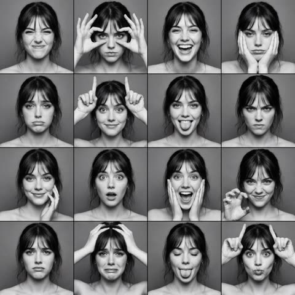</a>

用JSON规格把人物锁定在参考图上，再为每个格子单独指定表情和手势，十六格各不相同。固定的闪光灯布光、50mm半身构图、纯灰背景和针对手部的避免项让整张网格保持统一。

Nano Banana 2 · 上传图改图 · 出处: [@Naiknelofar788 on X](https://x.com/Naiknelofar788/status/2031169815927468186) · 361 赞，统计于 2026-10-29

[`photobooth`](tags.md#tag-photobooth) [`expression-grid`](tags.md#tag-expression-grid) [`black-and-white`](tags.md#tag-black-and-white) [`json-prompt`](tags.md#tag-json-prompt) [`reference-image`](tags.md#tag-reference-image)

<details><summary><b>提示词</b></summary>

```text
{
  "generation_request": {
    "meta_data": {
      "task_type": "black_and_white_photobooth_expression_grid_4x4",
      "language": "en",
      "priority": "highest",
      "version": "v1.0_BW_PHOTOBOOTH_EXPRESSIONS_4X4"
    },
    "input": {
      "mode": "image_to_image",
      "reference_image_usage": "very_high",
      "preserve_identity": true,
      "preserve_facial_features": true,
      "preserve_hairstyle": true,
      "notes": "Use the reference as the primary anchor. Create a black-and-white photobooth-style expression grid. Keep the same adult woman identity and hair. Each panel should show a different facial expression. Minimal background, direct photobooth flash look, natural skin texture."
    },
    "output": {
      "aspect_ratio": "1:1",
      "resolution": "ultra_high",
      "num_images": 1,
      "layout": {
        "type": "grid",
        "rows": 4,
        "cols": 4,
        "gutter": "thin",
        "panel_consistency": "high"
      },
      "sharpness": "crisp_photobooth",
      "grain": "subtle_analog_bw"
    },
    "scene": {
      "concept": "classic photobooth contact sheet with expressive faces",
      "environment": "plain neutral backdrop, no props",
      "lighting": {
        "style": "direct photobooth flash",
        "key_light": "front flash, slightly hard but flattering",
        "shadows": "soft short shadows behind subject",
        "avoid": "cinematic side light, dramatic backgrounds"
      },
      "camera": {
        "lens": "50mm",
        "distance": "tight head-and-shoulders framing",
        "focus": "eyes sharp in every panel"
      }
    },
    "subject": {
      "type": "adult woman",
      "wardrobe": "simple strapless or bare-shoulder photobooth look (no logos)",
      "hair": "keep same hairstyle across all panels",
      "makeup": "minimal, natural",
      "anatomy_rules": "correct facial proportions, no warped eyes/mouth"
    },
    "expression_set": {
      "panel_01": "scrunched smile, eyes squeezed slightly",
      "panel_02": "intense stare with fingers framing eyes",
      "panel_03": "big laugh, mouth open, joyful",
      "panel_04": "bored / unimpressed face, chin in hands",
      "panel_05": "sad pout, watery eyes look",
      "panel_06": "goofy face with both hands making small horns above head",
      "panel_07": "playful tongue out, cheeky grin",
      "panel_08": "angry glare, eyebrows down",
      "panel_09": "flirty look, hand touching cheek",
      "panel_10": "surprised wide eyes, mouth slightly open",
      "panel_11": "fake scream / excited shout, hands near face",
      "panel_12": "mischievous grin with claw-like hand pose",
      "panel_13": "confused frown, lips pressed",
      "panel_14": "crying face, hands on head, dramatic",
      "panel_15": "tongue out with eyes closed, playful",
      "panel_16": "duck face with small devil horns gesture"
    },
    "style": {
      "color": "pure black and white",
      "contrast": "medium-high",
      "background": "flat gray",
      "finish": "slight photobooth grain, clean edges"
    },
    "quality_control": {
      "identity_lock": "strict",
      "hands_priority": "high",
      "avoid": [
        "extra fingers",
        "missing fingers",
        "deformed hands",
        "warped face",
        "uneven eyes",
        "melted mouth",
        "plastic skin",
        "text",
        "watermark",
        "logo"
      ]
    },
    "negative_prompt": [
      "color",
      "sepia",
      "overly cinematic lighting",
      "beauty retouch plastic skin",
      "low resolution",
      "blur",
      "distorted anatomy"
    ]
  }
}
```

</details>

<a id="nano-banana-real-rock-ink-cartoon-boy-composite"></a>
### 手绘卡通男孩背着真实石头

<a href="https://x.com/ShamsAmin56/status/2061689192661307402">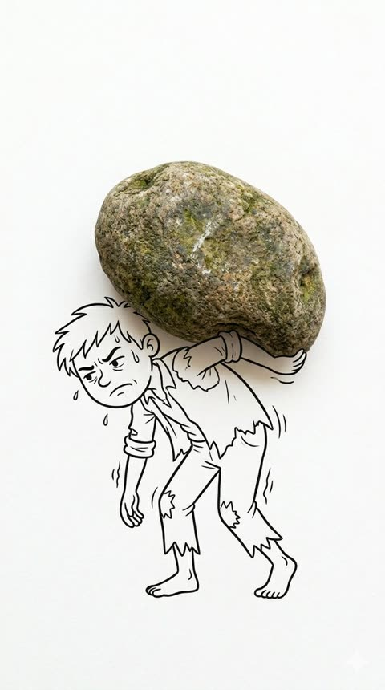</a>

模板用占位符指定真实物体和它在画中代替的部分,让照片与线稿共同完成一个视觉双关。写实物体加粗黑线稿并保持白底留白,融合更干净。

Nano Banana 2 · 文生图 · 出处: [@ShamsAmin56 on X](https://x.com/ShamsAmin56/status/2061689192661307402) · 321 赞，统计于 2026-10-28

[`composite`](tags.md#tag-composite) [`line-art`](tags.md#tag-line-art) [`visual-pun`](tags.md#tag-visual-pun) [`template`](tags.md#tag-template) [`white-background`](tags.md#tag-white-background)

<details><summary><b>提示词</b></summary>

```text
Creative composite photograph, 9:16 vertical aspect ratio, clean minimalist white background, studio lighting, high detail, sharp focus.

A real-life [EVERYDAY OBJECT] is physically placed and perfectly integrated as a key part of a hand-drawn black ink cartoon illustration. The drawing is simple, expressive line art with minimal shading, like a quick sketch on paper.

The [OBJECT] represents [CLEVER PART OF THE SCENE - e.g. hair, weapon, body part, clothing, etc.], cleverly completing the visual pun or concept. The cartoon character interacts dynamically with the object in a humorous, meaningful, or surprising way.

Photorealistic object + bold black line drawing style, perfect seamless blend between real object and illustration, clean negative space, artistic and witty concept, high quality product photography mixed with doodle art.

• How to edit super easy

Just replace the placeholders:

[EVERYDAY OBJECT] → what real thing you'll use (tomato,
onion, chips, etc.)

[CLEVER PART OF THE SCENE] → what the object becomes in the drawing
Then customize the character and concept
```

</details>

<a id="gpt-image-nine-panel-doodle-kitchen-diary-collage"></a>
### 九宫格厨房日记涂鸦拼贴

<a href="https://x.com/MissDelulu9/status/2071527238600954053">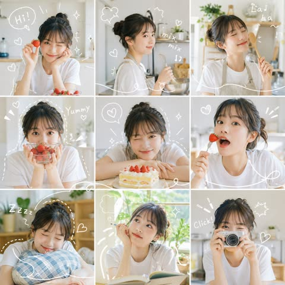</a>

提示词要求同一主体在九个连续瞬间中变换姿势、角度和距离，让整组画面像一段故事。细白边框、贯穿全图并贴合每个动作的白色手绘涂鸦层，以及明亮高调的色彩要求，让九宫格浑然一体。

GPT Image 2 · 文生图 · 出处: [@MissDelulu9 on X](https://x.com/MissDelulu9/status/2071527238600954053) · 301 赞，统计于 2026-10-29

[`photo-collage`](tags.md#tag-photo-collage) [`nine-panel-grid`](tags.md#tag-nine-panel-grid) [`doodle-overlay`](tags.md#tag-doodle-overlay) [`high-key`](tags.md#tag-high-key) [`scrapbook`](tags.md#tag-scrapbook)

<details><summary><b>提示词</b></summary>

```text
A nine-panel grid photo collage of the same subject appearing in continuous moments across all frames with different poses, angles, and distances. Each panel feels like a real photograph with natural lighting, clean and airy backgrounds, and a bright, fresh mood. Thin white borders separate the grids neatly. White hand-drawn doodle lines flow across the entire collage, wrapping around the subject, tracing movements, and forming small symbols like hearts, sparkles, waves, and motion marks that match the action in each frame.

The overall color tone is high-key, light, and vibrant, with soft natural colors and small accent tones, avoiding dull or heavy shadows. The final result feels like a cohesive visual diary or scrapbook page where all nine moments are individually clear but visually connected into one lively, rhythmic story.
```

</details>

<a id="gpt-image-low-angle-pose-grid-blue-sky-doodles"></a>
### 蓝天涂鸦九宫格姿势拼图

<a href="https://x.com/HaniaAi12/status/2064674801159967138">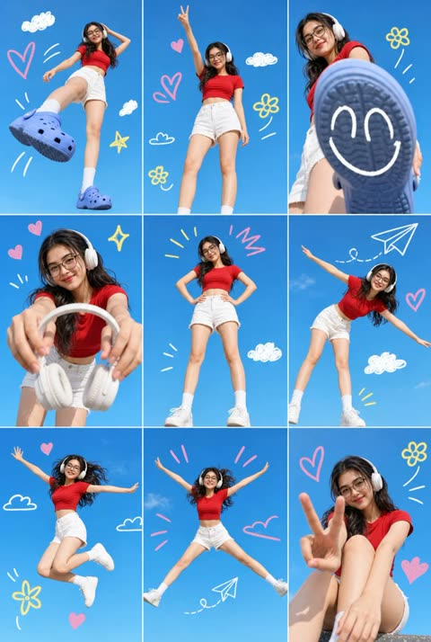</a>

提示词先固定同一套服装和纯蓝天背景，再按行列逐格写出九个姿势，让整张网格保持一致。低机位视角、手绘粉彩涂鸦和上传的参考图让每一格都是同一个人。

GPT Image 2 · 上传图改图 · 出处: [@HaniaAi12 on X](https://x.com/HaniaAi12/status/2064674801159967138) · 282 赞，统计于 2026-10-28

[`grid-collage`](tags.md#tag-grid-collage) [`pose-sheet`](tags.md#tag-pose-sheet) [`doodle-overlay`](tags.md#tag-doodle-overlay) [`low-angle`](tags.md#tag-low-angle) [`social-media`](tags.md#tag-social-media)

<details><summary><b>提示词</b></summary>

```text
A 3x3 grid collage containing nine separate photos of a single young Asian woman From the uploaded image with a light skin tone, styled for a lifestyle and social media content creator aesthetic. She is wearing a red fitted croptop, white Denim short, white sneakers and large white over-ear headphones and eyeglasses. The entire background of every photo is a solid, vibrant, clear bright blue sky on a sunny day.

Around her in each grid frame are playful, hand-drawn digital doodles in bright pastel colors, including pink hearts, yellow flowers, white clouds, paper airplanes, and dynamic motion lines. The collage captures nine different energetic and fun poses from low-angle perspectives:

Top Row: Left photo shows her dynamically kicking her leg out sideways while wearing blue clogs; middle photo shows her standing with one hand raised in a peace sign; right photo features a giant, close-up view of the bottom of her clog sole with a hand-drawn smiley face doodled onto it.

Middle Row: Left photo is a close-up where she leans forward and holds out her white headphones toward the camera; middle photo shows her standing confidently with hands on her hips; right photo shows her playfully leaning to the side with arms outstretched like a plane.

Bottom Row: Left photo captures her in a joyful jumping pose with arms out; middle photo shows her mid-air in a floating star-jump pose; right photo is a seated close-up looking down at the camera while making a peace sign close to the lens.

The overall style is a crisp, bright, hyper-realistic, fashion-forward digital photograph with vibrant color saturation and clean, sharp lighting.
```

</details>

<a id="gpt-image-borderless-memory-grid-template-osaka-dusk"></a>
### 大阪黄昏街景无缝四乘三图板

<a href="https://x.com/aimikoda/status/2048183782876778821">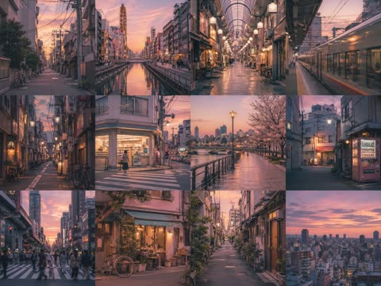</a>

参数化模板，把主体、网格、主题、情绪和风格拆成可替换的槽位。要求无边框网格、统一色彩与光线、无文字无间隙，让十二个独立画面连成一张怀旧图板。

GPT Image 2 · 文生图 · 出处: [@aimikoda on X](https://x.com/aimikoda/status/2048183782876778821) · 229 赞，统计于 2026-10-28

[`image-board`](tags.md#tag-image-board) [`grid`](tags.md#tag-grid) [`template`](tags.md#tag-template) [`nostalgic`](tags.md#tag-nostalgic) [`cityscape`](tags.md#tag-cityscape)

<details><summary><b>提示词</b></summary>

```text
[SUBJECT]: your main character, place, object, city or concept
[GRID_LAYOUT]: panel layout
[THEME]: story theme, memory type or visual concept
[MOOD]: emotional tone
[STYLE]: visual style

Create a [GRID_LAYOUT] borderless grid where each panel is an independent image of the [SUBJECT]. Maintain strong subject consistency across all panels, with consistent color and lighting. Depict [THEME] with a [MOOD] mood in [STYLE] style. No text. No gap.

---

Example Parameters

[SUBJECT]: a young woman / Osaka / a medieval knight / a seaside town / a lost robot
[GRID_LAYOUT]: 4x3 / 3x3 / 2x4 / 5x2 / 6x6
[THEME]: childhood memories / school life memories / neon night city life / summer vacation memories / rainy day memories / color-themed memories
[MOOD]: warm, nostalgic, wistful / emotional, heartfelt, tender / dreamy, quiet, melancholic / bittersweet, intimate, reflective
[STYLE]: nostalgic cinematic realism / sentimental film photography / wistful slice-of-life realism / dreamy nostalgic realism / soft retro film still / emotional memory-like photography / warm vintage realism / melancholic cinematic still

Used prompts in ALTs.
```

</details>

<a id="gpt-image-flash-photo-dump-six-frame-portrait-collage"></a>
### 六格闪光灯随拍人像拼图

<a href="https://x.com/mehvishs25/status/2112208561673740615">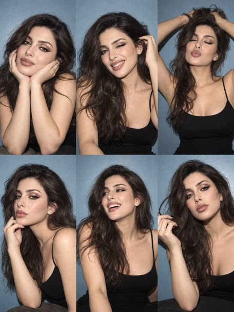</a>

以参考照片锁定人物身份，再逐条列出六个编号瞬间，每格有各自的表情、手势和发型。卡片相机闪光灯质感、固定的服装与墙面，加上结尾的避免清单，让整组画面一致又自然。

GPT Image 2.5 · 上传图改图 · 出处: [@mehvishs25 on X](https://x.com/mehvishs25/status/2112208561673740615) · 211 赞，统计于 2026-10-28

[`portrait-collage`](tags.md#tag-portrait-collage) [`identity-preservation`](tags.md#tag-identity-preservation) [`flash-photography`](tags.md#tag-flash-photography) [`photo-dump`](tags.md#tag-photo-dump) [`grid`](tags.md#tag-grid)

<details><summary><b>提示词</b></summary>

```text
Create an ultra-realistic 6-frame portrait collage arranged in a clean 3×2 grid, featuring the exact same girl from the uploaded reference photo. Use the reference exclusively for identity preservation, accurately retaining her facial structure, eye color, natural hair color, hairstyle, hair length, volume, texture, and distinctive facial features. Her identity must remain consistent across all six frames.

Overall aesthetic: Casual Instagram photo dump with an authentic early-2000s digital camera vibe. A simple muted powder-blue wall, fitted black spaghetti-strap top, delicate minimal accessories, and effortless everyday makeup. Shot on a Canon PowerShot G7 X Mark III with direct on-camera flash, crisp facial details, realistic skin pores, subtle grain, natural imperfections, strong flash highlights, and distinct shadows against the wall.

Six different candid moments:

1. Playful charm: Leaning slightly toward the camera, cheeks gently resting against her palms, giving a small, natural smile.
2. Cheeky energy: One eye closed in a wink, grinning brightly while sweeping a section of hair behind her ear.
3. Carefree mood: Eyes softly closed, lips forming a playful pout, both hands raised above her head as she loosely gathers her hair.
4. Cool and confident: Face turned slightly sideways, looking into the lens from the corner of her eyes, fingertips lightly touching her jawline.
5. Unfiltered laughter: Looking off-camera with a genuine open smile, head tilted back slightly, hair falling naturally across one shoulder.
6. Soft, dreamy moment: Chin tilted down, eyes gazing thoughtfully toward the camera, one hand loosely twirling a strand of hair.

Composition and realism: Every frame must have a distinct facial expression, head angle, hand placement, and hair arrangement. Keep the same outfit, background, lighting style, and identity throughout, while varying the crop and camera distance subtly. Natural anatomy, believable fingers, realistic hair strands, and authentic compact-camera flash photography. The result should feel like six spontaneous photos taken during one fun evening, not a polished studio campaign.

Avoid: Face swapping artifacts, altered facial features, inconsistent identity, plastic skin, excessive retouching, artificial beauty filters, duplicated poses, malformed hands, extra fingers, excessive sharpening, and obvious AI-generated details.

Vertical 3:4 canvas, six equally sized photographs, precise grid alignment, no borders, no text, no watermarks.
```

</details>

<a id="gpt-image-identity-locked-flash-photo-dump-six-pose-collage"></a>
### 六种姿势闪光灯人像照片合集拼图

<a href="https://x.com/MissDelulu9/status/2113461687902994578">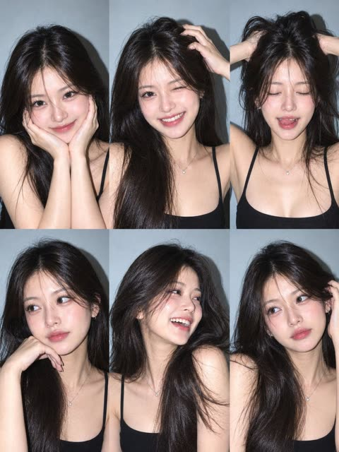</a>

参考图只用于锁定身份，并写明五官、瞳色和发质。六个编号的姿势各带不同发型，再配上指定的卡片相机直闪和纯色墙面，呈现出真实的照片合集感。

GPT Image 2.5 · 上传图改图 · 出处: [@MissDelulu9 on X](https://x.com/MissDelulu9/status/2113461687902994578) · 197 赞，统计于 2026-10-28

[`photo-dump`](tags.md#tag-photo-dump) [`flash-photography`](tags.md#tag-flash-photography) [`identity-lock`](tags.md#tag-identity-lock) [`pose-grid`](tags.md#tag-pose-grid) [`portrait`](tags.md#tag-portrait)

<details><summary><b>提示词</b></summary>

```text
Ultra-realistic 6-photo collage (3×2 grid) of the same person using client photo for identity only (exact face, facial features, eye color, natural hair color/length/volume/texture). Plain light grey-blue wall background, black thin-strap camisole, minimal jewelry, Canon PowerShot G7X Mark III strong direct flash, hard shadows, sharp focus, natural skin texture, slight film grain.

Instagram photo dump aesthetic. Six unique expressions/poses: (1) soft smile, hands on cheeks, (2) wink, big smile, hand in hair, (3) eyes closed, tongue slightly out, both hands lifting hair, (4) confident side glance, hand under chin, (5) laughing, looking away, hair flipped, (6) dreamy look, hand touching hair. Different hair positions in every frame. No AI look, no distorted hands, no extra fingers. --ar 3:4
```

</details>

<a id="gpt-image-french-woman-bedroom-six-pose-photo-dump"></a>
### 同一女生卧室六种姿势的闪光灯写真拼图

<a href="https://x.com/john_my07/status/2113636699888885986">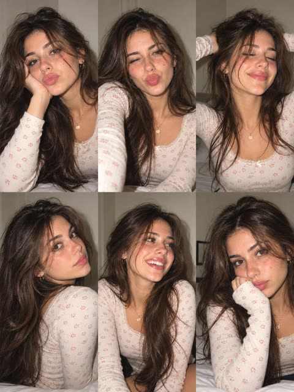</a>

固定3×2网格和3:4比例，再用编号列出六个不同姿势，让每一格各司其职。用雀斑、瞳色、发色和同一套服装锁定身份，并以卡片机直闪的质感保持人物一致又自然随性。

GPT Image 2.5 · 文生图 · 出处: [@john_my07 on X](https://x.com/john_my07/status/2113636699888885986) · 174 赞，统计于 2026-10-28

[`photo-dump`](tags.md#tag-photo-dump) [`portrait-grid`](tags.md#tag-portrait-grid) [`identity-consistency`](tags.md#tag-identity-consistency) [`direct-flash`](tags.md#tag-direct-flash) [`candid`](tags.md#tag-candid)

<details><summary><b>提示词</b></summary>

```text
Create an ultra-realistic 6-photo portrait collage arranged in a seamless 3×2 grid, featuring the same naturally beautiful young French woman in her early 20s. She has warm fair-olive skin, delicate freckles across her cheeks and nose, expressive hazel-brown eyes, long, naturally tousled dark chestnut hair, full eyebrows, and naturally glossy pink lips. Her appearance should feel authentic, youthful, and effortlessly Parisian.

Photography Style: Candid European Instagram photo dump, resembling casual Canon PowerShot G7 X Mark III snapshots. Direct camera flash, crisp facial details, realistic skin pores, subtle digital grain, natural shadows, slightly imperfect framing, and warm indoor lighting.

Setting: A cozy bedroom with an off-white textured wall, neutral bedding, and a softly blurred background. Maintain consistent surroundings throughout all six photographs.

Outfit & Accessories: She wears the same cream-colored, long-sleeved ribbed top with tiny red floral prints and delicate lace trim in every photograph. The top has a modest, higher neckline with full chest coverage. Add small gold hoop earrings and a delicate gold pendant necklace. Her makeup is minimal, with naturally flushed cheeks, glossy lips, and lightly defined lashes. Her hairstyle remains consistent in color and length, but falls differently with each pose.

Six Distinct Poses:

1. Playful selfie: Resting one cheek against her hand, looking into the camera with gently pursed lips and a relaxed expression.
2. Winking snapshot: Looking directly into the lens, winking playfully with a slight pout, one arm casually extended toward the camera.
3. Relaxed happy moment: Eyes closed, smiling softly with her head tilted back slightly and both hands casually lifting her hair.
4. Over-the-shoulder portrait: Turning her face toward the camera over one shoulder, giving a subtle side glance with loose hair cascading naturally.
5. Caught laughing: Looking toward someone outside the frame, laughing genuinely with her head tilted sideways and hair falling across one cheek.
6. Quiet cozy mood: Leaning against a pillow, resting her chin against the sleeve of her top, gazing thoughtfully into the camera.

Identity Consistency: The exact same woman must appear in all six photographs, with consistent facial proportions, eye color, freckles, skin tone, and hair color. Each frame must have a distinctly different pose, expression, head angle, and natural hair arrangement.

Realism Details: Authentic skin texture, fine baby hairs, natural facial asymmetry, believable hands, sharp eyes, realistic fabric texture, subtle exposure variations, and natural compact-camera flash. Avoid excessive retouching, artificial skin smoothing, duplicated expressions, malformed fingers, distorted anatomy, or overly polished AI-generated aesthetics.

Output: Vertical 3:4 aspect ratio, exactly six photographs in a balanced 3-column × 2-row grid, clean alignment, no gutters, no borders, no text, no watermark. Photorealistic, intimate, youthful, spontaneous, and effortlessly French.
```

</details>

<a id="nano-banana-newspaper-collage"></a>
### 任何图都能变成报纸拼贴

<a href="https://x.com/aimikoda/status/2108682052665290854"></a>

一句话改图，照片和插画都适用。

Nano Banana 2.1 · 上传图改图 · 出处: [@aimikoda on X](https://x.com/aimikoda/status/2108682052665290854) · 171 赞，统计于 2026-10-27

[`collage`](tags.md#tag-collage) [`newspaper`](tags.md#tag-newspaper) [`one-liner`](tags.md#tag-one-liner)

<details><summary><b>提示词</b></summary>

```text
recreate this image as a collage made from newspaper parts.
```

</details>

<a id="gpt-image-scrapbook-mini-me-figurines-annotations"></a>
### 手帐风照片加入迷你自己手办与涂鸦注释

<a href="https://x.com/sipteaandcoffee/status/2050948629729542407">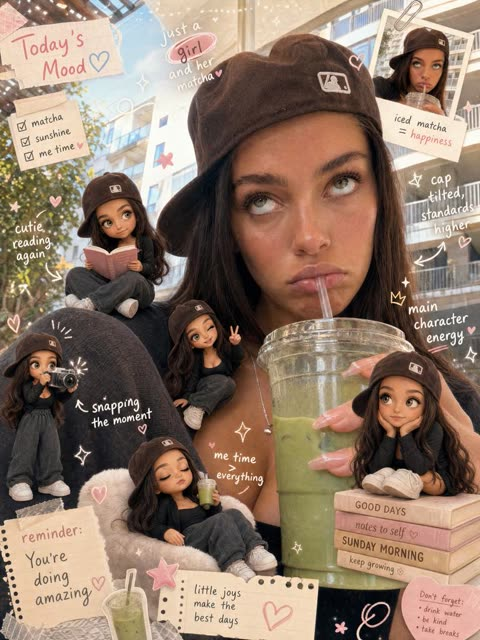</a>

提示词先锁定原图的人物、姿势、光线和背景，再分层添加内容：与本人一致且动作各异的迷你手办、手写涂鸦与标注，以及固定的粉彩色板。结尾强调结果必须是同一张图的增强而非重绘，从而稳住人物一致性。

GPT Image 2 · 上传图改图 · 出处: [@sipteaandcoffee on X](https://x.com/sipteaandcoffee/status/2050948629729542407) · 168 赞，统计于 2026-10-28

[`scrapbook`](tags.md#tag-scrapbook) [`chibi-figurine`](tags.md#tag-chibi-figurine) [`doodle-overlay`](tags.md#tag-doodle-overlay) [`identity-preservation`](tags.md#tag-identity-preservation) [`pastel`](tags.md#tag-pastel)

<details><summary><b>提示词</b></summary>

```text
Transform the provided reference image into a cozy aesthetic scrapbook-style composition while strictly preserving the original subject, identity, pose, lighting, and background.

Add multiple small “mini version” characters of the same person (chibi / doll-like style), placed naturally around the scene (on objects, table, shoulder, etc.). These mini figures must match the subject’s face, hairstyle, outfit, and vibe consistently, styled as cute 3D collectible figurines. Show them doing different activities (reading, posing, taking photos, relaxing).

Overlay handwritten-style doodles and annotations across the image: arrows, hearts, stars, sparkles, icons, and playful captions connected to elements in the scene.

Use a soft pastel color palette (white base with pink, peach, blue accents).

Keep the frame visually rich and filled but balanced and clean.

Style: warm, cozy lighting, dreamy Instagram scrapbook aesthetic, soft depth of field, highly detailed, polished but playful.

The final result must look like the SAME original image enhanced with mini alter-egos and aesthetic annotations — not a recreated or different scene.
```

</details>

<a id="gpt-image-ai-filmmaker-monochrome-panel-editorial-collage"></a>
### 黑白分格编辑拼贴搭配彩色全身抠图

<a href="https://x.com/FutureVibesAi/status/2104874557345841520">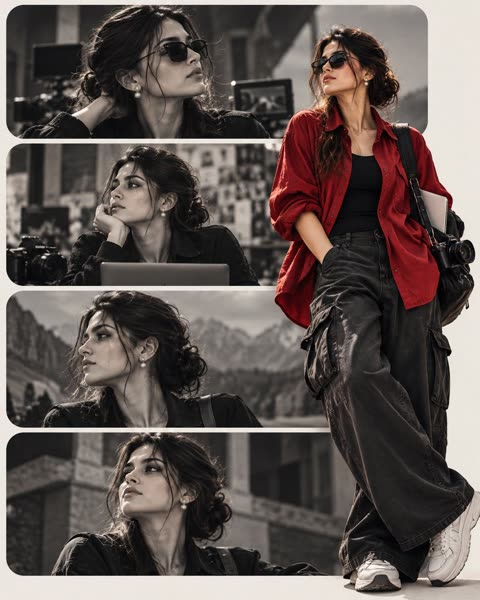</a>

四个黑白分格各自指定不同姿势和景别，再用一个彩色全身人像叠在上层营造层次。严格的人物一致性条款、详细的服装描述和禁止文字的要求让版面保持干净。

GPT Image 2.5 · 上传图改图 · 出处: [@FutureVibesAi on X](https://x.com/FutureVibesAi/status/2104874557345841520) · 158 赞，统计于 2026-10-28

[`editorial`](tags.md#tag-editorial) [`collage`](tags.md#tag-collage) [`monochrome`](tags.md#tag-monochrome) [`identity-consistency`](tags.md#tag-identity-consistency) [`fashion`](tags.md#tag-fashion)

<details><summary><b>提示词</b></summary>

```text
Use my attached/reference portrait as the strict facial identity reference. Keep my real facial structure, skin tone, eyes, nose, lips, hairline and overall likeness highly consistent across every appearance. Do not beautify me into a different person.

Create a premium modern editorial collage portrait of a female AI filmmaker and creative-tech founder.

The background consists of four large horizontal rounded-rectangle panels stacked vertically, exactly like a luxury magazine contact-sheet composition. Each panel contains a different cinematic black-and-white portrait of the same woman, while one large full-color full-body version overlaps the panels in the foreground.

BACKGROUND PANEL 1: cinematic close-up wearing sleek black sunglasses, looking sideways with a calm, powerful expression; subtle creative-studio environment behind her.

PANEL 2: relaxed candid portrait, chin resting lightly on one hand, thoughtful creator-at-work energy; subtle laptop and blurred production equipment in the environment, never distracting from her face.

PANEL 3: elegant side-profile portrait, looking away from camera, natural loose hair movement, cinematic shallow depth of field; blurred filmmaking/creative workspace background.

PANEL 4: slightly low-angle portrait looking upward with quiet ambition and confidence, dramatic directional light shaping her face.

All four panels are sophisticated monochrome photography, rich blacks, silver-gray highlights, subtle film grain, realistic skin texture and premium editorial contrast.

FOREGROUND

Place the same woman as a large full-body color cutout on the right side, overlapping all four panels.

Style her as a successful contemporary AI filmmaker / creative-tech founder: oversized deep black textured sweater, relaxed wide-leg charcoal/washed-gray cargo jeans, premium clean white sneakers, minimalist black shoulder bag, subtle silver jewelry and sophisticated black sunglasses either worn or naturally held.

Her pose is effortless and confident: one hand casually inside her pocket, one leg slightly crossed forward, body angled three-quarters toward camera, head turned slightly to the side. Expression composed, ambitious and self-assured — no exaggerated smile.

Add very subtle creator details: a sleek laptop/tablet partly visible inside the shoulder bag and a small professional camera accessory attached to the bag. Keep these understated and luxurious rather than making the image look like a tech advertisement.

Hair should feel naturally styled with soft loose strands around the face. Preserve my actual appearance rather than changing me into a fashion model.

AESTHETIC: Vogue-style contemporary editorial photography, AI creator meets luxury street fashion, cinematic photography, sophisticated minimalism, realistic skin pores, premium fabric textures, natural body proportions, soft directional sunlight, shallow depth of field, subtle analog film grain, high dynamic range, professional fashion campaign retouching, photorealistic, 8K.

LAYOUT: vertical 4:5 social-media poster, warm off-white background, four evenly spaced rounded monochrome panels, foreground woman extending beyond the panels to create dimensional depth, subtle realistic drop shadow behind her cutout, generous negative space, perfectly balanced editorial composition.

STRICT CONSISTENCY: every woman shown is the exact same person. Maintain identical facial anatomy and recognizable identity throughout. Correct hands and fingers, realistic anatomy, realistic clothing folds, no duplicate limbs, no warped accessories.

NO TEXT. NO TYPOGRAPHY. NO LETTERS. NO LOGOS. NO BRAND NAMES. NO WATERMARKS. NO RANDOM SYMBOLS.
```

</details>

<a id="gpt-image-frame-collage-identity-consistent-woman"></a>
### 女子在复古木相框中的多姿势拼贴

<a href="https://x.com/Alina_with_Ai/status/2102358953489481762"></a>

先用参考图锁定人物身份，再逐一列出每个相框的表情和姿势，并用重复的一致性要求和负面清单防止走样。暖色影棚光、道具和手绘涂鸦对话气泡营造出剪贴簿质感。

GPT Image 2.5 · 上传图改图 · 出处: [@Alina_with_Ai on X](https://x.com/Alina_with_Ai/status/2102358953489481762) · 156 赞，统计于 2026-10-28

[`collage`](tags.md#tag-collage) [`identity-consistency`](tags.md#tag-identity-consistency) [`scrapbook`](tags.md#tag-scrapbook) [`vintage-frames`](tags.md#tag-vintage-frames) [`editorial`](tags.md#tag-editorial)

<details><summary><b>提示词</b></summary>

```text
Use the uploaded reference image as the identity and facial reference. Create a high-resolution photorealistic editorial collage of the same young woman, keeping her face, hairstyle, skin tone, body proportions, and overall appearance consistent in every frame.

A stylish young woman with long straight dark-brown hair, wearing a fitted royal-blue short-sleeve T-shirt, blue denim jeans, and clean white chunky sneakers. Create a playful vintage photography-wall composition where she appears multiple times inside and around several ornate rustic wooden picture frames arranged vertically and overlapping.

The central full-body version of the woman sits casually on the frames, one leg bent and the other extended downward, smiling confidently while making a peace/V sign with one hand. Surrounding frames contain different realistic versions of the same woman with different expressions and poses:

laughing with eyes closed

surprised expression with both hands on cheeks

smiling with hands forming a heart

taking a mirror-style selfie with a modern smartphone

happily raising both arms

playful wink and smile

cheerful candid expressions

Maintain perfect facial identity consistency across all versions.

Background: warm beige studio wall with a cozy retro photography-studio aesthetic. Add several vintage film cameras placed naturally on some of the frames. Surround the composition with hand-drawn doodles, small stars, red hearts, arrows, and playful speech bubbles containing short phrases such as “BEST DAY EVER!”, “OOPS!”, “SO HAPPY!”, “HAHA!”, “LOVE THIS!”, “LITTLE MOMENTS!”

Composition should feel like a creative Instagram editorial photoshoot / scrapbook collage, highly detailed, natural realistic skin texture, realistic hands and fingers, accurate anatomy, soft warm studio lighting, subtle shadows, cinematic photography, crisp focus, premium fashion editorial quality, photorealistic, ultra-detailed, 8K, vertical 4:5 composition.

Important: Keep the same person recognizable in every frame, consistent clothing and hairstyle, realistic proportions, no duplicated facial features, no distorted hands, no extra fingers, no warped limbs, no text errors.
```

</details>

<a id="gpt-image-banana-smoothie-four-panel-recipe-collage"></a>
### 香蕉奶昔四格食谱拼图

<a href="https://x.com/DuaFatimaAi/status/2096033405259682193">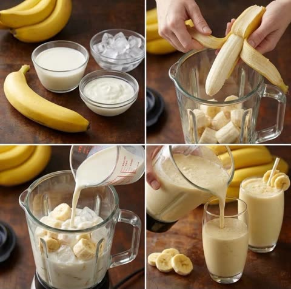</a>

按位置逐格描述 2x2 画面，每格写明食材与动作，步骤顺序清晰。结尾统一光线、玻璃器皿、景深和无文字要求，让四格风格一致。

GPT Image 2 · 文生图 · 出处: [@DuaFatimaAi on X](https://x.com/DuaFatimaAi/status/2096033405259682193) · 152 赞，统计于 2026-10-29

[`recipe`](tags.md#tag-recipe) [`food-photography`](tags.md#tag-food-photography) [`collage`](tags.md#tag-collage) [`step-by-step`](tags.md#tag-step-by-step) [`photorealistic`](tags.md#tag-photorealistic)

<details><summary><b>提示词</b></summary>

```text
Create a photorealistic 2×2 four-panel recipe collage showing the preparation of a creamy banana smoothie on a rustic dark wooden kitchen table.

Top-left: Several ripe yellow bananas, one peeled banana, a clear glass of milk, a small glass bowl of thick white yogurt, and a bowl of ice cubes neatly arranged as ingredients.

Top-right: Close-up of hands peeling a ripe banana and placing banana pieces into a transparent glass blender jar.

Bottom-left: Milk being poured from a transparent measuring cup into the blender containing banana pieces, yogurt, and ice cubes.

Bottom-right: Thick creamy banana smoothie being poured from the blender into a clear drinking glass, with another finished smoothie glass in the background and a few banana slices on the wooden table.

Warm natural kitchen lighting, realistic food textures, creamy pale-yellow smoothie, transparent glassware, shallow depth of field, rustic wooden background, clean composition, professional food photography, highly detailed, realistic hands, natural shadows, 4K photorealism, no text, no labels, no watermark.
```

</details>

<a id="gpt-image-ivory-editorial-collage-skater-breakout"></a>
### 滑板女孩跃出山景相框的编辑拼贴

<a href="https://x.com/Ziha_ai/status/2112515912993820802">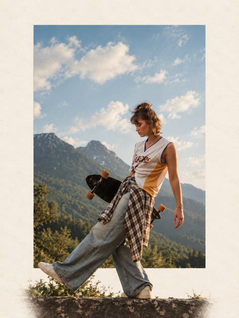</a>

提示词锁定严格 3:4 画布，在象牙白纸面中央放置矩形裁切图，并让主体与前景越过下边缘形成真实抠图。保留原图和限制清单两段文字保证人物、服装与风景不走样。

GPT Image 2.5 · 上传图改图 · 出处: [@Ziha_ai on X](https://x.com/Ziha_ai/status/2112515912993820802) · 128 赞，统计于 2026-10-29

[`editorial-collage`](tags.md#tag-editorial-collage) [`ivory-paper`](tags.md#tag-ivory-paper) [`photo-edit`](tags.md#tag-photo-edit) [`travel-magazine`](tags.md#tag-travel-magazine) [`cutout`](tags.md#tag-cutout)

<details><summary><b>提示词</b></summary>

```text
Use for portraits, people, flowers, trekking photos, and other vertical images. Canvas: strict 3:4 portrait.
Transform the uploaded photograph into a premium minimalist editorial collage inspired by luxury travel magazines, contemporary fashion editorials, and artistic outdoor photography.
FORMAT & COMPOSITION:
Create a strict 3:4 vertical canvas. Use a warm ivory/off-white background with subtle paper texture and generous negative space.
Place a large, clean-edged vertical rectangular crop of the original photograph in the center, slightly above the middle. Keep the original scenery recognizable inside the rectangle. Let the main subject naturally overlap and extend beyond the bottom edge of the rectangle into the ivory space. Where it looks natural, allow foreground flowers, grass, foliage, or rocks to extend beyond the frame as realistic photographic cutouts. Keep the layout asymmetrical but balanced, with the subject as the focal point.
PRESERVE THE ORIGINAL:
Use the uploaded photo as the source. Keep the subject as faithful to the original as possible: preserve identity, face, expression, hair, clothing, pose, proportions, colors, and distinctive details. Do not beautify, redesign, or stylize the subject. Preserve the original landscape, lighting, textures, and atmosphere. Do not crop off important parts of the subject.
STYLE:
Photorealistic premium travel editorial, minimalist Swiss-inspired art direction, warm ivory paper, muted earthy colors, dusty blues, natural greens, subtle film grain, realistic edges, and soft believable shadows.
RESTRICTIONS:
No text, typography, logos, watermarks, extra subjects, unrelated objects, illustration, cartoon effects, HDR, oversaturation, artificial glow, plastic textures, or exaggerated shadows. Do not distort proportions. If preserving the original subject conflicts with the layout, prioritize the subject.
FINAL RESULT:
A refined photorealistic editorial collage with a vertical rectangular photo and the original subject or natural foreground breaking out of the frame into the surrounding ivory negative space.
```

</details>

<a id="nano-banana-chibi-doll-scrapbook-white-saree-portrait"></a>
### 白色纱丽人像与Q版娃娃手账拼贴

<a href="https://x.com/HaniaAi12/status/2067928015519269285">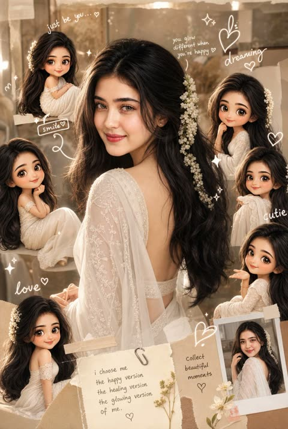</a>

开头先用简短风格词定调，再以参考图锁定写实主体人像。周围加入同一人物的Q版娃娃分身、涂鸦爱心、手写文字和手账版式，形成层次丰富的拼贴。

Nano Banana 2 · 上传图改图 · 出处: [@HaniaAi12 on X](https://x.com/HaniaAi12/status/2067928015519269285) · 124 赞，统计于 2026-10-28

[`chibi`](tags.md#tag-chibi) [`scrapbook`](tags.md#tag-scrapbook) [`doodle`](tags.md#tag-doodle) [`reference-photo`](tags.md#tag-reference-photo) [`portrait-collage`](tags.md#tag-portrait-collage)

<details><summary><b>提示词</b></summary>

```text
Doodle chibi Art .
Use reference photo to create a ultra-realistic cinematic portrait of a beautiful Indian woman in elegant white saree with embroidered blouse, jasmine flowers in long black hair, looking back with sweet smile, warm aesthetic lighting, surrounded by cute 3D chibi doll versions of herself in different poses, white doodle hearts and sparkles, handwritten words, dreamy scrapbook collage style, Disney Pixar inspired, soft glow, cozy feminine vibe, ultra detailed, 8k.
```

</details>

<a id="gpt-image-european-woman-six-scene-instagram-photo-dump"></a>
### 六宫格日常风 Instagram 随拍合集

<a href="https://x.com/john_my07/status/2114371973002506481">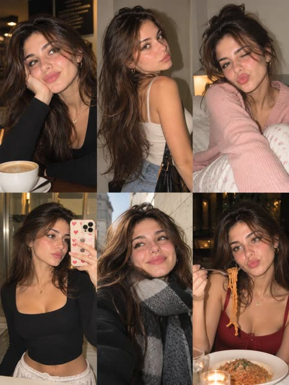</a>

先用一段固定的外貌描述并单独写明身份一致性，让六个编号场景保持同一张脸。每个场景分别指定服装、姿势和光线，并在版式要求里禁止留白、边框和文字。

GPT Image 2.5 · 文生图 · 出处: [@john_my07 on X](https://x.com/john_my07/status/2114371973002506481) · 115 赞，统计于 2026-10-28

[`photo-dump`](tags.md#tag-photo-dump) [`collage`](tags.md#tag-collage) [`identity-consistency`](tags.md#tag-identity-consistency) [`candid`](tags.md#tag-candid) [`lifestyle`](tags.md#tag-lifestyle)

<details><summary><b>提示词</b></summary>

```text
Create an ultra-realistic 6-photo lifestyle collage arranged in a seamless 3×2 grid, featuring the same naturally beautiful young European woman in her early 20s. She has warm olive skin, delicate freckles across her cheeks and nose, hazel-brown eyes, long chestnut-brown hair with natural waves and subtle highlights, full eyebrows, and glossy pink lips. Preserve the same recognizable facial identity across all six photographs.

Overall aesthetic: Authentic European Instagram photo dump, candid smartphone photography mixed with compact-camera flash, realistic skin texture, subtle digital grain, natural lighting, imperfect framing, spontaneous expressions, and a warm cinematic color palette. Every frame should feel like a genuine moment from her everyday life, not a professional studio shoot.

Six different scenes, outfits, and poses:

1. Cozy café moment: Sitting at a wooden café table in a fitted black long-sleeve top, resting her cheek against one hand and smiling gently at the camera. A white cappuccino cup sits in front of her, with warm pendant lights and a softly blurred café background.

2. Casual street-style portrait: Standing indoors near a neutral wall, wearing a cream fitted tank top, light-wash blue jeans, and carrying a black shoulder bag. She turns over her shoulder to look back at the camera, with her long hair cascading naturally down her back.

3. Cozy bedroom snapshot: Sitting on a white bed in a soft pastel-pink knit cardigan and white floral lounge pants. She hugs one knee casually, winks at the camera, and makes a playful pout. Warm bedside lighting creates a relaxed evening atmosphere.

4. Mirror selfie: Taking a casual mirror selfie in a fitted black square-neck long-sleeve top and white lounge pants. Her phone has a cute heart-patterned case. She looks at her reflection with a subtle, confident expression in a softly lit bedroom or hallway.

5. Outdoor winter portrait: Wearing a charcoal coat and a thick grey knitted scarf, with her long hair loose around her face. She looks slightly upward with a gentle smile while standing on a European street in soft natural daylight.

6. Restaurant dinner moment: Sitting at a restaurant table wearing a tasteful burgundy sleeveless top with a modest neckline and delicate gold jewelry. She playfully lifts a forkful of spaghetti while glancing toward the camera. A plate of pasta, warm candlelight, and softly blurred restaurant lights complete the scene.

Identity consistency: The same woman must appear in every panel, with identical facial proportions, eye color, freckles, skin tone, and hair color. Her hairstyle may vary naturally between scenes, including loose waves and slightly messier strands, while remaining recognizable.

Realism details: Authentic skin pores, fine baby hairs, natural facial asymmetry, realistic hands, believable fabric textures, subtle exposure differences, realistic reflections, and natural environmental lighting. Avoid excessive retouching, plastic skin, duplicated expressions, distorted fingers, inconsistent facial features, or overly polished AI-generated aesthetics.

Output requirements: Vertical 3:4 aspect ratio, exactly six equally sized photographs in a balanced 3-column × 2-row grid, clean alignment, no gutters, no borders, no text, no watermark. Photorealistic, youthful, spontaneous, stylish, and full of personality, like a genuine collection of everyday moments shared on Instagram.
```

</details>

<a id="gpt-image-identity-locked-polaroid-scrapbook-collage"></a>
### 同一女孩多种姿势的拍立得手帐拼贴

<a href="https://x.com/mehwishkiran07/status/2106208037136642520">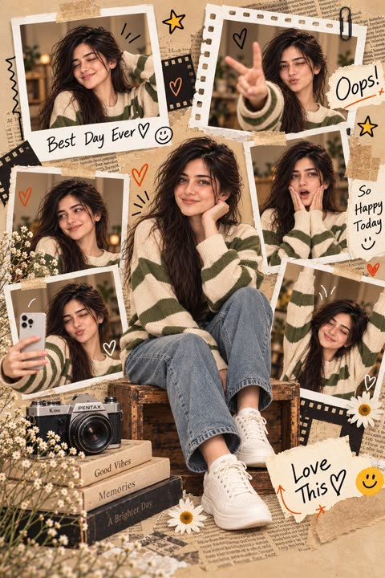</a>

开头和结尾都强调上传照片是唯一的身份参考，并固定服装，再列出七种不同的姿势和表情围绕中央大图，既保持人物一致又有变化，纸张、胶带和手写文字细节则构成手帐层次。

GPT Image 2.5 · 上传图改图 · 出处: [@mehwishkiran07 on X](https://x.com/mehwishkiran07/status/2106208037136642520) · 115 赞，统计于 2026-10-28

[`scrapbook`](tags.md#tag-scrapbook) [`polaroid`](tags.md#tag-polaroid) [`identity-lock`](tags.md#tag-identity-lock) [`memory-board`](tags.md#tag-memory-board) [`lifestyle`](tags.md#tag-lifestyle)

<details><summary><b>提示词</b></summary>

```text
> Create a highly detailed, photorealistic scrapbook-style photo collage using my uploaded image as the ONLY identity reference. Preserve my exact facial identity, facial features, skin tone, hairstyle, hair color, and overall appearance consistently in every photo. Do not change or beautify my face and do not create a different person.

Create a cozy aesthetic memory-board collage featuring the same woman in multiple candid lifestyle photographs. She is wearing a cream and olive-green striped oversized knit sweater, light blue loose-fit jeans, and clean white sneakers.

Arrange several realistic Polaroid-style photographs around one large central portrait. The central image shows her sitting casually on a vintage wooden crate, one knee raised, wearing the striped sweater and jeans, looking softly at the camera with a warm natural smile.

Include multiple smaller photographs showing different natural expressions and poses:

eyes closed with a peaceful smile

making a cute peace sign toward the camera

playful surprised expression with both hands on her cheeks

looking sideways with a gentle smile while holding small white flowers

taking a selfie with a smartphone

resting her face on one hand while smiling at the camera

a relaxed playful pose with one arm raised

Keep the same person, same outfit, same hairstyle, and consistent facial identity across every photograph.

Build the collage on a warm beige vintage paper background with layered torn newspaper pages, masking tape, paper scraps, film strips, handwritten doodles, hearts, stars, arrows, smiley faces, and small white daisies.

Add realistic Polaroid frames with slightly imperfect handmade placement, subtle shadows, paper texture, vintage photography details, and a cozy nostalgic scrapbook aesthetic.

Include handwritten-style decorative text such as “Best Day Ever ♡”, “Oops!”, “So Happy Today :)”, “Love This ♡” and small doodles around the photographs.

Add a vintage Pentax K1000 film camera resting on stacked old books near the bottom of the composition, with visible book titles such as “Good Vibes”, “Memories”, and “A Brighter Day.”

Warm natural indoor lighting, soft cinematic depth of field, realistic skin texture, high-end editorial photography, authentic candid expressions, detailed paper textures, realistic shadows, premium lifestyle photography, harmonious composition, ultra-realistic, high resolution.

Important: Use my uploaded image as the identity reference. Preserve my face exactly and consistently in all frames. Only change the poses, expressions, composition, and environment. Do not alter my identity.
```

</details>

<a id="nano-banana-korean-four-cut-photo-booth-strip"></a>
### 韩式四格大头贴照片条，粉彩边框

<a href="https://x.com/AiwithLariab/status/2050792903136735610">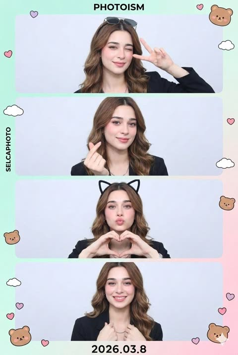</a>

提示词写明版式（四格竖排）、滤镜效果（提亮肤色、卧蚕、淡粉腮红）以及边框配色和图标类型。再加上日期戳、真实拍照机品牌的风格参照和保持五官准确的要求，让结果与原照片保持一致。

Nano Banana 2 · 上传图改图 · 出处: [@AiwithLariab on X](https://x.com/AiwithLariab/status/2050792903136735610) · 110 赞，统计于 2026-10-28

[`photo-booth`](tags.md#tag-photo-booth) [`korean-style`](tags.md#tag-korean-style) [`four-cut`](tags.md#tag-four-cut) [`pastel`](tags.md#tag-pastel) [`selfie`](tags.md#tag-selfie)

<details><summary><b>提示词</b></summary>

```text
Transform this photo into a Korean selca zone 4-cut photo strip. Create 4 vertically stacked frames with the same person in slightly different cute poses. Apply the classic Korean photo booth filter: brightened skin, subtle aegyo-sal enhancement, soft pink blush. Add a pastel mint and pink border with small decorative icons (bears, hearts, clouds). Include a date stamp '2026.03.8' at the bottom. The aesthetic should match modern Korean 4-cut photo booths like Photoism or Haru Film. Keep facial features accurate.
```

</details>

<a id="nano-banana-film-strip-memory-collage-portrait"></a>
### 带萌系小精灵的胶片记忆拼贴

<a href="https://x.com/AiwithLariab/status/2051256840143642633">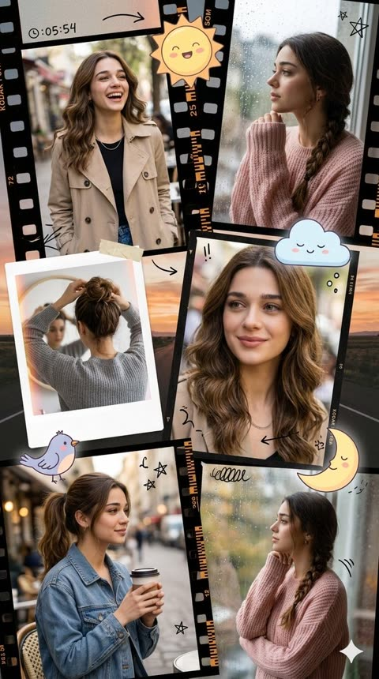</a>

先用参考图锁定人脸，再让每一帧的发型、服装和背景各不相同，一个人物就成了一条记忆时间线。胶片条、拍立得和手绘涂鸦叠加，配合 Portra 色调与 9:16 版式，拼贴依然统一。

Nano Banana 2 · 上传图改图 · 出处: [@AiwithLariab on X](https://x.com/AiwithLariab/status/2051256840143642633) · 104 赞，统计于 2026-10-28

[`film-strip`](tags.md#tag-film-strip) [`collage`](tags.md#tag-collage) [`polaroid`](tags.md#tag-polaroid) [`chibi-doodles`](tags.md#tag-chibi-doodles) [`reference-face`](tags.md#tag-reference-face)

<details><summary><b>提示词</b></summary>

```text
Asymmetrical cinematic film-strip style collage featuring a young woman using the exact face from the reference image, preserving identity and natural skin texture. The composition is arranged like a rolling timeline of memories captured in overlapping film frames and negatives. Each frame shows different emotional micro-moments: laughing while walking, looking out a window, fixing hair in mirror, holding coffee, and soft candid smile.
Frames are styled as vintage film strips, contact sheets, and Polaroid negatives with light leaks and grain textures. Hairstyle subtly changes per frame (loose hair, ponytail, messy bun, soft braid). Korean soft glam makeup with natural glow and dewy skin.
Include floating pastel chibi “memory spirits” representing emotions (joy, calm, curiosity, nostalgia) interacting with frames. Add hand-drawn doodles like timestamps, arrows, film marks, stars, and scribbles.
Outfit is casual chic layered wardrobe (trench coat, knit sweater, denim jacket) in muted tones (beige, soft pink, grey, dusty blue). Background varies slightly per memory scene (street café, sunset road, cozy room, rainy window).
Soft cinematic lighting, shallow depth of field, film photography style (Kodak Portra tone), warm nostalgic color grading, vertical 9:16 layout.
```

</details>

<a id="nano-banana-italy-travel-scrapbook-collage-poster"></a>
### 带人像的意大利旅行拼贴海报

<a href="https://x.com/iamrealsnow/status/2049042453198782674">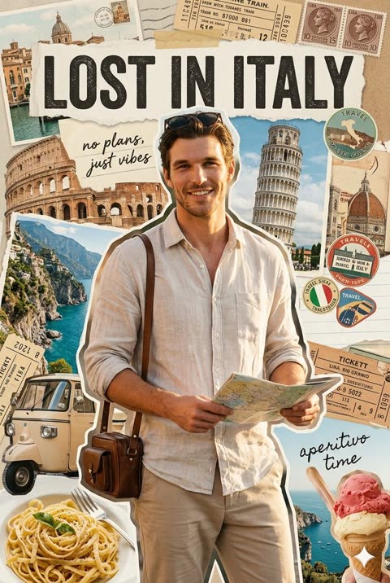</a>

以参考人脸作为中央抠图主体，周围叠加撕纸、明信片、邮票和贴纸等层次。做旧大标题置于主体之后，搭配手写小字和暖色复古色调统一整个拼贴。

Nano Banana 2 · 上传图改图 · 出处: [@iamrealsnow on X](https://x.com/iamrealsnow/status/2049042453198782674) · 104 赞，统计于 2026-10-28

[`travel`](tags.md#tag-travel) [`collage`](tags.md#tag-collage) [`scrapbook`](tags.md#tag-scrapbook) [`poster`](tags.md#tag-poster) [`face-reference`](tags.md#tag-face-reference)

<details><summary><b>提示词</b></summary>

```text
.
Ultra-realistic travel collage poster featuring a young man (use my face) as the central subject, standing confidently with a relaxed, adventurous expression. He is wearing a casual explorer outfit, light linen shirt, neutral trousers, sunglasses, and a crossbody bag, holding a map or camera. Warm sunlight highlights his face, giving a summer travel vibe.

Background is a layered scrapbook-style composition inspired by a vibrant travel destination (choose a different country, e.g. Italy or Turkey). Include iconic landmarks, vintage architecture, local street scenes, and cultural elements blended seamlessly around him. Add torn paper textures, postcards, stamps, and travel stickers for a handcrafted aesthetic.

Typography: bold, oversized headline text with a distressed texture (e.g. “LOST IN ITALY” or similar), placed prominently behind or above the subject. Include smaller handwritten-style phrases like “no plans, just vibes”, “explore more”, or “wander often”.

Add lifestyle elements like local food, transport (tram, scooter), street lamps, or cultural performers integrated into the collage. Use warm tones, reds, yellows, and earthy textures for a nostalgic travel feel.

Lighting: cinematic, slightly grainy, vintage color grading. High detail, sharp focus on subject, soft depth blending into background collage. Poster-style composition, highly aesthetic, social media ready.
```

</details>

<a id="gpt-image-couple-photobooth-contact-sheet-8-frames"></a>
### 年轻情侣八格拍立得照相亭联系表

<a href="https://x.com/frametheory058/status/2099882958106878177">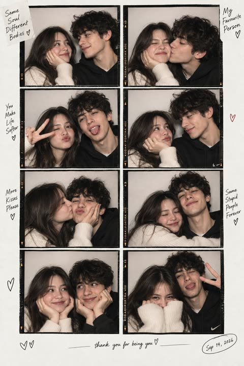</a>

先用固定的发型和服装描述锁定两位人物，再逐条编号八个不同的自然瞬间，避免姿势重复。胶片型号、直闪和颗粒的描述，加上禁用美颜滤镜的排除项，让画面更接近真实照片。

GPT Image 2.5 · 文生图 · 出处: [@frametheory058 on X](https://x.com/frametheory058/status/2099882958106878177) · 79 赞，统计于 2026-10-28

[`photobooth`](tags.md#tag-photobooth) [`contact-sheet`](tags.md#tag-contact-sheet) [`couple`](tags.md#tag-couple) [`film-grain`](tags.md#tag-film-grain) [`scrapbook`](tags.md#tag-scrapbook)

<details><summary><b>提示词</b></summary>

```text
Create an ultra-realistic vertical 2×4 photobooth contact-sheet collage of the same adorable young couple across all 8 frames. They should look like genuine real people photographed together, never AI-generated: natural facial asymmetry, realistic pores and skin texture, tiny imperfections, individual hair strands, authentic eyes, believable hands and anatomy.

Character continuity: cute young woman with long soft dark-brown hair, warm expressive eyes, subtle natural makeup, oversized cream knit sweater. Cute young man with messy naturally curly dark-brown hair, warm expressive eyes, dark charcoal hoodie/jacket over a simple white T-shirt. Keep their faces, hairstyles, age, proportions and clothing perfectly consistent in every frame.

Make every frame feel like a different spontaneous moment rather than repeated poses:

1. She rests her cheek on her hand while he looks at her with a tiny smile.

2. Both lean extremely close to the camera, laughing naturally, slightly imperfect framing.

3. She kisses his cheek while gently squishing his face; his eyes close with a genuine smile.

4. Both hide half their faces inside their oversized sleeves, only their eyes visible.

5. They wear matching dark vintage baseball caps; she makes a playful pout while he looks toward her.

6. A genuine mid-laugh shot where she covers her smile and he laughs beside her.

7. She makes a small heart with both hands in the foreground while he rests his cheek against her head.

8. Final emotional frame: he kisses her forehead while she closes her eyes and hugs him tightly.

Shot like a real late-night photobooth session on Kodak Portra 400, direct on-camera flash, slightly warm neutral white balance, soft shadow behind them, realistic flash falloff, subtle highlight bloom, fine 35mm grain, mild lens softness, tiny exposure inconsistencies and imperfect candid framing. No beauty filter, plastic skin, excessive sharpening, CGI or AI aesthetic.

Arrange all eight photographs inside distressed black analog contact-sheet borders on a matte black scrapbook background. Add tiny orange film-edge markings, subtle scratches and dust. Around the photographs, add sparse handwritten white-ink doodles and small imperfect hearts with phrases such as “Better Together ♡”, “My Happy Place”, “Same People, Different Moments”, “Still You ♡” and “More Silly Moments Please.” Keep typography secondary to the photographs and authentically handwritten rather than digitally perfect.

At the bottom, handwritten: “A thousand little moments with you ♡” with a small handwritten date.

The overall result should feel like a real couple accidentally created the perfect roll of film, intimate, youthful, nostalgic, cute and highly shareable—not a polished commercial photoshoot. Premium editorial composition, believable analog photography, extremely detailed faces, clean tonal separation, excellent contrast and natural cinematic color grading, 8K-quality realism, 9:16 vertical, absolutely no obvious AI artifacts.
```

</details>

<a id="gpt-image-morning-diaries-travel-scrapbook-poster"></a>
### 由照片生成的晨间日记旅行手账海报

<a href="https://x.com/Aqsahere_/status/2104395935438581848">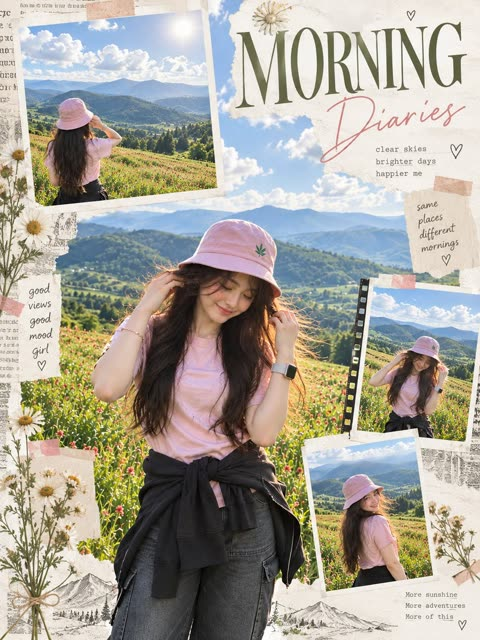</a>

提示词先锁定上传照片中人物的身份与服装，只改变时间氛围，再逐项列出手账元素和排版文字，并限定配色与3:4比例。

GPT Image 2.5 · 上传图改图 · 出处: [@Aqsahere_ on X](https://x.com/Aqsahere_/status/2104395935438581848) · 63 赞，统计于 2026-10-28

[`scrapbook`](tags.md#tag-scrapbook) [`travel-journal`](tags.md#tag-travel-journal) [`photo-edit`](tags.md#tag-photo-edit) [`editorial-poster`](tags.md#tag-editorial-poster) [`identity-lock`](tags.md#tag-identity-lock)

<details><summary><b>提示词</b></summary>

```text
Create a high-end morning editorial scrapbook poster from the uploaded photo. Transform the sunset scene into a fresh early-morning atmosphere with soft golden morning sunlight, clear blue sky, fluffy white clouds, crisp green mountains, and bright wildflowers. Keep the woman’s appearance, outfit, pose, facial features, hair, pink bucket hat, pink T-shirt, dark jacket tied around her waist, and overall identity consistent. Design it as a sophisticated travel-journal collage with torn cream paper, Polaroid frames, subtle washi tape, film-strip details, pressed daisies, delicate botanical sketches, handwritten notes, and vintage paper textures. Use the main photo prominently in the center with several smaller snapshots showing different natural angles from the same scene. Add elegant editorial typography reading “MORNING Diaries”, with small phrases such as “clear skies · brighter days”, “same places, different mornings”, and “good views, good mood”. Keep the palette soft and refined: sky blue, fresh green, warm cream, pale pink, and subtle beige. Make it feel like a premium independent travel magazine mixed with a personal morning diary—artistic, airy, nostalgic, natural, and beautifully composed, not like an advertisement. Strict 3:4 vertical composition, realistic photography blended seamlessly with refined scrapbook elements.
```

</details>

<a id="gpt-image-eight-pose-hoodie-portrait-collage"></a>
### 蓝色卫衣女孩八种姿势人像拼图

<a href="https://x.com/Adnan_Ai2/status/2103321407883214989">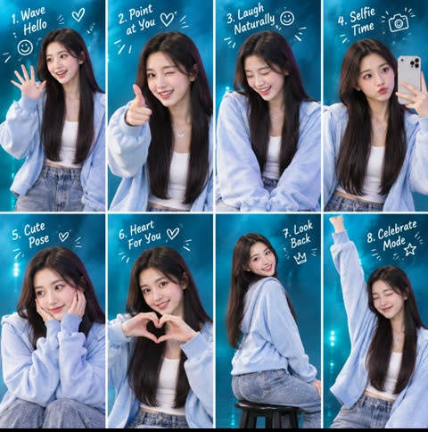</a>

以参考图锁定人物身份，并逐项写明服装与青蓝色影棚背景，保证各格一致。用编号列出八个动作，排成2×4网格，再约束手部和重复肢体，得到姿势多样但形象统一的拼图。

GPT Image 2.5 · 上传图改图 · 出处: [@Adnan_Ai2 on X](https://x.com/Adnan_Ai2/status/2103321407883214989) · 50 赞，统计于 2026-10-29

[`photo-collage`](tags.md#tag-photo-collage) [`pose-sheet`](tags.md#tag-pose-sheet) [`consistent-character`](tags.md#tag-consistent-character) [`studio-portrait`](tags.md#tag-studio-portrait) [`grid`](tags.md#tag-grid)

<details><summary><b>提示词</b></summary>

```text
Create a photorealistic 2×4 action collage using the reference image, featuring the exact same girl in all eight panels. Preserve her facial identity, long straight dark hair, light blue oversized hoodie, white top, blue jeans and butterfly necklace consistently. Keep the same teal-blue cinematic studio background, soft glowing lights, subtle bokeh and realistic portrait lighting. Show eight different actions: 1) waving hello, 2) pointing toward the camera with a cute wink, 3) laughing naturally, 4) taking a playful smartphone selfie, 5) posing with both hands on her cheeks, 6) making a heart shape with both hands, 7) sitting on a stool while looking back over her shoulder, 8) celebrating happily with one arm raised. Arrange everything in a clean 2×4 grid with clear separation, realistic skin and hair, natural hands and fingers, accurate body proportions, consistent outfit and face, cinematic depth of field, professional photography, ultra-realistic 4K, sharp details, no distortion, no duplicate body parts.
```

</details>

<a id="nano-banana-kawaii-kitten-three-panel-portrait-collage"></a>
### 少女与小猫的三格可爱人像拼贴

<a href="https://x.com/TheVirtualMuse/status/2110359043495846250">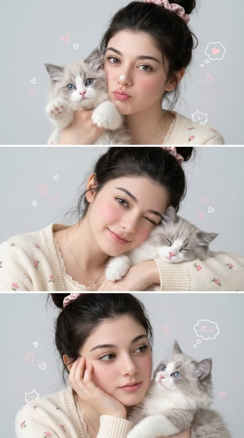</a>

提示词先用参考图锁定人物身份,再固定服装、小猫和分格布局,让三格保持一致。每格单独指定表情和动作,手绘爱心与思考气泡只作为浅灰影棚背景上的轻量点缀。

Nano Banana 2.1 · 上传图改图 · 出处: [@TheVirtualMuse on X](https://x.com/TheVirtualMuse/status/2110359043495846250) · 42 赞，统计于 2026-10-29

[`kawaii`](tags.md#tag-kawaii) [`portrait-collage`](tags.md#tag-portrait-collage) [`cat`](tags.md#tag-cat) [`korean-editorial`](tags.md#tag-korean-editorial) [`identity-preserve`](tags.md#tag-identity-preserve)

<details><summary><b>提示词</b></summary>

```text
Using the uploaded reference photo, create an ultra-realistic, high-resolution 9:16 vertical Korean-inspired kawaii editorial portrait collage featuring the exact same young woman. Strictly preserve her facial identity, eyes, nose, lips, facial structure, and natural skin texture.

Divide the composition into three perfectly equal horizontal panels, separated by thin, clean white lines. Each panel must show a complete, beautifully framed close-up portrait with no awkward cropping.

STYLE & OUTFIT:
Soft, voluminous dark hair styled in a slightly messy high bun with delicate loose strands and a pink floral scrunchie. She wears a cozy cream knitted cardigan with tiny pink floral patterns, a delicate cream lace-trimmed inner top, and a minimalist silver necklace. Naturally rosy cheeks, soft pink lips, expressive eyes, and realistic skin texture.

CAT:
The same adorable, extremely fluffy grey-and-white Ragdoll kitten with big crystal-blue eyes, a tiny pink nose, and soft pink paw pads appears consistently in all three panels.

PANEL 1 — PLAYFUL CUTENESS:
She gently cuddles the fluffy kitten against her cheek, making an adorable tiny pout toward the camera. The kitten looks directly at the viewer with wide blue eyes, both fluffy front paws clearly visible. A tiny white cream dot on her nose adds playful charm.

PANEL 2 — SWEETEST MOMENT:
She rests her cheek against the peacefully sleeping kitten, giving the camera a cute, natural wink and a gentle closed-mouth smile. Both look comfortable and affectionate, creating a heartwarming portrait.

PANEL 3 — DREAMY CONNECTION:
She rests her cheek on one hand while holding the kitten close. The kitten gazes lovingly up at her with curious blue eyes as she looks thoughtfully to the side. Soft, innocent, naturally adorable expressions.

BACKGROUND & DETAILS:
Clean, minimal soft-grey studio background. Add a few delicate hand-drawn pastel pink and white hearts, tiny cat doodles, and playful thought bubbles around the subjects, without cluttering the composition.

PHOTOGRAPHY:
Premium Korean lifestyle editorial photography, professional DSLR quality, 85mm portrait lens, beautifully diffused studio lighting, perfectly sharp faces, detailed eyelashes, realistic hair strands, visible knitted fabric textures, and exceptionally detailed kitten fur. Soft pastel color grading, balanced contrast, natural highlights, and gentle depth of field.

FINAL QUALITY:
Photorealistic, crystal-clear, beautifully composed, irresistibly cute, premium Instagram-worthy aesthetic. Maintain identical facial identity, hairstyle, outfit, and kitten appearance across all three panels. Natural human proportions, accurate hands and paws, no facial distortion, no excessive skin smoothing, no artificial CGI or plastic appearance.
```

</details>

<a id="gpt-image-anime-candid-snapshot-grid-nine-panels"></a>
### 同一角色的九宫格动漫随手拍

<a href="https://x.com/8co28/status/2099164852560539975">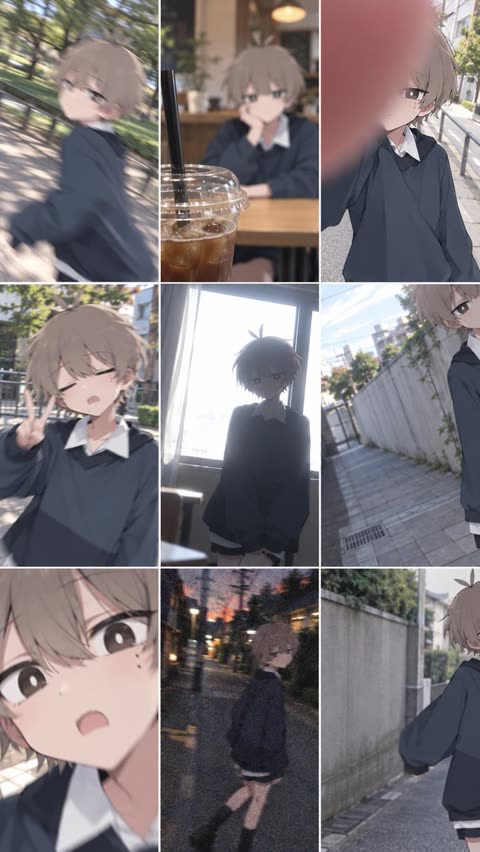</a>

以参考图锁定角色,再按编号逐格指定构图,如动态模糊、手指遮镜头、剪影和背影。颗粒感与多种光线营造业余随手拍质感,并用统一服装约束保证整组一致。

GPT Image 2.5 · 上传图改图 · 出处: [@8co28 on X](https://x.com/8co28/status/2099164852560539975)

[`anime`](tags.md#tag-anime) [`grid`](tags.md#tag-grid) [`candid`](tags.md#tag-candid) [`character-consistency`](tags.md#tag-character-consistency) [`slice-of-life`](tags.md#tag-slice-of-life)

<details><summary><b>提示词</b></summary>

```text
Using the provided reference image as the character base, generate a 3x3 grid of 9 distinct square panels. Each panel should depict the same character in different candid, slice-of-life scenarios, styled to look like casual snapshots or social media posts.

Layout: A perfectly aligned 3x3 grid with thin white borders separating the panels.

Style & Atmosphere: The overall aesthetic should be soft, slightly grainy, and naturalistic, mimicking amateur photography. Use varied lighting conditions (daylight, indoor warm light, dusk) and camera angles (close-ups, medium shots, full-body shots).

Panel Content Instructions:
1. Top Left: Motion blur effect, character looking back over shoulder outdoors.
2. Top Center: Character sitting at a cafe table with an iced coffee drink in the foreground, resting chin on hand.
3. Top Right: Close-up selfie angle, partially obscured by a finger or thumb covering part of the lens.
4. Middle Left: Character making a peace sign near their face, winking or squinting against bright sunlight.
5. Middle Center: Silhouette shot against a bright window, standing indoors.
6. Middle Right: Low-angle street shot, character walking past a concrete wall.
7. Bottom Left: Extreme close-up of face, mouth open in surprise or mid-speech.
8. Bottom Center: Night/dusk scene, character walking away down a dimly lit street with streetlights.
9. Bottom Right: Rear view of character walking along a sidewalk next to a fence.

Constraints: Maintain consistent character design (hair color, outfit details like the oversized dark hoodie/sweater and shorts) across all panels. Ensure high variety in composition and mood.
```

</details>

<a id="gpt-image-cafe-photo-cartoon-doodle-overlay"></a>
### 咖啡馆写实照片叠加卡通咖啡涂鸦

<a href="https://x.com/Jawad_Rahman_/status/2049796647237066971">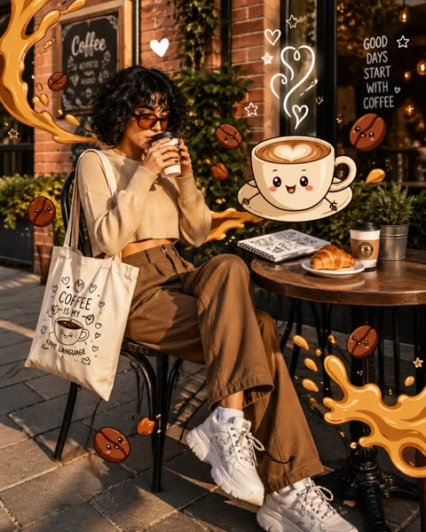</a>

把画面拆成写实摄影层和 2D 卡通叠加层，并逐一点名漂浮的卡通元素。黄金时段光线与浅景深让人物保持清晰，涂鸦依然鲜明。

GPT Image 2 · 文生图 · 出处: [@Jawad_Rahman_ on X](https://x.com/Jawad_Rahman_/status/2049796647237066971) · 发现于 [freestylefly/awesome-gpt-image-2](https://github.com/freestylefly/awesome-gpt-image-2)

[`photo-cartoon-mix`](tags.md#tag-photo-cartoon-mix) [`cafe`](tags.md#tag-cafe) [`doodle-overlay`](tags.md#tag-doodle-overlay) [`golden-hour`](tags.md#tag-golden-hour) [`pop-art`](tags.md#tag-pop-art)

<details><summary><b>提示词</b></summary>

```text
A trendy young woman sitting at an outdoor café table, holding a hot coffee cup near her lips. She has short curly black hair and wears oversized tinted sunglasses, a cropped beige sweater, loose brown high-waisted pants, and chunky white sneakers. A tote bag with minimal coffee-themed illustrations hangs on her shoulder.

The scene blends realistic photography with playful 2D cartoon overlays. Floating around her are animated coffee elements: a smiling cappuccino cup with heart-shaped latte art, cute coffee beans with tiny faces, and stylized splashes of caramel forming comic-style shapes. Soft doodle steam rises into hearts and stars.

On the table: a croissant, a notebook with sketch drawings, and a second coffee cup.

Background: a realistic cozy café street with brick walls, plants, warm golden hour lighting, and soft shadows. Slight depth of field, subject in sharp focus.

Style: mix of photorealism and vibrant cartoon illustration, pop-art aesthetic, high saturation but warm tones, clean composition, Instagram-worthy, soft glow, 4k detail.
```

</details>

<a id="gpt-image-chibi-avatar-scrapbook-cozy-selfie"></a>
### 舒适自拍周围的Q版贴纸手账

<a href="https://x.com/xRahultripathi/status/2050478421109817749">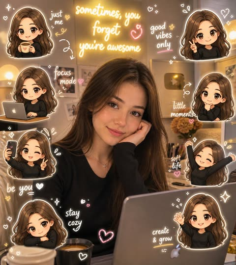</a>

提示词先锁定真人主体不变，再逐条列出不重复的Q版动作，让每个贴纸都不一样。位置规则把贴纸限制在边缘和空白处，固定配色与手写短语让涂鸦呼应霓虹氛围。

GPT Image 2 · 上传图改图 · 出处: [@xRahultripathi on X](https://x.com/xRahultripathi/status/2050478421109817749) · 发现于 [YouMind-OpenLab/awesome-gpt-image-2](https://github.com/YouMind-OpenLab/awesome-gpt-image-2)

[`chibi`](tags.md#tag-chibi) [`sticker`](tags.md#tag-sticker) [`scrapbook`](tags.md#tag-scrapbook) [`selfie`](tags.md#tag-selfie) [`kawaii`](tags.md#tag-kawaii)

<details><summary><b>提示词</b></summary>

```text
Chibi Avatar Scrapbook Photo Prompt (Based on Uploaded Female Portrait)

Use the uploaded image of a young woman as the base. Do NOT add any new person. Transform the existing subject into a chibi scrapbook-style composition while fully preserving her real identity, face, hairstyle, long soft brown hair, natural makeup, black outfit, pose, lighting, and cozy indoor aesthetic.

[Theme Detection]
The scene reflects a cozy lifestyle / selfie / workspace vibe with soft lighting, aesthetic room elements, a motivational neon sign, and a laptop desk setup. Maintain a calm, stylish, slightly productive lifestyle mood throughout.

[Chibi Avatars]
Add 5–8 chibi mini versions of the SAME girl:
- same long soft brown hair (slight waves)
- same outfit tone (black top)
- same gentle, confident expression

Style:
- kawaii chibi sticker style
- big head, small body proportions
- expressive cute eyes
- soft pastel shading
- clean, high-quality sticker finish

[Chibi Actions – no repetition]
- holding coffee 
- working on laptop 
- taking selfie 
- relaxed leaning pose
- peace sign 
- thinking pose 
- stretching / chill pose
- smiling & waving 

[Sticker Placement]
- Place chibi avatars around edges and empty areas only
- Do NOT cover the main face or body
- Add white outline + soft drop shadow
- Slight floating sticker effect

[Doodles]
Add subtle scrapbook-style doodles:
- hearts, sparkles, stars, arrows
- aesthetic lines and circles
- soft glowing accents

Color palette:
white + warm yellow + soft pink (matching neon vibe)

[Handwritten Text]
Add 5–8 short aesthetic phrases:
- "just me "
- "soft life"
- "stay cozy"
- "little moments"
- "focus mode"
- "good vibes only"
- "create & grow"
- "be you "

Style:
- handwritten font
- white text with soft glow
- selective highlights in pink/yellow

[Composition]
- Center focus: real girl (unchanged)
- Surround with chibi stickers + doodles + text
- Keep layout balanced, clean, not cluttered

[Style Keywords]
realistic photo + chibi stickers, kawaii aesthetic, cozy lifestyle, warm lighting, scrapbook diary, soft glow, high detail, Instagram aesthetic

[Final Output]
A polished, high-quality, social-media-ready scrapbook image combining:
realistic subject + cute chibi extensions + aesthetic doodles

[Avoid]
- altering facial identity
- over-beautifying or AI face distortion
- cluttered composition
- unrelated/random elements
- covering the subject
```

</details>

<a id="gpt-image-chibi-scrapbook-milan-vacation-photo"></a>
### 米兰旅行照的Q版手账拼贴

<a href="https://x.com/CallMeDiegoJr/status/2051234005568090505">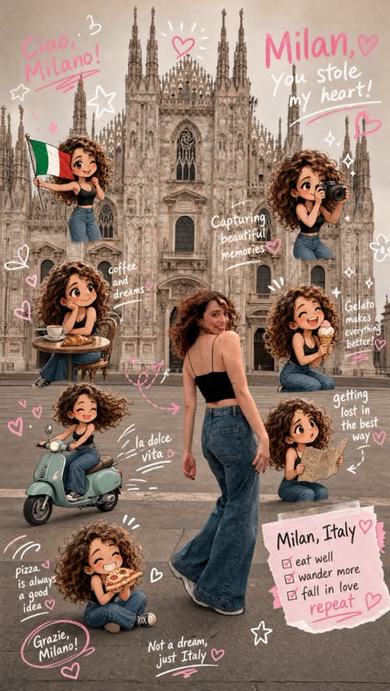</a>

先删除路人，再要求多个与本人发型和服装一致的Q版小人，各自做不同的当地活动。白色和粉色手绘涂鸦（箭头、星星、爱心）加上与城市相关的手写短句，营造手账感。

GPT Image 2 · 上传图改图 · 出处: [@CallMeDiegoJr on X](https://x.com/CallMeDiegoJr/status/2051234005568090505) · 发现于 [YouMind-OpenLab/awesome-gpt-image-2](https://github.com/YouMind-OpenLab/awesome-gpt-image-2)

[`chibi`](tags.md#tag-chibi) [`scrapbook`](tags.md#tag-scrapbook) [`travel`](tags.md#tag-travel) [`doodles`](tags.md#tag-doodles) [`photo-transformation`](tags.md#tag-photo-transformation)

<details><summary><b>提示词</b></summary>

```text
remove the people around the main character, Add multiple small, cute chibi-style “mini versions” of her around the image. Each mini character should have a big head, expressive facial features, and match her hairstyle and outfit. Depict each mini version doing different vacation-related activities in italy. Enhance the image with playful, hand-drawn doodles and handwritten notes in white and pink ink, in a scrapbook style. Include elements like arrows, stars, hearts, sparkles, and sketchy lines. Add cute, handwritten vacation-themed phrases about Milan Italy.
```

</details>

<a id="gpt-image-earth-signs-chibi-scrapbook-portrait"></a>
### 地象星座手账肖像与三个Q版分身

<a href="https://x.com/ZaraIrahh/status/2053075976469512686">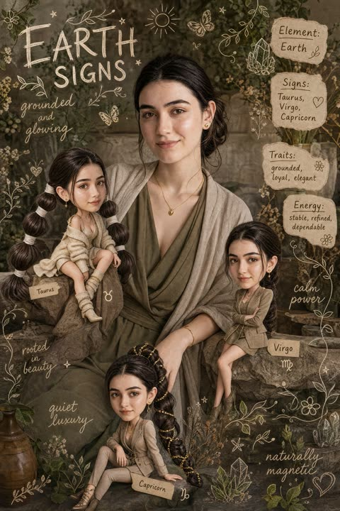</a>

提示词先用参考图锁定人物身份，再为每个星座Q版分身指定独立的服装和发型，让三个分身各有区别。手写文字与信息气泡的原文加上涂鸦清单，构成手账叠加层。

GPT Image 2 · 上传图改图 · 出处: [@ZaraIrahh on X](https://x.com/ZaraIrahh/status/2053075976469512686) · 发现于 [freestylefly/awesome-gpt-image-2](https://github.com/freestylefly/awesome-gpt-image-2)

[`scrapbook`](tags.md#tag-scrapbook) [`chibi`](tags.md#tag-chibi) [`zodiac`](tags.md#tag-zodiac) [`reference-photo`](tags.md#tag-reference-photo) [`doodle-overlay`](tags.md#tag-doodle-overlay)

<details><summary><b>提示词</b></summary>

```text
CREATE A NEW IMAGE USING THE PROVIDED FEMALE SUBJECT AS THE ONLY REFERENCE. Preserve her exact facial features, identity, and characteristics with zero alteration.

MAIN SUBJECT — EARTH ELEMENT
She represents the Earth element as a whole: grounded, elegant, sensual, calm, stable, patient, quietly powerful, and naturally luxurious. Relaxed grounded posture, standing or seated, soft natural hand placement, composed feminine body language, rooted presence.

OUTFIT
Single cohesive Earth-inspired editorial look in olive, sage, taupe, mocha, beige, clay, cream, moss, and warm neutrals. Soft-structured elegant silhouette with subtle tailoring, draping, texture contrast, or layered structure. Fabrics: linen, cotton, matte satin, knit, suede-like textures, soft tailoring. Minimal refined gold or natural-toned accessories.

HAIR
Soft ash brown with natural dimension. Healthy, polished, softly voluminous waves or smooth blowout with subtle shine, controlled texture, face-framing strands, grounded and luxurious feel.

MAKEUP
Korean soft-glow base with earthy tones. Warm beige-rose, terracotta, tawny, or nude peach blush. Eyes in taupe, mocha, caramel, muted bronze, olive-brown. Soft liner, champagne-beige highlight, satin or velvet nude/mocha lips. Overall polished, sensual quiet-luxury aesthetic.

ENVIRONMENT
Grounded editorial Earth-inspired setting with stone, wood, linen, botanicals, dried plants, natural fabrics, rustic-luxury styling, warm daylight or diffused editorial lighting, soft shadows, serene cinematic stillness. Palette: cream, olive, moss, clay, taupe, beige, muted green, warm brown.

CHIBI MINI-ME SYSTEM
Surround her with multiple medium-sized realistic 3D chibi mini-me versions with identical face, hair, and identity. High-end doll-like styling with oversized heads, petite bodies, glossy eyes, realistic hair, detailed makeup, miniature fashion outfits, soft cinematic 3D lighting.

EARTH SIGN CHIBIS
Taurus — sensual soft-luxury romantic styling, knit or elegant feminine neutral outfit, rich textures, gold accents. Ultra-long segmented twin low ponytails tied with white fabric bands flowing dramatically around the frame.
Virgo — refined perfectionist aesthetic with polished minimalist tailoring, clean lines, structured mini dress or sophisticated co-ord styling.
Capricorn — sleek power-dressing with blazer dress or tailored set, sharp silhouette, understated luxury. Hair pulled into ultra-long sculptural braid wrapped with gold chains and metallic ornaments.

DOODLES + SCRAPBOOK OVERLAY
Hand-drawn earthy scrapbook doodles: leaves, vines, flowers, branches, mushrooms, butterflies, stars, sparkles, stones, hearts, sun doodles, botanical icons. Cozy ink-pen texture.

Handwritten text:
“EARTH SIGNS”
“grounded and glowing”
“soft strength”
“rooted in beauty”
“quiet luxury”
“stable energy”
“calm power”
“naturally magnetic”

Fact bubbles:
“Element: Earth”
“Signs: Taurus, Virgo, Capricorn”
“Traits: grounded, loyal, elegant”
“Energy: stable, refined, dependable”

COMPOSITION
Main subject centered and dominant. Chibis placed dynamically around shoulders, hands, sides, and lower frame. Doodles layered naturally throughout like a scrapbook. Balanced, expressive, premium composition.

STYLE
Cinematic editorial lifestyle image, fashion-meets-illustration hybrid, high detail, sharp focus, warm neutral tones, subtle realism grain, realistic human rendering with stylized 3D chibis and hand-drawn overlays. Social-media-ready premium aesthetic.

CAMERA
Eye-level or slightly above, medium full-body or 3/4 framing, 35mm or 50mm lifestyle portrait look, crisp details with soft atmospheric depth.
```

</details>

<a id="gpt-image-eight-look-casual-outfit-editorial-collage"></a>
### 八套日常穿搭编辑拼贴，配手写标注

<a href="https://x.com/aiwithaly/status/2052218645951205463">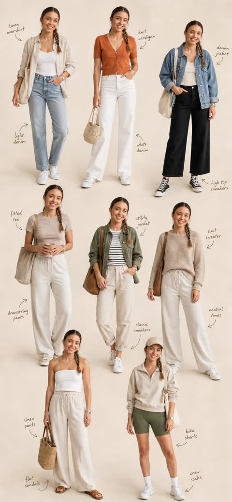</a>

要求八套造型保持同一张脸，并用比例暗示身高而不直接写出数字。禁用网格和边框让版面自由错落，手写箭头和标签标出关键单品。

GPT Image 2 · 上传图改图 · 出处: [@aiwithaly on X](https://x.com/aiwithaly/status/2052218645951205463) · 发现于 [freestylefly/awesome-gpt-image-2](https://github.com/freestylefly/awesome-gpt-image-2)

[`fashion`](tags.md#tag-fashion) [`outfit-collage`](tags.md#tag-outfit-collage) [`editorial`](tags.md#tag-editorial) [`handwritten-labels`](tags.md#tag-handwritten-labels) [`consistent-face`](tags.md#tag-consistent-face)

<details><summary><b>提示词</b></summary>

```text
Create a freeform fashion-editorial collage of me in 8 distinct full-body casual wear, arranged organically on a clean cream studio backdrop. Keep my face identical across all looks, w/ consistent proportions that visually read as around (height) w/o stating height. Include subtle handwritten-style arrows & labels highlighting key pieces. Avoid any grids, borders, or boxed layouts.
```

</details>

<a id="gpt-image-fashion-lookbook-burgundy-top-collage"></a>
### 酒红上衣模特的时尚画册网页拼贴

<a href="https://x.com/Mind_Boticni/status/2061310969192870028">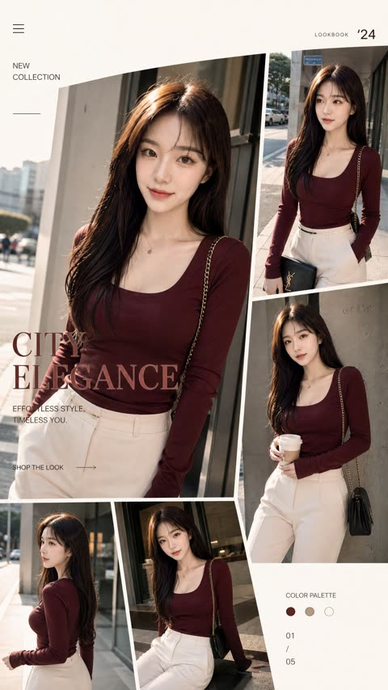</a>

锁定服装颜色，让同一模特在多个重复画框中以不同的放松姿势保持一致。透视倾斜、极简界面构图和购物网站美学把拼贴变成带有标题文字和配色色卡的电商画册页面。

GPT Image 2 · 文生图 · 出处: [@Mind_Boticni on X](https://x.com/Mind_Boticni/status/2061310969192870028) · 发现于 [freestylefly/awesome-gpt-image-2](https://github.com/freestylefly/awesome-gpt-image-2)

[`fashion`](tags.md#tag-fashion) [`lookbook`](tags.md#tag-lookbook) [`e-commerce`](tags.md#tag-e-commerce) [`collage`](tags.md#tag-collage) [`layout`](tags.md#tag-layout)

<details><summary><b>提示词</b></summary>

```text
Stylish fashion catalog shoot blending streetwear and luxury branding. Female model wearing burgundy slim-fit top and ivory tailored pants, posed in confident relaxed positions across multiple duplicated frames. Slight perspective tilt, dynamic layout collage, soft daylight studio lighting with warm tone grading. Modern shopping website aesthetic, minimal UI-inspired composition, high resolution fashion photography.
```

</details>

<a id="gpt-image-four-country-cultural-dress-grid"></a>
### 融合建筑服饰美食的四国连衣裙宫格

<a href="https://x.com/Gdgtify/status/2051428657571279137">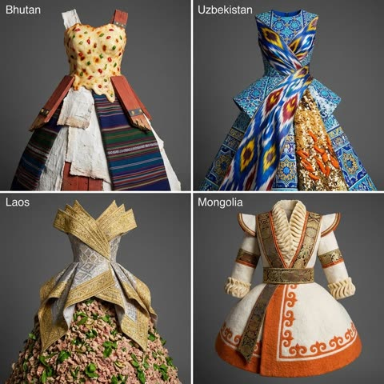</a>

用函数式模板为每个国家设定建筑、服饰、美食三个锚点，并指定纹理、材质与颜色，再要求设计位于三者正中心的连衣裙。2x2 宫格输出让四个国家便于对比。

GPT Image 2 · 文生图 · 出处: [@Gdgtify on X](https://x.com/Gdgtify/status/2051428657571279137) · 发现于 [freestylefly/awesome-gpt-image-2](https://github.com/freestylefly/awesome-gpt-image-2)

[`dress-design`](tags.md#tag-dress-design) [`cultural-fusion`](tags.md#tag-cultural-fusion) [`grid`](tags.md#tag-grid) [`fashion`](tags.md#tag-fashion) [`template`](tags.md#tag-template)

<details><summary><b>提示词</b></summary>

```text
<instructions> input: continent pick 4 lesser known countries in that continent function drawx($lesser known country){ > Anchor 1: "$lesser known's famous architecture" (it's texture, material and color) > Anchor 2: "$lesser known's famous fashion " (it's texture, material and color) > Anchor 3: "$lesser known's famous food " (it's texture, material and color) > > **Instruction:** Render a dress design that exists at the exact center of this triangle. } output: 2x2 grid, drawx( for each lesser known country)
```

</details>

<a id="gpt-image-japanese-cafe-couple-dessert-scrapbook"></a>
### 日系咖啡馆情侣分享甜点写真

<a href="https://x.com/sha_zdiii/status/2054047328420634927">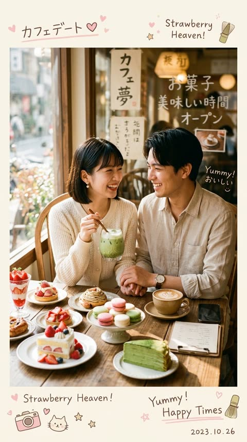</a>

用方括号槽位控制服装、道具、光线、涂鸦颜色和色调，一条提示词可以生成多种变体。背景虚化的日文招牌加上画面四周的手写涂鸦，营造出真实照片与手帐拼贴结合的效果。

GPT Image 2 · 文生图 · 出处: [@sha_zdiii on X](https://x.com/sha_zdiii/status/2054047328420634927) · 发现于 [freestylefly/awesome-gpt-image-2](https://github.com/freestylefly/awesome-gpt-image-2)

[`cafe`](tags.md#tag-cafe) [`couple`](tags.md#tag-couple) [`scrapbook`](tags.md#tag-scrapbook) [`japanese`](tags.md#tag-japanese) [`template`](tags.md#tag-template)

<details><summary><b>提示词</b></summary>

```text
Ultra-realistic cozy Japanese-Korean café photography featuring a cute young [Japanese/Korean] couple sitting together naturally in a trendy aesthetic café. The young couple should look stylish and youthful, wearing [fashion style/outfit colors], smiling softly and enjoying desserts together.

The table is beautifully filled with [desserts/foods] such as pancakes, strawberry cakes, macarons, croissants, pastries, iced coffees, matcha lattes, fruit desserts, and aesthetic drinks arranged in a visually satisfying composition. Add small aesthetic café props like [flowers/ribbons/books/candles/pearls/notebooks] on the table for a premium Pinterest moodboard feel.

Soft [lighting style] lighting enters through the café windows creating dreamy highlights, creamy shadows, glossy reflections on drinks, and realistic dessert textures. Background should contain softly blurred [Japanese/Korean] signs, glowing café boards, handwritten Japanese text, neon typography, and aesthetic city café elements for an authentic Tokyo/Seoul vibe.

Add cute scrapbook-style doodles and handwritten notes around the image in [doodle color] ink — tiny hearts, stars, sparkles, ribbons, arrows, smiley sketches, bows, diary stickers, and handwritten café notes.

Color palette should focus on [color theme] tones. Style inspired by viral Pinterest café photography, Korean lifestyle aesthetics, Japanese cozy café culture, dreamy Gen-Z romance mood, shallow depth of field, cinematic composition, ultra realistic food textures, soft blurry background, ultra detailed realistic photography, clean aesthetic layout, 8k.
```

</details>

<a id="gpt-image-korean-spring-garden-scrapbook-poster"></a>
### 韩系春日花园手帐风人像海报

<a href="https://x.com/Taaruk_/status/2060214163591614900">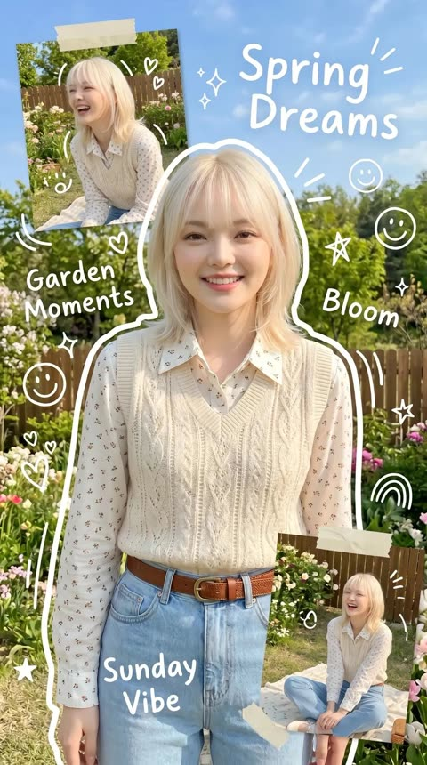</a>

用逗号串联主体、服装、场景和手帐元素，如拍立得、胶带、涂鸦和手写字体。主体白色描边加上明确的版式风格词，让拼贴保持统一。

GPT Image 2 · 文生图 · 出处: [@Taaruk_ on X](https://x.com/Taaruk_/status/2060214163591614900) · 发现于 [freestylefly/awesome-gpt-image-2](https://github.com/freestylefly/awesome-gpt-image-2)

[`scrapbook`](tags.md#tag-scrapbook) [`korean-fashion`](tags.md#tag-korean-fashion) [`spring`](tags.md#tag-spring) [`doodle`](tags.md#tag-doodle) [`polaroid`](tags.md#tag-polaroid)

<details><summary><b>提示词</b></summary>

```text
Cute Korean spring aesthetic scrapbook poster, dreamy K-fashion portrait, soft blonde girl standing in a blooming flower garden, pastel blue sky background, cream floral blouse layered under a knitted ivory sweater vest, light blue high-waisted jeans, natural smile, glowing fair skin, soft makeup, cherry blossom trees, colorful spring flowers, cozy countryside garden, bright natural sunlight, kawaii doodle overlays, hand-drawn white hearts, smiley faces, stars, sparkles, rainbows, playful handwritten typography, polaroid photo frames, masking tape stickers, scrapbook collage layout, Pinterest aesthetic, Korean magazine editorial, cottagecore fashion, dreamy spring vibes, wholesome mood, soft pastel color palette, clean composition, aesthetic social media poster, ultra detailed, photorealistic, high quality, cute and charming atmosphere, subtle bokeh, lifestyle photography, Instagram reel cover, fashion moodboard, Y2K scrapbook design, white outline around subject, flower-themed decorations, 8k masterpiece
```

</details>

<a id="gpt-image-mustard-field-triptych-doodle-collage"></a>
### 油菜花田三联竖版写真拼贴与涂鸦

<a href="https://x.com/frametheory058/status/2051294907214844249">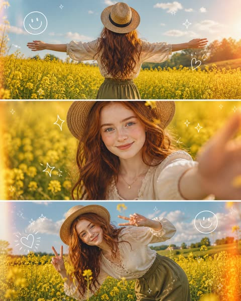</a>

每个分格单独指定姿势和景别：背影、手伸向镜头的特写、俏皮侧倾，再用统一的服装和金色夕阳光线保持三格一致。结尾集中列出白色涂鸦、漏光和胶片颗粒等叠加效果。

GPT Image 2 · 上传图改图 · 出处: [@frametheory058 on X](https://x.com/frametheory058/status/2051294907214844249) · 发现于 [freestylefly/awesome-gpt-image-2](https://github.com/freestylefly/awesome-gpt-image-2)

[`photo-collage`](tags.md#tag-photo-collage) [`golden-hour`](tags.md#tag-golden-hour) [`flower-field`](tags.md#tag-flower-field) [`doodle-overlay`](tags.md#tag-doodle-overlay) [`editorial`](tags.md#tag-editorial)

<details><summary><b>提示词</b></summary>

```text
A high-quality 3-panel vertical photo collage of a stunning uploaded woman with soft, voluminous wavy hair glowing in golden sunlight. She is styled in a cream-colored lace-up vintage blouse with delicate textures, olive green high-waisted flowy trousers, and a wide-brimmed straw hat slightly tilted for a fashionable editorial look. Light golden jewelry (thin chains, rings) adds a subtle luxury touch.

The setting is a dreamy, vibrant yellow mustard flower field under a bright blue sky with soft clouds, enhanced by golden hour lighting for a magical glow.

Top panel: Back view of the woman standing in the field with arms wide open, sunlight creating a glowing halo around her hair, slight motion blur in flowers for a cinematic feel.

Middle panel: Close-up portrait, she smiles naturally at the camera, wind softly moving her hair, her hand reaching toward the lens creating depth and a slightly blurred foreground for a DSLR effect.

Bottom panel: Playful pose, she leans sideways in the flowers, making a double peace sign, laughing candidly, capturing an authentic joyful moment.

Add cute, trendy white doodle overlays (smiley faces, sparkles, stars, tiny hearts) with a subtle animated/sketchy feel. Include light leaks, sun flares, and soft film grain for a premium Instagram aesthetic.

Ultra-realistic, 4K, cinematic lighting, shallow depth of field, high dynamic range, natural skin tones, editorial fashion photography, soft pastel color grading.

Aspect ratio: 4:5
Style tags: viral Instagram aesthetic, Pinterest style, dreamy spring vibe, candid luxury
```

</details>

<a id="gpt-image-nine-expression-photobooth-portrait-collage"></a>
### 九宫格表情人像拼贴，黑色胶片边框

<a href="https://x.com/saniaspeaks_/status/2054046866497573214">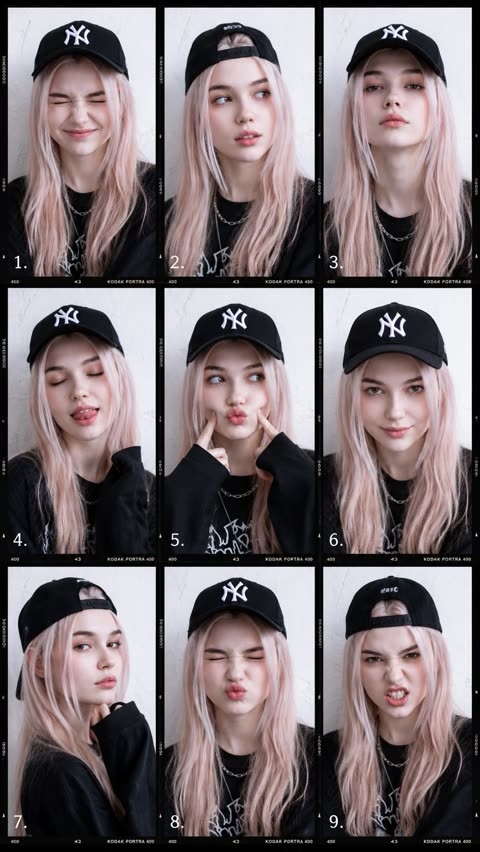</a>

用编号逐格描述每一格的表情和姿势，再用一段统一文字锁定服装、发型、妆容和帽子。相机型号、镜头焦段和柔和漫射光让九格风格保持一致。

GPT Image 2 · 上传图改图 · 出处: [@saniaspeaks_ on X](https://x.com/saniaspeaks_/status/2054046866497573214) · 发现于 [freestylefly/awesome-gpt-image-2](https://github.com/freestylefly/awesome-gpt-image-2)

[`portrait`](tags.md#tag-portrait) [`collage`](tags.md#tag-collage) [`photobooth`](tags.md#tag-photobooth) [`expressions`](tags.md#tag-expressions) [`streetwear`](tags.md#tag-streetwear)

<details><summary><b>提示词</b></summary>

```text
Edit this photo and don't change the face, portrait 9:16. A 9-frame fashion portrait collage featuring a stylish young woman with playful expressions and sporty streetwear aesthetics. The concept combines modern model test photography, casual Gen-Z energy, and clean editorial studio vibes. Each frame captures different candid facial expressions and subtle attitude poses, creating a cool, confident, and slightly mischievous mood. Minimalist composition with strong focus on facial expressions, cap styling, and soft fashion portrait lighting.

Frame Descriptions (9 poses)

Frame 1 – Eyes closed with playful scrunched expression, slight smile, relaxed shoulders.
Frame 2 – Looking slightly sideways with lips parted, confident casual attitude.
Frame 3 – Head tilted slightly upward, calm expression, direct cool-girl energy.
Frame 4 – Eyes closed while sticking tongue slightly out, playful candid vibe.
Frame 5 – Both index fingers pressing cheeks while making duck lips, cute playful expression.
Frame 6 – Direct eye contact with subtle smile, relaxed natural pose.
Frame 7 – Body turned sideways, hand near chin, confident editorial profile look.
Frame 8 – Eyes squeezed shut while making pout lips, exaggerated playful expression.
Frame 9 – Wrinkled nose with gritted teeth, rebellious fashion attitude.

She wears oversized black long sleeves. Soft matte fabric with sporty streetwear silhouette. Relaxed fit with slightly oversized sleeves. Black New York Yankees baseball cap worn forward and backward in different frames. Minimal jewelry. Long soft wavy blonde hair. Soft loose waves with natural texture. Middle-part hairstyle. Hair flowing naturally around shoulders. Soft glam douyin girl makeup. Dewy glass skin finish. Brushed up natural brows, winged eyeliner, wispy natural lashes, soft pink blush (igari blush style), ombre gradient rosy pink lips with glossy finish.

Background minimal white studio backdrop. Photobooth-style collage layout with black frame borders. Shot with Canon EOS R6 / Sony A7 III / Fujifilm X-T5. High-fashion portrait photography style. 50mm or 85mm portrait lens. Eye-level framing. Tight portrait crop. Centered composition. Photobooth-inspired close-up angles. Soft diffused studio lighting. Balanced frontal light. Minimal harsh shadows. Clean editorial illumination. Cool neutral tones. Slightly desaturated blacks. Soft contrast with crisp details. Subtle film grain. Modern fashion editorial color grading.
```

</details>

<a id="gpt-image-okinawa-couple-film-memory-collage"></a>
### 冲绳情侣旅行的褪色胶片十二宫格

<a href="https://x.com/genel_ai/status/2046852688491807008">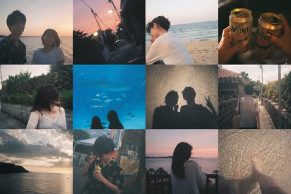</a>

要求一张拼贴里包含十二张随手拍的手机照片，并加上褪色的电影胶片质感。刻意写入手抖和随意构图，让整组画面像真实回忆而不是摆拍。

GPT Image 2 · 文生图 · 出处: [@genel_ai on X](https://x.com/genel_ai/status/2046852688491807008) · 发现于 [YouMind-OpenLab/awesome-gpt-image-2](https://github.com/YouMind-OpenLab/awesome-gpt-image-2)

[`film-look`](tags.md#tag-film-look) [`travel`](tags.md#tag-travel) [`collage`](tags.md#tag-collage) [`snapshot`](tags.md#tag-snapshot) [`japanese`](tags.md#tag-japanese)

<details><summary><b>提示词</b></summary>

```text
日本人の若い男女が沖縄旅行中にスマホで何気なく撮影した、エモーショナルな写真。12枚をコラージュ。
思い出の中の1枚のような、色あせたシネマティックな質感。 
映画のワンシーンで使えそうなカット。
手振れ感や、適当に撮影した雑な構図を再現。
```

</details>

<a id="gpt-image-red-gradient-dual-pose-portrait-collage"></a>
### 红色渐变背景的大小双人像拼贴海报

<a href="https://x.com/AvelyrahnAI/status/2061368984944201957">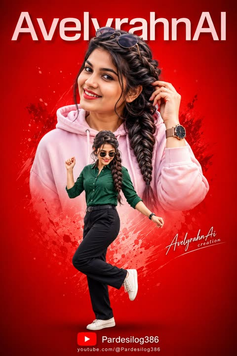</a>

先让面部和发辫造型严格对应参考图，再为同一人物设定一大一小两个层次：上方大尺寸肖像，前景较小的全身舞步。服装、配饰、背景色、标题文字和水印位置都写得很明确。

GPT Image 2 · 上传图改图 · 出处: [@AvelyrahnAI on X](https://x.com/AvelyrahnAI/status/2061368984944201957) · 发现于 [YouMind-OpenLab/awesome-gpt-image-2](https://github.com/YouMind-OpenLab/awesome-gpt-image-2)

[`collage`](tags.md#tag-collage) [`reference-photo`](tags.md#tag-reference-photo) [`red-background`](tags.md#tag-red-background) [`typography`](tags.md#tag-typography) [`dual-pose`](tags.md#tag-dual-pose)

<details><summary><b>提示词</b></summary>

```text
A high-contrast, energetic digital collage on a vibrant solid red gradient background. Large uppercase text across the top reads “AvelyrahnAI” in a clean, modern font. The composition features two distinct, confident images of the same young woman, whose specific face and elaborate side-braid hairstyle are 100% accurate to the reference The large upper portrait shows her smiling confidently, wearing a light pink hoodie, stylish sunglasses on her head, and a modern wristwatch, with one hand near her hair. The second, smaller full-body image in front shows her in a dynamic, playful dancing/stepping pose, wearing a dark green button-up shirt, black tailored trousers, sunglasses, and a trendy watch. A small signature-style watermark "AvelyrahnAi creation" is on the side, and a subtle YouTube logo with link text "Pardesilog386" is at the bottom. The lighting is bright and smooth, giving a slightly airbrushed, edited Photoshop look.
```

</details>

<a id="gpt-image-scrapbook-mini-me-figurines-doodles"></a>
### 手帐风照片：迷你分身与手写涂鸦

<a href="https://x.com/Kashberg_0/status/2050272100884340783">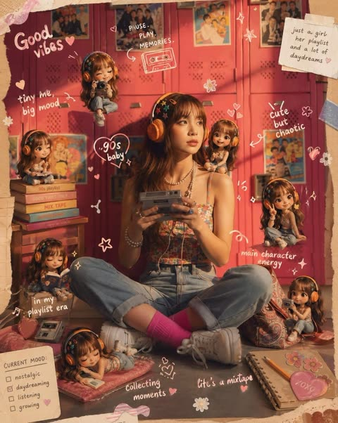</a>

先锁定人物身份、姿势、光线和背景，再叠加新元素：做着不同事情的收藏手办风迷你分身，以及与场景元素相连的手写涂鸦。结尾强调是同一张图的增强而非重绘，从而保住参考图。

GPT Image 2 · 上传图改图 · 出处: [@Kashberg_0 on X](https://x.com/Kashberg_0/status/2050272100884340783) · 发现于 [freestylefly/awesome-gpt-image-2](https://github.com/freestylefly/awesome-gpt-image-2)

[`scrapbook`](tags.md#tag-scrapbook) [`chibi`](tags.md#tag-chibi) [`mini-figurine`](tags.md#tag-mini-figurine) [`doodle-overlay`](tags.md#tag-doodle-overlay) [`pastel`](tags.md#tag-pastel)

<details><summary><b>提示词</b></summary>

```text
Transform the provided reference image into a cozy aesthetic scrapbook-style composition while strictly preserving the original subject, identity, pose, lighting, and background.

Add multiple small “mini version” characters of the same person (chibi / doll-like style), placed naturally around the scene (on objects, table, shoulder, etc.). These mini figures must match the subject’s face, hairstyle, outfit, and vibe consistently, styled as cute 3D collectible figurines. Show them doing different activities (reading, posing, taking photos, relaxing).

Overlay handwritten-style doodles and annotations across the image: arrows, hearts, stars, sparkles, icons, and playful captions connected to elements in the scene.

Use a soft pastel color palette (white base with pink, peach, blue accents).

Keep the frame visually rich and filled but balanced and clean.

Style: warm, cozy lighting, dreamy Instagram scrapbook aesthetic, soft depth of field, highly detailed, polished but playful.

The final result must look like the SAME original image enhanced with mini alter-egos and aesthetic annotations — not a recreated or different scene.
```

</details>

<a id="gpt-image-shanghai-night-skyline-handwritten-travel-note"></a>
### 上海夜景天际线手写涂鸦旅行笔记

<a href="https://x.com/TanLuAI/status/2052715035940823085">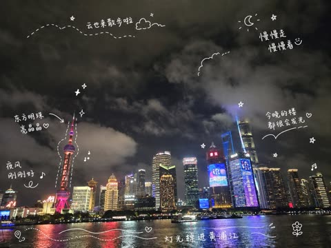</a>

先锁定照片构图，包括天空占比、地标位置和灯光颜色，再逐条写明手写文字与白色涂鸦的数量和位置。强调线条纤细、略带瑕疵，让叠加层像真实的社交平台旅行笔记。

GPT Image 2 · 文生图 · 出处: [@TanLuAI on X](https://x.com/TanLuAI/status/2052715035940823085) · 发现于 [YouMind-OpenLab/awesome-gpt-image-2](https://github.com/YouMind-OpenLab/awesome-gpt-image-2)

[`travel-journal`](tags.md#tag-travel-journal) [`night-cityscape`](tags.md#tag-night-cityscape) [`shanghai`](tags.md#tag-shanghai) [`handwritten-doodle`](tags.md#tag-handwritten-doodle) [`social-media`](tags.md#tag-social-media)

<details><summary><b>提示词</b></summary>

```text
Create a travel-journal style night cityscape poster of Shanghai Pudong skyline along the Huangpu River. Use a wide 4:3 canvas showing a realistic nighttime waterfront photo look: dark cloudy sky filling the top two thirds, illuminated skyscrapers along the horizon, the Oriental Pearl Tower on the left glowing pink-red, Shanghai Tower and other high-rises on the right with blue, purple, gold, and white lights, and reflective river water across the bottom with a small sightseeing boat. Add playful white hand-drawn diary doodles and handwritten Chinese annotations directly over the scene, like a social media travel note. Include exactly 6 handwritten text notes: “云也来散步啦” near the upper left with a dotted wandering path and small cloud, “慢慢走 慢慢看♡” near the upper right beside a crescent moon and star, “东方明珠 亮晶晶♡” pointing with an arrow to the Oriental Pearl Tower, “夜风 刚刚好♪” on the left above the river, “今晚的楼 都很会发光♡” on the right above the skyline with a curved underline, and “灯光掉进黄浦江” centered near the bottom over the water. Include exactly 15 white doodle elements: a dotted flight path across the upper left, one small outlined cloud near the top, one crescent moon at the upper right, one scalloped cloud outline near the upper center-right, one arrow pointing to the Oriental Pearl Tower, one dashed outline tracing around the Oriental Pearl Tower, three small sparkle/star icons, two music-note icons, one map-pin icon at the bottom left, two flowing wave lines across the bottom water, and one small flower doodle at the bottom right. Keep all doodles thin, casual, hand-drawn, slightly imperfect, and bright white, with no borders or watermark. The mood should be dreamy, cozy, romantic, and spontaneous, like a handwritten travel memory shared on social media.
```

</details>

<a id="gpt-image-tennis-precision-campaign-collage"></a>
### 深绿网球运动员三联广告拼图

<a href="https://x.com/AIwithkhan/status/2048606301039820821">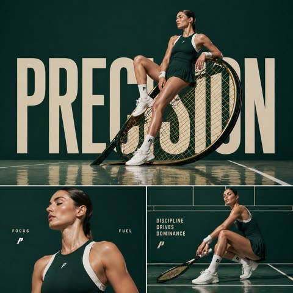</a>

按面板逐一描述景别与指定文字，三个画面各有分工。统一的深绿白配色、网格排版和画幅比例让整组保持一致。

GPT Image 2 · 文生图 · 出处: [@AIwithkhan on X](https://x.com/AIwithkhan/status/2048606301039820821) · 发现于 [freestylefly/awesome-gpt-image-2](https://github.com/freestylefly/awesome-gpt-image-2)

[`sports-fashion`](tags.md#tag-sports-fashion) [`campaign`](tags.md#tag-campaign) [`collage`](tags.md#tag-collage) [`typography`](tags.md#tag-typography) [`tennis`](tags.md#tag-tennis)

<details><summary><b>提示词</b></summary>

```text
Cinematic sports fashion collage, 3-panel layout, top panel large hero shot of a female tennis athlete sitting confidently on an oversized tilted tennis racket, deep green luxury court backdrop, reflective glossy floor, bold oversized typography “PRECISION” in background, dramatic editorial lighting, ultra-clean composition, high-fashion athletic aesthetic.

Bottom left panel: close-up portrait of the athlete with glowing skin, minimal makeup, soft light, text “FOCUS” and “FUEL” placed subtly.

Bottom right panel: full-body crouched pose holding racket, strong posture, text “DISCIPLINE DRIVES DOMINANCE”, grid-based layout lines, premium sports branding feel.

Consistent color grading, dark green and white palette, sharp details, cinematic shadows, luxury campaign style, 1:1 aspect ratio.
```

</details>

<a id="gpt-image-tokyo-travel-vlogger-13-frame-collage"></a>
### 东京旅行博主13格手机随拍拼图

<a href="https://x.com/AIwithSynthia/status/2062383568253505904">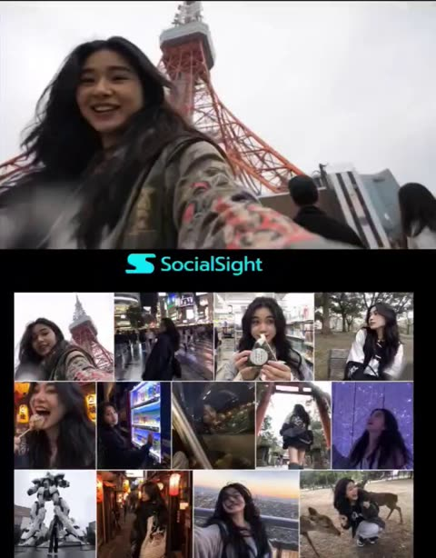</a>

提示词用每行格数（4、5、4）固定网格布局，再为每一格单独写明地点、机位和光线。刻意加入的手机瑕疵，如动态模糊、镜头污渍、过曝天空和噪点，让每一格都像真实随手拍。

GPT Image 2 · 文生图 · 出处: [@AIwithSynthia on X](https://x.com/AIwithSynthia/status/2062383568253505904) · 发现于 [freestylefly/awesome-gpt-image-2](https://github.com/freestylefly/awesome-gpt-image-2)

[`travel-vlog`](tags.md#tag-travel-vlog) [`grid-collage`](tags.md#tag-grid-collage) [`candid`](tags.md#tag-candid) [`tokyo`](tags.md#tag-tokyo) [`phone-photo`](tags.md#tag-phone-photo)

<details><summary><b>提示词</b></summary>

```text
Generate image of young female travel vlogger exploring Tokyo across multiple candid moments, extremely beautiful with long dark wavy hair, wearing stylish Japanese-inspired oversized streetwear, expressive and spontaneous personality, captured across a 13-frame grid collage (Row 1: 4 frames | Row 2: 5 frames | Row 3: 4 frames), each frame feels like a real casual phone capture with imperfect framing and natural inconsistencies.

Frame Breakdown

Row 1 - Frame 1 (Tokyo Tower): low angle selfie with Tokyo Tower behind her, slightly tilted horizon, sky overexposed to near white, she's mid-natural smile adjusting into frame, small lens smudge in corner, candid arrival energy.
Row 1 - Frame 2 (Shibuya street level): walking through Shibuya crossing at night, handheld motion blur, she glances back at camera mid-step, neon reflections on wet pavement, slightly shaky framing, imperfect crop.
Row 1 - Frame 3 (Convenience store): inside a brightly lit convenience store, she is holding onigiri close to camera, playful raised eyebrows, harsh fluorescent lighting flattening the scene, slight overexposure on whites, shelves softly blurred behind.
Row 1 - Frame 4 (Yoyogi park): sitting on a bench under trees, looking away from camera, quiet candid moment, soft dappled daylight, slight focus miss on eyes, subtle lens smudge bottom corner.
Row 2 - Frame 5 (Takoyaki reaction): close-up while eating single takoyaki, reacting mid-bite with laughter, slight motion blur, warm lantern light behind, face slightly out of focus due to movement.
Row 2 - Frame 6 (Vending machine night): standing in front of glowing vending machine, blue and pink light casting uneven tones on her face, pressing button casually, high ISO grain visible.
Row 2 - Frame 7 (Train reflection): her face reflected in train window at night, city lights streaking behind, layered reflection effect, slight ghosting on glass, she looks away from camera.
Row 2 - Frame 8 (Torii gate): low angle shot of her walking through a torii gate, captured from slightly behind, motion blur in her movement, bright sky causing mild lens flare.
Row 2 - Frame 9 (Digital art exhibit): inside immersive light exhibit, colored lights (blue, violet, gold) washing across her face, she looks upward in awe, slight motion blur, low-light noise visible.
Row 3 - Frame 10 (Gundam statue): low angle wide shot, she stands small in frame while large statue towers above, slight barrel distortion from phone lens, sky slightly blown out.
Row 3 - Frame 11 (Lantern alley): walking through narrow alley lit by warm lanterns, shot from behind, she glances back briefly, underexposed shadows, grainy night detail.
Row 3 - Frame 12 (Rooftop skyline): selfie with Tokyo skyline behind, arm extended, wind blowing hair partially across lens, horizon slightly tilted, warm city glow overexposed in distance.
Row 3 - Frame 13 (Nara park): crouching down in a park in Nara, she holds out a deer cracker toward a deer, the deer bows its head toward her, she bursts into genuine laughter mid-reaction, surprised and slightly leaning back, another deer nudges her from behind causing her to lose balance slightly, camera captures the moment imperfectly with slight shake and off-center framing, soft natural daylight, open park background with trees and space, unscripted chaotic energy, candid expression.

Young female travel vlogger exploring Tokyo across 13 candid moments in a grid collage, extremely beautiful with long dark wavy hair, wearing stylish Japanese streetwear, expressive and spontaneous, scenes include Tokyo Tower selfie, Shibuya crossing at night, convenience store snack moment, park bench quiet scene, takoyaki reaction, vending machine glow, train window reflection, torii gate walk, immersive light exhibit, Gundam statue low angle, lantern alley walk, rooftop skyline selfie, Harajuku street ending, each frame slightly imperfect with motion blur.
```

</details>

<a id="gpt-image-twelve-hairstyle-lookbook-same-face"></a>
### 同一人脸十二款发型对照网格

<a href="https://x.com/Ciri_ai/status/2092452220768002400"></a>

先用身份锚点逐项锁定五官特征,再用硬性规则固定背景、发色、妆容和服装,只允许发型变化。十二种发型各有简短的形态描述,配合相机参数和编号面板保持整张网格一致。

GPT Image 2 · 上传图改图 · 出处: [@Ciri_ai on X](https://x.com/Ciri_ai/status/2092452220768002400) · 发现于 [freestylefly/awesome-gpt-image-2](https://github.com/freestylefly/awesome-gpt-image-2)

[`hairstyle`](tags.md#tag-hairstyle) [`lookbook`](tags.md#tag-lookbook) [`grid`](tags.md#tag-grid) [`identity-lock`](tags.md#tag-identity-lock) [`studio-portrait`](tags.md#tag-studio-portrait)

<details><summary><b>提示词</b></summary>

```text
Create a 12-panel grid (3 columns × 4 rows, numbered 1 to 12) showing the SAME person from the reference photo with 12 different hairstyles. This is a hairstyle lookbook. Final image aspect ratio: 4:5 (vertical/portrait).
THE ONLY THING THAT CHANGES BETWEEN PANELS IS THE HAIR ON THE HEAD (shape, style and length only). Everything else stays exactly as in the reference photo.
Identity Anchor (Critical)
The face must be IDENTICAL to the reference photo in every single panel. Preserve exactly: facial bone structure, jawline, cheekbones, nose shape, lips, eye shape and spacing, eyebrows, skin tone, skin texture (pores, natural imperfections), and overall facial proportions. This is the same real person in all 12 frames. Do NOT beautify, slim, or alter the face. Same age, same expression as in the reference.
Mandatory Rules (Do Not Violate)
- NO SUNGLASSES. Eyes must be fully visible in all 12 panels.
- NO ENVIRONMENTAL BACKGROUNDS. Every panel must have a plain, uniform, solid light grey studio backdrop with zero objects, zero textures, zero gradients. Just flat neutral grey.
- Hair COLOR stays exactly as it appears in the reference photo in all 12 panels. Only the shape, length and style changes, never the color.
Keep Identical in Every Panel (Do Not Change)
- MAKEUP AND SKIN: If the person in the reference photo wears makeup, replicate it identically in every panel. Same lip color, same eye makeup, same brow grooming. If they wear no makeup, keep all panels makeup-free. Do NOT add, remove, or alter makeup between panels.
- Clothing: the same clothing visible in the reference photo, replicated exactly.
- Accessories: preserve ALL visible accessories from the reference photo (earrings, necklaces, rings, bracelets, piercings, watch, glasses, etc.). Do not omit, resize, recolor, or restyle any accessory. If the person wears prescription glasses (not sunglasses), keep them in every panel.
- Background: plain solid light grey studio backdrop in every panel. No room, no furniture, no environment.
The 12 Hairstyles
1. Pixie cut: very short, textured, slightly tousled on top with tapered sides and nape
2. Classic bob: chin-length, straight, blunt ends, clean middle part
3. Long layered waves: past the shoulders, soft voluminous waves with face-framing layers
4. Sleek low bun: hair pulled back smoothly into a tight low bun at the nape, no flyaways
5. Curtain bangs with medium-length hair: soft parted fringe framing the face, hair falling just past the shoulders
6. High ponytail: hair pulled up into a sleek high ponytail, smooth crown, length falling behind
7. French bob: short bob ending at the jawline with a soft blunt micro-fringe across the forehead
8. Long straight hair with middle part: very long, sleek, pin-straight, falling well past the shoulders
9. Shaggy wolf cut: medium length, heavy layers, choppy fringe, textured and voluminous with a slightly wild look
10. Elegant updo: hair swept up into a polished chignon with soft face-framing tendrils
11. Short curly crop: short voluminous curls all over, natural texture, tapered at the sides
12. Side-swept Hollywood waves: long glamorous deep side part, sculpted vintage waves cascading over one shoulder
Photographic Specs
Shot on a Canon EOS R5 with an 85mm f/1.4 lens, studio portrait lighting (soft key light, subtle fill), shallow depth of field with sharp focus on the face. PLAIN SOLID LIGHT GREY STUDIO BACKGROUND in every panel. Natural skin rendering with visible pores and realistic hair strands (no plastic or CGI look). Consistent lighting, color grading and exposure across all 12 panels. Photorealistic, high detail, hyperrealistic, 8K. No illustration, no painterly effect, no over-smoothing. NO SUNGLASSES.
Each panel clearly numbered 1 to 12 in the top-left corner. Overall output aspect ratio 4:5.
```

</details>
