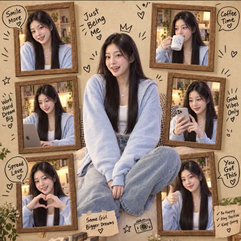

# 拼贴

[返回目录](../../README_zh.md) · 全部 30 条

<a id="gpt-image-failed-photos-grid"></a>
### 任意角色的九张失败照片

<a href="https://x.com/DeepBlueX0/status/2099481521983995971"></a>

只有七个词。作者的心得：限制越少，失败照越像真的。

GPT Image 2.5 · 文生图 · 出处: [@DeepBlueX0 on X](https://x.com/DeepBlueX0/status/2099481521983995971) · 2,646 赞，统计于 2026-10-27

[`grid`](tags.md#tag-grid) [`humor`](tags.md#tag-humor) [`template`](tags.md#tag-template)

<details><summary><b>提示词</b></summary>

```text
Vertical 3×3 failed photos × {Character}
```

</details>

<a id="gpt-image-chibi-clone-sticker-running-diary"></a>
### 跑步照片配Q版分身贴纸与手绘涂鸦

<a href="https://x.com/Emmma___0/status/2050922155676930544"></a>

先锁定真人照片的身份、服装和背景，再限定添加5到8个Q版分身，每个分身对应不同的跑步动作与情绪。贴纸白边、柔和阴影加上白粉色涂鸦和手写短句，形成手帐日记风格，同时避免遮挡人脸。

GPT Image 2 · 上传图改图 · 出处: [@Emmma___0 on X](https://x.com/Emmma___0/status/2050922155676930544) · 959 赞，统计于 2026-10-28

[`chibi`](tags.md#tag-chibi) [`sticker`](tags.md#tag-sticker) [`scrapbook`](tags.md#tag-scrapbook) [`fitness`](tags.md#tag-fitness) [`photo-edit`](tags.md#tag-photo-edit)

<details><summary><b>提示词</b></summary>

```text
Create a high-quality “chibi clone sticker diary photo” based on the uploaded real-life image. Preserve the original person’s identity, face, hairstyle, hair color, outfit, body proportions, pose, lighting, and background. Do not alter facial features or turn the subject into a full illustration—maintain a realistic photo look.
Analyze the scene as a fitness/running lifestyle moment. Add 5–8 chibi mini clones of the same person around the subject, designed in a consistent kawaii sticker style (big head, small body, large expressive eyes, clean digital finish). Each clone must clearly resemble the real person (same hair, outfit, colors).
Design each chibi with different running-related actions and emotions: jogging, stretching, drinking water, feeling tired, cheering, giving thumbs up, celebrating completion. Ensure all poses are unique and contextually relevant.
Render each chibi as a sticker with white outlines, soft shadows, and a slightly floating effect. Arrange them around the subject and edges without covering the face or main body.
Add light hand-drawn doodles (hearts, sparkles, arrows, motion lines, circles) in white with subtle pink accents, keeping a clean scrapbook diary feel.
Include 5–8 short handwritten-style phrases matching a fitness mood (cute, energetic, encouraging). Use mostly white text with slight pink highlights and small decorative marks.
Composition: keep the real person as the central focus, surrounded by chibi stickers and doodles. The result should feel like a polished, playful, high-resolution social media lifestyle diary image—clean, balanced, and visually rich without clutter.
```

</details>

<a id="gpt-image-chibi-sticker-street-photo-doodles"></a>
### 街头人像周围环绕3D Q版自己

<a href="https://x.com/im_shahid7/status/2050201037144002786"></a>

提示词保留原照片和背景，再按姿势与表情清单加入多个3D Q版小人。白色贴纸描边、涂鸦图标和手写字样把这些元素统一成柔和的粉彩拼贴。

GPT Image 2 · 上传图改图 · 出处: [@im_shahid7 on X](https://x.com/im_shahid7/status/2050201037144002786) · 414 赞，统计于 2026-10-28

[`chibi`](tags.md#tag-chibi) [`sticker-outline`](tags.md#tag-sticker-outline) [`doodle-overlay`](tags.md#tag-doodle-overlay) [`reference-photo`](tags.md#tag-reference-photo) [`3d-cute`](tags.md#tag-3d-cute)

<details><summary><b>提示词</b></summary>

```text
Use a real face as a reference photo. The background is the same as in the photo. The lighting is warm, soft, and clean, with subtle shadows. Around the image, add several mini chibi (3D cute style) versions of the character, while maintaining the original facial features. Chibi characters have various poses and expressions:jumping cheerfully waving sitting relaxed holding a drink cute and playful expressions Add hand-drawn white doodle elements: outline around the main body stars, hearts, sparkles motion lines small cute icons Add aesthetic handwriting such as: "shine," "bright day," "happy," "smile," etc. (casual doodle font) Overall style: clean & aesthetic composition white sticker outline soft pastel color tone high detail 3D chibi glossy look cute Korean.
```

</details>

<a id="gpt-image-cafe-photo-watercolor-scrapbook-layout"></a>
### 咖啡馆照片变成水彩手账排版

<a href="https://x.com/MahnoorAi12/status/2102368459388801390"></a>

用严格的面部身份锁定只让人脸参考控制人物，其余参考图只提供服装、姿势和氛围。版式用清单逐条写明纸张、水彩边缘、剪裁感和文字区，得到留白充足的手账成品。

GPT Image 2.5 · 上传图改图 · 出处: [@MahnoorAi12 on X](https://x.com/MahnoorAi12/status/2102368459388801390) · 240 赞，统计于 2026-10-28

[`scrapbook`](tags.md#tag-scrapbook) [`watercolor`](tags.md#tag-watercolor) [`cafe`](tags.md#tag-cafe) [`editorial`](tags.md#tag-editorial) [`face-reference`](tags.md#tag-face-reference)

<details><summary><b>提示词</b></summary>

```text
Use the uploaded face reference image ONLY as the identity reference for the woman.

STRICT FACE IDENTITY LOCK:
Preserve her recognizable facial identity exactly from the face reference. Keep the same facial structure, face shape, eyes, eyebrows, nose, lips, jawline, cheek structure, skin tone, and natural facial proportions. Do not beautify, redesign, age, de-age, or replace her face. Do not create a different person.

Use the provided reference images as visual inspiration for the overall composition, photography style, outfit, pose, environment, color palette, and aesthetic, but do NOT copy their facial identity.

Create a photorealistic lifestyle editorial photograph with a soft Japanese/Korean-inspired café and everyday-luxury aesthetic.

The woman is naturally enjoying a quiet café moment with coffee and dessert. Elegant understated styling, soft neutral tones, natural daylight, subtle film grain, warm muted colors, realistic skin texture, delicate details, candid editorial photography.

Outfit should be feminine and sophisticated with a minimalist vintage-inspired feel. Add tasteful accessories such as a small structured handbag, delicate jewelry, and elegant shoes where appropriate.

Composition should feel like a genuine lifestyle photograph rather than an AI-generated portrait. Natural body proportions, realistic hands and fingers, authentic fabric texture, realistic lighting and shadows.

Create the final image as a refined editorial scrapbook-style photograph:
- warm ivory/beige paper-inspired background
- softly isolated central subject
- subtle hand-painted/watercolor edges around the photograph
- slightly imperfect organic cutout effect
- delicate vintage paper texture
- minimal elegant typography area underneath
- calm nostalgic mood
- sophisticated feminine aesthetic
- lots of clean negative space

IMPORTANT:
The face reference controls ONLY the woman's identity.
The scene/reference images control the visual concept.
Do not merge or copy another person's face.
Keep the woman's identity consistent and recognizable throughout the entire image.

High-resolution photography, natural lighting, realistic skin texture, detailed clothing, realistic hands, authentic shadows, premium editorial composition, subtle analog film texture, soft focus falloff, photorealistic.
```

</details>

<a id="gpt-image-borderless-memory-grid-template-osaka-dusk"></a>
### 大阪黄昏街景无缝四乘三图板

<a href="https://x.com/aimikoda/status/2048183782876778821"></a>

参数化模板，把主体、网格、主题、情绪和风格拆成可替换的槽位。要求无边框网格、统一色彩与光线、无文字无间隙，让十二个独立画面连成一张怀旧图板。

GPT Image 2 · 文生图 · 出处: [@aimikoda on X](https://x.com/aimikoda/status/2048183782876778821) · 229 赞，统计于 2026-10-28

[`image-board`](tags.md#tag-image-board) [`grid`](tags.md#tag-grid) [`template`](tags.md#tag-template) [`nostalgic`](tags.md#tag-nostalgic) [`cityscape`](tags.md#tag-cityscape)

<details><summary><b>提示词</b></summary>

```text
[SUBJECT]: your main character, place, object, city or concept
[GRID_LAYOUT]: panel layout
[THEME]: story theme, memory type or visual concept
[MOOD]: emotional tone
[STYLE]: visual style

Create a [GRID_LAYOUT] borderless grid where each panel is an independent image of the [SUBJECT]. Maintain strong subject consistency across all panels, with consistent color and lighting. Depict [THEME] with a [MOOD] mood in [STYLE] style. No text. No gap.

---

Example Parameters

[SUBJECT]: a young woman / Osaka / a medieval knight / a seaside town / a lost robot
[GRID_LAYOUT]: 4x3 / 3x3 / 2x4 / 5x2 / 6x6
[THEME]: childhood memories / school life memories / neon night city life / summer vacation memories / rainy day memories / color-themed memories
[MOOD]: warm, nostalgic, wistful / emotional, heartfelt, tender / dreamy, quiet, melancholic / bittersweet, intimate, reflective
[STYLE]: nostalgic cinematic realism / sentimental film photography / wistful slice-of-life realism / dreamy nostalgic realism / soft retro film still / emotional memory-like photography / warm vintage realism / melancholic cinematic still

Used prompts in ALTs.
```

</details>

<a id="gpt-image-flash-photo-dump-six-frame-portrait-collage"></a>
### 六格闪光灯随拍人像拼图

<a href="https://x.com/mehvishs25/status/2112208561673740615"></a>

以参考照片锁定人物身份，再逐条列出六个编号瞬间，每格有各自的表情、手势和发型。卡片相机闪光灯质感、固定的服装与墙面，加上结尾的避免清单，让整组画面一致又自然。

GPT Image 2.5 · 上传图改图 · 出处: [@mehvishs25 on X](https://x.com/mehvishs25/status/2112208561673740615) · 211 赞，统计于 2026-10-28

[`portrait-collage`](tags.md#tag-portrait-collage) [`identity-preservation`](tags.md#tag-identity-preservation) [`flash-photography`](tags.md#tag-flash-photography) [`photo-dump`](tags.md#tag-photo-dump) [`grid`](tags.md#tag-grid)

<details><summary><b>提示词</b></summary>

```text
Create an ultra-realistic 6-frame portrait collage arranged in a clean 3×2 grid, featuring the exact same girl from the uploaded reference photo. Use the reference exclusively for identity preservation, accurately retaining her facial structure, eye color, natural hair color, hairstyle, hair length, volume, texture, and distinctive facial features. Her identity must remain consistent across all six frames.

Overall aesthetic: Casual Instagram photo dump with an authentic early-2000s digital camera vibe. A simple muted powder-blue wall, fitted black spaghetti-strap top, delicate minimal accessories, and effortless everyday makeup. Shot on a Canon PowerShot G7 X Mark III with direct on-camera flash, crisp facial details, realistic skin pores, subtle grain, natural imperfections, strong flash highlights, and distinct shadows against the wall.

Six different candid moments:

1. Playful charm: Leaning slightly toward the camera, cheeks gently resting against her palms, giving a small, natural smile.
2. Cheeky energy: One eye closed in a wink, grinning brightly while sweeping a section of hair behind her ear.
3. Carefree mood: Eyes softly closed, lips forming a playful pout, both hands raised above her head as she loosely gathers her hair.
4. Cool and confident: Face turned slightly sideways, looking into the lens from the corner of her eyes, fingertips lightly touching her jawline.
5. Unfiltered laughter: Looking off-camera with a genuine open smile, head tilted back slightly, hair falling naturally across one shoulder.
6. Soft, dreamy moment: Chin tilted down, eyes gazing thoughtfully toward the camera, one hand loosely twirling a strand of hair.

Composition and realism: Every frame must have a distinct facial expression, head angle, hand placement, and hair arrangement. Keep the same outfit, background, lighting style, and identity throughout, while varying the crop and camera distance subtly. Natural anatomy, believable fingers, realistic hair strands, and authentic compact-camera flash photography. The result should feel like six spontaneous photos taken during one fun evening, not a polished studio campaign.

Avoid: Face swapping artifacts, altered facial features, inconsistent identity, plastic skin, excessive retouching, artificial beauty filters, duplicated poses, malformed hands, extra fingers, excessive sharpening, and obvious AI-generated details.

Vertical 3:4 canvas, six equally sized photographs, precise grid alignment, no borders, no text, no watermarks.
```

</details>

<a id="gpt-image-photo-to-paper-second-world"></a>
### 窗边照片延伸为墨线手绘纸面

<a href="https://x.com/harboriis/status/2110328832352010584"></a>

画面对半分割，让窗台这一结构穿过分界线，照片自然延续成纸面与线稿。撕纸边缘顺着原有结构走，并用一句简短手写字幕收尾。

GPT Image 2.5 · 上传图改图 · 出处: [@harboriis on X](https://x.com/harboriis/status/2110328832352010584) · 171 赞，统计于 2026-10-28

[`split-canvas`](tags.md#tag-split-canvas) [`paper-collage`](tags.md#tag-paper-collage) [`line-doodle`](tags.md#tag-line-doodle) [`continuity`](tags.md#tag-continuity) [`editorial`](tags.md#tag-editorial)

<details><summary><b>提示词</b></summary>

```text
Vertical 3:4 canvas split into two strictly equal horizontal halves: top 50% and bottom 50%. The upper half stays photographic; the lower half becomes the continued Second World. Together they must read as one scene.

the

UPPER HALF

Keep the photo faithful. Preserve the subject, pose, spatial relationships, color atmosphere, and natural light. Do not redesign, repaint, replace, or restage it. Only necessary proportional

cropping is allowed.

CONTINUITY (highest priority)

Identify one source structure that naturally reaches the center split: a road, shoreline, water, reflection, branch, beam of light, piece of architecture, or body movement. This structure must cross the boundary and continue into the lower half. The Second World begins from the photograph itself, so the same scene passes through the seam and simply changes its physical rules.

TRANSITION EDGE

The center may use an irregular torn-paper edge, but the tear must follow the source structure, never act as decoration. Source elements may touch, follow, break through, or extend beyond edge. Never force the same tear shape onto every image.

The Second World

LOWER HALF

Ivory paper with subtle fibers and abundant negative space. Continue the chosen structure downward from the exact point where it meets the split, then reinterpret it with restrained photo fragments, cut-paper forms, and minimal black hand-drawn lines. The lower world must stay visibly attached Never isolate it as a separate portal, window, stage, platform, or floating vignette unless it clearly comes from the photo.

SECOND WORLD LOGIC

Ask: if this structure became touchable, usable, enterable, or changeable, what would it naturally become? Create one image-specific interaction. For example, water may stay attached while being pulled, a road may continue as a drawn path, or light may become something held. Do not repeat actions mechanically.

FIGURES

Add 0-3 tiny black line figures only when useful. They must physically interact with the continued structure. If the photo already contains strong human action, add none. Never use figures as decoration.

World

CAPTION

One

short handwritten English caption (2-6 words) based on the action. Natural, light, slightly witty. Spell it correctly. No inspirational quotes and no fixed "Same..., different..." phrasing.

STYLE

Real photography above, warm paper below, minimal black line doodles, subtle handmade collage texture, independent-magazine mood. Bright, airy, restrained. It should feel as if the Second already hidden inside the photo and simply continued downward.

was

NEGATIVE

No detached lower-half illustration, no generic torn-paper template, no isolated portal, no unrelated vignette, no broken continuity, no dense illustration, no random decoration, no crowd, altered photo colors, no redesign of the upper image, no glossy 3D, no scrapbook clutter, no gibberish text, no watermark, no logo, no UI.
```

</details>

<a id="nano-banana-newspaper-collage"></a>
### 任何图都能变成报纸拼贴

<a href="https://x.com/aimikoda/status/2108682052665290854"></a>

一句话改图，照片和插画都适用。

Nano Banana 2.1 · 上传图改图 · 出处: [@aimikoda on X](https://x.com/aimikoda/status/2108682052665290854) · 171 赞，统计于 2026-10-27

[`collage`](tags.md#tag-collage) [`newspaper`](tags.md#tag-newspaper) [`one-liner`](tags.md#tag-one-liner)

<details><summary><b>提示词</b></summary>

```text
recreate this image as a collage made from newspaper parts.
```

</details>

<a id="gpt-image-scrapbook-mini-me-figurines-annotations"></a>
### 手帐风照片加入迷你自己手办与涂鸦注释

<a href="https://x.com/sipteaandcoffee/status/2050948629729542407"></a>

提示词先锁定原图的人物、姿势、光线和背景，再分层添加内容：与本人一致且动作各异的迷你手办、手写涂鸦与标注，以及固定的粉彩色板。结尾强调结果必须是同一张图的增强而非重绘，从而稳住人物一致性。

GPT Image 2 · 上传图改图 · 出处: [@sipteaandcoffee on X](https://x.com/sipteaandcoffee/status/2050948629729542407) · 168 赞，统计于 2026-10-28

[`scrapbook`](tags.md#tag-scrapbook) [`chibi-figurine`](tags.md#tag-chibi-figurine) [`doodle-overlay`](tags.md#tag-doodle-overlay) [`identity-preservation`](tags.md#tag-identity-preservation) [`pastel`](tags.md#tag-pastel)

<details><summary><b>提示词</b></summary>

```text
Transform the provided reference image into a cozy aesthetic scrapbook-style composition while strictly preserving the original subject, identity, pose, lighting, and background.

Add multiple small “mini version” characters of the same person (chibi / doll-like style), placed naturally around the scene (on objects, table, shoulder, etc.). These mini figures must match the subject’s face, hairstyle, outfit, and vibe consistently, styled as cute 3D collectible figurines. Show them doing different activities (reading, posing, taking photos, relaxing).

Overlay handwritten-style doodles and annotations across the image: arrows, hearts, stars, sparkles, icons, and playful captions connected to elements in the scene.

Use a soft pastel color palette (white base with pink, peach, blue accents).

Keep the frame visually rich and filled but balanced and clean.

Style: warm, cozy lighting, dreamy Instagram scrapbook aesthetic, soft depth of field, highly detailed, polished but playful.

The final result must look like the SAME original image enhanced with mini alter-egos and aesthetic annotations — not a recreated or different scene.
```

</details>

<a id="gpt-image-ai-filmmaker-monochrome-panel-editorial-collage"></a>
### 黑白分格编辑拼贴搭配彩色全身抠图

<a href="https://x.com/FutureVibesAi/status/2104874557345841520"></a>

四个黑白分格各自指定不同姿势和景别，再用一个彩色全身人像叠在上层营造层次。严格的人物一致性条款、详细的服装描述和禁止文字的要求让版面保持干净。

GPT Image 2.5 · 上传图改图 · 出处: [@FutureVibesAi on X](https://x.com/FutureVibesAi/status/2104874557345841520) · 158 赞，统计于 2026-10-28

[`editorial`](tags.md#tag-editorial) [`collage`](tags.md#tag-collage) [`monochrome`](tags.md#tag-monochrome) [`identity-consistency`](tags.md#tag-identity-consistency) [`fashion`](tags.md#tag-fashion)

<details><summary><b>提示词</b></summary>

```text
Use my attached/reference portrait as the strict facial identity reference. Keep my real facial structure, skin tone, eyes, nose, lips, hairline and overall likeness highly consistent across every appearance. Do not beautify me into a different person.

Create a premium modern editorial collage portrait of a female AI filmmaker and creative-tech founder.

The background consists of four large horizontal rounded-rectangle panels stacked vertically, exactly like a luxury magazine contact-sheet composition. Each panel contains a different cinematic black-and-white portrait of the same woman, while one large full-color full-body version overlaps the panels in the foreground.

BACKGROUND PANEL 1: cinematic close-up wearing sleek black sunglasses, looking sideways with a calm, powerful expression; subtle creative-studio environment behind her.

PANEL 2: relaxed candid portrait, chin resting lightly on one hand, thoughtful creator-at-work energy; subtle laptop and blurred production equipment in the environment, never distracting from her face.

PANEL 3: elegant side-profile portrait, looking away from camera, natural loose hair movement, cinematic shallow depth of field; blurred filmmaking/creative workspace background.

PANEL 4: slightly low-angle portrait looking upward with quiet ambition and confidence, dramatic directional light shaping her face.

All four panels are sophisticated monochrome photography, rich blacks, silver-gray highlights, subtle film grain, realistic skin texture and premium editorial contrast.

FOREGROUND

Place the same woman as a large full-body color cutout on the right side, overlapping all four panels.

Style her as a successful contemporary AI filmmaker / creative-tech founder: oversized deep black textured sweater, relaxed wide-leg charcoal/washed-gray cargo jeans, premium clean white sneakers, minimalist black shoulder bag, subtle silver jewelry and sophisticated black sunglasses either worn or naturally held.

Her pose is effortless and confident: one hand casually inside her pocket, one leg slightly crossed forward, body angled three-quarters toward camera, head turned slightly to the side. Expression composed, ambitious and self-assured — no exaggerated smile.

Add very subtle creator details: a sleek laptop/tablet partly visible inside the shoulder bag and a small professional camera accessory attached to the bag. Keep these understated and luxurious rather than making the image look like a tech advertisement.

Hair should feel naturally styled with soft loose strands around the face. Preserve my actual appearance rather than changing me into a fashion model.

AESTHETIC: Vogue-style contemporary editorial photography, AI creator meets luxury street fashion, cinematic photography, sophisticated minimalism, realistic skin pores, premium fabric textures, natural body proportions, soft directional sunlight, shallow depth of field, subtle analog film grain, high dynamic range, professional fashion campaign retouching, photorealistic, 8K.

LAYOUT: vertical 4:5 social-media poster, warm off-white background, four evenly spaced rounded monochrome panels, foreground woman extending beyond the panels to create dimensional depth, subtle realistic drop shadow behind her cutout, generous negative space, perfectly balanced editorial composition.

STRICT CONSISTENCY: every woman shown is the exact same person. Maintain identical facial anatomy and recognizable identity throughout. Correct hands and fingers, realistic anatomy, realistic clothing folds, no duplicate limbs, no warped accessories.

NO TEXT. NO TYPOGRAPHY. NO LETTERS. NO LOGOS. NO BRAND NAMES. NO WATERMARKS. NO RANDOM SYMBOLS.
```

</details>

<a id="gpt-image-photo-to-watercolor-scrapbook-poster"></a>
### 奶油色手账海报上的照片与水彩画对照

<a href="https://x.com/Alina_with_Ai/status/2102714815793992093"></a>

提示词把上传照片的写实版放在上方,下方用水彩重绘同一场景,并逐项列出需要保持一致的人物身份、服装和姿势。纸张质感、泼溅、边缘和手写题字等细节让版面有编辑感手账风格。

GPT Image 2.5 · 上传图改图 · 出处: [@Alina_with_Ai on X](https://x.com/Alina_with_Ai/status/2102714815793992093) · 157 赞，统计于 2026-10-28

[`watercolor`](tags.md#tag-watercolor) [`scrapbook`](tags.md#tag-scrapbook) [`photo-reference`](tags.md#tag-photo-reference) [`poster`](tags.md#tag-poster) [`handmade-paper`](tags.md#tag-handmade-paper)

<details><summary><b>提示词</b></summary>

```text
Create a vertical scrapbook-style artistic poster using the uploaded photo as the exact reference. Keep the woman’s identity, facial features, hairstyle, pink button-up shirt, light blue wide-leg jeans, white sneakers, pose, proportions, and outfit consistent.

The poster is printed on textured warm ivory watercolor paper. At the top, place a clean, realistic version of the original photograph, showing the woman casually leaning against a terrace railing with one hand resting on the railing and the other in her pocket. Preserve the scenic lake, distant mountains, hillside houses, tall trees, warm sunlight, stone terrace, and vibrant pink bougainvillea.

Below the photo, create a beautiful hand-painted watercolor version of the exact same scene and pose, with soft blue mountain washes, a calm lake, warm beige architecture, green trees, pink flowers, delicate paper texture, natural watercolor bleeding, visible brush strokes, subtle paint splatters, and irregular artistic edges. Make the watercolor version clearly recognizable as the same woman and location.

Leave generous cream-colored paper space around both images for a premium editorial scrapbook aesthetic. Add elegant handwritten-style text underneath: “sunny days”, with a thin decorative line and a tiny heart beneath it.

Soft natural color palette, cozy travel-journal aesthetic, realistic photo + delicate watercolor illustration, sophisticated composition, high detail, subtle film grain, authentic handmade paper texture, balanced spacing, clean vertical 4:5 composition, Pinterest/Instagram editorial aesthetic, photorealistic upper image and artistic watercolor lower image.
```

</details>

<a id="gpt-image-frame-collage-identity-consistent-woman"></a>
### 女子在复古木相框中的多姿势拼贴

<a href="https://x.com/Alina_with_Ai/status/2102358953489481762"></a>

先用参考图锁定人物身份，再逐一列出每个相框的表情和姿势，并用重复的一致性要求和负面清单防止走样。暖色影棚光、道具和手绘涂鸦对话气泡营造出剪贴簿质感。

GPT Image 2.5 · 上传图改图 · 出处: [@Alina_with_Ai on X](https://x.com/Alina_with_Ai/status/2102358953489481762) · 156 赞，统计于 2026-10-28

[`collage`](tags.md#tag-collage) [`identity-consistency`](tags.md#tag-identity-consistency) [`scrapbook`](tags.md#tag-scrapbook) [`vintage-frames`](tags.md#tag-vintage-frames) [`editorial`](tags.md#tag-editorial)

<details><summary><b>提示词</b></summary>

```text
Use the uploaded reference image as the identity and facial reference. Create a high-resolution photorealistic editorial collage of the same young woman, keeping her face, hairstyle, skin tone, body proportions, and overall appearance consistent in every frame.

A stylish young woman with long straight dark-brown hair, wearing a fitted royal-blue short-sleeve T-shirt, blue denim jeans, and clean white chunky sneakers. Create a playful vintage photography-wall composition where she appears multiple times inside and around several ornate rustic wooden picture frames arranged vertically and overlapping.

The central full-body version of the woman sits casually on the frames, one leg bent and the other extended downward, smiling confidently while making a peace/V sign with one hand. Surrounding frames contain different realistic versions of the same woman with different expressions and poses:

laughing with eyes closed

surprised expression with both hands on cheeks

smiling with hands forming a heart

taking a mirror-style selfie with a modern smartphone

happily raising both arms

playful wink and smile

cheerful candid expressions

Maintain perfect facial identity consistency across all versions.

Background: warm beige studio wall with a cozy retro photography-studio aesthetic. Add several vintage film cameras placed naturally on some of the frames. Surround the composition with hand-drawn doodles, small stars, red hearts, arrows, and playful speech bubbles containing short phrases such as “BEST DAY EVER!”, “OOPS!”, “SO HAPPY!”, “HAHA!”, “LOVE THIS!”, “LITTLE MOMENTS!”

Composition should feel like a creative Instagram editorial photoshoot / scrapbook collage, highly detailed, natural realistic skin texture, realistic hands and fingers, accurate anatomy, soft warm studio lighting, subtle shadows, cinematic photography, crisp focus, premium fashion editorial quality, photorealistic, ultra-detailed, 8K, vertical 4:5 composition.

Important: Keep the same person recognizable in every frame, consistent clothing and hairstyle, realistic proportions, no duplicated facial features, no distorted hands, no extra fingers, no warped limbs, no text errors.
```

</details>

<a id="gpt-image-european-woman-six-scene-instagram-photo-dump"></a>
### 六宫格日常风 Instagram 随拍合集

<a href="https://x.com/john_my07/status/2114371973002506481"></a>

先用一段固定的外貌描述并单独写明身份一致性，让六个编号场景保持同一张脸。每个场景分别指定服装、姿势和光线，并在版式要求里禁止留白、边框和文字。

GPT Image 2.5 · 文生图 · 出处: [@john_my07 on X](https://x.com/john_my07/status/2114371973002506481) · 115 赞，统计于 2026-10-28

[`photo-dump`](tags.md#tag-photo-dump) [`collage`](tags.md#tag-collage) [`identity-consistency`](tags.md#tag-identity-consistency) [`candid`](tags.md#tag-candid) [`lifestyle`](tags.md#tag-lifestyle)

<details><summary><b>提示词</b></summary>

```text
Create an ultra-realistic 6-photo lifestyle collage arranged in a seamless 3×2 grid, featuring the same naturally beautiful young European woman in her early 20s. She has warm olive skin, delicate freckles across her cheeks and nose, hazel-brown eyes, long chestnut-brown hair with natural waves and subtle highlights, full eyebrows, and glossy pink lips. Preserve the same recognizable facial identity across all six photographs.

Overall aesthetic: Authentic European Instagram photo dump, candid smartphone photography mixed with compact-camera flash, realistic skin texture, subtle digital grain, natural lighting, imperfect framing, spontaneous expressions, and a warm cinematic color palette. Every frame should feel like a genuine moment from her everyday life, not a professional studio shoot.

Six different scenes, outfits, and poses:

1. Cozy café moment: Sitting at a wooden café table in a fitted black long-sleeve top, resting her cheek against one hand and smiling gently at the camera. A white cappuccino cup sits in front of her, with warm pendant lights and a softly blurred café background.

2. Casual street-style portrait: Standing indoors near a neutral wall, wearing a cream fitted tank top, light-wash blue jeans, and carrying a black shoulder bag. She turns over her shoulder to look back at the camera, with her long hair cascading naturally down her back.

3. Cozy bedroom snapshot: Sitting on a white bed in a soft pastel-pink knit cardigan and white floral lounge pants. She hugs one knee casually, winks at the camera, and makes a playful pout. Warm bedside lighting creates a relaxed evening atmosphere.

4. Mirror selfie: Taking a casual mirror selfie in a fitted black square-neck long-sleeve top and white lounge pants. Her phone has a cute heart-patterned case. She looks at her reflection with a subtle, confident expression in a softly lit bedroom or hallway.

5. Outdoor winter portrait: Wearing a charcoal coat and a thick grey knitted scarf, with her long hair loose around her face. She looks slightly upward with a gentle smile while standing on a European street in soft natural daylight.

6. Restaurant dinner moment: Sitting at a restaurant table wearing a tasteful burgundy sleeveless top with a modest neckline and delicate gold jewelry. She playfully lifts a forkful of spaghetti while glancing toward the camera. A plate of pasta, warm candlelight, and softly blurred restaurant lights complete the scene.

Identity consistency: The same woman must appear in every panel, with identical facial proportions, eye color, freckles, skin tone, and hair color. Her hairstyle may vary naturally between scenes, including loose waves and slightly messier strands, while remaining recognizable.

Realism details: Authentic skin pores, fine baby hairs, natural facial asymmetry, realistic hands, believable fabric textures, subtle exposure differences, realistic reflections, and natural environmental lighting. Avoid excessive retouching, plastic skin, duplicated expressions, distorted fingers, inconsistent facial features, or overly polished AI-generated aesthetics.

Output requirements: Vertical 3:4 aspect ratio, exactly six equally sized photographs in a balanced 3-column × 2-row grid, clean alignment, no gutters, no borders, no text, no watermark. Photorealistic, youthful, spontaneous, stylish, and full of personality, like a genuine collection of everyday moments shared on Instagram.
```

</details>

<a id="gpt-image-scrapbook-collage-face-identity-swap"></a>
### 棕色缎面衬衫拼贴手账换脸

<a href="https://x.com/warraich_Ai2/status/2100532000042140040"></a>

两张上传图分工明确：目标图决定一切，参考图只提供面部身份。用要素清单逐项锁定版式、服装、文字和Q版小图，再以一句最终规则收尾，保证只换脸不改其他。

GPT Image 2.5 · 上传图改图 · 出处: [@warraich_Ai2 on X](https://x.com/warraich_Ai2/status/2100532000042140040) · 114 赞，统计于 2026-10-28

[`face-swap`](tags.md#tag-face-swap) [`identity-transfer`](tags.md#tag-identity-transfer) [`scrapbook`](tags.md#tag-scrapbook) [`collage`](tags.md#tag-collage) [`reference-image`](tags.md#tag-reference-image)

<details><summary><b>提示词</b></summary>

```text
Create an image using the uploaded TARGET IMAGE as the exact master reference and the uploaded REFERENCE PHOTO as the identity reference.

Replace the face identity of the main woman with the woman from the REFERENCE PHOTO.

IMPORTANT — IDENTITY ONLY:
Use the REFERENCE PHOTO only to transfer the woman's facial identity: face shape, eyes, eyebrows, nose, lips, cheeks, jawline, skin texture and natural facial proportions.

Keep the TARGET IMAGE's hairstyle and messy bun, hair arrangement, body, physique, clothing, brown satin shirt, cream wide-leg trousers, brown belt, necklace, shoulder bag, poses, hand positions, expressions, accessories, and overall styling exactly as shown.

The entire scrapbook collage must remain the same:
- Same central full-body woman
- Same surrounding photo cutouts
- Same realistic and cartoon/chibi versions
- Same poses and expressions
- Same torn-paper collage layout
- Same tape pieces
- Same handwritten text and notes
- Same hearts, stars, flowers and decorative elements
- Same cat
- Same background, colors, textures and vintage beige/brown aesthetic
- Same composition, framing and aspect ratio

Apply the new woman's face naturally to EVERY realistic and illustrated appearance of the woman throughout the collage, while maintaining the appropriate style of each individual image.

Do not copy the reference woman's hairstyle, clothes, body, pose, background or accessories.

Make the face replacement seamless and natural in every panel. Match each panel's lighting, angle, expression, skin tone, shadows, perspective and image style.

FINAL RULE:
TARGET IMAGE = everything.
REFERENCE IMAGE = face identity only.
Change nothing else.
The final result must look like the original TARGET IMAGE, with only the woman's facial identity replaced by the woman from the reference photo.
```

</details>

<a id="gpt-image-photo-booth-couple-migrating-contact-sheet"></a>
### 照片亭连拍里情侣逐渐走到同一格

<a href="https://x.com/frametheory058/status/2100583390806442370"></a>

逐行分镜写明每一格的位置和情绪，男生一步步越过分隔线，右栏随之留空。严格的身份锁定加上禁止重复人物的限制，让两人的脸在每一行保持一致。

GPT Image 2.5 · 文生图 · 出处: [@frametheory058 on X](https://x.com/frametheory058/status/2100583390806442370) · 64 赞，统计于 2026-10-28

[`photo-booth`](tags.md#tag-photo-booth) [`contact-sheet`](tags.md#tag-contact-sheet) [`couple`](tags.md#tag-couple) [`storyboard`](tags.md#tag-storyboard) [`film-grain`](tags.md#tag-film-grain)

<details><summary><b>提示词</b></summary>

```text
Create an ultra-photorealistic vertical romantic photo-booth contact-sheet collage, 2 columns × 5 rows, showing ONE continuous visual story involving the exact same young adult couple throughout.

CORE VISUAL IDEA:
The two columns are not ten unrelated photos. They represent two separate adjacent photo-booth spaces. The young woman begins entirely inside the LEFT column and the young man begins entirely inside the RIGHT column. As the rows move downward, the man gradually leaves his own frame and physically moves into the woman’s frame. His original RIGHT frame therefore becomes progressively emptier. This visual migration is the central concept and MUST remain logically consistent.

CHARACTERS:
A very cute young adult East Asian couple, approximately 20–23 years old, both clearly adults.

GIRL:
Naturally adorable Korean-looking young woman, soft youthful facial features, expressive dark-brown eyes, realistic fair skin with visible pores and subtle natural texture, slightly rosy cheeks, dark-brown hair in a loose messy bun with wispy strands around her face. Oversized black knitted sweater. Minimal natural makeup. Sweet, shy, playful personality.

BOY:
Cute Korean-looking young man, youthful but clearly adult, soft masculine facial features, warm dark eyes, naturally messy fluffy dark hair, realistic skin texture. Light-grey oversized hoodie over a simple white T-shirt. Gentle, slightly shy personality.

STRICT IDENTITY LOCK:
The SAME woman and SAME man must appear in every row. Identical faces, hairstyle, clothing, skin tone and proportions throughout. No face drift, no hairstyle changes, no outfit changes.

STORYBOARD:

ROW 1 — TWO STRANGERS
LEFT: girl alone, chest-up portrait, casually looking toward the right edge as though she has noticed someone.
RIGHT: boy completely visible and centered in his own frame, facing camera naturally.
They are physically separated by the vertical black divider.
Small handwritten text:
LEFT: “just a girl… ♡”
RIGHT: “just a guy…”

ROW 2 — THEY NOTICE EACH OTHER
LEFT: girl turns her eyes and face toward him with a tiny restrained smile.
RIGHT: boy turns toward the girl, leaning slightly toward the LEFT boundary for the first time.
He is still mostly inside his own frame.
Text:
LEFT: “who noticed something”
RIGHT: “…and looked twice ♡”

ROW 3 — CROSSING THE LINE
This is the important transition.
The boy has moved substantially LEFT and is now entering the girl’s frame across the central divider. The couple are close together, looking directly at each other and smiling naturally.
His RIGHT frame must now contain noticeably more empty background because he has physically moved away from it.
Do NOT duplicate him.
Text:
LEFT: “then we smiled ♡”
RIGHT empty area: “and suddenly it made sense”

ROW 4 — HE HAS LEFT HIS FRAME
The boy is now almost COMPLETELY inside the LEFT frame with the girl.
They share one soft, natural kiss, photographed candidly rather than dramatically.
Only a tiny portion of his shoulder/body may intersect the central border.
The RIGHT frame is approximately 85–90% EMPTY — just clean studio background.
This empty frame is intentional and visually important.
Text:
LEFT: “same weird thoughts ♡”
RIGHT empty frame: “different chaos ♡”

ROW 5 — FINAL PAYOFF
The boy has now COMPLETELY abandoned his original right-hand frame.
Both characters are entirely together inside the LEFT frame.
Instead of another kiss, create an irresistibly cute candid moment: he hugs her tightly from behind while giving her a small forehead/temple kiss; she scrunches her cheeks slightly, closes her eyes and smiles naturally.
Their body language should feel spontaneous, warm and genuinely affectionate.
RIGHT frame must be COMPLETELY EMPTY except for:
“more stories ♡”

Text in left:
“same people…”

IMPORTANT:
Never place a second copy of either character in the right frame after the man moves left.
Never repeat the kissing image across both columns.
The empty space tells the story.

DESIGN:
Minimal premium analog contact-sheet aesthetic inspired by an old 35mm film proof sheet, but make the composition completely original.

Warm off-white / soft beige seamless studio background.
Deep black film borders.
Thin slightly imperfect frame separators.
Tiny amber film-number markings and subtle sprocket details along outer edges.
Very subtle authentic analog grain, dust and microscopic scratches.
Small pieces of aged masking tape.
A few torn-paper notes.
Tiny hand-drawn hearts.
Small dried flowers near one bottom corner.
Only a handful of decorations — never clutter the photographs.

Margin notes:
“Good people, good times ♡”
“You + Me Always ♡”
“Collect moments, not things ♡”

BOTTOM HERO MESSAGE:
Place a torn warm-ivory paper strip across the lower border with handwritten text:

“you + me = a better kind of chaos ♡”

PHOTOGRAPHY:
100% believable real-human photography.
Premium editorial photo-booth portraits shot on a full-frame camera with approximately 50–85mm portrait-lens character.
Soft warm studio key light, subtle fill, realistic shadow falloff.
Natural skin pores, peach fuzz, individual hair strands, realistic knitted fabric and hoodie texture.
Slightly imperfect candid expressions.
Warm cinematic color grade with creamy highlights, rich blacks and subtle analog grain.
Faces remain sharp while retaining natural photographic softness.

The first row should feel slightly awkward and separated.
Every subsequent row becomes visually warmer and physically closer.
The final row should provide the strongest emotional payoff.

NO CGI.
NO illustration.
NO anime.
NO plastic skin.
NO excessive beauty retouching.
NO duplicated people.
NO extra fingers or limbs.
NO random additional characters.
NO identity changes.
NO duplicated poses.
NO repeated kiss.
NO decorative overload.
NO characters appearing inside intentionally empty right-side frames.

FINAL FEEL:
A photograph someone would instantly stop scrolling to understand — first they notice two separate people, then realize the man is literally disappearing from his own frames because he is moving into hers. Cute, clever, romantic, nostalgic, highly polished and visually understandable even before reading the handwritten text.
```

</details>

<a id="gpt-image-scrapbook-collage-identity-reference"></a>
### 同一人物的暖色手帐风相框拼贴

<a href="https://x.com/Adnan_Ai2/status/2103431738349502591"></a>

先锁定参考图中的人物身份与固定服装，保证每个相框一致。画面是一张大的中心肖像加六个各带不同动作的相框，再列出手写涂鸦短语、暖米色墙面与灯光，最后用解剖结构负面词收尾。

GPT Image 2.5 · 上传图改图 · 出处: [@Adnan_Ai2 on X](https://x.com/Adnan_Ai2/status/2103431738349502591) · 57 赞，统计于 2026-10-28

[`scrapbook`](tags.md#tag-scrapbook) [`collage`](tags.md#tag-collage) [`identity-consistency`](tags.md#tag-identity-consistency) [`doodle`](tags.md#tag-doodle) [`lifestyle`](tags.md#tag-lifestyle)

<details><summary><b>提示词</b></summary>

```text
Create the same warm scrapbook-style collage, but featuring the exact same boy from the reference image. Keep his facial identity, short brown hair, light beard, dark navy jacket, white T-shirt, light blue jeans and white sneakers consistent in every frame. Place a large central portrait of him sitting casually and smiling on a cozy sofa, surrounded by six rustic wooden picture frames showing different actions: waving hello, drinking coffee from a “Good Vibes” mug, giving a thumbs-up, thinking with one hand on his chin, smiling confidently, and looking back over his shoulder. Use the same warm beige textured wall, cozy indoor background, plants, soft lamps and natural lifestyle atmosphere. Add hand-drawn black doodles, hearts and stars with handwritten phrases such as “Smile More,” “Just Being Me,” “Coffee Time,” “Work Hard Dream Big,” “Spread Love,” “Good Vibes Only,” “You Got This,” and “Same Boy Bigger Dreams.” Maintain consistent identity across every frame, realistic hands, natural expressions, detailed hair and clothing, warm cinematic lighting, professional photography, clean composition, ultra-realistic 4K, no distorted anatomy, no extra fingers or duplicated body parts.
```

</details>

<a id="gpt-image-90s-apartment-scene-reference-board"></a>
### 90年代公寓夜景场景参考板

<a href="https://x.com/Iancu_ai/status/2051287273581203888"></a>

用 JSON 固定版面：两个宽幅机位、六格道具特写条和色温镜头页脚。逐一写明机位角度并按格列出道具，让各画格里的房间保持一致。

GPT Image 2 · 文生图 · 出处: [@Iancu_ai on X](https://x.com/Iancu_ai/status/2051287273581203888) · 发现于 [freestylefly/awesome-gpt-image-2](https://github.com/freestylefly/awesome-gpt-image-2)

[`scene-reference`](tags.md#tag-scene-reference) [`production-design`](tags.md#tag-production-design) [`cinematic`](tags.md#tag-cinematic) [`interior`](tags.md#tag-interior) [`35mm`](tags.md#tag-35mm)

<details><summary><b>提示词</b></summary>

```text
{
  "type": "scene reference board — 90s apartment living room, cinematic night",
  "style": "cinematic film photography, 35mm grain, warm amber shadow fill, deep chiaroscuro lighting, hyper-detailed interior, production design reference quality",
  "layout": {
    "main_panel_center_left": {
      "label": "CAMERA A — FRONT VIEW",
      "scene": "Wide shot, L-shaped tan sectional sofa, grey knit throw blanket, wooden coffee table (remote, mug, ashtray, Rolling Stone stack), lava lamp left, table lamp right, rain-streaked city window behind, Nirvana poster left wall. 35mm grain."
    },
    "main_panel_center_right": {
      "label": "CAMERA B — REVERSE VIEW",
      "scene": "Wide reverse from behind sofa. CRT TV prominent right, grey static screen. Tall bookshelf, VHS tapes. Cool blue backlight from window behind camera. Deep shadow."
    },
    "prop_strip_bottom": "6 close-up tiles: 1. LAVA LAMP — chrome base, blue-green wax blobs; 2. COFFEE TABLE — remote, mug, ashtray, magazines; 3. NIRVANA POSTER — black smiley face, wall texture; 4. CRT TELEVISION — static screen, VHS stack; 5. WINDOW/RAIN — city bokeh, water streaks; 6. THROW BLANKET — sofa corner, worn upholstery",
    "top_right_inset": "SOURCE REF thumbnail — original photo",
    "footer": "2700K PRACTICAL · 4100K CITY NIGHT · 24mm · 35MM"
  },
  "background": "deep charcoal #1a1a1a, thin white separators",
  "dimensions": "wide landscape 3:1, high resolution"
}
```

</details>

<a id="gpt-image-alphabet-object-grid-a"></a>
### 十乘十网格，展示以A开头的物品

<a href="https://x.com/umesh_ai/status/2046510988367945983"></a>

固定的网格尺寸加上单一的命名规则，给模型明确的版式和可检查的约束。提示词很短且开放，用来测试模型在100个格子里能否让标签与物体保持对应。

GPT Image 2 · 文生图 · 出处: [@umesh_ai on X](https://x.com/umesh_ai/status/2046510988367945983) · 发现于 [ZeroLu/awesome-gpt-image](https://github.com/ZeroLu/awesome-gpt-image)

[`grid`](tags.md#tag-grid) [`alphabet`](tags.md#tag-alphabet) [`objects`](tags.md#tag-objects) [`layout`](tags.md#tag-layout) [`text-rendering`](tags.md#tag-text-rendering)

<details><summary><b>提示词</b></summary>

```text
Create an image with a 10x10 grid of objects whose names all start with the letter A
```

</details>

<a id="gpt-image-earth-signs-chibi-scrapbook-portrait"></a>
### 地象星座手账肖像与三个Q版分身

<a href="https://x.com/ZaraIrahh/status/2053075976469512686"></a>

提示词先用参考图锁定人物身份，再为每个星座Q版分身指定独立的服装和发型，让三个分身各有区别。手写文字与信息气泡的原文加上涂鸦清单，构成手账叠加层。

GPT Image 2 · 上传图改图 · 出处: [@ZaraIrahh on X](https://x.com/ZaraIrahh/status/2053075976469512686) · 发现于 [freestylefly/awesome-gpt-image-2](https://github.com/freestylefly/awesome-gpt-image-2)

[`scrapbook`](tags.md#tag-scrapbook) [`chibi`](tags.md#tag-chibi) [`zodiac`](tags.md#tag-zodiac) [`reference-photo`](tags.md#tag-reference-photo) [`doodle-overlay`](tags.md#tag-doodle-overlay)

<details><summary><b>提示词</b></summary>

```text
CREATE A NEW IMAGE USING THE PROVIDED FEMALE SUBJECT AS THE ONLY REFERENCE. Preserve her exact facial features, identity, and characteristics with zero alteration.

MAIN SUBJECT — EARTH ELEMENT
She represents the Earth element as a whole: grounded, elegant, sensual, calm, stable, patient, quietly powerful, and naturally luxurious. Relaxed grounded posture, standing or seated, soft natural hand placement, composed feminine body language, rooted presence.

OUTFIT
Single cohesive Earth-inspired editorial look in olive, sage, taupe, mocha, beige, clay, cream, moss, and warm neutrals. Soft-structured elegant silhouette with subtle tailoring, draping, texture contrast, or layered structure. Fabrics: linen, cotton, matte satin, knit, suede-like textures, soft tailoring. Minimal refined gold or natural-toned accessories.

HAIR
Soft ash brown with natural dimension. Healthy, polished, softly voluminous waves or smooth blowout with subtle shine, controlled texture, face-framing strands, grounded and luxurious feel.

MAKEUP
Korean soft-glow base with earthy tones. Warm beige-rose, terracotta, tawny, or nude peach blush. Eyes in taupe, mocha, caramel, muted bronze, olive-brown. Soft liner, champagne-beige highlight, satin or velvet nude/mocha lips. Overall polished, sensual quiet-luxury aesthetic.

ENVIRONMENT
Grounded editorial Earth-inspired setting with stone, wood, linen, botanicals, dried plants, natural fabrics, rustic-luxury styling, warm daylight or diffused editorial lighting, soft shadows, serene cinematic stillness. Palette: cream, olive, moss, clay, taupe, beige, muted green, warm brown.

CHIBI MINI-ME SYSTEM
Surround her with multiple medium-sized realistic 3D chibi mini-me versions with identical face, hair, and identity. High-end doll-like styling with oversized heads, petite bodies, glossy eyes, realistic hair, detailed makeup, miniature fashion outfits, soft cinematic 3D lighting.

EARTH SIGN CHIBIS
Taurus — sensual soft-luxury romantic styling, knit or elegant feminine neutral outfit, rich textures, gold accents. Ultra-long segmented twin low ponytails tied with white fabric bands flowing dramatically around the frame.
Virgo — refined perfectionist aesthetic with polished minimalist tailoring, clean lines, structured mini dress or sophisticated co-ord styling.
Capricorn — sleek power-dressing with blazer dress or tailored set, sharp silhouette, understated luxury. Hair pulled into ultra-long sculptural braid wrapped with gold chains and metallic ornaments.

DOODLES + SCRAPBOOK OVERLAY
Hand-drawn earthy scrapbook doodles: leaves, vines, flowers, branches, mushrooms, butterflies, stars, sparkles, stones, hearts, sun doodles, botanical icons. Cozy ink-pen texture.

Handwritten text:
“EARTH SIGNS”
“grounded and glowing”
“soft strength”
“rooted in beauty”
“quiet luxury”
“stable energy”
“calm power”
“naturally magnetic”

Fact bubbles:
“Element: Earth”
“Signs: Taurus, Virgo, Capricorn”
“Traits: grounded, loyal, elegant”
“Energy: stable, refined, dependable”

COMPOSITION
Main subject centered and dominant. Chibis placed dynamically around shoulders, hands, sides, and lower frame. Doodles layered naturally throughout like a scrapbook. Balanced, expressive, premium composition.

STYLE
Cinematic editorial lifestyle image, fashion-meets-illustration hybrid, high detail, sharp focus, warm neutral tones, subtle realism grain, realistic human rendering with stylized 3D chibis and hand-drawn overlays. Social-media-ready premium aesthetic.

CAMERA
Eye-level or slightly above, medium full-body or 3/4 framing, 35mm or 50mm lifestyle portrait look, crisp details with soft atmospheric depth.
```

</details>

<a id="gpt-image-eight-look-casual-outfit-editorial-collage"></a>
### 八套日常穿搭编辑拼贴，配手写标注

<a href="https://x.com/aiwithaly/status/2052218645951205463"></a>

要求八套造型保持同一张脸，并用比例暗示身高而不直接写出数字。禁用网格和边框让版面自由错落，手写箭头和标签标出关键单品。

GPT Image 2 · 上传图改图 · 出处: [@aiwithaly on X](https://x.com/aiwithaly/status/2052218645951205463) · 发现于 [freestylefly/awesome-gpt-image-2](https://github.com/freestylefly/awesome-gpt-image-2)

[`fashion`](tags.md#tag-fashion) [`outfit-collage`](tags.md#tag-outfit-collage) [`editorial`](tags.md#tag-editorial) [`handwritten-labels`](tags.md#tag-handwritten-labels) [`consistent-face`](tags.md#tag-consistent-face)

<details><summary><b>提示词</b></summary>

```text
Create a freeform fashion-editorial collage of me in 8 distinct full-body casual wear, arranged organically on a clean cream studio backdrop. Keep my face identical across all looks, w/ consistent proportions that visually read as around (height) w/o stating height. Include subtle handwritten-style arrows & labels highlighting key pieces. Avoid any grids, borders, or boxed layouts.
```

</details>

<a id="gpt-image-fashion-lookbook-burgundy-top-collage"></a>
### 酒红上衣模特的时尚目录拼贴图

<a href="https://x.com/Mind_Boticni/status/2061310969192870028"></a>

明确指定服装颜色，并要求同一模特在多个重复画框中摆出不同姿势，形成目录式的版面节奏。透视倾斜、极简界面构图和购物网站美学等词，把版式推向电商页面。

GPT Image 2 · 文生图 · 出处: [@Mind_Boticni on X](https://x.com/Mind_Boticni/status/2061310969192870028) · 发现于 [freestylefly/awesome-gpt-image-2](https://github.com/freestylefly/awesome-gpt-image-2)

[`fashion`](tags.md#tag-fashion) [`lookbook`](tags.md#tag-lookbook) [`e-commerce`](tags.md#tag-e-commerce) [`collage`](tags.md#tag-collage) [`layout`](tags.md#tag-layout)

<details><summary><b>提示词</b></summary>

```text
Stylish fashion catalog shoot blending streetwear and luxury branding. Female model wearing burgundy slim-fit top and ivory tailored pants, posed in confident relaxed positions across multiple duplicated frames. Slight perspective tilt, dynamic layout collage, soft daylight studio lighting with warm tone grading. Modern shopping website aesthetic, minimal UI-inspired composition, high resolution fashion photography.
```

</details>

<a id="gpt-image-four-country-cultural-dress-grid"></a>
### 融合建筑服饰美食的四国连衣裙宫格

<a href="https://x.com/Gdgtify/status/2051428657571279137"></a>

用函数式模板为每个国家设定建筑、服饰、美食三个锚点，并指定纹理、材质与颜色，再要求设计位于三者正中心的连衣裙。2x2 宫格输出让四个国家便于对比。

GPT Image 2 · 文生图 · 出处: [@Gdgtify on X](https://x.com/Gdgtify/status/2051428657571279137) · 发现于 [freestylefly/awesome-gpt-image-2](https://github.com/freestylefly/awesome-gpt-image-2)

[`dress-design`](tags.md#tag-dress-design) [`cultural-fusion`](tags.md#tag-cultural-fusion) [`grid`](tags.md#tag-grid) [`fashion`](tags.md#tag-fashion) [`template`](tags.md#tag-template)

<details><summary><b>提示词</b></summary>

```text
<instructions> input: continent pick 4 lesser known countries in that continent function drawx($lesser known country){ > Anchor 1: "$lesser known's famous architecture" (it's texture, material and color) > Anchor 2: "$lesser known's famous fashion " (it's texture, material and color) > Anchor 3: "$lesser known's famous food " (it's texture, material and color) > > **Instruction:** Render a dress design that exists at the exact center of this triangle. } output: 2x2 grid, drawx( for each lesser known country)
```

</details>

<a id="gpt-image-korean-spring-garden-scrapbook-poster"></a>
### 韩系春日花园手帐风人像海报

<a href="https://x.com/Taaruk_/status/2060214163591614900"></a>

用逗号串联主体、服装、场景和手帐元素，如拍立得、胶带、涂鸦和手写字体。主体白色描边加上明确的版式风格词，让拼贴保持统一。

GPT Image 2 · 文生图 · 出处: [@Taaruk_ on X](https://x.com/Taaruk_/status/2060214163591614900) · 发现于 [freestylefly/awesome-gpt-image-2](https://github.com/freestylefly/awesome-gpt-image-2)

[`scrapbook`](tags.md#tag-scrapbook) [`korean-fashion`](tags.md#tag-korean-fashion) [`spring`](tags.md#tag-spring) [`doodle`](tags.md#tag-doodle) [`polaroid`](tags.md#tag-polaroid)

<details><summary><b>提示词</b></summary>

```text
Cute Korean spring aesthetic scrapbook poster, dreamy K-fashion portrait, soft blonde girl standing in a blooming flower garden, pastel blue sky background, cream floral blouse layered under a knitted ivory sweater vest, light blue high-waisted jeans, natural smile, glowing fair skin, soft makeup, cherry blossom trees, colorful spring flowers, cozy countryside garden, bright natural sunlight, kawaii doodle overlays, hand-drawn white hearts, smiley faces, stars, sparkles, rainbows, playful handwritten typography, polaroid photo frames, masking tape stickers, scrapbook collage layout, Pinterest aesthetic, Korean magazine editorial, cottagecore fashion, dreamy spring vibes, wholesome mood, soft pastel color palette, clean composition, aesthetic social media poster, ultra detailed, photorealistic, high quality, cute and charming atmosphere, subtle bokeh, lifestyle photography, Instagram reel cover, fashion moodboard, Y2K scrapbook design, white outline around subject, flower-themed decorations, 8k masterpiece
```

</details>

<a id="gpt-image-mustard-field-triptych-doodle-collage"></a>
### 油菜花田三联竖版写真拼贴与涂鸦

<a href="https://x.com/frametheory058/status/2051294907214844249"></a>

每个分格单独指定姿势和景别：背影、手伸向镜头的特写、俏皮侧倾，再用统一的服装和金色夕阳光线保持三格一致。结尾集中列出白色涂鸦、漏光和胶片颗粒等叠加效果。

GPT Image 2 · 上传图改图 · 出处: [@frametheory058 on X](https://x.com/frametheory058/status/2051294907214844249) · 发现于 [freestylefly/awesome-gpt-image-2](https://github.com/freestylefly/awesome-gpt-image-2)

[`photo-collage`](tags.md#tag-photo-collage) [`golden-hour`](tags.md#tag-golden-hour) [`flower-field`](tags.md#tag-flower-field) [`doodle-overlay`](tags.md#tag-doodle-overlay) [`editorial`](tags.md#tag-editorial)

<details><summary><b>提示词</b></summary>

```text
A high-quality 3-panel vertical photo collage of a stunning uploaded woman with soft, voluminous wavy hair glowing in golden sunlight. She is styled in a cream-colored lace-up vintage blouse with delicate textures, olive green high-waisted flowy trousers, and a wide-brimmed straw hat slightly tilted for a fashionable editorial look. Light golden jewelry (thin chains, rings) adds a subtle luxury touch.

The setting is a dreamy, vibrant yellow mustard flower field under a bright blue sky with soft clouds, enhanced by golden hour lighting for a magical glow.

Top panel: Back view of the woman standing in the field with arms wide open, sunlight creating a glowing halo around her hair, slight motion blur in flowers for a cinematic feel.

Middle panel: Close-up portrait, she smiles naturally at the camera, wind softly moving her hair, her hand reaching toward the lens creating depth and a slightly blurred foreground for a DSLR effect.

Bottom panel: Playful pose, she leans sideways in the flowers, making a double peace sign, laughing candidly, capturing an authentic joyful moment.

Add cute, trendy white doodle overlays (smiley faces, sparkles, stars, tiny hearts) with a subtle animated/sketchy feel. Include light leaks, sun flares, and soft film grain for a premium Instagram aesthetic.

Ultra-realistic, 4K, cinematic lighting, shallow depth of field, high dynamic range, natural skin tones, editorial fashion photography, soft pastel color grading.

Aspect ratio: 4:5
Style tags: viral Instagram aesthetic, Pinterest style, dreamy spring vibe, candid luxury
```

</details>

<a id="gpt-image-nine-expression-photobooth-portrait-collage"></a>
### 九宫格表情人像拼贴，黑色胶片边框

<a href="https://x.com/saniaspeaks_/status/2054046866497573214"></a>

用编号逐格描述每一格的表情和姿势，再用一段统一文字锁定服装、发型、妆容和帽子。相机型号、镜头焦段和柔和漫射光让九格风格保持一致。

GPT Image 2 · 上传图改图 · 出处: [@saniaspeaks_ on X](https://x.com/saniaspeaks_/status/2054046866497573214) · 发现于 [freestylefly/awesome-gpt-image-2](https://github.com/freestylefly/awesome-gpt-image-2)

[`portrait`](tags.md#tag-portrait) [`collage`](tags.md#tag-collage) [`photobooth`](tags.md#tag-photobooth) [`expressions`](tags.md#tag-expressions) [`streetwear`](tags.md#tag-streetwear)

<details><summary><b>提示词</b></summary>

```text
Edit this photo and don't change the face, portrait 9:16. A 9-frame fashion portrait collage featuring a stylish young woman with playful expressions and sporty streetwear aesthetics. The concept combines modern model test photography, casual Gen-Z energy, and clean editorial studio vibes. Each frame captures different candid facial expressions and subtle attitude poses, creating a cool, confident, and slightly mischievous mood. Minimalist composition with strong focus on facial expressions, cap styling, and soft fashion portrait lighting.

Frame Descriptions (9 poses)

Frame 1 – Eyes closed with playful scrunched expression, slight smile, relaxed shoulders.
Frame 2 – Looking slightly sideways with lips parted, confident casual attitude.
Frame 3 – Head tilted slightly upward, calm expression, direct cool-girl energy.
Frame 4 – Eyes closed while sticking tongue slightly out, playful candid vibe.
Frame 5 – Both index fingers pressing cheeks while making duck lips, cute playful expression.
Frame 6 – Direct eye contact with subtle smile, relaxed natural pose.
Frame 7 – Body turned sideways, hand near chin, confident editorial profile look.
Frame 8 – Eyes squeezed shut while making pout lips, exaggerated playful expression.
Frame 9 – Wrinkled nose with gritted teeth, rebellious fashion attitude.

She wears oversized black long sleeves. Soft matte fabric with sporty streetwear silhouette. Relaxed fit with slightly oversized sleeves. Black New York Yankees baseball cap worn forward and backward in different frames. Minimal jewelry. Long soft wavy blonde hair. Soft loose waves with natural texture. Middle-part hairstyle. Hair flowing naturally around shoulders. Soft glam douyin girl makeup. Dewy glass skin finish. Brushed up natural brows, winged eyeliner, wispy natural lashes, soft pink blush (igari blush style), ombre gradient rosy pink lips with glossy finish.

Background minimal white studio backdrop. Photobooth-style collage layout with black frame borders. Shot with Canon EOS R6 / Sony A7 III / Fujifilm X-T5. High-fashion portrait photography style. 50mm or 85mm portrait lens. Eye-level framing. Tight portrait crop. Centered composition. Photobooth-inspired close-up angles. Soft diffused studio lighting. Balanced frontal light. Minimal harsh shadows. Clean editorial illumination. Cool neutral tones. Slightly desaturated blacks. Soft contrast with crisp details. Subtle film grain. Modern fashion editorial color grading.
```

</details>

<a id="gpt-image-scrapbook-mini-me-figurines-doodles"></a>
### 手帐风照片：迷你分身与手写涂鸦

<a href="https://x.com/Kashberg_0/status/2050272100884340783"></a>

先锁定人物身份、姿势、光线和背景，再叠加新元素：做着不同事情的收藏手办风迷你分身，以及与场景元素相连的手写涂鸦。结尾强调是同一张图的增强而非重绘，从而保住参考图。

GPT Image 2 · 上传图改图 · 出处: [@Kashberg_0 on X](https://x.com/Kashberg_0/status/2050272100884340783) · 发现于 [freestylefly/awesome-gpt-image-2](https://github.com/freestylefly/awesome-gpt-image-2)

[`scrapbook`](tags.md#tag-scrapbook) [`chibi`](tags.md#tag-chibi) [`mini-figurine`](tags.md#tag-mini-figurine) [`doodle-overlay`](tags.md#tag-doodle-overlay) [`pastel`](tags.md#tag-pastel)

<details><summary><b>提示词</b></summary>

```text
Transform the provided reference image into a cozy aesthetic scrapbook-style composition while strictly preserving the original subject, identity, pose, lighting, and background.

Add multiple small “mini version” characters of the same person (chibi / doll-like style), placed naturally around the scene (on objects, table, shoulder, etc.). These mini figures must match the subject’s face, hairstyle, outfit, and vibe consistently, styled as cute 3D collectible figurines. Show them doing different activities (reading, posing, taking photos, relaxing).

Overlay handwritten-style doodles and annotations across the image: arrows, hearts, stars, sparkles, icons, and playful captions connected to elements in the scene.

Use a soft pastel color palette (white base with pink, peach, blue accents).

Keep the frame visually rich and filled but balanced and clean.

Style: warm, cozy lighting, dreamy Instagram scrapbook aesthetic, soft depth of field, highly detailed, polished but playful.

The final result must look like the SAME original image enhanced with mini alter-egos and aesthetic annotations — not a recreated or different scene.
```

</details>

<a id="gpt-image-tech-topics-grid-100"></a>
### 十乘十的一百个科技主题网格

<a href="https://x.com/chetaslua/status/2046489044243403029"></a>

每一行指定一个主题，让网格结构清晰，模型每行只需填充十个不同的方块。白底、每格下方短标签和拼写正确这几条固定要求，保证了高密度排版依然清晰可读。

GPT Image 2 · 文生图 · 出处: [@chetaslua on X](https://x.com/chetaslua/status/2046489044243403029) · 发现于 [ZeroLu/awesome-gpt-image](https://github.com/ZeroLu/awesome-gpt-image)

[`grid`](tags.md#tag-grid) [`technology`](tags.md#tag-technology) [`editorial-illustration`](tags.md#tag-editorial-illustration) [`labels`](tags.md#tag-labels) [`white-background`](tags.md#tag-white-background)

<details><summary><b>提示词</b></summary>

```text
Create a 10 × 10 grid of 100 different topics representing recent technological progress. Use a realistic, polished editorial illustration style. Each topic should appear in its own square with a short clear label underneath. Keep the grid neat on a white background. Make every topic visually different and every label correctly spelled. Use these row themes: Row 1: AI models and agents Row 2: robotics Row 3: semiconductors and compute Row 4: networks and smart devices Row 5: biotech and health technology Row 6: energy and power systems Row 7: transport and autonomy Row 8: space and aerospace Row 9: manufacturing and materials Row 10: climate and environmental technology. Show each tile as a realistic mini-scene, product-class object, lab instrument, robot, chip, vehicle, or device that clearly conveys the topic. Keep the overall style consistent, modern, realistic, and visually impressive.
```

</details>

<a id="gpt-image-tennis-precision-campaign-collage"></a>
### 深绿网球运动员三联广告拼图

<a href="https://x.com/AIwithkhan/status/2048606301039820821"></a>

按面板逐一描述景别与指定文字，三个画面各有分工。统一的深绿白配色、网格排版和画幅比例让整组保持一致。

GPT Image 2 · 文生图 · 出处: [@AIwithkhan on X](https://x.com/AIwithkhan/status/2048606301039820821) · 发现于 [freestylefly/awesome-gpt-image-2](https://github.com/freestylefly/awesome-gpt-image-2)

[`sports-fashion`](tags.md#tag-sports-fashion) [`campaign`](tags.md#tag-campaign) [`collage`](tags.md#tag-collage) [`typography`](tags.md#tag-typography) [`tennis`](tags.md#tag-tennis)

<details><summary><b>提示词</b></summary>

```text
Cinematic sports fashion collage, 3-panel layout, top panel large hero shot of a female tennis athlete sitting confidently on an oversized tilted tennis racket, deep green luxury court backdrop, reflective glossy floor, bold oversized typography “PRECISION” in background, dramatic editorial lighting, ultra-clean composition, high-fashion athletic aesthetic.

Bottom left panel: close-up portrait of the athlete with glowing skin, minimal makeup, soft light, text “FOCUS” and “FUEL” placed subtly.

Bottom right panel: full-body crouched pose holding racket, strong posture, text “DISCIPLINE DRIVES DOMINANCE”, grid-based layout lines, premium sports branding feel.

Consistent color grading, dark green and white palette, sharp details, cinematic shadows, luxury campaign style, 1:1 aspect ratio.
```

</details>

<a id="gpt-image-tokyo-travel-vlogger-13-frame-collage"></a>
### 东京旅行博主13格手机随拍拼图

<a href="https://x.com/AIwithSynthia/status/2062383568253505904"></a>

提示词用每行格数（4、5、4）固定网格布局，再为每一格单独写明地点、机位和光线。刻意加入的手机瑕疵，如动态模糊、镜头污渍、过曝天空和噪点，让每一格都像真实随手拍。

GPT Image 2 · 文生图 · 出处: [@AIwithSynthia on X](https://x.com/AIwithSynthia/status/2062383568253505904) · 发现于 [freestylefly/awesome-gpt-image-2](https://github.com/freestylefly/awesome-gpt-image-2)

[`travel-vlog`](tags.md#tag-travel-vlog) [`grid-collage`](tags.md#tag-grid-collage) [`candid`](tags.md#tag-candid) [`tokyo`](tags.md#tag-tokyo) [`phone-photo`](tags.md#tag-phone-photo)

<details><summary><b>提示词</b></summary>

```text
Generate image of young female travel vlogger exploring Tokyo across multiple candid moments, extremely beautiful with long dark wavy hair, wearing stylish Japanese-inspired oversized streetwear, expressive and spontaneous personality, captured across a 13-frame grid collage (Row 1: 4 frames | Row 2: 5 frames | Row 3: 4 frames), each frame feels like a real casual phone capture with imperfect framing and natural inconsistencies.

Frame Breakdown

Row 1 - Frame 1 (Tokyo Tower): low angle selfie with Tokyo Tower behind her, slightly tilted horizon, sky overexposed to near white, she's mid-natural smile adjusting into frame, small lens smudge in corner, candid arrival energy.
Row 1 - Frame 2 (Shibuya street level): walking through Shibuya crossing at night, handheld motion blur, she glances back at camera mid-step, neon reflections on wet pavement, slightly shaky framing, imperfect crop.
Row 1 - Frame 3 (Convenience store): inside a brightly lit convenience store, she is holding onigiri close to camera, playful raised eyebrows, harsh fluorescent lighting flattening the scene, slight overexposure on whites, shelves softly blurred behind.
Row 1 - Frame 4 (Yoyogi park): sitting on a bench under trees, looking away from camera, quiet candid moment, soft dappled daylight, slight focus miss on eyes, subtle lens smudge bottom corner.
Row 2 - Frame 5 (Takoyaki reaction): close-up while eating single takoyaki, reacting mid-bite with laughter, slight motion blur, warm lantern light behind, face slightly out of focus due to movement.
Row 2 - Frame 6 (Vending machine night): standing in front of glowing vending machine, blue and pink light casting uneven tones on her face, pressing button casually, high ISO grain visible.
Row 2 - Frame 7 (Train reflection): her face reflected in train window at night, city lights streaking behind, layered reflection effect, slight ghosting on glass, she looks away from camera.
Row 2 - Frame 8 (Torii gate): low angle shot of her walking through a torii gate, captured from slightly behind, motion blur in her movement, bright sky causing mild lens flare.
Row 2 - Frame 9 (Digital art exhibit): inside immersive light exhibit, colored lights (blue, violet, gold) washing across her face, she looks upward in awe, slight motion blur, low-light noise visible.
Row 3 - Frame 10 (Gundam statue): low angle wide shot, she stands small in frame while large statue towers above, slight barrel distortion from phone lens, sky slightly blown out.
Row 3 - Frame 11 (Lantern alley): walking through narrow alley lit by warm lanterns, shot from behind, she glances back briefly, underexposed shadows, grainy night detail.
Row 3 - Frame 12 (Rooftop skyline): selfie with Tokyo skyline behind, arm extended, wind blowing hair partially across lens, horizon slightly tilted, warm city glow overexposed in distance.
Row 3 - Frame 13 (Nara park): crouching down in a park in Nara, she holds out a deer cracker toward a deer, the deer bows its head toward her, she bursts into genuine laughter mid-reaction, surprised and slightly leaning back, another deer nudges her from behind causing her to lose balance slightly, camera captures the moment imperfectly with slight shake and off-center framing, soft natural daylight, open park background with trees and space, unscripted chaotic energy, candid expression.

Young female travel vlogger exploring Tokyo across 13 candid moments in a grid collage, extremely beautiful with long dark wavy hair, wearing stylish Japanese streetwear, expressive and spontaneous, scenes include Tokyo Tower selfie, Shibuya crossing at night, convenience store snack moment, park bench quiet scene, takoyaki reaction, vending machine glow, train window reflection, torii gate walk, immersive light exhibit, Gundam statue low angle, lantern alley walk, rooftop skyline selfie, Harajuku street ending, each frame slightly imperfect with motion blur.
```

</details>

<a id="gpt-image-twelve-hairstyle-lookbook-same-face"></a>
### 同一人脸十二款发型对照网格

<a href="https://x.com/Ciri_ai/status/2092452220768002400"></a>

先用身份锚点逐项锁定五官特征,再用硬性规则固定背景、发色、妆容和服装,只允许发型变化。十二种发型各有简短的形态描述,配合相机参数和编号面板保持整张网格一致。

GPT Image 2 · 上传图改图 · 出处: [@Ciri_ai on X](https://x.com/Ciri_ai/status/2092452220768002400) · 发现于 [freestylefly/awesome-gpt-image-2](https://github.com/freestylefly/awesome-gpt-image-2)

[`hairstyle`](tags.md#tag-hairstyle) [`lookbook`](tags.md#tag-lookbook) [`grid`](tags.md#tag-grid) [`identity-lock`](tags.md#tag-identity-lock) [`studio-portrait`](tags.md#tag-studio-portrait)

<details><summary><b>提示词</b></summary>

```text
Create a 12-panel grid (3 columns × 4 rows, numbered 1 to 12) showing the SAME person from the reference photo with 12 different hairstyles. This is a hairstyle lookbook. Final image aspect ratio: 4:5 (vertical/portrait).
THE ONLY THING THAT CHANGES BETWEEN PANELS IS THE HAIR ON THE HEAD (shape, style and length only). Everything else stays exactly as in the reference photo.
Identity Anchor (Critical)
The face must be IDENTICAL to the reference photo in every single panel. Preserve exactly: facial bone structure, jawline, cheekbones, nose shape, lips, eye shape and spacing, eyebrows, skin tone, skin texture (pores, natural imperfections), and overall facial proportions. This is the same real person in all 12 frames. Do NOT beautify, slim, or alter the face. Same age, same expression as in the reference.
Mandatory Rules (Do Not Violate)
- NO SUNGLASSES. Eyes must be fully visible in all 12 panels.
- NO ENVIRONMENTAL BACKGROUNDS. Every panel must have a plain, uniform, solid light grey studio backdrop with zero objects, zero textures, zero gradients. Just flat neutral grey.
- Hair COLOR stays exactly as it appears in the reference photo in all 12 panels. Only the shape, length and style changes, never the color.
Keep Identical in Every Panel (Do Not Change)
- MAKEUP AND SKIN: If the person in the reference photo wears makeup, replicate it identically in every panel. Same lip color, same eye makeup, same brow grooming. If they wear no makeup, keep all panels makeup-free. Do NOT add, remove, or alter makeup between panels.
- Clothing: the same clothing visible in the reference photo, replicated exactly.
- Accessories: preserve ALL visible accessories from the reference photo (earrings, necklaces, rings, bracelets, piercings, watch, glasses, etc.). Do not omit, resize, recolor, or restyle any accessory. If the person wears prescription glasses (not sunglasses), keep them in every panel.
- Background: plain solid light grey studio backdrop in every panel. No room, no furniture, no environment.
The 12 Hairstyles
1. Pixie cut: very short, textured, slightly tousled on top with tapered sides and nape
2. Classic bob: chin-length, straight, blunt ends, clean middle part
3. Long layered waves: past the shoulders, soft voluminous waves with face-framing layers
4. Sleek low bun: hair pulled back smoothly into a tight low bun at the nape, no flyaways
5. Curtain bangs with medium-length hair: soft parted fringe framing the face, hair falling just past the shoulders
6. High ponytail: hair pulled up into a sleek high ponytail, smooth crown, length falling behind
7. French bob: short bob ending at the jawline with a soft blunt micro-fringe across the forehead
8. Long straight hair with middle part: very long, sleek, pin-straight, falling well past the shoulders
9. Shaggy wolf cut: medium length, heavy layers, choppy fringe, textured and voluminous with a slightly wild look
10. Elegant updo: hair swept up into a polished chignon with soft face-framing tendrils
11. Short curly crop: short voluminous curls all over, natural texture, tapered at the sides
12. Side-swept Hollywood waves: long glamorous deep side part, sculpted vintage waves cascading over one shoulder
Photographic Specs
Shot on a Canon EOS R5 with an 85mm f/1.4 lens, studio portrait lighting (soft key light, subtle fill), shallow depth of field with sharp focus on the face. PLAIN SOLID LIGHT GREY STUDIO BACKGROUND in every panel. Natural skin rendering with visible pores and realistic hair strands (no plastic or CGI look). Consistent lighting, color grading and exposure across all 12 panels. Photorealistic, high detail, hyperrealistic, 8K. No illustration, no painterly effect, no over-smoothing. NO SUNGLASSES.
Each panel clearly numbered 1 to 12 in the top-left corner. Overall output aspect ratio 4:5.
```

</details>
