# 拼贴

[返回目录](../../README_zh.md) · 全部 97 条

<a id="gpt-image-failed-photos-grid"></a>
### 任意角色的九宫格失败抓拍照

<a href="https://x.com/DeepBlueX0/status/2099481521983995971"></a>

要求生成九宫格失败照片，模型会主动加入运动模糊、手指遮挡、歪斜构图和抓拍瞬间的表情，整组看起来像真实相册。替换角色占位符即可复用模板。

GPT Image 2.5 · 文生图 · 出处: [@DeepBlueX0 on X](https://x.com/DeepBlueX0/status/2099481521983995971) · 2,646 赞，统计于 2026-10-27

[`grid`](tags.md#tag-grid) [`humor`](tags.md#tag-humor) [`template`](tags.md#tag-template)

<details><summary><b>提示词</b></summary>

```text
Vertical 3×3 failed photos × {Character}
```

</details>

<a id="gpt-image-chibi-clone-sticker-running-diary"></a>
### 跑步照片配Q版分身贴纸与手绘涂鸦

<a href="https://x.com/Emmma___0/status/2050922155676930544"></a>

先锁定真人照片的身份、服装和背景，再限定添加5到8个Q版分身，每个分身对应不同的跑步动作与情绪。贴纸白边、柔和阴影加上白粉色涂鸦和手写短句，形成手帐日记风格，同时避免遮挡人脸。

GPT Image 2 · 上传图改图 · 出处: [@Emmma___0 on X](https://x.com/Emmma___0/status/2050922155676930544) · 959 赞，统计于 2026-10-28

[`chibi`](tags.md#tag-chibi) [`sticker`](tags.md#tag-sticker) [`scrapbook`](tags.md#tag-scrapbook) [`fitness`](tags.md#tag-fitness) [`photo-edit`](tags.md#tag-photo-edit)

<details><summary><b>提示词</b></summary>

```text
Create a high-quality “chibi clone sticker diary photo” based on the uploaded real-life image. Preserve the original person’s identity, face, hairstyle, hair color, outfit, body proportions, pose, lighting, and background. Do not alter facial features or turn the subject into a full illustration—maintain a realistic photo look.
Analyze the scene as a fitness/running lifestyle moment. Add 5–8 chibi mini clones of the same person around the subject, designed in a consistent kawaii sticker style (big head, small body, large expressive eyes, clean digital finish). Each clone must clearly resemble the real person (same hair, outfit, colors).
Design each chibi with different running-related actions and emotions: jogging, stretching, drinking water, feeling tired, cheering, giving thumbs up, celebrating completion. Ensure all poses are unique and contextually relevant.
Render each chibi as a sticker with white outlines, soft shadows, and a slightly floating effect. Arrange them around the subject and edges without covering the face or main body.
Add light hand-drawn doodles (hearts, sparkles, arrows, motion lines, circles) in white with subtle pink accents, keeping a clean scrapbook diary feel.
Include 5–8 short handwritten-style phrases matching a fitness mood (cute, energetic, encouraging). Use mostly white text with slight pink highlights and small decorative marks.
Composition: keep the real person as the central focus, surrounded by chibi stickers and doodles. The result should feel like a polished, playful, high-resolution social media lifestyle diary image—clean, balanced, and visually rich without clutter.
```

</details>

<a id="gpt-image-six-photo-portrait-grid"></a>
### 同一个人的六宫格人像

<a href="https://x.com/john_my07/status/2112737725430554781"></a>

先把人物写细一次，再写六个画面；要求不留缝，九宫格读起来像一整张。

GPT Image 2.5 · 文生图 · 出处: [@john_my07 on X](https://x.com/john_my07/status/2112737725430554781) · 651 赞，统计于 2026-10-27

[`portrait`](tags.md#tag-portrait) [`grid`](tags.md#tag-grid) [`consistency`](tags.md#tag-consistency)

<details><summary><b>提示词</b></summary>

```text
Create an ultra-realistic 6-photo portrait collage arranged in a seamless 3×2 grid, featuring a naturally beautiful young Portuguese woman in her early 20s. She has warm olive-toned skin, expressive hazel-brown eyes, long chestnut-brown hair with subtle natural highlights, soft face-framing layers, naturally full eyebrows, and delicate, distinctive facial features. Her appearance should feel authentic and individual, with realistic skin texture, tiny imperfections, and minimal everyday makeup.

Visual aesthetic: Effortless European Instagram photo dump, reminiscent of candid photographs taken on a Canon PowerShot G7 X Mark III. Direct built-in camera flash, crisp details, bright facial highlights, hard shadows, slightly imperfect framing, subtle digital noise, and a nostalgic early-2000s point-and-shoot feel.

Setting and styling: A warm off-white bedroom wall with subtle texture, a few natural shadows, and no distracting decorations. She wears a fitted burgundy scoop-neck top, tiny gold hoop earrings, and a delicate necklace. Her makeup is understated, with softly flushed cheeks, natural glossy lips, and lightly defined lashes. Her long hair remains the same color and length but falls differently in every photograph.

Six distinct photographs:

1. Sweet candid: Sitting close to the camera, resting her cheek against one hand, smiling gently with relaxed eyes and loose hair framing her face.
2. Playful snapshot: Looking directly into the lens with a mischievous half-smile, one eyebrow slightly raised, fingers casually tucked behind her ear.
3. Messy-girl moment: Eyes closed and laughing softly, both hands lifting her hair away from her shoulders, a few loose strands catching the flash.
4. Effortless confidence: Turning her face over one shoulder, giving the camera a subtle side-eye, with one hand lightly resting against her neck.
5. Caught laughing: Looking toward someone outside the frame, laughing naturally with her head tilted to the side and hair falling across one cheek.
6. Quiet evening mood: Leaning against the wall, gazing thoughtfully into the lens, lips relaxed, fingertips gently twisting a strand of hair.

Identity consistency: The same Portuguese woman must appear in all six frames, with identical facial proportions, eye color, skin tone, hair color, and recognizable features. Each photograph should have a different pose, expression, head angle, and hair arrangement, as if captured within the same casual photo session.

Photography details: Realistic compact-camera flash, authentic skin pores, fine baby hairs, natural facial asymmetry, believable hands, sharp eyes, slight variations in exposure, and candid framing. Avoid excessive retouching, artificial skin smoothing, exaggerated beauty standards, duplicated expressions, malformed fingers, distorted anatomy, or the overly polished appearance of AI-generated portraits.

Output: Vertical 3:4 aspect ratio, exactly six photographs in a balanced 3-column × 2-row grid, clean alignment, no gutters, no text, no watermark. Photorealistic, youthful, spontaneous, intimate, and effortlessly stylish.
```

</details>

<a id="nano-banana-ana-de-armas-burgundy-hotel-hallway-collage"></a>
### 酒红色毛领四宫格时装大片，酒店走廊

<a href="https://x.com/Strength04_X/status/2044296739679809880"></a>

用结构化 JSON 一次性固定场景、服装与镜头参数，再为四宫格每一格单独指定姿势和位置，使四个画面的人物与氛围保持一致。85mm、f/2.0 的人像镜头与暖色壁灯打光营造杂志大片质感。

Nano Banana 2 · 文生图 · 出处: [@Strength04_X on X](https://x.com/Strength04_X/status/2044296739679809880) · 474 赞，统计于 2026-10-29

[`fashion`](tags.md#tag-fashion) [`editorial`](tags.md#tag-editorial) [`collage`](tags.md#tag-collage) [`celebrity`](tags.md#tag-celebrity)

<details><summary><b>提示词</b></summary>

```text
"scene": {
    "type": "luxury hotel hallway",
    "style": "ultra realistic high-fashion editorial photography",
    "environment": "elegant hotel corridor with warm ambient lighting, wall lamps, beige textured walls, carpeted floor, cinematic depth"
  },
  "subject": {
    "identity": "Ana de Armas",
    "appearance": {
      "hair": "dark brown hair styled in an elegant loose updo with soft strands",
      "makeup": "glamorous makeup with defined eyes and warm tones",
      "skin_texture": "smooth realistic skin with soft glow"
    },
    "wardrobe": {
      "outfit": "deep burgundy fitted long-sleeve bodysuit",
      "layer": "luxury burgundy faux fur stole over shoulders",
      "hosiery": "sheer burgundy stockings",
      "footwear": "matching burgundy high heels",
      "accessories": "large hoop earrings"
    }
  },
  "composition": {
    "format": "4-panel collage",
    "layout": "2x2 grid with equal frames",
    "style": "fashion magazine editorial layout"
  },
  "poses": [
    {
      "panel": "top-left",
      "pose": "walking forward confidently in the hallway, mid-stride, strong model walk, direct gaze"
    },
    {
      "panel": "top-right",
      "pose": "standing against the wall with arms crossed, confident dominant posture, direct eye contact"
    },
    {
      "panel": "bottom-left",
      "pose": "sitting on a small bench with legs crossed elegantly, relaxed editorial pose"
    },
    {
      "panel": "bottom-right",
      "pose": "turning back while walking away, looking over shoulder with soft confident expression"
    }
  ],
  "lighting": {
    "setup": "warm cinematic indoor lighting",
    "details": "soft highlights from wall lamps, subtle shadows, luxury hotel ambiance"
  },
  "camera": {
    "type": "professional DSLR",
    "lens": "85mm portrait lens",
    "settings": "f/2.0 shallow depth of field",
    "quality": "8k ultra photorealistic",
    "focus": "sharp focus on subject in each panel"
  },
  "render": {
    "style": "hyper realistic fashion editorial",
    "details": "luxury fabric textures, realistic lighting, cinematic composition, magazine-quality finish",
    "restrictions": "no watermark, no logo, no text"
  },
  "aspect_ratio": "1:1"
}
```

</details>

<a id="gpt-image-chibi-sticker-street-photo-doodles"></a>
### 街头人像周围环绕3D Q版自己

<a href="https://x.com/im_shahid7/status/2050201037144002786"></a>

提示词保留原照片和背景，再按姿势与表情清单加入多个3D Q版小人。白色贴纸描边、涂鸦图标和手写字样把这些元素统一成柔和的粉彩拼贴。

GPT Image 2 · 上传图改图 · 出处: [@im_shahid7 on X](https://x.com/im_shahid7/status/2050201037144002786) · 414 赞，统计于 2026-10-28

[`chibi`](tags.md#tag-chibi) [`sticker-outline`](tags.md#tag-sticker-outline) [`doodle-overlay`](tags.md#tag-doodle-overlay) [`reference-photo`](tags.md#tag-reference-photo) [`3d-cute`](tags.md#tag-3d-cute)

<details><summary><b>提示词</b></summary>

```text
Use a real face as a reference photo. The background is the same as in the photo. The lighting is warm, soft, and clean, with subtle shadows. Around the image, add several mini chibi (3D cute style) versions of the character, while maintaining the original facial features. Chibi characters have various poses and expressions:jumping cheerfully waving sitting relaxed holding a drink cute and playful expressions Add hand-drawn white doodle elements: outline around the main body stars, hearts, sparkles motion lines small cute icons Add aesthetic handwriting such as: "shine," "bright day," "happy," "smile," etc. (casual doodle font) Overall style: clean & aesthetic composition white sticker outline soft pastel color tone high detail 3D chibi glossy look cute Korean.
```

</details>

<a id="nano-banana-bw-photobooth-expression-grid"></a>
### 十六种表情的黑白拍立得大头贴网格

<a href="https://x.com/Naiknelofar788/status/2031169815927468186"></a>

用JSON规格把人物锁定在参考图上，再为每个格子单独指定表情和手势，十六格各不相同。固定的闪光灯布光、50mm半身构图、纯灰背景和针对手部的避免项让整张网格保持统一。

Nano Banana 2 · 上传图改图 · 出处: [@Naiknelofar788 on X](https://x.com/Naiknelofar788/status/2031169815927468186) · 361 赞，统计于 2026-10-29

[`photobooth`](tags.md#tag-photobooth) [`expression-grid`](tags.md#tag-expression-grid) [`black-and-white`](tags.md#tag-black-and-white) [`json-prompt`](tags.md#tag-json-prompt) [`reference-image`](tags.md#tag-reference-image)

<details><summary><b>提示词</b></summary>

```text
{
  "generation_request": {
    "meta_data": {
      "task_type": "black_and_white_photobooth_expression_grid_4x4",
      "language": "en",
      "priority": "highest",
      "version": "v1.0_BW_PHOTOBOOTH_EXPRESSIONS_4X4"
    },
    "input": {
      "mode": "image_to_image",
      "reference_image_usage": "very_high",
      "preserve_identity": true,
      "preserve_facial_features": true,
      "preserve_hairstyle": true,
      "notes": "Use the reference as the primary anchor. Create a black-and-white photobooth-style expression grid. Keep the same adult woman identity and hair. Each panel should show a different facial expression. Minimal background, direct photobooth flash look, natural skin texture."
    },
    "output": {
      "aspect_ratio": "1:1",
      "resolution": "ultra_high",
      "num_images": 1,
      "layout": {
        "type": "grid",
        "rows": 4,
        "cols": 4,
        "gutter": "thin",
        "panel_consistency": "high"
      },
      "sharpness": "crisp_photobooth",
      "grain": "subtle_analog_bw"
    },
    "scene": {
      "concept": "classic photobooth contact sheet with expressive faces",
      "environment": "plain neutral backdrop, no props",
      "lighting": {
        "style": "direct photobooth flash",
        "key_light": "front flash, slightly hard but flattering",
        "shadows": "soft short shadows behind subject",
        "avoid": "cinematic side light, dramatic backgrounds"
      },
      "camera": {
        "lens": "50mm",
        "distance": "tight head-and-shoulders framing",
        "focus": "eyes sharp in every panel"
      }
    },
    "subject": {
      "type": "adult woman",
      "wardrobe": "simple strapless or bare-shoulder photobooth look (no logos)",
      "hair": "keep same hairstyle across all panels",
      "makeup": "minimal, natural",
      "anatomy_rules": "correct facial proportions, no warped eyes/mouth"
    },
    "expression_set": {
      "panel_01": "scrunched smile, eyes squeezed slightly",
      "panel_02": "intense stare with fingers framing eyes",
      "panel_03": "big laugh, mouth open, joyful",
      "panel_04": "bored / unimpressed face, chin in hands",
      "panel_05": "sad pout, watery eyes look",
      "panel_06": "goofy face with both hands making small horns above head",
      "panel_07": "playful tongue out, cheeky grin",
      "panel_08": "angry glare, eyebrows down",
      "panel_09": "flirty look, hand touching cheek",
      "panel_10": "surprised wide eyes, mouth slightly open",
      "panel_11": "fake scream / excited shout, hands near face",
      "panel_12": "mischievous grin with claw-like hand pose",
      "panel_13": "confused frown, lips pressed",
      "panel_14": "crying face, hands on head, dramatic",
      "panel_15": "tongue out with eyes closed, playful",
      "panel_16": "duck face with small devil horns gesture"
    },
    "style": {
      "color": "pure black and white",
      "contrast": "medium-high",
      "background": "flat gray",
      "finish": "slight photobooth grain, clean edges"
    },
    "quality_control": {
      "identity_lock": "strict",
      "hands_priority": "high",
      "avoid": [
        "extra fingers",
        "missing fingers",
        "deformed hands",
        "warped face",
        "uneven eyes",
        "melted mouth",
        "plastic skin",
        "text",
        "watermark",
        "logo"
      ]
    },
    "negative_prompt": [
      "color",
      "sepia",
      "overly cinematic lighting",
      "beauty retouch plastic skin",
      "low resolution",
      "blur",
      "distorted anatomy"
    ]
  }
}
```

</details>

<a id="gpt-image-emerald-athleisure-six-camera-angles"></a>
### 同一模特六种机位的绿色运动套装

<a href="https://x.com/Just_Anika_Here/status/2115679456140702100">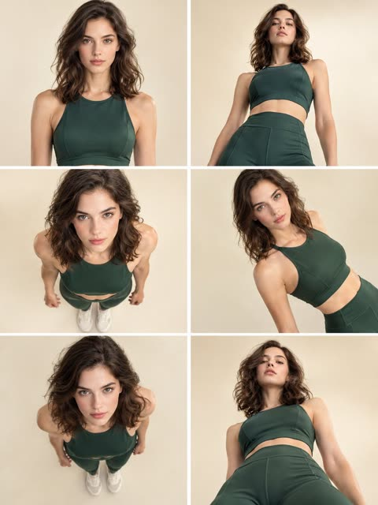</a>

在一段共享的身份描述中锁定脸部、发型和服装，再逐格只改变机位，让六张图看起来像同一次拍摄。固定的棚拍光线加上明确的 2 乘 3 网格和细白间距，使曝光与版式在各格之间保持一致。

GPT Image 2.5 · 文生图 · 出处: [@Just_Anika_Here on X](https://x.com/Just_Anika_Here/status/2115679456140702100) · 340 赞，统计于 2026-10-29

[`fashion`](tags.md#tag-fashion) [`reference-sheet`](tags.md#tag-reference-sheet) [`multi-angle`](tags.md#tag-multi-angle) [`athleisure`](tags.md#tag-athleisure)

<details><summary><b>提示词</b></summary>

```text
Create an ultra-luxurious fashion editorial reference sheet featuring the exact same adult European female fashion model in six distinct camera perspectives, arranged in a perfectly aligned 2-column × 3-row grid. The entire composition takes place in a seamless warm ivory studio with a subtle creamy gradient, sophisticated negative space, and a refined high-fashion magazine aesthetic.

MODEL IDENTITY — LOCKED ACROSS ALL SIX PANELS

A tall, slender European runway model with porcelain-fair skin, sculpted cheekbones, a refined oval face, expressive hazel-green eyes, naturally defined eyebrows, soft rose-pink lips, an elegant jawline, and realistic skin texture. Shoulder-length dark chestnut hair with natural waves, a subtle off-center part, and delicate flyaway strands. Understated makeup, luminous skin, and a composed, quietly confident expression.

Maintain precisely the same face, eye color, hairstyle, hair length, skin tone, age, body proportions, and identity in every panel. She must look like one real person photographed during a single luxury fashion shoot, not six similar-looking models.

WARDROBE AND STYLING

A sophisticated emerald-green luxury athleisure ensemble featuring a sculpted fitted sports bra and matching high-waisted leggings. Premium technical fabric with a subtle satin sheen, realistic stretch, refined seams, natural fabric tension, and impeccable tailoring. Minimalist styling with no jewelry, accessories, visible branding, or distracting details.

SIX DISTINCT CAMERA PERSPECTIVES

Panel 1 — Classic Editorial Portrait:
Eye-level camera, straight-on perspective, centered composition, balanced facial proportions, relaxed shoulders, and direct eye contact. Establish the model's definitive visual identity.
Panel 2 — Powerful Low-Angle Portrait:
Camera positioned below waist level and tilted slightly upward toward the model. Elongated silhouette, confident posture, dramatic runway presence, and a sophisticated sense of power. Preserve realistic anatomy and natural facial proportions.

Panel 3 — Elevated High-Angle Portrait:
Camera positioned above the model, looking downward at approximately 40 degrees. The model raises her gaze toward the lens, creating an elegant, intimate editorial composition with natural perspective distortion.
Panel 4 — Artistic Dutch Angle:
Camera rotated approximately 20 degrees clockwise. The model maintains a poised, confident stance while the diagonal composition introduces visual tension, modern magazine energy, and a contemporary luxury-campaign aesthetic.

Panel 5 — Direct Overhead Perspective:
True bird's-eye camera positioned vertically above the model, pointing straight down at 90 degrees. The model looks directly upward into the lens. Her shoulders, torso, hair, and outfit are arranged naturally within the frame. Accurate overhead geometry, no artificial stretching.
Panel 6 — Extreme Floor-Level Perspective:
True worm's-eye viewpoint with the camera positioned almost at floor level, pointing upward. The model looks down toward the lens with calm confidence. Strong architectural perspective, elegant silhouette, believable proportions, and dramatic fashion-editorial depth.

PHOTOGRAPHIC DIRECTION
High-end European luxury fashion campaign, contemporary Vogue-inspired editorial photography, rich emerald-green color against warm ivory, natural skin microtexture, realistic pores, fine hair detail, lifelike eyes, physically accurate fabric reflections, sophisticated tonal contrast, soft directional studio key light, delicate rim lighting, subtle contact shadows, controlled highlights, and cinematic color science.

Simulate a professional full-frame camera with an 85mm portrait lens aesthetic for standard views, intelligently adapting focal length and camera distance for overhead and extreme low-angle perspectives. Maintain consistent studio lighting, exposure, white balance, wardrobe color, and overall visual identity across all six photographs.
Photorealistic commercial photography, premium art direction, refined retouching without plastic skin, anatomically accurate body structure, crisp subject detail, realistic perspective, exceptionally high image quality.

GRID AND COMPOSITION
Exactly six individual photographs in a clean 2-column × 3-row contact sheet. Equal-sized rectangular panels, consistent aspect ratios, perfectly straight alignment, uniform gutters, thin white spacing, and a balanced overall silhouette. Every panel must read as a separate photograph from the same shoot, with camera position as the primary variable.

Maintain a cohesive luxury editorial appearance throughout. No panel overlap, no inconsistent crops, no random pose changes, and no visual distractions.
```

</details>

<a id="gpt-image-california-landmarks-grid"></a>
### 九张手机照片，女子游览加州各地标

<a href="https://x.com/craftian_keskin/status/2056811879008481521">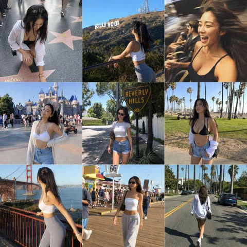</a>

通过九个固定位置的场景列表，并统一人物和服装设定，使九张图保持同一人物。明确列出颗粒、运动模糊、过曝、构图歪斜等瑕疵，才能做出手机随拍的质感。

GPT Image 2 · 文生图 · 出处: [@craftian_keskin on X](https://x.com/craftian_keskin/status/2056811879008481521) · 322 赞，统计于 2026-10-29

[`instagram-grid`](tags.md#tag-instagram-grid) [`smartphone-photo`](tags.md#tag-smartphone-photo) [`california`](tags.md#tag-california) [`travel`](tags.md#tag-travel)

<details><summary><b>提示词</b></summary>

```text
{
"Objective": "Create a 3x3 Instagram-style grid of low-quality smartphone photos featuring the same extremely attractive California model exploring iconic California landmarks, ensuring inclusion of specific requested locations.",
"Composition": {
"layout": "3x3 grid",
"aspect_ratio": "1:1",
"framing": "each square is a candid, imperfect smartphone moment forming a cohesive Instagram profile"
},
"Subject": {
"type": "beautiful Japanese woman",
"appearance": {
"beauty": " extremely attractive",
"body": "slim, toned, athletic model physique",
"skin": "natural texture, no glossiness, no smoothing",
"makeup": "soft glam but realistic",
"hair": "flowing, slightly messy or wind-blown"
},
"consistency": "same woman across all 9 images"
},
"Wardrobe": {
"style": "California chic",
"outfits": [
"bikini with light cover-up",
"denim shorts with crop top",
"summer dress",
"casual streetwear",
"sunglasses and sneakers"
]
},
"Scenes": [
{
"position": "top left",
"location": "Hollywood Walk of Fame (Star street)",
"pose": "looking down at star on ground, candid"
},
{
"position": "top center",
"location": "Hollywood Sign",
"pose": "standing at viewpoint, looking away"
},
{
"position": "top right",
"location": "Universal Studios theme park ride",
"pose": "mid-ride candid, motion blur, excited expression"
},
{
"position": "middle left",
"location": "Disneyland",
"pose": "posing casually with castle or ride in background"
},
{
"position": "middle center",
"location": "Beverly Hills street sign",
"pose": "standing next to sign, casual pose"
},
{
"position": "middle right",
"location": "Venice Beach",
"pose": "standing near palm trees, relaxed candid"
},
{
"position": "bottom left",
"location": "Golden Gate Bridge",
"pose": "leaning on railing, looking away"
},
{
"position": "bottom center",
"location": "Santa Monica Pier",
"pose": "walking casually, slightly blurred"
},
{
"position": "bottom right",
"location": "Los Angeles street (palm-lined road)",
"pose": "walking down street, back facing camera"
}
],
"Photography": {
"camera": "smartphone",
"style": "Instagram lifestyle",
"quality": "intentionally low quality",
"lighting": "natural California sunlight (harsh highlights, uneven exposure)",
"imperfections": [
"grain/noise",
"motion blur",
"overexposure",
"lens distortion",
"bad framing"
],
"effects": [
"no beauty filter",
"no skin smoothing",
"inconsistent exposure",
"authentic raw look"
]
},
"Mood": "carefree, sunny, chaotic travel energy, authentic California lifestyle",
"Rendering": {
"style_keywords": [
"instagram grid",
"california landmarks",
"hollywood walk of fame",
"disneyland",
"universal studios",
"smartphone photography",
"model lifestyle"
],
"realism": "highly realistic smartphone aesthetic",
"detail_level": "natural imperfect detail",
"aspect_ratio": "--ar 1:1"
},
"Response_Format": {
"type": "image_generation_prompt_json",
"editable_fields": [
"scenes",
"wardrobe",
"lighting",
"poses"
]
}
}
```

</details>

<a id="gpt-image-nine-panel-doodle-kitchen-diary-collage"></a>
### 九宫格厨房日记涂鸦拼贴

<a href="https://x.com/MissDelulu9/status/2071527238600954053"></a>

提示词要求同一主体在九个连续瞬间中变换姿势、角度和距离，让整组画面像一段故事。细白边框、贯穿全图并贴合每个动作的白色手绘涂鸦层，以及明亮高调的色彩要求，让九宫格浑然一体。

GPT Image 2 · 文生图 · 出处: [@MissDelulu9 on X](https://x.com/MissDelulu9/status/2071527238600954053) · 301 赞，统计于 2026-10-29

[`photo-collage`](tags.md#tag-photo-collage) [`nine-panel-grid`](tags.md#tag-nine-panel-grid) [`doodle-overlay`](tags.md#tag-doodle-overlay) [`high-key`](tags.md#tag-high-key) [`scrapbook`](tags.md#tag-scrapbook)

<details><summary><b>提示词</b></summary>

```text
A nine-panel grid photo collage of the same subject appearing in continuous moments across all frames with different poses, angles, and distances. Each panel feels like a real photograph with natural lighting, clean and airy backgrounds, and a bright, fresh mood. Thin white borders separate the grids neatly. White hand-drawn doodle lines flow across the entire collage, wrapping around the subject, tracing movements, and forming small symbols like hearts, sparkles, waves, and motion marks that match the action in each frame.

The overall color tone is high-key, light, and vibrant, with soft natural colors and small accent tones, avoiding dull or heavy shadows. The final result feels like a cohesive visual diary or scrapbook page where all nine moments are individually clear but visually connected into one lively, rhythmic story.
```

</details>

<a id="nano-banana-superhero-ten-styles-grid"></a>
### 蜘蛛侠十种画风标签拼图

<a href="https://x.com/chetaslua/status/2113896151883919812">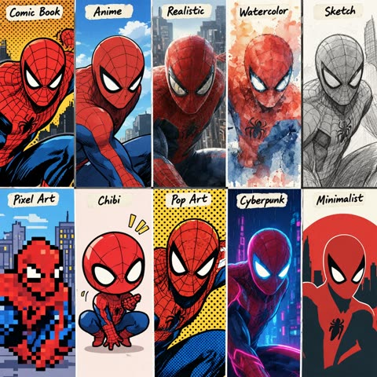</a>

只给出一个主体和风格数量，不指定具体画风，由模型自行选定十种风格并排成带标签的网格。要求同一张图中呈现同一角色，各格的人物形象保持一致，便于直接比较画风。

Nano Banana 2.1 · 文生图 · 出处: [@chetaslua on X](https://x.com/chetaslua/status/2113896151883919812) · 284 赞，统计于 2026-10-29

[`superhero`](tags.md#tag-superhero) [`art-styles`](tags.md#tag-art-styles) [`grid`](tags.md#tag-grid) [`multi-style`](tags.md#tag-multi-style)

<details><summary><b>提示词</b></summary>

```text
🚨 New Nano Banana 2.1 just got new checkpoint on arena < high chance this is new pro version i will test and keep you guys updated>
```

</details>

<a id="gpt-image-low-angle-pose-grid-blue-sky-doodles"></a>
### 蓝天涂鸦九宫格姿势拼图

<a href="https://x.com/HaniaAi12/status/2064674801159967138"></a>

提示词先固定同一套服装和纯蓝天背景，再按行列逐格写出九个姿势，让整张网格保持一致。低机位视角、手绘粉彩涂鸦和上传的参考图让每一格都是同一个人。

GPT Image 2 · 上传图改图 · 出处: [@HaniaAi12 on X](https://x.com/HaniaAi12/status/2064674801159967138) · 282 赞，统计于 2026-10-28

[`grid-collage`](tags.md#tag-grid-collage) [`pose-sheet`](tags.md#tag-pose-sheet) [`doodle-overlay`](tags.md#tag-doodle-overlay) [`low-angle`](tags.md#tag-low-angle) [`social-media`](tags.md#tag-social-media)

<details><summary><b>提示词</b></summary>

```text
A 3x3 grid collage containing nine separate photos of a single young Asian woman From the uploaded image with a light skin tone, styled for a lifestyle and social media content creator aesthetic. She is wearing a red fitted croptop, white Denim short, white sneakers and large white over-ear headphones and eyeglasses. The entire background of every photo is a solid, vibrant, clear bright blue sky on a sunny day.

Around her in each grid frame are playful, hand-drawn digital doodles in bright pastel colors, including pink hearts, yellow flowers, white clouds, paper airplanes, and dynamic motion lines. The collage captures nine different energetic and fun poses from low-angle perspectives:

Top Row: Left photo shows her dynamically kicking her leg out sideways while wearing blue clogs; middle photo shows her standing with one hand raised in a peace sign; right photo features a giant, close-up view of the bottom of her clog sole with a hand-drawn smiley face doodled onto it.

Middle Row: Left photo is a close-up where she leans forward and holds out her white headphones toward the camera; middle photo shows her standing confidently with hands on her hips; right photo shows her playfully leaning to the side with arms outstretched like a plane.

Bottom Row: Left photo captures her in a joyful jumping pose with arms out; middle photo shows her mid-air in a floating star-jump pose; right photo is a seated close-up looking down at the camera while making a peace sign close to the lens.

The overall style is a crisp, bright, hyper-realistic, fashion-forward digital photograph with vibrant color saturation and clean, sharp lighting.
```

</details>

<a id="gpt-image-fashion-collage-monochrome-panels-cutout"></a>
### 黑白肖像面板环绕彩色时尚人像抠图

<a href="https://x.com/noorlewisx/status/2062093611387551854">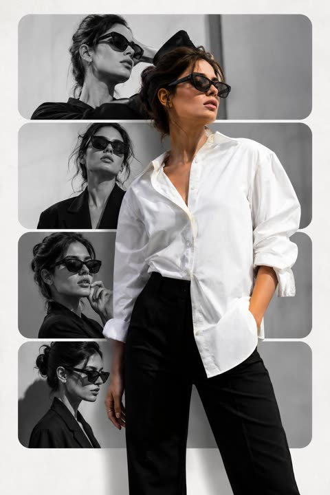</a>

用同一主角的四张黑白面板搭配一张彩色全身抠图营造系列感，明确写出服装细节可让各画面人物保持一致。结尾的无文字、无标志约束让海报便于后期加字。

GPT Image 2 · 文生图 · 出处: [@noorlewisx on X](https://x.com/noorlewisx/status/2062093611387551854) · 263 赞，统计于 2026-10-29

[`collage`](tags.md#tag-collage) [`fashion`](tags.md#tag-fashion) [`editorial`](tags.md#tag-editorial) [`monochrome`](tags.md#tag-monochrome)

<details><summary><b>提示词</b></summary>

```text
MODERN EDITORIAL COLLAGE POSTER DESIGN. CLEAN MINIMALIST FASHION COMPOSITION. BACKGROUND FEATURES FOUR VERTICALLY STACKED ROUNDED-RECTANGLE PANELS CONTAINING BLACK-AND-WHITE CINEMATIC PORTRAITS OF THE SAME STYLISH YOUNG WOMAN WEARING LUXURY SUNGLASSES IN DIFFERENT HIGH-FASHION POSES. IN THE FOREGROUND, A FULL-BODY HIGH-QUALITY COLOR CUTOUT OF THE SAME WOMAN STANDS CONFIDENTLY, WEARING AN OVERSIZED WHITE SHIRT, TAILORED BLACK PANTS, AND BLACK SUNGLASSES. SOFT REALISTIC SHADOWS, DEPTH LAYERING, PREMIUM MAGAZINE EDITORIAL STYLE, HIGH CONTRAST LIGHTING, CLEAN WHITE BACKGROUND, MODERN FASHION ADVERTISING AESTHETIC, ULTRA-REALISTIC SKIN TEXTURE, SHARP DETAILS, PROFESSIONAL POSTER COMPOSITION, LUXURY VOGUE-INSPIRED DESIGN, PHOTOREALISTIC, 8K, STUDIO QUALITY, NO TEXT, NO TYPOGRAPHY, NO LETTERS, NO LOGOS, NO WATERMARKS.
```

</details>

<a id="chatgpt-birthday-photobooth-grid-black-white"></a>
### 九宫格黑白生日照片亭人像

<a href="https://www.tiktok.com/@creandoconjhonathan/video/7689537471096311048">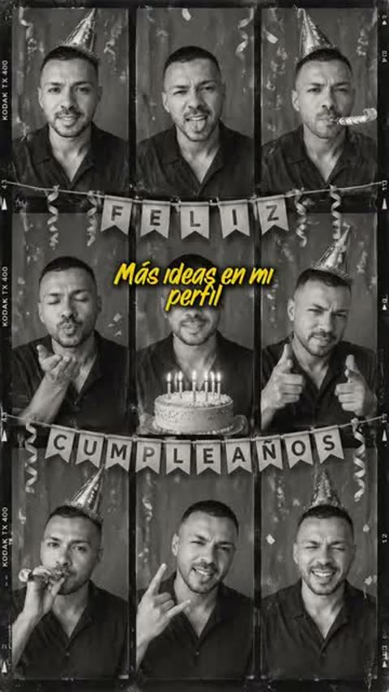</a>

提示词先锁定参考照片中的身份、发型、肤色和服装，再规定3×3网格与彩旗横幅的文字版式，让同一人物在九个姿势中保持一致，文字与构图成为画面的稳定骨架。

ChatGPT · 上传图改图 · 出处: [@creandoconjhonathan on TikTok](https://www.tiktok.com/@creandoconjhonathan/video/7689537471096311048) · 231 赞，统计于 2026-10-30

[`birthday`](tags.md#tag-birthday) [`photobooth`](tags.md#tag-photobooth) [`black-and-white`](tags.md#tag-black-and-white) [`grid`](tags.md#tag-grid)

<details><summary><b>提示词</b></summary>

```text
Usa la foto adjunta como referencia principal. Mantén exactamente la identidad, rostro, cabello, barba, tono de piel, edad aparente, cuerpo y ropa original. Crea una foto vertical 9:16 en blanco y negro, estilo photobooth vintage de los años 70–90, dividida en un grid 3×3 con 9 retratos de la misma persona, cada uno con una pose y expresión de cumpleaños diferente. Agrega sombrero de cumpleaños y matasuegras en algunas poses. Conecta los cuadros con guirnaldas, serpentinas y banderines que formen claramente “FELIZ CUMPLEAÑOS”. Fotografía editorial de estudio, iluminación suave, grano analógico, elegante y nostálgica. Alta resolución, composición realista y perfectamente alineada. No cambies la apariencia ni el vestuario de la persona.
```

</details>

<a id="gpt-image-borderless-memory-grid-template-osaka-dusk"></a>
### 大阪黄昏街景无缝四乘三图板

<a href="https://x.com/aimikoda/status/2048183782876778821"></a>

参数化模板，把主体、网格、主题、情绪和风格拆成可替换的槽位。要求无边框网格、统一色彩与光线、无文字无间隙，让十二个独立画面连成一张怀旧图板。

GPT Image 2 · 文生图 · 出处: [@aimikoda on X](https://x.com/aimikoda/status/2048183782876778821) · 229 赞，统计于 2026-10-28

[`image-board`](tags.md#tag-image-board) [`grid`](tags.md#tag-grid) [`template`](tags.md#tag-template) [`nostalgic`](tags.md#tag-nostalgic) [`cityscape`](tags.md#tag-cityscape)

<details><summary><b>提示词</b></summary>

```text
[SUBJECT]: your main character, place, object, city or concept
[GRID_LAYOUT]: panel layout
[THEME]: story theme, memory type or visual concept
[MOOD]: emotional tone
[STYLE]: visual style

Create a [GRID_LAYOUT] borderless grid where each panel is an independent image of the [SUBJECT]. Maintain strong subject consistency across all panels, with consistent color and lighting. Depict [THEME] with a [MOOD] mood in [STYLE] style. No text. No gap.

---

Example Parameters

[SUBJECT]: a young woman / Osaka / a medieval knight / a seaside town / a lost robot
[GRID_LAYOUT]: 4x3 / 3x3 / 2x4 / 5x2 / 6x6
[THEME]: childhood memories / school life memories / neon night city life / summer vacation memories / rainy day memories / color-themed memories
[MOOD]: warm, nostalgic, wistful / emotional, heartfelt, tender / dreamy, quiet, melancholic / bittersweet, intimate, reflective
[STYLE]: nostalgic cinematic realism / sentimental film photography / wistful slice-of-life realism / dreamy nostalgic realism / soft retro film still / emotional memory-like photography / warm vintage realism / melancholic cinematic still

Used prompts in ALTs.
```

</details>

<a id="gpt-image-flash-photo-dump-six-frame-portrait-collage"></a>
### 六格闪光灯随拍人像拼图

<a href="https://x.com/mehvishs25/status/2112208561673740615"></a>

以参考照片锁定人物身份，再逐条列出六个编号瞬间，每格有各自的表情、手势和发型。卡片相机闪光灯质感、固定的服装与墙面，加上结尾的避免清单，让整组画面一致又自然。

GPT Image 2.5 · 上传图改图 · 出处: [@mehvishs25 on X](https://x.com/mehvishs25/status/2112208561673740615) · 211 赞，统计于 2026-10-28

[`portrait-collage`](tags.md#tag-portrait-collage) [`identity-preservation`](tags.md#tag-identity-preservation) [`flash-photography`](tags.md#tag-flash-photography) [`photo-dump`](tags.md#tag-photo-dump) [`grid`](tags.md#tag-grid)

<details><summary><b>提示词</b></summary>

```text
Create an ultra-realistic 6-frame portrait collage arranged in a clean 3×2 grid, featuring the exact same girl from the uploaded reference photo. Use the reference exclusively for identity preservation, accurately retaining her facial structure, eye color, natural hair color, hairstyle, hair length, volume, texture, and distinctive facial features. Her identity must remain consistent across all six frames.

Overall aesthetic: Casual Instagram photo dump with an authentic early-2000s digital camera vibe. A simple muted powder-blue wall, fitted black spaghetti-strap top, delicate minimal accessories, and effortless everyday makeup. Shot on a Canon PowerShot G7 X Mark III with direct on-camera flash, crisp facial details, realistic skin pores, subtle grain, natural imperfections, strong flash highlights, and distinct shadows against the wall.

Six different candid moments:

1. Playful charm: Leaning slightly toward the camera, cheeks gently resting against her palms, giving a small, natural smile.
2. Cheeky energy: One eye closed in a wink, grinning brightly while sweeping a section of hair behind her ear.
3. Carefree mood: Eyes softly closed, lips forming a playful pout, both hands raised above her head as she loosely gathers her hair.
4. Cool and confident: Face turned slightly sideways, looking into the lens from the corner of her eyes, fingertips lightly touching her jawline.
5. Unfiltered laughter: Looking off-camera with a genuine open smile, head tilted back slightly, hair falling naturally across one shoulder.
6. Soft, dreamy moment: Chin tilted down, eyes gazing thoughtfully toward the camera, one hand loosely twirling a strand of hair.

Composition and realism: Every frame must have a distinct facial expression, head angle, hand placement, and hair arrangement. Keep the same outfit, background, lighting style, and identity throughout, while varying the crop and camera distance subtly. Natural anatomy, believable fingers, realistic hair strands, and authentic compact-camera flash photography. The result should feel like six spontaneous photos taken during one fun evening, not a polished studio campaign.

Avoid: Face swapping artifacts, altered facial features, inconsistent identity, plastic skin, excessive retouching, artificial beauty filters, duplicated poses, malformed hands, extra fingers, excessive sharpening, and obvious AI-generated details.

Vertical 3:4 canvas, six equally sized photographs, precise grid alignment, no borders, no text, no watermarks.
```

</details>

<a id="gpt-image-water-brand-logos-ocean-grid"></a>
### 六个由水塑造的品牌标志悬于海面上方

<a href="https://x.com/AIwithSynthia/status/2062521441141088599">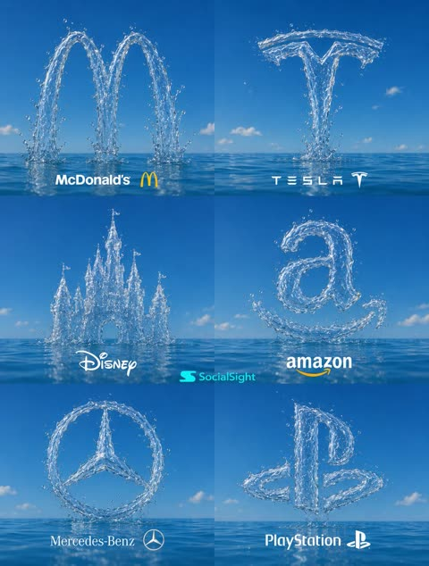</a>

提示词在所有画面中固定了三项要素：材质（透明水体，含飞溅、水滴与折射）、场景（海面与蓝天）和版式（3x2 网格）。明确要求标志完全由水构成，使图形保持液体质感，而不是平面图案。

GPT Image 2 · 文生图 · 出处: [@AIwithSynthia on X](https://x.com/AIwithSynthia/status/2062521441141088599) · 205 赞，统计于 2026-10-29

[`water-effect`](tags.md#tag-water-effect) [`brand-logos`](tags.md#tag-brand-logos) [`grid-collage`](tags.md#tag-grid-collage) [`ocean`](tags.md#tag-ocean)

<details><summary><b>提示词</b></summary>

```text
Create a premium 3x2 grid collage of iconic global brand logos recreated entirely from dynamic water formations, floating above a crystal-clear ocean under a vibrant blue sky. Each panel features a different logo sculpted from realistic transparent water, with detailed splashes, droplets, reflections, refractions, and flowing liquid textures. The water forms should look physically accurate, elegant, and instantly recognizable while remaining made completely of water.
```

</details>

<a id="gpt-image-identity-locked-flash-photo-dump-six-pose-collage"></a>
### 六种姿势闪光灯人像照片合集拼图

<a href="https://x.com/MissDelulu9/status/2113461687902994578"></a>

参考图只用于锁定身份，并写明五官、瞳色和发质。六个编号的姿势各带不同发型，再配上指定的卡片相机直闪和纯色墙面，呈现出真实的照片合集感。

GPT Image 2.5 · 上传图改图 · 出处: [@MissDelulu9 on X](https://x.com/MissDelulu9/status/2113461687902994578) · 197 赞，统计于 2026-10-28

[`photo-dump`](tags.md#tag-photo-dump) [`flash-photography`](tags.md#tag-flash-photography) [`identity-lock`](tags.md#tag-identity-lock) [`pose-grid`](tags.md#tag-pose-grid) [`portrait`](tags.md#tag-portrait)

<details><summary><b>提示词</b></summary>

```text
Ultra-realistic 6-photo collage (3×2 grid) of the same person using client photo for identity only (exact face, facial features, eye color, natural hair color/length/volume/texture). Plain light grey-blue wall background, black thin-strap camisole, minimal jewelry, Canon PowerShot G7X Mark III strong direct flash, hard shadows, sharp focus, natural skin texture, slight film grain.

Instagram photo dump aesthetic. Six unique expressions/poses: (1) soft smile, hands on cheeks, (2) wink, big smile, hand in hair, (3) eyes closed, tongue slightly out, both hands lifting hair, (4) confident side glance, hand under chin, (5) laughing, looking away, hair flipped, (6) dreamy look, hand touching hair. Different hair positions in every frame. No AI look, no distorted hands, no extra fingers. --ar 3:4
```

</details>

<a id="nano-banana-christmas-fur-coat-cafe-earphones-collage"></a>
### 四格冬季皮草大衣拼贴，搭配红色纸杯

<a href="https://x.com/xIrissy/status/2002696629103804691">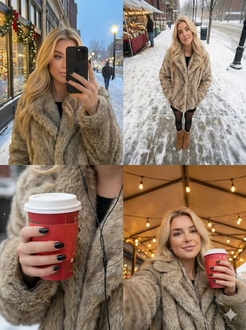</a>

用 JSON 固定服装、配色和布局，让每个画面保持同一风格，并用人脸参考图保持同一人物。每个画面都指定了各自的机位和光线，例如街拍使用近距离俯拍角度，让整组画面读起来像随手拍的手机照片。

Nano Banana Pro · 上传图改图 · 出处: [@xIrissy on X](https://x.com/xIrissy/status/2002696629103804691) · 192 赞，统计于 2026-10-29

[`christmas`](tags.md#tag-christmas) [`collage`](tags.md#tag-collage) [`winter-fashion`](tags.md#tag-winter-fashion) [`iphone-photo`](tags.md#tag-iphone-photo)

<details><summary><b>提示词</b></summary>

```text
{
  "image_generation_request": {
    "meta_protocols": {
      "reference_adherence": {
        "instruction": "Use the provided photo as a strict face reference.",
        "tolerance": "Zero deviation",
        "parameters": "Preserve facial proportions, skin texture, expression, and identity with 100% accuracy.",
        "stylization_constraint": "Do not stylize or alter facial features."},
      "format_style": "Editorial winter poster–style multi-panel collage",
      "aesthetic_quality": "Spontaneous iPhone photography (candid, cozy, realistic)",
      "global_textures": "Soft snowfall, subtle analog grain, slight handheld imperfections"
    },
    "consistent_elements": {
      "subject_look": {
        "hair": "Long honey-blonde balayage wavy hair, sun-kissed medium skin, amber eyes, soft golden smokey eye, glossy peachy-nude lips, very beautiful, attractive, elegant, captivating (while keeping the same identity and realistic proportions)",
        "makeup": "Soft golden smokey eye makeup (warm blended tones), defined lashes, subtle eyeliner, natural skin texture (no beauty filter)",
        "nails": "Glossy black nail polish",
        "presence": "very beautiful, attractive, elegant, captivating (while keeping the same identity and realistic proportions)"
      },
      "subject_wardrobe": {
        "coat": "Short faux-fur coat",
        "legwear": "Black tights",
        "footwear": "Classic UGG boots",
        "style_notes": "Simple, cozy, unmistakably winter"
      },
      "primary_device": {
        "model": "iPhone 17 Pro Max",
        "color": "Black",
        "usage": "Held by subject in relevant frames"
      },
      "accessories": {
        "earphones": "Black Apple wired earphones visible (earbuds + cable clearly visible)"
      },
      "color_palette": [
        "Warm ambers",
        "Soft reds",
        "Pine greens",
        "Muted winter greys"
      ]
    },
    "layout_configuration": {
      "panel_1_top_left": {
        "scene_type": "Reflective shop-window shot at dusk",
        "lighting_and_atmosphere": "Faint Christmas lights, garlands, frosted glass edges, warm highlights on fur",
        "subject_action": "Holding phone partially covering face",
        "optical_effects": "Passing silhouettes, layered reflections, gentle ghosting, natural glass curvature distortion"
      },
      "panel_2_top_right": {
        "scene_type": "Ultra-wide street portrait (snowy sidewalk/Christmas market)",
        "camera_angle": "Close, downward-angled",
        "subject_pose": "Leaning forward casually, hands in coat pockets",
        "visibility_check": "Black tights and UGG boots clearly visible",
        "motion_dynamics": "Falling snow with slight motion blur",
        "lens_characteristics": "Subtle perspective warping to reinforce handheld unstaged feel"
      },
      "panel_3_bottom_right": {
        "scene_type": "Intimate overhead selfie",
        "lighting": "Warm street or café lighting",
        "props": {
          "held_item": "Takeaway holiday drink (coffee or mulled wine)",
          "accessories": "Wired earphones visible"
        },
        "texture_focus": "Sharply detailed fur texture and winter fabrics",
        "mood": "Nostalgic holiday atmosphere enhanced by soft grain"
      }
    }
  }
}
2x2

1200x1200px
Picture Ratio: 3x4
```

</details>

<a id="nano-banana-beige-studio-nine-frame-fashion-grid"></a>
### 九宫格米色影棚时尚人像拼图

<a href="https://x.com/craftian_keskin/status/2050249217512218844">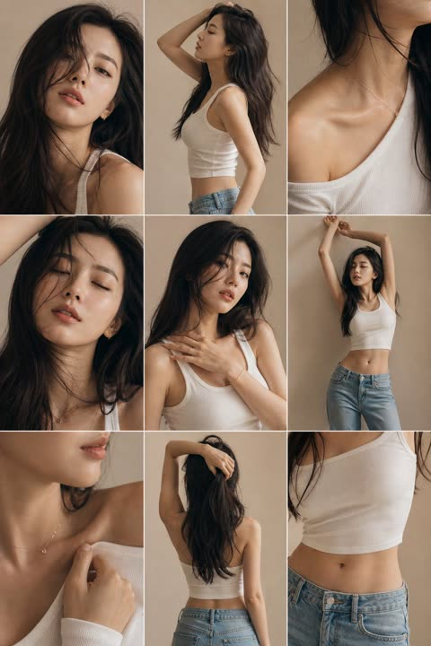</a>

用编号的九个镜头清单明确每格的姿势和取景，使一张拼图内的构图富有变化。固定的色板和35至85毫米镜头描述让九格的色彩与景深保持统一。

Nano Banana 2 · 文生图 · 出处: [@craftian_keskin on X](https://x.com/craftian_keskin/status/2050249217512218844) · 184 赞，统计于 2026-10-29

[`fashion`](tags.md#tag-fashion) [`grid-collage`](tags.md#tag-grid-collage) [`portrait`](tags.md#tag-portrait) [`studio`](tags.md#tag-studio)

<details><summary><b>提示词</b></summary>

```text
{
  "objective": "Create a 3x3 editorial photo collage of a stunning adult Korean woman in a warm minimalist studio, with soft sensual movement, candid fashion poses, and a dreamy cinematic aesthetic similar to a lifestyle moodboard.",

  "aspect_ratio": "4:5",

  "composition": {
    "layout": "3x3 photo grid collage",
    "framing": "nine unevenly expressive portrait crops mixing close-ups, mid-shots, torso shots, and partial-body fashion frames",
    "style": "editorial contact-sheet inspired collage",
    "pose_direction": "natural movement, wind-swept hair, relaxed body language, expressive hands, soft facial angles"
  },

  "subject": {
    "person": "adult Korean woman",
    "appearance": {
      "beauty": "strikingly beautiful, elegant, soft feminine features",
      "hair": "long dark flowing hair, slightly tousled",
      "skin": "smooth glowing skin",
      "expression": "dreamy, confident, subtle, sensual but tasteful"
    },
    "wardrobe": {
      "top": "white fitted crop tank top or off-shoulder ribbed top",
      "bottom": "light blue relaxed low-rise jeans",
      "accessories": "minimal delicate jewelry, very subtle bracelet or earrings"
    }
  },

  "poses": [
    "close-up with head slightly tilted and hair moving",
    "side-profile torso shot with graceful arm position",
    "cropped shoulder and neck detail shot",
    "soft emotional close-up with eyes half-closed",
    "hand resting near collarbone in a fashion-editorial pose",
    "full or three-quarter body pose with both arms raised",
    "cropped neckline and hand detail shot",
    "back-facing pose with one arm lifted into the hair",
    "cropped waist and torso detail shot"
  ],

  "environment": {
    "setting": "clean indoor studio",
    "background": "plain warm beige wall backdrop",
    "props": "no props"
  },

  "visual_style": {
    "genre": "fashion editorial moodboard",
    "mood": "warm, dreamy, intimate, soft, elegant",
    "color_palette": [
      "warm beige",
      "cream white",
      "soft tan",
      "light denim blue",
      "deep brown hair tones"
    ],
    "texture": "slightly soft focus, subtle filmic warmth"
  },

  "lighting": {
    "style": "soft warm studio light",
    "quality": "diffused glow with gentle shadows",
    "effect": "golden creamy highlights and flattering skin tones"
  },

  "camera": {
    "angle": "mixed editorial angles within the collage",
    "lens_look": "35mm to 85mm fashion photography feel",
    "focus": "soft but detailed portrait focus",
    "depth_of_field": "shallow to medium depth of field"
  },

  "quality_targets": {
    "look": "premium magazine editorial",
    "finish": "polished, aesthetic, natural, tasteful",
    "image_character": "expressive candid fashion collage"
  },

  "negative_constraints": [
    "no extra people",
    "no cluttered background",
    "no harsh flash",
    "no exaggerated makeup",
    "no cartoon style",
    "no distorted anatomy",
    "no blurry low-quality face",
    "no overly glossy plastic skin",
    "no text or watermark"
  ]
}
```

</details>

<a id="gpt-image-french-woman-bedroom-six-pose-photo-dump"></a>
### 同一女生卧室六种姿势的闪光灯写真拼图

<a href="https://x.com/john_my07/status/2113636699888885986"></a>

固定3×2网格和3:4比例，再用编号列出六个不同姿势，让每一格各司其职。用雀斑、瞳色、发色和同一套服装锁定身份，并以卡片机直闪的质感保持人物一致又自然随性。

GPT Image 2.5 · 文生图 · 出处: [@john_my07 on X](https://x.com/john_my07/status/2113636699888885986) · 174 赞，统计于 2026-10-28

[`photo-dump`](tags.md#tag-photo-dump) [`portrait-grid`](tags.md#tag-portrait-grid) [`identity-consistency`](tags.md#tag-identity-consistency) [`direct-flash`](tags.md#tag-direct-flash) [`candid`](tags.md#tag-candid)

<details><summary><b>提示词</b></summary>

```text
Create an ultra-realistic 6-photo portrait collage arranged in a seamless 3×2 grid, featuring the same naturally beautiful young French woman in her early 20s. She has warm fair-olive skin, delicate freckles across her cheeks and nose, expressive hazel-brown eyes, long, naturally tousled dark chestnut hair, full eyebrows, and naturally glossy pink lips. Her appearance should feel authentic, youthful, and effortlessly Parisian.

Photography Style: Candid European Instagram photo dump, resembling casual Canon PowerShot G7 X Mark III snapshots. Direct camera flash, crisp facial details, realistic skin pores, subtle digital grain, natural shadows, slightly imperfect framing, and warm indoor lighting.

Setting: A cozy bedroom with an off-white textured wall, neutral bedding, and a softly blurred background. Maintain consistent surroundings throughout all six photographs.

Outfit & Accessories: She wears the same cream-colored, long-sleeved ribbed top with tiny red floral prints and delicate lace trim in every photograph. The top has a modest, higher neckline with full chest coverage. Add small gold hoop earrings and a delicate gold pendant necklace. Her makeup is minimal, with naturally flushed cheeks, glossy lips, and lightly defined lashes. Her hairstyle remains consistent in color and length, but falls differently with each pose.

Six Distinct Poses:

1. Playful selfie: Resting one cheek against her hand, looking into the camera with gently pursed lips and a relaxed expression.
2. Winking snapshot: Looking directly into the lens, winking playfully with a slight pout, one arm casually extended toward the camera.
3. Relaxed happy moment: Eyes closed, smiling softly with her head tilted back slightly and both hands casually lifting her hair.
4. Over-the-shoulder portrait: Turning her face toward the camera over one shoulder, giving a subtle side glance with loose hair cascading naturally.
5. Caught laughing: Looking toward someone outside the frame, laughing genuinely with her head tilted sideways and hair falling across one cheek.
6. Quiet cozy mood: Leaning against a pillow, resting her chin against the sleeve of her top, gazing thoughtfully into the camera.

Identity Consistency: The exact same woman must appear in all six photographs, with consistent facial proportions, eye color, freckles, skin tone, and hair color. Each frame must have a distinctly different pose, expression, head angle, and natural hair arrangement.

Realism Details: Authentic skin texture, fine baby hairs, natural facial asymmetry, believable hands, sharp eyes, realistic fabric texture, subtle exposure variations, and natural compact-camera flash. Avoid excessive retouching, artificial skin smoothing, duplicated expressions, malformed fingers, distorted anatomy, or overly polished AI-generated aesthetics.

Output: Vertical 3:4 aspect ratio, exactly six photographs in a balanced 3-column × 2-row grid, clean alignment, no gutters, no borders, no text, no watermark. Photorealistic, intimate, youthful, spontaneous, and effortlessly French.
```

</details>

<a id="nano-banana-newspaper-collage"></a>
### 任何图都能变成报纸拼贴

<a href="https://x.com/aimikoda/status/2108682052665290854"></a>

一句话改图，照片和插画都适用。

Nano Banana 2.1 · 上传图改图 · 出处: [@aimikoda on X](https://x.com/aimikoda/status/2108682052665290854) · 171 赞，统计于 2026-10-27

[`collage`](tags.md#tag-collage) [`newspaper`](tags.md#tag-newspaper) [`one-liner`](tags.md#tag-one-liner)

<details><summary><b>提示词</b></summary>

```text
recreate this image as a collage made from newspaper parts.
```

</details>

<a id="gpt-image-scrapbook-mini-me-figurines-annotations"></a>
### 手帐风照片加入迷你自己手办与涂鸦注释

<a href="https://x.com/sipteaandcoffee/status/2050948629729542407"></a>

提示词先锁定原图的人物、姿势、光线和背景，再分层添加内容：与本人一致且动作各异的迷你手办、手写涂鸦与标注，以及固定的粉彩色板。结尾强调结果必须是同一张图的增强而非重绘，从而稳住人物一致性。

GPT Image 2 · 上传图改图 · 出处: [@sipteaandcoffee on X](https://x.com/sipteaandcoffee/status/2050948629729542407) · 168 赞，统计于 2026-10-28

[`scrapbook`](tags.md#tag-scrapbook) [`chibi-figurine`](tags.md#tag-chibi-figurine) [`doodle-overlay`](tags.md#tag-doodle-overlay) [`identity-preservation`](tags.md#tag-identity-preservation) [`pastel`](tags.md#tag-pastel)

<details><summary><b>提示词</b></summary>

```text
Transform the provided reference image into a cozy aesthetic scrapbook-style composition while strictly preserving the original subject, identity, pose, lighting, and background.

Add multiple small “mini version” characters of the same person (chibi / doll-like style), placed naturally around the scene (on objects, table, shoulder, etc.). These mini figures must match the subject’s face, hairstyle, outfit, and vibe consistently, styled as cute 3D collectible figurines. Show them doing different activities (reading, posing, taking photos, relaxing).

Overlay handwritten-style doodles and annotations across the image: arrows, hearts, stars, sparkles, icons, and playful captions connected to elements in the scene.

Use a soft pastel color palette (white base with pink, peach, blue accents).

Keep the frame visually rich and filled but balanced and clean.

Style: warm, cozy lighting, dreamy Instagram scrapbook aesthetic, soft depth of field, highly detailed, polished but playful.

The final result must look like the SAME original image enhanced with mini alter-egos and aesthetic annotations — not a recreated or different scene.
```

</details>

<a id="gpt-image-ai-filmmaker-monochrome-panel-editorial-collage"></a>
### 黑白分格编辑拼贴搭配彩色全身抠图

<a href="https://x.com/FutureVibesAi/status/2104874557345841520"></a>

四个黑白分格各自指定不同姿势和景别，再用一个彩色全身人像叠在上层营造层次。严格的人物一致性条款、详细的服装描述和禁止文字的要求让版面保持干净。

GPT Image 2.5 · 上传图改图 · 出处: [@FutureVibesAi on X](https://x.com/FutureVibesAi/status/2104874557345841520) · 158 赞，统计于 2026-10-28

[`editorial`](tags.md#tag-editorial) [`collage`](tags.md#tag-collage) [`monochrome`](tags.md#tag-monochrome) [`identity-consistency`](tags.md#tag-identity-consistency) [`fashion`](tags.md#tag-fashion)

<details><summary><b>提示词</b></summary>

```text
Use my attached/reference portrait as the strict facial identity reference. Keep my real facial structure, skin tone, eyes, nose, lips, hairline and overall likeness highly consistent across every appearance. Do not beautify me into a different person.

Create a premium modern editorial collage portrait of a female AI filmmaker and creative-tech founder.

The background consists of four large horizontal rounded-rectangle panels stacked vertically, exactly like a luxury magazine contact-sheet composition. Each panel contains a different cinematic black-and-white portrait of the same woman, while one large full-color full-body version overlaps the panels in the foreground.

BACKGROUND PANEL 1: cinematic close-up wearing sleek black sunglasses, looking sideways with a calm, powerful expression; subtle creative-studio environment behind her.

PANEL 2: relaxed candid portrait, chin resting lightly on one hand, thoughtful creator-at-work energy; subtle laptop and blurred production equipment in the environment, never distracting from her face.

PANEL 3: elegant side-profile portrait, looking away from camera, natural loose hair movement, cinematic shallow depth of field; blurred filmmaking/creative workspace background.

PANEL 4: slightly low-angle portrait looking upward with quiet ambition and confidence, dramatic directional light shaping her face.

All four panels are sophisticated monochrome photography, rich blacks, silver-gray highlights, subtle film grain, realistic skin texture and premium editorial contrast.

FOREGROUND

Place the same woman as a large full-body color cutout on the right side, overlapping all four panels.

Style her as a successful contemporary AI filmmaker / creative-tech founder: oversized deep black textured sweater, relaxed wide-leg charcoal/washed-gray cargo jeans, premium clean white sneakers, minimalist black shoulder bag, subtle silver jewelry and sophisticated black sunglasses either worn or naturally held.

Her pose is effortless and confident: one hand casually inside her pocket, one leg slightly crossed forward, body angled three-quarters toward camera, head turned slightly to the side. Expression composed, ambitious and self-assured — no exaggerated smile.

Add very subtle creator details: a sleek laptop/tablet partly visible inside the shoulder bag and a small professional camera accessory attached to the bag. Keep these understated and luxurious rather than making the image look like a tech advertisement.

Hair should feel naturally styled with soft loose strands around the face. Preserve my actual appearance rather than changing me into a fashion model.

AESTHETIC: Vogue-style contemporary editorial photography, AI creator meets luxury street fashion, cinematic photography, sophisticated minimalism, realistic skin pores, premium fabric textures, natural body proportions, soft directional sunlight, shallow depth of field, subtle analog film grain, high dynamic range, professional fashion campaign retouching, photorealistic, 8K.

LAYOUT: vertical 4:5 social-media poster, warm off-white background, four evenly spaced rounded monochrome panels, foreground woman extending beyond the panels to create dimensional depth, subtle realistic drop shadow behind her cutout, generous negative space, perfectly balanced editorial composition.

STRICT CONSISTENCY: every woman shown is the exact same person. Maintain identical facial anatomy and recognizable identity throughout. Correct hands and fingers, realistic anatomy, realistic clothing folds, no duplicate limbs, no warped accessories.

NO TEXT. NO TYPOGRAPHY. NO LETTERS. NO LOGOS. NO BRAND NAMES. NO WATERMARKS. NO RANDOM SYMBOLS.
```

</details>

<a id="gpt-image-frame-collage-identity-consistent-woman"></a>
### 女子在复古木相框中的多姿势拼贴

<a href="https://x.com/Alina_with_Ai/status/2102358953489481762"></a>

先用参考图锁定人物身份，再逐一列出每个相框的表情和姿势，并用重复的一致性要求和负面清单防止走样。暖色影棚光、道具和手绘涂鸦对话气泡营造出剪贴簿质感。

GPT Image 2.5 · 上传图改图 · 出处: [@Alina_with_Ai on X](https://x.com/Alina_with_Ai/status/2102358953489481762) · 156 赞，统计于 2026-10-28

[`collage`](tags.md#tag-collage) [`identity-consistency`](tags.md#tag-identity-consistency) [`scrapbook`](tags.md#tag-scrapbook) [`vintage-frames`](tags.md#tag-vintage-frames) [`editorial`](tags.md#tag-editorial)

<details><summary><b>提示词</b></summary>

```text
Use the uploaded reference image as the identity and facial reference. Create a high-resolution photorealistic editorial collage of the same young woman, keeping her face, hairstyle, skin tone, body proportions, and overall appearance consistent in every frame.

A stylish young woman with long straight dark-brown hair, wearing a fitted royal-blue short-sleeve T-shirt, blue denim jeans, and clean white chunky sneakers. Create a playful vintage photography-wall composition where she appears multiple times inside and around several ornate rustic wooden picture frames arranged vertically and overlapping.

The central full-body version of the woman sits casually on the frames, one leg bent and the other extended downward, smiling confidently while making a peace/V sign with one hand. Surrounding frames contain different realistic versions of the same woman with different expressions and poses:

laughing with eyes closed

surprised expression with both hands on cheeks

smiling with hands forming a heart

taking a mirror-style selfie with a modern smartphone

happily raising both arms

playful wink and smile

cheerful candid expressions

Maintain perfect facial identity consistency across all versions.

Background: warm beige studio wall with a cozy retro photography-studio aesthetic. Add several vintage film cameras placed naturally on some of the frames. Surround the composition with hand-drawn doodles, small stars, red hearts, arrows, and playful speech bubbles containing short phrases such as “BEST DAY EVER!”, “OOPS!”, “SO HAPPY!”, “HAHA!”, “LOVE THIS!”, “LITTLE MOMENTS!”

Composition should feel like a creative Instagram editorial photoshoot / scrapbook collage, highly detailed, natural realistic skin texture, realistic hands and fingers, accurate anatomy, soft warm studio lighting, subtle shadows, cinematic photography, crisp focus, premium fashion editorial quality, photorealistic, ultra-detailed, 8K, vertical 4:5 composition.

Important: Keep the same person recognizable in every frame, consistent clothing and hairstyle, realistic proportions, no duplicated facial features, no distorted hands, no extra fingers, no warped limbs, no text errors.
```

</details>

<a id="nano-banana-christmas-reindeer-makeup-grid"></a>
### 四格圣诞驯鹿妆与贴纸人像

<a href="https://x.com/songguoxiansen/status/2003467449195528253">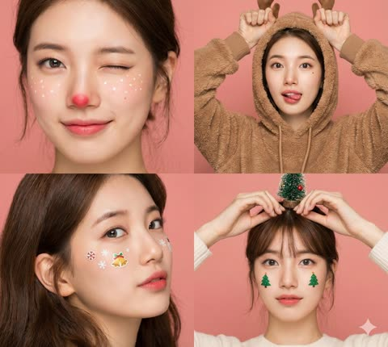</a>

提示词设定2x2分格，为每格指定不同的姿势、妆容细节和道具，并用一句身份锁定指令让同一人物在各格保持一致。纯色粉色背景和环形灯描述统一了色调与光线，让四格看起来是同一组画面。

Nano Banana Pro · 文生图 · 出处: [@songguoxiansen on X](https://x.com/songguoxiansen/status/2003467449195528253) · 154 赞，统计于 2026-10-29

[`christmas`](tags.md#tag-christmas) [`makeup`](tags.md#tag-makeup) [`collage`](tags.md#tag-collage) [`portrait`](tags.md#tag-portrait)

<details><summary><b>提示词</b></summary>

```text
(杰作, 最高画质, 超细节, 8k分辨率). 一张照片般逼真的4格分屏拼图，所有画面为同一女性角色。
[关键：保持精确的面部特征，保留原始脸部结构，整个拼图中角色完全一致]. 角色皮肤白皙，质感自然，眼神明亮。 左上图：特写镜头，角色化着精致的“麋鹿妆”（鼻头画红，脸颊有白色斑点），对着镜头Wink。 右上图：角色双手握拳放在头顶模仿鹿角，吐舌头卖萌，穿着棕色毛绒连帽衫。
左下图：角色侧身看着镜头，展示脸颊上的圣诞贴纸（雪花和铃铛图案），眼神妩媚。
右下图：角色正对着镜头整理刘海，手里拿着一个小圣诞树，脸上是圣诞树的贴纸，表情自然日常。 环境：粉色或蜜桃色的纯色背景。灯光：环形美妆灯，瞳孔中有漂亮的光圈，皮肤无瑕疵。风格：美妆博主风格，极度强调妆容细节，清晰对焦，少女感。
```

</details>

<a id="gpt-image-banana-smoothie-four-panel-recipe-collage"></a>
### 香蕉奶昔四格食谱拼图

<a href="https://x.com/DuaFatimaAi/status/2096033405259682193"></a>

按位置逐格描述 2x2 画面，每格写明食材与动作，步骤顺序清晰。结尾统一光线、玻璃器皿、景深和无文字要求，让四格风格一致。

GPT Image 2 · 文生图 · 出处: [@DuaFatimaAi on X](https://x.com/DuaFatimaAi/status/2096033405259682193) · 152 赞，统计于 2026-10-29

[`recipe`](tags.md#tag-recipe) [`food-photography`](tags.md#tag-food-photography) [`collage`](tags.md#tag-collage) [`step-by-step`](tags.md#tag-step-by-step) [`photorealistic`](tags.md#tag-photorealistic)

<details><summary><b>提示词</b></summary>

```text
Create a photorealistic 2×2 four-panel recipe collage showing the preparation of a creamy banana smoothie on a rustic dark wooden kitchen table.

Top-left: Several ripe yellow bananas, one peeled banana, a clear glass of milk, a small glass bowl of thick white yogurt, and a bowl of ice cubes neatly arranged as ingredients.

Top-right: Close-up of hands peeling a ripe banana and placing banana pieces into a transparent glass blender jar.

Bottom-left: Milk being poured from a transparent measuring cup into the blender containing banana pieces, yogurt, and ice cubes.

Bottom-right: Thick creamy banana smoothie being poured from the blender into a clear drinking glass, with another finished smoothie glass in the background and a few banana slices on the wooden table.

Warm natural kitchen lighting, realistic food textures, creamy pale-yellow smoothie, transparent glassware, shallow depth of field, rustic wooden background, clean composition, professional food photography, highly detailed, realistic hands, natural shadows, 4K photorealism, no text, no labels, no watermark.
```

</details>

<a id="nano-banana-mauve-boucle-strawberry-fashion-collage"></a>
### 暮紫色绒圈针织连衣裙时尚拼贴与草莓特写

<a href="https://x.com/Just_sharon7/status/2065466489210036682">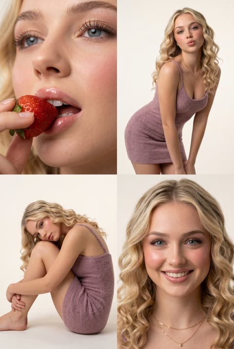</a>

将请求拆分为编号分镜，并为每格指定机位与姿势，使每个画面都与同一套服装、背景和布光保持一致。在共享的场景段落中只写一次面料和光线，模型会把它们延续到每个分镜。

Nano Banana 2 · 文生图 · 出处: [@Just_sharon7 on X](https://x.com/Just_sharon7/status/2065466489210036682) · 141 赞，统计于 2026-10-29

[`fashion`](tags.md#tag-fashion) [`studio`](tags.md#tag-studio) [`collage`](tags.md#tag-collage) [`macro`](tags.md#tag-macro)

<details><summary><b>提示词</b></summary>

```text
Ultra-photorealistic 8K studio portrait collage of a woman with long, voluminous loose waves, natural glass-skin makeup, flushed cheeks, glossy pink lips, and defined lashes. She wears a tight bodycon mini dress made of soft textured boucle knit in soft mauve or neutral taupe, with spaghetti straps and a mid-thigh length.
Studio setting: Warm off-white seamless backdrop with professional studio lighting. Large softbox from the front-left, reflector fill from the right, creating soft shadows and natural highlights on the lips, cheekbones, shoulders, and dress texture.
Panel 1 (Top Left): Extreme close-up macro shot from a slightly low angle. Focus on lips and nose while delicately holding and eating a fresh strawberry. Shallow depth of field. Visible strawberry moisture, glossy lips, and fine baby hairs.
Panel 2 (Top Right): Medium thigh-up portrait at eye level. Standing and leaning slightly toward the camera with relaxed arms. Direct gaze and confident pout. Emphasis on dress texture, collarbone shadows, and waist shape.
Panel 3 (Bottom Left): Full-body seated side-profile shot. Sitting on the floor with knees drawn toward the chest, cheek resting gently on one knee. Soft, intimate mood with natural body positioning and elegant composition.
Style: Fashion editorial photography, luxury magazine quality, realistic skin pores, detailed fabric textures, ray-traced lighting, shallow depth of field, natural color grading, ultra-sharp focus, professional studio photography.
```

</details>

<a id="gpt-image-golden-hour-park-fashion-collage"></a>
### 黄金时刻公园五格时尚拼贴写真

<a href="https://x.com/AvelyrahnAI/status/2064301990251991056">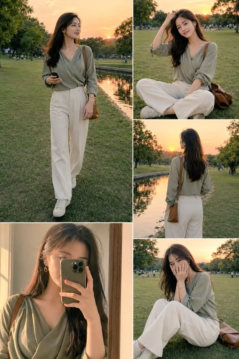</a>

提示词预先固定拼贴结构：一张大幅全身图、三张竖向小图和一张镜面自拍，每帧都有编号的动作描述。固定的服装清单加上逆光、调色和皮肤与面料质感等写实词汇，让五张图风格统一、接近真实摄影。

GPT Image 2 · 文生图 · 出处: [@AvelyrahnAI on X](https://x.com/AvelyrahnAI/status/2064301990251991056) · 139 赞，统计于 2026-10-29

[`collage`](tags.md#tag-collage) [`golden-hour`](tags.md#tag-golden-hour) [`fashion`](tags.md#tag-fashion) [`portrait`](tags.md#tag-portrait)

<details><summary><b>提示词</b></summary>

```text
Ultra-realistic cinematic lifestyle fashion collage of a beautiful young Asian woman in a wide green park at golden hour sunset, captured as a premium 5-frame editorial photo series. Maintain the same collage layout: one large full-body walking frame, three vertical frames on the right, and one mirror-selfie frame on the lower left, separated by clean borders.
The woman has a delicate natural face, soft expressive eyes, long wavy hair moving gently in the breeze, elegant earrings, and a calm, dreamy expression. She wears a muted sage-olive draped blouse with rolled sleeves, high-waisted ivory wide-leg trousers, off-white minimalist sneakers, a tan leather shoulder bag, subtle gold earrings, and a slim bracelet.
Frame 1: walking beside a narrow canal holding a phone, relaxed candid expression.
Frame 2: sitting cross-legged on grass, touching her hair softly.
Frame 3: back-facing near the canal, looking at the sunset.
Frame 4: close mirror-selfie, face partially hidden by phone, warm sunlight on hair and cheek.
Frame 5: playful seated pose on grass, hands covering part of the face with a shy smile.
Environment: expansive grassy field, scattered trees, reflective canal, glowing sunset sky, distant blurred people. Warm golden backlight, cinematic color grading, realistic shadows, natural depth of field, authentic skin texture, visible pores, subtle facial asymmetry, realistic hair strands, natural fabric folds, DSLR-quality photography, Pinterest-worthy editorial aesthetic, highly photorealistic 8K. No tattoos, no beauty-filter effect, no plastic skin, no AI-looking features, authentic candid fashion photography.
```

</details>

<a id="nano-banana-christmas-six-props-fair-isle-grid"></a>
### 费尔岛毛衣女性与六个圣诞道具

<a href="https://x.com/songguoxiansen/status/2003645804079141286">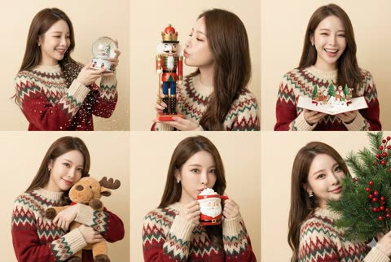</a>

六格网格模板，先锁定同一人物身份和同一套服装，再为每一格指定不同的道具和动作。固定的米色背景与 45 度柔光箱让六张画面的风格保持统一。

Nano Banana Pro · 上传图改图 · 出处: [@songguoxiansen on X](https://x.com/songguoxiansen/status/2003645804079141286) · 137 赞，统计于 2026-10-29

[`christmas`](tags.md#tag-christmas) [`fair-isle`](tags.md#tag-fair-isle) [`collage-grid`](tags.md#tag-collage-grid) [`studio-portrait`](tags.md#tag-studio-portrait)

<details><summary><b>提示词</b></summary>

```text
(6-panel grid, variety of props, studio portraiture). A collage of 6 shots of the specific character interacting with different Christmas objects. [CRITICAL: Maintain exact facial identity, preserve original bone structure].

Clothing: A cozy fair-isle patterned sweater. Panels:

Shaking a Snow globe.
Kissing a wooden Nutcracker soldier.
Reading a pop-up Christmas card.
Hugging a plush Reindeer toy.
Sipping from a Santa-themed hot cocoa mug.
Peek-a-boo behind a bunch of pine branches.
Background: Soft beige or cream paper backdrop.
Lighting: Softbox lighting from 45 degree angle, creating dimension but keeping it flattering.
```

</details>

<a id="gpt-image-ivory-editorial-collage-skater-breakout"></a>
### 滑板女孩跃出山景相框的编辑拼贴

<a href="https://x.com/Ziha_ai/status/2112515912993820802"></a>

提示词锁定严格 3:4 画布，在象牙白纸面中央放置矩形裁切图，并让主体与前景越过下边缘形成真实抠图。保留原图和限制清单两段文字保证人物、服装与风景不走样。

GPT Image 2.5 · 上传图改图 · 出处: [@Ziha_ai on X](https://x.com/Ziha_ai/status/2112515912993820802) · 128 赞，统计于 2026-10-29

[`editorial-collage`](tags.md#tag-editorial-collage) [`ivory-paper`](tags.md#tag-ivory-paper) [`photo-edit`](tags.md#tag-photo-edit) [`travel-magazine`](tags.md#tag-travel-magazine) [`cutout`](tags.md#tag-cutout)

<details><summary><b>提示词</b></summary>

```text
Use for portraits, people, flowers, trekking photos, and other vertical images. Canvas: strict 3:4 portrait.
Transform the uploaded photograph into a premium minimalist editorial collage inspired by luxury travel magazines, contemporary fashion editorials, and artistic outdoor photography.
FORMAT & COMPOSITION:
Create a strict 3:4 vertical canvas. Use a warm ivory/off-white background with subtle paper texture and generous negative space.
Place a large, clean-edged vertical rectangular crop of the original photograph in the center, slightly above the middle. Keep the original scenery recognizable inside the rectangle. Let the main subject naturally overlap and extend beyond the bottom edge of the rectangle into the ivory space. Where it looks natural, allow foreground flowers, grass, foliage, or rocks to extend beyond the frame as realistic photographic cutouts. Keep the layout asymmetrical but balanced, with the subject as the focal point.
PRESERVE THE ORIGINAL:
Use the uploaded photo as the source. Keep the subject as faithful to the original as possible: preserve identity, face, expression, hair, clothing, pose, proportions, colors, and distinctive details. Do not beautify, redesign, or stylize the subject. Preserve the original landscape, lighting, textures, and atmosphere. Do not crop off important parts of the subject.
STYLE:
Photorealistic premium travel editorial, minimalist Swiss-inspired art direction, warm ivory paper, muted earthy colors, dusty blues, natural greens, subtle film grain, realistic edges, and soft believable shadows.
RESTRICTIONS:
No text, typography, logos, watermarks, extra subjects, unrelated objects, illustration, cartoon effects, HDR, oversaturation, artificial glow, plastic textures, or exaggerated shadows. Do not distort proportions. If preserving the original subject conflicts with the layout, prioritize the subject.
FINAL RESULT:
A refined photorealistic editorial collage with a vertical rectangular photo and the original subject or natural foreground breaking out of the frame into the surrounding ivory negative space.
```

</details>

<a id="nano-banana-chibi-doll-scrapbook-white-saree-portrait"></a>
### 白色纱丽人像与Q版娃娃手账拼贴

<a href="https://x.com/HaniaAi12/status/2067928015519269285"></a>

开头先用简短风格词定调，再以参考图锁定写实主体人像。周围加入同一人物的Q版娃娃分身、涂鸦爱心、手写文字和手账版式，形成层次丰富的拼贴。

Nano Banana 2 · 上传图改图 · 出处: [@HaniaAi12 on X](https://x.com/HaniaAi12/status/2067928015519269285) · 124 赞，统计于 2026-10-28

[`chibi`](tags.md#tag-chibi) [`scrapbook`](tags.md#tag-scrapbook) [`doodle`](tags.md#tag-doodle) [`reference-photo`](tags.md#tag-reference-photo) [`portrait-collage`](tags.md#tag-portrait-collage)

<details><summary><b>提示词</b></summary>

```text
Doodle chibi Art .
Use reference photo to create a ultra-realistic cinematic portrait of a beautiful Indian woman in elegant white saree with embroidered blouse, jasmine flowers in long black hair, looking back with sweet smile, warm aesthetic lighting, surrounded by cute 3D chibi doll versions of herself in different poses, white doodle hearts and sparkles, handwritten words, dreamy scrapbook collage style, Disney Pixar inspired, soft glow, cozy feminine vibe, ultra detailed, 8k.
```

</details>

<a id="nano-banana-red-jacket-spiral-christmas-tree"></a>
### 红夹克人脸重复排列成螺旋圣诞树

<a href="https://x.com/gizakdag/status/1996938549694800304">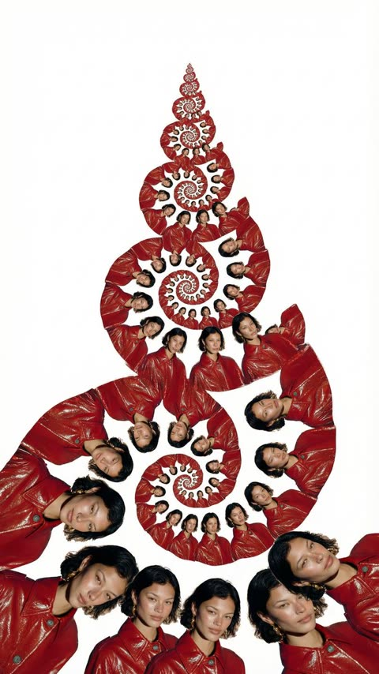</a>

附上一张人像作为重复单元，并要求沿分形螺旋排列，每个副本都保留同一人物。顶部逐渐缩小、白色背景让树形轮廓清晰可辨。

Nano Banana Pro · 上传图改图 · 出处: [@gizakdag on X](https://x.com/gizakdag/status/1996938549694800304) · 122 赞，统计于 2026-10-29

[`christmas`](tags.md#tag-christmas) [`fractal`](tags.md#tag-fractal) [`spiral`](tags.md#tag-spiral) [`repetition`](tags.md#tag-repetition)

<details><summary><b>提示词</b></summary>

```text
A creative Christmas tree made entirely from repeated copies of the attached image, arranged in a fractal spiral pattern that forms a triangular Christmas tree silhouette. The repetitions should shrink in scale as they ascend, creating a dynamic visual rhythm. The base of the tree is wide, with larger repeated figures, gradually tapering upward into smaller and tighter spirals. Clean white background, crisp high-contrast edges, graphic design aesthetic, bold visual geometry. The composition should feel cinematic, iconic, and surreal, with perfect alignment and smooth fractal flow, forming a recognizable Christmas tree shape while still showcasing the repeated character from the uploaded image.
```

</details>

<a id="nano-banana-christmas-nine-pose-photobooth-grid"></a>
### 淡蓝背景九格圣诞大头贴

<a href="https://x.com/songguoxiansen/status/2003469962430873963"></a>

用 [CRITICAL] 约束锁定各格中的人脸，再按编号逐条列出九个姿势和配饰变化，让每格各不相同，而毛衣、光线和背景保持统一。明确写出 3x3 九宫格和 9-panel 拼图版式，使模型输出一张合成图。

Nano Banana Pro · 上传图改图 · 出处: [@songguoxiansen on X](https://x.com/songguoxiansen/status/2003469962430873963) · 120 赞，统计于 2026-10-29

[`christmas`](tags.md#tag-christmas) [`collage`](tags.md#tag-collage) [`photobooth`](tags.md#tag-photobooth) [`portrait`](tags.md#tag-portrait)

<details><summary><b>提示词</b></summary>

```text
(9-panel grid collage, photobooth style, studio lighting). A fun and vibrant 3x3 grid featuring the specific character in 9 different poses. [CRITICAL: Maintain exact facial features, preserve original face structure across all panels].

Styling: She is wearing a soft white mohair sweater. Accessories change slightly in panels: a reindeer antler headband, a thick red knitted scarf, and holding a giant Christmas lollipop. Poses: 1. Winking with a V-sign. 2. Pouting while holding a miniature Christmas tree. 3. Surprised face with snowflake stickers on cheeks. 4. Laughing with eyes closed. 5. Blowing a kiss. 6. Holding a wrapped gift box on head. 7. Making a heart shape with hands. 8. Pretending to eat a gingerbread man. 9. Saluting with a serious cute face. Background: Uniform pastel blue studio backdrop for all panels. Lighting: Bright, shadowless beauty lighting, high-key, commercial pop style.
```

</details>

<a id="gpt-image-european-woman-six-scene-instagram-photo-dump"></a>
### 六宫格日常风 Instagram 随拍合集

<a href="https://x.com/john_my07/status/2114371973002506481"></a>

先用一段固定的外貌描述并单独写明身份一致性，让六个编号场景保持同一张脸。每个场景分别指定服装、姿势和光线，并在版式要求里禁止留白、边框和文字。

GPT Image 2.5 · 文生图 · 出处: [@john_my07 on X](https://x.com/john_my07/status/2114371973002506481) · 115 赞，统计于 2026-10-28

[`photo-dump`](tags.md#tag-photo-dump) [`collage`](tags.md#tag-collage) [`identity-consistency`](tags.md#tag-identity-consistency) [`candid`](tags.md#tag-candid) [`lifestyle`](tags.md#tag-lifestyle)

<details><summary><b>提示词</b></summary>

```text
Create an ultra-realistic 6-photo lifestyle collage arranged in a seamless 3×2 grid, featuring the same naturally beautiful young European woman in her early 20s. She has warm olive skin, delicate freckles across her cheeks and nose, hazel-brown eyes, long chestnut-brown hair with natural waves and subtle highlights, full eyebrows, and glossy pink lips. Preserve the same recognizable facial identity across all six photographs.

Overall aesthetic: Authentic European Instagram photo dump, candid smartphone photography mixed with compact-camera flash, realistic skin texture, subtle digital grain, natural lighting, imperfect framing, spontaneous expressions, and a warm cinematic color palette. Every frame should feel like a genuine moment from her everyday life, not a professional studio shoot.

Six different scenes, outfits, and poses:

1. Cozy café moment: Sitting at a wooden café table in a fitted black long-sleeve top, resting her cheek against one hand and smiling gently at the camera. A white cappuccino cup sits in front of her, with warm pendant lights and a softly blurred café background.

2. Casual street-style portrait: Standing indoors near a neutral wall, wearing a cream fitted tank top, light-wash blue jeans, and carrying a black shoulder bag. She turns over her shoulder to look back at the camera, with her long hair cascading naturally down her back.

3. Cozy bedroom snapshot: Sitting on a white bed in a soft pastel-pink knit cardigan and white floral lounge pants. She hugs one knee casually, winks at the camera, and makes a playful pout. Warm bedside lighting creates a relaxed evening atmosphere.

4. Mirror selfie: Taking a casual mirror selfie in a fitted black square-neck long-sleeve top and white lounge pants. Her phone has a cute heart-patterned case. She looks at her reflection with a subtle, confident expression in a softly lit bedroom or hallway.

5. Outdoor winter portrait: Wearing a charcoal coat and a thick grey knitted scarf, with her long hair loose around her face. She looks slightly upward with a gentle smile while standing on a European street in soft natural daylight.

6. Restaurant dinner moment: Sitting at a restaurant table wearing a tasteful burgundy sleeveless top with a modest neckline and delicate gold jewelry. She playfully lifts a forkful of spaghetti while glancing toward the camera. A plate of pasta, warm candlelight, and softly blurred restaurant lights complete the scene.

Identity consistency: The same woman must appear in every panel, with identical facial proportions, eye color, freckles, skin tone, and hair color. Her hairstyle may vary naturally between scenes, including loose waves and slightly messier strands, while remaining recognizable.

Realism details: Authentic skin pores, fine baby hairs, natural facial asymmetry, realistic hands, believable fabric textures, subtle exposure differences, realistic reflections, and natural environmental lighting. Avoid excessive retouching, plastic skin, duplicated expressions, distorted fingers, inconsistent facial features, or overly polished AI-generated aesthetics.

Output requirements: Vertical 3:4 aspect ratio, exactly six equally sized photographs in a balanced 3-column × 2-row grid, clean alignment, no gutters, no borders, no text, no watermark. Photorealistic, youthful, spontaneous, stylish, and full of personality, like a genuine collection of everyday moments shared on Instagram.
```

</details>

<a id="gpt-image-identity-locked-polaroid-scrapbook-collage"></a>
### 同一女孩多种姿势的拍立得手帐拼贴

<a href="https://x.com/mehwishkiran07/status/2106208037136642520"></a>

开头和结尾都强调上传照片是唯一的身份参考，并固定服装，再列出七种不同的姿势和表情围绕中央大图，既保持人物一致又有变化，纸张、胶带和手写文字细节则构成手帐层次。

GPT Image 2.5 · 上传图改图 · 出处: [@mehwishkiran07 on X](https://x.com/mehwishkiran07/status/2106208037136642520) · 115 赞，统计于 2026-10-28

[`scrapbook`](tags.md#tag-scrapbook) [`polaroid`](tags.md#tag-polaroid) [`identity-lock`](tags.md#tag-identity-lock) [`memory-board`](tags.md#tag-memory-board) [`lifestyle`](tags.md#tag-lifestyle)

<details><summary><b>提示词</b></summary>

```text
> Create a highly detailed, photorealistic scrapbook-style photo collage using my uploaded image as the ONLY identity reference. Preserve my exact facial identity, facial features, skin tone, hairstyle, hair color, and overall appearance consistently in every photo. Do not change or beautify my face and do not create a different person.

Create a cozy aesthetic memory-board collage featuring the same woman in multiple candid lifestyle photographs. She is wearing a cream and olive-green striped oversized knit sweater, light blue loose-fit jeans, and clean white sneakers.

Arrange several realistic Polaroid-style photographs around one large central portrait. The central image shows her sitting casually on a vintage wooden crate, one knee raised, wearing the striped sweater and jeans, looking softly at the camera with a warm natural smile.

Include multiple smaller photographs showing different natural expressions and poses:

eyes closed with a peaceful smile

making a cute peace sign toward the camera

playful surprised expression with both hands on her cheeks

looking sideways with a gentle smile while holding small white flowers

taking a selfie with a smartphone

resting her face on one hand while smiling at the camera

a relaxed playful pose with one arm raised

Keep the same person, same outfit, same hairstyle, and consistent facial identity across every photograph.

Build the collage on a warm beige vintage paper background with layered torn newspaper pages, masking tape, paper scraps, film strips, handwritten doodles, hearts, stars, arrows, smiley faces, and small white daisies.

Add realistic Polaroid frames with slightly imperfect handmade placement, subtle shadows, paper texture, vintage photography details, and a cozy nostalgic scrapbook aesthetic.

Include handwritten-style decorative text such as “Best Day Ever ♡”, “Oops!”, “So Happy Today :)”, “Love This ♡” and small doodles around the photographs.

Add a vintage Pentax K1000 film camera resting on stacked old books near the bottom of the composition, with visible book titles such as “Good Vibes”, “Memories”, and “A Brighter Day.”

Warm natural indoor lighting, soft cinematic depth of field, realistic skin texture, high-end editorial photography, authentic candid expressions, detailed paper textures, realistic shadows, premium lifestyle photography, harmonious composition, ultra-realistic, high resolution.

Important: Use my uploaded image as the identity reference. Preserve my face exactly and consistently in all frames. Only change the poses, expressions, composition, and environment. Do not alter my identity.
```

</details>

<a id="gpt-image-anime-characters-real-living-room"></a>
### 真实客厅里的动漫角色

<a href="https://x.com/codewithhajra/status/2072304737949474960">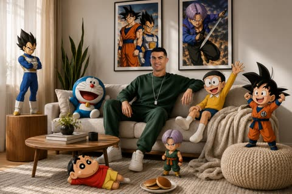</a>

用参考人脸锁定真人主体，再逐一指定每个动漫角色的具体位置和姿势，让写实客厅与卡通角色保持清楚的分层。明确窗光方向以及沙发、矮桌、布艺凳上的落点，使整体布局和光线保持一致。

GPT Image 2 · 上传图改图 · 出处: [@codewithhajra on X](https://x.com/codewithhajra/status/2072304737949474960) · 112 赞，统计于 2026-10-29

[`mixed-media`](tags.md#tag-mixed-media) [`reference-face`](tags.md#tag-reference-face) [`anime-crossover`](tags.md#tag-anime-crossover) [`interior`](tags.md#tag-interior)

<details><summary><b>提示词</b></summary>

```text
A high-fidelity, wide-angle interior shot captures a surreal, mixed-media composition within a modern living room. It features a man resembling the face in the reference photo—using an uploaded face as a reference—wearing a dark green sweatshirt, sweatpant and white sneakers, sitting centrally on a plush light gray sofa. The scene seamlessly blends photorealistic 3D environments with cel-shaded 2D anime and cartoon characters interacting directly with the physical space. On the right side of the subject on the sofa, Nobita sits casually waving his hand, while on the left side, Doraemon leans casually on a pillow. Behind the sofa, two framed posters hang on the white wall—one featuring Son Goku and Vegeta, and the other featuring Trunks in a dynamic anime style. In the foreground, Shinchan lies relaxed on a textured gray carpet near a plate of dorayaki, while a chibi version of Son Goku stands triumphantly on a cream-colored knit pouf. On the left side of the room, Vegeta stands tall on a grooved wooden side table in a confident pose, while a miniature version of Trunks is near the wooden coffee table in the center, as if observing the scene with a curious expression. Soft natural light streams in from the left side through sheer curtains, creating subtle volumetric lighting that accentuates the texture of the blanket, the wood grain of the tiered table, and the leaves of the snake plant in the corner of the room. The entire scene is rendered in 8K resolution with sharp focus, vivid colors, and a dreamy, cinematic, and playful aesthetic blending between the real world and the anime world, with no AI visible.
```

</details>

<a id="nano-banana-chrome-day-2-night-moodboard"></a>
### 带铬银色 DAY 2 标题的夜间奢华情绪板

<a href="https://x.com/astronomerozge1/status/2036834911848423625">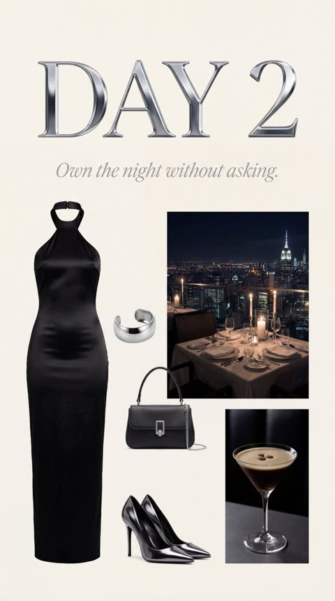</a>

通过明确指定配色（象牙白、铬银、午夜黑）并禁止暖色调，让整张画面的色调保持统一。每个位置只写一件单品，并固定版式，避免画面变成杂乱的拼贴。

Nano Banana 2 · 上传图改图 · 出处: [@astronomerozge1 on X](https://x.com/astronomerozge1/status/2036834911848423625) · 111 赞，统计于 2026-10-29

[`fashion`](tags.md#tag-fashion) [`moodboard`](tags.md#tag-moodboard) [`typography`](tags.md#tag-typography) [`chrome`](tags.md#tag-chrome)

<details><summary><b>提示词</b></summary>

```text
{
 "generation_request": {
 "meta_data": {
 "tool": "Nano Banana 2",
 "task_type": "luxury_fashion_moodboard_editorial",
 "version": "v2.2_DAY2_CHROME_CONFIDENT_FINAL"
 },

 "input": {
 "mode": "image_to_image",
 "reference_image_usage": "high",
 "notes": "Use the reference layout. Create DAY 2 as a confident night-time luxury moodboard with a darker, more powerful aesthetic. Maintain the clean minimal editorial structure with strong hierarchy and negative space."
 },

 "layout": {
 "background": "soft ivory or cool champagne neutral (no warm gold tones)",
 "composition": "same minimal structure as DAY 1 with elevated contrast and sharper visual presence"
 },

 "text_element": {
 "title": "DAY 2",
 "title_style": "large bold modern high-fashion serif in chrome silver, mirror-like metallic finish, sharp and reflective",
 "title_effect": "cool-toned metallic reflections, strong contrast, modern luxury feel",

 "quote": "Own the night without asking.",
 "quote_style": "minimal refined script in soft silver",

 "strict_rules": [
 "no gold tones",
 "typography must be chrome silver",
 "cool modern aesthetic only"
 ]
 },

 "fashion_story": {
 "hero_dress": "black or deep metallic satin halter-neck or sleek slip evening dress, body-hugging, modern, slightly daring cut, luxury finish",

 "shoes": "one pair of black or chrome metallic heels, sharp silhouette",

 "bag": "one small luxury evening bag in black, chrome, or cool metallic tone",

 "jewelry": "one bold minimal silver piece, such as cuff or statement earrings"
 },

 "lifestyle_element": {
 "photo": "luxury rooftop or city night dinner setting with skyline lights, elegant candles, cinematic night atmosphere",

 "cocktail": "one espresso martini or dark-toned cocktail in a refined glass"
 },

 "style_shift": {
 "from_day1": "soft romantic beach",
 "to_day2": "confident night city energy",
 "mood": "bold, sharp, magnetic, modern, high-fashion"
 },

 "style_direction": {
 "visual_language": "modern fashion campaign, minimal, sharp, high contrast",
 "lighting_feel": "cool-toned highlights enhancing chrome reflections"
 },

 "output_settings": {
 "aspect_ratio": "4:5",
 "render_style": "luxury_editorial_collage_realism",
 "sharpness": "ultra_crisp",
 "color_grade": "midnight_black_chrome_silver"
 },

 "must_have": [
 "DAY 2 chrome silver title",
 "black or metallic dress",
 "one pair of heels",
 "one bag",
 "one jewelry piece",
 "one cocktail",
 "one city night photo",
 "minimal layout"
 ],

 "negative_prompt": [
 "gold typography",
 "warm tones",
 "yellow dress",
 "beach vibe",
 "extra accessories",
 "messy layout",
 "low contrast",
 "cheap styling",
 "low detail"
 ]
 }
}

Prompt(right):
{
  "generation_request": {
    "meta_data": {
      "tool": "Nano Banana 2",
      "task_type": "reference_matched_fashion_scene",
      "version": "v1.0_DAY2_REALISTIC_MATCH"
    },

    "input": {
      "mode": "image_to_image",
      "reference_image_usage": "very_high",
      "preserve_identity": true,
      "preserve_facial_features": true,

      "notes": "Use the uploaded reference woman as the exact subject. Keep her face, identity, and proportions consistent. Transform the scene into a DAY 2 night luxury fashion setting. Do not create a collage. Create a single realistic cinematic scene."
    },

    "scene": {
      "environment": "luxury rooftop or elegant city night setting with soft lights, modern atmosphere",
      "mood": "confident, modern, magnetic, night luxury"
    },

    "styling_logic": {
      "rule": "All outfit, accessories, and styling must naturally match the reference woman’s appearance, proportions, and aesthetic. Nothing should feel random or disconnected.",
      "cohesion": "everything must look like it belongs to the same person, same moment, same environment"
    },

    "outfit": {
      "description": "a high-fashion evening outfit that suits the reference woman perfectly, modern, elegant, slightly bold, night-appropriate"
    },

    "accessories": {
      "bag": "placed naturally on a table or next to her, never floating",
      "shoes": "worn by the woman, fully integrated with the outfit",
      "jewelry": "worn on the woman, subtle but luxury, not separate objects"
    },

    "drink": {
      "placement": "either in her hand or placed naturally on a table",
      "style": "luxury cocktail matching the night setting"
    },

    "placement_rules": {
      "no_floating_objects": true,
      "no_random_scatter": true,
      "realistic_positions_only": true,
      "physical_logic": "all objects must obey real-world placement and balance"
    },

    "camera": {
      "framing": "medium or full-body fashion shot",
      "angle": "editorial, slightly cinematic",
      "lens": "50mm or 85mm",
      "focus": "sharp on face and outfit"
    },

    "lighting": {
      "type": "night luxury lighting",
      "effect": "soft highlights with subtle reflections, clean modern contrast"
    },

    "must_have": [
      "same reference woman",
      "identity preserved",
      "cohesive styling",
      "realistic placement",
      "no floating objects",
      "night luxury mood",
      "single scene (no collage)"
    ],

    "negative_prompt": [
      "collage",
      "floating bag",
      "floating shoes",
      "floating jewelry",
      "random objects",
      "bad placement",
      "different face",
      "identity change",
      "messy composition",
      "low realism"
    ]
  }
}
```

</details>

<a id="nano-banana-korean-four-cut-photo-booth-strip"></a>
### 韩式四格大头贴照片条，粉彩边框

<a href="https://x.com/AiwithLariab/status/2050792903136735610"></a>

提示词写明版式（四格竖排）、滤镜效果（提亮肤色、卧蚕、淡粉腮红）以及边框配色和图标类型。再加上日期戳、真实拍照机品牌的风格参照和保持五官准确的要求，让结果与原照片保持一致。

Nano Banana 2 · 上传图改图 · 出处: [@AiwithLariab on X](https://x.com/AiwithLariab/status/2050792903136735610) · 110 赞，统计于 2026-10-28

[`photo-booth`](tags.md#tag-photo-booth) [`korean-style`](tags.md#tag-korean-style) [`four-cut`](tags.md#tag-four-cut) [`pastel`](tags.md#tag-pastel) [`selfie`](tags.md#tag-selfie)

<details><summary><b>提示词</b></summary>

```text
Transform this photo into a Korean selca zone 4-cut photo strip. Create 4 vertically stacked frames with the same person in slightly different cute poses. Apply the classic Korean photo booth filter: brightened skin, subtle aegyo-sal enhancement, soft pink blush. Add a pastel mint and pink border with small decorative icons (bears, hearts, clouds). Include a date stamp '2026.03.8' at the bottom. The aesthetic should match modern Korean 4-cut photo booths like Photoism or Haru Film. Keep facial features accurate.
```

</details>

<a id="nano-banana-rooftop-disposable-camera-contact-sheet"></a>
### 屋顶夜游两格一次性相机拼贴

<a href="https://x.com/SimplyAnnisa/status/2066735760783647036">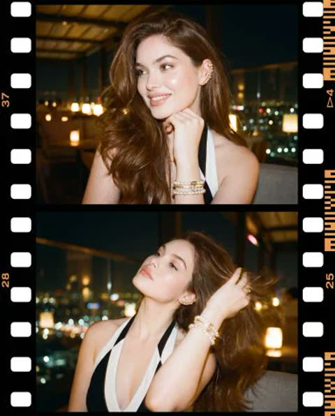</a>

开头先定下胶片边框、闪光灯和双格版式，再写人物细节，使构图稳定。每一格单独写姿势与动作，既能保持同一人物一致，也能让两张画面有变化。

Nano Banana 2 · 文生图 · 出处: [@SimplyAnnisa on X](https://x.com/SimplyAnnisa/status/2066735760783647036) · 105 赞，统计于 2026-10-29

[`disposable-camera`](tags.md#tag-disposable-camera) [`contact-sheet`](tags.md#tag-contact-sheet) [`night-portrait`](tags.md#tag-night-portrait) [`y2k`](tags.md#tag-y2k)

<details><summary><b>提示词</b></summary>

```text
Ultra-realistic vertical disposable-camera contact sheet collage featuring 2 stacked photo panels in a tall smartphone-friendly layout with authentic black film-strip borders. The same woman appears in every frame during a glamorous night out. Authentic Y2K nightlife aesthetic, early-2000s digital camera flash photography, luxury party-girl energy, candid documentary-style storytelling, spontaneous nightlife moments, nostalgic nightlife memories.

FACE & MAKEUP:
Soft IG Baddie Meets Clean Girl beauty aesthetic. Flawless hydrated glass skin with a soft matte balance and luminous highlights on the cheeks, nose bridge, and cupid’s bow. Soft pink blush concentrated across the cheeks and nose bridge for youthful warmth. Defined fluffy brows with clean shaping. Eyes enhanced with soft brown-pink eyeshadow, subtle eyeliner, wispy doll-like lashes, and bright under-eye highlights creating large innocent eyes. Naturally overlined lips with a glossy pink tint. Feminine, modern, effortless, photogenic, subtly glamorous appearance.

HAIR:
Ultra-long voluminous chestnut-brown layered blowout hairstyle with soft feathered curtain bangs naturally framing the face. Smooth silky texture with luxurious shine, large rounded bouncy curls at the ends, face-framing layers, airy movement, salon-quality 90s supermodel blowout styling. Thick healthy hair with subtle warm brunette highlights, fluffy crown volume, softly curled inward and outward layers creating glamorous movement. Slightly tousled styling with a few loose strands framing the cheeks naturally.

ACCESSORIES:
Statement gold crystal ear cuff, floral-inspired luxury earrings, layered pearl-and-gold charm bracelet stack, delicate luxury rings, glossy black-and-ivory almond-shaped manicure, subtle reflective jewelry sparkle.

OUTFIT:
Elegant black-and-white halter dress with a deep plunging neckline, dramatic open-side silhouette, corset-inspired structure, form-fitting waist, and sleek feminine silhouette. Sophisticated luxury nightlife styling.

FRAME 1:
Inside a luxury rooftop lounge overlooking sparkling city lights at night. She smiles softly while gazing off-camera, chin slightly raised, projecting effortless confidence and elegance. Warm ambient lounge lighting mixed with harsh direct flash. Carefree happiness, glamorous nightlife energy, candid paparazzi-style snapshot.

FRAME 2:
She tilts her head back while sweeping her hair with her right hand, creating visible hair motion and dynamic movement. Natural confidence, effortless glamour, luxurious party-girl attitude. Jewelry catches the flash and sparkles subtly. Shallow depth of field with dreamy city-light bokeh in the background.

PHOTOGRAPHY STYLE:
Harsh direct flash illumination, disposable-camera aesthetic, authentic digital grain, subtle camera shake, slight overexposure, imperfect framing, imperfect cropping, natural motion blur, timestamp-free, scrapbook aesthetic, cinematic urban storytelling, warm orange and red nightclub lighting mixed with cool blue city tones, dreamy bokeh, luxury social-media influencer energy, candid nightlife photography, realistic skin texture, ultra-detailed hair strands, photorealistic, ultra-realistic, high realism, professional editorial quality, 8K masterpiece.

KEYWORDS:
Disposable camera collage, vertical contact sheet, Y2K flash photography, luxury nightlife, rooftop lounge, glamorous party girl, candid moments, cinematic nightlife memories, nostalgic digital camera aesthetic, paparazzi-style photography, luxury influencer aesthetic, film-strip composition, editorial fashion photography.
```

</details>

<a id="nano-banana-film-strip-memory-collage-portrait"></a>
### 带萌系小精灵的胶片记忆拼贴

<a href="https://x.com/AiwithLariab/status/2051256840143642633"></a>

先用参考图锁定人脸，再让每一帧的发型、服装和背景各不相同，一个人物就成了一条记忆时间线。胶片条、拍立得和手绘涂鸦叠加，配合 Portra 色调与 9:16 版式，拼贴依然统一。

Nano Banana 2 · 上传图改图 · 出处: [@AiwithLariab on X](https://x.com/AiwithLariab/status/2051256840143642633) · 104 赞，统计于 2026-10-28

[`film-strip`](tags.md#tag-film-strip) [`collage`](tags.md#tag-collage) [`polaroid`](tags.md#tag-polaroid) [`chibi-doodles`](tags.md#tag-chibi-doodles) [`reference-face`](tags.md#tag-reference-face)

<details><summary><b>提示词</b></summary>

```text
Asymmetrical cinematic film-strip style collage featuring a young woman using the exact face from the reference image, preserving identity and natural skin texture. The composition is arranged like a rolling timeline of memories captured in overlapping film frames and negatives. Each frame shows different emotional micro-moments: laughing while walking, looking out a window, fixing hair in mirror, holding coffee, and soft candid smile.
Frames are styled as vintage film strips, contact sheets, and Polaroid negatives with light leaks and grain textures. Hairstyle subtly changes per frame (loose hair, ponytail, messy bun, soft braid). Korean soft glam makeup with natural glow and dewy skin.
Include floating pastel chibi “memory spirits” representing emotions (joy, calm, curiosity, nostalgia) interacting with frames. Add hand-drawn doodles like timestamps, arrows, film marks, stars, and scribbles.
Outfit is casual chic layered wardrobe (trench coat, knit sweater, denim jacket) in muted tones (beige, soft pink, grey, dusty blue). Background varies slightly per memory scene (street café, sunset road, cozy room, rainy window).
Soft cinematic lighting, shallow depth of field, film photography style (Kodak Portra tone), warm nostalgic color grading, vertical 9:16 layout.
```

</details>

<a id="nano-banana-italy-travel-scrapbook-collage-poster"></a>
### 带人像的意大利旅行拼贴海报

<a href="https://x.com/iamrealsnow/status/2049042453198782674"></a>

以参考人脸作为中央抠图主体，周围叠加撕纸、明信片、邮票和贴纸等层次。做旧大标题置于主体之后，搭配手写小字和暖色复古色调统一整个拼贴。

Nano Banana 2 · 上传图改图 · 出处: [@iamrealsnow on X](https://x.com/iamrealsnow/status/2049042453198782674) · 104 赞，统计于 2026-10-28

[`travel`](tags.md#tag-travel) [`collage`](tags.md#tag-collage) [`scrapbook`](tags.md#tag-scrapbook) [`poster`](tags.md#tag-poster) [`face-reference`](tags.md#tag-face-reference)

<details><summary><b>提示词</b></summary>

```text
.
Ultra-realistic travel collage poster featuring a young man (use my face) as the central subject, standing confidently with a relaxed, adventurous expression. He is wearing a casual explorer outfit, light linen shirt, neutral trousers, sunglasses, and a crossbody bag, holding a map or camera. Warm sunlight highlights his face, giving a summer travel vibe.

Background is a layered scrapbook-style composition inspired by a vibrant travel destination (choose a different country, e.g. Italy or Turkey). Include iconic landmarks, vintage architecture, local street scenes, and cultural elements blended seamlessly around him. Add torn paper textures, postcards, stamps, and travel stickers for a handcrafted aesthetic.

Typography: bold, oversized headline text with a distressed texture (e.g. “LOST IN ITALY” or similar), placed prominently behind or above the subject. Include smaller handwritten-style phrases like “no plans, just vibes”, “explore more”, or “wander often”.

Add lifestyle elements like local food, transport (tram, scooter), street lamps, or cultural performers integrated into the collage. Use warm tones, reds, yellows, and earthy textures for a nostalgic travel feel.

Lighting: cinematic, slightly grainy, vintage color grading. High detail, sharp focus on subject, soft depth blending into background collage. Poster-style composition, highly aesthetic, social media ready.
```

</details>

<a id="nano-banana-beach-three-panel-linen-golden-hour"></a>
### 亚麻衬衫海滩三联人像

<a href="https://x.com/MrDasCreates/status/2039915907162779888">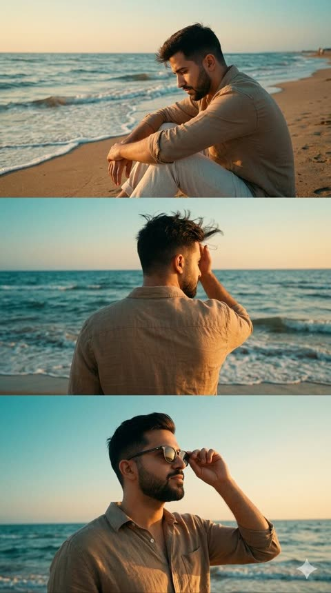</a>

把画面拆成三个上下排列的画格，每格写明姿势和机位（坐姿、背对镜头、低角度），给模型一份清晰的分镜清单。三格统一服装和青橙色调，人物与风格就不会跑偏。

Nano Banana 2 · 上传图改图 · 出处: [@MrDasCreates on X](https://x.com/MrDasCreates/status/2039915907162779888) · 103 赞，统计于 2026-10-29

[`portrait`](tags.md#tag-portrait) [`collage`](tags.md#tag-collage) [`golden-hour`](tags.md#tag-golden-hour) [`beach`](tags.md#tag-beach)

<details><summary><b>提示词</b></summary>

```text
A cinematic three-panel vertical collage featuring a stylish young man at a serene beach during golden hour. In the top panel, he is sitting on the sand with one knee up, resting his arm on it, gazing down thoughtfully as waves approach. In the middle panel, he stands facing the ocean with one hand running through his hair, shirt slightly flowing in the breeze, capturing a candid emotional moment. In the bottom panel, he is captured from a low-angle front shot, adjusting his dark sunglasses while looking toward the horizon with a confident, calm expression. He is wearing a crisp, earth-toned beige linen button-down shirt. The lighting is warm and moody with a soft teal-and-orange color grade, subtle film grain texture, and high-fashion editorial aesthetic. 4K resolution, hyper-realistic, emotional atmosphere, cinematic film still, 100% same face as reference photo, vertical 9:16 composition, slightly zoomed-in framing.
```

</details>

<a id="nano-banana-three-panel-man-mountain-temple-lake"></a>
### 同一男子出现在山脉、古庙与湖畔三幅画面中

<a href="https://x.com/MrDasCreates/status/2040639446044102992">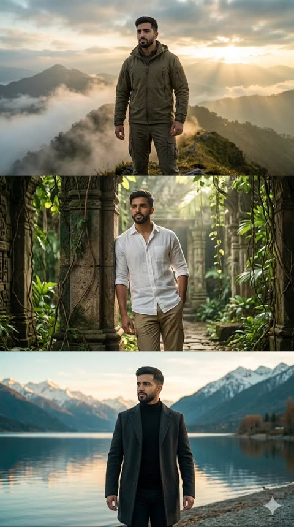</a>

重复同一套固定的人脸描述，并声明它们来自同一张参考照，可以让三个画面中的人物保持一致。每个画面再单独指定场景、服装和调色，并按从上到下的顺序排列在9:16画幅中，让模型把它理解为一张完整拼贴。

Nano Banana 2 · 文生图 · 出处: [@MrDasCreates on X](https://x.com/MrDasCreates/status/2040639446044102992) · 101 赞，统计于 2026-10-29

[`collage`](tags.md#tag-collage) [`portrait`](tags.md#tag-portrait) [`consistency`](tags.md#tag-consistency) [`fashion`](tags.md#tag-fashion)

<details><summary><b>提示词</b></summary>

```text
Create a hyper-realistic three-panel vertical cinematic collage in 9:16 aspect ratio, editorial fashion photography style. The collage consists of three distinct vertical frames stacked seamlessly, each featuring the exact same man with consistent face, skin tone, short black hair, sharp jawline, and intense gaze directly at the viewer, as if from the same reference photo.

Top panel: The man stands confidently on a misty mountain ridge at sunrise, dramatic Himalayan peaks in the background with golden light piercing through low clouds. He wears a rugged dark olive green tactical field jacket with rolled sleeves, black cargo pants, and sturdy hiking boots. Cool blue-gray color grading with subtle film grain.

Middle panel: The man leans against an ancient stone pillar inside a grand abandoned temple in a dense tropical jungle, soft diffused sunlight filtering through overgrown vines and carved arches. He wears a lightweight white linen button-up shirt (slightly unbuttoned at the top) tucked into slim khaki trousers, with brown leather loafers. Warm earthy tones with teal shadows and cinematic haze.

Bottom panel: The man walks along a serene lakeside at golden hour, crystal-clear water reflecting snow-capped mountains in the distance, surrounded by pine trees. He wears a black merino wool turtleneck sweater layered under a tailored charcoal wool overcoat, dark jeans, and polished Chelsea boots. Moody teal-orange cinematic grading with soft bokeh and gentle film grain.

Maintain perfect facial consistency across all three panels — same man, same reference face, no variations in features. Ultra-detailed skin texture, realistic fabric details, natural lighting per environment. Cinematic color grading, subtle film grain, editorial composition, high-end fashion photography aesthetic, shot on 35mm film, 4k resolution, photorealistic, masterpiece.
```

</details>

<a id="nano-banana-studio-three-panel-portrait-turtleneck"></a>
### 黑色高领衫三联工作室人像

<a href="https://x.com/MrDasCreates/status/2042098378923036842">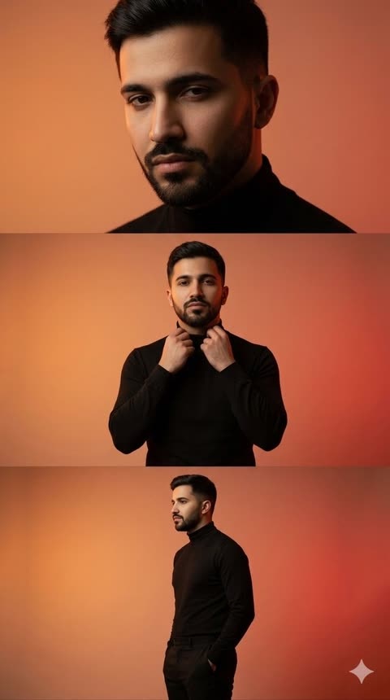</a>

参考照片锁定人物身份，每个画面只改变构图、姿态和视线，使同一人物呈现连贯的编辑风格系列。柔和漫射光与暖色渐变背景让三个画面保持统一。

Nano Banana 2 · 上传图改图 · 出处: [@MrDasCreates on X](https://x.com/MrDasCreates/status/2042098378923036842) · 98 赞，统计于 2026-10-29

[`collage`](tags.md#tag-collage) [`portrait`](tags.md#tag-portrait) [`studio-lighting`](tags.md#tag-studio-lighting) [`editorial`](tags.md#tag-editorial)

<details><summary><b>提示词</b></summary>

```text
A cinematic three-panel vertical collage featuring a stylish young man in a minimalist studio aesthetic photoshoot. In the top panel, he is captured in a close-up portrait, slightly looking down with soft shadows sculpting his face. In the middle panel, he stands facing forward with one hand adjusting his collar, showcasing a calm, confident expression. In the bottom panel, he is shown in a side profile, hands in pockets, creating a relaxed editorial pose. He is wearing a clean neutral-toned fitted shirt and tailored trousers. Soft diffused studio lighting creates smooth highlights and gentle shadows, with a minimal background and subtle gradient tones. High-fashion editorial aesthetic, shallow depth of field, realistic skin texture, cinematic color grading, ultra-clean composition, 4K resolution, hyper-realistic, cinematic photoshoot style, vertical 9:16 composition, slightly zoomed-in framing. Face 100% same as reference photo.
```

</details>

<a id="nano-banana-four-expression-grid-black-tee"></a>
### 黑色T恤女性四种表情2x2拼贴

<a href="https://x.com/Ozayrr_irl/status/2061012493569585467">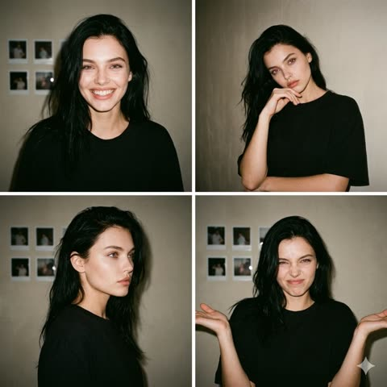</a>

为每个格子单独写一行姿势描述，使四个画面各不相同且清晰可辨。固定服装、墙面和道具，并加入胶片与直闪设定，让整组照片看起来像同一场90年代随拍。

Nano Banana 2 · 文生图 · 出处: [@Ozayrr_irl on X](https://x.com/Ozayrr_irl/status/2061012493569585467) · 94 赞，统计于 2026-10-29

[`grid`](tags.md#tag-grid) [`film-look`](tags.md#tag-film-look) [`portrait`](tags.md#tag-portrait) [`expressions`](tags.md#tag-expressions)

<details><summary><b>提示词</b></summary>

```text
A 2x2 grid photo collage showing four different expressions of a young woman with long, messy black hair and fair skin. She is wearing a plain black t-shirt.

Top-left: smiling warmly at the camera.
Top-right: thoughtful pose with her hand resting on her chin.
Bottom-left: side profile looking away, serious expression.
Bottom-right: playful expression, scrunching her nose and shrugging her hands up.

The photos are shot on a 35mm film camera with a direct flash, creating subtle shadows against a plain, muted beige wall background. A few blurry polaroid photos are pinned to the wall behind her. Low-key lighting, candid, realistic, 90s aesthetic, grainy texture. --ar 1:1 --v 6.0
```

</details>

<a id="nano-banana-christmas-nine-movie-scenes-grid"></a>
### 同一女性置身九部圣诞电影场景的九宫格

<a href="https://x.com/songguoxiansen/status/2000918182660596229">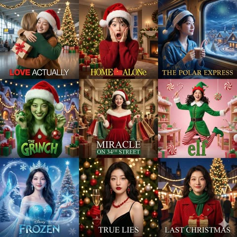</a>

用全局指令锁定同一张脸，每格分别指定电影、道具、服装和光线，让九格读起来像一组电影海报。格与格之间只改变表情、妆容和造型。

Nano Banana Pro · 上传图改图 · 出处: [@songguoxiansen on X](https://x.com/songguoxiansen/status/2000918182660596229) · 93 赞，统计于 2026-10-29

[`christmas`](tags.md#tag-christmas) [`collage`](tags.md#tag-collage) [`film`](tags.md#tag-film) [`portrait`](tags.md#tag-portrait)

<details><summary><b>提示词</b></summary>

```text
[全局指令]： 一个3x3的网格拼贴画，所有9个格子里必须是完全同一位女性。严格保持与参考图一致的面部特征。不要改变她的五官，只改变她的表情、妆容和造型以匹配各电影主题。
格1：《真爱至上》风格-机场告别场景戴圣诞帽，手持包装礼物，温情拥抱，背景机场巨型圣诞树和彩灯装饰，柔和光线
格2：《小鬼当家》风格-惊讶夸张表情手捂脸颊，戴歪圣诞帽，背景家中圣诞树、礼物堆和装饰彩灯，喜剧效果
格3：《极地特快》风格-火车窗前戴睡帽，手持热可可配糖果拐杖，窗外魔幻雪景和圣诞村庄，梦幻蓝金色调
格4：《圣诞怪杰》风格-真实人物绿色调服装配红色圣诞帽，搞怪表情，手持偷来的圣诞装饰，背景圣诞村彩灯和礼物，创意造型
格5：《34街的奇迹》风格-复古百货商店场景穿经典红色圣诞礼服，手持圣诞购物袋，背景巨型圣诞树和复古装饰，经典好莱坞照明（中心）
格6：《圣诞精灵》风格-完整精灵装扮（绿色上衣、红色条纹袜、尖头帽配铃铛），欢乐跳跃姿态，手持糖果拐杖，背景糖果色圣诞工坊
格7：《冰雪奇缘》风格-冰蓝色公主裙配雪花皇冠，手持魔法冰晶，雪花飞舞，背景冰晶城堡和大大的圣诞树，特别的喜庆糖果，迪士尼魔法感
格8：《真实的谎言》风格-黑色礼服配红色圣诞饰品，手持香槟，背景圣诞派对场景彩灯和装饰球，优雅神秘
格9：《Last Christmas》风格-时尚女性穿红色复古大衣配绿色围巾和金色耳环，手持圣诞礼物盒，站在伦敦圣诞街市彩灯下，背景科文特花园巨型圣诞树和节日橱窗，温暖夜景灯光，充满希望的表情，现代浪漫电影美学
每格模仿对应电影的色调、光线和氛围，圣诞装饰元素极其明显，电影海报构图，添加电影感标题文字效果，专业电影剧照质感，4K高清
```

</details>

<a id="nano-banana-gym-journey-nine-frame-collage"></a>
### 九宫格照片讲述骑车往返健身房的一天

<a href="https://x.com/AIwithSynthia/status/2039913444636590424">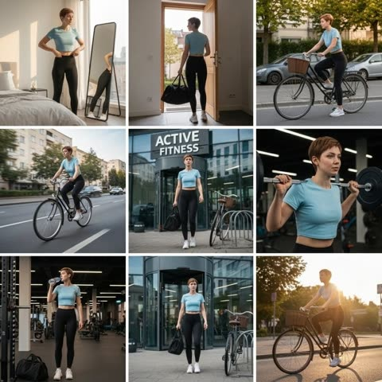</a>

按编号逐帧描述场景，并固定人物的脸部、发型和服装，使模型在九个画面中保持同一角色。每帧的光线提示，如晨光和黄金时段，与动作描述一样推动故事走向。

Nano Banana 2 · 文生图 · 出处: [@AIwithSynthia on X](https://x.com/AIwithSynthia/status/2039913444636590424) · 92 赞，统计于 2026-10-29

[`collage`](tags.md#tag-collage) [`storytelling`](tags.md#tag-storytelling) [`fitness`](tags.md#tag-fitness) [`consistency`](tags.md#tag-consistency)

<details><summary><b>提示词</b></summary>

```text
Ultra-realistic cinematic 9-photo collage collection telling a complete fitness journey story of a young athletic woman traveling from her home to the gym and returning back home, each frame showing a different scene and progression, strong visual storytelling, consistent character identity across all images (same face, same hairstyle, same gym outfit), natural body proportions, photorealistic skin texture, lifestyle editorial photography, no CGI, no illustration, ultra-detailed, 8K resolution.
Frame 1: Inside her bedroom, she prepares for the gym, adjusting her workout clothes in front of a mirror, soft morning sunlight entering through the window, calm focused mood.
Frame 2: At the home entrance, she picks up her gym bag and opens the door, natural indoor lighting, realistic home interior, storytelling beginning.
Frame 3: Outside her house, she boards her bicycle, one foot on the pedal, preparing to ride, residential street background, cinematic morning light.
Frame 4: She rides the bicycle on the street toward the gym, side-angle action shot, natural motion blur, dynamic composition, urban environment.
Frame 5: She arrives at the gym exterior and parks her bicycle near the entrance, modern gym building with glass facade, confident expression, realistic reflections.
Frame 6: Inside the gym, she performs an exercise such as lifting dumbbells or doing squats, focused expression, visible effort, professional gym environment, dramatic lighting.
Frame 7: She takes a break and drinks water from a bottle, slightly sweaty, natural post-workout moment, blurred gym equipment background, candid realism.
Frame 8: She exits the gym and walks toward her bicycle, carrying her gym bag, relaxed and satisfied expression, warm evening light, cinematic atmosphere.
Frame 9: She rides her bicycle back toward home during golden hour sunset, peaceful and relaxed mood, cinematic street scene, storytelling conclusion.
```

</details>

<a id="gpt-image-face-cream-storyboard-ten-frames"></a>
### 面霜广告十格分镜故事板

<a href="https://x.com/Soaima_Ai/status/2082331258072514792">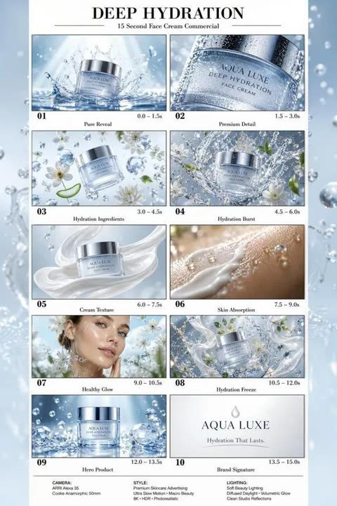</a>

提示词把网格、编号、时间码和说明文字写成统一的版式要求，让十个画面保持相同结构。统一的机位与镜头参数（ARRI Alexa 35、变形宽银幕 50mm 微距）让所有画面的影像风格保持一致。

GPT Image 2 · 文生图 · 出处: [@Soaima_Ai on X](https://x.com/Soaima_Ai/status/2082331258072514792) · 90 赞，统计于 2026-10-29

[`storyboard`](tags.md#tag-storyboard) [`skincare`](tags.md#tag-skincare) [`advertising`](tags.md#tag-advertising) [`grid-layout`](tags.md#tag-grid-layout)

<details><summary><b>提示词</b></summary>

```text
Create a premium Hollywood-style advertising storyboard sheet for a luxury moisturizing face cream commercial. Display 10 ultra-realistic cinematic storyboard frames arranged in a 2×5 presentation grid on a pristine white storyboard board. Each frame features a thin black border, bold scene numbers (01–10), a duration timestamp, and a concise production caption beneath it. The overall design should resemble a professional advertising agency pitch board for a world-class skincare campaign.
Title: DEEP HYDRATION
Subtitle: 15-Second Premium Face Cream Commercial
Scene 01 (0.0–1.5s) — Pure Reveal
A luxurious crystal-glass face cream jar slowly rises from perfectly clear water, surrounded by soft white light, delicate mist, and elegant ripples, creating an atmosphere of purity and luxury.
Scene 02 (1.5–3.0s) — Premium Detail
Extreme macro beauty shot of the premium glass jar covered in sparkling condensation. Sharp reflections emphasize the luxurious glass craftsmanship and premium packaging.
Scene 03 (3.0–4.5s) — Hydration Ingredients
Pure water droplets, hyaluronic acid molecules, aloe vera gel, white blossoms, botanical extracts, and moisture particles gracefully float around the product in slow motion.
Scene 04 (4.5–6.0s) — Hydration Burst
Crystal-clear water splashes dynamically around the cream jar while glowing hydration particles and delicate botanical petals swirl elegantly through the air.
Scene 05 (6.0–7.5s) — Cream Texture
A silky ribbon of rich white moisturizer flows gracefully through the air, twisting smoothly around the product to showcase its luxurious texture.
Scene 06 (7.5–9.0s) — Skin Absorption
Macro close-up of the cream spreading effortlessly across flawless, healthy skin. Hydration particles glow beneath the surface, revealing a radiant, moisturized finish.
Scene 07 (9.0–10.5s) — Healthy Glow
Beautiful hydrated skin illuminated by soft natural daylight. Tiny floating water droplets and subtle botanical elements reinforce freshness, softness, and long-lasting moisture.
Scene 08 (10.5–12.0s) — Hydration Freeze
Time freezes as water splashes, floating droplets, cream ribbons, botanical petals, and glowing hydration particles create a perfectly balanced premium beauty composition.
Scene 09 (12.0–13.5s) — Hero Product
The face cream jar stands proudly on a reflective glass surface surrounded by crystal-clear water, luminous hydration particles, and soft volumetric light in a dramatic hero shot.
Scene 10 (13.5–15.0s) — Brand Signature
Minimal white studio background. The brand logo fades in gracefully with the elegant tagline:
"Hydration That Lasts."
Caption: Brand Signature
Visual Direction
Inspired by world-class luxury hydration skincare campaigns emphasizing purity, deep moisture, luminous healthy skin, silky cream textures, crystal-clear water, botanical science, and clean beauty aesthetics.
Color Palette
Pure White
Soft Sky Blue
Crystal Water Blue
Silver Highlights
Natural Beige
Lighting
Soft beauty lighting, diffused daylight, volumetric glow, clean studio reflections, premium cosmetic illumination.
Camera
ARRI Alexa 35, Cooke Anamorphic 50mm lens, macro beauty cinematography, ultra slow motion, shallow depth of field, precision focus.
Style
Luxury skincare advertising, premium beauty campaign, high-end cosmetic photography, Hollywood commercial storyboard, advertising agency presentation board, ultra-photorealistic, HDR, 8K, masterpiece quality, impeccable product realism, cinematic composition, flawless visual storytelling.
```

</details>

<a id="nano-banana-christmas-iphone-couple-photo-grid"></a>
### 手持 iPhone 显示情侣照片网格

<a href="https://x.com/Tz_2022/status/2003298471713939941">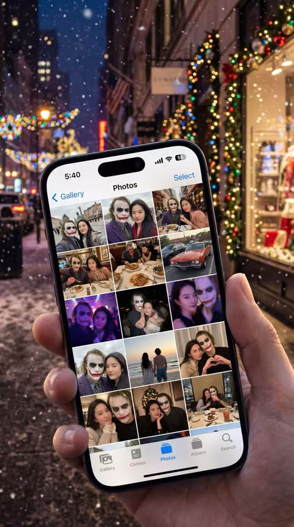</a>

提示词描述了一部真实握在手中的手机，屏幕是 iOS 照片的网格视图，并混合了旅行、餐厅、夜店、海边等多种场景，使图库看起来像未经筛选的真实相册。虚化背景中的圣诞街灯和飘雪既衬托手机，也营造节日氛围。

Nano Banana Pro · 上传图改图 · 出处: [@Tz_2022 on X](https://x.com/Tz_2022/status/2003298471713939941) · 86 赞，统计于 2026-10-29

[`christmas`](tags.md#tag-christmas) [`photo-grid`](tags.md#tag-photo-grid) [`couple`](tags.md#tag-couple) [`iphone-ui`](tags.md#tag-iphone-ui)

<details><summary><b>提示词</b></summary>

```text
基于【参考照片人物】。一张极其真实的特写照片，一只手拿着一部 iPhone 15 pro。屏幕亮着，显示着苹果 iOS “照片”应用的图库网格视图。屏幕上密密麻麻的缩略图是一个非常自然、未经筛选的情侣生活记录（基于【参考照片人物】）。内容非常多样：有户外旅行的风景合照、在餐厅吃饭的抓拍、在车里的搞怪自拍、模糊的夜店或演唱会照片、海边的背影、当然也有一些居家的温馨时刻。照片的光线、色彩和风格各不相同，看起来非常真实生动。背景是虚化的繁华城市夜景，充满了圣诞节的装饰。可以看到背景中有大片的街道节日彩灯（Christmas lights）、模糊的雪花飘落，以及远处商场橱窗的节日布置。光线更加丰富多彩，营造出一种热闹的圣诞外出氛围。

（我使用了 Labnana 来获得 4K 高清无水印的 nano banana 图像 ✌️）
```

</details>

<a id="nano-banana-monochrome-noir-five-frame-collage"></a>
### 黑白都市屋顶五格人像拼贴

<a href="https://x.com/EthanAIBuilder/status/2061318395220635914">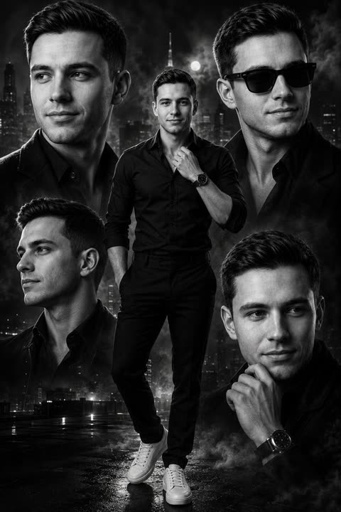</a>

以身份参考图锁定同一张脸，再用分镜清单为中央全身像和四个特写分别指定角度、表情与道具，让五个画面呈现同一套编辑风格。把雾气、边缘光和湿地面等光影层分开描述，使黑白都市背景在各个画面中保持一致。

Nano Banana 2 · 上传图改图 · 出处: [@EthanAIBuilder on X](https://x.com/EthanAIBuilder/status/2061318395220635914) · 84 赞，统计于 2026-10-29

[`monochrome`](tags.md#tag-monochrome) [`noir`](tags.md#tag-noir) [`fashion-editorial`](tags.md#tag-fashion-editorial) [`collage`](tags.md#tag-collage)

<details><summary><b>提示词</b></summary>

```text
Use the uploaded reference images as the exact composition, styling, pose inspiration, facial framing, monochrome aesthetic, and cinematic atmosphere reference. Replace all original subjects completely with the face from my uploaded reference image while preserving my exact facial identity, facial structure, jawline, beard pattern, hairstyle, eye shape, eyebrows, nose shape, lips, skin texture, and realistic masculine appearance with extremely high identity fidelity. Do not stylize, beautify, or alter the recognizable facial features.

Create a high-end cinematic black-and-white multi-frame portrait collage featuring the same man in multiple stylish poses and expressions across the composition. The overall artwork should feel like a luxury fashion editorial poster mixed with a moody urban action-drama aesthetic. Use five different versions of the same subject arranged artistically in layered composition with varied camera angles, facial expressions, and poses.

Center Frame:
A full-body portrait of the man standing confidently in the center wearing an all-black outfit — fitted black button-up shirt with rolled sleeves, slim black trousers, luxury black wristwatch, chain necklace, and white sneakers. One hand is inside the pocket while the other adjusts the collar or touches the neck. Pose should feel confident, calm, dominant, and cinematic.

Side Portraits:
Include large close-up portraits on both sides showing different facial angles:

* one looking away thoughtfully with soft dramatic lighting,
* one wearing black sunglasses with a stylish confident attitude,
* one side-profile portrait with strong jawline emphasis,
* one contemplative pose with hand near face.

Hair should appear textured, voluminous, slightly messy, and sharply detailed. Beard and facial hair must remain realistic and natural.

Environment & Background:
Create a dark cinematic urban rooftop/night-city atmosphere with blurred skyscrapers, subtle moonlight, fog, smoke clouds, floating particles, dust texture, and atmospheric haze. Add soft glowing rim lights, smoky overlays, and dramatic shadows throughout the collage. Include faint city lights, moody grayscale contrast, reflective wet floor textures, and layered depth effects.

Color grading should be primarily monochrome black-and-white with deep blacks, silver highlights, matte shadows, and subtle warm-gray tones. Maintain ultra-realistic skin texture and high dynamic range lighting.

Lighting:
Use dramatic cinematic lighting with strong contrast, soft edge lighting, volumetric fog, shadow gradients, and luxury editorial highlights. Faces should have sharp detail with soft diffused glow around hair and shoulders.

Style:
ultra-realistic, cinematic monochrome portrait collage, luxury fashion editorial, dark urban aesthetic, high-end poster design, realistic male model photography, moody atmosphere, smoky cinematic composition, dramatic shadows, hyper-detailed skin texture, realistic fabric folds, shallow depth of field, premium magazine cover quality, 8K ultra detail, Unreal Engine 5 realism, DSLR photography look.i9
```

</details>

<a id="gpt-image-couple-photobooth-contact-sheet-8-frames"></a>
### 年轻情侣八格拍立得照相亭联系表

<a href="https://x.com/frametheory058/status/2099882958106878177"></a>

先用固定的发型和服装描述锁定两位人物，再逐条编号八个不同的自然瞬间，避免姿势重复。胶片型号、直闪和颗粒的描述，加上禁用美颜滤镜的排除项，让画面更接近真实照片。

GPT Image 2.5 · 文生图 · 出处: [@frametheory058 on X](https://x.com/frametheory058/status/2099882958106878177) · 79 赞，统计于 2026-10-28

[`photobooth`](tags.md#tag-photobooth) [`contact-sheet`](tags.md#tag-contact-sheet) [`couple`](tags.md#tag-couple) [`film-grain`](tags.md#tag-film-grain) [`scrapbook`](tags.md#tag-scrapbook)

<details><summary><b>提示词</b></summary>

```text
Create an ultra-realistic vertical 2×4 photobooth contact-sheet collage of the same adorable young couple across all 8 frames. They should look like genuine real people photographed together, never AI-generated: natural facial asymmetry, realistic pores and skin texture, tiny imperfections, individual hair strands, authentic eyes, believable hands and anatomy.

Character continuity: cute young woman with long soft dark-brown hair, warm expressive eyes, subtle natural makeup, oversized cream knit sweater. Cute young man with messy naturally curly dark-brown hair, warm expressive eyes, dark charcoal hoodie/jacket over a simple white T-shirt. Keep their faces, hairstyles, age, proportions and clothing perfectly consistent in every frame.

Make every frame feel like a different spontaneous moment rather than repeated poses:

1. She rests her cheek on her hand while he looks at her with a tiny smile.

2. Both lean extremely close to the camera, laughing naturally, slightly imperfect framing.

3. She kisses his cheek while gently squishing his face; his eyes close with a genuine smile.

4. Both hide half their faces inside their oversized sleeves, only their eyes visible.

5. They wear matching dark vintage baseball caps; she makes a playful pout while he looks toward her.

6. A genuine mid-laugh shot where she covers her smile and he laughs beside her.

7. She makes a small heart with both hands in the foreground while he rests his cheek against her head.

8. Final emotional frame: he kisses her forehead while she closes her eyes and hugs him tightly.

Shot like a real late-night photobooth session on Kodak Portra 400, direct on-camera flash, slightly warm neutral white balance, soft shadow behind them, realistic flash falloff, subtle highlight bloom, fine 35mm grain, mild lens softness, tiny exposure inconsistencies and imperfect candid framing. No beauty filter, plastic skin, excessive sharpening, CGI or AI aesthetic.

Arrange all eight photographs inside distressed black analog contact-sheet borders on a matte black scrapbook background. Add tiny orange film-edge markings, subtle scratches and dust. Around the photographs, add sparse handwritten white-ink doodles and small imperfect hearts with phrases such as “Better Together ♡”, “My Happy Place”, “Same People, Different Moments”, “Still You ♡” and “More Silly Moments Please.” Keep typography secondary to the photographs and authentically handwritten rather than digitally perfect.

At the bottom, handwritten: “A thousand little moments with you ♡” with a small handwritten date.

The overall result should feel like a real couple accidentally created the perfect roll of film, intimate, youthful, nostalgic, cute and highly shareable—not a polished commercial photoshoot. Premium editorial composition, believable analog photography, extremely detailed faces, clean tonal separation, excellent contrast and natural cinematic color grading, 8K-quality realism, 9:16 vertical, absolutely no obvious AI artifacts.
```

</details>

<a id="gpt-image-european-photo-dump-collage"></a>
### 同一年轻女性的六张欧式街拍拼图

<a href="https://x.com/john_my07/status/2114694283941032291">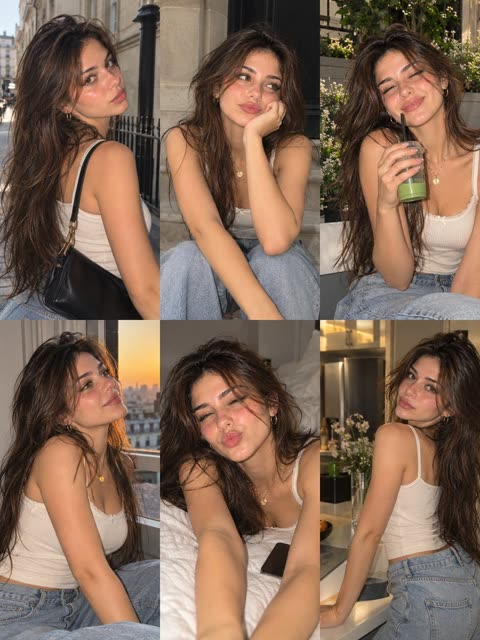</a>

提示词在每个画面中重复同一段脸部、发型和服装描述，再为六个画面分别指定不同场景和姿势。佳能 G7 X Mark III 加直闪的相机设定，以及保留毛孔细节、不做磨皮的要求，带来随手拍的真实感。

GPT Image 2.5 · 文生图 · 出处: [@john_my07 on X](https://x.com/john_my07/status/2114694283941032291) · 78 赞，统计于 2026-10-29

[`lifestyle`](tags.md#tag-lifestyle) [`photo-dump`](tags.md#tag-photo-dump) [`collage`](tags.md#tag-collage) [`portrait`](tags.md#tag-portrait)

<details><summary><b>提示词</b></summary>

```text
Create an ultra-realistic 6-photo lifestyle collage arranged in a seamless 3×2 grid, featuring the same naturally beautiful young European woman in her early 20s. She has warm olive skin, delicate freckles across her cheeks and nose, hazel-brown eyes, long chestnut-brown hair with natural waves, soft face-framing layers, full eyebrows, and naturally glossy pink lips. Maintain identical facial identity and recognizable features across all six photographs.

Outfit consistency: She wears the exact same outfit in every frame: a cream-colored fitted ribbed camisole with delicate lace trim and a modest neckline, relaxed light-wash blue jeans, small gold hoop earrings, and a delicate gold pendant necklace. Her hair is loose, slightly messy, and naturally textured. Makeup is minimal and realistic.

Photography style: Authentic European Instagram photo dump, captured on a Canon PowerShot G7 X Mark III or a modern smartphone. Direct compact-camera flash mixed with natural ambient light, realistic skin pores, subtle digital grain, imperfect candid framing, gentle highlights, believable shadows, and warm cinematic color grading. Avoid artificial skin smoothing and overly polished AI aesthetics.

Six different settings and poses:

1. European city street: Standing on a charming European sidewalk beside a stone building and black iron railing, carrying a small black shoulder bag. She turns her head over her shoulder toward the camera with a subtle, confident smile. Her hair falls naturally down her back.

2. Stone steps portrait: Sitting casually on wide stone steps with her knees bent, resting her cheek against one hand while gazing thoughtfully to the side. Her long hair falls over both shoulders, with soft daylight illuminating her face.

3. Garden café moment: Sitting outdoors at a leafy café, holding a clear cup of iced matcha with a straw. Her eyes are gently closed and she smiles peacefully, with greenery and warm sunlight in the background.

4. Golden-hour window: Sitting sideways beside a large apartment window overlooking European rooftops at sunset. She tilts her face toward the golden light with a relaxed, dreamy expression, creating soft natural highlights in her hair.

5. Casual bed selfie: Lying comfortably on white bedding, holding the camera at arm's length. She gives a playful pout with slightly tousled hair framing her face. The image feels spontaneous, intimate, and naturally imperfect.

6. Modern kitchen portrait: Standing beside a clean kitchen counter with a small vase of flowers in the background. She turns her upper body slightly away from the camera and looks back over her shoulder with a gentle, relaxed expression.

Identity consistency: The same woman must appear in all six frames, with identical facial proportions, eye color, freckles, skin tone, and hair color. Every photograph must have a different pose, head angle, expression, and composition while preserving the exact same outfit and accessories.

Realism requirements: Natural skin texture, visible freckles, fine baby hairs, realistic hands, believable fabric folds, authentic environmental lighting, sharp eyes, subtle exposure variations, and natural facial asymmetry. No duplicated poses, distorted anatomy, excessive retouching, artificial skin, text, or watermarks.

Output: Vertical 3:4 aspect ratio, exactly six equally sized photographs in a balanced 3-column × 2-row grid, clean alignment, no gutters, no borders. Photorealistic, youthful, candid, effortlessly stylish, and reminiscent of a genuine European Instagram photo dump.
```

</details>

<a id="nano-banana-dark-bedroom-grunge-grid-portrait"></a>
### 深色卧室中女孩四种姿态的拼贴

<a href="https://x.com/kingofdairyque/status/2071185549969260844">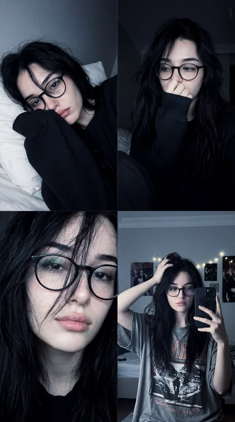</a>

明确写出 2x2 网格并为每格指定一个姿势，让模型规划四个不同画面；同时反复描述相同的发型、眼镜和卫衣，使人物在各格中保持一致。负面提示排除明亮打光和精修光泽，让画面更像手机随手拍。

Nano Banana 2 · 文生图 · 出处: [@kingofdairyque on X](https://x.com/kingofdairyque/status/2071185549969260844) · 78 赞，统计于 2026-10-29

[`portrait`](tags.md#tag-portrait) [`grunge`](tags.md#tag-grunge) [`low-light`](tags.md#tag-low-light) [`collage`](tags.md#tag-collage)

<details><summary><b>提示词</b></summary>

```text
Nano banana 2 on
@openart_ai


Ultra-realistic dark aesthetic bedroom photo collage, 2x2 grid layout featuring the same young woman in four different candid poses. Soft grunge emo-girl vibe, messy long black hair partially covering her face, round black glasses, oversized black sweatshirt, pale skin, tired dreamy expression.

Top left: lying on a white pillow in a dark room, face partially hidden behind sleeve, looking toward camera.
Top right: sitting in darkness, hand covering mouth, messy hair, moody introspective pose.
Bottom left: extreme close-up portrait, hair falling across face, soft lips visible, cinematic shallow depth of field.
Bottom right: mirror selfie holding black smartphone, oversized black graphic t-shirt, one hand in hair, dim bedroom background.

Lighting: very low light, bluish-grey tones, subtle phone flash illumination, soft shadows, grainy digital camera texture, slight motion blur, nostalgic 2000s webcam aesthetic.

Style: dark academia, soft grunge, goth-inspired, melancholic mood, Tumblr aesthetic, indie bedroom photography, authentic candid moments, natural imperfections, muted colors, realistic skin texture, cinematic atmosphere.

Camera: handheld smartphone photography, high ISO grain, flash photography, shallow depth of field, realistic lens imperfections.

Color grading: desaturated blacks, cool blue-grey shadows, faded contrast, moody night-time atmosphere.

Negative prompt: bright lighting, smiling, colorful clothes, perfect studio lighting, heavy makeup, CGI, anime, cartoon, unrealistic skin, extra fingers, watermark, text, overexposed image, glossy fashion magazine style.
```

</details>

<a id="chatgpt-iris-center-nature-color-palette"></a>
### 虹膜居中，四周环绕自然元素配色

<a href="https://www.tiktok.com/@jessica_feldman_/video/7687762438644600077">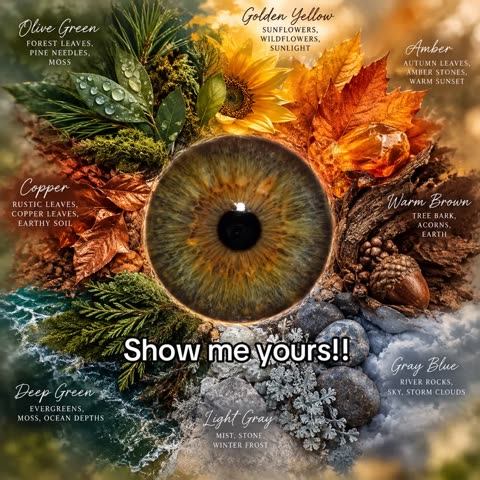</a>

上传虹膜特写照片并要求精确放在中心，让整个画面以真实眼睛为锚点。要求把虹膜中的每一种色调对应到一个具体的自然物体，于是颜色分析变成带标签的环形排版。

ChatGPT · 上传图改图 · 出处: [@jessica_feldman_ on TikTok](https://www.tiktok.com/@jessica_feldman_/video/7687762438644600077) · 77 赞，统计于 2026-10-30

[`eye`](tags.md#tag-eye) [`nature`](tags.md#tag-nature) [`color-palette`](tags.md#tag-color-palette)

<details><summary><b>提示词</b></summary>

```text
Analyze the eye color in the photo I uploaded in every possible detail and create an artistic visual for me. Place my iris photo exactly at the center of the composition. Around it, visualize every color found within my iris using real elements from nature.
```

</details>

<a id="nano-banana-golden-hour-collage-lilies-music-player"></a>
### 金色时刻下的人像拼贴、百合与音乐播放器

<a href="https://x.com/AiwithLariab/status/2049876084850905432">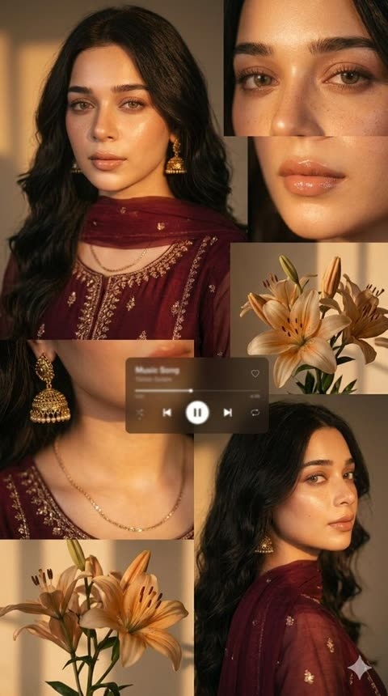</a>

为每个画面指定镜头类型（眼睛、嘴唇、侧脸）并统一暖色光线，使拼贴保持一致的版式。模糊的音乐播放器叠层营造怀旧氛围，又不抢人像的焦点。

Nano Banana 2 · 文生图 · 出处: [@AiwithLariab on X](https://x.com/AiwithLariab/status/2049876084850905432) · 75 赞，统计于 2026-10-29

[`collage`](tags.md#tag-collage) [`portrait`](tags.md#tag-portrait) [`golden-hour`](tags.md#tag-golden-hour) [`warm-tones`](tags.md#tag-warm-tones)

<details><summary><b>提示词</b></summary>

```text
Warm-toned cinematic portrait collage of a young woman with glowing skin, subtle freckles, and glossy nude lips. Long dark wavy hair, gold jhumkas, delicate necklace, deep maroon outfit with sheer dupatta. Golden hour lighting with soft shadows for a cozy mood. Aesthetic collage of close-ups (eyes, lips, side profile), with beige/orange lilies and a blurred music player overlay for a nostalgic vibe. Dewy skin, minimal makeup."
```

</details>

<a id="nano-banana-luxury-scrapbook-suited-portrait-collage"></a>
### 奢华拼贴手账，三张黑西装人像

<a href="https://x.com/Professor_134/status/2078141463066808345">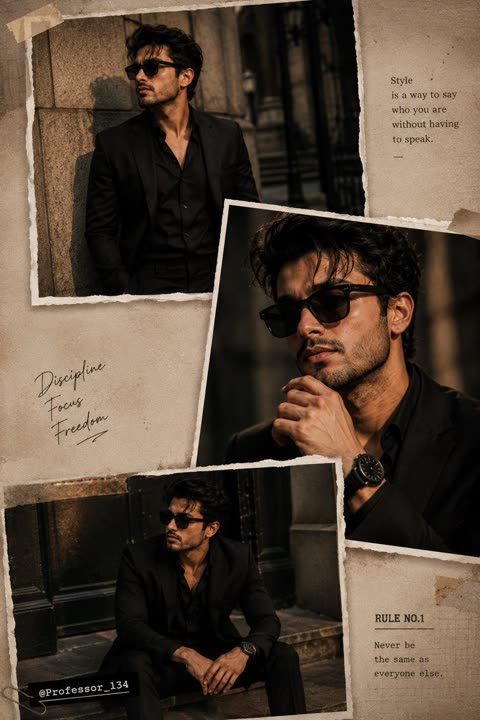</a>

用参考人脸图加上明确的身份锁定指令，让三张不同照片中的面部保持一致。版面规格对撕边纸、胶带、手写字和回形针标签逐项说明，使拼贴手账的质感结构清晰可控。

Nano Banana 2 · 上传图改图 · 出处: [@Professor_134 on X](https://x.com/Professor_134/status/2078141463066808345) · 74 赞，统计于 2026-10-29

[`scrapbook`](tags.md#tag-scrapbook) [`collage`](tags.md#tag-collage) [`fashion`](tags.md#tag-fashion) [`portrait`](tags.md#tag-portrait) [`face-reference`](tags.md#tag-face-reference)

<details><summary><b>提示词</b></summary>

```text
Image generated with nano banana 2

                Promt:- Use my uploaded face image as the primary facial identity reference. Preserve my exact facial identity with maximum accuracy. My face must remain instantly recognizable, including my face shape, hairstyle, eyebrows, eyes, nose, lips, beard, skin tone, ears, facial proportions, and every unique facial feature. Do not beautify, stylize, age, de-age, feminize, or replace my identity. Maintain perfect facial consistency across every frame.

Create a luxury cinematic scrapbook editorial collage with three overlapping vintage Polaroid-style photographs arranged asymmetrically on a warm beige textured paper background. The collage should feature realistic torn paper edges, masking tape in the corners, subtle folds, handwritten notes, paper grain, soft shadows, and layered depth, resembling a premium luxury fashion mood board.

Frame 1 (Upper Left): A medium portrait of me standing against elegant European stone architecture. I am wearing a perfectly tailored black suit with an open-collar black shirt, matte black wayfarer sunglasses, and a luxury black metal wristwatch. Both hands are casually in my pockets while I lean slightly against a stone wall, looking confidently to the left with a calm, mysterious expression.

Frame 2 (Center Right – Hero Shot): An ultra-close-up cinematic portrait focused mainly on my face. My right hand gently rests beneath my chin in a thoughtful pose. Sunglasses remain on with subtle reflections. Capture razor-sharp skin texture, beard details, lips, and facial features. Background should dissolve into luxurious creamy bokeh with warm golden-hour lighting.

Frame 3 (Bottom Left): A full-body editorial portrait of me sitting casually on old stone steps outside a luxury building. My elbows rest naturally on my knees while I look sideways with a relaxed, confident expression. My black suit fits perfectly, with realistic fabric folds and premium tailoring.

The overall mood should feel like an expensive luxury fashion campaign with muted warm tones, cinematic depth, and elegant storytelling.

Add realistic scrapbook design elements including:
•Torn paper borders around every photograph
•Vintage masking tape holding the photos
•Handwritten notes reading:
•Discipline
•Focus
•Freedom
•Small elegant quote:
“Style is a way to say who you are without having to speak.”
•Bottom-right editorial text:
RULE NO.1
Never be the same as everyone else.
•A small black label with
@Professor_134
 attached using a silver paper clip.

Background: Warm textured kraft paper with subtle stains, paper fibers, folds, vintage imperfections, soft lighting, and realistic shadows beneath every photograph.

Color Palette: Warm beige, mocha brown, matte black, cream, muted gold, subtle sepia, cinematic bronze highlights.

Lighting: Soft golden-hour sunlight, premium editorial lighting, cinematic shadows, realistic skin texture, luxurious color grading.

Style: Saint Laurent campaign, Tom Ford editorial, Vogue Men, GQ magazine, luxury fashion advertising, cinematic portrait photography, premium scrapbook aesthetic, ultra-realistic, Hasselblad X2D medium format, Leica SL3, 85mm portrait lens, f/1.4, HDR, 8K, hyper-detailed, award-winning editorial photography, luxury lifestyle campaign.

Negative Prompt

cartoon, anime, CGI, illustration, plastic skin, inaccurate face, different identity, smiling, open mouth, exaggerated jawline, bad anatomy, extra fingers, duplicate limbs, deformed hands, poor lighting, blurry, low resolution, watermark, logo, text errors, cropped face, oversaturated colors, artificial shadows, noisy image, unrealistic hair, distorted proportions, low detail, overprocessed skin, fake sunglasses, unrealistic watch, messy composition.
```

</details>

<a id="nano-banana-morning-routine-photo-dump-collage"></a>
### 九宫格晨间日常图文合集

<a href="https://x.com/astronomerozge1/status/2059250075503575489">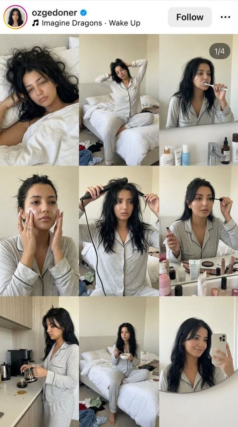</a>

在九个画面中重复同一人物、房间和光线，并把每个画面写成一个简短动作。负面提示词排除精致妆造和塑料皮肤，让整组图更像随手拍的社交动态，而不是大片。

Nano Banana 2 · 文生图 · 出处: [@astronomerozge1 on X](https://x.com/astronomerozge1/status/2059250075503575489) · 73 赞，统计于 2026-10-29

[`collage`](tags.md#tag-collage) [`morning-routine`](tags.md#tag-morning-routine) [`social-post`](tags.md#tag-social-post) [`lifestyle`](tags.md#tag-lifestyle)

<details><summary><b>提示词</b></summary>

```text
Ultra-photorealistic Instagram-style 3x3 morning routine collage post, but with a realistic, imperfect, everyday human morning vibe instead of polished influencer energy. The same young woman appears consistently in all nine panels. She has long dark hair, soft natural features, realistic skin texture, light under-eye tiredness, and a relatable just-woke-up energy. The overall mood should feel candid, slightly messy, sleepy, and authentic — like a real person slowly getting ready in the morning, not a perfect content creator shoot.

At the top, include an Instagram-style post header with the username “ozgedoner”, a profile photo, blue verification badge, a Follow button, and the music label “Imagine Dragons · Wake Up”. Add a small “1/4” carousel indicator in the upper-right corner.

Keep the room and bathroom slightly messy and lived-in: unmade bed, wrinkled white bedding, a few scattered clothes, hair tools left out, skincare products on the counter, a mug on the nightstand, soft morning light, natural home atmosphere.

3x3 panels:

Panel 1:
She wakes up in bed with messy, tangled hair, sleepy face, low energy, half-awake expression, wrinkled white bedding.

Panel 2:
She sits up in bed stretching tiredly, looking a bit drained and unmotivated, natural slouch, soft pajama top, bed still messy.

Panel 3:
Brushing teeth in the bathroom mirror, hair tied up carelessly, still sleepy, pajama top slightly rumpled, realistic bathroom setting.

Panel 4:
Applying skincare with a tired blank expression, bare face, realistic morning skin, products casually left around.

Panel 5:
Trying to do her hair with a styling tool, slightly frustrated, not perfectly put together yet, hair still messy in parts.

Panel 6:
Doing simple makeup at the vanity, looking more awake but still natural, not overly glamorous, realistic getting-ready moment.

Panel 7:
Making coffee in the kitchen or room corner and accidentally spilling a little coffee, visibly annoyed or frustrated, authentic chaotic morning energy.

Panel 8:
Eating a quick breakfast, slightly tired expression, maybe sitting casually on the bed or chair, natural unposed moment.

Panel 9:
Final simple selfie after getting ready — still natural and human, soft fresh look, but not overly polished or influencer-perfect.

Style / mood:

realistic morning routine, candid imperfections, slight mess, sleepy energy, authentic feminine lifestyle, natural indoor light, relatable everyday routine, soft neutral colors, lived-in bedroom, true-to-life social media photo dump feel, not overly staged.

Negative prompt:

overly glamorous, influencer-perfect styling, spotless room, plastic skin, heavy makeup, luxury editorial vibe, exaggerated smile, unrealistic perfection, identical stiff pose, cartoon, illustration, distorted hands, extra fingers, low quality, harsh lighting, over-styled content creator aesthetic
```

</details>

<a id="gpt-image-jungle-explorer-storyboard-four-shots"></a>
### 丛林探险者的四格分镜镜头

<a href="https://x.com/bmx_ai13/status/2064199055215902941">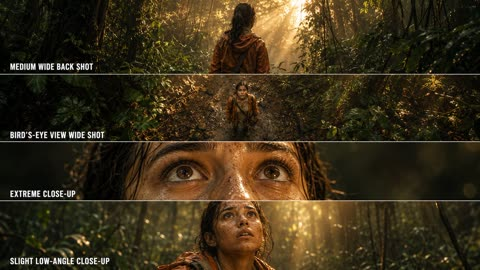</a>

在提示词中为每一格写明镜头类型和标签，使四个画面的构图各不相同；固定的角色描述（湿发、橙色外套、肩包背带）让同一人物在各格中保持一致。明确 16:9 比例和细分隔线，确定了叠放式分镜版式。

GPT Image 2 · 文生图 · 出处: [@bmx_ai13 on X](https://x.com/bmx_ai13/status/2064199055215902941) · 72 赞，统计于 2026-10-29

[`storyboard`](tags.md#tag-storyboard) [`collage`](tags.md#tag-collage) [`photorealistic`](tags.md#tag-photorealistic) [`cinematic`](tags.md#tag-cinematic)

<details><summary><b>提示词</b></summary>

```text
GPT Image 2 on ChatGPT

Prompt: Create a cinematic storyboard style collage made of four horizontal stacked panels, each showing a different camera shot of the same young female jungle explorer in a dense tropical rainforest. She has wet dark hair tied back, light brown skin, and wears an orange rain jacket over a dirty beige shirt, with a shoulder bag strap visible. The environment is a lush humid jungle with thick green foliage, hanging vines, muddy ground, misty atmosphere, and strong golden sunlight beams cutting through the canopy. The overall look should be photorealistic, cinematic, dramatic, adventurous, and atmospheric, with deep green shadows and warm amber highlights.

Panel 1 Top panel: A medium wide back shot of the young woman standing in the jungle, seen from behind, looking up toward a bright sunlit opening in the trees. Her orange jacket catches the golden light. Dense vegetation surrounds her. Add bold white uppercase text on the lower left: “MEDIUM WIDE BACK SHOT”.

Panel 2 Second panel: A bird’s eye view wide shot looking down at the same woman standing alone on a narrow muddy jungle path, surrounded by dense rainforest plants and glowing shafts of sunlight. She looks upward with curiosity and fear. Add bold white uppercase text on the lower left: “BIRD’S-EYE VIEW WIDE SHOT”.

Panel 3 Third panel: An extreme close up of the woman’s eyes and upper face, sweaty and slightly dirty, with wet skin reflecting warm jungle light. Her eyes look upward with tension, awe, and fear. Add bold white uppercase text on the lower left: “EXTREME CLOSE-UP”.

Panel 4 Bottom panel: A slight low angle close up of the woman’s face and upper body, looking upward in wonder and concern. Wet hair clings to her face, the orange jacket is visible, and the blurred jungle behind her glows with warm sun rays. Add bold white uppercase text on the lower left: “SLIGHT LOW ANGLE CLOSE-UP”.

Use a clean storyboard layout with thin panel dividers, bold condensed sans-serif typography, white shot labels, realistic film still quality, dramatic lighting, shallow depth of field, and a Hollywood jungle adventure mood.

Optional Negative Prompt: low quality, blurry, cartoon, anime, extra limbs, distorted face, messy layout, wrong text, misspelled text, watermark, logo, duplicate subject, flat lighting

Make the aspect ratio 16:9
```

</details>

<a id="gpt-image-red-beret-collage-street-portrait"></a>
### 红色贝雷帽人像配粉蓝拼贴街景

<a href="https://x.com/codewithhajra/status/2073025145703202995">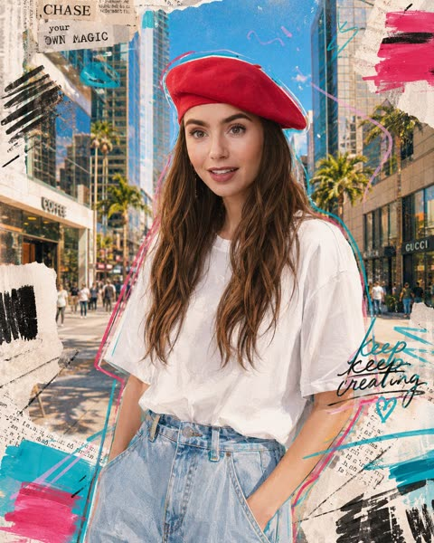</a>

用上传照片作为身份参考，并明确列出需保留的脸部、皮肤、发型和比例，使后续风格层不会改变人物。把真实人像与手工叠加层（轮廓线、撕纸、马克笔涂鸦）分开描述，拼贴效果就像叠在照片上，而不是重新绘制。

GPT Image 2 · 上传图改图 · 出处: [@codewithhajra on X](https://x.com/codewithhajra/status/2073025145703202995) · 72 赞，统计于 2026-10-29

[`mixed-media`](tags.md#tag-mixed-media) [`street-portrait`](tags.md#tag-street-portrait) [`collage`](tags.md#tag-collage) [`photo-reference`](tags.md#tag-photo-reference)

<details><summary><b>提示词</b></summary>

```text
Photorealistic mixed media collage street portrait sketch [OF A PERSON WITH A PHOTO]. Use the uploaded photo as an exact reference for the personality. Fully preserve the face, facial features, skin texture, proportions, hairstyle, and recognizability. Medium close-up, slight low angle, looking straight into the camera, soft smile with closed mouth. Clothing: loose white oversize t-shirt, tucked into light blue wide-leg high-waisted jeans, minimalist gold hoop earrings, concise modern style. Background: modern sunny street of a metropolis with futuristic glass buildings, stylish coffee shops, designer boutiques, wide sidewalks, urban greenery, modern architecture, reflections in glass facades, and a rich blue sky. Atmosphere of a warm summer day, lively, airy, and inspiring mood. Strong manual processing in mixed media style: bold drawn contour lines in bright pink and aquamarine colors, emphasizing the silhouette, abstract brush strokes, free marker swirls, semi-transparent torn paper fragments, handwritten strokes, dynamic scribbles, and graphic cutouts. Composition is energetic, yet neat and balanced. Light scanning texture, poster grain, delicate chromatic aberration, slightly frayed collage edges, feeling of a premium printed art poster. The character remains maximally realistic and sharp, while mixed media elements look hand-applied. Mood: modern, stylish, youthful, premium, bright, trendy, and scroll-stopping.
```

</details>

<a id="nano-banana-double-exposure-ink-collage-portrait"></a>
### 双重曝光拼贴，墨迹与花瓣背景中的女性

<a href="https://x.com/AiwithKinza/status/2064584772685344981">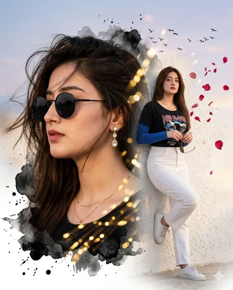</a>

左侧为侧脸特写，右侧为全身靠墙构图，同一人物在一个画面中出现两次形成拼贴效果。提示词将服饰、配饰和背景层次分条描述，并要求保持上传照片中的面部，使两个画面的人物保持一致。

Nano Banana 2 · 上传图改图 · 出处: [@AiwithKinza on X](https://x.com/AiwithKinza/status/2064584772685344981) · 72 赞，统计于 2026-10-29

[`double-exposure`](tags.md#tag-double-exposure) [`collage`](tags.md#tag-collage) [`portrait`](tags.md#tag-portrait) [`ink-splash`](tags.md#tag-ink-splash)

<details><summary><b>提示词</b></summary>

```text
Generate a double exposure and collage-style digital art piece featuring an hourglass curvy, full huge bust, stylish woman. On the left, a close-up cinematic portrait of her face in profile, wearing round black sunglasses, elegant earrings, and a delicate necklace, with her messy dark hair blowing in the wind. On the right, a full-body shot of the same Woman leaning against a white textured wall, wearing a black graphic, extremely tight fitting t-shirt with extra  deep scoop neck, with blue under sleeves, white high-waisted pants, and white sneakers, holding her sunglasses. The background is an artistic blend of black watercolor ink splashes, golden bokeh light streaks, flying birds, and scattered red flower petals under a soft twilight sky. High resolution, 8k, photorealistic, cinematic lighting. Maintain the same face as the uploaded photo. Aspect ratio 4:5
```

</details>

<a id="nano-banana-motorcycle-fashion-collage-three-panel"></a>
### 女子与黑色复古摩托车的三联时尚拼贴

<a href="https://x.com/Soaima_Ai/status/2070361938031464613">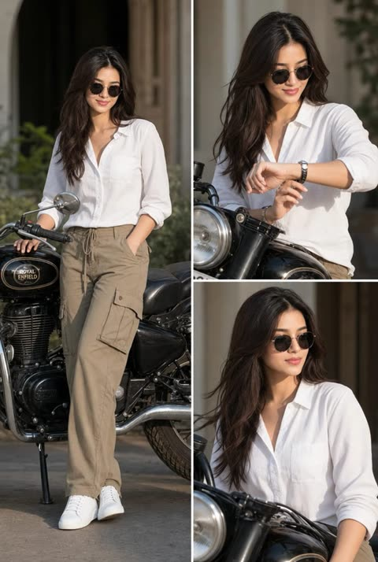</a>

提示词将画面拆分为一张全身主图和两张近景侧图，每张都指定一个动作，如微笑、调整手表或侧身看向别处。三个画面重复相同的服装和墨镜，让它们看起来像同一次拍摄。

Nano Banana 2 · 文生图 · 出处: [@Soaima_Ai on X](https://x.com/Soaima_Ai/status/2070361938031464613) · 70 赞，统计于 2026-10-29

[`collage`](tags.md#tag-collage) [`motorcycle`](tags.md#tag-motorcycle) [`fashion`](tags.md#tag-fashion) [`portrait`](tags.md#tag-portrait)

<details><summary><b>提示词</b></summary>

```text
A three-panel fashion collage style photo showcasing a stylish Indian woman posing with a black vintage motorcycle. The main image is a full-body shot showing her in a white casual shirt, khaki cargo trousers, and white tennis shoes. The smaller side panels show medium close-ups of her smiling, adjusting her watch, and looking away. She has long dark hair and is wearing classic sunglasses.
```

</details>

<a id="nano-banana-mountaineer-four-panel-film-strip"></a>
### 登山者攀登的四格电影分镜竖图

<a href="https://x.com/mon010_de/status/2061623347520459259">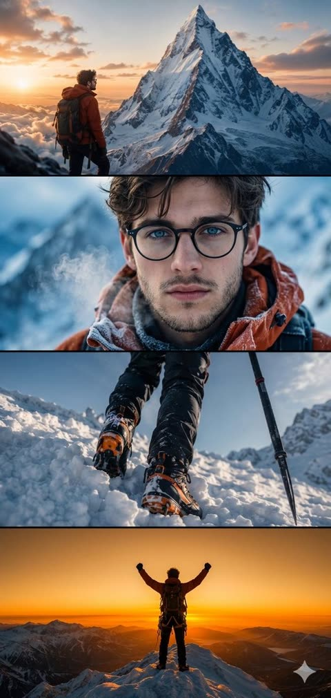</a>

编号分格依次写明每格的景别、主体细节和光线，使单条提示词即可生成连贯的分镜序列。结尾的镜头焦段与画幅比例设定电影感和竖长版式。

Nano Banana 2 · 文生图 · 出处: [@mon010_de on X](https://x.com/mon010_de/status/2061623347520459259) · 70 赞，统计于 2026-10-29

[`mountaineer`](tags.md#tag-mountaineer) [`storyboard`](tags.md#tag-storyboard) [`film-strip`](tags.md#tag-film-strip) [`photorealistic`](tags.md#tag-photorealistic)

<details><summary><b>提示词</b></summary>

```text
Generated with Nano Banana 2 on Gemini
Here are a few ways to structure the image generation prompt based on the cinematic sequence in **image.png**. Because it's a 4-panel narrative grid, you can either generate it as a continuous storyboard/film-strip style in a single prompt or break it down by individual shots for precise control.
### Option 1: The Multi-Panel Film Strip Prompt
Use this approach if your image generator supports multi-angle stitching or grid layouts in a single pass.
```text
A 4-panel cinematic film strip storyboard tracking a mountaineer's ascent.
Panel 1 (Top): Wide shot, a lone male mountaineer in an orange jacket standing on a ridge, looking out at a massive, sharp snow-covered peak during a golden hour sunrise.
Panel 2 (Second): Close-up portrait of the man with curly dark hair, a beard, and striking blue eyes. Frost on his jacket, visible breath in the cold air, rugged realism, highly detailed skin texture.
Panel 3 (Third): Low-angle macro tracking shot focusing on his mountain boots with crampons crunching through deep snow, stepping upward, hiking pole visible.
Panel 4 (Bottom): Wide shot from behind, the mountaineer standing triumphantly at the summit peak with arms outstretched, facing a brilliant sunset over an endless sea of mountains.
Cinematic lighting, 8k resolution, photorealistic, sharp focus, shot on 35mm lens --ar 1:2

```
### Option 2: Individual Panel Prompts (Recommended for Best Quality)
To get the absolute highest level of detail and identity consistency across your shots, it's usually best to generate them individually and stitch them together later.
 * **Panel 1 (The Scale/Establishing Shot):**
   > A wide cinematic establishing shot of a lone male mountaineer wearing a heavy backpack, standing on a rocky ledge looking towards a towering, sharp snow-capped mountain peak. Dramatic golden hour sunrise lighting, clouds below the ridge, photorealistic, 8k.
   >
 * **Panel 2 (The Character Close-Up):**
   > An intimate close-up portrait of a rugged mountaineer in a winter jacket. He has curly dark hair, a short beard, and vivid blue eyes looking into the camera. Visible condensation and puff of cold breath from his mouth, frost on his collar. Blurry snowy mountain background, cinematic depth of field, photorealistic.
   >
 * **Panel 3 (The Action/Detail Shot):**
   > A low-angle, extreme close-up shot of a climber's boots with orange crampons treading through thick, icy snow. A hiking pole is planted in the snow beside them. Sharp focus on the texture of the snow and gear, dynamic angle, bright alpine daylight.
   >
 * **Panel 4 (The Triumph/Finale):**
   > A silhouette style, wide shot from behind a mountaineer standing at the absolute peak of a snowy mountain summit. He has his arms outstretched in a V-shape celebration. Facing a magnificent orange and gold sunset stretching across a vast mountain range. Epic scale, cinematic composition.
   >
Let me know if you want to tweak the style parameters or focus on a specific aspect of the scene!
```

</details>

<a id="nano-banana-nine-color-satin-beauty-grid"></a>
### 同一女子九种缎面与宝石配色造型

<a href="https://x.com/astronomerozge1/status/2050990785135308805">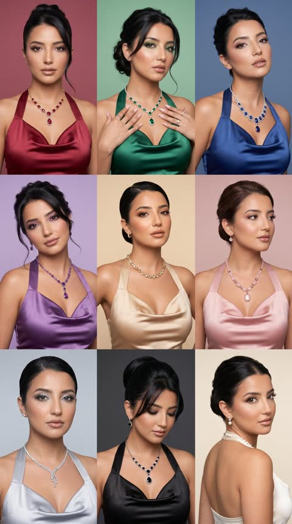</a>

通过严格的参考图身份锁定，每格只改变服装、发型、背景和项链；固定的镜头参数与统一构图让九格看起来出自同一次拍摄。

Nano Banana 2 · 上传图改图 · 出处: [@astronomerozge1 on X](https://x.com/astronomerozge1/status/2050990785135308805) · 67 赞，统计于 2026-10-29

[`beauty`](tags.md#tag-beauty) [`identity-lock`](tags.md#tag-identity-lock) [`color-grid`](tags.md#tag-color-grid) [`jewelry`](tags.md#tag-jewelry)

<details><summary><b>提示词</b></summary>

```text
{
  "generation_request": {
    "meta_data": {
      "task_type": "3x3_multicolor_luxury_beauty_editorial",
      "style": "ultra_photoreal_real_skin_high_fashion_campaign",
      "version": "v9.0_9_DIFFERENT_COLOR_LOOKS"
    },
    "input": {
      "mode": "image_to_image",
      "reference_image_usage": "maximum",
      "preserve_identity": "strict_lock",
      "notes": "Keep the exact same woman in all 9 panels with strict identity consistency. Preserve the same face, bone structure, skin tone family, proportions, natural asymmetry, and editorial realism. Only change the color styling, outfit, hair look, and necklace design per panel."
    },
    "output_settings": {
      "aspect_ratio": "1:1",
      "layout": "3x3 grid",
      "num_panels": 9,
      "resolution": "4K+ ultra high",
      "no_text": true
    },
    "global_scene": {
      "environment": "minimal realistic luxury beauty studio, clean seamless background, soft editorial setup, no props, no distractions",
      "lighting": "realistic softbox beauty lighting with gentle falloff, soft shadow shaping, subtle highlight on cheekbones, collarbones, and satin texture, no harsh flash, no artificial glow",
      "mood": "luxury, elegant, realistic, minimal, high-end editorial"
    },
    "global_subject": {
      "skin": "realistic skin texture with visible pores, subtle unevenness, fine facial hair, natural blush, controlled dewy glow, no plastic smoothing",
      "makeup": "luxury beauty editorial makeup adapted to each panel color theme, always tasteful and refined",
      "pose_language": "elegant beauty portrait poses, relaxed shoulders, calm confident expression, consistent upper-body framing"
    },
    "panels": {
      "1": {
        "theme": "deep ruby red",
        "background": "muted ruby red",
        "outfit": "deep ruby red satin halter top with realistic folds and soft sheen",
        "hair": "dark hair in a slicked-back updo with one loose face-framing strand, subtle wet editorial finish",
        "necklace": "luxury ruby-red gemstone necklace inspired by cherries and red berries, refined gold metalwork",
        "makeup": "soft red eyeshadow, warm nude glossy lips",
        "pose": "front-facing close portrait, calm direct gaze"
      },
      "2": {
        "theme": "emerald green",
        "background": "soft emerald green",
        "outfit": "rich emerald satin halter top",
        "hair": "sleek low bun with soft polished texture and loose strand",
        "necklace": "emerald and diamond luxury necklace inspired by leaves and green olives",
        "makeup": "soft green eyeshadow, neutral glossy lips",
        "pose": "three-quarter portrait, hand lightly touching collarbone"
      },
      "3": {
        "theme": "sapphire blue",
        "background": "muted sapphire blue",
        "outfit": "deep sapphire satin halter top",
        "hair": "sleek twisted updo, elegant and clean",
        "necklace": "sapphire and crystal statement necklace with luxury couture finish",
        "makeup": "soft blue-toned editorial eyeshadow, glossy nude lips",
        "pose": "slight chin lift, direct gaze"
      },
      "4": {
        "theme": "amethyst purple",
        "background": "soft muted lavender-purple",
        "outfit": "amethyst satin halter top",
        "hair": "soft glossy updo with a slightly romantic loose strand",
        "necklace": "amethyst gemstone necklace with delicate violet crystal drops",
        "makeup": "soft plum-lilac eyeshadow, neutral lips",
        "pose": "head tilted subtly left, relaxed lips"
      },
      "5": {
        "theme": "golden champagne",
        "background": "warm champagne beige",
        "outfit": "golden champagne satin halter top with luminous sheen",
        "hair": "sleek sculpted bun, polished luxury finish",
        "necklace": "gold and champagne-stone necklace, elegant and expensive",
        "makeup": "soft golden shimmer on eyes, peachy nude glossy lips",
        "pose": "center hero frame, front-facing Vogue beauty portrait"
      },
      "6": {
        "theme": "blush pink",
        "background": "muted blush pink",
        "outfit": "blush pink satin halter top",
        "hair": "sleek soft updo with feminine editorial softness",
        "necklace": "rose quartz and pink gemstone luxury necklace with delicate sparkle",
        "makeup": "soft rosy eyeshadow, glossy pink-nude lips",
        "pose": "soft side gaze, shoulders angled"
      },
      "7": {
        "theme": "silver ice",
        "background": "soft cool silver-grey",
        "outfit": "liquid silver satin halter top",
        "hair": "clean slick-back bun with cool-toned shine",
        "necklace": "silver and diamond necklace with icy crystal details",
        "makeup": "cool silver-grey eyeshadow, glossy nude lips",
        "pose": "closer crop focused on eyes and lips"
      },
      "8": {
        "theme": "black onyx",
        "background": "deep charcoal / soft black studio backdrop",
        "outfit": "black satin halter top with rich reflective texture",
        "hair": "sleek dramatic updo, glossy and sculptural",
        "necklace": "black onyx and diamond statement necklace, elegant and bold",
        "makeup": "soft smoky eyes, glossy nude lips",
        "pose": "gentle downward chin angle, calm expression"
      },
      "9": {
        "theme": "pearl white",
        "background": "soft warm ivory",
        "outfit": "pearl-white satin halter top with subtle sheen",
        "hair": "clean refined updo with soft luminous texture",
        "necklace": "pearl, diamond, and white gemstone luxury necklace with couture refinement",
        "makeup": "soft ivory-champagne eye look, glossy nude lips",
        "pose": "slight over-the-shoulder angle, elegant minimal finish"
      }
    },
    "camera": {
      "camera_type": "Sony A1",
      "lens": "85mm f/1.4 portrait lens",
      "aperture": "f/2.2",
      "framing": "tight upper-body beauty portraits, consistent 3x3 grid composition",
      "depth_of_field": "shallow but realistic, soft background separation",
      "focus": "sharp on eyes, skin texture, lips, necklace details, and satin fabric"
    },
    "rendering": {
      "quality": "ultra high resolution photorealistic editorial",
      "details": "real skin pores, natural asymmetry, fine hair strands, realistic satin texture, realistic jewelry reflections, true-to-life light falloff",
      "color_grade": "each panel follows its own luxury monochrome palette while preserving realistic skin tones",
      "effects": "no artificial glow, no waxy skin, no CGI finish, subtle editorial sharpness"
    },
    "realism_rules": {
      "identity": "same exact woman in all 9 panels",
      "skin": "natural real skin texture preserved",
      "hair": "different styling mood per panel allowed, but identity remains unchanged",
      "jewelry": "all necklaces must look like real high-end luxury jewelry, not costume jewelry",
      "fabric": "all outfits must have realistic satin folds, natural tension, and premium sheen"
    },
    "negative_prompt": "no identity change, no face drift, no different woman, no plastic skin, no over-smoothing, no waxy skin, no unrealistic symmetry, no doll face, no harsh shadows, no distorted hands, no extra fingers, no warped anatomy, no AI artifacts, no text, no watermark, no logo, no cheap jewelry, no cartoon look, no fabric glitches, no blurry face, no oversharpening"
  }
}
```

</details>

<a id="nano-banana-black-gold-three-pose-fashion-collage"></a>
### 黑金海报中同一男子的三种姿态

<a href="https://x.com/DilshadAI1/status/2075045041287168048">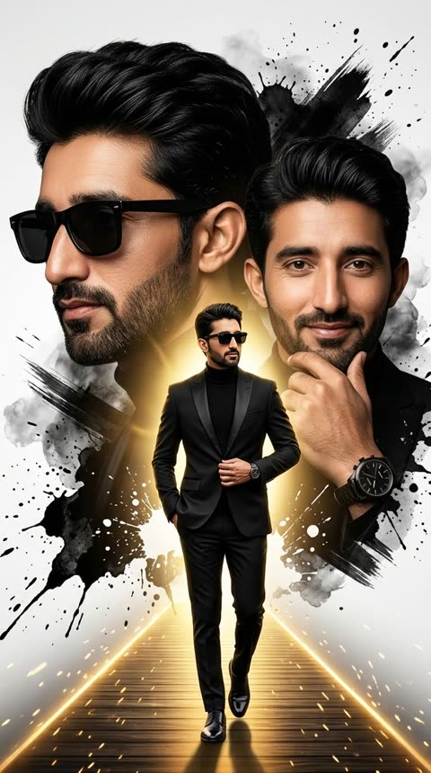</a>

为每个画面分别指定姿态、服装和光线，同时以参考照片锁定同一张脸作为身份依据。固定的黑白金配色加上轮廓光，让三个构图看起来像同一本杂志封面。

Nano Banana 2 · 上传图改图 · 出处: [@DilshadAI1 on X](https://x.com/DilshadAI1/status/2075045041287168048) · 66 赞，统计于 2026-10-29

[`fashion`](tags.md#tag-fashion) [`collage`](tags.md#tag-collage) [`poster`](tags.md#tag-poster) [`reference-face`](tags.md#tag-reference-face)

<details><summary><b>提示词</b></summary>

```text
GPT Image 2 | Nano Banana 2 | Grok | Gemini Prompt 👇

Using uploaded face 100% realistic.
Create a high-end cinematic fashion poster collage featuring the same young South Asian man from the reference photo, keeping his face highly accurate, natural, and consistent across all portraits. Vertical 9:16 composition, luxury black-and-gold editorial style.

Create three versions of the same man:

1. Left side: a large dramatic close-up side-profile portrait wearing stylish black rectangular sunglasses, looking toward the right. Neatly styled thick black hair, trimmed beard and mustache, confident expression.

2. Right side: a large close-up front-facing portrait without sunglasses, looking directly at the camera with a subtle confident smile. One hand resting near the chin, showing a premium black wristwatch.

3. Center foreground: full-body walking pose on a glowing wooden pathway, walking confidently toward the camera. He is wearing a luxury black tuxedo blazer with satin lapels, black turtleneck shirt, black fitted trousers, black formal shoes, black sunglasses, and a stylish wristwatch. One hand in trouser pocket and the other hand adjusting the blazer.

Background: white and light gray studio backdrop with dramatic black ink splashes, paint brush strokes, smoky textures, white paint splatters, golden glowing light behind the center figure, cinematic rim light, luxury magazine cover style. Add subtle golden sparks and a glowing pathway perspective at the bottom.

Ultra-realistic face, realistic skin texture, sharp hairstyle, professional DSLR photography, high contrast, black, white and gold color palette, dramatic lighting, fashion editorial poster, 8K, HDR, highly detailed, no text, no logo, no watermark.
```

</details>

<a id="gpt-image-photo-booth-couple-migrating-contact-sheet"></a>
### 照片亭连拍里情侣逐渐走到同一格

<a href="https://x.com/frametheory058/status/2100583390806442370">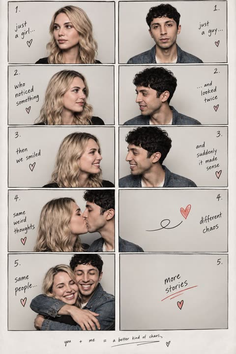</a>

逐行分镜写明每一格的位置和情绪，男生一步步越过分隔线，右栏随之留空。严格的身份锁定加上禁止重复人物的限制，让两人的脸在每一行保持一致。

GPT Image 2.5 · 文生图 · 出处: [@frametheory058 on X](https://x.com/frametheory058/status/2100583390806442370) · 64 赞，统计于 2026-10-28

[`photo-booth`](tags.md#tag-photo-booth) [`contact-sheet`](tags.md#tag-contact-sheet) [`couple`](tags.md#tag-couple) [`storyboard`](tags.md#tag-storyboard) [`film-grain`](tags.md#tag-film-grain)

<details><summary><b>提示词</b></summary>

```text
Create an ultra-photorealistic vertical romantic photo-booth contact-sheet collage, 2 columns × 5 rows, showing ONE continuous visual story involving the exact same young adult couple throughout.

CORE VISUAL IDEA:
The two columns are not ten unrelated photos. They represent two separate adjacent photo-booth spaces. The young woman begins entirely inside the LEFT column and the young man begins entirely inside the RIGHT column. As the rows move downward, the man gradually leaves his own frame and physically moves into the woman’s frame. His original RIGHT frame therefore becomes progressively emptier. This visual migration is the central concept and MUST remain logically consistent.

CHARACTERS:
A very cute young adult East Asian couple, approximately 20–23 years old, both clearly adults.

GIRL:
Naturally adorable Korean-looking young woman, soft youthful facial features, expressive dark-brown eyes, realistic fair skin with visible pores and subtle natural texture, slightly rosy cheeks, dark-brown hair in a loose messy bun with wispy strands around her face. Oversized black knitted sweater. Minimal natural makeup. Sweet, shy, playful personality.

BOY:
Cute Korean-looking young man, youthful but clearly adult, soft masculine facial features, warm dark eyes, naturally messy fluffy dark hair, realistic skin texture. Light-grey oversized hoodie over a simple white T-shirt. Gentle, slightly shy personality.

STRICT IDENTITY LOCK:
The SAME woman and SAME man must appear in every row. Identical faces, hairstyle, clothing, skin tone and proportions throughout. No face drift, no hairstyle changes, no outfit changes.

STORYBOARD:

ROW 1 — TWO STRANGERS
LEFT: girl alone, chest-up portrait, casually looking toward the right edge as though she has noticed someone.
RIGHT: boy completely visible and centered in his own frame, facing camera naturally.
They are physically separated by the vertical black divider.
Small handwritten text:
LEFT: “just a girl… ♡”
RIGHT: “just a guy…”

ROW 2 — THEY NOTICE EACH OTHER
LEFT: girl turns her eyes and face toward him with a tiny restrained smile.
RIGHT: boy turns toward the girl, leaning slightly toward the LEFT boundary for the first time.
He is still mostly inside his own frame.
Text:
LEFT: “who noticed something”
RIGHT: “…and looked twice ♡”

ROW 3 — CROSSING THE LINE
This is the important transition.
The boy has moved substantially LEFT and is now entering the girl’s frame across the central divider. The couple are close together, looking directly at each other and smiling naturally.
His RIGHT frame must now contain noticeably more empty background because he has physically moved away from it.
Do NOT duplicate him.
Text:
LEFT: “then we smiled ♡”
RIGHT empty area: “and suddenly it made sense”

ROW 4 — HE HAS LEFT HIS FRAME
The boy is now almost COMPLETELY inside the LEFT frame with the girl.
They share one soft, natural kiss, photographed candidly rather than dramatically.
Only a tiny portion of his shoulder/body may intersect the central border.
The RIGHT frame is approximately 85–90% EMPTY — just clean studio background.
This empty frame is intentional and visually important.
Text:
LEFT: “same weird thoughts ♡”
RIGHT empty frame: “different chaos ♡”

ROW 5 — FINAL PAYOFF
The boy has now COMPLETELY abandoned his original right-hand frame.
Both characters are entirely together inside the LEFT frame.
Instead of another kiss, create an irresistibly cute candid moment: he hugs her tightly from behind while giving her a small forehead/temple kiss; she scrunches her cheeks slightly, closes her eyes and smiles naturally.
Their body language should feel spontaneous, warm and genuinely affectionate.
RIGHT frame must be COMPLETELY EMPTY except for:
“more stories ♡”

Text in left:
“same people…”

IMPORTANT:
Never place a second copy of either character in the right frame after the man moves left.
Never repeat the kissing image across both columns.
The empty space tells the story.

DESIGN:
Minimal premium analog contact-sheet aesthetic inspired by an old 35mm film proof sheet, but make the composition completely original.

Warm off-white / soft beige seamless studio background.
Deep black film borders.
Thin slightly imperfect frame separators.
Tiny amber film-number markings and subtle sprocket details along outer edges.
Very subtle authentic analog grain, dust and microscopic scratches.
Small pieces of aged masking tape.
A few torn-paper notes.
Tiny hand-drawn hearts.
Small dried flowers near one bottom corner.
Only a handful of decorations — never clutter the photographs.

Margin notes:
“Good people, good times ♡”
“You + Me Always ♡”
“Collect moments, not things ♡”

BOTTOM HERO MESSAGE:
Place a torn warm-ivory paper strip across the lower border with handwritten text:

“you + me = a better kind of chaos ♡”

PHOTOGRAPHY:
100% believable real-human photography.
Premium editorial photo-booth portraits shot on a full-frame camera with approximately 50–85mm portrait-lens character.
Soft warm studio key light, subtle fill, realistic shadow falloff.
Natural skin pores, peach fuzz, individual hair strands, realistic knitted fabric and hoodie texture.
Slightly imperfect candid expressions.
Warm cinematic color grade with creamy highlights, rich blacks and subtle analog grain.
Faces remain sharp while retaining natural photographic softness.

The first row should feel slightly awkward and separated.
Every subsequent row becomes visually warmer and physically closer.
The final row should provide the strongest emotional payoff.

NO CGI.
NO illustration.
NO anime.
NO plastic skin.
NO excessive beauty retouching.
NO duplicated people.
NO extra fingers or limbs.
NO random additional characters.
NO identity changes.
NO duplicated poses.
NO repeated kiss.
NO decorative overload.
NO characters appearing inside intentionally empty right-side frames.

FINAL FEEL:
A photograph someone would instantly stop scrolling to understand — first they notice two separate people, then realize the man is literally disappearing from his own frames because he is moving into hers. Cute, clever, romantic, nostalgic, highly polished and visually understandable even before reading the handwritten text.
```

</details>

<a id="gpt-image-morning-diaries-travel-scrapbook-poster"></a>
### 由照片生成的晨间日记旅行手账海报

<a href="https://x.com/Aqsahere_/status/2104395935438581848"></a>

提示词先锁定上传照片中人物的身份与服装，只改变时间氛围，再逐项列出手账元素和排版文字，并限定配色与3:4比例。

GPT Image 2.5 · 上传图改图 · 出处: [@Aqsahere_ on X](https://x.com/Aqsahere_/status/2104395935438581848) · 63 赞，统计于 2026-10-28

[`scrapbook`](tags.md#tag-scrapbook) [`travel-journal`](tags.md#tag-travel-journal) [`photo-edit`](tags.md#tag-photo-edit) [`editorial-poster`](tags.md#tag-editorial-poster) [`identity-lock`](tags.md#tag-identity-lock)

<details><summary><b>提示词</b></summary>

```text
Create a high-end morning editorial scrapbook poster from the uploaded photo. Transform the sunset scene into a fresh early-morning atmosphere with soft golden morning sunlight, clear blue sky, fluffy white clouds, crisp green mountains, and bright wildflowers. Keep the woman’s appearance, outfit, pose, facial features, hair, pink bucket hat, pink T-shirt, dark jacket tied around her waist, and overall identity consistent. Design it as a sophisticated travel-journal collage with torn cream paper, Polaroid frames, subtle washi tape, film-strip details, pressed daisies, delicate botanical sketches, handwritten notes, and vintage paper textures. Use the main photo prominently in the center with several smaller snapshots showing different natural angles from the same scene. Add elegant editorial typography reading “MORNING Diaries”, with small phrases such as “clear skies · brighter days”, “same places, different mornings”, and “good views, good mood”. Keep the palette soft and refined: sky blue, fresh green, warm cream, pale pink, and subtle beige. Make it feel like a premium independent travel magazine mixed with a personal morning diary—artistic, airy, nostalgic, natural, and beautifully composed, not like an advertisement. Strict 3:4 vertical composition, realistic photography blended seamlessly with refined scrapbook elements.
```

</details>

<a id="nano-banana-luxury-menswear-vintage-studio-collage"></a>
### 四格黑白男装时尚大片拼贴

<a href="https://x.com/jzaib4269/status/2063930810428740045">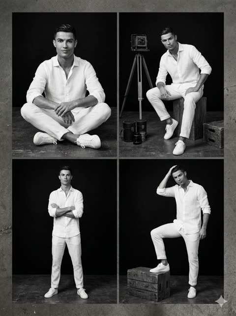</a>

提示词把服装、道具和四个具体姿势写在同一段里，模型因此会把它们排成一组风格统一的杂志式拼贴。镜头和布光术语如 85mm 与低调光，把画面推向摄影质感，而不是普通渲染。

Nano Banana 2 · 文生图 · 出处: [@jzaib4269 on X](https://x.com/jzaib4269/status/2063930810428740045) · 60 赞，统计于 2026-10-29

[`fashion`](tags.md#tag-fashion) [`editorial`](tags.md#tag-editorial) [`studio`](tags.md#tag-studio) [`collage`](tags.md#tag-collage)

<details><summary><b>提示词</b></summary>

```text
Which looks better?

Left: Gemini Nano Banana 2
Right: GPT Image 2.0 on ChatGPT

Prompt: Ultra-realistic luxury fashion editorial photoshoot featuring a world-class male athlete with a sharp jawline, athletic physique, and perfectly groomed dark hair, dressed in an elegant all-white linen outfit consisting of an open-collar button-down shirt, tailored trousers, and minimalist white sneakers. Studio setting with a deep black seamless background, cinematic low-key lighting, dramatic contrast, and rich shadows.
A sophisticated vintage photography theme with antique large-format cameras on wooden tripods, aged wooden crates, and classic travel trunks placed around the scene. Multiple poses captured in a premium magazine-style collage: sitting cross-legged on the floor with a confident smile, seated on a wooden chest with an intense gaze, standing with arms crossed in a powerful pose, and posing with one foot on a crate while adjusting his hair.
Luxury menswear campaign aesthetic, timeless elegance, masculine confidence, refined styling, high-end fashion photography, medium and full-body compositions, ultra-detailed skin texture, crisp fabric details, professional studio lighting, cinematic color grading, shallow depth of field, premium watch accessory, clean composition, Vogue-quality editorial, award-winning photography, 8K resolution, hyperrealistic, sharp focus, commercial advertising quality.
For an even more viral / premium AI image result:
Masterpiece, ultra-realistic luxury fashion campaign, iconic athletic superstar, old-money elegance, monochromatic white wardrobe, dramatic black background, vintage camera studio, cinematic lighting, powerful masculine energy, luxury lifestyle magazine cover, photorealistic, highly detailed face, perfect skin texture, luxury watch, premium editorial photography, global advertising campaign, soft rim light, depth and atmosphere, fashion week campaign aesthetic, Leica medium-format look, 85mm lens, f/1.8, HDR, ultra-sharp focus, 8K, masterpiece composition, timeless sophistication, stop-scrolling visual impact.
```

</details>

<a id="gpt-image-cartoon-mural-portrait-yellow-streetwear"></a>
### 涂鸦墙卡通肖像与黄色街头写真

<a href="https://x.com/Techbyhani/status/2102715195454074956">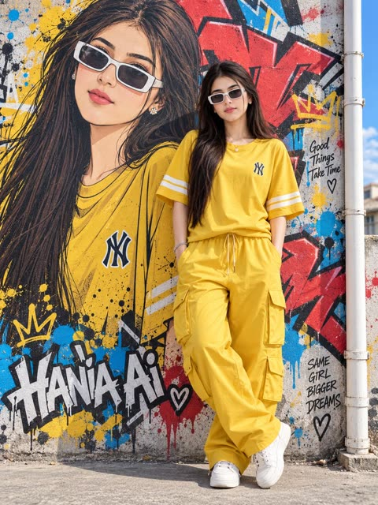</a>

用带 EXACT 标记的分段分别约束概念、主体、服装、背景、光线、色调和镜头，让图文叠层的构图保持可控。身份锁定段落绑定参考照片，保证前景真人面部不变，背景插画则允许风格化。

GPT Image 2.5 · 上传图改图 · 出处: [@Techbyhani on X](https://x.com/Techbyhani/status/2102715195454074956) · 59 赞，统计于 2026-10-28

[`graffiti-wall`](tags.md#tag-graffiti-wall) [`streetwear`](tags.md#tag-streetwear) [`cartoon-overlay`](tags.md#tag-cartoon-overlay) [`identity-lock`](tags.md#tag-identity-lock) [`yellow`](tags.md#tag-yellow)

<details><summary><b>提示词</b></summary>

```text
Cartoon Ghost Portrait + Sharp Streetwear Photo (Graffiti Wall)

CONCEPT — EXACT: A layered composite — a massive stylized cartoon/anime-style illustrated portrait fills the background against a vibrant graffiti-covered concrete wall, and a smaller sharp full-color photorealistic full-body portrait of the same woman stands in the foreground.

BACKGROUND CARTOON PORTRAIT — EXACT: Large flat-shaded anime/webtoon-style illustrated portrait, head tilted slightly, long straight dark hair falling past the waist, white rectangular sunglasses, glossy red lips, wearing an oversized yellow graphic t-shirt with a small "NY" logo patch and white sleeve stripes, rendered in clean cel-shaded illustration style with bold outlines, blended into the graffiti wall so it reads as a mural-style painting.

MAIN SUBJECT — FOREGROUND — EXACT: Full-body standing pose, hands tucked into the pockets of oversized cargo pants, head tilted slightly, calm confident expression, white rectangular sunglasses, long dark wavy hair with subtle highlights, thin silver necklace, small stud earrings, silver bracelet.

MAIN SUBJECT IDENTITY LOCK: Foreground photorealistic face must match the reference photo exactly — same jaw width, cheek fullness, eyebrow shape, eye shape/color, nose bridge, and lip shape. The background cartoon portrait may be stylized as illustrated art but should echo the same facial features and hairstyle.

BODY: Fair skin tone, slim build, relaxed confident standing posture.

OUTFIT: Oversized yellow crew-neck t-shirt with a small "NY" logo patch on the chest and white sleeve-cuff stripes, matching yellow cargo pants with multiple pockets and a drawstring waist, white sneakers, thin silver necklace, silver bracelet.

BACKGROUND/ENVIRONMENT — EXACT: A concrete wall densely covered in colorful graffiti street art — bold red, blue, orange, and yellow spray-paint shapes, splatter marks, and abstract tag lettering, a white vertical drainpipe running along the right edge, a strip of bright blue sky visible in the upper-right corner, plain grey concrete pavement beneath the subject's feet.

LIGHTING — EXACT: Bright natural daylight throughout, strong directional sunlight casting a defined shadow on the pavement, vivid clear outdoor lighting on the foreground figure.

COLOR GRADE — EXACT: Vivid saturated yellow dominant throughout both the outfit and the illustrated background portrait, bold multicolor graffiti tones providing contrast, natural warm skin tone on the photorealistic figure, clean vibrant streetwear-editorial color grading.

CAMERA: Shot on 35mm lens, natural street-level framing, sharp photorealistic focus on the foreground figure, background cartoon portrait cleanly illustrated with flat shading and bold linework.

Ultra photorealistic — zero AI artifacts, no watermark.

IMPORTANT — Use ONLY my uploaded face reference image for the facial structure and identity of the photorealistic foreground figure. My face must remain EXACTLY the same as my real appearance with zero identity change. Preserve my exact hairstyle, hairline, forehead shape, eyebrows, eye shape, nose structure, lips, jawline, skin tone, facial texture, and feminine proportions exactly as shown in the uploaded image. Do NOT beautify, cartoonize, smooth skin, or replace my face with a random celebrity or model face in the foreground portrait. Identity preservation is the highest priority for the photorealistic figure.
```

</details>

<a id="gpt-image-emerald-fashion-six-angle-grid"></a>
### 同一模特六个机位的祖母绿运动装拼图

<a href="https://x.com/mehvishs25/status/2115803636320358657">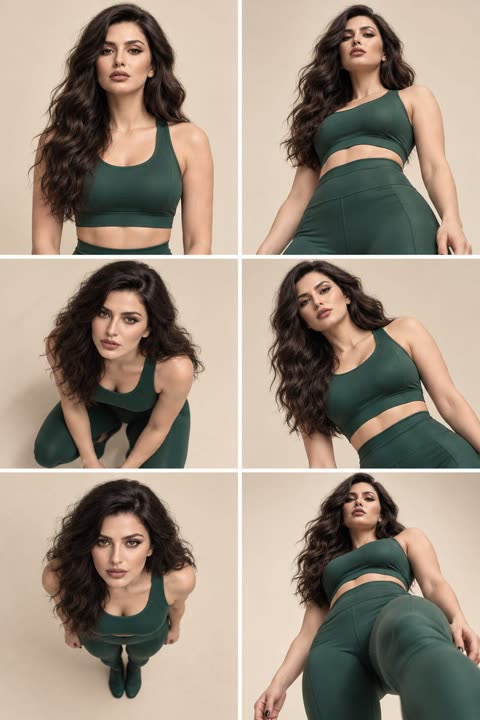</a>

提示词先引用参考图并写明需要保留的五官、发型和体态，再为每一格单独指定机位的高度与倾斜角度，只让镜头角度变化，使六格看起来是同一组照片。

GPT Image 2.5 · 上传图改图 · 出处: [@mehvishs25 on X](https://x.com/mehvishs25/status/2115803636320358657) · 55 赞，统计于 2026-10-29

[`fashion`](tags.md#tag-fashion) [`grid`](tags.md#tag-grid) [`multi-angle`](tags.md#tag-multi-angle) [`studio`](tags.md#tag-studio)

<details><summary><b>提示词</b></summary>

```text
Create a premium fashion editorial reference sheet featuring the exact same girl from my reference image, arranged in a perfectly aligned 2-column × 3-row grid with six distinct camera angles.

Identity lock: Preserve her exact facial features, skin tone, eye color, hairstyle, age, and body proportions from the reference image. She must remain unmistakably the same person in every panel.

Wardrobe: An elegant emerald-green fitted sports bra and matching high-waisted leggings, premium satin-finish technical fabric, realistic seams, and no logos or accessories.

Six camera perspectives:

1. Front portrait: Eye-level, direct eye contact, relaxed shoulders.
2. Low angle: Camera below the model, looking upward for a powerful runway aesthetic.
3. High angle: Camera above her at 40 degrees, with her gaze lifted toward the lens.
4. Dutch angle: Camera tilted 20 degrees for a contemporary editorial composition.
5. Bird’s-eye view: Camera directly overhead at 90 degrees, model looking up.
6. Floor-level view: Camera almost touching the floor, looking upward for dramatic architectural perspective.

Visual style: Ultra-realistic luxury fashion campaign, seamless warm ivory studio, soft directional lighting, delicate shadows, natural skin texture, detailed hair, realistic fabric reflections, refined magazine-quality color grading, and crisp commercial photography.

Composition: Exactly six equal-sized photographs in a clean 2 × 3 grid, uniform white gutters, consistent lighting and wardrobe, and perfectly aligned panels. Only the camera angle changes; maintain the same identity and believable anatomy throughout.

No text, watermarks, logos, duplicated faces, artificial skin, or inconsistent character features.
```

</details>

<a id="nano-banana-christmas-fur-coat-winter-collage"></a>
### 冬季拼贴，皮草大衣与音乐播放器

<a href="https://x.com/Strength04_X/status/2000404590232256886">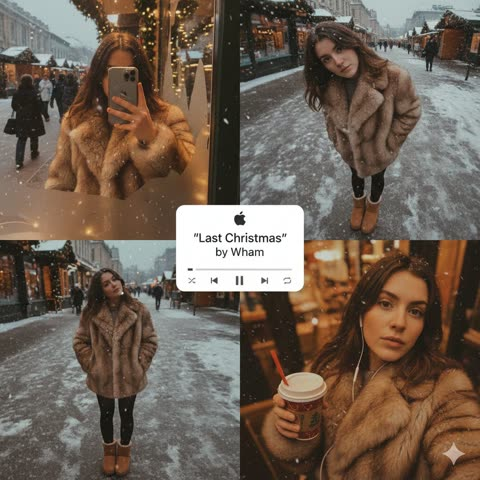</a>

用 JSON 固定服装、配色和四格布局，让每个画面保持一致，并用人脸参考图保持同一人物。居中的 Apple Music 风格小播放器被描述为无阴影的平面图层，因此文字保持清晰。

Nano Banana Pro · 上传图改图 · 出处: [@Strength04_X on X](https://x.com/Strength04_X/status/2000404590232256886) · 53 赞，统计于 2026-10-29

[`christmas`](tags.md#tag-christmas) [`collage`](tags.md#tag-collage) [`winter-fashion`](tags.md#tag-winter-fashion) [`iphone-photo`](tags.md#tag-iphone-photo)

<details><summary><b>提示词</b></summary>

```text
{
  "image_generation_request": {
    "meta_protocols": {
      "reference_adherence": {
        "instruction": "Use the provided photo as a strict face reference.",
        "tolerance": "Zero deviation",
        "parameters": "Preserve facial proportions, skin texture, expression, and identity with 100% accuracy.",
        "stylization_constraint": "Do not stylize or alter facial features."
      },
      "format_style": "Editorial winter poster–style multi-panel collage",
      "aesthetic_quality": "Spontaneous iPhone photography (candid, cozy, realistic)",
      "global_textures": "Soft snowfall, subtle analog grain, slight handheld imperfections"
    },
    "consistent_elements": {
      "subject_wardrobe": {
        "coat": "Short faux-fur coat (light brown/tan)",
        "legwear": "Black tights",
        "footwear": "Classic UGG boots (tan/chestnut)",
        "style_notes": "Simple, cozy, unmistakably winter"
      },
      "primary_device": {
        "model": "iPhone 17 Pro Max",
        "color": "Silver",
        "usage": "Held by subject in relevant frames"
      },
      "color_palette": [
        "Warm ambers",
        "Soft reds",
        "Pine greens",
        "Muted winter greys"
      ]
    },
    "layout_configuration": {
      "panel_1_top_left": {
        "scene_type": "Reflective shop-window shot at dusk",
        "lighting_and_atmosphere": "Faint Christmas lights, garlands, frosted glass edges, warm highlights on fur",
        "subject_action": "Holding phone partially covering face (taking mirror selfie)",
        "optical_effects": "Passing silhouettes, layered reflections, gentle ghosting, natural glass curvature distortion"
      },
      "panel_2_top_right": {
        "scene_type": "Ultra-wide street portrait (snowy sidewalk/Christmas market)",
        "camera_angle": "Close, downward-angled",
        "subject_pose": "Leaning forward casually, hands in coat pockets",
        "visibility_check": "Black tights and UGG boots clearly visible",
        "motion_dynamics": "Falling snow with slight motion blur",
        "lens_characteristics": "Subtle perspective warping to reinforce handheld unstaged feel"
      },
      "panel_3_bottom_right": {
        "scene_type": "Intimate overhead selfie",
        "lighting": "Warm street or café lighting",
        "props": {
          "held_item": "Takeaway holiday drink (coffee or mulled wine) with red straw",
          "accessories": "Wired earphones visible"
        },
        "texture_focus": "Sharply detailed fur texture and winter fabrics",
        "mood": "Nostalgic holiday atmosphere enhanced by soft grain"
      },
      "panel_4_bottom_left": {
        "scene_type": "Medium shot street portrait (snowy sidewalk/Christmas market)",
        "camera_angle": "Eye level, slightly upward",
        "subject_pose": "Standing, looking directly at the camera, hands relaxed by side or in pockets.",
        "visibility_check": "Full body visible, focusing on the coat and winter street scene.",
        "motion_dynamics": "Soft snowfall, shallow depth of field focusing on the subject.",
        "mood": "Candid, cozy, and realistic winter street photo."
      }
    },
    "graphic_overlay": {
      "element": "Minimal Apple Music–style mini player",
      "content": "Popular Christmas song (e.g., 'Last Christmas' or 'All I Want for Christmas Is You')",
      "style": "Rendered flat and clean, no shadows",
      "position": "Floating across the center of the collage"
    }
  }
}
```

</details>

<a id="gpt-image-eight-pose-hoodie-portrait-collage"></a>
### 蓝色卫衣女孩八种姿势人像拼图

<a href="https://x.com/Adnan_Ai2/status/2103321407883214989"></a>

以参考图锁定人物身份，并逐项写明服装与青蓝色影棚背景，保证各格一致。用编号列出八个动作，排成2×4网格，再约束手部和重复肢体，得到姿势多样但形象统一的拼图。

GPT Image 2.5 · 上传图改图 · 出处: [@Adnan_Ai2 on X](https://x.com/Adnan_Ai2/status/2103321407883214989) · 50 赞，统计于 2026-10-29

[`photo-collage`](tags.md#tag-photo-collage) [`pose-sheet`](tags.md#tag-pose-sheet) [`consistent-character`](tags.md#tag-consistent-character) [`studio-portrait`](tags.md#tag-studio-portrait) [`grid`](tags.md#tag-grid)

<details><summary><b>提示词</b></summary>

```text
Create a photorealistic 2×4 action collage using the reference image, featuring the exact same girl in all eight panels. Preserve her facial identity, long straight dark hair, light blue oversized hoodie, white top, blue jeans and butterfly necklace consistently. Keep the same teal-blue cinematic studio background, soft glowing lights, subtle bokeh and realistic portrait lighting. Show eight different actions: 1) waving hello, 2) pointing toward the camera with a cute wink, 3) laughing naturally, 4) taking a playful smartphone selfie, 5) posing with both hands on her cheeks, 6) making a heart shape with both hands, 7) sitting on a stool while looking back over her shoulder, 8) celebrating happily with one arm raised. Arrange everything in a clean 2×4 grid with clear separation, realistic skin and hair, natural hands and fingers, accurate body proportions, consistent outfit and face, cinematic depth of field, professional photography, ultra-realistic 4K, sharp details, no distortion, no duplicate body parts.
```

</details>

<a id="nano-banana-christmas-tree-clipping-mask-collage"></a>
### 聖誕樹剪裁蒙版四照片拼貼與貼紙

<a href="https://x.com/BeautyVerse_Lab/status/2004266176126558267">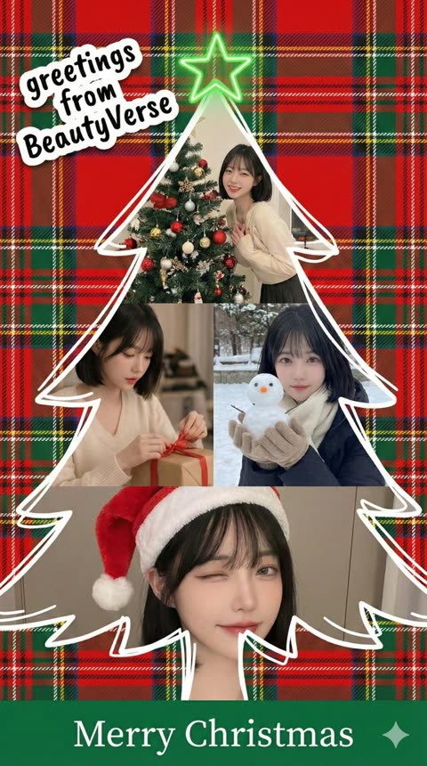</a>

白色手繪樹形輪廓作為嚴格的剪裁蒙版，讓四張照片只出現在樹形之內，樹外保留格紋背景。以 image_0 作為人物參考，使四個場景中的人物外貌保持一致。

Nano Banana Pro · 上传图改图 · 出处: [@BeautyVerse_Lab on X](https://x.com/BeautyVerse_Lab/status/2004266176126558267) · 46 赞，统计于 2026-10-29

[`christmas`](tags.md#tag-christmas) [`collage`](tags.md#tag-collage) [`clipping-mask`](tags.md#tag-clipping-mask) [`portrait`](tags.md#tag-portrait)

<details><summary><b>提示词</b></summary>

```text
A festive social media PLOG collage based on image_0.png, focusing on a specific clipping mask effect and a new corner element.
1. Corner Sticker Element:
 * Placement: Positioned in the top-left corner of the composition, overlaying the plaid background.
 * Style: A decorative, die-cut sticker or a stylized speech bubble with a slight white border, looking like it's pasted onto the background with a cute, scrapbook aesthetic.
 * Text Content: Inside this sticker/bubble, contain the text "greetings from BeautyVerse" rendered in a playful, handwritten font.
2. Global Structure & Background:
 * Background: Maintain the exact red, green, and yellow tartan plaid pattern from image_0.png.
 * Tree Outline: Retain the large, hand-drawn white line art outline of the Christmas tree with the neon green star on top, exactly as styled in image_0.png.
 * Clean up: Ensure the original white speech bubble (bottom left) and all previous ASCII text art are completely removed.
3. The Clipping Mask Logic:
 * Constraint: The organic shape of the hand-drawn white tree outline acts as a strict clipping mask.
 * Execution: A collage of four distinct photos must be nested strictly inside the tree boundaries. No rectangular edges or photo content should bleed outside the white line art. The tartan background must remain visible everywhere outside the tree shape.
4. Content of the 4 Photos:
 * Subject Reference: The persons in these photos must closely resemble the young woman from image_0.png, maintaining consistent facial features, hair color, and high-quality photorealistic style.
 * Top section of tree: A photo of the young woman posing happily next to a decorated Christmas tree.
 * Middle-left section: A candid photo of the young woman sitting down, excitedly unwrapping a Christmas gift.
 * Middle-right section: An outdoor winter photo of the young woman in gloves, holding a small snowman.
 * Bottom section of tree: A close-up selfie of the young woman wearing a red Santa hat, winking at the camera.
5. Footer:
 * The green banner at the bottom is kept.
 * The text inside is changed to a simple, clean white font centered in the banner reading: "Merry Christmas".

#MerryChristmas #nanobanana
https://
x.com/beautyverse_la
/beautyverse_lab/status/2003412571395883465
…
```

</details>

<a id="nano-banana-nye-luxury-contact-sheet-bagel-labs"></a>
### 九宫格新年奢华广告拼图

<a href="https://x.com/astronomerozge1/status/2006423399443148854">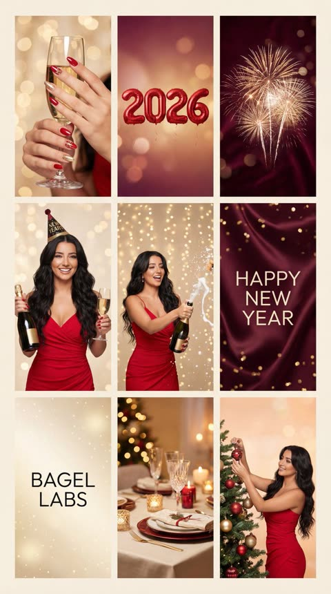</a>

采用结构化 JSON 提示词，固定同一位模特，用九宫格逐格描述场景，并统一相机与布光。明确列出唯一允许的可读文字（BAGEL LABS、HAPPY NEW YEAR、2026），这是三个词能清晰渲染的关键。

Nano Banana Pro · 文生图 · 出处: [@astronomerozge1 on X](https://x.com/astronomerozge1/status/2006423399443148854) · 46 赞，统计于 2026-10-29

[`new-year`](tags.md#tag-new-year) [`contact-sheet`](tags.md#tag-contact-sheet) [`luxury`](tags.md#tag-luxury) [`christmas`](tags.md#tag-christmas)

<details><summary><b>提示词</b></summary>

```text
{
  "generation_request": {
    "meta_data": {
      "tool": "NanoBanana Pro",
      "task_type": "text_to_image_ultra_photoreal_nye_luxury_brand_contact_sheet_ad_campaign",
      "version": "v2.2",
      "priority": "high"
    },
    "output_settings": {
      "aspect_ratio": "4:5",
      "orientation": "portrait",
      "resolution": "ultra_high_res",
      "render_style": "ultra_photoreal_beauty_editorial_luxury_ad",
      "sharpness": "crisp_but_natural",
      "film_grain": "none_or_minimal",
      "color_grade": "warm_luxury_clean_true_to_life"
    },
    "creative_prompt": {
      "global_scene_summary": {
        "en": "Ultra-photoreal luxury brand New Year (NYE) ad post in a 3x3 contact sheet collage (nine panels). ONE consistent model repeated across all panels: hair worn down, long voluminous glossy dark waves with lift at the roots; lean, fit runway physique; high-fashion attractive look. Skin is luminous with realistic texture and premium editorial retouch (no plastic smoothing). Makeup: defined brows, clean eyeliner, soft bronzy blush, bold red lipstick.\n\nBackgrounds are NOT white: each panel uses a warm, color-rich luxury holiday studio backdrop, cohesive as a single campaign. Palette stays premium and consistent across the 3x3: champagne gold, deep burgundy, creamy ivory, soft peach, warm amber bokeh, subtle red-gold gradients, satin/velvet backdrop textures. Atmosphere: warm, inviting, sensual, elegant, high-end.\n\nLighting: luxury beauty studio lighting (large soft key + fill + controlled rim) plus tasteful warm practical bokeh/fairy lights. Face and critical objects/text are tack sharp. Camera: 85mm beauty lens look; portraits at f/4–f/5.6 for creamy bokeh; text/balloons/nails at f/8 for maximum legibility; ISO 100; shutter 1/160.\n\nReadable text is allowed ONLY for: 'BAGEL LABS', 'HAPPY NEW YEAR', '2026'. Typography must be modern bold sans-serif, elegant kerning, perfectly spelled, centered, and fully legible. No other text, no extra logos, no watermark."
      },
      "composition": {
        "layout": "3x3 grid collage, consistent warm-ivory gutters, perfect alignment",
        "framing": "mix of macro detail, tight beauty close-ups, and medium shots; premium ad look",
        "focus": "model face + allowed text are tack sharp; backgrounds controlled bokeh/gradients"
      },
      "lighting_and_camera": {
        "lighting": "luxury holiday studio: large soft key + fill + subtle rim; warm practical bokeh lights; controlled specular highlights",
        "lens": "85mm beauty lens look",
        "aperture_strategy": "portraits f/4–f/5.6; nails/typography/balloons f/8",
        "iso": "100",
        "shutter": "1/160",
        "avoid": "moody harsh shadows, neon club lighting, dirty backdrops, cheap props"
      },
      "brand_art_direction": {
        "mood": "luxury holiday, warm, inviting, high-fashion, celebratory",
        "palette": [
          "champagne_gold",
          "deep_burgundy",
          "creamy_ivory",
          "soft_peach",
          "warm_amber_bokeh",
          "subtle_red_gold_gradient"
        ],
        "materials": "premium satin/velvet backdrops, tasteful metallic reflections, elegant bokeh fairy lights"
      },
      "panel_plan_3x3": {
        "row_1": {
          "panel_1_top_left": {
            "scene": "Macro close-up of NYE-themed manicure: ultra-sharp nails with modern elegant design (red + gold micro-stars/foil). Background: champagne-gold bokeh + creamy satin texture. Realistic skin texture and perfect hand anatomy.",
            "notes": "No extra fingers; no jewelry branding; premium look."
          },
          "panel_2_top_center": {
            "scene": "Four separate red balloons forming '2026' side-by-side: '2' '0' '2' '6' as individual balloons. Background: soft burgundy-to-amber gradient with warm bokeh. Balloons look premium and photoreal (foil/latex feel), strings neat.",
            "notes": "2026 must be perfectly readable and undistorted."
          },
          "panel_3_top_right": {
            "scene": "Elegant fireworks burst in gold-white sparkles with thin light trails, minimal smoke. Background: deep burgundy velvet-like backdrop with subtle warm bokeh; high-end editorial composite feel.",
            "notes": "Clean, premium, not chaotic."
          }
        },
        "row_2": {
          "panel_4_middle_left": {
            "scene": "Model in a luxurious red dress (silk/satin look) wearing an elegant NYE party hat (velvet/satin, not cheap plastic). She holds a champagne bottle and a flute in a classy celebratory pose. Background: warm ivory backdrop with gold bokeh lights.",
            "notes": "Bottle label must be generic/unreadable; no brands."
          },
          "panel_5_middle_center": {
            "scene": "Hero shot: model in the red dress pops champagne. Ultra-photoreal splash/foam droplets frozen mid-air, dramatic but clean; foam does NOT cover the face. Background: champagne-gold gradient with dense but tasteful warm fairy-light bokeh; luxury ad vibe.",
            "notes": "No artifact shapes; no messy spill; face remains sharp."
          },
          "panel_6_middle_right": {
            "scene": "Typography panel: 'HAPPY NEW YEAR' in a modern elegant sans-serif, perfectly kerned, centered, and fully legible. Background: deep burgundy satin texture with minimal gold bokeh/confetti (very subtle, not interfering with readability).",
            "notes": "Only this text, nothing else."
          }
        },
        "row_3": {
          "panel_7_bottom_left": {
            "scene": "Typography panel: 'BAGEL LABS' in modern luxury holiday styling. Background: creamy ivory with a subtle champagne-gold gradient and micro star bokeh. Premium, minimal, elegant.",
            "notes": "Only 'BAGEL LABS' text, perfectly readable."
          },
          "panel_8_bottom_center": {
            "scene": "NYE dinner close-up: premium styled table detail (linen, red-gold accents, crystal glassware, candle glow feel) with warm bokeh background. Editorial ad styling, clean composition, appetizing but minimal.",
            "notes": "No readable labels or brands; no clutter."
          },
          "panel_9_bottom_right": {
            "scene": "Model decorating a minimalist luxury Christmas/New Year tree with red and gold ornaments and warm mini-lights. She’s in the same red dress, smiling naturally. Background: warm peach-to-ivory gradient with bokeh; cozy and elegant.",
            "notes": "Single model; perfect anatomy; consistent hair/makeup."
          }
        }
      },
      "hard_constraints": [
        "ONE model only, repeated consistently across panels (no identity drift)",
        "3x3 grid collage with perfect alignment and consistent gutters",
        "Luxury warm color-rich backgrounds (no pure white backdrops)",
        "Hair down: long, voluminous, glossy dark waves with root lift",
        "Lean, fit runway physique; high-fashion look",
        "Red dress on panels: middle-left, middle-center, bottom-right",
        "Middle-center hero panel: champagne popping with clean frozen splash; face not covered",
        "Top-center: '2026' as four separate red balloons (2 0 2 6), perfectly readable",
        "Middle-right: 'HAPPY NEW YEAR' perfectly readable, modern elegant sans-serif",
        "Bottom-left: 'BAGEL LABS' perfectly readable, modern elegant sans-serif",
        "Top-left: macro NYE manicure, ultra sharp",
        "Top-right: elegant fireworks, clean premium look",
        "Bottom-center: NYE dinner, premium editorial styling",
        "Only readable text allowed: BAGEL LABS, HAPPY NEW YEAR, 2026",
        "No other logos/brands/text, no watermark",
        "Photoreal skin texture; no plastic smoothing",
        "Hands/fingers anatomically correct; no extra fingers"
      ]
    },
    "negative_prompt": [
      "misspelled text",
      "garbled letters",
      "any readable text other than: BAGEL LABS, HAPPY NEW YEAR, 2026",
      "extra logos",
      "watermark",
      "cheap party aesthetic",
      "neon nightclub look",
      "dirty or cluttered background",
      "multiple different models",
      "identity drift",
      "anime",
      "cartoon",
      "cgi look",
      "plastic skin",
      "over-smoothed skin",
      "deformed hands",
      "extra fingers",
      "blurred typography",
      "blurred 2026 balloons",
      "blurred nails",
      "low resolution",
      "hair tied up",
      "flat lifeless hair",
      "visible alcohol brand labels",
      "messy champagne splash covering face",
      "artifact shapes on gradients",
      "bokeh overlapping the text"
    ]
  }
}
```

</details>

<a id="nano-banana-kawaii-kitten-three-panel-portrait-collage"></a>
### 少女与小猫的三格可爱人像拼贴

<a href="https://x.com/TheVirtualMuse/status/2110359043495846250"></a>

提示词先用参考图锁定人物身份,再固定服装、小猫和分格布局,让三格保持一致。每格单独指定表情和动作,手绘爱心与思考气泡只作为浅灰影棚背景上的轻量点缀。

Nano Banana 2.1 · 上传图改图 · 出处: [@TheVirtualMuse on X](https://x.com/TheVirtualMuse/status/2110359043495846250) · 42 赞，统计于 2026-10-29

[`kawaii`](tags.md#tag-kawaii) [`portrait-collage`](tags.md#tag-portrait-collage) [`cat`](tags.md#tag-cat) [`korean-editorial`](tags.md#tag-korean-editorial) [`identity-preserve`](tags.md#tag-identity-preserve)

<details><summary><b>提示词</b></summary>

```text
Using the uploaded reference photo, create an ultra-realistic, high-resolution 9:16 vertical Korean-inspired kawaii editorial portrait collage featuring the exact same young woman. Strictly preserve her facial identity, eyes, nose, lips, facial structure, and natural skin texture.

Divide the composition into three perfectly equal horizontal panels, separated by thin, clean white lines. Each panel must show a complete, beautifully framed close-up portrait with no awkward cropping.

STYLE & OUTFIT:
Soft, voluminous dark hair styled in a slightly messy high bun with delicate loose strands and a pink floral scrunchie. She wears a cozy cream knitted cardigan with tiny pink floral patterns, a delicate cream lace-trimmed inner top, and a minimalist silver necklace. Naturally rosy cheeks, soft pink lips, expressive eyes, and realistic skin texture.

CAT:
The same adorable, extremely fluffy grey-and-white Ragdoll kitten with big crystal-blue eyes, a tiny pink nose, and soft pink paw pads appears consistently in all three panels.

PANEL 1 — PLAYFUL CUTENESS:
She gently cuddles the fluffy kitten against her cheek, making an adorable tiny pout toward the camera. The kitten looks directly at the viewer with wide blue eyes, both fluffy front paws clearly visible. A tiny white cream dot on her nose adds playful charm.

PANEL 2 — SWEETEST MOMENT:
She rests her cheek against the peacefully sleeping kitten, giving the camera a cute, natural wink and a gentle closed-mouth smile. Both look comfortable and affectionate, creating a heartwarming portrait.

PANEL 3 — DREAMY CONNECTION:
She rests her cheek on one hand while holding the kitten close. The kitten gazes lovingly up at her with curious blue eyes as she looks thoughtfully to the side. Soft, innocent, naturally adorable expressions.

BACKGROUND & DETAILS:
Clean, minimal soft-grey studio background. Add a few delicate hand-drawn pastel pink and white hearts, tiny cat doodles, and playful thought bubbles around the subjects, without cluttering the composition.

PHOTOGRAPHY:
Premium Korean lifestyle editorial photography, professional DSLR quality, 85mm portrait lens, beautifully diffused studio lighting, perfectly sharp faces, detailed eyelashes, realistic hair strands, visible knitted fabric textures, and exceptionally detailed kitten fur. Soft pastel color grading, balanced contrast, natural highlights, and gentle depth of field.

FINAL QUALITY:
Photorealistic, crystal-clear, beautifully composed, irresistibly cute, premium Instagram-worthy aesthetic. Maintain identical facial identity, hairstyle, outfit, and kitten appearance across all three panels. Natural human proportions, accurate hands and paws, no facial distortion, no excessive skin smoothing, no artificial CGI or plastic appearance.
```

</details>

<a id="nano-banana-christmas-dog-3x3-grid-cards"></a>
### 一只毛茸茸的狗的九张圣诞肖像

<a href="https://x.com/VibeMarketer_/status/1995520270824804642">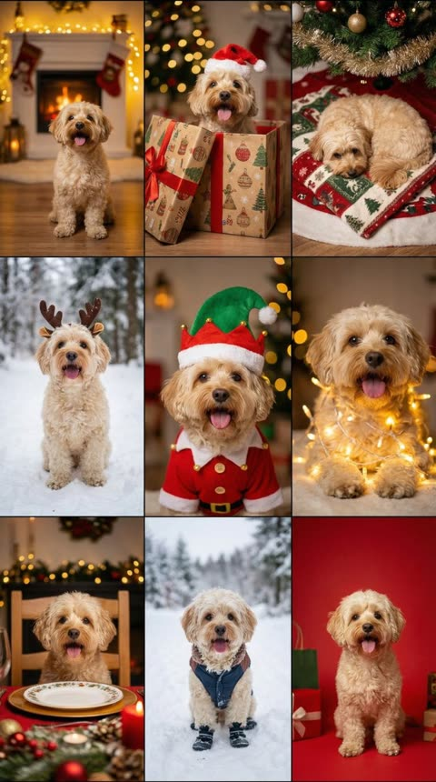</a>

参考照片锁定狗的外形，再用九个具体场景覆盖布景、道具和棚拍风格，让整组看起来像同一套节日卡片。统一的暖色调、红绿金配色和电影感光线使九宫格保持协调。

Nano Banana Pro · 上传图改图 · 出处: [@VibeMarketer_ on X](https://x.com/VibeMarketer_/status/1995520270824804642) · 31 赞，统计于 2026-10-29

[`christmas`](tags.md#tag-christmas) [`dog`](tags.md#tag-dog) [`pet-portrait`](tags.md#tag-pet-portrait) [`grid`](tags.md#tag-grid)

<details><summary><b>提示词</b></summary>

```text
Create a full Instagram-style 3×3 grid composed of nine different portrait images, all featuring the same dog from the attached reference photo.

Use the reference photo only to ensure perfect likeness of the dog:
– same fur color and pattern
– same face shape
– same proportions
– same expression style

Christmas-Themed Scenario Requirements
Each of the nine tiles should place the dog in a unique, heartwarming, funny, or cinematic Christmas scene, as if the dog is starring in her own holiday card collection.
Include a variety of concepts such as:

Classic Christmas Settings
Dog sitting in front of a decorated Christmas tree
Dog by a fireplace with stockings and warm golden lights
Dog wrapped in soft Christmas lights or garlands (safe, relaxed vibe)
Funny Holiday Scenarios
Dog dressed as Santa’s little helper
Dog popping out of a Christmas gift box
Dog wearing reindeer antlers, Santa hat, or cozy scarf
Dog sitting proudly at a holiday dinner table like she’s hosting
Outdoor Winter Magic
Dog in a snowy forest with falling snow
Dog wearing winter booties or a tiny jacket
Dog on a sled or beside a snowman

Cozy Indoor Moments

Dog lying on a holiday blanket with hot cocoa props
Dog curled up under a Christmas tree skirt
Dog “helping” wrap presents
Studio & Commercial Holiday Looks

Clean studio shots with bold red/green backdrops

Gift-wrapped product-style poses
“Holiday catalog” aesthetic with soft lighting

Image Quality & Aesthetic Requirements

All images must be hyperrealistic, with:

Accurate fur texture
Clean, consistent likeness across all nine shots
Professional depth of field
Cinematic lighting and holiday color tones
Warm, festive color grading (reds, greens, golds)
Sharp details and high-end portrait quality
Balanced aesthetic across the grid (feels like a unified Christmas card set)

Final Deliverable

A 3×3 Instagram-style grid of nine separate 3:4 ratio hyperrealistic Christmas-themed portraits featuring ONLY the dog.
```

</details>

<a id="gpt-image-checkerboard-sweater-portrait-collage"></a>
### 红白格毛衣六格人像拼贴

<a href="https://x.com/Ziha_ai/status/2116013855700910157">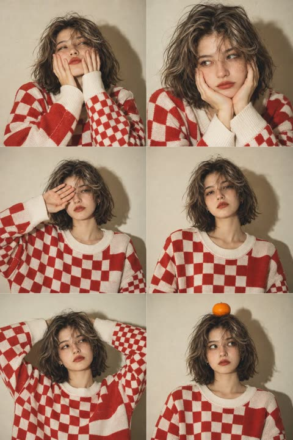</a>

先固定同一人物、服装和房间，再用六个编号的姿势逐格描述，使六格中的人物保持一致。正面闪光灯打在米色墙面上形成硬阴影，并带出颗粒感的 35mm 胶片质感。

GPT Image 2.5 · 文生图 · 出处: [@Ziha_ai on X](https://x.com/Ziha_ai/status/2116013855700910157) · 3 赞，统计于 2026-10-29

[`fashion`](tags.md#tag-fashion) [`portrait`](tags.md#tag-portrait) [`collage`](tags.md#tag-collage) [`film-look`](tags.md#tag-film-look)

<details><summary><b>提示词</b></summary>

```text
Create a highly realistic 6-panel fashion portrait collage arranged in a clean 2-column × 3-row grid. The same young East Asian woman appears consistently in all six photographs, maintaining identical facial features, hairstyle, clothing, and overall appearance.

Subject: A beautiful young woman with a short, naturally styled black bob haircut, soft center-parted bangs, fair natural skin, delicate facial features, subtle makeup, and a calm, slightly playful expression.

Outfit: An oversized red-and-white checkerboard knitted sweater with a bold chessboard pattern, cream-white ribbed neckline, and long loose sleeves. The sweater has a cozy, relaxed vintage streetwear aesthetic.

Six different poses and expressions:

1. Top-left: The woman stands facing the camera, gently pressing both palms against her cheeks, with a few strands of hair falling across her face. A slightly playful, sleepy expression.
2. Top-right: An intimate close-up portrait. She rests her face between both hands, elbows slightly raised, looking directly into the camera with softly pursed lips.
3. Middle-left: A medium portrait with one hand covering part of her forehead and one eye, looking quietly toward the camera.
4. Middle-right: A straight-on upper-body portrait with both arms relaxed, looking directly at the camera with a subtle, natural expression.
5. Bottom-left: A relaxed pose with both arms placed behind her head, elbows extending outward, wearing a calm and confident expression.
6. Bottom-right: A playful straight-on portrait with a small bright orange placed on top of her head, looking directly at the camera with a slightly surprised expression.

Photography and environment: All six photographs are taken against a simple warm beige wall in a minimal indoor setting. Direct on-camera flash creates distinct, slightly hard shadows behind the subject. Soft warm color tones, natural skin texture, subtle film grain, slightly faded colors, gentle analog noise, and authentic 35mm film photography.

Composition: Perfectly aligned six-photo contact sheet, two equal-width columns and three equal-height rows, clean straight panel divisions, consistent camera distance and color grading. Mix close-up portraits and medium shots while keeping the same person recognizable in every frame.

Visual style: Vintage Japanese and Korean fashion editorial photography, nostalgic 1990s film aesthetic, candid studio snapshots, minimalist styling, natural imperfections, realistic facial details, premium analog photography.

Aspect ratio: 2:3 vertical.
Quality: Ultra-photorealistic, high detail, natural proportions, realistic hands, consistent character identity across all six panels.

Important: Generate one complete six-panel collage, not six separate images. No text, no watermarks, no additional people.
```

</details>

<a id="gpt-image-anime-candid-snapshot-grid-nine-panels"></a>
### 同一角色的九宫格动漫随手拍

<a href="https://x.com/8co28/status/2099164852560539975"></a>

以参考图锁定角色,再按编号逐格指定构图,如动态模糊、手指遮镜头、剪影和背影。颗粒感与多种光线营造业余随手拍质感,并用统一服装约束保证整组一致。

GPT Image 2.5 · 上传图改图 · 出处: [@8co28 on X](https://x.com/8co28/status/2099164852560539975)

[`anime`](tags.md#tag-anime) [`grid`](tags.md#tag-grid) [`candid`](tags.md#tag-candid) [`character-consistency`](tags.md#tag-character-consistency) [`slice-of-life`](tags.md#tag-slice-of-life)

<details><summary><b>提示词</b></summary>

```text
Using the provided reference image as the character base, generate a 3x3 grid of 9 distinct square panels. Each panel should depict the same character in different candid, slice-of-life scenarios, styled to look like casual snapshots or social media posts.

Layout: A perfectly aligned 3x3 grid with thin white borders separating the panels.

Style & Atmosphere: The overall aesthetic should be soft, slightly grainy, and naturalistic, mimicking amateur photography. Use varied lighting conditions (daylight, indoor warm light, dusk) and camera angles (close-ups, medium shots, full-body shots).

Panel Content Instructions:
1. Top Left: Motion blur effect, character looking back over shoulder outdoors.
2. Top Center: Character sitting at a cafe table with an iced coffee drink in the foreground, resting chin on hand.
3. Top Right: Close-up selfie angle, partially obscured by a finger or thumb covering part of the lens.
4. Middle Left: Character making a peace sign near their face, winking or squinting against bright sunlight.
5. Middle Center: Silhouette shot against a bright window, standing indoors.
6. Middle Right: Low-angle street shot, character walking past a concrete wall.
7. Bottom Left: Extreme close-up of face, mouth open in surprise or mid-speech.
8. Bottom Center: Night/dusk scene, character walking away down a dimly lit street with streetlights.
9. Bottom Right: Rear view of character walking along a sidewalk next to a fence.

Constraints: Maintain consistent character design (hair color, outfit details like the oversized dark hoodie/sweater and shorts) across all panels. Ensure high variety in composition and mood.
```

</details>

<a id="gpt-image-cafe-photo-cartoon-doodle-overlay"></a>
### 咖啡馆写实照片叠加卡通咖啡涂鸦

<a href="https://x.com/Jawad_Rahman_/status/2049796647237066971"></a>

把画面拆成写实摄影层和 2D 卡通叠加层，并逐一点名漂浮的卡通元素。黄金时段光线与浅景深让人物保持清晰，涂鸦依然鲜明。

GPT Image 2 · 文生图 · 出处: [@Jawad_Rahman_ on X](https://x.com/Jawad_Rahman_/status/2049796647237066971) · 发现于 [freestylefly/awesome-gpt-image-2](https://github.com/freestylefly/awesome-gpt-image-2)

[`photo-cartoon-mix`](tags.md#tag-photo-cartoon-mix) [`cafe`](tags.md#tag-cafe) [`doodle-overlay`](tags.md#tag-doodle-overlay) [`golden-hour`](tags.md#tag-golden-hour) [`pop-art`](tags.md#tag-pop-art)

<details><summary><b>提示词</b></summary>

```text
A trendy young woman sitting at an outdoor café table, holding a hot coffee cup near her lips. She has short curly black hair and wears oversized tinted sunglasses, a cropped beige sweater, loose brown high-waisted pants, and chunky white sneakers. A tote bag with minimal coffee-themed illustrations hangs on her shoulder.

The scene blends realistic photography with playful 2D cartoon overlays. Floating around her are animated coffee elements: a smiling cappuccino cup with heart-shaped latte art, cute coffee beans with tiny faces, and stylized splashes of caramel forming comic-style shapes. Soft doodle steam rises into hearts and stars.

On the table: a croissant, a notebook with sketch drawings, and a second coffee cup.

Background: a realistic cozy café street with brick walls, plants, warm golden hour lighting, and soft shadows. Slight depth of field, subject in sharp focus.

Style: mix of photorealism and vibrant cartoon illustration, pop-art aesthetic, high saturation but warm tones, clean composition, Instagram-worthy, soft glow, 4k detail.
```

</details>

<a id="gpt-image-chibi-avatar-scrapbook-cozy-selfie"></a>
### 舒适自拍周围的Q版贴纸手账

<a href="https://x.com/xRahultripathi/status/2050478421109817749"></a>

提示词先锁定真人主体不变，再逐条列出不重复的Q版动作，让每个贴纸都不一样。位置规则把贴纸限制在边缘和空白处，固定配色与手写短语让涂鸦呼应霓虹氛围。

GPT Image 2 · 上传图改图 · 出处: [@xRahultripathi on X](https://x.com/xRahultripathi/status/2050478421109817749) · 发现于 [YouMind-OpenLab/awesome-gpt-image-2](https://github.com/YouMind-OpenLab/awesome-gpt-image-2)

[`chibi`](tags.md#tag-chibi) [`sticker`](tags.md#tag-sticker) [`scrapbook`](tags.md#tag-scrapbook) [`selfie`](tags.md#tag-selfie) [`kawaii`](tags.md#tag-kawaii)

<details><summary><b>提示词</b></summary>

```text
Chibi Avatar Scrapbook Photo Prompt (Based on Uploaded Female Portrait)

Use the uploaded image of a young woman as the base. Do NOT add any new person. Transform the existing subject into a chibi scrapbook-style composition while fully preserving her real identity, face, hairstyle, long soft brown hair, natural makeup, black outfit, pose, lighting, and cozy indoor aesthetic.

[Theme Detection]
The scene reflects a cozy lifestyle / selfie / workspace vibe with soft lighting, aesthetic room elements, a motivational neon sign, and a laptop desk setup. Maintain a calm, stylish, slightly productive lifestyle mood throughout.

[Chibi Avatars]
Add 5–8 chibi mini versions of the SAME girl:
- same long soft brown hair (slight waves)
- same outfit tone (black top)
- same gentle, confident expression

Style:
- kawaii chibi sticker style
- big head, small body proportions
- expressive cute eyes
- soft pastel shading
- clean, high-quality sticker finish

[Chibi Actions – no repetition]
- holding coffee 
- working on laptop 
- taking selfie 
- relaxed leaning pose
- peace sign 
- thinking pose 
- stretching / chill pose
- smiling & waving 

[Sticker Placement]
- Place chibi avatars around edges and empty areas only
- Do NOT cover the main face or body
- Add white outline + soft drop shadow
- Slight floating sticker effect

[Doodles]
Add subtle scrapbook-style doodles:
- hearts, sparkles, stars, arrows
- aesthetic lines and circles
- soft glowing accents

Color palette:
white + warm yellow + soft pink (matching neon vibe)

[Handwritten Text]
Add 5–8 short aesthetic phrases:
- "just me "
- "soft life"
- "stay cozy"
- "little moments"
- "focus mode"
- "good vibes only"
- "create & grow"
- "be you "

Style:
- handwritten font
- white text with soft glow
- selective highlights in pink/yellow

[Composition]
- Center focus: real girl (unchanged)
- Surround with chibi stickers + doodles + text
- Keep layout balanced, clean, not cluttered

[Style Keywords]
realistic photo + chibi stickers, kawaii aesthetic, cozy lifestyle, warm lighting, scrapbook diary, soft glow, high detail, Instagram aesthetic

[Final Output]
A polished, high-quality, social-media-ready scrapbook image combining:
realistic subject + cute chibi extensions + aesthetic doodles

[Avoid]
- altering facial identity
- over-beautifying or AI face distortion
- cluttered composition
- unrelated/random elements
- covering the subject
```

</details>

<a id="gpt-image-chibi-scrapbook-milan-vacation-photo"></a>
### 米兰旅行照的Q版手账拼贴

<a href="https://x.com/CallMeDiegoJr/status/2051234005568090505"></a>

先删除路人，再要求多个与本人发型和服装一致的Q版小人，各自做不同的当地活动。白色和粉色手绘涂鸦（箭头、星星、爱心）加上与城市相关的手写短句，营造手账感。

GPT Image 2 · 上传图改图 · 出处: [@CallMeDiegoJr on X](https://x.com/CallMeDiegoJr/status/2051234005568090505) · 发现于 [YouMind-OpenLab/awesome-gpt-image-2](https://github.com/YouMind-OpenLab/awesome-gpt-image-2)

[`chibi`](tags.md#tag-chibi) [`scrapbook`](tags.md#tag-scrapbook) [`travel`](tags.md#tag-travel) [`doodles`](tags.md#tag-doodles) [`photo-transformation`](tags.md#tag-photo-transformation)

<details><summary><b>提示词</b></summary>

```text
remove the people around the main character, Add multiple small, cute chibi-style “mini versions” of her around the image. Each mini character should have a big head, expressive facial features, and match her hairstyle and outfit. Depict each mini version doing different vacation-related activities in italy. Enhance the image with playful, hand-drawn doodles and handwritten notes in white and pink ink, in a scrapbook style. Include elements like arrows, stars, hearts, sparkles, and sketchy lines. Add cute, handwritten vacation-themed phrases about Milan Italy.
```

</details>

<a id="gpt-image-earth-signs-chibi-scrapbook-portrait"></a>
### 地象星座手账肖像与三个Q版分身

<a href="https://x.com/ZaraIrahh/status/2053075976469512686"></a>

提示词先用参考图锁定人物身份，再为每个星座Q版分身指定独立的服装和发型，让三个分身各有区别。手写文字与信息气泡的原文加上涂鸦清单，构成手账叠加层。

GPT Image 2 · 上传图改图 · 出处: [@ZaraIrahh on X](https://x.com/ZaraIrahh/status/2053075976469512686) · 发现于 [freestylefly/awesome-gpt-image-2](https://github.com/freestylefly/awesome-gpt-image-2)

[`scrapbook`](tags.md#tag-scrapbook) [`chibi`](tags.md#tag-chibi) [`zodiac`](tags.md#tag-zodiac) [`reference-photo`](tags.md#tag-reference-photo) [`doodle-overlay`](tags.md#tag-doodle-overlay)

<details><summary><b>提示词</b></summary>

```text
CREATE A NEW IMAGE USING THE PROVIDED FEMALE SUBJECT AS THE ONLY REFERENCE. Preserve her exact facial features, identity, and characteristics with zero alteration.

MAIN SUBJECT — EARTH ELEMENT
She represents the Earth element as a whole: grounded, elegant, sensual, calm, stable, patient, quietly powerful, and naturally luxurious. Relaxed grounded posture, standing or seated, soft natural hand placement, composed feminine body language, rooted presence.

OUTFIT
Single cohesive Earth-inspired editorial look in olive, sage, taupe, mocha, beige, clay, cream, moss, and warm neutrals. Soft-structured elegant silhouette with subtle tailoring, draping, texture contrast, or layered structure. Fabrics: linen, cotton, matte satin, knit, suede-like textures, soft tailoring. Minimal refined gold or natural-toned accessories.

HAIR
Soft ash brown with natural dimension. Healthy, polished, softly voluminous waves or smooth blowout with subtle shine, controlled texture, face-framing strands, grounded and luxurious feel.

MAKEUP
Korean soft-glow base with earthy tones. Warm beige-rose, terracotta, tawny, or nude peach blush. Eyes in taupe, mocha, caramel, muted bronze, olive-brown. Soft liner, champagne-beige highlight, satin or velvet nude/mocha lips. Overall polished, sensual quiet-luxury aesthetic.

ENVIRONMENT
Grounded editorial Earth-inspired setting with stone, wood, linen, botanicals, dried plants, natural fabrics, rustic-luxury styling, warm daylight or diffused editorial lighting, soft shadows, serene cinematic stillness. Palette: cream, olive, moss, clay, taupe, beige, muted green, warm brown.

CHIBI MINI-ME SYSTEM
Surround her with multiple medium-sized realistic 3D chibi mini-me versions with identical face, hair, and identity. High-end doll-like styling with oversized heads, petite bodies, glossy eyes, realistic hair, detailed makeup, miniature fashion outfits, soft cinematic 3D lighting.

EARTH SIGN CHIBIS
Taurus — sensual soft-luxury romantic styling, knit or elegant feminine neutral outfit, rich textures, gold accents. Ultra-long segmented twin low ponytails tied with white fabric bands flowing dramatically around the frame.
Virgo — refined perfectionist aesthetic with polished minimalist tailoring, clean lines, structured mini dress or sophisticated co-ord styling.
Capricorn — sleek power-dressing with blazer dress or tailored set, sharp silhouette, understated luxury. Hair pulled into ultra-long sculptural braid wrapped with gold chains and metallic ornaments.

DOODLES + SCRAPBOOK OVERLAY
Hand-drawn earthy scrapbook doodles: leaves, vines, flowers, branches, mushrooms, butterflies, stars, sparkles, stones, hearts, sun doodles, botanical icons. Cozy ink-pen texture.

Handwritten text:
“EARTH SIGNS”
“grounded and glowing”
“soft strength”
“rooted in beauty”
“quiet luxury”
“stable energy”
“calm power”
“naturally magnetic”

Fact bubbles:
“Element: Earth”
“Signs: Taurus, Virgo, Capricorn”
“Traits: grounded, loyal, elegant”
“Energy: stable, refined, dependable”

COMPOSITION
Main subject centered and dominant. Chibis placed dynamically around shoulders, hands, sides, and lower frame. Doodles layered naturally throughout like a scrapbook. Balanced, expressive, premium composition.

STYLE
Cinematic editorial lifestyle image, fashion-meets-illustration hybrid, high detail, sharp focus, warm neutral tones, subtle realism grain, realistic human rendering with stylized 3D chibis and hand-drawn overlays. Social-media-ready premium aesthetic.

CAMERA
Eye-level or slightly above, medium full-body or 3/4 framing, 35mm or 50mm lifestyle portrait look, crisp details with soft atmospheric depth.
```

</details>

<a id="gpt-image-eight-look-casual-outfit-editorial-collage"></a>
### 八套日常穿搭编辑拼贴，配手写标注

<a href="https://x.com/aiwithaly/status/2052218645951205463"></a>

要求八套造型保持同一张脸，并用比例暗示身高而不直接写出数字。禁用网格和边框让版面自由错落，手写箭头和标签标出关键单品。

GPT Image 2 · 上传图改图 · 出处: [@aiwithaly on X](https://x.com/aiwithaly/status/2052218645951205463) · 发现于 [freestylefly/awesome-gpt-image-2](https://github.com/freestylefly/awesome-gpt-image-2)

[`fashion`](tags.md#tag-fashion) [`outfit-collage`](tags.md#tag-outfit-collage) [`editorial`](tags.md#tag-editorial) [`handwritten-labels`](tags.md#tag-handwritten-labels) [`consistent-face`](tags.md#tag-consistent-face)

<details><summary><b>提示词</b></summary>

```text
Create a freeform fashion-editorial collage of me in 8 distinct full-body casual wear, arranged organically on a clean cream studio backdrop. Keep my face identical across all looks, w/ consistent proportions that visually read as around (height) w/o stating height. Include subtle handwritten-style arrows & labels highlighting key pieces. Avoid any grids, borders, or boxed layouts.
```

</details>

<a id="gpt-image-fashion-lookbook-burgundy-top-collage"></a>
### 酒红上衣模特的时尚画册网页拼贴

<a href="https://x.com/Mind_Boticni/status/2061310969192870028"></a>

锁定服装颜色，让同一模特在多个重复画框中以不同的放松姿势保持一致。透视倾斜、极简界面构图和购物网站美学把拼贴变成带有标题文字和配色色卡的电商画册页面。

GPT Image 2 · 文生图 · 出处: [@Mind_Boticni on X](https://x.com/Mind_Boticni/status/2061310969192870028) · 发现于 [freestylefly/awesome-gpt-image-2](https://github.com/freestylefly/awesome-gpt-image-2)

[`fashion`](tags.md#tag-fashion) [`lookbook`](tags.md#tag-lookbook) [`e-commerce`](tags.md#tag-e-commerce) [`collage`](tags.md#tag-collage) [`layout`](tags.md#tag-layout)

<details><summary><b>提示词</b></summary>

```text
Stylish fashion catalog shoot blending streetwear and luxury branding. Female model wearing burgundy slim-fit top and ivory tailored pants, posed in confident relaxed positions across multiple duplicated frames. Slight perspective tilt, dynamic layout collage, soft daylight studio lighting with warm tone grading. Modern shopping website aesthetic, minimal UI-inspired composition, high resolution fashion photography.
```

</details>

<a id="gpt-image-four-country-cultural-dress-grid"></a>
### 融合建筑服饰美食的四国连衣裙宫格

<a href="https://x.com/Gdgtify/status/2051428657571279137"></a>

用函数式模板为每个国家设定建筑、服饰、美食三个锚点，并指定纹理、材质与颜色，再要求设计位于三者正中心的连衣裙。2x2 宫格输出让四个国家便于对比。

GPT Image 2 · 文生图 · 出处: [@Gdgtify on X](https://x.com/Gdgtify/status/2051428657571279137) · 发现于 [freestylefly/awesome-gpt-image-2](https://github.com/freestylefly/awesome-gpt-image-2)

[`dress-design`](tags.md#tag-dress-design) [`cultural-fusion`](tags.md#tag-cultural-fusion) [`grid`](tags.md#tag-grid) [`fashion`](tags.md#tag-fashion) [`template`](tags.md#tag-template)

<details><summary><b>提示词</b></summary>

```text
<instructions> input: continent pick 4 lesser known countries in that continent function drawx($lesser known country){ > Anchor 1: "$lesser known's famous architecture" (it's texture, material and color) > Anchor 2: "$lesser known's famous fashion " (it's texture, material and color) > Anchor 3: "$lesser known's famous food " (it's texture, material and color) > > **Instruction:** Render a dress design that exists at the exact center of this triangle. } output: 2x2 grid, drawx( for each lesser known country)
```

</details>

<a id="gpt-image-gold-saints-zodiac-card-grid"></a>
### 十二黄金圣斗士星座卡牌，附中文名

<a href="https://x.com/songguoxiansen/status/2046476566537080849">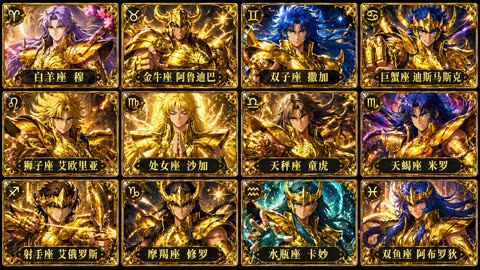</a>

明确写出 12 张、每行 4 张、16:9 画幅以及每张卡上的中文名，版式就能保持统一。每张卡都用同一套星座符号和名牌模板，十二个画面共享同一框架和风格。

GPT Image 2 · 文生图 · 出处: [@songguoxiansen on X](https://x.com/songguoxiansen/status/2046476566537080849) · 发现于 [freestylefly/awesome-gpt-image-2](https://github.com/freestylefly/awesome-gpt-image-2)

[`saint-seiya`](tags.md#tag-saint-seiya) [`zodiac`](tags.md#tag-zodiac) [`card-grid`](tags.md#tag-card-grid) [`chinese-text`](tags.md#tag-chinese-text)

<details><summary><b>提示词</b></summary>

```text
[中文]
生成圣斗士星矢12个黄金圣斗士的12宫格卡牌图片，每张卡牌上写上对应的中文名，每行4个，宽高比16:9。

[English]
Generate a 12-grid card image of the 12 Gold Saints from Saint Seiya, with the corresponding Chinese name written on each card, 4 per row, aspect ratio 16:9.
```

</details>

<a id="gpt-image-japanese-cafe-couple-dessert-scrapbook"></a>
### 日系咖啡馆情侣分享甜点写真

<a href="https://x.com/sha_zdiii/status/2054047328420634927"></a>

用方括号槽位控制服装、道具、光线、涂鸦颜色和色调，一条提示词可以生成多种变体。背景虚化的日文招牌加上画面四周的手写涂鸦，营造出真实照片与手帐拼贴结合的效果。

GPT Image 2 · 文生图 · 出处: [@sha_zdiii on X](https://x.com/sha_zdiii/status/2054047328420634927) · 发现于 [freestylefly/awesome-gpt-image-2](https://github.com/freestylefly/awesome-gpt-image-2)

[`cafe`](tags.md#tag-cafe) [`couple`](tags.md#tag-couple) [`scrapbook`](tags.md#tag-scrapbook) [`japanese`](tags.md#tag-japanese) [`template`](tags.md#tag-template)

<details><summary><b>提示词</b></summary>

```text
Ultra-realistic cozy Japanese-Korean café photography featuring a cute young [Japanese/Korean] couple sitting together naturally in a trendy aesthetic café. The young couple should look stylish and youthful, wearing [fashion style/outfit colors], smiling softly and enjoying desserts together.

The table is beautifully filled with [desserts/foods] such as pancakes, strawberry cakes, macarons, croissants, pastries, iced coffees, matcha lattes, fruit desserts, and aesthetic drinks arranged in a visually satisfying composition. Add small aesthetic café props like [flowers/ribbons/books/candles/pearls/notebooks] on the table for a premium Pinterest moodboard feel.

Soft [lighting style] lighting enters through the café windows creating dreamy highlights, creamy shadows, glossy reflections on drinks, and realistic dessert textures. Background should contain softly blurred [Japanese/Korean] signs, glowing café boards, handwritten Japanese text, neon typography, and aesthetic city café elements for an authentic Tokyo/Seoul vibe.

Add cute scrapbook-style doodles and handwritten notes around the image in [doodle color] ink — tiny hearts, stars, sparkles, ribbons, arrows, smiley sketches, bows, diary stickers, and handwritten café notes.

Color palette should focus on [color theme] tones. Style inspired by viral Pinterest café photography, Korean lifestyle aesthetics, Japanese cozy café culture, dreamy Gen-Z romance mood, shallow depth of field, cinematic composition, ultra realistic food textures, soft blurry background, ultra detailed realistic photography, clean aesthetic layout, 8k.
```

</details>

<a id="gpt-image-japanese-travel-app-collage-poster"></a>
### 日本旅行应用拼贴广告海报

<a href="https://x.com/shinojapan/status/2072208937349492857"></a>

提示词按区域规定版面,并给文字组、拼贴抠图和界面卡片逐项编号,同时直接引用日文原文以保证排版清晰。严格的绿白配色和详细的人物服装描述让整体广告风格保持统一。

GPT Image 2 · 文生图 · 出处: [@shinojapan on X](https://x.com/shinojapan/status/2072208937349492857) · 发现于 [YouMind-OpenLab/awesome-gpt-image-2](https://github.com/YouMind-OpenLab/awesome-gpt-image-2)

[`travel`](tags.md#tag-travel) [`advertising`](tags.md#tag-advertising) [`japanese-typography`](tags.md#tag-japanese-typography) [`app-ui`](tags.md#tag-app-ui) [`collage`](tags.md#tag-collage)

<details><summary><b>提示词</b></summary>

```text
Goal: Create a vibrant Japanese travel-app advertising poster for NEWT, combining editorial travel photography, clean app UI mockups, and bold Japanese typography to promote the feeling that the next trip is already beginning.

Canvas: Square 1:1 promotional graphic, bright white and mint-green background, high-key summer lighting, energetic composition, polished commercial ad quality.

Layout: A large diagonal Japanese headline dominates the top-left and upper center. The main traveler stands large in the center foreground, smiling and looking up to the right while holding a smartphone showing the green brand screen. A second traveler appears behind her on the left inside an airport scene. Layer multiple travel photo cutouts around the lower half and right side, with floating app interface cards over them. Place a large green rounded brand block on the upper-right.

Text content: Use exactly 5 main text groups: 1) huge headline text 次の旅が、もう始まってる。 in vivid green, with the first line filled and the second line outlined; 2) small upper-right Japanese copy 航空券も、ホテルも、アプリひとつで軽やかに。; 3) English tagline “TRAVEL FEELS NEW.” near the top-right; 4) left-side vertical category list with exactly 5 items: “AIRPORT”, “HOTEL”, “CITY”, “BEACH”, “FOOD”; 5) brand block text with a white animal-like logo, the word “NEWT”, and the small Japanese call-to-action “NEWTで旅をみる” with a circular arrow icon.

Subject details: Main subject is a cheerful young East Asian woman traveler, mid-20s, short dark bob hair moving naturally, gold hoop earrings, green ribbed top, loose translucent mint-and-white striped overshirt, cream high-waisted pants, woven straw shoulder bag with a small green charm, pulling a dark green rolling suitcase. She holds a phone with a green screen, white brand logo, and “NEWT” text. Secondary subject is a smiling young East Asian woman in an orange cardigan at an airport, holding a drink, with a departures board behind her.

Travel image collage: Include exactly 5 travel photo cutouts: 1) bright airport terminal with departures board behind the secondary woman, 2) luxury hotel room with ocean view, 3) close-up seafood dish with shrimp and greens near the suitcase, 4) turquoise beach and ocean with swimmers on the right, 5) colorful resort city street with palm trees along the bottom-right.

App UI cards: Include exactly 2 floating white app interface cards with rounded corners and soft shadows. Card 1 is a booking search card at mid-right with tabs for flight, hotel, and package; large destination text “ソウル”, small text “SEOUL, KOREA”, rows showing round trip, dates “6月20日(金) - 6月23日(月)”, passengers “大人1名、エコノミー”, and a green button labeled “検索する”. Card 2 is a hotel recommendation card lower-right with a pool thumbnail, small heart icon, hotel name “NEWT SEOUL 明洞”, rating “4.8”, and five yellow stars.

Visual style: Premium Japanese startup travel campaign, fresh mint green brand color, crisp cutout collage, clean sans-serif typography, dynamic diagonal composition, airy negative space, glossy magazine-ad finish, realistic photography mixed with minimal vector UI. Add a dotted flight path with a location pin near the top-right.

Constraints: Use no extra logos or watermarks beyond the specified brand. Keep all Japanese text legible and accurately placed. Maintain the strong green-and-white identity, optimistic summer travel mood, and layered depth.
```

</details>

<a id="gpt-image-korean-spring-garden-scrapbook-poster"></a>
### 韩系春日花园手帐风人像海报

<a href="https://x.com/Taaruk_/status/2060214163591614900"></a>

用逗号串联主体、服装、场景和手帐元素，如拍立得、胶带、涂鸦和手写字体。主体白色描边加上明确的版式风格词，让拼贴保持统一。

GPT Image 2 · 文生图 · 出处: [@Taaruk_ on X](https://x.com/Taaruk_/status/2060214163591614900) · 发现于 [freestylefly/awesome-gpt-image-2](https://github.com/freestylefly/awesome-gpt-image-2)

[`scrapbook`](tags.md#tag-scrapbook) [`korean-fashion`](tags.md#tag-korean-fashion) [`spring`](tags.md#tag-spring) [`doodle`](tags.md#tag-doodle) [`polaroid`](tags.md#tag-polaroid)

<details><summary><b>提示词</b></summary>

```text
Cute Korean spring aesthetic scrapbook poster, dreamy K-fashion portrait, soft blonde girl standing in a blooming flower garden, pastel blue sky background, cream floral blouse layered under a knitted ivory sweater vest, light blue high-waisted jeans, natural smile, glowing fair skin, soft makeup, cherry blossom trees, colorful spring flowers, cozy countryside garden, bright natural sunlight, kawaii doodle overlays, hand-drawn white hearts, smiley faces, stars, sparkles, rainbows, playful handwritten typography, polaroid photo frames, masking tape stickers, scrapbook collage layout, Pinterest aesthetic, Korean magazine editorial, cottagecore fashion, dreamy spring vibes, wholesome mood, soft pastel color palette, clean composition, aesthetic social media poster, ultra detailed, photorealistic, high quality, cute and charming atmosphere, subtle bokeh, lifestyle photography, Instagram reel cover, fashion moodboard, Y2K scrapbook design, white outline around subject, flower-themed decorations, 8k masterpiece
```

</details>

<a id="gpt-image-mustard-field-triptych-doodle-collage"></a>
### 油菜花田三联竖版写真拼贴与涂鸦

<a href="https://x.com/frametheory058/status/2051294907214844249"></a>

每个分格单独指定姿势和景别：背影、手伸向镜头的特写、俏皮侧倾，再用统一的服装和金色夕阳光线保持三格一致。结尾集中列出白色涂鸦、漏光和胶片颗粒等叠加效果。

GPT Image 2 · 上传图改图 · 出处: [@frametheory058 on X](https://x.com/frametheory058/status/2051294907214844249) · 发现于 [freestylefly/awesome-gpt-image-2](https://github.com/freestylefly/awesome-gpt-image-2)

[`photo-collage`](tags.md#tag-photo-collage) [`golden-hour`](tags.md#tag-golden-hour) [`flower-field`](tags.md#tag-flower-field) [`doodle-overlay`](tags.md#tag-doodle-overlay) [`editorial`](tags.md#tag-editorial)

<details><summary><b>提示词</b></summary>

```text
A high-quality 3-panel vertical photo collage of a stunning uploaded woman with soft, voluminous wavy hair glowing in golden sunlight. She is styled in a cream-colored lace-up vintage blouse with delicate textures, olive green high-waisted flowy trousers, and a wide-brimmed straw hat slightly tilted for a fashionable editorial look. Light golden jewelry (thin chains, rings) adds a subtle luxury touch.

The setting is a dreamy, vibrant yellow mustard flower field under a bright blue sky with soft clouds, enhanced by golden hour lighting for a magical glow.

Top panel: Back view of the woman standing in the field with arms wide open, sunlight creating a glowing halo around her hair, slight motion blur in flowers for a cinematic feel.

Middle panel: Close-up portrait, she smiles naturally at the camera, wind softly moving her hair, her hand reaching toward the lens creating depth and a slightly blurred foreground for a DSLR effect.

Bottom panel: Playful pose, she leans sideways in the flowers, making a double peace sign, laughing candidly, capturing an authentic joyful moment.

Add cute, trendy white doodle overlays (smiley faces, sparkles, stars, tiny hearts) with a subtle animated/sketchy feel. Include light leaks, sun flares, and soft film grain for a premium Instagram aesthetic.

Ultra-realistic, 4K, cinematic lighting, shallow depth of field, high dynamic range, natural skin tones, editorial fashion photography, soft pastel color grading.

Aspect ratio: 4:5
Style tags: viral Instagram aesthetic, Pinterest style, dreamy spring vibe, candid luxury
```

</details>

<a id="gpt-image-nine-expression-photobooth-portrait-collage"></a>
### 九宫格表情人像拼贴，黑色胶片边框

<a href="https://x.com/saniaspeaks_/status/2054046866497573214"></a>

用编号逐格描述每一格的表情和姿势，再用一段统一文字锁定服装、发型、妆容和帽子。相机型号、镜头焦段和柔和漫射光让九格风格保持一致。

GPT Image 2 · 上传图改图 · 出处: [@saniaspeaks_ on X](https://x.com/saniaspeaks_/status/2054046866497573214) · 发现于 [freestylefly/awesome-gpt-image-2](https://github.com/freestylefly/awesome-gpt-image-2)

[`portrait`](tags.md#tag-portrait) [`collage`](tags.md#tag-collage) [`photobooth`](tags.md#tag-photobooth) [`expressions`](tags.md#tag-expressions) [`streetwear`](tags.md#tag-streetwear)

<details><summary><b>提示词</b></summary>

```text
Edit this photo and don't change the face, portrait 9:16. A 9-frame fashion portrait collage featuring a stylish young woman with playful expressions and sporty streetwear aesthetics. The concept combines modern model test photography, casual Gen-Z energy, and clean editorial studio vibes. Each frame captures different candid facial expressions and subtle attitude poses, creating a cool, confident, and slightly mischievous mood. Minimalist composition with strong focus on facial expressions, cap styling, and soft fashion portrait lighting.

Frame Descriptions (9 poses)

Frame 1 – Eyes closed with playful scrunched expression, slight smile, relaxed shoulders.
Frame 2 – Looking slightly sideways with lips parted, confident casual attitude.
Frame 3 – Head tilted slightly upward, calm expression, direct cool-girl energy.
Frame 4 – Eyes closed while sticking tongue slightly out, playful candid vibe.
Frame 5 – Both index fingers pressing cheeks while making duck lips, cute playful expression.
Frame 6 – Direct eye contact with subtle smile, relaxed natural pose.
Frame 7 – Body turned sideways, hand near chin, confident editorial profile look.
Frame 8 – Eyes squeezed shut while making pout lips, exaggerated playful expression.
Frame 9 – Wrinkled nose with gritted teeth, rebellious fashion attitude.

She wears oversized black long sleeves. Soft matte fabric with sporty streetwear silhouette. Relaxed fit with slightly oversized sleeves. Black New York Yankees baseball cap worn forward and backward in different frames. Minimal jewelry. Long soft wavy blonde hair. Soft loose waves with natural texture. Middle-part hairstyle. Hair flowing naturally around shoulders. Soft glam douyin girl makeup. Dewy glass skin finish. Brushed up natural brows, winged eyeliner, wispy natural lashes, soft pink blush (igari blush style), ombre gradient rosy pink lips with glossy finish.

Background minimal white studio backdrop. Photobooth-style collage layout with black frame borders. Shot with Canon EOS R6 / Sony A7 III / Fujifilm X-T5. High-fashion portrait photography style. 50mm or 85mm portrait lens. Eye-level framing. Tight portrait crop. Centered composition. Photobooth-inspired close-up angles. Soft diffused studio lighting. Balanced frontal light. Minimal harsh shadows. Clean editorial illumination. Cool neutral tones. Slightly desaturated blacks. Soft contrast with crisp details. Subtle film grain. Modern fashion editorial color grading.
```

</details>

<a id="gpt-image-okinawa-couple-film-memory-collage"></a>
### 冲绳情侣旅行的褪色胶片十二宫格

<a href="https://x.com/genel_ai/status/2046852688491807008"></a>

要求一张拼贴里包含十二张随手拍的手机照片，并加上褪色的电影胶片质感。刻意写入手抖和随意构图，让整组画面像真实回忆而不是摆拍。

GPT Image 2 · 文生图 · 出处: [@genel_ai on X](https://x.com/genel_ai/status/2046852688491807008) · 发现于 [YouMind-OpenLab/awesome-gpt-image-2](https://github.com/YouMind-OpenLab/awesome-gpt-image-2)

[`film-look`](tags.md#tag-film-look) [`travel`](tags.md#tag-travel) [`collage`](tags.md#tag-collage) [`snapshot`](tags.md#tag-snapshot) [`japanese`](tags.md#tag-japanese)

<details><summary><b>提示词</b></summary>

```text
日本人の若い男女が沖縄旅行中にスマホで何気なく撮影した、エモーショナルな写真。12枚をコラージュ。
思い出の中の1枚のような、色あせたシネマティックな質感。 
映画のワンシーンで使えそうなカット。
手振れ感や、適当に撮影した雑な構図を再現。
```

</details>

<a id="gpt-image-red-gradient-dual-pose-portrait-collage"></a>
### 红色渐变背景的大小双人像拼贴海报

<a href="https://x.com/AvelyrahnAI/status/2061368984944201957"></a>

先让面部和发辫造型严格对应参考图，再为同一人物设定一大一小两个层次：上方大尺寸肖像，前景较小的全身舞步。服装、配饰、背景色、标题文字和水印位置都写得很明确。

GPT Image 2 · 上传图改图 · 出处: [@AvelyrahnAI on X](https://x.com/AvelyrahnAI/status/2061368984944201957) · 发现于 [YouMind-OpenLab/awesome-gpt-image-2](https://github.com/YouMind-OpenLab/awesome-gpt-image-2)

[`collage`](tags.md#tag-collage) [`reference-photo`](tags.md#tag-reference-photo) [`red-background`](tags.md#tag-red-background) [`typography`](tags.md#tag-typography) [`dual-pose`](tags.md#tag-dual-pose)

<details><summary><b>提示词</b></summary>

```text
A high-contrast, energetic digital collage on a vibrant solid red gradient background. Large uppercase text across the top reads “AvelyrahnAI” in a clean, modern font. The composition features two distinct, confident images of the same young woman, whose specific face and elaborate side-braid hairstyle are 100% accurate to the reference The large upper portrait shows her smiling confidently, wearing a light pink hoodie, stylish sunglasses on her head, and a modern wristwatch, with one hand near her hair. The second, smaller full-body image in front shows her in a dynamic, playful dancing/stepping pose, wearing a dark green button-up shirt, black tailored trousers, sunglasses, and a trendy watch. A small signature-style watermark "AvelyrahnAi creation" is on the side, and a subtle YouTube logo with link text "Pardesilog386" is at the bottom. The lighting is bright and smooth, giving a slightly airbrushed, edited Photoshop look.
```

</details>

<a id="gpt-image-shanghai-night-skyline-handwritten-travel-note"></a>
### 上海夜景天际线手写涂鸦旅行笔记

<a href="https://x.com/TanLuAI/status/2052715035940823085"></a>

先锁定照片构图，包括天空占比、地标位置和灯光颜色，再逐条写明手写文字与白色涂鸦的数量和位置。强调线条纤细、略带瑕疵，让叠加层像真实的社交平台旅行笔记。

GPT Image 2 · 文生图 · 出处: [@TanLuAI on X](https://x.com/TanLuAI/status/2052715035940823085) · 发现于 [YouMind-OpenLab/awesome-gpt-image-2](https://github.com/YouMind-OpenLab/awesome-gpt-image-2)

[`travel-journal`](tags.md#tag-travel-journal) [`night-cityscape`](tags.md#tag-night-cityscape) [`shanghai`](tags.md#tag-shanghai) [`handwritten-doodle`](tags.md#tag-handwritten-doodle) [`social-media`](tags.md#tag-social-media)

<details><summary><b>提示词</b></summary>

```text
Create a travel-journal style night cityscape poster of Shanghai Pudong skyline along the Huangpu River. Use a wide 4:3 canvas showing a realistic nighttime waterfront photo look: dark cloudy sky filling the top two thirds, illuminated skyscrapers along the horizon, the Oriental Pearl Tower on the left glowing pink-red, Shanghai Tower and other high-rises on the right with blue, purple, gold, and white lights, and reflective river water across the bottom with a small sightseeing boat. Add playful white hand-drawn diary doodles and handwritten Chinese annotations directly over the scene, like a social media travel note. Include exactly 6 handwritten text notes: “云也来散步啦” near the upper left with a dotted wandering path and small cloud, “慢慢走 慢慢看♡” near the upper right beside a crescent moon and star, “东方明珠 亮晶晶♡” pointing with an arrow to the Oriental Pearl Tower, “夜风 刚刚好♪” on the left above the river, “今晚的楼 都很会发光♡” on the right above the skyline with a curved underline, and “灯光掉进黄浦江” centered near the bottom over the water. Include exactly 15 white doodle elements: a dotted flight path across the upper left, one small outlined cloud near the top, one crescent moon at the upper right, one scalloped cloud outline near the upper center-right, one arrow pointing to the Oriental Pearl Tower, one dashed outline tracing around the Oriental Pearl Tower, three small sparkle/star icons, two music-note icons, one map-pin icon at the bottom left, two flowing wave lines across the bottom water, and one small flower doodle at the bottom right. Keep all doodles thin, casual, hand-drawn, slightly imperfect, and bright white, with no borders or watermark. The mood should be dreamy, cozy, romantic, and spontaneous, like a handwritten travel memory shared on social media.
```

</details>

<a id="gpt-image-tennis-precision-campaign-collage"></a>
### 深绿网球运动员三联广告拼图

<a href="https://x.com/AIwithkhan/status/2048606301039820821"></a>

按面板逐一描述景别与指定文字，三个画面各有分工。统一的深绿白配色、网格排版和画幅比例让整组保持一致。

GPT Image 2 · 文生图 · 出处: [@AIwithkhan on X](https://x.com/AIwithkhan/status/2048606301039820821) · 发现于 [freestylefly/awesome-gpt-image-2](https://github.com/freestylefly/awesome-gpt-image-2)

[`sports-fashion`](tags.md#tag-sports-fashion) [`campaign`](tags.md#tag-campaign) [`collage`](tags.md#tag-collage) [`typography`](tags.md#tag-typography) [`tennis`](tags.md#tag-tennis)

<details><summary><b>提示词</b></summary>

```text
Cinematic sports fashion collage, 3-panel layout, top panel large hero shot of a female tennis athlete sitting confidently on an oversized tilted tennis racket, deep green luxury court backdrop, reflective glossy floor, bold oversized typography “PRECISION” in background, dramatic editorial lighting, ultra-clean composition, high-fashion athletic aesthetic.

Bottom left panel: close-up portrait of the athlete with glowing skin, minimal makeup, soft light, text “FOCUS” and “FUEL” placed subtly.

Bottom right panel: full-body crouched pose holding racket, strong posture, text “DISCIPLINE DRIVES DOMINANCE”, grid-based layout lines, premium sports branding feel.

Consistent color grading, dark green and white palette, sharp details, cinematic shadows, luxury campaign style, 1:1 aspect ratio.
```

</details>

<a id="gpt-image-three-nyc-billboard-comparison-slide"></a>
### 三张纽约街景广告牌照片对比

<a href="https://x.com/synthwavedd/status/2086561496864047271">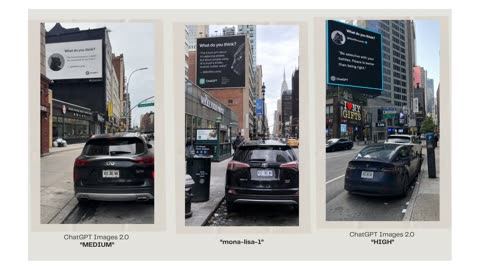</a>

固定的三联排版、米色衬边和居中说明文字，让画面像模型对比图。每张照片有各自的街道角度、光线和广告牌设定，结果有差异，概念却保持一致。

GPT Image 2 · 文生图 · 出处: [@synthwavedd on X](https://x.com/synthwavedd/status/2086561496864047271) · 发现于 [YouMind-OpenLab/awesome-gpt-image-2](https://github.com/YouMind-OpenLab/awesome-gpt-image-2)

[`billboard`](tags.md#tag-billboard) [`comparison-slide`](tags.md#tag-comparison-slide) [`street-photo`](tags.md#tag-street-photo) [`nyc`](tags.md#tag-nyc)

<details><summary><b>提示词</b></summary>

```text
Goal: Create a clean comparison graphic showing three AI-generated urban billboard photos side by side, as if comparing image model outputs.

Canvas: Wide 16:9 presentation slide with a warm off-white background and generous margins. Place three tall vertical photo panels evenly spaced across the canvas, each framed by a pale beige mat/border. Under each panel, add a centered caption.

Layout: Exactly 3 vertical street-photo panels in one row. Panel 1 on the left, Panel 2 in the center, Panel 3 on the right. Each panel shows a realistic New York City street scene with parked cars in the foreground, tall buildings, sidewalks, traffic signs, and a large square billboard mounted high on a building. Use slightly different street angles and lighting in each panel, like three separate model outputs of the same concept.

Panel details: Left panel: a rear view of a black SUV parked on a city street, looking toward storefronts and buildings; a large white billboard above the street reads like a social-media quote card with a small circular animal avatar, the heading “What do you think?”, a short quote, and small ChatGPT branding. Center panel: a black SUV parked on a narrow Manhattan street with the Empire State Building visible in the distance; a large dark billboard with white text, a circular animal avatar, and ChatGPT branding. Right panel: a black sedan parked along a busier avenue with storefront signs such as “I ♥ NY GIFTS”; a large black billboard with a bright cyan border, white quote text, a circular animal avatar, and ChatGPT branding.

Caption text: Use exactly 3 captions beneath the panels. Left caption: “ChatGPT Images 2.0” on the first line and “MEDIUM” in bold quotation marks on the second line. Center caption: “mona-lisa-1” in bold quotation marks. Right caption: “ChatGPT Images 2.0” on the first line and “HIGH” in bold quotation marks on the second line.

Customizable text slots: The comparison labels should read ChatGPT Images 2.0, mona-lisa-1, and ChatGPT Images 2.0. The left quality tag should be MEDIUM and the right quality tag should be HIGH.

Visual style: Photorealistic smartphone street photography inside each panel, but arranged as a polished social-media comparison slide. Keep the overall slide minimal, with no decorative graphics beyond the three framed images and their captions. The billboard text inside the photos may be small and partially imperfect, but it should clearly resemble AI quote-card advertising with ChatGPT logos.
```

</details>

<a id="gpt-image-tokyo-travel-vlogger-13-frame-collage"></a>
### 东京旅行博主13格手机随拍拼图

<a href="https://x.com/AIwithSynthia/status/2062383568253505904"></a>

提示词用每行格数（4、5、4）固定网格布局，再为每一格单独写明地点、机位和光线。刻意加入的手机瑕疵，如动态模糊、镜头污渍、过曝天空和噪点，让每一格都像真实随手拍。

GPT Image 2 · 文生图 · 出处: [@AIwithSynthia on X](https://x.com/AIwithSynthia/status/2062383568253505904) · 发现于 [freestylefly/awesome-gpt-image-2](https://github.com/freestylefly/awesome-gpt-image-2)

[`travel-vlog`](tags.md#tag-travel-vlog) [`grid-collage`](tags.md#tag-grid-collage) [`candid`](tags.md#tag-candid) [`tokyo`](tags.md#tag-tokyo) [`phone-photo`](tags.md#tag-phone-photo)

<details><summary><b>提示词</b></summary>

```text
Generate image of young female travel vlogger exploring Tokyo across multiple candid moments, extremely beautiful with long dark wavy hair, wearing stylish Japanese-inspired oversized streetwear, expressive and spontaneous personality, captured across a 13-frame grid collage (Row 1: 4 frames | Row 2: 5 frames | Row 3: 4 frames), each frame feels like a real casual phone capture with imperfect framing and natural inconsistencies.

Frame Breakdown

Row 1 - Frame 1 (Tokyo Tower): low angle selfie with Tokyo Tower behind her, slightly tilted horizon, sky overexposed to near white, she's mid-natural smile adjusting into frame, small lens smudge in corner, candid arrival energy.
Row 1 - Frame 2 (Shibuya street level): walking through Shibuya crossing at night, handheld motion blur, she glances back at camera mid-step, neon reflections on wet pavement, slightly shaky framing, imperfect crop.
Row 1 - Frame 3 (Convenience store): inside a brightly lit convenience store, she is holding onigiri close to camera, playful raised eyebrows, harsh fluorescent lighting flattening the scene, slight overexposure on whites, shelves softly blurred behind.
Row 1 - Frame 4 (Yoyogi park): sitting on a bench under trees, looking away from camera, quiet candid moment, soft dappled daylight, slight focus miss on eyes, subtle lens smudge bottom corner.
Row 2 - Frame 5 (Takoyaki reaction): close-up while eating single takoyaki, reacting mid-bite with laughter, slight motion blur, warm lantern light behind, face slightly out of focus due to movement.
Row 2 - Frame 6 (Vending machine night): standing in front of glowing vending machine, blue and pink light casting uneven tones on her face, pressing button casually, high ISO grain visible.
Row 2 - Frame 7 (Train reflection): her face reflected in train window at night, city lights streaking behind, layered reflection effect, slight ghosting on glass, she looks away from camera.
Row 2 - Frame 8 (Torii gate): low angle shot of her walking through a torii gate, captured from slightly behind, motion blur in her movement, bright sky causing mild lens flare.
Row 2 - Frame 9 (Digital art exhibit): inside immersive light exhibit, colored lights (blue, violet, gold) washing across her face, she looks upward in awe, slight motion blur, low-light noise visible.
Row 3 - Frame 10 (Gundam statue): low angle wide shot, she stands small in frame while large statue towers above, slight barrel distortion from phone lens, sky slightly blown out.
Row 3 - Frame 11 (Lantern alley): walking through narrow alley lit by warm lanterns, shot from behind, she glances back briefly, underexposed shadows, grainy night detail.
Row 3 - Frame 12 (Rooftop skyline): selfie with Tokyo skyline behind, arm extended, wind blowing hair partially across lens, horizon slightly tilted, warm city glow overexposed in distance.
Row 3 - Frame 13 (Nara park): crouching down in a park in Nara, she holds out a deer cracker toward a deer, the deer bows its head toward her, she bursts into genuine laughter mid-reaction, surprised and slightly leaning back, another deer nudges her from behind causing her to lose balance slightly, camera captures the moment imperfectly with slight shake and off-center framing, soft natural daylight, open park background with trees and space, unscripted chaotic energy, candid expression.

Young female travel vlogger exploring Tokyo across 13 candid moments in a grid collage, extremely beautiful with long dark wavy hair, wearing stylish Japanese streetwear, expressive and spontaneous, scenes include Tokyo Tower selfie, Shibuya crossing at night, convenience store snack moment, park bench quiet scene, takoyaki reaction, vending machine glow, train window reflection, torii gate walk, immersive light exhibit, Gundam statue low angle, lantern alley walk, rooftop skyline selfie, Harajuku street ending, each frame slightly imperfect with motion blur.
```

</details>

<a id="gpt-image-twelve-hairstyle-lookbook-same-face"></a>
### 同一人脸十二款发型对照网格

<a href="https://x.com/Ciri_ai/status/2092452220768002400"></a>

先用身份锚点逐项锁定五官特征,再用硬性规则固定背景、发色、妆容和服装,只允许发型变化。十二种发型各有简短的形态描述,配合相机参数和编号面板保持整张网格一致。

GPT Image 2 · 上传图改图 · 出处: [@Ciri_ai on X](https://x.com/Ciri_ai/status/2092452220768002400) · 发现于 [freestylefly/awesome-gpt-image-2](https://github.com/freestylefly/awesome-gpt-image-2)

[`hairstyle`](tags.md#tag-hairstyle) [`lookbook`](tags.md#tag-lookbook) [`grid`](tags.md#tag-grid) [`identity-lock`](tags.md#tag-identity-lock) [`studio-portrait`](tags.md#tag-studio-portrait)

<details><summary><b>提示词</b></summary>

```text
Create a 12-panel grid (3 columns × 4 rows, numbered 1 to 12) showing the SAME person from the reference photo with 12 different hairstyles. This is a hairstyle lookbook. Final image aspect ratio: 4:5 (vertical/portrait).
THE ONLY THING THAT CHANGES BETWEEN PANELS IS THE HAIR ON THE HEAD (shape, style and length only). Everything else stays exactly as in the reference photo.
Identity Anchor (Critical)
The face must be IDENTICAL to the reference photo in every single panel. Preserve exactly: facial bone structure, jawline, cheekbones, nose shape, lips, eye shape and spacing, eyebrows, skin tone, skin texture (pores, natural imperfections), and overall facial proportions. This is the same real person in all 12 frames. Do NOT beautify, slim, or alter the face. Same age, same expression as in the reference.
Mandatory Rules (Do Not Violate)
- NO SUNGLASSES. Eyes must be fully visible in all 12 panels.
- NO ENVIRONMENTAL BACKGROUNDS. Every panel must have a plain, uniform, solid light grey studio backdrop with zero objects, zero textures, zero gradients. Just flat neutral grey.
- Hair COLOR stays exactly as it appears in the reference photo in all 12 panels. Only the shape, length and style changes, never the color.
Keep Identical in Every Panel (Do Not Change)
- MAKEUP AND SKIN: If the person in the reference photo wears makeup, replicate it identically in every panel. Same lip color, same eye makeup, same brow grooming. If they wear no makeup, keep all panels makeup-free. Do NOT add, remove, or alter makeup between panels.
- Clothing: the same clothing visible in the reference photo, replicated exactly.
- Accessories: preserve ALL visible accessories from the reference photo (earrings, necklaces, rings, bracelets, piercings, watch, glasses, etc.). Do not omit, resize, recolor, or restyle any accessory. If the person wears prescription glasses (not sunglasses), keep them in every panel.
- Background: plain solid light grey studio backdrop in every panel. No room, no furniture, no environment.
The 12 Hairstyles
1. Pixie cut: very short, textured, slightly tousled on top with tapered sides and nape
2. Classic bob: chin-length, straight, blunt ends, clean middle part
3. Long layered waves: past the shoulders, soft voluminous waves with face-framing layers
4. Sleek low bun: hair pulled back smoothly into a tight low bun at the nape, no flyaways
5. Curtain bangs with medium-length hair: soft parted fringe framing the face, hair falling just past the shoulders
6. High ponytail: hair pulled up into a sleek high ponytail, smooth crown, length falling behind
7. French bob: short bob ending at the jawline with a soft blunt micro-fringe across the forehead
8. Long straight hair with middle part: very long, sleek, pin-straight, falling well past the shoulders
9. Shaggy wolf cut: medium length, heavy layers, choppy fringe, textured and voluminous with a slightly wild look
10. Elegant updo: hair swept up into a polished chignon with soft face-framing tendrils
11. Short curly crop: short voluminous curls all over, natural texture, tapered at the sides
12. Side-swept Hollywood waves: long glamorous deep side part, sculpted vintage waves cascading over one shoulder
Photographic Specs
Shot on a Canon EOS R5 with an 85mm f/1.4 lens, studio portrait lighting (soft key light, subtle fill), shallow depth of field with sharp focus on the face. PLAIN SOLID LIGHT GREY STUDIO BACKGROUND in every panel. Natural skin rendering with visible pores and realistic hair strands (no plastic or CGI look). Consistent lighting, color grading and exposure across all 12 panels. Photorealistic, high detail, hyperrealistic, 8K. No illustration, no painterly effect, no over-smoothing. NO SUNGLASSES.
Each panel clearly numbered 1 to 12 in the top-left corner. Overall output aspect ratio 4:5.
```

</details>
