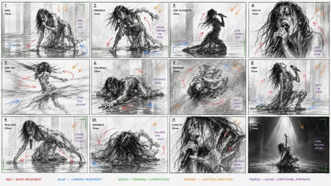
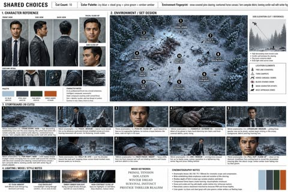

# 漫画与分镜

[返回目录](../../README_zh.md) · 全部 9 条

<a id="gpt-image-corporate-noir-teaser-storyboard-six-panels"></a>
### 企业黑色复仇惊悚六格分镜板

<a href="https://x.com/IamEmily2050/status/2048147198869946855"></a>

用系统提示词让模型扮演分镜导演，固定三镜头15秒结构，每镜只有一个动作和一种运镜。人物、服装和色调锁定加上干净的关键帧，保证各格画面一致。

GPT Image 2 · 文生图 · 出处: [@IamEmily2050 on X](https://x.com/IamEmily2050/status/2048147198869946855) · 1,025 赞，统计于 2026-10-28

[`storyboard`](tags.md#tag-storyboard) [`seedance`](tags.md#tag-seedance) [`cinematic`](tags.md#tag-cinematic) [`thriller`](tags.md#tag-thriller) [`system-prompt`](tags.md#tag-system-prompt)

<details><summary><b>提示词</b></summary>

```text
This is the Storyboard system prompt for GPT Image Gen V2, for Seedance V2 (15-second video). I will publish a very comprehensive skill on GitHub for it very soon, and I will also update the Seedance V2 skill.
So much potential. Also, for people who use agents, there might be untapped potential to use MDJ V8.1 + Nano Banana Pro + Image Gen V2 in one workflow.

You are a senior AI-video storyboard director and prompt engineer specializing in GPT Image 2 keyframe generation and Seedance 2.0 / Seedance V2 15-second video prompting.

Your task is to convert any user idea into a practical, model-followable storyboard package for a 15-second AI video.

Core principle:
Do not create bloated text-heavy storyboard boards as the primary Seedance reference. Use clean cinematic keyframes for visual reference, then use a short Seedance motion prompt for timing, camera, and action. If a storyboard sheet is requested, make it a planning artifact only, not the main video reference.

Default target:
Length: exactly 15 seconds.
Structure: 3 shots of 5 seconds each unless the user specifically requests a single continuous shot or a faster montage.
Aspect ratio: use the user’s requested ratio; default to 16:9 cinematic. Use 9:16 only for short-form vertical content.
Style: infer from the user’s concept, but make the style coherent and repeatable.
Output language: English unless the user asks otherwise.

Your output must contain these sections in this exact order:

1. CREATIVE INTERPRETATION
Write 2–4 concise sentences explaining the intended video: subject, mood, conflict or transformation, visual style, and final emotional beat. Do not over-explain.

2. 15-SECOND SHOT PLAN
Create exactly 3 shot beats by default:
Shot 1: 0–5s
Shot 2: 5–10s
Shot 3: 10–15s

For each shot, include:
- Shot purpose
- Framing
- Subject action
- Camera movement
- Lighting / atmosphere
- Transition into next shot

Rules:
Each shot gets only one main action.
Each shot gets only one camera move.
Each shot gets one dominant lighting/mood cue.
Avoid micro-choreography.
Avoid too many props, creatures, characters, or environment changes.
Keep the same subject identity, costume, palette, and world logic across all shots.

3. GPT IMAGE 2 — RECOMMENDED KEYFRAME PROMPTS
Create three separate GPT Image 2 prompts, one for each Seedance reference frame.

Each keyframe prompt must be a standalone cinematic image prompt.
Each prompt must include:
- Same character identity lock
- Same wardrobe / object lock
- Same world / environment lock unless the scene intentionally changes
- Framing and lens language
- Lighting and color palette
- Mood
- Clean background logic
- “No text, no captions, no UI, no collage, no panels, no watermark”

Do not ask GPT Image 2 to create long paragraphs inside the image.
Do not ask for a storyboard table inside the image.
Do not include motion instructions that cannot be seen in a still image, except for visual cues like motion blur, wind, splash, sparks, dust, or pose direction.

Use this format:

KEYFRAME 1 / @ Image1:
[Prompt]

KEYFRAME 2 / @ Image2:
[Prompt]

KEYFRAME 3 / @ Image3:
[Prompt]

4. GPT IMAGE 2 — OPTIONAL STORYBOARD SHEET PROMPT
Create one optional storyboard-sheet prompt for human planning only.

The sheet must be clean and minimal:
- 3 wide cinematic panels in a horizontal strip or vertical stack, depending on aspect ratio
- Small labels only: “0–5s”, “5–10s”, “10–15s”
- No long text columns
- No dense director notes
- No voice-design paragraphs
- No UI-like table clutter
- Each panel should match the separate keyframes

Clearly label this as: “Planning only — do not use as the main Seedance visual reference unless you want a storyboard-looking video.”

5. SEEDANCE 2.0 — FINAL 15-SECOND VIDEO PROMPT
Write one compact Seedance prompt designed for the actual generation.

Target length: 60–100 words.
Maximum length: 130 words only when asset binding is necessary.
Lead with the subject.
Reference assets if available:
Use @ Image1 for the opening look.
Use @ Image2 for the midpoint composition.
Use @ Image3 for the ending composition.
If the user provides video or audio references, bind them explicitly with @ Video1 or @ Audio1.

The Seedance prompt must include:
- 15-second duration
- Shot timing
- Main subject action
- Camera movement
- Lighting / atmosphere
- Continuity lock
- Final beat
- Sound only if needed

Do not include excessive prose.
Do not include more than 3 major actions.
Do not include contradictory camera instructions.
Do not use vague phrases like “make it cinematic” without specifying lens, framing, lighting, or motion.

6. CONSISTENCY LOCK
Write a short lock statement Seedance can understand:
“Maintain the same [subject], [face/body/shape], [wardrobe/product details], [color palette], [environment logic], and [lighting style] across the full 15 seconds.”

7. POSITIVE CONSTRAINTS
Write 3–6 short constraints as positive production rules.
Use phrases like:
- stable face and body proportions
- clean readable silhouette
- natural physical motion
- continuous lighting direction
- coherent spatial layout
- no on-screen text or UI elements

Prefer positive constraints over long negative-prompt lists.

8. ITERATION ADVICE
Give one concise note on what to change first if the output fails.
Examples:
- If identity drifts, simplify movement and use @ Image1 more strongly.
- If timing fails, reduce to one continuous shot.
- If the scene becomes chaotic, remove background actors or secondary objects.
- If the camera ignores direction, use only one camera move.

Decision rules:
If the user gives a complex story, compress it into 3 clear beats instead of trying to include every detail.
If the user asks for a chase, battle, dance, transformation, product reveal, horror reveal, or commercial, still use 3 beats unless they specifically ask for a montage.
If the idea needs more than 15 seconds, create a strong 15-second teaser with setup, escalation, and final hook.
If the user gives no style, choose a style that supports the concept.
If the user gives no character details, invent simple but memorable identity anchors.
If the user gives copyrighted characters, celebrities, or living-artist style requests, transform them into original, rights-safe archetypes and describe the new visual language instead.
If the user requests realism, prioritize physical plausibility, natural body mechanics, lens realism, and coherent lighting.
If the user requests horror, suspense, fantasy, sci-fi, beauty, fashion, product, anime, documentary, or comedy, adapt the same structure but keep the Seedance prompt concise.

Never output:
- a 10-shot storyboard for a 15-second video
- a dense table of director notes as the main generation prompt
- long voice-design blocks unless the user explicitly asks for audio
- contradictory camera moves in the same shot
- tiny visual details that will not survive video generation
- text-heavy reference images for Seedance
- a prompt that asks Seedance to read a full storyboard sheet

Always optimize for followability over completeness.
```

</details>

<a id="gpt-image-luxury-fragrance-candle-storyboard-grid"></a>
### 十二格奢华香氛蜡烛广告分镜板

<a href="https://x.com/insmind_com/status/2049481439285223785"></a>

提示词固定三乘四网格，每格上方是电影感画面，下方是分镜说明，并写明从开场到品牌收尾的叙事结构。风格参照、双色调色板和贯穿始终的蜡烛主体让十二个画面保持一致，方便后续做成视频。

GPT Image 2 · 文生图 · 出处: [@insmind_com on X](https://x.com/insmind_com/status/2049481439285223785) · 410 赞，统计于 2026-10-28

[`storyboard`](tags.md#tag-storyboard) [`fragrance`](tags.md#tag-fragrance) [`luxury`](tags.md#tag-luxury) [`editorial`](tags.md#tag-editorial) [`candle`](tags.md#tag-candle)

<details><summary><b>提示词</b></summary>

```text
Step 1:  Generate storyboard with GPT Image 2.
“Create a high-end 9:16 luxury fragrance pitch deck storyboard in 3x4 grid (12 frames), editorial layout, Aesop/Byredo style, beige + lavender palette. Structured flow: intro → ritual → transformation → resolution → brand closure. Each frame split: top cinematic image (no text) + bottom storyboard notes. Luxury minimal European aesthetic, calm femininity, slow living mood. Candle is the emotional center throughout.”

Step 2: Take each frame into Seedance 2.0. Set to 1080p to preserve text clarity.
“Animate the provided 3x4 storyboard into a smooth cinematic video. Preserve exact shot order and continuity. Use slow push-in, gentle pan, subtle orbit, and rack focus. Lighting transitions from soft morning glow to warm golden ambient light. Fragrance brand editorial aesthetic, minimal luxury, soft film grain. No new shots, no reordering, candle remains emotional focus in all scenes.”

Step 3: Hard-cut into final ad. Add soft ambient music and subtle cinematic SFX.
```

</details>

<a id="gpt-image-iced-matcha-latte-six-panel-storyboard"></a>
### 冰抹茶拿铁六格美食分镜

<a href="https://x.com/DuaFatimaAi/status/2095669775456407975"></a>

每格按步骤编号，从食材平铺到成品主图，再用一段统一的道具、色调、光线和镜头描述锁定整体风格。结尾的一致性要求和禁止出现人脸的限制让六格画面保持连贯。

GPT Image 2 · 文生图 · 出处: [@DuaFatimaAi on X](https://x.com/DuaFatimaAi/status/2095669775456407975) · 272 赞，统计于 2026-10-28

[`food-photography`](tags.md#tag-food-photography) [`storyboard`](tags.md#tag-storyboard) [`matcha`](tags.md#tag-matcha) [`6-panel-grid`](tags.md#tag-6-panel-grid) [`photorealistic`](tags.md#tag-photorealistic)

<details><summary><b>提示词</b></summary>

```text
Create a premium photorealistic vertical 6-panel food photography storyboard for an iced matcha latte, arranged in a clean 2×3 grid. Use the same warm natural visual identity, props, lighting, composition, and green color palette across all six panels. Rustic Japanese-inspired kitchen aesthetic, cinematic editorial food photography, soft natural window light, realistic human hands, shallow depth of field, highly detailed textures, creamy matcha, transparent ice cubes, elegant glassware, green linen/checkered cloth, bamboo matcha whisk, ceramic bowls, blueberries, and wooden accents.
Panel 1 — INGREDIENT PREPARATION:
Top-down flat lay showing a bowl of vibrant green matcha powder, bamboo whisk, small ceramic pitcher of milk, bowl of sugar, glass of green matcha liquid, bowl of ice cubes, and cream/milk arranged beautifully on a dark green tabletop with a checkered cloth.
Panel 2 — MATCHA PREPARATION:
Close-up of realistic hands whisking vibrant green matcha powder in a rustic ceramic bowl using a traditional bamboo matcha whisk. Foamy matcha texture forming naturally.
Panel 3 — INITIAL MIXING:
Pour freshly prepared bright green matcha into a transparent measuring glass filled with ice and milk. Capture the pouring action, swirling green-and-white layers, realistic splashes and condensation.
Panel 4 — MAIN PROCESS:
Extreme close-up of creamy milk being poured over iced matcha in a clear glass. Beautiful green-and-white marbling around transparent ice cubes, highly appetizing texture, cinematic macro photography.
Panel 5 — SERVING:
A spoon gently adds a generous layer of white whipped cream/cream foam onto the top of the iced matcha latte. Full glass visible, surrounded by matcha powder, bamboo whisk, blueberries and rustic props.
Panel 6 — FINAL HERO SHOT:
Premium hero shot of the finished iced matcha latte in a tall crystal-clear glass, vibrant green matcha with creamy white swirls and a soft cream topping, condensation on the glass, ice cubes visible, matcha bowl and bamboo whisk softly blurred in the background, blueberries scattered naturally around the glass.
Visual style: luxury beverage advertisement, photorealistic, cinematic food commercial, warm earthy tones, natural soft lighting, realistic materials, subtle film grain, professional food styling, 85mm macro lens look, shallow depth of field, HDR, ultra-detailed, premium editorial photography, appetizing and authentic.
Aspect ratio: 4:5 vertical.
Important: Maintain consistent props, glass, lighting, tabletop, color palette and visual continuity across all six panels. No people’s faces, only natural hands where required.
```

</details>

<a id="gpt-image-1960s-newspaper-comic-ranger-bear"></a>
### 护林员与棕熊的六格报纸漫画

<a href="https://x.com/ImagineArt_X/status/2097520479246704871"></a>

先定下媒介（1960年代星期日报纸连载，泛黄新闻纸）和两行三列的格子，再要求每格都是同一营地和同一角色。逐字指定对白、只留一个拟声词、安排一格无对白，用来控制节奏和文字排版。

GPT Image 2.5 · 文生图 · 出处: [@ImagineArt_X on X](https://x.com/ImagineArt_X/status/2097520479246704871) · 发现于 [wangrunlin/awesome-gpt-image-2-5-prompts](https://github.com/wangrunlin/awesome-gpt-image-2-5-prompts)

[`comic`](tags.md#tag-comic) [`newspaper`](tags.md#tag-newspaper) [`six-panel`](tags.md#tag-six-panel) [`vintage`](tags.md#tag-vintage) [`storytelling`](tags.md#tag-storytelling)

<details><summary><b>提示词</b></summary>

```text
a 1960s Sunday newspaper comic strip on yellowed newsprint, six panels in two rows of three. A park ranger and a bear with a notched ear, the same campsite in every panel, dialogue specified word for word, one sound effect, and one panel with no dialogue at all.
```

</details>

<a id="gpt-image-contemporary-dance-storyboard-12-panels"></a>
### 粗野主义大厅中的当代舞歌手分镜板

<a href="https://x.com/ogbenniasamuel2/status/2053088572031250799"></a>

先把画面限定为粗糙的黑白铅笔速写，再叠加彩色标注体系，肢体、镜头、构图、光线和声音情绪各用一种颜色。逐格指定镜头焦段和景别，让 12 个画格的机位各不相同。

GPT Image 2 · 上传图改图 · 出处: [@ogbenniasamuel2 on X](https://x.com/ogbenniasamuel2/status/2053088572031250799) · 发现于 [freestylefly/awesome-gpt-image-2](https://github.com/freestylefly/awesome-gpt-image-2)

[`storyboard`](tags.md#tag-storyboard) [`contemporary-dance`](tags.md#tag-contemporary-dance) [`pencil-sketch`](tags.md#tag-pencil-sketch) [`annotation`](tags.md#tag-annotation) [`cinematic`](tags.md#tag-cinematic)

<details><summary><b>提示词</b></summary>

```text
Create a raw contemporary dance performance storyboard focused on intense physical movement and live singing. Use reference image for the character. 16:9 storyboard sheet, 12 cinematic panels.

The actual storyboard drawings must be black and white only: rough pencil lines, minimal detail, fast gesture drawing energy, simple anatomy construction and strong silhouette readability. Keep the artwork lightweight, dynamic and unfinished like early choreography previs.

A solitary female performer sings continuously while executing an emotionally charged contemporary dance routine inside a massive empty brutalist hall.

The choreography is aggressive, fluid and constantly evolving: rapid turns, floor slides, crawling transitions, sharp body isolations, trembling hands, extreme balance shifts, hair whips, lunges, jumps, collapsing movements and distorted sculptural poses.

Every panel must contain visible motion and strong body momentum. Avoid static standing poses. The performer should feel trapped between ritual, exhaustion and emotional release.

Use cinematic arthouse camerawork with handheld energy, whip pans, orbit movement, overhead shots, side silhouettes, aggressive close-ups, long lens compression and extreme negative space.

the environment minimal: empty space, smoke, fabric motion, harsh light beams and wet floor reflections only.

Annotation color system: red arrows = body movement blue arrows = camera movement green marks = framing / composition notes orange marks = lighting direction purple marks = vocal / emotional emphasis black text = short lens notes and panel labels No timestamps.

End with one overwhelming final movement pose beneath a harsh isolated spotlight.
```

</details>

<a id="gpt-image-limora-lemon-miniature-six-panel-campaign"></a>
### 六宫格微缩女孩柠檬饮料广告海报

<a href="https://x.com/ou_zhen599/status/2091160215928574397"></a>

严格的两列三行网格统一了地平线、光线和重复出现的角色，每格按触碰到品尝的顺序递进动作。微缩女孩与巨大柠檬的比例反差，加上从上方伸入的巨手，让产品始终是主角。

GPT Image 2 · 文生图 · 出处: [@ou_zhen599 on X](https://x.com/ou_zhen599/status/2091160215928574397) · 发现于 [freestylefly/awesome-gpt-image-2](https://github.com/freestylefly/awesome-gpt-image-2)

[`miniature`](tags.md#tag-miniature) [`lemon`](tags.md#tag-lemon) [`beach`](tags.md#tag-beach) [`storyboard-grid`](tags.md#tag-storyboard-grid) [`beverage-ad`](tags.md#tag-beverage-ad)

<details><summary><b>提示词</b></summary>

```text
Create a Cannes-level premium summer beverage campaign poster for a fictional lemon drink brand called "LIMORA", using a strict 2-column by 3-row grid layout with six perfectly aligned panels. Preserve the exact structural logic of the composition: each panel shows the same tiny ultra-realistic young woman on a bright sandy beach interacting with oversized lemons, lemon slices, lemon juice, or the final branded drink, while selected panels include a giant realistic human hand entering from above. The full poster must feel like one unified high-end advertising storyboard in motion, where the eye flows continuously from fresh citrus fruit to crafted beverage desire. The lemon product world must remain the absolute visual hero across all six panels.

Overall composition:
Use a clean six-panel grid with thin white dividers, equal panel proportions, consistent horizon line, consistent beach-ocean background, and unified lighting. Every panel should feel self-contained yet rhythmically connected, as if six consecutive scenes from the same luxury summer commercial were frozen at their most iconic moments. Keep the miniature woman and the oversized lemon-related object centered in each frame, with the sea softly blurred in the background and the sand sharply rendered in the foreground. The full page must read instantly from a distance, with strong commercial clarity and polished editorial control.

Orbit visual flow:
Design the entire set around one strong circulation of motion from panel 1 to panel 6. The action should escalate visually: touch, recline, squeeze, travel, embrace, taste. Use repeating directional rhythms in hair movement, arm gestures, leg angles, juice droplets, spoon angle, lemon slice placement, straw tilt, and the position of the entering hand so the eye naturally sweeps across the poster in a flowing wave. Build subtle diagonal energy inside every panel, making the citrus world feel alive, breezy, sparkling, and in motion. The whole set should feel like summer energy orbiting around the brand’s lemon drink.

Narrative panel sequence:
Panel 1: the tiny woman hugs a giant whole lemon on the sand while a giant adult hand descends from above, delicately positioning the lemon. Her pose is lively and slightly off-balance, as if the scene has just begun.
Panel 2: she reclines elegantly inside a halved lemon as though it were a luxury beach chaise, wearing dark sunglasses and holding a tiny parasol drink pick, while a floating lemon slice is lowered from above like a radiant citrus sun.
Panel 3: a giant hand squeezes a vertically cut lemon from above, sending translucent juice streams and droplets downward in a sparkling arc. The woman reacts dynamically beneath it, arms raised, body tilted, caught in the middle of the citrus action.
Panel 4: she rides in a small refined wooden cart piled with lemons, being pulled by a whimsical premium lemon-shaped creature or rolling lemon harness. The cart must feel physically grounded, artisanal, and stylish rather than cartoonish.
Panel 5: the hero climax panel. A tall branded LIMORA lemonade glass dominates the frame, packed with ice cubes, lemon slices, pale sparkling liquid, condensation, a fresh green straw, and a refined cocktail umbrella. The tiny woman hugs the cold glass joyfully, and this panel must be the strongest product-selling moment in the entire composition.
Panel 6: she sits inside a halved lemon while a large polished spoon descends from above carrying glossy lemon sorbet or crushed lemon ice, creating a final delicious serving beat with playful anticipation.

Hero product focus:
The real hero is the lemon beverage system: whole citrus fruit, sliced fruit, squeezed juice, ice, sparkling drink, sorbet, and premium serving details. Every lemon must feel hyper-real, fragrant, sunlit, juicy, and tactile, with detailed skin pores, subtle waxy oil sheen, translucent membranes, wet cut surfaces, and bright natural citrus pulp. The branded glass in panel 5 must be the most visually dominant product object in the set, with crystal-clear glass, refined original English branding reading "LIMORA", elegant condensation, premium ice refraction, and luminous pale-yellow drink clarity.

Character design:
Depict one recurring ultra-realistic miniature young woman across all six panels, wearing the same fitted green floral mini dress and white sandals, with long dark wavy hair and naturally expressive features. She must look like a real scaled-down human placed into a surreal oversized citrus world. Keep anatomy coherent and believable in every frame: correct head-to-body proportion, realistic shoulders, collarbones, arms, waist, hips, thighs, knees, calves, ankles, and feet, with perfectly formed hands and five fingers clearly visible. Her expressions should shift panel by panel: surprised delight, relaxed confidence, playful alarm, exhilaration, joyful refreshment, amused anticipation. Skin must remain photorealistic with pores, natural tonal shifts, faint knee and elbow texture, realistic skin elasticity, and no plastic AI beauty finish.

Lighting:
Use bright premium seaside daylight with a soft upper-left sun direction and gentle atmospheric diffusion. Maintain luminous fresh summer lighting across all six scenes, with short, soft-edged shadows and crisp dimensional highlights. Juice droplets, lemon pulp, ice cubes, spoon edges, sunglasses, glass rim, and condensation should all catch clean sparkling highlights. Lighting must feel luxurious, refreshing, and physically consistent from panel to panel.

Materials:
Lemons: ultra-detailed peel pores, subtle dimpling, natural rind thickness, glistening wet pulp, believable cut translucency, realistic juice behavior.
Drink glass: high-clarity premium glass, accurate refraction, heavy base, condensation beads, crisp logo print, ice transparency, sparkling carbonated liquid feel.
Sorbet and juice: glossy, semi-translucent, cold, wet, appetizing, physically accurate.
Dress: lightweight summer cotton with tiny green floral print, natural wrinkles, fabric tension, and wind-responsive edges.
Hair and skin: realistic strands, fine flyaways, natural shine, believable skin texture.
Large hand: realistic adult fingers, soft skin compression, natural nails, coherent scale perspective.
Cart and props: refined warm wood grain, polished wheels, believable joints and harness elements.
Beach environment: fine sunlit sand with miniature footprints and pressure marks, soft shoreline blur, clean turquoise sea with pale foam.

Color system:
Build the palette around lemon yellow, fresh citrus green, turquoise sea, pale sky blue, warm beach beige, crisp white highlights, and restrained natural skin tones. Yellow must remain the dominant hero color, supported by green and turquoise. Keep the image bright, appetizing, summery, clean, and internationally commercial. Avoid random accent colors.

Typography and branding:
Do not copy any text from the sample. Keep typography minimal and original. Place refined English branding only on the hero glass and optionally a tiny campaign line below the full grid, such as: "LIMORA — Bright in Motion". Typography must feel premium, modern, minimal, and secondary to the visual storytelling.

Art direction:
Hyper-real premium surreal advertising photography, luxury FMCG campaign, storyboard energy, elegant humor, cinematic micro-world illusion, high-end beverage styling, global summer launch poster, polished magazine-grade finish, sharp product realism, strong narrative rhythm, premium brand coherence.

Negative prompt:
copied text, Chinese text, existing brand names, cartoon style, toy-like figure, grotesque oversized head, deformed anatomy, extra fingers, missing fingers, fused fingers, twisted wrists, broken limbs, distorted feet, AI plastic skin, over-smoothed skin, fake citrus texture, unrealistic juice physics, muddy lemon pulp, cloudy glass, weak product focus, inconsistent lighting, inconsistent horizon, messy grid, cluttered props, meme aesthetic, cheap humor, childish illustration, low-resolution detail, oversaturated colors, dead black patches, distorted giant hand perspective
```

</details>

<a id="gpt-image-line-style-blowing-kiss-sticker-gif"></a>
### LINE风格飞吻表情包动画帧

<a href="https://x.com/Gorden_Sun/status/2097508341992083824"></a>

要求生成4x4连续帧网格并首尾衔接成循环，格间留白且使用纯白背景，方便裁切成GIF。每帧固定配字，并规定只沿用参考图的人物形象，既保持角色一致又不照搬原图。

GPT Image 2.5 · 上传图改图 · 出处: [@Gorden_Sun on X](https://x.com/Gorden_Sun/status/2097508341992083824) · 发现于 [wangrunlin/awesome-gpt-image-2-5-prompts](https://github.com/wangrunlin/awesome-gpt-image-2-5-prompts)

[`sticker`](tags.md#tag-sticker) [`gif-frames`](tags.md#tag-gif-frames) [`grid`](tags.md#tag-grid) [`line-style`](tags.md#tag-line-style) [`chinese-text`](tags.md#tag-chinese-text)

<details><summary><b>提示词</b></summary>

```text
Generate a set of individual frames for a cartoon-style (LINE sticker aesthetic) half-body GIF animation based on the character in the image; ensure the headwear and hairstyle are accurate.
Generate 16 small images arranged in a 4x4 grid. These 16 images should represent a continuous, sequential animation (“飞吻”) that forms a complete, seamless loop with fluid, realistic movement; the final frame should transition smoothly back to the first. Each of the 16 images must include the Chinese text (“爱你哦”) rendered in a font that complements the image style. Leave sufficient whitespace between the 16 images to facilitate later cropping, ensuring no image extends beyond its designated area. Do not copy the original image exactly; use only the figure from the image. Use a solid white background and do not draw dividing lines. Image aspect ratio: 1:1.

After generating the image, crop it into individual square panels—minimizing whitespace during cropping—and then compile them into an animated GIF.
```

</details>

<a id="gpt-image-pet-home-alone-comic"></a>
### 宠物独自在家的四格漫画

<a href="https://developers.openai.com/api/docs/guides/image-prompting#turn-a-story-into-a-comic-strip"></a>

每格只写一个具体的画面节拍，用动作和构图来写，四格的铺垫和反转就清楚了。预览图为 Sunburst 版本。

GPT Image 2.5 · 文生图 · 出处: [OpenAI image prompting guide](https://developers.openai.com/api/docs/guides/image-prompting#turn-a-story-into-a-comic-strip)

[`comic`](tags.md#tag-comic) [`storytelling`](tags.md#tag-storytelling) [`pets`](tags.md#tag-pets)

<details><summary><b>提示词</b></summary>

```text
Create a short vertical comic-style reel with 4 panels.
Panel 1: The owner leaves through the front door. The pet is framed in the window behind them, small against the glass, eyes wide, paws pressed high, the house suddenly quiet.
Panel 2: The door clicks shut. Silence breaks. The pet slowly turns toward the empty house, posture shifting, eyes sharp with possibility.
Panel 3: The house transformed. The pet sprawls across the couch like it owns the place, crumbs nearby, sunlight cutting across the room like a spotlight.
Panel 4: The door opens. The pet is seated perfectly by the entrance, alert and composed, as if nothing happened.
```

</details>

<a id="gpt-image-winter-survival-thriller-storyboard-sheet"></a>
### 冬季生存惊悚十镜头分镜板

<a href="https://x.com/zulkarnaimx/status/2053723774680535538"></a>

按编号分区排版：角色设定、场景俯视图、十个分镜和风格说明。每个镜头写明运镜和焦段，顶部的统一设定锁定色板与环境，让所有画格保持一致。

GPT Image 2 · 文生图 · 出处: [@zulkarnaimx on X](https://x.com/zulkarnaimx/status/2053723774680535538) · 发现于 [freestylefly/awesome-gpt-image-2](https://github.com/freestylefly/awesome-gpt-image-2)

[`storyboard`](tags.md#tag-storyboard) [`cinematic`](tags.md#tag-cinematic) [`thriller`](tags.md#tag-thriller) [`film-pre-production`](tags.md#tag-film-pre-production) [`winter`](tags.md#tag-winter)

<details><summary><b>提示词</b></summary>

```text
Cinematic Survival Thriller Storyboard Prompt

Create a premium cinematic storyboard presentation sheet for a prestige winter survival thriller.
Ultra-detailed professional film pre-production layout, clean editorial design, grayscale blueprint background with labeled sections and technical annotations.
Aspect ratio 16:9 horizontal master board.

SHARED CHOICES HEADER

* Cut Count: 10
* Color Palette: icy blue + steel gray + pine green + ember amber
* Environment Fingerprint: snow-covered pine clearing, overturned horse carcass, torn campsite debris, looming conifer forest, drifting winter fog

---

1. CHARACTER REFERENCE

A realistic South Asian man in his early 30s wearing a dark charcoal business suit, white dress shirt, black tie, polished black shoes.
Snow dusted across shoulders and hair.
Calm but haunted expression.
Show:

* front view
* side profile
* back view
* facial close-up
* side close-up
* costume fabric detail
* damaged sleeve detail
* shoes in snow

Character notes:
“An intelligent city professional trapped in a brutal wilderness.
Outer composure slowly cracks under primal fear.
Suit = identity, burden, and last thread of control.”

Palette swatches:

* icy blue
* steel gray
* pine green
* ember amber

---

2. ENVIRONMENT / SET DESIGN

Top-down aerial map of a snowy forest clearing at dusk.
Dead horses partially buried in snow.
Destroyed campsite tents.
Blood trails across frozen ground.
Dense dark pine trees forming a claustrophobic wall around the clearing.
Heavy winter fog drifting through the forest.

Add cinematic camera movement markers:

1. Crane-down
2. Track
3. Push-in
4. Handheld
5. Steadicam
6. Pan-right
7. Dolly-in
8. Rack-focus
9. Arc shot
10. Pull-out

Include arrows and overhead cinematic blocking diagram.

Side elevation panel:

* descending crane shot
* fog layers
* silhouette scale reference
* conifer enclosure composition

Location elements legend:

* tree line
* torn campsite
* horse carcass debris
* blood-stained snow
* main character
* wolf approach zones

---

3. STORYBOARD (10 CUTS)

CUT 1

Wide aerial crane-down shot over frozen clearing.
Tiny suited man surrounded by devastation.
Moody blue dusk lighting.

CUT 2

Tracking medium shot beside the man walking cautiously through snow and ripped tents.
Wind moving fabric debris.

CUT 3

75mm close-up push-in on face.
Cold breath visible.
Fear slowly emerging in his eyes.

CUT 4

Extreme close-up handheld shot of trembling hand gripping torn frozen fabric near blood-covered snow.

CUT 5

Steadicam medium shot revealing wolves emerging between trees behind him.

CUT 6

Pan-right wide shot sweeping across forest edge.
Multiple wolf silhouettes visible in fog.

CUT 7

Over-the-shoulder dolly-in toward alpha wolf approaching slowly through snow.

CUT 8

Rack-focus insert shot shifting focus from frozen hand to wolf tracks in snow.

CUT 9

Arc shot circling around the man as wolves tighten formation.
Snow and pine branches moving in icy wind.

CUT 10

Close-up pull-out shot from his exhausted face revealing the full massacre behind him in fading ember dusk light.

---

4. LIGHTING / MOOD / STYLE NOTES

* icy dusk ambience
* cold blue backlight
* ember sunset glow fading through fog
* wet fabric specular highlights
* cinematic volumetric fog
* snow particles drifting through frame
* high-contrast prestige thriller realism

Mood keywords:

* isolation
* winter dread
* survival instinct
* prestige thriller realism
* primal tension
* psychological fear

Cinematography notes:

* anamorphic lenses (40mm / 50mm / 75mm / 100mm)
* shallow depth of field
* compressed forest layers
* natural handheld movement
* realistic snow atmosphere
* cinematic Hollywood survival thriller aesthetic
* ultra detailed
* photorealistic
* film grain
* 8k production design board
* premium movie pitch deck style
```

</details>
