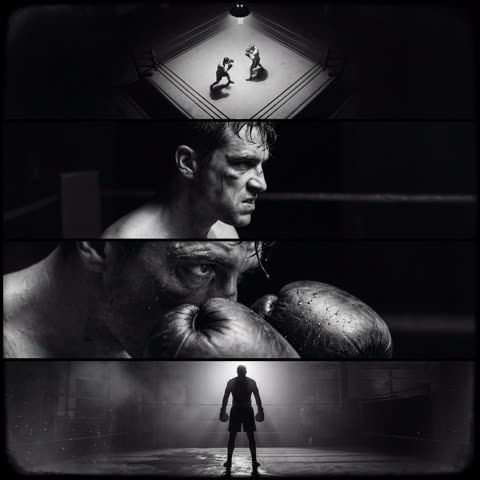
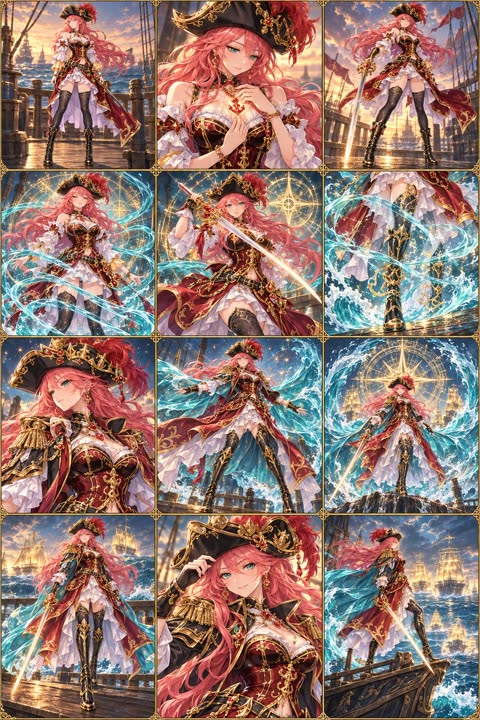
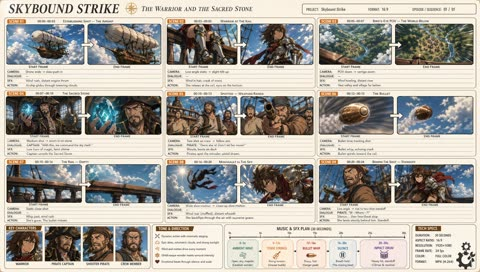
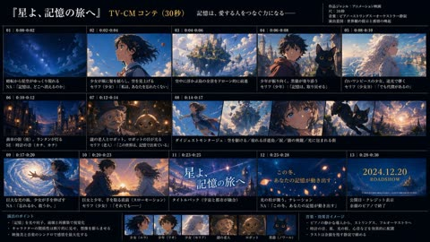
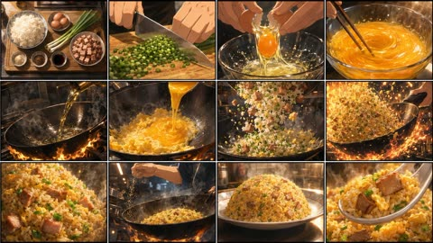
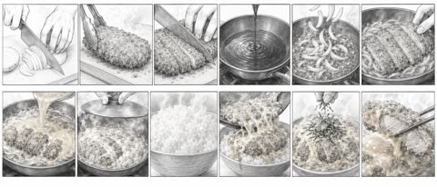
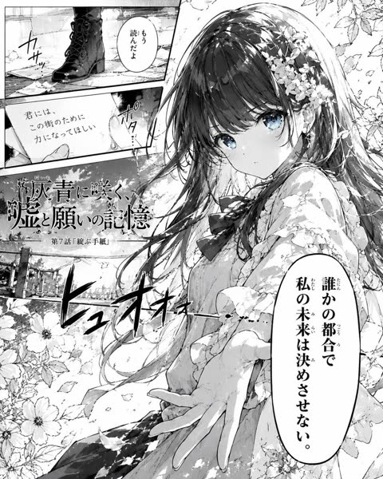

# 漫画与分镜

[返回目录](../../README_zh.md) · 全部 13 条

<a id="nano-banana-fluffy-creatures-treehouse-story"></a>
### 三只毛茸茸生物规划树屋

<a href="https://x.com/GoogleAI/status/2027094912357761319"></a>

要求生成带情绪起伏的四段故事，固定 16:9 画幅并逐张生成。明确要求三个角色保持一致的形象，让各画面中的外观稳定不变。

Nano Banana 2 · 文生图 · 出处: [@GoogleAI on X](https://x.com/GoogleAI/status/2027094912357761319) · 1,256 赞，统计于 2026-10-28

[`storyboard`](tags.md#tag-storyboard) [`multi-image`](tags.md#tag-multi-image) [`consistent-characters`](tags.md#tag-consistent-characters) [`fluffy-creatures`](tags.md#tag-fluffy-creatures) [`16-9`](tags.md#tag-16-9)

<details><summary><b>提示词</b></summary>

```text
Create a funny 4-part story featuring 3 fluffy creatures building a treehouse. The story has emotional highs and lows and ends in a happy moment. Maintain consistent identity across the 3 characters. Generate 4 images in 16:9 format, one at a time.
```

</details>

<a id="gpt-image-shampoo-commercial-storyboard-sheet"></a>
### 十格去屑洗发水广告分镜板

<a href="https://x.com/AiwithLariab/status/2078686427219697781"></a>

用白底 2 乘 5 网格固定每格的编号、时间戳和字幕，每个场景单独写镜头内容并分配 1.5 秒。最后补充相机、灯光和色板，整张分镜可直接交给视频模型。

GPT Image 2 · 文生图 · 出处: [@AiwithLariab on X](https://x.com/AiwithLariab/status/2078686427219697781) · 412 赞，统计于 2026-10-29

[`storyboard`](tags.md#tag-storyboard) [`commercial`](tags.md#tag-commercial) [`shampoo`](tags.md#tag-shampoo) [`product-ad`](tags.md#tag-product-ad) [`grid`](tags.md#tag-grid)

<details><summary><b>提示词</b></summary>

```text
Create a professional Hollywood advertising storyboard sheet for a premium anti-dandruff shampoo commercial. The storyboard consists of 10 ultra-realistic cinematic frames arranged in a clean 2×5 grid on a white presentation board. Each frame has a thin black border, bold scene number (01–10), duration timestamp, and a short production caption underneath. Every panel is rendered in vibrant photorealistic color with premium advertising quality, like an international beauty campaign.Title: "FRESH SCALP TECHNOLOGY" Subtitle: "15 Second Shampoo Commercial" Scene 01 (0.0–1.5s) A premium shampoo bottle slowly emerges from crystal-clear ice with cool blue lighting. Fine water mist surrounds the bottle while frozen droplets sparkle in the air. Caption: Ice Reveal Scene 02 (1.5–3.0s) Extreme macro close-up of the shampoo bottle. Crystal-clear condensation droplets cover the surface while cool rim lighting highlights the premium packaging. Caption: Product DetailScene 03 (3.0–4.5s) Powerful streams of crystal water burst upward around the bottle. Fresh mint leaves, eucalyptus branches, aloe vera, and botanical extracts begin floating gracefully. Caption: Fresh Ingredients Scene 04 (4.5–6.0s) A dramatic explosion of water splashes, floating ice crystals, mint leaves, eucalyptus, microscopic cooling particles, and refreshing mist surrounds the bottle in ultra slow motion. Caption: Cooling Explosion Scene 05 (6.0–7.5s)The camera performs a smooth cinematic orbit around the bottle while thousands of sparkling water droplets rotate together with fresh botanical elements. Caption: Dynamic Orbit Scene 06 (7.5–9.0s) Extreme macro shot showing creamy shampoo pouring in slow motion with silky texture, tiny bubbles, and glowing freshness particles. Caption: Cream Formula Scene 07 (9.0–10.5s) Beautiful flowing black hair moves naturally through a powerful stream of crystal-clear water.The hair becomes silky, shiny, healthy, and free-flowing while cool mist fills the background. Caption: Healthy Hair Scene 08 (10.5–12.0s) Everything freezes mid-air. Water splashes, ice cubes, mint leaves, eucalyptus, freshness particles, and flowing hair create a perfectly balanced premium composition. Caption: Frozen Freshness Scene 09 (12.0–13.5s)Hero shot of the shampoo bottle standing proudly on reflective ice surrounded by suspended water splashes, fresh botanicals, and glowing blue light. Caption: Hero Product Scene 10 (13.5–15.0s) Minimal icy background. Brand logo and tagline fade in while cool mist slowly disappears. Tagline: "Feel the Ultimate Freshness." Caption: Brand Signature Visual Language:Inspired by world-class refreshing shampoo campaigns emphasizing crystal-clear water, cooling freshness, healthy hair, premium beauty photography, vibrant botanical ingredients, sparkling droplets, dynamic water physics, clean laboratory aesthetic, and modern beauty advertising. Color Palette: Crystal White Ice Blue Fresh Mint Green Silver Highlights Camera: ARRI Alexa 35 Cooke Anamorphic 50mm High-speed cinematography Macro lens Slow motion HDR Lighting: Bright beauty lighting Cool rim lightVolumetric mist Crystal reflections Style: Ultra photorealistic Hollywood commercial production Premium beauty campaign Luxury cosmetic advertising Advertising agency presentation board 8K Masterpiece
```

</details>

<a id="gpt-image-luxury-fragrance-candle-storyboard-grid"></a>
### 十二格奢华香氛蜡烛广告分镜板

<a href="https://x.com/insmind_com/status/2049481439285223785"></a>

提示词固定三乘四网格，每格上方是电影感画面，下方是分镜说明，并写明从开场到品牌收尾的叙事结构。风格参照、双色调色板和贯穿始终的蜡烛主体让十二个画面保持一致，方便后续做成视频。

GPT Image 2 · 文生图 · 出处: [@insmind_com on X](https://x.com/insmind_com/status/2049481439285223785) · 410 赞，统计于 2026-10-28

[`storyboard`](tags.md#tag-storyboard) [`fragrance`](tags.md#tag-fragrance) [`luxury`](tags.md#tag-luxury) [`editorial`](tags.md#tag-editorial) [`candle`](tags.md#tag-candle)

<details><summary><b>提示词</b></summary>

```text
Step 1:  Generate storyboard with GPT Image 2.
“Create a high-end 9:16 luxury fragrance pitch deck storyboard in 3x4 grid (12 frames), editorial layout, Aesop/Byredo style, beige + lavender palette. Structured flow: intro → ritual → transformation → resolution → brand closure. Each frame split: top cinematic image (no text) + bottom storyboard notes. Luxury minimal European aesthetic, calm femininity, slow living mood. Candle is the emotional center throughout.”

Step 2: Take each frame into Seedance 2.0. Set to 1080p to preserve text clarity.
“Animate the provided 3x4 storyboard into a smooth cinematic video. Preserve exact shot order and continuity. Use slow push-in, gentle pan, subtle orbit, and rack focus. Lighting transitions from soft morning glow to warm golden ambient light. Fragrance brand editorial aesthetic, minimal luxury, soft film grain. No new shots, no reordering, candle remains emotional focus in all scenes.”

Step 3: Hard-cut into final ad. Add soft ambient music and subtle cinematic SFX.
```

</details>

<a id="nano-banana-noir-boxer-four-panel-fight"></a>
### 四格黑色电影风格拳击手比赛叙事

<a href="https://x.com/kaanakz/status/2027814444437307602"></a>

先用统一的风格段锁定光线、颗粒和场景，再为每个横向分格指定独立机位：俯拍、侧面特写、极端特写和背后中远景。每格单独写明光型（分割光、轮廓光）和比赛回合，让同一拳手在叙事推进中保持一致。

Nano Banana 2 · 文生图 · 出处: [@kaanakz on X](https://x.com/kaanakz/status/2027814444437307602) · 312 赞，统计于 2026-10-28

[`film-noir`](tags.md#tag-film-noir) [`multi-panel`](tags.md#tag-multi-panel) [`camera-angles`](tags.md#tag-camera-angles) [`black-and-white`](tags.md#tag-black-and-white) [`boxing`](tags.md#tag-boxing)

<details><summary><b>提示词</b></summary>

```text
Create a single film noir–style cinematic image divided into four horizontal panels, all depicting the same boxer and the same boxing ring environment, unified by lighting, atmosphere, and narrative progression across four stages of a fight.

Overall style:

Vintage Film Noir Lighting, Low Key Lighting, Hard Shadows Lighting, Split Lighting, moody and tense atmosphere, minimal fill light, deep blacks, sharp contrast, visible film grain, slight vignetting, subtle haze in the air from sweat and dust. Industrial warehouse boxing gym setting, night atmosphere, light beams cutting through darkness, damp canvas reflecting highlights. Clean horizontal separation between panels, cinematic split-screen composition, consistent character identity across all panels.

Top panel – ROUND 1, BIRD’S-EYE SHOT:

Bird’s Eye View of the boxing ring. Stark top-down composition, ropes forming geometric frames. Two boxers circling each other. Our main subject slightly forward in stance, gloves raised. Overhead spotlight creating strong geometric shadows across the canvas. Sweat barely visible. Light slicing through darkness, corners of the ring fading into black.

Second panel – ROUND 2, SIDE CLOSE-UP SHOT:

Side-profile close-up of the main boxer mid-fight. From Side, intense expression, jaw clenched. One side of the face sharply lit by a hard key light, the other completely swallowed in shadow. Sweat and minor bruising beginning to appear. Split Lighting carving the facial structure in classic noir sculpting. Background dissolves into darkness, only faint ring ropes visible.

Third panel – ROUND 3, EXTREME CLOSE-UP:

Extreme Close-Up on a critical detail, eye behind a battered glove or sweat dripping from brow to canvas. Heavy shadow dominance. Light catching only the iris and the texture of the glove leather. Micro cuts, swelling, fine skin texture visible. Film grain pronounced. The rest of the frame nearly pure black.

Bottom panel – FINAL ROUND, MEDIUM WIDE BACK SHOT:

Medium Wide Shot from behind the boxer. From Behind perspective. The subject standing alone in the ring after a decisive moment, shoulders rising with breath. Opponent down or barely visible in shadow. Rim Lighting outlining the silhouette. Wet canvas reflecting fragmented light. Light haze in the air enhancing depth. The ring fading into darkness beyond the ropes.

High detail, High Quality, Photorealism Style, cinematic composition, cohesive identity across all four panels, dramatic storytelling progression within a single unified noir frame.


@ImagineArt_X

@imagineart_creo
```

</details>

<a id="gpt-image-character-transformation-storyboard-12-panel"></a>
### 十二格动漫海盗船长变身分镜

<a href="https://x.com/Mayz1169/status/2100135954032087346"></a>

提示词为 12 个分格分别指定叙事任务,从触发到最终英雄姿态,让变身逐步展开。先分析参考角色再推导专属能量主题,并锁定脸部、发型和画风以保持一致。

GPT Image 2.5 · 上传图改图 · 出处: [@Mayz1169 on X](https://x.com/Mayz1169/status/2100135954032087346) · 106 赞，统计于 2026-10-29

[`storyboard`](tags.md#tag-storyboard) [`transformation`](tags.md#tag-transformation) [`character-sheet`](tags.md#tag-character-sheet) [`anime`](tags.md#tag-anime) [`reference-image`](tags.md#tag-reference-image)

<details><summary><b>提示词</b></summary>

```text
Create a 12-panel transformation storyboard for the character in the uploaded reference image, arranged in a clean 3-column × 4-row grid, read left to right and top to bottom.

CHARACTER AND CONCEPT
First, visually analyze the character’s identity, outfit, signature accessories, color palette, personality, and apparent world or profession. Use these details to invent a distinctive transformation theme that feels like a natural evolution of this specific character.

Choose a coherent power source, visual effects, transformation mechanism, and final evolved form. Derive these from the character rather than defaulting to generic demon wings, horns, purple lightning, or an unrelated costume.

The final form must show a substantial, deliberate change in silhouette, costume structure, materials, and signature accessories—not merely the original outfit with a glowing aura. Preserve enough recognizable motifs that the result unmistakably feels like the same character.

IDENTITY CONSISTENCY
Keep the same face, apparent age, body proportions, skin tone, and defining features throughout all 12 panels. Preserve the character’s signature hair color and recognizable hairstyle, allowing natural movement and subtle styling changes. Maintain the reference image’s illustration style.

Begin with the original outfit faithfully reproduced. Design one coherent final outfit and reveal it progressively. Once a transformed element appears, keep its design consistent in all subsequent panels.

12-PANEL SEQUENCE
Panel 1 — Original state: Clearly establish the reference character in their original outfit, with a readable full-body silhouette in an appropriate setting.
Panel 2 — Trigger: A signature accessory, gesture, or environmental element activates the character’s latent power.
Panel 3 — Response: The character notices the change and makes a purposeful movement. Small thematic effects begin to gather.
Panel 4 — Gathering power: The transformation energy establishes a clear direction and motion around the character.
Panel 5 — First visible change: One important costume element or accessory evolves, clearly showing the transformation mechanism.
Panel 6 — Progression: The transformation travels across the body, forming new clothing, armor, ornamentation, or other theme-appropriate details.
Panel 7 — Defining detail: Show a closer view of a major identity-linked upgrade, such as headwear, shoulder pieces, a weapon, or a magical accessory.
Panel 8 — Silhouette expansion: Reveal the largest structural change, such as a flowing mantle, elongated coat, layered armor, or another character-specific feature.
Panel 9 — Climax: Show the peak of the transformation with a powerful pose and dramatic thematic effects. Keep the character readable.
Panel 10 — Full reveal: Effects clear to reveal the complete evolved form in a clean full-body view.
Panel 11 — Personality moment: The character makes a small expressive gesture that conveys their personality and newfound confidence.
Panel 12 — Final hero image: Finish with a striking full-body pose that clearly displays the completed design, with restrained residual effects and a resolved background.

VISUAL DIRECTION
Build a clear emotional progression from anticipation to awakening to mastery, adapted to the character’s personality. The character actively participates in the transformation rather than simply standing still.

Use a cohesive environment and lighting progression across the sequence. Vary framing between full-body, three-quarter, and selective detail shots while maintaining spatial continuity. Prioritize full-body views for the original state, major silhouette changes, and final reveal.

Make every panel advance the transformation. Show intermediate stages with clear visual cause and effect; do not jump abruptly from the original outfit to the final costume.

Use elegant, theme-specific transitions such as flowing material, particles assembling into solid forms, unfolding structures, or energy passing over and revealing new costume elements. Keep anatomy stable and clothing coherent. No nudity or erotic framing.

OUTPUT
One polished, high-resolution storyboard image containing exactly 12 distinct panels with thin, consistent borders. Balance character detail with visual clarity. No captions, labels, speech bubbles, logos, or watermarks.

Do not reproduce the uploaded reference sheet’s layout or duplicate its multiple views. Use the uploaded image to identify one character, then depict that same character across a new, continuous transformation sequence.
```

</details>

<a id="gpt-image-anime-airship-nine-scene-storyboard"></a>
### 九场景动漫飞艇分镜头设计稿

<a href="https://x.com/0xluffy_eth/status/2047224465097134172"></a>

提示词先定下三列网格和每格开始帧到结束帧的版式，再逐个场景写明镜头运动，让九个画面的剧情节奏与注释保持一致。底部的角色、基调、音乐计划和技术规格栏让整张图像真实的制作文档。

GPT Image 2 · 文生图 · 出处: [@0xluffy_eth on X](https://x.com/0xluffy_eth/status/2047224465097134172) · 发现于 [YouMind-OpenLab/awesome-gpt-image-2](https://github.com/YouMind-OpenLab/awesome-gpt-image-2)

[`storyboard`](tags.md#tag-storyboard) [`anime`](tags.md#tag-anime) [`airship`](tags.md#tag-airship) [`infographic-layout`](tags.md#tag-infographic-layout) [`cinematic`](tags.md#tag-cinematic)

<details><summary><b>提示词</b></summary>

```text
一份专业的动漫院线分镜头（16：9），标题为《天空之击》，副标题为“战士与圣石”。干净的浅米色背景，圆角矩形面板排列成三列网格，共 9 个场景。每个场景面板显示：橙色“场景 XX”标签、时间码、场景标题，然后是两个并排的画面，分别标有“开始帧”→“结束帧”，通过白色箭头连接，下面有注释（镜头/对白/特效/动作）。艺术风格：清晰的卡通渲染 新海诚的×工作室机智，×进击的巨人——柔和的画风光线、立体云朵、温暖的金色阳光、电影般的广角镜头、动态动作姿势、浓郁的天蓝和翡翠绿调，搭配黄铜和铜色点缀。需要描绘的场景：1. 广角景——一艘雄伟的蒸汽朋克飞艇，黄铜螺旋桨和飘扬的帆，在高空穿透积云海洋（慢速无人机推入）2.低角度特写一名女战士的靴子和交叉的双腿悬挂在飞艇木制栏杆上，风中头发飘动（静电→微微向上倾斜） 3.鸟瞰视角俯瞰栏杆下方：广阔的翡翠山谷，蜿蜒的河流和远处一个茅草屋顶的小中世纪村庄（眩晕变焦）4.飞艇桥内部——海盗船长戴着三角帽和长大衣，举着一块比蛋稍大、发着蓝光的圣石，脸上有耀眼的青色光（中→石头放大）5.甲板上的船员发现入侵者——一名满脸胡渣的海盗举起一把黄铜中世纪左轮手枪对准她，其他人震惊地转身（两枪→跟着瞄准）6.子弹飞行中极近距离，旋转穿过空中，伴随着运动模糊和烟雾轨迹，朝栏杆方向飞去（子弹时间追踪镜头）7.栏杆——空的。 她被放置的地方什么都没有，子弹穿过空气（快速剪辑，杂音）8。女战士在空中优雅地做月面翻身，背景是明亮的天空，头发和斗篷在动作中拖曳（慢动作，宽→近）9。着陆镜头——她悄无声息地在射手身后降落，低蹲着，手放在剑柄上，海盗转身半空震惊僵住（低角度→对峙） 底部部分包括：“关键角色”一行，有 4 个角色肖像（女战士、海盗船长、射手海盗、一名船员）;一个“音调与方向”盒子（动态动作、风和云粒子，吉卜力风格的奇观与武士的强烈情感）;“音乐与特效计划”时间线（环境风→紧张弦乐→子弹→→沉默）;以及“技术规格”盒装（30 秒，16：9 1920×1080,24 帧，全彩，mp4 H.264）。布局：简洁的信息图，细边框，粉彩色格，每帧内高度细致的动漫关键视觉，专业制作文档美学。
```

</details>

<a id="gpt-image-anime-tv-cm-storyboard-fantasy-trailer-sheet"></a>
### 奇幻动画电影30秒TV广告分镜表

<a href="https://x.com/seiiiiiiiiiiru/status/2046512945862201450"></a>

用JSON提示词固定页面版式(5、4、4格分镜排布、角色条和两个说明块),并为每格指定时间码、画面描述和字幕。标题、日期、音乐等可替换参数让模板便于复用。

GPT Image 2 · 文生图 · 出处: [@seiiiiiiiiiiru on X](https://x.com/seiiiiiiiiiiru/status/2046512945862201450) · 发现于 [YouMind-OpenLab/awesome-gpt-image-2](https://github.com/YouMind-OpenLab/awesome-gpt-image-2)

[`storyboard`](tags.md#tag-storyboard) [`anime`](tags.md#tag-anime) [`json-prompt`](tags.md#tag-json-prompt) [`presentation-board`](tags.md#tag-presentation-board) [`fantasy`](tags.md#tag-fantasy)

<details><summary><b>提示词</b></summary>

```text
{"type":"anime TV commercial storyboard sheet","format":"single-page production board","aspect_ratio":"16:9 landscape","style":"polished cinematic anime concept art, studio pitch board, dark navy presentation background with thin gold divider lines, elegant Japanese typography, high-detail painted frames, dramatic lighting, emotional fantasy adventure tone","project":{"title":"{argument name=\"title text\" default=\"『星よ、記憶の旅へ』\"}","subtitle":"TV-CM コンテ（30秒）","tagline":"記憶は、愛する人をつなぐ力になる—","meta":["作品ジャンル：アニメーション映画","尺：30秒","音楽：ピアノ→ストリングス→オーケストラ→静寂","演出意図：世界観の提示と感情の喚起"]},"layout":{"sections":[{"title":"storyboard row 1","position":"top","count":5,"labels":["01 | 0:00-0:02","02 | 0:02-0:04","03 | 0:04-0:06","04 | 0:06-0:08","05 | 0:08-0:10"]},{"title":"storyboard row 2","position":"middle","count":4,"labels":["06 | 0:10-0:12","07 | 0:12-0:14","08 | 0:14-0:17","09 | 0:17-0:20"]},{"title":"storyboard row 3","position":"lower-middle","count":4,"labels":["10 | 0:20-0:23","11 | 0:23-0:25","12 | 0:25-0:28","13 | 0:28-0:30"]},{"title":"character strip","position":"bottom center","count":6,"labels":["少女（エラ）","少年（リオ）","少女（セリア）","謎の老人","ロボット","黒猫（ノワール）"]},{"title":"notes blocks","position":"bottom left and bottom right","count":2,"labels":["演出のポイント","音楽・効果音イメージ"]}],"grid":"13 storyboard panels arranged across 3 rows, plus 2 text note blocks and 6 small character portraits at bottom","reading_order":"left to right, top to bottom"},"panels":[{"id":"01","time":"0:00-0:02","image":"vast star-filled night sky with Milky Way-like band and heavy clouds opening above a dark horizon, deep blue palette, awe-inspiring establishing shot","caption":["暗転から星空がゆっくり現れる","NA：『記憶は、どこへ消えるのか』"]},{"id":"02","time":"0:02-0:04","image":"wind-swept anime girl in side profile looking up at the sky, short dark hair and school-uniform-like outfit with ribbon, leaves flying, bright daylight clouds behind her","caption":["少女が風に髪を揺らし、空を見上げる","セリフ（少女）：『私は、あなたを忘れたくない』"]},{"id":"03","time":"0:04-0:06","image":"enormous floating island kingdom suspended in the sky, castle towers, greenery, many birds, bright sunlit clouds, epic fantasy wide shot","caption":["空中に浮かぶ島の全景をドローン的に前進"]},{"id":"04","time":"0:06-0:08","image":"anime boy turning back in three-quarter view beside a black cat with glowing amber eyes, medieval-fantasy town in background, warm late-afternoon light","caption":["少年が振り向く、黒猫が寄り添う","セリフ（少年）：『記憶は、取り戻せる』"]},{"id":"05","time":"0:08-0:10","image":"white-haired girl in a flowing white one-piece dress standing by a sparkling sea and distant city, back and side profile, intense backlight, wind in long hair","caption":["白いワンピースの少女、逆光で輝く","セリフ（少女B）：『でも代償があるの』"]},{"id":"06","time":"0:10-0:12","image":"lantern-lit old European-style city street at blue hour with tall clock tower, glowing windows, narrow cobblestone atmosphere","caption":["宵闇の街（夜）、ランタンが灯る","SE：時計の音（カチ、カチ）"]},{"id":"07","time":"0:12-0:14","image":"mysterious old man indoors facing a small robot with large shining eyes, warm workshop lighting, brass and wood details, intimate dialogue scene","caption":["謎の老人とロボット、ロボットの目が光る","セリフ（老人）：『この世界は、記憶で出来ている』"]},{"id":"08","time":"0:14-0:17","image":"digest montage made of 5 narrow subframes in one panel: 1) girl running through the sky, 2) collapsing floating ruins, 3) emotional close-up of the heroine's blue eyes, 4) black cat leaping forward, 5) city bathed in brilliant light at sunset","subframe_count":5,"caption":["ダイジェストモンタージュ：空を駆ける／崩れる浮遊遺跡／涙／猫の飛躍／光に包まれる街"]},{"id":"09","time":"0:17-0:20","image":"heroine reaches her hand toward a giant spiral vortex of light in the sky, hair and clothes blown back, magical climax composition","caption":["巨大な光の渦、少女が手を伸ばす","NA：『忘れるか、救うか。』"]},{"id":"10","time":"0:20-0:23","image":"boy and girl facing each other at sunset, just before their hands touch, strong rim light, emotional slow-motion feeling","caption":["巨女と少年、手を取る直前（スローモーション）","セリフ（少女）：『それでも——』"]},{"id":"11","time":"0:23-0:25","image":"title card over a magical twilight cityscape where starry cosmos and town merge together, luminous fantasy typography in center","caption":["タイトルバック（宇宙と都市が融合）"]},{"id":"12","time":"0:25-0:28","image":"dark blue starry background with floating warm orange light particles and centered golden Japanese copy","caption":["この冬、あなたの記憶が動き出す","NA：『この冬、あなたの記憶が動き出す』"]},{"id":"13","time":"0:28-0:30","image":"release date end card on deep blue gradient background with gold serif text, tiny credits at bottom, clean theatrical finish","caption":["公開日・クレジット表示","余韻のピアノで終了"],"text":["{argument name=\"release date\" default=\"2024.12.20\"}","ROADSHOW"]}],"characters":{"count":6,"items":[{"label":"少女（エラ）","description":"young anime heroine, short dark tousled hair, blue-themed outfit, determined and emotional"},{"label":"少年（リオ）","description":"teen boy, dark hair, warm expression, fantasy travel clothing"},{"label":"少女（セリア）","description":"young woman with very long silver-white hair and white dress, ethereal presence"},{"label":"謎の老人","description":"elderly man with glasses or wise face, storyteller aura"},{"label":"ロボット","description":"small round robot with large glowing eyes, cute but mysterious"},{"label":"黒猫（ノワール）","description":"sleek black cat with bright golden eyes"}]},"bottom_notes":{"left_title":"演出のポイント","left_bullets":["『記憶』を光や粒子、崩壊と再構築で視覚化","キャラクターの関係性は断片的に見せ、想像を膨らませる","映像と音楽のシンクロで感情を最大化する"],"right_title":"音楽・効果音イメージ","right_bullets":["ピアノの静かな導入から、ストリングス、フルオーケストラへ","時計の音『カチ、カチ』を音などを効果的に配置","ラストは余韻を残す静寂で締める"]},"customization":{"genre":"{argument name=\"genre line\" default=\"作品ジャンル：アニメーション映画\"}","runtime":"{argument name=\"runtime text\" default=\"尺：30秒\"}","music":"{argument name=\"music direction\" default=\"音楽：ピアノ→ストリングス→オーケストラ→静寂\"}"}}
```

</details>

<a id="gpt-image-contemporary-dance-storyboard-12-panels"></a>
### 粗野主义大厅中的当代舞歌手分镜板

<a href="https://x.com/ogbenniasamuel2/status/2053088572031250799"></a>

先把画面限定为粗糙的黑白铅笔速写，再叠加彩色标注体系，肢体、镜头、构图、光线和声音情绪各用一种颜色。逐格指定镜头焦段和景别，让 12 个画格的机位各不相同。

GPT Image 2 · 上传图改图 · 出处: [@ogbenniasamuel2 on X](https://x.com/ogbenniasamuel2/status/2053088572031250799) · 发现于 [freestylefly/awesome-gpt-image-2](https://github.com/freestylefly/awesome-gpt-image-2)

[`storyboard`](tags.md#tag-storyboard) [`contemporary-dance`](tags.md#tag-contemporary-dance) [`pencil-sketch`](tags.md#tag-pencil-sketch) [`annotation`](tags.md#tag-annotation) [`cinematic`](tags.md#tag-cinematic)

<details><summary><b>提示词</b></summary>

```text
Create a raw contemporary dance performance storyboard focused on intense physical movement and live singing. Use reference image for the character. 16:9 storyboard sheet, 12 cinematic panels.

The actual storyboard drawings must be black and white only: rough pencil lines, minimal detail, fast gesture drawing energy, simple anatomy construction and strong silhouette readability. Keep the artwork lightweight, dynamic and unfinished like early choreography previs.

A solitary female performer sings continuously while executing an emotionally charged contemporary dance routine inside a massive empty brutalist hall.

The choreography is aggressive, fluid and constantly evolving: rapid turns, floor slides, crawling transitions, sharp body isolations, trembling hands, extreme balance shifts, hair whips, lunges, jumps, collapsing movements and distorted sculptural poses.

Every panel must contain visible motion and strong body momentum. Avoid static standing poses. The performer should feel trapped between ritual, exhaustion and emotional release.

Use cinematic arthouse camerawork with handheld energy, whip pans, orbit movement, overhead shots, side silhouettes, aggressive close-ups, long lens compression and extreme negative space.

the environment minimal: empty space, smoke, fabric motion, harsh light beams and wet floor reflections only.

Annotation color system: red arrows = body movement blue arrows = camera movement green marks = framing / composition notes orange marks = lighting direction purple marks = vocal / emotional emphasis black text = short lens notes and panel labels No timestamps.

End with one overwhelming final movement pose beneath a harsh isolated spotlight.
```

</details>

<a id="gpt-image-golden-fried-rice-anime-storyboard-sheet"></a>
### 黄金炒饭动漫风烹饪分镜表

<a href="https://x.com/ozuozuai99/status/2058882177383924182"></a>

明确规定为4列3行共12个分镜，并按时间顺序逐格写出镜头类型，从俯拍备料到最后一勺特写。全局禁止文字和编号，并固定金色、琥珀色与黑色的配色，让整张分镜表干净统一。

GPT Image 2 · 文生图 · 出处: [@ozuozuai99 on X](https://x.com/ozuozuai99/status/2058882177383924182) · 发现于 [YouMind-OpenLab/awesome-gpt-image-2](https://github.com/YouMind-OpenLab/awesome-gpt-image-2)

[`storyboard`](tags.md#tag-storyboard) [`anime`](tags.md#tag-anime) [`food`](tags.md#tag-food) [`cooking`](tags.md#tag-cooking) [`grid-layout`](tags.md#tag-grid-layout)

<details><summary><b>提示词</b></summary>

```text
Goal: Create an ultra-high-quality, detailed anime-style storyboard sheet for a 15-second cooking video about golden fried rice, showing the full cooking process in chronological order.

Canvas: One wide 16:9 storyboard sheet, divided into exactly 12 panels arranged in a clean 4 columns by 3 rows grid. Use thin black panel borders, cinematic close-ups, warm restaurant-kitchen lighting, dramatic steam, oil shimmer, flying rice grains, and appetizing golden colors. No captions, no speech bubbles, no panel numbers, no watermark.

Visual style: Premium Japanese anime food commercial look, highly detailed semi-realistic cooking illustration, glossy highlights, shallow depth of field, dynamic action framing, orange firelight and golden egg tones, crisp textures on rice, scallions, diced meat, wok metal, and wooden cutting board.

Storyboard panels, exactly 12 in this order:
1. Top-down ingredient prep shot on a wooden board: a large glass bowl of cooked white rice, 4 brown eggs in a small bowl, long green onions/scallions, a bowl of cubed pork or ham, and 3 small seasoning dishes containing white salt, black pepper, and dark soy sauce.
2. Close-up of hands chopping scallions into small green rings with a large chef’s knife on a wooden cutting board.
3. Close-up of hands cracking one egg over a clear glass mixing bowl, yolk and egg white falling with sparkling highlights.
4. Close-up of beaten eggs being vigorously whisked with chopsticks in a glass bowl, swirling bright orange-yellow liquid.
5. Hot black wok over open flames, oil being poured in a thin golden stream, steam rising.
6. Pour beaten egg into the sizzling wok; the egg begins to scramble and bubble into soft golden curds.
7. Toss rice, diced meat, scallions, and egg together in the wok; ingredients fly upward in a dramatic midair arc.
8. High-energy wok-tossing shot surrounded by intense orange flames and sparks, golden fried rice scattering in the air.
9. Extreme appetizing close-up of finished fried rice with glossy individual grains, yellow egg pieces, green scallions, and browned meat cubes.
10. Wider kitchen action shot: a cook’s hand sprinkles seasoning from above into the steaming wok while the fried rice cooks over flame.
11. Hero plating shot: a neat dome mound of golden fried rice on a white plate with a subtle patterned rim, steam rising, warm kitchen background.
12. Final close-up spoonful shot: a metal spoon lifts glossy golden fried rice with egg, scallions, and a large cube of meat, with the plated rice blurred behind it.

Constraints: Keep the grid layout exact with 12 distinct panels, chronological left-to-right and top-to-bottom storytelling, no visible text, emphasize gold, amber, orange firelight, deep black wok, fresh green scallions, make the dish look rich, hot, and delicious.
```

</details>

<a id="gpt-image-katsudon-cooking-storyboard-manga"></a>
### 十二格猪排饭烹饪流程分镜

<a href="https://x.com/ozuozuai99/status/2061837334753276160"></a>

提示词固定了画幅比例和格数,并逐格列出画面内容,所以网格能按清晰的食谱顺序排布。铅笔淡彩的风格、紧凑的近景构图和禁用文字的限制让十二格保持统一。

GPT Image 2 · 文生图 · 出处: [@ozuozuai99 on X](https://x.com/ozuozuai99/status/2061837334753276160) · 发现于 [YouMind-OpenLab/awesome-gpt-image-2](https://github.com/YouMind-OpenLab/awesome-gpt-image-2)

[`storyboard`](tags.md#tag-storyboard) [`recipe`](tags.md#tag-recipe) [`pencil-sketch`](tags.md#tag-pencil-sketch) [`food`](tags.md#tag-food) [`grid-layout`](tags.md#tag-grid-layout)

<details><summary><b>提示词</b></summary>

```text
Goal: Create a monochrome cooking storyboard illustration showing the preparation and serving of a Japanese-style katsudon rice bowl, drawn like a detailed manga storyboard or recipe process sheet.

Canvas: Wide horizontal aspect ratio, about 2.4:1, white background, arranged as exactly 12 rectangular panels in a clean grid: 6 panels across the top row and 6 panels across the bottom row. Thin black borders separate every panel. No captions, no speech bubbles, no logos, no watermark.

Visual style: Highly detailed pencil sketch and light watercolor-wash look, mostly grayscale with subtle warm beige tones in the egg sauce and fried cutlet. Fine crosshatching, visible paper texture, realistic hand-drawn food textures, steam, highlights on oil and sauce, cinematic close-up framing in every panel.

Subject: A step-by-step cooking sequence for katsudon, featuring sliced onion, breaded pork cutlet, simmering egg sauce, rice, and garnish. Use realistic adult hands when hands appear, cropped close to the food.

Panel layout and exact panel count: Show exactly 12 panels, ordered left to right, top row then bottom row:
1. Close-up of hands slicing a pale onion into thin crescent slices on a cutting board with a large kitchen knife.
2. Close-up of a breaded pork cutlet on a cutting board, held with tongs, covered in coarse crispy crumbs.
3. Close-up of the fried cutlet being cut into thick strips with a knife, fingers holding it steady.
4. Top-down close-up of clear liquid or broth being poured into a round metal pan, creating circular ripples.
5. Close-up of sliced onions simmering in bubbling broth in the pan, steam rising.
6. Close-up of the sliced cutlet being placed on top of the onions in the pan by hand.
7. Close-up of beaten egg mixture being poured over the cutlet and onions, creamy ribbons spreading through the pan.
8. Close-up of a metal lid covering the pan while steam surrounds the edges.
9. Close-up of a large bowl filled with fluffy white rice, rice grains clearly defined.
10. Close-up of the cooked cutlet, onion, and soft egg mixture being slid from the pan onto the rice bowl, strands of egg stretching.
11. Close-up of the finished bowl being sprinkled with thin dark seaweed strips and green garnish on top, steam rising.
12. Close-up serving shot of chopsticks lifting one saucy slice of cutlet with soft egg dripping, the rice bowl visible underneath.

Composition constraints: Keep each panel tightly framed and food-focused; maintain consistent lighting and hand-drawn pencil shading across all panels; make the sequence readable as a recipe storyboard; do not add text labels, numbers, extra panels, utensils not described, or colorful modern graphics.
```

</details>

<a id="gpt-image-pet-home-alone-comic"></a>
### 宠物独自在家的四格漫画

<a href="https://developers.openai.com/api/docs/guides/image-prompting#turn-a-story-into-a-comic-strip"></a>

每格只写一个具体的画面节点，用动作和构图来描述，漫画因此好读，铺垫和笑点都很清楚。阳光斜照进房间这类光线描写定下温暖的基调，贯穿每一格。

GPT Image 2.5 · 文生图 · 出处: [OpenAI image prompting guide](https://developers.openai.com/api/docs/guides/image-prompting#turn-a-story-into-a-comic-strip)

[`comic`](tags.md#tag-comic) [`storytelling`](tags.md#tag-storytelling) [`pets`](tags.md#tag-pets)

<details><summary><b>提示词</b></summary>

```text
Create a short vertical comic-style reel with 4 panels.
Panel 1: The owner leaves through the front door. The pet is framed in the window behind them, small against the glass, eyes wide, paws pressed high, the house suddenly quiet.
Panel 2: The door clicks shut. Silence breaks. The pet slowly turns toward the empty house, posture shifting, eyes sharp with possibility.
Panel 3: The house transformed. The pet sprawls across the couch like it owns the place, crumbs nearby, sunlight cutting across the room like a spotlight.
Panel 4: The door opens. The pet is seated perfectly by the entrance, alert and composed, as if nothing happened.
```

</details>

<a id="gpt-image-shoujo-manga-quote-page-blue-eyed-heroine"></a>
### 蓝眼女主角的黑白少女漫画名台词页

<a href="https://x.com/ArtistaNozomu/status/2091831291658543613"></a>

提示词把页面严格划分为四个编号分格并写明布局,所有日文台词与拟声词逐字给出,保证文字清晰可读。只保留淡蓝色眼睛这一处颜色,使灰阶画面有了视觉焦点。

GPT Image 2 · 文生图 · 出处: [@ArtistaNozomu on X](https://x.com/ArtistaNozomu/status/2091831291658543613) · 发现于 [YouMind-OpenLab/awesome-gpt-image-2](https://github.com/YouMind-OpenLab/awesome-gpt-image-2)

[`manga`](tags.md#tag-manga) [`shoujo`](tags.md#tag-shoujo) [`monochrome`](tags.md#tag-monochrome) [`japanese-text`](tags.md#tag-japanese-text) [`panel-layout`](tags.md#tag-panel-layout)

<details><summary><b>提示词</b></summary>

```text
Goal: Create a dramatic black-and-white shoujo manga magazine page where a quiet blue-eyed heroine looks like the protagonist of an emotional “famous quote” chapter.

Canvas: Vertical manga page, 4:5 aspect ratio, high-resolution monochrome ink with screentones, delicate linework, cinematic panel composition. Mostly grayscale, but keep the heroine’s eyes subtly colored pale blue for a striking focal point.

Layout: Use exactly 4 distinct manga areas: 1) a large main right-side panel occupying about two-thirds of the page with the heroine seated among flowers, 2) a small top-left inset panel showing only black lace-up boots stepping on scattered papers with a small speech balloon, 3) a middle-left inset panel showing a hand holding or reaching toward a letter with a speech balloon, and 4) a narrow lower-left background panel with a fence, trees, flowers, and large hand-drawn sound effects. Add diagonal panel borders and overlapping art elements so flowers and hair break across panel edges.

Main subject details: The heroine is a beautiful teenage manga girl with long flowing dark hair, thick bangs, large luminous blue eyes, a calm but determined expression, and soft blush shading. She wears a romantic floral-patterned kimono or dress with layered fabric, a dark bow at the chest, and small flower ornaments woven into her hair near one ear. She reaches one hand toward the viewer in the foreground, fingers elegant and slightly foreshortened. Surround her with many blooming flowers, drifting petals, leaves, and wind-swept hair strands.

Text content: Include a large Japanese chapter title across the left-center in ornate manga lettering: 深灰青に咲く、嘘と願いの記憶. Beneath it add the smaller subtitle: 第7話「綻ぶ手紙」. In the top-left boot panel, add a small vertical speech balloon reading もう読んだよ. In the middle-left letter panel, add handwritten Japanese text reading "君には、この街のために力になってほしい". In the large main panel, place one tall oval speech balloon on the lower right with bold vertical Japanese dialogue: 誰かの都合で私の未来は決めさせない。. Add expressive Japanese manga sound effects including "カサッ", "ポタ…", and a large sweeping "ヒュオオオーー…" across the lower area.

Visual style: Authentic serialized manga page, shoujo drama, elegant emotional atmosphere, crisp black ink, halftone gradients, detailed hair highlights, floral motifs, subtle paper texture, dynamic wind and petals. The composition should feel like a climactic quote scene from a manga chapter.

Constraints: No color except the heroine’s pale blue eyes, no modern UI, no watermark, no extra panels beyond the 4 specified areas, keep all Japanese text legible and integrated into the manga artwork.
```

</details>

<a id="gpt-image-winter-survival-thriller-storyboard-sheet"></a>
### 冬季生存惊悚十镜头分镜板

<a href="https://x.com/zulkarnaimx/status/2053723774680535538"></a>

按编号分区排版：角色设定、场景俯视图、十个分镜和风格说明。每个镜头写明运镜和焦段，顶部的统一设定锁定色板与环境，让所有画格保持一致。

GPT Image 2 · 文生图 · 出处: [@zulkarnaimx on X](https://x.com/zulkarnaimx/status/2053723774680535538) · 发现于 [freestylefly/awesome-gpt-image-2](https://github.com/freestylefly/awesome-gpt-image-2)

[`storyboard`](tags.md#tag-storyboard) [`cinematic`](tags.md#tag-cinematic) [`thriller`](tags.md#tag-thriller) [`film-pre-production`](tags.md#tag-film-pre-production) [`winter`](tags.md#tag-winter)

<details><summary><b>提示词</b></summary>

```text
Cinematic Survival Thriller Storyboard Prompt

Create a premium cinematic storyboard presentation sheet for a prestige winter survival thriller.
Ultra-detailed professional film pre-production layout, clean editorial design, grayscale blueprint background with labeled sections and technical annotations.
Aspect ratio 16:9 horizontal master board.

SHARED CHOICES HEADER

* Cut Count: 10
* Color Palette: icy blue + steel gray + pine green + ember amber
* Environment Fingerprint: snow-covered pine clearing, overturned horse carcass, torn campsite debris, looming conifer forest, drifting winter fog

---

1. CHARACTER REFERENCE

A realistic South Asian man in his early 30s wearing a dark charcoal business suit, white dress shirt, black tie, polished black shoes.
Snow dusted across shoulders and hair.
Calm but haunted expression.
Show:

* front view
* side profile
* back view
* facial close-up
* side close-up
* costume fabric detail
* damaged sleeve detail
* shoes in snow

Character notes:
“An intelligent city professional trapped in a brutal wilderness.
Outer composure slowly cracks under primal fear.
Suit = identity, burden, and last thread of control.”

Palette swatches:

* icy blue
* steel gray
* pine green
* ember amber

---

2. ENVIRONMENT / SET DESIGN

Top-down aerial map of a snowy forest clearing at dusk.
Dead horses partially buried in snow.
Destroyed campsite tents.
Blood trails across frozen ground.
Dense dark pine trees forming a claustrophobic wall around the clearing.
Heavy winter fog drifting through the forest.

Add cinematic camera movement markers:

1. Crane-down
2. Track
3. Push-in
4. Handheld
5. Steadicam
6. Pan-right
7. Dolly-in
8. Rack-focus
9. Arc shot
10. Pull-out

Include arrows and overhead cinematic blocking diagram.

Side elevation panel:

* descending crane shot
* fog layers
* silhouette scale reference
* conifer enclosure composition

Location elements legend:

* tree line
* torn campsite
* horse carcass debris
* blood-stained snow
* main character
* wolf approach zones

---

3. STORYBOARD (10 CUTS)

CUT 1

Wide aerial crane-down shot over frozen clearing.
Tiny suited man surrounded by devastation.
Moody blue dusk lighting.

CUT 2

Tracking medium shot beside the man walking cautiously through snow and ripped tents.
Wind moving fabric debris.

CUT 3

75mm close-up push-in on face.
Cold breath visible.
Fear slowly emerging in his eyes.

CUT 4

Extreme close-up handheld shot of trembling hand gripping torn frozen fabric near blood-covered snow.

CUT 5

Steadicam medium shot revealing wolves emerging between trees behind him.

CUT 6

Pan-right wide shot sweeping across forest edge.
Multiple wolf silhouettes visible in fog.

CUT 7

Over-the-shoulder dolly-in toward alpha wolf approaching slowly through snow.

CUT 8

Rack-focus insert shot shifting focus from frozen hand to wolf tracks in snow.

CUT 9

Arc shot circling around the man as wolves tighten formation.
Snow and pine branches moving in icy wind.

CUT 10

Close-up pull-out shot from his exhausted face revealing the full massacre behind him in fading ember dusk light.

---

4. LIGHTING / MOOD / STYLE NOTES

* icy dusk ambience
* cold blue backlight
* ember sunset glow fading through fog
* wet fabric specular highlights
* cinematic volumetric fog
* snow particles drifting through frame
* high-contrast prestige thriller realism

Mood keywords:

* isolation
* winter dread
* survival instinct
* prestige thriller realism
* primal tension
* psychological fear

Cinematography notes:

* anamorphic lenses (40mm / 50mm / 75mm / 100mm)
* shallow depth of field
* compressed forest layers
* natural handheld movement
* realistic snow atmosphere
* cinematic Hollywood survival thriller aesthetic
* ultra detailed
* photorealistic
* film grain
* 8k production design board
* premium movie pitch deck style
```

</details>
