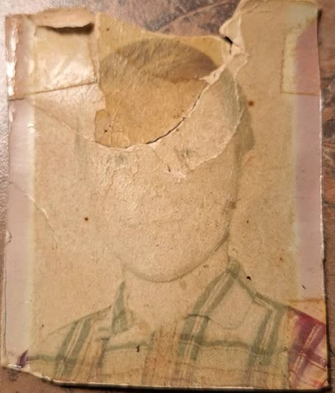
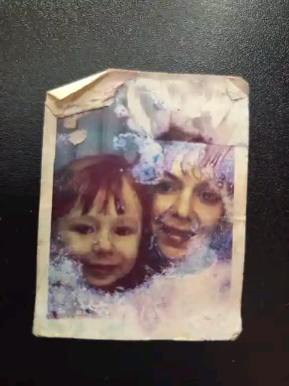
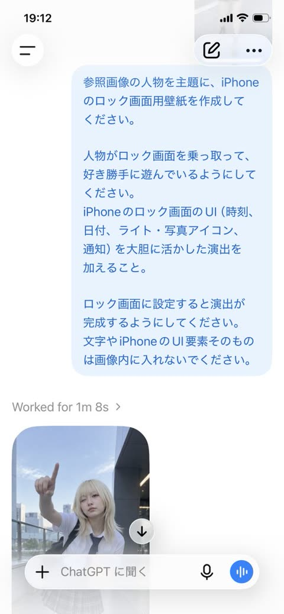

# 照片编辑

[返回目录](../../README_zh.md) · 全部 40 条

<a id="gpt-image-selfie-chibi-sticker-doodle-edit"></a>
### 电梯镜面自拍加Q版贴纸涂鸦

<a href="https://x.com/ChillaiKalan__/status/2050614367536939243"></a>

提示词先锁定原图光线与色调，再叠加白色描边、多姿势的同脸Q版小人和简短手写字。限制文字数量并让吉祥物保持克制，避免画面拥挤。

GPT Image 2 · 上传图改图 · 出处: [@ChillaiKalan__ on X](https://x.com/ChillaiKalan__/status/2050614367536939243) · 1,255 赞，统计于 2026-10-28

[`doodle`](tags.md#tag-doodle) [`chibi`](tags.md#tag-chibi) [`sticker-outline`](tags.md#tag-sticker-outline) [`xiaohongshu`](tags.md#tag-xiaohongshu) [`selfie`](tags.md#tag-selfie)

<details><summary><b>提示词</b></summary>

```text
Edit this photo into a cute Pinterest/Xiaohongshu-style doodle aesthetic edit while keeping the original composition and colors natural. Do NOT heavily change the original lighting or color grading. Keep the tones soft, airy, warm, and realistic. Avoid oversaturated colors, HDR effects, strong orange filters, or excessive contrast. Add hand-drawn doodle elements around the main objects: * white outline strokes * sketchy sparkles * stars * hearts * arrows * tiny flowers * playful swirls * mini handwritten notes Add small cute mascot-style doodles that match the vibe of the photo (tiny bear, smiling drink, cute food character, sleepy cloud, etc.) but keep them subtle and balanced. Use handwritten white text with short relatable captions only. Do NOT add too many words or overcrowd the image.Use a real face as a reference photo. The background is the same as in the photo. The lighting is warm, soft, and clean, with subtle shadows. Around the image, add several mini chibi (3D cute style) versions of the character, while maintaining the original facial features.Chibi characters have various poses and expressions: jumping cheerfully waving sitting relaxed holding a drink cute and playful expressions.  Add hand-drawn white doodle elements: outline around the main body stars, hearts, sparkles motion lines small cute icons Add aesthetic handwriting such as: "shine," "bright day," "happy," "smile," etc. (casual doodle font) Overall style: clean & aesthetic composition white sticker outline soft pastel color tone high detail 3D chibi glossy look cute Korean.
```

</details>

<a id="nano-banana-old-photo-dslr-restoration"></a>
### 模糊的老照片幼儿像修复成单反画质

<a href="https://x.com/Naiknelofar788/status/2030574333853069387"></a>

用具体的相机型号佳能 EOS R6 II 作为画质目标，给模型明确的色彩、细节与放大参照。同时要求保留准确的面部特征并保持自然，避免修复时改变人物。

Nano Banana 2 · 上传图改图 · 出处: [@Naiknelofar788 on X](https://x.com/Naiknelofar788/status/2030574333853069387) · 987 赞，统计于 2026-10-28

[`photo-restoration`](tags.md#tag-photo-restoration) [`upscale`](tags.md#tag-upscale) [`old-photo`](tags.md#tag-old-photo) [`portrait`](tags.md#tag-portrait) [`camera-reference`](tags.md#tag-camera-reference)

<details><summary><b>提示词</b></summary>

```text
Restore this old photo into portrait of DLSR - quality colour and detail, using an advanced upscaling algorithm comparable to the results from canon EOS R6 II. Ensure the restored the image looks natural, retains exact facial features, has great clarity"
```

</details>

<a id="gpt-image-old-photo-restoration-colorize-sharpen"></a>
### 模糊人像修复为清晰细节的前后对比

<a href="https://x.com/AiwithLariab/status/2075549421073469614"></a>

提示词先逐项列出要修复的损伤（划痕、污渍、噪点、破损），再用保持真实的限制约束锐化程度。同时要求肤色发色衣物采用符合年代的自然色并配柔和背景，让结果忠于原照片。

GPT Image 2 · 上传图改图 · 出处: [@AiwithLariab on X](https://x.com/AiwithLariab/status/2075549421073469614) · 932 赞，统计于 2026-10-29

[`photo-restoration`](tags.md#tag-photo-restoration) [`colorize`](tags.md#tag-colorize) [`sharpen`](tags.md#tag-sharpen) [`old-photo`](tags.md#tag-old-photo)

<details><summary><b>提示词</b></summary>

```text
Restore and enhance an old damaged photo. Remove scratches, stains, and noise. Reconstruct faded or torn areas while preserving original details. Slightly sharpen the image for better clarity, but keep it realistic. Apply natural and era-appropriate colors to skin, hair, and clothing. Use a soft, balanced background color without being too striking. The final result should look like an old photo that has been realistically restored and colorized, while respecting its original appearance.
```

</details>

<a id="nano-banana-damaged-photo-restoration-portrait"></a>
### 破损老照片修复为现代人像

<a href="https://x.com/doctorwasif/status/2030566053286457783"></a>

正向提示词锁定身份、五官结构和构图，再用负面清单排除风格改变和塑料皮肤，让修复忠于原照片。最后用电影摄影机和调色关键词提升为现代照片质感。

Nano Banana 2 · 上传图改图 · 出处: [@doctorwasif on X](https://x.com/doctorwasif/status/2030566053286457783) · 552 赞，统计于 2026-10-28

[`photo-restoration`](tags.md#tag-photo-restoration) [`old-photo`](tags.md#tag-old-photo) [`portrait`](tags.md#tag-portrait) [`upscale`](tags.md#tag-upscale) [`json-prompt`](tags.md#tag-json-prompt)

<details><summary><b>提示词</b></summary>

```text
{ "task": "image_restoration_upscale", "positive_prompt":
"Restore and enhance the provided image. Preserve original identity, facial structure, proportions and composition. High-fidelity photo restoration, ultra-realistic, natural skin texture, accurate details, professional photographic look. 4K output, sharp but natural focus, modern cinematic lighting, subtle volumetric lighting, professional color grading, depth of field, HDR. Shot on Arri Alexa, raw photo aesthetic, masterpiece.",
"negative_prompt": "Creative reinterpretation, style change, identity alteration, face reshaping, exaggerated features, cartoonish, painting, illustration, over-sharpening, plastic skin, blur, noise, film grain, jpeg artifacts, distortion, bad anatomy, overexposed, underexposed, washed out colors.", "parameters":
{ "steps": 30, "cfg_scale": 6.5, "denoising_strength": 0.45,
"upscaler": "4x_NMKD_Siax_200k", "target_resolution": "4K" } }
```

</details>

<a id="nano-banana-damaged-vintage-photo-restoration-upscale"></a>
### 开裂的老照片修复为清晰4K人像

<a href="https://x.com/doctorwasif/status/2048998423471481059"></a>

用JSON把任务、正向提示、负向提示和参数分开，正向提示开头先锁定身份、比例和构图。负向词禁止改风格、塑料皮肤和过度锐化，较低的降噪强度让结果忠实于原图。

Nano Banana 2 · 上传图改图 · 出处: [@doctorwasif on X](https://x.com/doctorwasif/status/2048998423471481059) · 297 赞，统计于 2026-10-28

[`photo-restoration`](tags.md#tag-photo-restoration) [`upscale`](tags.md#tag-upscale) [`json-prompt`](tags.md#tag-json-prompt) [`vintage-photo`](tags.md#tag-vintage-photo) [`negative-prompt`](tags.md#tag-negative-prompt)

<details><summary><b>提示词</b></summary>

```text
{ "task": "image_restoration_upscale", "positive_prompt":
"Restore and enhance the provided image. Preserve original identity, facial structure, proportions and composition. High-fidelity photo restoration, ultra-realistic, natural skin texture, accurate details, professional photographic look. 4K output, sharp but natural focus, modern cinematic lighting, subtle volumetric lighting, professional color grading, depth of field, HDR. Shot on Arri Alexa, raw photo aesthetic, masterpiece.",
"negative_prompt": "Creative reinterpretation, style change, identity alteration, face reshaping, exaggerated features, cartoonish, painting, illustration, over-sharpening, plastic skin, blur, noise, film grain, jpeg artifacts, distortion, bad anatomy, overexposed, underexposed, washed out colors.", "parameters":
{ "steps": 30, "cfg_scale": 6.5, "denoising_strength": 0.45,
"upscaler": "4x_NMKD_Siax_200k", "target_resolution": "4K" } }
```

</details>

<a id="gpt-image-claymation-social-profile-screen"></a>
### 粘土定格动画风格的社交主页界面

<a href="https://x.com/miratechtool/status/2052033236964950111"></a>

提示词先锁定软质黏土这一种材质，再列出手工纹理、圆润造型和指纹等具体触感线索，并配上定格动画式灯光和暖色粉彩。这样现有截图里的按钮、头像和图标都被重做成黏土质感。

GPT Image 2 · 上传图改图 · 出处: [@miratechtool on X](https://x.com/miratechtool/status/2052033236964950111) · 255 赞，统计于 2026-10-28

[`claymation`](tags.md#tag-claymation) [`stop-motion`](tags.md#tag-stop-motion) [`pastel`](tags.md#tag-pastel) [`style-transfer`](tags.md#tag-style-transfer) [`social-profile`](tags.md#tag-social-profile)

<details><summary><b>提示词</b></summary>

```text
Recreate the scene as a cozy claymation-style world made from soft modeling clay. Every object should have handmade textures, rounded shapes, fingerprints, and soft lighting like a stop-motion movie. Use warm pastel colors and a cute cinematic atmosphere.
```

</details>

<a id="nano-banana-cozy-portrait-cartoon-cat-overlay"></a>
### 叠加卡通猫涂鸦的温馨人像

<a href="https://x.com/Just_sharon7/status/2029006238101680432"></a>

用结构化 JSON 把人物、道具、环境、插画效果和渲染分开描述。真实质感与光滑矢量卡通叠加、白色涂鸦轮廓形成对比。

Nano Banana 2 · 上传图改图 · 出处: [@Just_sharon7 on X](https://x.com/Just_sharon7/status/2029006238101680432) · 246 赞，统计于 2026-10-28

[`cartoon-overlay`](tags.md#tag-cartoon-overlay) [`mixed-media`](tags.md#tag-mixed-media) [`cozy`](tags.md#tag-cozy) [`json-prompt`](tags.md#tag-json-prompt) [`cat`](tags.md#tag-cat)

<details><summary><b>提示词</b></summary>

```text
{
  "title": "Whimsical Cozy Portrait",
  "input_image": "[UPLOAD YOUR IMAGE]",
  "description": "Transform the uploaded image into a 64K DSLR-quality ultra-hyperrealistic cozy, whimsical mixed-media portrait combining realistic photography with playful cartoon illustrations.",
  "subject": {
    "person": {
      "appearance": {
        "hair": "blonde, loosely tied with soft strands framing the face",
        "eyes": "light green",
        "makeup": "natural",
        "top": "dark grey layered over black long-sleeve shirt",
        "expression": "resting cheek gently on one hand, dreamy and slightly tired",
        "accessories": [
          "black-and-pink cat ears",
          "small cute hair clip"
        ]
      },
      "pose": "sitting at a wooden table, holding a white ceramic mug in one hand"
    },
    "animated_elements": [
      {
        "type": "cartoon_cat",
        "color": "bright orange",
        "expression": "excited, curious",
        "action": "climbing up her arm",
        "features": "exaggerated big eyes, expressive paws"
      },
      {
        "type": "cartoon_tail",
        "color": "grey",
        "position": "right side, partially out of frame"
      }
    ]
  },
  "props": {
    "mug": {
      "color": "white",
      "illustration": "cute cartoon face with big expressive eyes and small mustache",
      "drink": "pink foam bubbles rising from the top"
    },
    "dessert": {
      "type": "chocolate cake",
      "toppings": ["whipped cream", "sliced strawberries", "peach slice"]
    }
  },
  "environment": {
    "room": {
      "walls": "beige textured",
      "lighting": "soft daylight streaming through window with sheer white curtains",
      "decor": "vintage framed photographs in casual gallery arrangement",
      "atmosphere": "warm, cozy, intimate"
    }
  },
  "illustration_effects": {
    "style": [
      "hand-drawn cartoon overlays",
      "white doodle-style accents: bubbles, playful lines, sparkles, hand-drawn crown",
      "soft white illustrated outlines around woman and objects"
    ]
  },
  "composition": {
    "aspect_ratio": ["1:1", "4:5 vertical"],
    "depth_of_field": "shallow",
    "mood": ["cozy", "cute", "whimsical", "soft", "playful", "warm"]
  },
  "rendering": {
    "technique": ["Octane render", "Ultra-hyperrealistic", "Unreal Engine 5"],
    "details": "ultra-detailed, high-resolution, soft natural lighting, warm tones, Instagram-worthy",
    "texture_contrast": "realistic textures (skin, fabric, wood, wall) vs smooth vector-style illustrations"
  }
}
```

</details>

<a id="gpt-image-mural-twin-half-heart-illusion"></a>
### 女子与壁画分身合成一颗爱心

<a href="https://x.com/Kubra_286/status/2102235098703880428"></a>

把壁画和真人分成两个带标签的段落并保持同款穿搭，指尖才能拼成完整爱心。结尾补充强制透视和砖纹叠加，让画面看起来像画在墙上。

GPT Image 2.5 · 上传图改图 · 出处: [@Kubra_286 on X](https://x.com/Kubra_286/status/2102235098703880428) · 241 赞，统计于 2026-10-28

[`mural`](tags.md#tag-mural) [`trompe-l-oeil`](tags.md#tag-trompe-l-oeil) [`forced-perspective`](tags.md#tag-forced-perspective) [`street-art`](tags.md#tag-street-art) [`selfie`](tags.md#tag-selfie)

<details><summary><b>提示词</b></summary>

```text
Ultra realistic cinematic photo of a young woman making a half heart sign with her mural twin, interactive street art illusion.

Face match 100%

Mural on brick wall: giant hyper-realistic painting of the same woman, shoulder-length wavy blonde hair with dark roots, smiling side profile, wearing light pink ribbed cropped t-shirt, small hoop earrings, delicate 'Clariz' name necklace, right hand raised making half heart shape with thumb and index finger. Photorealistic mural style, brick texture visible through paint, black graffiti background.

Real woman: same woman, same face, shoulder-length wavy blonde hair, same pink ribbed crop top, brown dark cargo pants with side pockets, blue and white sneakers. Standing on sidewalk facing the mural, left hand raised completing the other half of the heart shape with the painted hand, fingers almost touching, perfect alignment forming a full heart. Smiling at mural.

Environment: urban alley brick wall with graffiti, posters and stickers on adjacent wall, small green plants growing along wall base, concrete sidewalk, soft natural daylight.

Style: true to life color grading, photorealistic, DSLR 8K, ultra detailed skin, same face recognizable, natural shadows, 9:16 vertical portrait, trompe-l'oeil, Instagram couple bestie heart hand trend.
*Pro tip to get it perfect:*
two people making heart shape, one real one painted, fingertip connection point, forced perspective heart illusion, brick overlay on mural, same outfit mural and real
```

</details>

<a id="nano-banana-old-photo-restore-dslr-portrait"></a>
### 开裂老照片修复为彩色人像

<a href="https://x.com/doctorwasif/status/2030803471041954150"></a>

以佳能 EOS R6 II 作为画质基准并要求高级放大效果，同时明确要求保留原有面部特征，让修复结果忠于原照片。

Nano Banana 2 · 上传图改图 · 出处: [@doctorwasif on X](https://x.com/doctorwasif/status/2030803471041954150) · 206 赞，统计于 2026-10-28

[`photo-restoration`](tags.md#tag-photo-restoration) [`old-photo`](tags.md#tag-old-photo) [`portrait`](tags.md#tag-portrait) [`upscale`](tags.md#tag-upscale) [`colorize`](tags.md#tag-colorize)

<details><summary><b>提示词</b></summary>

```text
"Restore this old photo into professional portrait of DLSR - quality colour and detail, using an advanced upscaling algorithm comparable to the results from canon EOS R6 II. Ensure the restored the image looks natural, retains exact facial features, has great clarity......"
```

</details>

<a id="gpt-image-big-head-miniature-person-photo-edit"></a>
### 商场自拍照变超大头迷你人像

<a href="https://x.com/oggii_0/status/2113887497751253111"></a>

按优先级排列指令并给出数值比例，例如头宽为肩宽的2.5到3倍、四肢缩到25%到35%。姿势、面部、服装和场景各设保留章节，再用禁止清单排除卡通和娃娃脸。

GPT Image 2.5 · 上传图改图 · 出处: [@oggii_0 on X](https://x.com/oggii_0/status/2113887497751253111) · 180 赞，统计于 2026-10-28

[`chibi`](tags.md#tag-chibi) [`big-head`](tags.md#tag-big-head) [`photo-edit`](tags.md#tag-photo-edit) [`photorealistic`](tags.md#tag-photorealistic) [`proportion`](tags.md#tag-proportion)

<details><summary><b>提示词</b></summary>

```text
Turn any photo into a hyper-realistic chibi-style portrait using GPT Image 2.5

Prompt : Hyper-Realistic Big-Head Miniature Person | Photo Editing Prompt

Strictly edit the uploaded original photograph to transform the person or animal into a hyper-realistic, extremely exaggerated big-head miniature figure.

Highest Priority: Change only the head-to-body proportions. Preserve the original appearance, pose, actions, clothing, accessories, background, and aspect ratio of the photograph completely.

1\. Head-to-Body Proportions (Highest Priority)

* Giant Head: Dramatically enlarge the entire head, including hair, hats, and ears. The head width should be approximately 2.5–3 times the width of the reduced shoulders.

* Extremely Narrow Shoulders: Make the shoulders significantly narrower than the head, with a short, small neck. Do not retain normal adult shoulder width.

* Miniature Body: In full-body photographs, the body height (excluding the head) should be approximately 0.9–1.1 times the head height. Scale down the torso, waist, hips, and limbs proportionally.

* Miniature Hands and Feet: Reduce the arms, palms, fingers, legs, feet, and shoes to approximately 25–35% of their normal proportions. The limbs must be short and slender. Never leave the hands or feet at normal size.

* Strong Proportional Contrast: Regardless of whether the subject wears a skirt, trousers, or loose-fitting clothing, the result must clearly emphasize a giant, realistic head, extremely narrow shoulders, and an ultra-miniature body.

### 2\. Pose and Actions (Strictly Preserve)

Preserve the original subject's exact pose, actions, gestures, gaze direction, and interactions.

* If the subject is standing in the original image, keep them standing. If sitting, crouching, lying down, or leaning against an object, preserve that exact position.

* Retain the original hand positions, held objects, leg positions, and all points of contact with the surrounding environment.

* If the original image is a half-body portrait, selfie, or partial-body photograph, maintain the original framing. Do not invent or generate legs, shoes, or a complete body that was not visible in the original image.

* Never alter the pose, actions, or composition simply to accommodate the miniature body proportions.

### 3\. Facial Features and Clothing (Fully Preserve)

* Preserve the original face shape, facial features, facial proportions, expression, skin tone, hairstyle, and recognizable identity. Do not apply beauty filters, skin smoothing, eye enlargement, or face reshaping.

* Preserve the original clothing styles, materials, colors, patterns, and all accessories. Naturally scale the clothing to fit the miniature body without changing its design.

* For animals, preserve the original species, fur color, ears, facial characteristics, and expression. Only modify the head-to-body proportions.

### 4\. Scene and Composition (Fully Preserve)

* Use the original photograph as the sole reference for the scene. Preserve the background, architecture, furniture, environmental objects, lighting, shadows, and color tones.

* Maintain the original camera angle, perspective, subject placement, composition, and image aspect ratio.

* Keep all background elements at their normal, realistic sizes. Do not replace the scene or introduce new objects.

* Ensure the subject blends naturally into the environment, with realistic proportions relative to the scene and physically consistent shadows.

### 5\. Visual Style

The entire image must maintain an extremely photorealistic photographic quality. Preserve realistic skin texture, individual hairs, fabric details, and natural lighting. The transition between the enlarged head and miniature body must appear seamless, with no visible compositing artifacts.

Strictly Prohibited:

* Cartoon, anime, or stylized 3D figurine aesthetics.

* Doll-like faces or AI beauty enhancements.

* Normal adult shoulder width.

* Oversized hands or feet.
```

</details>

<a id="nano-banana-doodle-sticker-chibi-photo-edit"></a>
### 手绘涂鸦与Q版贴纸风人像照片

<a href="https://x.com/john_my07/status/2051162500780208297"></a>

先锁定原图构图、光线与背景，再叠加细白线涂鸦、少量吉祥物和简短手写字幕。列出跳跃、挥手、坐姿、拿饮料等姿势，生成带白边的3D Q版自己。

Nano Banana 2 · 上传图改图 · 出处: [@john_my07 on X](https://x.com/john_my07/status/2051162500780208297) · 160 赞，统计于 2026-10-28

[`doodle`](tags.md#tag-doodle) [`chibi`](tags.md#tag-chibi) [`sticker`](tags.md#tag-sticker) [`xiaohongshu`](tags.md#tag-xiaohongshu) [`photo-edit`](tags.md#tag-photo-edit)

<details><summary><b>提示词</b></summary>

```text
Transform the provided photo into a soft, Pinterest/Xiaohongshu-inspired doodle aesthetic while preserving the original composition, facial identity, and natural color tones. Keep the lighting gentle, warm, and realistic, avoid heavy color grading, oversaturation, HDR effects, or strong filters. The overall feel should remain airy, clean, and naturally bright.
Enhance the image with subtle, hand-drawn doodle accents placed around the subject:
thin white outline strokes
delicate sparkles, stars, and tiny hearts
curved arrows, soft swirls, and mini floral sketches
light motion lines that complement the pose
Incorporate a few small, charming mascot-style illustrations (e.g., a tiny bear, smiling beverage, cute snack character, dreamy cloud), ensuring they stay minimal and don’t overpower the image.
Add short handwritten-style white captions in a casual doodle font—keep them minimal and expressive (examples: “shine,” “good mood,” “soft day,” “stay cozy”). Avoid clutter or excessive text.
Maintain the original background exactly as is. Keep shadows soft and natural with clean, warm lighting.

Around the composition, include several small 3D chibi-style versions of the subject, preserving recognizable facial features. These mini characters should have a glossy, soft pastel finish and appear in varied playful poses such as:
jumping happily
waving
sitting relaxed
holding a drink
expressing cute, lively emotions
Style details:
clean layout with balanced spacing
white sticker-like outlines
soft pastel accents with realistic base tones
high-detail, polished 3D chibi look
cute, modern Korean-inspired aesthetic
Ensure the final result feels cohesive, light, and aesthetically pleasing without overwhelming the original image.
```

</details>

<a id="nano-banana-old-photo-restoration-dslr-portrait"></a>
### 破损老照片修复为单反质感人像

<a href="https://x.com/doctorwasif/status/2039935624799760434"></a>

指定具体相机档次（Canon EOS R6 II）来锁定目标影像质感，并明确要求保留准确的面部特征以保证修复忠实原图。简短的 JSON 结构带有质量和风格字段，方便重复使用。

Nano Banana 2 · 上传图改图 · 出处: [@doctorwasif on X](https://x.com/doctorwasif/status/2039935624799760434) · 157 赞，统计于 2026-10-29

[`photo-restoration`](tags.md#tag-photo-restoration) [`old-photo`](tags.md#tag-old-photo) [`dslr`](tags.md#tag-dslr) [`portrait`](tags.md#tag-portrait) [`json-prompt`](tags.md#tag-json-prompt)

<details><summary><b>提示词</b></summary>

```text
{
  "prompt": "Restore old photo into natural DSLR-quality portrait (Canon EOS R6 II level), high detail, accurate colors, sharp clarity, preserve exact facial features",
  "quality": "high",
  "style": "photorealistic"
}
```

</details>

<a id="nano-banana-damaged-photo-restoration-upscale"></a>
### 受损的老旧合影修复为清晰的单反画质

<a href="https://x.com/doctorwasif/status/2034638781857288239"></a>

用 JSON 结构的提示词，开头明确要求保留人物身份、五官结构和构图，再加入 Arri Alexa、HDR 等摄影画质描述。较长的负面提示词阻止风格改变、塑料皮肤和面部变形，较低的重绘强度则保住原有的面孔。

Nano Banana 2 · 上传图改图 · 出处: [@doctorwasif on X](https://x.com/doctorwasif/status/2034638781857288239) · 152 赞，统计于 2026-10-29

[`photo-restoration`](tags.md#tag-photo-restoration) [`upscale`](tags.md#tag-upscale) [`json-prompt`](tags.md#tag-json-prompt) [`negative-prompt`](tags.md#tag-negative-prompt) [`identity-preservation`](tags.md#tag-identity-preservation)

<details><summary><b>提示词</b></summary>

```text
{ "task": "image_restoration_upscale", "positive_prompt":
"Restore and enhance the provided image. Preserve original identity, facial structure, proportions and composition. High-fidelity photo restoration, ultra-realistic, natural skin texture, accurate details, professional photographic look. 4K output, sharp but natural focus, modern cinematic lighting, subtle volumetric lighting, professional color grading, depth of field, HDR. Shot on Arri Alexa, raw photo aesthetic, masterpiece.",
"negative_prompt": "Creative reinterpretation, style change, identity alteration, face reshaping, exaggerated features, cartoonish, painting, illustration, over-sharpening, plastic skin, blur, noise, film grain, jpeg artifacts, distortion, bad anatomy, overexposed, underexposed, washed out colors.", "parameters":
{ "steps": 30, "cfg_scale": 6.5, "denoising_strength": 0.45,
"upscaler": "4x_NMKD_Siax_200k", "target_resolution": "4K" } }
```

</details>

<a id="gpt-image-before-after-photo-cutout-doodle-sketchbook-background"></a>
### 前后对比照片与手绘涂鸦背景

<a href="https://x.com/Ziha_ai/status/2111374785079103515"></a>

上下两栏布局，上方保留原照片，下方是奶油色纸上的写实抠图人物。对涂鸦数量、尺寸、共用地平线和留白的严格限制，加上详细的禁止清单，让线稿背景保持轻盈、主体不被改动。

GPT Image 2.5 · 上传图改图 · 出处: [@Ziha_ai on X](https://x.com/Ziha_ai/status/2111374785079103515) · 138 赞，统计于 2026-10-29

[`before-after`](tags.md#tag-before-after) [`doodle`](tags.md#tag-doodle) [`line-art`](tags.md#tag-line-art) [`cutout`](tags.md#tag-cutout) [`sketchbook`](tags.md#tag-sketchbook)

<details><summary><b>提示词</b></summary>

```text
Create a vertical 3:4 before-and-after image split into two stacked panels of equal height.

TOP PANEL (before): the original photograph exactly as provided, completely unedited — same subject, pose, background, colors and lighting. Full bleed to the panel edges.

BOTTOM PANEL (after): the same person or people, still fully photographic and realistic, cut out from the original photo and placed centered on a warm cream off-white paper background. Keep their face, identity, expression, pose, clothing and proportions exactly as in the photo — never illustrate, stylize, smooth or redraw the subject. Clean cutout edges including hair.

Replace the entire background with charming hand-drawn doodles in thin black pen line art — monoline, no fill, light and loose like a sketchbook, with a little character and personality in the linework.

Use about eight doodle elements, balanced across the panel. Draw one or two simplified landmarks or buildings from the original background, one on each side of the subject at small scale. Add two or three small cartoon figures doing light actions that suit the scene — riding a bicycle, walking a dog, taking a photo, waving from a shop, holding a balloon. Add three or four small accents scattered in the open areas: a cloud, a sparkle or two, a paper plane with a dotted trail, a musical note, a few flowers or small plants near the ground.

Compose it with breathing room. Keep every doodle at roughly a third of the subject's height or less, and rest the buildings and figures along a shared ground line so the panel has a clear horizon. Let the accents float higher in the empty upper corners to fill the space lightly. Leave a clear margin of untouched cream around the subject on all sides — doodles never overlap or touch them — and keep visible cream gaps between neighbouring elements so nothing clusters.

Ground the subject with a thin sketchy horizontal line under the feet with a few short hatch marks and a soft natural shadow. Keep it light, not a dense scribble.

Place a short handwritten caption in the open upper-left area: three lines, three to five words each, casual lowercase handwriting in thin black ink, warm and reflective in tone. Add one small red hand-drawn heart just below it with space around it.

Everything in the lower panel is black line on cream, except three or four tiny color accents — a red heart, pink flowers, a yellow sparkle. The subject alone stays in full photographic color.

Avoid: a cluttered or busy background, doodles filling every corner, doodles overlapping or touching the subject, large doodles rivaling the subject's size, three or more buildings, dense scribbled shadows, heavy thick linework, shading or crosshatching, long caption text, more than three lines of text, an illustrated or cartoon subject, changed face or identity, beautified skin, altered clothing or pose, colored or filled doodles, 3D rendering, side-by-side panels, watermark.
```

</details>

<a id="nano-banana-giant-face-miniature-on-palm"></a>
### 巨人脸庞与掌心上的迷你人物

<a href="https://x.com/HaniaAi12/status/2028065588048810491"></a>

广角镜头加浅景深制造强迫透视，巨大的脸和手占满画面，掌心的小人保持清晰。背景是虚化的暖色办公室，并指定上传的人脸同时用于巨人和小人，保证两者身份一致。

Nano Banana 2 · 上传图改图 · 出处: [@HaniaAi12 on X](https://x.com/HaniaAi12/status/2028065588048810491) · 116 赞，统计于 2026-10-29

[`forced-perspective`](tags.md#tag-forced-perspective) [`miniature`](tags.md#tag-miniature) [`giant`](tags.md#tag-giant) [`face-reference`](tags.md#tag-face-reference) [`photorealistic`](tags.md#tag-photorealistic)

<details><summary><b>提示词</b></summary>

```text
A hyper-realistic, 8k, high-fidelity photograph captured with a wide-angle lens and shallow depth of field, creating a dramatic forced perspective. The composition features a colossal human face and hand on the right side, filling the frame, with the hand extended palm-up towards the left. The giant person, with a full beard and mustache, has their mouth slightly agape in an expression of surprise or speech, looking down towards their palm. On the palm of this giant hand stands a miniature person, appearing tiny in comparison, wearing a black short-sleeved t-shirt and light khaki pants, with dark curly hair. This miniature figure is captured mid-action, with arms slightly bent and legs in a dynamic, running or reacting pose, also with an open mouth as if shouting or speaking. The background is an extremely blurred, warm-toned indoor setting, suggesting an office or study with hints of wooden shelves and a blue binder, providing a soft bokeh effect. Cinematic lighting illuminates the scene with soft, warm light, highlighting the highly detailed texture of the skin, hair, and clothing, while maintaining a natural, diffused quality. The character's face for both the giant and the miniature person is: uploaded face as reference.
```

</details>

<a id="gpt-image-scrapbook-collage-face-identity-swap"></a>
### 棕色缎面衬衫拼贴手账换脸

<a href="https://x.com/warraich_Ai2/status/2100532000042140040"></a>

两张上传图分工明确：目标图决定一切，参考图只提供面部身份。用要素清单逐项锁定版式、服装、文字和Q版小图，再以一句最终规则收尾，保证只换脸不改其他。

GPT Image 2.5 · 上传图改图 · 出处: [@warraich_Ai2 on X](https://x.com/warraich_Ai2/status/2100532000042140040) · 114 赞，统计于 2026-10-28

[`face-swap`](tags.md#tag-face-swap) [`identity-transfer`](tags.md#tag-identity-transfer) [`scrapbook`](tags.md#tag-scrapbook) [`collage`](tags.md#tag-collage) [`reference-image`](tags.md#tag-reference-image)

<details><summary><b>提示词</b></summary>

```text
Create an image using the uploaded TARGET IMAGE as the exact master reference and the uploaded REFERENCE PHOTO as the identity reference.

Replace the face identity of the main woman with the woman from the REFERENCE PHOTO.

IMPORTANT — IDENTITY ONLY:
Use the REFERENCE PHOTO only to transfer the woman's facial identity: face shape, eyes, eyebrows, nose, lips, cheeks, jawline, skin texture and natural facial proportions.

Keep the TARGET IMAGE's hairstyle and messy bun, hair arrangement, body, physique, clothing, brown satin shirt, cream wide-leg trousers, brown belt, necklace, shoulder bag, poses, hand positions, expressions, accessories, and overall styling exactly as shown.

The entire scrapbook collage must remain the same:
- Same central full-body woman
- Same surrounding photo cutouts
- Same realistic and cartoon/chibi versions
- Same poses and expressions
- Same torn-paper collage layout
- Same tape pieces
- Same handwritten text and notes
- Same hearts, stars, flowers and decorative elements
- Same cat
- Same background, colors, textures and vintage beige/brown aesthetic
- Same composition, framing and aspect ratio

Apply the new woman's face naturally to EVERY realistic and illustrated appearance of the woman throughout the collage, while maintaining the appropriate style of each individual image.

Do not copy the reference woman's hairstyle, clothes, body, pose, background or accessories.

Make the face replacement seamless and natural in every panel. Match each panel's lighting, angle, expression, skin tone, shadows, perspective and image style.

FINAL RULE:
TARGET IMAGE = everything.
REFERENCE IMAGE = face identity only.
Change nothing else.
The final result must look like the original TARGET IMAGE, with only the woman's facial identity replaced by the woman from the reference photo.
```

</details>

<a id="gpt-image-fuji-highway-ar-route-motorcycle-campaign"></a>
### 红色摩托旁的骑手与发光AR导航公路

<a href="https://x.com/AIwithkhan/status/2061674387137540325"></a>

先锁定人物姿势（站在车旁而非骑乘），再逐项列出投射在路面上的AR界面元素，把上传的摩托照片变成旅行广告。具体地点、黄金时刻光线和负面提示词让画面保持写实、界面可信。

GPT Image 2 · 上传图改图 · 出处: [@AIwithkhan on X](https://x.com/AIwithkhan/status/2061674387137540325) · 85 赞，统计于 2026-10-29

[`travel-campaign`](tags.md#tag-travel-campaign) [`ar-interface`](tags.md#tag-ar-interface) [`motorcycle`](tags.md#tag-motorcycle) [`japan`](tags.md#tag-japan) [`golden-hour`](tags.md#tag-golden-hour)

<details><summary><b>提示词</b></summary>

```text
Transform my uploaded red sports bike photo into a cinematic adventure travel campaign set on an iconic Japanese mountain highway. The rider is standing confidently beside the motorcycle, not sitting on it, one hand resting naturally on the bike. Ultra-realistic futuristic navigation route projected directly onto the asphalt with glowing golden GPS lines flowing through the road. Advanced augmented reality travel interface integrated into the highway surface showing destination markers, ETA, distance remaining, speed indicators, route statistics, checkpoints, city names in Japanese and English, holographic map overlays, navigation arrows, and premium HUD elements.

Location: scenic Hakone mountain roads, Mount Fuji visible in the background, winding Japanese highways, coastal mountain passes, cherry blossom trees, traditional Japanese roadside details, breathtaking panoramic landscape. Golden hour sunset with warm cinematic lighting, volumetric sun rays, atmospheric haze, realistic reflections on the red motorcycle bodywork.

The woman stands beside the bike as the hero subject, long flowing hair, confident travel-adventure pose, looking toward the horizon. Motorcycle parked on the roadside while the glowing navigation route continues into the distance. Hyper-detailed road textures, luxury travel advertisement aesthetic, immersive road-trip atmosphere, high contrast, vibrant colors, shallow depth of field, photorealistic 8K, ultra-sharp focus, cinematic composition, premium tourism campaign, adventure and freedom theme, realistic AR technology seamlessly embedded into the environment, masterpiece quality, award-winning commercial photography.

Negative Prompt: helmet, sitting on bike, low quality, blurry face, cartoon, CGI look, extra limbs, distorted anatomy, duplicate bike, oversaturated colors, unrealistic UI, crowded traffic, rain, fog covering subject, watermark, logo, text artifacts, low resolution, bad proportions.
```

</details>

<a id="gpt-image-storyboard-panels-to-photographic-frames"></a>
### 屋顶追逐分镜稿转为写实摄影画面

<a href="https://x.com/umesh_ai/status/2110761775067230600"></a>

一句简短指令把六格铅笔分镜转成写实摄影，同时锁定构图、主体位置和机位，镜头设计在风格转换后依然保留。把两张分镜板并排放置，前后对比一目了然。

GPT Image 2.5 · 上传图改图 · 出处: [@umesh_ai on X](https://x.com/umesh_ai/status/2110761775067230600) · 68 赞，统计于 2026-10-28

[`storyboard`](tags.md#tag-storyboard) [`pencil-sketch`](tags.md#tag-pencil-sketch) [`photorealistic`](tags.md#tag-photorealistic) [`film-previs`](tags.md#tag-film-previs) [`layout-preservation`](tags.md#tag-layout-preservation)

<details><summary><b>提示词</b></summary>

```text
Big news!

Krea 3 is promising Nano Banana Pro/GPT Image 2.5  quality, 5x faster.

Imagine turning storyboard images into photographic frames you could put in front of a director.

The prompt I’d use: “Make every panel photographic. Preserve the composition, subject placement and camera angle.”

Then put the two boards side by side.

Some ideas become much harder to leave in a folder once you can see what they could look like.
```

</details>

<a id="gpt-image-comic-book-walk-red-hoodie-portrait"></a>
### 女子走过巨大摊开的漫画书

<a href="https://x.com/imGopalTiwari/status/2104045915195724081"></a>

以上传人像为参考锁定面部身份，再分段细写姿态、发型、肤色与服装。悬浮漫画格营造景深，上方左侧单一光束加红青配色，并配合负面提示词，形成漫画与真人电影的融合感。

GPT Image 2.5 · 上传图改图 · 出处: [@imGopalTiwari on X](https://x.com/imGopalTiwari/status/2104045915195724081) · 45 赞，统计于 2026-10-28

[`comic-book`](tags.md#tag-comic-book) [`surreal`](tags.md#tag-surreal) [`cinematic`](tags.md#tag-cinematic) [`face-reference`](tags.md#tag-face-reference) [`vertical`](tags.md#tag-vertical)

<details><summary><b>提示词</b></summary>

```text
Comic Book Magic in Motion

Made with GPT Image 2.5

Prompt: Hyper-realistic IMAX-level Netflix-style surreal cinematic comic-book fantasy portrait, 9:16 vertical. Use the uploaded image as the primary visual reference and preserve the exact facial identity, proportions, and defining features. Create a woman wearing a bright red oversized zip-up hoodie over a fitted plain white T-shirt, high-waisted blue jeans, and black-and-white high-top sneakers. She stands and walks confidently across the center fold of a giant open comic book, her left leg placed forward while the right leg remains slightly behind, knees naturally bent, torso upright, shoulders relaxed, left arm extending slightly outward for balance and right arm hanging loosely beside her body, with her weight shifting naturally onto the forward leg. Her face is turned directly toward the camera with a calm, confident expression, eyes focused straight ahead, relaxed eyelids, softly defined eyebrows, gently closed lips, relaxed jaw and a subtle fearless presence. Her hairstyle is long, straight-to-softly-wavy platinum-blonde hair with a center part, smooth volume at the crown, long face-framing sections falling evenly over both shoulders, slightly curved ends and a few fine strands catching the light, giving the hair a polished but natural movement as she walks. Fair luminous porcelain skin with a bright ivory to light beige tone and neutral-cool undertone, natural realistic texture with soft highlights. She is surrounded by a fantastical bedroom-artist studio filled with framed comic drawings, illustrated panels, scattered books, art supplies, sketches and comic pages, while the giant open comic beneath her creates the illusion that she has stepped directly into its world; multiple floating comic panels surround her at different depths and appear suspended in midair. Thin branching white-blue electrical cracks and glowing energy streaks run through the room, around the comic panels and across the giant pages, suggesting a portal-like transition between reality and the illustrated world. Strong cinematic light enters from the upper-left, creating a bright atmospheric beam through the room and illuminating her hair, face, red hoodie and floating panels, while the surrounding corners remain darker and atmospheric. Rich comic-inspired colour grading with vivid red, cyan-blue, white and muted charcoal tones, warm skin highlights balanced against cool electric-blue energy, deep textured shadows, crisp colour separation, controlled contrast, luminous highlights, restrained skin saturation, subtle atmospheric haze, fine film grain and a polished live-action-meets-graphic-novel cinematic finish.
Negative prompt: changed identity, distorted face, deformed hands or feet, bad anatomy, unnatural walking pose, extra limbs, flat hair, dull colours, plastic skin, text, watermark.
```

</details>

<a id="gpt-image-istanbul-alpine-castle-sunset-loop"></a>
### 伊斯坦布尔清真寺与阿尔卑斯城堡日落循环

<a href="https://x.com/KrishnaBio1/status/2097716825668702388"></a>

提示词按场景、光线、动画、风格、镜头分段,再配一长串负面词,让两张参考图融合成一个可信的地点。动画只允许环境微动,镜头锁定,并要求第16帧接回第1帧,形成无缝循环。

GPT Image 2.5 · 上传图改图 · 出处: [@KrishnaBio1 on X](https://x.com/KrishnaBio1/status/2097716825668702388) · 43 赞，统计于 2026-10-29

[`travel`](tags.md#tag-travel) [`sunset`](tags.md#tag-sunset) [`gif-loop`](tags.md#tag-gif-loop) [`landscape`](tags.md#tag-landscape) [`reference-blend`](tags.md#tag-reference-blend)

<details><summary><b>提示词</b></summary>

```text
Turn the two reference images into one breathtaking, ultra-realistic cinematic travel landscape with a seamless sunset animation loop.

SCENE
Combine the key elements from both images into one natural-looking destination. Include the grand Ottoman-style mosque with multiple minarets and domes, Istanbul-style waterfront and boats from the first image, together with the peaceful alpine lake, colorful European village, dramatic snow-capped mountains and beautiful hilltop stone castle from the second image.

Create a wide scenic waterfront view with historic architecture on one side and the castle and mountains on the other. Add colorful flowers, green trees, Mediterranean plants, a vintage lantern and an elegant terrace with a small café table in the foreground.

SUNSET & LIGHTING
Beautiful golden-hour sunset with pastel blue, pink, peach and orange clouds. Warm sunlight illuminates the mosque, castle, village, mountains and boats. The lake reflects the sunset, buildings and mountains with realistic gentle ripples and golden reflections.

ANIMATION
Create 16 consecutive frames of a smooth seamless loop. Animate only subtle environmental movement: slowly drifting clouds, gentle water ripples, boats moving slightly, birds flying in the distance, flowers and tree leaves softly moving in the breeze, and subtle candle/lantern flickering.

Keep the camera completely fixed. Keep the mosque, castle, mountains, houses and all major objects perfectly consistent across every frame. Frame 16 must smoothly transition back into Frame 1.

STYLE
Ultra-realistic cinematic travel photography, luxury tourism advertisement, breathtaking golden-hour atmosphere, realistic architecture, detailed mountains, natural vegetation, beautiful water reflections, atmospheric depth, high dynamic range, rich but natural colors, professional photography, photorealistic 8K quality.

CAMERA
Wide cinematic landscape view, 24mm lens, stable locked camera, natural perspective, realistic depth of field, consistent framing and lighting across all frames.

ANIMATION SETTINGS
16 frames, approximately 2.2-second complete loop, smooth continuous GIF animation, no camera movement, no flickering.

NEGATIVE PROMPT
cartoon, anime, painting, CGI, 3D render, low quality, distorted buildings, warped mosque, crooked minarets, malformed castle, distorted mountains, duplicated boats, floating objects, unrealistic reflections, fake water, excessive fog, oversaturated colors, extreme HDR, blurry image, motion blur, camera shake, zoom, flickering, morphing buildings, changing architecture, disappearing objects, duplicated birds, unnatural clouds, image seams, visible collage, text, logo, watermark, border, black bars, artifacts.
```

</details>

<a id="gpt-image-face-swap-woman-beside-ink-sketch-twin"></a>
### 真人与黑白线稿分身并排站姿

<a href="https://x.com/warraich_Ai2/status/2100776665500836060"></a>

把目标图定为唯一构图、参考照片只提供面部身份，再逐项列出必须保持不变的元素。结尾的总则和禁用清单防止发型、服装、姿势被带入，线稿分身仍保留眨眼吐舌的表情。

GPT Image 2.5 · 上传图改图 · 出处: [@warraich_Ai2 on X](https://x.com/warraich_Ai2/status/2100776665500836060) · 41 赞，统计于 2026-10-28

[`face-swap`](tags.md#tag-face-swap) [`identity-reference`](tags.md#tag-identity-reference) [`line-art`](tags.md#tag-line-art) [`constraint-list`](tags.md#tag-constraint-list)

<details><summary><b>提示词</b></summary>

```text
Use the uploaded TARGET IMAGE as the exact master composition.

Use the uploaded REFERENCE PHOTO only as the facial identity reference for the woman.

FACE IDENTITY:
Replace the woman's face in the TARGET IMAGE with the face of the woman from the REFERENCE PHOTO. Preserve her recognizable facial features, face shape, eyes, eyebrows, nose, lips, cheeks, jawline, skin tone and natural facial proportions.

IMPORTANT:
The real woman on the left and the illustrated woman on the right must represent the SAME woman and have the SAME facial identity.

For the illustrated version, translate the same reference woman's facial identity into the existing black-and-white hand-drawn illustration style. Keep the illustration's original playful expression, wink and tongue-out expression while making the facial identity clearly match the reference woman.

DO NOT CHANGE ANYTHING ELSE.

Keep the TARGET IMAGE exactly the same:
- Same real woman's body and physique
- Same hairstyle and hair arrangement
- Same yellow T-shirt
- Same cream/white wide-leg pants
- Same white sneakers
- Same earrings and accessories
- Same crossed-arm pose
- Same bent-leg position
- Same camera angle and framing
- Same wall and floor
- Same lighting and shadows
- Same black-and-white illustration
- Same illustrated pose and proportions
- Same hearts, stars, sparkles and motion lines
- Same composition and spacing
- Same image quality and aspect ratio

Do NOT use the reference photo's hairstyle, clothing, body, pose, background or accessories.

FINAL RULE:
TARGET IMAGE = everything except facial identity.
REFERENCE PHOTO = facial identity only.

The final image must look almost identical to the TARGET IMAGE, with only the woman's facial identity changed. The real photo and the illustrated character must clearly look like the same woman.
```

</details>

<a id="gpt-image-3d-chibi-doodle-sticker-portrait"></a>
### 被3D Q版贴纸和涂鸦环绕的人像

<a href="https://x.com/ChillaiKalan__/status/2051209193336545713"></a>

提示词先锁定原脸和原背景，再加入若干指定姿势与表情的3D Q版小人。白色手绘涂鸦、贴纸描边和随手写的短词完成粉彩风格。

GPT Image 2 · 上传图改图 · 出处: [@ChillaiKalan__ on X](https://x.com/ChillaiKalan__/status/2051209193336545713) · 发现于 [YouMind-OpenLab/awesome-gpt-image-2](https://github.com/YouMind-OpenLab/awesome-gpt-image-2)

[`chibi`](tags.md#tag-chibi) [`doodle`](tags.md#tag-doodle) [`sticker`](tags.md#tag-sticker) [`portrait`](tags.md#tag-portrait) [`reference-photo`](tags.md#tag-reference-photo)

<details><summary><b>提示词</b></summary>

```text
Use the original face from the reference photo. Background same as the photo. Warm, soft, clean lighting with soft shadows. Surround it with several 3D cute style mini chibi versions of themselves, keeping the original facial features. The chibi characters have various poses and expressions: cheerful jumping, waving, sitting casually holding a drink, and cute/playful expressions. Add white hand-drawn style doodle elements: outlines around the main body, stars, hearts, sparkles, and motion lines. Add aesthetic handwriting text like: 'shine', 'bright day', 'happy', 'smile', etc. (casual doodle font). Overall style: clean & aesthetic composition, white sticker outline, soft pastel color tone, high detail 3D chibi, glossy look, cute Korean style, instagramable
```

</details>

<a id="gpt-image-billboard-winter-evening"></a>
### 同一块广告牌改成下雪的冬夜

<a href="https://developers.openai.com/api/docs/guides/image-prompting#refine-an-image-across-turns"></a>

把上一步的成品作为输入，只提一个改动。每次只改一处，才看得出是哪一步起了作用。预览图为 Sunburst 版本。

GPT Image 2.5 · 上传图改图 · 出处: [OpenAI image prompting guide](https://developers.openai.com/api/docs/guides/image-prompting#refine-an-image-across-turns)

[`multi-turn`](tags.md#tag-multi-turn) [`weather`](tags.md#tag-weather) [`edit`](tags.md#tag-edit)

<details><summary><b>提示词</b></summary>

```text
Make it look like a winter evening with snowfall.
```

</details>

输入素材: [1](https://developers.openai.com/images/platform/guides/image-prompting/billboard-gpt-image-2-5-sunburst.webp)

<a id="gpt-image-cloud-balloon-mountain-ridge-travel-portrait"></a>
### 山脊上手牵巨大云朵气球的旅行人像

<a href="https://x.com/AiwithLariab/status/2091394735416160715"></a>

开头先锁定参考图的人物身份，再按姿势、场景、云朵、服装、光线和构图分块描述。云朵牵线强调物理可信，并固定为 9:16 全身构图，天空占上半部分。

GPT Image 2 · 上传图改图 · 出处: [@AiwithLariab on X](https://x.com/AiwithLariab/status/2091394735416160715) · 发现于 [freestylefly/awesome-gpt-image-2](https://github.com/freestylefly/awesome-gpt-image-2)

[`cloud-balloon`](tags.md#tag-cloud-balloon) [`mountain`](tags.md#tag-mountain) [`travel-fashion`](tags.md#tag-travel-fashion) [`identity-preserve`](tags.md#tag-identity-preserve) [`vertical`](tags.md#tag-vertical)

<details><summary><b>提示词</b></summary>

```text
Create a dreamy ultra-photorealistic outdoor fashion photograph based on the person in @image1.

IDENTITY & FACE:
Preserve the exact facial identity of the person in @image1. Keep the same face shape, facial proportions, eyes, eyebrows, nose, lips, skin tone, hairstyle, hairline, and all recognizable facial features. The person must remain clearly recognizable and consistent with the reference image. Do not redesign or replace the face.

POSE & COMPOSITION:
Create a full-body vertical portrait of the person standing naturally on a grassy mountain ridge. The body is slightly turned toward the camera while the face looks naturally toward the viewer. One hand gently holds several long white strings attached to an enormous fluffy white cloud floating directly above the person like a whimsical balloon bouquet. The other hand rests naturally beside the body.

SCENE:
A breathtaking high-altitude mountain landscape with layers of distant blue-green mountains stretching across the horizon. The subject stands on a natural grassy ridge with delicate wild grass around her feet. Vast open sky dominates the upper portion of the composition.

CLOUD BALLOON:
Create one enormous soft white cumulus cloud directly above the subject, visually resembling a giant floating cloud balloon. Multiple thin white strings descend from the cloud and gather elegantly into the person's hand. The strings should look physically believable and naturally connected to the cloud. The cloud is fluffy, voluminous, bright white, and beautifully illuminated by sunlight.

CLOTHING:
Dress the person in a completely modest, elegant, fully covered outfit:

long flowing light-blue maxi dress reaching the ankles

loose long sleeves covering the arms completely

high and modest neckline

opaque non-transparent fabric

full-length flowing skirt

simple white closed-toe sneakers

small woven crossbody bag
No exposed midriff, no deep neckline, no sheer fabric, no short skirt, no revealing clothing. The outfit should look graceful, comfortable, elegant, and wholesome.

ACCESSORIES:
Add tasteful round dark sunglasses and a simple woven shoulder/crossbody bag. Keep accessories minimal and natural.

HAIR:
Keep the person's original hairstyle and hair color from @image1 as much as possible. Allow a few natural strands of hair to move gently in the mountain breeze.

LIGHTING:
Bright natural midday sunlight, soft atmospheric illumination, realistic highlights on the white cloud and dress, subtle natural shadows, crisp but gentle exposure, beautiful blue-sky contrast.

PHOTOGRAPHY STYLE:
Ultra-photorealistic professional travel-fashion photography, realistic skin texture, natural fabric details, physically accurate lighting, realistic depth of field, cinematic atmospheric perspective, high dynamic range, sharp subject with a softly detailed background.

COLOR PALETTE:
Sky blue, soft white, pale powder blue, natural green grass, and distant blue mountains. Clean, airy, dreamy color grading with a peaceful summer atmosphere.

COMPOSITION:
9:16 vertical portrait, full body visible from head to shoes, subject positioned slightly below center, enormous blue sky and cloud occupying the upper half, distant mountains forming a soft horizontal horizon, balanced negative space, visually striking editorial travel photograph.

IMPORTANT:
Preserve the exact identity from @image1. Do not change the person's recognizable face or facial structure. Keep the outfit completely modest, opaque, and fully covering. Maintain realistic anatomy, natural hands, realistic proportions, and believable interaction between the person, strings, cloud, grass, and mountain environment.
```

</details>

<a id="gpt-image-cyberpunk-cosplay-street-photo-cinematic-grade"></a>
### 街头Cosplay照片调成赛博朋克电影海报

<a href="https://x.com/MMMusol/status/2051171670380126499"></a>

提示词先列出必须保留的内容（主体、姿势、服装、头盔、场景），再列出要改的部分：背景压暗虚化、加深阴影、冷蓝灰调色、暗角与胶片颗粒。头盔面罩上一点琥珀色反光作为视觉焦点，并禁止加字和改角色设计，让结果是修图而不是重绘。

GPT Image 2 · 上传图改图 · 出处: [@MMMusol on X](https://x.com/MMMusol/status/2051171670380126499) · 发现于 [YouMind-OpenLab/awesome-gpt-image-2](https://github.com/YouMind-OpenLab/awesome-gpt-image-2)

[`cyberpunk`](tags.md#tag-cyberpunk) [`cinematic-grade`](tags.md#tag-cinematic-grade) [`cosplay`](tags.md#tag-cosplay) [`photo-retouch`](tags.md#tag-photo-retouch) [`relighting`](tags.md#tag-relighting)

<details><summary><b>提示词</b></summary>

```text
Using the provided reference image, transform the ordinary phone snapshot into a cinematic cyberpunk movie-poster style edit. Keep the same subject, pose, outfit, helmet, foreground composition, and convention-center setting intact, but dramatically relight and color grade the scene with a dark, moody Blade Runner-inspired cyberpunk atmosphere. Make the background darker and slightly defocused, deepen shadows, add high contrast, cool blue-gray tones, subtle vignette, and a soft filmic texture. Add a small warm amber reflection/glow on the helmet visor area as if from neon or sunset light, while preserving realistic skin texture and photographic detail. Do not change the character design or add text; make it look like a professionally retouched cinematic poster frame rather than a casual outdoor snapshot.
```

</details>

<a id="gpt-image-japanese-film-garden-color-grade"></a>
### 春日庭园的日系胶片调色

<a href="https://x.com/HoodyLiu/status/2099115784417251690"></a>

提示词先锁定构图和所有物体，再分别给天空、樱花、绿植和水面设定调色目标。末尾列出大量禁用效果并以柯达 Portra 400 为参照，让结果像调过色的 RAW 原片而不是重新生成的图。

GPT Image 2.5 · 上传图改图 · 出处: [@HoodyLiu on X](https://x.com/HoodyLiu/status/2099115784417251690) · 发现于 [wangrunlin/awesome-gpt-image-2-5-prompts](https://github.com/wangrunlin/awesome-gpt-image-2-5-prompts)

[`color-grading`](tags.md#tag-color-grading) [`japanese-film`](tags.md#tag-japanese-film) [`cherry-blossom`](tags.md#tag-cherry-blossom) [`portra-400`](tags.md#tag-portra-400) [`photo-retouch`](tags.md#tag-photo-retouch)

<details><summary><b>提示词</b></summary>

```text
Please only perform professional color grading and light and shadow optimization on the original photos, strictly retain the original composition, scenery positions, cherry blossoms, trees, water reflections and screen proportions, and do not add, delete or change any objects. The overall style is adjusted to a high-end, restrained, and quiet Japanese film style, presenting the quiet atmosphere of a Japanese garden in early spring. Moderately brighten the dark details in the woods, waterfronts and ponds, and restore the layers of tree trunks, shrubs and water surfaces, but retain deep shadows and do not turn black areas into gray. Reduce the sky highlights and blue saturation, and adjust the sky to a transparent, calm gray-blue to avoid excessive brightness and HDR effects. Highlight the cherry blossoms in the center of the picture, making the flowers a natural pale pink-white color to add soft sunlight transparency and delicate layers. Do not turn it into pure white or fluorescent pink. The green plants are adjusted to low-saturated moss green, forest green and slight olive green, reducing the yellow-green and digital feel. The water surface maintains a deep blue-black color, enhancing the subtle reflections and layers of fallen cherry blossoms, making the reflection clear but not sharp. The overall design uses soft highlights, deep shadows, medium to strong contrast, and slightly increases the contrast between warm sunlight and cool shadows. Adding slight film fog, natural halo, fine 35mm film grain and soft sharpening, the color refers to Kodak Portra 400 and Japanese film photography, which is real, natural, subtle, airy and high-end. It is prohibited to change the composition, add cherry blossoms, clouds, buildings, people or lights, generate new branches, change the season, overexposure, dead black, HDR, over-sharpening, fluorescent green, brilliant blue sky, heavy filters, oil painting feeling, illustration feeling and AI redrawing feeling. The end result must be like a professional color correction of the original RAW photo, not a regenerated image.
```

</details>

<a id="gpt-image-laptop-screen-spreadsheet-to-workflow-diagram"></a>
### 笔记本屏幕换成自动化流程图

<a href="https://x.com/ai_kairos_jp/status/2097679848475099159"></a>

只点名要改的屏幕区域和替换内容，再逐项列出必须保持不变的桌面、便签、灯光和夜景窗外。明确写出保留项，局部编辑时其余画面才不容易跑偏。

GPT Image 2.5 · 上传图改图 · 出处: [@ai_kairos_jp on X](https://x.com/ai_kairos_jp/status/2097679848475099159) · 发现于 [wangrunlin/awesome-gpt-image-2-5-prompts](https://github.com/wangrunlin/awesome-gpt-image-2-5-prompts)

[`local-edit`](tags.md#tag-local-edit) [`screen-replacement`](tags.md#tag-screen-replacement) [`workflow-diagram`](tags.md#tag-workflow-diagram) [`preserve-scene`](tags.md#tag-preserve-scene) [`desk-scene`](tags.md#tag-desk-scene)

<details><summary><b>提示词</b></summary>

```text
Replace the spreadsheet with an automation workflow diagram. Do not change the desk, sticky notes, lighting or the nighttime view through the window.
```

</details>

<a id="gpt-image-lock-screen-wallpaper-ui-hijack"></a>
### 人物玩转时钟与图标的锁屏壁纸

<a href="https://x.com/sakisuta_/status/2099786676751225192"></a>

提示词以参考照片的人物为主体，让人物与时间、日期、手电筒和相机图标、通知所在的留白区域互动。同时明确禁止画面中出现文字和界面元素，设为真实锁屏后效果才完整。

GPT Image 2.5 · 上传图改图 · 出处: [@sakisuta_ on X](https://x.com/sakisuta_/status/2099786676751225192)

[`iphone`](tags.md#tag-iphone) [`lock-screen`](tags.md#tag-lock-screen) [`wallpaper`](tags.md#tag-wallpaper) [`reference-photo`](tags.md#tag-reference-photo) [`ui-interaction`](tags.md#tag-ui-interaction)

<details><summary><b>提示词</b></summary>

```text
参照画像の人物を主題に、iPhoneのロック画面用壁紙を作成してください。

人物がロック画面を乗っ取って、好き勝手に遊んでいるようにしてください。
iPhoneのロック画面のUI（時刻、日付、ライト・写真アイコン、通知）を大胆に活かした演出を加えること。

ロック画面に設定すると演出が完成するようにしてください。
文字やiPhoneのUI要素そのものは画像内に入れないでください。
```

</details>

<a id="gpt-image-longjing-tea-infographic-upscale"></a>
### 龙井茶信息图清晰化重绘

<a href="https://x.com/op7418/status/2068239294372987378"></a>

以参考图为基础,锁定版式、文字以及面板和图标的确切数量,只改变质感与细节。明确指出要锐化的元素和要补充的景物,用有意义的细节取代杂乱的噪点。

GPT Image 2 · 上传图改图 · 出处: [@op7418 on X](https://x.com/op7418/status/2068239294372987378) · 发现于 [YouMind-OpenLab/awesome-gpt-image-2](https://github.com/YouMind-OpenLab/awesome-gpt-image-2)

[`infographic`](tags.md#tag-infographic) [`upscale`](tags.md#tag-upscale) [`tea`](tags.md#tag-tea) [`layout-preserving`](tags.md#tag-layout-preserving) [`chinese-design`](tags.md#tag-chinese-design)

<details><summary><b>提示词</b></summary>

```text
Using the provided reference image, redraw and upscale it into a cleaner, sharper, more polished version while preserving the same overall infographic layout, all original text content, and the Longjing tea theme. Keep the product title 龙井茶 and the English subtitle Longjing Tea unchanged.

Goal: Make the image look less like a rough GPT-generated graphic by removing broken, noisy, meaningless textures and replacing them with crisp, intentional detail.

Enhancements to apply: Increase resolution and clarity; sharpen typography, icons, borders, tea leaves, glass, and card edges; make the lighting softer and more natural; improve material realism for the tea, cup, dried leaves, and ceramic dish; clean up any fuzzy or fragmented artifacts.

Meaningful detail additions: In the main hero panel, replace the vague pale background with a refined scenic tea plantation landscape of layered green terraces, misty mountains, and a wooden tabletop beneath the tea cup and plate. In the origin card, add a small matching tea-terrace landscape illustration at the bottom. Make the bottom green banner more vivid with a natural leaf-vein texture.

Layout constraints: Preserve exactly 7 visible content panels/sections: the large hero panel, origin card, features card, flavor card, brewing suggestion card, grade-and-picking card, and bottom slogan banner. Preserve exactly 4 feature rows in the features card, exactly 3 small icon benefits in the hero panel, and exactly 3 brewing parameter icons along the bottom of the brewing card. Do not add extra sections, extra labels, watermarks, logos, or decorative clutter.

Style: Elegant Chinese tea brochure design, cream-and-sage palette, refined minimal UI cards, soft shadows, crisp vector-like icons, realistic tea photography elements, calm premium product-advertising finish.
```

</details>

<a id="gpt-image-outfit-swap-keep-identity"></a>
### 用三件参考服装换装，人物不变

<a href="https://developers.openai.com/api/docs/guides/image-prompting#preserve-identity-and-change-clothing"></a>

先列出人物身上所有必须不变的东西，只放开服装，再要求光影匹配原图。要让产品保持可辨认也可以照这个写。预览图为 Sunburst 版本。

GPT Image 2.5 · 上传图改图 · 出处: [OpenAI image prompting guide](https://developers.openai.com/api/docs/guides/image-prompting#preserve-identity-and-change-clothing)

[`virtual-try-on`](tags.md#tag-virtual-try-on) [`fashion`](tags.md#tag-fashion) [`identity`](tags.md#tag-identity)

<details><summary><b>提示词</b></summary>

```text
Edit the image to dress the woman using the provided clothing images. Do not change her face, facial features, skin tone, body shape, pose, or identity in any way. Preserve her exact likeness, expression, hairstyle, and proportions. Replace only the clothing, fitting the garments naturally to her existing pose and body geometry with realistic fabric behavior. Match lighting, shadows, and color temperature to the original photo so the outfit integrates photorealistically, without looking pasted on. Do not change the background, camera angle, framing, or image quality, and do not add accessories, text, logos, or watermarks.
```

</details>

输入素材: [1](https://developers.openai.com/images/platform/guides/image-prompting/woman-in-museum.webp) · [2](https://developers.openai.com/images/platform/guides/image-prompting/jacket.webp) · [3](https://developers.openai.com/images/platform/guides/image-prompting/tank-top.webp) · [4](https://developers.openai.com/images/platform/guides/image-prompting/boots.webp)

<a id="gpt-image-person-into-campsite-scene"></a>
### 把人物放进黄昏营地逃跑的场景

<a href="https://developers.openai.com/api/docs/guides/image-prompting#insert-a-person-into-a-scene"></a>

写清姿态、视线、服装、地点和时间，并反复要求像真实照片，不要电影海报感。预览图为 Sunburst 版本。

GPT Image 2.5 · 上传图改图 · 出处: [OpenAI image prompting guide](https://developers.openai.com/api/docs/guides/image-prompting#insert-a-person-into-a-scene)

[`identity`](tags.md#tag-identity) [`action`](tags.md#tag-action) [`photorealism`](tags.md#tag-photorealism)

<details><summary><b>提示词</b></summary>

```text
Generate a highly realistic action scene where this person is running away from a large, realistic brown bear attacking a campsite. The image should look like a real photograph someone could have taken, not an overly enhanced or cinematic movie-poster image.
She is centered in the image but looking away from the camera, wearing outdoorsy camping attire, with dirt on her face and tears in her clothing. She is clearly afraid but focused on escaping, running away from the bear as it destroys the campsite behind her.
The campsite is in Yosemite National Park, with believable natural details. The time of day is dusk, with natural lighting and realistic colors. Everything should feel grounded, authentic, and unstyled, as if captured in a real moment. Avoid cinematic lighting, dramatic color grading, or stylized composition.
```

</details>

输入素材: [1](https://developers.openai.com/images/platform/guides/image-prompting/woman-in-museum.webp)

<a id="gpt-image-photo-background-doodle-people-swap"></a>
### 海边栈道上的涂鸦母女

<a href="https://x.com/Emmma__0/status/2091391958128251286"></a>

提示词先立下核心规则，背景保持实拍、人物改为涂鸦，再逐项锁定人数、位置、朝向、姿态和服装颜色。末尾的优先级排序和禁止清单让背景不被涂鸦化。

GPT Image 2 · 上传图改图 · 出处: [@Emmma__0 on X](https://x.com/Emmma__0/status/2091391958128251286) · 发现于 [freestylefly/awesome-gpt-image-2](https://github.com/freestylefly/awesome-gpt-image-2)

[`doodle`](tags.md#tag-doodle) [`photo-edit`](tags.md#tag-photo-edit) [`people-replacement`](tags.md#tag-people-replacement) [`hand-drawn`](tags.md#tag-hand-drawn) [`background-preserve`](tags.md#tag-background-preserve)

<details><summary><b>提示词</b></summary>

```text
Transform ONLY the people in the uploaded photo into adorable hand-drawn doodle characters while keeping the original photographic background unchanged.

CORE RULE:
Background = original realistic photo.
People = cute hand-drawn doodle characters.

PRESERVE THE BACKGROUND:
Keep the original sky, landscape, buildings, water, furniture, ground, plants, railings, objects, lighting, colors, perspective, camera angle, framing, and textures as close to the original photo as possible.

Do NOT redraw, simplify, illustrate, or apply doodle/crayon/pencil effects to the background or environmental objects.

TRANSFORM ONLY PEOPLE:
Replace each person with a charming, naive doodle version while preserving:
- exact number of people
- original position and relative scale
- front/back/side/three-quarter orientation
- head and body direction
- pose and gesture
- arm and leg positions
- interactions with people or objects
- hairstyle, clothing colors, and major accessories

IMPORTANT:
If someone faces away, keep them back-facing.
If sideways, keep them sideways.
If facing forward, keep them forward.
Never rotate a person toward the viewer or invent a face that is not visible.

CUTE DOODLE STYLE:
Freely reinterpret realistic anatomy into an adorable, imperfect character:
- oversized round head
- tiny compact body
- short simplified arms and legs
- tiny hands and feet
- cute awkward proportions
- loose scribbled hair
- tiny dot eyes and simple facial features when visible
- rosy scribbled cheeks when appropriate

Keep the original pose recognizable, but simplify and slightly exaggerate it for cuteness.

DRAWING STYLE:
Loose naive hand-drawn doodle, like a quick children's sketch.
Use thin shaky black outlines, imperfect shapes, overlapping sketch lines, scribbled colored-pencil or crayon fills, uneven coloring, white gaps, and slightly messy edges.

The character should look intentionally roughly drawn but extremely cute.

OBJECTS:
Objects, furniture, scenery, and items around the people should remain photographic whenever possible. A doodle character may naturally touch or hold a real photographic object.

INTEGRATION:
Keep correct scale, ground contact, depth, and occlusion so the doodle characters naturally occupy the same locations as the original people.

FINAL LOOK:
It should feel like the real people were removed from the original photograph and replaced with adorable little hand-drawn doodle versions of themselves, while the real-world background remained untouched.

Prioritize:
1. Original photographic background
2. Person position and scale
3. Exact body orientation
4. Pose and gesture
5. Cute exaggerated doodle character design

Avoid full-image illustration, background doodling, realistic anatomy, anime, manga, 3D cartoon, polished digital art, vector lines, changed poses, changed orientation, added people, or invented faces.
```

</details>

<a id="gpt-image-photorealistic-kitten-photo-restoration"></a>
### 模糊小猫照片修复为8K高清写实

<a href="https://x.com/robiartec/status/2063969416388178020"></a>

提示词用明确的保留与禁止改动条款锁定身份、姿势、构图和背景布局，再逐项列出需要还原的眼睛、毛发、胡须和耳毛等细节，以及要去除的瑕疵。

GPT Image 2 · 上传图改图 · 出处: [@robiartec on X](https://x.com/robiartec/status/2063969416388178020) · 发现于 [YouMind-OpenLab/awesome-gpt-image-2](https://github.com/YouMind-OpenLab/awesome-gpt-image-2)

[`photo-restoration`](tags.md#tag-photo-restoration) [`pet`](tags.md#tag-pet) [`upscale`](tags.md#tag-upscale) [`photorealistic`](tags.md#tag-photorealistic) [`cat`](tags.md#tag-cat)

<details><summary><b>提示词</b></summary>

```text
Using the provided reference image, enhance and restore it into an ultra-premium photorealistic 8K cinematic-quality photo. Preserve 100% of the original subject identity, pose, framing, composition, and color relationships: the kitten remains centered behind the same foreground ledge against the same blue background. Recover realistic micro-details lost in the low-resolution source: sharp glossy eyes, natural fur texture, fine whiskers, ear hairs, subtle skin and nose detail, clean edges, and realistic depth of field. Remove pixelation, blur, noise, color blotches, and compression artifacts while keeping the image natural, high-contrast, studio-quality, and believable. Do not change the kitten’s expression, position, markings, or background layout.
```

</details>

<a id="gpt-image-place-dog-into-scene"></a>
### 把一张照片里的狗放进另一张照片

<a href="https://developers.openai.com/api/docs/guides/image-prompting#combine-references"></a>

按编号指明图片，写清移动什么、放到哪里、什么不变。预览图为 Sunburst 版本。

GPT Image 2.5 · 上传图改图 · 出处: [OpenAI image prompting guide](https://developers.openai.com/api/docs/guides/image-prompting#combine-references)

[`composite`](tags.md#tag-composite) [`reference`](tags.md#tag-reference) [`pets`](tags.md#tag-pets)

<details><summary><b>提示词</b></summary>

```text
Place the dog from the second image into the setting of image 1, right next to the woman, use the same style of lighting, composition and background. Do not change anything else.
```

</details>

输入素材: [1](https://developers.openai.com/images/platform/guides/image-prompting/test-woman.webp) · [2](https://developers.openai.com/images/platform/guides/image-prompting/test-woman-2.webp)

<a id="gpt-image-pro-instagram-pasta-photo-enhance"></a>
### 手机拍摄的意面照片优化成 Instagram 水准

<a href="https://x.com/dezainaz_ceo/status/2047172512551977162"></a>

一句话同时设定摄影师和设计师两个角色，让模型一并处理光线调色和版面润色。适用于随手拍的手机照片，具体风格交给模型自行决定。

GPT Image 2 · 上传图改图 · 出处: [@dezainaz_ceo on X](https://x.com/dezainaz_ceo/status/2047172512551977162) · 发现于 [ZeroLu/awesome-gpt-image](https://github.com/ZeroLu/awesome-gpt-image)

[`photo-enhance`](tags.md#tag-photo-enhance) [`food`](tags.md#tag-food) [`instagram`](tags.md#tag-instagram) [`iphone-photo`](tags.md#tag-iphone-photo) [`retouch`](tags.md#tag-retouch)

<details><summary><b>提示词</b></summary>

```text
Enhance this iPhone photo with ChatGPT so it looks like a professional photographer and designer worked on it.
```

</details>

<a id="gpt-image-remove-object-from-hand"></a>
### 去掉男人手里的花

<a href="https://developers.openai.com/api/docs/guides/image-prompting#remove-an-object"></a>

只点名要去掉的那一个物体，并要求其他都不变，不用蒙版也能把改动限制在局部。预览图为 Sunburst 版本。

GPT Image 2.5 · 上传图改图 · 出处: [OpenAI image prompting guide](https://developers.openai.com/api/docs/guides/image-prompting#remove-an-object)

[`remove`](tags.md#tag-remove) [`inpainting`](tags.md#tag-inpainting) [`local-edit`](tags.md#tag-local-edit)

<details><summary><b>提示词</b></summary>

```text
Remove the flower from man's hand. Do not change anything else.
```

</details>

输入素材: [1](https://developers.openai.com/images/platform/guides/image-prompting/man-with-blue-hat.webp)

<a id="gpt-image-restore-colorize-damaged-family-photo"></a>
### 修复并上色的老式母婴合影

<a href="https://x.com/doctorwasif/status/2048014890028486904"></a>

提示词逐项列出要保留的姿势、构图、窗帘、衣着、发色和项链，让模型只修复破损而不重画画面。再以专业修复的4K扫描为目标，带出清晰细节和自然的暖色肤色。

GPT Image 2 · 上传图改图 · 出处: [@doctorwasif on X](https://x.com/doctorwasif/status/2048014890028486904) · 发现于 [YouMind-OpenLab/awesome-gpt-image-2](https://github.com/YouMind-OpenLab/awesome-gpt-image-2)

[`photo-restoration`](tags.md#tag-photo-restoration) [`colorize`](tags.md#tag-colorize) [`vintage`](tags.md#tag-vintage) [`family-portrait`](tags.md#tag-family-portrait) [`4k`](tags.md#tag-4k)

<details><summary><b>提示词</b></summary>

```text
Using REFERENCE_0, restore the old damaged family photo into a clean, high-resolution modern scan. Remove the heavy scratches, stains, fading, tears, and surface damage while preserving the original composition, pose, framing, and background curtain. Reconstruct realistic natural skin tones, sharpen details, and colorize the image with believable warm indoor tones. Keep the woman holding the baby in the same position, restore the black sleeveless dress, the baby's light outfit, the reddish-brown hair, and the subtle necklace. Maintain the same portrait crop and photographic realism, as if the original print was professionally repaired and remastered in 4K.
```

</details>

<a id="gpt-image-sketch-to-photo-valley"></a>
### 河谷线稿渲染成照片

<a href="https://developers.openai.com/api/docs/guides/image-prompting#turn-a-drawing-into-a-realistic-image"></a>

锁定布局、比例和透视，材质和光线交给模型，并禁止添加新元素，避免它自由发挥。预览图为 Sunburst 版本。

GPT Image 2.5 · 上传图改图 · 出处: [OpenAI image prompting guide](https://developers.openai.com/api/docs/guides/image-prompting#turn-a-drawing-into-a-realistic-image)

[`sketch`](tags.md#tag-sketch) [`photorealism`](tags.md#tag-photorealism) [`landscape`](tags.md#tag-landscape)

<details><summary><b>提示词</b></summary>

```text
Turn this drawing into a photorealistic image.
Preserve the exact layout, proportions, and perspective.
Choose realistic materials and lighting consistent with the sketch intent.
Do not add new elements or text.
```

</details>

输入素材: [1](https://developers.openai.com/images/platform/guides/image-prompting/drawings.webp)

<a id="gpt-image-swap-kitchen-chairs"></a>
### 厨房照片里只换椅子

<a href="https://developers.openai.com/api/docs/guides/image-prompting#change-furniture-in-a-room"></a>

用大写的 ONLY 限定唯一要换的东西，并列出要保留的机位、光线、地面阴影和周围物品。预览图为 Sunburst 版本。

GPT Image 2.5 · 上传图改图 · 出处: [OpenAI image prompting guide](https://developers.openai.com/api/docs/guides/image-prompting#change-furniture-in-a-room)

[`interior`](tags.md#tag-interior) [`local-edit`](tags.md#tag-local-edit) [`photorealism`](tags.md#tag-photorealism)

<details><summary><b>提示词</b></summary>

```text
In this room photo, replace ONLY the white chairs with chairs made of wood.
Preserve camera angle, room lighting, floor shadows, and surrounding objects.
Keep all other aspects of the image unchanged.
Photorealistic contact shadows and fabric texture.
```

</details>

输入素材: [1](https://developers.openai.com/images/platform/guides/image-prompting/kitchen.webp)

<a id="gpt-image-translate-infographic-spanish"></a>
### 把信息图翻译成西班牙语，版式不动

<a href="https://developers.openai.com/api/docs/guides/image-prompting#translate-while-preserving-layout"></a>

在咖啡机信息图上做的一句话编辑。出图后检查有没有漏翻的词。预览图为 Sunburst 版本。

GPT Image 2.5 · 上传图改图 · 出处: [OpenAI image prompting guide](https://developers.openai.com/api/docs/guides/image-prompting#translate-while-preserving-layout)

[`translation`](tags.md#tag-translation) [`edit`](tags.md#tag-edit) [`text-render`](tags.md#tag-text-render)

<details><summary><b>提示词</b></summary>

```text
Translate the text in the infographic to Spanish. Do not change any other aspect of the image.
```

</details>

输入素材: [1](https://developers.openai.com/images/platform/guides/image-prompting/infographic-coffee-machine-gpt-image-2-5-sunburst.webp)
