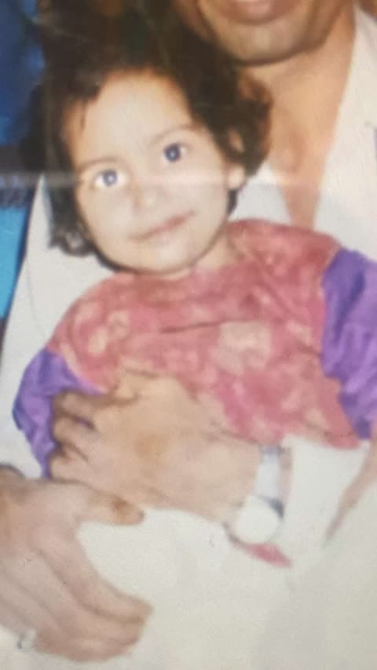
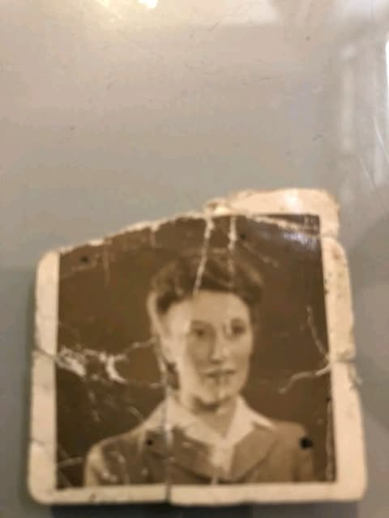
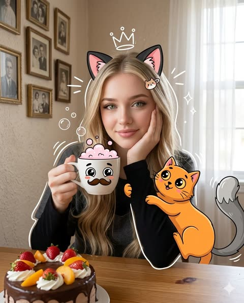
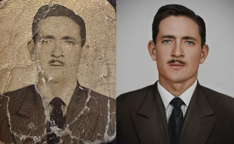
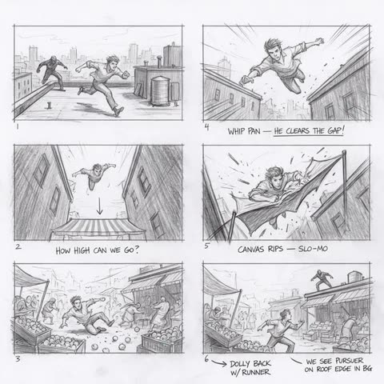
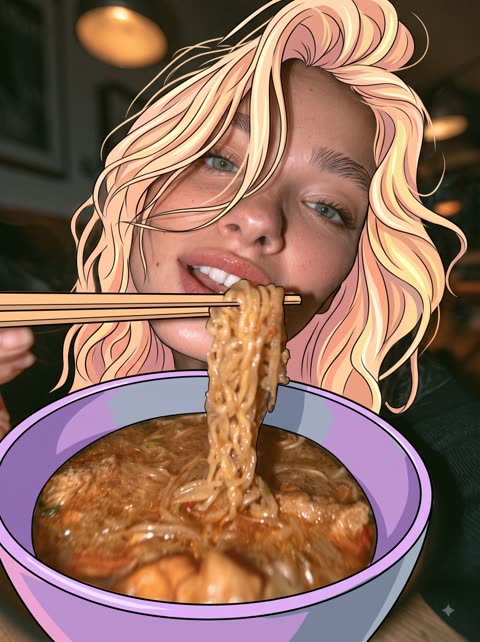
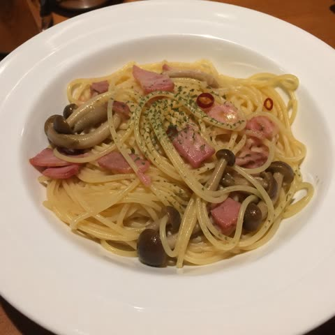

# 照片编辑

[返回目录](../../README_zh.md) · 全部 25 条

<a id="gpt-image-selfie-chibi-sticker-doodle-edit"></a>
### 电梯镜面自拍加Q版贴纸涂鸦

<a href="https://x.com/ChillaiKalan__/status/2050614367536939243"></a>

提示词先锁定原图光线与色调，再叠加白色描边、多姿势的同脸Q版小人和简短手写字。限制文字数量并让吉祥物保持克制，避免画面拥挤。

GPT Image 2 · 上传图改图 · 出处: [@ChillaiKalan__ on X](https://x.com/ChillaiKalan__/status/2050614367536939243) · 1,255 赞，统计于 2026-10-28

[`doodle`](tags.md#tag-doodle) [`chibi`](tags.md#tag-chibi) [`sticker-outline`](tags.md#tag-sticker-outline) [`xiaohongshu`](tags.md#tag-xiaohongshu) [`selfie`](tags.md#tag-selfie)

<details><summary><b>提示词</b></summary>

```text
Edit this photo into a cute Pinterest/Xiaohongshu-style doodle aesthetic edit while keeping the original composition and colors natural. Do NOT heavily change the original lighting or color grading. Keep the tones soft, airy, warm, and realistic. Avoid oversaturated colors, HDR effects, strong orange filters, or excessive contrast. Add hand-drawn doodle elements around the main objects: * white outline strokes * sketchy sparkles * stars * hearts * arrows * tiny flowers * playful swirls * mini handwritten notes Add small cute mascot-style doodles that match the vibe of the photo (tiny bear, smiling drink, cute food character, sleepy cloud, etc.) but keep them subtle and balanced. Use handwritten white text with short relatable captions only. Do NOT add too many words or overcrowd the image.Use a real face as a reference photo. The background is the same as in the photo. The lighting is warm, soft, and clean, with subtle shadows. Around the image, add several mini chibi (3D cute style) versions of the character, while maintaining the original facial features.Chibi characters have various poses and expressions: jumping cheerfully waving sitting relaxed holding a drink cute and playful expressions.  Add hand-drawn white doodle elements: outline around the main body stars, hearts, sparkles motion lines small cute icons Add aesthetic handwriting such as: "shine," "bright day," "happy," "smile," etc. (casual doodle font) Overall style: clean & aesthetic composition white sticker outline soft pastel color tone high detail 3D chibi glossy look cute Korean.
```

</details>

<a id="nano-banana-old-photo-dslr-restoration"></a>
### 模糊的老照片幼儿像修复成单反画质

<a href="https://x.com/Naiknelofar788/status/2030574333853069387"></a>

用具体的相机型号佳能 EOS R6 II 作为画质目标，给模型明确的色彩、细节与放大参照。同时要求保留准确的面部特征并保持自然，避免修复时改变人物。

Nano Banana 2 · 上传图改图 · 出处: [@Naiknelofar788 on X](https://x.com/Naiknelofar788/status/2030574333853069387) · 987 赞，统计于 2026-10-28

[`photo-restoration`](tags.md#tag-photo-restoration) [`upscale`](tags.md#tag-upscale) [`old-photo`](tags.md#tag-old-photo) [`portrait`](tags.md#tag-portrait) [`camera-reference`](tags.md#tag-camera-reference)

<details><summary><b>提示词</b></summary>

```text
Restore this old photo into portrait of DLSR - quality colour and detail, using an advanced upscaling algorithm comparable to the results from canon EOS R6 II. Ensure the restored the image looks natural, retains exact facial features, has great clarity"
```

</details>

<a id="nano-banana-damaged-photo-restoration-portrait"></a>
### 破损老照片修复为现代人像

<a href="https://x.com/doctorwasif/status/2030566053286457783"></a>

正向提示词锁定身份、五官结构和构图，再用负面清单排除风格改变和塑料皮肤，让修复忠于原照片。最后用电影摄影机和调色关键词提升为现代照片质感。

Nano Banana 2 · 上传图改图 · 出处: [@doctorwasif on X](https://x.com/doctorwasif/status/2030566053286457783) · 552 赞，统计于 2026-10-28

[`photo-restoration`](tags.md#tag-photo-restoration) [`old-photo`](tags.md#tag-old-photo) [`portrait`](tags.md#tag-portrait) [`upscale`](tags.md#tag-upscale) [`json-prompt`](tags.md#tag-json-prompt)

<details><summary><b>提示词</b></summary>

```text
{ "task": "image_restoration_upscale", "positive_prompt":
"Restore and enhance the provided image. Preserve original identity, facial structure, proportions and composition. High-fidelity photo restoration, ultra-realistic, natural skin texture, accurate details, professional photographic look. 4K output, sharp but natural focus, modern cinematic lighting, subtle volumetric lighting, professional color grading, depth of field, HDR. Shot on Arri Alexa, raw photo aesthetic, masterpiece.",
"negative_prompt": "Creative reinterpretation, style change, identity alteration, face reshaping, exaggerated features, cartoonish, painting, illustration, over-sharpening, plastic skin, blur, noise, film grain, jpeg artifacts, distortion, bad anatomy, overexposed, underexposed, washed out colors.", "parameters":
{ "steps": 30, "cfg_scale": 6.5, "denoising_strength": 0.45,
"upscaler": "4x_NMKD_Siax_200k", "target_resolution": "4K" } }
```

</details>

<a id="nano-banana-damaged-vintage-photo-restoration-upscale"></a>
### 开裂的老照片修复为清晰4K人像

<a href="https://x.com/doctorwasif/status/2048998423471481059"></a>

用JSON把任务、正向提示、负向提示和参数分开，正向提示开头先锁定身份、比例和构图。负向词禁止改风格、塑料皮肤和过度锐化，较低的降噪强度让结果忠实于原图。

Nano Banana 2 · 上传图改图 · 出处: [@doctorwasif on X](https://x.com/doctorwasif/status/2048998423471481059) · 297 赞，统计于 2026-10-28

[`photo-restoration`](tags.md#tag-photo-restoration) [`upscale`](tags.md#tag-upscale) [`json-prompt`](tags.md#tag-json-prompt) [`vintage-photo`](tags.md#tag-vintage-photo) [`negative-prompt`](tags.md#tag-negative-prompt)

<details><summary><b>提示词</b></summary>

```text
{ "task": "image_restoration_upscale", "positive_prompt":
"Restore and enhance the provided image. Preserve original identity, facial structure, proportions and composition. High-fidelity photo restoration, ultra-realistic, natural skin texture, accurate details, professional photographic look. 4K output, sharp but natural focus, modern cinematic lighting, subtle volumetric lighting, professional color grading, depth of field, HDR. Shot on Arri Alexa, raw photo aesthetic, masterpiece.",
"negative_prompt": "Creative reinterpretation, style change, identity alteration, face reshaping, exaggerated features, cartoonish, painting, illustration, over-sharpening, plastic skin, blur, noise, film grain, jpeg artifacts, distortion, bad anatomy, overexposed, underexposed, washed out colors.", "parameters":
{ "steps": 30, "cfg_scale": 6.5, "denoising_strength": 0.45,
"upscaler": "4x_NMKD_Siax_200k", "target_resolution": "4K" } }
```

</details>

<a id="nano-banana-cozy-portrait-cartoon-cat-overlay"></a>
### 叠加卡通猫涂鸦的温馨人像

<a href="https://x.com/Just_sharon7/status/2029006238101680432"></a>

用结构化 JSON 把人物、道具、环境、插画效果和渲染分开描述。真实质感与光滑矢量卡通叠加、白色涂鸦轮廓形成对比。

Nano Banana 2 · 上传图改图 · 出处: [@Just_sharon7 on X](https://x.com/Just_sharon7/status/2029006238101680432) · 246 赞，统计于 2026-10-28

[`cartoon-overlay`](tags.md#tag-cartoon-overlay) [`mixed-media`](tags.md#tag-mixed-media) [`cozy`](tags.md#tag-cozy) [`json-prompt`](tags.md#tag-json-prompt) [`cat`](tags.md#tag-cat)

<details><summary><b>提示词</b></summary>

```text
{
  "title": "Whimsical Cozy Portrait",
  "input_image": "[UPLOAD YOUR IMAGE]",
  "description": "Transform the uploaded image into a 64K DSLR-quality ultra-hyperrealistic cozy, whimsical mixed-media portrait combining realistic photography with playful cartoon illustrations.",
  "subject": {
    "person": {
      "appearance": {
        "hair": "blonde, loosely tied with soft strands framing the face",
        "eyes": "light green",
        "makeup": "natural",
        "top": "dark grey layered over black long-sleeve shirt",
        "expression": "resting cheek gently on one hand, dreamy and slightly tired",
        "accessories": [
          "black-and-pink cat ears",
          "small cute hair clip"
        ]
      },
      "pose": "sitting at a wooden table, holding a white ceramic mug in one hand"
    },
    "animated_elements": [
      {
        "type": "cartoon_cat",
        "color": "bright orange",
        "expression": "excited, curious",
        "action": "climbing up her arm",
        "features": "exaggerated big eyes, expressive paws"
      },
      {
        "type": "cartoon_tail",
        "color": "grey",
        "position": "right side, partially out of frame"
      }
    ]
  },
  "props": {
    "mug": {
      "color": "white",
      "illustration": "cute cartoon face with big expressive eyes and small mustache",
      "drink": "pink foam bubbles rising from the top"
    },
    "dessert": {
      "type": "chocolate cake",
      "toppings": ["whipped cream", "sliced strawberries", "peach slice"]
    }
  },
  "environment": {
    "room": {
      "walls": "beige textured",
      "lighting": "soft daylight streaming through window with sheer white curtains",
      "decor": "vintage framed photographs in casual gallery arrangement",
      "atmosphere": "warm, cozy, intimate"
    }
  },
  "illustration_effects": {
    "style": [
      "hand-drawn cartoon overlays",
      "white doodle-style accents: bubbles, playful lines, sparkles, hand-drawn crown",
      "soft white illustrated outlines around woman and objects"
    ]
  },
  "composition": {
    "aspect_ratio": ["1:1", "4:5 vertical"],
    "depth_of_field": "shallow",
    "mood": ["cozy", "cute", "whimsical", "soft", "playful", "warm"]
  },
  "rendering": {
    "technique": ["Octane render", "Ultra-hyperrealistic", "Unreal Engine 5"],
    "details": "ultra-detailed, high-resolution, soft natural lighting, warm tones, Instagram-worthy",
    "texture_contrast": "realistic textures (skin, fabric, wood, wall) vs smooth vector-style illustrations"
  }
}
```

</details>

<a id="nano-banana-old-photo-restore-dslr-portrait"></a>
### 开裂老照片修复为彩色人像

<a href="https://x.com/doctorwasif/status/2030803471041954150"></a>

以佳能 EOS R6 II 作为画质基准并要求高级放大效果，同时明确要求保留原有面部特征，让修复结果忠于原照片。

Nano Banana 2 · 上传图改图 · 出处: [@doctorwasif on X](https://x.com/doctorwasif/status/2030803471041954150) · 206 赞，统计于 2026-10-28

[`photo-restoration`](tags.md#tag-photo-restoration) [`old-photo`](tags.md#tag-old-photo) [`portrait`](tags.md#tag-portrait) [`upscale`](tags.md#tag-upscale) [`colorize`](tags.md#tag-colorize)

<details><summary><b>提示词</b></summary>

```text
"Restore this old photo into professional portrait of DLSR - quality colour and detail, using an advanced upscaling algorithm comparable to the results from canon EOS R6 II. Ensure the restored the image looks natural, retains exact facial features, has great clarity......"
```

</details>

<a id="gpt-image-big-head-miniature-person-photo-edit"></a>
### 商场自拍照变超大头迷你人像

<a href="https://x.com/oggii_0/status/2113887497751253111"></a>

按优先级排列指令并给出数值比例，例如头宽为肩宽的2.5到3倍、四肢缩到25%到35%。姿势、面部、服装和场景各设保留章节，再用禁止清单排除卡通和娃娃脸。

GPT Image 2.5 · 上传图改图 · 出处: [@oggii_0 on X](https://x.com/oggii_0/status/2113887497751253111) · 180 赞，统计于 2026-10-28

[`chibi`](tags.md#tag-chibi) [`big-head`](tags.md#tag-big-head) [`photo-edit`](tags.md#tag-photo-edit) [`photorealistic`](tags.md#tag-photorealistic) [`proportion`](tags.md#tag-proportion)

<details><summary><b>提示词</b></summary>

```text
Turn any photo into a hyper-realistic chibi-style portrait using GPT Image 2.5

Prompt : Hyper-Realistic Big-Head Miniature Person | Photo Editing Prompt

Strictly edit the uploaded original photograph to transform the person or animal into a hyper-realistic, extremely exaggerated big-head miniature figure.

Highest Priority: Change only the head-to-body proportions. Preserve the original appearance, pose, actions, clothing, accessories, background, and aspect ratio of the photograph completely.

1\. Head-to-Body Proportions (Highest Priority)

* Giant Head: Dramatically enlarge the entire head, including hair, hats, and ears. The head width should be approximately 2.5–3 times the width of the reduced shoulders.

* Extremely Narrow Shoulders: Make the shoulders significantly narrower than the head, with a short, small neck. Do not retain normal adult shoulder width.

* Miniature Body: In full-body photographs, the body height (excluding the head) should be approximately 0.9–1.1 times the head height. Scale down the torso, waist, hips, and limbs proportionally.

* Miniature Hands and Feet: Reduce the arms, palms, fingers, legs, feet, and shoes to approximately 25–35% of their normal proportions. The limbs must be short and slender. Never leave the hands or feet at normal size.

* Strong Proportional Contrast: Regardless of whether the subject wears a skirt, trousers, or loose-fitting clothing, the result must clearly emphasize a giant, realistic head, extremely narrow shoulders, and an ultra-miniature body.

### 2\. Pose and Actions (Strictly Preserve)

Preserve the original subject's exact pose, actions, gestures, gaze direction, and interactions.

* If the subject is standing in the original image, keep them standing. If sitting, crouching, lying down, or leaning against an object, preserve that exact position.

* Retain the original hand positions, held objects, leg positions, and all points of contact with the surrounding environment.

* If the original image is a half-body portrait, selfie, or partial-body photograph, maintain the original framing. Do not invent or generate legs, shoes, or a complete body that was not visible in the original image.

* Never alter the pose, actions, or composition simply to accommodate the miniature body proportions.

### 3\. Facial Features and Clothing (Fully Preserve)

* Preserve the original face shape, facial features, facial proportions, expression, skin tone, hairstyle, and recognizable identity. Do not apply beauty filters, skin smoothing, eye enlargement, or face reshaping.

* Preserve the original clothing styles, materials, colors, patterns, and all accessories. Naturally scale the clothing to fit the miniature body without changing its design.

* For animals, preserve the original species, fur color, ears, facial characteristics, and expression. Only modify the head-to-body proportions.

### 4\. Scene and Composition (Fully Preserve)

* Use the original photograph as the sole reference for the scene. Preserve the background, architecture, furniture, environmental objects, lighting, shadows, and color tones.

* Maintain the original camera angle, perspective, subject placement, composition, and image aspect ratio.

* Keep all background elements at their normal, realistic sizes. Do not replace the scene or introduce new objects.

* Ensure the subject blends naturally into the environment, with realistic proportions relative to the scene and physically consistent shadows.

### 5\. Visual Style

The entire image must maintain an extremely photorealistic photographic quality. Preserve realistic skin texture, individual hairs, fabric details, and natural lighting. The transition between the enlarged head and miniature body must appear seamless, with no visible compositing artifacts.

Strictly Prohibited:

* Cartoon, anime, or stylized 3D figurine aesthetics.

* Doll-like faces or AI beauty enhancements.

* Normal adult shoulder width.

* Oversized hands or feet.
```

</details>

<a id="nano-banana-chiaroscuro-portrait"></a>
### 把你的照片拍成明暗对比强烈的电影特写

<a href="https://x.com/rovvmut_/status/2107691827323392159"></a>

单侧光，明确要求看得见毛孔，皮肤就不会像磨过皮。

Nano Banana 2.1 · 上传图改图 · 出处: [@rovvmut_ on X](https://x.com/rovvmut_/status/2107691827323392159) · 170 赞，统计于 2026-10-27

[`chiaroscuro`](tags.md#tag-chiaroscuro) [`cinematic`](tags.md#tag-cinematic) [`skin-detail`](tags.md#tag-skin-detail)

<details><summary><b>提示词</b></summary>

```text
A hyper-realistic, 8K resolution cinematic close-up portrait of the person in the uploaded image. The image features dramatic chiaroscuro lighting, heavily illuminating the left side of his face while casting deep, moody shadows on the right against a solid black background. He has an intense, direct gaze, dark brown eyes with square catchlights, and textured, wet-styled hair. He is wearing a plain black t-shirt. Render with 35mm film grain and a shallow depth of field, prioritizing extreme character consistency and highly detailed skin texture, including visible pores.
```

</details>

<a id="nano-banana-doodle-sticker-chibi-photo-edit"></a>
### 手绘涂鸦与Q版贴纸风人像照片

<a href="https://x.com/john_my07/status/2051162500780208297"></a>

先锁定原图构图、光线与背景，再叠加细白线涂鸦、少量吉祥物和简短手写字幕。列出跳跃、挥手、坐姿、拿饮料等姿势，生成带白边的3D Q版自己。

Nano Banana 2 · 上传图改图 · 出处: [@john_my07 on X](https://x.com/john_my07/status/2051162500780208297) · 160 赞，统计于 2026-10-28

[`doodle`](tags.md#tag-doodle) [`chibi`](tags.md#tag-chibi) [`sticker`](tags.md#tag-sticker) [`xiaohongshu`](tags.md#tag-xiaohongshu) [`photo-edit`](tags.md#tag-photo-edit)

<details><summary><b>提示词</b></summary>

```text
Transform the provided photo into a soft, Pinterest/Xiaohongshu-inspired doodle aesthetic while preserving the original composition, facial identity, and natural color tones. Keep the lighting gentle, warm, and realistic, avoid heavy color grading, oversaturation, HDR effects, or strong filters. The overall feel should remain airy, clean, and naturally bright.
Enhance the image with subtle, hand-drawn doodle accents placed around the subject:
thin white outline strokes
delicate sparkles, stars, and tiny hearts
curved arrows, soft swirls, and mini floral sketches
light motion lines that complement the pose
Incorporate a few small, charming mascot-style illustrations (e.g., a tiny bear, smiling beverage, cute snack character, dreamy cloud), ensuring they stay minimal and don’t overpower the image.
Add short handwritten-style white captions in a casual doodle font—keep them minimal and expressive (examples: “shine,” “good mood,” “soft day,” “stay cozy”). Avoid clutter or excessive text.
Maintain the original background exactly as is. Keep shadows soft and natural with clean, warm lighting.

Around the composition, include several small 3D chibi-style versions of the subject, preserving recognizable facial features. These mini characters should have a glossy, soft pastel finish and appear in varied playful poses such as:
jumping happily
waving
sitting relaxed
holding a drink
expressing cute, lively emotions
Style details:
clean layout with balanced spacing
white sticker-like outlines
soft pastel accents with realistic base tones
high-detail, polished 3D chibi look
cute, modern Korean-inspired aesthetic
Ensure the final result feels cohesive, light, and aesthetically pleasing without overwhelming the original image.
```

</details>

<a id="gpt-image-storyboard-panels-to-photographic-frames"></a>
### 屋顶追逐分镜稿转为写实摄影画面

<a href="https://x.com/umesh_ai/status/2110761775067230600"></a>

一句简短指令把六格铅笔分镜转成写实摄影，同时锁定构图、主体位置和机位，镜头设计在风格转换后依然保留。把两张分镜板并排放置，前后对比一目了然。

GPT Image 2.5 · 上传图改图 · 出处: [@umesh_ai on X](https://x.com/umesh_ai/status/2110761775067230600) · 68 赞，统计于 2026-10-28

[`storyboard`](tags.md#tag-storyboard) [`pencil-sketch`](tags.md#tag-pencil-sketch) [`photorealistic`](tags.md#tag-photorealistic) [`film-previs`](tags.md#tag-film-previs) [`layout-preservation`](tags.md#tag-layout-preservation)

<details><summary><b>提示词</b></summary>

```text
Big news!

Krea 3 is promising Nano Banana Pro/GPT Image 2.5  quality, 5x faster.

Imagine turning storyboard images into photographic frames you could put in front of a director.

The prompt I’d use: “Make every panel photographic. Preserve the composition, subject placement and camera angle.”

Then put the two boards side by side.

Some ideas become much harder to leave in a folder once you can see what they could look like.
```

</details>

<a id="gpt-image-face-swap-woman-beside-ink-sketch-twin"></a>
### 真人与黑白线稿分身并排站姿

<a href="https://x.com/warraich_Ai2/status/2100776665500836060"></a>

把目标图定为唯一构图、参考照片只提供面部身份，再逐项列出必须保持不变的元素。结尾的总则和禁用清单防止发型、服装、姿势被带入，线稿分身仍保留眨眼吐舌的表情。

GPT Image 2.5 · 上传图改图 · 出处: [@warraich_Ai2 on X](https://x.com/warraich_Ai2/status/2100776665500836060) · 41 赞，统计于 2026-10-28

[`face-swap`](tags.md#tag-face-swap) [`identity-reference`](tags.md#tag-identity-reference) [`line-art`](tags.md#tag-line-art) [`constraint-list`](tags.md#tag-constraint-list)

<details><summary><b>提示词</b></summary>

```text
Use the uploaded TARGET IMAGE as the exact master composition.

Use the uploaded REFERENCE PHOTO only as the facial identity reference for the woman.

FACE IDENTITY:
Replace the woman's face in the TARGET IMAGE with the face of the woman from the REFERENCE PHOTO. Preserve her recognizable facial features, face shape, eyes, eyebrows, nose, lips, cheeks, jawline, skin tone and natural facial proportions.

IMPORTANT:
The real woman on the left and the illustrated woman on the right must represent the SAME woman and have the SAME facial identity.

For the illustrated version, translate the same reference woman's facial identity into the existing black-and-white hand-drawn illustration style. Keep the illustration's original playful expression, wink and tongue-out expression while making the facial identity clearly match the reference woman.

DO NOT CHANGE ANYTHING ELSE.

Keep the TARGET IMAGE exactly the same:
- Same real woman's body and physique
- Same hairstyle and hair arrangement
- Same yellow T-shirt
- Same cream/white wide-leg pants
- Same white sneakers
- Same earrings and accessories
- Same crossed-arm pose
- Same bent-leg position
- Same camera angle and framing
- Same wall and floor
- Same lighting and shadows
- Same black-and-white illustration
- Same illustrated pose and proportions
- Same hearts, stars, sparkles and motion lines
- Same composition and spacing
- Same image quality and aspect ratio

Do NOT use the reference photo's hairstyle, clothing, body, pose, background or accessories.

FINAL RULE:
TARGET IMAGE = everything except facial identity.
REFERENCE PHOTO = facial identity only.

The final image must look almost identical to the TARGET IMAGE, with only the woman's facial identity changed. The real photo and the illustrated character must clearly look like the same woman.
```

</details>

<a id="nano-banana-selective-anime-hair-bowl-photo-edit"></a>
### 照片中仅头发、碗和筷子变成动漫插画

<a href="https://x.com/madpencil_/status/2107815983729750427"></a>

提示词先点明只转换的少数元素,再逐项列出必须保持不变的内容:脸、皮肤、面条、汤、背景、光线、姿势和构图。风格用干净线稿、平涂赛璐珞和粉彩色限定,让动漫效果只作用于局部。

Nano Banana 2.1 · 上传图改图 · 出处: [@madpencil_ on X](https://x.com/madpencil_/status/2107815983729750427) · 25 赞，统计于 2026-10-28

[`selective-edit`](tags.md#tag-selective-edit) [`anime`](tags.md#tag-anime) [`photo-to-art`](tags.md#tag-photo-to-art) [`preserve-details`](tags.md#tag-preserve-details) [`food`](tags.md#tag-food)

<details><summary><b>提示词</b></summary>

```text
Convert only her hair, the bowl, and the chopsticks into a 2D hand-drawn anime illustration with clean linework, flat cel shading, and vibrant pastel colours. Keep her face, skin, eyes, lips, noodles, broth, background, lighting, pose, and framing the same as in the original photo.
```

</details>

<a id="gpt-image-billboard-winter-evening"></a>
### 同一块广告牌改成下雪的冬夜

<a href="https://developers.openai.com/api/docs/guides/image-prompting#refine-an-image-across-turns"></a>

把上一步的成品作为输入，只提一个改动。每次只改一处，才看得出是哪一步起了作用。预览图为 Sunburst 版本。

GPT Image 2.5 · 上传图改图 · 出处: [OpenAI image prompting guide](https://developers.openai.com/api/docs/guides/image-prompting#refine-an-image-across-turns)

[`multi-turn`](tags.md#tag-multi-turn) [`weather`](tags.md#tag-weather) [`edit`](tags.md#tag-edit)

<details><summary><b>提示词</b></summary>

```text
Make it look like a winter evening with snowfall.
```

</details>

输入素材: [1](https://developers.openai.com/images/platform/guides/image-prompting/billboard-gpt-image-2-5-sunburst.webp)

<a id="gpt-image-japanese-film-garden-color-grade"></a>
### 春日庭园的日系胶片调色

<a href="https://x.com/HoodyLiu/status/2099115784417251690"></a>

提示词先锁定构图和所有物体，再分别给天空、樱花、绿植和水面设定调色目标。末尾列出大量禁用效果并以柯达 Portra 400 为参照，让结果像调过色的 RAW 原片而不是重新生成的图。

GPT Image 2.5 · 上传图改图 · 出处: [@HoodyLiu on X](https://x.com/HoodyLiu/status/2099115784417251690) · 发现于 [wangrunlin/awesome-gpt-image-2-5-prompts](https://github.com/wangrunlin/awesome-gpt-image-2-5-prompts)

[`color-grading`](tags.md#tag-color-grading) [`japanese-film`](tags.md#tag-japanese-film) [`cherry-blossom`](tags.md#tag-cherry-blossom) [`portra-400`](tags.md#tag-portra-400) [`photo-retouch`](tags.md#tag-photo-retouch)

<details><summary><b>提示词</b></summary>

```text
Please only perform professional color grading and light and shadow optimization on the original photos, strictly retain the original composition, scenery positions, cherry blossoms, trees, water reflections and screen proportions, and do not add, delete or change any objects. The overall style is adjusted to a high-end, restrained, and quiet Japanese film style, presenting the quiet atmosphere of a Japanese garden in early spring. Moderately brighten the dark details in the woods, waterfronts and ponds, and restore the layers of tree trunks, shrubs and water surfaces, but retain deep shadows and do not turn black areas into gray. Reduce the sky highlights and blue saturation, and adjust the sky to a transparent, calm gray-blue to avoid excessive brightness and HDR effects. Highlight the cherry blossoms in the center of the picture, making the flowers a natural pale pink-white color to add soft sunlight transparency and delicate layers. Do not turn it into pure white or fluorescent pink. The green plants are adjusted to low-saturated moss green, forest green and slight olive green, reducing the yellow-green and digital feel. The water surface maintains a deep blue-black color, enhancing the subtle reflections and layers of fallen cherry blossoms, making the reflection clear but not sharp. The overall design uses soft highlights, deep shadows, medium to strong contrast, and slightly increases the contrast between warm sunlight and cool shadows. Adding slight film fog, natural halo, fine 35mm film grain and soft sharpening, the color refers to Kodak Portra 400 and Japanese film photography, which is real, natural, subtle, airy and high-end. It is prohibited to change the composition, add cherry blossoms, clouds, buildings, people or lights, generate new branches, change the season, overexposure, dead black, HDR, over-sharpening, fluorescent green, brilliant blue sky, heavy filters, oil painting feeling, illustration feeling and AI redrawing feeling. The end result must be like a professional color correction of the original RAW photo, not a regenerated image.
```

</details>

<a id="gpt-image-laptop-screen-spreadsheet-to-workflow-diagram"></a>
### 笔记本屏幕换成自动化流程图

<a href="https://x.com/ai_kairos_jp/status/2097679848475099159"></a>

只点名要改的屏幕区域和替换内容，再逐项列出必须保持不变的桌面、便签、灯光和夜景窗外。明确写出保留项，局部编辑时其余画面才不容易跑偏。

GPT Image 2.5 · 上传图改图 · 出处: [@ai_kairos_jp on X](https://x.com/ai_kairos_jp/status/2097679848475099159) · 发现于 [wangrunlin/awesome-gpt-image-2-5-prompts](https://github.com/wangrunlin/awesome-gpt-image-2-5-prompts)

[`local-edit`](tags.md#tag-local-edit) [`screen-replacement`](tags.md#tag-screen-replacement) [`workflow-diagram`](tags.md#tag-workflow-diagram) [`preserve-scene`](tags.md#tag-preserve-scene) [`desk-scene`](tags.md#tag-desk-scene)

<details><summary><b>提示词</b></summary>

```text
Replace the spreadsheet with an automation workflow diagram. Do not change the desk, sticky notes, lighting or the nighttime view through the window.
```

</details>

<a id="gpt-image-outfit-swap-keep-identity"></a>
### 用三件参考服装换装，人物不变

<a href="https://developers.openai.com/api/docs/guides/image-prompting#preserve-identity-and-change-clothing"></a>

先列出人物身上所有必须不变的东西，只放开服装，再要求光影匹配原图。要让产品保持可辨认也可以照这个写。预览图为 Sunburst 版本。

GPT Image 2.5 · 上传图改图 · 出处: [OpenAI image prompting guide](https://developers.openai.com/api/docs/guides/image-prompting#preserve-identity-and-change-clothing)

[`virtual-try-on`](tags.md#tag-virtual-try-on) [`fashion`](tags.md#tag-fashion) [`identity`](tags.md#tag-identity)

<details><summary><b>提示词</b></summary>

```text
Edit the image to dress the woman using the provided clothing images. Do not change her face, facial features, skin tone, body shape, pose, or identity in any way. Preserve her exact likeness, expression, hairstyle, and proportions. Replace only the clothing, fitting the garments naturally to her existing pose and body geometry with realistic fabric behavior. Match lighting, shadows, and color temperature to the original photo so the outfit integrates photorealistically, without looking pasted on. Do not change the background, camera angle, framing, or image quality, and do not add accessories, text, logos, or watermarks.
```

</details>

输入素材: [1](https://developers.openai.com/images/platform/guides/image-prompting/woman-in-museum.webp) · [2](https://developers.openai.com/images/platform/guides/image-prompting/jacket.webp) · [3](https://developers.openai.com/images/platform/guides/image-prompting/tank-top.webp) · [4](https://developers.openai.com/images/platform/guides/image-prompting/boots.webp)

<a id="gpt-image-person-into-campsite-scene"></a>
### 把人物放进黄昏营地逃跑的场景

<a href="https://developers.openai.com/api/docs/guides/image-prompting#insert-a-person-into-a-scene"></a>

写清姿态、视线、服装、地点和时间，并反复要求像真实照片，不要电影海报感。预览图为 Sunburst 版本。

GPT Image 2.5 · 上传图改图 · 出处: [OpenAI image prompting guide](https://developers.openai.com/api/docs/guides/image-prompting#insert-a-person-into-a-scene)

[`identity`](tags.md#tag-identity) [`action`](tags.md#tag-action) [`photorealism`](tags.md#tag-photorealism)

<details><summary><b>提示词</b></summary>

```text
Generate a highly realistic action scene where this person is running away from a large, realistic brown bear attacking a campsite. The image should look like a real photograph someone could have taken, not an overly enhanced or cinematic movie-poster image.
She is centered in the image but looking away from the camera, wearing outdoorsy camping attire, with dirt on her face and tears in her clothing. She is clearly afraid but focused on escaping, running away from the bear as it destroys the campsite behind her.
The campsite is in Yosemite National Park, with believable natural details. The time of day is dusk, with natural lighting and realistic colors. Everything should feel grounded, authentic, and unstyled, as if captured in a real moment. Avoid cinematic lighting, dramatic color grading, or stylized composition.
```

</details>

输入素材: [1](https://developers.openai.com/images/platform/guides/image-prompting/woman-in-museum.webp)

<a id="gpt-image-photo-background-doodle-people-swap"></a>
### 海边栈道上的涂鸦母女

<a href="https://x.com/Emmma__0/status/2091391958128251286"></a>

提示词先立下核心规则，背景保持实拍、人物改为涂鸦，再逐项锁定人数、位置、朝向、姿态和服装颜色。末尾的优先级排序和禁止清单让背景不被涂鸦化。

GPT Image 2 · 上传图改图 · 出处: [@Emmma__0 on X](https://x.com/Emmma__0/status/2091391958128251286) · 发现于 [freestylefly/awesome-gpt-image-2](https://github.com/freestylefly/awesome-gpt-image-2)

[`doodle`](tags.md#tag-doodle) [`photo-edit`](tags.md#tag-photo-edit) [`people-replacement`](tags.md#tag-people-replacement) [`hand-drawn`](tags.md#tag-hand-drawn) [`background-preserve`](tags.md#tag-background-preserve)

<details><summary><b>提示词</b></summary>

```text
Transform ONLY the people in the uploaded photo into adorable hand-drawn doodle characters while keeping the original photographic background unchanged.

CORE RULE:
Background = original realistic photo.
People = cute hand-drawn doodle characters.

PRESERVE THE BACKGROUND:
Keep the original sky, landscape, buildings, water, furniture, ground, plants, railings, objects, lighting, colors, perspective, camera angle, framing, and textures as close to the original photo as possible.

Do NOT redraw, simplify, illustrate, or apply doodle/crayon/pencil effects to the background or environmental objects.

TRANSFORM ONLY PEOPLE:
Replace each person with a charming, naive doodle version while preserving:
- exact number of people
- original position and relative scale
- front/back/side/three-quarter orientation
- head and body direction
- pose and gesture
- arm and leg positions
- interactions with people or objects
- hairstyle, clothing colors, and major accessories

IMPORTANT:
If someone faces away, keep them back-facing.
If sideways, keep them sideways.
If facing forward, keep them forward.
Never rotate a person toward the viewer or invent a face that is not visible.

CUTE DOODLE STYLE:
Freely reinterpret realistic anatomy into an adorable, imperfect character:
- oversized round head
- tiny compact body
- short simplified arms and legs
- tiny hands and feet
- cute awkward proportions
- loose scribbled hair
- tiny dot eyes and simple facial features when visible
- rosy scribbled cheeks when appropriate

Keep the original pose recognizable, but simplify and slightly exaggerate it for cuteness.

DRAWING STYLE:
Loose naive hand-drawn doodle, like a quick children's sketch.
Use thin shaky black outlines, imperfect shapes, overlapping sketch lines, scribbled colored-pencil or crayon fills, uneven coloring, white gaps, and slightly messy edges.

The character should look intentionally roughly drawn but extremely cute.

OBJECTS:
Objects, furniture, scenery, and items around the people should remain photographic whenever possible. A doodle character may naturally touch or hold a real photographic object.

INTEGRATION:
Keep correct scale, ground contact, depth, and occlusion so the doodle characters naturally occupy the same locations as the original people.

FINAL LOOK:
It should feel like the real people were removed from the original photograph and replaced with adorable little hand-drawn doodle versions of themselves, while the real-world background remained untouched.

Prioritize:
1. Original photographic background
2. Person position and scale
3. Exact body orientation
4. Pose and gesture
5. Cute exaggerated doodle character design

Avoid full-image illustration, background doodling, realistic anatomy, anime, manga, 3D cartoon, polished digital art, vector lines, changed poses, changed orientation, added people, or invented faces.
```

</details>

<a id="gpt-image-place-dog-into-scene"></a>
### 把一张照片里的狗放进另一张照片

<a href="https://developers.openai.com/api/docs/guides/image-prompting#combine-references"></a>

按编号指明图片，写清移动什么、放到哪里、什么不变。预览图为 Sunburst 版本。

GPT Image 2.5 · 上传图改图 · 出处: [OpenAI image prompting guide](https://developers.openai.com/api/docs/guides/image-prompting#combine-references)

[`composite`](tags.md#tag-composite) [`reference`](tags.md#tag-reference) [`pets`](tags.md#tag-pets)

<details><summary><b>提示词</b></summary>

```text
Place the dog from the second image into the setting of image 1, right next to the woman, use the same style of lighting, composition and background. Do not change anything else.
```

</details>

输入素材: [1](https://developers.openai.com/images/platform/guides/image-prompting/test-woman.webp) · [2](https://developers.openai.com/images/platform/guides/image-prompting/test-woman-2.webp)

<a id="gpt-image-pro-instagram-pasta-photo-enhance"></a>
### 手机拍摄的意面照片优化成 Instagram 水准

<a href="https://x.com/dezainaz_ceo/status/2047172512551977162"></a>

一句话同时设定摄影师和设计师两个角色，让模型一并处理光线调色和版面润色。适用于随手拍的手机照片，具体风格交给模型自行决定。

GPT Image 2 · 上传图改图 · 出处: [@dezainaz_ceo on X](https://x.com/dezainaz_ceo/status/2047172512551977162) · 发现于 [ZeroLu/awesome-gpt-image](https://github.com/ZeroLu/awesome-gpt-image)

[`photo-enhance`](tags.md#tag-photo-enhance) [`food`](tags.md#tag-food) [`instagram`](tags.md#tag-instagram) [`iphone-photo`](tags.md#tag-iphone-photo) [`retouch`](tags.md#tag-retouch)

<details><summary><b>提示词</b></summary>

```text
Enhance this iPhone photo with ChatGPT so it looks like a professional photographer and designer worked on it.
```

</details>

<a id="gpt-image-product-cutout-transparent"></a>
### 产品抠图，透明背景

<a href="https://developers.openai.com/api/docs/guides/image-prompting#create-a-transparent-product-cutout"></a>

要求轮廓干净无白边、形状和标签原样保留，并禁止背景和画出来的棋盘格。输出用 PNG 或 WebP，并设 background=transparent。预览图为 Sunburst 版本。

GPT Image 2.5 · 上传图改图 · 出处: [OpenAI image prompting guide](https://developers.openai.com/api/docs/guides/image-prompting#create-a-transparent-product-cutout)

[`product`](tags.md#tag-product) [`transparent`](tags.md#tag-transparent) [`cutout`](tags.md#tag-cutout)

<details><summary><b>提示词</b></summary>

```text
Extract the product from the input image and isolate it on a fully transparent background.
Output: centered product, crisp silhouette, no halos/fringing.
Preserve product geometry and label legibility exactly.
Add only light polishing. Do not add a solid backdrop, checkerboard, scenery, or shadow.
Do not restyle the product; remove the background and preserve clean alpha transparency.
```

</details>

输入素材: [1](https://developers.openai.com/images/platform/guides/image-prompting/shampoo.webp)

<a id="gpt-image-remove-object-from-hand"></a>
### 去掉男人手里的花

<a href="https://developers.openai.com/api/docs/guides/image-prompting#remove-an-object"></a>

只点名要去掉的那一个物体，并要求其他都不变，不用蒙版也能把改动限制在局部。预览图为 Sunburst 版本。

GPT Image 2.5 · 上传图改图 · 出处: [OpenAI image prompting guide](https://developers.openai.com/api/docs/guides/image-prompting#remove-an-object)

[`remove`](tags.md#tag-remove) [`inpainting`](tags.md#tag-inpainting) [`local-edit`](tags.md#tag-local-edit)

<details><summary><b>提示词</b></summary>

```text
Remove the flower from man's hand. Do not change anything else.
```

</details>

输入素材: [1](https://developers.openai.com/images/platform/guides/image-prompting/man-with-blue-hat.webp)

<a id="gpt-image-sketch-to-photo-valley"></a>
### 河谷线稿渲染成照片

<a href="https://developers.openai.com/api/docs/guides/image-prompting#turn-a-drawing-into-a-realistic-image"></a>

锁定布局、比例和透视，材质和光线交给模型，并禁止添加新元素，避免它自由发挥。预览图为 Sunburst 版本。

GPT Image 2.5 · 上传图改图 · 出处: [OpenAI image prompting guide](https://developers.openai.com/api/docs/guides/image-prompting#turn-a-drawing-into-a-realistic-image)

[`sketch`](tags.md#tag-sketch) [`photorealism`](tags.md#tag-photorealism) [`landscape`](tags.md#tag-landscape)

<details><summary><b>提示词</b></summary>

```text
Turn this drawing into a photorealistic image.
Preserve the exact layout, proportions, and perspective.
Choose realistic materials and lighting consistent with the sketch intent.
Do not add new elements or text.
```

</details>

输入素材: [1](https://developers.openai.com/images/platform/guides/image-prompting/drawings.webp)

<a id="gpt-image-swap-kitchen-chairs"></a>
### 厨房照片里只换椅子

<a href="https://developers.openai.com/api/docs/guides/image-prompting#change-furniture-in-a-room"></a>

用大写的 ONLY 限定唯一要换的东西，并列出要保留的机位、光线、地面阴影和周围物品。预览图为 Sunburst 版本。

GPT Image 2.5 · 上传图改图 · 出处: [OpenAI image prompting guide](https://developers.openai.com/api/docs/guides/image-prompting#change-furniture-in-a-room)

[`interior`](tags.md#tag-interior) [`local-edit`](tags.md#tag-local-edit) [`photorealism`](tags.md#tag-photorealism)

<details><summary><b>提示词</b></summary>

```text
In this room photo, replace ONLY the white chairs with chairs made of wood.
Preserve camera angle, room lighting, floor shadows, and surrounding objects.
Keep all other aspects of the image unchanged.
Photorealistic contact shadows and fabric texture.
```

</details>

输入素材: [1](https://developers.openai.com/images/platform/guides/image-prompting/kitchen.webp)

<a id="gpt-image-translate-infographic-spanish"></a>
### 把信息图翻译成西班牙语，版式不动

<a href="https://developers.openai.com/api/docs/guides/image-prompting#translate-while-preserving-layout"></a>

在咖啡机信息图上做的一句话编辑。出图后检查有没有漏翻的词。预览图为 Sunburst 版本。

GPT Image 2.5 · 上传图改图 · 出处: [OpenAI image prompting guide](https://developers.openai.com/api/docs/guides/image-prompting#translate-while-preserving-layout)

[`translation`](tags.md#tag-translation) [`edit`](tags.md#tag-edit) [`text-render`](tags.md#tag-text-render)

<details><summary><b>提示词</b></summary>

```text
Translate the text in the infographic to Spanish. Do not change any other aspect of the image.
```

</details>

输入素材: [1](https://developers.openai.com/images/platform/guides/image-prompting/infographic-coffee-machine-gpt-image-2-5-sunburst.webp)
