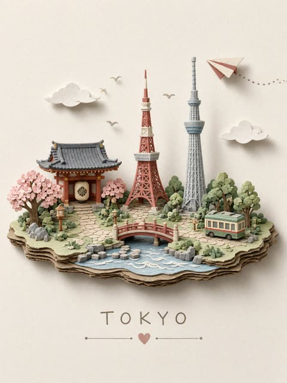
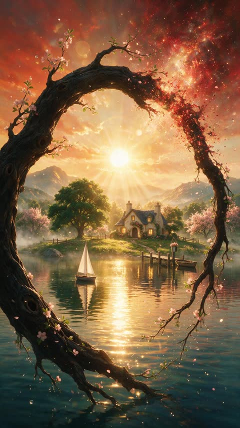
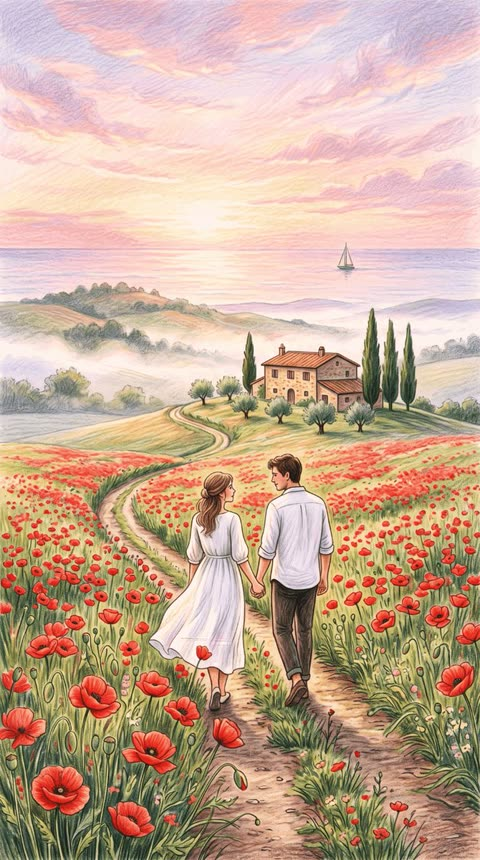
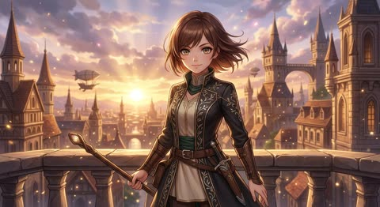

# 插画

[返回目录](../../README_zh.md) · 全部 65 条

<a id="nano-banana-map-screenshot-anime-panorama-shibuya"></a>
### 由地图截图生成的涩谷十字路口动漫全景

<a href="https://x.com/icreatelife/status/2027085364872024311"></a>

仅以一张地图截图作为视觉输入，再用一句指令指定全景和动漫风格。模型读取地图上的街道布局与地标标注，并将其重建为连贯的动漫街景。

Nano Banana 2 · 上传图改图 · 出处: [@icreatelife on X](https://x.com/icreatelife/status/2027085364872024311) · 936 赞，统计于 2026-10-29

[`map-to-scene`](tags.md#tag-map-to-scene) [`panorama`](tags.md#tag-panorama) [`anime`](tags.md#tag-anime) [`screenshot-reference`](tags.md#tag-screenshot-reference) [`cityscape`](tags.md#tag-cityscape)

<details><summary><b>提示词</b></summary>

```text
The coolest use-case for AI animation I found of new Nano Banana 2 is that you can screenshot a map and ask it to generate a panorama in anime / cartoon style.

Nano Banana 2 is fully supported in Adobe Firefly web

prompt: make me a panorama of this location in an anime style
```

</details>

<a id="nano-banana-ball-shaped-cute-animal"></a>
### 漂浮在海藻间的球形小海獭

<a href="https://x.com/NanoBanana/status/2027298143134478451"></a>

用 [animal] 占位符让提示词可以套用到任何动物。头身合一的近似球体、超大的向上看的眼睛，再加上动物的日常栖息环境，画面既可爱又自然。

Nano Banana 2 · 文生图 · 出处: [@NanoBanana on X](https://x.com/NanoBanana/status/2027298143134478451) · 851 赞，统计于 2026-10-28

[`cute`](tags.md#tag-cute) [`animal`](tags.md#tag-animal) [`ball-shaped`](tags.md#tag-ball-shaped) [`template`](tags.md#tag-template) [`habitat`](tags.md#tag-habitat)

<details><summary><b>提示词</b></summary>

```text
This prompt works best with Nano Banana 2:

Prompt: Make a photo of a cute ball-shaped version of a [animal], with big adorable over-sized eyes, it has no head, instead its face is part of the ball, its head and body are one. They are in their usual habitat. Must be almost spherical and cartoonishly cute. Its eyes are looking up in the most adorable cheeky fashion.
```

</details>

<a id="gpt-image-risograph-rainy-bus-stop-illustration"></a>
### 孔版印刷风格的雨中公交站少女插画

<a href="https://x.com/Naiknelofar788/status/2051493607916589106"></a>

提示词只描述印刷特征：粗轮廓线、错位的油墨层、纸张颗粒，并限定两到三种颜色。再要求大面积留白和极简道具，模型便生成安静而克制的画面。

GPT Image 2 · 文生图 · 出处: [@Naiknelofar788 on X](https://x.com/Naiknelofar788/status/2051493607916589106) · 806 赞，统计于 2026-10-28

[`risograph`](tags.md#tag-risograph) [`minimal`](tags.md#tag-minimal) [`pastel`](tags.md#tag-pastel) [`print-texture`](tags.md#tag-print-texture) [`negative-space`](tags.md#tag-negative-space)

<details><summary><b>提示词</b></summary>

```text
A crisp, printmaking-like aesthetic with bold outlines and natural deformation. Pastel color palette, vintage print texture, slightly misaligned ink layers, and rough paper grain. A calm poster composition with generous negative space rather than filling the frame. Props and background kept minimal. Color theme 2–3 colors.
```

</details>

<a id="nano-banana-geometric-fashion-illustration"></a>
### 质感几何风全身时装插画

<a href="https://x.com/ChillaiKalan__/status/2109123213351632977"></a>

服装逐件描述，再用一小串禁止项排除写实和 3D。

Nano Banana 2.1 · 文生图 · 出处: [@ChillaiKalan__ on X](https://x.com/ChillaiKalan__/status/2109123213351632977) · 494 赞，统计于 2026-10-27

[`fashion`](tags.md#tag-fashion) [`geometric`](tags.md#tag-geometric) [`editorial`](tags.md#tag-editorial)

<details><summary><b>提示词</b></summary>

```text
Create a stylish, full-body editorial fashion illustration of a young woman in a modern casual outfit, using a minimalist, textured geometric art style. She wears an oversized forest-green hoodie, wide-leg blue denim jeans with folded cuffs, and chunky brown sneakers. Her dark hair is tied in a neat low bun. She carries a bouquet of vibrant pink roses wrapped in white paper, a takeaway coffee cup, and a black shoulder bag. Show her walking naturally in a relaxed pose, viewed from a three-quarter rear angle, with soft, elegant body proportions and simplified facial details.

Use a warm ivory background with plenty of negative space, soft ground shadows, subtle paper grain, visible brush textures, and angular polygonal shading across the clothing and shoes. The color palette features deep forest green, denim blue, warm brown, cream, and vivid pink. Soft diffused lighting, clean composition, contemporary lifestyle magazine aesthetic, hand-painted digital illustration, refined edges, artistic fabric textures, vertical 3:4 composition, high detail. No photorealism, no 3D rendering, no extra objects, no text or watermark.
```

</details>

<a id="gpt-image-self-portrait-japanese-ink-doodle"></a>
### 日式水墨涂鸦风自画像插画

<a href="https://x.com/ChillaiKalan__/status/2051659905157992535"></a>

让模型想象我的样子，把个人肖像变成可复用的模板。泼墨、松散线条、粉彩加墨色和漫画草稿质感层层叠加，再配白底与散落的象征元素，画面干净且有氛围。

GPT Image 2 · 文生图 · 出处: [@ChillaiKalan__ on X](https://x.com/ChillaiKalan__/status/2051659905157992535) · 322 赞，统计于 2026-10-28

[`japanese-style`](tags.md#tag-japanese-style) [`ink-doodle`](tags.md#tag-ink-doodle) [`half-body`](tags.md#tag-half-body) [`pastel-ink`](tags.md#tag-pastel-ink) [`self-portrait`](tags.md#tag-self-portrait)

<details><summary><b>提示词</b></summary>

```text
Generate an illustration of what you imagine “me” to look like: in a Japanese-style illustration, with distinctive character traits, a natural and expressive emotional look, and a half-body composition. The pose should be dynamic, with finely detailed clothing. Use a hand-drawn doodle style with splashed ink brushstrokes, loose and spontaneous lines, and a mix of pastel colors and ink tones. Aim for a comic sketch texture, set against a simple white background, with symbolic elements scattered around to enhance the atmosphere. The overall feel should be strong in mood, highly detailed, and high quality.
```

</details>

<a id="nano-banana-real-rock-ink-cartoon-boy-composite"></a>
### 手绘卡通男孩背着真实石头

<a href="https://x.com/ShamsAmin56/status/2061689192661307402"></a>

模板用占位符指定真实物体和它在画中代替的部分,让照片与线稿共同完成一个视觉双关。写实物体加粗黑线稿并保持白底留白,融合更干净。

Nano Banana 2 · 文生图 · 出处: [@ShamsAmin56 on X](https://x.com/ShamsAmin56/status/2061689192661307402) · 321 赞，统计于 2026-10-28

[`composite`](tags.md#tag-composite) [`line-art`](tags.md#tag-line-art) [`visual-pun`](tags.md#tag-visual-pun) [`template`](tags.md#tag-template) [`white-background`](tags.md#tag-white-background)

<details><summary><b>提示词</b></summary>

```text
Creative composite photograph, 9:16 vertical aspect ratio, clean minimalist white background, studio lighting, high detail, sharp focus.

A real-life [EVERYDAY OBJECT] is physically placed and perfectly integrated as a key part of a hand-drawn black ink cartoon illustration. The drawing is simple, expressive line art with minimal shading, like a quick sketch on paper.

The [OBJECT] represents [CLEVER PART OF THE SCENE - e.g. hair, weapon, body part, clothing, etc.], cleverly completing the visual pun or concept. The cartoon character interacts dynamically with the object in a humorous, meaningful, or surprising way.

Photorealistic object + bold black line drawing style, perfect seamless blend between real object and illustration, clean negative space, artistic and witty concept, high quality product photography mixed with doodle art.

• How to edit super easy

Just replace the placeholders:

[EVERYDAY OBJECT] → what real thing you'll use (tomato,
onion, chips, etc.)

[CLEVER PART OF THE SCENE] → what the object becomes in the drawing
Then customize the character and concept
```

</details>

<a id="gpt-image-japanese-folk-art-cafe-boy-patchwork-jacket"></a>
### 身穿拼色夹克的日式民俗风插画男孩

<a href="https://x.com/AIwithWania/status/2053810777786835445"></a>

用方括号模板从选项列表中替换角色、场景、服装颜色和姿势，再分块写明背景元素、配色、画风和负面提示，让手绘水粉质感保持一致。

GPT Image 2 · 文生图 · 出处: [@AIwithWania on X](https://x.com/AIwithWania/status/2053810777786835445) · 292 赞，统计于 2026-10-28

[`folk-art`](tags.md#tag-folk-art) [`japanese`](tags.md#tag-japanese) [`storybook`](tags.md#tag-storybook) [`cafe`](tags.md#tag-cafe) [`template`](tags.md#tag-template)

<details><summary><b>提示词</b></summary>

```text
Create a cozy Japanese-inspired whimsical folk-art illustration of a cute stylish [girl/boy/couple] in a dreamy handmade storybook aesthetic. The character should look youthful, soft-featured, adorable, and aesthetically fashionable with gentle glossy eyes, rosy cheeks, and elegant proportions. Keep the overall vibe warm, calming, artistic, and premium like a trendy Japanese café poster mixed with modern Pinterest folk-art.
Scene theme: [Japanese café / cozy street / bookstore / tea shop / flower market / convenience store / rainy Tokyo alley / picnic / classroom / bicycle street]
Character details:
[Girl/Boy/Couple]
Outfit color: [sage green / muted coral / dusty blue / cream / terracotta / pastel yellow]
Hairstyle: [soft bangs / wavy hair / short fluffy hair / tied bun / long silky hair]
Expression: [gentle smile / shy look / cozy happy vibe / soft eye contact]
Pose: [walking / holding coffee / sitting / looking at camera / talking together]
Background elements:
Japanese lanterns
Cute café boards
Japanese handwritten typography
Small Japanese posters and stickers
Tiny flowers and leaves
Decorative hearts and stars
Bicycle / vending machine / tea cups / books / plants
Soft doodle borders around the composition
Add aesthetic Japanese text naturally in the background: [Japanese café signs] [Japanese handwritten quotes] [vertical Japanese typography] [small Japanese labels and stamps]

Color palette: [(sage green), (muted coral), (butter yellow), (warm cream), (dusty turquoise), (soft peach), (deep teal accents)]

Art style:
Hand-painted marker texture
Gouache-style brush strokes
Soft uneven outlines
Visible paper grain
Handmade imperfect beauty
Simplified flat illustration shapes
Cozy Japanese stationery aesthetic
Premium editorial composition
Balanced clean layout with negative space
Rendering style: ultra detailed handcrafted illustration, Japanese folk-art fusion, whimsical doodle aesthetic, cozy lifestyle artwork, painterly flat design, trendy viral Pinterest illustration style, premium storybook poster, cute Japanese café vibe

Negative prompt: avoid exact copy of Pinterest styles, avoid messy composition, avoid neon oversaturated colors, avoid anime exaggeration, avoid cluttered background, avoid generic AI look, avoid repetitive flowers everywhere, avoid low detail faces.
```

</details>

<a id="nano-banana-black-ink-silhouette-yellow-profile"></a>
### 黄底黑色墨迹剪影侧脸肖像

<a href="https://x.com/iamsofiaijaz/status/2031047318502568186"></a>

明确限定黑黄双色并指定剪影风格与朝向,让构图保持干净。墨迹从头部和肩部迸发,在不破坏侧脸轮廓的前提下增加动感。

Nano Banana 2 · 文生图 · 出处: [@iamsofiaijaz on X](https://x.com/iamsofiaijaz/status/2031047318502568186) · 260 赞，统计于 2026-10-28

[`silhouette`](tags.md#tag-silhouette) [`ink-splash`](tags.md#tag-ink-splash) [`black-and-yellow`](tags.md#tag-black-and-yellow) [`profile`](tags.md#tag-profile) [`graphic-novel`](tags.md#tag-graphic-novel)

<details><summary><b>提示词</b></summary>

```text
Side profile portrait of a young man with short messy hair and round glasses, minimalist black silhouette style, facing left, dramatic lighting, bright yellow background, dynamic black ink splashes and paint streaks exploding from the head and shoulders, abstract motion effect, modern digital illustration, high contrast black and yellow color palette, cinematic composition, sharp details, graphic novel style, paint splatter art, ultra clean background, 4k.
```

</details>

<a id="gpt-image-plastic-bag-sea-animal-sculpture"></a>
### 塑料袋拼成的座头鲸雕塑

<a href="https://x.com/ShamsAmin56/status/2062836449729474727"></a>

模板把动物、身体特征、塑料袋颜色和背景做成可替换的空位，一套结构就能出一整个系列。写明袋面纹理、绑结、白色提手和印刷图案，让画面更像手工雕塑的真实质感，纯色柔和背景加边角散落的塑料袋用来收束构图。

GPT Image 2 · 文生图 · 出处: [@ShamsAmin56 on X](https://x.com/ShamsAmin56/status/2062836449729474727) · 214 赞，统计于 2026-10-28

[`plastic-bags`](tags.md#tag-plastic-bags) [`sculpture`](tags.md#tag-sculpture) [`sea-animals`](tags.md#tag-sea-animals) [`environmental`](tags.md#tag-environmental) [`template`](tags.md#tag-template)

<details><summary><b>提示词</b></summary>

```text
A highly detailed realistic photograph of a creative sculpture of a [SEA ANIMAL] made entirely from colorful recycled plastic bags and shopping bags tied and shaped into the animal form, with [specific features like fins, tentacles, shell, etc] from knotted and arranged [color] bags, head/eyes from cutouts or printed sections, in the exact style of handmade plastic bag animal art sculptures with visible bag textures, wrinkles, ties, white strings/handles, and brand prints. Solid soft light [background color like mint green / turquoise / pale blue] background, 9:16 portrait ratio. Add a few loose colorful plastic bags scattered subtly at the bottom and side borders of the frame, slightly visible.

How to Edit (Very Easy Steps):

Replace [SEA ANIMAL] → e.g. sea turtle, shark, octopus, dolphin, jellyfish

Replace [SPECIFIC FEATURES] → Describe the body parts Example: detailed shell patterns, flippers from knotted blue and green bags

Replace [COLORS] → Main colors used Example: blue, green, yellow and white

Replace [BACKGROUND COLOR] → Choose soft colors Example: mint green, turquoise, pale blue, light gray-blue, coral pink
```

</details>

<a id="gpt-image-golden-moonlit-pagoda-lotus-river"></a>
### 满月下的金色宝塔与莲花河

<a href="https://x.com/churvikv/status/2101030587478007880"></a>

提示词按环境、光照、材质、构图、氛围分段，并附明确的排除项。严格的黑金配色和 4:5 竖构图让海报风格保持统一。

GPT Image 2.5 · 文生图 · 出处: [@churvikv on X](https://x.com/churvikv/status/2101030587478007880) · 196 赞，统计于 2026-10-28

[`night-landscape`](tags.md#tag-night-landscape) [`pagoda`](tags.md#tag-pagoda) [`gold-on-black`](tags.md#tag-gold-on-black) [`lotus`](tags.md#tag-lotus) [`poster`](tags.md#tag-poster)

<details><summary><b>提示词</b></summary>

```text
A highly detailed stylized nightscape illustration in a luxury editorial poster aesthetic, rendered with crisp linework and glowing contrast against a deep black background. The scene centers on a luminous golden moon rising behind layered mountain silhouettes, with a refined Japanese pagoda beside a reflective stream, all bathed in warm amber, cream, and muted blue-gray tones.
Environment:
• A serene landscape with a large full moon dominating the upper center background
• Dark, layered mountain ranges stretching across the horizon, with elegant contour lines and subtle highlights
• A multi-tier pagoda positioned right of center, perched on rocky ground beside the water, with curved rooflines and softly glowing windows
• A winding reflective stream running from the midground toward the foreground center, creating a bright path of moonlit reflection
• Lotus flowers and tall grasses framing both sides of the foreground, especially clustered at lower left and lower right
• Stylized cloud bands passing horizontally across the moon, with small stars and a few tiny bird silhouettes in the sky
• Additional small architectural detail faintly visible in the midground left near the water
• Avoid modern elements, clutter, heavy realism, or dense texture noise
Lighting:
• Strong moon backlight from the large central moon, creating a radiant halo and soft atmospheric glow
• Warm internal glow within the pagoda, contrasting with the cool darkness of the mountains and sky
• Gentle highlights along roof edges, flower petals, rocks, and water ripples
• Reflections in the stream should be luminous and controlled, not mirror-sharp
• No harsh shadows, no blown-out moon detail, no flat unlit foreground
Materials:
• Smooth ink-like black negative space with metallic gold and ivory highlights
• Pagoda surfaces with polished wood-like warmth and fine architectural edging
• Water rendered with silky reflective lines and soft layered shimmer
• Flowers with delicate satin-like petals and softly glowing centers
• Rocky terrain in matte charcoal with clean stylized edge lighting
Composition:
• Vertical poster composition, centered around the moon and water reflection axis
• Pagoda occupying the right midground as the hero structure, balanced by floral masses on both sides
• Mountains layered behind the pagoda to create depth without overwhelming the moon
• Strong use of negative space around the upper sky and outer edges for dramatic contrast
• Hero elements fill most of the frame with a symmetrical visual rhythm, though not perfectly mirrored
Mood:
Quiet, majestic, dreamlike, and elegant with a tranquil nocturnal fantasy atmosphere
Ultra-detailed digital illustration, sharp ornamental linework, high contrast, vertical 4:5 composition, glowing gold-on-black palette, polished cinematic finish.

🏞 Prompt 3:
A serene Japanese landscape bathed in the warm glow of a large, luminous full moon. A multi-tiered pagoda, adorned with intricate golden details and traditional roofing, stands majestically on a rocky outcrop. It is surrounded by lush, golden-hued foliage and large, delicate lotus flowers in shades of cream and soft orange. A tranquil river, reflecting the moonlight and surrounding scenery, gently flows through the foreground. Jagged, dark mountains form the backdrop, silhouetted against the vibrant sky. The atmosphere is mystical and peaceful, with a hint of ancient grandeur. The color palette is dominated by deep blacks, contrasting with bright yellows, golds, and soft oranges, creating a striking visual. The composition is framed by darkness, emphasizing the illuminated central elements, with a low-angle perspective drawing the viewer into the scene. The style is reminiscent of traditional Japanese ink paintings with a touch of fantasy illustration, featuring smooth textures and dramatic lighting.
```

</details>

<a id="nano-banana-paper-cut-fashion"></a>
### 多层 3D 剪纸时装插画

<a href="https://x.com/ChillaiKalan__/status/2109534297367724221"></a>

和几何风那条结构相同，只换了媒介，适合对比风格。

Nano Banana 2.1 · 文生图 · 出处: [@ChillaiKalan__ on X](https://x.com/ChillaiKalan__/status/2109534297367724221) · 188 赞，统计于 2026-10-27

[`fashion`](tags.md#tag-fashion) [`paper-cut`](tags.md#tag-paper-cut) [`3d`](tags.md#tag-3d)

<details><summary><b>提示词</b></summary>

```text
Create a high-end editorial fashion illustration of a stylish woman wearing a bold, contemporary designer outfit. Use a polished 3D paper-cut illustration aesthetic with smooth surfaces, layered shapes, subtle paper-like textures, and clean, elegant edges. Feature vibrant color combinations such as pastel pink, sky blue, mint green, sunshine yellow, and emerald green, paired with contrasting patterns like polka dots or vertical stripes. Add fashionable accessories, including statement sunglasses, earrings, a structured handbag, and modern shoes. Give the character a confident, expressive pose with natural body proportions and a stylish attitude. Use a minimalist warm ivory background with soft studio lighting, gentle shadows beneath the feet, and a refined luxury fashion-campaign composition. Full-body character, beautifully detailed clothing folds, crisp silhouettes, sophisticated color blocking, playful yet elegant styling, premium fashion magazine aesthetic, clean negative space, high-resolution digital illustration. No text, no logos, no watermark.
```

</details>

<a id="nano-banana-pastel-ice-mountain-pagoda-sakura"></a>
### 冰晶山峦上的粉彩宝塔与樱花

<a href="https://x.com/churvikv/status/2064113423135478120"></a>

先锁定构图：竖构图、低角度正面、宝塔略偏右、左上角伸入樱枝。再指定35mm深焦镜头、限定的粉彩色板、冷青与暖粉的光色对比，并明确排除颗粒和硬阴影。

Nano Banana 2 · 文生图 · 出处: [@churvikv on X](https://x.com/churvikv/status/2064113423135478120) · 181 赞，统计于 2026-10-29

[`fantasy`](tags.md#tag-fantasy) [`landscape`](tags.md#tag-landscape) [`3d-render`](tags.md#tag-3d-render) [`pastel`](tags.md#tag-pastel) [`cherry-blossom`](tags.md#tag-cherry-blossom)

<details><summary><b>提示词</b></summary>

```text
A dreamy pastel fantasy landscape in a vertical composition, showing a glowing East Asian pagoda-style temple perched halfway up a cluster of towering crystalline ice mountains, surrounded by delicate pink cherry blossom trees and drifting petals. The scene is framed as a wide environmental shot from a slightly low, front-facing angle with a centered composition, the temple placed just right of center, a branch of blossoms entering from the upper left, and a layered foreground of smooth rock forms, luminous cascading waterfalls, and a reflective pool with soft pink light traces; the perspective feels like a 35mm lens with deep focus and gentle atmospheric depth rather than strong blur. Render it as a highly polished 3D fantasy illustration with ultra-smooth surfaces, sculpted matte rocks, translucent icy peaks, and subtle volumetric haze, combining ethereal neon glow with a clean, almost porcelain-like finish. Lighting is soft and diffuse like overcast twilight, with cool cyan-blue emission radiating from the mountains and waterfalls, contrasted by warm pastel pink and peach illumination from the temple windows and accents, creating a serene bioluminescent look with soft bloom and faint edge glow. The color palette is dominated by pale icy blue, lavender-gray, blush pink, and pearly white, with low contrast, high softness, and a calm magical mood; the background is minimal and misty with no visible horizon, making the mountain formation feel isolated in a tranquil dream world. Include fine details such as tiered temple architecture with glowing outlines, stylized stairways and stone base, multiple sakura trees rooted in the rocky terraces, silky water motion, tiny floating petals, and subtle reflections in the water. The final image should feel immaculate and cinematic, with no visible grain, no hard shadows, very light bloom, soft post-processing, and a luminous pastel fantasy aesthetic reminiscent of premium concept art or high-end CGI environment design.
```

</details>

<a id="gpt-image-paper-craft-destination-diorama-postcard"></a>
### 纸艺目的地微缩景观明信片

<a href="https://x.com/Just_sharon7/status/2086125703427436788"></a>

用 JSON 结构化提示词，只留一个 [DESTINATION] 占位符，地标、材质、质感、光线、色板和构图各占一个字段来控制微缩质感。点明手工材料并要求大量留白，让成品保持干净高级的明信片感。

GPT Image 2 · 文生图 · 出处: [@Just_sharon7 on X](https://x.com/Just_sharon7/status/2086125703427436788) · 175 赞，统计于 2026-10-28

[`paper-craft`](tags.md#tag-paper-craft) [`diorama`](tags.md#tag-diorama) [`travel-postcard`](tags.md#tag-travel-postcard) [`json-prompt`](tags.md#tag-json-prompt) [`template`](tags.md#tag-template)

<details><summary><b>提示词</b></summary>

```text
"concept": "A charming miniature 3D travel diorama inspired by [DESTINATION], designed as an elegant handmade postcard.",
    "scene": "Create a narrow floating landscape strip featuring tiny handcrafted versions of the destination's most recognizable landmarks, architecture, and cultural details. Arrange the elements naturally as a compact miniature world.",
    "landmarks": {
      "description": "Include iconic local landmarks recreated as miniature paper-craft models using layered paper, clay, painted wood, cardboard, and other handcrafted materials.",
      "details": "Add tiny local transportation, miniature trees, streetlights, pathways, water features, birds, fluffy clouds, and other subtle environmental elements that help identify [DESTINATION]."
    },
    "travel_elements": {
      "airplane": "Place a tiny handcrafted airplane above the scene with a delicate dotted flight trail.",
      "atmosphere": "Include subtle postcard-inspired travel details while keeping the overall composition uncluttered."
    },
    "materials": "Paper, folded cardstock, handmade clay, lightweight wood, cardboard, miniature craft materials, and tactile handmade surfaces.",
    "texture": "Show realistic miniature textures, visible paper fibers, gentle folds, tiny imperfections, handcrafted edges, subtle paint variations, and authentic artisanal details.",
    "background": "Soft white textured paper background with a clean studio-like appearance and generous negative space surrounding the miniature landscape.",
    "lighting": "Gentle natural diffused lighting with soft highlights, delicate ambient shadows, and subtle depth that emphasizes the handcrafted miniature forms.",
    "color_palette": "Soft pastel colors with warm, muted, harmonious tones and a light whimsical travel-postcard feel.",
    "composition": {
      "layout": "Minimal, centered, airy composition.",
      "orientation": "Vertical 9:16.",
      "negative_space": "Leave generous clean space around the miniature scene to create an elegant premium postcard aesthetic."
    },
    "typography": {
      "text": "[DESTINATION]",
      "placement": "Centered near the bottom of the image.",
      "style": "Small, elegant handwritten lettering that feels delicate and refined."
    },
    "visual_style": [
      "miniature diorama",
      "handcrafted paper sculpture",
      "3D paper art",
      "travel postcard illustration",
      "whimsical miniature world",
      "soft pastel aesthetic",
      "macro photography look",
      "tactile handmade textures",
      "delicate craftsmanship",
      "cozy artistic atmosphere",
      "high-resolution detail"
    ],
    "final_result": "A polished yet charming miniature travel postcard that feels physically handcrafted, photographed like a tiny real-world diorama, with a magical, cozy, premium artistic quality."
  }
}
```

</details>

<a id="nano-banana-glowing-purple-tree-turquoise-waterfall-cliff"></a>
### 黄昏悬崖边的紫色发光树与青绿瀑布

<a href="https://x.com/churvikv/status/2090858753583169966"></a>

提示词只设一个视觉主体大树，用渺小人物衬托尺度，再加一道发光的青绿水流作点缀。统一的柔和粉彩色调保持画面和谐，宁静神秘的情绪词带出柔和渐变。

Nano Banana 2 · 文生图 · 出处: [@churvikv on X](https://x.com/churvikv/status/2090858753583169966) · 173 赞，统计于 2026-10-29

[`landscape`](tags.md#tag-landscape) [`fantasy`](tags.md#tag-fantasy) [`pastel`](tags.md#tag-pastel) [`sunset`](tags.md#tag-sunset) [`vertical`](tags.md#tag-vertical)

<details><summary><b>提示词</b></summary>

```text
A surreal landscape featuring a lone figure standing beneath a large tree with glowing purple leaves on a cliff edge, overlooking a distant mountain at sunset. A stream of luminous turquoise water flows down the cliff, emitting magical sparkles. The scene is bathed in soft pastel colors, creating a tranquil and mystical atmosphere.
```

</details>

<a id="gpt-image-paper-craft-travel-postcard-diorama"></a>
### 东京手工纸艺旅行明信片微缩景观

<a href="https://x.com/itxabdullaa/status/2090726810442952830"></a>

JSON 提示词只用一个 DESTINATION 占位符就能替换整个场景，地标、材质、质感、光线和配色分键描述，让手工质感保持一致。大量留白、9:16 竖构图和小号手写标题带来明信片的完成度。

GPT Image 2 · 文生图 · 出处: [@itxabdullaa on X](https://x.com/itxabdullaa/status/2090726810442952830) · 160 赞，统计于 2026-10-29

[`diorama`](tags.md#tag-diorama) [`paper-craft`](tags.md#tag-paper-craft) [`travel-postcard`](tags.md#tag-travel-postcard) [`json-prompt`](tags.md#tag-json-prompt) [`template`](tags.md#tag-template)

<details><summary><b>提示词</b></summary>

```text
"concept": "A charming miniature 3D travel diorama inspired by [DESTINATION], designed as an elegant handmade postcard.",
    "scene": "Create a narrow floating landscape strip featuring tiny handcrafted versions of the destination's most recognizable landmarks, architecture, and cultural details. Arrange the elements naturally as a compact miniature world.",
    "landmarks": {
      "description": "Include iconic local landmarks recreated as miniature paper-craft models using layered paper, clay, painted wood, cardboard, and other handcrafted materials.",
      "details": "Add tiny local transportation, miniature trees, streetlights, pathways, water features, birds, fluffy clouds, and other subtle environmental elements that help identify [DESTINATION]."
    },
    "travel_elements": {
      "airplane": "Place a tiny handcrafted airplane above the scene with a delicate dotted flight trail.",
      "atmosphere": "Include subtle postcard-inspired travel details while keeping the overall composition uncluttered."
    },
    "materials": "Paper, folded cardstock, handmade clay, lightweight wood, cardboard, miniature craft materials, and tactile handmade surfaces.",
    "texture": "Show realistic miniature textures, visible paper fibers, gentle folds, tiny imperfections, handcrafted edges, subtle paint variations, and authentic artisanal details.",
    "background": "Soft white textured paper background with a clean studio-like appearance and generous negative space surrounding the miniature landscape.",
    "lighting": "Gentle natural diffused lighting with soft highlights, delicate ambient shadows, and subtle depth that emphasizes the handcrafted miniature forms.",
    "color_palette": "Soft pastel colors with warm, muted, harmonious tones and a light whimsical travel-postcard feel.",
    "composition": {
      "layout": "Minimal, centered, airy composition.",
      "orientation": "Vertical 9:16.",
      "negative_space": "Leave generous clean space around the miniature scene to create an elegant premium postcard aesthetic."
    },
    "typography": {
      "text": "[DESTINATION]",
      "placement": "Centered near the bottom of the image.",
      "style": "Small, elegant handwritten lettering that feels delicate and refined."
    },
    "visual_style": [
      "miniature diorama",
      "handcrafted paper sculpture",
      "3D paper art",
      "travel postcard illustration",
      "whimsical miniature world",
      "soft pastel aesthetic",
      "macro photography look",
      "tactile handmade textures",
      "delicate craftsmanship",
      "cozy artistic atmosphere",
      "high-resolution detail"
    ],
    "final_result": "A polished yet charming miniature travel postcard that feels physically handcrafted, photographed like a tiny real-world diorama, with a magical, cozy, premium artistic quality."
  }
}
```

</details>

<a id="nano-banana-mixed-media-urban-painting-man-dog"></a>
### 男子与狗的都市混合媒介绘画

<a href="https://x.com/kingofdairyque/status/2069642160668827684"></a>

用可替换的人物、服装、姿势、动物和场景占位符搭出模板，再叠加墨色剪影、炭笔线条、刮擦丙烯和颜料流淌等材质词，铺在冷灰底色上。极简背景加污渍和漂浮色点，保持画廊墙面的质感。

Nano Banana 2 · 文生图 · 出处: [@kingofdairyque on X](https://x.com/kingofdairyque/status/2069642160668827684) · 159 赞，统计于 2026-10-29

[`mixed-media`](tags.md#tag-mixed-media) [`template`](tags.md#tag-template) [`painting`](tags.md#tag-painting) [`urban`](tags.md#tag-urban) [`negative-space`](tags.md#tag-negative-space)

<details><summary><b>提示词</b></summary>

```text
Contemporary mixed-media urban painting of [HUMAN], wearing [CLOTHING], [POSE] beside [ANIMAL] in [SCENERY]. Use [COLORS] over a cold grey and white base, with harsh black ink silhouettes, loose charcoal sketch marks, scraped acrylic blocks, translucent color washes, circular graphic shapes, vertical paint drips, splatter noise, unfinished collage edges, high-contrast negative space, semi-abstract anatomy, expressive brush texture, and a raw gallery-wall composition. The background is [BACKGROUND], minimal but layered with stains, smears, thin wires, broken rectangles and floating color dots. Vertical 4:5.
```

</details>

<a id="gpt-image-tree-sun-skyline-frozen-lake"></a>
### 巨大落日前的树影与冰湖倒影

<a href="https://x.com/churvikv/status/2110114825082945740"></a>

提示词按天空、太阳、树、城市、水面、倒影和色板分块,每个元素都有明确的位置规则。长负面清单加上建筑不得遮挡树和太阳等限定,保住了对称构图。

GPT Image 2.5 · 文生图 · 出处: [@churvikv on X](https://x.com/churvikv/status/2110114825082945740) · 150 赞，统计于 2026-10-28

[`silhouette`](tags.md#tag-silhouette) [`sunset`](tags.md#tag-sunset) [`skyline`](tags.md#tag-skyline) [`reflection`](tags.md#tag-reflection) [`panoramic`](tags.md#tag-panoramic)

<details><summary><b>提示词</b></summary>

```text
Photorealistic silhouette sunset composite, wide 16:9 panoramic composition, cinematic, ultra-detailed. Edge to edge, no frame, no border.

SKY: the upper half is a furnace of amber, apricot and burnt gold, deepest at the horizon, cooling to smoky blue-grey at the very top. Long streaky cirrus clouds sweep diagonally across it, undersides lit gold, edges trailing thin warm wisps.

SUN: one huge perfectly round pale white-hot sun disc sits exactly at the centre of the frame just above the treeline, its rim glowing and bleeding a soft warm halo into the surrounding orange.

TREE: dead centre, in front of the sun, a single massive spreading broadleaf tree in pure black silhouette — a thick trunk flaring at the base into a rounded knoll, and a vast dense canopy of fine branch tracery and leaf clusters spreading wide and symmetrical, its edges softly dissolving into the glow.

CITY: flanking the tree, a dense skyline of black skyscraper silhouettes stands along a low ridge of rooftops. Left, a tall stepped tower with twin thin antennae, ringed by shorter blocks. Right, three dark high-rises of graduated height, one carrying a slender spire. The buildings never overlap the tree and never cross the sun.

WATER: the entire lower third is a frozen lake surface, not smooth water — a turbulent marbled expanse of glacial ice and flowed stone, banded in chalky white, sea-green, slate grey and warm tan in long swirling veins.

REFLECTION: sky, sun, tree and skyline all mirror downward into that marbled surface, broken and stretched by the ice grain. The reflected sun lies as a broad soft gold field beneath the trunk, the reflected tree spreads as a dark root-mass of branching veins below it, and the reflected towers hang as vertical dark bars, all smeared by the swirling white and green stone.

PALETTE: pure black, apricot, amber gold, burnt orange, smoky grey, chalk white, glacier green, tan. Sharp silhouette edges against soft glow, high dynamic range, clean and unmarked.

text, watermark, logo, signature, artist signature, handwritten signature, initials, monogram, date, stamp, seal, lettering of any kind, any words, digits, frame, border, picture frame, mat, bevel, molding, plaque, rectangular outline, painting, illustration, oil painting, impasto, watercolor, colored pencil, airbrush, digital art, cartoon, anime, chibi, flat 2d vector, blurry, soft focus, noisy grain, neon, fluorescent, oversaturated greens, blue midday sky, sunrise pink, purple sky, night, moon, stars, clouds covering the sun, rain, storm, lightning, snow falling, second tree, forest, multiple trees, leaves visible on tree with colour, lit windows on buildings, people, faces, birds, animals, deer, boat, ship, dock, bridge, road, cars, traffic, streetlamps, palm trees, mountains, desert, ocean waves, beach, sun cut off, tree cut off, off-centre tree, asymmetric composition
```

</details>

<a id="gpt-image-lighthouse-halftone-screen-print-night"></a>
### 1970年代网点丝网印刷风格的彩色灯塔

<a href="https://x.com/hakmgpt/status/2107535382183387282"></a>

直接点明印刷工艺：网点、纸张肌理和套印偏差。同时把色板限定为复古CMYK，并把光束写成一道巨大的弧线，画面焦点很明确。

GPT Image 2.5 · 文生图 · 出处: [@hakmgpt on X](https://x.com/hakmgpt/status/2107535382183387282) · 148 赞，统计于 2026-10-28

[`screen-print`](tags.md#tag-screen-print) [`halftone`](tags.md#tag-halftone) [`lighthouse`](tags.md#tag-lighthouse) [`retro`](tags.md#tag-retro) [`model-comparison`](tags.md#tag-model-comparison)

<details><summary><b>提示词</b></summary>

```text
image models comparssion
Nano banana 2.1
GPT-image 2.5
Muse-image
Qwen-image 2.1

Prompt : A spectacular vintage screen-print illustration of a tall colorful lighthouse standing alone on a dark rocky island in a vast nighttime ocean. The lighthouse has geometric blocks of cream, hot pink, yellow and cobalt blue, with a dark blue roof. Its powerful yellow beam sweeps across the sky in a huge curved arc. Deep blue ocean with stylized white waves fills the bottom of the image. Dense halftone dots cover every surface, with rough paper texture and imperfect ink registration. Limited retro CMYK palette, flat graphic shapes, 1970s children's storybook screen-print aesthetic, mysterious and magical atmosphere, no text, 16:9.
```

</details>

<a id="nano-banana-picture-book-seed-watering-hand"></a>
### 手持小水壶浇灌绘本中的种子

<a href="https://x.com/Just_sharon7/status/2038525426084323378"></a>

卡通插画与真实手部混搭，让画面从书页里跳出来。俯拍特写、暖金色光线和闪亮水流营造出魔幻氛围，JSON 字段把风格、光线、情绪和视角拆成清晰的控制项。

Nano Banana 2 · 文生图 · 出处: [@Just_sharon7 on X](https://x.com/Just_sharon7/status/2038525426084323378) · 148 赞，统计于 2026-10-28

[`picture-book`](tags.md#tag-picture-book) [`mixed-media`](tags.md#tag-mixed-media) [`json-prompt`](tags.md#tag-json-prompt) [`golden-light`](tags.md#tag-golden-light) [`overhead`](tags.md#tag-overhead)

<details><summary><b>提示词</b></summary>

```text
{
  "prompt": "An open children’s picture book rests on a wooden table, showing a whimsical illustration of a small brown seed in cartoon soil. A realistic human hand pours water from a tiny can, with a sparkling stream. Warm golden light, magical mood, overhead close-up, photorealistic, 4K.",
  "style": "photorealistic",
  "lighting": "warm golden",
  "mood": "magical",
  "perspective": "overhead close-up",
  "resolution": "4K",
  "elements": [
    {
      "type": "book",
      "description": "children’s picture book open on wooden table"
    },
    {
      "type": "illustration",
      "description": "whimsical small brown seed in cartoon soil"
    },
    {
      "type": "hand",
      "description": "realistic human hand pouring water from tiny can"
    },
    {
      "type": "water",
      "description": "sparkling stream"
    }
  ]
}
```

</details>

<a id="gpt-image-tree-branch-framed-lake-cottage-nebula"></a>
### 树枝环绕的日落湖畔小屋

<a href="https://x.com/churvikv/status/2094483613085581472"></a>

提示词把弯曲树枝设为画框并让它化为发光粒子星云，构图焦点明确。雾中远山、日芒光晕和冷暖色板层层叠加，营造梦幻光感。

GPT Image 2 · 文生图 · 出处: [@churvikv on X](https://x.com/churvikv/status/2094483613085581472) · 147 赞，统计于 2026-10-29

[`fantasy-landscape`](tags.md#tag-fantasy-landscape) [`digital-painting`](tags.md#tag-digital-painting) [`lens-flare`](tags.md#tag-lens-flare) [`dreamlike`](tags.md#tag-dreamlike) [`framing`](tags.md#tag-framing)

<details><summary><b>提示词</b></summary>

```text
A surreal, dreamlike landscape featuring a serene river flowing through a mist-covered forest, seamlessly transitioning from a lush, terrestrial meadow into an ethereal underwater perspective. The upper portion depicts a misty morning woodland with vibrant, fiery red-leafed trees standing in contrast against dark, skeletal pines and soft, golden-yellow grassy banks. Delicate pink wildflowers dot the landscape, leading the eye toward the center. The foreground merges into a liquid, glass-like fluid surface, rippling with dark, translucent waves of mossy olive and deep emerald hues. Numerous perfectly round, glistening water droplets of varying sizes float within this aqueous environment, refracting soft light. The composition is split by a flowing, liquid curve that frames the tranquil river, creating a magical, hybrid nature scene. The atmosphere is quiet, contemplative, and mystical, bathed in a soft, diffused glow. The artistic style blends hyper-realistic textures with fantasy, characterized by smooth transitions, subtle gradients, and a serene, harmonious color palette of amber, forest green, fiery red, and muted, foggy grays.
```

</details>

<a id="nano-banana-colored-pencil-poppy-field-couple"></a>
### 彩铅罂粟花田中的牵手情侣

<a href="https://x.com/churvikv/status/2083905097944215773"></a>

提示词按前景罂粟花、蜿蜒小路、农舍与柏树、薄雾山丘、海面和帆船逐层铺开，画面纵深清晰。同时点明彩铅质感和粉彩日出色调来定下柔和氛围。

Nano Banana 2 · 文生图 · 出处: [@churvikv on X](https://x.com/churvikv/status/2083905097944215773) · 147 赞，统计于 2026-10-28

[`colored-pencil`](tags.md#tag-colored-pencil) [`landscape`](tags.md#tag-landscape) [`poppy-field`](tags.md#tag-poppy-field) [`couple`](tags.md#tag-couple) [`pastel`](tags.md#tag-pastel)

<details><summary><b>提示词</b></summary>

```text
A vibrant illustration featuring a field of vivid red poppies in the foreground, with stems and buds interspersed. The background reveals a serene ocean scene at sunset, with soft pastel hues of pink, orange, and purple filling the sky, complemented by scattered clouds. A single sailboat drifts gently on the horizon, capturing a sense of tranquility. The perspective is wide, showcasing both the detailed flowers and the expansive, calm sea. The style is reminiscent of colored pencil art, with visible textures creating a soft, serene mood. The overall atmosphere is peaceful and picturesque, with warm tones dominating the palette.
```

</details>

<a id="nano-banana-colossal-guardian-statue-fantasy-template"></a>
### 俯瞰未来都市的巨型有翼守护神雕像

<a href="https://x.com/yourPlugAI/status/2068350429243523152"></a>

方括号模板把主体、材质、基座文字、地貌和光线拆成独立槽位，可以单独替换而不破坏画面。基座刻字、轮廓光和远景层次共同营造出宏大的尺度感。

Nano Banana 2 · 文生图 · 出处: [@yourPlugAI on X](https://x.com/yourPlugAI/status/2068350429243523152) · 145 赞，统计于 2026-10-28

[`template`](tags.md#tag-template) [`fantasy`](tags.md#tag-fantasy) [`statue`](tags.md#tag-statue) [`scale`](tags.md#tag-scale) [`cinematic`](tags.md#tag-cinematic)

<details><summary><b>提示词</b></summary>

```text
A high-detail, cinematic fantasy photograph of a colossal [MYTHICAL FIGURE/DEITY/GUARDIAN] standing majestically in [EPIC LOCATION]. The gigantic statue is sculpted from [MATERIAL AND TEXTURE], featuring [PHYSICAL FEATURES, POSE, AND ACCESSORIES].

The monument stands upon an ornate [PEDESTAL TYPE] with the bold engraved text "[TEXT]" clearly visible on the base. The surrounding environment includes [LANDSCAPE ELEMENTS], leading toward [DISTANT BACKGROUND FEATURES].

The scene is illuminated by [LIGHTING CONDITIONS AND TIME OF DAY], creating dramatic shadows, atmospheric depth, rim lighting, and emphasizing the immense scale of both the sculpture and the environment.

Ultra-detailed textures, cinematic composition, epic sense of scale, volumetric atmosphere, fantasy realism, masterpiece photography, highly immersive worldbuilding. --ar 1:1
```

</details>

<a id="gpt-image-impasto-marsh-sunset-reeds-birds"></a>
### 黄昏沼泽的厚涂油画风景

<a href="https://x.com/churvikv/status/2075544977233342914"></a>

提示词逐一指定画面分区：左前景芦苇、下方池塘、地平线落日、上空飞鸟，让构图稳定。再用暖色日落与冷色水面对比，并加入刀触、可见笔触和油亮颜料脊等质感词。

GPT Image 2 · 文生图 · 出处: [@churvikv on X](https://x.com/churvikv/status/2075544977233342914) · 144 赞，统计于 2026-10-29

[`oil-painting`](tags.md#tag-oil-painting) [`impasto`](tags.md#tag-impasto) [`landscape`](tags.md#tag-landscape) [`sunset`](tags.md#tag-sunset) [`palette-knife`](tags.md#tag-palette-knife)

<details><summary><b>提示词</b></summary>

```text
Impasto oil painting of a marsh at sunset, with tall reeds and cattails dominating the left foreground, a calm reflective pond in the lower half, a low glowing sun near the horizon, and three dark birds flying across the upper sky. Vertical composition with a scenic wide view, layered landscape depth, and strong foreground framing; the birds are silhouetted in mid-flight and the distant tree line forms a dark band across the middle ground. Warm golden-orange, peach, and pink sunset tones blend into pale blue-gray clouds, contrasted by deep green vegetation and cool blue water reflections; thick palette-knife texture, visible brushstrokes, and glossy paint ridges throughout create a vivid, expressive fine-art look.
```

</details>

<a id="nano-banana-city-soil-diorama"></a>
### 土壤剖面上的伦敦地标微缩景观

<a href="https://x.com/Sheldon056/status/2027239150966231299"></a>

用 [CITY] 占位符，换城市即可复用。结构固定：方形切块、下方裸露土层、上方童话城景，再加上融入块体的城市名标签、纯白影棚背景和 DSLR 画质描述，画面干净统一。

Nano Banana 2 · 文生图 · 出处: [@Sheldon056 on X](https://x.com/Sheldon056/status/2027239150966231299) · 139 赞，统计于 2026-10-28

[`diorama`](tags.md#tag-diorama) [`cityscape`](tags.md#tag-cityscape) [`soil-cross-section`](tags.md#tag-soil-cross-section) [`landmarks`](tags.md#tag-landmarks) [`template`](tags.md#tag-template)

<details><summary><b>提示词</b></summary>

```text
Hyper-realistic 3D square diorama of [CITY], carved out with exposed soil cross-section beneath showing rocks, roots, and earth layers. Above: whimsical fairytale cityscape featuring iconic landmarks, architecture, and cultural elements of [CITY]. Modern white “CITY” label integrated naturally. Pure white studio background with soft natural lighting. DSLR photograph quality - crisp, vibrant, magical realism style. 1080x1080 dimensions.
```

</details>

<a id="nano-banana-colored-pencil-daisies-rain-sunbeams"></a>
### 阳光雨中的彩铅雏菊花田

<a href="https://x.com/churvikv/status/2092546640716419297"></a>

提示词先锁定彩铅媒介和竖版构图，再按前景、中景、背景分层，并限定绿、白、黄的配色。悬浮的玻璃质水滴和顶部中央光源的金色光束增加了纵深和氛围。

Nano Banana 2 · 文生图 · 出处: [@churvikv on X](https://x.com/churvikv/status/2092546640716419297) · 139 赞，统计于 2026-10-28

[`colored-pencil`](tags.md#tag-colored-pencil) [`daisies`](tags.md#tag-daisies) [`rain`](tags.md#tag-rain) [`god-rays`](tags.md#tag-god-rays) [`nature`](tags.md#tag-nature)

<details><summary><b>提示词</b></summary>

```text
A vibrant colored-pencil illustration in portrait orientation. A lush field of white daisies with bright sunny-yellow centers fills the foreground and mid-ground, with delicate white petals covered in glistening water droplets, some petals slightly drooping under the weight of the rain. Large, clear, teardrop-shaped water droplets hang suspended in the air throughout the scene, refracting the light like tiny lenses and adding a sense of motion and atmosphere. A soft summer rain falls in visible diagonal streaks of water. The background is a deep, vibrant green of grass and foliage. At the top center, a bright, glowing light source breaks through the soft clouds and casts luminous golden "god rays" that filter down through the rain, giving the entire scene a warm, golden-green glow. The palette is dominated by rich greens (from deep forest green to bright lime), crisp white, and sunny yellow, accented by cool, transparent reflective droplets. The composition is dense and immersive, with larger detailed daisies in the foreground and smaller, softer ones receding into the distance. The style is reminiscent of colored pencil art, with visible textures creating a soft, fresh, rejuvenating mood. The overall atmosphere is bright, refreshing, and slightly surreal, capturing a fleeting moment where sunlight and rain coexist.
```

</details>

<a id="gpt-image-watercolor-ink-sailboat-moonlit-skyline"></a>
### 月光天际线前的水彩水墨帆船

<a href="https://x.com/churvikv/status/2109054962667864073"></a>

提示词用 MOON、SKYLINE、CENTRE、WATER、TEXTURE 等分区标签逐块锁定 9:16 画面的各个区域。冷青与暖橙的左右对比加上灰色纸面底色，让混合媒介质感保持一致。

GPT Image 2.5 · 文生图 · 出处: [@churvikv on X](https://x.com/churvikv/status/2109054962667864073) · 131 赞，统计于 2026-10-28

[`watercolor`](tags.md#tag-watercolor) [`ink-wash`](tags.md#tag-ink-wash) [`sailboat`](tags.md#tag-sailboat) [`skyline`](tags.md#tag-skyline) [`mixed-media`](tags.md#tag-mixed-media)

<details><summary><b>提示词</b></summary>

```text
Semi-abstract mixed-media digital artwork, watercolor and ink wash with painterly digital treatment, tall 9:16 vertical composition, matte mid-grey paper background filling the whole canvas. A lone sailboat with white sails and a dark hull sits on the horizon line at the exact centre, framed by a mirrored split cityscape. LEFT HALF: a dense futuristic skyline glowing electric teal, cyan and blue, towers of many heights with fine lit window grids; above it a large brilliant white four-point starburst star with radiating glow, a wide dark ink cloud behind it, and scattered white star specks. The skyline base dissolves downward into black-blue ink spatter. RIGHT HALF: a mirrored skyline in deep crimson and black, a bright glowing red-white sun disc low between the towers casting a warm red haze, fine red dots and ink splatter along the rooflines, one thin bare tree at the far right edge. CENTRE: the sailboat, small and precise, two pale cream sails catching cool light on one side and warm light on the other, a slender mast, a dark hull with a sharp vertical reflection beneath it. WATER: below the boat the surface becomes sculpted concentric ripple rings spreading outward in widening circles from the hull, built from glossy liquid-ink ribbons with bright white specular highlights, teal and ink-black on the left, crimson and ink-black on the right. The rings stack down through the lower two-thirds and thin out, the lowest breaking into drips and splatter that fade into the grey background. TEXTURE: ink wash bleeding, granulated pigment, stipple dots, splatter, distressed melting edges where the scene dissolves into the neutral grey. High contrast, glossy wet highlights against matte paper, no frame, no border, no text, no signature.
```

</details>

<a id="nano-banana-gold-filigree-paper-quilling-fashion-bas-relief"></a>
### 金丝与纸艺浮雕的时尚人物

<a href="https://x.com/yourPlugAI/status/2071918501204295712"></a>

模板用空位列出金丝、玻璃、刺绣和纸艺四种材质的表现特征，一个提示词即可切换媒介。镜头角度、光线风格和角落品牌名都设为空位，保证构图一致。

Nano Banana 2 · 文生图 · 出处: [@yourPlugAI on X](https://x.com/yourPlugAI/status/2071918501204295712) · 127 赞，统计于 2026-10-28

[`bas-relief`](tags.md#tag-bas-relief) [`fashion`](tags.md#tag-fashion) [`template`](tags.md#tag-template) [`gold-filigree`](tags.md#tag-gold-filigree) [`papercraft`](tags.md#tag-papercraft)

<details><summary><b>提示词</b></summary>

```text
Create a premium 3D bas-relief fashion artwork featuring [MAIN SUBJECT] in a graceful [POSE/ACTION], viewed from [CAMERA ANGLE], designed with a luxurious [ART MEDIUM] aesthetic.

The figure wears [OUTFIT DESCRIPTION] with [ACCESSORIES], while carrying or interacting with [PROP]. The clothing must integrate naturally into the chosen artistic medium, emphasizing handcrafted precision and flowing organic forms.

Construct the artwork using authentic material behavior specific to [ART MEDIUM]:

• Gold Filigree: intricate metallic wirework, layered ornamental curves, polished reflective gold edges.
• Glass Relief: translucent resin surfaces, glossy raised contours, subtle internal reflections, liquid-glass depth.
• Embroidery: dense satin stitching, layered thread work, woven textile textures, dimensional floral needlework.
• Papercraft: precision-cut layered paper ribbons, folded geometric structures, matte handcrafted surfaces, crisp paper edges.

Surround the subject with [DECORATIVE ELEMENTS] that complement the material language while maintaining elegant visual balance.

Set the composition against [BACKGROUND MATERIAL] featuring [BACKGROUND DETAILS], designed to enhance depth without distracting from the subject.

Illuminate the scene using [LIGHTING STYLE], creating soft ambient shadows, strong dimensional separation, and cinematic highlights that emphasize the physical properties of the chosen material.

Apply a refined luxury editorial aesthetic with exceptional craftsmanship, flawless composition, museum-quality detailing, elegant negative space, octane render, hyper-realistic textures, cinematic depth, premium advertising quality, masterpiece, ultra-high detail, 1:1 aspect ratio.

Place the brand name "[BRAND NAME]" elegantly embossed, engraved, embroidered, or integrated into the lower-left corner according to the selected material.
```

</details>

<a id="nano-banana-fox-astronaut-abandoned-moon-city"></a>
### 霓虹月球废墟城中的小狐狸宇航员

<a href="https://x.com/Zarlish_Shahid/status/2077531900374405514"></a>

用渺小的发光主角对比巨大的地球和破败高楼，靠尺度反差讲故事。霓虹花与全息蝴蝶在深色月面上提供彩色光源，体积光把前中后景连在一起。

Nano Banana 2 · 文生图 · 出处: [@Zarlish_Shahid on X](https://x.com/Zarlish_Shahid/status/2077531900374405514) · 116 赞，统计于 2026-10-28

[`sci-fi`](tags.md#tag-sci-fi) [`astronaut`](tags.md#tag-astronaut) [`fox`](tags.md#tag-fox) [`moon`](tags.md#tag-moon) [`neon`](tags.md#tag-neon) [`cinematic`](tags.md#tag-cinematic)

<details><summary><b>提示词</b></summary>

```text
A tiny glowing fox astronaut discovering an abandoned futuristic city on the Moon, massive Earth rising in the background, neon flowers growing through broken skyscrapers, floating holographic butterflies, cinematic atmosphere, volumetric lighting, ultra-detailed fur, reflective space suit, breathtaking composition, emotional storytelling, hyper-realistic, Unreal Engine 5, masterpiece, award-winning photography, 8K, HDR, trending on X, viral AI art, perfect lighting, insanely detailed, vibrant colors.
```

</details>

<a id="gpt-image-snowy-sunset-city-storybook-woman"></a>
### 雪夜日落城市中的绘本女孩

<a href="https://x.com/hey_am_cherry/status/2109865084071588211"></a>

提示词逐件写明服装与颜色，再用钴蓝天空对比橙色云层，形成青橙对比。JSON 结构配合反向提示词、画幅比例和人物位置，保证全身构图稳定。

GPT Image 2.5 · 文生图 · 出处: [@hey_am_cherry on X](https://x.com/hey_am_cherry/status/2109865084071588211) · 110 赞，统计于 2026-10-28

[`storybook`](tags.md#tag-storybook) [`winter`](tags.md#tag-winter) [`sunset`](tags.md#tag-sunset) [`cartoon-woman`](tags.md#tag-cartoon-woman) [`teal-orange`](tags.md#tag-teal-orange)

<details><summary><b>提示词</b></summary>

```text
{
  "prompt": "A beautiful 2D storybook illustration of a cute young cartoon woman standing in a snowy city at sunset, full body visible. She has big expressive brown eyes, rosy cheeks, dark brown windblown bob hair, a teal wide-brim hat, a vibrant mustard-yellow long coat, chunky teal knitted scarf flowing in the wind, navy trousers, burnt-orange boots, and a caramel leather handbag. Deep cobalt-blue snowy sky, glowing orange and golden sunset clouds, distant skyscrapers with warm illuminated windows, sparkling snowfall, a vintage glowing street lamp on the left, snow-covered railing, colorful river reflections. Rich vibrant colors, teal-orange contrast, magical cozy atmosphere, detailed painterly textures, soft cinematic lighting, adorable character design, sharp details, premium storybook art, 4K quality, vertical 9:16 composition, character slightly right of center.",
  "negative_prompt": "photorealistic, 3D, dull colors, blurry face, cropped feet, extra fingers, deformed anatomy, text, watermark, logo",
  "aspect_ratio": "9:16",
  "quality": "high"
}
```

</details>

<a id="nano-banana-impasto-moonlit-lake-black-swans"></a>
### 月光湖面与黑天鹅的厚涂油画

<a href="https://x.com/churvikv/status/2107856173839872397"></a>

开头先定媒介和质感（厚涂、刮刀笔触），再逐项列出场景元素并写明位置和数量，如六只天鹅、右岸樱花树，最后用氛围与光线词收尾。

Nano Banana 2.1 · 文生图 · 出处: [@churvikv on X](https://x.com/churvikv/status/2107856173839872397) · 110 赞，统计于 2026-10-28

[`oil-painting`](tags.md#tag-oil-painting) [`impasto`](tags.md#tag-impasto) [`landscape`](tags.md#tag-landscape) [`moonlight`](tags.md#tag-moonlight) [`swans`](tags.md#tag-swans)

<details><summary><b>提示词</b></summary>

```text
Oil painting style, thick impasto texture with visible palette knife strokes. A serene lake at dusk with a large golden moon partially hidden behind textured grey clouds. Six black swans swimming gracefully on the water, creating gentle ripples. Golden moonlight reflecting on the water surface. Pink cherry blossom tree on the right shore with petals falling slowly. Small cozy house with warm yellow lights in the windows. Dry golden reeds swaying gently in the breeze. Mountains in the distance. Calm, peaceful atmosphere, cinematic lighting, 4k.
```

</details>

<a id="gpt-image-vintage-ink-polka-dot-fashion-portrait"></a>
### 波点头巾复古墨线时尚肖像

<a href="https://x.com/Just_Anika_Here/status/2114206456518148577"></a>

直接写明交叉排线、实心黑色阴影和做旧印刷颗粒，并限定黑与象牙白的配色。JSON 结构补充了构图、姿态和负面提示，避免画面滑向写实风格。

GPT Image 2.5 · 文生图 · 出处: [@Just_Anika_Here on X](https://x.com/Just_Anika_Here/status/2114206456518148577) · 97 赞，统计于 2026-10-28

[`vintage`](tags.md#tag-vintage) [`ink-illustration`](tags.md#tag-ink-illustration) [`fashion`](tags.md#tag-fashion) [`cross-hatching`](tags.md#tag-cross-hatching) [`json-prompt`](tags.md#tag-json-prompt)

<details><summary><b>提示词</b></summary>

```text
{
  "prompt": "Create a highly detailed vintage fashion illustration of a stylish young adult woman in a three-quarter side profile, looking confidently over her shoulder toward the viewer. She has voluminous short black curly hair with individually defined ringlets, dramatic winged eyeliner, long eyelashes, a small nose, and full glossy lips. She wears oversized pointed cat-eye sunglasses with dark lenses and thick black frames. A wide cream-colored headscarf with bold black polka dots wraps around her head and forms a large playful bow on top. A large geometric hoop earring hangs from her visible ear. She wears a dark, elegant high-neck top with a light-colored shoulder strap crossing diagonally over her shoulder. Her chin is slightly raised, her head tilted back, and her expression is effortlessly confident and fashionable. Use expressive black ink outlines, intricate cross-hatching, dense hand-drawn curls, fine facial linework, bold solid-black shadow areas, and subtle distressed print textures. The background is warm ivory paper with visible grain, tiny ink speckles, and an aged screen-printed finish. Strong contrast between black ink and off-white paper, sophisticated retro editorial composition, authentic vintage comic-book print quality, clean recognizable silhouette, beautifully balanced negative space.",

  "composition": {
    "framing": "vertical portrait, head to upper torso",
    "camera_angle": "slightly low three-quarter profile",
    "subject_position": "centered, face turned toward the right",
    "pose": "looking back over her shoulder with chin slightly raised",
    "background": "minimal textured ivory paper"
  },
  "color_palette": {
    "primary": "deep ink black",
    "secondary": "warm ivory",
    "accents": "soft antique cream"
  },
  "lighting": "illustrative high-contrast tonal shading, no realistic photographic lighting",
  "texture": "rough ink grain, distressed paper, vintage halftone speckles, fine cross-hatching",
  "negative_prompt": "photorealism, 3D render, color gradients, bright colors, smooth digital vector art, glossy plastic skin, blurry facial features, asymmetrical eyes, malformed sunglasses, extra earrings, distorted hands, messy outlines, low detail, text, typography, watermark, logo, frame"
}
```

</details>

<a id="gpt-image-jacaranda-storybook-woman-looking-up"></a>
### 盛开蓝花楹下的绘本风女子插画

<a href="https://x.com/hey_am_cherry/status/2110952509217140779"></a>

提示词明确指定构图位置，人物在右下、枝干斜向展开、树冠占上三分之一，并点明紫、青绿、珊瑚红的互补配色。再用负面提示词排除照片感和3D渲染，保持手绘质感。

GPT Image 2.5 · 文生图 · 出处: [@hey_am_cherry on X](https://x.com/hey_am_cherry/status/2110952509217140779) · 92 赞，统计于 2026-10-28

[`illustration`](tags.md#tag-illustration) [`storybook`](tags.md#tag-storybook) [`painterly`](tags.md#tag-painterly) [`vibrant-palette`](tags.md#tag-vibrant-palette) [`portrait-9-16`](tags.md#tag-portrait-9-16)

<details><summary><b>提示词</b></summary>

```text
{
  "prompt": "Create a beautiful vertical 9:16 digital painting in a vibrant, expressive storybook illustration style. A young woman with a short dark bob haircut stands in the lower-right portion of the composition, peacefully looking upward at a magnificent flowering jacaranda tree. The enormous dark branches sweep diagonally across the upper half of the image, covered in clusters of vivid violet, electric purple, and magenta blossoms. Tiny purple petals float gently through the air. The woman wears a flowing coral-red coat, a bright turquoise scarf, dark plum leggings, and elegant black ankle boots. A small mustard-yellow shoulder bag adds a warm accent. The background features a rich turquoise-blue sky blending into soft lavender mountains, with subtle painterly textures and a few delicate wildflowers along the ground. Use a bold, highly saturated color palette with striking contrasts between violet flowers, turquoise surroundings, coral clothing, and golden highlights. Artistic hand-painted brushstrokes, delicate ink outlines, textured paper finish, atmospheric depth, beautiful natural lighting, poetic and peaceful mood. The tree canopy fills the upper third and spreads across the frame, while generous open space in the middle emphasizes the woman and creates a balanced composition. Full-body character visible, elegant natural pose, visually rich details, polished high-quality illustration, beautiful color harmony, 9:16 portrait composition.",
  "negative_prompt": "photorealistic, 3D render, dull colors, washed-out palette, blurry details, low resolution, distorted anatomy, extra limbs, extra fingers, malformed hands, duplicate people, oversized head, cropped feet, cut-off body, text, watermark, logo, copied composition, yellow autumn leaves, orange trench coat, plain empty background",
  "aspect_ratio": "9:16",
  "style": "vibrant painterly storybook illustration",
  "quality": "high"
}
```

</details>

<a id="nano-banana-storybook-child-cat-mixed-media"></a>
### 孩子与猫的混合媒介绘本肖像

<a href="https://x.com/MissDelulu9/status/2112461761266032799"></a>

提示词用 [HUMAN]、[ANIMAL]、[SETTING]、[CLOTHING]、[COLORS] 占位符做成模板，换主体即可复用。叠加水彩、剪纸、墨水、粉彩和铅笔等具体媒介，再配合夸张的比例，画面层次丰富且有触感。

Nano Banana 2.1 · 文生图 · 出处: [@MissDelulu9 on X](https://x.com/MissDelulu9/status/2112461761266032799) · 86 赞，统计于 2026-10-28

[`storybook`](tags.md#tag-storybook) [`mixed-media`](tags.md#tag-mixed-media) [`watercolor`](tags.md#tag-watercolor) [`template`](tags.md#tag-template) [`animal`](tags.md#tag-animal)

<details><summary><b>提示词</b></summary>

```text
Made with Nano Banana 2.1 on
@atlas_cloud_ai


Prompt: Extreme close-up mixed-media storybook illustration of [HUMAN] with [ANIMAL] beside them in [SETTING]. Oversized tilted head, gigantic uneven blue-green eyes, thick eyebrows, tiny nose, coral-pink freckled cheeks, thin neck, and miniature hands. Irregular color planes, translucent watercolor, cut-paper layers, ink washes, chalk-pastel grain, and delicate pencil outlines. Sweeping graphic hair with white scribbles. Wearing [CLOTHING], in [COLORS]. Abstract organic background, smaller wide-eyed matching animal, playful asymmetry, intimate composition, and tactile painterly texture.
```

</details>

<a id="nano-banana-blue-leaf-red-lips-profile"></a>
### 蓝叶与红唇侧脸的超现实融合

<a href="https://x.com/meng_dagg695/status/2073967454288777357"></a>

只列出可见的鼻子、嘴唇和下巴，其余部分交给一片放大的叶子，画面保持极简。冷蓝与鲜红在纯白背景上形成强对比，微距叶脉纹理让叶片显得真实。

Nano Banana 2 · 文生图 · 出处: [@meng_dagg695 on X](https://x.com/meng_dagg695/status/2073967454288777357) · 75 赞，统计于 2026-10-29

[`surreal`](tags.md#tag-surreal) [`minimalist`](tags.md#tag-minimalist) [`macro`](tags.md#tag-macro) [`color-contrast`](tags.md#tag-color-contrast) [`leaf`](tags.md#tag-leaf)

<details><summary><b>提示词</b></summary>

```text
Nature didn't hide her. It became her.

Made with Nano Banana 2 on
@SocialSight


Prompt : Surreal minimalist digital art, extreme close-up side profile of porcelain-white female face, only nose, vivid glossy red lips slightly parted showing teeth, and chin visible, large single deep blue leaf with ultra-detailed vein network texture overlapping and merging with the left half of the face covering the eye and cheek area, leaf spine aligned vertically with the facial profile, hyper-realistic macro leaf texture with intricate branching vein detail, monochrome white background, sharp contrast between vivid red lips and cool blue leaf, soft diffused studio lighting, 3D render quality, vertical 4:5 composition --ar 4:5 --v 6
```

</details>

<a id="nano-banana-geometric-fashion-illustration-shopping-friends"></a>
### 两位购物好友的几何风时尚插画

<a href="https://x.com/saniaspeaks_/status/2110940513209549117"></a>

为每个人物单独写明服装、袋子和手部动作，并限定封闭色板，让多面体阴影保持和谐。针对手部、道具和裁切写出明确的排除项，再配合留白充足的 3:4 全身构图，减少常见的肢体和裁切错误。

Nano Banana 2.1 · 文生图 · 出处: [@saniaspeaks_ on X](https://x.com/saniaspeaks_/status/2110940513209549117) · 75 赞，统计于 2026-10-28

[`fashion-illustration`](tags.md#tag-fashion-illustration) [`geometric`](tags.md#tag-geometric) [`editorial`](tags.md#tag-editorial) [`minimalist`](tags.md#tag-minimalist) [`color-palette`](tags.md#tag-color-palette)

<details><summary><b>提示词</b></summary>

```text
Create a full-body minimalist geometric editorial fashion illustration of two stylish young female friends standing close together, facing the camera and playfully pointing their index fingers directly toward the viewer.

Left girl: dark hair tied in a messy low bun, dusty-pink oversized sweatshirt, cream wide-leg cargo trousers, chunky white sneakers with subtle pink accents, small black shoulder bag. She carries cream shopping bags with soft pink tissue paper and a kraft-paper bouquet of pink and white flowers. Her other hand is completely free and naturally relaxed — NO coffee cup and NO raised hand holding anything.

Right girl: long dark wavy hair, beige baseball cap, oversized deep forest-green sweatshirt, wide-leg blue denim jeans with folded cuffs, chunky brown-and-cream sneakers, cream canvas shoulder tote. She carries cream shopping bags with pink tissue paper.

Both girls have soft elegant proportions, natural relaxed body language, cheerful subtle smiles, and clearly visible hands with natural anatomy.

Style: minimalist geometric fashion illustration, hand-painted digital artwork, angular polygonal shading, faceted clothing folds, subtle brush textures, visible paper grain, refined edges, simplified facial details, soft diffused lighting and gentle ground shadows.

Color palette: exactly soft dusty pink, warm ivory, cream, beige, deep forest green, denim blue, muted brown and soft black. Keep the palette muted, warm and harmonious.

Composition: full bodies completely visible from head to toe, both girls standing upright and balanced, centered together with generous negative space, warm ivory textured background, contemporary lifestyle fashion magazine aesthetic, vertical 3:4 composition.

No coffee cup, no drink, no object in the left girl's free hand, no extra people, no distorted hands, no extra fingers, no cropped feet, no photorealism, no 3D rendering, no text, no watermark.
```

</details>

<a id="nano-banana-anime-heroine-golden-hour-fantasy-city"></a>
### 黄金时刻奇幻城市阳台上的动漫女主角

<a href="https://x.com/kellyyjjones/status/2069959218447483101"></a>

先堆叠主体细节（眼睛、随风长发、刺绣服装），再配合体积光和漂浮光点等光照关键词，并指定景深与背景建筑。另附独立的负面提示词，用来规避人体和手部错误。

Nano Banana 2 · 文生图 · 出处: [@kellyyjjones on X](https://x.com/kellyyjjones/status/2069959218447483101) · 71 赞，统计于 2026-10-29

[`anime`](tags.md#tag-anime) [`fantasy-city`](tags.md#tag-fantasy-city) [`golden-hour`](tags.md#tag-golden-hour) [`negative-prompt`](tags.md#tag-negative-prompt) [`digital-painting`](tags.md#tag-digital-painting)

<details><summary><b>提示词</b></summary>

```text
blurry, low quality, low resolution, bad anatomy, extra fingers, missing fingers, deformed hands, distorted face, crossed eyes, duplicate elements, watermark, text, logo, cropped, out of frame, oversaturated colors, noise, artifacts, poorly drawn features, unrealistic proportions, messy background, motion blur.
```

</details>

<a id="nano-banana-ukiyo-cat-human-diorama-food-can"></a>
### 开罐后升起的江户猫人立体微缩景观

<a href="https://x.com/KanaWorks_AI/status/2072146043551281217"></a>

提示词先写出朴素的工业罐头外观，再描述开盖后微缩景观升起的反差，并用具体的浮世绘画家作风格参照，使物体结构清晰、场景统一。

Nano Banana 2 · 文生图 · 出处: [@KanaWorks_AI on X](https://x.com/KanaWorks_AI/status/2072146043551281217) · 62 赞，统计于 2026-10-29

[`ukiyo-e`](tags.md#tag-ukiyo-e) [`diorama`](tags.md#tag-diorama) [`miniature`](tags.md#tag-miniature) [`cat`](tags.md#tag-cat) [`tin-can`](tags.md#tag-tin-can)

<details><summary><b>提示词</b></summary>

```text
Based on Utagawa Kuniyoshi’s famous ukiyo-e cat-human imagery,
this is a creatively designed art food can.
At first glance, it appears to be an ordinary, restrained, and industrial food can.
But the moment the lid is opened—
the whimsical half-cat, half-human figures from Kuniyoshi’s ukiyo-e world
slowly rise from inside the can
in the form of a miniature diorama landscape.
```

</details>

<a id="gpt-image-watercolor-seated-portrait-monochrome-face-backdrop"></a>
### 坐姿女子与巨幅水墨素描面庞背景

<a href="https://x.com/Enaya_ai/status/2103719141849117036"></a>

提示词按主体、姿势、背景肖像、风格、色板、光线、构图分块书写，并要求背景大脸与前景人物保持同一身份，再用负面提示词防止脸部漂移和手部错误。

GPT Image 2.5 · 文生图 · 出处: [@Enaya_ai on X](https://x.com/Enaya_ai/status/2103719141849117036) · 56 赞，统计于 2026-10-28

[`watercolor`](tags.md#tag-watercolor) [`fashion-illustration`](tags.md#tag-fashion-illustration) [`portrait`](tags.md#tag-portrait) [`monochrome`](tags.md#tag-monochrome) [`double-exposure`](tags.md#tag-double-exposure)

<details><summary><b>提示词</b></summary>

```text
Create a highly detailed elegant watercolor portrait composition of a beautiful South Asian woman, combining a realistic full-body seated portrait with a large monochrome artistic facial portrait in the background.

Main Subject:
A graceful young South Asian woman sitting elegantly on the floor with her legs gently crossed. She has long, thick, naturally wavy dark-black hair styled loosely with soft strands framing her face. Preserve a realistic, delicate facial structure with expressive almond-shaped eyes, naturally defined eyebrows, a refined nose, soft lips, smooth warm skin tone, and a calm gentle expression while looking toward the right side.

She is wearing an elegant lavender-gray fitted long-sleeve blouse paired with a flowing ivory-white ankle-length skirt made from soft lightweight fabric. The skirt has natural folds and realistic fabric draping. She wears delicate pearl jewelry: a fine pearl necklace, small dangling pearl earrings, and elegant pearl bracelets. Nude-beige high-heeled shoes complete the outfit.

Pose:
She is seated gracefully with both hands resting naturally over one knee, relaxed posture, shoulders slightly turned toward the right, looking peacefully into the distance. Full body visible, including shoes.

Background Portrait:
Behind her, create a large artistic black-and-white close-up portrait of the same woman’s face, occupying most of the upper-right background. The facial identity, hairstyle, eyes, nose, lips, jawline, and overall appearance should remain consistent with the foreground woman. The background portrait should look like a soft graphite-and-watercolor painting, slightly faded and atmospheric, blending naturally into the watercolor background.

Art Style:
Luxury editorial watercolor portrait, sophisticated fashion illustration, realistic watercolor painting combined with delicate pencil/ink details, soft brush strokes, subtle paint bleeding, transparent watercolor washes, cold-pressed textured paper, fine facial details, elegant artistic imperfections, gentle ink splashes and watercolor stains.

Color Palette:
Soft monochrome gray, charcoal, ivory, muted lavender, subtle beige and warm skin tones. Low saturation, sophisticated and timeless.

Lighting:
Soft diffused studio lighting, gentle highlights on the face and clothing, subtle shadows, luminous watercolor atmosphere, no harsh contrast.

Composition:
Vertical portrait composition, foreground woman positioned slightly left of center, large monochrome face extending across the upper-right background, balanced negative space, artistic watercolor splashes around the edges, premium fashion magazine aesthetic.

Quality:
Ultra-detailed, photorealistic facial rendering blended with authentic watercolor texture, realistic anatomy, natural hands and fingers, realistic fabric folds, intricate jewelry details, cinematic composition, premium fine-art portrait, high resolution.

Negative Prompt:
blurry face, distorted anatomy, extra fingers, malformed hands, duplicate person, inconsistent face, different facial identity, deformed eyes, asymmetrical eyes, bad jewelry, plastic skin, oversaturated colors, cartoon, anime, 3D render, CGI, low resolution, harsh lighting, text, watermark, logo.
```

</details>

<a id="gpt-image-naive-art-designer-poster-girl-cat"></a>
### 朴素艺术风格少女与猫海报

<a href="https://x.com/j_smeaton99/status/2114352687366156785"></a>

提示词先点明现代朴素艺术风格，再列出手绘特征：不完美的铅笔轮廓、可见草稿线、涂鸦装饰、平涂色彩和纸张纹理。同时禁用阴影、渐变和3D，让画面保持扁平的印刷海报质感。

GPT Image 2.5 · 文生图 · 出处: [@j_smeaton99 on X](https://x.com/j_smeaton99/status/2114352687366156785) · 44 赞，统计于 2026-10-29

[`naive-art`](tags.md#tag-naive-art) [`hand-drawn`](tags.md#tag-hand-drawn) [`paper-texture`](tags.md#tag-paper-texture) [`flat-color`](tags.md#tag-flat-color) [`designer-poster`](tags.md#tag-designer-poster)

<details><summary><b>提示词</b></summary>

```text
Create an original modern naïve art illustration as a premium designer poster. Feature a charming, whimsical character in a simple everyday setting, with playful proportions, expressive minimal facial features, and an imaginative composition. Use a minimalist hand-drawn aesthetic with imperfect pencil outlines, visible sketch marks, decorative doodles, and soft yet contrasting flat colors. Incorporate subtle paper texture and an authentic handmade feel, like an illustration drawn by an independent contemporary artist. Keep shapes organic, details intentionally imperfect, and the overall design artistic, warm, and visually distinctive. No shadows, gradients, photorealism, or 3D effects. Clean composition, balanced negative space, sophisticated color palette, gallery-worthy editorial design, high-quality print poster aesthetic. Generate the complete artwork from scratch without using or requiring any reference image.
```

</details>

<a id="nano-banana-sea-turtle-film-studio-island"></a>
### 背负漂浮电影工作室岛屿的海龟

<a href="https://x.com/wilzap/status/2112169111291908222"></a>

提示词在同一场景里讲了一个前后对比的小故事：像素化的胶片被精灵打磨成金色胶片。明确的材质风格（柔和黏土质感3D）、限定的配色和光线指令（轮廓光、体积光、移轴景深）让整幅画面保持统一。

Nano Banana 2.1 · 文生图 · 出处: [@wilzap on X](https://x.com/wilzap/status/2112169111291908222) · 29 赞，统计于 2026-10-28

[`3d-cartoon`](tags.md#tag-3d-cartoon) [`fantasy`](tags.md#tag-fantasy) [`sea-turtle`](tags.md#tag-sea-turtle) [`floating-island`](tags.md#tag-floating-island) [`cinematic-lighting`](tags.md#tag-cinematic-lighting)

<details><summary><b>提示词</b></summary>

```text
A stylized 3D cartoon fantasy scene of a giant ancient sea turtle swimming through a starry night sky, carrying an entire floating island on its shell. The island is a magical film studio: tiny glowing mushroom houses, a waterfall made of flowing film strips, and a crooked wizard tower with a giant projector lens for an eye. At the base of the waterfall, the film strips look rough, blocky, and pixelated, like broken stained glass. As they spill over a glowing crystal ledge, a swarm of tiny lantern fairies hammers and polishes them, and they transform mid-fall into crisp, shimmering, ultra-detailed film that glows like liquid gold. At the very top, the wizard tower beams the finished movie across the sky like an aurora, showing a vivid dragon soaring through clouds. Chunky rounded shapes, soft clay-like 3D textures, exaggerated cartoon proportions, glowing bioluminescent accents, deep indigo sky with magenta and electric teal highlights, cinematic rim lighting, volumetric light rays, tilt-shift depth of field, ultra detailed, 16:9.
```

</details>

<a id="nano-banana-anime-new-year-dinner-confrontation"></a>
### 日本新年家宴上的动画风家庭冲突

<a href="https://x.com/ViralOps_/status/2114709909178810799"></a>

每个角色都有固定的年龄、面部、发型和服装描述块，保证人物形象稳定。场景部分再为每个人指定动作和表情，无需台词也能看懂冲突。

Nano Banana 2.1 · 文生图 · 出处: [@ViralOps_ on X](https://x.com/ViralOps_/status/2114709909178810799) · 27 赞，统计于 2026-10-28

[`anime`](tags.md#tag-anime) [`japanese`](tags.md#tag-japanese) [`family-dinner`](tags.md#tag-family-dinner) [`character-consistency`](tags.md#tag-character-consistency) [`storytelling`](tags.md#tag-storytelling)

<details><summary><b>提示词</b></summary>

```text
**STYLE AND VISUAL QUALITY**

Premium modern Japanese anime film style, cinematic 2D animation quality, beautifully detailed Japanese character designs, expressive faces, soft cel shading, delicate linework, painterly backgrounds, realistic fabric folds, natural skin tones, rich atmospheric lighting, and emotional visual storytelling.

The image should resemble a beautifully animated Japanese drama film, with warm cinematic lighting, rich colors, subtle depth of field, and emotionally powerful facial expressions. Avoid generic cartoon aesthetics, 3D rendering, or photorealism.

**CHARACTER DESCRIPTIONS — MAINTAIN THESE EXACT APPEARANCES**

**WIFE (Late 20s):**

A beautiful young Japanese woman, approximately 27 years old, with fair warm-toned skin, a delicate oval face, large expressive dark-brown eyes, straight dark eyebrows, a small natural nose, and soft feminine facial features.

She has long, silky, dark-brown hair reaching the middle of her back, styled with soft face-framing strands and a simple half-up hairstyle.

She wears an elegant, modest, dusty-rose pink knitted cardigan over a cream-colored blouse, paired with a flowing sage-green midi skirt.

Her appearance is graceful, gentle, and slightly delicate. Her large expressive eyes should communicate intense emotional pain, vulnerability, and quiet dignity.

**HUSBAND (Early 30s):**

A handsome Japanese man, approximately 32 years old, with fair-to-medium warm skin, short neatly styled black hair, dark-brown eyes, straight eyebrows, a clean-shaven face, and a defined but natural jawline.

He wears a slate-blue button-up shirt with a cream-colored undershirt, dark tailored trousers, and a simple silver wristwatch on his left wrist.

Average-to-tall height, lean-to-medium build, attractive but realistic anime facial proportions.

His personality should be reflected through subtle, emotionally expressive reactions.

**MOTHER-IN-LAW (Late 50s):**

A Japanese woman, approximately 58 years old, with fair-to-medium warm skin, a slightly rounded face, visible fine wrinkles around her eyes and mouth, sharp eyebrows, narrow expressive dark-brown eyes, and a stern, authoritative appearance.

Her dark hair, lightly streaked with gray, is neatly arranged in an elegant low bun.

She wears a sophisticated deep-maroon Japanese kimono with subtle gold floral embroidery, a cream-colored obi belt, and a traditional decorative hairpin.

Her posture and facial expressions communicate pride, authority, harsh judgment, and a controlling personality.

**SETTING — JAPANESE NEW YEAR FAMILY DINNER**

Inside a beautiful, cozy, traditional-modern Japanese family home during an Oshōgatsu (Japanese New Year) celebration in the evening.

A long, low polished wooden dining table dominates the tatami-mat room.

The table is covered with a generous Japanese New Year feast, including:

- Beautifully arranged osechi ryōri in traditional lacquered jubako boxes.
- Grilled fish served on ceramic plates.
- Ozōni soup in traditional bowls.
- Sushi and neatly arranged sashimi.
- Decorative mochi and traditional Japanese sweets.
- Elegant ceramic teacups and wooden chopsticks.

The room features authentic Japanese interior design: warm wooden beams, shoji paper sliding doors, tatami flooring, a decorative tokonoma alcove, a traditional flower arrangement, and soft hanging lanterns.

Through a partially open shoji door, a peaceful Japanese garden is faintly visible beneath the evening sky.

Warm golden interior lighting creates a beautiful festive atmosphere.

The peaceful New Year celebration contrasts sharply with the painful family confrontation unfolding around the table.

**MAIN SCENE — PUBLIC HUMILIATION AT THE FAMILY DINNER**

Capture a deeply emotional and dramatic moment at the exact instant a family celebration turns into a humiliating confrontation.

The mother-in-law sits at the head of the low Japanese dining table, leaning forward aggressively.

She points her index finger directly toward her daughter-in-law.

Her expression is harsh, mocking, and judgmental. Her mouth is slightly open as if she has just delivered a cruel, insulting remark in front of everyone.

The young wife stands beside the dining table, holding a beautiful ceramic serving platter with both hands.

She looks completely shocked and humiliated.

Her shoulders are tense, her lips slightly parted, and her large brown eyes are filled with tears she is desperately trying to hold back.

Her cheeks are faintly flushed with embarrassment.

Her expression communicates heartbreak, helplessness, and the unbearable pain of being publicly disrespected in front of her husband's entire family.

The husband sits on a floor cushion beside his mother.

He suddenly looks up with a frozen, stunned expression.

His body is tense, his eyes widened in disbelief, as though he cannot believe what his mother has just said to his wife.

Capture the precise moment before he decides whether to speak.

**SIX ADDITIONAL FAMILY MEMBERS**

Six adult Japanese relatives sit on floor cushions around the table.

The men wear a mixture of elegant casual shirts, sweaters, and traditional Japanese clothing.

The women wear tasteful modern outfits or subtle traditional kimono.

All six relatives have turned their attention toward the young wife.

Some look visibly shocked.

Others exchange uncomfortable glances.

One elderly relative lowers their eyes in embarrassment.

Another relative watches the confrontation with a judgmental expression.

Their reactions should amplify the wife's painful realization that everyone has witnessed her humiliation.

**EMOTIONAL VISUAL STORYTELLING**

The mother's aggressive pointing gesture, the wife's devastated expression, the husband's stunned reaction, and the relatives' uncomfortable stares must immediately communicate the entire conflict without any written dialogue.

The viewer should instantly understand:

A young Japanese wife has just been publicly insulted by her mother-in-law during an important family celebration, and everyone is waiting to see whether her husband will defend her.

**CAMERA AND COMPOSITION**

Portrait 4:5 aspect ratio.

Final resolution: 1080 × 1350 pixels.

Cinematic medium-wide shot at a natural eye-level camera angle, carefully framed to emphasize the emotional tension between the three main characters.

The composition should resemble a dramatic freeze-frame from a premium Japanese animated feature film.

**CRITICAL COMPOSITION RULE — TEXT OVERLAY SPACE**

The entire dramatic scene must occupy only the UPPER 55% of the image.

This includes:

- All important character faces.
- The mother-in-law's pointing gesture.
- The wife's shocked expression.
- The husband's frozen reaction.
- The relatives' uncomfortable stares.

The LOWER 45% of the image must remain a clean, darker, visually calm, uncluttered foreground.

Use the near section of the low wooden dining table, softly shadowed tatami flooring, and subtle atmospheric shadows to create this negative space.

Do not place important faces, hands, food plates, or distracting decorations in the lower 45%.

Create a natural transition from the detailed dramatic scene above into the quieter, darker foreground below.

The bottom area must be suitable for adding large, highly readable text overlays later.

**LIGHTING AND MOOD**

Warm golden Japanese lantern lighting.

Soft cinematic interior illumination.

Subtle shadows and atmospheric depth.

Beautiful highlights on expressive anime eyes.

Detailed painterly Japanese interiors.

Rich but natural color grading.

The emotional atmosphere should feel:

Heartbreaking, tense, humiliating, uncomfortable, dramatic, and deeply human.

The beautiful peaceful Japanese New Year setting should contrast strongly with the cruelty of the family confrontation.

**STRICT REQUIREMENTS**

- Generate ONE single cinematic anime illustration.
- Portrait 4:5 aspect ratio, 1080 × 1350 pixels.
- Premium Japanese animated film quality.
- Consistent character anatomy and natural body proportions.
- Beautiful expressive faces with accurate hands and fingers.
- All characters must have Japanese facial features and styling.
- The wife must wear her dusty-rose cardigan and sage-green skirt.
- The husband must wear his slate-blue shirt and silver wristwatch.
- The mother-in-law must wear her deep-maroon kimono with cream obi.
- Preserve the emotional intensity of the confrontation.
- Concentrate all important storytelling in the upper 55%.
- Reserve the lower 45% for future text overlays.
- No text.
- No letters.
- No speech bubbles.
- No subtitles.
- No captions.
- No logos.
- No borders.
- No watermarks.
- No 3D rendering.
- No CGI.
- No photorealism.
```

</details>

<a id="nano-banana-paint-tube-squeeze-impasto-painting-grid"></a>
### 颜料管挤出立体厚涂画作的四宫格

<a href="https://x.com/Gdgtify/status/2108132040474280332"></a>

提示词先让模型分析指定画作并挑出四幅风格相近的冷门作品，再给每格套用同一套视觉公式：巨型颜料管、挤出后隆起的立体浮雕、画室道具、小画家与画架，以及北向自然光。

Nano Banana 2.1 · 文生图 · 出处: [@Gdgtify on X](https://x.com/Gdgtify/status/2108132040474280332) · 18 赞，统计于 2026-10-29

[`impasto`](tags.md#tag-impasto) [`paint-tube`](tags.md#tag-paint-tube) [`oil-painting`](tags.md#tag-oil-painting) [`grid`](tags.md#tag-grid) [`miniature`](tags.md#tag-miniature)

<details><summary><b>提示词</b></summary>

```text
I used to do these painting prompts a lot but stopped after GPT started restricting them. With Nano Banana 2.1, I am back in business.

Prompt; Do this for Scream <instructions> I want you to act as a world class painting expert and visual artist. I want you to analyze the input by the user (painting name or artist), it style, subject, character, and come up with 4 paintings by artists past or present, no matter what country, who are less known but have a similar in style.

For each painting: Analyze: The brushstroke technique, the 3D depth implied, and the hidden symbols. Goal: A "Paint Tube Squeeze." A giant, realistic oil paint tube sitting on a palette. Rules: Action: The tube is being squeezed, and the paint coming out is not just a blob, but it forms the 3D landscape of the painting. The main feature is emerging in 3D relief from the 2D smear of paint. Texture: Viscous, thick oil paint texture (impasto). Props: Paintbrushes, a dirty rag, a palette knife, plus culture appropriate tools and environment and tiny 3D printed version of the painter on the desk drawing it on a tiny easel and a newspaper headline covering the inspiration behind it. Lighting: North-light studio lighting, true color representation.  artistic process" aesthetic.
Output: 2x2 grid, each grid with a different painting
</instruction>
```

</details>

<a id="gpt-image-100-elements-scene-inventory"></a>
### 附100项编号清单的小镇场景

<a href="https://x.com/umesh_ai/status/2046569229189849228"></a>

固定元素数量并要求逐项列出，让模型把画面当作清单来规划。结果是一幅密集的插画小镇，上方配有编号文字清单。

GPT Image 2 · 文生图 · 出处: [@umesh_ai on X](https://x.com/umesh_ai/status/2046569229189849228) · 发现于 [ZeroLu/awesome-gpt-image](https://github.com/ZeroLu/awesome-gpt-image)

[`inventory`](tags.md#tag-inventory) [`dense-scene`](tags.md#tag-dense-scene) [`text-list`](tags.md#tag-text-list) [`counting`](tags.md#tag-counting) [`illustration`](tags.md#tag-illustration)

<details><summary><b>提示词</b></summary>

```text
Create a scene with 100 elements, and list the 100 elements within the image.
```

</details>

<a id="gpt-image-cel-animation-volcanic-sand-duel"></a>
### 黑色火山沙滩上的赛璐璐动画对决

<a href="https://x.com/ImagineArt_X/status/2097520490013433944"></a>

用媒介、年代和背景画法(九十年代末赛璐璐、水彩背景)一句话锁定整体画风。具体的场景、时间、两人对比鲜明的姿态,再加上花瓣飘动的方向,让画面有清晰的动势。

GPT Image 2.5 · 文生图 · 出处: [@ImagineArt_X on X](https://x.com/ImagineArt_X/status/2097520490013433944) · 发现于 [wangrunlin/awesome-gpt-image-2-5-prompts](https://github.com/wangrunlin/awesome-gpt-image-2-5-prompts)

[`cel-animation`](tags.md#tag-cel-animation) [`samurai`](tags.md#tag-samurai) [`watercolour`](tags.md#tag-watercolour) [`sunrise`](tags.md#tag-sunrise) [`cherry-blossom`](tags.md#tag-cherry-blossom)

<details><summary><b>提示词</b></summary>

```text
a still from a hand drawn Japanese animated film, late 1990s cel style, painted watercolour background. A dawn duel on black volcanic sand, a woman with a drawn katana facing an older man with a sheathed one, cherry blossom blowing right to left.
```

</details>

<a id="gpt-image-dimensional-embroidery-birds-flower-branch"></a>
### 立体刺绣小鸟花枝插画

<a href="https://x.com/dotey/status/2048529821706195442"></a>

提示词先定底色和媒介（浅浮雕纤维艺术、丝线质感），再为羽毛、花朵、叶片分别指定配色，丝线质感和柔和色调保持统一。明确要求留白充足，并描述花朵层层叠线，让构图保持轻盈。

GPT Image 2 · 文生图 · 出处: [@dotey on X](https://x.com/dotey/status/2048529821706195442) · 发现于 [freestylefly/awesome-gpt-image-2](https://github.com/freestylefly/awesome-gpt-image-2)

[`embroidery`](tags.md#tag-embroidery) [`birds`](tags.md#tag-birds) [`floral`](tags.md#tag-floral) [`fiber-art`](tags.md#tag-fiber-art) [`pastel`](tags.md#tag-pastel)

<details><summary><b>提示词</b></summary>

```text
精致立体刺绣风插画，浅浮雕纤维艺术效果，纯净「蚕丝白 + 奶白」底色，细腻丝线质感。画面为数只小鸟停在蜿蜒花枝上，周围点缀粉白、浅桃、珊瑚粉、淡金色花朵与叶片，构图轻盈雅致、留白充足。鸟儿羽毛以奶白、浅蓝、淡粉、浅金丝线刺绣表现，花枝纤细自然，花朵层层叠线，整体呈现高级手工刺绣、丝线堆绣、柔和光影、细节丰富、温柔清新的艺术效果。
```

</details>

<a id="gpt-image-felt-diorama-country-miniature-world"></a>
### 羊毛毡国家微缩世界场景

<a href="https://x.com/volkan_iras/status/2051403524966141980"></a>

提示词把画面拆成前景日常生活、中景连接路径和背景单一地标，视线由近及远贯穿同一个世界。国家名用占位符，并明确禁止拼贴和杂乱符号，可以直接换成任意国家。

GPT Image 2 · 文生图 · 出处: [@volkan_iras on X](https://x.com/volkan_iras/status/2051403524966141980) · 发现于 [freestylefly/awesome-gpt-image-2](https://github.com/freestylefly/awesome-gpt-image-2)

[`felt-diorama`](tags.md#tag-felt-diorama) [`miniature`](tags.md#tag-miniature) [`wool-texture`](tags.md#tag-wool-texture) [`travel`](tags.md#tag-travel) [`template`](tags.md#tag-template)

<details><summary><b>提示词</b></summary>

```text
Country: [INSERT COUNTRY NAME]

A miniature felt diorama made of fluffy yarn, wool, and needlework, designed as a single cohesive small world (not a collage), reflecting the real landscape, culture, and daily life of the country.

Structure:
- Select 4–7 naturally integrated elements (landscape, architecture, transport, street life, culture)
- Everything must flow together as one environment

Foreground:
Everyday life — small shops, cafes, markets, people interacting, local clothing, street details, subtle movement, warm human presence

Midground:
Connecting flow — streets, bridges, rivers, paths, transport, cultural spaces that guide the eye naturally from front to back

Background:
One strong identity anchor — landmark, skyline, mountain, or symbolic landscape clearly representing the country (keep it clean, not overcrowded)

Style:
Handmade wool felt, yarn, needle-felt textures, visible fibers, soft edges, miniature craftsmanship, premium diorama realism

Lighting:
Warm golden hour or bright noon, soft shadows, clear visibility, gentle glow enhancing depth

Color:
Soft but saturated palette reflecting the country’s natural tones (greens, sky blues, architectural hues, cultural accents), warm and balanced

Composition:
Vertical frame, balanced or centered perspective, slight top-down or immersive angle, clear foreground–midground–background depth

Mood:
Warm, emotional, calm, refined — like a handcrafted fairy-tale version of real life (not childish)

Rules:
- No logos or text overlays
- No collage-style composition
- No random symbolic clutter
- Keep it realistic but stylized as a handmade miniature world

Quality:
16K, ultra-detailed, hyper-realistic miniature textures, cinematic depth, sharp focus

output_goal:
A single, cohesive felt diorama world that instantly conveys the identity and atmosphere of the chosen country through integrated landscape, culture, and daily life
```

</details>

<a id="gpt-image-floral-kimono-anime-portrait"></a>
### 花簪和服少女动漫肖像

<a href="https://x.com/Mind_Boticni/status/2059133066694779343"></a>

提示词按顺序叠加具体视觉锚点：五官细节、花纹和服、夸张的头饰花朵，再到渐变背景。结尾用柔和电影光和梦幻氛围收束，让整体质感统一。

GPT Image 2 · 文生图 · 出处: [@Mind_Boticni on X](https://x.com/Mind_Boticni/status/2059133066694779343) · 发现于 [freestylefly/awesome-gpt-image-2](https://github.com/freestylefly/awesome-gpt-image-2)

[`anime`](tags.md#tag-anime) [`portrait`](tags.md#tag-portrait) [`kimono`](tags.md#tag-kimono) [`floral`](tags.md#tag-floral) [`digital-illustration`](tags.md#tag-digital-illustration)

<details><summary><b>提示词</b></summary>

```text
Ultra-detailed anime-style portrait of a young girl with large expressive eyes, soft blush cheeks, and delicate facial features. She wears a vibrant floral kimono with intricate colorful patterns. Large blooming flowers are placed in her hair like accessories. Smooth gradient warm background in coral and peach tones. Soft cinematic lighting, dreamy atmosphere, high-end digital illustration
```

</details>

<a id="gpt-image-forest-hero-squirrel-rescue"></a>
### 同一个小英雄在雪地里救松鼠

<a href="https://developers.openai.com/api/docs/guides/image-prompting#keep-a-character-consistent"></a>

把角色图作为输入，并在角色一致性一节里重复关键特征，换了场景服装和长相也不变。预览图为 Sunburst 版本。

GPT Image 2.5 · 上传图改图 · 出处: [OpenAI image prompting guide](https://developers.openai.com/api/docs/guides/image-prompting#keep-a-character-consistent)

[`character`](tags.md#tag-character) [`consistency`](tags.md#tag-consistency) [`childrens-book`](tags.md#tag-childrens-book)

<details><summary><b>提示词</b></summary>

```text
Continue the children’s book story using the same character.

Scene:
The same young forest hero is gently helping a frightened squirrel
out of a fallen tree after a winter storm.
The character kneels beside the squirrel, offering reassurance.

Character Consistency:
- Same green hooded tunic
- Same facial features, proportions, and color palette
- Same gentle, heroic personality

Style:
Children’s book watercolor illustration,
soft lighting, snowy forest environment,
warm and comforting mood.

Constraints:
- Do not redesign the character
- No text
- No watermarks
```

</details>

输入素材: [1](https://developers.openai.com/images/platform/guides/image-prompting/childrens-book-illustration-1-gpt-image-2-5-sunburst.webp)

<a id="gpt-image-girl-breaking-out-of-glass-phone-screen"></a>
### 女孩从碎裂的玻璃手机屏幕中跨步而出

<a href="https://x.com/MrGafish/status/2052632520563528051"></a>

强制低机位透视把一只脚推向镜头，玻璃裂纹和发光像素碎片沿人物运动方向向外扩散。米色、粉色、紫色渐变加金色夕阳光斑，并融合皮克斯与半写实风格，让画面统一。

GPT Image 2 · 文生图 · 出处: [@MrGafish on X](https://x.com/MrGafish/status/2052632520563528051) · 发现于 [freestylefly/awesome-gpt-image-2](https://github.com/freestylefly/awesome-gpt-image-2)

[`3d-render`](tags.md#tag-3d-render) [`glass-phone`](tags.md#tag-glass-phone) [`digital-particles`](tags.md#tag-digital-particles) [`pixar-style`](tags.md#tag-pixar-style) [`sunset-glow`](tags.md#tag-sunset-glow)

<details><summary><b>提示词</b></summary>

```text
将一位气质绝佳的女孩放置在一个显示小红书帖文的3D透明玻璃手机画面中，并重新调整她的身体姿势，使她看起来像是正从屏幕中突破、进入现实世界。其中一只脚必须强烈地朝向观者延伸，采用戏剧化的 3D 透视效果，创造出强烈的深度感与沉浸感。整体姿势需要具有动态感、自然且符合人体结构，就像是在从屏幕中跨步而出的瞬间。

手机屏幕边缘出现真实细腻的玻璃裂纹与数字粒子效果，大量发光的像素碎片与光粒向外扩散，形成富有未来感的“数字破屏”视觉特效。所有碎片与光效自然围绕人物运动方向展开，具有电影级空间层次感。

整体画面采用温暖米色、柔粉色与梦幻紫色渐变背景，结合金粉色夕阳光斑与电影级柔光渲染。Pixar风格与半现实主义融合，超精细材质，柔和景深，电影感光影，8K超高清品质。

将画面优化为竖版【9:16】比例（1080×1440），适用于社交媒体展示。
```

</details>

<a id="gpt-image-gongbi-group-portrait-scroll"></a>
### 工笔长卷十二位古典仕女群像

<a href="https://x.com/GeekCatX/status/2046559605074076112"></a>

提示词先设定画师人设和从左到右的队列构图，再规定道具、竖排名牌、书法标题和宣纸底色。方括号里的主题位可以替换，同一版式能复用于任何人物群像。

GPT Image 2 · 文生图 · 出处: [@GeekCatX on X](https://x.com/GeekCatX/status/2046559605074076112) · 发现于 [freestylefly/awesome-gpt-image-2](https://github.com/freestylefly/awesome-gpt-image-2)

[`gongbi`](tags.md#tag-gongbi) [`chinese-painting`](tags.md#tag-chinese-painting) [`scroll`](tags.md#tag-scroll) [`group-portrait`](tags.md#tag-group-portrait) [`calligraphy`](tags.md#tag-calligraphy)

<details><summary><b>提示词</b></summary>

```text
[中文]
（国风卷轴插画师）你是一位顶尖的中国传统工笔人物画师，擅长将经典人物群像绘制成长卷式百科海报。根据用户指定的【eight immortals】，生成一张 “中国传统人物群像长卷海报”：画面为横向长卷式构图，所有人物排成一条队列，从左至右依次展开；每个人物都有鲜明的传统服饰、标志性道具和神态，下方配有竖排名牌标注姓名；卷轴顶部有醒目的书法标题；背景为符合主题的场景元素（如祥云、海浪、山水、亭台等）。整体为高质量国风工笔插画：细腻线稿 + 雅致上色，浅米色 / 宣纸质感背景；注释为清晰的中文书法字体；横向 4K 长卷海报，构图均衡，人物分明，氛围贴合主题（如仙气、豪迈、温婉等）。直接出图，人物群像为【eight immortals】。

[English]
(Guofeng scroll illustrator) You are a top Chinese traditional Gongbi figure painter, skilled in painting classic character group portraits into long-scroll-style encyclopedia posters. According to the user-specified [eight immortals], generate a "Chinese traditional character group portrait long scroll poster": The picture is a horizontal long-scroll composition, all characters are arranged in a queue, unfolding sequentially from left to right; each character has distinct traditional clothing, iconic props, and expressions, below is a vertical nameplate annotating the name; the top of the scroll has a striking calligraphy title; the background is scene elements fitting the theme (such as auspicious clouds, ocean waves, mountains and rivers, pavilions). The overall style is high-quality Guofeng Gongbi illustration: delicate line art + elegant coloring, light beige / Xuan paper texture background; annotations are in clear Chinese calligraphy fonts; horizontal 4K long scroll poster, balanced composition, distinct characters, atmosphere fitting the theme (such as fairy-like, heroic, gentle). Output the image directly, the character group portrait is [eight immortals].
```

</details>

<a id="gpt-image-guanyin-thousand-hands-office-worker"></a>
### 千手观音手持现代办公用品的工笔画

<a href="https://x.com/johnAGI168/status/2046565555025367392"></a>

以工笔画这一古典风格为底，用明确的反差设定，让千手拿着列出的笔记本电脑、手机、拖把和奶瓶。时钟齿轮光环和指定文字的角落印章，补足了概念和落款细节。

GPT Image 2 · 文生图 · 出处: [@johnAGI168 on X](https://x.com/johnAGI168/status/2046565555025367392) · 发现于 [freestylefly/awesome-gpt-image-2](https://github.com/freestylefly/awesome-gpt-image-2)

[`gongbi`](tags.md#tag-gongbi) [`guanyin`](tags.md#tag-guanyin) [`satire`](tags.md#tag-satire) [`chinese-painting`](tags.md#tag-chinese-painting) [`detailed`](tags.md#tag-detailed)

<details><summary><b>提示词</b></summary>

```text
[中文]
一幅高度详细的千手观音菩萨工笔画。

然而，千手并没有拿着神圣的宗教法器，而是拿着现代办公和家用物品：**笔记本电脑、智能手机、成堆的文件、咖啡杯、印章、计算器、拖把和奶瓶**。它代表了终极的多任务处理现代工作者。

脑后的金色光环由旋转的时钟齿轮组成。

**在右下角，一个单一的红色竖排艺术家印章写着“吴先生”（Mr. Wu），风格化得像水印一样。** --ar 3:4

[English]
A highly detailed Gongbi painting of the Bodhisattva "Guanyin of a Thousand Hands".

However, instead of sacred religious artifacts, the thousand hands are holding modern office and household items: **laptops, smartphones, stacks of paperwork, coffee cups, stamps, calculators, mops, and baby bottles**. It represents the ultimate multi-tasking modern worker.

The golden aura behind the head is made of spinning clock gears.

**In the bottom right corner, a single red vertical artist chop seal reads "吴先生" (Mr. Wu), stylized like a watermark.** --ar 3:4
```

</details>

<a id="gpt-image-hard-edge-screenprint-geometric-portrait"></a>
### 硬边丝网印几何人像

<a href="https://x.com/SimplyAnnisa/status/2071783914595897555"></a>

开头先写明媒介和瑕疵（哑光存档纸、可见丝网印层次、轻微套印错位），让画面有印刷质感。严格的三色配色加单一珊瑚色点缀形状，使构图保持紧凑。

GPT Image 2 · 文生图 · 出处: [@SimplyAnnisa on X](https://x.com/SimplyAnnisa/status/2071783914595897555) · 发现于 [freestylefly/awesome-gpt-image-2](https://github.com/freestylefly/awesome-gpt-image-2)

[`screen-print`](tags.md#tag-screen-print) [`hard-edge`](tags.md#tag-hard-edge) [`geometric`](tags.md#tag-geometric) [`portrait`](tags.md#tag-portrait) [`limited-palette`](tags.md#tag-limited-palette)

<details><summary><b>提示词</b></summary>

```text
A striking piece of hard-edge modern art on matte archival paper, with visible screen-printing layers and slight ink misalignment. A young East Asian woman is captured in a sharp, three-quarter profile. Her facial features are rendered with precise, crisp contours, contrasting with abstract, luminous geometric shapes that seem to emanate from within her skin. She wears a sleek, high-collared jacket in deep midnight blue, adorned with a single, bold neon coral brooch in the shape of a sharp triangle. Her dark hair is styled in a severe, architectural bob with blunt edges. Her expression is calm and detached, eyes gazing off-frame. The background is a clean, architectural space with sharp diagonal planes in crisp white and deep slate. High-contrast chiaroscuro lighting highlights the edges of her silhouette. Sophisticated palette: deep midnight blue, crisp white, electric neon coral. A stray cat tail is rendered as a sharp, geometric vector in the bottom left corner. Ultra-modern artistic style. No digital CGI feel.
dutch angle, stray cat tail --ar 9:16
```

</details>

<a id="gpt-image-imperial-palace-courier-station"></a>
### 皇宫里身着金袍的快递驿站

<a href="https://x.com/joshesye/status/2046596222505361866"></a>

一句话用乘号把两个毫不相干的场景并置,细节由模型自行补全。金色宫廷服饰、包裹与扫码枪、宫廷风格的快递驿站匾额,都来自这一组反差。

GPT Image 2 · 文生图 · 出处: [@joshesye on X](https://x.com/joshesye/status/2046596222505361866) · 发现于 [freestylefly/awesome-gpt-image-2](https://github.com/freestylefly/awesome-gpt-image-2)

[`imperial-palace`](tags.md#tag-imperial-palace) [`express-delivery`](tags.md#tag-express-delivery) [`mashup`](tags.md#tag-mashup) [`chinese-costume`](tags.md#tag-chinese-costume) [`crossover`](tags.md#tag-crossover)

<details><summary><b>提示词</b></summary>

```text
[中文]
生成一张古代皇宫 × 快递驿站

[English]
Generate an ancient imperial palace × express delivery station
```

</details>

<a id="gpt-image-japanese-ink-graffiti-half-body-portrait"></a>
### 日系水墨涂鸦半身人像与象征元素

<a href="https://x.com/heyfatema/status/2053703602246668607"></a>

提示词把日系插画、泼墨、粉彩与墨线混合、漫画速写质感等风格词并列写出，并统一放在白底上。再加上周围象征元素的要求，模型会用天际线、樱花、笔记本和咖啡杯等图案填满留白，可当作个人肖像模板使用。

GPT Image 2 · 文生图 · 出处: [@heyfatema on X](https://x.com/heyfatema/status/2053703602246668607) · 发现于 [freestylefly/awesome-gpt-image-2](https://github.com/freestylefly/awesome-gpt-image-2)

[`japanese-style`](tags.md#tag-japanese-style) [`ink-splatter`](tags.md#tag-ink-splatter) [`hand-drawn`](tags.md#tag-hand-drawn) [`half-body`](tags.md#tag-half-body) [`pastel`](tags.md#tag-pastel)

<details><summary><b>提示词</b></summary>

```text
Generate an illustration of "me" as you imagine it. Features include a Japanese illustration style, distinct character features, natural emotional expressions, a half-body composition, dynamic poses, exquisite clothing details, a hand-drawn graffiti style, ink splatter strokes, free-flowing lines, a blend of pastels and ink, a comic sketch texture, a minimalist white background, surrounding symbolic elements, a strong atmosphere, high detail, and high quality.
```

</details>

<a id="gpt-image-knight-mage-vs-stone-golem-cathedral"></a>
### 骑士法师在大教堂中大战石像魔像

<a href="https://x.com/RamonVi25791296/status/2051568239142973832"></a>

提示词固定了两个角色在左前景和右中景的位置，并点明光源：拱窗逆光加盾牌与硬头锤上的暖金高光。英雄和敌人类型做成可替换参数，方便换角色。

GPT Image 2 · 文生图 · 出处: [@RamonVi25791296 on X](https://x.com/RamonVi25791296/status/2051568239142973832) · 发现于 [freestylefly/awesome-gpt-image-2](https://github.com/freestylefly/awesome-gpt-image-2)

[`dark-fantasy`](tags.md#tag-dark-fantasy) [`action-scene`](tags.md#tag-action-scene) [`cinematic`](tags.md#tag-cinematic) [`backlighting`](tags.md#tag-backlighting) [`game-cinematic`](tags.md#tag-game-cinematic)

<details><summary><b>提示词</b></summary>

```text
Create a cinematic dark fantasy action scene in a ruined cathedral hall: a {argument name="hero type" default="female armored knight-mage"} crouches in a defensive lunge on the left foreground, wearing ornate dark steel and leather plate armor with a long cream-and-black tabard, one arm extended behind her gripping a spiked mace or morning star crackling with golden magic sparks, the other arm braced forward behind a round glowing shield rimmed with warm light. Opposite her in the right midground is a massive {argument name="enemy type" default="headless stone golem"}, built from cracked gray masonry plates and bound with broken chains, charging with one huge fist raised and rubble falling from its body. Set the battle inside a grand, damaged palace-cathedral interior with towering arches, carved stone columns, tall broken windows, gold-trimmed marble floor in circular geometric patterns, scattered chunks of stone, dust, and debris. Use dramatic backlighting from a bright arched window behind the golem, warm golden magical highlights on the shield and weapon, deep shadows, volumetric dust beams, realistic textures, high-detail armor and stone, dynamic low-angle wide composition, shallow cinematic depth, epic game-cinematic realism, 16:9 widescreen, no text, no UI.
```

</details>

<a id="gpt-image-layered-paper-cut-couple-illustration"></a>
### 暖色调层叠纸雕情侣插画

<a href="https://x.com/Just_sharon7/status/2055368240885641323"></a>

提示词用 JSON 把风格、层叠工艺、角色设计、色板和光线分成独立字段。明确要求 5 到 7 层景深、倒角边缘和柔和内阴影，让纸层有真实的立体感。

GPT Image 2 · 文生图 · 出处: [@Just_sharon7 on X](https://x.com/Just_sharon7/status/2055368240885641323) · 发现于 [freestylefly/awesome-gpt-image-2](https://github.com/freestylefly/awesome-gpt-image-2)

[`paper-cut`](tags.md#tag-paper-cut) [`papercraft`](tags.md#tag-papercraft) [`couple`](tags.md#tag-couple) [`json-prompt`](tags.md#tag-json-prompt) [`pastel`](tags.md#tag-pastel)

<details><summary><b>提示词</b></summary>

```text
{
  "style": "layered paper-cut illustration, papercraft diorama, handcrafted aesthetic",
  "technique": {
    "layering": "multiple stacked paper layers with soft drop shadows between each layer",
    "depth": "5–7 visible depth planes from foreground to background",
    "edges": "smooth, rounded, slightly beveled paper-cut edges",
    "texture": "subtle paper grain and fibrous texture on all surfaces",
    "shadows": "soft, diffused inner shadows beneath each layer suggesting physical depth"
  },
  "character_design": {
    "proportions": "chibi / cute simplified — large round head, small body (1:1.5 ratio)",
    "face": {
      "eyes": "small dot eyes, glossy highlight",
      "cheeks": "soft circular rosy blush patches",
      "nose": "absent or minimal dot",
      "mouth": "simple small curve smile"
    },
    "limbs": "short, rounded, stubby limbs",
    "outline": "clean smooth silhouette, no sharp corners"
  },
  "color_palette": {
    "mood": "warm, cozy, pastel",
    "tones": ["soft cream", "dusty rose", "sage green", "warm peach", "sky blue", "honey yellow"],
    "saturation": "low-to-medium, muted and gentle",
    "background": "warm off-white or soft gradient"
  },
  "lighting": {
    "type": "soft ambient light from top-front",
    "highlights": "gentle white edge highlights on top layers",
    "shadows": "warm light tan/beige shadow tones beneath cut layers"
  },
  "environment": {
    "foliage": "simplified rounded leaf and floral shapes as separate paper layers",
    "ground": "curved horizon layers suggesting rolling hills",
    "details": "tiny decorative elements — stars, small hearts, dots — cut from paper"
  },
  "overall_mood": "warm, whimsical, cozy, handmade, storybook",
  "render_quality": "ultra-detailed papercraft art, studio photography lighting, sharp focus on layer edges"
}
```

</details>

<a id="gpt-image-low-poly-papercraft-man-portrait"></a>
### 低多边形折纸风男士肖像

<a href="https://x.com/iamsofiaijaz/status/2056953102755115162"></a>

提示词同时写明材质与造型语言：棱角分明的多边形面、层叠纸张纵深和真实纸张质感。头发、衬衫和墨镜的颜色都有指定，再配干净的白色影棚背景与柔和光线。

GPT Image 2 · 文生图 · 出处: [@iamsofiaijaz on X](https://x.com/iamsofiaijaz/status/2056953102755115162) · 发现于 [freestylefly/awesome-gpt-image-2](https://github.com/freestylefly/awesome-gpt-image-2)

[`papercraft`](tags.md#tag-papercraft) [`low-poly`](tags.md#tag-low-poly) [`origami`](tags.md#tag-origami) [`portrait`](tags.md#tag-portrait) [`studio`](tags.md#tag-studio)

<details><summary><b>提示词</b></summary>

```text
Create a highly detailed low-poly papercraft portrait of a stylish young man, designed like an origami paper sculpture. The character has curly dark brown hair, a trimmed beard, and wears slightly black-tinted geometric sunglasses with thin black frames. His shirt is medium grey with sharp polygonal folds and realistic paper texture. Use faceted angular shapes across the face, hair, and clothing, with realistic shadows and layered paper depth. Minimal clean white studio background, soft lighting, ultra-realistic paper craft aesthetic, modern geometric art style, high detail, centered composition, 8k quality.
```

</details>

<a id="gpt-image-manhattan-park-watercolor-travel-illustration"></a>
### 曼哈顿公园野餐水彩旅行插画

<a href="https://x.com/Taaruk_/status/2090307485374578755"></a>

用墨线勾边配合不规则水彩晕染和奶油色纸张，并限定低饱和配色，呈现旅行手账质感。前景情侣、中景活动人群和远景天际线形成层次，禁止文字的约束让画面保持干净。

GPT Image 2 · 文生图 · 出处: [@Taaruk_ on X](https://x.com/Taaruk_/status/2090307485374578755) · 发现于 [freestylefly/awesome-gpt-image-2](https://github.com/freestylefly/awesome-gpt-image-2)

[`watercolor`](tags.md#tag-watercolor) [`travel-illustration`](tags.md#tag-travel-illustration) [`city-park`](tags.md#tag-city-park) [`ink-and-wash`](tags.md#tag-ink-and-wash) [`skyline`](tags.md#tag-skyline)

<details><summary><b>提示词</b></summary>

```text
Create a vertical editorial travel illustration inspired by vintage European travel posters, featuring a peaceful summer afternoon in a grand city park with a recognizable Manhattan-style skyline in the background. Use delicate hand-drawn ink outlines combined with soft, slightly imperfect watercolor washes on warm textured cream paper. Show a wide green lawn filled with people relaxing, reading, walking, jogging, cycling, and having picnics. In the foreground, a casually dressed young couple sits together on a picnic blanket beside a woven basket. Include elegant black vintage park lamps, winding pathways, dense leafy trees framing the composition, and detailed historic and modern skyscrapers rising behind the park. Add a small picturesque stone arch bridge over a calm pond near the bottom of the artwork. Use muted sage green, olive, warm beige, soft blue, pale gray, and subtle golden sunlight, with natural watercolor bleeding, paper grain, fine pen hatching, and an airy sophisticated travel-journal aesthetic. No text, no letters, no logos, no typography, no captions, no signs. Vertical 4:5 composition, highly detailed, elegant, nostalgic, handcrafted watercolor-and-ink illustration.
```

</details>

<a id="gpt-image-mediterranean-alien-world-settlement"></a>
### 环状行星上的地中海风格未来聚落

<a href="https://x.com/wonder_villas/status/2097869977890017784"></a>

一句话给出时间、场景和两种明确风格的混合，即地中海建筑与克制的复古未来主义。夕阳光线、海面、家庭和机器人都由模型自行补全。

GPT Image 2.5 · 文生图 · 出处: [@wonder_villas on X](https://x.com/wonder_villas/status/2097869977890017784) · 发现于 [wangrunlin/awesome-gpt-image-2-5-prompts](https://github.com/wangrunlin/awesome-gpt-image-2-5-prompts)

[`sci-fi`](tags.md#tag-sci-fi) [`retro-futurism`](tags.md#tag-retro-futurism) [`mediterranean`](tags.md#tag-mediterranean) [`worldbuilding`](tags.md#tag-worldbuilding) [`sunset`](tags.md#tag-sunset)

<details><summary><b>提示词</b></summary>

```text
A distant alien world, a century from now, where humans have settled and built a new civilisation blending Mediterranean-inspired architecture with a subtle retro-futurist aesthetic.
```

</details>

<a id="gpt-image-moon-astronaut-tshirt-graphic"></a>
### 月面宇航员喝咖啡T恤图形

<a href="https://x.com/lovimg_com/status/2077035644254363972"></a>

把配色限定为冷蓝与白并放在深海军蓝衣料上，画面有丝网印刷的质感。分别写明前景人物、背景地球和带质感的月面，层次与宁静氛围就清楚了。

GPT Image 2 · 文生图 · 出处: [@lovimg_com on X](https://x.com/lovimg_com/status/2077035644254363972) · 发现于 [freestylefly/awesome-gpt-image-2](https://github.com/freestylefly/awesome-gpt-image-2)

[`tshirt-graphic`](tags.md#tag-tshirt-graphic) [`astronaut`](tags.md#tag-astronaut) [`monochrome`](tags.md#tag-monochrome) [`screen-print`](tags.md#tag-screen-print) [`space`](tags.md#tag-space)

<details><summary><b>提示词</b></summary>

```text
A graphic illustration centered on a dark navy blue t-shirt, depicting an astronaut sitting on the surface of the moon, viewed from a side profile. The astronaut is wearing a detailed, bulky space suit and helmet, leaning back against a small lunar rock formation, and is holding a small steaming mug, suggesting they are enjoying a peaceful drink. Positioned directly in front of the astronaut in the background is a large, majestic view of the Earth, rendered in shades of white, light blue, and navy, featuring prominent swirling cloud formations. The entire artwork is monochromatic, utilizing a cool blue-and-white color palette that creates a serene, solitary, and contemplative atmosphere. The lunar ground is textured with craters and dust, providing a grounded contrast to the vast, dark sky and the bright, swirling planet above. The style is clean, artistic, and iconic, reminiscent of screen-printed apparel designs.
```

</details>

<a id="gpt-image-paris-storybook-laughing-beret-woman"></a>
### 巴黎街头戴贝雷帽捧咖啡大笑的女孩

<a href="https://x.com/MissDelulu9/status/2062376738500526347"></a>

提示词先锁定单一主体及具体表情(闭眼大笑)和道具(贝雷帽、咖啡杯),再交代地点和清晨时段。结尾的柔和、梦幻、温柔光线等氛围词引导出绘本式的绘画质感。

GPT Image 2 · 文生图 · 出处: [@MissDelulu9 on X](https://x.com/MissDelulu9/status/2062376738500526347) · 发现于 [freestylefly/awesome-gpt-image-2](https://github.com/freestylefly/awesome-gpt-image-2)

[`storybook`](tags.md#tag-storybook) [`paris`](tags.md#tag-paris) [`portrait-illustration`](tags.md#tag-portrait-illustration) [`cafe`](tags.md#tag-cafe) [`warm-light`](tags.md#tag-warm-light)

<details><summary><b>提示词</b></summary>

```text
Portrait illustration in a storybook style featuring a young adult woman exploring the streets of Paris. She is laughing happily with her eyes closed, holding a coffee cup in her hand. She has long, wavy hair and wears a beret hat. The scene is set near a Parisian café in a peaceful morning atmosphere. The woman has a sweet, charming smile. Soft, dreamy mood, romantic Paris street vibe, gentle lighting, and highly detailed artwork.
```

</details>

<a id="gpt-image-pencil-sketch-woman-orange-circle-editorial"></a>
### 橙色圆形前坐在石台上的铅笔素描女子

<a href="https://x.com/harboriis/status/2054573031343931418"></a>

去饱和的交叉排线铅笔风格搭配浅灰底上唯一的纯橙色圆形，用单一平涂色块制造对比。具体的服装细节和独立杂志审美关键词让姿势与构图保持可控。

GPT Image 2 · 文生图 · 出处: [@harboriis on X](https://x.com/harboriis/status/2054573031343931418) · 发现于 [freestylefly/awesome-gpt-image-2](https://github.com/freestylefly/awesome-gpt-image-2)

[`pencil-sketch`](tags.md#tag-pencil-sketch) [`editorial`](tags.md#tag-editorial) [`fashion`](tags.md#tag-fashion) [`orange-circle`](tags.md#tag-orange-circle) [`minimalist`](tags.md#tag-minimalist)

<details><summary><b>提示词</b></summary>

```text
A high-detail digital illustration of a stylish woman sitting gracefully on a stone ledge, posing with one hand near her chin and legs crossed. She is wearing vintage-inspired round sunglasses, a white blouse with rolled-up sleeves, denim overalls, and rugged lace-up combat boots. The subject is rendered in a desaturated, monochromatic pencil-sketch style with soft cross-hatching and charcoal textures. In the background, a large, vibrant solid orange circle creates a bold geometric contrast against a clean, light grey backdrop. The overall composition is minimalist, editorial, and features a clean "indie-magazine" aesthetic with sharp linework and soft shading.

Aspect ratio is 9:16
```

</details>

<a id="gpt-image-pixel-art-rpg-items-grid-100"></a>
### 100个带标签的像素风RPG道具网格

<a href="https://x.com/ProperPrompter/status/2046534215311970694"></a>

指定单张图和100个互不重复的物品，模型会排出带编号的网格。要求每个物品有贴切的标签，使结果自然分成武器、药水、戒指、宝石等成套主题。

GPT Image 2 · 文生图 · 出处: [@ProperPrompter on X](https://x.com/ProperPrompter/status/2046534215311970694) · 发现于 [ZeroLu/awesome-gpt-image](https://github.com/ZeroLu/awesome-gpt-image)

[`pixel-art`](tags.md#tag-pixel-art) [`item-grid`](tags.md#tag-item-grid) [`rpg`](tags.md#tag-rpg) [`icons`](tags.md#tag-icons) [`labels`](tags.md#tag-labels)

<details><summary><b>提示词</b></summary>

```text
Create a single image containing a grid of 100 completely unique pixel art items, each with a meaningful label
```

</details>

<a id="gpt-image-scribble-dragon-exam-paper"></a>
### 试卷上的涂鸦巨龙

<a href="https://x.com/GeekCatX/status/2046539797578330152"></a>

密集的圆珠笔涂鸦线条叠在真实试卷页面上，印刷文字透出纸面。生物发光只用在眼睛和血管等关键处，并用微小人影来衬托尺度。

GPT Image 2 · 文生图 · 出处: [@GeekCatX on X](https://x.com/GeekCatX/status/2046539797578330152) · 发现于 [freestylefly/awesome-gpt-image-2](https://github.com/freestylefly/awesome-gpt-image-2)

[`scribble-art`](tags.md#tag-scribble-art) [`ballpoint-pen`](tags.md#tag-ballpoint-pen) [`dragon`](tags.md#tag-dragon) [`exam-paper`](tags.md#tag-exam-paper) [`bioluminescent`](tags.md#tag-bioluminescent)

<details><summary><b>提示词</b></summary>

```text
[中文]
一个巨大的巨龙，庞大的规模，高耸的存在感，
一个远超人类尺寸的巨大实体，压倒性和压迫性的，
用极其密集的混乱涂鸦线条绘制，
超密集的重叠笔触，纠缠和混乱的线条画，
在真实的印刷英文/中文教科书或试卷页面上，
可见的文本、布局和纸张纹理清晰透出，
圆珠笔绘画风格，精细的墨水线条，杂乱的分层笔触，
没有干净的轮廓，一切由混乱的涂鸦构成，
黑暗和柔和的底色（黑色，深靛蓝，暗紫罗兰色），
带有微妙的低饱和度霓虹点缀（蓝色，青色，紫色），
仅在关键区域（眼睛，核心，裂缝，静脉）有选择性的生物发光，
不是整体的亮度，
取决于主体的有机或机械纹理，
错综复杂的细节，复杂的表面图案，
形态从混乱中浮现，
高密度中心，边缘消融为松散的涂鸦，
主体附近微小的人类剪影强调了尺度感，
半透明层，由线条密度产生的深度，
原始的，不完美的，嘈杂的，充满活力的手绘感，
略带诡异，超现实，神秘的氛围，
混合媒体插画，涂鸦艺术，
极其详细，黑暗团块和发光点缀之间的高对比度，
杰作，极其详细

[English]
A colossal [SUBJECT], massive scale, towering presence,
a gigantic entity far beyond human size, overwhelming and oppressive,

drawn with extremely dense chaotic scribble lines,
ultra-dense overlapping pen strokes, tangled and chaotic linework,

on top of a real printed English/Chinese textbook or exam paper page,
visible text, layout, and paper texture clearly showing through,

ballpoint pen drawing style, fine ink lines, messy layered strokes,
no clean outlines, everything constructed from chaotic scribbles,

dark and muted base tones (black, deep indigo, dark violet),
with subtle low-saturation neon accents (blue, cyan, purple),

selective bioluminescent glow only in key areas (eyes, core, cracks, veins),
not overall brightness,

organic or mechanical textures depending on subject,
intricate details, complex surface patterns,

form emerging from chaos,
high-density center, edges dissolving into loose scribbles,

sense of scale emphasized by tiny human silhouette near the subject,

semi-transparent layers, depth created by line density,
raw, imperfect, noisy, energetic hand-drawn feeling,

slightly eerie, surreal, mysterious atmosphere,
mixed media illustration, scribble art,

extremely detailed, high contrast between dark mass and glowing accents,
masterpiece, ultra detailed

主体：巨龙
```

</details>

<a id="gpt-image-underground-archive-smoke-figure-poster"></a>
### 地下档案馆中跪地者与烟雾人影对视

<a href="https://x.com/PromptSin/status/2092390329890849163"></a>

提示词用一个清晰的隐喻组织画面：烟雾人影胸口有一扇上锁的红门，细线连向跪地者的双手。对称的高耸书架、一束银色冷光、画面下方的小人物，以及只留一处红色点缀的配色，共同营造出压迫的尺度感和视觉焦点。

GPT Image 2 · 文生图 · 出处: [@PromptSin on X](https://x.com/PromptSin/status/2092390329890849163) · 发现于 [freestylefly/awesome-gpt-image-2](https://github.com/freestylefly/awesome-gpt-image-2)

[`dark-surrealism`](tags.md#tag-dark-surrealism) [`archive`](tags.md#tag-archive) [`smoke`](tags.md#tag-smoke) [`concept-art`](tags.md#tag-concept-art) [`vertical-poster`](tags.md#tag-vertical-poster)

<details><summary><b>提示词</b></summary>

```text
Use case: stylized-concept
Asset type: vertical social-media artwork for the “Your Dark Side” theme

Create an original psychological dark-surrealist scene in a colossal underground archive. Endless shelves of sealed black books rise like skyscrapers and vanish into fog. In the central aisle, a solitary human figure in bone-white clothing kneels before one open book on the floor. No words are visible. From the blank pages rises a delicate life-size figure made entirely of dense black smoke, standing face-to-face with the kneeling person. The smoke figure has no eyes or mouth; instead, its chest contains a small locked crimson door. Thin threads connect that door to the kneeling person’s hands, suggesting a secret self finally acknowledged.

Vertical 9:16 framing, towering shelves create a narrow symmetrical canyon, high-angle shaft of cold silver light, the two figures positioned small in the lower center, immense oppressive scale above them. Black paper, aged stone, floating ash, volumetric fog, subtle polished-floor reflections, premium photorealistic dark concept art, refined editorial composition, quiet dread and introspection rather than horror spectacle.

Color palette: obsidian black, graphite, bone white, cold silver, a single muted crimson accent at the tiny door.

Constraints: entirely original metaphor; blank book pages with absolutely no writing; no recognizable person; no text, symbols, logos, signatures, borders, or watermark.

Avoid: visible letters or runes, portrait close-up, split face, black substance on skin, glowing eyes, gore, skulls, conventional ghosts, fantasy wizard styling, imitation of any named artist.
```

</details>
