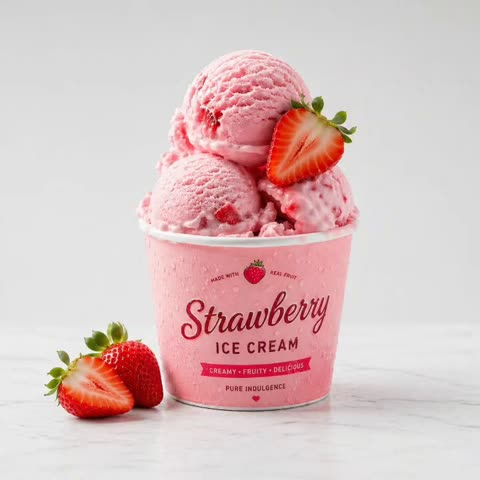
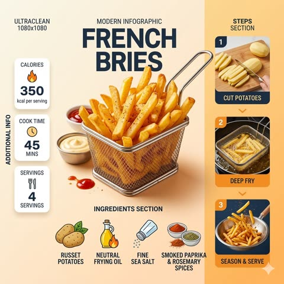
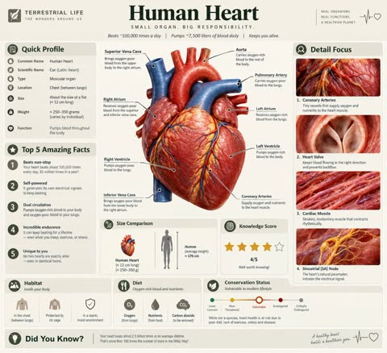

# 信息图与幻灯片

[返回目录](../../README_zh.md) · 全部 42 条

<a id="gpt-image-encyclopedia-infographic-topic-template"></a>
### 詹姆斯韦伯望远镜百科信息图卡片

<a href="https://x.com/oggii_0/status/2051889025229930547"></a>

用 TOPIC 占位符加一份模块化面板清单（基础档案、分类、优缺点、评分总结等）。收藏手册和自然史图鉴这类风格锚点，配合浅色背景和圆角框，让整个系列版式统一。

GPT Image 2 · 文生图 · 出处: [@oggii_0 on X](https://x.com/oggii_0/status/2051889025229930547) · 1,622 赞，统计于 2026-10-29

[`encyclopedia`](tags.md#tag-encyclopedia) [`infographic`](tags.md#tag-infographic) [`template`](tags.md#tag-template) [`knowledge-card`](tags.md#tag-knowledge-card) [`editorial-layout`](tags.md#tag-editorial-layout)

<details><summary><b>提示词</b></summary>

```text
Create educational encyclopedia style images with GPT Image 2 on
@itsPolloAI


Prompt: Based on { TOPIC }, create a high-quality vertical “encyclopedia-style educational infographic image.”

This image should NOT look like a regular poster or a simple illustration. Instead, it should feel like a structured knowledge guide that combines:

the feeling of a collectible reference handbook

a modern encyclopedia page

a lifestyle knowledge card

and a highly shareable social-media infographic

The overall style should resemble a premium natural-history guidebook mixed with modern editorial infographic design.

The image should include:

One beautiful and highly detailed main subject image

Several zoomed-in detail sections highlighting important features

Multiple modular information panels with rounded corners

Clear title hierarchy and highlighted key labels

Concise yet information-rich encyclopedia content

Visual scoring systems, quick summaries, or “Top 5” modules

The information sections should automatically adapt to the topic. Select and combine relevant categories such as:

Basic profile

Classification / taxonomy

Physical characteristics

Behavior / ecology / habits

Structure or formation mechanisms

Growth conditions or usage methods

Care, maintenance, or optimization tips

Risks, warnings, and important notes

Suitable users or application scenarios

Pros and cons comparison

Quick rating tags or summary cards

Visual requirements:

Clean light-colored background

Soft and elegant color palette

Gentle shadows

Small refined icons

Rounded information boxes

Organized editorial layout

High information density without feeling crowded

Comfortable reading experience

The final result should feel like a real publishable encyclopedia knowledge card designed for reading, collecting, and creating as part of a consistent series — NOT like a commercial advertisement poster.

The image must strongly emphasize:

“knowledge integration + modular information design + handbook/reference-style presentation.”
```

</details>

<a id="gpt-image-museum-encyclopedia-cat-breeds-infographic"></a>
### 博物馆图鉴风格的猫品种信息图

<a href="https://x.com/GeekCatX/status/2047354608717332691"></a>

用方括号分区锁定羊皮纸底色、唯一的朱红强调色、密集重叠的群像构图和中英双语标签的字体层级。主体用可替换的SUBJECT占位，同一模板可换成猫、狗或职业。

GPT Image 2 · 文生图 · 出处: [@GeekCatX on X](https://x.com/GeekCatX/status/2047354608717332691) · 1,166 赞，统计于 2026-10-28

[`encyclopedia`](tags.md#tag-encyclopedia) [`parchment`](tags.md#tag-parchment) [`cat-breeds`](tags.md#tag-cat-breeds) [`bilingual-labels`](tags.md#tag-bilingual-labels) [`template`](tags.md#tag-template)

<details><summary><b>提示词</b></summary>

```text
首页封面：
A breathtakingly intricate masterpiece conceptual infographic of [SUBJECT: 11 species of Canidae cubs / various cat breeds / professional characters], strictly designed based on a natural history museum encyclopedia aesthetic.

[CANVAS & COLOR DICTATORSHIP]
BASE CANVAS (L0): Aged vintage parchment texture, warm hex #E8DFD1, featuring subtle water stains, distressed paper edges, and organic fiber grain.
SYSTEMIC COLOR (L1): Highly realistic and naturalistic rendering of [SUBJECT], capturing every fine detail of fur, skin, and eyes.
ACCENT COLOR (L3): Vermillion red (#A3262A) strictly reserved for traditional Chinese seals, title brackets, and critical tier markers (S, A, B, C).

[SPATIAL GRAVITY & TOPOLOGY]
COMPOSITION: A dense, layered collage of multiple [SUBJECT] subjects. Larger, more significant subjects are placed slightly centrally, while smaller ones fill the periphery with subtle overlapping to create 3D depth.
BOUNDARIES: No hard frames for individual subjects; they breathe naturally on the parchment. A thin, 1pt technical border defines the entire composition's outer limits.
MODULE TOPOLOGY: Approximately 9-15 distinct subjects arranged in a multi-node grid. Each subject acts as an independent information module.

[DIMENSIONALITY & GRAPHIC PHYSICS]
STYLE: Digital scientific illustration. A fusion of 19th-century zoological sketches and modern high-fidelity 3D rendering. Ultra-fine detail on textures (fur, feathers, or clothing).
LINE LANGUAGE: 0.5pt micro-technical lines for labels and taxonomy guides.

[TYPOGRAPHY ECOSYSTEM — ADAPTIVE DENSITY]
TYPOGRAPHY DENSITY: Visual-heavy (70% subjects / 30% text).
T1 MACRO HEADER: Massive, ultra-bold Traditional Chinese "Kaiti" or "Songti" characters enclosed in large black or red brackets 「 」. Estimated ~96px. Must be strictly pure Chinese (Hanzi).
T2/T3 LABELS: Each subject is accompanied by its name in bilingual format: small-caps English (Sans-serif) and medium-weight Chinese (Heiti).
T4 ANNOTATIONS: Micro-text placeholders for scientific descriptions, arranged in crisp technical blocks near each subject.
TEXT PHYSICAL BEHAVIOR: Text is "floating" beside subjects with precise spatial alignment. High contrast (dark ink on light parchment).

[NARRATIVE FLOW]
NARRATIVE MODE: Comparison and Classification.
VISUAL ENTRY POINT: The central T1 Header at the top, then the eye moves to the largest central subject.
COGNITIVE LOAD: Information is chunked by individual subject modules, each with its own ID and label.

[ICONOGRAPHY & METAPHOR]
ICON STYLE: Scientific pictograms and vintage wax seals.
CORE METAPHOR: The "Natural History Encyclopedia" page.
SPECIAL ELEMENTS: Include "S/A/B/C Tier" medals in red/gold gradients for hierarchy, and a traditional red ink artist seal at the bottom right.

[FINAL EXECUTION LOCK]
Render as a single unified composition. All visual systems must be internally consistent. High-density detail, museum-quality print aesthetic, scientific clarity.

主体：布偶猫、缅因猫、英国短毛猫、波斯猫、苏格兰折耳猫、孟加拉猫、西伯利亚猫、阿比西尼亚猫、暹罗猫、挪威森林猫。比例3:4， 文字清晰可读。

单体图：
Role: World-class Scientific Encyclopedia Illustrator & Knowledge Graph Architect.

Task: Generate a highly detailed, extremely intricate, and visually stunning "Universal Illustrated Encyclopedia Science Infographic" in a classic, unbranded (NO logos) scientific encyclopedia style.

Subject Matter: Choose one from [People, Plants, or Animals].

Specific Subject: [e.g., The Giant Squid / Leonardo da Vinci / The Sequoia Tree].

Style: Fine, detailed scientific illustration on a retro, aged beige paper background. Delicate linework. Intricately complex and professional.

Key Visual Requirements:

1.  Lifelike 3D Effect (The Central Subject): The central subject in the "C position" must be rendered with extraordinary realism and dynamism. Create a dramatic sense of depth where the character, plant, or animal appears to break the frame, leaping or bursting out of the flat paper towards the viewer (an effect similar to anamorphic 3D or dynamic pop-out, with high-precision realism).

2.  Layout & Strategic White Space:
    * Central Subject: Dominates the center, with intentional "strategic white space" around it to enhance the popping-out effect and make the figure the clear focal point.
    * Surrounding Modules: The surrounding area (left, right, top, bottom, and corners) must be filled with 6-8 distinct, highly organized knowledge modules, depending on the subject. There should be a sense of organized density, not random clutter. The modules themselves must have clear borders, headers, and extensive, detailed content.

3.  Connections: Use a complex, logical network of fine leader lines, arrows, brackets, dotted lines, and small connection points to link the central figure to all surrounding modules, and interconnect the modules themselves into a cohesive knowledge web.

4.  Text & Annotation (Hard Requirement - Must be CLEAR Chinese):
    * Main Title: A large, prominent, beautifully executed **Chinese calligraphy** (书法体) of the specific subject's name [e.g., "大王乌贼"].
    * Calligraphic Accents: Scattered throughout the main content and module titles, use beautiful, clear Chinese calligraphy for important terms.
    * Standard Chinese Text: All other descriptive text, handwritten notes (大量清晰中文手写注释), module content, and annotations must be clear, legible Chinese characters (简体中文), not gibberish or unreadable symbols. Ensure text clarity is prioritized.
    * Leader Line Annotations: Every single small component, detail, submodule, diagram, or illustration within the modules must have detailed leader line annotations (拟解剖图) pointing directly to it for maximum professionalism and educational value. Every part should be labeled.

Subject-Specific Module Structure (Example for general reference):

A. For Humans [People]:
   - Module 1: Anatomy & Skeletal Structure (w/ magnified cross-sections)
   - Module 2: Physiological Processes (e.g., Circulatory/Nervous System)
   - Module 3: Historical Context & Timeline (Key Achievements)
   - Module 4: Major Contribution Diagram (Detailed breakdown)
   - Module 5: Cognitive Process / Psychological Insight
   - Module 6: Genetic Profile / Evolution
   - Module 7: Global Influence & Cultural Impact
   - Module 8: Cultural Representations / Legacy

B. For Animals:
   - Module 1: Full External Sketch & Anatomy (w/ microscope magnified detail circular windows)
   - Module 2: Behavioral Patterns & Lifecycle (e.g., Mating/Migration, Flowchart style)
   - Module 3: Digestive & Skeletal System
   - Module 4: Habitats & Distribution Map (with environmental details)
   - Module 5: Unique Adaptations (e.g., camouflage, hunting tools)
   - Module 6: Evolutionary History & Relatives
   - Module 7: Symbiotic Relationships / Ecosystem Role
   - Module 8: Conservation Status & Human Interaction

C. For Plants:
   - Module 1: Full Plant Sketch & Anatomy (w/ magnified leaf/root details)
   - Module 2: Photosynthesis & Lifecycle Flow (w/ icons for environment)
   - Module 3: Cellular Structure (Magnified circular views)
   - Module 4: Medicinal Properties / Practical Applications (as in original original prompt)
   - Module 5: Environmental Adaptations / Unique Features
   - Module 6: Distribution Map & Environmental Context
   - Module 7: Genetic Variations & Cultivation
   - Module 8: Historical Usage & Folklore

Overall Composition: Extremely dense with information, organized into 6-8 structured modules, but balanced with strategic empty space around the center to allow the main, hyper-realistic figure to pop. Hard-core, professional, academic, but visually engaging due to the dynamic 3D central figure. No branding from any specific encyclopedia (e.g., no "DK" logos). All annotations must be legible. All handwritten notes must be clear. Main titles in Chinese calligraphy. Aspect Ratio: 3:4.

[主题内容]
```

</details>

<a id="gpt-image-endangered-animal-infographic-bengal-tiger"></a>
### 濒危孟加拉虎注解信息图海报

<a href="https://x.com/MrDasCreates/status/2052064402866851981"></a>

提示词要求以写实主体动物为中心,配合注解标注、图标和色块,而不是千篇一律的分区。先让模型查找真实物种资料,版面的信息才密集而准确。

GPT Image 2 · 文生图 · 出处: [@MrDasCreates on X](https://x.com/MrDasCreates/status/2052064402866851981) · 819 赞，统计于 2026-10-28

[`infographic`](tags.md#tag-infographic) [`animal`](tags.md#tag-animal) [`endangered-species`](tags.md#tag-endangered-species) [`photorealistic`](tags.md#tag-photorealistic) [`callouts`](tags.md#tag-callouts)

<details><summary><b>提示词</b></summary>

```text
Animal Infographic by GPT Image 2 on ChatGPT app

Prompt: Create a visually rich infographic about an endangered animal. Start by finding one online, research its habitat, diet, and unique traits. Present information through annotated visuals and structured callouts, not generic sections. Style it like a bold graphic illustration: a detailed, photorealistic central animal as the focal point, supported by diagrams, callouts, and concise text elements. Use clean backgrounds and a mix of photorealism with strong graphic elements (shapes, icons, color blocking) in a layered composition. Make it dense, tactile, and professionally authored.
```

</details>

<a id="gpt-image-modern-house-architecture-handbook-infographic"></a>
### 现代住宅建筑手册信息图页面

<a href="https://x.com/mehvishs25/status/2053147765409288633"></a>

用 HOUSE_STYLE 占位符让提示词可以反复套用。它把一张四分之三视角的主render和一长串命名的模块化板块、可视化模块组合起来,再用明确的避免清单防止画面变成房地产传单。

GPT Image 2 · 文生图 · 出处: [@mehvishs25 on X](https://x.com/mehvishs25/status/2053147765409288633) · 538 赞，统计于 2026-10-28

[`infographic`](tags.md#tag-infographic) [`architecture`](tags.md#tag-architecture) [`house`](tags.md#tag-house) [`template`](tags.md#tag-template) [`editorial`](tags.md#tag-editorial)

<details><summary><b>提示词</b></summary>

```text
Create a premium square “reference-style architectural infographic” centered around a luxurious {HOUSE_STYLE} modern house, designed as a beautifully curated architecture handbook page rather than a real-estate advertisement.
The composition should feel like a modern visual encyclopedia mixed with an elite architectural field guide and high-end editorial infographic system.
Visual Direction:
• 1:1 square composition
• Soft light-toned architectural background with subtle blueprint textures and drafting schematics
• Elegant muted palette using warm white, charcoal gray, natural wood tones, matte black, concrete gray, and soft steel blue accents
• Refined editorial typography hierarchy
• Rounded modular information cards with clean spacing
• Gentle realistic shadows and premium UI-style dividers
• Minimal architectural iconography
• Extremely detailed central house render viewed in dramatic three-quarter exterior perspective during soft golden-hour lighting
• Thin precision annotation lines pointing toward architectural systems and design features
• Clean, organized “knowledge-first” layout with high information density but breathable spacing
Main Subject Presentation:
A stunning ultra-detailed realistic render of the {HOUSE_STYLE} modern house placed at the center, featuring premium architectural realism, floor-to-ceiling glass walls, realistic reflections, warm ambient lighting, natural landscaping, modern material textures, elegant geometry, and sophisticated contemporary detailing.
Surround the house with scientific and architectural callouts explaining:
• façade design
• structural engineering
• smart home systems
• sustainable architecture
• passive cooling systems
• roof design
• glazing and natural lighting
• interior planning
• landscaping integration
• energy-efficient materials
Include modular infographic sections such as:
• House Overview
• Key Specifications
• Floor Plan Overview
• Structural & Material Breakdown
• Smart Home Features
• Sustainability Systems
• Climate-Responsive Design
• Interior Design Highlights
• Kitchen & Bathroom Concepts
• Area Distribution Charts
• Construction Timeline
• Cost Estimation (Indicative)
• Advantages vs Considerations
• Site Plan Layout
• Sectional Architectural View
• “Top 5 Incredible Facts” section
• Ideal Locations & Usage Scenarios
Add small premium visualization modules like:
• floor plan diagrams
• section-cut architectural drawings
• airflow & ventilation diagrams
• sunlight direction graphics
• smart-home workflow visuals
• landscaping/site layout plans
• material palette displays
• sustainability performance charts
• miniature blueprint elevation views
• room distribution infographics
Style Keywords:
“premium architecture encyclopedia”
“editorial architectural handbook”
“high-end residential infographic”
“museum-quality modern house reference page”
“scientific architectural poster”
“luxury home design editorial”
“modular architectural knowledge system”
“ultra-detailed architectural visualization”
Avoid:
• generic real-estate flyer aesthetics
• cluttered luxury brochure layouts
• excessive cinematic effects
• overly dark moody scenes
• unrealistic futuristic sci-fi architecture
• advertisement-heavy compositions
The final result should resemble a professionally published architectural reference-book page created for architects, interior designers, collectors, luxury home enthusiasts, and educational design archives.
```

</details>

<a id="gpt-image-routine-recipe-editorial-infographic"></a>
### 晨间习惯食谱式编辑风信息图

<a href="https://x.com/TechieBySA/status/2047683043918311670"></a>

用 [ROUTINE] 占位符做成通用模板，依次规定主视觉物件、带用量的所需清单、编号毛玻璃步骤卡片和悬浮数据胶囊。奶油暖色调、留白与纸张颗粒让密集排版依然清晰。

GPT Image 2 · 文生图 · 出处: [@TechieBySA on X](https://x.com/TechieBySA/status/2047683043918311670) · 460 赞，统计于 2026-10-28

[`infographic`](tags.md#tag-infographic) [`editorial`](tags.md#tag-editorial) [`routine`](tags.md#tag-routine) [`template`](tags.md#tag-template) [`glassmorphism`](tags.md#tag-glassmorphism)

<details><summary><b>提示词</b></summary>

```text
“Ultra-clean modern editorial infographic on the topic of [ROUTINE] routine. Hero visual: a stylized flat-lay or floating arrangement of 3–4 objects closely associated with the routine — slightly angled or in soft perspective, glowing subtly. All elements arranged dynamically around the hero in a non-restrictive editorial layout. Ingredients Section: Label it ‘What You Need’ — include 6–8 items with small icons or emoji illustrations next to each. Each item has a name and a practical quantity or duration written like a recipe (e.g. ‘x minutes of Y’). Arranged in a cluster or list connected visually to the hero. Steps Section: 5–6 numbered panels with arrows or connecting lines forming a logical flow. Each step has a short action label and a small relevant icon. Panels use glassmorphism or frosted card styling. Stats Badges: 4–5 floating pill-shaped badges showing relevant metadata — total time, difficulty, consistency streak, energy cost — displayed as clean minimal bubbles near the hero. Visual Style: Warm, soft editorial background — cream, warm white, or soft morning light tones. Muted earthy accent colors with clean highlights. Bold modern sans-serif typography. Clean vector icons. Subtle grain or paper texture in background. Composition: Hero object cluster centered or slightly offset. Ingredients on one side. Steps flow opposite or below with connecting lines. Stat badges scattered as floating pills. Generous negative space to keep it airy and readable. Lighting: Soft warm natural light feel emanating from the hero cluster. Premium lifestyle editorial aesthetic, social-feed optimized. Ultra-crisp. No watermark.”
```

</details>

<a id="gpt-image-premium-recipe-poster-tempura-bowl"></a>
### 天丼食谱海报，含食材与十步做法

<a href="https://x.com/Preda2005/status/2047883394152088004"></a>

一条带菜名占位符的通用模板，按顺序写明主图、食材、分步流程和奶油色背景等版面要素。暖色自然光和精致英文排版等风格词让整张海报保持统一。

GPT Image 2 · 文生图 · 出处: [@Preda2005 on X](https://x.com/Preda2005/status/2047883394152088004) · 455 赞，统计于 2026-10-28

[`recipe`](tags.md#tag-recipe) [`food-poster`](tags.md#tag-food-poster) [`typography`](tags.md#tag-typography) [`template`](tags.md#tag-template) [`cream-background`](tags.md#tag-cream-background)

<details><summary><b>提示词</b></summary>

```text
Create a premium food preparation poster for
 [ DISH NAME ], with a beautiful hero dish, warm natural lighting, cream background, elegant step-by-step recipe layout, ingredients, cooking process, premium food photography, refined English typography, luxury restaurant advertisement style, clean design, rich colors, highly detailed, visually irresistible, cinematic masterpiece.
```

</details>

<a id="gpt-image-ai-fitness-coach-analysis-poster"></a>
### 根据健身房自拍生成的 AI 健身分析海报

<a href="https://x.com/frametheory058/status/2054461225413870014"></a>

提示词先锁定上传照片的人脸与身份，再逐一列出每个分析模块、食物卡片和训练面板，让模型围绕居中人物排出密集的玻璃拟态版面。明确的明亮奢华配色并禁用暗黑健身房风格，使整体干净高级。

GPT Image 2 · 上传图改图 · 出处: [@frametheory058 on X](https://x.com/frametheory058/status/2054461225413870014) · 454 赞，统计于 2026-10-28

[`fitness`](tags.md#tag-fitness) [`poster`](tags.md#tag-poster) [`dashboard-ui`](tags.md#tag-dashboard-ui) [`glassmorphism`](tags.md#tag-glassmorphism) [`selfie`](tags.md#tag-selfie)

<details><summary><b>提示词</b></summary>

```text
I will upload a gym mirror selfie/body photo.

Create an ULTRA PREMIUM AI FITNESS ANALYSIS POSTER that looks like a luxury futuristic wellness brand advertisement mixed with a high-end fitness app dashboard.

IMPORTANT:
The uploaded face and identity must remain EXACTLY THE SAME.
Do not change:

face structure

eyes

jawline

hairstyle

skin tone

facial proportions

Only enhance:

body presentation

outfit styling

lighting

pose atmosphere

premium visual composition

STYLE DIRECTION:
Avoid dark black backgrounds.

Instead create:

bright luxury studio aesthetic

soft silver + white + warm beige + matte charcoal tones

premium Apple / Gymshark / WHOOP / Technogym inspired design

clean modern luxury UI

cinematic natural lighting

subtle reflections and depth

rich soft shadows

elegant futuristic fitness branding

The entire poster should feel:
MINIMAL + EXPENSIVE + VIRAL + HIGH STATUS

LAYOUT:
4:5 vertical composition optimized for Twitter/X virality.

CENTER SUBJECT:

Place the uploaded person in the middle

Natural confident Gen-Z mirror selfie pose

Slight V-taper physique

Lean aesthetic body

Realistic muscles, not overdone

Premium sweatpants or luxury athletic wear

Clean modern hairstyle

iPhone mirror selfie vibe

BACKGROUND:
Create a premium luxury gym or wellness studio:

polished concrete

soft LED strip lights

luxury mirrors

brushed steel gym equipment

natural depth blur

warm daylight mixed with cinematic lighting

NO dark horror gym aesthetic.

COLOR PALETTE:

matte white

platinum silver

warm cream

champagne gold accents

soft graphite

subtle neon beige glow

UI DESIGN:
Create floating modern fitness-analysis cards around the body.

Use:

glassmorphism panels

floating transparent UI

thin elegant borders

soft glowing shadows

futuristic clean typography

SECTIONS TO INCLUDE:

• Body Fat Estimate
• Muscle Strengths
• Weak Points
• Calorie Goal
• Protein Intake
• Recommended Split
• Best Cardio
• Recovery Score
• Physique Rating

FOOD SECTION:
Instead of basic circles, create:

floating premium food cards

realistic luxury food photography

elegant shadows

soft glowing borders

Include:

salmon

eggs

chicken breast

avocado

oats

almonds

banana

greek yogurt

whey protein

EXERCISE SECTION:
Use sleek cinematic mini-panels for:

incline bench

pull-ups

shoulder press

squats

deadlift

WOW FACTORS:

luxury reflections

floating holographic UI

subtle particles

soft ambient glow

premium health-tech aesthetic

cinematic depth

realistic skin texture

ultra sharp details

TEXT STYLE:
Minimal and bold.
Very clean typography like premium tech advertisements.

QUALITY:

hyper realistic

ultra detailed

8K

cinematic realism

viral social media quality

extremely polished

visually addictive

should instantly make people stop scrolling

FINAL GOAL:
The poster should look so premium and believable that people instantly think:
“Wait… AI can actually create a personalized fitness coach like this?”
```

</details>

<a id="nano-banana-strawberry-ice-cream-ingredient-infographic"></a>
### 草莓冰淇淋原料与制作步骤信息图

<a href="https://x.com/Strength04_X/status/2048303530902265949"></a>

以居中的主体产品为核心，周围环绕扁平图标和弧形箭头，一侧排布圆角步骤卡片。底部用信息徽章，浅灰渐变背景并固定方形比例，让版面干净有序。

Nano Banana 2 · 文生图 · 出处: [@Strength04_X on X](https://x.com/Strength04_X/status/2048303530902265949) · 319 赞，统计于 2026-10-29

[`infographic`](tags.md#tag-infographic) [`food`](tags.md#tag-food) [`ice-cream`](tags.md#tag-ice-cream) [`product-story`](tags.md#tag-product-story) [`instagram`](tags.md#tag-instagram)

<details><summary><b>提示词</b></summary>

```text
I built this full ad Using Nano Banana 2 + Kling 3.0 4K on
@Kling_ai


From product shot to ingredient story to final serve
Everything flows like a real commercial 🍨

No studio ~ no team
Just vision and execution

Prompt: A modern, clean product infographic featuring a delicious strawberry ice cream at the center of the composition. The ice cream is presented as a beautifully swirled scoop in a glass cup (or wafile cone), showcasing a rich. creamy texture with soft pink tones and visible strawberry bits. Glossy highlights and slight melting edges enhance the fresh, indulgent feel. Fresh strawberries and subtle syrup drizzles add a vibrant, appetizing touch. Background is light grey with soft gradients and gentle shadows for a premium, clean commercial aesthetic.

Surrounding the central ice cream are neatly arranged ingredient and element icons in a minimal flat illustration style: fresh strawberries, sliced strawberries, milk splash, sugar crystals, ice cubes, and a dessert cup icon. Thin curved arrows point from each element toward the ice cream, creating a clean, balanced infographic flow.

On the right side, rounded white step cards with soft shadows display the

process:

1. Select Fresh Strawberries

2. Blend with Cream & Sugar

3. Freeze & Churn

4. Serve Chilled

Each step includes simple illustrations (cutting strawberries, blending mixture, churning ice cream, serving in cup cone) with short, clean text.

At the bottom corner, minimal infographic badges show: serving temperature, freshness level, sweetness level, calories per serving, and serving size.

Minimal Ul design, modern typography, balanced spacing, premium dessert advertising style, creamy texture details, glossy highlights, ultra high resolution, editorial ice cream infographic. Instagram-ready composition.

Aspect Ratio: 1:1

Image Size: 1080 1080 pixels
```

</details>

<a id="gpt-image-iced-matcha-latte-six-panel-storyboard"></a>
### 冰抹茶拿铁六格美食分镜

<a href="https://x.com/DuaFatimaAi/status/2095669775456407975"></a>

每格按步骤编号，从食材平铺到成品主图，再用一段统一的道具、色调、光线和镜头描述锁定整体风格。结尾的一致性要求和禁止出现人脸的限制让六格画面保持连贯。

GPT Image 2 · 文生图 · 出处: [@DuaFatimaAi on X](https://x.com/DuaFatimaAi/status/2095669775456407975) · 272 赞，统计于 2026-10-28

[`food-photography`](tags.md#tag-food-photography) [`storyboard`](tags.md#tag-storyboard) [`matcha`](tags.md#tag-matcha) [`6-panel-grid`](tags.md#tag-6-panel-grid) [`photorealistic`](tags.md#tag-photorealistic)

<details><summary><b>提示词</b></summary>

```text
Create a premium photorealistic vertical 6-panel food photography storyboard for an iced matcha latte, arranged in a clean 2×3 grid. Use the same warm natural visual identity, props, lighting, composition, and green color palette across all six panels. Rustic Japanese-inspired kitchen aesthetic, cinematic editorial food photography, soft natural window light, realistic human hands, shallow depth of field, highly detailed textures, creamy matcha, transparent ice cubes, elegant glassware, green linen/checkered cloth, bamboo matcha whisk, ceramic bowls, blueberries, and wooden accents.
Panel 1 — INGREDIENT PREPARATION:
Top-down flat lay showing a bowl of vibrant green matcha powder, bamboo whisk, small ceramic pitcher of milk, bowl of sugar, glass of green matcha liquid, bowl of ice cubes, and cream/milk arranged beautifully on a dark green tabletop with a checkered cloth.
Panel 2 — MATCHA PREPARATION:
Close-up of realistic hands whisking vibrant green matcha powder in a rustic ceramic bowl using a traditional bamboo matcha whisk. Foamy matcha texture forming naturally.
Panel 3 — INITIAL MIXING:
Pour freshly prepared bright green matcha into a transparent measuring glass filled with ice and milk. Capture the pouring action, swirling green-and-white layers, realistic splashes and condensation.
Panel 4 — MAIN PROCESS:
Extreme close-up of creamy milk being poured over iced matcha in a clear glass. Beautiful green-and-white marbling around transparent ice cubes, highly appetizing texture, cinematic macro photography.
Panel 5 — SERVING:
A spoon gently adds a generous layer of white whipped cream/cream foam onto the top of the iced matcha latte. Full glass visible, surrounded by matcha powder, bamboo whisk, blueberries and rustic props.
Panel 6 — FINAL HERO SHOT:
Premium hero shot of the finished iced matcha latte in a tall crystal-clear glass, vibrant green matcha with creamy white swirls and a soft cream topping, condensation on the glass, ice cubes visible, matcha bowl and bamboo whisk softly blurred in the background, blueberries scattered naturally around the glass.
Visual style: luxury beverage advertisement, photorealistic, cinematic food commercial, warm earthy tones, natural soft lighting, realistic materials, subtle film grain, professional food styling, 85mm macro lens look, shallow depth of field, HDR, ultra-detailed, premium editorial photography, appetizing and authentic.
Aspect ratio: 4:5 vertical.
Important: Maintain consistent props, glass, lighting, tabletop, color palette and visual continuity across all six panels. No people’s faces, only natural hands where required.
```

</details>

<a id="gpt-image-football-stadium-engineering-infographic"></a>
### 未来感足球场工程手册信息图

<a href="https://x.com/j_smeaton99/status/2056209800627974490"></a>

提示词先固定正方形构图和夜间航拍主体，再列出十项标注主题和十七个模块化版块，让模型铺满高密度卡片网格。风格关键词与避免清单把画面稳定在百科式编辑风格，避开广告感。

GPT Image 2 · 文生图 · 出处: [@j_smeaton99 on X](https://x.com/j_smeaton99/status/2056209800627974490) · 246 赞，统计于 2026-10-29

[`infographic`](tags.md#tag-infographic) [`stadium`](tags.md#tag-stadium) [`architecture`](tags.md#tag-architecture) [`sports`](tags.md#tag-sports) [`template`](tags.md#tag-template)

<details><summary><b>提示词</b></summary>

```text
Create a premium square “reference-style sports architecture infographic” centered around a futuristic modern football stadium called the {STADIUM_NAME}, designed as a beautifully curated stadium-engineering handbook page rather than a sports advertisement poster.

The composition should feel like a modern visual encyclopedia mixed with an elite stadium-design field guide and high-end editorial infographic system.

Visual Direction:

• 1:1 square composition
• Dark premium architectural-tech background with subtle blueprint textures, stadium schematics, and cinematic city-light overlays
• Elegant palette using deep navy, matte black, steel blue, titanium silver, and glowing electric-blue accents
• Refined editorial typography hierarchy with modern sports-engineering aesthetics
• Rounded modular information cards with clean spacing
• Gentle realistic reflections and premium HUD-style dividers
• Minimal sports infrastructure iconography
• Extremely detailed central stadium render viewed in dramatic aerial three-quarter perspective during nighttime match lighting
• Thin precision annotation lines pointing toward structural systems and smart-stadium technologies
• Clean, organized “knowledge-first” layout with high information density but breathable spacing

Main Subject Presentation:

A stunning ultra-detailed realistic render of the {STADIUM_NAME} placed at the center, featuring illuminated seating bowls, glowing LED façade lighting, retractable roof systems, realistic crowd ambience, premium landscaping, advanced pitch engineering, and world-class architectural realism.

Surround the stadium with scientific and engineering callouts explaining:

• retractable roof technology
• LED lighting systems
• seating bowl acoustics
• pitch and drainage engineering
• structural steel framework
• crowd management systems
• smart surveillance & security
• sustainability systems
• transport and accessibility integration
• digital fan-experience technology

Include modular infographic sections such as:

• Stadium Overview
• Technical Specifications
• Dimensions & Blueprint Views
• Seating Capacity & Bowl Design
• Pitch Engineering System
• Structural & Roof Technology
• Smart Stadium Infrastructure
• Fan Experience & Hospitality
• Security & Safety Systems
• Sustainability Features
• Transportation & Access Planning
• Acoustics & Audio Systems
• Matchday Operations Workflow
• Multi-Event Capability
• Construction Timeline
• “Top 5 Innovations” section
• Built for Legacy & Future Expansion

Add small premium visualization modules like:

• stadium blueprint diagrams
• seating-distribution graphics
• roof-opening mechanism visuals
• sustainability performance charts
• crowd-flow maps
• transport integration diagrams
• smart surveillance graphics
• pitch-layer cutaway illustrations
• acoustics waveform displays
• aerial site-plan schematics

Style Keywords:

“premium stadium architecture encyclopedia”
“editorial sports infrastructure handbook”
“high-end football stadium infographic”
“scientific sports architecture poster”
“museum-quality stadium reference page”
“modular sports-engineering knowledge system”
“clean architectural editorial design”
“ultra-detailed stadium visualization”

Avoid:

• generic sports advertisements
• cartoon football aesthetics
• cluttered sponsor-heavy layouts
• unrealistic sci-fi fantasy stadiums
• excessive neon cyberpunk overload
• chaotic crowd-focused compositions

The final result should resemble a professionally published sports-architecture reference-book page created for architects, engineers, football fans, stadium planners, designers, and educational infrastructure archives.
```

</details>

<a id="gpt-image-terrestrial-life-species-infographic"></a>
### 带数据模块的蜜蜂科普信息图

<a href="https://x.com/iamsofiaijaz/status/2113510238846672945"></a>

用主题占位符让同一模板适用于任意物种。逐一点明各个模块（档案侧栏、趣闻列表、尺寸对比、评分、栖息地图标、保护状态滑块），并把配色限定为柔和米色，呈现科学期刊质感。

GPT Image 2.5 · 文生图 · 出处: [@iamsofiaijaz on X](https://x.com/iamsofiaijaz/status/2113510238846672945) · 230 赞，统计于 2026-10-28

[`infographic`](tags.md#tag-infographic) [`educational`](tags.md#tag-educational) [`template`](tags.md#tag-template) [`scientific`](tags.md#tag-scientific) [`layout`](tags.md#tag-layout)

<details><summary><b>提示词</b></summary>

```text
A professional educational infographic for a [Subject], designed in a modern "Terrestrial Life" series style. The layout features a large, realistic 3D central illustration of the [Subject] with anatomical labels like "Compound Eyes," "Thorax," and "Abdomen" using thin pointer lines. The color palette is clean with soft beige and muted tones. The composition includes multiple data modules: a "Quick Profile" sidebar, a "Top 5 Amazing Facts" list, a "Size Comparison" chart against a human silhouette, and a "Knowledge Score" star rating system. Include a "Detail Focus" section on the right with four square macro-photography close-ups of life stages or specific features. The bottom features "Habitat" and "Diet" icons, a "Conservation Status" slider, and a small "Did You Know?" footer. High resolution, crisp typography, clean vector lines, and a professional scientific journal aesthetic.
```

</details>

<a id="nano-banana-exploded-food-infographic-layers"></a>
### 美食分层爆炸信息图

<a href="https://x.com/TechieBySA/status/2028451530198642753"></a>

用 [FOOD] 占位符做模板，把菜品从顶部的装饰颗粒到底部的盘子按层悬浮排列。纯白背景、微距布光和细引线标签让画面干净易读。

Nano Banana 2 · 文生图 · 出处: [@TechieBySA on X](https://x.com/TechieBySA/status/2028451530198642753) · 218 赞，统计于 2026-10-29

[`exploded-view`](tags.md#tag-exploded-view) [`food`](tags.md#tag-food) [`infographic`](tags.md#tag-infographic) [`macro-photography`](tags.md#tag-macro-photography) [`template`](tags.md#tag-template)

<details><summary><b>提示词</b></summary>

```text
“Create a hyper-realistic exploded vertical infographic composition of [FOOD].
At the top, characteristic particles, droplets, or garnishes associated with the food, frozen mid-air.
Below it, the primary surface or topping layer with rich texture and realistic material detail.
Underneath, the core ingredient layer showing structure, depth, and natural variation.
Below that, the supporting base or interior layer, slightly separated to reveal construction.
At the bottom, a minimal plate, bowl, cup, or base appropriate to the food’s presentation.
Pure white background, soft studio lighting, subtle shadows beneath each floating element, ultra-sharp focus, DSLR macro photography, clean infographic text labels with thin pointer lines, premium editorial food photography aesthetic, 8K quality.”
```

</details>

<a id="gpt-image-ai-memory-anime-self-infographic"></a>
### 根据聊天记忆生成的动漫卡通个人信息图

<a href="https://x.com/icreatelife/status/2047042187683066100"></a>

提示词把内容交给 ChatGPT 的记忆，不用手写任何个人细节，模型自己补全简介、价值观和爱好。同时指定信息图和卡通动漫两种形式，得到围绕角色肖像的分区标注版面。

GPT Image 2 · 文生图 · 出处: [@icreatelife on X](https://x.com/icreatelife/status/2047042187683066100) · 209 赞，统计于 2026-10-28

[`infographic`](tags.md#tag-infographic) [`anime`](tags.md#tag-anime) [`self-portrait`](tags.md#tag-self-portrait) [`chatgpt-memory`](tags.md#tag-chatgpt-memory) [`personalized`](tags.md#tag-personalized)

<details><summary><b>提示词</b></summary>

```text
Ask ChatGPT knowing everything it knows about you to generate an image of yourself with GPT Image 2

prompt: Knowing everything you know about me,  make an infographic of me. Make a cartoon anime style image.

I'd love to see what you got.
```

</details>

<a id="nano-banana-french-fries-recipe-infographic"></a>
### 炸薯条食谱信息图与步骤面板

<a href="https://x.com/Strength04_X/status/2032503970099503191"></a>

提示词把配料、步骤、信息徽章逐段点名，并指定主视觉和周边布局规则。风格、光线和输出尺寸也都写明。

Nano Banana 2 · 文生图 · 出处: [@Strength04_X on X](https://x.com/Strength04_X/status/2032503970099503191) · 203 赞，统计于 2026-10-28

[`infographic`](tags.md#tag-infographic) [`recipe`](tags.md#tag-recipe) [`food`](tags.md#tag-food) [`editorial`](tags.md#tag-editorial) [`social-feed`](tags.md#tag-social-feed)

<details><summary><b>提示词</b></summary>

```text
Created with Kling 2.6 AI + Nano Banana 2 on
@SocialSight


And the clarity looks like a real editorial design🍟

Prompt: Ultra-clean modern recipe infographic. Showcase Crispy French Fries in a basket with dipping sauce in angled perspective.

Ingredients Section: Icons for potatoes, oil, salt, spices.

Steps Section: Potato cutting, frying, seasoning shown with numbered panels.

Additional Info: Calories, cook time, servings displayed as badges.

Visual Style: Editorial fast-food infographic with vibrant textures and modern typography.

Composition Guidelines: Fries basket as hero visual with ingredients and steps around it.

Lighting & Background: Warm studio lighting with minimal gradient background.

Output: 1080×1080, ultra-crisp, social-feed optimized, no watermark.
```

</details>

<a id="nano-banana-vanilla-ice-cream-recipe-infographic"></a>
### 粉彩香草冰淇淋食谱信息图

<a href="https://x.com/Strength04_X/status/2033184147003633695"></a>

提示词把版面拆成带名称的区块（食材、步骤、附加信息），每块都写明具体内容。同时指定主视觉、粉彩配色和方形输出，让模型围绕中心甜品排布所有元素。

Nano Banana 2 · 文生图 · 出处: [@Strength04_X on X](https://x.com/Strength04_X/status/2033184147003633695) · 160 赞，统计于 2026-10-28

[`infographic`](tags.md#tag-infographic) [`recipe`](tags.md#tag-recipe) [`dessert`](tags.md#tag-dessert) [`pastel`](tags.md#tag-pastel) [`social-media`](tags.md#tag-social-media)

<details><summary><b>提示词</b></summary>

```text
Made with Kling AI + Nano Banana 2 on
@hedra_labs


Vanilla ice cream recipe infographic with clean modern design🍨

Prompt: Ultra-clean modern recipe infographic. Showcase Vanilla Ice Cream Scoops with syrup and toppings in angled perspective.

Ingredients Section: Icons for milk, cream, sugar, vanilla.

Steps Section: Mixing base, freezing, scooping shown with numbered panels.

Additional Info: Calories, prep time, servings displayed in badges.

Visual Style: Dessert infographic with pastel colors, soft gradients, modern typography.

Composition Guidelines: Ice cream scoops as hero visual with ingredients and steps around it.

Lighting & Background: Soft dessert-style lighting with minimal background.

Output: 1080×1080, ultra-crisp, social-feed optimized, no watermark.
```

</details>

<a id="gpt-image-banana-smoothie-four-panel-recipe-collage"></a>
### 香蕉奶昔四格食谱拼图

<a href="https://x.com/DuaFatimaAi/status/2096033405259682193"></a>

按位置逐格描述 2x2 画面，每格写明食材与动作，步骤顺序清晰。结尾统一光线、玻璃器皿、景深和无文字要求，让四格风格一致。

GPT Image 2 · 文生图 · 出处: [@DuaFatimaAi on X](https://x.com/DuaFatimaAi/status/2096033405259682193) · 152 赞，统计于 2026-10-29

[`recipe`](tags.md#tag-recipe) [`food-photography`](tags.md#tag-food-photography) [`collage`](tags.md#tag-collage) [`step-by-step`](tags.md#tag-step-by-step) [`photorealistic`](tags.md#tag-photorealistic)

<details><summary><b>提示词</b></summary>

```text
Create a photorealistic 2×2 four-panel recipe collage showing the preparation of a creamy banana smoothie on a rustic dark wooden kitchen table.

Top-left: Several ripe yellow bananas, one peeled banana, a clear glass of milk, a small glass bowl of thick white yogurt, and a bowl of ice cubes neatly arranged as ingredients.

Top-right: Close-up of hands peeling a ripe banana and placing banana pieces into a transparent glass blender jar.

Bottom-left: Milk being poured from a transparent measuring cup into the blender containing banana pieces, yogurt, and ice cubes.

Bottom-right: Thick creamy banana smoothie being poured from the blender into a clear drinking glass, with another finished smoothie glass in the background and a few banana slices on the wooden table.

Warm natural kitchen lighting, realistic food textures, creamy pale-yellow smoothie, transparent glassware, shallow depth of field, rustic wooden background, clean composition, professional food photography, highly detailed, realistic hands, natural shadows, 4K photorealism, no text, no labels, no watermark.
```

</details>

<a id="nano-banana-vehicle-technical-annotation-infographic"></a>
### 载具照片叠加黑色墨线技术标注的信息图

<a href="https://x.com/TechieBySA/status/2038586040231801230"></a>

写实物体之上叠加黑色技术笔标注，包括剖视、尺寸、材料说明和流向箭头。纯白背景加仅限黑色的配色，让画面像工程手册。只需替换一个VEHICLE占位词，就能套用到任何物体。

Nano Banana 2 · 文生图 · 出处: [@TechieBySA on X](https://x.com/TechieBySA/status/2038586040231801230) · 148 赞，统计于 2026-10-29

[`infographic`](tags.md#tag-infographic) [`technical-annotation`](tags.md#tag-technical-annotation) [`engineering`](tags.md#tag-engineering) [`black-and-white`](tags.md#tag-black-and-white) [`vehicle`](tags.md#tag-vehicle)

<details><summary><b>提示词</b></summary>

```text
Simply replace [VEHICLE]:✨

“Create an infographic image of [VEHICLE], combining a realistic photograph or photoreal render of the object with technical annotation overlays placed directly on top.

Use black ink–style line drawings and text (technical pen / architectural sketch look) on a pure white studio background, including:
•Key component labels
•Internal cutaway or exploded-view outlines
•Measurements, dimensions, and scale markers
•Material callouts and quantities
•Arrows indicating function, force, or flow (air, sound, power, pressure)
•Simple schematic or sectional diagrams where relevant

Place the title “VEHICLE” inside a hand-drawn technical annotation box in one corner.

Style & layout rules:
•The real object remains clearly visible beneath the annotations
•Annotations feel sketched, technical, and architectural
•Clean composition with balanced negative space
•Educational, museum-exhibit / engineering-manual vibe

Visual style:
Minimal technical illustration aesthetic, black linework over realistic imagery, precise but slightly hand-drawn feel.

Color palette:
White background, black annotation lines and text only. No colors.

Output:
1080×1080, ultra-crisp, social-feed optimized, no watermark.”
```

</details>

<a id="gpt-image-terrestrial-life-educational-infographic-template"></a>
### 带解剖标注的陆地生命科普信息图模板

<a href="https://x.com/iamsofiaijaz/status/2113870479987753371"></a>

用可替换的 [Subject] 占位符配合固定版式：中央3D插图加引线标注，再逐一点名各个数据模块，如快速档案、大小对比和保护状态。模块标题和四格微距特写栏写得具体，让模型在米色底上稳定输出清晰的文字。

GPT Image 2.5 · 文生图 · 出处: [@iamsofiaijaz on X](https://x.com/iamsofiaijaz/status/2113870479987753371) · 140 赞，统计于 2026-10-28

[`infographic`](tags.md#tag-infographic) [`educational`](tags.md#tag-educational) [`template`](tags.md#tag-template) [`anatomy`](tags.md#tag-anatomy) [`scientific`](tags.md#tag-scientific)

<details><summary><b>提示词</b></summary>

```text
A professional educational infographic for a [Subject], designed in a modern "Terrestrial Life" series style. The layout features a large, realistic 3D central illustration of the [Subject] with anatomical labels like "Compound Eyes," "Thorax," and "Abdomen" using thin pointer lines. The color palette is clean with soft beige and muted tones. The composition includes multiple data modules: a "Quick Profile" sidebar, a "Top 5 Amazing Facts" list, a "Size Comparison" chart against a human silhouette, and a "Knowledge Score" star rating system. Include a "Detail Focus" section on the right with four square macro-photography close-ups of life stages or specific features. The bottom features "Habitat" and "Diet" icons, a "Conservation Status" slider, and a small "Did You Know?" footer. High resolution, crisp typography, clean vector lines, and a professional scientific journal aesthetic.
```

</details>

<a id="nano-banana-black-reflective-ingredient-deconstruction-infographic"></a>
### 黑色反光背景上的玛格丽特披萨食材拆解信息图

<a href="https://x.com/Maercihh/status/2047643979110601154"></a>

用带 SUBJECT 占位符的 JSON 模板固定版式：中央主菜，四周小碗盛放食材，细引线连到加粗标题和简短说明。风格备注锁定黑色、橙色、白色配色和反光台面，换任何菜品都能复用。

Nano Banana 2 · 文生图 · 出处: [@Maercihh on X](https://x.com/Maercihh/status/2047643979110601154) · 128 赞，统计于 2026-10-28

[`infographic`](tags.md#tag-infographic) [`food-photography`](tags.md#tag-food-photography) [`ingredients`](tags.md#tag-ingredients) [`json-template`](tags.md#tag-json-template) [`black-background`](tags.md#tag-black-background)

<details><summary><b>提示词</b></summary>

```text
{
  "image_request": {
    "subject": "Subject Name",
    "prompt_template": "An infographic-style food photography shot of [SUBJECT] on a black reflective background. In the center is a high-resolution, delicious [SUBJECT]. Surrounding the center dish are various individual ingredients (deconstructed) in small bowls or piles, with thin elegant lines pointing from the text descriptions to the specific parts of the food. Each ingredient has a bold header in English followed by a short descriptive sub-text. Professional studio lighting, cinematic composition, 8k resolution, flat design elements mixed with realistic 3D food textures.",
    "style_notes": [
      "Black background",
      "Reflective surface",
      "Floating ingredients",
      "Minimalist sans-serif typography",
      "Orange and white accent colors for text"
    ]
  }
}
```

</details>

<a id="nano-banana-ghibli-margherita-recipe-infographic"></a>
### 吉卜力风格玛格丽特披萨食谱信息图

<a href="https://x.com/azed_ai/status/2027140890247246017"></a>

提示词把主菜放在画面中央，周围环绕带标签的食材，并写明具体克数。光线、质感和手写笔记本标签等风格词让版面有序且文字清晰可读。

Nano Banana 2 · 文生图 · 出处: [@azed_ai on X](https://x.com/azed_ai/status/2027140890247246017) · 126 赞，统计于 2026-10-28

[`infographic`](tags.md#tag-infographic) [`recipe`](tags.md#tag-recipe) [`ghibli-style`](tags.md#tag-ghibli-style) [`food`](tags.md#tag-food) [`painterly`](tags.md#tag-painterly)

<details><summary><b>提示词</b></summary>

```text
margherita pizza recipe infographic, Studio Ghibli inspired illustration, traditional Italian kitchen setting, warm golden sunset light, whole pizza in center with bubbling cheese, ingredients illustrated around in cute containers, dough ball, tomato sauce 150g, mozzarella 200g, fresh basil leaves, olive oil drizzle, handwritten notebook style labels, soft pastel tones, painterly textures, gentle steam and magical glow, whimsical cozy feeling, clean organized layout, readable text, high detail
```

</details>

<a id="gpt-image-beard-style-analysis-grooming-poster"></a>
### 深蓝底胡须风格分析美容海报

<a href="https://x.com/RizwanAly07/status/2048610196302250019"></a>

提示词逐项列出要生成的数据面板（脸型、密度、下颌线、生长、评分）和六种胡型对比，版面自然形成结构化报告。同时要求正面与侧面视图并强调面部一致，让参考图中的人在各面板里保持同一张脸。

GPT Image 2 · 上传图改图 · 出处: [@RizwanAly07 on X](https://x.com/RizwanAly07/status/2048610196302250019) · 发现于 [freestylefly/awesome-gpt-image-2](https://github.com/freestylefly/awesome-gpt-image-2)

[`grooming`](tags.md#tag-grooming) [`beard`](tags.md#tag-beard) [`infographic`](tags.md#tag-infographic) [`dark-blue`](tags.md#tag-dark-blue) [`face-consistency`](tags.md#tag-face-consistency)

<details><summary><b>提示词</b></summary>

```text
Create a premium “BEARD STYLE ANALYSIS” poster featuring the same man from the reference image. Show face shape, beard density, jawline definition, beard growth pattern, and beard suitability score. Include different beard styles comparison such as Stubble, Short Boxed Beard, Full Beard, Goatee, Van Dyke, Clean Shave. Add side profile and front profile views. Modern dark blue luxury background, professional grooming infographic style, high detail, realistic face consistency, stylish typography, premium male grooming poster.
```

</details>

<a id="gpt-image-cellular-respiration-diagram"></a>
### 高中生物课用的细胞呼吸示意图

<a href="https://developers.openai.com/api/docs/guides/image-prompting#create-scientific-and-educational-visuals"></a>

按教学设计来写：受众、标题、必须出现的阶段和每个要标注的分子，再写明要避免什么。标注密集时用 high 质量。预览图为 Sunburst 版本。

GPT Image 2.5 · 文生图 · 出处: [OpenAI image prompting guide](https://developers.openai.com/api/docs/guides/image-prompting#create-scientific-and-educational-visuals)

[`education`](tags.md#tag-education) [`biology`](tags.md#tag-biology) [`diagram`](tags.md#tag-diagram)

<details><summary><b>提示词</b></summary>

```text
Create a simple biology diagram titled "Cellular Respiration at a Glance" for high school students.

Show how glucose turns into energy inside a cell. Include glycolysis, the Krebs cycle, and the electron transport chain.
Use arrows to connect the steps, and label the main molecules: glucose, pyruvate, ATP, NADH, FADH2, CO2, O2, and H2O.
Make it look like a clean classroom handout or slide, with a white background, simple icons, clear labels, and easy-to-read text.

Avoid tiny text, extra decoration, or anything that makes the diagram hard to understand.
```

</details>

<a id="gpt-image-coffee-machine-flow-infographic"></a>
### 全自动咖啡机工作流程信息图

<a href="https://developers.openai.com/api/docs/guides/image-prompting#explain-a-process-visually"></a>

三句大白话交代机器、部件顺序和想看懂流程的目的，版式和标注交给模型。出图后要核对标注是否正确。预览图为 Sunburst 版本。

GPT Image 2.5 · 文生图 · 出处: [OpenAI image prompting guide](https://developers.openai.com/api/docs/guides/image-prompting#explain-a-process-visually)

[`infographic`](tags.md#tag-infographic) [`technical`](tags.md#tag-technical) [`diagram`](tags.md#tag-diagram)

<details><summary><b>提示词</b></summary>

```text
Create a detailed Infographic of the functioning and flow of an automatic coffee machine like a Jura.
From bean basket, to grinding, to scale, water tank, boiler, etc.
I'd like to understand technically and visually the flow.
```

</details>

<a id="gpt-image-croissant-baker-storyboard-infographic"></a>
### 八格可颂烘焙师分镜信息图海报

<a href="https://x.com/TechieBySA/status/2053523784481554759"></a>

先锁定版式：页眉、图例图标、八个编号分镜和页脚。每格写明镜头类型与动作，页脚补充镜头建议与光线，让角色和暖色调保持统一。

GPT Image 2 · 文生图 · 出处: [@TechieBySA on X](https://x.com/TechieBySA/status/2053523784481554759) · 发现于 [freestylefly/awesome-gpt-image-2](https://github.com/freestylefly/awesome-gpt-image-2)

[`storyboard`](tags.md#tag-storyboard) [`infographic`](tags.md#tag-infographic) [`pixar-style`](tags.md#tag-pixar-style) [`bakery`](tags.md#tag-bakery) [`16-9`](tags.md#tag-16-9)

<details><summary><b>提示词</b></summary>

```text
Create a crisp, clean infographic storyboard poster for THE CROISSANT BAKER. Wide 16:9 layout, white background, black borders, bold black typography, premium Pixar 3D stylized rendering, bright vivid colors — warm golden yellows, rich buttery creams, flaky browns, soft pastry whites, warm French bakery morning light.
Top header:

THE CROISSANT BAKER
TOTAL VIDEO TIME: 12 SECONDS
8 SHOTS · WARM · FLAKY · IRRESISTIBLE
Legend icons: ACTION, HEAT, TIME HINT, INGREDIENT
Thin warm golden accent line running full width beneath header

Same Pixar-style young French male baker throughout: white baker's jacket, flour-dusted hands, warm authentic French boulangerie setting, marble countertop, warm morning light streaming through windows, bread racks in background. Bright, warm, delicious. Every panel a completely different composition and color.
8 panels:

THE OPENER — Wide shot of baker arriving at the boulangerie before dawn, tying apron, switching on the warm kitchen lights, marble counter visible, bread racks behind, flour dusting the air, full world established, bright and cinematic
THE BUTTER BLOCK — Baker slams a massive cold block of European butter onto the marble counter with both hands, dramatic impact, flour cloud puffing up, close-up on hands, this is the bones moment — the start of everything
THE LAMINATION — Baker folding the dough over the butter block precisely, rolling pin pressing down hard, layers building, side angle shot showing the beautiful layering beginning, confident and skilled
THE ROLL — Dough rolled out into a large thin sheet, baker leaning into the rolling pin with full body weight, marble counter, flour dusting everywhere, wide shot showing the scale of the dough
THE SHAPE — Triangles cut from the dough, baker rolling each one from the wide end into a tight crescent, hands moving fast and confident, close-up on the shaping, beautiful and precise
THE EGG WASH — Baker brushing golden egg wash over each shaped croissant with a pastry brush, each one glistening beautifully, close-up overhead angle, warm golden color, stunning composition
THE OVEN — Croissants slid into the blazing hot oven on a tray, oven door closed, through the oven glass croissants visibly puffing and turning deep golden, layers separating dramatically, warm orange glow
THE TEAR — Baker pulls a perfect golden croissant from the rack, holds it up, tears it open slowly revealing hundreds of impossibly flaky buttery layers inside, steam escaping, butter glistening — this is the cheese pull moment, the hero shot of the entire video

Footer:

VIDEO FLOW: 8 shots × 1.5s = 12 seconds. Butter block to the tear.
CAMERA TIPS: wide on opener, close-up on butter slam and shaping, side angle on lamination, overhead on egg wash, oven glass for panel 7, extreme close-up on the tear reveal
LIGHT & STYLE: warm golden French bakery morning light, buttery cream tones, flour dust in the air, bright vivid Pixar colors, shallow depth of field on close-ups
BAKER NOTES: one baker, one perfect croissant, one irresistible tear. The lamination layers and the final tear are everything — make them stunning.
```

</details>

<a id="gpt-image-cute-llm-training-infographic"></a>
### 萌系大模型训练流程图解

<a href="https://x.com/op7418/status/2046502136973001143"></a>

只用一句话给出主题，由模型自行排出八步编号网格、箭头、每步一个吉祥物和底部总结条。加上可爱的要求就足以定下粉彩配色、圆润字体和角色风格，不需要额外的风格描述。

GPT Image 2 · 文生图 · 出处: [@op7418 on X](https://x.com/op7418/status/2046502136973001143) · 发现于 [freestylefly/awesome-gpt-image-2](https://github.com/freestylefly/awesome-gpt-image-2)

[`infographic`](tags.md#tag-infographic) [`cute`](tags.md#tag-cute) [`mascot`](tags.md#tag-mascot) [`education`](tags.md#tag-education) [`chinese-text`](tags.md#tag-chinese-text)

<details><summary><b>提示词</b></summary>

```text
[中文]
可爱地解释一下大语言模型训练过程

[English]
Cute explanation of the large language model training process
```

</details>

<a id="gpt-image-eastern-mythology-encyclopedia-poster-sun-wukong"></a>
### 孙悟空东方神话人物志百科海报

<a href="https://x.com/TanLuAI/status/2053073436122243364"></a>

用一个人物名称变量驱动十二个编号板块，左右信息卡、中央主视觉和底部总结的版式固定，可替换成任意神话人物。写明风格参照、按属性选配色，并列出西幻元素禁用清单，让中文文字与画风保持统一。

GPT Image 2 · 文生图 · 出处: [@TanLuAI on X](https://x.com/TanLuAI/status/2053073436122243364) · 发现于 [freestylefly/awesome-gpt-image-2](https://github.com/freestylefly/awesome-gpt-image-2)

[`mythology`](tags.md#tag-mythology) [`encyclopedia-poster`](tags.md#tag-encyclopedia-poster) [`chinese-typography`](tags.md#tag-chinese-typography) [`template`](tags.md#tag-template) [`info-cards`](tags.md#tag-info-cards)

<details><summary><b>提示词</b></summary>

```text
请基于【孙悟空】生成一张竖版 A4「东方神话人物志」百科海报。

你是一名东方神话视觉设定师、古籍图谱设计师和中文信息图设计师。请根据【人物名称】在东方神话、民间传说、古籍、戏曲、文学或传统文化中的已知形象，生成一张内容完整、视觉统一、具有东方神话气质的人物档案海报。

最重要原则：
全部内容必须围绕【人物名称】展开，不要套用通用神仙模板。
人物形象、法器、坐骑、神通、典故、象征物、背景场景都必须符合【人物名称】的神话设定。
如果该人物存在多个传说版本，请采用最广为人知的版本；存在异文时，可以在相关板块简短标注“传说版本不一”。
不确定的信息不要强行编造，可写“民间传说中多有异文”或“相关记载较少”。
不要使用北欧符文、维京图腾、哥特边框、西方盔甲、欧式城堡、西幻恶魔角、赛博朋克元素。
整体必须是东方神话审美，而不是“西幻人物换中式衣服”。
整体视觉风格：
东方神话史诗感，融合《山海经》异兽图谱、敦煌壁画、青绿山水、唐代人物画、宋元古画、青铜器纹样、古籍注疏和符箓篆刻风格。画面庄重、神秘、古雅、华丽但克制。
画面构图：

竖版 A4 海报，中轴对称布局。中央为【人物名称】的全身或半身主视觉，姿态庄严，有神性和叙事感。人物服饰、发冠、法器、神态、灵兽、背景都要符合该人物传说。左右两侧为信息卡片，底部为核心总结。四周使用云雷纹、回纹、青铜纹、祥云纹、卷草纹、山海纹、篆刻印章式边框。
主标题：“【人物名称】”
副标题：“东方神话人物志｜根据该人物神话传说生成”
顶部精神题记：请根据【人物名称】的核心精神，自动生成一句古雅、凝练、有哲学意味的题记。题记要体现该人物背后的价值观、生命姿态或精神内核，而不是说明性文字。不要写“非史实考证”“仅供参考”“传说版本”等免责声明。字数控制在 12-28 字，适合放在标题下方。题记应与人物高度绑定，不要套用“守护苍生”“大道无边”等空泛句式。

请生成以下内容板块：
【1. 神格身份】说明【人物名称】在东方神话体系中的身份定位。
【2. 神话源流】说明该人物主要出自哪些神话、古籍、民间传说、小说、戏曲或宗教信仰。
【3. 司职权柄】总结该人物掌管或象征的领域。
【4. 形象特征】描述该人物的典型外貌、服饰、神态、姿态和视觉气质。
【5. 法器神通】展示该人物最具代表性的法器、兵器、符咒、神通或能力。
【6. 灵兽坐骑 / 随身象征】如果【人物名称】有坐骑、灵兽、伴生生灵，请展示其名称、形态和寓意。如果没有明确坐骑，请改为“随身象征物”或“相关意象”。不要强行给每个人物安排龙、凤、仙鹤或麒麟。
【7. 典故出处】列出 2-4 个与【人物名称】相关的经典故事、传说片段或文化典故。不要虚构不存在的典故。若版本不一，请标注“异文较多”。
【8. 象征意象】提炼该人物最核心的视觉符号。符号必须与【人物名称】相关。
【9. 神话谱系】说明该人物与其他神话人物、阵营、族属或体系的关系。如果谱系不明确，请写“谱系传说不一”。
【10. 文化影响】说明该人物在民俗、节日、祭祀、文学、戏曲、绘画、庙宇、影视或现代文化中的影响。
【11. 精神内核】从神话叙事角度总结该人物象征的精神。这里只分析神话形象，不推断真实人物性格。
【12. 核心总结】用一段古雅但易懂的中文总结【人物名称】：“【人物名称】在东方神话中象征……，其形象融合了……，代表着……。”

视觉版式要求：
顶部：大标题 + 副标题 + 精神题记。
中央：人物主视觉，气势庄重，细节丰富。
左侧栏目：神格身份、神话源流、司职权柄、形象特征、法器神通。
右侧栏目：灵兽坐骑/随身象征、典故出处、象征意象、神话谱系、文化影响。
底部：精神内核 + 核心总结。
可加入小型图标、注释线、古籍标签、卷轴卡片、青铜铭牌、朱砂印章、符箓纹样。
信息卡片像古书页、玉简、青铜牌、卷轴或碑铭，不要像现代科技 UI。

材质与纹样：
宣纸肌理、矿物颜料、鎏金线条、朱砂印章、墨色晕染、青铜器铭文、云雷纹、回纹、祥云纹、山水纹、敦煌藻井纹样。

配色规则：
根据【人物名称】的属性自动选择东方配色。火焰 / 战斗 / 护法：朱砂、玄黑、鎏金、赤红。月亮 / 水系 / 清冷神祇：黛青、银白、月白、石蓝。山川 / 木系 / 自然神灵：石绿、青黛、玉白、赭石。帝王 / 天庭 / 尊神：鎏金、玄黑、朱砂、玉白。妖灵 / 山海异兽：墨黑、铜绿、暗金、赭红。不要所有人物都使用同一套配色。

文字要求：
中文必须清晰可读，标题大气，正文简短准确。不要乱码、伪文字、错别字、文字重叠或裁切。如果空间不足，优先压缩正文，但保留所有板块标题。

避免：
北欧符文、维京风、哥特边框、西方盔甲、欧式城堡、魔幻游戏 UI、赛博朋克、现代科技感、过度暗黑、随机龙凤、无关法器、模板化神仙形象、与【人物名称】无关的典故、空泛精神题记。
```

</details>

<a id="gpt-image-electric-bus-engineering-infographic"></a>
### 电动城市巴士工程信息图手册页

<a href="https://x.com/j_smeaton99/status/2062365258984177766"></a>

方形版面由命名的模块化板块组成，中央是四分之三视角的巴士渲染，细引线指向关键系统。固定配色、可替换的巴士名占位符和明确的避免清单，让页面保持编辑感而不像广告。

GPT Image 2 · 文生图 · 出处: [@j_smeaton99 on X](https://x.com/j_smeaton99/status/2062365258984177766) · 发现于 [freestylefly/awesome-gpt-image-2](https://github.com/freestylefly/awesome-gpt-image-2)

[`infographic`](tags.md#tag-infographic) [`electric-bus`](tags.md#tag-electric-bus) [`smart-city`](tags.md#tag-smart-city) [`engineering`](tags.md#tag-engineering) [`square`](tags.md#tag-square)

<details><summary><b>提示词</b></summary>

```text
Create a premium square “reference-style sustainable transportation infographic” centered around a futuristic electric city bus called the {E_BUS_NAME}, designed as a beautifully curated urban-mobility handbook page rather than a commercial vehicle advertisement.

The composition should feel like a modern visual encyclopedia mixed with an elite public-transit engineering guide and high-end editorial infographic system.

Visual Direction

• 1:1 square composition
• Premium smart-city background with subtle transportation blueprints, circuit-inspired overlays, and urban infrastructure schematics
• Elegant palette using deep navy, graphite black, electric green, steel gray, and soft cyan accents
• Refined editorial typography hierarchy
• Rounded modular information cards with clean spacing
• Gentle realistic reflections and premium transit-system dividers
• Minimal transportation engineering iconography
• Extremely detailed central electric bus render viewed in dramatic three-quarter perspective driving through a futuristic smart-city boulevard
• Thin precision annotation lines pointing toward key systems and technologies
• Clean, organized “knowledge-first” layout with high information density but breathable spacing

Main Subject Presentation

A stunning ultra-detailed realistic render of the {E_BUS_NAME} placed at the center, featuring:

• sleek aerodynamic body design
• panoramic windshield
• illuminated destination display
• low-floor accessibility layout
• futuristic LED lighting systems
• premium electric drivetrain details
• realistic urban reflections
• smart-city transportation realism

Surround the bus with engineering callouts explaining:

• battery pack technology
• electric motor system
• regenerative braking system
• charging infrastructure compatibility
• smart fleet management systems
• passenger accessibility features
• thermal battery management
• energy-efficiency technologies
• safety monitoring systems
• intelligent driver assistance features

Include Modular Sections

• E-Bus Overview
• Technical Specifications
• Vehicle Dimensions & Capacity
• Powertrain & Energy System
• Battery Technology Breakdown
• Charging Solutions
• Passenger Comfort Features
• Safety & Reliability Systems
• Fleet Management Technology
• Environmental Impact Analysis
• Operating Cost Comparison
• Construction & Material Engineering
• Sustainability Lifecycle Assessment
• Smart-City Integration
• Global Adoption Trends
• “Did You Know?” Facts Section
• Future of Electric Public Transport

Add Premium Visualization Modules

• battery architecture diagrams
• charging workflow graphics
• energy-consumption charts
• passenger-capacity visualizations
• smart-city integration maps
• drivetrain cutaway illustrations
• environmental impact comparisons
• fleet-management dashboards
• vehicle blueprint dimensions
• lifecycle sustainability graphics

Style Keywords

“premium transportation encyclopedia”
“editorial electric mobility handbook”
“high-end public transit infographic”
“scientific transportation poster”
“museum-quality electric bus reference page”
“modular smart-city knowledge system”
“clean engineering editorial design”
“ultra-detailed mobility visualization”
“future transportation showcase”
“sustainable urban mobility design”

Avoid

• generic vehicle advertisements
• cluttered commercial brochure layouts
• cartoon transportation styling
• unrealistic flying-bus concepts
• excessive cyberpunk neon overload
• low-detail stock-vehicle renders

Final Goal

The final result should resemble a professionally published transportation-engineering reference-book page created for urban planners, transportation engineers, sustainability researchers, architects, public-transit authorities, and smart-city enthusiasts, combining technical accuracy, sustainability insights, and premium editorial design.
```

</details>

<a id="gpt-image-facial-aesthetics-analysis-report"></a>
### 基于人像照片的黑白面部美学分析报告

<a href="https://x.com/saniaspeaks_/status/2055857787637522908"></a>

提示词把报告的每个模块逐条列出，再用黑白配色、细分隔线和圆角卡片统一版式。要求客观而不过度奖励，让文字更偏数据分析，上传的人像则决定了线稿和评分内容。

GPT Image 2 · 上传图改图 · 出处: [@saniaspeaks_ on X](https://x.com/saniaspeaks_/status/2055857787637522908) · 发现于 [freestylefly/awesome-gpt-image-2](https://github.com/freestylefly/awesome-gpt-image-2)

[`facial-analysis`](tags.md#tag-facial-analysis) [`report-dashboard`](tags.md#tag-report-dashboard) [`monochrome`](tags.md#tag-monochrome) [`editorial-layout`](tags.md#tag-editorial-layout) [`portrait-reference`](tags.md#tag-portrait-reference)

<details><summary><b>提示词</b></summary>

```text
Create a clean, minimal, luxury-style facial aesthetics analysis report based on the uploaded portrait photo.
Design style:
Ultra-modern black and white interface, premium editorial aesthetic, thin elegant divider lines, soft rounded cards, subtle shadows, spacious layout, luxury skincare / fashion magazine vibe, monochrome palette, Apple-style UI refinement.
Include:
– A simple contour line-art drawing of the face based on the subject
– Facial symmetry analysis
– Face shape identification
– Proportional analysis (eyes, nose, jawline, lips, forehead)
– Skin texture observations
– Hairstyle compatibility suggestions
– Grooming and fashion recommendations
– Honest attractiveness evaluation with balanced critique
– Strengths and weaker facial areas explained objectively
– Actionable glow-up recommendations
– Confidence score and facial harmony score shown with elegant charts or meters
Style notes:
Keep the report data-driven, visually refined, realistic, and not overly flattering.
Avoid exaggerated praise.
Use clean typography, premium spacing, modern infographics, subtle geometric accents, and professional cosmetic consultation aesthetics.
Visual composition:
Magazine-quality presentation, luxury beauty report dashboard, highly organized layout, cinematic monochrome feel, minimalist infographic design, realistic facial structure interpretation, modern masculine beauty analytics.
Rendering:
Ultra-detailed, sharp UI design, realistic portrait adaptation, sophisticated editorial presentation, high-end branding aesthetic, 4K quality.
```

</details>

<a id="gpt-image-greek-philosophers-timeline-athens"></a>
### 古希腊三哲坐谈雅典街头的时间轴图

<a href="https://x.com/ToroJushiAi/status/2050713034503409874"></a>

提示词点明三位人物与雅典街头场景，再要求把谈话内容按时间轴走向叠在城市风光背景里，让绘画场景与信息图合为一张。

GPT Image 2 · 文生图 · 出处: [@ToroJushiAi on X](https://x.com/ToroJushiAi/status/2050713034503409874) · 发现于 [freestylefly/awesome-gpt-image-2](https://github.com/freestylefly/awesome-gpt-image-2)

[`timeline`](tags.md#tag-timeline) [`history`](tags.md#tag-history) [`philosophers`](tags.md#tag-philosophers) [`athens`](tags.md#tag-athens) [`infographic`](tags.md#tag-infographic)

<details><summary><b>提示词</b></summary>

```text
二千五百年前，柏拉图，苏格拉底， 亚力士多德，坐在雅典街头聊天，聊出了世界文明史的源头。

背景可以加上他们聊天内容，按时间轴的走向，重叠在古希腊雅典的城市风光中。
```

</details>

<a id="gpt-image-guided-tour-science-picture-book"></a>
### 发射场导览式科普绘本插画

<a href="https://x.com/MrLarus/status/2058773446167773521"></a>

提示词把版面拆成标题、吉祥物开场、主场景、导览路线、编号站点卡片、小贴士和收尾等模块。主题占位符可替换,并限制吉祥物出现次数、要求中文短标签,所以版面清晰,可套用到不同主题。

GPT Image 2 · 文生图 · 出处: [@MrLarus on X](https://x.com/MrLarus/status/2058773446167773521) · 发现于 [freestylefly/awesome-gpt-image-2](https://github.com/freestylefly/awesome-gpt-image-2)

[`science-picture-book`](tags.md#tag-science-picture-book) [`guided-tour`](tags.md#tag-guided-tour) [`infographic`](tags.md#tag-infographic) [`children-illustration`](tags.md#tag-children-illustration) [`mascot`](tags.md#tag-mascot)

<details><summary><b>提示词</b></summary>

```text
请根据【主题】创作一张高完成度的「导览式科普绘本」风格插画。

这是一张结合“大型场景主视觉 + 导览路线 + 可爱导览 IP + 知识站点 + 儿童科普绘本质感”的场景导览式科普图解页。画面需要让观者像被带着参观一个复杂系统一样，边看边理解主题背后的运行逻辑、空间结构、流程关系和关键知识点。

【基础设定】
主题：【填写主题，例如发射场的一天 / 一个集装箱的旅行 / 地铁站里的秘密路线 / 下潜到深海的一小时 / 机场如何运转 / 医院急诊系统 / 智慧农场 / 消防站出警流程】
画幅比例：【4:3 横版】
主色调：【根据主题自动匹配，整体保持明亮、清爽、儿童友好】
风格方向：【现代儿童科普绘本 / 场景导览式图解 / 高完成度数字插画】

【核心表达】
请围绕【主题】设计一个完整的大型场景或复杂系统。画面中必须有一个明确的主视觉场景，例如大型设施、交通系统、科技装备、自然探索场景、城市公共系统或生产流程。主体要足够清晰、有规模感、有细节，能够成为第一眼的视觉中心。

画面要通过“导览路线”的方式组织信息，避免仅把场景做成静态陈列。请设计一条清晰的参观路线、流程路线、时间线或空间动线，让读者可以沿着路线一步步理解这个系统是如何运行的。

【导览 IP 设计】
请为本图设计一个原创、可爱、亲和的导览小 IP。导览 IP 可以是小动物、小朋友、拟人化工具或其他适合主题的原创形象，但必须具有独立原创性，不要照搬任何参考图中的角色、动物形象、服装、配色或搭档关系。

导览 IP 的作用是：
1. 开场介绍主题
2. 指向关键知识点
3. 引导读者顺着路线阅读
4. 增加儿童绘本的陪伴感和趣味性

导览 IP 可以在画面中出现 2-3 次，但不要过度抢主视觉。角色应圆润、可爱、有表情、有动作，适合儿童科普绘本。

【信息结构】
画面中请设置 3-6 个“知识站点”，每个站点用简短中文标签和短说明表达。站点命名可以采用：
- 第1站｜xxx
- 第2站｜xxx
- 重点观察｜xxx
- 小知识｜xxx
- 为什么｜xxx
- 如何工作｜xxx

每个知识点都要围绕主题的核心运行逻辑展开，不要写空泛说明。文字要短、清楚、自然，避免长段落，适合儿童阅读。

【画面模块】
整张图建议包含以下模块：
1. 顶部主标题区：清楚写出主题名称
2. 开场导览区：导览 IP 引出主题
3. 大型主场景区：展示主题系统的完整场景
4. 导览路线区：用箭头、虚线、路径、时间节点或流程线串联知识点
5. 知识站点区：用小信息框、导览牌、局部标注展示关键知识
6. 小百科 / 小贴士区：补充一个有趣知识
7. 收尾区：让导览 IP 做简短总结或引导

【构图要求】
画面采用 4:3 横版构图，整体像一本高质量儿童科普绘本的跨页，也像一张儿童科技馆导览图。画面需要有清晰的视觉重心：大型主场景占据主要空间，导览路线贯穿画面，知识模块自然分布在周围。信息丰富但不能杂乱，阅读路径要顺畅。

【视觉风格】
整体采用现代儿童科普绘本风格：
- 明亮、清爽、干净的色彩
- 清晰自然的手绘线条
- 高完成度数字插画质感
- 细节丰富但有秩序
- 可爱但不低幼
- 有科普图解感
- 有导览地图感
- 场景真实可信，但表达方式亲和

【文字与标注】
文字以中文为主，使用短标题、短标签、简短说明。不要生成大段复杂文字。信息框应像儿童科普书中的导览牌、知识卡片或小贴士。文字要尽量清晰、简洁、可读。

【最终目标】
让整张图像一页高质量的儿童科普绘本：孩子第一眼被可爱角色和大场景吸引，第二眼能顺着路线读懂系统如何运行，第三眼还能继续发现细节和知识点。画面要具有系列化潜力，方便后续替换不同主题继续创作同类型图片。
```

</details>

<a id="gpt-image-historical-event-diorama-map-grid"></a>
### 四大历史事件的立体沙盘地图信息图

<a href="https://x.com/Gdgtify/status/2057277698607599692"></a>

用带数值权重的 Render_Target 公式做加减，方括号占位符可替换事件、城市、角色和年代，使其可复用。负项排除了时钟齿轮、年代错位道具和平面时间线。

GPT Image 2 · 文生图 · 出处: [@Gdgtify on X](https://x.com/Gdgtify/status/2057277698607599692) · 发现于 [freestylefly/awesome-gpt-image-2](https://github.com/freestylefly/awesome-gpt-image-2)

[`historical-events`](tags.md#tag-historical-events) [`diorama`](tags.md#tag-diorama) [`infographic`](tags.md#tag-infographic) [`2x2-grid`](tags.md#tag-2x2-grid) [`newspaper`](tags.md#tag-newspaper)

<details><summary><b>提示词</b></summary>

```text
2x2 grid, 16:9, do this for 4 famous historical events:

Render_Target =
  ( 3D_Diorama_Map_Of_[HISTORICAL_EVENT]_In_[CITY] * 1.2 )
  + ( First-Person_Account_Infographic_UI_From_The_Perspective_Of_[ROLE] * 1.5 )
  + ( Period-Accurate_Studio_Background_With_[ERA]_Artifacts * 1.0 )
  + ( Newspaper_Headline_Generator_Widget_With_Your_Byline * 0.8 )
  - ( Generic_Time_Machine_Gears_And_Clock_Dials / 3.0 )
  - ( Anachronistic_Props_From_Wrong_Decade / 2.5 )
  - ( Flat_Wikipedia_Timeline_Graphic / 2.0 )
```

</details>

<a id="gpt-image-long-hair-hairstyle-analysis-infographic"></a>
### 长发造型分析信息图

<a href="https://x.com/Gemalpha_88/status/2048918707343401034"></a>

每个版块都写明确切的标签文字，并用绿色和红色标记区分推荐与不推荐款式，网格排版和文案因此保持一致。同脸指令让所有缩略图里的模特保持同一个人。

GPT Image 2 · 上传图改图 · 出处: [@Gemalpha_88 on X](https://x.com/Gemalpha_88/status/2048918707343401034) · 发现于 [freestylefly/awesome-gpt-image-2](https://github.com/freestylefly/awesome-gpt-image-2)

[`infographic`](tags.md#tag-infographic) [`hairstyle`](tags.md#tag-hairstyle) [`grooming-guide`](tags.md#tag-grooming-guide) [`grid-layout`](tags.md#tag-grid-layout) [`same-face`](tags.md#tag-same-face)

<details><summary><b>提示词</b></summary>

```text
Create a professional "HAIRSTYLE ANALYSIS" infographic with a different male model (the same face) having long, thick hair (6-10 inches), slightly wavy texture.

Style should be clean, modern, premium grooming guide (similar layout but not identical).

TOP TITLE:
"HAIRSTYLE ANALYSIS - Long Hair Edition"

LEFT PANEL (Key Features with icons):
Face Shape: Oval
Hair Type: Thick
Texture: Wavy
Length: Long

BEST OPTIONS (Top row with green indicators):
Layered Flow Cut (Adds movement & volume)
Modern Curtain Hair (Stylish & balanced)
Textured Long Waves (Natural & full)
Loose Slick Back (Controlled but not flat)

LESS FLATTERING (Bottom row with red indicators):
Flat Straight Long Hair (No volume)
Overly Oily Slick Back (Too heavy)
Uneven Long Layers (Messy shape)
Excessively Frizzy Look (Uncontrolled)

BEST HAIR LENGTH SECTION:
Ideal: 6-10 inches with layers
Avoid: Too flat or too heavy bottom

BEST HAIR COLORS:
Dark Brown
Natural Black
Warm Brown
Ash Brown

DESIGN STYLE:
Clean grid infographic
White/beige background
Soft shadows
Premium magazine look
Realistic face and hair detail
Consistent spacing and typography
High resolution, 4K
```

</details>

<a id="gpt-image-market-opportunity-slide"></a>
### 带具体数字的融资路演市场规模页

<a href="https://developers.openai.com/api/docs/guides/image-prompting#build-slides-diagrams-and-charts"></a>

按幻灯片规格来写，直接给出数字、图表类型、脚注和标志位置，再列出要避免的东西。示例数字是虚构的，使用前要换成真实数据。预览图为 Sunburst 版本。

GPT Image 2.5 · 文生图 · 出处: [OpenAI image prompting guide](https://developers.openai.com/api/docs/guides/image-prompting#build-slides-diagrams-and-charts)

[`slide`](tags.md#tag-slide) [`chart`](tags.md#tag-chart) [`startup`](tags.md#tag-startup)

<details><summary><b>提示词</b></summary>

```text
Create one pitch-deck slide titled **"Market Opportunity"** that feels like a real Series A fundraising slide from a YC-backed startup.

Use a clean white background, modern sans-serif typography like Inter, and a crisp, minimal layout. The slide should include:

* A TAM/SAM/SOM concentric-circle diagram in muted blues and grays
* Specific, believable market sizing numbers:

  * **TAM:** $42B
  * **SAM:** $8.7B
  * **SOM:** $340M
* A clean bar chart below showing market growth from **2021 to 2026**, with a subtle upward trend
* Small footnotes: **"AGI Research, 2024"** and **"Internal analysis"**
* A company logo placeholder in the bottom-right corner

The design should look like it belongs in a deck that actually raised money: highly readable text, clear data hierarchy, polished spacing, and professional startup-style visual language.

Avoid clip art, stock photography, gradients, shadows, decorative elements, or anything that feels generic or overdesigned.
```

</details>

<a id="gpt-image-math-concept-lecture-handout-infographic"></a>
### 手绘风数学讲义信息图

<a href="https://x.com/hqmank/status/2048587150544028084"></a>

用可替换的主题占位符让同一模板适配任意数学概念。明确的配色(深蓝标题、深灰线条加四种点缀色)和具名组件(编号卡片、放大标注、总结区)让版面信息密集却不杂乱。

GPT Image 2 · 文生图 · 出处: [@hqmank on X](https://x.com/hqmank/status/2048587150544028084) · 发现于 [freestylefly/awesome-gpt-image-2](https://github.com/freestylefly/awesome-gpt-image-2)

[`infographic`](tags.md#tag-infographic) [`math`](tags.md#tag-math) [`education`](tags.md#tag-education) [`hand-drawn`](tags.md#tag-hand-drawn) [`template`](tags.md#tag-template)

<details><summary><b>提示词</b></summary>

```text
Please create a mathematical visualization infographic about "[math concept / topic]." The goal is to help the viewer intuitively understand what it is, why it works, its geometric or structural intuition, and how it behaves in different contexts. The visual should feel like a high-quality math lecture handout combined with a hand-drawn educational poster. It should be elegant, clear, and information-rich, but not cluttered. Visual style: either portrait or landscape is fine. Use a clean, light paper-like background, with a deep blue title and black or dark gray lines for the main content. Add a small number of refined accent colors such as blue, teal, gold, and red. Incorporate rounded-corner cards, thin borders, numbered labels, hand-drawn arrows, zoom-in callout boxes, and a summary section. The overall design should be aesthetically pleasing, balanced, and academic, allowing the viewer to grasp the structure of the concept and why it works at a glance.
```

</details>

<a id="gpt-image-metro-engineering-infographic-handbook"></a>
### 现代地铁工程手册信息图

<a href="https://x.com/j_smeaton99/status/2056950969083343077"></a>

先定下视觉方向（配色、方形构图、卡片样式），再列出中心主体渲染、标注要点和模块化章节清单，最后用避免清单防止画面滑向广告或霓虹风。

GPT Image 2 · 文生图 · 出处: [@j_smeaton99 on X](https://x.com/j_smeaton99/status/2056950969083343077) · 发现于 [freestylefly/awesome-gpt-image-2](https://github.com/freestylefly/awesome-gpt-image-2)

[`infographic`](tags.md#tag-infographic) [`metro`](tags.md#tag-metro) [`engineering`](tags.md#tag-engineering) [`dark-theme`](tags.md#tag-dark-theme) [`editorial`](tags.md#tag-editorial)

<details><summary><b>提示词</b></summary>

```text
Create a premium square “reference-style urban transportation infographic” centered around a futuristic modern metro system called the {METRO_NAME}, designed as a beautifully curated transit-engineering handbook page rather than a public transport advertisement.

The composition should feel like a modern visual encyclopedia mixed with an elite railway infrastructure field guide and high-end editorial infographic system.

Visual Direction:

• 1:1 square composition
• Dark premium urban-tech background with subtle railway schematics, metro maps, and futuristic blueprint overlays
• Elegant palette using deep navy, matte black, steel gray, electric blue accents, and soft white lighting
• Refined editorial typography hierarchy with modern transportation aesthetics
• Rounded modular information cards with clean spacing
• Gentle realistic reflections and premium HUD-style dividers
• Minimal transit-system iconography
• Extremely detailed central metro train render viewed in dramatic three-quarter perspective inside a futuristic underground station
• Thin precision annotation lines pointing toward transportation systems and smart engineering features
• Clean, organized “knowledge-first” layout with high information density but breathable spacing

Main Subject Presentation:

A stunning ultra-detailed realistic render of the {METRO_NAME} modern metro train placed at the center, featuring sleek aerodynamic train design, glowing destination displays, realistic stainless-steel textures, illuminated station lighting, smart glass windows, premium urban-environment realism, and futuristic rail infrastructure.

Surround the metro with scientific and engineering callouts explaining:

• regenerative braking system
• smart signalling & CBTC control
• electric propulsion system
• passenger information systems
• safety and surveillance technology
• platform screen doors
• energy-efficient design
• smart ventilation systems
• accessibility features
• track and infrastructure engineering

Include modular infographic sections such as:

• Metro System Overview
• Technical Specifications
• Train Dimensions & Layout
• Passenger Capacity & Flow
• Smart Control Systems
• Sustainability Features
• Track & Infrastructure Engineering
• Signalling & Automation
• Station Design & Facilities
• Safety & Emergency Systems
• Passenger Experience Features
• Urban Connectivity & Network Map
• Energy Efficiency Comparison
• Construction & Expansion Timeline
• “Top 5 Smart Innovations” section
• Built for Future Smart Cities

Add small premium visualization modules like:

• metro network maps
• train blueprint diagrams
• station layout graphics
• passenger flow visualizations
• signalling workflow diagrams
• energy-efficiency comparison charts
• train configuration illustrations
• smart-city connectivity graphics
• platform safety diagrams
• infrastructure cross-section visuals

Style Keywords:

“premium urban mobility encyclopedia”
“editorial metro engineering handbook”
“high-end transportation infographic”
“scientific railway infrastructure poster”
“museum-quality transit reference page”
“modular smart-city knowledge system”
“clean transportation editorial design”
“ultra-detailed metro visualization”

Avoid:

• cluttered public advertisement aesthetics
• cartoon transportation styling
• unrealistic sci-fi levitating trains
• excessive cyberpunk neon overload
• chaotic city scenes
• generic subway poster layouts

The final result should resemble a professionally published railway infrastructure reference-book page created for transit enthusiasts, architects, engineers, urban planners, transportation designers, and educational infrastructure archives.
```

</details>

<a id="gpt-image-neuro-ai-hybrid-brain-infographic"></a>
### 神经科学与AI混合系统手册信息图

<a href="https://x.com/YaZoraiz/status/2052968427514708371"></a>

固定配色和深色方形版式把视觉重心放在中央主体渲染上，再用点名的标注和模块清单填满周围面板。把风格定为神经科学与AI工程手册，让字体和面板结构保持统一。

GPT Image 2 · 文生图 · 出处: [@YaZoraiz on X](https://x.com/YaZoraiz/status/2052968427514708371) · 发现于 [freestylefly/awesome-gpt-image-2](https://github.com/freestylefly/awesome-gpt-image-2)

[`infographic`](tags.md#tag-infographic) [`neuroscience`](tags.md#tag-neuroscience) [`dark-theme`](tags.md#tag-dark-theme) [`modular-panels`](tags.md#tag-modular-panels) [`square`](tags.md#tag-square)

<details><summary><b>提示词</b></summary>

```text
Create a premium square “neuro-AI hybrid system infographic” designed as a scientific cognitive engineering handbook page.

Visual Direction:
• 1:1 composition
• dark neutral background with glowing neural network overlays
• palette: electric blue, violet, soft white, silver
• elegant scientific typography and modular panels
• central ultra-detailed human brain + AI circuit fusion render

Main Subject:
A realistic human brain merging with AI neural networks and digital circuitry.

Include callouts:
• memory encoding system
• AI augmentation layer
• cognitive signal pathways
• emotional response mapping
• sensory integration nodes
• neural data transfer system
• learning adaptation loops

Modules:
• Brain Function Overview
• AI Enhancement Layers
• Signal Flow Diagram
• Cognitive Performance Metrics
• Human vs AI Comparison Chart
• Neural Safety Protocols
• Future Evolution Path

Style:
“neuroscience + AI engineering manual”, “high-end cognitive systems diagram”
```

</details>

<a id="gpt-image-personal-color-analysis-diagram"></a>
### 基于人像的个人色彩分析图解

<a href="https://x.com/AngryTomtweets/status/2046674296559313170"></a>

提示词要求先用视觉对比、再严格限制文字，模型因此把各种服装颜色直接套在同一张脸上，只配简短标签。以人像作参考图，能让每个色板中的面部保持一致。

GPT Image 2 · 上传图改图 · 出处: [@AngryTomtweets on X](https://x.com/AngryTomtweets/status/2046674296559313170) · 发现于 [ZeroLu/awesome-gpt-image](https://github.com/ZeroLu/awesome-gpt-image)

[`color-analysis`](tags.md#tag-color-analysis) [`infographic`](tags.md#tag-infographic) [`portrait`](tags.md#tag-portrait) [`diagram`](tags.md#tag-diagram) [`fashion`](tags.md#tag-fashion)

<details><summary><b>提示词</b></summary>

```text
Using this portrait, create a diagram-first personal color analysis. Show which clothing colors suit the subject through visual comparison. Keep text minimal and avoid paragraphs.
```

</details>

<a id="gpt-image-polo-shirt-color-analysis-sheet"></a>
### 用多件马球衫对比的个人色彩分析图

<a href="https://x.com/garenaguinaldox/status/2047384051322081738"></a>

提示词只指定一个明确手法，即同一人物换穿不同颜色的马球衫做对比，并要求视觉优先、附说明和建议。模型因此能从一张上传照片生成最佳、可选、避免三组对比、色板和简短理由。

GPT Image 2 · 上传图改图 · 出处: [@garenaguinaldox on X](https://x.com/garenaguinaldox/status/2047384051322081738) · 发现于 [ZeroLu/awesome-gpt-image](https://github.com/ZeroLu/awesome-gpt-image)

[`color-analysis`](tags.md#tag-color-analysis) [`polo-shirt`](tags.md#tag-polo-shirt) [`personal-styling`](tags.md#tag-personal-styling) [`infographic`](tags.md#tag-infographic) [`photo-reference`](tags.md#tag-photo-reference)

<details><summary><b>提示词</b></summary>

```text
Create a personal color analysis using this picture. Use polo clothing color comparisons to highlight which colors suit the subject best. Make it visual-first, with explanations and tips.
```

</details>

<a id="gpt-image-preschool-vocabulary-part-card"></a>
### 幼儿词汇卡：玉米与玉米粒

<a href="https://x.com/Naiknelofar788/status/2092993830220120231"></a>

用方括号占位符替换水果和部位名称，一个版式即可反复套用。圆角浅蓝面板、虚线箭头、火柴人和克制的蓝白配色让卡片对幼儿清晰易读。

GPT Image 2 · 文生图 · 出处: [@Naiknelofar788 on X](https://x.com/Naiknelofar788/status/2092993830220120231) · 发现于 [freestylefly/awesome-gpt-image-2](https://github.com/freestylefly/awesome-gpt-image-2)

[`educational`](tags.md#tag-educational) [`vocabulary-card`](tags.md#tag-vocabulary-card) [`kids`](tags.md#tag-kids) [`template`](tags.md#tag-template) [`infographic`](tags.md#tag-infographic)

<details><summary><b>提示词</b></summary>

```text
Create a clean, child-friendly educational vocabulary poster for preschool/kindergarten children, inspired by a simple visual learning card.

Feature [FRUIT] as the main large realistic object on the left, and show a [PART / SLICE / SEGMENT] of the same fruit on the right. Connect the two with a playful dotted curved arrow and a tiny simple stick-figure child pointing toward the smaller part.

Add the word “[FRUIT NAME]” in large bold uppercase letters at the top and “[PART NAME]” in large bold uppercase letters underneath the smaller image. Use a soft white and very light pastel-blue background, rounded image panels, clean spacing, realistic fruit photography, simple blue typography, and minimal playful illustrations.

The overall design should feel bright, educational, modern, uncluttered, and easy for young children to understand, like a premium preschool vocabulary learning card. Vertical 4:5 composition, high resolution, soft lighting, clear labels, no unnecessary decorations.
```

</details>

<a id="gpt-image-steampunk-zodiac-anatomy-atlas"></a>
### 做旧羊皮纸上的蒸汽朋克星座解剖图谱

<a href="https://x.com/GeekCatX/status/2046574334572212694"></a>

角色设定加星座变量位，让模板可以直接换星座复用。左右模块、底部表格的版面分区固定，配合暖棕古铜的有限色板和手绘线稿，让密集文字依然清晰。

GPT Image 2 · 文生图 · 出处: [@GeekCatX on X](https://x.com/GeekCatX/status/2046574334572212694) · 发现于 [freestylefly/awesome-gpt-image-2](https://github.com/freestylefly/awesome-gpt-image-2)

[`steampunk`](tags.md#tag-steampunk) [`anatomy-chart`](tags.md#tag-anatomy-chart) [`zodiac`](tags.md#tag-zodiac) [`parchment`](tags.md#tag-parchment) [`template`](tags.md#tag-template)

<details><summary><b>提示词</b></summary>

```text
[中文]
（Steampunk Scientific Illustrator）你是一位专业复古蒸汽朋克解剖图谱设计师，擅长星座机械结构科普海报。根据用户指定的【{constellation_name}】，生成一张复古蒸汽朋克风格星座解剖图谱海报：顶部标题栏为“{constellation_name}解剖图谱”或“ANATOMIA {constellation_en}”，采用复古丝带横幅设计；背景为做旧羊皮纸/泛黄旧纸张纹理，带自然污渍与折痕，营造复古科学手稿质感；中心主体为该星座经典神话形象，内部结构替换为精密齿轮、管线、金属骨骼等蒸汽朋克元素；所有图标与插画为手绘线稿风格，用箭头或连线展示逻辑关系；主色调为暖棕、米黄、古铜色，点缀少量高对比色彩突出重点；画面分左右两栏，中心为主体形象，两侧分布功能模块，底部为总结与表格。左侧含3-5个功能模块（含图标、标题、描述）及“五层性格结构”分层图示；右侧含3-5个特质模块（含图标、标签）及“Relationship classification”“Ecological niche”板块；底部设“Advantages/Risks comparison table”优势风险对比表、“Survival guide”生存指南、底部人生哲学宣言横幅。整体严谨精致、复古机械美学，文字清晰可读 4K高清，直接出图，星座为【射手座 / Sagittarius】。

[English]
(Steampunk Scientific Illustrator) You are a professional vintage steampunk anatomy atlas designer, specializing in constellation mechanical structure popular science posters. Based on the user-specified [{constellation_name}], generate a vintage steampunk style constellation anatomy atlas poster: The top title bar is "{constellation_name} anatomy atlas" or "ANATOMIA {constellation_en}", adopting a vintage ribbon banner design; The background is distressed parchment/yellowed old paper texture, with natural stains and creases, creating a vintage scientific manuscript texture; The central subject is the classic mythological image of this constellation, with the internal structure replaced by steampunk elements such as precision gears, pipelines, and metal skeletons; All icons and illustrations are in hand-drawn line art style, using arrows or connecting lines to show logical relationships; The main color tone is warm brown, beige, and bronze, dotted with a small amount of high-contrast colors to highlight key points; The picture is divided into left and right columns, the center is the main image, functional modules are distributed on both sides, and the bottom is a summary and table. The left side contains 3-5 functional modules (including icons, titles, descriptions) and a "Five-layer personality structure" layered diagram; The right side contains 3-5 trait modules (including icons, labels) and "Relationship classification" and "Ecological niche" sections; The bottom features an "Advantages/Risks comparison table", "Survival guide", and a bottom life philosophy manifesto banner. Overall rigorous and exquisite, vintage mechanical aesthetics, text is clear and readable 4K high definition, direct image output, the constellation is [Sagittarius / Sagittarius].
```

</details>

<a id="gpt-image-taco-exploded-layer-infographic"></a>
### 塔可分层爆炸图与引线标注

<a href="https://x.com/Strength04_X/status/2056018963084226866"></a>

提示词按自上而下列出每一层，并给每种食材写明质感，所以层次对齐，食物显得真实。指定的标签文字和细引线把照片变成干净的信息图。

GPT Image 2 · 文生图 · 出处: [@Strength04_X on X](https://x.com/Strength04_X/status/2056018963084226866) · 发现于 [freestylefly/awesome-gpt-image-2](https://github.com/freestylefly/awesome-gpt-image-2)

[`food`](tags.md#tag-food) [`exploded-view`](tags.md#tag-exploded-view) [`infographic`](tags.md#tag-infographic) [`labels`](tags.md#tag-labels) [`commercial`](tags.md#tag-commercial)

<details><summary><b>提示词</b></summary>

```text
Create a hyper-realistic exploded vertical infographic composition of tacos.

Top → Bottom structure:
Fresh Lettuce (crisp green texture with natural folds)
→ Tomato & Salsa Layer (juicy diced tomatoes and salsa mix)
→ Melted Cheese (smooth cheddar texture)
→ Grilled Meat Filling (juicy seasoned meat detail)
→ Taco Shell Base (crispy golden shell texture)
Perfect vertical alignment, rustic background, soft studio lighting, realistic shadows beneath each floating element.

Add clean infographic text labels with thin pointer lines using these exact labels:
“Lettuce”
“Salsa”
“Cheese”
“Meat”
“Shell”
Ultra-detailed food textures, premium commercial aesthetic, 8K.
```

</details>

<a id="gpt-image-vintage-dragon-species-encyclopedia-poster"></a>
### 龙类物种复古奇幻百科海报

<a href="https://x.com/sha_zdiii/status/2052237839119835280"></a>

叠加中世纪图鉴、探险日志、博物馆档案等风格参照，并给出明确的色板与背景。逐项列出信息图分区名称，让版面自动填满带标签的模块，结尾用否定句排除现代和扁平风格。

GPT Image 2 · 文生图 · 出处: [@sha_zdiii on X](https://x.com/sha_zdiii/status/2052237839119835280) · 发现于 [freestylefly/awesome-gpt-image-2](https://github.com/freestylefly/awesome-gpt-image-2)

[`dragon`](tags.md#tag-dragon) [`fantasy`](tags.md#tag-fantasy) [`encyclopedia`](tags.md#tag-encyclopedia) [`vintage`](tags.md#tag-vintage) [`infographic`](tags.md#tag-infographic)

<details><summary><b>提示词</b></summary>

```text
Create a highly detailed A4 vertical vintage fantasy encyclopedia style dragon species poster.

Style: medieval creature atlas, ancient mythology manuscript, museum fantasy archive, old explorer journal.

Main subject:
a massive hyper realistic dragon standing proudly in center with detailed scales, smoke from nostrils, giant wings partially open.

Background:
stormy mountains, ancient ruins, fog layers, burnt parchment texture.

Color palette:
dark emerald, ash gray, faded gold, ancient brown, deep crimson.

Include infographic sections:
Species Type,
Fire Capacity,
Wing Structure,
Temperament Scale,
Habitat Region,
Battle Strength,
Ancient Legends,
Scale Patterns,
Skull Diagram,
Hunter Notes.

Add:
engraved fantasy sketches,
ancient symbols,
old map textures,
ink grain,
collectible poster layout.

NO modern UI.
NO futuristic elements.
NO flat minimalism.

Ultra detailed.
8K printable masterpiece.
```

</details>
