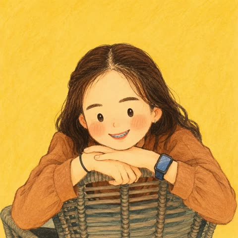
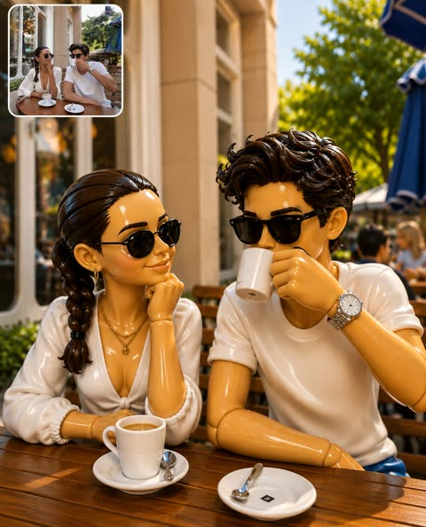
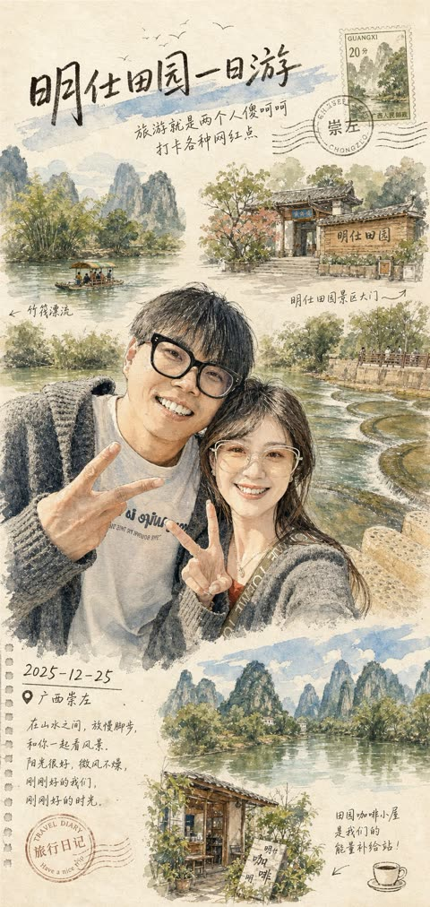
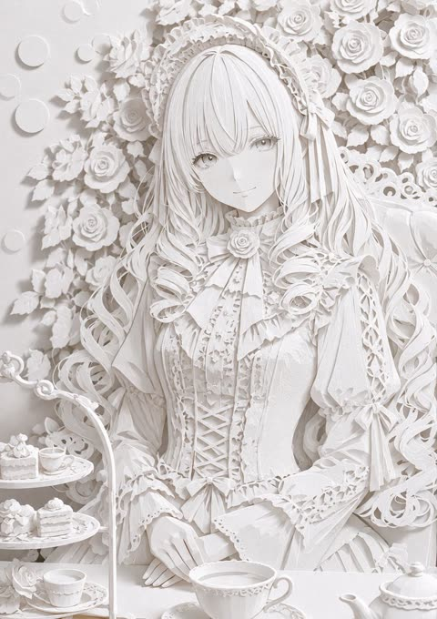

# 照片转艺术风格

[返回目录](../../README_zh.md) · 全部 123 条 · [1](image-photo-to-art.md) · **2**

<a id="gpt-image-storybook-photo-to-handdrawn-portrait"></a>
### 照片转手绘儿童绘本头像

<a href="https://x.com/Sairah_0/status/2090321208441262454"></a>

先列出必须保留的面部、发型、服装和配饰，再列出禁止照搬的内容，让身份特征保留而画风被重塑。指定水粉、蜡笔、粉彩等媒介和不规则棕色线条，并固定暖色背景，绘本质感更稳定。

GPT Image 2 · 上传图改图 · 出处: [@Sairah_0 on X](https://x.com/Sairah_0/status/2090321208441262454) · 发现于 [freestylefly/awesome-gpt-image-2](https://github.com/freestylefly/awesome-gpt-image-2)

[`storybook`](tags.md#tag-storybook) [`hand-drawn`](tags.md#tag-hand-drawn) [`avatar`](tags.md#tag-avatar) [`gouache`](tags.md#tag-gouache) [`photo-to-illustration`](tags.md#tag-photo-to-illustration)

<details><summary><b>提示词</b></summary>

```text
Use the single uploaded photo as the only visual reference. Transform the person into an adorable hand-drawn 2D children’s storybook character, while keeping their identity immediately recognizable.

Preserve exactly from the photo:
- Facial features and skin tone
- Real hairstyle, length, texture, and color
- Exact clothing, colors, patterns, and layering
- Glasses, jewelry, headwear, bags, and all visible accessories

Do not invent or copy hairstyles, outfits, accessories, braids, pigtails, bows, bonnets, or headscarves from any reference artwork.

### Character
Use an oversized rounded head, tiny compact body, short arms, narrow shoulders, soft rounded silhouette, and cute childlike proportions. Keep the head visually dominant. Avoid realistic anatomy.

### Face
Simplify into tiny dot/oval eyes, minimal nose, tiny smiling mouth, rounded cheeks, and soft peach/pink blush. Keep recognizable facial characteristics. No realistic eyes, detailed lips, anime features, glossy 3D rendering, or heavy shading.

### Hair & Clothing
Recreate the exact hairstyle and outfit from the uploaded photo, simplified into chunky hand-drawn shapes. Preserve important colors, patterns, jewelry, glasses, and other recognizable details.

### Style
Handmade 2D picture-book aesthetic using soft gouache, wax crayon, colored pencil, and dry pastel. Use slightly irregular dark-brown linework, subtle paper grain, uneven pigment, soft brush marks, and imperfect painted edges. Avoid clean vector art, CGI, anime, or photorealism.

### Composition
Square 1:1 portrait, chest/waist-up, centered and facing mostly forward, with balanced negative space. Use a relaxed, charming pose.

### Background
Simple warm mustard, butter yellow, ochre, or cream background with subtle paper texture. No scenery, objects, text, borders, or distractions.

Final feeling: the same person lovingly redrawn as an extremely cute, warm, wholesome, nostalgic, handcrafted children’s-book character—same identity, same hair, same clothes, same accessories, completely simplified and adorable.
```

</details>

<a id="gpt-image-vinyl-toy-couple-cafe-diorama"></a>
### 户外咖啡馆桌边的乙烯基玩具情侣

<a href="https://x.com/AIwithkhan/status/2066858886511161451"></a>

以参考照片为基础，分别描述两个人物的发型、配饰、服装和姿势，让形象在玩具化后依然保留。再用材质词（亮面乙烯基、玩具关节）、场景说明、构图指令和渲染关键词（Octane、Unreal Engine）统一整体效果。

GPT Image 2 · 上传图改图 · 出处: [@AIwithkhan on X](https://x.com/AIwithkhan/status/2066858886511161451) · 发现于 [YouMind-OpenLab/awesome-gpt-image-2](https://github.com/YouMind-OpenLab/awesome-gpt-image-2)

[`3d-toy`](tags.md#tag-3d-toy) [`vinyl-figure`](tags.md#tag-vinyl-figure) [`diorama`](tags.md#tag-diorama) [`cafe`](tags.md#tag-cafe) [`reference-photo`](tags.md#tag-reference-photo)

<details><summary><b>提示词</b></summary>

```text
Create a highly detailed 3D collectible toy diorama of a stylish young couple sitting at an outdoor café table, inspired by a real-life reference photo. Transform both people into premium designer vinyl figures with smooth glossy plastic surfaces, articulated toy-joint details, oversized expressive eyes, realistic facial features, and fashionable outfits.

The female figure has dark braided hair, black sunglasses, gold earrings, layered gold necklaces, and a white V-neck blouse. She rests her chin on her hand while smiling at her companion. The male figure has thick wavy dark hair, black sunglasses, a white t-shirt, and a silver wristwatch while drinking coffee from a white ceramic cup.

Both figures sit at a wooden café table with coffee cups, saucers, and spoons. The setting is an elegant European-style outdoor café with warm beige architecture, large windows, blue umbrellas, lush green trees, and softly blurred background guests.

Style: Pixar-inspired collectible toy, premium vinyl figure, designer toy aesthetic, ultra-realistic 3D render, glossy plastic texture, toy photography, shallow depth of field, cinematic lighting, warm golden-hour sunlight, photorealistic materials, high-end commercial product photography, sharp focus, ultra detailed, 8K resolution.

Composition: Front-facing medium shot, both characters centered, natural poses, café ambiance, depth and realism, professional advertisement quality.

Render Quality: Octane Render, Unreal Engine 5, ray tracing, global illumination, realistic reflections, HDR lighting, highly detailed textures, collectible figurine showcase.
```

</details>

<a id="gpt-image-watercolor-travel-journal-postcard"></a>
### 旅行照片转水彩手账明信片

<a href="https://x.com/zhgqthomas/status/2056633723366568387"></a>

叠加钢笔线稿、水彩晕染和米色纸张质感等手账要素，再用可替换的标题、文案、日期和地点邮戳槽位固定明信片版式，并用克制的大地色调统一画面。

GPT Image 2 · 上传图改图 · 出处: [@zhgqthomas on X](https://x.com/zhgqthomas/status/2056633723366568387) · 发现于 [freestylefly/awesome-gpt-image-2](https://github.com/freestylefly/awesome-gpt-image-2)

[`watercolor`](tags.md#tag-watercolor) [`travel-journal`](tags.md#tag-travel-journal) [`postcard`](tags.md#tag-postcard) [`sketchbook`](tags.md#tag-sketchbook) [`photo-to-art`](tags.md#tag-photo-to-art)

<details><summary><b>提示词</b></summary>

```text
Create a dreamy watercolor travel illustration style from the attached photo. Use hand-painted urban sketchbook aesthetic, delicate ink linework mixed with soft watercolor washes, highly detailed pen-and-ink drawing, loose expressive brush strokes, watercolor bleeding edges, ultra detailed watercolor texture, soft beige paper texture background, architectural sketch style, vintage travel diary and sketchbook traveler aesthetic, travel journal composition, editorial postcard layout, handwritten medium title:[自定义标题]  at top, handwritten notes:[自定义文案] , date: [自定义日期] and location: [自定义地点]  stamps, natural perspective, atmospheric depth, minimalist negative space, muted earthy palette (warm browns, faded greens, cream whites, soft blue accents), quiet, calm, soft, cozy, nostalgic vibes, cinematic slice-of-life mood, poetic composition, mixed urban sketching with Ghibli-inspired realism, vertical poster design, premium art print quality.
```

</details>

<a id="gpt-image-white-paper-craft-style-conversion"></a>
### 插画转写实白色纸艺风格

<a href="https://x.com/notoro_ai/status/2052018043883319536"></a>

先点明实体材质（激光切割厚纸），再补充具体细节：锐利切口、细密折痕、多层景深、纸纤维与自然投影。结尾要求保留原构图和角色，因此只改变媒介。

GPT Image 2 · 上传图改图 · 出处: [@notoro_ai on X](https://x.com/notoro_ai/status/2052018043883319536) · 发现于 [YouMind-OpenLab/awesome-gpt-image-2](https://github.com/YouMind-OpenLab/awesome-gpt-image-2)

[`paper-craft`](tags.md#tag-paper-craft) [`style-conversion`](tags.md#tag-style-conversion) [`white-paper`](tags.md#tag-white-paper) [`layered-depth`](tags.md#tag-layered-depth) [`laser-cut`](tags.md#tag-laser-cut)

<details><summary><b>提示词</b></summary>

```text
このイラストを非常に精密でリアルな白い紙のペーパークラフト風に変換してください。厚紙をレーザーカットしたようなシャープで正確な切り口、細かい折り目、複数のレイヤーによる豊かな立体感、紙の繊維感と自然な影を高ディテールで表現してください。光の当たり方による紙の白さと微妙なグラデーションを活かし、本物のような立体的なペーパーアート作品のようなリアリティを出して。全体を洗練されていて芸術的な雰囲気に。元のイラストの構図・キャラクターを忠実に維持。
```

</details>

[1](image-photo-to-art.md) · **2**
