# 照片转艺术风格

[返回目录](../../README_zh.md) · 全部 38 条

<a id="gpt-image-photo-to-watercolor-travel"></a>
### 上半照片，下半水彩旅行速写

<a href="https://x.com/MahnoorAi12/status/2102724961408626735"></a>

上下分割，照片渐变成水彩。作者说 Gemini、Grok、ChatGPT 都能用。

GPT Image 2.5 · 上传图改图 · 出处: [@MahnoorAi12 on X](https://x.com/MahnoorAi12/status/2102724961408626735) · 2,264 赞，统计于 2026-10-27

[`watercolor`](tags.md#tag-watercolor) [`travel`](tags.md#tag-travel) [`split-composition`](tags.md#tag-split-composition)

<details><summary><b>提示词</b></summary>

```text
Create a refined editorial travel-art composition based on a reference photograph. The image is divided vertically into two parts: the upper section is a realistic cinematic travel photograph, while the lower section transforms the exact same scene into a delicate hand-painted watercolor illustration.
Upper section: authentic candid travel photography, natural daylight, soft shadows, subtle film grain, realistic textures, sophisticated European atmosphere, documentary-style composition, people naturally walking through the scene, beautiful architectural details, slightly muted elegant colors, high-end travel magazine photography.
Lower section: a minimalist handmade watercolor painting of the exact same scene, preserving the recognizable composition, architecture, people, poses, perspective and major visual elements from the photograph. Loose translucent watercolor washes, delicate ink details, visible paper texture, soft edges, imperfect brushwork, subtle pigment bleeding, airy negative space, understated pastel tones, artistic but realistic.
Leave generous warm ivory/off-white textured paper space surrounding the watercolor illustration. Add a small elegant handwritten caption near the bottom, such as “summer days” or “a quiet afternoon”, with a thin minimalist horizontal line underneath.
Overall aesthetic: luxury travel journal, fine-art watercolor postcard, contemporary editorial design, nostalgic European summer, understated elegance, tactile handmade paper, sophisticated and serene.
Portrait orientation, clean composition, premium art direction, no clutter, no borders, natural proportions, highly detailed photograph transitioning into an airy watercolor illustration.
```

</details>

<a id="gpt-image-minimal-lifestyle-poster"></a>
### 真实照片变极简生活方式海报

<a href="https://x.com/Naiknelofar788/status/2101161664892829838"></a>

填空模板，替换 `[PERSON / SUBJECT / MOMENT]` 即可。主体保持可辨认，背景去掉照片感。

GPT Image 2.5 · 上传图改图 · 出处: [@Naiknelofar788 on X](https://x.com/Naiknelofar788/status/2101161664892829838) · 1,698 赞，统计于 2026-10-27

[`editorial`](tags.md#tag-editorial) [`illustration`](tags.md#tag-illustration) [`template`](tags.md#tag-template) [`photo-to-art`](tags.md#tag-photo-to-art)

<details><summary><b>提示词</b></summary>

```text
A sophisticated minimalist lifestyle art poster featuring [PERSON / SUBJECT / MOMENT] as the central focus, transformed from a real-life photograph into a refined hand-drawn editorial illustration. Preserve the subject’s recognizable pose, silhouette, clothing, hairstyle, and key visual details while simplifying the scene into an elegant artistic composition.

Use a limited vintage color palette inspired by the original environment, with warm muted tones printed on an ivory/off-white paper background. Combine delicate ink outlines, loose sketchwork, fine hatching, subtle halftone texture, faded print imperfections, and soft watercolor-like washes.

Reduce the surrounding environment into a few recognizable contextual elements—[CAFÉ / BAR / STREET / LANDMARK / OBJECTS]—using simplified linework and layered shapes rather than detailed realism. Add subtle abstract circles, geometric forms, atmospheric marks, tiny decorative elements, or silhouettes to create visual depth.

Include small minimalist typography on one side: [CITY / LOCATION], [SUBJECT / MOMENT], and optional coordinates, date, or short descriptor, designed like a premium collectible travel/lifestyle print.

Generous negative space, elegant editorial composition, vintage screen-print aesthetic, hand-crafted illustration, sophisticated travel-magazine design, muted heritage colors, subtle paper grain, artistic but recognizable, no photorealistic background, no excessive details, 4:5 vertical composition.
```

</details>

<a id="gpt-image-editorial-illustration-poster"></a>
### 每张照片变成一张安静的编辑插画海报

<a href="https://x.com/icreatelife/status/2099343607492702258"></a>

开头先禁止拼贴，一张照片一张海报；结尾一排情绪词定下成品气质。

GPT Image 2.5 · 上传图改图 · 出处: [@icreatelife on X](https://x.com/icreatelife/status/2099343607492702258) · 1,165 赞，统计于 2026-10-27

[`editorial`](tags.md#tag-editorial) [`illustration`](tags.md#tag-illustration) [`photo-to-art`](tags.md#tag-photo-to-art)

<details><summary><b>提示词</b></summary>

```text
Create one independent high-end editorial poster for each uploaded photo. Do not combine multiple photos into a collage. Each photo must be processed and output as a separate poster.

OVERALL FORMAT

Strict 3:4 vertical composition.

Divide the canvas horizontally into two exactly equal sections, with a precise 1:1 height ratio.

The top half occupies exactly 50% of the canvas.

The bottom half occupies exactly 50% of the canvas.

The two sections should feel visually connected as one refined art publication cover.

TOP HALF — ORIGINAL PHOTOGRAPH

Preserve the original photograph as faithfully as possible.

Keep the main composition, subjects, identity, facial features, body proportions, poses, expressions, clothing, objects, and spatial relationships unchanged.

Preserve the realistic photographic texture, natural lighting, shadows, atmosphere, and original color mood.

Apply only subtle, sophisticated editorial color grading, creating the feeling of a premium magazine photograph, contemporary art book, or high-end independent publication.

The image should remain photorealistic and authentic, never overly retouched or artificially stylized.

If necessary to fit the 3:4 composition naturally, extend the sky, ground, walls, or surrounding environmental background.

Background extension must feel seamless and photographic.

Never stretch, distort, reshape, replace, or alter the main subject.

BOTTOM HALF — MINIMAL HAND-DRAWN PAPER ILLUSTRATION

Extract the most recognizable visual elements from the original photograph and reinterpret them as a minimalist hand-drawn paper-cover illustration.

Preserve:

The most recognizable subject

Essential silhouette and proportions

Key pose or gesture

Important objects

The core narrative relationship between people and objects

Highly simplify the image. Remove unnecessary details and retain only the visual information needed for immediate recognition.

Use:

Delicate, slightly imperfect hand-drawn lines

A small number of bold, clearly defined acrylic-style flat color shapes

Rough paper texture

Visible handmade brush marks

Slightly irregular, organic edges

Subtle imperfections that make it feel genuinely handmade

The main illustrated subject should be small, centered, and carefully composed, occupying approximately 10–20% of the bottom half.

Leave a large amount of negative space around the illustration.

The background should primarily resemble:

Rough white paper

Warm off-white paper

Pale natural paper

Minimal editorial book-cover stock

Use only a few lines or small color shapes to suggest the surrounding environment.

COLOR PALETTE

Extract the dominant colors directly from the original photograph.

Compress the palette into no more than 4 main colors.

Keep the colors restrained, sophisticated, and harmonious.

Use bold but controlled flat color blocks.

Avoid excessive color variation.

Preserve subtle paper grain and handmade brush texture.

The illustration should visually feel like a simplified color interpretation of the photograph.

TYPOGRAPHY

A small amount of simple typography may be included when appropriate.

Possible elements:

A short title

Keyword

Object name

Location

Year

Number

Short phrase

Text should be minimal, understated, and editorial.

Typography should naturally interact with the large areas of negative space and the small illustration, evoking:

Art book covers

Independent publishing

Contemporary editorial design

Thoughtful children's picture books

Do not force text into the composition if it does not naturally fit the photograph.

VISUAL LANGUAGE

The final poster should feel:

Quiet · Poetic · Refined · Minimal · Innocent · Relaxed · Artistic · Thoughtful · High-recognition · Premium
```

</details>

<a id="gpt-image-pastel-storybook-photo-to-illustration-girl-bubble-tea"></a>
### 喝珍珠奶茶女孩的绘本粉彩插画

<a href="https://x.com/Emmma___0/status/2056369924399124937"></a>

把照片转成插画，用一串风格词叠加：拉长的形体、纤细不规则线条、平涂粉彩、纸张纹理和水彩柔感。结尾列出要避免的内容，如写实、3D和光泽表面，让画面保持扁平稚拙。

GPT Image 2 · 上传图改图 · 出处: [@Emmma___0 on X](https://x.com/Emmma___0/status/2056369924399124937) · 818 赞，统计于 2026-10-28

[`photo-to-illustration`](tags.md#tag-photo-to-illustration) [`storybook`](tags.md#tag-storybook) [`pastel`](tags.md#tag-pastel) [`watercolor`](tags.md#tag-watercolor) [`children-illustration`](tags.md#tag-children-illustration)

<details><summary><b>提示词</b></summary>

```text
Transform the photo into a delicate minimalist hand-drawn children’s illustration with a soft whimsical fairy-tale aesthetic. Use simple elongated shapes, thin imperfect hand-drawn lines, flat pastel colors, minimal details, and a cute doll-like character style with rosy cheeks, tiny facial features, and simplified anatomy. Add subtle paper texture, soft pencil and pastel shading, watercolor softness, and a clean white background with small stars or sparkles.Stylize the clothing in a playful storybook way with simplified shapes and gentle decorative details. The overall mood should feel airy, cozy, naive, and charming, like a modern Scandinavian nursery postcard or children’s book illustration. Avoid photorealism, 3D, cinematic lighting, glossy surfaces, complex shadows, realistic anatomy, and hyper-detail.
```

</details>

<a id="gpt-image-paper-texture-cover"></a>
### 照片变纸张质感极简封面

<a href="https://x.com/Ciri_ai/status/2113501433471656120"></a>

按小标题组织（构图、配色、质感），最后点明参照物：独立艺术书封面。

GPT Image 2.5 · 上传图改图 · 出处: [@Ciri_ai on X](https://x.com/Ciri_ai/status/2113501433471656120) · 561 赞，统计于 2026-10-27

[`paper-texture`](tags.md#tag-paper-texture) [`minimal`](tags.md#tag-minimal) [`cover`](tags.md#tag-cover)

<details><summary><b>提示词</b></summary>

```text
MINIMAL HAND-DRAWN PAPER ILLUSTRATION

Transform the uploaded photo into a minimalist, hand-drawn, paper-textured artistic cover.

Composition

- The main subject should occupy only 10–20% of the frame.
- Position the subject near the bottom center of the composition.
- Leave generous negative space throughout the image.
- Suggest the environment using only a few lines or small blocks of color.

Preserve

- The most recognizable features of the original subject.
- The essential silhouette and proportions.
- The original pose or primary action.
- Important objects and defining details.
- The core story, relationships, and emotional atmosphere.

Color Palette

- Extract the dominant colors from the original photograph.
- Limit the palette to no more than four main colors.
- Use bold yet restrained, flat color blocks.
- Maintain a harmonious, muted color combination.
- Add subtle paper grain and handmade brush textures.

Simplification
Remove unnecessary details and visual clutter. Retain only the essential visual information needed to make the subject instantly recognizable.

Typography

- Optionally incorporate a small amount of simple text.
- Keep typography short, subtle, and aesthetically refined.
- Integrate the text naturally into the composition.
- Aim for the visual language of an art-book cover, independent publishing, modern editorial design, or a contemplative picture book.
- Do not force typography into the image if it doesn't improve the composition.

Style and Materials

- Delicate, slightly imperfect hand-drawn lines.
- A few clearly defined acrylic-like flat color blocks.
- Rough, tactile paper texture.
- Visible handmade brushstrokes.
- Organic, irregular, natural contours.
- Subtle imperfections that make the artwork feel genuinely handmade.

Overall Mood
Quiet, poetic, sophisticated, minimalist, innocent, relaxed, artistic, thoughtful, distinctive, and premium.

Avoid

- Colored-pencil rendering.
- Dry-brush effects.
- Watercolor washes or bleeding.
- Pure line-art illustration.
- Overly detailed or realistic illustrations.
- Heavy impasto or thick oil-paint textures.
- Smooth, polished digital illustration.
- 3D rendering, glossy surfaces, or artificial lighting effects.
- Generic commercial cartoon styles.
- E-commerce advertising aesthetics.
- Generic poster templates.
- Excessive decorative elements.
- Overly complex compositions.
- Too much text.

Final Result: A refined, minimalist, hand-crafted paper illustration with generous negative space, restrained colors, subtle tactile textures, and the sophistication of an independent art-book cover.
```

</details>

<a id="gpt-image-blue-doodle-couple-photo"></a>
### 照片变成蓝色涂鸦情侣插画

<a href="https://x.com/Ciri_ai/status/2114588014034948562"></a>

提示词先说明要保留的内容（人物、姿势、构图），再用钴蓝线条、桃色腮红和金色爱心配奶油色纸面的有限配色来简化风格。再用不要渐变、不要阴影、不要纹理这类排除条件，保持画面扁平、有手绘感。

GPT Image 2.5 · 上传图改图 · 出处: [@Ciri_ai on X](https://x.com/Ciri_ai/status/2114588014034948562) · 280 赞，统计于 2026-10-28

[`doodle`](tags.md#tag-doodle) [`minimalist`](tags.md#tag-minimalist) [`couple`](tags.md#tag-couple) [`blue-ink`](tags.md#tag-blue-ink) [`photo-to-illustration`](tags.md#tag-photo-to-illustration)

<details><summary><b>提示词</b></summary>

```text
Transform your photo into a minimalist doodle illustration using GPT Image 2.5.

Prompt: Transform the uploaded photo into a cute minimalist hand-drawn doodle illustration. Preserve the original people, pose, composition, and recognizable facial characteristics, but simplify them into charming cartoon forms.

Use a naive handmade sketchbook aesthetic with bold, slightly wobbly cobalt-blue brush-pen outlines, simple rounded shapes, minimal details, and imperfect hand-drawn strokes. Add subtle warm peach/pink blush on the cheeks and small golden-yellow heart accents around the characters.

Keep the illustration clean and airy with a warm cream/off-white paper background. Use flat, very limited colors, no realistic shading, no gradients, and no complex textures. The overall feeling should be sweet, wholesome, playful, cozy, and romantic, like a handmade children's doodle or personal notebook drawing.

Style keywords: minimalist doodle, folk-inspired hand drawing, blue ink illustration, cute couple illustration, naive art, imperfect brush strokes, simple cartoon, handmade sketchbook aesthetic, warm cream paper, subtle blush, tiny heart doodles, charming imperfections, clean composition.
```

</details>

<a id="gpt-image-papercraft-diorama-family-landmark-photo"></a>
### 地标牌坊前的纸艺立体全家福

<a href="https://x.com/Emmma___0/status/2058383856055595158">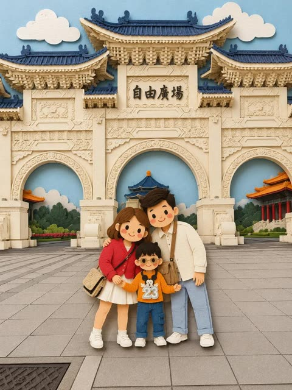</a>

先点明纸艺立体模型这一参考风格，再分别限定形状、角色比例、极简五官（圆点眼和腮红）以及带阴影的层叠纵深。激光切割卡纸的比喻锁定了边缘质感和材质。

GPT Image 2 · 上传图改图 · 出处: [@Emmma___0 on X](https://x.com/Emmma___0/status/2058383856055595158) · 272 赞，统计于 2026-10-28

[`papercraft`](tags.md#tag-papercraft) [`diorama`](tags.md#tag-diorama) [`style-transfer`](tags.md#tag-style-transfer) [`family-photo`](tags.md#tag-family-photo) [`layered-paper`](tags.md#tag-layered-paper)

<details><summary><b>提示词</b></summary>

```text
Convert this images into a soft, handcrafted paper-cut layered illustration style, inspired by papercraft diorama aesthetics. Use smooth rounded shapes, simplified cute character proportions, and minimal facial details (dot eyes, blush cheeks) to create a warm, charming look. Apply stacked paper layers with visible depth, subtle shadows between layers, and clean cut edges that resemble laser-cut cardstock.
```

</details>

<a id="nano-banana-second-world"></a>
### 第二世界：把你的照片重建成另一个世界

<a href="https://x.com/Just_sharon7/status/2107741881329205516"></a>

带版本号（v1.2）的 JSON 提示词，作者 @hx831126，由 @Just_sharon7 转发。自带接缝和文字的自检步骤。

Nano Banana 2.1 · 上传图改图 · 出处: [@Just_sharon7 on X](https://x.com/Just_sharon7/status/2107741881329205516) · 263 赞，统计于 2026-10-27

[`json`](tags.md#tag-json) [`world-building`](tags.md#tag-world-building) [`photo-to-art`](tags.md#tag-photo-to-art)

<details><summary><b>提示词</b></summary>

```text
{   "name": "Second World",   "version": "1.2",   "task": "Using each uploaded photo as an independent source, generate one complete poster per photo. Do not merge multiple photos onto the same canvas.",   "output": {     "aspect_ratio": "3:4",     "orientation": "vertical",     "one_poster_per_photo": true,     "layout": "Canvas horizontally divided at exactly 50% height, with upper and lower sections each occupying 50%, same width",     "no_mockup": true   },   "core_principle": "The Second World is already hidden in the photo. Let the same scene pass through the midline and continue downward, changing only the physical rules in the lower half. Continuity of the cross-boundary structure is the highest visual priority.",   "upper_half": {     "source": "The current uploaded photo",     "preserve": [       "Subject identity and appearance",       "Character poses, expressions, and actions",       "Spatial relationships, proportions, and perspective",       "Original color atmosphere",       "Natural lighting and shadows",       "Environment and important details"     ],     "allowed_change": "Only necessary proportional cropping to fit the upper half, avoiding cutting off key subjects or connection structures",     "forbidden": [       "Redesigning the photo",       "Redrawing or replacing the subject",       "Rearranging characters and objects",       "Changing the photo's colors",       "Fictional lighting or background"     ],     "fidelity_rule": "Prioritize directly reusing the original photo; do not claim generative redrawing as lossless preservation of the original. If the tool cannot meet original preservation and precise layout, state the limitations—do not lower requirements and claim full compliance."   },   "continuity": {     "choose_one_source_structure": "Identify a structure from the original photo that can naturally extend to the midline, such as a road, shoreline, water surface, reflection, tree branch, light beam, architectural line, clothing flow, or body movement",     "requirements": [       "The structure must continue into the lower half at the exact midline meeting point",       "Maintain believable continuity in direction, position, scale, and occlusion relationships",       "Establish a visible connection first, then develop the lower half's imagination",       "Both halves must read as the same scene, not like two independent images stacked vertically"     ],     "transition_edge": {       "optional": "Allow irregular torn paper edges",       "rule": "Tearing must follow the original image's structure, not just as decoration, and avoid using the same tearing shape for every image",       "interaction": "Source elements can touch, cling to, pass through, or cross over the torn edge"     }   },   "lower_half": {     "background": "Warm ivory paper texture, with subtle visible fibers, rich negative space",     "media": [       "Restrained photo fragments",       "Simple cut-paper shapes",       "Minimal black hand-drawn lines"     ],     "construction": "Extend downward from where the upper half's source structure meets the midline, then gradually reinterpret it as the Second World",     "prohibited": "Do not turn it into an isolated entrance, window, stage, platform, or floating vignette, unless the form clearly grows continuously from the original photo",     "density": "Bright, airy, restrained—avoid dense drawing or collage buildup"   },   "second_world_logic": {     "question": "If the structure in the photo could be touched, used, entered, folded, stretched, or changed, what would it naturally become?",     "interaction_count": 1,     "instruction": "Establish only one specific, clear, and interesting interaction per image, prioritizing possibilities discovered from the original image's shapes and actions, not reverse-engineering from fixed props or templates.",     "examples_for_logic_only": [       "Water surface remains connected to the lake while being rolled up or stretched",       "Road extends onto the paper, becoming a path that can be continued by drawing",       "An existing light beam extends downward, becoming something gently graspable"     ],     "variation": "Judge each work individually—do not mechanically repeat actions, connection structures, compositions, or jokes. Examples are not required content."   },   "tiny_figures": {     "count": "0–3",     "appearance": "Minimalist, tiny black line figures",     "add_only_if": "Figures can engage in necessary and explicit physical interaction with the extending structure",     "omit_if": "Source photo already contains strong human actions",     "forbidden": "Using little figures as irrelevant decorations or adding crowds just for liveliness"   },   "copy": {     "language": "Primarily Chinese, paired with a short English accent",     "main_text": "A short, witty, cute, humorous Chinese marginal note, or one with a slight surprising insight",     "english": "Shorter, lighter English supplement; can complement the Chinese without word-for-word translation",     "intent": "Make viewers smile knowingly after seeing the image and then the small text, or suddenly understand one more layer",     "requirements": [       "Recreate based on this photo's specific interaction with the Second World",       "Don't just name the action or mechanically describe the image",       "Can include anthropomorphism, slight contrasts, deadpan little jokes, or gentle self-deprecation",       "Can have a wake-up-call vibe, but no grand life lessons",       "Don't force self-love, motivational, or emotional comfort templates",       "Humor targets the situation, without belittling characters' appearance, identity, or circumstances"     ],     "avoid": [       "Vague inspirational fluff",       "Grand maxims",       "Preachiness",       "Ad slogans",       "Irrelevant internet memes",       "Fixed 'same..., different...' sentence structures",       "Reusing the same copy for every image"     ],     "examples_for_tone_only": [       {         "context": "Taking away the sunset",         "chinese": "这个不算超重吧",         "english": "just a little sunset"       },       {         "context": "Rolling the lake surface into a paper ribbon",         "chinese": "不用袋子，我卷着走",         "english": "no bag, thanks"       },       {         "context": "Shadow rolled into a bed corner",         "chinese": "影子先躺了，我再走会儿",         "english": "five more minutes"       }     ],     "example_rule": "Borrow only the humor mechanism—do not fix example sentences into new works."   },   "handwriting": {     "scale": "Small marginal notes, English even smaller—no huge titles stealing the scene",     "placement": "In natural white space, not obscuring subjects, cross-boundary connection points, or key interactions",     "chinese": "Truly natural, slightly messy handwriting, not neat computer-generated script",     "english": "Similarly like casually scribbled, relaxed and irregular",     "details": [       "Slight variations in character size",       "Baseline with minor undulations",       "Tilt angles not perfectly consistent",       "Natural variations in spacing",       "Strokes with pressure and pauses",       "Minimal overlapping or incomplete ink traces"     ],     "corrections": {       "allowed": true,       "frequency": "Occasional only—not required for every image",       "method": "Can gently strike through a mistaken or revised word, adding the correct version nearby or above",       "limit": "Usually at most 1–2 instances—don't turn the whole page into a repeatedly scribbled draft",       "legibility": "Final meaning must be clear—no simulating handwriting with gibberish or meaningless errors"     }   },   "overall_style": {     "mood": [       "Indie magazine vibe",       "Bright and airy",       "Warm paper texture",       "Restrained",       "Lightly humorous",       "Subtle handmade traces"     ],     "hierarchy": [       "Original photo and cross-boundary structure",       "Clear interaction in the lower half",       "Small bilingual handwritten marginal notes"     ],     "finish": "Like gently unveiling a hidden world in the photo, not pasting an extra illustration below it"   },   "negative_prompt": [     "Detached lower-half illustrations",     "Broken cross-boundary continuity",     "Generic torn-paper templates",     "Isolated entrances or windows",     "Irrelevant vignettes",     "Dense illustrations",     "Random decorations",     "Decorative crowds",     "Altering original photo colors",     "Redesigning the upper photo",     "Glossy 3D",     "Scrapbook clutter",     "Huge titles",     "Neat printed-style handwriting",     "Nonsensical text",     "Motivational fluff",     "Watermarks",     "Logos",     "UI elements",     "Merging multiple photos",     "Grid layouts"   ],   "final_check": [     "Does each original image correspond to one independent 3:4 poster?",     "Do upper and lower sections strictly each occupy 50%?",     "Is the upper half's original photo faithfully preserved, with only necessary cropping?",     "Is there one authentic source structure accurately continuing at the midline?",     "Does the lower half belong to the same scene as the original image, not an isolated illustration?",     "Is there only one clear, natural, and non-repetitive templated interaction?",     "Is the Chinese interesting and lingering, not just a simple action label or preachiness?",     "Are the Chinese and English in small, natural, messy, and readable handwriting?",     "Is sufficient negative space preserved?"   ] }  Note: The above are target requirements; generated results still need checking for original image preservation, seams, and text—do not treat generative redrawing as lossless original preservation.
```

</details>

<a id="gpt-image-oil-painted-european-cafe-woman-coral-blouse"></a>
### 欧洲咖啡馆里的油画风女子

<a href="https://x.com/hey_am_cherry/status/2106245541508382774"></a>

用结构化 JSON 把人物、服装、构图、背景、配色、质感和光线拆成独立字段，每个要素都便于单独调整。指定四色色板和厚重笔触来稳住油画质感，负面提示词则避免照搬参考图的姿势并排除写实风格。

GPT Image 2.5 · 上传图改图 · 出处: [@hey_am_cherry on X](https://x.com/hey_am_cherry/status/2106245541508382774) · 197 赞，统计于 2026-10-28

[`oil-painting`](tags.md#tag-oil-painting) [`cafe`](tags.md#tag-cafe) [`json-prompt`](tags.md#tag-json-prompt) [`mid-century`](tags.md#tag-mid-century) [`variation`](tags.md#tag-variation)

<details><summary><b>提示词</b></summary>

```text
"aspect_ratio": "9:16",
    "style": "vintage European café oil painting, expressive brushwork, mid-century editorial artwork",

    "subject": {
      "character": "stylish young European woman with shoulder-length wavy auburn hair",
      "expression": "calm, confident, slightly playful gaze toward the viewer",
      "pose": "seated sideways at a small café table, one arm resting on the chair back while the other lightly holds a coffee cup",
      "details": "subtle makeup, berry-red lipstick, small gold earrings"
    },

    "outfit": {
      "top": "deep coral-red short-sleeve blouse with a relaxed neckline",
      "style": "chic 1960s-inspired European fashion"
    },

    "composition": {
      "framing": "medium-wide portrait",
      "camera_angle": "slightly elevated three-quarter angle",
      "subject_position": "slightly left of center",
      "foreground": "round café table with coffee, small glass and scattered objects"
    },

    "background": {
      "setting": "charming old European café interior",
      "design": "large abstract geometric wall shapes mixed with subtle architectural details",
      "colors": ["teal", "coral", "cream", "burnt orange"]
    },

    "props": [
      "ceramic espresso cup",
      "small glass bottle",
      "vintage café chair",
      "folded napkin"
    ],

    "color_palette": "teal, coral red, cream, burnt orange and warm brown",

    "texture": "thick imperfect oil brushstrokes, visible canvas grain, slightly weathered painted surface",

    "lighting": "warm afternoon window light with soft natural shadows",

    "mood": "stylish, relaxed, nostalgic European café atmosphere",

    "negative_prompt": "exact recreation of reference, same pose, same character, same outfit, same composition, photorealistic, 3D render, CGI, text, logo, watermark"
  }
}
```

</details>

<a id="gpt-image-watercolor-ink-over-shoulder-portrait"></a>
### 回眸水彩墨线肖像

<a href="https://x.com/Kubra_286/status/2100063240105435328"></a>

分块锁定姿势、画风以及左暖右冷的色彩分区，在保留人物面部特征的同时让水彩效果可控。湿画法晕染、飞溅、垂直流淌和冷压纸纹理等具体描述造就了墨线与水彩混合的质感。

GPT Image 2.5 · 上传图改图 · 出处: [@Kubra_286 on X](https://x.com/Kubra_286/status/2100063240105435328) · 187 赞，统计于 2026-10-28

[`watercolor`](tags.md#tag-watercolor) [`ink`](tags.md#tag-ink) [`portrait`](tags.md#tag-portrait) [`selfie`](tags.md#tag-selfie) [`splatter`](tags.md#tag-splatter)

<details><summary><b>提示词</b></summary>

```text
Use the uploaded image ONLY for face and identity reference. Do not change facial structure, proportions, or realism.

Create a high-detail mixed-media watercolor portrait of a woman with POSE STRICTLY LOCKED:
Three-quarter view from back
Upper body slightly turned away from camera
Head turned back over shoulder toward viewer
Direct eye contact
Frame includes head, neck, and partial shoulder
Composition tightly cropped (portrait focus)

Expression (IMPORTANT):
Calm yet emotionally intense, soft but piercing gaze, slightly parted lips, natural subtle tension in face — no exaggerated emotion.

Rendering Style (LOCKED)
Watercolor + ink hybrid illustration
Soft fluid washes + sharp ink linework
Fine dark lines defining eyes, nose, lips, jawline
No painterly blur, no oil painting effect

Color & Lighting (STRUCTURED)
Strong split color contrast:
Left side → warm (yellow, orange, magenta)
Right side → cool (blue, cyan, violet)
Abstract light from upper-left (represented as color bursts, not realistic light)
Skin tones blend naturally with watercolor pigments (not flat coloring)

Watercolor Behavior (VERY IMPORTANT)
Wet-on-wet blending on face and skin
Visible paint splashes around subject
Controlled splatter and ink drops
Subtle vertical drips (especially lower area)
Organic color blooms and pigment edges
Colors slightly bleed beyond edges (natural watercolor feel)

Hair (MATCH STYLE)
Loose tied or messy bun
Wispy strands around face
Hair absorbs surrounding colors (blue, purple, warm highlights)
Slight motion feel, not static

Background
Clean white base
Dynamic watercolor splashes behind subject (not random — composition-aware)
No clutter, no objects

Texture
Visible cold-press watercolor paper grain
Slight rough pigment edges
Natural watercolor imperfections preserved

Style: expressive watercolor + ink illustration

Mood: artistic, soulful, emotionally engaging

Aspect ratio: 4:5
```

</details>

<a id="nano-banana-artbook-spread"></a>
### 照片做成怀旧杂志画册跨页

<a href="https://x.com/Just_sharon7/status/2107574724041769179"></a>

保留原照片的人物，再加一份素描呼应，排成印刷跨页的样子。

Nano Banana 2.1 · 上传图改图 · 出处: [@Just_sharon7 on X](https://x.com/Just_sharon7/status/2107574724041769179) · 183 赞，统计于 2026-10-27

[`magazine`](tags.md#tag-magazine) [`photo-to-art`](tags.md#tag-photo-to-art) [`nostalgic`](tags.md#tag-nostalgic)

<details><summary><b>提示词</b></summary>

```text
Create a nostalgic, magazine-inspired photo-and-illustration artbook spread using the reference image as the visual foundation. Maintain the original subjects, identities, poses, expressions, wardrobe, framing, and emotional tone without altering their recognizable appearance.

Design the composition as two vertically flowing interpretations of the same moment.

In the upper portion, recreate the reference as an intimate cinematic photograph. Use gentle natural light, realistic skin and fabric textures, muted authentic colors, delicate analog film grain, soft background separation, and shallow depth of field. The image should feel spontaneous and personal, like a quiet memory captured on film rather than a staged portrait.

In the lower portion, reinterpret that identical moment as a raw black-and-white ink drawing printed on warm ivory sketchbook paper. Preserve the characters, pose, proportions, and composition while replacing photographic detail with expressive hand-drawn linework, irregular pen strokes, loose cross-hatching, unfinished contours, and restrained shading. Allow small imperfections so the illustration feels genuinely handmade rather than digitally traced.

Blend both sections naturally so the photograph appears to dissolve into the drawing, creating the impression of a memory gradually becoming an illustration.

Surround the lower artwork with restrained editorial design elements: a small numbered chapter heading, a brief poetic handwritten annotation, tiny archival or documentary notes, and subtle typographic details. Keep all typography secondary to the imagery.

Use generous cream-toned negative space, tactile paper grain, faint printing imperfections, understated vintage publishing details, and an elegant minimalist layout inspired by contemporary photography journals and Japanese visual diaries.

Overall mood: nostalgic, intimate, poetic, cinematic, handcrafted, sophisticated, and emotionally warm.

Maintain realistic anatomy, natural body proportions, recognizable faces, believable hands, and consistent clothing throughout both versions. High-detail editorial finish, cohesive photo-to-sketch transition, no branding, no logos, and no watermark.
```

</details>

<a id="gpt-image-minimalist-paper-texture-art-cover"></a>
### 照片变身极简纸质肌理艺术封面

<a href="https://x.com/Ciri_ai/status/2114229094867169705"></a>

规定主体只占画面10%到20%并置于底部居中，色板限制为取自原照的四种颜色，同时列出要用的材质和要避开的风格。可选的少量文字让画面像艺术书封面。

GPT Image 2.5 · 上传图改图 · 出处: [@Ciri_ai on X](https://x.com/Ciri_ai/status/2114229094867169705) · 152 赞，统计于 2026-10-28

[`photo-to-art`](tags.md#tag-photo-to-art) [`minimalist`](tags.md#tag-minimalist) [`paper-texture`](tags.md#tag-paper-texture) [`art-book-cover`](tags.md#tag-art-book-cover) [`flat-color`](tags.md#tag-flat-color)

<details><summary><b>提示词</b></summary>

```text
Turn your photo into a minimalist paper-textured art cover using Chat GPT Image 2.5.

Prompt: Transform the uploaded photo into a minimalist, hand-drawn, paper-textured artistic cover.

Composition

- The main subject should occupy only 10–20% of the frame.
- Position the subject near the bottom center of the composition.
- Leave generous negative space throughout the image.
- Suggest the environment using only a few lines or small blocks of color.

Preserve

- The most recognizable features of the original subject.
- The essential silhouette and proportions.
- The original pose or primary action.
- Important objects and defining details.
- The core story, relationships, and emotional atmosphere.

Color Palette

- Extract the dominant colors from the original photograph.
- Limit the palette to no more than four main colors.
- Use bold yet restrained, flat color blocks.
- Maintain a harmonious, muted color combination.
- Add subtle paper grain and handmade brush textures.

Simplification
Remove unnecessary details and visual clutter. Retain only the essential visual information needed to make the subject instantly recognizable.

Typography

- Optionally incorporate a small amount of simple text.
- Keep typography short, subtle, and aesthetically refined.
- Integrate the text naturally into the composition.
- Aim for the visual language of an art-book cover, independent publishing, modern editorial design, or a contemplative picture book.
- Do not force typography into the image if it doesn't improve the composition.

Style and Materials

- Delicate, slightly imperfect hand-drawn lines.
- A few clearly defined acrylic-like flat color blocks.
- Rough, tactile paper texture.
- Visible handmade brushstrokes.
- Organic, irregular, natural contours.
- Subtle imperfections that make the artwork feel genuinely handmade.

Overall Mood
Quiet, poetic, sophisticated, minimalist, innocent, relaxed, artistic, thoughtful, distinctive, and premium.

Avoid

- Colored-pencil rendering.
- Dry-brush effects.
- Watercolor washes or bleeding.
- Pure line-art illustration.
- Overly detailed or realistic illustrations.
- Heavy impasto or thick oil-paint textures.
- Smooth, polished digital illustration.
- 3D rendering, glossy surfaces, or artificial lighting effects.
- Generic commercial cartoon styles.
- E-commerce advertising aesthetics.
- Generic poster templates.
- Excessive decorative elements.
- Overly complex compositions.
- Too much text.

Final Result: A refined, minimalist, hand-crafted paper illustration with generous negative space, restrained colors, subtle tactile textures, and the sophistication of an independent art-book cover.
```

</details>

<a id="gpt-image-naive-pencil-illustration-from-photo"></a>
### 照片重绘为朴素风铅笔插画海报

<a href="https://x.com/oggii_0/status/2113499885181747239"></a>

先叠加俏皮比例、不完美轮廓、柔和对比的平涂色等风格特征，再明确禁用阴影、渐变和3D效果，让画面保持扁平。结尾用高级设计师海报和铅笔质感锚定整体气质。

GPT Image 2.5 · 上传图改图 · 出处: [@oggii_0 on X](https://x.com/oggii_0/status/2113499885181747239) · 134 赞，统计于 2026-10-28

[`naive-illustration`](tags.md#tag-naive-illustration) [`pencil`](tags.md#tag-pencil) [`flat-color`](tags.md#tag-flat-color) [`photo-to-illustration`](tags.md#tag-photo-to-illustration) [`poster`](tags.md#tag-poster)

<details><summary><b>提示词</b></summary>

```text
Draw this photo in the style of a modern, artistic naïve illustration: minimalist, hand-drawn, with playful proportions, imperfect outlines, soft yet contrasting flat colors, and decorative pencil strokes. No shadows, no gradients, no 3D effects. The overall look should resemble a premium designer poster, with a charming, whimsical, and authentic hand-drawn pencil aesthetic.
```

</details>

<a id="gpt-image-photo-to-crayon-memory-card-red-house"></a>
### 红房子照片与下方蜡笔插画记忆卡

<a href="https://x.com/harboriis/status/2105894224076198150"></a>

上下各占一半，上半保留原照片，下半在象牙色纸上把同一场景重绘为扁平色块。从照片提取调色板，配合蜡笔与丝网印质感描述和负面清单，让插画保持朴素并忠于原图。

GPT Image 2.5 · 上传图改图 · 出处: [@harboriis on X](https://x.com/harboriis/status/2105894224076198150) · 133 赞，统计于 2026-10-28

[`memory-card`](tags.md#tag-memory-card) [`photo-to-illustration`](tags.md#tag-photo-to-illustration) [`crayon`](tags.md#tag-crayon) [`split-layout`](tags.md#tag-split-layout) [`naive-art`](tags.md#tag-naive-art)

<details><summary><b>提示词</b></summary>

```text
Use the uploaded photo as the only content source. Create a vertical 3:4 "real photo + minimal illustration" memory card based entirely on that image. Preserve the main subjects, subject count, pose, viewpoint, spatial relationships, and overall scene logic. Do not redesign the source or add unrelated content.

Layout:Split the card into two horizontal sections, about 50% top and 50% bottom. The top half keeps the uploaded photo with photographic texture. Crop naturally to fit, but do not stretch,mirror, rearrange, or alter the main subjects. Keep natural lighting, real materials, and the original color mood, with subtle editorial grading. The lower half uses a warm ivory handmade-paper background and shows a centered horizontal illustration of the same scene. The illustration occupies about 63-67% of the lower width, with generous blank space around it.

Scene translation:In the lower illustration, preserve the most recognizable subjects, major structures, important objects, viewpoint, depth, relative scale, and key positions from the source. Remove tiny clutter, fine photographic texture, reflections, and complex shadows.Simplify the scene into slightly awkward geometric color blocks and thin hand-drawn lines. People and animals, when present, remain identifiable through silhouette, pose,hair or fur shape,clothing color, and placement, but facial detail may be reduced. Outlines may wobble, break, shift, or misalign slightly while the scene stays recognizable.

Illustration style: Use restrained naive editorial drawing with soft geometric simplification and handmade quality. Combine thin sketchy linework with flat shapes. The lower scene should feel calm, clean, slightly imperfect, and visually reduced rather than technically precise. Avoid realistic rendering.

Color:Extract 4-6 representative colors from the uploaded photo and reinterpret them as a soft low-saturation palette. Use muted tones derived from the source, with flat fills and enough contrast to separate major subjects and scene layers. No complex gradients,glossy highlights, or heavy 3D modeling.

Texture:Blend crayon, pastel,screen-print, and old-book illustration qualities. Keep paper show-through, fine grain, slight pigment unevenness, worn edges, and subtle off-register shifts. The result should feel like an independent editorial illustration printed on aged

paper:warm, quiet, nostalgic, and collectible.

Typography:Below the illustration, you may include exactly two short English lines related to the scene.mood,place.or moment. Use a small vintage serif font, left-aligned. If clean readable text cannot be rendered, leave the area blank. No other readable text.

Cleanup:Remove phone UI,subtitles, screenshot traces, and interface elements when present. Do not invent missing scenery or decorative props.

Negative:No major layout change, no added or missing primary subjects, no photoreal painting, no polished watercolor,no anime,no manga, no vector clip-art, no oil paint, no impasto, no 3D, no logo,no watermark, no black border,no UI,no unrelated decoration.
```

</details>

<a id="gpt-image-photo-to-storybook-gouache-illustration"></a>
### 家庭照片转手绘水粉绘本插画

<a href="https://x.com/Maercihh/status/2115065217822650537">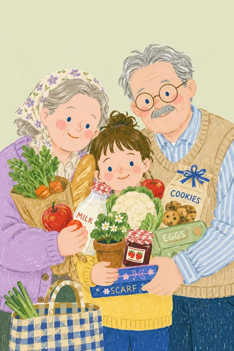</a>

用结构化 JSON 把风格、主体保留、色板和质量控制分开写，上传照片的人物相貌、姿势和构图保持不变，只替换绘画媒介。再用明确的禁止清单排除数码滤镜、3D 和动漫感。

GPT Image 2.5 · 上传图改图 · 出处: [@Maercihh on X](https://x.com/Maercihh/status/2115065217822650537) · 113 赞，统计于 2026-10-28

[`storybook`](tags.md#tag-storybook) [`gouache`](tags.md#tag-gouache) [`photo-to-illustration`](tags.md#tag-photo-to-illustration) [`json-prompt`](tags.md#tag-json-prompt) [`pastel`](tags.md#tag-pastel)

<details><summary><b>提示词</b></summary>

```text
{
"task": "Transform the uploaded original photograph into a charming, hand-painted children's storybook illustration.",

"input": {
"reference_image": "{{UPLOAD ORIGINAL PHOTO}}"
},

"style": {
"art_style": "Traditional hand-painted picture book illustration",
"medium": "Gouache and colored pencil on lightly textured paper",
"visual_inspiration": "Warm, nostalgic Japanese and European children's book illustrations",
"rendering": "Soft painterly brushwork, delicate pencil outlines, visible pigment texture, subtle dry-brush marks, imperfect hand-drawn details",
"texture": "Fine paper grain, gentle chalky pigment, subtle watercolor-like color variation",
"finish": "Authentic traditional illustration, handmade and organic, never resembling a digital filter or 3D render"
},

"subject_preservation": {
"identity": "Preserve the recognizable identity, facial structure, age, hairstyle, skin tone, and distinguishing features of every person in the original photograph.",
"people_count": "Maintain the exact number of people in the source image.",
"pose": "Preserve the original body positions, gestures, head angles, and interactions.",
"composition": "Retain the original arrangement of subjects and the overall framing.",
"clothing": "Preserve the original clothing designs, silhouettes, and recognizable accessories while translating their appearance into painted fabric textures.",
"objects": "Retain the important objects, pets, flowers, food, furniture, and background elements present in the original.",
"expression": "Preserve the original emotional expression and relationship between subjects.",
"accuracy": "Do not invent additional people, remove important subjects, change relationships, or replace the original scene."
},

"illustration_treatment": {
"faces": "Simplify facial details into expressive picture-book features while retaining each person's recognizable likeness. Use gentle blush on cheeks, softly defined noses, simple expressive eyes, and natural smiles only when present in the source.",
"skin": "Warm peach and natural skin tones with visible painterly texture and soft tonal transitions.",
"hair": "Render hair in layered, flowing brushstrokes with fine hand-drawn strands and natural color variation.",
"clothing": "Use softly painted folds, knitted textures, delicate seams, and subtle pencil detailing.",
"edges": "Use organic, slightly irregular hand-painted edges instead of sharp photographic contours.",
"details": "Preserve meaningful details but simplify tiny visual elements into elegant illustrated shapes.",
"shading": "Gentle, diffuse shading with minimal harsh shadows and no dramatic photorealistic lighting."
},

"color_palette": {
"overall": "Muted pastel colors, warm cream, sage green, dusty blue, lavender, butter yellow, soft coral, muted rose, and warm earthy browns.",
"saturation": "Soft and restrained, with occasional natural pops of color.",
"contrast": "Low to medium contrast with clear subject separation.",
"highlights": "Soft creamy highlights with a subtle chalky finish.",
"shadows": "Warm, desaturated shadows without black digital gradients."
},

"background": {
"preservation": "Retain the original background and its essential objects.",
"treatment": "Translate background elements into simplified, softly painted forms consistent with the storybook aesthetic.",
"depth": "Use gentle atmospheric separation rather than photographic depth of field.",
"simplification": "Reduce distracting details without changing the location or scene.",
"background_color": "Preserve the original dominant colors, allowing subtle warm or pastel harmonization."
},

"composition": {
"framing": "Match the original photograph.",
"perspective": "Maintain the original camera angle and spatial relationships.",
"cropping": "Do not crop, zoom, extend, or reposition the original image unnecessarily.",
"aspect_ratio": "Preserve the original image aspect ratio.",
"visual_balance": "Maintain the original visual hierarchy while creating a cohesive illustrated composition."
},

"lighting_and_mood": {
"lighting": "Soft natural daylight with gentle, evenly distributed illumination.",
"mood": "Tender, comforting, innocent, nostalgic, intimate, and quietly joyful.",
"atmosphere": "The feeling of a cherished moment illustrated in a beautifully printed children's book.",
"emotional_tone": "Sincere and understated, avoiding exaggerated cuteness or artificial sentimentality."
},

"quality_control": {
"photographic_appearance": "Remove the photographic rendering while preserving the source image's recognizable content.",
"avoid": [
"Photorealistic skin",
"Plastic or airbrushed faces",
"Glossy 3D rendering",
"Anime or manga styling",
"Exaggerated cartoon proportions",
"Oversized eyes",
"Unnatural facial changes",
"Excessive outlines",
"Neon colors",
"Harsh black shadows",
"Heavy blur",
"Artificial bokeh",
"Unnecessary decorative elements",
"Unrequested text or lettering",
"Watermarks and signatures",
"Unintended changes to the original composition"
],
"final_result": "A cohesive, high-quality, hand-painted storybook illustration that immediately resembles the original photograph, as if a skilled children's book illustrator lovingly painted the moment by hand."
}
}
```

</details>

<a id="gpt-image-photo-to-naive-sketch-memory-card"></a>
### 雪山湖面小船照片配蜡笔手绘插画

<a href="https://x.com/harboriis/status/2104455859447501166"></a>

把 3:4 画面上下对半，上半保留原照片，下半在旧纸上用蜡笔与粉彩重绘简化版。提示词写明版面比例、从照片提取色板、纹理层次和负面清单，让插画紧贴原图。

GPT Image 2.5 · 上传图改图 · 出处: [@harboriis on X](https://x.com/harboriis/status/2104455859447501166) · 112 赞，统计于 2026-10-28

[`photo-to-sketch`](tags.md#tag-photo-to-sketch) [`memory-card`](tags.md#tag-memory-card) [`crayon`](tags.md#tag-crayon) [`split-layout`](tags.md#tag-split-layout) [`landscape`](tags.md#tag-landscape)

<details><summary><b>提示词</b></summary>

```text
Use the uploaded photo as the only content source. Create a vertical 3:4 “real photo + minimal illustration” memory card based entirely on that image. Preserve the main subjects, subject count, pose, viewpoint, spatial relationships, and overall scene logic. Do not redesign the source or add unrelated content.
Layout
Split the card into two horizontal sections, about 50% top and 50% bottom. The top half keeps the uploaded photo with photographic texture. Crop naturally to fit, but do not stretch, mirror, rearrange, or alter the main subjects. Keep natural lighting, real materials, and the original color mood, with subtle editorial grading. The lower half uses a warm ivory handmade-paper background and shows a centered horizontal illustration of the same scene. The illustration occupies about 63-67% of the lower width, with generous blank space around it.
Scene Translation
In the lower illustration, preserve the most recognizable subjects, major structures, important objects, viewpoint, depth, relative scale, and key positions from the source. Remove tiny clutter, fine photographic texture, reflections, and complex shadows. Simplify the scene into slightly awkward geometric color blocks and thin hand-drawn lines. People and animals, when present, remain identifiable through silhouette, pose, hair or fur shape, clothing color, and placement, but facial detail may be reduced. Outlines may wobble, break, shift, or misalign slightly while the scene stays recognizable.
Illustration Style
Use restrained naive editorial drawing with soft geometric simplification and handmade quality. Combine thin sketchy linework with flat shapes. The lower scene should feel calm, clean, slightly imperfect, and visually reduced rather than technically precise. Avoid realistic rendering.
Color
Extract 4-6 representative colors from the uploaded photo and reinterpret them as a soft low-saturation palette. Use muted tones derived from the source, with flat fills and enough contrast to separate major subjects and scene layers. No complex gradients, glossy highlights, or heavy 3D modeling.
Texture
Blend crayon, pastel, screen-print, and old-book illustration qualities. Keep paper show-through, fine grain, slight pigment unevenness, worn edges, and subtle off-register shifts. The result should feel like an independent editorial illustration printed on aged paper: warm, quiet, nostalgic, and collectible.
Typography
Below the illustration, you may include exactly two short English lines related to the scene, mood, place, or moment. Use a small vintage serif font, left-aligned. If clean readable text cannot be rendered, leave the area blank. No other readable text.
Cleanup
Remove phone UI, subtitles, screenshot traces, and interface elements when present. Do not invent missing scenery or decorative props.
Negative
No major layout change, no added or missing primary subjects, no photoreal painting, no polished watercolor, no anime, no manga, no vector clip-art, no oil paint, no impasto, no 3D, no logo, no watermark, no black border, no UI, no unrelated decoration.
Vertical 3:4 split card · photo top / naive illustration bottom · aged paper texture
```

</details>

<a id="gpt-image-graphite-pencil-portrait-blue-butterflies-cap"></a>
### 戴帽子的石墨铅笔肖像与蓝色蝴蝶

<a href="https://x.com/Arina_hoqe/status/2104426552972980328">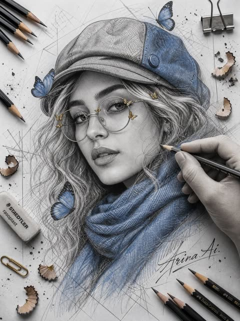</a>

先锁定参考图中的人物身份，再把色彩限制为黑白石墨画加深蓝与金属金点缀。画面里有手在作画，周围摆放铅笔与铅笔屑，结尾的否定清单让画面保持写实。

GPT Image 2.5 · 上传图改图 · 出处: [@Arina_hoqe on X](https://x.com/Arina_hoqe/status/2104426552972980328) · 96 赞，统计于 2026-10-28

[`pencil-sketch`](tags.md#tag-pencil-sketch) [`graphite`](tags.md#tag-graphite) [`butterflies`](tags.md#tag-butterflies) [`selfie-to-art`](tags.md#tag-selfie-to-art) [`portrait`](tags.md#tag-portrait)

<details><summary><b>提示词</b></summary>

```text
Create a highly detailed 9:16 graffiti-style pencil portrait of the same young man from the reference image, preserving his exact facial identity, face shape, eyes, nose, lips, curly/wavy dark hair, and natural realistic features.

He is wearing a stylish two-tone gray-and-deep-blue flat cap with a small blue button, round metal-frame glasses decorated with tiny metallic-gold butterfly details, and a thick textured blue scarf wrapped naturally around his neck.

A realistic hand holds a pencil and appears to sketch the side of his face and hair. Blue butterflies flutter naturally around his head and face. Surround the portrait with sharpened blue and graphite pencils, pencil shavings, an eraser, paper clips, geometric sketch lines, graphite marks, and clean white drawing paper.

Style: ultra-realistic black-and-white graphite pencil drawing with selective deep-blue and metallic-gold accents, highly detailed curly hair, realistic skin texture, delicate shading, fine crosshatching, realistic fabric texture, sharp focus, premium artistic composition, intricate hand-drawn details, elegant editorial graffiti-sketch aesthetic.

Preserve the exact identity of the reference person. No face distortion, no identity change, no extra people, no extra fingers or limbs, no cartoon or anime style, no plastic skin, no 3D look.

Add a professional italic handwritten signature: “Arina Ai” at the bottom right.
```

</details>

<a id="gpt-image-autumn-die-cut-sticker-from-photo"></a>
### 照片变身秋日刀模贴纸

<a href="https://x.com/Aneeza__S/status/2098457814507422182"></a>

提示词先分析上传照片，再把主体重绘为插画，加厚白色刀模边和柔和阴影，并虚化保留原背景。指定秋日色板，并禁止写实与廉价剪贴画风格，保证风格统一。

GPT Image 2.5 · 上传图改图 · 出处: [@Aneeza__S on X](https://x.com/Aneeza__S/status/2098457814507422182) · 94 赞，统计于 2026-10-28

[`sticker`](tags.md#tag-sticker) [`autumn`](tags.md#tag-autumn) [`die-cut`](tags.md#tag-die-cut) [`illustration`](tags.md#tag-illustration) [`photo-to-sticker`](tags.md#tag-photo-to-sticker)

<details><summary><b>提示词</b></summary>

```text
Transform the uploaded photo into a charming AUTUMN ILLUSTRATED STICKER.

IMPORTANT — USE THE UPLOADED PHOTO AS THE CONTENT REFERENCE:
First analyze what is actually present in the original photograph: the person or people, animals, objects, clothing, hairstyle, pose, facial expression, interaction between subjects, surroundings, lighting and distinctive details.

Recreate THIS specific photograph as a completely hand-drawn animated-style illustration.

The final result must NOT look like an edited photograph, photo filter or realistic portrait. Completely redraw the main subject and all important foreground elements as a polished digital illustration.

STICKER TRANSFORMATION:
Turn the main subject or group of subjects into one large die-cut sticker.

Create a thick, smooth white sticker border around the entire silhouette, including important accessories and decorative elements that belong to the sticker.

Add a very subtle soft shadow underneath the white border so the sticker feels like a real physical vinyl or paper sticker placed over the original scene.

Keep the original background from the uploaded photograph visible BEHIND the sticker.

Slightly soften, simplify or gently blur the original background if necessary so the illustrated sticker clearly stands out, but preserve enough of the environment that the original location remains recognizable.

Do not keep a realistic photographic face. The face must also become illustrated.

If the photo contains an animal, transform the animal completely into a cute animated illustrated character while preserving its recognizable breed/type, colors, markings, proportions, pose and personality.

ILLUSTRATION STYLE:
Use a cozy modern digital illustration aesthetic inspired by premium stationery, seasonal stickers and charming editorial character art.

Avoid photorealism, 3D rendering, plastic-looking characters, generic Disney-like characters or childish clip-art.

AUTUMN TRANSFORMATION:
Give the sticker a strong but tasteful autumn identity.

Analyze the original photograph and creatively choose autumn details that naturally fit the subject instead of adding exactly the same decorations to every image.

You may partially redesign the original clothing into a more autumnal version if it improves the result, while keeping the person's overall identity and personality recognizable.

Use an autumn palette inspired by burnt orange, rust, terracotta, cinnamon, caramel, warm brown, muted mustard, cream, beige and deep burgundy.

DECORATIVE STICKER ELEMENTS:
Integrate several small illustrated autumn elements around the main character INSIDE or attached to the sticker silhouette.

For example, leaves can float beside the character, appear in their hair, peek from behind their shoulders or interact with objects they are holding.

Do not scatter random decorations everywhere. Make them feel intentionally composed around the original pose.

Add tiny hand-drawn details such as dots, speckles, sparkles or delicate texture where appropriate.

COMPOSITION :
Preserve the general storytelling and pose of the original photograph, but feel free to simplify or slightly adjust the composition to create a stronger sticker silhouette.

The sticker should be the clear visual focus and occupy a substantial part of the image.

Do not simply draw a white outline around the original photograph.

The transformation must be obvious:
PHOTO → FULLY ILLUSTRATED AUTUMN CHARACTER → DIE-CUT STICKER.

Keep the original photographic background behind it so the contrast between the real environment and illustrated sticker is clearly visible.
```

</details>

<a id="gpt-image-minimalist-doodle-sketchbook-photo"></a>
### 照片转成极简黑色墨线涂鸦

<a href="https://x.com/Inshrah_ali_/status/2098462576346886442"></a>

直接描述线条质感：略带抖动的毛笔式黑色轮廓、童趣造型和干净白底。要求保留主体与构图，所以能套用到任何照片上。

GPT Image 2.5 · 上传图改图 · 出处: [@Inshrah_ali_ on X](https://x.com/Inshrah_ali_/status/2098462576346886442) · 88 赞，统计于 2026-10-28

[`doodle`](tags.md#tag-doodle) [`line-art`](tags.md#tag-line-art) [`sketchbook`](tags.md#tag-sketchbook) [`black-and-white`](tags.md#tag-black-and-white) [`style-transfer`](tags.md#tag-style-transfer)

<details><summary><b>提示词</b></summary>

```text
Transform the image into a minimalist hand-drawn doodle illustration. Use simple black brush-pen outlines with slightly wobbly, imperfect strokes. Reduce all details to cute, childlike shapes while preserving the main subject and composition. Naive sketchbook aesthetic, playful and whimsical character design, clean white background, minimal linework, expressive simplicity, handmade doodle style, black ink drawing, charming imperfections, simple cartoon illustration.
```

</details>

<a id="gpt-image-naive-pencil-illustration-from-photo-2"></a>
### 戴耳机的课堂少女彩铅插画

<a href="https://x.com/harboriis/status/2115028772588261435"></a>

先点明朴拙极简的风格（不规则轮廓、平涂色块、装饰性铅笔线条），再明确禁用阴影、渐变和3D效果，最后用设计师海报与彩铅的参照定下质感。

GPT Image 2.5 · 上传图改图 · 出处: [@harboriis on X](https://x.com/harboriis/status/2115028772588261435) · 75 赞，统计于 2026-10-28

[`colored-pencil`](tags.md#tag-colored-pencil) [`naive-art`](tags.md#tag-naive-art) [`photo-to-illustration`](tags.md#tag-photo-to-illustration) [`flat-color`](tags.md#tag-flat-color) [`cute`](tags.md#tag-cute)

<details><summary><b>提示词</b></summary>

```text
Turn this photo into a contemporary, artist-made naïve illustration: minimalist and hand-drawn, with playful proportions, uneven outlines, flat colors that are soft yet contrasting, and decorative pencil strokes. No shadows, gradients, or 3D effects. Give it the feel of a high-end designer poster drawn with colored pencils. Keep it cute and cartoon-like.
```

</details>

<a id="gpt-image-japanese-comic-poster-photo-comparison"></a>
### 伊斯坦布尔猫咪照片与日式漫画海报对照图

<a href="https://x.com/Goodmanprotocol/status/2114688658746028256"></a>

画面分为上下两半，上半保留原照片，下半重绘为海报。墨色、红色、蓝色和纸色都给出了精确色值，标题分两行并分别指定颜色，让丝网印刷风格保持稳定。

GPT Image 2.5 · 上传图改图 · 出处: [@Goodmanprotocol on X](https://x.com/Goodmanprotocol/status/2114688658746028256) · 69 赞，统计于 2026-10-28

[`comparison`](tags.md#tag-comparison) [`screen-print`](tags.md#tag-screen-print) [`japanese-comic`](tags.md#tag-japanese-comic) [`poster`](tags.md#tag-poster) [`limited-palette`](tags.md#tag-limited-palette)

<details><summary><b>提示词</b></summary>

```text
Create a 3:4 vertical comparison image divided into two equal horizontal halves, seamlessly joined without borders or gaps.

TOP HALF: Display the uploaded photograph exactly as it is, without editing, recoloring, or adding text. Preserve proportions; crop only peripheral background if necessary.

BOTTOM HALF: Redraw the same subject as a Japanese hand-drawn comic poster with minimalist, limited-color screen-print aesthetics. Preserve the subject's recognizable features, pose, proportions, colors, and relationships between objects. Adapt naturally to people, animals, objects, or landscapes. Keep the essential scenery and add nothing absent from the original photograph.

ART STYLE: Delicate, slightly irregular ink-black outlines (#02030B), simplified shapes, clean opaque color blocks, and minimal hard-edged shadows. Use warm red (#E9444B), muted gray-blue (#5296BD), and off-white paper (#ECEDE5), with red dominant over blue. Avoid photorealistic textures, dense hatching, 3D effects, and excessive details.

LAYOUT & TEXT: Position the illustration in the upper-middle of the bottom half, with generous negative space and bold, hand-carved typography below. Add a small handwritten, subject-related caption at the top and a short handwritten annotation beside the subject, both in black. The main headline reads “Jen” in warm red on the first line and “Style” in gray-blue on the second. Each appears once. Keep all text within the bottom half, fully legible and uncropped. Replace sample text only when the user provides alternatives.

FINAL RESULT: One complete 3:4 image, with the untouched original photograph above and its Japanese hand-drawn, limited-color poster interpretation below. No extra borders, watermarks, invented elements, or decorative clutter.
```

</details>

<a id="gpt-image-watercolor-botanical-monochrome-portrait"></a>
### 水彩植物花纹中渐隐的黑白人像

<a href="https://x.com/Kubra_286/status/2105268519105617962">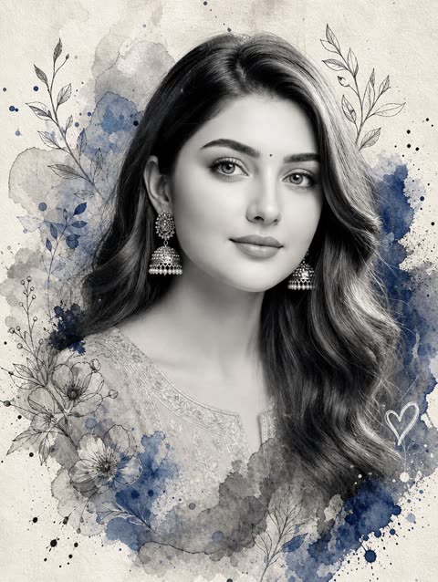</a>

脸部保持灰度写实，边缘融入纸张，色彩只限灰色晕染与宝蓝点缀。明确指定墨线植物与涂鸦爱心的位置，再用负面清单守住五官还原。

GPT Image 2.5 · 上传图改图 · 出处: [@Kubra_286 on X](https://x.com/Kubra_286/status/2105268519105617962) · 67 赞，统计于 2026-10-28

[`watercolor`](tags.md#tag-watercolor) [`monochrome`](tags.md#tag-monochrome) [`botanical`](tags.md#tag-botanical) [`selfie-to-art`](tags.md#tag-selfie-to-art) [`scrapbook`](tags.md#tag-scrapbook)

<details><summary><b>提示词</b></summary>

```text
Create a premium mixed-media watercolor and digital art portrait of the same young South Asian woman from the uploaded reference image.

Create a large close-up grayscale black-and-white portrait of her face and upper shoulders. Preserve her exact facial identity and facial structure from the reference image, including her eyes, eyebrows, nose, lips, jawline, skin texture, and natural expression.

She has long, natural wavy dark hair parted in the middle, softly framing her face. Add a tiny bindi on her forehead. Give her a warm, natural smile with realistic facial details and expressive eyes.

The portrait should softly fade and dissolve into a textured light cream paper background using artistic watercolor bleeding, soft gray washes, deep blue accents, black ink splatters, and organic paint textures.

Surround parts of the portrait with delicate hand-drawn botanical ink sketches of leaves, thin branches, and floral patterns. Add expressive watercolor splashes and scattered paint droplets around the edges. Include a subtle hand-drawn white doodle heart near the lower-right side.

Style: sophisticated handmade scrapbook collage, mixed-media watercolor illustration, monochrome portrait with subtle royal-blue watercolor accents, textured matte paper, organic brushwork, elegant artistic composition, high-detail realistic face.

No full body, no additional people, no distorted facial features, no warped eyes, no deformed anatomy, no text, no logos, no UI elements.

Aspect Ratio: 4:5
```

</details>

<a id="gpt-image-watercolor-double-exposure-butterfly-portrait"></a>
### 帝王蝶环绕的水彩双重曝光肖像

<a href="https://x.com/Kubra_286/status/2100220440543441049"></a>

提示词让写实的脸保持最清晰，并明确指出水彩晕染要出现在脸颊、脖颈和衣物等具体位置，形成半透明叠加的双重曝光。冷色的青绿与深蓝配上鲜橙色蝴蝶，对比强烈。

GPT Image 2.5 · 上传图改图 · 出处: [@Kubra_286 on X](https://x.com/Kubra_286/status/2100220440543441049) · 67 赞，统计于 2026-10-28

[`watercolor`](tags.md#tag-watercolor) [`double-exposure`](tags.md#tag-double-exposure) [`portrait`](tags.md#tag-portrait) [`butterfly`](tags.md#tag-butterfly) [`mixed-media`](tags.md#tag-mixed-media)

<details><summary><b>提示词</b></summary>

```text
Create a 2:3 vertical premium mixed-media watercolor portrait on off-white cold-pressed watercolor paper.
Use the uploaded image only as the subject reference. Keep the subject’s natural features, overall appearance, and recognizable look intact, but do not let the image turn into a generic painted character.
Show the subject in a bust-length three-quarter profile, facing slightly toward the viewer’s right, with the gaze directed softly off-camera. Keep the expression calm, warm, serene, and naturally pleasant, with a subtle gentle smile and bright relaxed eyes. The mood should feel elegant, fresh, dreamy, and refined — not sad, blank, tired, or overly serious.
Keep the face highly realistic and softly photorealistic, not fully painted, not sketch-like, and not cartoonish. The face should be the main focal point. Use soft diffused natural-looking light, similar to indirect window light, to gently illuminate the forehead, nose bridge, cheeks, lips, and jawline, with delicate depth and soft shadows. Render realistic eyes with soft catchlights, defined brows, natural lips, smooth skin transitions, and fine hair strands.
Style the hair in an elegant loose low updo / low messy bun at the nape, with a few soft tendrils framing the face and neck. Intertwine subtle rustic botanical accents in the hair — tiny dried wildflowers in muted yellow, white, and blue tones — delicate, understated, and premium.
Add several detailed Monarch butterflies with vivid orange wings, black veins, black borders, and tiny white spots. Keep them crisp, refined, and slightly dimensional. Place multiple butterflies naturally around the portrait: some resting in the hair, one near the upper-right side, and others floating around the shoulders and lower frame. Their warm orange color should stand out beautifully against the cool watercolor tones.
Create a strong mixed-media double-exposure effect where parts of the portrait dissolve into watercolor blooms. This effect must be clearly visible across selected parts of the cheek, temple, jawline, neck, shoulder, and lower clothing area — not only in the background. The watercolor should feel translucent and layered over the realistic portrait, so the subject remains clearly realistic underneath.
Use expressive watercolor washes in muted teal, seafoam green, dusty blue, soft gray, charcoal, and deep navy tones. Let the washes bloom naturally into the paper with wet-on-wet behavior, soft transparent bleeding, irregular edges, subtle blooms, and a few darker pooled edges where pigment appears to have dried. Allow the watercolor to expand organically into the negative space while keeping the face as the sharpest and most detailed focal area.
Dress the subject in a simple deep navy-blue top / blouse with a high rounded neckline and soft gathered or finely pleated texture around the shoulders and upper chest. The garment should look minimal, elegant, matte, and plain, with no collar, no buttons, no printed pattern, and no decorative embellishments. Keep the outfit close to the reference look. Let the lower portion of the top gradually dissolve into blue-gray watercolor splashes.
Preserve the contrast between hyper-detailed realism and loose abstract watercolor forms. The final artwork should feel like a luxury fine-art portrait print that combines:

photorealistic portraiture
abstract watercolor fusion
soft ethereal surrealism
crisp butterfly detailing
cool watercolor tones contrasted with vivid orange butterflies
textured watercolor paper and handcrafted mixed-media realism
Overall, the result should feel poetic, airy, elegant, and premium, with the viewer’s eye drawn first to the realistic face, then to the translucent watercolor overlays and butterflies surrounding the subject.
```

</details>

<a id="nano-banana-geometric-character-poster-from-photo"></a>
### 由参考照片生成的扁平几何人物海报

<a href="https://x.com/harboriis/status/2110238400163074321"></a>

用编号段落依次锁定版式、角色、风格、面部和配色，并用十六进制色值固定六色方案。负面清单加右下角参考图小卡片，既保留人物特征又保持扁平风格。

Nano Banana 2.1 · 上传图改图 · 出处: [@harboriis on X](https://x.com/harboriis/status/2110238400163074321) · 64 赞，统计于 2026-10-28

[`flat-geometric`](tags.md#tag-flat-geometric) [`character-poster`](tags.md#tag-character-poster) [`six-colour-palette`](tags.md#tag-six-colour-palette) [`editorial`](tags.md#tag-editorial) [`reference-photo`](tags.md#tag-reference-photo)

<details><summary><b>提示词</b></summary>

```text
No extra text, logos, outlined cartoon style, glossy 3D, realistic skin, photorealism, coarse canvas texture, busy background, extra limbs, distorted anatomy, excessive facial detail, photorealistic shading, random objects, clutter, watermark. Include a small rounded picture-in-picture card in the bottom right corner displaying the original reference photo
```

</details>

<a id="gpt-image-selfie-teal-watercolor-portrait-splashes"></a>
### 青绿水彩人像，泼溅与流淌的颜料

<a href="https://x.com/Arina_hoqe/status/2101869888168190404">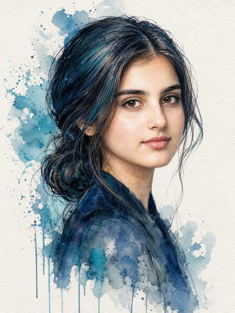</a>

先要求保留参考照片的面部结构和头部角度，再按面部、发型、色板、背景、光线分块描述。点明纸纹、湿画法晕染，并用负面提示排除 CGI 和塑料皮肤，让画面更像手绘。

GPT Image 2.5 · 上传图改图 · 出处: [@Arina_hoqe on X](https://x.com/Arina_hoqe/status/2101869888168190404) · 54 赞，统计于 2026-10-28

[`watercolor`](tags.md#tag-watercolor) [`portrait`](tags.md#tag-portrait) [`selfie`](tags.md#tag-selfie) [`photo-to-art`](tags.md#tag-photo-to-art) [`negative-space`](tags.md#tag-negative-space)

<details><summary><b>提示词</b></summary>

```text
Create a highly detailed traditional watercolor portrait based on the reference image.

SUBJECT & IDENTITY:
A beautiful young woman shown in a refined side-profile / three-quarter profile. Preserve the exact facial structure, proportions, recognizable features, hairstyle, head angle and overall appearance of the reference image.

POSE & COMPOSITION:
Vertical 9:16 portrait composition. Head and upper shoulders only. Her face is turned toward the right side of the frame, with a calm, elegant and slightly mysterious expression. Neck naturally elongated, shoulders relaxed. The face is the central focal point.

FACE:
Natural feminine facial anatomy, defined cheekbones, elegant jawline, delicate straight nose, soft lips, subtle blush on the cheeks. Large expressive light brown/gray eyes looking slightly toward the viewer's direction. Long detailed eyelashes and naturally shaped eyebrows. Soft realistic skin tones rendered through transparent watercolor layers.

HAIR:
Dark teal, deep navy and blue-black hair, swept backward into a loose low ponytail/bun. Flowing strands and layered locks merge naturally into the surrounding watercolor splashes. Individual hair strands should remain visible, with rich turquoise and deep blue pigment variations.

EXPRESSION:
Calm, graceful, sophisticated and slightly melancholic. Natural relaxed lips and subtle emotion in the eyes. No exaggerated smile.

CLOTHING:
Simple elegant dark teal/blue garment visible around the shoulders and neckline, partially dissolving into watercolor washes.

ART STYLE:
Authentic traditional watercolor portrait painted on textured cold-press watercolor paper. Fine ink-and-watercolor illustration, delicate hand-drawn contour lines combined with transparent watercolor washes. Visible paper grain, natural pigment granulation, wet-on-wet color bleeding, soft edges, layered translucent pigments and organic paint blooms.

COLOR PALETTE:
Deep navy blue, turquoise, teal, muted cyan, soft gray, pale beige, warm peach and subtle dusty rose skin tones. Strong contrast between the dark blue hair and the light paper background.

BACKGROUND:
Clean off-white textured watercolor paper. Minimal background with large abstract turquoise and deep-blue watercolor splashes concentrated around the hair and shoulders. Natural paint splatters, droplets, irregular edges and several long dripping watercolor trails extending downward. Keep large areas of white negative space around the face.

LIGHTING:
Soft diffused natural light, subtle highlights across the forehead, nose, cheekbones and lips. Gentle shadows beneath the cheekbone and jawline. Delicate luminous watercolor effect.

DETAILS:
Extremely detailed eyes, eyelashes, eyebrows, lips, nose, facial contours and individual hair strands. Authentic watercolor pigment texture, fine ink outlines, realistic facial anatomy, subtle skin color variations, natural brush marks and paper fibers.

OVERALL FEEL:
Elegant, artistic, sophisticated, emotional watercolor portrait with a modern fashion-illustration aesthetic. The painting should look handmade by a professional watercolor artist rather than digitally generated.

QUALITY:
Ultra-detailed, high-resolution traditional watercolor artwork, refined composition, realistic facial proportions, beautiful color transitions, authentic watercolor imperfections, professional gallery-quality illustration.

NEGATIVE PROMPT:
anime, cartoon, 3D render, CGI, plastic skin, flat digital painting, overly smooth skin, distorted face, altered facial proportions, asymmetrical eyes, extra features, blurry details, harsh outlines, oversaturated colors, photorealistic photography, text, watermark, logo, signature
```

</details>

<a id="nano-banana-style-transfer-cobra-witch-hat"></a>
### 眼镜蛇变身星星图案女巫贴纸

<a href="https://x.com/thefinnmckenty/status/2107574685433286858"></a>

用两张参考图分工：图1提供内容，图2提供风格。提示词逐项列出要迁移的风格属性，包括媒介、配色、氛围、渲染方式、饱和度和质感。

Nano Banana 2.1 · 上传图改图 · 出处: [@thefinnmckenty on X](https://x.com/thefinnmckenty/status/2107574685433286858) · 30 赞，统计于 2026-10-28

[`style-transfer`](tags.md#tag-style-transfer) [`reference-image`](tags.md#tag-reference-image) [`sticker`](tags.md#tag-sticker) [`illustration`](tags.md#tag-illustration) [`template`](tags.md#tag-template)

<details><summary><b>提示词</b></summary>

```text
Create an image of the content as shown in [image 1] but with the same medium, color palette, mood, rendering technique, saturation level, textures, and overall style of [image 2]. Objective: Style transfer from [image 1 to [image 2]
```

</details>

<a id="gpt-image-christmas-street-chibi-real-background"></a>
### 圣诞树前的手绘Q版女孩与真实街景

<a href="https://x.com/Sairah_0/status/2091401764360896762">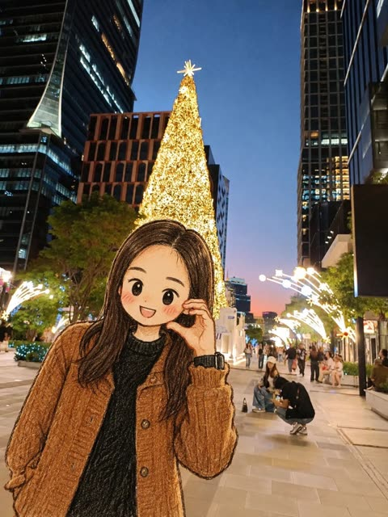</a>

提示词明确区分手绘铅笔水彩风的Q版人物与写实背景，同时锁定参考图的脸、发型、服装和姿势，再补充蓝调时刻光线与竖构图。

GPT Image 2 · 上传图改图 · 出处: [@Sairah_0 on X](https://x.com/Sairah_0/status/2091401764360896762) · 发现于 [freestylefly/awesome-gpt-image-2](https://github.com/freestylefly/awesome-gpt-image-2)

[`chibi`](tags.md#tag-chibi) [`christmas`](tags.md#tag-christmas) [`photo-to-illustration`](tags.md#tag-photo-to-illustration) [`mixed-media`](tags.md#tag-mixed-media) [`blue-hour`](tags.md#tag-blue-hour)

<details><summary><b>提示词</b></summary>

```text
Use the uploaded image as the primary reference. Transform the person into a cute, hand-drawn anime/chibi character while preserving the original person’s recognizable facial features, hairstyle, outfit, pose, and accessories.

A cute young woman standing on a modern city street at blue hour, surrounded by tall illuminated skyscrapers and festive Christmas decorations. A huge glowing Christmas tree covered in warm golden lights stands directly behind her, creating a magical holiday atmosphere. The street is filled with elegant decorative lights, pedestrians, modern architecture, and soft evening city illumination.

Render the character in a charming Japanese hand-drawn anime/chibi illustration style with expressive large eyes, soft blush on the cheeks, delicate facial details, textured pencil-and-ink outlines, subtle watercolor-like coloring, and slightly imperfect handmade sketch details. Keep the background photorealistic and highly detailed, creating a beautiful contrast between the illustrated character and the real-world environment.

Cinematic composition, natural perspective, soft evening lighting, warm Christmas glow, realistic background depth, detailed clothing texture, cozy winter atmosphere, high detail, aesthetically pleasing, vertical portrait composition.
```

</details>

<a id="gpt-image-doodle-fashion-chibi-striped-sweater"></a>
### 条纹毛衣手绘涂鸦Q版人物

<a href="https://x.com/Sairah_0/status/2092473965927334071"></a>

以参考图为基础保留人物特征，再用清单限定比例：大头、点状眼睛、腮红。另用风格条目约束松散墨线、淡蜡笔上色和大量留白，使成品像手绘而不是矢量图。

GPT Image 2 · 上传图改图 · 出处: [@Sairah_0 on X](https://x.com/Sairah_0/status/2092473965927334071) · 发现于 [freestylefly/awesome-gpt-image-2](https://github.com/freestylefly/awesome-gpt-image-2)

[`doodle`](tags.md#tag-doodle) [`chibi`](tags.md#tag-chibi) [`fashion-sketch`](tags.md#tag-fashion-sketch) [`hand-drawn`](tags.md#tag-hand-drawn) [`character`](tags.md#tag-character)

<details><summary><b>提示词</b></summary>

```text
Transform the subject from the reference image into a cute, quirky hand-drawn doodle illustration.

Use a minimalist children’s storybook / fashion sketch aesthetic with loose, imperfect black ink lines, visible scribbly pencil strokes, subtle cross-hatching, and a charming handmade feel. Keep the character’s recognizable facial features, hairstyle, face shape, clothing, accessories, and overall identity from the reference while simplifying them into a cute illustrated character.

Character design:
- Oversized head and small simplified body
- Simple dot-like eyes and tiny minimal mouth
- Soft rounded facial features
- Slight rosy pink blush on the cheeks
- Messy, expressive hand-drawn hair with many loose sketch lines
- Slightly exaggerated, playful proportions
- Natural, relaxed pose with a whimsical fashion-illustration feel

Art style:
- Black-and-white pencil/ink doodle drawing
- Rough, imperfect sketch lines rather than clean digital outlines
- Dense scribbled hair and clothing details
- Light hand-colored accents
- Subtle watercolor/crayon-like coloring
- Minimal shading
- White or off-white clean background
- Lots of negative space
- Cute, innocent, playful, cozy aesthetic
- Looks like an original handmade notebook/fashion doodle illustration

Preserve the important details of the reference image while converting everything into this consistent doodle-art style. The final image should feel hand-sketched, slightly imperfect, adorable, expressive, and effortlessly stylish, not like polished vector art or 3D cartoon art.
```

</details>

<a id="gpt-image-exaggerated-anime-subject-redraw"></a>
### 夸张动漫风女孩与毛绒小狗重绘

<a href="https://x.com/Zyrellix/status/2052766810500649197">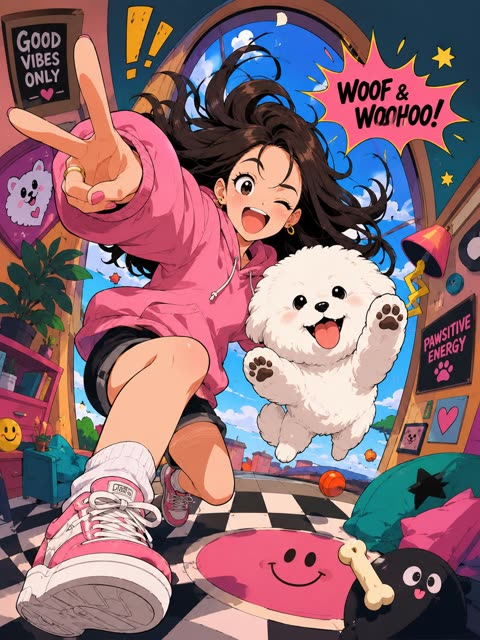</a>

提示词依次写明线稿、平涂阴影和拉伸的人体比例，再要求带透视变形的环境。以上传主体为起点，风格得以迁移，人物依然可辨。

GPT Image 2 · 上传图改图 · 出处: [@Zyrellix on X](https://x.com/Zyrellix/status/2052766810500649197) · 发现于 [freestylefly/awesome-gpt-image-2](https://github.com/freestylefly/awesome-gpt-image-2)

[`anime`](tags.md#tag-anime) [`cel-shading`](tags.md#tag-cel-shading) [`exaggerated`](tags.md#tag-exaggerated) [`perspective-distortion`](tags.md#tag-perspective-distortion) [`subject-redraw`](tags.md#tag-subject-redraw)

<details><summary><b>提示词</b></summary>

```text
Create a trending anime art style image from the uploaded subject. Use confident line-work with slight variation and minimal cel shading using flat shadow shapes. Use bright, saturated colors and clean graphic lighting. The style is defined by exaggerated, cartoonish character proportions featuring highly expressive, simplistic facial features that allow for immense emotional range, with highly varied stretched anatomy.Transform the environment into a slightly warped space with playful perspective distortion and simplified objects. Composition and tone should be energetic, lively, and comedic in a fully stylized, non-realistic world
```

</details>

<a id="gpt-image-landscape-photo-four-style-blue-white-dunhuang-embroidery"></a>
### 风景照转青花、敦煌壁画、刺绣三种风格四层长图

<a href="https://x.com/zhidawang219555/status/2090310144190218272">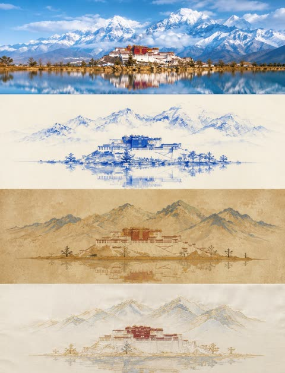</a>

画面严格四等分，每层占25%，依次为原图和三种风格转译。每个风格层只保留一个核心主体，留白不少于60%，主色限2到4种，所以三层风格干净且彼此区分明显。

GPT Image 2 · 上传图改图 · 出处: [@zhidawang219555 on X](https://x.com/zhidawang219555/status/2090310144190218272) · 发现于 [freestylefly/awesome-gpt-image-2](https://github.com/freestylefly/awesome-gpt-image-2)

[`style-transfer`](tags.md#tag-style-transfer) [`blue-and-white-porcelain`](tags.md#tag-blue-and-white-porcelain) [`dunhuang-mural`](tags.md#tag-dunhuang-mural) [`embroidery`](tags.md#tag-embroidery) [`landscape`](tags.md#tag-landscape)

<details><summary><b>提示词</b></summary>

```text
请将我上传的照片制作成一张竖版拼图海报，整体采用 3:4 竖版构图。画面从上到下严格四等分为四个横向区域，每个区域的高度必须精确控制为整体画面高度的25%（四层比例严格为1:1:1:1，不允许出现比例偏差），区域之间无缝衔接，不设分隔线、不留间隙，顺序为：原图→风格1→风格2→风格3。由于每层为约3:1的极扁宽幅比例，各层主体建议横向居中排布，强调左右开阔留白与呼吸感，避免元素纵向拉伸变形或贴边拥挤。四层在人物站位、场景结构、视线方向上保持连贯呼应，呈现同一画面、四种转译的整体感。风格层（第二至四层）须遵循极简原则：每层视觉元素数量压缩至最低限度，只保留1个最核心的主体符号，其余次要装饰、背景细节与陪衬元素一律省略，画面留白占比不低于60%。

第一层保留原始照片的主体结构、人物真实互动关系与姿态、真实质感、自然光影与原有色彩氛围，仅进行轻微高级摄影调色，呈现杂志摄影质感，不改变人物关系与构图逻辑，并可在不改变人物关系与构图逻辑的前提下自然扩展天空、地面或环境背景，使整体更具空间感与叙事感。

第二层为青花瓷绘风格：借鉴青花瓷绘画技法，以钴蓝色线条与晕染在米白底上表现人物与场景，呈现瓷器纹样的疏朗雅致感。色彩以钴蓝与米白为主的单色系。避免蓝色浓淡层次过多显杂，避免图案化装饰堆砌。

第三层为敦煌壁画风格：借鉴敦煌壁画矿物重彩质感，表现古朴斑驳的美感，需简化线条与色块。背景为土黄或赭石底色，带斑驳壁画肌理感。色彩以赭石、石青、朱砂、土黄为主。避免裂纹肌理过多堆砌，避免复杂纹样装饰。

第四层为刺绣锦缎风格：以刺绣针脚肌理表现人物与场景轮廓，呈现丝缎光泽与针线纹理感，图案需极简概括。背景为米白或浅灰缎面底色。色彩以2至3种柔和色搭配金线点缀。避免针脚过密显繁琐，避免金线过多显浮夸。

每一层需将主体与场景统一转换为对应风格，整体表达极度克制与简化，只保留最核心的一个主体符号及其基本轮廓关系，删除一切非必要的背景元素、装饰细节与陪衬物；人物之间的关键位置关系、互动方向与姿态特征需保留，但应抽象为可识别的轮廓关系，做到“元素越少、关系越清晰”。色彩均从原图中提取归纳，每层严格控制在2-4种主色以内。四个区域的高度比例须严格保持1:1:1:1（各占25%），不可出现拼接错位或比例偏差。整体避免朋克/赛博朋克风格、写实照片质感强行叠加、卡通风格、3D渲染感、商业海报感、复杂背景堆砌、元素过多或画面拥挤、相邻两层风格雷同，以及任何文字、Logo、水印或标题。
```

</details>

<a id="gpt-image-magazine-paper-collage-cafe-girl"></a>
### 手持咖啡的女孩纸艺拼贴插画

<a href="https://x.com/oggii_0/status/2060212097083146644">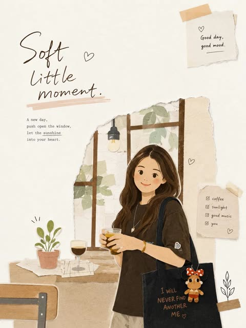</a>

提示词保留原图主体与姿势，再把风格、人物、构图、物件、字体和氛围分块叠加。结尾的排除清单和对拼贴元素数量的限制，让画面保持留白、不拥挤。

GPT Image 2 · 上传图改图 · 出处: [@oggii_0 on X](https://x.com/oggii_0/status/2060212097083146644) · 发现于 [freestylefly/awesome-gpt-image-2](https://github.com/freestylefly/awesome-gpt-image-2)

[`paper-collage`](tags.md#tag-paper-collage) [`scrapbook`](tags.md#tag-scrapbook) [`korean-editorial`](tags.md#tag-korean-editorial) [`handwritten-type`](tags.md#tag-handwritten-type) [`minimalist`](tags.md#tag-minimalist)

<details><summary><b>提示词</b></summary>

```text
Transform the uploaded image into a minimalist illustration in a magazine collage style, using paper cutouts. Retain the main subject, pose, and overall concept of the original image, but reimagine it as a warm, hand-edited collage. Style: Minimalist illustration in a magazine paper collage style, with flat, layered paper shapes, soft pastel paper textures, torn paper edges, paper shadow effects, neat black doodle accents, a handmade scrapbook atmosphere, modern Korean editorial design, a simple and cute composition, and large areas of clean white space. Character: Cute, simplified Korean characters with minimalist facial features, a small, relaxed smile, soft and rounded proportions, simple and casual clothing, and silhouettes constructed from layered paper cutouts. Composition: A 3:4 aspect ratio, with the main subject positioned slightly lower and off-center, leaving a large, open space on the opposite side for a breezy, minimalist composition that avoids clutter. Objects: Add only a few suitable collage elements: paper sticky notes, small hearts, plants, a cup of coffee, a window, tape fragments, and simple doodle icons. Typography: Add an elegant, handwritten English title that fits the scene's atmosphere. Use short phrases such as: ["May you be like the morning sunshine, full of vitality and hope, embracing the beauty of each day.","Take a small break," or "Good day, good mood."] Atmosphere: Calm, comfortable, warm, sweet, and editorial style. Avoid: Photorealistic style, anime style, watercolor style, 3D clay style, overly detailed backgrounds, excessive collage elements, a luxury poster atmosphere, dark tones, harsh shadows, and sloppy text.
```

</details>

<a id="gpt-image-minimalist-fairytale-children-illustration"></a>
### 极简童话风手绘儿童插画情侣

<a href="https://x.com/MissDelulu9/status/2057073936295399551">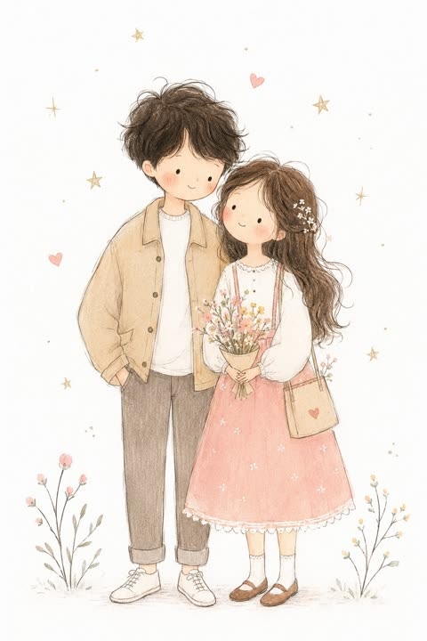</a>

用具体的绘画特征定义风格：细而不完美的线条、平涂粉彩、红脸颊和纸张质感。再用一长串排除项（写实、3D、光泽、复杂阴影）把画面保持在扁平稚拙的效果。

GPT Image 2 · 上传图改图 · 出处: [@MissDelulu9 on X](https://x.com/MissDelulu9/status/2057073936295399551) · 发现于 [freestylefly/awesome-gpt-image-2](https://github.com/freestylefly/awesome-gpt-image-2)

[`children-illustration`](tags.md#tag-children-illustration) [`hand-drawn`](tags.md#tag-hand-drawn) [`pastel`](tags.md#tag-pastel) [`storybook`](tags.md#tag-storybook) [`photo-to-illustration`](tags.md#tag-photo-to-illustration)

<details><summary><b>提示词</b></summary>

```text
Transform the photo into a delicate minimalist hand-drawn children’s illustration with a soft whimsical fairy-tale aesthetic. Use simple elongated shapes, thin imperfect hand-drawn lines, flat pastel colors, minimal details, and a cute doll-like character style with rosy cheeks, tiny facial features, and simplified anatomy. Add subtle paper texture, soft pencil and pastel shading, watercolor softness, and a clean white background with small stars or sparkles.

Stylize the clothing in a playful storybook way with simplified shapes and gentle decorative details. The overall mood should feel airy, cozy, naive, and charming, like a modern Scandinavian nursery postcard or children’s book illustration. Avoid photorealism, 3D, cinematic lighting, glossy surfaces, complex shadows, realistic anatomy, and hyper-detail.
```

</details>

<a id="gpt-image-mixed-media-memory-card-5050"></a>
### 上半照片下半蜡笔速写的回忆卡

<a href="https://x.com/Sairah_0/status/2093212900160868430">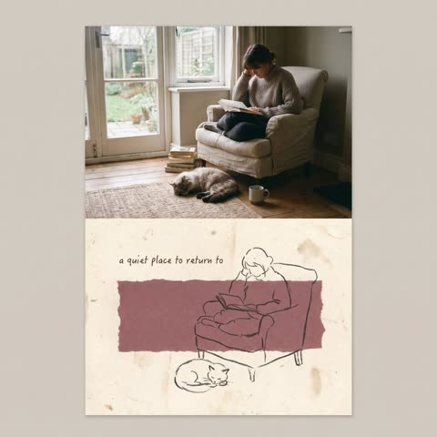</a>

严格五五分栏，上半保留原照片，下半把主体重绘成松散的蜡笔线条。从照片取色的低饱和色块、手工纸纹理和孔版颗粒营造出莫兰迪质感。

GPT Image 2 · 上传图改图 · 出处: [@Sairah_0 on X](https://x.com/Sairah_0/status/2093212900160868430) · 发现于 [freestylefly/awesome-gpt-image-2](https://github.com/freestylefly/awesome-gpt-image-2)

[`memory-card`](tags.md#tag-memory-card) [`mixed-media`](tags.md#tag-mixed-media) [`wax-crayon`](tags.md#tag-wax-crayon) [`risograph`](tags.md#tag-risograph) [`morandi`](tags.md#tag-morandi)

<details><summary><b>提示词</b></summary>

```text
Transform the uploaded photo into a vertical mixed-media memory card with a strict 50/50 split.

Keep the original photo unchanged in the top half. In the bottom half, use textured off-white handmade paper and add a muted, irregular color patch matching the photo’s tones.

Redraw the main subjects as a simple dark wax-crayon sketch with loose, imperfect lines and minimal details. Add a short handwritten English phrase and subtle Risograph grain.

Create a quiet, nostalgic Morandi-style aesthetic with generous negative space. Do not add extra elements or copy the reference composition exactly.
```

</details>

<a id="gpt-image-paper-craft-family-mount-fuji-pond"></a>
### 富士山池塘边的纸艺全家福

<a href="https://x.com/oggii_0/status/2052609040539328759">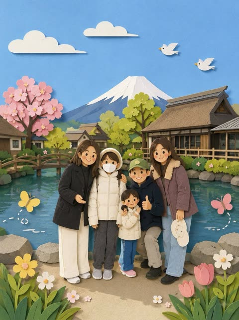</a>

要求把照片细节简化成剪纸形状，得到带柔和阴影的分层平面造型。允许添加小鸟、蝴蝶和花朵等装饰，画面更饱满，同时保留原图场景。

GPT Image 2 · 上传图改图 · 出处: [@oggii_0 on X](https://x.com/oggii_0/status/2052609040539328759) · 发现于 [freestylefly/awesome-gpt-image-2](https://github.com/freestylefly/awesome-gpt-image-2)

[`paper-craft`](tags.md#tag-paper-craft) [`photo-to-art`](tags.md#tag-photo-to-art) [`family-portrait`](tags.md#tag-family-portrait) [`cute`](tags.md#tag-cute) [`landscape`](tags.md#tag-landscape)

<details><summary><b>提示词</b></summary>

```text
Recreate this image in a paper craft style, simplifying the details to make them suitable for paper craft artwork. Arrange the overall composition to feel visually pleasing, soft, and cute. You may add charming decorative elements such as birds, butterflies, flowers, etc., to enhance the adorable atmosphere while still matching the original image.
```

</details>

<a id="gpt-image-pencil-sketch-yawn-3d-double"></a>
### 皮克斯风3D人物站在巨幅铅笔打哈欠素描前

<a href="https://x.com/AIwithkhan/status/2062567518389391540">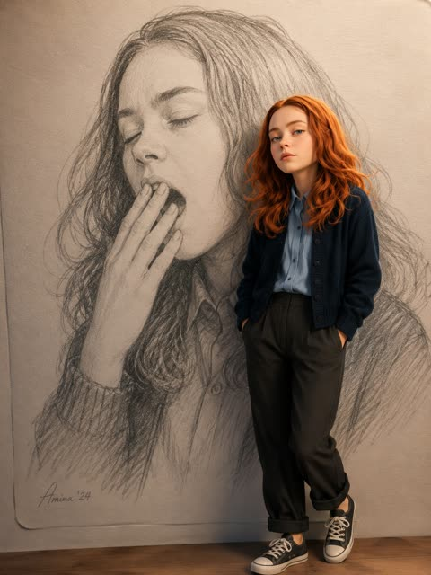</a>

分成两层描述：先把参考照片画成铅笔素描作背景，再加一个站在前面的3D渲染分身。平面石墨与柔光3D人物形成对比和层次，并在提示词里指定3:4比例。

GPT Image 2 · 上传图改图 · 出处: [@AIwithkhan on X](https://x.com/AIwithkhan/status/2062567518389391540) · 发现于 [freestylefly/awesome-gpt-image-2](https://github.com/freestylefly/awesome-gpt-image-2)

[`pencil-sketch`](tags.md#tag-pencil-sketch) [`pixar-style`](tags.md#tag-pixar-style) [`3d-render`](tags.md#tag-3d-render) [`double-exposure`](tags.md#tag-double-exposure) [`photo-to-art`](tags.md#tag-photo-to-art)

<details><summary><b>提示词</b></summary>

```text
Create a handrawn pencil illustration of [image] yawning on paper, as background.

Add a 3D Pixar style render of [foto] standing casually infront of the giant handrawn pencil illustration. Soft cinematic lighting. 8K resolution. 3:4 ratio
```

</details>

<a id="gpt-image-pixel-art-style-transfer"></a>
### 照参考图画风生成像素风摩托骑手

<a href="https://developers.openai.com/api/docs/guides/image-prompting#transfer-a-visual-style"></a>

参考图只用来提供画风，新主体另外描述，这样配色和像素颗粒能迁移过来，场景不会被照抄。预览图为 Sunburst 版本。

GPT Image 2.5 · 上传图改图 · 出处: [OpenAI image prompting guide](https://developers.openai.com/api/docs/guides/image-prompting#transfer-a-visual-style)

[`pixel-art`](tags.md#tag-pixel-art) [`style-transfer`](tags.md#tag-style-transfer) [`reference`](tags.md#tag-reference)

<details><summary><b>提示词</b></summary>

```text
Use the same style from the input image and generate a man riding a motorcycle on a white background.
```

</details>

输入素材: [1](https://developers.openai.com/images/platform/guides/image-prompting/pixels.webp)

<a id="gpt-image-storybook-photo-to-handdrawn-portrait"></a>
### 照片转手绘儿童绘本头像

<a href="https://x.com/Sairah_0/status/2090321208441262454">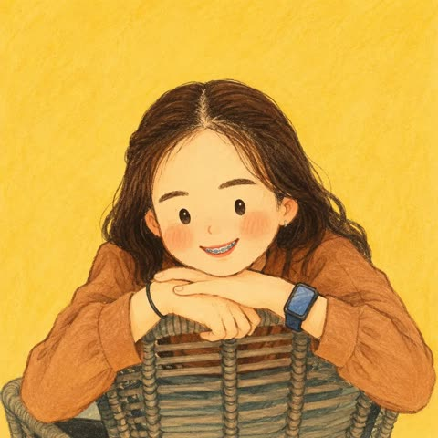</a>

先列出必须保留的面部、发型、服装和配饰，再列出禁止照搬的内容，让身份特征保留而画风被重塑。指定水粉、蜡笔、粉彩等媒介和不规则棕色线条，并固定暖色背景，绘本质感更稳定。

GPT Image 2 · 上传图改图 · 出处: [@Sairah_0 on X](https://x.com/Sairah_0/status/2090321208441262454) · 发现于 [freestylefly/awesome-gpt-image-2](https://github.com/freestylefly/awesome-gpt-image-2)

[`storybook`](tags.md#tag-storybook) [`hand-drawn`](tags.md#tag-hand-drawn) [`avatar`](tags.md#tag-avatar) [`gouache`](tags.md#tag-gouache) [`photo-to-illustration`](tags.md#tag-photo-to-illustration)

<details><summary><b>提示词</b></summary>

```text
Use the single uploaded photo as the only visual reference. Transform the person into an adorable hand-drawn 2D children’s storybook character, while keeping their identity immediately recognizable.

Preserve exactly from the photo:
- Facial features and skin tone
- Real hairstyle, length, texture, and color
- Exact clothing, colors, patterns, and layering
- Glasses, jewelry, headwear, bags, and all visible accessories

Do not invent or copy hairstyles, outfits, accessories, braids, pigtails, bows, bonnets, or headscarves from any reference artwork.

### Character
Use an oversized rounded head, tiny compact body, short arms, narrow shoulders, soft rounded silhouette, and cute childlike proportions. Keep the head visually dominant. Avoid realistic anatomy.

### Face
Simplify into tiny dot/oval eyes, minimal nose, tiny smiling mouth, rounded cheeks, and soft peach/pink blush. Keep recognizable facial characteristics. No realistic eyes, detailed lips, anime features, glossy 3D rendering, or heavy shading.

### Hair & Clothing
Recreate the exact hairstyle and outfit from the uploaded photo, simplified into chunky hand-drawn shapes. Preserve important colors, patterns, jewelry, glasses, and other recognizable details.

### Style
Handmade 2D picture-book aesthetic using soft gouache, wax crayon, colored pencil, and dry pastel. Use slightly irregular dark-brown linework, subtle paper grain, uneven pigment, soft brush marks, and imperfect painted edges. Avoid clean vector art, CGI, anime, or photorealism.

### Composition
Square 1:1 portrait, chest/waist-up, centered and facing mostly forward, with balanced negative space. Use a relaxed, charming pose.

### Background
Simple warm mustard, butter yellow, ochre, or cream background with subtle paper texture. No scenery, objects, text, borders, or distractions.

Final feeling: the same person lovingly redrawn as an extremely cute, warm, wholesome, nostalgic, handcrafted children’s-book character—same identity, same hair, same clothes, same accessories, completely simplified and adorable.
```

</details>

<a id="gpt-image-watercolor-travel-journal-postcard"></a>
### 旅行照片转水彩手账明信片

<a href="https://x.com/zhgqthomas/status/2056633723366568387">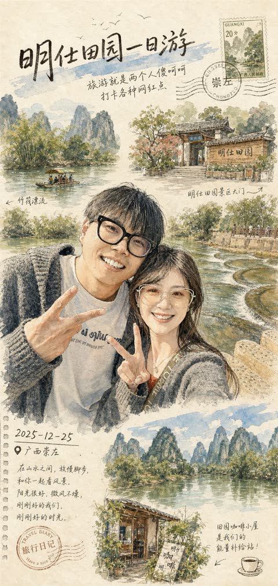</a>

叠加钢笔线稿、水彩晕染和米色纸张质感等手账要素，再用可替换的标题、文案、日期和地点邮戳槽位固定明信片版式，并用克制的大地色调统一画面。

GPT Image 2 · 上传图改图 · 出处: [@zhgqthomas on X](https://x.com/zhgqthomas/status/2056633723366568387) · 发现于 [freestylefly/awesome-gpt-image-2](https://github.com/freestylefly/awesome-gpt-image-2)

[`watercolor`](tags.md#tag-watercolor) [`travel-journal`](tags.md#tag-travel-journal) [`postcard`](tags.md#tag-postcard) [`sketchbook`](tags.md#tag-sketchbook) [`photo-to-art`](tags.md#tag-photo-to-art)

<details><summary><b>提示词</b></summary>

```text
Create a dreamy watercolor travel illustration style from the attached photo. Use hand-painted urban sketchbook aesthetic, delicate ink linework mixed with soft watercolor washes, highly detailed pen-and-ink drawing, loose expressive brush strokes, watercolor bleeding edges, ultra detailed watercolor texture, soft beige paper texture background, architectural sketch style, vintage travel diary and sketchbook traveler aesthetic, travel journal composition, editorial postcard layout, handwritten medium title:[自定义标题]  at top, handwritten notes:[自定义文案] , date: [自定义日期] and location: [自定义地点]  stamps, natural perspective, atmospheric depth, minimalist negative space, muted earthy palette (warm browns, faded greens, cream whites, soft blue accents), quiet, calm, soft, cozy, nostalgic vibes, cinematic slice-of-life mood, poetic composition, mixed urban sketching with Ghibli-inspired realism, vertical poster design, premium art print quality.
```

</details>
