# 照片转艺术风格

[返回目录](../../README_zh.md) · 全部 75 条

<a id="gpt-image-photo-to-watercolor-travel"></a>
### 上半照片，下半水彩旅行速写

<a href="https://x.com/MahnoorAi12/status/2102724961408626735"></a>

上下分割，照片渐变成水彩。作者说 Gemini、Grok、ChatGPT 都能用。

GPT Image 2.5 · 上传图改图 · 出处: [@MahnoorAi12 on X](https://x.com/MahnoorAi12/status/2102724961408626735) · 2,264 赞，统计于 2026-10-27

[`watercolor`](tags.md#tag-watercolor) [`travel`](tags.md#tag-travel) [`split-composition`](tags.md#tag-split-composition)

<details><summary><b>提示词</b></summary>

```text
Create a refined editorial travel-art composition based on a reference photograph. The image is divided vertically into two parts: the upper section is a realistic cinematic travel photograph, while the lower section transforms the exact same scene into a delicate hand-painted watercolor illustration.
Upper section: authentic candid travel photography, natural daylight, soft shadows, subtle film grain, realistic textures, sophisticated European atmosphere, documentary-style composition, people naturally walking through the scene, beautiful architectural details, slightly muted elegant colors, high-end travel magazine photography.
Lower section: a minimalist handmade watercolor painting of the exact same scene, preserving the recognizable composition, architecture, people, poses, perspective and major visual elements from the photograph. Loose translucent watercolor washes, delicate ink details, visible paper texture, soft edges, imperfect brushwork, subtle pigment bleeding, airy negative space, understated pastel tones, artistic but realistic.
Leave generous warm ivory/off-white textured paper space surrounding the watercolor illustration. Add a small elegant handwritten caption near the bottom, such as “summer days” or “a quiet afternoon”, with a thin minimalist horizontal line underneath.
Overall aesthetic: luxury travel journal, fine-art watercolor postcard, contemporary editorial design, nostalgic European summer, understated elegance, tactile handmade paper, sophisticated and serene.
Portrait orientation, clean composition, premium art direction, no clutter, no borders, natural proportions, highly detailed photograph transitioning into an airy watercolor illustration.
```

</details>

<a id="gpt-image-minimal-lifestyle-poster"></a>
### 真实照片变极简生活方式海报

<a href="https://x.com/Naiknelofar788/status/2101161664892829838"></a>

填空模板，替换 `[PERSON / SUBJECT / MOMENT]` 即可。主体保持可辨认，背景去掉照片感。

GPT Image 2.5 · 上传图改图 · 出处: [@Naiknelofar788 on X](https://x.com/Naiknelofar788/status/2101161664892829838) · 1,698 赞，统计于 2026-10-27

[`editorial`](tags.md#tag-editorial) [`illustration`](tags.md#tag-illustration) [`template`](tags.md#tag-template) [`photo-to-art`](tags.md#tag-photo-to-art)

<details><summary><b>提示词</b></summary>

```text
A sophisticated minimalist lifestyle art poster featuring [PERSON / SUBJECT / MOMENT] as the central focus, transformed from a real-life photograph into a refined hand-drawn editorial illustration. Preserve the subject’s recognizable pose, silhouette, clothing, hairstyle, and key visual details while simplifying the scene into an elegant artistic composition.

Use a limited vintage color palette inspired by the original environment, with warm muted tones printed on an ivory/off-white paper background. Combine delicate ink outlines, loose sketchwork, fine hatching, subtle halftone texture, faded print imperfections, and soft watercolor-like washes.

Reduce the surrounding environment into a few recognizable contextual elements—[CAFÉ / BAR / STREET / LANDMARK / OBJECTS]—using simplified linework and layered shapes rather than detailed realism. Add subtle abstract circles, geometric forms, atmospheric marks, tiny decorative elements, or silhouettes to create visual depth.

Include small minimalist typography on one side: [CITY / LOCATION], [SUBJECT / MOMENT], and optional coordinates, date, or short descriptor, designed like a premium collectible travel/lifestyle print.

Generous negative space, elegant editorial composition, vintage screen-print aesthetic, hand-crafted illustration, sophisticated travel-magazine design, muted heritage colors, subtle paper grain, artistic but recognizable, no photorealistic background, no excessive details, 4:5 vertical composition.
```

</details>

<a id="gpt-image-editorial-illustration-poster"></a>
### 每张照片变成一张安静的编辑插画海报

<a href="https://x.com/icreatelife/status/2099343607492702258"></a>

开头先禁止拼贴，一张照片一张海报；结尾一排情绪词定下成品气质。

GPT Image 2.5 · 上传图改图 · 出处: [@icreatelife on X](https://x.com/icreatelife/status/2099343607492702258) · 1,165 赞，统计于 2026-10-27

[`editorial`](tags.md#tag-editorial) [`illustration`](tags.md#tag-illustration) [`photo-to-art`](tags.md#tag-photo-to-art)

<details><summary><b>提示词</b></summary>

```text
Create one independent high-end editorial poster for each uploaded photo. Do not combine multiple photos into a collage. Each photo must be processed and output as a separate poster.

OVERALL FORMAT

Strict 3:4 vertical composition.

Divide the canvas horizontally into two exactly equal sections, with a precise 1:1 height ratio.

The top half occupies exactly 50% of the canvas.

The bottom half occupies exactly 50% of the canvas.

The two sections should feel visually connected as one refined art publication cover.

TOP HALF — ORIGINAL PHOTOGRAPH

Preserve the original photograph as faithfully as possible.

Keep the main composition, subjects, identity, facial features, body proportions, poses, expressions, clothing, objects, and spatial relationships unchanged.

Preserve the realistic photographic texture, natural lighting, shadows, atmosphere, and original color mood.

Apply only subtle, sophisticated editorial color grading, creating the feeling of a premium magazine photograph, contemporary art book, or high-end independent publication.

The image should remain photorealistic and authentic, never overly retouched or artificially stylized.

If necessary to fit the 3:4 composition naturally, extend the sky, ground, walls, or surrounding environmental background.

Background extension must feel seamless and photographic.

Never stretch, distort, reshape, replace, or alter the main subject.

BOTTOM HALF — MINIMAL HAND-DRAWN PAPER ILLUSTRATION

Extract the most recognizable visual elements from the original photograph and reinterpret them as a minimalist hand-drawn paper-cover illustration.

Preserve:

The most recognizable subject

Essential silhouette and proportions

Key pose or gesture

Important objects

The core narrative relationship between people and objects

Highly simplify the image. Remove unnecessary details and retain only the visual information needed for immediate recognition.

Use:

Delicate, slightly imperfect hand-drawn lines

A small number of bold, clearly defined acrylic-style flat color shapes

Rough paper texture

Visible handmade brush marks

Slightly irregular, organic edges

Subtle imperfections that make it feel genuinely handmade

The main illustrated subject should be small, centered, and carefully composed, occupying approximately 10–20% of the bottom half.

Leave a large amount of negative space around the illustration.

The background should primarily resemble:

Rough white paper

Warm off-white paper

Pale natural paper

Minimal editorial book-cover stock

Use only a few lines or small color shapes to suggest the surrounding environment.

COLOR PALETTE

Extract the dominant colors directly from the original photograph.

Compress the palette into no more than 4 main colors.

Keep the colors restrained, sophisticated, and harmonious.

Use bold but controlled flat color blocks.

Avoid excessive color variation.

Preserve subtle paper grain and handmade brush texture.

The illustration should visually feel like a simplified color interpretation of the photograph.

TYPOGRAPHY

A small amount of simple typography may be included when appropriate.

Possible elements:

A short title

Keyword

Object name

Location

Year

Number

Short phrase

Text should be minimal, understated, and editorial.

Typography should naturally interact with the large areas of negative space and the small illustration, evoking:

Art book covers

Independent publishing

Contemporary editorial design

Thoughtful children's picture books

Do not force text into the composition if it does not naturally fit the photograph.

VISUAL LANGUAGE

The final poster should feel:

Quiet · Poetic · Refined · Minimal · Innocent · Relaxed · Artistic · Thoughtful · High-recognition · Premium
```

</details>

<a id="gpt-image-photo-to-ink-sketch-artbook-page"></a>
### 上方实景照片配下方同场景墨线速写画册页

<a href="https://x.com/Taaruk_/status/2093738868436840604"></a>

提示词把页面上下分成写实照片和同一场景的手绘墨线重绘，并锁定参考图的人物、姿势、服装与构图。奶油色留白、粗糙排线、小号编号标题等纸张、线条和排版细节让它有日记画册的版式感。

GPT Image 2 · 上传图改图 · 出处: [@Taaruk_ on X](https://x.com/Taaruk_/status/2093738868436840604) · 874 赞，统计于 2026-10-29

[`photo-to-sketch`](tags.md#tag-photo-to-sketch) [`artbook`](tags.md#tag-artbook) [`ink-illustration`](tags.md#tag-ink-illustration) [`editorial-layout`](tags.md#tag-editorial-layout) [`reference-image`](tags.md#tag-reference-image)

<details><summary><b>提示词</b></summary>

```text
Create a nostalgic editorial photo-to-sketch artbook page based on the reference image. Preserve the same subjects, pose, facial expressions, clothing, composition, and emotional atmosphere from the original photograph. Divide the page vertically into two connected sections: the upper section is a cinematic, ultra-realistic photograph with soft natural lighting, subtle film grain, shallow depth of field, authentic colors, and an intimate candid feeling; the lower section transforms the exact same scene and characters into a loose black-and-white hand-drawn ink illustration on warm off-white textured paper, with expressive imperfect lines, rough cross-hatching, minimal shading, and a handmade sketchbook aesthetic. Add tasteful editorial typography around the illustration, including a small numbered title, short poetic handwritten-style caption, and tiny documentary-style notes, creating the feeling of a premium contemporary photography journal or Japanese-inspired visual diary. Keep generous cream-colored negative space, subtle paper texture, slightly imperfect ink printing, understated vintage layout, sophisticated minimalist graphic design, emotionally warm and cinematic, cohesive transition between photograph and drawing, high detail, natural proportions, authentic human anatomy, no watermark, no logos.
```

</details>

<a id="gpt-image-cubist-kawaii-vector-portrait-black-poster"></a>
### 黑色背景上的立体派可爱矢量肖像

<a href="https://x.com/Sairah_0/status/2067816667535794641">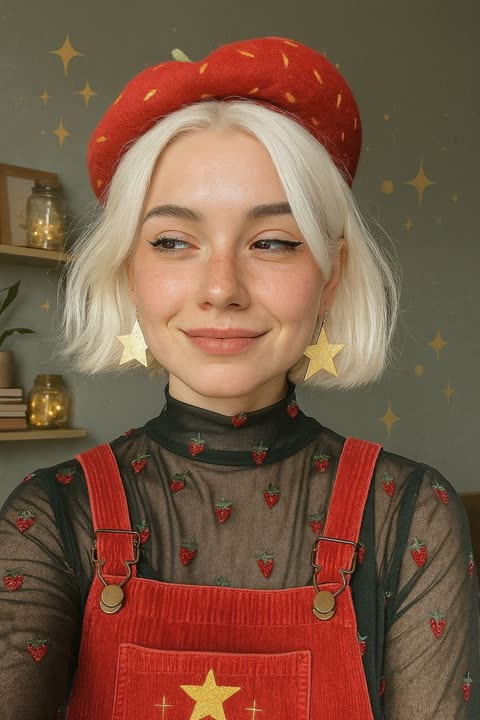</a>

把毕加索加可爱极简的风格参照与对眼鼻唇的具体简化要求叠在一起，并明确禁止写实细节。再用矢量色块、油画棒颗粒和深黑底上的有限配色收束成海报质感。

GPT Image 2 · 上传图改图 · 出处: [@Sairah_0 on X](https://x.com/Sairah_0/status/2067816667535794641) · 855 赞，统计于 2026-10-29

[`cubist`](tags.md#tag-cubist) [`kawaii`](tags.md#tag-kawaii) [`vector-portrait`](tags.md#tag-vector-portrait) [`fashion-illustration`](tags.md#tag-fashion-illustration) [`black-background`](tags.md#tag-black-background)

<details><summary><b>提示词</b></summary>

```text
Create a cute neo-expressionist cubist minimal vector portrait illustration, Picasso meets kawaii minimalism, inspired by stylized fashion editorials and playful modern art. Ultra-simplified exaggerated facial features with oversized abstract eyes, flat cartoon eye shapes, minimal black dots or single curved strokes, no realistic iris details, no eyelashes, extremely reduced facial detail. Tiny abstract nose drawn with one short angular line. Small single-stroke lips, tiny soft geometric mouth shape, minimal expression marks, no realistic mouth anatomy. Rounded cheeks, dreamy innocent expression, playful asymmetrical proportions, elongated elegant neck, simplified geometric facial planes, stylized angular hair shapes, subtle caricature aesthetics, childlike artistic distortion. Use clean scalable vector shapes, flat color blocking, bold primitive contour lines, sharp Bézier curves, abstract polygon composition, minimal linework, naive handmade drawing quality, expressive empty space, icon-like facial abstraction, no realistic rendering, 2D primitive facial symbols. Add subtle oil pastel grain overlays, rough handmade brush accents, raw scribbled handwritten marks, visible pigment texture, silkscreen poster feeling. Vibrant limited color palette against deep matte black background. Luxury editorial gallery poster composition, contemporary fashion illustration, artsy modern cubist poster, stylish and adorable, premium print-ready vector artwork.
```

</details>

<a id="gpt-image-pastel-storybook-photo-to-illustration-girl-bubble-tea"></a>
### 喝珍珠奶茶女孩的绘本粉彩插画

<a href="https://x.com/Emmma___0/status/2056369924399124937"></a>

把照片转成插画，用一串风格词叠加：拉长的形体、纤细不规则线条、平涂粉彩、纸张纹理和水彩柔感。结尾列出要避免的内容，如写实、3D和光泽表面，让画面保持扁平稚拙。

GPT Image 2 · 上传图改图 · 出处: [@Emmma___0 on X](https://x.com/Emmma___0/status/2056369924399124937) · 818 赞，统计于 2026-10-28

[`photo-to-illustration`](tags.md#tag-photo-to-illustration) [`storybook`](tags.md#tag-storybook) [`pastel`](tags.md#tag-pastel) [`watercolor`](tags.md#tag-watercolor) [`children-illustration`](tags.md#tag-children-illustration)

<details><summary><b>提示词</b></summary>

```text
Transform the photo into a delicate minimalist hand-drawn children’s illustration with a soft whimsical fairy-tale aesthetic. Use simple elongated shapes, thin imperfect hand-drawn lines, flat pastel colors, minimal details, and a cute doll-like character style with rosy cheeks, tiny facial features, and simplified anatomy. Add subtle paper texture, soft pencil and pastel shading, watercolor softness, and a clean white background with small stars or sparkles.Stylize the clothing in a playful storybook way with simplified shapes and gentle decorative details. The overall mood should feel airy, cozy, naive, and charming, like a modern Scandinavian nursery postcard or children’s book illustration. Avoid photorealism, 3D, cinematic lighting, glossy surfaces, complex shadows, realistic anatomy, and hyper-detail.
```

</details>

<a id="gpt-image-storybook-mother-toddler-camper-van"></a>
### 母亲与幼儿站在露营车旁的童书插画

<a href="https://x.com/Taaruk_/status/2066477758205853710">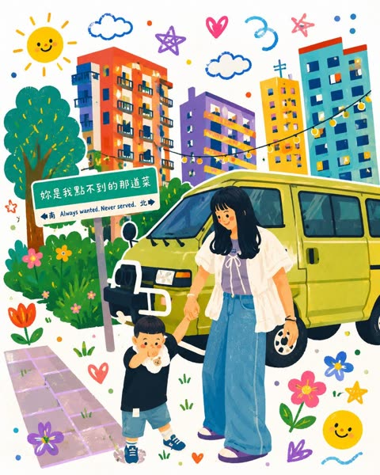</a>

提示词先写明照片里要保留的姿势、服装和互动，再交代要改变的画风，其余分成风格、构图、光线、质量四个板块。太阳、云朵、爱心、灯串等具体涂鸦清单，撑起了画面周围的装饰感。

GPT Image 2 · 上传图改图 · 出处: [@Taaruk_ on X](https://x.com/Taaruk_/status/2066477758205853710) · 688 赞，统计于 2026-10-29

[`storybook`](tags.md#tag-storybook) [`photo-to-illustration`](tags.md#tag-photo-to-illustration) [`kawaii`](tags.md#tag-kawaii) [`family`](tags.md#tag-family) [`pastel`](tags.md#tag-pastel)

<details><summary><b>提示词</b></summary>

```text
Turn my uploaded photo into a heartwarming whimsical children’s storybook illustration. A young mother holding her toddler’s hand beside a vintage beige camper van in a cozy urban neighborhood. Transform the realistic photo into a colorful hand-drawn artwork with soft pastel tones, playful doodles, smiling sun, fluffy clouds, flowers, stars, hearts, cute plants, and string lights. Bright apartment buildings in the background reimagined in a cheerful cartoon style. Keep the characters’ pose, clothing, and interaction faithful to the original photo while adding charming storybook details and a warm family atmosphere.

Style: modern children’s book illustration, kawaii aesthetic, hand-painted digital art, vibrant colors, textured brush strokes, clean outlines, adorable character design, whimsical environment, cozy neighborhood vibes, highly detailed, magical everyday life, storybook cover quality.

Composition: full-body mother and child in the center, camper van behind them, colorful flowers and doodles surrounding the scene, balanced layout, white background with decorative elements, cute and uplifting mood.

Lighting: soft daylight, warm highlights, dreamy glow, gentle shadows.

Quality: masterpiece, ultra detailed, charming illustration, high resolution, professional children’s book artwork, joyful and nostalgic feeling.
```

</details>

<a id="gpt-image-flat-doodle-redraw-rooftop-sunset-portrait"></a>
### 把日落街景人像重绘成扁平童趣涂鸦

<a href="https://x.com/Ciri_ai/status/2071082104817885419">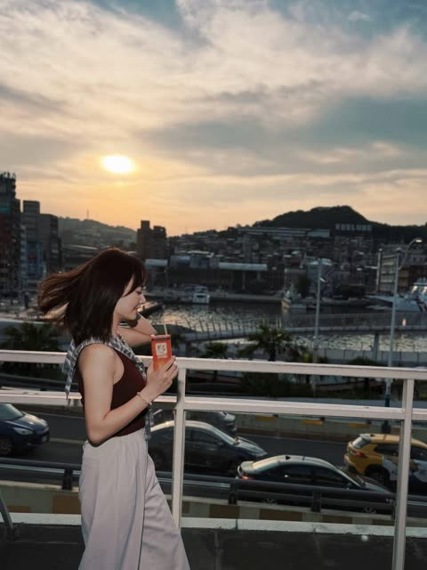</a>

用一条指令把参考照片重建为扁平色块，并刻意保留不完美的手绘轮廓。指明白纸底和大胆俏皮的配色，让涂鸦风格稳定且场景依然可辨认。

GPT Image 2 · 上传图改图 · 出处: [@Ciri_ai on X](https://x.com/Ciri_ai/status/2071082104817885419) · 561 赞，统计于 2026-10-29

[`doodle`](tags.md#tag-doodle) [`flat-illustration`](tags.md#tag-flat-illustration) [`photo-restyle`](tags.md#tag-photo-restyle) [`childlike`](tags.md#tag-childlike) [`hand-drawn`](tags.md#tag-hand-drawn)

<details><summary><b>提示词</b></summary>

```text
GPT Image 2 on Chatgpt

Prompt: Reconstruct this image as a single flat illustration infused with playful, childlike doodle elements. Use a bold, vibrant, and whimsical color palette, simplifying every detail into clean, flat shapes. Incorporate a handcrafted feel with slightly imperfect, hand-drawn outlines to create a charming, imaginative aesthetic, as if it were illustrated on a sheet of white paper. The overall style should be cute, expressive, and delightfully whimsical.
```

</details>

<a id="gpt-image-paper-texture-cover"></a>
### 照片变纸张质感极简封面

<a href="https://x.com/Ciri_ai/status/2113501433471656120"></a>

按小标题组织（构图、配色、质感），最后点明参照物：独立艺术书封面。

GPT Image 2.5 · 上传图改图 · 出处: [@Ciri_ai on X](https://x.com/Ciri_ai/status/2113501433471656120) · 561 赞，统计于 2026-10-27

[`paper-texture`](tags.md#tag-paper-texture) [`minimal`](tags.md#tag-minimal) [`cover`](tags.md#tag-cover)

<details><summary><b>提示词</b></summary>

```text
MINIMAL HAND-DRAWN PAPER ILLUSTRATION

Transform the uploaded photo into a minimalist, hand-drawn, paper-textured artistic cover.

Composition

- The main subject should occupy only 10–20% of the frame.
- Position the subject near the bottom center of the composition.
- Leave generous negative space throughout the image.
- Suggest the environment using only a few lines or small blocks of color.

Preserve

- The most recognizable features of the original subject.
- The essential silhouette and proportions.
- The original pose or primary action.
- Important objects and defining details.
- The core story, relationships, and emotional atmosphere.

Color Palette

- Extract the dominant colors from the original photograph.
- Limit the palette to no more than four main colors.
- Use bold yet restrained, flat color blocks.
- Maintain a harmonious, muted color combination.
- Add subtle paper grain and handmade brush textures.

Simplification
Remove unnecessary details and visual clutter. Retain only the essential visual information needed to make the subject instantly recognizable.

Typography

- Optionally incorporate a small amount of simple text.
- Keep typography short, subtle, and aesthetically refined.
- Integrate the text naturally into the composition.
- Aim for the visual language of an art-book cover, independent publishing, modern editorial design, or a contemplative picture book.
- Do not force typography into the image if it doesn't improve the composition.

Style and Materials

- Delicate, slightly imperfect hand-drawn lines.
- A few clearly defined acrylic-like flat color blocks.
- Rough, tactile paper texture.
- Visible handmade brushstrokes.
- Organic, irregular, natural contours.
- Subtle imperfections that make the artwork feel genuinely handmade.

Overall Mood
Quiet, poetic, sophisticated, minimalist, innocent, relaxed, artistic, thoughtful, distinctive, and premium.

Avoid

- Colored-pencil rendering.
- Dry-brush effects.
- Watercolor washes or bleeding.
- Pure line-art illustration.
- Overly detailed or realistic illustrations.
- Heavy impasto or thick oil-paint textures.
- Smooth, polished digital illustration.
- 3D rendering, glossy surfaces, or artificial lighting effects.
- Generic commercial cartoon styles.
- E-commerce advertising aesthetics.
- Generic poster templates.
- Excessive decorative elements.
- Overly complex compositions.
- Too much text.

Final Result: A refined, minimalist, hand-crafted paper illustration with generous negative space, restrained colors, subtle tactile textures, and the sophistication of an independent art-book cover.
```

</details>

<a id="nano-banana-double-exposure-profile-ruined-city"></a>
### 侧脸剪影双重曝光，内嵌夕阳废墟街道

<a href="https://x.com/HaniaAi12/status/2027628259467313402">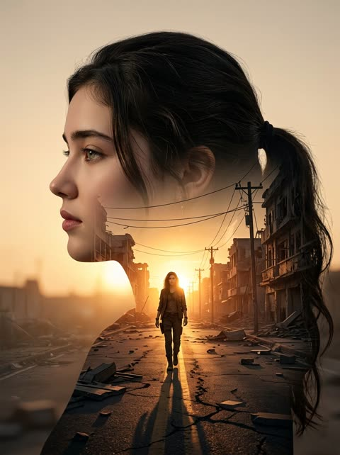</a>

先对参考照片锁定面部身份，再指定干净的侧脸剪影作为容器，里面嵌入独立场景。内部街景用对称透视线和地平线逆光太阳，并要求人像与城市的边缘平滑融合。

Nano Banana 2 · 上传图改图 · 出处: [@HaniaAi12 on X](https://x.com/HaniaAi12/status/2027628259467313402) · 534 赞，统计于 2026-10-28

[`double-exposure`](tags.md#tag-double-exposure) [`side-profile`](tags.md#tag-side-profile) [`golden-hour`](tags.md#tag-golden-hour) [`identity-lock`](tags.md#tag-identity-lock) [`cinematic`](tags.md#tag-cinematic)

<details><summary><b>提示词</b></summary>

```text
Use the uploaded picture as a reference (Strict identity lock, the face must match the attached reference photo exactly, preserving facial structure, skin tone, expression, and hairstyle (same haircut and hair texture) to create an ultra-realistic cinematic double exposure portrait of me in a clean left-facing side profile, sharp jawline and natural facial structure clearly defined.
The outer silhouette is dark and well-contoured against a soft warm beige sunset background. Inside the silhouette, seamlessly blend a dramatic urban street scene at golden hour: a lone me walking forward in the center of an empty destroyed city road, symmetrical perspective lines, damaged buildings on both sides, broken debris scattered along sidewalks, electric poles and cables stretching into the distance.
The sun positioned directly at the horizon behind the walking figure, creating strong backlight glow and long stretched shadow toward the camera.
Warm orange sunlight flooding through the internal city scene, high contrast, cinematic depth, realistic textures, smooth blending edges between portrait and environment.
Moody yet hopeful atmosphere, 8K resolution, sharp detail, soft vignette. size 4 5 image generate.
```

</details>

<a id="nano-banana-watercolor-couple-portrait-walnut-frame"></a>
### 胡桃木框中的情侣水彩肖像

<a href="https://x.com/Naiknelofar788/status/2029104746477563913">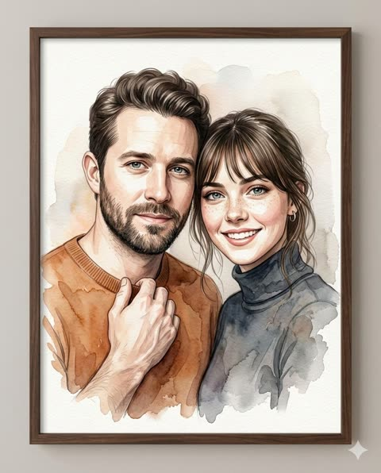</a>

先用不美化不重塑的硬性规则锁定参考照片中的人物身份，再用严格的构图段落固定姿势、头部角度和表情。分别写明湿画法与干画法，并补充画框和墙面展示的规格，让成品更像真实水彩。

Nano Banana 2 · 上传图改图 · 出处: [@Naiknelofar788 on X](https://x.com/Naiknelofar788/status/2029104746477563913) · 533 赞，统计于 2026-10-28

[`watercolor`](tags.md#tag-watercolor) [`couple-portrait`](tags.md#tag-couple-portrait) [`reference-photo`](tags.md#tag-reference-photo) [`framed-art`](tags.md#tag-framed-art) [`identity-preservation`](tags.md#tag-identity-preservation)

<details><summary><b>提示词</b></summary>

```text
Create a 4k resolution, 4:5 aspect ratio, high-quality digitally rendered watercolor-style portrait of a couple, presented inside a dark walnut wooden frame. The artwork must combine precise digital illustration with the soft, fluid characteristics of traditional watercolor painting.
Use the provided reference image to accurately replicate BOTH subjects identity.

Do NOT beautify, idealize, reshape, smooth excessively, or invent new features.

The final result must look like the exact same two people in watercolor form.
Subject Composition (Strict — Do Not Modify)
Intimate bust portrait, cropped slightly below mid-chest.
Male positioned on the left, female on the right.
Their upper bodies angled very slightly inward toward each other.
Shoulders gently overlapping, with the female subtly leaning into the male’s shoulder for a natural, connected feel.
Heads placed close together with temples nearly touching.
Both faces turned almost straight toward camera with only a minimal inward rotation (very subtle 5–10° inward angle).
Chins level and aligned at similar height (no exaggerated tilt).
Posture upright but relaxed — not stiff, not exaggerated.
Expressions soft and warm:

Male — calm, subtle closed-mouth smile.

Female — bright, open smile with gentle warmth.
Eye contact directed toward the viewer.
No dramatic head tilt. No exaggerated lean. Keep connection natural and balanced.
Outfit  (Automatic From Reference)
Carefully analyze the uploaded reference image and:
Detect exact clothing type (shirt, blouse, jacket, saree, kurta, suit, casualwear, etc.)

Preserve accurate fabric color, texture, and material type.

Replicate neckline, collar style, sleeve length, layering, visible accessories.
Maintain realistic folds and garment structure.
Do NOT replace clothing unless explicitly instructed.

Enhance subtle fabric texture slightly for watercolor realism, while keeping authenticity.
Artistic Style & Watercolor Execution
Medium Simulation:
Blend wet-on-wet soft gradients in background.

Use wet-on-dry precision around facial features.
Allow organic pigment bleeding around edges.
Maintain visible watercolor paper grain texture.
Brushwork Detail:
Fine strokes for eyelashes and individual hair strands.

Controlled detailing around eyes and lips.
Broad translucent washes for clothing.
Subtle pigment pooling and natural gradient transitions.

Soft watercolor blooms around outer edges.
Do NOT over-sharpen or make it look like a digital painting — it must feel like genuine watercolor.
Color Palette (Adaptive + Balanced)
Maintain accurate skin tones from reference.

Use soft warm neutrals (cream, beige, tan) as base tones.
Introduce complementary cool washes when appropriate.

Background should remain light, airy, and minimally dominant.
Avoid heavy contrast or overly saturated tones.
 Lighting & Depth
Soft, natural, diffused lighting from slightly above and front-facing.
Gentle highlight across forehead, cheekbones, and nose bridge.
Subtle shadow under jawline and neck area for depth.
No dramatic side-lighting.
High-key, airy atmosphere.
Enhance depth subtly while maintaining watercolor softness.

Presentation & Framing
Artwork displayed inside a dark walnut or espresso-finished wooden frame.
Modern flat frame profile with subtle wood grain.
No visible matting.
Art extends near edges for a contemporary full-bleed look.
Visible watercolor paper texture inside frame.
Clean neutral wall mockup presentation.
Frame visible evenly on all four sides with centered wall alignment.
Slightly Increased Quality Controls (For Better Results)
Increase fine facial detailing by 15–20% while maintaining watercolor softness.
Improve edge control around eyes and lips for clarity.

Maintain subtle texture contrast between skin and clothing.

Ensure both subjects remain equally sharp and balanced.
```

</details>

<a id="nano-banana-photo-ink-split-poster"></a>
### 一半照片一半水墨的海报

<a href="https://x.com/ChillaiKalan__/status/2110581440085987751"></a>

要求严格五五分，再分别规定两半如何处理同一主体。

Nano Banana 2.1 · 上传图改图 · 出处: [@ChillaiKalan__ on X](https://x.com/ChillaiKalan__/status/2110581440085987751) · 414 赞，统计于 2026-10-27

[`split-composition`](tags.md#tag-split-composition) [`ink`](tags.md#tag-ink) [`photo-to-art`](tags.md#tag-photo-to-art)

<details><summary><b>提示词</b></summary>

```text
Using the uploaded reference image, create a single high-resolution vertical 2:3 editorial art poster.

Divide the canvas into two perfectly equal horizontal sections, each occupying exactly 50% of the total height. Separate them with a clean, perfectly straight horizontal dividing line.

1. TOP HALF — ORIGINAL REFERENCE PHOTOGRAPH

Use the uploaded reference photograph directly in the upper 50% of the poster.

Preserve its original photographic quality, sharpness, natural lighting, and color relationships.

Allow only subtle, intelligent cropping around the outer edges when necessary, without compromising the main subject.

If required, naturally extend a small portion of the surrounding environment to fit the composition.

Do not redraw, illustrate, stretch, blur, or modify the subject's appearance, structure, or spatial relationships.

Do not introduce black borders, white margins, or empty edges.

2. BOTTOM HALF — MINIMALIST EDITORIAL ILLUSTRATION

Use a warm, near-white ivory paper background with an extremely subtle paper texture.

Analyze the main subject and visual story of the uploaded reference image.

Extract only the primary subject, preserving one or two essential identifying elements.

Remove or heavily simplify all secondary details, including background architecture, crowds, vehicles, fences, signs, trees, and other unnecessary elements.

Transform the primary subject into a sophisticated black-ink editorial illustration.

ILLUSTRATION STYLE:

Use natural, clean pen strokes with varied line weight.

Preserve an authentic hand-drawn appearance with expressive but controlled linework.

Avoid overly precise engraving aesthetics, excessive internal details, and dense cross-hatching.

Place a large, nearly pure-black rectangular ink block behind the illustrated subject.

The rectangular block should have subtly imperfect, handmade print-style edges.

Keep the black background clean, with only fine paper grain and minimal noise.

Avoid obvious hatching, scratches, architectural lines, or complex textures.

ILLUSTRATION SCALE AND COMPOSITION:

The illustrated subject must occupy approximately 72–77% of the canvas width and 58–64% of the bottom section's height.

Maintain a clear visual focal point with generous negative space surrounding the illustration.

3. COLOR RULES

The bottom illustration must follow a strictly black-and-white color palette by default.

Preserve only one localized accent color if the original reference image contains a clearly distinctive, concentrated color element with meaningful narrative importance.

Ordinary blue skies, green vegetation, stone surfaces, skin tones, and environmental colors must not be treated as accent colors.

Any preserved accent color must remain strictly localized to the relevant subject or area.

Never allow accent colors to spread across the entire illustration.

4. TYPOGRAPHY AND EDITORIAL LAYOUT

Automatically generate concise, meaningful English typography based on the content of the uploaded reference photograph.

The typography must resemble handwritten editorial annotations from an independent art publication.

TOP-LEFT CORNER:

Generate a short handwritten title consisting of 2–5 words, arranged across two lines.

Directly beneath the title, include three short English action verbs relevant to the photograph.

TOP-RIGHT CORNER:

Display only two lines of geographic coordinates:

Latitude
Longitude

Do not include any additional text in this area.

BOTTOM-LEFT CORNER:

Display the location name followed by the word "DIARY."

Directly beneath it, add one short descriptive English sentence inspired by the photograph.

TYPOGRAPHY STYLE:

Use a rough, upright, slightly irregular handwritten typeface.

Maintain subtle imperfections and a natural editorial annotation aesthetic.

Avoid elegant cursive, calligraphy, overly decorative lettering, and excessively polished typography.

5. FINAL ART DIRECTION

The finished poster must combine:

Authentic, high-quality photography.
Minimalist black-and-white editorial illustration.
Generous negative space.
Independent art publication aesthetics.
Quiet, restrained, sophisticated visual storytelling.
Natural handwritten typography.
A balanced relationship between documentary realism and expressive hand-drawn artwork.

The overall result should resemble a carefully designed, collectible editorial art print.

6. FINAL OUTPUT REQUIREMENTS

ASPECT RATIO:
2:3 vertical.

RESOLUTION:
High-resolution, sharp, print-quality output.

COMPOSITION:

Exactly 50% original reference photography on top.

Exactly 50% editorial illustration on the bottom.

One perfectly straight horizontal dividing line.

One complete, standalone poster.

RESTRICTIONS:

No collages.
No multi-poster layouts.
No combined images.
No unnecessary decorative elements.
No modifications to the original subject's identity or appearance.
No excessive illustration details.
No changes to the original photograph's natural color relationships.

FINAL GOAL:

Create a sophisticated, visually balanced editorial art poster that faithfully preserves the uploaded reference photograph while transforming its primary subject into an expressive, minimalist black-ink illustration.
```

</details>

<a id="gpt-image-editorial-photo-paper-illustration-poster"></a>
### 上半实拍下半手作纸面插画的编辑海报

<a href="https://x.com/saniaspeaks_/status/2097293815698612309">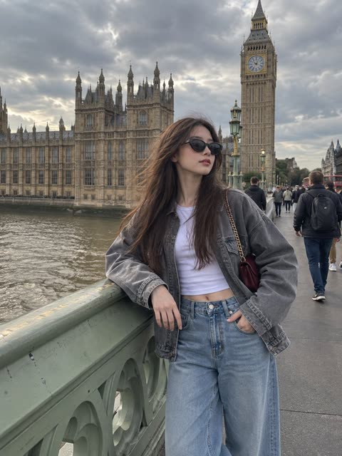</a>

严格的 3:4 版式分成上下两等份，上半保持原照片的真实感，下半改为小幅手作纸面插画。调色限定为从原图取样的四种颜色，让上下两部分自然呼应，而每张上传图各自成海报的要求避免了多图合并。

GPT Image 2 · 上传图改图 · 出处: [@saniaspeaks_ on X](https://x.com/saniaspeaks_/status/2097293815698612309) · 329 赞，统计于 2026-10-28

[`editorial-poster`](tags.md#tag-editorial-poster) [`split-layout`](tags.md#tag-split-layout) [`paper-illustration`](tags.md#tag-paper-illustration) [`art-book`](tags.md#tag-art-book) [`photo-to-art`](tags.md#tag-photo-to-art)

<details><summary><b>提示词</b></summary>

```text
Premium editorial poster for every uploaded photo never combine images. Use a strict 3:4 vertical layout split into two equal horizontal halves. Keep the top half as a faithful photorealistic version of the original image, preserving the subject’s identity, pose, clothing, composition, lighting, colors, and atmosphere with only subtle high-end editorial grading.
Transform the bottom half into a warm off-white minimalist art space featuring a small centered handmade paper-style illustration inspired by the main subject and key elements of the photo. Use imperfect sketch lines, flat acrylic-like shapes, visible paper texture, rough brush marks, and organic edges. Keep plenty of negative space and limit the palette to four harmonious colors sampled from the original image. Optional minimal editorial text may be added if it naturally fits. The overall result should feel quiet, poetic, artistic, refined, and like a premium contemporary art-book cover.
```

</details>

<a id="gpt-image-blue-doodle-couple-photo"></a>
### 照片变成蓝色涂鸦情侣插画

<a href="https://x.com/Ciri_ai/status/2114588014034948562"></a>

提示词先说明要保留的内容（人物、姿势、构图），再用钴蓝线条、桃色腮红和金色爱心配奶油色纸面的有限配色来简化风格。再用不要渐变、不要阴影、不要纹理这类排除条件，保持画面扁平、有手绘感。

GPT Image 2.5 · 上传图改图 · 出处: [@Ciri_ai on X](https://x.com/Ciri_ai/status/2114588014034948562) · 280 赞，统计于 2026-10-28

[`doodle`](tags.md#tag-doodle) [`minimalist`](tags.md#tag-minimalist) [`couple`](tags.md#tag-couple) [`blue-ink`](tags.md#tag-blue-ink) [`photo-to-illustration`](tags.md#tag-photo-to-illustration)

<details><summary><b>提示词</b></summary>

```text
Transform your photo into a minimalist doodle illustration using GPT Image 2.5.

Prompt: Transform the uploaded photo into a cute minimalist hand-drawn doodle illustration. Preserve the original people, pose, composition, and recognizable facial characteristics, but simplify them into charming cartoon forms.

Use a naive handmade sketchbook aesthetic with bold, slightly wobbly cobalt-blue brush-pen outlines, simple rounded shapes, minimal details, and imperfect hand-drawn strokes. Add subtle warm peach/pink blush on the cheeks and small golden-yellow heart accents around the characters.

Keep the illustration clean and airy with a warm cream/off-white paper background. Use flat, very limited colors, no realistic shading, no gradients, and no complex textures. The overall feeling should be sweet, wholesome, playful, cozy, and romantic, like a handmade children's doodle or personal notebook drawing.

Style keywords: minimalist doodle, folk-inspired hand drawing, blue ink illustration, cute couple illustration, naive art, imperfect brush strokes, simple cartoon, handmade sketchbook aesthetic, warm cream paper, subtle blush, tiny heart doodles, charming imperfections, clean composition.
```

</details>

<a id="gpt-image-papercraft-diorama-family-landmark-photo"></a>
### 地标牌坊前的纸艺立体全家福

<a href="https://x.com/Emmma___0/status/2058383856055595158"></a>

先点明纸艺立体模型这一参考风格，再分别限定形状、角色比例、极简五官（圆点眼和腮红）以及带阴影的层叠纵深。激光切割卡纸的比喻锁定了边缘质感和材质。

GPT Image 2 · 上传图改图 · 出处: [@Emmma___0 on X](https://x.com/Emmma___0/status/2058383856055595158) · 272 赞，统计于 2026-10-28

[`papercraft`](tags.md#tag-papercraft) [`diorama`](tags.md#tag-diorama) [`style-transfer`](tags.md#tag-style-transfer) [`family-photo`](tags.md#tag-family-photo) [`layered-paper`](tags.md#tag-layered-paper)

<details><summary><b>提示词</b></summary>

```text
Convert this images into a soft, handcrafted paper-cut layered illustration style, inspired by papercraft diorama aesthetics. Use smooth rounded shapes, simplified cute character proportions, and minimal facial details (dot eyes, blush cheeks) to create a warm, charming look. Apply stacked paper layers with visible depth, subtle shadows between layers, and clean cut edges that resemble laser-cut cardstock.
```

</details>

<a id="nano-banana-second-world"></a>
### 第二世界：把你的照片重建成另一个世界

<a href="https://x.com/Just_sharon7/status/2107741881329205516"></a>

带版本号（v1.2）的 JSON 提示词，作者 @hx831126，由 @Just_sharon7 转发。自带接缝和文字的自检步骤。

Nano Banana 2.1 · 上传图改图 · 出处: [@Just_sharon7 on X](https://x.com/Just_sharon7/status/2107741881329205516) · 263 赞，统计于 2026-10-27

[`json`](tags.md#tag-json) [`world-building`](tags.md#tag-world-building) [`photo-to-art`](tags.md#tag-photo-to-art)

<details><summary><b>提示词</b></summary>

```text
{   "name": "Second World",   "version": "1.2",   "task": "Using each uploaded photo as an independent source, generate one complete poster per photo. Do not merge multiple photos onto the same canvas.",   "output": {     "aspect_ratio": "3:4",     "orientation": "vertical",     "one_poster_per_photo": true,     "layout": "Canvas horizontally divided at exactly 50% height, with upper and lower sections each occupying 50%, same width",     "no_mockup": true   },   "core_principle": "The Second World is already hidden in the photo. Let the same scene pass through the midline and continue downward, changing only the physical rules in the lower half. Continuity of the cross-boundary structure is the highest visual priority.",   "upper_half": {     "source": "The current uploaded photo",     "preserve": [       "Subject identity and appearance",       "Character poses, expressions, and actions",       "Spatial relationships, proportions, and perspective",       "Original color atmosphere",       "Natural lighting and shadows",       "Environment and important details"     ],     "allowed_change": "Only necessary proportional cropping to fit the upper half, avoiding cutting off key subjects or connection structures",     "forbidden": [       "Redesigning the photo",       "Redrawing or replacing the subject",       "Rearranging characters and objects",       "Changing the photo's colors",       "Fictional lighting or background"     ],     "fidelity_rule": "Prioritize directly reusing the original photo; do not claim generative redrawing as lossless preservation of the original. If the tool cannot meet original preservation and precise layout, state the limitations—do not lower requirements and claim full compliance."   },   "continuity": {     "choose_one_source_structure": "Identify a structure from the original photo that can naturally extend to the midline, such as a road, shoreline, water surface, reflection, tree branch, light beam, architectural line, clothing flow, or body movement",     "requirements": [       "The structure must continue into the lower half at the exact midline meeting point",       "Maintain believable continuity in direction, position, scale, and occlusion relationships",       "Establish a visible connection first, then develop the lower half's imagination",       "Both halves must read as the same scene, not like two independent images stacked vertically"     ],     "transition_edge": {       "optional": "Allow irregular torn paper edges",       "rule": "Tearing must follow the original image's structure, not just as decoration, and avoid using the same tearing shape for every image",       "interaction": "Source elements can touch, cling to, pass through, or cross over the torn edge"     }   },   "lower_half": {     "background": "Warm ivory paper texture, with subtle visible fibers, rich negative space",     "media": [       "Restrained photo fragments",       "Simple cut-paper shapes",       "Minimal black hand-drawn lines"     ],     "construction": "Extend downward from where the upper half's source structure meets the midline, then gradually reinterpret it as the Second World",     "prohibited": "Do not turn it into an isolated entrance, window, stage, platform, or floating vignette, unless the form clearly grows continuously from the original photo",     "density": "Bright, airy, restrained—avoid dense drawing or collage buildup"   },   "second_world_logic": {     "question": "If the structure in the photo could be touched, used, entered, folded, stretched, or changed, what would it naturally become?",     "interaction_count": 1,     "instruction": "Establish only one specific, clear, and interesting interaction per image, prioritizing possibilities discovered from the original image's shapes and actions, not reverse-engineering from fixed props or templates.",     "examples_for_logic_only": [       "Water surface remains connected to the lake while being rolled up or stretched",       "Road extends onto the paper, becoming a path that can be continued by drawing",       "An existing light beam extends downward, becoming something gently graspable"     ],     "variation": "Judge each work individually—do not mechanically repeat actions, connection structures, compositions, or jokes. Examples are not required content."   },   "tiny_figures": {     "count": "0–3",     "appearance": "Minimalist, tiny black line figures",     "add_only_if": "Figures can engage in necessary and explicit physical interaction with the extending structure",     "omit_if": "Source photo already contains strong human actions",     "forbidden": "Using little figures as irrelevant decorations or adding crowds just for liveliness"   },   "copy": {     "language": "Primarily Chinese, paired with a short English accent",     "main_text": "A short, witty, cute, humorous Chinese marginal note, or one with a slight surprising insight",     "english": "Shorter, lighter English supplement; can complement the Chinese without word-for-word translation",     "intent": "Make viewers smile knowingly after seeing the image and then the small text, or suddenly understand one more layer",     "requirements": [       "Recreate based on this photo's specific interaction with the Second World",       "Don't just name the action or mechanically describe the image",       "Can include anthropomorphism, slight contrasts, deadpan little jokes, or gentle self-deprecation",       "Can have a wake-up-call vibe, but no grand life lessons",       "Don't force self-love, motivational, or emotional comfort templates",       "Humor targets the situation, without belittling characters' appearance, identity, or circumstances"     ],     "avoid": [       "Vague inspirational fluff",       "Grand maxims",       "Preachiness",       "Ad slogans",       "Irrelevant internet memes",       "Fixed 'same..., different...' sentence structures",       "Reusing the same copy for every image"     ],     "examples_for_tone_only": [       {         "context": "Taking away the sunset",         "chinese": "这个不算超重吧",         "english": "just a little sunset"       },       {         "context": "Rolling the lake surface into a paper ribbon",         "chinese": "不用袋子，我卷着走",         "english": "no bag, thanks"       },       {         "context": "Shadow rolled into a bed corner",         "chinese": "影子先躺了，我再走会儿",         "english": "five more minutes"       }     ],     "example_rule": "Borrow only the humor mechanism—do not fix example sentences into new works."   },   "handwriting": {     "scale": "Small marginal notes, English even smaller—no huge titles stealing the scene",     "placement": "In natural white space, not obscuring subjects, cross-boundary connection points, or key interactions",     "chinese": "Truly natural, slightly messy handwriting, not neat computer-generated script",     "english": "Similarly like casually scribbled, relaxed and irregular",     "details": [       "Slight variations in character size",       "Baseline with minor undulations",       "Tilt angles not perfectly consistent",       "Natural variations in spacing",       "Strokes with pressure and pauses",       "Minimal overlapping or incomplete ink traces"     ],     "corrections": {       "allowed": true,       "frequency": "Occasional only—not required for every image",       "method": "Can gently strike through a mistaken or revised word, adding the correct version nearby or above",       "limit": "Usually at most 1–2 instances—don't turn the whole page into a repeatedly scribbled draft",       "legibility": "Final meaning must be clear—no simulating handwriting with gibberish or meaningless errors"     }   },   "overall_style": {     "mood": [       "Indie magazine vibe",       "Bright and airy",       "Warm paper texture",       "Restrained",       "Lightly humorous",       "Subtle handmade traces"     ],     "hierarchy": [       "Original photo and cross-boundary structure",       "Clear interaction in the lower half",       "Small bilingual handwritten marginal notes"     ],     "finish": "Like gently unveiling a hidden world in the photo, not pasting an extra illustration below it"   },   "negative_prompt": [     "Detached lower-half illustrations",     "Broken cross-boundary continuity",     "Generic torn-paper templates",     "Isolated entrances or windows",     "Irrelevant vignettes",     "Dense illustrations",     "Random decorations",     "Decorative crowds",     "Altering original photo colors",     "Redesigning the upper photo",     "Glossy 3D",     "Scrapbook clutter",     "Huge titles",     "Neat printed-style handwriting",     "Nonsensical text",     "Motivational fluff",     "Watermarks",     "Logos",     "UI elements",     "Merging multiple photos",     "Grid layouts"   ],   "final_check": [     "Does each original image correspond to one independent 3:4 poster?",     "Do upper and lower sections strictly each occupy 50%?",     "Is the upper half's original photo faithfully preserved, with only necessary cropping?",     "Is there one authentic source structure accurately continuing at the midline?",     "Does the lower half belong to the same scene as the original image, not an isolated illustration?",     "Is there only one clear, natural, and non-repetitive templated interaction?",     "Is the Chinese interesting and lingering, not just a simple action label or preachiness?",     "Are the Chinese and English in small, natural, messy, and readable handwriting?",     "Is sufficient negative space preserved?"   ] }  Note: The above are target requirements; generated results still need checking for original image preservation, seams, and text—do not treat generative redrawing as lossless original preservation.
```

</details>

<a id="gpt-image-watercolor-travel-journal-woman-overwater-villas"></a>
### 水彩海岛旅行肖像与水上木屋

<a href="https://x.com/KrishnaBio1/status/2102793005837242737">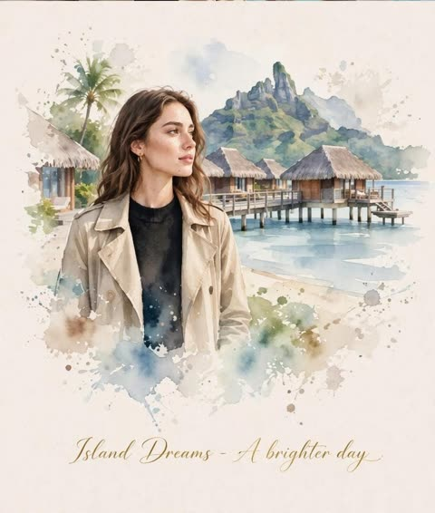</a>

提示词把版面分成写实照片区和重绘同一场景的水彩区，逐一写明每个目的地的服装与环境，并要求四幅画面中人物面孔保持一致。

GPT Image 2.5 · 上传图改图 · 出处: [@KrishnaBio1 on X](https://x.com/KrishnaBio1/status/2102793005837242737) · 229 赞，统计于 2026-10-28

[`watercolor`](tags.md#tag-watercolor) [`travel-journal`](tags.md#tag-travel-journal) [`photo-to-illustration`](tags.md#tag-photo-to-illustration) [`identity-consistency`](tags.md#tag-identity-consistency) [`editorial-layout`](tags.md#tag-editorial-layout)

<details><summary><b>提示词</b></summary>

```text
Create a refined luxury editorial travel-art composition inspired by all four reference photographs, seamlessly combining four distinct travel moments into one sophisticated vertical travel journal artwork: Dubai coastline with the iconic sail-shaped Burj Al Arab and a stylish woman in a beige trench coat during golden hour; Icelandic snowy mountains beneath a dramatic glowing green and violet Northern Lights sky, with the woman wearing a warm beige knit beanie, turtleneck and coat; lush tropical Bali rice terraces surrounded by palm trees and misty green mountains, with the woman in a beige trench coat and soft cream knitwear; and a dreamy tropical island setting with turquoise ocean, traditional overwater thatched villas, palm trees and a dramatic volcanic mountain in the background, with the woman wearing a beige trench coat over a black top.

Upper section: create a sophisticated realistic cinematic travel photography sequence that naturally blends these four destinations while keeping each environment visually recognizable and beautifully composed. Preserve the woman’s facial identity, facial proportions, hairstyle, skin tone, expression and overall appearance consistently across the different scenes. Authentic candid travel photography, natural realistic lighting appropriate to each destination, subtle film grain, detailed textures, realistic skin and clothing, atmospheric depth, elegant muted color grading, premium high-end travel magazine photography, cinematic composition, refined European-editorial travel aesthetic.

Lower section: transform the exact same four travel scenes into delicate handmade watercolor illustrations, maintaining the recognizable landscapes, architecture, mountains, ocean, rice terraces, Burj Al Arab, Northern Lights, overwater villas, palm trees, clothing, poses and overall composition from the photographic scenes. Use loose translucent watercolor washes, delicate ink outlines, soft pigment bleeding, imperfect hand-painted brushwork, visible paper texture, airy negative space, subtle pastel tones and naturally faded watercolor edges. Keep the woman recognizable and consistent across all four illustrated scenes.

Arrange the four destinations as one harmonious artistic travel story rather than four unrelated images, with smooth visual transitions and balanced spacing. Surround the artwork with generous warm ivory/off-white textured handmade paper. Add a small elegant handwritten travel-journal caption near the bottom, such as “Four Places, One Journey” or “Wander Beyond the Ordinary”, followed by a thin minimalist horizontal line.

Overall aesthetic: luxury travel journal, fine-art watercolor postcard, cinematic travel photography, nostalgic wanderlust, contemporary editorial design, sophisticated and serene, tactile handmade paper, premium art direction, elegant natural proportions, highly detailed realistic photography transitioning beautifully into airy watercolor artwork, clean composition, no clutter, no heavy borders, no unnecessary graphic elements.

Portrait orientation, premium editorial layout, cohesive visual storytelling, realistic-to-watercolor transformation, sophisticated travel magazine quality, high detail.
```

</details>

<a id="gpt-image-watercolor-straw-hat-denim-fashion-portrait"></a>
### 棕榈倒影墨镜的水彩时尚肖像

<a href="https://x.com/Kubra_286/status/2100423480348946448">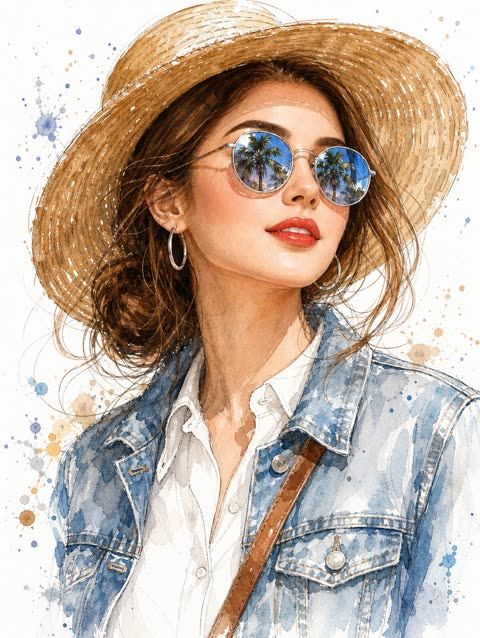</a>

用人脸参考锁定身份,同时明确把风格转为水彩加钢笔墨线,并用负面提示排除照片质感。单独写墨镜倒影条款,再分开写光线、背景和构图,让小细节保持清晰。

GPT Image 2.5 · 上传图改图 · 出处: [@Kubra_286 on X](https://x.com/Kubra_286/status/2100423480348946448) · 227 赞，统计于 2026-10-29

[`watercolor`](tags.md#tag-watercolor) [`fashion-illustration`](tags.md#tag-fashion-illustration) [`face-reference`](tags.md#tag-face-reference) [`sunglasses-reflection`](tags.md#tag-sunglasses-reflection) [`straw-hat`](tags.md#tag-straw-hat)

<details><summary><b>提示词</b></summary>

```text
Face Reference: Use the uploaded face reference image as the primary facial identity reference. Preserve the woman’s recognizable facial structure, proportions, eyes, nose, lips, jawline, cheekbones, and overall likeness. Do not copy the photo’s lighting or photographic texture; reinterpret the same face naturally in a traditional watercolor and pen-and-ink fashion illustration style.

Create a stunning 4:5 chest-up fashion portrait of the reference woman, centrally framed. She wears a light blue denim jacket with realistic stitching, flap pockets, and metallic silver buttons over a crisp white button-down shirt. A brown leather crossbody strap runs diagonally across her torso.

She wears a wide-brimmed woven straw sun hat, polished silver hoop earrings, and reflective silver-framed round sunglasses. Her head is tilted slightly upward toward her right (viewer’s left), with shoulders subtly angled. Her expression is serene, confident, sophisticated, and effortlessly chic. Her lips are slightly parted with vibrant glossy red lipstick.

Her medium-length hair is gathered into a loose, messy low bun, with delicate wispy strands escaping around her face and neck and gently lifted by a soft breeze.

Render the skin using transparent watercolor layers, subtle blush tones, delicate ink contours, and soft shadow transitions. Use expressive hand-painted watercolor washes with wet-on-wet blending, pigment blooms, visible brushstrokes, organic edges, and subtle spontaneous paint splatters.

Sunglasses Reflection: Make the round lenses highly detailed and reflective, showing tall tropical palm trees silhouetted against a brilliant bright-blue sky. The reflections should look crisp and believable while remaining naturally integrated into the watercolor illustration.

Lighting: Bright natural summer sunlight entering from the upper left, creating defined shadows beneath the hat brim and warm, gentle gradients across the forehead, cheeks, neck, jawline, and clothing folds. Fresh, sun-drenched vacation atmosphere.

Background: Pure clean white background with delicate scattered watercolor droplets, pigment specks, and loose paint splashes in muted blue, beige, brown, and gray. Keep the background airy and minimalist without distracting from the subject.

Art Style: Traditional watercolor illustration, fine pen-and-ink drawing, luxury fashion sketch, editorial magazine artwork, expressive brushwork, loose watercolor washes, hand-painted texture, elegant feminine fashion, tropical travel lifestyle aesthetic, realistic facial likeness, sophisticated composition, high detail, organic watercolor imperfections.

Composition: Close-up portrait, eye-level camera perspective with a subtle upward emphasis, chest-up framing, centered subject, elegant proportions, refined editorial fashion illustration.

Aspect Ratio: 4:5

Negative Prompt: distorted face, altered facial identity, different person, excessive makeup, plastic skin, cartoon face, anime style, 3D render, photorealistic photography, blurry sunglasses, distorted reflections, extra fingers, deformed hands, duplicate accessories, messy anatomy, harsh background, oversaturated colors, heavy outlines, artificial digital texture.
```

</details>

<a id="gpt-image-oil-painted-european-cafe-woman-coral-blouse"></a>
### 欧洲咖啡馆里的油画风女子

<a href="https://x.com/hey_am_cherry/status/2106245541508382774"></a>

用结构化 JSON 把人物、服装、构图、背景、配色、质感和光线拆成独立字段，每个要素都便于单独调整。指定四色色板和厚重笔触来稳住油画质感，负面提示词则避免照搬参考图的姿势并排除写实风格。

GPT Image 2.5 · 上传图改图 · 出处: [@hey_am_cherry on X](https://x.com/hey_am_cherry/status/2106245541508382774) · 197 赞，统计于 2026-10-28

[`oil-painting`](tags.md#tag-oil-painting) [`cafe`](tags.md#tag-cafe) [`json-prompt`](tags.md#tag-json-prompt) [`mid-century`](tags.md#tag-mid-century) [`variation`](tags.md#tag-variation)

<details><summary><b>提示词</b></summary>

```text
"aspect_ratio": "9:16",
    "style": "vintage European café oil painting, expressive brushwork, mid-century editorial artwork",

    "subject": {
      "character": "stylish young European woman with shoulder-length wavy auburn hair",
      "expression": "calm, confident, slightly playful gaze toward the viewer",
      "pose": "seated sideways at a small café table, one arm resting on the chair back while the other lightly holds a coffee cup",
      "details": "subtle makeup, berry-red lipstick, small gold earrings"
    },

    "outfit": {
      "top": "deep coral-red short-sleeve blouse with a relaxed neckline",
      "style": "chic 1960s-inspired European fashion"
    },

    "composition": {
      "framing": "medium-wide portrait",
      "camera_angle": "slightly elevated three-quarter angle",
      "subject_position": "slightly left of center",
      "foreground": "round café table with coffee, small glass and scattered objects"
    },

    "background": {
      "setting": "charming old European café interior",
      "design": "large abstract geometric wall shapes mixed with subtle architectural details",
      "colors": ["teal", "coral", "cream", "burnt orange"]
    },

    "props": [
      "ceramic espresso cup",
      "small glass bottle",
      "vintage café chair",
      "folded napkin"
    ],

    "color_palette": "teal, coral red, cream, burnt orange and warm brown",

    "texture": "thick imperfect oil brushstrokes, visible canvas grain, slightly weathered painted surface",

    "lighting": "warm afternoon window light with soft natural shadows",

    "mood": "stylish, relaxed, nostalgic European café atmosphere",

    "negative_prompt": "exact recreation of reference, same pose, same character, same outfit, same composition, photorealistic, 3D render, CGI, text, logo, watermark"
  }
}
```

</details>

<a id="gpt-image-watercolor-ink-over-shoulder-portrait"></a>
### 回眸水彩墨线肖像

<a href="https://x.com/Kubra_286/status/2100063240105435328"></a>

分块锁定姿势、画风以及左暖右冷的色彩分区，在保留人物面部特征的同时让水彩效果可控。湿画法晕染、飞溅、垂直流淌和冷压纸纹理等具体描述造就了墨线与水彩混合的质感。

GPT Image 2.5 · 上传图改图 · 出处: [@Kubra_286 on X](https://x.com/Kubra_286/status/2100063240105435328) · 187 赞，统计于 2026-10-28

[`watercolor`](tags.md#tag-watercolor) [`ink`](tags.md#tag-ink) [`portrait`](tags.md#tag-portrait) [`selfie`](tags.md#tag-selfie) [`splatter`](tags.md#tag-splatter)

<details><summary><b>提示词</b></summary>

```text
Use the uploaded image ONLY for face and identity reference. Do not change facial structure, proportions, or realism.

Create a high-detail mixed-media watercolor portrait of a woman with POSE STRICTLY LOCKED:
Three-quarter view from back
Upper body slightly turned away from camera
Head turned back over shoulder toward viewer
Direct eye contact
Frame includes head, neck, and partial shoulder
Composition tightly cropped (portrait focus)

Expression (IMPORTANT):
Calm yet emotionally intense, soft but piercing gaze, slightly parted lips, natural subtle tension in face — no exaggerated emotion.

Rendering Style (LOCKED)
Watercolor + ink hybrid illustration
Soft fluid washes + sharp ink linework
Fine dark lines defining eyes, nose, lips, jawline
No painterly blur, no oil painting effect

Color & Lighting (STRUCTURED)
Strong split color contrast:
Left side → warm (yellow, orange, magenta)
Right side → cool (blue, cyan, violet)
Abstract light from upper-left (represented as color bursts, not realistic light)
Skin tones blend naturally with watercolor pigments (not flat coloring)

Watercolor Behavior (VERY IMPORTANT)
Wet-on-wet blending on face and skin
Visible paint splashes around subject
Controlled splatter and ink drops
Subtle vertical drips (especially lower area)
Organic color blooms and pigment edges
Colors slightly bleed beyond edges (natural watercolor feel)

Hair (MATCH STYLE)
Loose tied or messy bun
Wispy strands around face
Hair absorbs surrounding colors (blue, purple, warm highlights)
Slight motion feel, not static

Background
Clean white base
Dynamic watercolor splashes behind subject (not random — composition-aware)
No clutter, no objects

Texture
Visible cold-press watercolor paper grain
Slight rough pigment edges
Natural watercolor imperfections preserved

Style: expressive watercolor + ink illustration

Mood: artistic, soulful, emotionally engaging

Aspect ratio: 4:5
```

</details>

<a id="nano-banana-artbook-spread"></a>
### 照片做成怀旧杂志画册跨页

<a href="https://x.com/Just_sharon7/status/2107574724041769179"></a>

保留原照片的人物，再加一份素描呼应，排成印刷跨页的样子。

Nano Banana 2.1 · 上传图改图 · 出处: [@Just_sharon7 on X](https://x.com/Just_sharon7/status/2107574724041769179) · 183 赞，统计于 2026-10-27

[`magazine`](tags.md#tag-magazine) [`photo-to-art`](tags.md#tag-photo-to-art) [`nostalgic`](tags.md#tag-nostalgic)

<details><summary><b>提示词</b></summary>

```text
Create a nostalgic, magazine-inspired photo-and-illustration artbook spread using the reference image as the visual foundation. Maintain the original subjects, identities, poses, expressions, wardrobe, framing, and emotional tone without altering their recognizable appearance.

Design the composition as two vertically flowing interpretations of the same moment.

In the upper portion, recreate the reference as an intimate cinematic photograph. Use gentle natural light, realistic skin and fabric textures, muted authentic colors, delicate analog film grain, soft background separation, and shallow depth of field. The image should feel spontaneous and personal, like a quiet memory captured on film rather than a staged portrait.

In the lower portion, reinterpret that identical moment as a raw black-and-white ink drawing printed on warm ivory sketchbook paper. Preserve the characters, pose, proportions, and composition while replacing photographic detail with expressive hand-drawn linework, irregular pen strokes, loose cross-hatching, unfinished contours, and restrained shading. Allow small imperfections so the illustration feels genuinely handmade rather than digitally traced.

Blend both sections naturally so the photograph appears to dissolve into the drawing, creating the impression of a memory gradually becoming an illustration.

Surround the lower artwork with restrained editorial design elements: a small numbered chapter heading, a brief poetic handwritten annotation, tiny archival or documentary notes, and subtle typographic details. Keep all typography secondary to the imagery.

Use generous cream-toned negative space, tactile paper grain, faint printing imperfections, understated vintage publishing details, and an elegant minimalist layout inspired by contemporary photography journals and Japanese visual diaries.

Overall mood: nostalgic, intimate, poetic, cinematic, handcrafted, sophisticated, and emotionally warm.

Maintain realistic anatomy, natural body proportions, recognizable faces, believable hands, and consistent clothing throughout both versions. High-detail editorial finish, cohesive photo-to-sketch transition, no branding, no logos, and no watermark.
```

</details>

<a id="nano-banana-ink-doodle-portrait-floral-frame"></a>
### 黑色墨线涂鸦肖像配花卉装饰边框

<a href="https://x.com/NikhilRajX/status/2030916225107398873">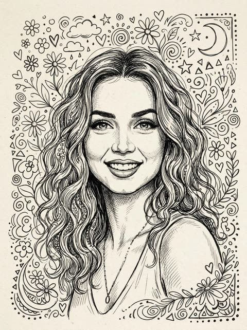</a>

提示词先给出笔法线索（粗细变化的线条、交叉排线阴影），再列出环绕头部的具体装饰元素。它要求保持参考照片的相貌、表情和发型，并把配色限定为米白纸上的纯黑墨线。

Nano Banana 2 · 上传图改图 · 出处: [@NikhilRajX on X](https://x.com/NikhilRajX/status/2030916225107398873) · 181 赞，统计于 2026-10-28

[`ink-doodle`](tags.md#tag-ink-doodle) [`line-art`](tags.md#tag-line-art) [`portrait`](tags.md#tag-portrait) [`reference-photo`](tags.md#tag-reference-photo) [`hand-drawn`](tags.md#tag-hand-drawn)

<details><summary><b>提示词</b></summary>

```text
Gemini Nano Banana 2

Prompt: Create a whimsical black ink line art doodle portrait of the person in the reference photo, hand-drawn sketch style with varying line thickness, detailed curly wavy hair flowing naturally, big expressive smiling eyes with lashes, warm happy smile showing teeth, soft cross-hatched shading on face for depth, surrounded by playful floating decorative doodles like small flowers, daisies, hearts, clouds, stars, tiny spirals, dots, triangles, abstract swirls and leaves all around the head and shoulders in a cute decorative frame, loose energetic pen lines, high detail in facial features to keep exact likeness, expression and hairstyle identical, clean beige or off-white paper background, no color, pure black ink illustration, charming notebook doodle aesthetic, intricate but not overcrowded --ar 3:4 --stylize 250 --v 6
```

</details>

<a id="nano-banana-paint-splash-newspaper-portrait"></a>
### 蓝橙泼墨与旧报纸拼贴的艺术肖像

<a href="https://x.com/weiinberg/status/2027610358035423634">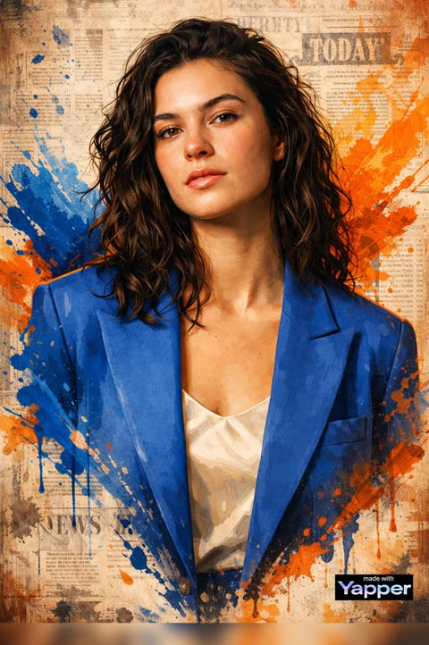</a>

先对参考照片的面部下达严格的身份锁定，再单独指定插画风格，既保留相貌又呈现绘画质感。蓝橙互补色泼墨叠在复古报纸拼贴背景上，配合电影感布光和干净不杂乱的限定，让海报画面保持克制。

Nano Banana 2 · 上传图改图 · 出处: [@weiinberg on X](https://x.com/weiinberg/status/2027610358035423634) · 175 赞，统计于 2026-10-28

[`portrait`](tags.md#tag-portrait) [`paint-splash`](tags.md#tag-paint-splash) [`newspaper-collage`](tags.md#tag-newspaper-collage) [`blue-orange`](tags.md#tag-blue-orange) [`identity-preserve`](tags.md#tag-identity-preserve)

<details><summary><b>提示词</b></summary>

```text
Create a high-end stylized artistic portrait of the same person in a modern digital painting / illustrated poster style. The face must remain 100% identical to the reference photo — preserve exact facial structure, proportions, skin tone, facial features, age, hairstyle, and identity. No modification, beautification, reshaping, or enhancement of the face is allowed. Absolute identity accuracy required.
The subject is shown in a half-body or close-up framing, looking slightly upward with a confident and calm expression. Maintain realistic proportions and natural anatomy while rendering in a detailed illustration style.
The face must be ultra-detailed and sharply focused, with realistic skin texture translated into a refined digital painting finish — not cartoonish, not exaggerated, not distorted.
Surround the portrait with dynamic colorful paint splashes and expressive ink strokes, blending organically into the composition. Use bold yet controlled blue and orange tones for contrast and energy.
Background: layered vintage newspaper collage texture with subtle typography fragments, distressed paper details, and abstract paint splashes integrated naturally into the layout. The collage should feel artistic but clean, not cluttered.
Lighting: cinematic high-contrast lighting with dramatic highlights and controlled shadows, enhancing depth while maintaining natural facial realism.
Color grading: vibrant but balanced, strong blue and orange contrast, modern poster aesthetic.
Output: ultra-detailed, 4K resolution, clean edges, sharp rendering, professional poster art quality, modern digital illustration with realistic depth and premium finish
```

</details>

<a id="nano-banana-double-exposure-profile-lake-landscape"></a>
### 侧脸双重曝光人像与薄雾湖景

<a href="https://x.com/HaniaAi12/status/2032993631792148666">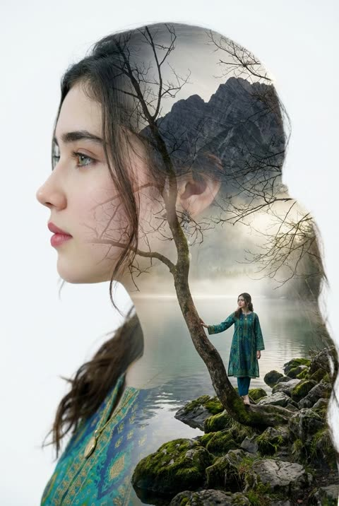</a>

提示词两次引用参考图，分别用于大侧脸和小人物，让同一人物以两种比例出现。剪影内填入湖泊、山脉与薄雾场景，枯枝、极简白底和海报构图让画面保持干净。

Nano Banana 2 · 上传图改图 · 出处: [@HaniaAi12 on X](https://x.com/HaniaAi12/status/2032993631792148666) · 174 赞，统计于 2026-10-28

[`double-exposure`](tags.md#tag-double-exposure) [`profile-portrait`](tags.md#tag-profile-portrait) [`surreal`](tags.md#tag-surreal) [`landscape`](tags.md#tag-landscape) [`reference-image`](tags.md#tag-reference-image)

<details><summary><b>提示词</b></summary>

```text
double exposure portrait of the character(reference image) in side profile looking left, blending into bare tree branches, surreal artistic composition, inside the silhouette a peaceful lake landscape with mountains and mist, a small character(of the same reference image) in a standing on mossy rocks holding a curved tree trunk, dreamy atmosphere, soft natural light, minimal white background, ethereal and poetic mood, fine art photography, ultra detailed, cinematic lighting, high resolution, poster design.
```

</details>

<a id="gpt-image-photo-to-paper-second-world"></a>
### 窗边照片延伸为墨线手绘纸面

<a href="https://x.com/harboriis/status/2110328832352010584"></a>

画面对半分割，让窗台这一结构穿过分界线，照片自然延续成纸面与线稿。撕纸边缘顺着原有结构走，并用一句简短手写字幕收尾。

GPT Image 2.5 · 上传图改图 · 出处: [@harboriis on X](https://x.com/harboriis/status/2110328832352010584) · 171 赞，统计于 2026-10-28

[`split-canvas`](tags.md#tag-split-canvas) [`paper-collage`](tags.md#tag-paper-collage) [`line-doodle`](tags.md#tag-line-doodle) [`continuity`](tags.md#tag-continuity) [`editorial`](tags.md#tag-editorial)

<details><summary><b>提示词</b></summary>

```text
Vertical 3:4 canvas split into two strictly equal horizontal halves: top 50% and bottom 50%. The upper half stays photographic; the lower half becomes the continued Second World. Together they must read as one scene.

the

UPPER HALF

Keep the photo faithful. Preserve the subject, pose, spatial relationships, color atmosphere, and natural light. Do not redesign, repaint, replace, or restage it. Only necessary proportional

cropping is allowed.

CONTINUITY (highest priority)

Identify one source structure that naturally reaches the center split: a road, shoreline, water, reflection, branch, beam of light, piece of architecture, or body movement. This structure must cross the boundary and continue into the lower half. The Second World begins from the photograph itself, so the same scene passes through the seam and simply changes its physical rules.

TRANSITION EDGE

The center may use an irregular torn-paper edge, but the tear must follow the source structure, never act as decoration. Source elements may touch, follow, break through, or extend beyond edge. Never force the same tear shape onto every image.

The Second World

LOWER HALF

Ivory paper with subtle fibers and abundant negative space. Continue the chosen structure downward from the exact point where it meets the split, then reinterpret it with restrained photo fragments, cut-paper forms, and minimal black hand-drawn lines. The lower world must stay visibly attached Never isolate it as a separate portal, window, stage, platform, or floating vignette unless it clearly comes from the photo.

SECOND WORLD LOGIC

Ask: if this structure became touchable, usable, enterable, or changeable, what would it naturally become? Create one image-specific interaction. For example, water may stay attached while being pulled, a road may continue as a drawn path, or light may become something held. Do not repeat actions mechanically.

FIGURES

Add 0-3 tiny black line figures only when useful. They must physically interact with the continued structure. If the photo already contains strong human action, add none. Never use figures as decoration.

World

CAPTION

One

short handwritten English caption (2-6 words) based on the action. Natural, light, slightly witty. Spell it correctly. No inspirational quotes and no fixed "Same..., different..." phrasing.

STYLE

Real photography above, warm paper below, minimal black line doodles, subtle handmade collage texture, independent-magazine mood. Bright, airy, restrained. It should feel as if the Second already hidden inside the photo and simply continued downward.

was

NEGATIVE

No detached lower-half illustration, no generic torn-paper template, no isolated portal, no unrelated vignette, no broken continuity, no dense illustration, no random decoration, no crowd, altered photo colors, no redesign of the upper image, no glossy 3D, no scrapbook clutter, no gibberish text, no watermark, no logo, no UI.
```

</details>

<a id="gpt-image-minimalist-paper-texture-art-cover"></a>
### 照片变身极简纸质肌理艺术封面

<a href="https://x.com/Ciri_ai/status/2114229094867169705"></a>

规定主体只占画面10%到20%并置于底部居中，色板限制为取自原照的四种颜色，同时列出要用的材质和要避开的风格。可选的少量文字让画面像艺术书封面。

GPT Image 2.5 · 上传图改图 · 出处: [@Ciri_ai on X](https://x.com/Ciri_ai/status/2114229094867169705) · 152 赞，统计于 2026-10-28

[`photo-to-art`](tags.md#tag-photo-to-art) [`minimalist`](tags.md#tag-minimalist) [`paper-texture`](tags.md#tag-paper-texture) [`art-book-cover`](tags.md#tag-art-book-cover) [`flat-color`](tags.md#tag-flat-color)

<details><summary><b>提示词</b></summary>

```text
Turn your photo into a minimalist paper-textured art cover using Chat GPT Image 2.5.

Prompt: Transform the uploaded photo into a minimalist, hand-drawn, paper-textured artistic cover.

Composition

- The main subject should occupy only 10–20% of the frame.
- Position the subject near the bottom center of the composition.
- Leave generous negative space throughout the image.
- Suggest the environment using only a few lines or small blocks of color.

Preserve

- The most recognizable features of the original subject.
- The essential silhouette and proportions.
- The original pose or primary action.
- Important objects and defining details.
- The core story, relationships, and emotional atmosphere.

Color Palette

- Extract the dominant colors from the original photograph.
- Limit the palette to no more than four main colors.
- Use bold yet restrained, flat color blocks.
- Maintain a harmonious, muted color combination.
- Add subtle paper grain and handmade brush textures.

Simplification
Remove unnecessary details and visual clutter. Retain only the essential visual information needed to make the subject instantly recognizable.

Typography

- Optionally incorporate a small amount of simple text.
- Keep typography short, subtle, and aesthetically refined.
- Integrate the text naturally into the composition.
- Aim for the visual language of an art-book cover, independent publishing, modern editorial design, or a contemplative picture book.
- Do not force typography into the image if it doesn't improve the composition.

Style and Materials

- Delicate, slightly imperfect hand-drawn lines.
- A few clearly defined acrylic-like flat color blocks.
- Rough, tactile paper texture.
- Visible handmade brushstrokes.
- Organic, irregular, natural contours.
- Subtle imperfections that make the artwork feel genuinely handmade.

Overall Mood
Quiet, poetic, sophisticated, minimalist, innocent, relaxed, artistic, thoughtful, distinctive, and premium.

Avoid

- Colored-pencil rendering.
- Dry-brush effects.
- Watercolor washes or bleeding.
- Pure line-art illustration.
- Overly detailed or realistic illustrations.
- Heavy impasto or thick oil-paint textures.
- Smooth, polished digital illustration.
- 3D rendering, glossy surfaces, or artificial lighting effects.
- Generic commercial cartoon styles.
- E-commerce advertising aesthetics.
- Generic poster templates.
- Excessive decorative elements.
- Overly complex compositions.
- Too much text.

Final Result: A refined, minimalist, hand-crafted paper illustration with generous negative space, restrained colors, subtle tactile textures, and the sophistication of an independent art-book cover.
```

</details>

<a id="gpt-image-photo-to-watercolor-split-travel-poster"></a>
### 旅行照片与水彩重绘上下分屏海报

<a href="https://x.com/miratechtool/status/2102656456478589340">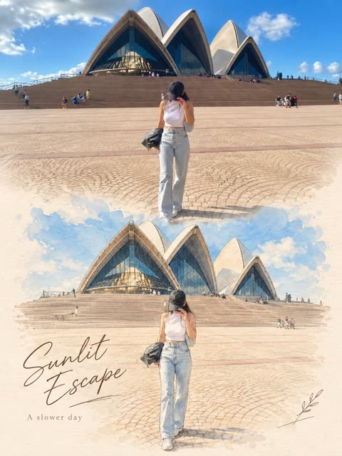</a>

提示词把参考照片原样锁定在上半部分，下半部分用水彩、彩铅和钢笔线稿重绘同一场景。柔和的衔接过渡、暖白纸张底色和简短的手写标题，让上下两半成为一张完整的编辑风海报。

GPT Image 2.5 · 上传图改图 · 出处: [@miratechtool on X](https://x.com/miratechtool/status/2102656456478589340) · 151 赞，统计于 2026-10-28

[`photo-to-watercolor`](tags.md#tag-photo-to-watercolor) [`split-layout`](tags.md#tag-split-layout) [`editorial-poster`](tags.md#tag-editorial-poster) [`travel`](tags.md#tag-travel) [`handwritten-title`](tags.md#tag-handwritten-title)

<details><summary><b>提示词</b></summary>

```text
Made with GPT Image 2.5 on
@itsPolloAI


Prompt : Use the uploaded image as the exact reference. Preserve the original subjects, identities, poses, composition, colors, lighting, background, and key details. Do not add, remove, or rearrange major elements.

Create a vertical 3:4 editorial poster with two sections:

- Top half: keep the original photo natural, sharp, and essentially unchanged.
- Bottom half: recreate the exact same scene as a refined hand-drawn illustration in soft watercolor, colored pencil, and fine ink sketch style.

Keep the same subjects, positions, perspective, and recognizable details. Use soft pastel tones, a warm off-white paper background, subtle paper texture, and a premium editorial / art-book / postcard feel. Add a soft seamless transition between the photo and illustration.

Add minimal elegant typography: a handwritten-style title and a small simple subtitle. Use context-appropriate text such as “A Brighter Day” and “A Slower Life”, or for pets/family “Good Friends”, “Brighter Days”, or “Happier Tails ♡”.

Optional: add a few subtle hand-drawn decorative details like tiny petals, leaves, hearts, or sketch marks only if they naturally fit.

Do not change identities or the scene, and do not make the lower section look like photorealism, 3D, anime, or cartoon.
```

</details>

<a id="gpt-image-naive-pencil-illustration-from-photo"></a>
### 照片重绘为朴素风铅笔插画海报

<a href="https://x.com/oggii_0/status/2113499885181747239"></a>

先叠加俏皮比例、不完美轮廓、柔和对比的平涂色等风格特征，再明确禁用阴影、渐变和3D效果，让画面保持扁平。结尾用高级设计师海报和铅笔质感锚定整体气质。

GPT Image 2.5 · 上传图改图 · 出处: [@oggii_0 on X](https://x.com/oggii_0/status/2113499885181747239) · 134 赞，统计于 2026-10-28

[`naive-illustration`](tags.md#tag-naive-illustration) [`pencil`](tags.md#tag-pencil) [`flat-color`](tags.md#tag-flat-color) [`photo-to-illustration`](tags.md#tag-photo-to-illustration) [`poster`](tags.md#tag-poster)

<details><summary><b>提示词</b></summary>

```text
Draw this photo in the style of a modern, artistic naïve illustration: minimalist, hand-drawn, with playful proportions, imperfect outlines, soft yet contrasting flat colors, and decorative pencil strokes. No shadows, no gradients, no 3D effects. The overall look should resemble a premium designer poster, with a charming, whimsical, and authentic hand-drawn pencil aesthetic.
```

</details>

<a id="gpt-image-photo-to-crayon-memory-card-red-house"></a>
### 红房子照片与下方蜡笔插画记忆卡

<a href="https://x.com/harboriis/status/2105894224076198150"></a>

上下各占一半，上半保留原照片，下半在象牙色纸上把同一场景重绘为扁平色块。从照片提取调色板，配合蜡笔与丝网印质感描述和负面清单，让插画保持朴素并忠于原图。

GPT Image 2.5 · 上传图改图 · 出处: [@harboriis on X](https://x.com/harboriis/status/2105894224076198150) · 133 赞，统计于 2026-10-28

[`memory-card`](tags.md#tag-memory-card) [`photo-to-illustration`](tags.md#tag-photo-to-illustration) [`crayon`](tags.md#tag-crayon) [`split-layout`](tags.md#tag-split-layout) [`naive-art`](tags.md#tag-naive-art)

<details><summary><b>提示词</b></summary>

```text
Use the uploaded photo as the only content source. Create a vertical 3:4 "real photo + minimal illustration" memory card based entirely on that image. Preserve the main subjects, subject count, pose, viewpoint, spatial relationships, and overall scene logic. Do not redesign the source or add unrelated content.

Layout:Split the card into two horizontal sections, about 50% top and 50% bottom. The top half keeps the uploaded photo with photographic texture. Crop naturally to fit, but do not stretch,mirror, rearrange, or alter the main subjects. Keep natural lighting, real materials, and the original color mood, with subtle editorial grading. The lower half uses a warm ivory handmade-paper background and shows a centered horizontal illustration of the same scene. The illustration occupies about 63-67% of the lower width, with generous blank space around it.

Scene translation:In the lower illustration, preserve the most recognizable subjects, major structures, important objects, viewpoint, depth, relative scale, and key positions from the source. Remove tiny clutter, fine photographic texture, reflections, and complex shadows.Simplify the scene into slightly awkward geometric color blocks and thin hand-drawn lines. People and animals, when present, remain identifiable through silhouette, pose,hair or fur shape,clothing color, and placement, but facial detail may be reduced. Outlines may wobble, break, shift, or misalign slightly while the scene stays recognizable.

Illustration style: Use restrained naive editorial drawing with soft geometric simplification and handmade quality. Combine thin sketchy linework with flat shapes. The lower scene should feel calm, clean, slightly imperfect, and visually reduced rather than technically precise. Avoid realistic rendering.

Color:Extract 4-6 representative colors from the uploaded photo and reinterpret them as a soft low-saturation palette. Use muted tones derived from the source, with flat fills and enough contrast to separate major subjects and scene layers. No complex gradients,glossy highlights, or heavy 3D modeling.

Texture:Blend crayon, pastel,screen-print, and old-book illustration qualities. Keep paper show-through, fine grain, slight pigment unevenness, worn edges, and subtle off-register shifts. The result should feel like an independent editorial illustration printed on aged

paper:warm, quiet, nostalgic, and collectible.

Typography:Below the illustration, you may include exactly two short English lines related to the scene.mood,place.or moment. Use a small vintage serif font, left-aligned. If clean readable text cannot be rendered, leave the area blank. No other readable text.

Cleanup:Remove phone UI,subtitles, screenshot traces, and interface elements when present. Do not invent missing scenery or decorative props.

Negative:No major layout change, no added or missing primary subjects, no photoreal painting, no polished watercolor,no anime,no manga, no vector clip-art, no oil paint, no impasto, no 3D, no logo,no watermark, no black border,no UI,no unrelated decoration.
```

</details>

<a id="gpt-image-geometric-editorial-poster-traffic-light-pair"></a>
### 靠在红绿灯旁的情侣扁平几何插画

<a href="https://x.com/Ziha_ai/status/2108532094796533952">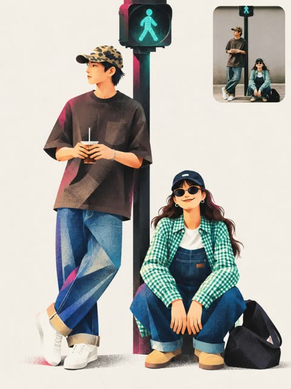</a>

用格式锁定、角色、风格、面部、色板和负面提示分段，把上传的照片转成带颗粒感的扁平海报。给出十六进制色值并规定渐变只出现在形体重叠处，色彩因此可控，姿势与服装由参考图保留。

GPT Image 2.5 · 上传图改图 · 出处: [@Ziha_ai on X](https://x.com/Ziha_ai/status/2108532094796533952) · 124 赞，统计于 2026-10-29

[`geometric-illustration`](tags.md#tag-geometric-illustration) [`editorial-poster`](tags.md#tag-editorial-poster) [`reference-image`](tags.md#tag-reference-image) [`flat-color`](tags.md#tag-flat-color) [`print-grain`](tags.md#tag-print-grain)

<details><summary><b>提示词</b></summary>

```text
Create a finished editorial character poster inspired by the uploaded reference image. Preserve the recognizable identity, hairstyle, clothing details, pose, and important visual characteristics of the subject while translating them into a sophisticated flat geometric illustration.

FORMAT LOCK

Vertical 3:4 composition. Edge-to-edge warm off-white paper background. One standalone poster. Clean editorial layout.

CHARACTER

One adult character constructed from a few oversized asymmetric geometric shapes. Slightly exaggerated proportions, small head, elongated capsule-like limbs, simple mitten-style hands, and one oversized object integrated naturally into the pose and silhouette. Preserve the subject's recognizable appearance while simplifying details into graphic shapes.

STYLE

Flat geometric illustration, asymmetric proportions, crisp color blocks, soft airbrushed shading, subtle dark-to-color spray gradients where shapes overlap, fine print grain, delicate stippling mostly inside darker areas, refined contemporary editorial poster aesthetic.

FACE & EXPRESSION

Minimal black cut-paper facial features: simple crescent eyes and minimal mouth. The emotion should be communicated primarily through the character's full-body gesture and silhouette rather than detailed facial expression.

PALETTE

Warm off-white #F3F1EB, near-black 10100F, hot pink #F553D2, warm red #F42726, cobalt 293EA1, emerald 13785D. Keep colors flat and graphic with controlled soft gradients only where forms overlap.

Keep the character and oversized object as the main visual focus. Use generous negative space and a balanced editorial arrangement. The object should visibly affect the overall silhouette and feel integrated into the character's pose.

NEGATIVE PROMPT

No extra text, logos, outlined cartoon style, glossy 3D, realistic skin, photorealism, coarse canvas texture, busy background, extra limbs, distorted anatomy, excessive facial detail, photorealistic shading, random objects, clutter, watermark.
```

</details>

<a id="gpt-image-photo-to-storybook-gouache-illustration"></a>
### 家庭照片转手绘水粉绘本插画

<a href="https://x.com/Maercihh/status/2115065217822650537"></a>

用结构化 JSON 把风格、主体保留、色板和质量控制分开写，上传照片的人物相貌、姿势和构图保持不变，只替换绘画媒介。再用明确的禁止清单排除数码滤镜、3D 和动漫感。

GPT Image 2.5 · 上传图改图 · 出处: [@Maercihh on X](https://x.com/Maercihh/status/2115065217822650537) · 113 赞，统计于 2026-10-28

[`storybook`](tags.md#tag-storybook) [`gouache`](tags.md#tag-gouache) [`photo-to-illustration`](tags.md#tag-photo-to-illustration) [`json-prompt`](tags.md#tag-json-prompt) [`pastel`](tags.md#tag-pastel)

<details><summary><b>提示词</b></summary>

```text
{
"task": "Transform the uploaded original photograph into a charming, hand-painted children's storybook illustration.",

"input": {
"reference_image": "{{UPLOAD ORIGINAL PHOTO}}"
},

"style": {
"art_style": "Traditional hand-painted picture book illustration",
"medium": "Gouache and colored pencil on lightly textured paper",
"visual_inspiration": "Warm, nostalgic Japanese and European children's book illustrations",
"rendering": "Soft painterly brushwork, delicate pencil outlines, visible pigment texture, subtle dry-brush marks, imperfect hand-drawn details",
"texture": "Fine paper grain, gentle chalky pigment, subtle watercolor-like color variation",
"finish": "Authentic traditional illustration, handmade and organic, never resembling a digital filter or 3D render"
},

"subject_preservation": {
"identity": "Preserve the recognizable identity, facial structure, age, hairstyle, skin tone, and distinguishing features of every person in the original photograph.",
"people_count": "Maintain the exact number of people in the source image.",
"pose": "Preserve the original body positions, gestures, head angles, and interactions.",
"composition": "Retain the original arrangement of subjects and the overall framing.",
"clothing": "Preserve the original clothing designs, silhouettes, and recognizable accessories while translating their appearance into painted fabric textures.",
"objects": "Retain the important objects, pets, flowers, food, furniture, and background elements present in the original.",
"expression": "Preserve the original emotional expression and relationship between subjects.",
"accuracy": "Do not invent additional people, remove important subjects, change relationships, or replace the original scene."
},

"illustration_treatment": {
"faces": "Simplify facial details into expressive picture-book features while retaining each person's recognizable likeness. Use gentle blush on cheeks, softly defined noses, simple expressive eyes, and natural smiles only when present in the source.",
"skin": "Warm peach and natural skin tones with visible painterly texture and soft tonal transitions.",
"hair": "Render hair in layered, flowing brushstrokes with fine hand-drawn strands and natural color variation.",
"clothing": "Use softly painted folds, knitted textures, delicate seams, and subtle pencil detailing.",
"edges": "Use organic, slightly irregular hand-painted edges instead of sharp photographic contours.",
"details": "Preserve meaningful details but simplify tiny visual elements into elegant illustrated shapes.",
"shading": "Gentle, diffuse shading with minimal harsh shadows and no dramatic photorealistic lighting."
},

"color_palette": {
"overall": "Muted pastel colors, warm cream, sage green, dusty blue, lavender, butter yellow, soft coral, muted rose, and warm earthy browns.",
"saturation": "Soft and restrained, with occasional natural pops of color.",
"contrast": "Low to medium contrast with clear subject separation.",
"highlights": "Soft creamy highlights with a subtle chalky finish.",
"shadows": "Warm, desaturated shadows without black digital gradients."
},

"background": {
"preservation": "Retain the original background and its essential objects.",
"treatment": "Translate background elements into simplified, softly painted forms consistent with the storybook aesthetic.",
"depth": "Use gentle atmospheric separation rather than photographic depth of field.",
"simplification": "Reduce distracting details without changing the location or scene.",
"background_color": "Preserve the original dominant colors, allowing subtle warm or pastel harmonization."
},

"composition": {
"framing": "Match the original photograph.",
"perspective": "Maintain the original camera angle and spatial relationships.",
"cropping": "Do not crop, zoom, extend, or reposition the original image unnecessarily.",
"aspect_ratio": "Preserve the original image aspect ratio.",
"visual_balance": "Maintain the original visual hierarchy while creating a cohesive illustrated composition."
},

"lighting_and_mood": {
"lighting": "Soft natural daylight with gentle, evenly distributed illumination.",
"mood": "Tender, comforting, innocent, nostalgic, intimate, and quietly joyful.",
"atmosphere": "The feeling of a cherished moment illustrated in a beautifully printed children's book.",
"emotional_tone": "Sincere and understated, avoiding exaggerated cuteness or artificial sentimentality."
},

"quality_control": {
"photographic_appearance": "Remove the photographic rendering while preserving the source image's recognizable content.",
"avoid": [
"Photorealistic skin",
"Plastic or airbrushed faces",
"Glossy 3D rendering",
"Anime or manga styling",
"Exaggerated cartoon proportions",
"Oversized eyes",
"Unnatural facial changes",
"Excessive outlines",
"Neon colors",
"Harsh black shadows",
"Heavy blur",
"Artificial bokeh",
"Unnecessary decorative elements",
"Unrequested text or lettering",
"Watermarks and signatures",
"Unintended changes to the original composition"
],
"final_result": "A cohesive, high-quality, hand-painted storybook illustration that immediately resembles the original photograph, as if a skilled children's book illustrator lovingly painted the moment by hand."
}
}
```

</details>

<a id="gpt-image-photo-to-naive-sketch-memory-card"></a>
### 雪山湖面小船照片配蜡笔手绘插画

<a href="https://x.com/harboriis/status/2104455859447501166"></a>

把 3:4 画面上下对半，上半保留原照片，下半在旧纸上用蜡笔与粉彩重绘简化版。提示词写明版面比例、从照片提取色板、纹理层次和负面清单，让插画紧贴原图。

GPT Image 2.5 · 上传图改图 · 出处: [@harboriis on X](https://x.com/harboriis/status/2104455859447501166) · 112 赞，统计于 2026-10-28

[`photo-to-sketch`](tags.md#tag-photo-to-sketch) [`memory-card`](tags.md#tag-memory-card) [`crayon`](tags.md#tag-crayon) [`split-layout`](tags.md#tag-split-layout) [`landscape`](tags.md#tag-landscape)

<details><summary><b>提示词</b></summary>

```text
Use the uploaded photo as the only content source. Create a vertical 3:4 “real photo + minimal illustration” memory card based entirely on that image. Preserve the main subjects, subject count, pose, viewpoint, spatial relationships, and overall scene logic. Do not redesign the source or add unrelated content.
Layout
Split the card into two horizontal sections, about 50% top and 50% bottom. The top half keeps the uploaded photo with photographic texture. Crop naturally to fit, but do not stretch, mirror, rearrange, or alter the main subjects. Keep natural lighting, real materials, and the original color mood, with subtle editorial grading. The lower half uses a warm ivory handmade-paper background and shows a centered horizontal illustration of the same scene. The illustration occupies about 63-67% of the lower width, with generous blank space around it.
Scene Translation
In the lower illustration, preserve the most recognizable subjects, major structures, important objects, viewpoint, depth, relative scale, and key positions from the source. Remove tiny clutter, fine photographic texture, reflections, and complex shadows. Simplify the scene into slightly awkward geometric color blocks and thin hand-drawn lines. People and animals, when present, remain identifiable through silhouette, pose, hair or fur shape, clothing color, and placement, but facial detail may be reduced. Outlines may wobble, break, shift, or misalign slightly while the scene stays recognizable.
Illustration Style
Use restrained naive editorial drawing with soft geometric simplification and handmade quality. Combine thin sketchy linework with flat shapes. The lower scene should feel calm, clean, slightly imperfect, and visually reduced rather than technically precise. Avoid realistic rendering.
Color
Extract 4-6 representative colors from the uploaded photo and reinterpret them as a soft low-saturation palette. Use muted tones derived from the source, with flat fills and enough contrast to separate major subjects and scene layers. No complex gradients, glossy highlights, or heavy 3D modeling.
Texture
Blend crayon, pastel, screen-print, and old-book illustration qualities. Keep paper show-through, fine grain, slight pigment unevenness, worn edges, and subtle off-register shifts. The result should feel like an independent editorial illustration printed on aged paper: warm, quiet, nostalgic, and collectible.
Typography
Below the illustration, you may include exactly two short English lines related to the scene, mood, place, or moment. Use a small vintage serif font, left-aligned. If clean readable text cannot be rendered, leave the area blank. No other readable text.
Cleanup
Remove phone UI, subtitles, screenshot traces, and interface elements when present. Do not invent missing scenery or decorative props.
Negative
No major layout change, no added or missing primary subjects, no photoreal painting, no polished watercolor, no anime, no manga, no vector clip-art, no oil paint, no impasto, no 3D, no logo, no watermark, no black border, no UI, no unrelated decoration.
Vertical 3:4 split card · photo top / naive illustration bottom · aged paper texture
```

</details>

<a id="gpt-image-graphite-pencil-portrait-blue-butterflies-cap"></a>
### 戴帽子的石墨铅笔肖像与蓝色蝴蝶

<a href="https://x.com/Arina_hoqe/status/2104426552972980328"></a>

先锁定参考图中的人物身份，再把色彩限制为黑白石墨画加深蓝与金属金点缀。画面里有手在作画，周围摆放铅笔与铅笔屑，结尾的否定清单让画面保持写实。

GPT Image 2.5 · 上传图改图 · 出处: [@Arina_hoqe on X](https://x.com/Arina_hoqe/status/2104426552972980328) · 96 赞，统计于 2026-10-28

[`pencil-sketch`](tags.md#tag-pencil-sketch) [`graphite`](tags.md#tag-graphite) [`butterflies`](tags.md#tag-butterflies) [`selfie-to-art`](tags.md#tag-selfie-to-art) [`portrait`](tags.md#tag-portrait)

<details><summary><b>提示词</b></summary>

```text
Create a highly detailed 9:16 graffiti-style pencil portrait of the same young man from the reference image, preserving his exact facial identity, face shape, eyes, nose, lips, curly/wavy dark hair, and natural realistic features.

He is wearing a stylish two-tone gray-and-deep-blue flat cap with a small blue button, round metal-frame glasses decorated with tiny metallic-gold butterfly details, and a thick textured blue scarf wrapped naturally around his neck.

A realistic hand holds a pencil and appears to sketch the side of his face and hair. Blue butterflies flutter naturally around his head and face. Surround the portrait with sharpened blue and graphite pencils, pencil shavings, an eraser, paper clips, geometric sketch lines, graphite marks, and clean white drawing paper.

Style: ultra-realistic black-and-white graphite pencil drawing with selective deep-blue and metallic-gold accents, highly detailed curly hair, realistic skin texture, delicate shading, fine crosshatching, realistic fabric texture, sharp focus, premium artistic composition, intricate hand-drawn details, elegant editorial graffiti-sketch aesthetic.

Preserve the exact identity of the reference person. No face distortion, no identity change, no extra people, no extra fingers or limbs, no cartoon or anime style, no plastic skin, no 3D look.

Add a professional italic handwritten signature: “Arina Ai” at the bottom right.
```

</details>

<a id="gpt-image-autumn-die-cut-sticker-from-photo"></a>
### 照片变身秋日刀模贴纸

<a href="https://x.com/Aneeza__S/status/2098457814507422182"></a>

提示词先分析上传照片，再把主体重绘为插画，加厚白色刀模边和柔和阴影，并虚化保留原背景。指定秋日色板，并禁止写实与廉价剪贴画风格，保证风格统一。

GPT Image 2.5 · 上传图改图 · 出处: [@Aneeza__S on X](https://x.com/Aneeza__S/status/2098457814507422182) · 94 赞，统计于 2026-10-28

[`sticker`](tags.md#tag-sticker) [`autumn`](tags.md#tag-autumn) [`die-cut`](tags.md#tag-die-cut) [`illustration`](tags.md#tag-illustration) [`photo-to-sticker`](tags.md#tag-photo-to-sticker)

<details><summary><b>提示词</b></summary>

```text
Transform the uploaded photo into a charming AUTUMN ILLUSTRATED STICKER.

IMPORTANT — USE THE UPLOADED PHOTO AS THE CONTENT REFERENCE:
First analyze what is actually present in the original photograph: the person or people, animals, objects, clothing, hairstyle, pose, facial expression, interaction between subjects, surroundings, lighting and distinctive details.

Recreate THIS specific photograph as a completely hand-drawn animated-style illustration.

The final result must NOT look like an edited photograph, photo filter or realistic portrait. Completely redraw the main subject and all important foreground elements as a polished digital illustration.

STICKER TRANSFORMATION:
Turn the main subject or group of subjects into one large die-cut sticker.

Create a thick, smooth white sticker border around the entire silhouette, including important accessories and decorative elements that belong to the sticker.

Add a very subtle soft shadow underneath the white border so the sticker feels like a real physical vinyl or paper sticker placed over the original scene.

Keep the original background from the uploaded photograph visible BEHIND the sticker.

Slightly soften, simplify or gently blur the original background if necessary so the illustrated sticker clearly stands out, but preserve enough of the environment that the original location remains recognizable.

Do not keep a realistic photographic face. The face must also become illustrated.

If the photo contains an animal, transform the animal completely into a cute animated illustrated character while preserving its recognizable breed/type, colors, markings, proportions, pose and personality.

ILLUSTRATION STYLE:
Use a cozy modern digital illustration aesthetic inspired by premium stationery, seasonal stickers and charming editorial character art.

Avoid photorealism, 3D rendering, plastic-looking characters, generic Disney-like characters or childish clip-art.

AUTUMN TRANSFORMATION:
Give the sticker a strong but tasteful autumn identity.

Analyze the original photograph and creatively choose autumn details that naturally fit the subject instead of adding exactly the same decorations to every image.

You may partially redesign the original clothing into a more autumnal version if it improves the result, while keeping the person's overall identity and personality recognizable.

Use an autumn palette inspired by burnt orange, rust, terracotta, cinnamon, caramel, warm brown, muted mustard, cream, beige and deep burgundy.

DECORATIVE STICKER ELEMENTS:
Integrate several small illustrated autumn elements around the main character INSIDE or attached to the sticker silhouette.

For example, leaves can float beside the character, appear in their hair, peek from behind their shoulders or interact with objects they are holding.

Do not scatter random decorations everywhere. Make them feel intentionally composed around the original pose.

Add tiny hand-drawn details such as dots, speckles, sparkles or delicate texture where appropriate.

COMPOSITION :
Preserve the general storytelling and pose of the original photograph, but feel free to simplify or slightly adjust the composition to create a stronger sticker silhouette.

The sticker should be the clear visual focus and occupy a substantial part of the image.

Do not simply draw a white outline around the original photograph.

The transformation must be obvious:
PHOTO → FULLY ILLUSTRATED AUTUMN CHARACTER → DIE-CUT STICKER.

Keep the original photographic background behind it so the contrast between the real environment and illustrated sticker is clearly visible.
```

</details>

<a id="gpt-image-monochrome-ink-side-profile-portrait"></a>
### 墨色水墨风戴墨镜男士侧脸肖像

<a href="https://x.com/AiWithTariq/status/2100427348789363114"></a>

先指定要保留的参考图姿态、角度、质感与背景，再把配色限定为黑、炭灰、灰与米白。逐项列出水墨晕染、泼溅、手写涂鸦和淡化字体等粗粝元素，并留足空白，形成画廊海报质感。

GPT Image 2.5 · 上传图改图 · 出处: [@AiWithTariq on X](https://x.com/AiWithTariq/status/2100427348789363114) · 91 赞，统计于 2026-10-28

[`monochrome`](tags.md#tag-monochrome) [`ink-wash`](tags.md#tag-ink-wash) [`side-profile`](tags.md#tag-side-profile) [`editorial`](tags.md#tag-editorial) [`grunge`](tags.md#tag-grunge)

<details><summary><b>提示词</b></summary>

```text
Use the uploaded image as the main composition and style reference. Recreate the artwork almost exactly, keeping the same overall pose, side-profile angle, moody expression, rough painterly texture, abstract ink treatment, distressed overlays, and minimal beige background.

Create a high-contrast black-and-white editorial portrait illustration of a stylish man shown in left-facing side profile, wearing round dark sunglasses and a dark jacket, with his head slightly lowered in a thoughtful pose. Keep one hand raised near his mouth/chin in the same position as the reference.

Important change:
Everything else should remain primarily monochrome black, charcoal, gray, and off-white/beige.

Preserve the same grunge fine-art aesthetic:

* rough ink wash textures
* distressed brush strokes
* splattered paint effects
* abstract smudges
* layered handwritten scribbles and sketch marks around the figure
* fragmented editorial collage feeling
* subtle textural blocks and faded typographic elements integrated into the background

Keep the figure vertically centered with a clean off-white / warm beige background, lots of negative space, and the lower body dissolving into abstract painterly textures. Maintain the same premium fashion-poster / gallery-art vibe.

Style: ultra-detailed monochrome mixed-media portrait, contemporary editorial wall art, expressive ink illustration, dramatic contrast, textured fine-art poster, premium minimalist composition.
```

</details>

<a id="gpt-image-minimalist-doodle-sketchbook-photo"></a>
### 照片转成极简黑色墨线涂鸦

<a href="https://x.com/Inshrah_ali_/status/2098462576346886442"></a>

直接描述线条质感：略带抖动的毛笔式黑色轮廓、童趣造型和干净白底。要求保留主体与构图，所以能套用到任何照片上。

GPT Image 2.5 · 上传图改图 · 出处: [@Inshrah_ali_ on X](https://x.com/Inshrah_ali_/status/2098462576346886442) · 88 赞，统计于 2026-10-28

[`doodle`](tags.md#tag-doodle) [`line-art`](tags.md#tag-line-art) [`sketchbook`](tags.md#tag-sketchbook) [`black-and-white`](tags.md#tag-black-and-white) [`style-transfer`](tags.md#tag-style-transfer)

<details><summary><b>提示词</b></summary>

```text
Transform the image into a minimalist hand-drawn doodle illustration. Use simple black brush-pen outlines with slightly wobbly, imperfect strokes. Reduce all details to cute, childlike shapes while preserving the main subject and composition. Naive sketchbook aesthetic, playful and whimsical character design, clean white background, minimal linework, expressive simplicity, handmade doodle style, black ink drawing, charming imperfections, simple cartoon illustration.
```

</details>

<a id="gpt-image-watercolor-travel-poster-rider-flag-beach"></a>
### 骑马举旗海滩水彩旅行海报

<a href="https://x.com/Rosey_watson/status/2098452763256492128">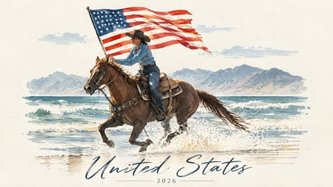</a>

先列出要保留的元素（人物、姿势、服饰、地标），再把配色限定为取自原图的 4 到 6 种，把照片转成手绘艺术书插画。明确禁止出现原图、拼贴和多余文字，只保留一处可替换的标题与年份。

GPT Image 2.5 · 上传图改图 · 出处: [@Rosey_watson on X](https://x.com/Rosey_watson/status/2098452763256492128) · 85 赞，统计于 2026-10-28

[`travel-poster`](tags.md#tag-travel-poster) [`watercolor`](tags.md#tag-watercolor) [`photo-to-illustration`](tags.md#tag-photo-to-illustration) [`minimalist`](tags.md#tag-minimalist) [`editorial`](tags.md#tag-editorial)

<details><summary><b>提示词</b></summary>

```text
Create a premium minimalist editorial travel illustration based on the uploaded reference photo.

Create ONLY the illustrated artwork.
Do not place the original photograph anywhere in the composition.
No split-screen, no collage, no before/after layout.

ILLUSTRATION STYLE
Reinterpret the uploaded photograph as a refined hand-drawn travel poster / art-book illustration.

Preserve the most recognizable elements from the reference:
– the main person or people
– their pose and body proportions
– recognizable clothing and accessories
– important objects they are holding
– the main architectural or environmental landmark
– the relationship between the person and the location

Keep the scene immediately recognizable, but simplify unnecessary photographic details.

Use:
– delicate hand-drawn ink lines
– slightly imperfect outlines
– flat acrylic and watercolor-like color shapes
– visible handmade brush texture
– subtle paper grain
– irregular organic edges
– restrained editorial detailing

The illustration should feel handmade rather than digitally polished.

BACKGROUND
Warm white / ivory textured paper.
Large areas of clean negative space.
Do not fill the entire background with detail.

COMPOSITION
Place the main illustrated scene approximately in the middle-to-lower portion of the vertical canvas.

The person should remain one of the main recognizable elements.

Simplify the surrounding architecture, landscape, water, vegetation or city details into elegant hand-painted shapes.

Use only a limited color palette extracted from the original photograph, approximately 4–6 dominant colors.

The overall result should feel:
quiet, sophisticated, artistic, premium, nostalgic, editorial, relaxed and collectible.

Think:
luxury travel sketchbook,
independent art-book cover,
designer postcard,
fashion editorial illustration,
contemporary illustrated travel diary.

TYPOGRAPHY

At the bottom of the composition add:

MAIN CAPTION:
United States

YEAR / SECONDARY CAPTION:
"2026"

IMPORTANT:
The text inside [CHANGE TITLE HERE] and [CHANGE YEAR HERE] is the ONLY variable caption area.
Replace these placeholders with the desired location, event, phrase and year when creating a new card.

Typography should be elegant and understated.

Use a refined handwritten or editorial script for the main title and a small clean serif or spaced uppercase style for the year.

Keep plenty of breathing room around the typography.

Do not add any additional random words, logos, dates or captions.

HIGH-END EDITORIAL QUALITY
```

</details>

<a id="gpt-image-graphite-pencil-portrait-knit-sweater-glasses"></a>
### 戴眼镜女子的针织毛衣石墨铅笔肖像

<a href="https://x.com/Arina_hoqe/status/2104762483156340741">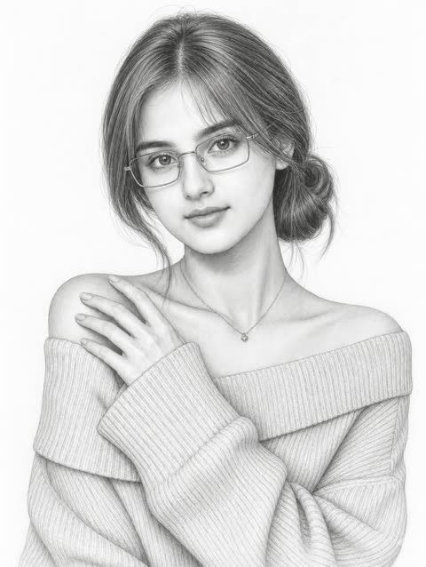</a>

按头发、面部、眼镜、姿势、服装和项链分段描述，细节互不干扰，并用参考图锁定五官与姿势。结尾用负面清单排除色彩、卡通化和手部错误，同时把媒介限定为白纸上的石墨铅笔。

GPT Image 2.5 · 上传图改图 · 出处: [@Arina_hoqe on X](https://x.com/Arina_hoqe/status/2104762483156340741) · 84 赞，统计于 2026-10-29

[`pencil-portrait`](tags.md#tag-pencil-portrait) [`graphite`](tags.md#tag-graphite) [`sketch`](tags.md#tag-sketch) [`reference-photo`](tags.md#tag-reference-photo) [`knitwear`](tags.md#tag-knitwear)

<details><summary><b>提示词</b></summary>

```text
Create a highly detailed graphite pencil portrait drawing based on the uploaded reference image.

SUBJECT:
A beautiful young adult woman wearing thin rectangular eyeglasses, with soft delicate facial features and a calm, elegant expression. Preserve the exact facial proportions, eye shape, nose structure, lips, jawline, hairstyle, and overall pose from the reference.

HAIR:
Long dark hair gathered into a low loose bun at the back, with fine individual graphite strands. Soft curtain bangs sweep naturally across the forehead and frame both sides of the face. Highly detailed hair texture with realistic pencil strokes.

FACE:
Soft oval face, delicate jawline, natural eyebrows, large expressive eyes looking slightly toward the viewer, small refined nose, naturally shaped lips, subtle peaceful expression. Maintain realistic facial anatomy and proportions.

GLASSES:
Thin metal rectangular eyeglass frames with realistic transparent lenses. Carefully render the frame, bridge, temples, and subtle reflections without obscuring the eyes.

POSE & HAND:
Three-quarter portrait composition. Her head is slightly tilted and turned toward the viewer. One elegant hand rests gently near her opposite shoulder/collarbone, with long natural fingers and anatomically correct joints. Preserve the graceful hand gesture from the reference.

CLOTHING:
Oversized ribbed off-shoulder knit sweater. Highly detailed vertical and diagonal knit texture, soft folds, realistic fabric tension around the shoulders and arms.

NECKLACE:
A very thin delicate necklace with a small geometric pendant resting naturally at the base of the neck.

ART STYLE:
Ultra-realistic graphite pencil drawing on clean white paper.
Fine mechanical-pencil and traditional graphite textures.
Extremely delicate linework.
Precise cross-hatching and subtle tonal shading.
Soft gradients on the skin.
Detailed eyelashes, eyebrows, lips, hair strands, glasses, fingers, sweater fibers, and facial contours.
Natural white-paper highlights.
Elegant Japanese manga-inspired realism, but anatomically realistic rather than cartoonish.

LIGHTING & SHADING:
Soft diffused studio lighting translated entirely into graphite values.
Very subtle shadows beneath the bangs, glasses, nose, chin, neck, fingers, and sweater folds.
Balanced midtones with clean white highlights.
No harsh black areas.

COMPOSITION:
Vertical portrait, approximately 2:3 ratio.
Upper-body framing.
Subject centered with comfortable white space around her.
Clean white background with no distracting elements.

QUALITY:
Museum-quality pencil illustration.
Extremely sharp fine graphite details.
Realistic anatomy.
Professional fashion-portrait sketch.
High-resolution, polished, refined, sophisticated.

NEGATIVE PROMPT:
No color, no watercolor, no ink, no oil painting, no digital painting, no cartoon, no exaggerated anime features, no distorted anatomy, no extra fingers, no malformed hands, no asymmetrical eyes, no warped glasses, no heavy outlines, no messy shading, no background objects, no text, no watermark.
```

</details>

<a id="gpt-image-naive-pencil-illustration-from-photo-2"></a>
### 戴耳机的课堂少女彩铅插画

<a href="https://x.com/harboriis/status/2115028772588261435"></a>

先点明朴拙极简的风格（不规则轮廓、平涂色块、装饰性铅笔线条），再明确禁用阴影、渐变和3D效果，最后用设计师海报与彩铅的参照定下质感。

GPT Image 2.5 · 上传图改图 · 出处: [@harboriis on X](https://x.com/harboriis/status/2115028772588261435) · 75 赞，统计于 2026-10-28

[`colored-pencil`](tags.md#tag-colored-pencil) [`naive-art`](tags.md#tag-naive-art) [`photo-to-illustration`](tags.md#tag-photo-to-illustration) [`flat-color`](tags.md#tag-flat-color) [`cute`](tags.md#tag-cute)

<details><summary><b>提示词</b></summary>

```text
Turn this photo into a contemporary, artist-made naïve illustration: minimalist and hand-drawn, with playful proportions, uneven outlines, flat colors that are soft yet contrasting, and decorative pencil strokes. No shadows, gradients, or 3D effects. Give it the feel of a high-end designer poster drawn with colored pencils. Keep it cute and cartoon-like.
```

</details>

<a id="gpt-image-japanese-comic-poster-photo-comparison"></a>
### 伊斯坦布尔猫咪照片与日式漫画海报对照图

<a href="https://x.com/Goodmanprotocol/status/2114688658746028256"></a>

画面分为上下两半，上半保留原照片，下半重绘为海报。墨色、红色、蓝色和纸色都给出了精确色值，标题分两行并分别指定颜色，让丝网印刷风格保持稳定。

GPT Image 2.5 · 上传图改图 · 出处: [@Goodmanprotocol on X](https://x.com/Goodmanprotocol/status/2114688658746028256) · 69 赞，统计于 2026-10-28

[`comparison`](tags.md#tag-comparison) [`screen-print`](tags.md#tag-screen-print) [`japanese-comic`](tags.md#tag-japanese-comic) [`poster`](tags.md#tag-poster) [`limited-palette`](tags.md#tag-limited-palette)

<details><summary><b>提示词</b></summary>

```text
Create a 3:4 vertical comparison image divided into two equal horizontal halves, seamlessly joined without borders or gaps.

TOP HALF: Display the uploaded photograph exactly as it is, without editing, recoloring, or adding text. Preserve proportions; crop only peripheral background if necessary.

BOTTOM HALF: Redraw the same subject as a Japanese hand-drawn comic poster with minimalist, limited-color screen-print aesthetics. Preserve the subject's recognizable features, pose, proportions, colors, and relationships between objects. Adapt naturally to people, animals, objects, or landscapes. Keep the essential scenery and add nothing absent from the original photograph.

ART STYLE: Delicate, slightly irregular ink-black outlines (#02030B), simplified shapes, clean opaque color blocks, and minimal hard-edged shadows. Use warm red (#E9444B), muted gray-blue (#5296BD), and off-white paper (#ECEDE5), with red dominant over blue. Avoid photorealistic textures, dense hatching, 3D effects, and excessive details.

LAYOUT & TEXT: Position the illustration in the upper-middle of the bottom half, with generous negative space and bold, hand-carved typography below. Add a small handwritten, subject-related caption at the top and a short handwritten annotation beside the subject, both in black. The main headline reads “Jen” in warm red on the first line and “Style” in gray-blue on the second. Each appears once. Keep all text within the bottom half, fully legible and uncropped. Replace sample text only when the user provides alternatives.

FINAL RESULT: One complete 3:4 image, with the untouched original photograph above and its Japanese hand-drawn, limited-color poster interpretation below. No extra borders, watermarks, invented elements, or decorative clutter.
```

</details>

<a id="gpt-image-watercolor-botanical-monochrome-portrait"></a>
### 水彩植物花纹中渐隐的黑白人像

<a href="https://x.com/Kubra_286/status/2105268519105617962"></a>

脸部保持灰度写实，边缘融入纸张，色彩只限灰色晕染与宝蓝点缀。明确指定墨线植物与涂鸦爱心的位置，再用负面清单守住五官还原。

GPT Image 2.5 · 上传图改图 · 出处: [@Kubra_286 on X](https://x.com/Kubra_286/status/2105268519105617962) · 67 赞，统计于 2026-10-28

[`watercolor`](tags.md#tag-watercolor) [`monochrome`](tags.md#tag-monochrome) [`botanical`](tags.md#tag-botanical) [`selfie-to-art`](tags.md#tag-selfie-to-art) [`scrapbook`](tags.md#tag-scrapbook)

<details><summary><b>提示词</b></summary>

```text
Create a premium mixed-media watercolor and digital art portrait of the same young South Asian woman from the uploaded reference image.

Create a large close-up grayscale black-and-white portrait of her face and upper shoulders. Preserve her exact facial identity and facial structure from the reference image, including her eyes, eyebrows, nose, lips, jawline, skin texture, and natural expression.

She has long, natural wavy dark hair parted in the middle, softly framing her face. Add a tiny bindi on her forehead. Give her a warm, natural smile with realistic facial details and expressive eyes.

The portrait should softly fade and dissolve into a textured light cream paper background using artistic watercolor bleeding, soft gray washes, deep blue accents, black ink splatters, and organic paint textures.

Surround parts of the portrait with delicate hand-drawn botanical ink sketches of leaves, thin branches, and floral patterns. Add expressive watercolor splashes and scattered paint droplets around the edges. Include a subtle hand-drawn white doodle heart near the lower-right side.

Style: sophisticated handmade scrapbook collage, mixed-media watercolor illustration, monochrome portrait with subtle royal-blue watercolor accents, textured matte paper, organic brushwork, elegant artistic composition, high-detail realistic face.

No full body, no additional people, no distorted facial features, no warped eyes, no deformed anatomy, no text, no logos, no UI elements.

Aspect Ratio: 4:5
```

</details>

<a id="gpt-image-watercolor-double-exposure-butterfly-portrait"></a>
### 帝王蝶环绕的水彩双重曝光肖像

<a href="https://x.com/Kubra_286/status/2100220440543441049"></a>

提示词让写实的脸保持最清晰，并明确指出水彩晕染要出现在脸颊、脖颈和衣物等具体位置，形成半透明叠加的双重曝光。冷色的青绿与深蓝配上鲜橙色蝴蝶，对比强烈。

GPT Image 2.5 · 上传图改图 · 出处: [@Kubra_286 on X](https://x.com/Kubra_286/status/2100220440543441049) · 67 赞，统计于 2026-10-28

[`watercolor`](tags.md#tag-watercolor) [`double-exposure`](tags.md#tag-double-exposure) [`portrait`](tags.md#tag-portrait) [`butterfly`](tags.md#tag-butterfly) [`mixed-media`](tags.md#tag-mixed-media)

<details><summary><b>提示词</b></summary>

```text
Create a 2:3 vertical premium mixed-media watercolor portrait on off-white cold-pressed watercolor paper.
Use the uploaded image only as the subject reference. Keep the subject’s natural features, overall appearance, and recognizable look intact, but do not let the image turn into a generic painted character.
Show the subject in a bust-length three-quarter profile, facing slightly toward the viewer’s right, with the gaze directed softly off-camera. Keep the expression calm, warm, serene, and naturally pleasant, with a subtle gentle smile and bright relaxed eyes. The mood should feel elegant, fresh, dreamy, and refined — not sad, blank, tired, or overly serious.
Keep the face highly realistic and softly photorealistic, not fully painted, not sketch-like, and not cartoonish. The face should be the main focal point. Use soft diffused natural-looking light, similar to indirect window light, to gently illuminate the forehead, nose bridge, cheeks, lips, and jawline, with delicate depth and soft shadows. Render realistic eyes with soft catchlights, defined brows, natural lips, smooth skin transitions, and fine hair strands.
Style the hair in an elegant loose low updo / low messy bun at the nape, with a few soft tendrils framing the face and neck. Intertwine subtle rustic botanical accents in the hair — tiny dried wildflowers in muted yellow, white, and blue tones — delicate, understated, and premium.
Add several detailed Monarch butterflies with vivid orange wings, black veins, black borders, and tiny white spots. Keep them crisp, refined, and slightly dimensional. Place multiple butterflies naturally around the portrait: some resting in the hair, one near the upper-right side, and others floating around the shoulders and lower frame. Their warm orange color should stand out beautifully against the cool watercolor tones.
Create a strong mixed-media double-exposure effect where parts of the portrait dissolve into watercolor blooms. This effect must be clearly visible across selected parts of the cheek, temple, jawline, neck, shoulder, and lower clothing area — not only in the background. The watercolor should feel translucent and layered over the realistic portrait, so the subject remains clearly realistic underneath.
Use expressive watercolor washes in muted teal, seafoam green, dusty blue, soft gray, charcoal, and deep navy tones. Let the washes bloom naturally into the paper with wet-on-wet behavior, soft transparent bleeding, irregular edges, subtle blooms, and a few darker pooled edges where pigment appears to have dried. Allow the watercolor to expand organically into the negative space while keeping the face as the sharpest and most detailed focal area.
Dress the subject in a simple deep navy-blue top / blouse with a high rounded neckline and soft gathered or finely pleated texture around the shoulders and upper chest. The garment should look minimal, elegant, matte, and plain, with no collar, no buttons, no printed pattern, and no decorative embellishments. Keep the outfit close to the reference look. Let the lower portion of the top gradually dissolve into blue-gray watercolor splashes.
Preserve the contrast between hyper-detailed realism and loose abstract watercolor forms. The final artwork should feel like a luxury fine-art portrait print that combines:

photorealistic portraiture
abstract watercolor fusion
soft ethereal surrealism
crisp butterfly detailing
cool watercolor tones contrasted with vivid orange butterflies
textured watercolor paper and handcrafted mixed-media realism
Overall, the result should feel poetic, airy, elegant, and premium, with the viewer’s eye drawn first to the realistic face, then to the translucent watercolor overlays and butterflies surrounding the subject.
```

</details>

<a id="nano-banana-geometric-character-poster-from-photo"></a>
### 由参考照片生成的扁平几何人物海报

<a href="https://x.com/harboriis/status/2110238400163074321"></a>

用编号段落依次锁定版式、角色、风格、面部和配色，并用十六进制色值固定六色方案。负面清单加右下角参考图小卡片，既保留人物特征又保持扁平风格。

Nano Banana 2.1 · 上传图改图 · 出处: [@harboriis on X](https://x.com/harboriis/status/2110238400163074321) · 64 赞，统计于 2026-10-28

[`flat-geometric`](tags.md#tag-flat-geometric) [`character-poster`](tags.md#tag-character-poster) [`six-colour-palette`](tags.md#tag-six-colour-palette) [`editorial`](tags.md#tag-editorial) [`reference-photo`](tags.md#tag-reference-photo)

<details><summary><b>提示词</b></summary>

```text
No extra text, logos, outlined cartoon style, glossy 3D, realistic skin, photorealism, coarse canvas texture, busy background, extra limbs, distorted anatomy, excessive facial detail, photorealistic shading, random objects, clutter, watermark. Include a small rounded picture-in-picture card in the bottom right corner displaying the original reference photo
```

</details>

<a id="gpt-image-selfie-teal-watercolor-portrait-splashes"></a>
### 青绿水彩人像，泼溅与流淌的颜料

<a href="https://x.com/Arina_hoqe/status/2101869888168190404"></a>

先要求保留参考照片的面部结构和头部角度，再按面部、发型、色板、背景、光线分块描述。点明纸纹、湿画法晕染，并用负面提示排除 CGI 和塑料皮肤，让画面更像手绘。

GPT Image 2.5 · 上传图改图 · 出处: [@Arina_hoqe on X](https://x.com/Arina_hoqe/status/2101869888168190404) · 54 赞，统计于 2026-10-28

[`watercolor`](tags.md#tag-watercolor) [`portrait`](tags.md#tag-portrait) [`selfie`](tags.md#tag-selfie) [`photo-to-art`](tags.md#tag-photo-to-art) [`negative-space`](tags.md#tag-negative-space)

<details><summary><b>提示词</b></summary>

```text
Create a highly detailed traditional watercolor portrait based on the reference image.

SUBJECT & IDENTITY:
A beautiful young woman shown in a refined side-profile / three-quarter profile. Preserve the exact facial structure, proportions, recognizable features, hairstyle, head angle and overall appearance of the reference image.

POSE & COMPOSITION:
Vertical 9:16 portrait composition. Head and upper shoulders only. Her face is turned toward the right side of the frame, with a calm, elegant and slightly mysterious expression. Neck naturally elongated, shoulders relaxed. The face is the central focal point.

FACE:
Natural feminine facial anatomy, defined cheekbones, elegant jawline, delicate straight nose, soft lips, subtle blush on the cheeks. Large expressive light brown/gray eyes looking slightly toward the viewer's direction. Long detailed eyelashes and naturally shaped eyebrows. Soft realistic skin tones rendered through transparent watercolor layers.

HAIR:
Dark teal, deep navy and blue-black hair, swept backward into a loose low ponytail/bun. Flowing strands and layered locks merge naturally into the surrounding watercolor splashes. Individual hair strands should remain visible, with rich turquoise and deep blue pigment variations.

EXPRESSION:
Calm, graceful, sophisticated and slightly melancholic. Natural relaxed lips and subtle emotion in the eyes. No exaggerated smile.

CLOTHING:
Simple elegant dark teal/blue garment visible around the shoulders and neckline, partially dissolving into watercolor washes.

ART STYLE:
Authentic traditional watercolor portrait painted on textured cold-press watercolor paper. Fine ink-and-watercolor illustration, delicate hand-drawn contour lines combined with transparent watercolor washes. Visible paper grain, natural pigment granulation, wet-on-wet color bleeding, soft edges, layered translucent pigments and organic paint blooms.

COLOR PALETTE:
Deep navy blue, turquoise, teal, muted cyan, soft gray, pale beige, warm peach and subtle dusty rose skin tones. Strong contrast between the dark blue hair and the light paper background.

BACKGROUND:
Clean off-white textured watercolor paper. Minimal background with large abstract turquoise and deep-blue watercolor splashes concentrated around the hair and shoulders. Natural paint splatters, droplets, irregular edges and several long dripping watercolor trails extending downward. Keep large areas of white negative space around the face.

LIGHTING:
Soft diffused natural light, subtle highlights across the forehead, nose, cheekbones and lips. Gentle shadows beneath the cheekbone and jawline. Delicate luminous watercolor effect.

DETAILS:
Extremely detailed eyes, eyelashes, eyebrows, lips, nose, facial contours and individual hair strands. Authentic watercolor pigment texture, fine ink outlines, realistic facial anatomy, subtle skin color variations, natural brush marks and paper fibers.

OVERALL FEEL:
Elegant, artistic, sophisticated, emotional watercolor portrait with a modern fashion-illustration aesthetic. The painting should look handmade by a professional watercolor artist rather than digitally generated.

QUALITY:
Ultra-detailed, high-resolution traditional watercolor artwork, refined composition, realistic facial proportions, beautiful color transitions, authentic watercolor imperfections, professional gallery-quality illustration.

NEGATIVE PROMPT:
anime, cartoon, 3D render, CGI, plastic skin, flat digital painting, overly smooth skin, distorted face, altered facial proportions, asymmetrical eyes, extra features, blurry details, harsh outlines, oversaturated colors, photorealistic photography, text, watermark, logo, signature
```

</details>

<a id="gpt-image-photo-to-watercolor-travel-journal-split"></a>
### 上方旅行照片与下方同景水彩画

<a href="https://x.com/AiWithTariq/status/2103783895154237769">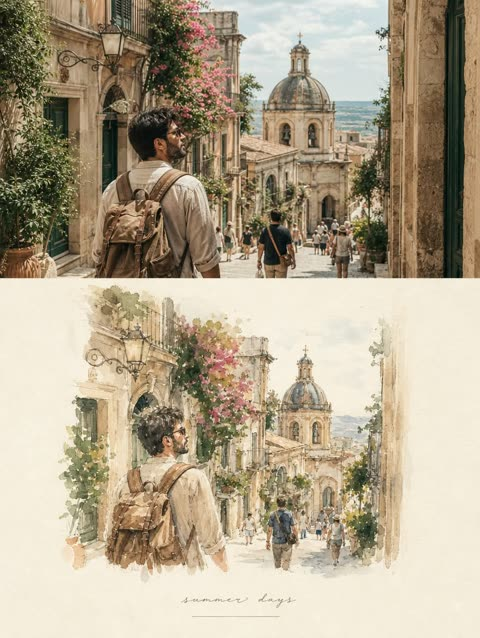</a>

提示词把竖版画布分成写实照片和同景水彩两部分，并点明构图、人物、姿势和透视必须保留。松散的水彩晕染、可见的纸张纹理和象牙色纸上的手写小字，让画面像旅行手账。

GPT Image 2.5 · 上传图改图 · 出处: [@AiWithTariq on X](https://x.com/AiWithTariq/status/2103783895154237769) · 45 赞，统计于 2026-10-29

[`watercolor`](tags.md#tag-watercolor) [`travel`](tags.md#tag-travel) [`split-layout`](tags.md#tag-split-layout) [`journal`](tags.md#tag-journal) [`reference-photo`](tags.md#tag-reference-photo)

<details><summary><b>提示词</b></summary>

```text
Create a refined editorial travel-art composition based on a reference photograph. The image is divided vertically into two parts: the upper section is a realistic cinematic travel photograph, while the lower section transforms the exact same scene into a delicate hand-painted watercolor illustration.
Upper section: authentic candid travel photography, natural daylight, soft shadows, subtle film grain, realistic textures, sophisticated European atmosphere, documentary-style composition, people naturally walking through the scene, beautiful architectural details, slightly muted elegant colors, high-end travel magazine photography.
Lower section: a minimalist handmade watercolor painting of the exact same scene, preserving the recognizable composition, architecture, people, poses, perspective and major visual elements from the photograph. Loose translucent watercolor washes, delicate ink details, visible paper texture, soft edges, imperfect brushwork, subtle pigment bleeding, airy negative space, understated pastel tones, artistic but realistic.
Leave generous warm ivory/off-white textured paper space surrounding the watercolor illustration. Add a small elegant handwritten caption near the bottom, such as “summer days” or “a quiet afternoon”, with a thin minimalist horizontal line underneath.
Overall aesthetic: luxury travel journal, fine-art watercolor postcard, contemporary editorial design, nostalgic European summer, understated elegance, tactile handmade paper, sophisticated and serene.
Portrait orientation, clean composition, premium art direction, no clutter, no borders, natural proportions, highly detailed photograph transitioning into an airy watercolor illustration.
```

</details>

<a id="nano-banana-half-face-pop-art-cardboard-portrait"></a>
### 半脸真实照片半脸波普艺术肖像

<a href="https://x.com/Emmma___0/status/2111772963586576776">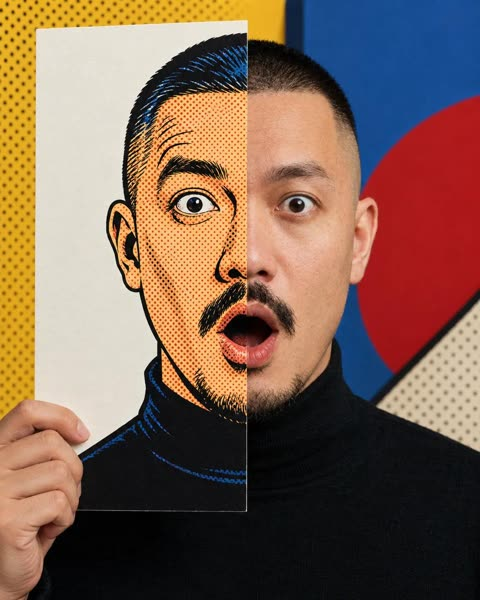</a>

用哑光白色硬纸板遮住半张脸,纸板上画出手绘波普艺术版本的那半张脸。提示词明确要求分界线上五官、发际线和衣领逐一对齐,并列出禁止美化的项目,让真实半脸与插画半脸保持同一身份和表情。

Nano Banana 2.1 · 上传图改图 · 出处: [@Emmma___0 on X](https://x.com/Emmma___0/status/2111772963586576776) · 39 赞，统计于 2026-10-29

[`pop-art`](tags.md#tag-pop-art) [`half-face`](tags.md#tag-half-face) [`conceptual-portrait`](tags.md#tag-conceptual-portrait) [`ben-day-dots`](tags.md#tag-ben-day-dots) [`identity-preserve`](tags.md#tag-identity-preserve)

<details><summary><b>提示词</b></summary>

```text
Create an editorial-style conceptual portrait with hyper-realistic photographic quality, in a 4:5 vertical aspect ratio.
Use the uploaded image solely as a reference for facial identity, clothing, and accessories.
Maintain the subject’s (an adult) original facial identity with absolute precision—including natural facial proportions, the shape and spacing of the eyes, nose, lips, and jawline, skin tone, subtle natural asymmetries, and authentic skin texture.
Do not replicate the pose or background from the reference image.
Do not "beautify" the face, alter it to fit a stereotypical "Korean" aesthetic, enlarge the eyes, shrink the nose, slim the face, create an artificial sharp jawline, excessively smooth the skin, make the subject appear younger, enlarge the head size, or otherwise alter the subject's identity.
1. Core Concept
"The Other Half / WOW!"
A single human face expressing astonishment, bridging two distinct visual worlds:
Hyper-realistic photography.
Bold Pop Art, inspired by the style of the 1960s.
The subject stands facing the camera directly, positioned upright and perfectly centered.
In front of one half of the face, a matte white, rectangular cardboard panel completely covers that side.
On this panel is a hand-drawn Pop Art-style illustration that accurately depicts the covered half of the subject's face. The other half of the face remains entirely photographic, rendered in natural colors.
The two halves merge to form a single, cohesive face with a clear identity, both displaying the same expression of surprise.
This is not merely a photograph of a face printed on paper. The paper overlay physically covers half of the subject's actual face, while the obscured portion is reconstructed through a Pop Art-style illustration.
This emotional and visual concept is inspired by the iconic "WOW!" expression found in classic Pop Art, yet executed with a modern, sophisticated editorial touch. 2. Hair
Maintain the subject's original hairstyle and its distinct, natural characteristics.
The actual hair extends to the vertical edge of the paper overlay, then continues seamlessly into the side rendered in a Pop Art style.
In the illustrated section, incorporate the following elements:
Bold, clear black outlines.
Simplified, graphic-style shading.
Solid, dot-based shading in the "Ben-Day" style.
Hair strands depicted with firm, elegant, and fluid shapes.
The transition of the hair—from the photographic side to the illustrated side—should appear natural along the edge of the paper.
If the uploaded image features a woman wearing a hijab, no hair should be visible.
3. Clothing
If the subject is a woman:

If the uploaded image features a woman wearing a hijab, no hair should be visible.

The illustrated portion of the clothing must align perfectly with the photographic portion along the edge of the paper.
4. Environment and Background
An artistic and classy Pop Art studio setting, suitable for any gender.
Use a bright, clean background with the following color palette:
Warm ivory or soft cream.
Cobalt blue.
Vibrant red. Bright yellow. The environment must feature large panels of color, subtle Ben-Day dot shading, clean geometric divisions, and simple curved or diagonal shapes, with various physical panels layered at different depths.
The studio setup should resemble a tangible 3D art installation rather than mere printed wallpaper.
Background elements must be large, simple, and carefully arranged.
The inclusion of text, speech bubbles, captions, logos, onomatopoeic words (such as "POW!" or "WOW!"), or sharp, comic-book-style explosion graphics is not permitted.
Ensure the atmosphere does not resemble a typical party photo booth.
The background should be understated and less striking than the makeup applied to the face.
The painted portion of the face serves as the primary artistic element.
5. Precise alignment between both sides of the face is a mandatory requirement. The section painted in a *pop-art* style must maintain the exact same anatomy and expression as the partially covered, real side of the face.
This section must not transform into a different person or a generic cartoon face.
Along the vertical dividing line, all facial features must align perfectly:
The positioning of the eyes and eyebrows.
The bridge of the nose and the nostrils.
The upper and lower lips.
The contours of the open mouth.
The jaw and chin.
The hairline.
The realistic portion and the painted portion must form a cohesive, unified whole.
```

</details>

<a id="gpt-image-amigurumi-doll-from-photo-diorama"></a>
### 温馨迷你场景中的钩织娃娃

<a href="https://x.com/MrDasCreates/status/2115351638353613255"></a>

先点明毛线材质和可见针脚,再用大头小身比例固定造型。刺绣五官、粉彩配色、迷你场景和暖光,让照片转换保持统一的手工质感。

GPT Image 2.5 · 上传图改图 · 出处: [@MrDasCreates on X](https://x.com/MrDasCreates/status/2115351638353613255) · 32 赞，统计于 2026-10-29

[`amigurumi`](tags.md#tag-amigurumi) [`crochet`](tags.md#tag-crochet) [`plush`](tags.md#tag-plush) [`diorama`](tags.md#tag-diorama) [`photo-to-doll`](tags.md#tag-photo-to-doll)

<details><summary><b>提示词</b></summary>

```text
Turn your photo into a cozy hand-crocheted amigurumi doll using GPT Image 2.5

Prompt: Transform the uploaded photo into a hand-crocheted amigurumi style doll. Soft chunky yarn with visible stitches, oversized rounded head and tiny body, embroidered facial features with gentle blush, pastel color palette, cozy handmade imperfections, plush texture, sitting in a miniature diorama scene, warm soft lighting, charming stop-motion plush aesthetic.
```

</details>

<a id="nano-banana-style-transfer-cobra-witch-hat"></a>
### 眼镜蛇变身星星图案女巫贴纸

<a href="https://x.com/thefinnmckenty/status/2107574685433286858"></a>

用两张参考图分工：图1提供内容，图2提供风格。提示词逐项列出要迁移的风格属性，包括媒介、配色、氛围、渲染方式、饱和度和质感。

Nano Banana 2.1 · 上传图改图 · 出处: [@thefinnmckenty on X](https://x.com/thefinnmckenty/status/2107574685433286858) · 30 赞，统计于 2026-10-28

[`style-transfer`](tags.md#tag-style-transfer) [`reference-image`](tags.md#tag-reference-image) [`sticker`](tags.md#tag-sticker) [`illustration`](tags.md#tag-illustration) [`template`](tags.md#tag-template)

<details><summary><b>提示词</b></summary>

```text
Create an image of the content as shown in [image 1] but with the same medium, color palette, mood, rendering technique, saturation level, textures, and overall style of [image 2]. Objective: Style transfer from [image 1 to [image 2]
```

</details>

<a id="nano-banana-selective-anime-hair-bowl-photo-edit"></a>
### 照片中仅头发、碗和筷子变成动漫插画

<a href="https://x.com/madpencil_/status/2107815983729750427"></a>

提示词先点明只转换的少数元素,再逐项列出必须保持不变的内容:脸、皮肤、面条、汤、背景、光线、姿势和构图。风格用干净线稿、平涂赛璐珞和粉彩色限定,让动漫效果只作用于局部。

Nano Banana 2.1 · 上传图改图 · 出处: [@madpencil_ on X](https://x.com/madpencil_/status/2107815983729750427) · 25 赞，统计于 2026-10-28

[`selective-edit`](tags.md#tag-selective-edit) [`anime`](tags.md#tag-anime) [`photo-to-art`](tags.md#tag-photo-to-art) [`preserve-details`](tags.md#tag-preserve-details) [`food`](tags.md#tag-food)

<details><summary><b>提示词</b></summary>

```text
Convert only her hair, the bowl, and the chopsticks into a 2D hand-drawn anime illustration with clean linework, flat cel shading, and vibrant pastel colours. Keep her face, skin, eyes, lips, noodles, broth, background, lighting, pose, and framing the same as in the original photo.
```

</details>

<a id="gpt-image-anime-pop-art-street-style-conversion"></a>
### 动漫少女转成霓虹波普街头艺术风

<a href="https://x.com/notoro_ai/status/2051154269064278132">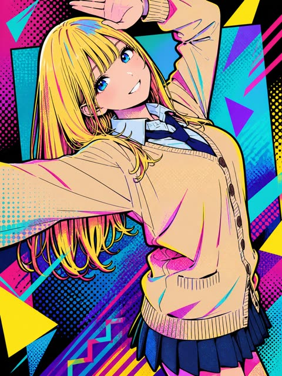</a>

提示词先点明目标风格,再逐项限定线稿、平涂、网点、霓虹配色和几何图案,最后禁止出现文字并要求保留原构图与角色。

GPT Image 2 · 上传图改图 · 出处: [@notoro_ai on X](https://x.com/notoro_ai/status/2051154269064278132) · 发现于 [YouMind-OpenLab/awesome-gpt-image-2](https://github.com/YouMind-OpenLab/awesome-gpt-image-2)

[`pop-art`](tags.md#tag-pop-art) [`street-art`](tags.md#tag-street-art) [`anime`](tags.md#tag-anime) [`halftone`](tags.md#tag-halftone) [`neon`](tags.md#tag-neon)

<details><summary><b>提示词</b></summary>

```text
このイラストを現代アニメ・漫画の影響を基調とした、ポップアート×ストリートアート風スタイルに変換してください。シャープでクリーンな線画とフラットシェーディングをメインに色彩豊かに表現。複雑な幾何学模様など含むスタイリッシュな雰囲気。ベン・デイ・ドットでグラデーションとテクスチャを加味。ネオンカラー中心の鮮やかでコントラストの強い配色で、グラフィカルかつスタイリッシュな雰囲気に。ただし文字は入れないこと。元のイラストの構図・キャラクターを維持。
```

</details>

<a id="gpt-image-anime-portrait-3d-wireframe-conversion"></a>
### 戴眼镜波波头少女的3D线框转换

<a href="https://x.com/notoro_ai/status/2053082564865528087">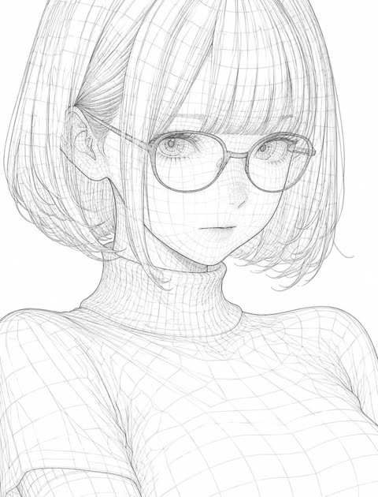</a>

先规定线条质感（细、均匀、锐利）、多边形边缘和交叉线带来的纵深，再锁定原图的构图、表情、姿势与轮廓，让转换不破坏原作。最后用冷静、科技、极简的气质词定下整体风格。

GPT Image 2 · 上传图改图 · 出处: [@notoro_ai on X](https://x.com/notoro_ai/status/2053082564865528087) · 发现于 [YouMind-OpenLab/awesome-gpt-image-2](https://github.com/YouMind-OpenLab/awesome-gpt-image-2)

[`wireframe`](tags.md#tag-wireframe) [`3d-style`](tags.md#tag-3d-style) [`line-art`](tags.md#tag-line-art) [`anime`](tags.md#tag-anime) [`style-conversion`](tags.md#tag-style-conversion)

<details><summary><b>提示词</b></summary>

```text
このイラストを、ワイヤーフレーム（Wireframe）スタイルで変換してください。細く精密な線で輪郭と内部構造を表現し、3Dモデルのようにポリゴンエッジやジオメトリックな線を全体に重ねて描いてください。線は均一でシャープ、交差する線による立体感と奥行きを強調し、透明感のある軽やかな構造体のように見えるようにしてください。全体の雰囲気はクールでテクノロジカル、未来的でミニマル、デジタルデザインや3Dモデリングのような洗練された美しさに仕上げてください。元のイラストの構図・キャラクターの表情・ポーズ・シルエット・主要な特徴は一切崩さず、ワイヤーフレームとして美しく再構築してください。
```

</details>

<a id="gpt-image-bad-ms-paint-cat-redraw"></a>
### 橘猫被重画成粗糙的MS Paint涂鸦

<a href="https://x.com/op7418/status/2050075020714815898">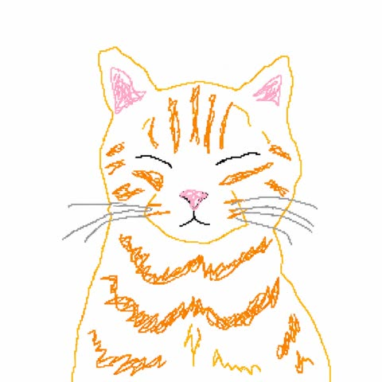</a>

点明目标媒介是鼠标绘制的MS Paint，并要求抖动笔触和极简细节，让模型有意降低画面质量。逐部位列出颜色（橙色轮廓、粉色耳朵和鼻子、黑色眼睛、灰色胡须）并保留原构图，涂鸦仍然认得出原图。

GPT Image 2 · 上传图改图 · 出处: [@op7418 on X](https://x.com/op7418/status/2050075020714815898) · 发现于 [YouMind-OpenLab/awesome-gpt-image-2](https://github.com/YouMind-OpenLab/awesome-gpt-image-2)

[`ms-paint`](tags.md#tag-ms-paint) [`doodle`](tags.md#tag-doodle) [`cat`](tags.md#tag-cat) [`meme`](tags.md#tag-meme) [`reference-image`](tags.md#tag-reference-image)

<details><summary><b>提示词</b></summary>

```text
Using the provided reference image, redraw the same cat as a deliberately clumsy computer-mouse doodle in a simple MS Paint style. Keep the original centered composition and plain light background, but transform the realistic photo into rough hand-drawn line art with visible wobbly strokes, minimal detail, and an amateur low-effort look. Use thin orange outlines for the head, ears, fur stripes, chest fluff, and body edges; pink scribbled inner ears and nose; black curved closed-eye lines and mouth; and light gray whiskers. Preserve the sleepy closed-eye expression and front-facing pose, but make the drawing look awkward, naive, and slightly messy, like a quick bad sketch traced from the photo.
```

</details>

<a id="gpt-image-botanical-plant-dye-canvas-painting"></a>
### 植物染料帆布风格的花田少女插画

<a href="https://x.com/notoro_ai/status/2051240426233885129">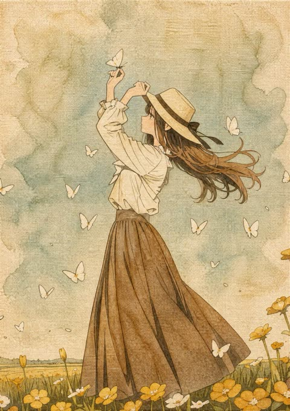</a>

提示词点明植物染料来源，要求柔和晕染、色彩不均和帆布质感，用沉稳大地色和淡渐变取代化学般的鲜艳。同时要求完整保留原图构图与角色，并且不画出所用的植物本身。

GPT Image 2 · 上传图改图 · 出处: [@notoro_ai on X](https://x.com/notoro_ai/status/2051240426233885129) · 发现于 [YouMind-OpenLab/awesome-gpt-image-2](https://github.com/YouMind-OpenLab/awesome-gpt-image-2)

[`botanical`](tags.md#tag-botanical) [`plant-dye`](tags.md#tag-plant-dye) [`canvas-texture`](tags.md#tag-canvas-texture) [`earth-tones`](tags.md#tag-earth-tones) [`style-transfer`](tags.md#tag-style-transfer)

<details><summary><b>提示词</b></summary>

```text
このイラストを植物染料（葉・茎・花・実・根など）で描いた帆布のボタニカル絵画風に変換してください。自然染液の柔らかい滲み、優しい色ムラ、帆布の質感を活かした有機的な表現に。化学的な鮮やかさではなく、植物由来の落ち着いたアースカラーと淡いグラデーションを重視し、温かく穏やかで詩的なボタニカルな雰囲気に。使用した植物自体は描かない。元のイラストの構図・キャラクターは完全に維持。
```

</details>

<a id="gpt-image-cat-photo-fairy-tale-woodcut-poster"></a>
### 猫咪照片与童话版画海报

<a href="https://x.com/xiaoxiaodong01/status/2089987808664719723">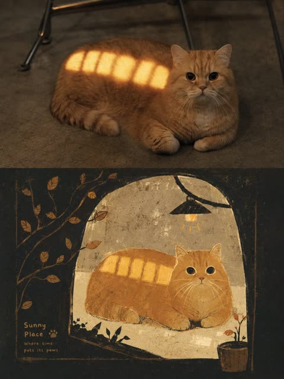</a>

严格规定上下1:1分区，上方保留轻调色的原照片，下方重绘为版画。下半部分用暗色结构场、少量留白和小面积高饱和点缀，并加入干刷颗粒与轻微套印错位，形成丝网印刷质感。

GPT Image 2 · 上传图改图 · 出处: [@xiaoxiaodong01 on X](https://x.com/xiaoxiaodong01/status/2089987808664719723) · 发现于 [YouMind-OpenLab/awesome-gpt-image-2](https://github.com/YouMind-OpenLab/awesome-gpt-image-2)

[`woodcut`](tags.md#tag-woodcut) [`fairy-tale`](tags.md#tag-fairy-tale) [`photo-to-illustration`](tags.md#tag-photo-to-illustration) [`screen-print`](tags.md#tag-screen-print) [`split-layout`](tags.md#tag-split-layout)

<details><summary><b>提示词</b></summary>

```text
请将我上传的每一张照片分别制作成一张独立的高级设计海报，不多图拼接，每张照片单独输出。整体采用3:4竖版构图，上下两个区域高度严格1:1，各占画面50%，并确保该表达方式可适配人物、动物、建筑、静物、自然场景等不同主题，而不限于城市题材。

上半部分保留原始照片，保持主体身份、动作、空间关系、真实质感、自然光影和原有色彩氛围，仅进行轻微高级摄影调色，使其具有杂志摄影与艺术出版物的质感。为适配画幅，可自然扩展天空、地面或环境背景，但不得拉伸、扭切或改变主体。

下半部分提取照片中最具识别性的主体、轮廓、姿态与叙事关系，重构为童话版画式手绘图像。不要机械描摹细节，而是将主体压缩为一两个清楚的大体块，以钝拙剪影、略微夸张的比例和少量关键边缘，保留原始对象的身份、动作、功能与情绪。画面从原图内容中提炼出一个大面积低明度或高反差的结构场，作为包裹主体的容器、路径、框架或密度层；背景像故事发生的外壳一样从原图空间与意义中生长出来，形成遮挡、裁切、吞没与局部露出的结构叙事。整体采用平面叙事透视和绘本页面式层级，可使用俯视压缩、侧向移动、正面框架、路径引导、尺度跳跃或边缘裁切组织阅读。

配色从上方照片提取，并保持明确的三层关系：大面积暗结构色负责重量与边界，适量浅色或留白负责呼吸，小面积高饱和情绪色负责读图路线与故事信号。最重要的信息仅以少量鲜明色块集中在面部、姿态、路径、器物功能点、环境标识或叙事焦点上，并始终被深色结构或浅色负形压住，让画面鲜艳但不平均。色相可随主题情绪调整，但面积比例与明度秩序保持稳定。

线条只在功能、路径、边界、纹理和识别处出现，保持稀疏、手绘、略不准的细线。所有色块保持平面化处理，同时保留干刷、颗粒、飞白、纸纹、喷点和轻微套印错位，呈现丝网印刷与粉蜡笔共同完成的手工质感，避免写实光影、复杂体积、光滑矢量边缘、3D渲染和塑料质感。

整体构图简洁、低细节、高识别，暗场包裹亮色信号，兼具可爱叙事与厚重版画感。若画面包含文字，可将文字处理为小标识、物体面板或边缘注释，数量精简，服从图形结构；字形圆钝，粗细略不均，密度低，带有自然手写感，使其像画面的一部分而不是后期贴上去的说明。整体参考童话绘本、手工版画、编辑插画与艺术出版物气质，呈现统一、鲜明、可迁移的作者化视觉语言。
```

</details>

<a id="gpt-image-christmas-street-chibi-real-background"></a>
### 圣诞树前的手绘Q版女孩与真实街景

<a href="https://x.com/Sairah_0/status/2091401764360896762"></a>

提示词明确区分手绘铅笔水彩风的Q版人物与写实背景，同时锁定参考图的脸、发型、服装和姿势，再补充蓝调时刻光线与竖构图。

GPT Image 2 · 上传图改图 · 出处: [@Sairah_0 on X](https://x.com/Sairah_0/status/2091401764360896762) · 发现于 [freestylefly/awesome-gpt-image-2](https://github.com/freestylefly/awesome-gpt-image-2)

[`chibi`](tags.md#tag-chibi) [`christmas`](tags.md#tag-christmas) [`photo-to-illustration`](tags.md#tag-photo-to-illustration) [`mixed-media`](tags.md#tag-mixed-media) [`blue-hour`](tags.md#tag-blue-hour)

<details><summary><b>提示词</b></summary>

```text
Use the uploaded image as the primary reference. Transform the person into a cute, hand-drawn anime/chibi character while preserving the original person’s recognizable facial features, hairstyle, outfit, pose, and accessories.

A cute young woman standing on a modern city street at blue hour, surrounded by tall illuminated skyscrapers and festive Christmas decorations. A huge glowing Christmas tree covered in warm golden lights stands directly behind her, creating a magical holiday atmosphere. The street is filled with elegant decorative lights, pedestrians, modern architecture, and soft evening city illumination.

Render the character in a charming Japanese hand-drawn anime/chibi illustration style with expressive large eyes, soft blush on the cheeks, delicate facial details, textured pencil-and-ink outlines, subtle watercolor-like coloring, and slightly imperfect handmade sketch details. Keep the background photorealistic and highly detailed, creating a beautiful contrast between the illustrated character and the real-world environment.

Cinematic composition, natural perspective, soft evening lighting, warm Christmas glow, realistic background depth, detailed clothing texture, cozy winter atmosphere, high detail, aesthetically pleasing, vertical portrait composition.
```

</details>

<a id="gpt-image-clumsy-ms-paint-redraw"></a>
### 把照片重绘成笨拙的MS Paint涂鸦

<a href="https://x.com/MiguelMaestroIA/status/2050123056870490123">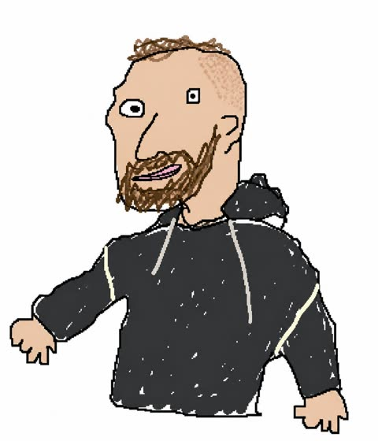</a>

提示词点明工具和输入方式,即用鼠标在MS Paint上绘制并使用白色背景,让模型模仿像素级的粗糙涂鸦。要求结果与原图相似又莫名走样,从而制造出幽默的错位感。

GPT Image 2 · 上传图改图 · 出处: [@MiguelMaestroIA on X](https://x.com/MiguelMaestroIA/status/2050123056870490123) · 发现于 [YouMind-OpenLab/awesome-gpt-image-2](https://github.com/YouMind-OpenLab/awesome-gpt-image-2)

[`ms-paint`](tags.md#tag-ms-paint) [`doodle`](tags.md#tag-doodle) [`humor`](tags.md#tag-humor) [`redraw`](tags.md#tag-redraw) [`lo-fi`](tags.md#tag-lo-fi)

<details><summary><b>提示词</b></summary>

```text
Redibuja la imagen adjunta de manera torpe, garabateada y lo más absolutamente patética posible. Usa un fondo blanco, y haz que parezca que fue dibujada en MS Paint con un ratón. Debería ser similar pero también distinta, algo así como coincidente pero desfasado de una manera confusa y torpe, con esa sensación de baja calidad píxel por píxel que realmente enfatiza lo ridículamente malo que es. En realidad, sabes qué, da igual, solo dibújalo como quieras.
```

</details>

<a id="gpt-image-crayon-style-social-profile-screen"></a>
### 蜡笔风格社交主页截图,配城堡与糖果

<a href="https://x.com/mdmadeit/status/2050013641861214518">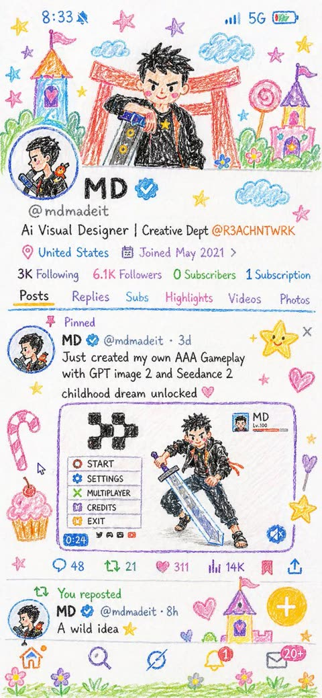</a>

提示词用十岁孩子的绘画水平限定笔触,要求形状简单且略有不完美。同时替换原有配色为白纸上的明亮蜡笔色,并列出城堡、糖果、星星、云朵等具体装饰,让整个界面风格统一。

GPT Image 2 · 上传图改图 · 出处: [@mdmadeit on X](https://x.com/mdmadeit/status/2050013641861214518) · 发现于 [YouMind-OpenLab/awesome-gpt-image-2](https://github.com/YouMind-OpenLab/awesome-gpt-image-2)

[`crayon`](tags.md#tag-crayon) [`childlike`](tags.md#tag-childlike) [`profile-picture`](tags.md#tag-profile-picture) [`whimsical`](tags.md#tag-whimsical) [`style-transfer`](tags.md#tag-style-transfer)

<details><summary><b>提示词</b></summary>

```text
Rework the given image into a crayon-style illustration, transforming the entire scene into something that feels hand-drawn by a 10-year-old. Keep the forms simple and slightly imperfect, like a child’s drawing. Avoid using the original color palette—replace it with bright, playful crayon colors on a clean white paper background. Aim for a soft, cute, and innocent aesthetic. Incorporate fun, childlike details such as castles or towers, candy, stars, clouds, and other whimsical decorations to amplify the playful vibe. The final result should feel charming, colorful, and full of childlike imagination.
```

</details>

<a id="gpt-image-exaggerated-anime-subject-redraw"></a>
### 夸张动漫风女孩与毛绒小狗重绘

<a href="https://x.com/Zyrellix/status/2052766810500649197"></a>

提示词依次写明线稿、平涂阴影和拉伸的人体比例，再要求带透视变形的环境。以上传主体为起点，风格得以迁移，人物依然可辨。

GPT Image 2 · 上传图改图 · 出处: [@Zyrellix on X](https://x.com/Zyrellix/status/2052766810500649197) · 发现于 [freestylefly/awesome-gpt-image-2](https://github.com/freestylefly/awesome-gpt-image-2)

[`anime`](tags.md#tag-anime) [`cel-shading`](tags.md#tag-cel-shading) [`exaggerated`](tags.md#tag-exaggerated) [`perspective-distortion`](tags.md#tag-perspective-distortion) [`subject-redraw`](tags.md#tag-subject-redraw)

<details><summary><b>提示词</b></summary>

```text
Create a trending anime art style image from the uploaded subject. Use confident line-work with slight variation and minimal cel shading using flat shadow shapes. Use bright, saturated colors and clean graphic lighting. The style is defined by exaggerated, cartoonish character proportions featuring highly expressive, simplistic facial features that allow for immense emotional range, with highly varied stretched anatomy.Transform the environment into a slightly warped space with playful perspective distortion and simplified objects. Composition and tone should be energetic, lively, and comedic in a fully stylized, non-realistic world
```

</details>

<a id="gpt-image-ink-sketchbook-zine-russian-doodles"></a>
### 俄语涂鸦风黑色墨水速写本杂志页

<a href="https://x.com/ChillaiKalan__/status/2055161056495014250">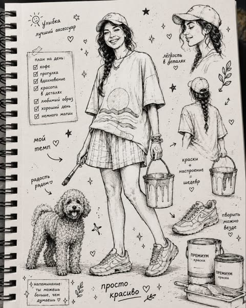</a>

把任意参考照片变成一幅主图加侧面和细节小稿，周围配手绘爱心、星星和俄语手写标注。笔尖、排线和墨迹晕染的描述，加上倾斜俯拍和窗光，让画面像真实拍下的速写本。

GPT Image 2 · 上传图改图 · 出处: [@ChillaiKalan__ on X](https://x.com/ChillaiKalan__/status/2055161056495014250) · 发现于 [YouMind-OpenLab/awesome-gpt-image-2](https://github.com/YouMind-OpenLab/awesome-gpt-image-2)

[`ink-sketch`](tags.md#tag-ink-sketch) [`sketchbook`](tags.md#tag-sketchbook) [`zine`](tags.md#tag-zine) [`fineliner`](tags.md#tag-fineliner) [`flatlay`](tags.md#tag-flatlay)

<details><summary><b>提示词</b></summary>

```text
Transform any provided reference photo into a vertical 4:5 stylized ink-drawn sketchbook illustration.

Use the person, outfit, pose, accessories, pet, objects, mood, and overall character from the reference photo as the main subject. Do not copy fixed clothing or fixed phrases from previous examples. Adapt all visual details to the new reference image.

Create a high-detail black ink and fineliner illustration on a white sketchbook page. The drawing should fill almost the entire frame, with no fabric element, no colored cloth, and no extra textile foreground.

Composition:
- one main full-body or main portrait illustration based on the reference photo;
- 1-3 additional smaller sketch studies inspired by the same subject, such as side view, back view, close-up portrait, accessory detail, pet/object detail, or gesture pose;
- small hand-drawn decorative elements around the subject: hearts, stars, sparkles, arrows, leaves, dots, mood symbols, tiny doodles;
- balanced but dense sketchbook layout, editorial zine feeling.

All handwritten text must be in Russian only.
The text should be random, natural, and relevant to the mood, outfit, season, activity, personality, or atmosphere of the reference photo.
Do not repeat the same phrases every time.
Art style:
expressive handmade sketchbook aesthetic, nostalgic indie zine warmth, high-detail manga-influenced editorial line art, rich black India ink, fineliner, marker and brush-pen hatching, cross-hatching, varied pen nib strokes, subtle ink bleed, visible sketch construction lines.

Render textures from the reference carefully: fabric folds, hair, accessories, shoes, bags, jewelry, pets, objects, skin shadows, material surfaces, and distinctive silhouette.

Camera and format:
vertical 4:5 format, close-up overhead flatlay photo of a white sketchbook page, slightly tilted top-down angle around 20 degrees, centered composition, drawing filling the screen, visible paper grain and sketchbook edge.

Lighting:
soft natural diffused morning daylight from a window, even cool-key illumination, subtle diagonal page shadow, gentle softbox fill, neutral whites, deep blacks.

Image quality:
high-resolution print-quality output, 300 DPI, ultra-crisp ink detail, slight warm tone adjustment, contrast +15, clarity +10, subtle vignette, selective sharpening on ink strokes, minimal noise reduction to preserve paper texture.

Final look:
contemporary sketchbook photography meets editorial zine illustration, clean, polished, high-fidelity, suitable for print and portfolio presentation.
```

</details>

<a id="gpt-image-isometric-thick-paint-photo-poster"></a>
### 照片与轴测厚涂微景观双层海报

<a href="https://x.com/xiaoxiaodong01/status/2091340055138963955">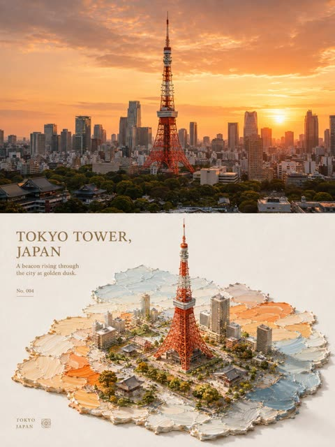</a>

把3:4画面严格上下1:1分割，上方保留原照片，下方将主体重构为轴测3D微缩模型。模型立在刮刀厚涂色块上，色块化作水面、地面或光带，并搭配留白处的简短标题与小注释，形成真实模型立在未干油彩上的触感。

GPT Image 2 · 上传图改图 · 出处: [@xiaoxiaodong01 on X](https://x.com/xiaoxiaodong01/status/2091340055138963955) · 发现于 [YouMind-OpenLab/awesome-gpt-image-2](https://github.com/YouMind-OpenLab/awesome-gpt-image-2)

[`isometric`](tags.md#tag-isometric) [`thick-paint`](tags.md#tag-thick-paint) [`palette-knife`](tags.md#tag-palette-knife) [`miniature`](tags.md#tag-miniature) [`photo-to-poster`](tags.md#tag-photo-to-poster)

<details><summary><b>提示词</b></summary>

```text
请将我上传的每一张照片分别制作成一张独立的高级设计海报，不多图拼接，每张照片单独输出。整体采用3:4竖版构图，上下两个区域高度严格1:1，各占画面50%。

上半部分保留原始照片，保持主体结构、真实质感、自然光影和原有色彩氛围，仅进行轻微高级摄影调色，使其具有艺术杂志、独立出版物与展览摄影质感。为适配画幅，可自然扩展天空、地面或环境背景，但不得拉伸、扭曲或改变主体。

下半部分提取照片中最具识别性的**主体、轮廓、姿态与叙事关系**，以 **isometric / 轴测式3D空间逻辑**重构为精致的厚涂微景观。主体不是平面插画，而是具有明确体积、结构、前后关系和稳定落点的立体微缩实体；保留原物最关键的身份特征，可适度整理视角与比例，使其在统一轴测空间中更加完整、清晰、有雕塑感。

主体坐落在一块由厚涂颜料形成的**主题色域**之上。色块不是普通矩形背景，而应根据原图内容转化为水面、地面、道路、草地、光带、岸线、影子或其他与主题相关的空间切片，并沿 isometric 透视方向自然延伸。主体必须与色块发生真实空间关系，可出现落地、嵌入、穿越、延伸、倒影、波纹、投影或局部越界，使二维厚涂笔触与三维主体巧妙连接。

构图依据主体的体量、朝向和运动方向自适应安排，以**斜向轴测、稳定重心、前后纵深和大面积留白**建立专业空间秩序。主体通常位于色块的关键节点而非机械居中，色块承担视线引导和透视延伸；必要时可加入一组低权重的云、太阳、植物、波纹或抽象自然意象，与主体形成前后层次，但不建立第二视觉中心。

绘画语言采用**立体微缩模型 × 厚涂油画 × 真实纸面**的融合方式。主体细节精致、体积清晰，周围环境则保留明显的刮刀痕迹、厚颜料堆积、起伏边缘和手工笔触；云、水、地面和光线可以具有近似浮雕般的油彩厚度，使画面产生“真实模型立在尚未干透的油画颜料上”的触觉错觉。

配色从上方照片中提取**最明亮、最鲜活、最能代表主体精气神的颜色**重新调制，提高明度、纯净度和生命力，以大量清洁暖白作为呼吸空间，搭配清透主色和少量阳光般的暖色点睛。整体明亮、治愈、鲜活而高级，避免灰脏、低沉、莫兰迪化、荧光感和廉价糖果色。

文字少量介入，从照片的主体、地点、情绪或象征意义中提炼简短标题，并搭配极少量副文、编号或微型注释。排版保持细致、克制，可顺应轴测方向、厚涂色块边缘或留白区域排列，与空间透视形成巧妙呼应，而不是独立贴在画面上的标题。

整体呈现 **isometric 立体主体 × 厚涂色域 × 明亮治愈配色 × 真实纸张 × 大面积留白** 的视觉关系。无论主体是建筑、人物、动物、植物、器物、交通工具或自然景观，都应让三维主体真实“站立、生长或存在”于厚涂色块构成的空间中，避免平面贴图、普通插画、塑料CG、玩具模型感和模板化微景观。
```

</details>

<a id="gpt-image-landscape-photo-four-style-blue-white-dunhuang-embroidery"></a>
### 风景照转青花、敦煌壁画、刺绣三种风格四层长图

<a href="https://x.com/zhidawang219555/status/2090310144190218272"></a>

画面严格四等分，每层占25%，依次为原图和三种风格转译。每个风格层只保留一个核心主体，留白不少于60%，主色限2到4种，所以三层风格干净且彼此区分明显。

GPT Image 2 · 上传图改图 · 出处: [@zhidawang219555 on X](https://x.com/zhidawang219555/status/2090310144190218272) · 发现于 [freestylefly/awesome-gpt-image-2](https://github.com/freestylefly/awesome-gpt-image-2)

[`style-transfer`](tags.md#tag-style-transfer) [`blue-and-white-porcelain`](tags.md#tag-blue-and-white-porcelain) [`dunhuang-mural`](tags.md#tag-dunhuang-mural) [`embroidery`](tags.md#tag-embroidery) [`landscape`](tags.md#tag-landscape)

<details><summary><b>提示词</b></summary>

```text
请将我上传的照片制作成一张竖版拼图海报，整体采用 3:4 竖版构图。画面从上到下严格四等分为四个横向区域，每个区域的高度必须精确控制为整体画面高度的25%（四层比例严格为1:1:1:1，不允许出现比例偏差），区域之间无缝衔接，不设分隔线、不留间隙，顺序为：原图→风格1→风格2→风格3。由于每层为约3:1的极扁宽幅比例，各层主体建议横向居中排布，强调左右开阔留白与呼吸感，避免元素纵向拉伸变形或贴边拥挤。四层在人物站位、场景结构、视线方向上保持连贯呼应，呈现同一画面、四种转译的整体感。风格层（第二至四层）须遵循极简原则：每层视觉元素数量压缩至最低限度，只保留1个最核心的主体符号，其余次要装饰、背景细节与陪衬元素一律省略，画面留白占比不低于60%。

第一层保留原始照片的主体结构、人物真实互动关系与姿态、真实质感、自然光影与原有色彩氛围，仅进行轻微高级摄影调色，呈现杂志摄影质感，不改变人物关系与构图逻辑，并可在不改变人物关系与构图逻辑的前提下自然扩展天空、地面或环境背景，使整体更具空间感与叙事感。

第二层为青花瓷绘风格：借鉴青花瓷绘画技法，以钴蓝色线条与晕染在米白底上表现人物与场景，呈现瓷器纹样的疏朗雅致感。色彩以钴蓝与米白为主的单色系。避免蓝色浓淡层次过多显杂，避免图案化装饰堆砌。

第三层为敦煌壁画风格：借鉴敦煌壁画矿物重彩质感，表现古朴斑驳的美感，需简化线条与色块。背景为土黄或赭石底色，带斑驳壁画肌理感。色彩以赭石、石青、朱砂、土黄为主。避免裂纹肌理过多堆砌，避免复杂纹样装饰。

第四层为刺绣锦缎风格：以刺绣针脚肌理表现人物与场景轮廓，呈现丝缎光泽与针线纹理感，图案需极简概括。背景为米白或浅灰缎面底色。色彩以2至3种柔和色搭配金线点缀。避免针脚过密显繁琐，避免金线过多显浮夸。

每一层需将主体与场景统一转换为对应风格，整体表达极度克制与简化，只保留最核心的一个主体符号及其基本轮廓关系，删除一切非必要的背景元素、装饰细节与陪衬物；人物之间的关键位置关系、互动方向与姿态特征需保留，但应抽象为可识别的轮廓关系，做到“元素越少、关系越清晰”。色彩均从原图中提取归纳，每层严格控制在2-4种主色以内。四个区域的高度比例须严格保持1:1:1:1（各占25%），不可出现拼接错位或比例偏差。整体避免朋克/赛博朋克风格、写实照片质感强行叠加、卡通风格、3D渲染感、商业海报感、复杂背景堆砌、元素过多或画面拥挤、相邻两层风格雷同，以及任何文字、Logo、水印或标题。
```

</details>

<a id="gpt-image-lofi-nostalgic-anime-portrait-conversion"></a>
### 动漫人像的怀旧Lo-Fi风格转换

<a href="https://x.com/notoro_ai/status/2053661484413313463">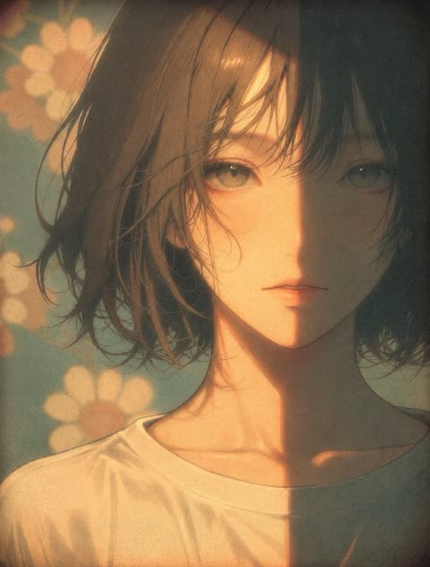</a>

列出具体的胶片要素（暗调粉彩、颗粒、柔焦、褪色、暗角），并指定柔和自然光落在皮肤与头发上。结尾锁定原构图与角色，只改变风格。

GPT Image 2 · 上传图改图 · 出处: [@notoro_ai on X](https://x.com/notoro_ai/status/2053661484413313463) · 发现于 [YouMind-OpenLab/awesome-gpt-image-2](https://github.com/YouMind-OpenLab/awesome-gpt-image-2)

[`lo-fi`](tags.md#tag-lo-fi) [`style-transfer`](tags.md#tag-style-transfer) [`film-grain`](tags.md#tag-film-grain) [`anime`](tags.md#tag-anime) [`nostalgic`](tags.md#tag-nostalgic)

<details><summary><b>提示词</b></summary>

```text
このイラストを、本格的なLo-Fiアートスタイルで変換してください。暖かく少しくすんだパステル調の色味、フィルムグレイン、ソフトフォーカス、軽い色褪せとビネットを加えて、ノスタルジックでチルな雰囲気を強く表現してください。柔らかい自然光がキャラクターを優しく包み込み、肌や髪に温かみのある光と影を落とす。全体をゆったりと落ち着いた、どこか懐かしく心地よいLo-Fi特有のムードに仕上げてください。元の構図・キャラクターを完全に維持。
```

</details>

<a id="gpt-image-magazine-paper-collage-cafe-girl"></a>
### 手持咖啡的女孩纸艺拼贴插画

<a href="https://x.com/oggii_0/status/2060212097083146644"></a>

提示词保留原图主体与姿势，再把风格、人物、构图、物件、字体和氛围分块叠加。结尾的排除清单和对拼贴元素数量的限制，让画面保持留白、不拥挤。

GPT Image 2 · 上传图改图 · 出处: [@oggii_0 on X](https://x.com/oggii_0/status/2060212097083146644) · 发现于 [freestylefly/awesome-gpt-image-2](https://github.com/freestylefly/awesome-gpt-image-2)

[`paper-collage`](tags.md#tag-paper-collage) [`scrapbook`](tags.md#tag-scrapbook) [`korean-editorial`](tags.md#tag-korean-editorial) [`handwritten-type`](tags.md#tag-handwritten-type) [`minimalist`](tags.md#tag-minimalist)

<details><summary><b>提示词</b></summary>

```text
Transform the uploaded image into a minimalist illustration in a magazine collage style, using paper cutouts. Retain the main subject, pose, and overall concept of the original image, but reimagine it as a warm, hand-edited collage. Style: Minimalist illustration in a magazine paper collage style, with flat, layered paper shapes, soft pastel paper textures, torn paper edges, paper shadow effects, neat black doodle accents, a handmade scrapbook atmosphere, modern Korean editorial design, a simple and cute composition, and large areas of clean white space. Character: Cute, simplified Korean characters with minimalist facial features, a small, relaxed smile, soft and rounded proportions, simple and casual clothing, and silhouettes constructed from layered paper cutouts. Composition: A 3:4 aspect ratio, with the main subject positioned slightly lower and off-center, leaving a large, open space on the opposite side for a breezy, minimalist composition that avoids clutter. Objects: Add only a few suitable collage elements: paper sticky notes, small hearts, plants, a cup of coffee, a window, tape fragments, and simple doodle icons. Typography: Add an elegant, handwritten English title that fits the scene's atmosphere. Use short phrases such as: ["May you be like the morning sunshine, full of vitality and hope, embracing the beauty of each day.","Take a small break," or "Good day, good mood."] Atmosphere: Calm, comfortable, warm, sweet, and editorial style. Avoid: Photorealistic style, anime style, watercolor style, 3D clay style, overly detailed backgrounds, excessive collage elements, a luxury poster atmosphere, dark tones, harsh shadows, and sloppy text.
```

</details>

<a id="gpt-image-minimalist-fairytale-children-illustration"></a>
### 极简童话风手绘儿童插画情侣

<a href="https://x.com/MissDelulu9/status/2057073936295399551"></a>

用具体的绘画特征定义风格：细而不完美的线条、平涂粉彩、红脸颊和纸张质感。再用一长串排除项（写实、3D、光泽、复杂阴影）把画面保持在扁平稚拙的效果。

GPT Image 2 · 上传图改图 · 出处: [@MissDelulu9 on X](https://x.com/MissDelulu9/status/2057073936295399551) · 发现于 [freestylefly/awesome-gpt-image-2](https://github.com/freestylefly/awesome-gpt-image-2)

[`children-illustration`](tags.md#tag-children-illustration) [`hand-drawn`](tags.md#tag-hand-drawn) [`pastel`](tags.md#tag-pastel) [`storybook`](tags.md#tag-storybook) [`photo-to-illustration`](tags.md#tag-photo-to-illustration)

<details><summary><b>提示词</b></summary>

```text
Transform the photo into a delicate minimalist hand-drawn children’s illustration with a soft whimsical fairy-tale aesthetic. Use simple elongated shapes, thin imperfect hand-drawn lines, flat pastel colors, minimal details, and a cute doll-like character style with rosy cheeks, tiny facial features, and simplified anatomy. Add subtle paper texture, soft pencil and pastel shading, watercolor softness, and a clean white background with small stars or sparkles.

Stylize the clothing in a playful storybook way with simplified shapes and gentle decorative details. The overall mood should feel airy, cozy, naive, and charming, like a modern Scandinavian nursery postcard or children’s book illustration. Avoid photorealism, 3D, cinematic lighting, glossy surfaces, complex shadows, realistic anatomy, and hyper-detail.
```

</details>

<a id="gpt-image-ms-paint-clumsy-redraw-of-photo"></a>
### 把照片重画成故意画得很烂的MS Paint涂鸦

<a href="https://x.com/arrakis_ai/status/2049689793118998717">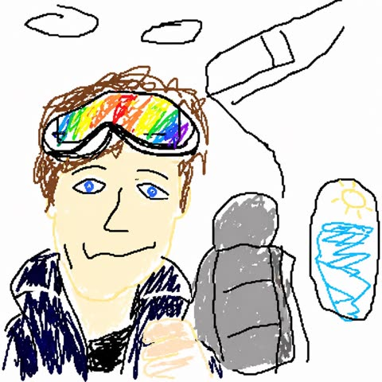</a>

提示词把自嘲式的形容词和具体限制叠在一起：白色背景、鼠标绘制、逐像素的粗糙感。要求画得似像非像，既保留可辨认的原图轮廓，又让笨拙感显得好笑。

GPT Image 2 · 上传图改图 · 出处: [@arrakis_ai on X](https://x.com/arrakis_ai/status/2049689793118998717) · 发现于 [YouMind-OpenLab/awesome-gpt-image-2](https://github.com/YouMind-OpenLab/awesome-gpt-image-2)

[`ms-paint`](tags.md#tag-ms-paint) [`scribble`](tags.md#tag-scribble) [`parody`](tags.md#tag-parody) [`redraw`](tags.md#tag-redraw) [`lo-fi`](tags.md#tag-lo-fi)

<details><summary><b>提示词</b></summary>

```text
Redraw the attached image in the most clumsy, scribbly, and utterly pathetic way possible. Use a white background, and make it look like it was drawn in MS Paint with a mouse. It should be vaguely similar but also not really, kind of matching but also off in a confusing, awkward way, with that low-quality pixel-by-pixel feel that really emphasizes how ridiculously bad it is. Actually, you know what, whatever, just draw it however you want.
```

</details>

<a id="gpt-image-old-house-miniature-model-diorama"></a>
### 老房子1:24超写实微缩沙盘模型

<a href="https://x.com/MrGafish/status/2108382775191757286">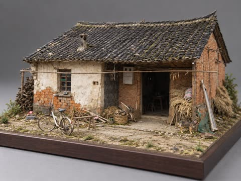</a>

指定1:24比例与博物馆级质感，逐项列出墙皮剥落、裂缝、青苔等风化细节，并设定45度三分之四视角、微距柔光和中性灰背景，结尾用否定句排除塑料玩具感、卡通感和3D渲染感。

GPT Image 2.5 · 上传图改图 · 出处: [@MrGafish on X](https://x.com/MrGafish/status/2108382775191757286)

[`miniature`](tags.md#tag-miniature) [`diorama`](tags.md#tag-diorama) [`weathered`](tags.md#tag-weathered) [`macro-photography`](tags.md#tag-macro-photography) [`photo-to-model`](tags.md#tag-photo-to-model)

<details><summary><b>提示词</b></summary>

```text
参考上传的老房子照片，以1:24比例精准复刻为博物馆级超写实实体微缩模型，严格还原建筑结构、屋顶、门窗、墙体及原始环境。精细呈现斑驳墙皮、风化砖瓦、裂缝、青苔、灰尘等岁月痕迹，材质真实自然，具有极致手工制作质感。模型置于精致的矩形沙盘底座上，45度俯视三分之四视角，完整展示建筑全貌。专业微距摄影，柔和自然光，真实阴影，中性灰摄影棚背景，8K超高清。强调真实实体模型效果，避免塑料玩具感、卡通感及3D渲染感。
```

</details>

<a id="gpt-image-paper-collage-countryside-portrait-diorama"></a>
### 纸雕拼贴乡野中的写实女孩人像

<a href="https://x.com/AiwithLariab/status/2090297565732585554"></a>

用严格的人脸身份锁定保留参考图中的真人写实感，同时把整个环境限定为手工纸艺。服装、场景、漂浮装饰、艺术指导和构图分块描述，每一层都有独立约束，再用手撕边、纸纤维、多层卡纸等质感词强化手作效果。

GPT Image 2 · 上传图改图 · 出处: [@AiwithLariab on X](https://x.com/AiwithLariab/status/2090297565732585554) · 发现于 [freestylefly/awesome-gpt-image-2](https://github.com/freestylefly/awesome-gpt-image-2)

[`paper-collage`](tags.md#tag-paper-collage) [`diorama`](tags.md#tag-diorama) [`face-lock`](tags.md#tag-face-lock) [`countryside`](tags.md#tag-countryside) [`fashion-editorial`](tags.md#tag-fashion-editorial)

<details><summary><b>提示词</b></summary>

```text
Create a premium whimsical handcrafted paper-collage diorama inspired exactly by the uploaded reference image.

Use the uploaded girl reference as the ONLY human subject. Preserve her facial identity with maximum accuracy: exact face shape, eyes, eyebrows, nose, lips, skin tone, hairstyle, hairline, and recognizable facial features. Strict face identity lock — do not redesign, beautify, stylize, age, de-age, or replace her face.

The girl stands alone in the center of the composition in a graceful, natural editorial pose. She is facing the camera with a relaxed confident expression and a subtle natural smile. Her body is slightly angled, creating a candid fashion-editorial feeling. She holds a beautiful small mixed bouquet of flowers naturally with both hands in front of her. One leg is slightly crossed in front of the other for an elegant relaxed pose.

Outfit

Change the outfit completely from the original reference while keeping it fully modest and elegant:

- elegant ivory/cream long-sleeve button-up blouse
- high-waisted wide-leg beige trousers
- full-length trousers with complete coverage
- simple cream closed-toe shoes
- small brown leather shoulder bag
- no revealing clothing
- no exposed midriff
- sophisticated countryside editorial fashion
- natural realistic fabric folds and texture

Environment

Create a beautiful handcrafted 3D paper-diorama countryside scene:

- layered blue mountains in the distance
- green forest and rolling hills
- peaceful blue lake
- grassy lakeside landscape
- textured beige paper pathway in the foreground
- rustic white wooden fence behind the girl
- dreamy pastel sky

Surround the composition with oversized handmade paper flowers in pink, peach, cream, white, and light blue, with layered green paper leaves.

Add decorative paper elements floating in the sky:

- pink paper hearts
- yellow paper stars
- blue stars
- soft white and pale-blue clouds
- tiny colorful paper dots

Place two tiny vintage vehicles near the lake in the background: a cream vintage camper van on one side and a small vintage blue-green car on the other.

Art Direction

The entire environment should look handcrafted from premium textured paper while the girl remains photorealistic and seamlessly integrated into the paper world.

Use:
hand-torn paper edges, visible paper fibers, layered cardstock, subtle imperfections, realistic paper shadows, dimensional cut-paper elements, tactile textures, soft natural daylight, cinematic depth, gentle atmospheric perspective, premium editorial photography.

The final image should feel like a luxury handmade paper storybook brought to life with a real photographic subject.

Composition

Centered full-body girl
Face clearly visible and sharply detailed
Natural elegant pose
Bouquet held naturally
Rustic fence framing the subject
Lake and mountains creating depth
Large flowers framing both lower corners
Clouds and decorative elements filling the upper background
Balanced symmetrical composition with organic handmade imperfections
Girl remains the strongest focal point

Final Look

Photorealistic girl + handcrafted paper-art environment
Dreamy pastel colors
Luxury editorial aesthetic
Whimsical miniature diorama
Soft cinematic daylight
Highly detailed paper textures
Natural realistic skin
Sharp facial identity
Professional fashion photography
Pinterest/Instagram viral visual aesthetic
Magazine-quality composition

Vertical 4:5 portrait composition, full-body framing, ultra-detailed, high resolution, clean polished finish, visually striking, aesthetically balanced, premium handcrafted paper-collage photography.
```

</details>

<a id="gpt-image-paper-craft-family-mount-fuji-pond"></a>
### 富士山池塘边的纸艺全家福

<a href="https://x.com/oggii_0/status/2052609040539328759"></a>

要求把照片细节简化成剪纸形状，得到带柔和阴影的分层平面造型。允许添加小鸟、蝴蝶和花朵等装饰，画面更饱满，同时保留原图场景。

GPT Image 2 · 上传图改图 · 出处: [@oggii_0 on X](https://x.com/oggii_0/status/2052609040539328759) · 发现于 [freestylefly/awesome-gpt-image-2](https://github.com/freestylefly/awesome-gpt-image-2)

[`paper-craft`](tags.md#tag-paper-craft) [`photo-to-art`](tags.md#tag-photo-to-art) [`family-portrait`](tags.md#tag-family-portrait) [`cute`](tags.md#tag-cute) [`landscape`](tags.md#tag-landscape)

<details><summary><b>提示词</b></summary>

```text
Recreate this image in a paper craft style, simplifying the details to make them suitable for paper craft artwork. Arrange the overall composition to feel visually pleasing, soft, and cute. You may add charming decorative elements such as birds, butterflies, flowers, etc., to enhance the adorable atmosphere while still matching the original image.
```

</details>

<a id="gpt-image-pencil-sketch-yawn-3d-double"></a>
### 皮克斯风3D人物站在巨幅铅笔打哈欠素描前

<a href="https://x.com/AIwithkhan/status/2062567518389391540"></a>

分成两层描述：先把参考照片画成铅笔素描作背景，再加一个站在前面的3D渲染分身。平面石墨与柔光3D人物形成对比和层次，并在提示词里指定3:4比例。

GPT Image 2 · 上传图改图 · 出处: [@AIwithkhan on X](https://x.com/AIwithkhan/status/2062567518389391540) · 发现于 [freestylefly/awesome-gpt-image-2](https://github.com/freestylefly/awesome-gpt-image-2)

[`pencil-sketch`](tags.md#tag-pencil-sketch) [`pixar-style`](tags.md#tag-pixar-style) [`3d-render`](tags.md#tag-3d-render) [`double-exposure`](tags.md#tag-double-exposure) [`photo-to-art`](tags.md#tag-photo-to-art)

<details><summary><b>提示词</b></summary>

```text
Create a handrawn pencil illustration of [image] yawning on paper, as background.

Add a 3D Pixar style render of [foto] standing casually infront of the giant handrawn pencil illustration. Soft cinematic lighting. 8K resolution. 3:4 ratio
```

</details>

<a id="gpt-image-pixel-art-style-transfer"></a>
### 照参考图画风生成像素风摩托骑手

<a href="https://developers.openai.com/api/docs/guides/image-prompting#transfer-a-visual-style"></a>

参考图只用来提供画风，新主体另外描述，这样配色和像素颗粒能迁移过来，场景不会被照抄。预览图为 Sunburst 版本。

GPT Image 2.5 · 上传图改图 · 出处: [OpenAI image prompting guide](https://developers.openai.com/api/docs/guides/image-prompting#transfer-a-visual-style)

[`pixel-art`](tags.md#tag-pixel-art) [`style-transfer`](tags.md#tag-style-transfer) [`reference`](tags.md#tag-reference)

<details><summary><b>提示词</b></summary>

```text
Use the same style from the input image and generate a man riding a motorcycle on a white background.
```

</details>

输入素材: [1](https://developers.openai.com/images/platform/guides/image-prompting/pixels.webp)

<a id="gpt-image-rainbow-neon-outline-anime-girl"></a>
### 黑底彩虹霓虹描边的动漫少女

<a href="https://x.com/notoro_ai/status/2052692043508670791">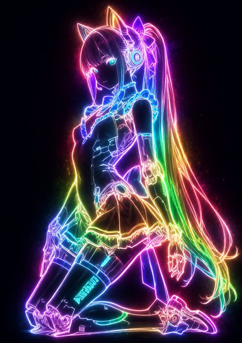</a>

提示词要求只有线条发光、填色面保持极淡，在深色背景上形成强烈对比。发光色做成可替换的占位，并明确锁定构图、姿势与表情，因此可套用到任意插画。

GPT Image 2 · 上传图改图 · 出处: [@notoro_ai on X](https://x.com/notoro_ai/status/2052692043508670791) · 发现于 [YouMind-OpenLab/awesome-gpt-image-2](https://github.com/YouMind-OpenLab/awesome-gpt-image-2)

[`neon-outline`](tags.md#tag-neon-outline) [`glow`](tags.md#tag-glow) [`anime`](tags.md#tag-anime) [`style-conversion`](tags.md#tag-style-conversion) [`dark-background`](tags.md#tag-dark-background)

<details><summary><b>提示词</b></summary>

```text
このイラストを、神秘的で幻想的な発光スタイルで変換してください。 【発光色：虹色】 キャラクターの輪郭線・衣装のライン・アクセサリーのディテール・髪の流れなど全ての線だけが、【発光色】の美しい光で強く発光するようにしてください。線は内側からじんわりと輝き、ゆっくりと浮かび上がるような柔らかいネオン光を放ち、光の粒を僅かに散らしながら周囲を優しく照らす表現に。面で光らせるのではなく、線のみが主役として発光し、他の部分（肌・髪・衣装の塗り面など）は極めて控えめに、僅かに透ける程度に抑えてください。 線の発光が暗い背景に対して非常に強いコントラストを生み、【発光色】の光のスペクトルが穏やかに広がる様子を強調。キャラクターの各線が幻想的で神々しい輝きを放ち、光が線に沿って流れるように美しく表現してください。全体の雰囲気はクールで神秘的、魔法のような幻想的な【発光色】の光の輪郭のみが浮かび上がる、息を飲むほど美しいシルエットに仕上げてください。 元のイラストの構図・キャラクターの表情・ポーズ・シルエット・主要な特徴は一切崩さず忠実に維持。
```

</details>

<a id="gpt-image-rubber-hose-cartoon-photo-transformation"></a>
### 花园中的复古橡皮管卡通女子

<a href="https://x.com/Kashberg_0/status/2059238639394271540">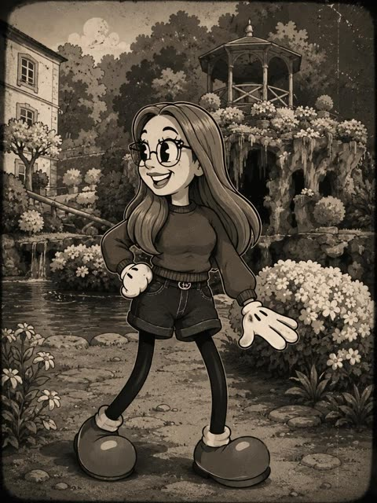</a>

开头用重点块锁定发型、眼镜和表情等身份特征，再列出橡皮管风格要素：饼形眼、白手套、大鞋和细长四肢。随后分别给出视觉风格、艺术风格和质量要求，加入复古棕褐色调、胶片颗粒与划痕，并让背景取自原照片环境。

GPT Image 2 · 上传图改图 · 出处: [@Kashberg_0 on X](https://x.com/Kashberg_0/status/2059238639394271540) · 发现于 [YouMind-OpenLab/awesome-gpt-image-2](https://github.com/YouMind-OpenLab/awesome-gpt-image-2)

[`rubber-hose`](tags.md#tag-rubber-hose) [`vintage-cartoon`](tags.md#tag-vintage-cartoon) [`sepia`](tags.md#tag-sepia) [`photo-to-cartoon`](tags.md#tag-photo-to-cartoon) [`film-grain`](tags.md#tag-film-grain)

<details><summary><b>提示词</b></summary>

```text
Transform the person in the photo into a vintage 1930s–1940s cartoon character inspired by classic “rubber hose animation” styles such as Betty Boop, Cuphead, Steamboat Willie, and old Fleischer Studios cartoons.

IMPORTANT:

Clearly preserve the identity of the person in the photo (recognizable hair, beard, glasses, face, and facial expression).

Exaggerated, elastic cartoon-style body.

Large black vintage pie-cut eyes.

Big expressive smile.

Classic white cartoon gloves.

Oversized 1930s-style cartoon shoes.

Thin rubber hose-style arms and legs.

Thick black outlines and authentic vintage animation look.

Visual Style:

Black and white or vintage sepia tones.

Aged old-film texture.

Small grain, scratches, and imperfections like old film reels.

Simple cel-animation style shading.

Caricatured but natural proportions.

Background inspired by the original environment of the photo.

Art Style:

1930s / 1940s cartoon animation.

Rubber hose cartoon aesthetic.

Vintage animation poster style.

Fleischer Studios aesthetic.

Cuphead-inspired vintage cartoon style.

Ink outlines and exaggerated expressions.

Quality:

Ultra-detailed vintage cartoon.

Cinematic composition.

High facial likeness detail.

Soft vintage lighting.

Authentic retro animation feeling.

Full-body character.
```

</details>

<a id="gpt-image-storybook-photo-to-handdrawn-portrait"></a>
### 照片转手绘儿童绘本头像

<a href="https://x.com/Sairah_0/status/2090321208441262454"></a>

先列出必须保留的面部、发型、服装和配饰，再列出禁止照搬的内容，让身份特征保留而画风被重塑。指定水粉、蜡笔、粉彩等媒介和不规则棕色线条，并固定暖色背景，绘本质感更稳定。

GPT Image 2 · 上传图改图 · 出处: [@Sairah_0 on X](https://x.com/Sairah_0/status/2090321208441262454) · 发现于 [freestylefly/awesome-gpt-image-2](https://github.com/freestylefly/awesome-gpt-image-2)

[`storybook`](tags.md#tag-storybook) [`hand-drawn`](tags.md#tag-hand-drawn) [`avatar`](tags.md#tag-avatar) [`gouache`](tags.md#tag-gouache) [`photo-to-illustration`](tags.md#tag-photo-to-illustration)

<details><summary><b>提示词</b></summary>

```text
Use the single uploaded photo as the only visual reference. Transform the person into an adorable hand-drawn 2D children’s storybook character, while keeping their identity immediately recognizable.

Preserve exactly from the photo:
- Facial features and skin tone
- Real hairstyle, length, texture, and color
- Exact clothing, colors, patterns, and layering
- Glasses, jewelry, headwear, bags, and all visible accessories

Do not invent or copy hairstyles, outfits, accessories, braids, pigtails, bows, bonnets, or headscarves from any reference artwork.

### Character
Use an oversized rounded head, tiny compact body, short arms, narrow shoulders, soft rounded silhouette, and cute childlike proportions. Keep the head visually dominant. Avoid realistic anatomy.

### Face
Simplify into tiny dot/oval eyes, minimal nose, tiny smiling mouth, rounded cheeks, and soft peach/pink blush. Keep recognizable facial characteristics. No realistic eyes, detailed lips, anime features, glossy 3D rendering, or heavy shading.

### Hair & Clothing
Recreate the exact hairstyle and outfit from the uploaded photo, simplified into chunky hand-drawn shapes. Preserve important colors, patterns, jewelry, glasses, and other recognizable details.

### Style
Handmade 2D picture-book aesthetic using soft gouache, wax crayon, colored pencil, and dry pastel. Use slightly irregular dark-brown linework, subtle paper grain, uneven pigment, soft brush marks, and imperfect painted edges. Avoid clean vector art, CGI, anime, or photorealism.

### Composition
Square 1:1 portrait, chest/waist-up, centered and facing mostly forward, with balanced negative space. Use a relaxed, charming pose.

### Background
Simple warm mustard, butter yellow, ochre, or cream background with subtle paper texture. No scenery, objects, text, borders, or distractions.

Final feeling: the same person lovingly redrawn as an extremely cute, warm, wholesome, nostalgic, handcrafted children’s-book character—same identity, same hair, same clothes, same accessories, completely simplified and adorable.
```

</details>

<a id="gpt-image-watercolor-travel-journal-postcard"></a>
### 旅行照片转水彩手账明信片

<a href="https://x.com/zhgqthomas/status/2056633723366568387"></a>

叠加钢笔线稿、水彩晕染和米色纸张质感等手账要素，再用可替换的标题、文案、日期和地点邮戳槽位固定明信片版式，并用克制的大地色调统一画面。

GPT Image 2 · 上传图改图 · 出处: [@zhgqthomas on X](https://x.com/zhgqthomas/status/2056633723366568387) · 发现于 [freestylefly/awesome-gpt-image-2](https://github.com/freestylefly/awesome-gpt-image-2)

[`watercolor`](tags.md#tag-watercolor) [`travel-journal`](tags.md#tag-travel-journal) [`postcard`](tags.md#tag-postcard) [`sketchbook`](tags.md#tag-sketchbook) [`photo-to-art`](tags.md#tag-photo-to-art)

<details><summary><b>提示词</b></summary>

```text
Create a dreamy watercolor travel illustration style from the attached photo. Use hand-painted urban sketchbook aesthetic, delicate ink linework mixed with soft watercolor washes, highly detailed pen-and-ink drawing, loose expressive brush strokes, watercolor bleeding edges, ultra detailed watercolor texture, soft beige paper texture background, architectural sketch style, vintage travel diary and sketchbook traveler aesthetic, travel journal composition, editorial postcard layout, handwritten medium title:[自定义标题]  at top, handwritten notes:[自定义文案] , date: [自定义日期] and location: [自定义地点]  stamps, natural perspective, atmospheric depth, minimalist negative space, muted earthy palette (warm browns, faded greens, cream whites, soft blue accents), quiet, calm, soft, cozy, nostalgic vibes, cinematic slice-of-life mood, poetic composition, mixed urban sketching with Ghibli-inspired realism, vertical poster design, premium art print quality.
```

</details>

<a id="gpt-image-white-paper-craft-style-conversion"></a>
### 插画转写实白色纸艺风格

<a href="https://x.com/notoro_ai/status/2052018043883319536">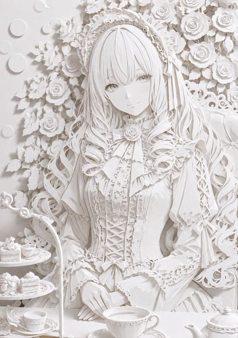</a>

先点明实体材质（激光切割厚纸），再补充具体细节：锐利切口、细密折痕、多层景深、纸纤维与自然投影。结尾要求保留原构图和角色，因此只改变媒介。

GPT Image 2 · 上传图改图 · 出处: [@notoro_ai on X](https://x.com/notoro_ai/status/2052018043883319536) · 发现于 [YouMind-OpenLab/awesome-gpt-image-2](https://github.com/YouMind-OpenLab/awesome-gpt-image-2)

[`paper-craft`](tags.md#tag-paper-craft) [`style-conversion`](tags.md#tag-style-conversion) [`white-paper`](tags.md#tag-white-paper) [`layered-depth`](tags.md#tag-layered-depth) [`laser-cut`](tags.md#tag-laser-cut)

<details><summary><b>提示词</b></summary>

```text
このイラストを非常に精密でリアルな白い紙のペーパークラフト風に変換してください。厚紙をレーザーカットしたようなシャープで正確な切り口、細かい折り目、複数のレイヤーによる豊かな立体感、紙の繊維感と自然な影を高ディテールで表現してください。光の当たり方による紙の白さと微妙なグラデーションを活かし、本物のような立体的なペーパーアート作品のようなリアリティを出して。全体を洗練されていて芸術的な雰囲気に。元のイラストの構図・キャラクターを忠実に維持。
```

</details>
