# 照片转艺术风格

[返回目录](../../README_zh.md) · 全部 28 条

<a id="gpt-image-photo-to-watercolor-travel"></a>
### 上半照片，下半水彩旅行速写

<a href="https://x.com/MahnoorAi12/status/2102724961408626735"></a>

上下分割，照片渐变成水彩。作者说 Gemini、Grok、ChatGPT 都能用。

GPT Image 2.5 · 上传图改图 · 出处: [@MahnoorAi12 on X](https://x.com/MahnoorAi12/status/2102724961408626735) · 2,264 赞，统计于 2026-10-27

[`watercolor`](tags.md#tag-watercolor) [`travel`](tags.md#tag-travel) [`split-composition`](tags.md#tag-split-composition)

<details><summary><b>提示词</b></summary>

```text
Create a refined editorial travel-art composition based on a reference photograph. The image is divided vertically into two parts: the upper section is a realistic cinematic travel photograph, while the lower section transforms the exact same scene into a delicate hand-painted watercolor illustration.
Upper section: authentic candid travel photography, natural daylight, soft shadows, subtle film grain, realistic textures, sophisticated European atmosphere, documentary-style composition, people naturally walking through the scene, beautiful architectural details, slightly muted elegant colors, high-end travel magazine photography.
Lower section: a minimalist handmade watercolor painting of the exact same scene, preserving the recognizable composition, architecture, people, poses, perspective and major visual elements from the photograph. Loose translucent watercolor washes, delicate ink details, visible paper texture, soft edges, imperfect brushwork, subtle pigment bleeding, airy negative space, understated pastel tones, artistic but realistic.
Leave generous warm ivory/off-white textured paper space surrounding the watercolor illustration. Add a small elegant handwritten caption near the bottom, such as “summer days” or “a quiet afternoon”, with a thin minimalist horizontal line underneath.
Overall aesthetic: luxury travel journal, fine-art watercolor postcard, contemporary editorial design, nostalgic European summer, understated elegance, tactile handmade paper, sophisticated and serene.
Portrait orientation, clean composition, premium art direction, no clutter, no borders, natural proportions, highly detailed photograph transitioning into an airy watercolor illustration.
```

</details>

<a id="gpt-image-pet-papercraft-cube-template"></a>
### 高地牛纸模立方体玩具展开图

<a href="https://x.com/icreatelife/status/2101353488408006830"></a>

提示词把上传照片限定为动物外观的唯一来源，并逐一列出平铺的各个部件及折线、粘合片和裁切边。结尾列出不得更改的内容，用来保住动物的身份特征和毛发质感。

GPT Image 2.5 · 上传图改图 · 出处: [@icreatelife on X](https://x.com/icreatelife/status/2101353488408006830) · 1,178 赞，统计于 2026-10-27

[`papercraft`](tags.md#tag-papercraft) [`cube-toy`](tags.md#tag-cube-toy) [`pet`](tags.md#tag-pet) [`template`](tags.md#tag-template) [`fur-texture`](tags.md#tag-fur-texture)

<details><summary><b>提示词</b></summary>

```text
Use my uploaded pet photo as the only source of the animal’s appearance. Create a realistic printable papercraft cube toy template of my pet, preserving 100% its identity and unique features: fur color, fur pattern, eyes, face shape, ears, body proportions, markings and expression.

Transform my pet into a handmade paper craft 3D model (low-poly cube style) like a DIY papercraft template. Show the unfolded cut-out template pieces laid flat on a white background: head, body, legs, ears and tail separated, with folding lines, tabs and cutting edges clearly visible.

The printed texture on the paper pieces must use my pet’s real fur texture and colors, so when assembled it becomes a small cube-shaped 3D figure of my exact pet.

Include:

cube-shaped head with my pet’s real face on it

cube-shaped body with realistic fur texture

four legs matching my pet’s appearance

ears with correct shape and inner ear details

tail matching my pet’s size and color pattern

Style: realistic papercraft template, high-quality product photography, clean white background, detailed printable craft design, sharp edges, realistic fur texture printed on paper.

Do not change my pet’s appearance. Do not turn it into a different animal, cartoon, plush toy or generic cat/dog. It must look like my actual pet converted into a cube papercraft model
```

</details>

<a id="gpt-image-paper-texture-cover"></a>
### 照片变纸张质感极简封面

<a href="https://x.com/Ciri_ai/status/2113501433471656120"></a>

按小标题组织（构图、配色、质感），最后点明参照物：独立艺术书封面。

GPT Image 2.5 · 上传图改图 · 出处: [@Ciri_ai on X](https://x.com/Ciri_ai/status/2113501433471656120) · 561 赞，统计于 2026-10-27

[`paper-texture`](tags.md#tag-paper-texture) [`minimal`](tags.md#tag-minimal) [`cover`](tags.md#tag-cover)

<details><summary><b>提示词</b></summary>

```text
MINIMAL HAND-DRAWN PAPER ILLUSTRATION

Transform the uploaded photo into a minimalist, hand-drawn, paper-textured artistic cover.

Composition

- The main subject should occupy only 10–20% of the frame.
- Position the subject near the bottom center of the composition.
- Leave generous negative space throughout the image.
- Suggest the environment using only a few lines or small blocks of color.

Preserve

- The most recognizable features of the original subject.
- The essential silhouette and proportions.
- The original pose or primary action.
- Important objects and defining details.
- The core story, relationships, and emotional atmosphere.

Color Palette

- Extract the dominant colors from the original photograph.
- Limit the palette to no more than four main colors.
- Use bold yet restrained, flat color blocks.
- Maintain a harmonious, muted color combination.
- Add subtle paper grain and handmade brush textures.

Simplification
Remove unnecessary details and visual clutter. Retain only the essential visual information needed to make the subject instantly recognizable.

Typography

- Optionally incorporate a small amount of simple text.
- Keep typography short, subtle, and aesthetically refined.
- Integrate the text naturally into the composition.
- Aim for the visual language of an art-book cover, independent publishing, modern editorial design, or a contemplative picture book.
- Do not force typography into the image if it doesn't improve the composition.

Style and Materials

- Delicate, slightly imperfect hand-drawn lines.
- A few clearly defined acrylic-like flat color blocks.
- Rough, tactile paper texture.
- Visible handmade brushstrokes.
- Organic, irregular, natural contours.
- Subtle imperfections that make the artwork feel genuinely handmade.

Overall Mood
Quiet, poetic, sophisticated, minimalist, innocent, relaxed, artistic, thoughtful, distinctive, and premium.

Avoid

- Colored-pencil rendering.
- Dry-brush effects.
- Watercolor washes or bleeding.
- Pure line-art illustration.
- Overly detailed or realistic illustrations.
- Heavy impasto or thick oil-paint textures.
- Smooth, polished digital illustration.
- 3D rendering, glossy surfaces, or artificial lighting effects.
- Generic commercial cartoon styles.
- E-commerce advertising aesthetics.
- Generic poster templates.
- Excessive decorative elements.
- Overly complex compositions.
- Too much text.

Final Result: A refined, minimalist, hand-crafted paper illustration with generous negative space, restrained colors, subtle tactile textures, and the sophistication of an independent art-book cover.
```

</details>

<a id="gpt-image-photo-to-paper-illustration-split-poster"></a>
### 湖边实景照片搭配手绘纸本插画

<a href="https://x.com/harboriis/status/2107346549542203400"></a>

严格五五分栏，上半保留原照片，下半把同一场景重绘成居中的小幅手绘插画。调色限制为从照片提取的最多四种颜色，并留出大量纸面空白，让上下两部分连成一体。

GPT Image 2.5 · 上传图改图 · 出处: [@harboriis on X](https://x.com/harboriis/status/2107346549542203400) · 417 赞，统计于 2026-10-27

[`editorial-poster`](tags.md#tag-editorial-poster) [`photo-to-illustration`](tags.md#tag-photo-to-illustration) [`split-layout`](tags.md#tag-split-layout) [`paper-texture`](tags.md#tag-paper-texture) [`minimalist`](tags.md#tag-minimalist)

<details><summary><b>提示词</b></summary>

```text
Create one independent high-end editorial poster for each uploaded photo. Never combine photos.

FORMAT
Strict 3:4 vertical composition with an exact 50/50 horizontal split. The top and bottom halves must be equal in height and visually connected as one refined editorial cover.

TOP HALF: ORIGINAL PHOTO
Use the original photo faithfully. Preserve the subject, identity, facial features, proportions, pose, clothing, objects, composition, lighting, shadows, atmosphere, and color mood. Keep it fully photorealistic with only subtle premium editorial color grading. Never stylize, distort, replace, or alter the main subject. Extend only surrounding background when necessary, seamlessly and naturally.

BOTTOM HALF: HAND-DRAWN ILLUSTRATION
Reinterpret the same scene as a minimalist handmade paper illustration. Preserve the recognizable subject, silhouette, pose, key objects, and main visual story.

Use delicate imperfect lines, simple acrylic-style flat color shapes, visible brush marks, rough paper texture, organic edges, and subtle handmade imperfections. Keep the illustration small and centered, occupying about 10–20% of the bottom half, with generous negative space.

Use a rough white, warm off-white, or pale natural paper background with only minimal environmental details.

COLOR
Extract colors from the original photo and reduce them to a maximum of 4 restrained, harmonious colors. Use controlled flat color blocks while maintaining subtle paper grain and brush texture.

TYPOGRAPHY
Optional minimal editorial text only when appropriate, such as a short title, keyword, location, or number. Keep it understated and never force text into the design.

STYLE
Quiet, poetic, refined, minimal, relaxed, artistic, thoughtful, premium, high-recognition.

FINAL
Maintain the exact 50/50 split. The top must remain a faithful photograph, while the bottom is a simplified handmade illustration of the same scene. Avoid clutter, excessive colors, heavy typography, artificial effects, or unnecessary details. The result should feel like a premium contemporary independent art publication cover.
```

</details>

<a id="gpt-image-knitted-puppet-bust"></a>
### 照片变针织定格动画玩偶半身像

<a href="https://x.com/oggii_0/status/2114585881059459119"></a>

超长材质规格（毛线、针脚、毛毡），最后一条：照片里没有的不许编。

GPT Image 2.5 · 上传图改图 · 出处: [@oggii_0 on X](https://x.com/oggii_0/status/2114585881059459119) · 327 赞，统计于 2026-10-27

[`3d`](tags.md#tag-3d) [`textile`](tags.md#tag-textile) [`toy`](tags.md#tag-toy)

<details><summary><b>提示词</b></summary>

```text
Task: Create a 1:1 Square 3D Textile Art Toy Bust from the Attached Real Photograph

Use the attached real photograph to create a square 1:1, stylized 3D textile art toy bust. Interpret the inputs by their roles: the real photograph is the source of identity and content, while the minimalist white-background toy image is the style reference. Their order does not matter.

Preserve the subject’s identity, facial expression, pose, and spatial relationships between objects. Reconstruct the subject as an exaggerated, humorous designer collectible toy. Do not apply a simple fuzzy or plush filter to the original photograph.

## 1. Style Reference

Borrow only these visual characteristics from the reference image:

- An oversized, horizontally broad head with rounded corners.
- Extremely small, centrally concentrated facial features with generous facial negative space.
- Sculptural knitted forms, clustered yarn shapes, and soft textile construction.
- Subtle asymmetry for a handmade, designer-toy appearance.
- Contrast between fine-grained flocked surfaces and chunky knitted textures.
- A deliberate primary and accent color hierarchy.
- Clean, minimalist white studio photography.

Do not inherit the reference character’s body, pose, hairstyle, hat, glasses, clothing, props, or colors.

## 2. Subject and Identity Preservation

The real photograph is the exclusive source of visible content. Reproduce only the body parts, hairstyle, clothing, accessories, objects, poses, and contact relationships that are actually visible in the original image. Never invent or complete details that extend beyond the photograph.

Identify 2–5 distinctive identity anchors from the source image. Exaggerate 1–2 of them while simplifying the remaining details to maintain recognizability.

- **Head:** Transform it into a broad, thick, rounded rectangular block or a short cylindrical form with softened corners.
- **Eyes:** Use tiny black beads or capsule-shaped forms.
- **Nose:** Reduce it to a small, rounded rectangular block.
- **Mouth:** Preserve the original expression using a short line or a small opening, as appropriate.
- **Hair:** Reconstruct it as large yarn loops, chunky knitted clusters, or sculptural bundles of wool.
- **Hands:** Strictly preserve the number of visible hands. If no hands are visible, add none. If one hand is visible, reproduce only one. Preserve its orientation, sleeve cuff, and contact with the original object.
- **Text and logos:** Convert any visible lettering or branding into illegible woven or knitted texture rather than readable text.

## 3. Composition

Create a compact, close-up head-and-shoulders composition.

- The head should occupy approximately 75–90% of the image width.
- Compress the body into a small supporting form, retaining only the essential visible pose, gestures, and objects.
- Allow elements to be cropped by the image boundaries when necessary.
- Do not add body parts or anatomy extending beyond the original photograph.
- Maintain a clear silhouette and recognizable relationships between the subject and any visible objects.

## 4. Visual Style

**Stylized 3D textile art toy, oversized head, tiny concentrated facial features, sculptural knitted forms, micro-flocked surfaces.**

Prioritize abstract exaggeration over photorealism while preserving recognizability through the subject’s silhouette, hairstyle, facial expression, pose, clothing, and visible objects.

The result should feel like a thoughtfully designed, premium collectible art toy rather than a conventional 3D cartoon character.

## 5. Color Palette

Automatically develop a cohesive palette of 3–5 colors, including:

- A dominant primary color.
- A contrasting accent color with a clear difference in temperature or brightness.
- One or more supporting colors.
- A neutral color for balance.

Non-identity-defining elements may be recolored to improve visual harmony. Preserve the essential identity cues of the original subject while avoiding monotonous palettes, excessive neutrals, evenly distributed rainbow colors, or repetitive mechanical stripes.

## 6. Materials, Texture, and Lighting

Use distinct textile treatments for different surfaces:

- **Face, hands, and small components:** Fine, dense micro-flocked or short-fiber felt surfaces.
- **Hair, hats, and clothing:** Chunky knitting, crochet structures, large yarn loops, and clustered wool forms, applied only where those elements exist in the original photograph.

Create visible material contrast between the fine-grained felt and the coarser knitted structures. The surfaces should appear sculpted from real textile materials, not covered with a generic fuzzy filter.

Use a subtly warm-white seamless background, soft high-key studio lighting, gentle highlights, and short, delicate shadows. Keep the presentation clean, bright, and premium.

## 7. Strict Exclusions

- No photorealistic eyeballs, detailed nostrils, realistic lips, natural skin texture, or individual hair strands.
- No copying the reference character’s identity or distinctive design elements.
- No invented body parts, hand gestures, accessories, clothing, or props absent from the source photograph.
- No conventional 3D cartoon aesthetics.
- No plastic, polymer clay, wax figure, or long-pile plush appearance.
- No readable text, logos, or branding.
- No rooms, environmental scenes, or complex backgrounds.
- No generic fuzzy overlay that obscures the underlying sculptural textile construction.

## Final Priority

**The source photograph determines WHAT is depicted. The style reference determines HOW it is depicted.**

Deliver a polished, humorous, exaggerated 1:1 square 3D textile art toy bust with a distinctive oversized head, tiny facial features, sculptural yarn construction, contrasting textile textures, a deliberate color palette, and clean white studio lighting. Preserve the original subject’s identity and visible content without inventing anything beyond the photographic evidence.
```

</details>

<a id="gpt-image-blue-doodle-couple-photo"></a>
### 照片变成蓝色涂鸦情侣插画

<a href="https://x.com/Ciri_ai/status/2114588014034948562"></a>

提示词先说明要保留的内容（人物、姿势、构图），再用钴蓝线条、桃色腮红和金色爱心配奶油色纸面的有限配色来简化风格。再用不要渐变、不要阴影、不要纹理这类排除条件，保持画面扁平、有手绘感。

GPT Image 2.5 · 上传图改图 · 出处: [@Ciri_ai on X](https://x.com/Ciri_ai/status/2114588014034948562) · 280 赞，统计于 2026-10-28

[`doodle`](tags.md#tag-doodle) [`minimalist`](tags.md#tag-minimalist) [`couple`](tags.md#tag-couple) [`blue-ink`](tags.md#tag-blue-ink) [`photo-to-illustration`](tags.md#tag-photo-to-illustration)

<details><summary><b>提示词</b></summary>

```text
Transform your photo into a minimalist doodle illustration using GPT Image 2.5.

Prompt: Transform the uploaded photo into a cute minimalist hand-drawn doodle illustration. Preserve the original people, pose, composition, and recognizable facial characteristics, but simplify them into charming cartoon forms.

Use a naive handmade sketchbook aesthetic with bold, slightly wobbly cobalt-blue brush-pen outlines, simple rounded shapes, minimal details, and imperfect hand-drawn strokes. Add subtle warm peach/pink blush on the cheeks and small golden-yellow heart accents around the characters.

Keep the illustration clean and airy with a warm cream/off-white paper background. Use flat, very limited colors, no realistic shading, no gradients, and no complex textures. The overall feeling should be sweet, wholesome, playful, cozy, and romantic, like a handmade children's doodle or personal notebook drawing.

Style keywords: minimalist doodle, folk-inspired hand drawing, blue ink illustration, cute couple illustration, naive art, imperfect brush strokes, simple cartoon, handmade sketchbook aesthetic, warm cream paper, subtle blush, tiny heart doodles, charming imperfections, clean composition.
```

</details>

<a id="gpt-image-tram-photo-paper-illustration-poster"></a>
### 锈红电车照片搭配手工纸本插画海报

<a href="https://x.com/Ziha_ai/status/2104111940180316193"></a>

提示词把 3:4 画面严格对半分，上半保留原照片，下半是只用四种取色的小幅手工纸本插画。限定插画只占下半部分的 10% 到 20%，并要求大面积暖白留白，成片就有独立艺术书封面的气质。

GPT Image 2.5 · 上传图改图 · 出处: [@Ziha_ai on X](https://x.com/Ziha_ai/status/2104111940180316193) · 266 赞，统计于 2026-10-27

[`editorial-poster`](tags.md#tag-editorial-poster) [`photo-to-illustration`](tags.md#tag-photo-to-illustration) [`split-layout`](tags.md#tag-split-layout) [`negative-space`](tags.md#tag-negative-space) [`paper-texture`](tags.md#tag-paper-texture)

<details><summary><b>提示词</b></summary>

```text
Create a high-end editorial poster using the uploaded photo as the exact reference, in a strict 3:4 vertical format divided horizontally into two equal 50/50 sections. Preserve the original photo faithfully in the top half, including subjects, identity, pose, clothing, objects, lighting, colors, and realistic texture, with only subtle premium editorial color grading. In the bottom half, reinterpret the most recognizable elements as a small, centered, minimalist handmade paper illustration using delicate imperfect lines, bold flat acrylic-like color shapes, subtle paper grain, organic edges, and no more than 4 colors extracted from the original photo. Keep the illustration only 10–20% of the bottom section with lots of warm off-white negative space and optional minimal editorial typography. The overall result should feel quiet, poetic, refined, artistic, premium, and like an independent art-book cover, avoiding cartoon, watercolor, colored-pencil, 3D, glossy, busy, or commercial aesthetics.
```

</details>

<a id="nano-banana-second-world"></a>
### 第二世界：把你的照片重建成另一个世界

<a href="https://x.com/Just_sharon7/status/2107741881329205516"></a>

带版本号（v1.2）的 JSON 提示词，作者 @hx831126，由 @Just_sharon7 转发。自带接缝和文字的自检步骤。

Nano Banana 2.1 · 上传图改图 · 出处: [@Just_sharon7 on X](https://x.com/Just_sharon7/status/2107741881329205516) · 263 赞，统计于 2026-10-27

[`json`](tags.md#tag-json) [`world-building`](tags.md#tag-world-building) [`photo-to-art`](tags.md#tag-photo-to-art)

<details><summary><b>提示词</b></summary>

```text
{   "name": "Second World",   "version": "1.2",   "task": "Using each uploaded photo as an independent source, generate one complete poster per photo. Do not merge multiple photos onto the same canvas.",   "output": {     "aspect_ratio": "3:4",     "orientation": "vertical",     "one_poster_per_photo": true,     "layout": "Canvas horizontally divided at exactly 50% height, with upper and lower sections each occupying 50%, same width",     "no_mockup": true   },   "core_principle": "The Second World is already hidden in the photo. Let the same scene pass through the midline and continue downward, changing only the physical rules in the lower half. Continuity of the cross-boundary structure is the highest visual priority.",   "upper_half": {     "source": "The current uploaded photo",     "preserve": [       "Subject identity and appearance",       "Character poses, expressions, and actions",       "Spatial relationships, proportions, and perspective",       "Original color atmosphere",       "Natural lighting and shadows",       "Environment and important details"     ],     "allowed_change": "Only necessary proportional cropping to fit the upper half, avoiding cutting off key subjects or connection structures",     "forbidden": [       "Redesigning the photo",       "Redrawing or replacing the subject",       "Rearranging characters and objects",       "Changing the photo's colors",       "Fictional lighting or background"     ],     "fidelity_rule": "Prioritize directly reusing the original photo; do not claim generative redrawing as lossless preservation of the original. If the tool cannot meet original preservation and precise layout, state the limitations—do not lower requirements and claim full compliance."   },   "continuity": {     "choose_one_source_structure": "Identify a structure from the original photo that can naturally extend to the midline, such as a road, shoreline, water surface, reflection, tree branch, light beam, architectural line, clothing flow, or body movement",     "requirements": [       "The structure must continue into the lower half at the exact midline meeting point",       "Maintain believable continuity in direction, position, scale, and occlusion relationships",       "Establish a visible connection first, then develop the lower half's imagination",       "Both halves must read as the same scene, not like two independent images stacked vertically"     ],     "transition_edge": {       "optional": "Allow irregular torn paper edges",       "rule": "Tearing must follow the original image's structure, not just as decoration, and avoid using the same tearing shape for every image",       "interaction": "Source elements can touch, cling to, pass through, or cross over the torn edge"     }   },   "lower_half": {     "background": "Warm ivory paper texture, with subtle visible fibers, rich negative space",     "media": [       "Restrained photo fragments",       "Simple cut-paper shapes",       "Minimal black hand-drawn lines"     ],     "construction": "Extend downward from where the upper half's source structure meets the midline, then gradually reinterpret it as the Second World",     "prohibited": "Do not turn it into an isolated entrance, window, stage, platform, or floating vignette, unless the form clearly grows continuously from the original photo",     "density": "Bright, airy, restrained—avoid dense drawing or collage buildup"   },   "second_world_logic": {     "question": "If the structure in the photo could be touched, used, entered, folded, stretched, or changed, what would it naturally become?",     "interaction_count": 1,     "instruction": "Establish only one specific, clear, and interesting interaction per image, prioritizing possibilities discovered from the original image's shapes and actions, not reverse-engineering from fixed props or templates.",     "examples_for_logic_only": [       "Water surface remains connected to the lake while being rolled up or stretched",       "Road extends onto the paper, becoming a path that can be continued by drawing",       "An existing light beam extends downward, becoming something gently graspable"     ],     "variation": "Judge each work individually—do not mechanically repeat actions, connection structures, compositions, or jokes. Examples are not required content."   },   "tiny_figures": {     "count": "0–3",     "appearance": "Minimalist, tiny black line figures",     "add_only_if": "Figures can engage in necessary and explicit physical interaction with the extending structure",     "omit_if": "Source photo already contains strong human actions",     "forbidden": "Using little figures as irrelevant decorations or adding crowds just for liveliness"   },   "copy": {     "language": "Primarily Chinese, paired with a short English accent",     "main_text": "A short, witty, cute, humorous Chinese marginal note, or one with a slight surprising insight",     "english": "Shorter, lighter English supplement; can complement the Chinese without word-for-word translation",     "intent": "Make viewers smile knowingly after seeing the image and then the small text, or suddenly understand one more layer",     "requirements": [       "Recreate based on this photo's specific interaction with the Second World",       "Don't just name the action or mechanically describe the image",       "Can include anthropomorphism, slight contrasts, deadpan little jokes, or gentle self-deprecation",       "Can have a wake-up-call vibe, but no grand life lessons",       "Don't force self-love, motivational, or emotional comfort templates",       "Humor targets the situation, without belittling characters' appearance, identity, or circumstances"     ],     "avoid": [       "Vague inspirational fluff",       "Grand maxims",       "Preachiness",       "Ad slogans",       "Irrelevant internet memes",       "Fixed 'same..., different...' sentence structures",       "Reusing the same copy for every image"     ],     "examples_for_tone_only": [       {         "context": "Taking away the sunset",         "chinese": "这个不算超重吧",         "english": "just a little sunset"       },       {         "context": "Rolling the lake surface into a paper ribbon",         "chinese": "不用袋子，我卷着走",         "english": "no bag, thanks"       },       {         "context": "Shadow rolled into a bed corner",         "chinese": "影子先躺了，我再走会儿",         "english": "five more minutes"       }     ],     "example_rule": "Borrow only the humor mechanism—do not fix example sentences into new works."   },   "handwriting": {     "scale": "Small marginal notes, English even smaller—no huge titles stealing the scene",     "placement": "In natural white space, not obscuring subjects, cross-boundary connection points, or key interactions",     "chinese": "Truly natural, slightly messy handwriting, not neat computer-generated script",     "english": "Similarly like casually scribbled, relaxed and irregular",     "details": [       "Slight variations in character size",       "Baseline with minor undulations",       "Tilt angles not perfectly consistent",       "Natural variations in spacing",       "Strokes with pressure and pauses",       "Minimal overlapping or incomplete ink traces"     ],     "corrections": {       "allowed": true,       "frequency": "Occasional only—not required for every image",       "method": "Can gently strike through a mistaken or revised word, adding the correct version nearby or above",       "limit": "Usually at most 1–2 instances—don't turn the whole page into a repeatedly scribbled draft",       "legibility": "Final meaning must be clear—no simulating handwriting with gibberish or meaningless errors"     }   },   "overall_style": {     "mood": [       "Indie magazine vibe",       "Bright and airy",       "Warm paper texture",       "Restrained",       "Lightly humorous",       "Subtle handmade traces"     ],     "hierarchy": [       "Original photo and cross-boundary structure",       "Clear interaction in the lower half",       "Small bilingual handwritten marginal notes"     ],     "finish": "Like gently unveiling a hidden world in the photo, not pasting an extra illustration below it"   },   "negative_prompt": [     "Detached lower-half illustrations",     "Broken cross-boundary continuity",     "Generic torn-paper templates",     "Isolated entrances or windows",     "Irrelevant vignettes",     "Dense illustrations",     "Random decorations",     "Decorative crowds",     "Altering original photo colors",     "Redesigning the upper photo",     "Glossy 3D",     "Scrapbook clutter",     "Huge titles",     "Neat printed-style handwriting",     "Nonsensical text",     "Motivational fluff",     "Watermarks",     "Logos",     "UI elements",     "Merging multiple photos",     "Grid layouts"   ],   "final_check": [     "Does each original image correspond to one independent 3:4 poster?",     "Do upper and lower sections strictly each occupy 50%?",     "Is the upper half's original photo faithfully preserved, with only necessary cropping?",     "Is there one authentic source structure accurately continuing at the midline?",     "Does the lower half belong to the same scene as the original image, not an isolated illustration?",     "Is there only one clear, natural, and non-repetitive templated interaction?",     "Is the Chinese interesting and lingering, not just a simple action label or preachiness?",     "Are the Chinese and English in small, natural, messy, and readable handwriting?",     "Is sufficient negative space preserved?"   ] }  Note: The above are target requirements; generated results still need checking for original image preservation, seams, and text—do not treat generative redrawing as lossless original preservation.
```

</details>

<a id="gpt-image-watercolor-ink-over-shoulder-portrait"></a>
### 回眸水彩墨线肖像

<a href="https://x.com/Kubra_286/status/2100063240105435328">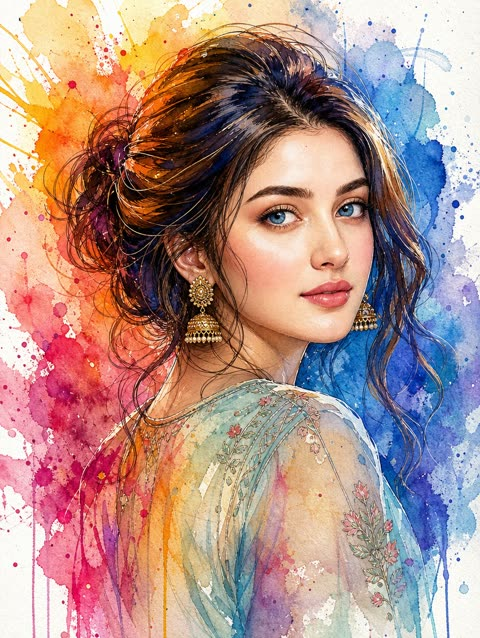</a>

分块锁定姿势、画风以及左暖右冷的色彩分区，在保留人物面部特征的同时让水彩效果可控。湿画法晕染、飞溅、垂直流淌和冷压纸纹理等具体描述造就了墨线与水彩混合的质感。

GPT Image 2.5 · 上传图改图 · 出处: [@Kubra_286 on X](https://x.com/Kubra_286/status/2100063240105435328) · 187 赞，统计于 2026-10-28

[`watercolor`](tags.md#tag-watercolor) [`ink`](tags.md#tag-ink) [`portrait`](tags.md#tag-portrait) [`selfie`](tags.md#tag-selfie) [`splatter`](tags.md#tag-splatter)

<details><summary><b>提示词</b></summary>

```text
Use the uploaded image ONLY for face and identity reference. Do not change facial structure, proportions, or realism.

Create a high-detail mixed-media watercolor portrait of a woman with POSE STRICTLY LOCKED:
Three-quarter view from back
Upper body slightly turned away from camera
Head turned back over shoulder toward viewer
Direct eye contact
Frame includes head, neck, and partial shoulder
Composition tightly cropped (portrait focus)

Expression (IMPORTANT):
Calm yet emotionally intense, soft but piercing gaze, slightly parted lips, natural subtle tension in face — no exaggerated emotion.

Rendering Style (LOCKED)
Watercolor + ink hybrid illustration
Soft fluid washes + sharp ink linework
Fine dark lines defining eyes, nose, lips, jawline
No painterly blur, no oil painting effect

Color & Lighting (STRUCTURED)
Strong split color contrast:
Left side → warm (yellow, orange, magenta)
Right side → cool (blue, cyan, violet)
Abstract light from upper-left (represented as color bursts, not realistic light)
Skin tones blend naturally with watercolor pigments (not flat coloring)

Watercolor Behavior (VERY IMPORTANT)
Wet-on-wet blending on face and skin
Visible paint splashes around subject
Controlled splatter and ink drops
Subtle vertical drips (especially lower area)
Organic color blooms and pigment edges
Colors slightly bleed beyond edges (natural watercolor feel)

Hair (MATCH STYLE)
Loose tied or messy bun
Wispy strands around face
Hair absorbs surrounding colors (blue, purple, warm highlights)
Slight motion feel, not static

Background
Clean white base
Dynamic watercolor splashes behind subject (not random — composition-aware)
No clutter, no objects

Texture
Visible cold-press watercolor paper grain
Slight rough pigment edges
Natural watercolor imperfections preserved

Style: expressive watercolor + ink illustration

Mood: artistic, soulful, emotionally engaging

Aspect ratio: 4:5
```

</details>

<a id="gpt-image-fisheye-selfie-doorstep-cat"></a>
### 门阶上与好奇猫咪的鱼眼自拍

<a href="https://x.com/MissDelulu9/status/2111697628941717933"></a>

提示词指定鱼眼镜头，并让猫的大鼻子占据近景，畸变带来纵深感和趣味。它逐件写明服装和斑驳的门板质感，并要求保留自拍中的面部特征。

GPT Image 2.5 · 上传图改图 · 出处: [@MissDelulu9 on X](https://x.com/MissDelulu9/status/2111697628941717933) · 173 赞，统计于 2026-10-28

[`fisheye`](tags.md#tag-fisheye) [`selfie`](tags.md#tag-selfie) [`pet`](tags.md#tag-pet) [`candid`](tags.md#tag-candid) [`street`](tags.md#tag-street)

<details><summary><b>提示词</b></summary>

```text
Create a realistic fisheye photo of the woman in my uploaded selfie, preserving her exact facial features. She sits on a doorstep in front of weathered green wooden doors, wearing a beige trench coat, ivory turtleneck, and light blue jeans. A curious tabby-and-white cat fills the right foreground with an oversized nose and expressive eyes. Soft daylight, natural textures, playful candid mood, ultra-realistic photography, landscape 16:9, no text.
```

</details>

<a id="gpt-image-photo-to-watercolor-scrapbook-poster"></a>
### 奶油色手账海报上的照片与水彩画对照

<a href="https://x.com/Alina_with_Ai/status/2102714815793992093"></a>

提示词把上传照片的写实版放在上方,下方用水彩重绘同一场景,并逐项列出需要保持一致的人物身份、服装和姿势。纸张质感、泼溅、边缘和手写题字等细节让版面有编辑感手账风格。

GPT Image 2.5 · 上传图改图 · 出处: [@Alina_with_Ai on X](https://x.com/Alina_with_Ai/status/2102714815793992093) · 157 赞，统计于 2026-10-28

[`watercolor`](tags.md#tag-watercolor) [`scrapbook`](tags.md#tag-scrapbook) [`photo-reference`](tags.md#tag-photo-reference) [`poster`](tags.md#tag-poster) [`handmade-paper`](tags.md#tag-handmade-paper)

<details><summary><b>提示词</b></summary>

```text
Create a vertical scrapbook-style artistic poster using the uploaded photo as the exact reference. Keep the woman’s identity, facial features, hairstyle, pink button-up shirt, light blue wide-leg jeans, white sneakers, pose, proportions, and outfit consistent.

The poster is printed on textured warm ivory watercolor paper. At the top, place a clean, realistic version of the original photograph, showing the woman casually leaning against a terrace railing with one hand resting on the railing and the other in her pocket. Preserve the scenic lake, distant mountains, hillside houses, tall trees, warm sunlight, stone terrace, and vibrant pink bougainvillea.

Below the photo, create a beautiful hand-painted watercolor version of the exact same scene and pose, with soft blue mountain washes, a calm lake, warm beige architecture, green trees, pink flowers, delicate paper texture, natural watercolor bleeding, visible brush strokes, subtle paint splatters, and irregular artistic edges. Make the watercolor version clearly recognizable as the same woman and location.

Leave generous cream-colored paper space around both images for a premium editorial scrapbook aesthetic. Add elegant handwritten-style text underneath: “sunny days”, with a thin decorative line and a tiny heart beneath it.

Soft natural color palette, cozy travel-journal aesthetic, realistic photo + delicate watercolor illustration, sophisticated composition, high detail, subtle film grain, authentic handmade paper texture, balanced spacing, clean vertical 4:5 composition, Pinterest/Instagram editorial aesthetic, photorealistic upper image and artistic watercolor lower image.
```

</details>

<a id="gpt-image-minimalist-paper-texture-art-cover"></a>
### 照片变身极简纸质肌理艺术封面

<a href="https://x.com/Ciri_ai/status/2114229094867169705">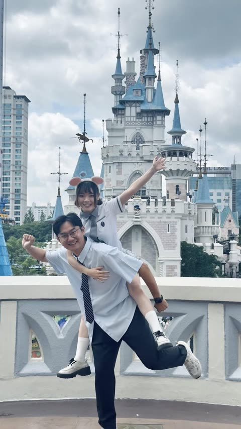</a>

规定主体只占画面10%到20%并置于底部居中，色板限制为取自原照的四种颜色，同时列出要用的材质和要避开的风格。可选的少量文字让画面像艺术书封面。

GPT Image 2.5 · 上传图改图 · 出处: [@Ciri_ai on X](https://x.com/Ciri_ai/status/2114229094867169705) · 152 赞，统计于 2026-10-28

[`photo-to-art`](tags.md#tag-photo-to-art) [`minimalist`](tags.md#tag-minimalist) [`paper-texture`](tags.md#tag-paper-texture) [`art-book-cover`](tags.md#tag-art-book-cover) [`flat-color`](tags.md#tag-flat-color)

<details><summary><b>提示词</b></summary>

```text
Turn your photo into a minimalist paper-textured art cover using Chat GPT Image 2.5.

Prompt: Transform the uploaded photo into a minimalist, hand-drawn, paper-textured artistic cover.

Composition

- The main subject should occupy only 10–20% of the frame.
- Position the subject near the bottom center of the composition.
- Leave generous negative space throughout the image.
- Suggest the environment using only a few lines or small blocks of color.

Preserve

- The most recognizable features of the original subject.
- The essential silhouette and proportions.
- The original pose or primary action.
- Important objects and defining details.
- The core story, relationships, and emotional atmosphere.

Color Palette

- Extract the dominant colors from the original photograph.
- Limit the palette to no more than four main colors.
- Use bold yet restrained, flat color blocks.
- Maintain a harmonious, muted color combination.
- Add subtle paper grain and handmade brush textures.

Simplification
Remove unnecessary details and visual clutter. Retain only the essential visual information needed to make the subject instantly recognizable.

Typography

- Optionally incorporate a small amount of simple text.
- Keep typography short, subtle, and aesthetically refined.
- Integrate the text naturally into the composition.
- Aim for the visual language of an art-book cover, independent publishing, modern editorial design, or a contemplative picture book.
- Do not force typography into the image if it doesn't improve the composition.

Style and Materials

- Delicate, slightly imperfect hand-drawn lines.
- A few clearly defined acrylic-like flat color blocks.
- Rough, tactile paper texture.
- Visible handmade brushstrokes.
- Organic, irregular, natural contours.
- Subtle imperfections that make the artwork feel genuinely handmade.

Overall Mood
Quiet, poetic, sophisticated, minimalist, innocent, relaxed, artistic, thoughtful, distinctive, and premium.

Avoid

- Colored-pencil rendering.
- Dry-brush effects.
- Watercolor washes or bleeding.
- Pure line-art illustration.
- Overly detailed or realistic illustrations.
- Heavy impasto or thick oil-paint textures.
- Smooth, polished digital illustration.
- 3D rendering, glossy surfaces, or artificial lighting effects.
- Generic commercial cartoon styles.
- E-commerce advertising aesthetics.
- Generic poster templates.
- Excessive decorative elements.
- Overly complex compositions.
- Too much text.

Final Result: A refined, minimalist, hand-crafted paper illustration with generous negative space, restrained colors, subtle tactile textures, and the sophistication of an independent art-book cover.
```

</details>

<a id="gpt-image-naive-pencil-illustration-from-photo"></a>
### 照片重绘为朴素风铅笔插画海报

<a href="https://x.com/oggii_0/status/2113499885181747239">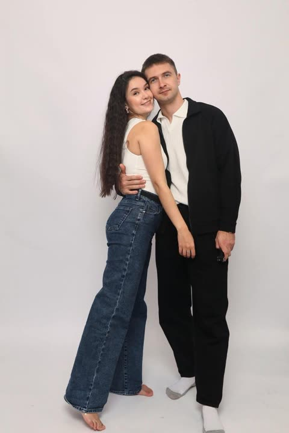</a>

先叠加俏皮比例、不完美轮廓、柔和对比的平涂色等风格特征，再明确禁用阴影、渐变和3D效果，让画面保持扁平。结尾用高级设计师海报和铅笔质感锚定整体气质。

GPT Image 2.5 · 上传图改图 · 出处: [@oggii_0 on X](https://x.com/oggii_0/status/2113499885181747239) · 134 赞，统计于 2026-10-28

[`naive-illustration`](tags.md#tag-naive-illustration) [`pencil`](tags.md#tag-pencil) [`flat-color`](tags.md#tag-flat-color) [`photo-to-illustration`](tags.md#tag-photo-to-illustration) [`poster`](tags.md#tag-poster)

<details><summary><b>提示词</b></summary>

```text
Draw this photo in the style of a modern, artistic naïve illustration: minimalist, hand-drawn, with playful proportions, imperfect outlines, soft yet contrasting flat colors, and decorative pencil strokes. No shadows, no gradients, no 3D effects. The overall look should resemble a premium designer poster, with a charming, whimsical, and authentic hand-drawn pencil aesthetic.
```

</details>

<a id="gpt-image-photo-to-crayon-memory-card-red-house"></a>
### 红房子照片与下方蜡笔插画记忆卡

<a href="https://x.com/harboriis/status/2105894224076198150">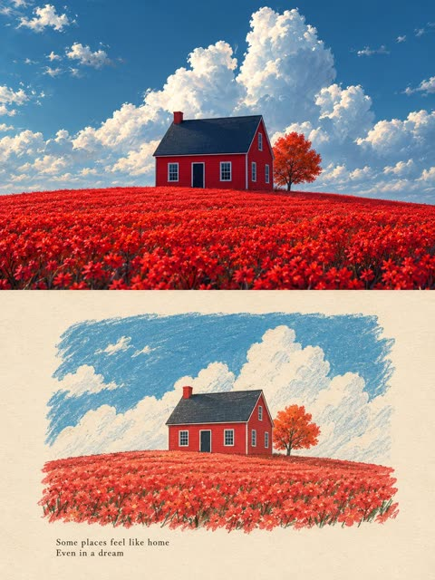</a>

上下各占一半，上半保留原照片，下半在象牙色纸上把同一场景重绘为扁平色块。从照片提取调色板，配合蜡笔与丝网印质感描述和负面清单，让插画保持朴素并忠于原图。

GPT Image 2.5 · 上传图改图 · 出处: [@harboriis on X](https://x.com/harboriis/status/2105894224076198150) · 133 赞，统计于 2026-10-28

[`memory-card`](tags.md#tag-memory-card) [`photo-to-illustration`](tags.md#tag-photo-to-illustration) [`crayon`](tags.md#tag-crayon) [`split-layout`](tags.md#tag-split-layout) [`naive-art`](tags.md#tag-naive-art)

<details><summary><b>提示词</b></summary>

```text
Use the uploaded photo as the only content source. Create a vertical 3:4 "real photo + minimal illustration" memory card based entirely on that image. Preserve the main subjects, subject count, pose, viewpoint, spatial relationships, and overall scene logic. Do not redesign the source or add unrelated content.

Layout:Split the card into two horizontal sections, about 50% top and 50% bottom. The top half keeps the uploaded photo with photographic texture. Crop naturally to fit, but do not stretch,mirror, rearrange, or alter the main subjects. Keep natural lighting, real materials, and the original color mood, with subtle editorial grading. The lower half uses a warm ivory handmade-paper background and shows a centered horizontal illustration of the same scene. The illustration occupies about 63-67% of the lower width, with generous blank space around it.

Scene translation:In the lower illustration, preserve the most recognizable subjects, major structures, important objects, viewpoint, depth, relative scale, and key positions from the source. Remove tiny clutter, fine photographic texture, reflections, and complex shadows.Simplify the scene into slightly awkward geometric color blocks and thin hand-drawn lines. People and animals, when present, remain identifiable through silhouette, pose,hair or fur shape,clothing color, and placement, but facial detail may be reduced. Outlines may wobble, break, shift, or misalign slightly while the scene stays recognizable.

Illustration style: Use restrained naive editorial drawing with soft geometric simplification and handmade quality. Combine thin sketchy linework with flat shapes. The lower scene should feel calm, clean, slightly imperfect, and visually reduced rather than technically precise. Avoid realistic rendering.

Color:Extract 4-6 representative colors from the uploaded photo and reinterpret them as a soft low-saturation palette. Use muted tones derived from the source, with flat fills and enough contrast to separate major subjects and scene layers. No complex gradients,glossy highlights, or heavy 3D modeling.

Texture:Blend crayon, pastel,screen-print, and old-book illustration qualities. Keep paper show-through, fine grain, slight pigment unevenness, worn edges, and subtle off-register shifts. The result should feel like an independent editorial illustration printed on aged

paper:warm, quiet, nostalgic, and collectible.

Typography:Below the illustration, you may include exactly two short English lines related to the scene.mood,place.or moment. Use a small vintage serif font, left-aligned. If clean readable text cannot be rendered, leave the area blank. No other readable text.

Cleanup:Remove phone UI,subtitles, screenshot traces, and interface elements when present. Do not invent missing scenery or decorative props.

Negative:No major layout change, no added or missing primary subjects, no photoreal painting, no polished watercolor,no anime,no manga, no vector clip-art, no oil paint, no impasto, no 3D, no logo,no watermark, no black border,no UI,no unrelated decoration.
```

</details>

<a id="gpt-image-golden-thread-travel-poster-template"></a>
### 写实城市天际线经金线化为象牙纸水墨小景

<a href="https://x.com/Goodmanprotocol/status/2105230944617775113"></a>

一根金线把上半部电影感实景与下方象牙纸上的小幅水墨插画连成一体，避免画面割裂。方括号占位符让同一模板适用于任何目的地，并用避免清单排除拼贴感与杂乱。

GPT Image 2.5 · 文生图 · 出处: [@Goodmanprotocol on X](https://x.com/Goodmanprotocol/status/2105230944617775113) · 113 赞，统计于 2026-10-28

[`travel-poster`](tags.md#tag-travel-poster) [`golden-thread`](tags.md#tag-golden-thread) [`ink-illustration`](tags.md#tag-ink-illustration) [`template`](tags.md#tag-template) [`cinematic`](tags.md#tag-cinematic)

<details><summary><b>提示词</b></summary>

```text
Create a premium 4:5 vertical conceptual travel-art poster for [COUNTRY / CITY / LOCATION / SUBJECT].

TEXT-TO-IMAGE ONLY — generate the entire artwork from [COUNTRY / CITY / LOCATION / SUBJECT] alone.

CORE CONCEPT
Create a poetic travel memory in which a cinematic realistic destination scene gradually transforms into a delicate hand-drawn illustration through one continuous golden thread.

UPPER SCENE
Create a breathtaking, highly realistic cinematic view of the most iconic location associated with [COUNTRY / CITY / LOCATION / SUBJECT]. Automatically choose the most atmospheric lighting—sunrise, sunset, golden hour, or blue hour.

Show authentic architecture, landscape, proportions, recognizable local details, realistic materials, atmospheric depth, natural light, subtle film grain, and sophisticated editorial travel-photography composition.

GOLDEN THREAD
Choose one meaningful visual element from the scene—such as the sun, tower, dome, window, streetlight, mountain peak, river, bridge, cable, or architectural detail—and transform it into one thin golden thread that naturally extends downward from the scene.

The thread should remain continuous, delicate, slightly imperfect, and elegant as it travels into the open space below.

LOWER STORY
On warm ivory textured paper, let the golden thread evolve into a tiny minimalist ink illustration inspired by [COUNTRY / CITY / LOCATION / SUBJECT].

Automatically choose one meaningful local symbol, traveler, traditional object, miniature landmark, street scene, boat, train, flower, map element, or cultural detail. Draw it with fine black ink lines, subtle hatching, tiny golden accents, and very little detail.

Keep the illustration small and surrounded by generous negative space. It should feel like a quiet continuation of the upper scene rather than a separate picture.

TYPOGRAPHY
Add minimal refined editorial typography based on [COUNTRY / CITY / LOCATION / SUBJECT]. Use a small destination name, landmark name, or short poetic phrase. Keep the typography subtle and secondary.

FINAL AESTHETIC
Cinematic travel photography × delicate ink illustration × continuous golden thread × warm ivory paper × poetic visual storytelling × premium editorial art print.

The upper scene should feel authentic and visually dominant, while the lower illustration feels like a beautiful hand-drawn memory emerging naturally from the destination.

Avoid split-screen rigidity, collage clutter, disconnected illustration, random objects, cartoon styling, distorted architecture, excessive text, logos, watermarks, heavy vintage effects, or generic travel imagery.

FORMAT: 4:5 vertical, sophisticated museum-quality travel artwork, generous negative space. Generate for new york
```

</details>

<a id="gpt-image-photo-to-naive-sketch-memory-card"></a>
### 雪山湖面小船照片配蜡笔手绘插画

<a href="https://x.com/harboriis/status/2104455859447501166">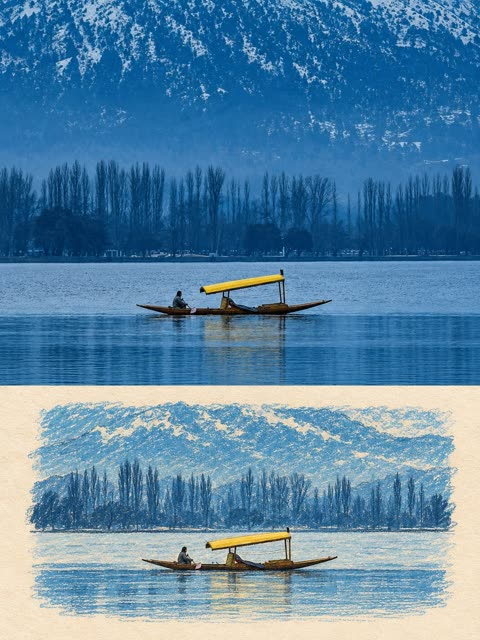</a>

把 3:4 画面上下对半，上半保留原照片，下半在旧纸上用蜡笔与粉彩重绘简化版。提示词写明版面比例、从照片提取色板、纹理层次和负面清单，让插画紧贴原图。

GPT Image 2.5 · 上传图改图 · 出处: [@harboriis on X](https://x.com/harboriis/status/2104455859447501166) · 112 赞，统计于 2026-10-28

[`photo-to-sketch`](tags.md#tag-photo-to-sketch) [`memory-card`](tags.md#tag-memory-card) [`crayon`](tags.md#tag-crayon) [`split-layout`](tags.md#tag-split-layout) [`landscape`](tags.md#tag-landscape)

<details><summary><b>提示词</b></summary>

```text
Use the uploaded photo as the only content source. Create a vertical 3:4 “real photo + minimal illustration” memory card based entirely on that image. Preserve the main subjects, subject count, pose, viewpoint, spatial relationships, and overall scene logic. Do not redesign the source or add unrelated content.
Layout
Split the card into two horizontal sections, about 50% top and 50% bottom. The top half keeps the uploaded photo with photographic texture. Crop naturally to fit, but do not stretch, mirror, rearrange, or alter the main subjects. Keep natural lighting, real materials, and the original color mood, with subtle editorial grading. The lower half uses a warm ivory handmade-paper background and shows a centered horizontal illustration of the same scene. The illustration occupies about 63-67% of the lower width, with generous blank space around it.
Scene Translation
In the lower illustration, preserve the most recognizable subjects, major structures, important objects, viewpoint, depth, relative scale, and key positions from the source. Remove tiny clutter, fine photographic texture, reflections, and complex shadows. Simplify the scene into slightly awkward geometric color blocks and thin hand-drawn lines. People and animals, when present, remain identifiable through silhouette, pose, hair or fur shape, clothing color, and placement, but facial detail may be reduced. Outlines may wobble, break, shift, or misalign slightly while the scene stays recognizable.
Illustration Style
Use restrained naive editorial drawing with soft geometric simplification and handmade quality. Combine thin sketchy linework with flat shapes. The lower scene should feel calm, clean, slightly imperfect, and visually reduced rather than technically precise. Avoid realistic rendering.
Color
Extract 4-6 representative colors from the uploaded photo and reinterpret them as a soft low-saturation palette. Use muted tones derived from the source, with flat fills and enough contrast to separate major subjects and scene layers. No complex gradients, glossy highlights, or heavy 3D modeling.
Texture
Blend crayon, pastel, screen-print, and old-book illustration qualities. Keep paper show-through, fine grain, slight pigment unevenness, worn edges, and subtle off-register shifts. The result should feel like an independent editorial illustration printed on aged paper: warm, quiet, nostalgic, and collectible.
Typography
Below the illustration, you may include exactly two short English lines related to the scene, mood, place, or moment. Use a small vintage serif font, left-aligned. If clean readable text cannot be rendered, leave the area blank. No other readable text.
Cleanup
Remove phone UI, subtitles, screenshot traces, and interface elements when present. Do not invent missing scenery or decorative props.
Negative
No major layout change, no added or missing primary subjects, no photoreal painting, no polished watercolor, no anime, no manga, no vector clip-art, no oil paint, no impasto, no 3D, no logo, no watermark, no black border, no UI, no unrelated decoration.
Vertical 3:4 split card · photo top / naive illustration bottom · aged paper texture
```

</details>

<a id="gpt-image-autumn-die-cut-sticker-from-photo"></a>
### 照片变身秋日刀模贴纸

<a href="https://x.com/Aneeza__S/status/2098457814507422182">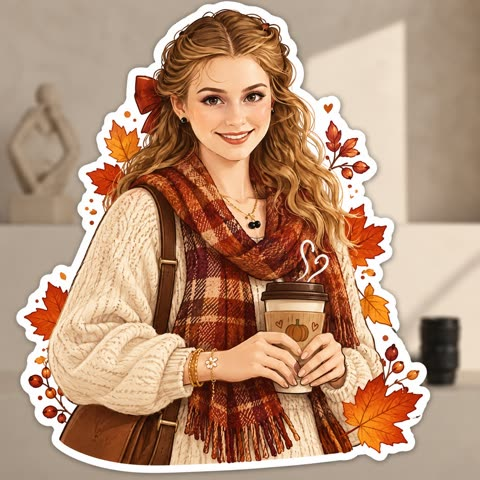</a>

提示词先分析上传照片，再把主体重绘为插画，加厚白色刀模边和柔和阴影，并虚化保留原背景。指定秋日色板，并禁止写实与廉价剪贴画风格，保证风格统一。

GPT Image 2.5 · 上传图改图 · 出处: [@Aneeza__S on X](https://x.com/Aneeza__S/status/2098457814507422182) · 94 赞，统计于 2026-10-28

[`sticker`](tags.md#tag-sticker) [`autumn`](tags.md#tag-autumn) [`die-cut`](tags.md#tag-die-cut) [`illustration`](tags.md#tag-illustration) [`photo-to-sticker`](tags.md#tag-photo-to-sticker)

<details><summary><b>提示词</b></summary>

```text
Transform the uploaded photo into a charming AUTUMN ILLUSTRATED STICKER.

IMPORTANT — USE THE UPLOADED PHOTO AS THE CONTENT REFERENCE:
First analyze what is actually present in the original photograph: the person or people, animals, objects, clothing, hairstyle, pose, facial expression, interaction between subjects, surroundings, lighting and distinctive details.

Recreate THIS specific photograph as a completely hand-drawn animated-style illustration.

The final result must NOT look like an edited photograph, photo filter or realistic portrait. Completely redraw the main subject and all important foreground elements as a polished digital illustration.

STICKER TRANSFORMATION:
Turn the main subject or group of subjects into one large die-cut sticker.

Create a thick, smooth white sticker border around the entire silhouette, including important accessories and decorative elements that belong to the sticker.

Add a very subtle soft shadow underneath the white border so the sticker feels like a real physical vinyl or paper sticker placed over the original scene.

Keep the original background from the uploaded photograph visible BEHIND the sticker.

Slightly soften, simplify or gently blur the original background if necessary so the illustrated sticker clearly stands out, but preserve enough of the environment that the original location remains recognizable.

Do not keep a realistic photographic face. The face must also become illustrated.

If the photo contains an animal, transform the animal completely into a cute animated illustrated character while preserving its recognizable breed/type, colors, markings, proportions, pose and personality.

ILLUSTRATION STYLE:
Use a cozy modern digital illustration aesthetic inspired by premium stationery, seasonal stickers and charming editorial character art.

Avoid photorealism, 3D rendering, plastic-looking characters, generic Disney-like characters or childish clip-art.

AUTUMN TRANSFORMATION:
Give the sticker a strong but tasteful autumn identity.

Analyze the original photograph and creatively choose autumn details that naturally fit the subject instead of adding exactly the same decorations to every image.

You may partially redesign the original clothing into a more autumnal version if it improves the result, while keeping the person's overall identity and personality recognizable.

Use an autumn palette inspired by burnt orange, rust, terracotta, cinnamon, caramel, warm brown, muted mustard, cream, beige and deep burgundy.

DECORATIVE STICKER ELEMENTS:
Integrate several small illustrated autumn elements around the main character INSIDE or attached to the sticker silhouette.

For example, leaves can float beside the character, appear in their hair, peek from behind their shoulders or interact with objects they are holding.

Do not scatter random decorations everywhere. Make them feel intentionally composed around the original pose.

Add tiny hand-drawn details such as dots, speckles, sparkles or delicate texture where appropriate.

COMPOSITION :
Preserve the general storytelling and pose of the original photograph, but feel free to simplify or slightly adjust the composition to create a stronger sticker silhouette.

The sticker should be the clear visual focus and occupy a substantial part of the image.

Do not simply draw a white outline around the original photograph.

The transformation must be obvious:
PHOTO → FULLY ILLUSTRATED AUTUMN CHARACTER → DIE-CUT STICKER.

Keep the original photographic background behind it so the contrast between the real environment and illustrated sticker is clearly visible.
```

</details>

<a id="gpt-image-selfie-giant-portrait-beach-birthday-cake"></a>
### 海滩日落生日蛋糕后的巨幅人像

<a href="https://x.com/Adnan_Ai2/status/2104759717289681001"></a>

先用参考图锁定面部，再让大尺寸特写与坐在蛋糕上的小型全身像同框，形成比例错位的效果。牌子和蛋糕正面的文字逐字给出，并要求拼写清晰，字迹因此保持可读。

GPT Image 2.5 · 上传图改图 · 出处: [@Adnan_Ai2 on X](https://x.com/Adnan_Ai2/status/2104759717289681001) · 92 赞，统计于 2026-10-28

[`selfie`](tags.md#tag-selfie) [`miniature-world`](tags.md#tag-miniature-world) [`birthday-cake`](tags.md#tag-birthday-cake) [`golden-hour`](tags.md#tag-golden-hour) [`face-reference`](tags.md#tag-face-reference)

<details><summary><b>提示词</b></summary>

```text
Use the uploaded girl reference image as the exact facial and appearance reference. Create a highly detailed cinematic fantasy birthday portrait inspired by the provided cake-and-beach composition. Show the same girl in two versions: a large realistic close-up portrait rising behind the cake, and a smaller full-body version sitting naturally on top of the cake. Keep her recognizable facial features, hairstyle, soft smile, eyes, and overall appearance consistent with the reference image. Dress her in an elegant cozy cream-white knitted outfit with a soft feminine look.
Place everything on a beautiful beach during golden-hour sunset, with a glowing orange sky, soft clouds, ocean waves, warm sunlight, and cinematic reflections on the water. Create a huge luxurious round vanilla-and-chocolate drip cake in the foreground, covered with creamy white and chocolate frosting swirls, chocolate pieces, truffles, small decorative pearls, and realistic glossy chocolate drips. The small girl should sit naturally on the cake with a relaxed, cute pose, while the large portrait appears behind her with soft glowing edges and artistic depth.
Add a chocolate plaque beside the girl with the text “Girls Make Life Sweeter ♥” and write “Stay Awesome ♡” on the front of the cake with a small crown above it. Make the text clean, readable, and correctly spelled. Use realistic skin texture, detailed hair strands, natural fabric texture, accurate proportions, soft shadows, warm rim lighting, shallow depth of field, photorealistic details, premium editorial photography, dreamy cinematic color grading, 8K quality, highly polished composition, vertical portrait format.
```

</details>

<a id="gpt-image-minimalist-doodle-sketchbook-photo"></a>
### 照片转成极简黑色墨线涂鸦

<a href="https://x.com/Inshrah_ali_/status/2098462576346886442">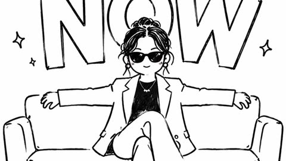</a>

直接描述线条质感：略带抖动的毛笔式黑色轮廓、童趣造型和干净白底。要求保留主体与构图，所以能套用到任何照片上。

GPT Image 2.5 · 上传图改图 · 出处: [@Inshrah_ali_ on X](https://x.com/Inshrah_ali_/status/2098462576346886442) · 88 赞，统计于 2026-10-28

[`doodle`](tags.md#tag-doodle) [`line-art`](tags.md#tag-line-art) [`sketchbook`](tags.md#tag-sketchbook) [`black-and-white`](tags.md#tag-black-and-white) [`style-transfer`](tags.md#tag-style-transfer)

<details><summary><b>提示词</b></summary>

```text
Transform the image into a minimalist hand-drawn doodle illustration. Use simple black brush-pen outlines with slightly wobbly, imperfect strokes. Reduce all details to cute, childlike shapes while preserving the main subject and composition. Naive sketchbook aesthetic, playful and whimsical character design, clean white background, minimal linework, expressive simplicity, handmade doodle style, black ink drawing, charming imperfections, simple cartoon illustration.
```

</details>

<a id="gpt-image-naive-pencil-illustration-from-photo-2"></a>
### 戴耳机的课堂少女彩铅插画

<a href="https://x.com/harboriis/status/2115028772588261435">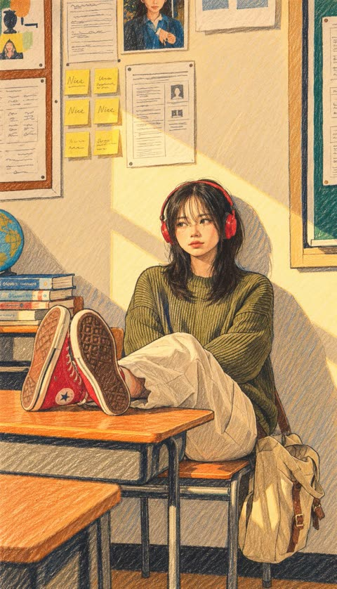</a>

先点明朴拙极简的风格（不规则轮廓、平涂色块、装饰性铅笔线条），再明确禁用阴影、渐变和3D效果，最后用设计师海报与彩铅的参照定下质感。

GPT Image 2.5 · 上传图改图 · 出处: [@harboriis on X](https://x.com/harboriis/status/2115028772588261435) · 75 赞，统计于 2026-10-28

[`colored-pencil`](tags.md#tag-colored-pencil) [`naive-art`](tags.md#tag-naive-art) [`photo-to-illustration`](tags.md#tag-photo-to-illustration) [`flat-color`](tags.md#tag-flat-color) [`cute`](tags.md#tag-cute)

<details><summary><b>提示词</b></summary>

```text
Turn this photo into a contemporary, artist-made naïve illustration: minimalist and hand-drawn, with playful proportions, uneven outlines, flat colors that are soft yet contrasting, and decorative pencil strokes. No shadows, gradients, or 3D effects. Give it the feel of a high-end designer poster drawn with colored pencils. Keep it cute and cartoon-like.
```

</details>

<a id="gpt-image-japanese-comic-poster-photo-comparison"></a>
### 伊斯坦布尔猫咪照片与日式漫画海报对照图

<a href="https://x.com/Goodmanprotocol/status/2114688658746028256">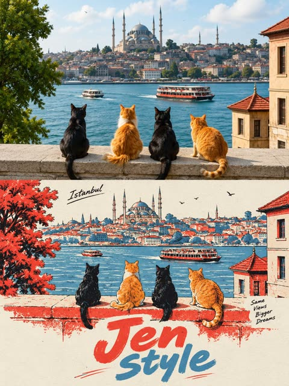</a>

画面分为上下两半，上半保留原照片，下半重绘为海报。墨色、红色、蓝色和纸色都给出了精确色值，标题分两行并分别指定颜色，让丝网印刷风格保持稳定。

GPT Image 2.5 · 上传图改图 · 出处: [@Goodmanprotocol on X](https://x.com/Goodmanprotocol/status/2114688658746028256) · 69 赞，统计于 2026-10-28

[`comparison`](tags.md#tag-comparison) [`screen-print`](tags.md#tag-screen-print) [`japanese-comic`](tags.md#tag-japanese-comic) [`poster`](tags.md#tag-poster) [`limited-palette`](tags.md#tag-limited-palette)

<details><summary><b>提示词</b></summary>

```text
Create a 3:4 vertical comparison image divided into two equal horizontal halves, seamlessly joined without borders or gaps.

TOP HALF: Display the uploaded photograph exactly as it is, without editing, recoloring, or adding text. Preserve proportions; crop only peripheral background if necessary.

BOTTOM HALF: Redraw the same subject as a Japanese hand-drawn comic poster with minimalist, limited-color screen-print aesthetics. Preserve the subject's recognizable features, pose, proportions, colors, and relationships between objects. Adapt naturally to people, animals, objects, or landscapes. Keep the essential scenery and add nothing absent from the original photograph.

ART STYLE: Delicate, slightly irregular ink-black outlines (#02030B), simplified shapes, clean opaque color blocks, and minimal hard-edged shadows. Use warm red (#E9444B), muted gray-blue (#5296BD), and off-white paper (#ECEDE5), with red dominant over blue. Avoid photorealistic textures, dense hatching, 3D effects, and excessive details.

LAYOUT & TEXT: Position the illustration in the upper-middle of the bottom half, with generous negative space and bold, hand-carved typography below. Add a small handwritten, subject-related caption at the top and a short handwritten annotation beside the subject, both in black. The main headline reads “Jen” in warm red on the first line and “Style” in gray-blue on the second. Each appears once. Keep all text within the bottom half, fully legible and uncropped. Replace sample text only when the user provides alternatives.

FINAL RESULT: One complete 3:4 image, with the untouched original photograph above and its Japanese hand-drawn, limited-color poster interpretation below. No extra borders, watermarks, invented elements, or decorative clutter.
```

</details>

<a id="gpt-image-photo-to-ink-editorial-split-poster"></a>
### 照片与黑色墨线插画上下分割海报

<a href="https://x.com/TheVirtualMuse/status/2109930829942288624"></a>

画面精确对半分割，上半保留参考照片，下半把主体重绘为黑色油墨块上的钢笔插画。严格的尺寸比例、黑白配色加一个可选点缀色，以及固定的手写文字位置（标题、坐标、日记句），让版式保持稳定。

GPT Image 2.5 · 上传图改图 · 出处: [@TheVirtualMuse on X](https://x.com/TheVirtualMuse/status/2109930829942288624) · 69 赞，统计于 2026-10-28

[`editorial`](tags.md#tag-editorial) [`split-layout`](tags.md#tag-split-layout) [`ink-illustration`](tags.md#tag-ink-illustration) [`handwritten-typography`](tags.md#tag-handwritten-typography) [`poster`](tags.md#tag-poster)

<details><summary><b>提示词</b></summary>

```text
Using the uploaded reference image, create a single high-resolution vertical 2:3 editorial art poster.

Divide the canvas into two perfectly equal horizontal sections, each occupying exactly 50% of the total height. Separate them with a clean, perfectly straight horizontal dividing line.

1. TOP HALF — ORIGINAL REFERENCE PHOTOGRAPH

Use the uploaded reference photograph directly in the upper 50% of the poster.

Preserve its original photographic quality, sharpness, natural lighting, and color relationships.

Allow only subtle, intelligent cropping around the outer edges when necessary, without compromising the main subject.

If required, naturally extend a small portion of the surrounding environment to fit the composition.

Do not redraw, illustrate, stretch, blur, or modify the subject's appearance, structure, or spatial relationships.

Do not introduce black borders, white margins, or empty edges.

2. BOTTOM HALF — MINIMALIST EDITORIAL ILLUSTRATION

Use a warm, near-white ivory paper background with an extremely subtle paper texture.

Analyze the main subject and visual story of the uploaded reference image.

Extract only the primary subject, preserving one or two essential identifying elements.

Remove or heavily simplify all secondary details, including background architecture, crowds, vehicles, fences, signs, trees, and other unnecessary elements.

Transform the primary subject into a sophisticated black-ink editorial illustration.

ILLUSTRATION STYLE:

Use natural, clean pen strokes with varied line weight.

Preserve an authentic hand-drawn appearance with expressive but controlled linework.

Avoid overly precise engraving aesthetics, excessive internal details, and dense cross-hatching.

Place a large, nearly pure-black rectangular ink block behind the illustrated subject.

The rectangular block should have subtly imperfect, handmade print-style edges.

Keep the black background clean, with only fine paper grain and minimal noise.

Avoid obvious hatching, scratches, architectural lines, or complex textures.

ILLUSTRATION SCALE AND COMPOSITION:

The illustrated subject must occupy approximately 72–77% of the canvas width and 58–64% of the bottom section's height.

Maintain a clear visual focal point with generous negative space surrounding the illustration.

3. COLOR RULES

The bottom illustration must follow a strictly black-and-white color palette by default.

Preserve only one localized accent color if the original reference image contains a clearly distinctive, concentrated color element with meaningful narrative importance.

Ordinary blue skies, green vegetation, stone surfaces, skin tones, and environmental colors must not be treated as accent colors.

Any preserved accent color must remain strictly localized to the relevant subject or area.

Never allow accent colors to spread across the entire illustration.

4. TYPOGRAPHY AND EDITORIAL LAYOUT

Automatically generate concise, meaningful English typography based on the content of the uploaded reference photograph.

The typography must resemble handwritten editorial annotations from an independent art publication.

TOP-LEFT CORNER:

Generate a short handwritten title consisting of 2–5 words, arranged across two lines.

Directly beneath the title, include three short English action verbs relevant to the photograph.

TOP-RIGHT CORNER:

Display only two lines of geographic coordinates:

Latitude
Longitude

Do not include any additional text in this area.

BOTTOM-LEFT CORNER:

Display the location name followed by the word "DIARY."

Directly beneath it, add one short descriptive English sentence inspired by the photograph.

TYPOGRAPHY STYLE:

Use a rough, upright, slightly irregular handwritten typeface.

Maintain subtle imperfections and a natural editorial annotation aesthetic.

Avoid elegant cursive, calligraphy, overly decorative lettering, and excessively polished typography.

5. FINAL ART DIRECTION

The finished poster must combine:

Authentic, high-quality photography.
Minimalist black-and-white editorial illustration.
Generous negative space.
Independent art publication aesthetics.
Quiet, restrained, sophisticated visual storytelling.
Natural handwritten typography.
A balanced relationship between documentary realism and expressive hand-drawn artwork.

The overall result should resemble a carefully designed, collectible editorial art print.

6. FINAL OUTPUT REQUIREMENTS

ASPECT RATIO:
2:3 vertical.

RESOLUTION:
High-resolution, sharp, print-quality output.

COMPOSITION:

Exactly 50% original reference photography on top.

Exactly 50% editorial illustration on the bottom.

One perfectly straight horizontal dividing line.

One complete, standalone poster.

RESTRICTIONS:

No collages.
No multi-poster layouts.
No combined images.
No unnecessary decorative elements.
No modifications to the original subject's identity or appearance.
No excessive illustration details.
No changes to the original photograph's natural color relationships.

FINAL GOAL:

Create a sophisticated, visually balanced editorial art poster that faithfully preserves the uploaded reference photograph while transforming its primary subject into an expressive, minimalist black-ink illustration.
```

</details>

<a id="gpt-image-traveler-sunset-chest-portal-ravens"></a>
### 旅人胸口藏着日落风景与乌鸦

<a href="https://x.com/AiWithTariq/status/2103695256445477234"></a>

把微缩风景融入躯干、外套和背包，让人像与场景成为一体的双重曝光。冷灰蓝天空对比熔金般的琥珀色核心，再配合低角度 85mm 镜头和画面两侧的乌鸦，增强反差与纵深。

GPT Image 2.5 · 上传图改图 · 出处: [@AiWithTariq on X](https://x.com/AiWithTariq/status/2103695256445477234) · 67 赞，统计于 2026-10-28

[`double-exposure`](tags.md#tag-double-exposure) [`selfie`](tags.md#tag-selfie) [`surreal`](tags.md#tag-surreal) [`miniature-world`](tags.md#tag-miniature-world) [`cinematic`](tags.md#tag-cinematic)

<details><summary><b>提示词</b></summary>

```text
A breathtaking surreal double-exposure fine-art photograph and masterwork cinematic composite featuring an adventurous, reflective traveler with the uploaded face as reference, depicted in a dramatic low-angle three-quarter profile with their neck gently extended and gaze cast reverently upward toward the sky. The character is dressed in a travel-worn, dusty khaki button-down utility shirt with rolled sleeves and textured denim trousers, carrying a heavy weathered expedition backpack. Seamlessly integrated and blending directly into the wanderer’s torso, jacket, and pack is an enchanting, luminous miniature landscape centered around a colossal, incandescent golden sunset that bathes the scene in warm radiant amber brilliance. Within this surreal chest portal, a winding path of stone steps ascends toward the blazing horizon, flanked by the dark silhouette of an ancient acacia tree and fiery autumn groves of deep orange and crimson foliage that disintegrate into floating embers, billowing dust clouds, and miniature flying bird silhouettes drifting into the open air. Soaring through the surrounding atmosphere are two photorealistic, glossy black ravens with meticulously rendered wing feathers and sharp talons, one carving dynamically across the left foreground and the other descending from the upper right amid ethereal tendrils of gray smoke. The backdrop consists of expansive, muted slate-blue overcast clouds with soft diffused daylight, establishing a poignant color temperature juxtaposition between the cool, cinematic ambient exterior and the molten, hyper-saturated warm glow emanating from the core. Captured from a low-angle medium shot with a prime 85mm portrait lens, deep depth of field rendering crisp tactile details from the rugged cotton weave and feathered edges to the dynamic particulate clouds, featuring high-contrast cinematic color grading, balanced chiaroscuro lighting, and poetic surrealist visual storytelling.
```

</details>

<a id="gpt-image-watercolor-double-exposure-butterfly-portrait"></a>
### 帝王蝶环绕的水彩双重曝光肖像

<a href="https://x.com/Kubra_286/status/2100220440543441049">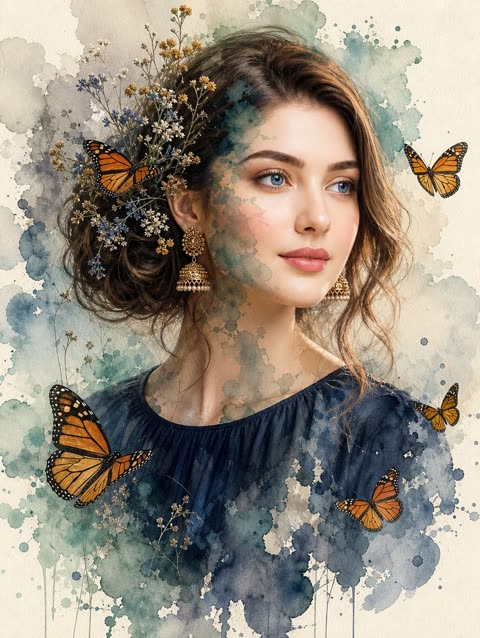</a>

提示词让写实的脸保持最清晰，并明确指出水彩晕染要出现在脸颊、脖颈和衣物等具体位置，形成半透明叠加的双重曝光。冷色的青绿与深蓝配上鲜橙色蝴蝶，对比强烈。

GPT Image 2.5 · 上传图改图 · 出处: [@Kubra_286 on X](https://x.com/Kubra_286/status/2100220440543441049) · 67 赞，统计于 2026-10-28

[`watercolor`](tags.md#tag-watercolor) [`double-exposure`](tags.md#tag-double-exposure) [`portrait`](tags.md#tag-portrait) [`butterfly`](tags.md#tag-butterfly) [`mixed-media`](tags.md#tag-mixed-media)

<details><summary><b>提示词</b></summary>

```text
Create a 2:3 vertical premium mixed-media watercolor portrait on off-white cold-pressed watercolor paper.
Use the uploaded image only as the subject reference. Keep the subject’s natural features, overall appearance, and recognizable look intact, but do not let the image turn into a generic painted character.
Show the subject in a bust-length three-quarter profile, facing slightly toward the viewer’s right, with the gaze directed softly off-camera. Keep the expression calm, warm, serene, and naturally pleasant, with a subtle gentle smile and bright relaxed eyes. The mood should feel elegant, fresh, dreamy, and refined — not sad, blank, tired, or overly serious.
Keep the face highly realistic and softly photorealistic, not fully painted, not sketch-like, and not cartoonish. The face should be the main focal point. Use soft diffused natural-looking light, similar to indirect window light, to gently illuminate the forehead, nose bridge, cheeks, lips, and jawline, with delicate depth and soft shadows. Render realistic eyes with soft catchlights, defined brows, natural lips, smooth skin transitions, and fine hair strands.
Style the hair in an elegant loose low updo / low messy bun at the nape, with a few soft tendrils framing the face and neck. Intertwine subtle rustic botanical accents in the hair — tiny dried wildflowers in muted yellow, white, and blue tones — delicate, understated, and premium.
Add several detailed Monarch butterflies with vivid orange wings, black veins, black borders, and tiny white spots. Keep them crisp, refined, and slightly dimensional. Place multiple butterflies naturally around the portrait: some resting in the hair, one near the upper-right side, and others floating around the shoulders and lower frame. Their warm orange color should stand out beautifully against the cool watercolor tones.
Create a strong mixed-media double-exposure effect where parts of the portrait dissolve into watercolor blooms. This effect must be clearly visible across selected parts of the cheek, temple, jawline, neck, shoulder, and lower clothing area — not only in the background. The watercolor should feel translucent and layered over the realistic portrait, so the subject remains clearly realistic underneath.
Use expressive watercolor washes in muted teal, seafoam green, dusty blue, soft gray, charcoal, and deep navy tones. Let the washes bloom naturally into the paper with wet-on-wet behavior, soft transparent bleeding, irregular edges, subtle blooms, and a few darker pooled edges where pigment appears to have dried. Allow the watercolor to expand organically into the negative space while keeping the face as the sharpest and most detailed focal area.
Dress the subject in a simple deep navy-blue top / blouse with a high rounded neckline and soft gathered or finely pleated texture around the shoulders and upper chest. The garment should look minimal, elegant, matte, and plain, with no collar, no buttons, no printed pattern, and no decorative embellishments. Keep the outfit close to the reference look. Let the lower portion of the top gradually dissolve into blue-gray watercolor splashes.
Preserve the contrast between hyper-detailed realism and loose abstract watercolor forms. The final artwork should feel like a luxury fine-art portrait print that combines:

photorealistic portraiture
abstract watercolor fusion
soft ethereal surrealism
crisp butterfly detailing
cool watercolor tones contrasted with vivid orange butterflies
textured watercolor paper and handcrafted mixed-media realism
Overall, the result should feel poetic, airy, elegant, and premium, with the viewer’s eye drawn first to the realistic face, then to the translucent watercolor overlays and butterflies surrounding the subject.
```

</details>

<a id="nano-banana-geometric-character-poster-from-photo"></a>
### 由参考照片生成的扁平几何人物海报

<a href="https://x.com/harboriis/status/2110238400163074321">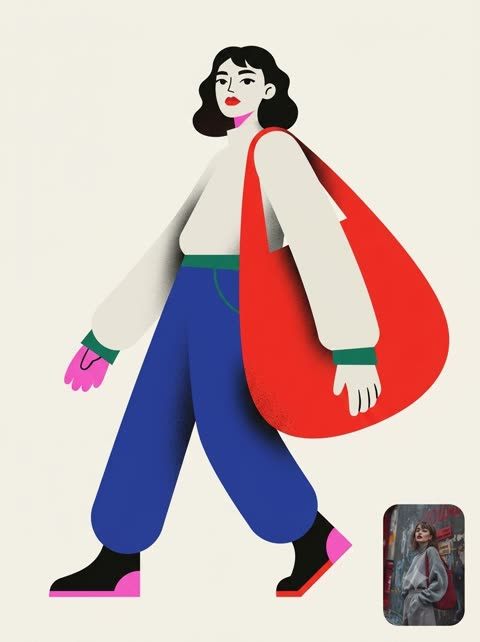</a>

用编号段落依次锁定版式、角色、风格、面部和配色，并用十六进制色值固定六色方案。负面清单加右下角参考图小卡片，既保留人物特征又保持扁平风格。

Nano Banana 2.1 · 上传图改图 · 出处: [@harboriis on X](https://x.com/harboriis/status/2110238400163074321) · 64 赞，统计于 2026-10-28

[`flat-geometric`](tags.md#tag-flat-geometric) [`character-poster`](tags.md#tag-character-poster) [`six-colour-palette`](tags.md#tag-six-colour-palette) [`editorial`](tags.md#tag-editorial) [`reference-photo`](tags.md#tag-reference-photo)

<details><summary><b>提示词</b></summary>

```text
No extra text, logos, outlined cartoon style, glossy 3D, realistic skin, photorealism, coarse canvas texture, busy background, extra limbs, distorted anatomy, excessive facial detail, photorealistic shading, random objects, clutter, watermark. Include a small rounded picture-in-picture card in the bottom right corner displaying the original reference photo
```

</details>

<a id="nano-banana-photo-to-painting-sunset-pair"></a>
### 日落屋顶照片与手绘版并排对照

<a href="https://x.com/Aqsahere_/status/2113482539570716831"></a>

上下两段结构要求把同一瞬间重绘成手绘版，并锁定姿势、服装、色彩和光线方向，让人物保持可辨认。主体、场景、标题和标语用方括号占位，方便复用。

Nano Banana 2.1 · 文生图 · 出处: [@Aqsahere_ on X](https://x.com/Aqsahere_/status/2113482539570716831) · 40 赞，统计于 2026-10-28

[`photo-to-painting`](tags.md#tag-photo-to-painting) [`editorial-poster`](tags.md#tag-editorial-poster) [`two-section-layout`](tags.md#tag-two-section-layout) [`sunset`](tags.md#tag-sunset) [`template`](tags.md#tag-template)

<details><summary><b>提示词</b></summary>

```text
Design a sophisticated vertical editorial poster with a seamless two-section composition.

In the upper section, present a highly realistic photograph of [SUBJECT] in [SETTING]. Use warm, natural daylight, authentic facial expression, detailed skin texture, subtle highlights, realistic shadows, and cinematic depth of field for a polished photographic feel.

In the lower section, recreate the exact same moment as a refined hand-painted digital artwork. Keep the character instantly recognizable by matching the original pose, facial features, hairstyle, outfit, colors, lighting direction, and important background elements, while giving the scene a soft artistic interpretation.

Surround the illustrated section with a warm ivory paper layout featuring subtle paper grain and elegant editorial spacing. The artwork should have delicate painterly strokes, organic shapes, muted pastel tones, gentle contours, and a nostalgic contemporary magazine aesthetic. Add a few minimal decorative botanical or seasonal details that naturally enhance the composition.

Under the artwork, place a centered editorial heading: “[MAIN TITLE]” using thin, sophisticated uppercase lettering with generous spacing. Beneath it, add “[TAGLINE]” in a smaller elegant typeface with subtle letter spacing, followed by a short delicate pastel accent line.

Keep the entire design clean, balanced, refined, and visually cohesive. Use a vertical 3:4 format, high resolution, sophisticated print aesthetics, natural color grading, and a seamless transition from photography to illustration.

Avoid visual clutter, excessive typography, thick borders, harsh saturation, distorted anatomy, inconsistent facial details, awkward proportions, or unnecessary graphic decorations.
```

</details>

<a id="nano-banana-style-transfer-cobra-witch-hat"></a>
### 眼镜蛇变身星星图案女巫贴纸

<a href="https://x.com/thefinnmckenty/status/2107574685433286858">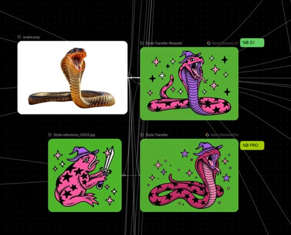</a>

用两张参考图分工：图1提供内容，图2提供风格。提示词逐项列出要迁移的风格属性，包括媒介、配色、氛围、渲染方式、饱和度和质感。

Nano Banana 2.1 · 上传图改图 · 出处: [@thefinnmckenty on X](https://x.com/thefinnmckenty/status/2107574685433286858) · 30 赞，统计于 2026-10-28

[`style-transfer`](tags.md#tag-style-transfer) [`reference-image`](tags.md#tag-reference-image) [`sticker`](tags.md#tag-sticker) [`illustration`](tags.md#tag-illustration) [`template`](tags.md#tag-template)

<details><summary><b>提示词</b></summary>

```text
Create an image of the content as shown in [image 1] but with the same medium, color palette, mood, rendering technique, saturation level, textures, and overall style of [image 2]. Objective: Style transfer from [image 1 to [image 2]
```

</details>

<a id="gpt-image-pixel-art-style-transfer"></a>
### 照参考图画风生成像素风摩托骑手

<a href="https://developers.openai.com/api/docs/guides/image-prompting#transfer-a-visual-style">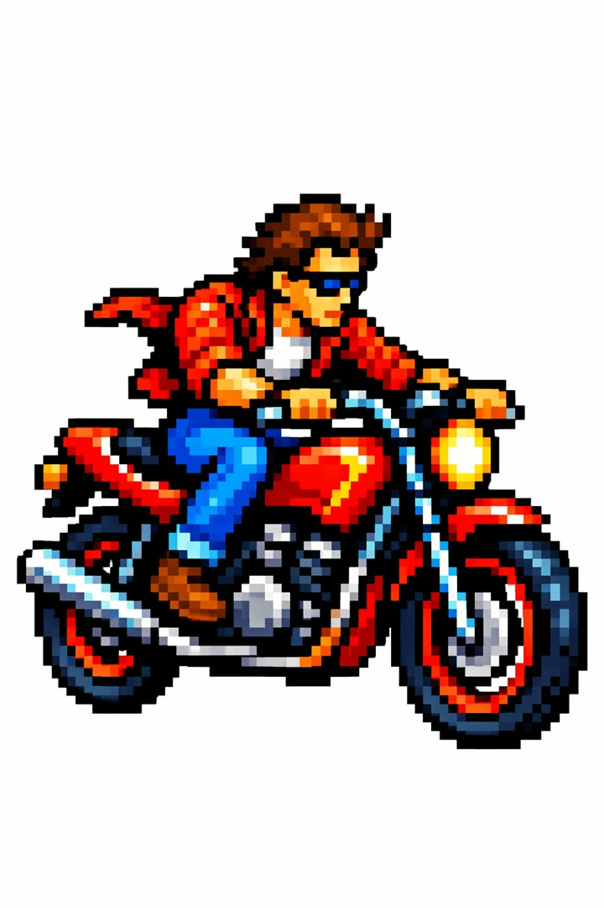</a>

参考图只用来提供画风，新主体另外描述，这样配色和像素颗粒能迁移过来，场景不会被照抄。预览图为 Sunburst 版本。

GPT Image 2.5 · 上传图改图 · 出处: [OpenAI image prompting guide](https://developers.openai.com/api/docs/guides/image-prompting#transfer-a-visual-style)

[`pixel-art`](tags.md#tag-pixel-art) [`style-transfer`](tags.md#tag-style-transfer) [`reference`](tags.md#tag-reference)

<details><summary><b>提示词</b></summary>

```text
Use the same style from the input image and generate a man riding a motorcycle on a white background.
```

</details>

输入素材: [1](https://developers.openai.com/images/platform/guides/image-prompting/pixels.webp)
