# 人像

[返回目录](../../README_zh.md) · 全部 213 条 · [1](image-portrait.md) · **2**

<a id="nano-banana-concrete-passage-burgundy-fashion-portrait"></a>
### 复古混凝土廊道中的酒红色时装人像

<a href="https://x.com/ChillaiKalan__/status/2114593231640170868"></a>

提示词先锁定参考图的面部身份，再按颜色和材质逐项列出服装、配饰与妆容细节。50mm 镜头和傍晚暖光营造出自然的杂志级景深。

Nano Banana 2.1 · 上传图改图 · 出处: [@ChillaiKalan__ on X](https://x.com/ChillaiKalan__/status/2114593231640170868) · 69 赞，统计于 2026-10-29

[`fashion`](tags.md#tag-fashion) [`editorial`](tags.md#tag-editorial) [`full-body`](tags.md#tag-full-body) [`reference-photo`](tags.md#tag-reference-photo) [`realistic`](tags.md#tag-realistic)

<details><summary><b>提示词</b></summary>

```text
Use the reference photo and keep her original face identity completely unchanged. Create an ultra-realistic full-body fashion portrait in a quiet vintage concrete passage with aged textured walls, narrow architectural shadows, and warm late-afternoon light.
She wears a fitted burgundy satin blouse, charcoal-gray high-waisted wide-leg trousers, and oversized dark olive leather jacket. Add chunky black platform ankle boots with a sculptural heel. Her hair is long, sleek, and softly waved with wispy curtain bangs.
Makeup luminous matte skin, taupe smoky eyes, subtle brown eyeliner, softly sculpted cheeks, muted berry blush, and deep rose-brown glossy lips. Add a vintage watch, layered silver necklaces, small hoop earrings, and a structured mini shoulder bag. Dark burgundy nails with tiny chrome accents. Fashion editorial realism, 50mm lens, natural depth of field.Use the reference photo and keep her original face identity completely unchanged. Create an ultra-realistic full-body fashion portrait in a quiet vintage concrete passage with aged textured walls, narrow architectural shadows, and warm late-afternoon light.
She wears a fitted burgundy satin blouse, charcoal-gray high-waisted wide-leg trousers, and oversized dark olive leather jacket. Add chunky black platform ankle boots with a sculptural heel. Her hair is long, sleek, and softly waved with wispy curtain bangs.
Makeup luminous matte skin, taupe smoky eyes, subtle brown eyeliner, softly sculpted cheeks, muted berry blush, and deep rose-brown glossy lips. Add a vintage watch, layered silver necklaces, small hoop earrings, and a structured mini shoulder bag. Dark burgundy nails with tiny chrome accents. Fashion editorial realism, 50mm lens, natural depth of field.
```

</details>

<a id="nano-banana-streetwear-leather-bomber-portrait"></a>
### 皮质飞行夹克全身街头时尚人像

<a href="https://x.com/weiinberg/status/2083776018763157835">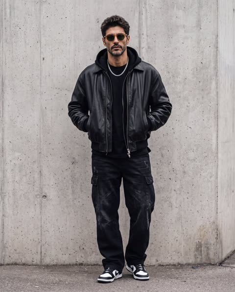</a>

用镜头焦段、光圈、光线和 4:5 画幅等具体参数定义画面，营造大片质感。按顺序逐层列出服装（夹克、连帽衫、长裤、鞋），让造型清晰可辨。

Nano Banana 2 · 上传图改图 · 出处: [@weiinberg on X](https://x.com/weiinberg/status/2083776018763157835) · 69 赞，统计于 2026-10-29

[`fashion`](tags.md#tag-fashion) [`portrait`](tags.md#tag-portrait) [`streetwear`](tags.md#tag-streetwear) [`photorealistic`](tags.md#tag-photorealistic)

<details><summary><b>提示词</b></summary>

```text
cartoon, anime, illustration, CGI, low quality, blurry, oversaturated, extra limbs, distorted body, deformed hands, watermark, text, logo, cropped, duplicate person, noisy background
Camera setting:
* Lens: 85mm
* Aperture: f/2.8
* Lighting: Soft overcast daylight
* Aspect Ratio: 4:5 (Instagram portrait)
* Style: Editorial, luxury streetwear, photorealistic
* Quality: Ultra detailed, 8K
If you’re replacing the person with your
```

</details>

<a id="nano-banana-double-breasted-suit-stone-steps-menswear"></a>
### 石阶上的炭灰色双排扣西装男装人像

<a href="https://x.com/pictsbyai/status/2112458298603479350"></a>

提示词按姿势、服装、发型、背景、光线、镜头的顺序展开，每个元素在相机参数之前就已锁定。镜头、光圈、快门、ISO 的具体数值，加上点明阴影与高光的位置，让画面接近编辑摄影。

Nano Banana 2.1 · 文生图 · 出处: [@pictsbyai on X](https://x.com/pictsbyai/status/2112458298603479350) · 68 赞，统计于 2026-10-28

[`menswear`](tags.md#tag-menswear) [`editorial`](tags.md#tag-editorial) [`suit`](tags.md#tag-suit) [`street-style`](tags.md#tag-street-style) [`85mm`](tags.md#tag-85mm)

<details><summary><b>提示词</b></summary>

```text
A confident handsome male in his late twenties or early thirties stands in a classic 45-degree turn with his weight comfortably shifted and shoulders level. He wears a meticulously tailored charcoal grey double-breasted suit, paired with a crisp white dress shirt, a dark patterned tie, and a precise white pocket square. His thick hair is scissor-cut with a classic taper and a deep side part roughly an inch and a half from the right, left three to four inches long on top to showcase a naturally wavy texture. The styling eschews artificial smoothness in favor of organic volume and movement, revealing natural imperfections, slight flyaways, and varying wave directions held by a low-shine, natural-finish paste. His candid expression features relaxed eyebrows and a softly closed mouth as his eyes gaze away toward the open negative space on the left side of the frame. His left arm extends downward with the fingers of his hand curled naturally and organically inward, exposing a silver-tone dress watch with a light dial peeking from beneath his stark white shirt cuff, while his right arm bends cleanly at the elbow, tucked deeply into his trouser pocket. He is framed straight-on outdoors against a medium-depth urban backdrop, standing upon solid, dark gray horizontal stone steps. To his left in the midground, a vintage wrought-iron door features black painted metal with decorative circular and scrolling motifs, softly out of focus. Dominating the right background is a weathered architectural stone pillar crafted from raw carved masonry. This warm taupe-gray and beige stone wall bears the authentic marks of old city buildings, showcasing a matte surface textured with horizontal carved ridges, vertical corner framing, subtle water staining, natural pitting, and patchy accumulations of soot. The scene is enveloped in a sophisticated, timeless urban elegance, illuminated by a single soft, diffused natural light source cascading from above. This moderate-intensity overhead lighting creates an asymmetrically balanced, medium-contrast palette, casting soft-edged, gray shadows subtly under his chin, beneath the structured suit lapels, and deep within the architectural recesses of the stone building. Specular highlights are beautifully preserved across his forehead, the bridge of his nose, his cheekbone, and the textured crests of his hair waves, while a gentle ambient fill maintains the rich charcoal, warm stone, black, and crisp white dominant tones. Captured as a tack-sharp digital menswear editorial photograph influenced by classic Pitti Uomo street style, the cinematic portrait utilizes an 85mm lens at an f/2.8 aperture and 1/250s shutter speed at ISO 100 for a realistic medium depth of field. Post-processing enhances the composition through a subtle warm neutral color grade, deliberately desaturated background elements to isolate the subject, gentle dodging and burning to define the jawline and structured suit lapels, and a delicate layer of film grain, all seamlessly framed in a 9:16 aspect ratio.
```

</details>

<a id="nano-banana-golden-hour-coastal-portrait-pair"></a>
### 海岸金色时刻的男性特写肖像

<a href="https://x.com/ozansihay/status/2107565033186083128"></a>

一对提示词沿用完全相同的构图、光线方向和背景描述，让男女肖像保持一致。脸部占比、眼睛位置、85mm f/1.4 镜头以及逆光加天空补光的细节，营造出电影剧照质感。

Nano Banana 2.1 · 文生图 · 出处: [@ozansihay on X](https://x.com/ozansihay/status/2107565033186083128) · 68 赞，统计于 2026-10-28

[`golden-hour`](tags.md#tag-golden-hour) [`portrait`](tags.md#tag-portrait) [`film-still`](tags.md#tag-film-still) [`backlight`](tags.md#tag-backlight) [`photoreal`](tags.md#tag-photoreal)

<details><summary><b>提示词</b></summary>

```text
Woman
Cinematic outdoor close-up at golden hour of a beautiful woman in her late 20s with Mediterranean features, warm olive skin, dark brown eyes catching the low sun, soft freckles, natural slightly parted lips, loose dark wavy hair lifted by a light breeze across her right cheek. Head-and-shoulders, face filling about 60% of the frame, eyes on the upper third, body turned three-quarter toward camera-left while she looks just past the lens. Real sunset backlight from behind-right wrapping her hair in warm rim glow, soft open-shade fill on the face from the sky, long gentle shadows. Background: softly blurred coastal landscape with amber sky, distant hills and a hint of sea sparkle, empty of people and props. Shot like an arthouse film still on 85mm f/1.4, creamy bokeh, fine film grain, natural skin texture, warm gold highlights against cool blue shadow pockets, photoreal, no flash look, no plastic skin, no text.

Man
Cinematic outdoor close-up at golden hour of a handsome man in his early 30s, strong jaw under short dark stubble, hazel eyes catching the low sun, messy black hair with a few wind-blown strands on the forehead, natural lips slightly closed. Identical framing to the female portrait: head-and-shoulders, face filling about 60% of the frame, eyes on the upper third, body turned three-quarter toward camera-left while he looks just past the lens. Real sunset backlight from behind-right wrapping his hair and shoulders in warm rim glow, soft open-shade fill on the face from the sky, long gentle shadows. Background: the same softly blurred coastal landscape with amber sky, distant hills and a hint of sea sparkle, empty of people and props. Shot like an arthouse film still on 85mm f/1.4, creamy bokeh, fine film grain, visible pores and microtexture, warm gold highlights against cool blue shadow pockets, photoreal, no flash look, no plastic skin, no text.
```

</details>

<a id="nano-banana-seated-man-chesterfield-sofa-lamp"></a>
### 男子坐在皮质切斯特菲尔德沙发上，旁边是螺旋木柱落地灯

<a href="https://x.com/pictsbyai/status/2071140707377512953">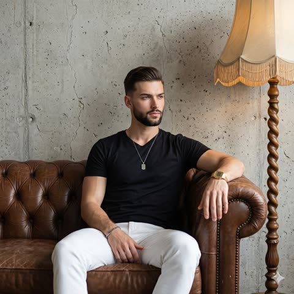</a>

提示词逐项指定服装、配饰、双手姿势和落地灯位置，让画面与描述一一对应。50毫米镜头、f/2.8光圈和混合正面光则确定了写实摄影的质感。

Nano Banana 2 · 文生图 · 出处: [@pictsbyai on X](https://x.com/pictsbyai/status/2071140707377512953) · 68 赞，统计于 2026-10-29

[`portrait`](tags.md#tag-portrait) [`lifestyle`](tags.md#tag-lifestyle) [`interior`](tags.md#tag-interior) [`leather-sofa`](tags.md#tag-leather-sofa)

<details><summary><b>提示词</b></summary>

```text
A young man with dark hair and a beard sits in the center of the frame, angled at a 45-degree turn and leaning slightly to his right with casually tilted shoulders. His expression is intentionally posed and serious, featuring relaxed eyebrows, a neutral mouth with no trace of a smile, and eyes thoughtfully looking away. He is dressed in a black v-neck t-shirt and white trousers, accessorized with a gold digital watch, a silver pendant necklace, and a silver bracelet. His left hand rests softly on his thigh in a naturally relaxed state, while his right hand is organically draped over the back of the furniture with a comfortably loose wrist. He is seated on a dominant, vintage brown button-tufted leather Chesterfield sofa that shows slight, authentic wear in the foreground. Situated in the midground to his right is a vintage floor lamp featuring a beige fringed shade and a distinctly carved spiral wood stand. The indoor setting utilizes a shallow spatial depth that meets a rough, matte raw concrete wall, highly detailed with patchy cool gray tones, horizontal lines, realistic pitting, and industrial cracks. The calm, relaxed indoor lifestyle atmosphere is illuminated by soft, moderately directional mixed front lighting with ambient fill from multiple sources, blending neutral light with a warm practical glow. A complementary color palette of cool grays, warm browns, deep blacks, and light beiges is balanced by medium-length, soft-edged gray shadows that pool naturally under the subject and across the textured leather, paired with subtle specular highlights gently catching on his face and the sofa's surface. Captured straight on as an organically styled, realistic digital photograph using a 50mm lens at f/2.8, the composition blends contemporary lifestyle aesthetics with industrial interior design, utilizing a medium depth of field and slightly soft overall sharpness with zero grain, finished with subtle contrast enhancements and meticulously preserved shadows, framed naturally in a 1:1 aspect ratio.
```

</details>

<a id="gpt-image-traveler-sunset-chest-portal-ravens"></a>
### 旅人胸口藏着日落风景与乌鸦

<a href="https://x.com/AiWithTariq/status/2103695256445477234"></a>

把微缩风景融入躯干、外套和背包，让人像与场景成为一体的双重曝光。冷灰蓝天空对比熔金般的琥珀色核心，再配合低角度 85mm 镜头和画面两侧的乌鸦，增强反差与纵深。

GPT Image 2.5 · 上传图改图 · 出处: [@AiWithTariq on X](https://x.com/AiWithTariq/status/2103695256445477234) · 67 赞，统计于 2026-10-28

[`double-exposure`](tags.md#tag-double-exposure) [`selfie`](tags.md#tag-selfie) [`surreal`](tags.md#tag-surreal) [`miniature-world`](tags.md#tag-miniature-world) [`cinematic`](tags.md#tag-cinematic)

<details><summary><b>提示词</b></summary>

```text
A breathtaking surreal double-exposure fine-art photograph and masterwork cinematic composite featuring an adventurous, reflective traveler with the uploaded face as reference, depicted in a dramatic low-angle three-quarter profile with their neck gently extended and gaze cast reverently upward toward the sky. The character is dressed in a travel-worn, dusty khaki button-down utility shirt with rolled sleeves and textured denim trousers, carrying a heavy weathered expedition backpack. Seamlessly integrated and blending directly into the wanderer’s torso, jacket, and pack is an enchanting, luminous miniature landscape centered around a colossal, incandescent golden sunset that bathes the scene in warm radiant amber brilliance. Within this surreal chest portal, a winding path of stone steps ascends toward the blazing horizon, flanked by the dark silhouette of an ancient acacia tree and fiery autumn groves of deep orange and crimson foliage that disintegrate into floating embers, billowing dust clouds, and miniature flying bird silhouettes drifting into the open air. Soaring through the surrounding atmosphere are two photorealistic, glossy black ravens with meticulously rendered wing feathers and sharp talons, one carving dynamically across the left foreground and the other descending from the upper right amid ethereal tendrils of gray smoke. The backdrop consists of expansive, muted slate-blue overcast clouds with soft diffused daylight, establishing a poignant color temperature juxtaposition between the cool, cinematic ambient exterior and the molten, hyper-saturated warm glow emanating from the core. Captured from a low-angle medium shot with a prime 85mm portrait lens, deep depth of field rendering crisp tactile details from the rugged cotton weave and feathered edges to the dynamic particulate clouds, featuring high-contrast cinematic color grading, balanced chiaroscuro lighting, and poetic surrealist visual storytelling.
```

</details>

<a id="nano-banana-brutalist-porthole-stairwell-bw-portrait"></a>
### 圆形洞口中的混凝土楼梯黑白人像

<a href="https://x.com/ChillaiKalan__/status/2107688620081738000"></a>

平涂炭黑背景上的圆形镜口加细白边框，构图一目了然。强烈的直射光、压暗的黑部，以及 85mm f/1.4 浅景深，让人脸成为画面最锐利的焦点。

Nano Banana 2.1 · 文生图 · 出处: [@ChillaiKalan__ on X](https://x.com/ChillaiKalan__/status/2107688620081738000) · 67 赞，统计于 2026-10-29

[`black-and-white`](tags.md#tag-black-and-white) [`brutalist`](tags.md#tag-brutalist) [`architectural-portrait`](tags.md#tag-architectural-portrait) [`high-contrast`](tags.md#tag-high-contrast) [`porthole-frame`](tags.md#tag-porthole-frame)

<details><summary><b>提示词</b></summary>

```text
Black and white fine-art architectural portrait photography, vertical 4:5 portrait format. A perfectly circular porthole-shaped cutout reveals a brutalist concrete stairwell, while everything outside the circle is flat, solid near-black charcoal (#161616), with a thin crisp white rectangular border line inset a few millimeters from the frame edge. The circle sits slightly above center, with the thick, weathered concrete ring edge visible on the left side.

Inside the circle: wide concrete steps rising diagonally from left to right, a slim dark metal handrail running parallel along the diagonal, a large curved concrete wall on the right catching a hard shaft of direct sunlight that creates a bright white diagonal shape, a dark curved ceiling overhang at the top right, and rough concrete texture on the left wall. Extremely high contrast, deep crushed blacks, bright highlights, strong geometric lines and curves.

A lone man is walking up the stairs in the lower right of the circle, caught mid-step, one hand lightly sliding along the metal handrail. His body is angled up the staircase, but his head is turned and he looks directly into the camera lens, making strong eye contact with the viewer. He is clearly visible, not a silhouette: bareheaded with short dark hair, no hat, no cap, wearing a dark long coat, face lit by the sunbeam on one side, with a calm, serious expression. His face is the sharpest point in the image, with crisp eyes, skin texture, and defined jawline, in razor-sharp focus.

Shot on an 85mm f/1.4 portrait lens, shallow depth of field, the stairs, handrail, and concrete walls behind and in front of him fall into a soft, creamy blur, with gentle compression of the stairwell geometry. Moody, minimalist, cinematic, fine film grain, no color, no text.
```

</details>

<a id="nano-banana-monochrome-editorial-lounge-portrait"></a>
### 黑白编辑风格酒店休息室男士肖像

<a href="https://x.com/pictsbyai/status/2075259938234913038">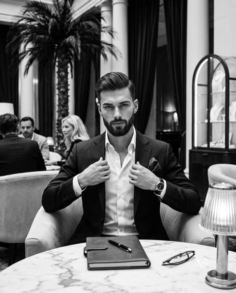</a>

明确的黑白色调、50mm 镜头和浅景深设定了编辑时尚的质感。前景大理石桌、双手拽领口的动作和中景棕榈等具体道具，形成清晰的前中后景层次。

Nano Banana 2 · 文生图 · 出处: [@pictsbyai on X](https://x.com/pictsbyai/status/2075259938234913038) · 67 赞，统计于 2026-10-29

[`portrait`](tags.md#tag-portrait) [`monochrome`](tags.md#tag-monochrome) [`editorial`](tags.md#tag-editorial) [`fashion`](tags.md#tag-fashion)

<details><summary><b>提示词</b></summary>

```text
A handsome, sophisticated man with sharp facial features, a strong jawline, and perfectly groomed light stubble gazes intensely and directly into the lens with a calm, confident expression. His dark hair is swept back with a natural side part, displaying subtle texture where individual strands catch the soft ambient light. He is dressed in a sharply tailored dark suit jacket accented by a dark patterned pocket square, layered over a crisp white dress shirt left casually unbuttoned at the collar. Sitting in a relaxed posture, his hands are raised to mid-chest, gently gripping the inner edges of his jacket lapels in a subtle adjustment, revealing the glint of a metallic wristwatch on his left wrist. He is seated in a plush, curved light-colored upholstered armchair pulled up to a smooth, veined white marble table in the immediate foreground, which holds a closed black leather notebook, a pen, a pair of folded dark-rimmed eyeglasses, and the partial view of a glowing ribbed glass table lamp. Behind him in the midground, the textured, arching fronds of a large indoor palm tree frame his head, while other patrons blur slightly into the ambiance, including a man seated to the left and a blonde woman relaxing at a softly lit table to the right. The background extends into a grand, high-ceilinged interior lounge featuring tall, dramatic dark vertical drapery, imposing architectural columns, and a softly illuminated arched glass display case. Rendered entirely in a rich black-and-white monochrome palette, the lighting is soft yet directional, carving out precise specular highlights on the man's cheekbones, his watch, and the polished marble surface, while deep, velvety shadows gather in the heavy folds of his suit, the curtain pleats, and the distant recesses of the room to forge a moody, luxurious atmosphere. Captured with a classic 50mm lens for an editorial fashion aesthetic, utilizing a shallow depth of field to isolate the razor-sharp subject against the softly blurred environment, processed with a high-contrast tonal range and subtle photographic film grain, framed in a 4:5 aspect ratio.
```

</details>

<a id="gpt-image-double-exposure-travel-silhouette-portrait"></a>
### 欧洲老城双重曝光旅行人像

<a href="https://x.com/Arina_hoqe/status/2104060103704150362"></a>

大幅侧脸剪影内嵌目的地风景，前景再放同一位女性行走，参考图同时驱动两个图层。酒红、藏青与象牙白水彩泼溅配干净白底把画面统一起来，结尾的否定清单用来守住人物身份和皮肤质感。

GPT Image 2.5 · 上传图改图 · 出处: [@Arina_hoqe on X](https://x.com/Arina_hoqe/status/2104060103704150362) · 65 赞，统计于 2026-10-29

[`double-exposure`](tags.md#tag-double-exposure) [`travel`](tags.md#tag-travel) [`watercolor`](tags.md#tag-watercolor) [`selfie`](tags.md#tag-selfie) [`silhouette`](tags.md#tag-silhouette)

<details><summary><b>提示词</b></summary>

```text
Create a premium photorealistic artistic travel portrait using the same woman from the reference photo. Preserve her facial identity, natural features, hairstyle, and realistic appearance accurately.

Create a creative double-exposure composition: a large elegant side-profile silhouette of the woman forms the background, beautifully blended with a breathtaking travel destination inside her silhouette. In the foreground, show the same woman walking naturally through the scene with a stylish travel outfit, backpack, sunglasses, and sneakers.

Inside the silhouette, include a magnificent European old-town street with grand historic architecture, warm sunset light, distant mountains, birds, and subtle atmospheric details. Add artistic watercolor splashes flowing outward from the bottom in soft burgundy, navy, and ivory tones.

Clean white background, seamless photo blending, cinematic sunset glow, realistic shadows, sophisticated travel-editorial aesthetic, highly detailed, premium magazine composition, photorealistic, 8K, elegant and visually captivating.

No cartoon, no anime, no illustration, no distorted face, no duplicate person, no extra limbs, no artificial-looking skin, no identity change.
```

</details>

<a id="nano-banana-comic-collage-dress-monarch-wings"></a>
### 漫画拼贴礼服与帝王蝶翅披风

<a href="https://x.com/Ozayrr_irl/status/2059559152024739856"></a>

提示词先交代礼服的拼贴材质，再叠加帝王蝶翅披风这一个超大元素，让轮廓一眼可辨。明亮的白色走廊、棚拍布光和红色高跟鞋点缀，让彩色礼服成为视觉焦点。

Nano Banana 2 · 文生图 · 出处: [@Ozayrr_irl on X](https://x.com/Ozayrr_irl/status/2059559152024739856) · 65 赞，统计于 2026-10-29

[`fashion`](tags.md#tag-fashion) [`editorial`](tags.md#tag-editorial) [`pop-art`](tags.md#tag-pop-art) [`butterfly`](tags.md#tag-butterfly) [`studio-lighting`](tags.md#tag-studio-lighting)

<details><summary><b>提示词</b></summary>

```text
Avant-garde high-fashion photography of a female model in an editorial pose. She is wearing a dramatic dress made from a collage of colorful pop art and yellow comic book pages. The back of the dress features massive, realistic yellow and black monarch butterfly wings as a cape. Elegant floral headpiece, red high heels, bright white luxury hallway background, professional studio lighting, vivid colors, photorealistic.
```

</details>

<a id="nano-banana-red-neon-rim-monochrome-portrait"></a>
### 黑白人像配红色霓虹轮廓光

<a href="https://x.com/weiinberg/status/2069632981120250203">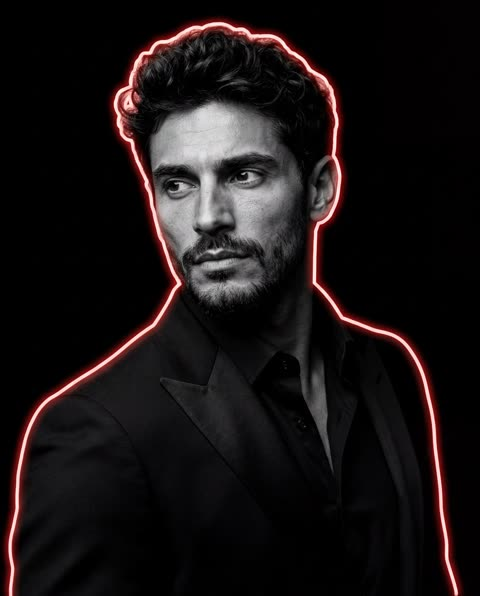</a>

提示词先锁定黑白底色和纯黑背景，再把红色霓虹轮廓光设为唯一的彩色元素。镜头焦距、光圈和棚拍光线等术语让结果更接近写实的编辑人像。

Nano Banana 2 · 上传图改图 · 出处: [@weiinberg on X](https://x.com/weiinberg/status/2069632981120250203) · 62 赞，统计于 2026-10-29

[`portrait`](tags.md#tag-portrait) [`neon-rim-light`](tags.md#tag-neon-rim-light) [`monochrome`](tags.md#tag-monochrome) [`studio`](tags.md#tag-studio)

<details><summary><b>提示词</b></summary>

```text
Transform the reference image into a dramatic cinematic black-and-white portrait. Pure black background with deep contrast. Subject wearing a tailored black suit jacket and black dress shirt with an open collar, luxury editorial styling.

Bright light-red neon rim light tracing the entire silhouette of the subject, creating a glowing outline around the head, shoulders, hair, ears, and clothing edges. Strong side lighting with high contrast shadows. Monochrome skin tones with detailed texture, while the neon glow remains the only colored element.

Premium magazine cover aesthetic, powerful masculine energy, luxury fashion campaign, dramatic studio lighting, intense mood, confident posture, looking away from camera. Ultra-sharp focus on face and upper torso, rich blacks, deep shadows, high dynamic range.

Professional portrait photography, cinematic color grading, black-and-white fine art portrait, neon edge lighting, volumetric glow, realistic skin detail, luxury editorial, studio photography, photorealistic, 85mm lens, f/2.0, shallow depth of field, masterpiece quality, ultra detailed, 8K resolution.
```

</details>

<a id="nano-banana-rooftop-golden-hour-menswear-portrait"></a>
### 黄金时刻屋顶男装人像

<a href="https://x.com/pictsbyai/status/2114270237004628019"></a>

先写明光线方向、角度和补光颜色，再逐项描述面料、围墙和天际线的材质，最后用镜头、光圈和色调收尾，让虚化与皮肤质感更真实。

Nano Banana 2.1 · 文生图 · 出处: [@pictsbyai on X](https://x.com/pictsbyai/status/2114270237004628019) · 61 赞，统计于 2026-10-29

[`editorial`](tags.md#tag-editorial) [`menswear`](tags.md#tag-menswear) [`golden-hour`](tags.md#tag-golden-hour) [`rooftop`](tags.md#tag-rooftop) [`85mm`](tags.md#tag-85mm)

<details><summary><b>提示词</b></summary>

```text
A candid, medium-full editorial photograph of a confident young handsome male model with a chiselled bone structure and sharp jawline, captured in a thoughtful gaze looking away toward the upper left horizon on an outdoor high-rise urban rooftop terrace during the golden hour, framed in a 9:16 aspect ratio. He stands with an asymmetrical, natural posture, his body turned at a 45-degree angle, with both hands casually inserted into the pockets of his tailored charcoal wool overcoat, slightly pulling the coat's edges forward. He wears a high-contrast cream, ribbed turtleneck sweater that frames his neck, partially visible under the heavy, textured dark overcoat. His medium-short, dark brown hair is styled in a classic cut, swept back and to the left with natural, wavy volume, featuring loose flyaway curls on his left forehead and a matte finish. Natural 45-degree side lighting from the low, golden-hour sun on the camera's left illuminates his left cheekbone, nose bridge, brow ridge, and the cream turtleneck, while casting soft, gradual shadow edges across the right side of his face, neck, and the folds of his dark coat, with a gentle, cool sky-blue fill on the shadow side. He is positioned center-right, leaning near a foreground rooftop parapet wall that features weathered gray stone coping, a tan brick base with recessed mortar joints, and a brushed steel tubular handrail. The background, captured with a shallow depth of field, blurs into a deep, creamy bokeh of an urban skyline, balanced on the far left by a tall, modern glass skyscraper reflecting the warm golden sunset, alongside aged mid-century commercial towers with boxy dark brown and terracotta tan masonry facades catching the orange sunlight. The cinematic image, characteristic of a classic menswear luxury campaign, boasts tack-sharp detail on the subject against the soft, warm golden-hour atmosphere, retaining a rich color profile of charcoal, soft sky blue-gray, cream, and warm amber, shot straight on with the characteristic natural clarity of a full-frame digital camera using an 85mm lens at f/2.0, with preserved shadow details in the wool fabric and natural skin textures.
```

</details>

<a id="nano-banana-coastal-street-portrait-white-tee"></a>
### 海滨街头白T男士写实肖像

<a href="https://x.com/pictsbyai/status/2110646359300649048"></a>

提示词先细致描写姿势、发型、服饰和手部位置，再叠加背景纵深、冷调阴天色板与柔和漫射光。结尾给出精确的相机参数（35mm、f/8、1/250s、ISO 200）和3:4画幅，得到深景深的街拍效果。

Nano Banana 2.1 · 文生图 · 出处: [@pictsbyai on X](https://x.com/pictsbyai/status/2110646359300649048) · 59 赞，统计于 2026-10-28

[`street-portrait`](tags.md#tag-street-portrait) [`male-model`](tags.md#tag-male-model) [`overcast`](tags.md#tag-overcast) [`camera-settings`](tags.md#tag-camera-settings) [`coastal`](tags.md#tag-coastal)

<details><summary><b>提示词</b></summary>

```text
A young male adult stands asymmetrically placed with a serious, posed expression, his relaxed eyebrows set above eyes that gaze away into the distance, his mouth closed without a hint of a smile. His hair features a medium-length top of about four inches, parted deeply on the left and brushed back with a natural texture that reveals a slight wave and delicate flyaways, styled with glossy pomade for a distinctive wet look. He is dressed in a crisp white tee with sunglasses casually hanging from the neckline, paired with beige trousers and a silver watch secured on his left wrist. His body is turned at a 45-degree angle, shifting his weight to lean leftward with level shoulders as his left hand rests organically on his front waistband, thumb casually hooked with fingers visible, while his right hand lightly grips the trouser fabric on the opposite side. He leans against a worn, gray metal traffic pole with a dull finish and attached sensors in the right foreground, anchoring the composition. The scene unfolds into a deep, straight-on spatial depth, leading the eye down a beige-gray checkered concrete sidewalk that curves leftward alongside a coastal road. In the left midground, a relaxed European street vibe is established by cafe tables and chairs. To the right, thriving palm trees stretch upward with tall trunks and dark olive green fronds. The calm mood is defined by a cool, overcast, desaturated palette dominated by the cool gray of the sky and road, harmonizing with neutral earth tones. Single-source, softly diffused natural light falls from above, yielding low-contrast illumination with a cool blue temperature that casts short, soft-edged gray shadows under the subject and behind the pole, while preserving gentle specular highlights on his shoulders and forehead. Captured as a realistic digital street portrait using a 35mm lens at f/8.0, 1/250s, and ISO 200, the image employs a deep depth of field to keep the sweeping background sharply in focus. The final aesthetic features smooth textures, slightly soft overall sharpness with zero grain, and a desaturated cool-tone color grade, all beautifully framed in a 3:4 aspect ratio.
```

</details>

<a id="nano-banana-terrace-dining-man-portrait"></a>
### 露台餐桌前的白衬衫男士肖像

<a href="https://x.com/pictsbyai/status/2109559194890502544"></a>

提示词按前景餐桌、主体、中景橄榄树、背景墙面的层次逐一描述场景。结尾给出精确的相机参数(85mm、f/2.8、1/200s)、光线说明和 3:4 比例,让画面保持写实。

Nano Banana 2.1 · 文生图 · 出处: [@pictsbyai on X](https://x.com/pictsbyai/status/2109559194890502544) · 58 赞，统计于 2026-10-28

[`portrait`](tags.md#tag-portrait) [`realism`](tags.md#tag-realism) [`photography`](tags.md#tag-photography) [`lifestyle`](tags.md#tag-lifestyle) [`85mm`](tags.md#tag-85mm)

<details><summary><b>提示词</b></summary>

```text
A handsome man sits centered and facing the camera with level shoulders and a confident, deliberately posed posture, wearing a crisp white dress shirt and a rich brown tie. His medium-short hair is slicked back with a glossy product, revealing natural comb lines and a distinct, slight wave. He maintains a neutral expression with relaxed eyebrows and a direct gaze, while his left hand is raised near his collar with loosely curled fingers and his right hand rests relaxed on the arm of his chair. In the immediate foreground, a pristine dining table draped in a white tablecloth holds a white plate and silver cutlery, visually leading to the subject before gently fading into a deep, softly blurred outdoor environment. To the midground right, a thriving olive tree grows from a large terracotta pot resting on a gray cobblestone stone floor. Behind him, the setting features pristine, warm off-white plaster walls with a slightly textured matte finish and clean classical architectural moldings, subtly accompanied by an overhead heater structure and a distant building. The scene exudes a sophisticated, elegant, and calm luxury dining experience, anchored by a warm, high-contrast color profile dominated by crisp whites, deep structural blacks, rich brown accents, and soft warm yellows. Mixed, diffused front lighting of moderate intensity bathes the scene in a soft glow, casting short, soft-edged gray shadows under his chin and behind his body, while perfectly preserving specular highlights on his face, glossy hair, and bright white shirt. Captured as a tack-sharp realistic digital photograph using an 85mm lens at f/2.8 and 1/200s with a straight-on perspective, the image features zero grain and a medium depth of field that elegantly separates the subject from the European lifestyle-inspired background, finished with warm post-processing color grading, and finally framed in a 3:4 portrait aspect ratio.
```

</details>

<a id="gpt-image-fire-water-wet-portrait-reference"></a>
### 火与水交织的凶猛湿发特写肖像

<a href="https://x.com/AiWithTariq/status/2102380695704465698"></a>

提示词先要求完全沿用参考图的面部，再把光线分成暖橙一侧与冷暗一侧。水珠、湿发和胡须等具体质感词让特写显得真实而有冲击力。

GPT Image 2.5 · 上传图改图 · 出处: [@AiWithTariq on X](https://x.com/AiWithTariq/status/2102380695704465698) · 57 赞，统计于 2026-10-29

[`close-up`](tags.md#tag-close-up) [`dramatic-lighting`](tags.md#tag-dramatic-lighting) [`fire-and-water`](tags.md#tag-fire-and-water) [`face-reference`](tags.md#tag-face-reference) [`cinematic`](tags.md#tag-cinematic)

<details><summary><b>提示词</b></summary>

```text
Create image "A hyper-realistic, cinematic close-up portrait of a man ( use the reference image 100% ) with piercing blue eyes, wet skin glistening with water droplets, and strands of dark wet hair falling across his intense face.His expression is fierce and determined, illuminated by a dramatic fiery orange glow on one side, contrasting with the cool darkness on the other.Ultra-detailed textures of skin, beard, and water droplets create a raw and powerful atmosphere, blending elements of fire and water. Moody, high-contrast lighting, epic and dramatic tone, 8K ultra-detailed.
```

</details>

<a id="nano-banana-brown-menswear-european-street-lookbook"></a>
### 欧式街头棕色层叠男装行走造型

<a href="https://x.com/pictsbyai/status/2113183073689125330"></a>

按发型、面部、服装、姿势、前景、中景、光线的顺序逐层描述主体，再用 85mm、f/2.8、1/500s 和 4:5 画幅锁定镜头，并写明色调与光线方向。

Nano Banana 2.1 · 文生图 · 出处: [@pictsbyai on X](https://x.com/pictsbyai/status/2113183073689125330) · 57 赞，统计于 2026-10-28

[`menswear`](tags.md#tag-menswear) [`street-style`](tags.md#tag-street-style) [`lookbook`](tags.md#tag-lookbook) [`fashion`](tags.md#tag-fashion) [`85mm`](tags.md#tag-85mm)

<details><summary><b>提示词</b></summary>

```text
A handsome male model walks confidently forward in a sophisticated, layered menswear ensemble, captured from a straight-on, chest-level perspective. His hair is a medium-length layered cut—shorter on the sides with three to four inches on top reaching his eyebrows—styled with a wet-look pomade that enhances its natural texture, featuring slight frizz and uneven clumping. A deep, off-center right part creates a deliberately disheveled look, allowing several loose, wavy S-curl strands to fall naturally across his forehead and right brow. His facial expression is composed and posed, with a closed neutral mouth, relaxed eyebrows, and a direct gaze framed by round tortoiseshell glasses. He wears a crisp white dress shirt with a visible collar and cuffs, paired with a brown tie and a chocolate dark espresso brown long-sleeve knit polo sweater featuring a buttoned placket. His lower half consists of dark brown double-pleated high-waisted trousers held by a cognac leather brown belt with a silver buckle, ending in black leather loafers. His left hand is tucked completely into his left front trouser pocket, pulling the fabric to create a subtle tension, while his right arm rests by his side, the hand securely gripping the dual leather handles of a large cognac brown leather tote bag with knuckles moderately visible. He strides across a foreground of worn, light gray-beige smooth concrete paving stones that bear subtle stains and natural texturing, grounding the scene in an authentic outdoor urban street setting. Behind him, the midground opens up into a slightly blurred, medium-depth classic European street featuring a warm stone beige limestone building facade. This pristine yet historically weathered ashlar masonry displays matte textures, horizontal block joints, and classical pilasters with structural reveals. To the mid-height right, a vintage black wrought-iron window balcony railing catches the eye with ornate gold and brass medallion detailing, beautifully contrasting the pale stone. The atmosphere evokes an elegant, quiet urban morning wrapped in a sophisticated monochromatic brown and neutral palette, illuminated by a single, large diffused source of open-sky daylight pouring in from above and slightly front-left. This soft, moderate-intensity outdoor light casts neutral ambient fill and short, gray shadows with soft gradual edges on the pavement beneath him, as well as subtle shading under his chin and the leather bag. Radiant, preserved specular highlights gently touch his forehead, the tip of his nose, the top curves of the leather tote bag, and the polished shoe leather, creating a dynamic, high-contrast visual hierarchy that draws the eye from his well-lit face down through the dark textures of his outfit. Rendered as tack-sharp digital photography reminiscent of high-end luxury menswear lookbooks and classic sartorial street style, the image utilizes an 85mm lens at f/2.8 with a 1/500s shutter speed to freeze motion while maintaining a crisp subject against the softened architectural backdrop, finalized with subtle warm color grading and selective clarity to enhance the intricate knitwear and leather textures, all beautifully framed in a 4:5 aspect ratio.
```

</details>

<a id="nano-banana-dual-tone-sunglasses-portrait"></a>
### 黑色墨镜双色光电影感人像

<a href="https://x.com/harboriis/status/2109247804707348591"></a>

提示词先用参考图锁定人物与构图，再逐项列出服装和姿态。前方冷蓝光与右侧暖橙轮廓光对比，配合85mm镜头和强烈虚化背景，形成电影感。

Nano Banana 2.1 · 上传图改图 · 出处: [@harboriis on X](https://x.com/harboriis/status/2109247804707348591) · 57 赞，统计于 2026-10-28

[`portrait`](tags.md#tag-portrait) [`cinematic-lighting`](tags.md#tag-cinematic-lighting) [`sunglasses`](tags.md#tag-sunglasses) [`bokeh`](tags.md#tag-bokeh) [`reference-image`](tags.md#tag-reference-image)

<details><summary><b>提示词</b></summary>

```text
Use the uploaded image as the primary reference. Recreate the same person, face, and exact composition, keeping the same face impression, hairstyle, sunglasses, and outfit. A cinematic close-up portrait of a person wearing black rectangular sunglasses, a plain light-colored (white) crew-neck T-shirt, and small ear stud. Their head is slightly tilted, with calm, confident, and cool expression. Use dramatic dual-tone lighting: cool blue light from the front/left side and warm orange rim light from the right side, creating strong cinematic contrast. Keep the background heavily blurred with bokeh, no distractions. Maintain realistic skin texture, sharp facial details, shadows, DSLR quality, 85mm lens, HDR, premium cinematic color grading, ultra-realistic, highly detailed, crisp focus, photorealistic. Vertical 3:4 composition.
```

</details>

<a id="gpt-image-watercolor-seated-portrait-monochrome-face-backdrop"></a>
### 坐姿女子与巨幅水墨素描面庞背景

<a href="https://x.com/Enaya_ai/status/2103719141849117036"></a>

提示词按主体、姿势、背景肖像、风格、色板、光线、构图分块书写，并要求背景大脸与前景人物保持同一身份，再用负面提示词防止脸部漂移和手部错误。

GPT Image 2.5 · 文生图 · 出处: [@Enaya_ai on X](https://x.com/Enaya_ai/status/2103719141849117036) · 56 赞，统计于 2026-10-28

[`watercolor`](tags.md#tag-watercolor) [`fashion-illustration`](tags.md#tag-fashion-illustration) [`portrait`](tags.md#tag-portrait) [`monochrome`](tags.md#tag-monochrome) [`double-exposure`](tags.md#tag-double-exposure)

<details><summary><b>提示词</b></summary>

```text
Create a highly detailed elegant watercolor portrait composition of a beautiful South Asian woman, combining a realistic full-body seated portrait with a large monochrome artistic facial portrait in the background.

Main Subject:
A graceful young South Asian woman sitting elegantly on the floor with her legs gently crossed. She has long, thick, naturally wavy dark-black hair styled loosely with soft strands framing her face. Preserve a realistic, delicate facial structure with expressive almond-shaped eyes, naturally defined eyebrows, a refined nose, soft lips, smooth warm skin tone, and a calm gentle expression while looking toward the right side.

She is wearing an elegant lavender-gray fitted long-sleeve blouse paired with a flowing ivory-white ankle-length skirt made from soft lightweight fabric. The skirt has natural folds and realistic fabric draping. She wears delicate pearl jewelry: a fine pearl necklace, small dangling pearl earrings, and elegant pearl bracelets. Nude-beige high-heeled shoes complete the outfit.

Pose:
She is seated gracefully with both hands resting naturally over one knee, relaxed posture, shoulders slightly turned toward the right, looking peacefully into the distance. Full body visible, including shoes.

Background Portrait:
Behind her, create a large artistic black-and-white close-up portrait of the same woman’s face, occupying most of the upper-right background. The facial identity, hairstyle, eyes, nose, lips, jawline, and overall appearance should remain consistent with the foreground woman. The background portrait should look like a soft graphite-and-watercolor painting, slightly faded and atmospheric, blending naturally into the watercolor background.

Art Style:
Luxury editorial watercolor portrait, sophisticated fashion illustration, realistic watercolor painting combined with delicate pencil/ink details, soft brush strokes, subtle paint bleeding, transparent watercolor washes, cold-pressed textured paper, fine facial details, elegant artistic imperfections, gentle ink splashes and watercolor stains.

Color Palette:
Soft monochrome gray, charcoal, ivory, muted lavender, subtle beige and warm skin tones. Low saturation, sophisticated and timeless.

Lighting:
Soft diffused studio lighting, gentle highlights on the face and clothing, subtle shadows, luminous watercolor atmosphere, no harsh contrast.

Composition:
Vertical portrait composition, foreground woman positioned slightly left of center, large monochrome face extending across the upper-right background, balanced negative space, artistic watercolor splashes around the edges, premium fashion magazine aesthetic.

Quality:
Ultra-detailed, photorealistic facial rendering blended with authentic watercolor texture, realistic anatomy, natural hands and fingers, realistic fabric folds, intricate jewelry details, cinematic composition, premium fine-art portrait, high resolution.

Negative Prompt:
blurry face, distorted anatomy, extra fingers, malformed hands, duplicate person, inconsistent face, different facial identity, deformed eyes, asymmetrical eyes, bad jewelry, plastic skin, oversaturated colors, cartoon, anime, 3D render, CGI, low resolution, harsh lighting, text, watermark, logo.
```

</details>

<a id="gpt-image-pencil-sketch-ghost-portrait-seated-photo"></a>
### 坐姿男子与身后巨幅铅笔素描自画像

<a href="https://x.com/AiWithTariq/status/2102743467449606390"></a>

每一层都用独立的 EXACT 段落描述（概念、背景素描、主体、服装、环境、光线、调色），合成结构清晰。身份锁定段把前景人脸与素描的下颌、脸颊、胡须、鼻形和唇形对齐，再用棕褐单色背景对比全彩人物形成反差。

GPT Image 2.5 · 上传图改图 · 出处: [@AiWithTariq on X](https://x.com/AiWithTariq/status/2102743467449606390) · 55 赞，统计于 2026-10-29

[`pencil-sketch`](tags.md#tag-pencil-sketch) [`layered-composite`](tags.md#tag-layered-composite) [`identity-lock`](tags.md#tag-identity-lock) [`seated-portrait`](tags.md#tag-seated-portrait) [`sepia`](tags.md#tag-sepia)

<details><summary><b>提示词</b></summary>

```text
PROMPT 1 — Pencil Sketch Ghost Portrait + Sharp Seated Photo

CONCEPT — EXACT: A layered composite — a massive detailed charcoal/pencil sketch portrait fills the background, textured like a hand-drawn wall mural with visible pencil strokes and ink-splatter texture, and a sharp full-color seated photorealistic portrait of the same man sits in the foreground on a reflective dark floor.

BACKGROUND SKETCH PORTRAIT — EXACT: Large detailed black-and-white pencil/charcoal sketch, head turned slightly to the side, short spiky textured hair rendered with visible hatch-strokes, wearing thin wire-frame glasses, light beard and moustache, collared shirt with visible fabric-fold linework, rough torn-paper/ink-splatter texture surrounding the sketch blending into a warm sepia-grey wall.

MAIN SUBJECT — FOREGROUND — EXACT: Seated pose on the floor, one leg bent with the knee up and forearm resting on it, other leg extended out to the side, torso turned slightly with head tilted looking off to the side, calm thoughtful expression, short neat dark hair, thin wire-frame glasses, light beard.

MAIN SUBJECT IDENTITY LOCK: Foreground face must match the background sketch exactly — same jaw width, cheek fullness, beard density, nose shape, and lip shape, with natural head-to-body proportion.

BODY: Medium-tan skin tone, lean build, relaxed seated posture.

OUTFIT: Black hooded sweatshirt with drawstrings, light grey jogger sweatpants, white-and-grey sneakers.

BACKGROUND/ENVIRONMENT — EXACT: Warm sepia-grey textured wall filled with the large pencil-sketch portrait and rough ink-splatter marks, dark reflective floor beneath the seated figure showing a soft mirrored reflection.

LIGHTING — EXACT: Soft even studio lighting from the front, minimal harsh shadow, warm neutral tone throughout.

COLOR GRADE — EXACT: Sepia-grey monochrome background sketch contrasted with a natural full-color foreground figure, warm skin tone standing out clearly, clean high-contrast editorial poster color grad
```

</details>

<a id="nano-banana-black-outfit-elevator-selfie"></a>
### 黑色套装男子在电梯里自拍

<a href="https://x.com/pictsbyai/status/2110283970508398966"></a>

提示词逐项锁定姿势、手部位置、发型质感和不锈钢电梯环境，再写明光源、阴影位置和带一点棕褐点缀的低饱和配色。结尾用正面数码自拍构图、深景深、无颗粒和 9:16 画幅收束。

Nano Banana 2.1 · 文生图 · 出处: [@pictsbyai on X](https://x.com/pictsbyai/status/2110283970508398966) · 55 赞，统计于 2026-10-29

[`selfie`](tags.md#tag-selfie) [`elevator`](tags.md#tag-elevator) [`monochrome`](tags.md#tag-monochrome) [`realistic-portrait`](tags.md#tag-realistic-portrait) [`vertical`](tags.md#tag-vertical)

<details><summary><b>提示词</b></summary>

```text
A confident man stands in the center of the frame facing the camera, his weight comfortably shifted and shoulders relaxed, dressed cleanly in a sleek black button-down shirt and matching black slacks. His dark hair features faded sides transitioning into two to three inches of textured wavy curls on top, styled with a matte product and a deep side part that explicitly embraces natural flyaways. Though his face is partially obscured by the smartphone he holds perfectly at face level in his left hand—with his index finger resting naturally on the back of the device—his visible eyes convey an intense, deliberate gaze beneath relaxed eyebrows. His right hand is casually tucked into his front right trouser pocket with the thumb gently hidden, revealing a silver watch gleaming on his wrist. He is positioned within the shallow spatial depth of a polished indoor elevator, standing on a solid dark gray metal floor. In the midground to his left, a small cylindrical brushed metal handrail adds dimension, while the background is entirely dominated by pristine brushed stainless steel elevator door panels featuring clean vertical seams and a perfectly smooth satin finish that bounces cool silver-gray gradients. The cool interior is bathed in even, moderate artificial light beaming downward from two top ceiling panels fitted with grid pattern diffusion covers. This diffused overhead lighting casts soft, gradual-edged gray shadows under his chin and across his chest muscles, while striking specular highlights onto his textured hair, the bridge of his nose, and the sleek metal doors. The environment embraces a desaturated, medium-contrast monochromatic color palette heavily weighted by the silver surroundings and black attire, warmed slightly by a subtle tan accent to evoke a distinctly professional mood. Captured straight on as a digital selfie, the image boasts tack-sharp focus and a deep depth of field that renders every smooth texture crisp and entirely grain-free, finalized with careful contrast enhancement for a realistic, clean aesthetic, all framed in a 9:16 aspect ratio.
```

</details>

<a id="nano-banana-quiet-luxury-suede-menswear-editorial"></a>
### 砂岩墙前的静奢风男装人像

<a href="https://x.com/iamsofiaijaz/status/2112387493178020109"></a>

提示词按服装、姿势、环境、光线和摄影风格分块标注，并指定85mm f/2.8镜头和右上方黄金时刻光线，再用负面提示词排除塑料皮肤和畸形手部。

Nano Banana 2.1 · 文生图 · 出处: [@iamsofiaijaz on X](https://x.com/iamsofiaijaz/status/2112387493178020109) · 55 赞，统计于 2026-10-28

[`menswear`](tags.md#tag-menswear) [`fashion-editorial`](tags.md#tag-fashion-editorial) [`quiet-luxury`](tags.md#tag-quiet-luxury) [`golden-hour`](tags.md#tag-golden-hour) [`portrait`](tags.md#tag-portrait)

<details><summary><b>提示词</b></summary>

```text
Create an ultra-realistic luxury menswear editorial photograph of a stylish, handsome young man with thick, voluminous, swept-back dark brown hair, a neatly trimmed beard and mustache, and black rectangular sunglasses. He is leaning casually against a warm, textured beige sandstone wall, adjusting his sunglasses with one hand while keeping the other hand in his trouser pocket. His expression is calm, confident, masculine, and effortlessly sophisticated.

Outfit: A premium taupe-beige suede zip-up overshirt jacket with a structured collar, double-ended metal zipper, large patch chest pocket, and relaxed tailored fit. Underneath, a crisp white button-down shirt with the collar slightly open and cuffs visible. Matching light beige tailored trousers with subtle pleats. A sophisticated luxury wristwatch with a black leather strap completes the outfit.

Pose and composition: Three-quarter to nearly full-body portrait, subject positioned slightly left of center, body leaning naturally against the wall, one elbow bent as he adjusts his sunglasses, the other hand resting inside his pocket. Relaxed posture with a refined fashion-model presence.

Environment: Minimalist architectural setting with a warm sand-colored textured plaster wall, subtle natural imperfections, earthy brown and beige tones, and no distracting background elements.

Lighting: Soft natural golden-hour sunlight entering from the upper right, creating gentle highlights on the hair, face, suede jacket, and wall. Soft shadows, warm cinematic color grading, realistic skin texture, and beautiful tonal depth.

Photography style: High-end luxury fashion campaign, quiet luxury aesthetic, old-money menswear editorial, photorealistic skin and fabric textures, 85mm portrait lens, f/2.8, shallow depth of field, sophisticated neutral color palette, natural proportions, sharp facial details, premium magazine photography, vertical 2:3 composition, 8K detail.

Negative prompt: cartoon, illustration, CGI, plastic skin, excessive retouching, distorted hands, extra fingers, asymmetrical sunglasses, unnatural body proportions, blurry face, oversaturated colors, harsh flash, artificial lighting, logos, text, watermark, cluttered background.
```

</details>

<a id="gpt-image-golden-hour-seated-fashion-editorial-reference-identity"></a>
### 金色光线影棚中的坐姿奢华时尚大片

<a href="https://x.com/mehvishs25/status/2109637018900951298"></a>

先列出需要保留的面部特征来锁定参考图身份，再把服装、姿势和场景拆成带标签的独立段落。结尾补充镜头与调色关键词，并用较长的负面清单防止换脸和手部变形。

GPT Image 2.5 · 上传图改图 · 出处: [@mehvishs25 on X](https://x.com/mehvishs25/status/2109637018900951298) · 54 赞，统计于 2026-10-28

[`fashion-editorial`](tags.md#tag-fashion-editorial) [`identity-reference`](tags.md#tag-identity-reference) [`golden-hour`](tags.md#tag-golden-hour) [`studio-portrait`](tags.md#tag-studio-portrait) [`negative-prompt`](tags.md#tag-negative-prompt)

<details><summary><b>提示词</b></summary>

```text
Create one ultra-realistic luxury fashion editorial photograph using the uploaded reference girl as the exact identity reference. Preserve her original face, green eyes, freckles, nose, lips, natural skin texture, and long, voluminous dark-brown hair. Do not alter her identity.

Outfit: A fitted deep-burgundy off-shoulder knit top, a chocolate-brown leather jacket draped over her shoulders, a flowing charcoal maxi skirt with a subtle satin sheen, cream leg warmers, chunky cream-and-brown sneakers, and a structured dark-brown shoulder bag with elegant gold hardware. Sophisticated, feminine, contemporary styling with rich textures.

Pose: She sits confidently on the studio floor, one knee raised naturally and the other leg folded comfortably beneath the flowing skirt. One hand gently touches her cheek while the other rests beside her. Her head tilts slightly as she gives the camera a bold, captivating gaze.

Setting: A warm ivory studio wall, soft golden-hour sunlight, delicate diagonal shadows, champagne highlights, and a refined luxury fashion-magazine atmosphere.

Professional DSLR photography, 85mm portrait lens, realistic anatomy, natural skin pores, detailed knitwear and leather, authentic fabric folds, soft depth of field, and premium editorial color grading.

Negative prompt: Altered identity, different face, plastic skin, excessive retouching, incorrect outfit, distorted hands, extra fingers, twisted legs, broken joints, floating feet, unnatural proportions, CGI, cartoon, blur, text, logos, or watermarks.

Output: One individual high-resolution, photorealistic fashion photograph with natural anatomy and impeccable styling.
```

</details>

<a id="gpt-image-pink-outfit-woman-beside-guitar-mural-of-herself"></a>
### 粉色穿搭女子与墙上自己的吉他壁画

<a href="https://x.com/Kubra_286/status/2102390516792832257"></a>

提示词把真人与壁画并列描写,反复强调脸、服装和高马尾一致,让墙上的画像与本人对应。服装、发型、妆容、配饰分行列出,再加雨天小巷场景和负面提示词,保持写实质感。

GPT Image 2.5 · 上传图改图 · 出处: [@Kubra_286 on X](https://x.com/Kubra_286/status/2102390516792832257) · 54 赞，统计于 2026-10-29

[`mural`](tags.md#tag-mural) [`selfie`](tags.md#tag-selfie) [`photoreal`](tags.md#tag-photoreal) [`street-fashion`](tags.md#tag-street-fashion) [`vertical`](tags.md#tag-vertical)

<details><summary><b>提示词</b></summary>

```text
Create an ultra realistic cinematic visual of a woman standing in front of a brick wall that has a large mural painting of herself playing acoustic guitar with flying musical notes, treble clefs and music staff waves, while she is listening to music with black wired headphones, both hands holding the headphones on her ears.

Woman outfit: light pink blazer, black croptop blouse, light pink pleated mini skirt fold, white mary jane doll shoes with bow.

Face match 100%

Hair: high ponytail, long wavy hair, natural black.

Makeup: pink lips, thick eyelashes, peach blush, light natural glam.

Accessories: pink gemstone necklace, pink drop earrings.

The mural painting on the bricks is similar to her — same face, same outfit (pink blazer, pink pleated skirt, black top), same high ponytail, playing brown acoustic guitar, surrounded by black musical notes and G-clefs.

The woman is standing on a sidewalk, puddles on ground, old brick wall with some green vines, urban alley background.

True to life color grading, photorealistic, DSLR 8K, cinematic natural daylight, ultra detailed skin, same face recognizable, 9:16 vertical aspect ratio.
*Negative prompt / to avoid (if your app has it):*
blurry, cartoon, anime, painting style on real person, distorted face, extra fingers, low quality, over saturated
```

</details>

<a id="nano-banana-paris-street-fashion-portrait-eiffel"></a>
### 黑色大衣男子与埃菲尔铁塔街拍

<a href="https://x.com/pictsbyai/status/2111733521924456499"></a>

提示词依次写主体、姿态与造型、场景、光线方向、色调和相机参数。它指定了85mm镜头、f/2.8光圈、左前方45度硬光和9:16画幅，所以画面像真实的街头时尚摄影。

Nano Banana 2.1 · 文生图 · 出处: [@pictsbyai on X](https://x.com/pictsbyai/status/2111733521924456499) · 53 赞，统计于 2026-10-29

[`street-fashion`](tags.md#tag-street-fashion) [`paris`](tags.md#tag-paris) [`hard-light`](tags.md#tag-hard-light) [`85mm`](tags.md#tag-85mm) [`vertical`](tags.md#tag-vertical)

<details><summary><b>提示词</b></summary>

```text
A stylish man in a heavy black winter coat and textured grey sweater stands centered, facing the camera at a slight angle with relaxed shoulders. He wears sunglasses and flashes a broad, candid, open-mouthed smile showing his teeth. His short-to-medium hair features a wavy top and faded sides, styled with a matte product that highlights its natural texture and delicate sunlit flyaways. His left hand rests organically on his hip and thigh, casually displaying a silver watch and gold ring, while his right hand is tucked comfortably into his pocket. He is positioned on a grey asphalt street marked with solid white crosswalk paint, surrounded by a slightly blurred midground. To the left, a pristine classic Parisian building showcases perfectly smooth, warm cream cut stone with elegant architectural moldings, arched windows, and iron balconies. Thriving autumn trees with yellowing foliage frame the street alongside faint cars and street signs. In the spatial background, the pristine lattice structure of the Eiffel Tower rises beautifully in the top right corner against a clear sky-blue backdrop. The cheerful scene is bathed in bright, highly directional natural sunlight originating from a front-left 45-degree angle, generating a warm, high-contrast aesthetic. This hard light preserves striking highlights on the left side of his face and the grey sweater's fabric, while casting short, harsh, and deep black shadows with defined edges under his chin, across the right side of his face, and along his dark coat. A complementary color palette merges moderate saturation with an energetic, sunny atmosphere, softened just enough by ambient fill light. Captured as a realistic digital photograph from a straight-on perspective, the image utilizes an 85mm lens at f/2.8 and a fast shutter speed with daylight white balance to achieve a tack-sharp, grain-free subject against a medium depth of field. Drawing from clean men's street fashion photography, the final piece features a warm color grade and contrast enhancement, elegantly framed in a 9:16 aspect ratio.
```

</details>

<a id="gpt-image-night-street-white-sweatshirt-light-trails-portrait"></a>
### 霓虹光轨夜街白卫衣人像

<a href="https://x.com/iamsofiaijaz/status/2113137432254173633"></a>

提示词把光线拆成暖橙红背光、冷青补光和机顶闪光，人物保持清晰，车流则被拉成长曝光光轨。35mm 胶片颗粒、构图指令（腰部以上、居中、4:5）和排除清单共同保证皮肤质感真实。

GPT Image 2.5 · 文生图 · 出处: [@iamsofiaijaz on X](https://x.com/iamsofiaijaz/status/2113137432254173633) · 52 赞，统计于 2026-10-28

[`night-street`](tags.md#tag-night-street) [`fashion-editorial`](tags.md#tag-fashion-editorial) [`long-exposure`](tags.md#tag-long-exposure) [`film-grain`](tags.md#tag-film-grain) [`streetwear`](tags.md#tag-streetwear)

<details><summary><b>提示词</b></summary>

```text
A cinematic, photorealistic fashion editorial portrait of a young woman standing on a city street at night, with a short, voluminous dark brown wavy bob haircut, soft curtain bangs, natural glowing skin, subtle freckles, warm blush, glossy nude lips, and minimal natural makeup. She wears an oversized white crewneck sweatshirt with relaxed, voluminous sleeves and high-waisted blue denim jeans, with both hands casually tucked into her front pockets.

She is positioned in the center of the frame, photographed from the hips up, looking directly into the camera with a calm, confident, effortlessly cool expression. The background features a dark urban street with dramatic orange-red streetlights, vibrant cyan and teal illumination, and horizontal streaks of red, orange, and turquoise light created by long-exposure motion blur from passing traffic.

Lighting and color grading: Warm orange-red backlighting illuminating the background, cool cyan fill light along the lower sides, direct on-camera flash softly illuminating the subject's face and white sweatshirt, strong contrast between warm and cool tones, deep cinematic shadows, subtle film grain, slightly dreamy analog-film texture.

Photography style: Contemporary streetwear campaign, high-end fashion photography, 35mm film aesthetic, candid editorial mood, realistic skin texture, sharp facial focus, shallow depth of field, motion-blurred background, natural proportions, imperfect film-like details, balanced composition, authentic nighttime city atmosphere.

Vertical portrait, 4:5 aspect ratio, medium shot, subject centered, ultra-realistic photography, high detail, premium fashion magazine quality.

Avoid: cartoon rendering, CGI, plastic skin, excessive retouching, oversaturated colors, distorted anatomy, extra fingers, blurry face, artificial facial features, text, logos, watermarks.
```

</details>

<a id="nano-banana-lake-como-tuxedo-teacup-portrait"></a>
### 湖畔露台上身着礼服啜饮茶的男子

<a href="https://x.com/pictsbyai/status/2114995012962234778"></a>

提示词把人物放在右三分之一，并用左下角的石柱做不对称平衡。再逐项写明发型、手部姿势、硬质黄金时刻光线、阴影边缘以及镜头、ISO 和快门参数，得到清晰锐利的杂志风画面。

Nano Banana 2.1 · 文生图 · 出处: [@pictsbyai on X](https://x.com/pictsbyai/status/2114995012962234778) · 52 赞，统计于 2026-10-29

[`old-money`](tags.md#tag-old-money) [`golden-hour`](tags.md#tag-golden-hour) [`editorial-portrait`](tags.md#tag-editorial-portrait) [`menswear`](tags.md#tag-menswear) [`travel-photography`](tags.md#tag-travel-photography)

<details><summary><b>提示词</b></summary>

```text
A young handsome man with light stubble along his jawline stands in profile on the right third of the frame, dressed in an impeccably tailored black shawl-lapel tuxedo, a crisp white pleated dress shirt, a black bow tie, and a neatly folded white pocket square. His sandy blonde to light brown hair is styled in a classic tapered scissor cut, cleanly tapered around the ears to the mid-neck on the back and sides, while the longer three-to-four-inch layered top is swept forward and slightly to the right, showcasing a natural wavy texture with a matte, light-hold finish, subtle golden-hour frizz, and loose flyaways at the crown without any harsh part line. With centered weight and level shoulders, he projects a calm, deliberately posed expression with relaxed eyebrows as he gazes serenely to the left across the water, his lips pursed against the rim of a crisp white ceramic cup mid-sip. His relaxed right hand is raised to his mouth, holding the teacup with his index and middle fingers curled through and around the handle, his thumb resting against the side, and his ring and pinky fingers tucked neatly underneath, while his left arm hangs naturally down along his side toward the lower frame edge. He stands on an outdoor lakeside terrace overlooking an Italian alpine lake resembling Lake Como, asymmetrically balanced by a weathered stone balcony pillar in the bottom-left foreground and a black painted iron balustrade with a curved top scroll spanning the lower third. The pillar features a smooth, warm beige-gray square limestone cap with a beveled edge and fine stone pitting atop an unfinished, patchy gray rough-cast stucco base. Beyond the terrace in the midground, pristine deep blue lake water stretches out with fine wind ripples and a tiny distant white boat wake on the left. In the background, steep mountain slopes covered in thriving, muted olive-brown mixed deciduous and evergreen alpine forests rise dramatically, with clusters of pastel lakeside village buildings nestled along the shoreline and a single small white cumulus cloud floating in the expansive clear blue sky above the peak. The scene is illuminated by bright, highly directional, hard golden-hour sunlight coming from a low angle on the front-left, creating a serene, affluent, and romantic atmosphere with high contrast and a warm complementary color palette. Preserved warm highlights catch the subject's forehead, nose bridge, cheekbone, right hand, the white ceramic cup, and the top of the limestone pillar cap, while long, deep black shadows with harsh defined edges fall across the back of his head and suit, cast a sharp diagonal line across the stone pillar cap, and drape across the distant mountain slopes, all subtly balanced by soft, cool ambient skylight filling the shaded areas. Captured straight-on as a clean, tack-sharp digital photograph typical of a 26mm to 35mm lens at f/2.8 to f/5.6, ISO 64, and 1/1000s shutter speed, the image maintains a deep depth of field that keeps the foreground pillar, the subject, the lake ripples, and the distant mountain ridges in crisp focus, blending Old Money lifestyle aesthetics, classic European luxury travel photography, and editorial menswear portraiture with grain-free realism, minimal retouching that preserves natural skin and hair textures, and subtle warm color grading in the highlights, framed in a 3:4 aspect ratio.
```

</details>

<a id="gpt-image-five-color-block-outfits-seated-armchair-portrait"></a>
### 五色色块换装与扶手椅坐姿人像

<a href="https://x.com/Arina_hoqe/status/2104898420255453267"></a>

每个色块面板单独指定颜色、姿势和服装，底部的颜料滴落衔接到白色下半区的大幅坐姿照。六处人脸重复写明身份锁定，并分别为面板和坐姿照指定镜头，保证人脸一致。

GPT Image 2.5 · 上传图改图 · 出处: [@Arina_hoqe on X](https://x.com/Arina_hoqe/status/2104898420255453267) · 50 赞，统计于 2026-10-29

[`color-block`](tags.md#tag-color-block) [`paint-drip`](tags.md#tag-paint-drip) [`identity-lock`](tags.md#tag-identity-lock) [`outfit-variations`](tags.md#tag-outfit-variations) [`selfie`](tags.md#tag-selfie)

<details><summary><b>提示词</b></summary>

```text
PROMPT 2 — Five Color-Block Outfits + Seated Portrait (Female)

CONCEPT — EXACT: A vertical poster composite — five tall color-block panels in a row across the top, each holding a standing portrait of the same woman in a different outfit matching that panel's color, with the bottom of each panel melting into dripping paint splashes in the same color over a clean white background, and below them a larger seated portrait of her on an ornate teal armchair.

PANEL COLORS (left to right): bright blue, red, green, navy, orange — each panel a solid flat color with the woman cropped from the head to mid-thigh, and the panel's lower edge dissolving into a paint splash with long vertical drips running down onto the white background.

PANEL 1 (blue): Standing straight, arms relaxed at her sides, soft calm smile, light-wash denim jacket over a white top, jeans.
PANEL 2 (red): Standing with one hand on the hip, soft calm smile, red sleeveless V-neck pleated midi dress.
PANEL 3 (green): Standing straight, arms relaxed, soft calm smile, emerald-green satin button-up blouse tucked into black bottoms.
PANEL 4 (navy): Standing straight, one hand resting lightly near the waist, soft calm smile, tailored navy blazer with a matching navy top and trousers, slim wristwatch.
PANEL 5 (orange): Standing straight, hands near the pockets, soft calm smile, casual short-sleeve graphic tee with bold abstract street-style lettering (no readable brand text) over blue jeans.

SEATED PORTRAIT — EXACT: Seated on an ornate Rococo-style teal velvet armchair with carved scrolled wooden frame, legs crossed elegantly, one arm resting along the armrest, other hand resting near the knee, torso slightly turned, head tilted with a confident warm closed-mouth smile toward camera.

MAIN SUBJECT IDENTITY LOCK: All six instances of the face (five panels + seated portrait) must match the reference photo exactly — same jaw width, cheek fullness, eyebrow shape, eye shape and color, nose bridge, lip shape, and hair as in the reference. Identical face in every instance with zero drift.

BODY: Slim build, poised confident posture in every instance.

OUTFIT (seated portrait): Deep red satin spaghetti-strap cami top, black high-waisted wide-leg trousers, black pointed-toe heels.

BACKGROUND — EXACT: Pure clean white studio background below the color-block panels, soft grounded shadow beneath the armchair, paint splashes and drips in blue, red, green, navy, and orange spreading down from the bottom edge of each color panel.

LIGHTING — EXACT: Soft even bright studio lighting on all six instances, gentle natural shadow definition, clean high-key commercial lighting.

COLOR GRADE — EXACT: Vivid saturated block colors (blue, red, green, navy, orange) against a pure white base, teal chair as a rich accent, natural warm skin tone throughout, crisp glossy editorial color grading with ultra-detailed 8K sharpness.

CAMERA: Shot on 85mm lens for the panels and 50mm for the seated portrait, sharp focus on the face in every instance.

Ultra photorealistic — zero AI artifacts, no watermark.

IMPORTANT — Use ONLY my uploaded face reference image for the facial structure and identity in ALL SIX instances of my likeness across this composite. My face must remain EXACTLY the same as my real appearance with zero identity change. Preserve my exact hairstyle, hairline, forehead shape, eyebrows, eye shape, nose structure, lips, jawline, skin tone, facial texture, and feminine proportions exactly as shown in the uploaded image. Do NOT beautify, cartoonize, smooth skin, or replace my face with a random celebrity or model face. Identity preservation is the highest priority across all instances of my likeness in this composite.

Gnrat ratio 3:4
```

</details>

<a id="gpt-image-seaside-viewpoint-smartphone-selfie"></a>
### 戴白色棒球帽的海边观景台手机自拍

<a href="https://x.com/MissDelulu9/status/2115357570722566196"></a>

先限定从帽顶到下腰的取景，再写明面料细节、单侧强烈正午阳光和手机压缩感，让画面像随手拍。结尾列出要避免的塑料皮肤和影棚质感，防止成品显得摆拍。

GPT Image 2.5 · 文生图 · 出处: [@MissDelulu9 on X](https://x.com/MissDelulu9/status/2115357570722566196) · 48 赞，统计于 2026-10-28

[`smartphone-photo`](tags.md#tag-smartphone-photo) [`travel-selfie`](tags.md#tag-travel-selfie) [`seaside`](tags.md#tag-seaside) [`natural-light`](tags.md#tag-natural-light) [`casual-portrait`](tags.md#tag-casual-portrait)

<details><summary><b>提示词</b></summary>

```text
A real vertical smartphone travel snapshot of a young adult woman in her early 20s at a seaside viewpoint, framed from the top of her white baseball cap to the lower waist in a close front-facing medium portrait. She stands or leans near a wall, very close to the camera, at street.

She wears a white ribbed scoop-neck tank top and a lightweight white jacket half-slipped off her shoulders, with visible rib texture, wrinkles, snap-button and zipper details, and a small strip of lower abdomen visible above a white bottom waistband.

Her hair is deep black, long, side-tied or in a low side ponytail, falling over the left shoulder with windblown strands around her face. She has a small oval face, soft jawline, natural East Asian features, sheer clean vacation makeup, muted pink-coral lips, and a calm expression with lips closed.

Her eyes look gently toward the camera from under the cap brim shadow. Keep the small black logo mark on the cap front, not flipped and not oversized. Strong midday sun from the upper left creates hard highlights and cool ocean-reflected shadows.

Natural skin texture, slightly imperfect framing, subtle phone compression, deep smartphone depth of field. Avoid plastic skin, studio polish, heavy makeup, exaggerated proportions, wrong logo, app UI, cartoon or CGI style
```

</details>

<a id="gpt-image-blush-pleated-couture-gown-beauty-portrait"></a>
### 腮红粉褶皱高定礼服美妆人像

<a href="https://x.com/mehvishs25/status/2100051238041932083"></a>

提示词把发型、眼妆、姿态和手部位置分段描述，再单独用一段写礼服面料的褶皱与阴影细节。结尾补充棚拍光线、85mm镜头，并用负面提示词压制塑料皮肤和畸形手指。

GPT Image 2.5 · 文生图 · 出处: [@mehvishs25 on X](https://x.com/mehvishs25/status/2100051238041932083) · 45 赞，统计于 2026-10-29

[`fashion`](tags.md#tag-fashion) [`beauty-portrait`](tags.md#tag-beauty-portrait) [`pleated-gown`](tags.md#tag-pleated-gown) [`studio-lighting`](tags.md#tag-studio-lighting) [`editorial`](tags.md#tag-editorial)

<details><summary><b>提示词</b></summary>

```text
Create a photorealistic high-fashion beauty portrait of an elegant adult woman with same features and luminous natural skin. She has long, perfectly straight, glossy black hair, sleekly parted down the center and falling smoothly behind her shoulders. Her almond-shaped dark brown eyes are softly defined with subtle eyeliner and warm neutral eyeshadow. She has naturally shaped brows, soft peach blush, radiant cheekbones, and glossy muted nude-pink lips.

She poses gracefully with her head slightly tilted upward and turned subtly toward the camera, giving a calm, sophisticated, confident expression. One delicate hand is raised beside her face, with her fingertips gently touching beneath her chin. Natural elegant fingers and realistic hands.

She is wrapped in an exquisite blush-pink pleated couture gown made from lightweight sculptural fabric. The fabric forms dramatic oversized pleated folds that sweep around her shoulders, arms, and torso like flowing architectural waves, creating a luxurious sculptural silhouette while remaining elegant and tasteful. Fine accordion pleats are highly detailed and realistic, with soft dimensional shadows between every fold.

Minimalist studio background in warm soft gray, with large flowing pleated fabric shapes surrounding her like an artistic backdrop. Soft diffused beauty lighting illuminates her face evenly, creating subtle highlights on her cheekbones, shoulder, and glossy hair. Premium beauty campaign aesthetic, sophisticated editorial photography, dreamy feminine atmosphere, ultra-realistic skin texture, realistic fabric detail, cinematic depth of field, 85mm portrait lens, high-end fashion magazine quality, vertical composition, photorealistic.

Negative prompt: text, logos, watermark, symbols, stickers, borders, social media UI, excessive makeup, plastic skin, over-smoothed face, distorted hands, extra fingers, malformed fingers, asymmetrical eyes, unrealistic hair, messy hair, cartoon, illustration, CGI, low resolution, blur, oversaturated colors.
```

</details>

<a id="gpt-image-low-angle-red-gown-manhattan-vintage-car"></a>
### 低机位红色褶皱长裙与复古老爷车时尚大片

<a href="https://x.com/frametheory058/status/2106379728303309011"></a>

低机位加 24mm 广角让摩天楼向上汇聚，长裙在画面中展开成巨大的扇形。深红、焦橙与青绿的互补配色，加上真实相机参数和瑕疵描述，让画面更接近实拍而不是合成感。

GPT Image 2.5 · 文生图 · 出处: [@frametheory058 on X](https://x.com/frametheory058/status/2106379728303309011) · 45 赞，统计于 2026-10-29

[`fashion-editorial`](tags.md#tag-fashion-editorial) [`low-angle`](tags.md#tag-low-angle) [`pleated-gown`](tags.md#tag-pleated-gown) [`street-photography`](tags.md#tag-street-photography) [`manhattan`](tags.md#tag-manhattan)

<details><summary><b>提示词</b></summary>

```text
A striking high-fashion editorial photographed from an extreme low street-level angle in Manhattan, New York. A beautiful young woman with fair natural skin and softly windswept light-brown hair stands confidently beside a polished vintage burnt-orange sedan with classic round headlights. She wears an extravagant floor-length crimson red pleated gown with a clean sleeveless silhouette, holding the flowing fabric outward with both hands so the dress spreads dramatically across the frame like a giant sculptural fan.

Her posture feels effortless yet powerful — shoulders relaxed, head tilted toward the sky, eyes gently closed, hair catching the breeze. Above her, a scattered flock of white and grey city pigeons sweeps across a vivid turquoise-blue sky, adding spontaneous movement and scale.

Massive Manhattan skyscrapers rise steeply on both sides of the frame, converging toward the sky and creating dramatic architectural leading lines. The vintage orange car remains partially visible in the foreground, its chrome details catching small highlights from the sun.

Warm late-afternoon sunlight cuts naturally between the buildings, producing realistic directional shadows, subtle rim light around her hair and dress, and beautiful reflections across the car. Deep crimson fabric against burnt orange paint, turquoise sky and warm stone architecture. Rich but believable editorial color grading, realistic skin pores and texture, individual hair strands, extremely detailed pleated fabric, natural cloth physics, authentic street imperfections, realistic reflections and shadows.

Shot as a real luxury fashion campaign on a full-frame camera, 24mm wide-angle lens, f/4, low camera position, crisp subject detail, controlled highlights, subtle photographic grain, sophisticated magazine-cover composition, cinematic fashion photography, timeless 1990s editorial influence mixed with contemporary luxury campaign photography, photorealistic, tactile, imperfect, expensive, absolutely no CGI or synthetic AI aesthetic --ar 2:3 --style raw --stylize 750 --q 2
```

</details>

<a id="gpt-image-bag-pov-ios-incoming-call-portrait"></a>
### 包内视角人像叠加 iOS 来电界面

<a href="https://x.com/TheVirtualMuse/status/2110015285323559093"></a>

镜头设在毛绒内衬包内向上拍，绒毛自然成框，前景透视变形的手指增加纵深。界面文字逐一写明，并明确要求以参考图锁定面部，因此来电界面文字准确、人物身份稳定。

GPT Image 2.5 · 上传图改图 · 出处: [@TheVirtualMuse on X](https://x.com/TheVirtualMuse/status/2110015285323559093) · 43 赞，统计于 2026-10-28

[`face-reference`](tags.md#tag-face-reference) [`pov`](tags.md#tag-pov) [`ios-ui-overlay`](tags.md#tag-ios-ui-overlay) [`street-style`](tags.md#tag-street-style) [`realistic`](tags.md#tag-realistic)

<details><summary><b>提示词</b></summary>

```text
Use my uploaded photo as the face reference. 3:4 vertical. Point-of-view shot from inside a grey fleece-lined bag looking up. The soft
fuzzy lining frames every edge of the image. the person in reference, keeping her exact face, hairstyle and identity, reaches down into the
bag toward the camera, her fingers foreshortened in the foreground and stacked with chunky silver rings. She wears a black ribbed beanie,
black oval sunglasses, a navy blazer and a blue-and-white striped shirt: a white London
townhouse with a dark grey-green front door numbered 27, black iron railings and a small olive tree. Overlaid iOS incoming call interface
in white system font: a "Message" button on the left and a "Voicemail" button on the right as frosted round icons, and at the bottom a
frosted glass pill slider reading "slide to answer" with a white circle holding a green phone icon. Natural daylight, candid street-style
fashion photography, realistic skin texture.
Make it realistic
Improve its colour grading
```

</details>

<a id="nano-banana-cottagecore-golden-hour-reading-portrait"></a>
### 金色黄昏树下读书的田园风女子

<a href="https://x.com/TheVirtualMuse/status/2110737749733195788"></a>

先用身份锁定段落保留参考图人脸，再把场景、发型、服装、光线、调色和镜头分块描述，模型执行更清晰。指定85mm f/1.8镜头、左上斜射阳光和Portra 400色调，得到柔和焦外与暖调胶片感。

Nano Banana 2.1 · 上传图改图 · 出处: [@TheVirtualMuse on X](https://x.com/TheVirtualMuse/status/2110737749733195788) · 41 赞，统计于 2026-10-28

[`cottagecore`](tags.md#tag-cottagecore) [`golden-hour`](tags.md#tag-golden-hour) [`fashion-editorial`](tags.md#tag-fashion-editorial) [`identity-lock`](tags.md#tag-identity-lock) [`portrait`](tags.md#tag-portrait)

<details><summary><b>提示词</b></summary>

```text
Using the uploaded reference image, create an exceptionally beautiful, ultra-photorealistic 4:5 vertical cottagecore fashion editorial photograph.

IDENTITY LOCK:
Preserve the exact facial identity of the woman from the reference image, including her natural facial structure, expressive eyes, delicate nose, lips, eyebrows, skin tone, and recognizable features. No face reshaping, artificial beautification, or identity changes. She must look like the same real woman photographed in a different setting.

SCENE & COMPOSITION:
A breathtakingly peaceful woodland meadow during the final hour before sunset. The woman sits gracefully on the soft forest floor, leaning naturally against the textured bark of a magnificent old tree. Her legs rest comfortably to one side, partially surrounded by delicate wildflowers and lush green grass.

She holds a small vintage sage-green hardcover book with both hands, quietly reading with her eyes lowered toward the pages. Her expression is soft, thoughtful, and effortlessly adorable, with naturally relaxed lips and a peaceful gaze.

HAIR & STYLING:
Her beautiful, naturally dark brown hair falls in long, soft, slightly tousled waves over her shoulders and down her back. A few delicate strands frame her face, catching the golden sunlight. Individual hair strands remain naturally visible.

OUTFIT:
A romantic vintage-inspired ivory cottagecore maxi dress featuring tiny dusty-pink floral prints, a delicate square neckline with subtle lace detailing, softly gathered puff sleeves, ruffled cuffs, and a thin blush-pink ribbon tied at the bodice. Premium lightweight cotton fabric with authentic folds, delicate stitching, and natural movement.

LIGHTING — CINEMATIC GOLDEN HOUR:
Absolutely breathtaking natural golden-hour lighting.

Warm late-afternoon sunlight enters diagonally from the upper left, filtering through the woodland canopy and creating beautiful golden highlights across her dark hair, cheekbones, shoulders, and dress.

Delicate amber rim lighting outlines her silhouette. Soft natural shadows sculpt her facial features while subtle reflected light maintains realistic skin tones.

Beautiful scattered sunlight creates glowing circles of bokeh in the background. Highlights remain controlled, with rich shadow detail and a natural cinematic contrast.

PREMIUM COLOR GRADING:
An exquisite luxury editorial film grade inspired by Kodak Portra 400.

Rich honey-gold sunlight, luminous champagne highlights, sophisticated olive-green foliage, muted sage undertones, creamy ivory fabrics, delicate dusty-pink floral accents, and naturally warm skin tones.

Deep forest greens provide elegant cinematic contrast against the glowing subject.

Soft highlight roll-off, slightly lifted shadow detail, gentle organic film grain, beautifully balanced saturation, natural color separation, and refined tonal depth.

The overall palette should feel warm, romantic, expensive, nostalgic, and visually irresistible.

PHOTOGRAPHY:
Captured like an authentic luxury fashion editorial on a full-frame professional camera with an 85mm portrait lens at f/1.8.

Perfectly natural human proportions, realistic perspective, precise focus on her face and eyelashes, detailed skin pores, subtle facial imperfections, authentic hair texture, and physically accurate hands.

Beautiful shallow depth of field with exceptionally smooth optical bokeh. Foreground wildflowers are softly blurred, creating a natural sense of depth.

The framing feels intimate yet cinematic, with her beautiful face, upper body, hands, book, and flowing dress clearly visible.

FINAL AESTHETIC:
A breathtaking fusion of timeless countryside romance, premium fashion photography, and intimate cinematic storytelling.

The photograph should feel like a genuine, professionally captured editorial image from a high-end fashion magazine.

Extremely beautiful yet believable, emotionally captivating, naturally elegant, and instantly eye-catching.
```

</details>

<a id="gpt-image-sun-disintegration-doves-selfie-portrait"></a>
### 男子身体碎裂成黑色碎片,背后是橙色巨日

<a href="https://x.com/AiWithTariq/status/2102054027605459193"></a>

提示词先用一串面部特征锁定参考图中的人物身份,再写清服装、姿势和构图。它只让半边身体向碎片与粒子过渡,用远近不同的白鸽增加层次,最后用负面提示词防止脸部走样和手部错误。

GPT Image 2.5 · 上传图改图 · 出处: [@AiWithTariq on X](https://x.com/AiWithTariq/status/2102054027605459193) · 40 赞，统计于 2026-10-29

[`selfie`](tags.md#tag-selfie) [`disintegration`](tags.md#tag-disintegration) [`surreal`](tags.md#tag-surreal) [`cinematic`](tags.md#tag-cinematic) [`reference-photo`](tags.md#tag-reference-photo)

<details><summary><b>提示词</b></summary>

```text
Create a highly realistic cinematic full-body portrait of the person from the reference image. Preserve the exact facial identity, facial structure, hairstyle, skin tone, beard, eyes, nose, lips, and natural body proportions.

The man is standing confidently in a relaxed pose with both hands naturally inside his pants pockets. He is wearing a dark charcoal oversized sweatshirt, black cargo pants, a black wristwatch, and black sneakers.

Behind him is a huge textured burnt-orange circular sun, creating a powerful cinematic backdrop. The left side of his entire body is dramatically disintegrating into thousands of black and dark-gray geometric fragments, dust, tiny particles, and shattered pieces flying toward the left side of the frame. The transition from solid body to particles must look extremely realistic and seamless.

Several beautiful white doves are flying around him at different distances, with realistic feathers and natural wing positions.

Dark cinematic studio background, smoky atmosphere, floating dust, dramatic volumetric lighting, soft shadows, subtle orange rim light from the giant sun, realistic fabric texture, photorealistic skin.

Professional cinematic photography, surreal conceptual art, Hollywood movie-poster quality, ultra-detailed, realistic physics, HDR, sharp face, 35mm lens, full-body composition, cinematic depth of field, subtle film grain.

Vertical 4:5 composition, subject centered, entire body and shoes visible.

Negative prompt: cartoon, anime, illustration, plastic skin, CGI face, altered identity, distorted face, extra fingers, extra limbs, deformed hands, duplicate person, unnatural anatomy, blurry face, low quality, text, logo, watermark.
```

</details>

<a id="gpt-image-blue-streetwear-portrait-white-doodle-overlay"></a>
### 蓝色街头风人像搭配白色手绘涂鸦

<a href="https://x.com/AiwithBloodline/status/2114366276743352666"></a>

提示词用 JSON 分成元信息、主体、服装、图形元素和复原要点，只锁定参考图的面部，并明确列出服装、姿势、光线和背景不要照搬。蓝底蓝衣加白色线稿的配色，让照片层与矢量层分离清晰。

GPT Image 2.5 · 上传图改图 · 出处: [@AiwithBloodline on X](https://x.com/AiwithBloodline/status/2114366276743352666) · 39 赞，统计于 2026-10-29

[`json-prompt`](tags.md#tag-json-prompt) [`face-reference`](tags.md#tag-face-reference) [`doodle-overlay`](tags.md#tag-doodle-overlay) [`blue-palette`](tags.md#tag-blue-palette) [`streetwear`](tags.md#tag-streetwear)

<details><summary><b>提示词</b></summary>

```text
{
  "meta": {
    "image_quality": "High",
    "image_type": "Mixed Media (Photography + Vector Illustration)",
    "reference_image_usage": "Use the attached image strictly for facial identity matching only. Face shape, beard, glasses, eyes, nose, lips, and hair texture must match exactly. Do not copy clothing, lighting, or background from the reference.",
    "resolution_estimation": "High resolution, sharp vector edges",
    "file_characteristics": {
      "compression_artifacts": "Low",
      "noise_level": "None",
      "lens_type_estimation": "Standard portrait look (35–50mm equivalent)"
    }
  },
  "global_context": {
    "scene_description": "A full-body studio portrait of a young man in a dynamic, confident pose against a solid bright blue background. The image blends realistic photography with white hand-drawn vector doodles and abstract blue liquid shapes, creating a modern street-art editorial look.",
    "environment_type": "Studio / Graphic Design Composition",
    "atmosphere": "Energetic, urban, creative, cool",
    "lighting": {
      "source": "Artificial studio lighting",
      "direction": "Front-right dominant",
      "quality": "Soft and diffused",
      "color_temperature": "Neutral white"
    },
    "color_palette": {
      "dominant_colors": [
        "Bright blue background",
        "Deep blue clothing",
        "White graphic accents"
      ],
      "contrast_level": "High"
    }
  },
  "composition": {
    "camera_angle": "Low-angle, slightly upward",
    "framing": "Full body (head to toe)",
    "depth_of_field": "Deep focus",
    "focal_point": "Face and upper torso",
    "balance": "Asymmetrical with graphics filling negative space"
  },
  "subject": {
    "identity_source": "Attached reference image",
    "gender": "Male",
    "pose": "Standing with relaxed confidence, body angled slightly right, head tilted slightly left, one hand raised near the face, legs casually crossed",
    "expression": "Neutral, confident, calm",
    "face_constraints": {
      "glasses": "Round black eyeglasses",
      "facial_hair": "Trimmed beard",
      "hair": "Short, slightly tousled",
      "must_match_reference": true
    }
  },
  "wardrobe": {
    "style": "Monochromatic blue streetwear",
    "upper_body": "Blue fleece-style jacket worn open",
    "inner_layer": "Blue t-shirt with large white abstract graphic symbol",
    "lower_body": "Dark blue denim jeans with visible white contrast stitching and rolled cuffs",
    "footwear": "Clean white low-top sneakers"
  },
  "graphic_elements": {
    "style": "Hand-drawn white vector doodles",
    "elements": [
      "Microphone outline near raised hand",
      "Boombox line-art floating to the side",
      "Radiating sound or motion lines around head",
      "Cracked ground illustration beneath feet"
    ],
    "background_graphics": "Abstract blue liquid shapes layered behind the subject"
  },
  "background_details": {
    "color": "Solid bright blue",
    "texture": "Flat, uniform",
    "lighting_behavior": "Even, shadow-free background"
  },
  "reconstruction_notes": {
    "mandatory": [
      "Exact facial identity match from reference image",
      "Full-body pose",
      "Blue-on-blue color harmony",
      "White doodle overlays",
      "Sharp separation between photo and vector layers"
    ],
    "do_not_copy_from_reference": [
      "Clothing",
      "Pose",
      "Lighting",
      "Background"
    ],
    "intended_use": "High-impact editorial image or start frame for image-to-video animation"
  }
}
```

</details>

<a id="nano-banana-luxury-mirror-selfie-paisley-headscarf"></a>
### 戴佩斯利头巾和黑色高领毛衣的奢华镜前自拍

<a href="https://x.com/TheVirtualMuse/status/2110656946558611743"></a>

先用严格的身份锁定保留参考图人脸,再按发型、服饰、姿势、妆容、背景、光线分段描述,细节都可控。手机直闪混合暖色钨丝灯光,再用一长串否定词排除磨皮和AI感,画面更像真实照片。

Nano Banana 2.1 · 上传图改图 · 出处: [@TheVirtualMuse on X](https://x.com/TheVirtualMuse/status/2110656946558611743) · 38 赞，统计于 2026-10-28

[`mirror-selfie`](tags.md#tag-mirror-selfie) [`identity-lock`](tags.md#tag-identity-lock) [`flash-photography`](tags.md#tag-flash-photography) [`fashion`](tags.md#tag-fashion) [`photorealistic`](tags.md#tag-photorealistic)

<details><summary><b>提示词</b></summary>

```text
Using the uploaded reference image as the ONLY facial identity reference, create an ultra-photorealistic 4:5 vertical luxury mirror selfie of the exact same young woman.

STRICT IDENTITY LOCK: Preserve her original face, facial structure, eye shape and color, nose, lips, eyebrows, jawline, natural skin tone, and recognizable facial proportions. No facial modifications, beautification, or identity changes.

SUBJECT & HAIRSTYLE:
Her naturally dark brown hair is styled in a beautiful, slightly voluminous, loosely gathered hairstyle, with soft face-framing strands and a few naturally falling wisps. Preserve her original hair color and realistic hair texture.

OUTFIT & ACCESSORIES:
She wears an elegant, fitted black ribbed turtleneck with full sleeves, styled with a luxurious vintage paisley silk headscarf featuring rich burgundy, deep teal, and antique gold patterns. The scarf is loosely draped over her head, allowing some natural hair to remain visible.

Delicate gold butterfly and floral rings adorn her left hand, complemented by perfectly shaped, glossy black almond-pointed nails. The overall styling feels sophisticated, feminine, expensive, and effortlessly fashionable.

POSE & EXPRESSION:
A naturally beautiful close-up mirror selfie. She holds a dark graphite iPhone with triple rear cameras in her right hand, positioned beside her face without obstructing her facial features. The camera flash is activated, producing an authentic bright white flash reflection in the mirror.

Her left palm gently supports her cheek, with her fingers resting naturally along her jawline. She looks directly into the mirror with soft, captivating eyes, a relaxed expression, and naturally slightly parted lips.

MAKEUP:
Beautiful but realistic soft-glam makeup, delicately defined eyelashes, subtle eyeliner, naturally shaped eyebrows, soft rosy-pink blush, and muted matte pink lips. Preserve real skin pores, subtle imperfections, natural facial texture, and authentic skin highlights. No artificial skin smoothing.

BACKGROUND:
An elegant luxury bedroom or dressing room with rich dark walnut wooden wardrobes, warm cream walls, subtle brass details, and sophisticated interior furnishings. The background remains naturally visible but slightly softened, creating realistic photographic depth.

LIGHTING & COLOR GRADING:
Authentic direct iPhone flash photography mixed with warm ambient tungsten lighting. Beautiful natural skin tones, rich burgundy and teal accents, deep realistic blacks, warm walnut-brown surroundings, controlled highlights, and soft cinematic shadows.

Premium editorial color grading with subtle warmth, rich tonal separation, balanced contrast, and exceptionally natural color reproduction. No excessive saturation, orange skin, artificial glow, or cinematic teal-orange filter.

CAMERA & REALISM:
Captured as an authentic high-end iPhone mirror selfie, with realistic perspective, natural lens characteristics, crisp facial details, subtle photographic grain, and physically accurate mirror reflections.

Extremely sharp 8K-quality photographic detail, realistic fabric texture, individual hair strands, accurate hand anatomy, natural reflections, and lifelike skin.

The final image must feel like a genuine luxury lifestyle photograph taken by a real person, not an AI-generated portrait.

NEGATIVE:
No AI look, no CGI, no plastic skin, no beauty filters, no altered identity, no exaggerated facial features, no unnatural eyes, no distorted hands, no extra fingers, no incorrect mirror reflections, no warped phone, no excessive blur, no overprocessed HDR, no artificial color grading.

ASPECT RATIO: 4:5
STYLE: Luxury fashion mirror selfie | Photorealistic | Natural beauty | Premium Instagram editorial
```

</details>

<a id="nano-banana-minimalist-luxury-sunglasses-profile-campaign"></a>
### 极简奢华广告风侧脸墨镜人像，发丝飞扬

<a href="https://x.com/weiinberg/status/2112776041064476736"></a>

用一行全大写提示词依次叠加广告氛围、姿态、发丝动态模糊、渐变背景和浅景深，并以参考图标记锁定模特形象。

Nano Banana 2.1 · 上传图改图 · 出处: [@weiinberg on X](https://x.com/weiinberg/status/2112776041064476736) · 37 赞，统计于 2026-10-28

[`fashion-editorial`](tags.md#tag-fashion-editorial) [`luxury`](tags.md#tag-luxury) [`motion-blur`](tags.md#tag-motion-blur) [`negative-space`](tags.md#tag-negative-space) [`sunglasses`](tags.md#tag-sunglasses)

<details><summary><b>提示词</b></summary>

```text
Nano Banana 2.1.

Prompt: MINIMALIST MODERN LUXURY CAMPAIGN, FEMALE  MODEL as in <<<image_1>>> IN PROFILE, LOOKING BEHIND CAMERA, WEARING PREMIUM SUNGLASSES, FAST MOTION BLUR HAIR MOVEMENT, COOL GRADIENT BACKDROP, AIRY NEGATIVE SPACE, CALM CINEMATIC LIGHTING, MATTE TEXTURES, UNDERSTATED LUXURY FASHION AESTHETIC, HIGH-END EDITORIAL PHOTOGRAPHY, SHALLOW DEPTH OF FIELD
```

</details>

<a id="nano-banana-ceo-life-stage-timeline"></a>
### 桑达尔·皮查伊从5岁到现在的人生阶段时间线

<a href="https://x.com/marcthecreatorr/status/2107532275529273535">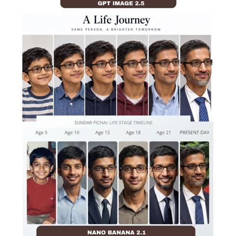</a>

单一主体、固定的人生阶段列表，加上始终是同一张脸的明确要求，给模型提供了可重复的结构。加入 realistic 让每个面板保持照片质感而非插画，年龄变化才读起来像同一个人。

Nano Banana 2.1 · 文生图 · 出处: [@marcthecreatorr on X](https://x.com/marcthecreatorr/status/2107532275529273535) · 36 赞，统计于 2026-10-29

[`timeline`](tags.md#tag-timeline) [`face-consistency`](tags.md#tag-face-consistency) [`portrait`](tags.md#tag-portrait)

<details><summary><b>提示词</b></summary>

```text
nano banana 2.1 is live and my first output already looks really good.

simple prompt: create a realistic timeline of google’s ceo from childhood to now while keeping the same face throughout.

> it’s still based on the older gemini 3.6 flash model, but image generation is fast as hell. most outputs come back in seconds.

here’s the first side-by-side i ran with the exact same prompt and i already have a winner :)
```

</details>

<a id="nano-banana-conservatory-monstera-dappled-portrait"></a>
### 温室里龟背竹叶后的斑驳光影人像

<a href="https://x.com/bmx_ai13/status/2114613454292283394"></a>

提示词先交代场景，再用前景叶片遮挡部分面部，并把光线写成透过玻璃顶的斑驳阳光。浅景深和朴素的亚麻衬衫让视线落在面部与光影图案上。

Nano Banana 2.1 · 文生图 · 出处: [@bmx_ai13 on X](https://x.com/bmx_ai13/status/2114613454292283394) · 26 赞，统计于 2026-10-29

[`conservatory`](tags.md#tag-conservatory) [`dappled-light`](tags.md#tag-dappled-light) [`botanical`](tags.md#tag-botanical) [`shallow-depth-of-field`](tags.md#tag-shallow-depth-of-field) [`portrait`](tags.md#tag-portrait)

<details><summary><b>提示词</b></summary>

```text
Nano banana 2.1 Prompt: Inside a hyper realistic, lush botanical conservatory. Face is partially obscured by large, vibrant Monstera leaves and hanging ferns. Lighting: dappled sunlight breaking through a glass ceiling, creating intricate shadow patterns on skin. Wearing a simple, high quality linen shirt. Depth of field: shallow, with a soft bokeh effect on the tropical greenery in the background. Feels intimate and ethereal.
```

</details>

<a id="nano-banana-dusk-beach-blush-silk-dress-portrait"></a>
### 黄昏海滩上身穿粉色丝绸长裙的赤脚女子

<a href="https://x.com/bmx_ai13/status/2114226447636402356"></a>

用上传的参考图锁定面部和发型细节，再按地点时间、服装、姿态、微风的顺序逐层搭建场景。镜头与光圈参数、柔和日落光、皮肤与丝绸质感词，加上结尾的排除项，把画面推向真实摄影。

Nano Banana 2.1 · 上传图改图 · 出处: [@bmx_ai13 on X](https://x.com/bmx_ai13/status/2114226447636402356) · 26 赞，统计于 2026-10-29

[`beach`](tags.md#tag-beach) [`dusk`](tags.md#tag-dusk) [`fashion-photography`](tags.md#tag-fashion-photography) [`reference-image`](tags.md#tag-reference-image) [`silk-dress`](tags.md#tag-silk-dress)

<details><summary><b>提示词</b></summary>

```text
Blush by the Ocean

Nano Banana 2.1 Prompt: Use uploaded image as the adult character reference; preserve her face, mauve spiral updo, beauty marks and crescent forehead detail. Real cinematic fashion photograph on an empty beach at dusk. She wears a dusty-pink silk maxi dress with a plunging neckline, an open back and a side slit, barefoot on wet sand. Standing in three-quarter profile, she gently gathers the skirt at one hip and looks toward the horizon. A light sea breeze moves the hem while her sculpted hair stays intact. Full-length composition with a soft ocean horizon. 70mm lens, f/2.8, diffused sunset light, warm skin against cool water, natural pores and realistic silk. Subtle film grain, tasteful sensuality, no illustration, CGI, text or watermark.
```

</details>

<a id="nano-banana-smartphone-beauty-portrait-grid-identity-lock"></a>
### 手机质感的四宫格美妆人像

<a href="https://x.com/TheVirtualMuse/status/2115657618710786506"></a>

用身份锁定段落把面部绑定到上传的自拍，发型、妆容、服装和光线由文字决定。四格各自指定景别，并用统一的阳光设定和较长的负面提示保证一致。

Nano Banana 2.1 · 上传图改图 · 出处: [@TheVirtualMuse on X](https://x.com/TheVirtualMuse/status/2115657618710786506) · 24 赞，统计于 2026-10-29

[`beauty-portrait`](tags.md#tag-beauty-portrait) [`identity-lock`](tags.md#tag-identity-lock) [`2x2-grid`](tags.md#tag-2x2-grid) [`smartphone-photo`](tags.md#tag-smartphone-photo) [`golden-light`](tags.md#tag-golden-light)

<details><summary><b>提示词</b></summary>

```text
Create a single, ultra-realistic 2×2 photographic collage in a vertical 9:16 aspect ratio, featuring the same adult woman in four distinct beauty portraits. The final image should look like four genuine smartphone photographs taken during the same indoor photoshoot, with consistent identity, hair, makeup, wardrobe, and environment. Prioritize realistic facial anatomy, crisp eye detail, natural skin texture, and accurate sunlight.

IDENTITY LOCK

Use the uploaded selfie as the reference for her face only. The hair, makeup, wardrobe, pose, lighting, and setting come from this prompt. Preserve her recognizable facial features, facial proportions, eye shape, nose, lips, eyebrows, cheekbones, and jawline. Keep her light blue-gray eyes and skin tone consistent across all four panels. Do not create four different women, change her apparent age, or excessively beautify her.

PANEL LAYOUT

Four equal portrait panels in a clean 2×2 grid, with straight, consistent borders and no overlapping images or extra panels.

Top-left: A frontal medium close-up. She faces the camera directly with an intense, confident gaze and her chin slightly lowered. Her voluminous black hair frames both sides of her face and falls over her shoulders. The crop reaches about the upper chest.

Top-right: A close-up three-quarter view with her head turned slightly. A thick section of jet-black hair sweeps diagonally across her left eye (the viewer's left), covering it, while her right eye looks toward the camera. Her lips are relaxed and slightly parted. A small silver hoop earring is visible.

Bottom-left: A medium close-up facing forward, looking directly into the camera with a calm, sultry expression. A warm patch of direct sunlight crosses her right cheek and forehead, with realistic shadows over the rest of her face. Her long black hair forms layers around her face and chest.

Bottom-right: An extreme close-up from a three-quarter side angle. The crop emphasizes one light blue-gray eye, the cheekbone, the nose, and her glossy nude-pink lips, which are slightly parted. Her black hair frames the outer edge of the face and falls along the neck. A delicate silver chain with a small cross pendant is visible near the lower edge.

HAIR

Long, thick, voluminous layered black hair with soft curtain-like framing pieces, a lifted crown, and large flowing layers around the shoulders. The hair is deep jet black with cool, restrained charcoal reflections where daylight hits the strands. It looks natural and glossy, with individual strands, fine flyaways, and realistic shadow depth. Do not change the hair to brown, chestnut, copper, auburn, blonde, or gray.

MAKEUP & SKIN

Natural peach-nude eyeshadow, sharp but slim black eyeliner, defined dark eyebrows, realistic eyelashes, softly contoured cheeks, and glossy nude-pink lips with a subtle darker lip liner. Skin is fair-to-golden with natural warmth, realistic tonal variation, a dewy highlight on the cheekbones and nose bridge, and visible pores. Avoid excessive airbrushing or plastic-looking skin.

WARDROBE & ACCESSORIES

A minimalist black camisole with realistic fabric texture and natural folds. A small silver hoop earring and a fine silver chain necklace with a delicate cross pendant. Keep the same wardrobe and accessories in all four panels.

SETTING & LIGHTING

A clean indoor space with off-white walls, a window frame in the upper-left area, and subtle architectural edges. Strong natural golden daylight from a nearby window creates distinct geometric sunlight across her face and hair, with deep but detailed shadows. Keep sunlit areas bright without blowing out the skin, and keep catchlights in the eyes. No neon lighting, no colored backgrounds, no furniture, no text.

CAMERA & OPTICS

Realistic modern smartphone photography, 35mm-equivalent lens, natural close-up perspective with subtle optical distortion, mild background separation, sharp eyes, eyelashes, eyebrows, and lips, and balanced exposure. The image should look like an authentic, lightly edited smartphone photograph.

Visible natural skin pores, individual eyelashes, fine eyebrow hairs, realistic iris patterns, natural lip lines, detailed black hair strands, fine flyaways, realistic fabric fibers, and accurate silver reflections. Natural daylight color with neutral skin tones, deep black hair, and no heavy filters or excessive orange tones.

Clean photograph only. No text, watermarks, logos, or interface elements.

NEGATIVE PROMPT

different woman in each panel, inconsistent identity, altered facial proportions, different eye color, brown hair, chestnut hair, copper hair, auburn hair, blonde hair, gray hair, blue hair, flat hair, short hair, missing hair volume, different clothing, missing necklace, oversized earrings, flat lighting, excessive orange lighting, blown-out face, blurry eyes, blurry lips, plastic skin, excessive airbrushing, artificial glow, overprocessed makeup, distorted face, extra fingers, deformed hands, cartoon, anime, illustration, digital painting, 3D render, CGI, low resolution, pixelation, excessive sharpening, text, watermark, logo, uneven grid, unequal panels, extra panels, overlapping panels, 4:5 aspect ratio
```

</details>

<a id="nano-banana-1960s-car-mirror-fashion-reflection"></a>
### 复古汽车后视镜中的1960年代时装肖像

<a href="https://x.com/mehvishs25/status/2107858748882690121"></a>

整个画面设定为弯曲镀铬后视镜里的倒影，并写明机位和行走姿态，让反射显得真实可信。固定的四色配色加上35mm胶片颗粒和划痕描述带来老旧杂志大片质感，同时用明确的不要改变面部指令锁定参考图人物身份。

Nano Banana 2.1 · 上传图改图 · 出处: [@mehvishs25 on X](https://x.com/mehvishs25/status/2107858748882690121) · 23 赞，统计于 2026-10-28

[`vintage`](tags.md#tag-vintage) [`fashion`](tags.md#tag-fashion) [`mirror-reflection`](tags.md#tag-mirror-reflection) [`film-grain`](tags.md#tag-film-grain) [`identity-preservation`](tags.md#tag-identity-preservation)

<details><summary><b>提示词</b></summary>

```text
Create a hyper-realistic 1960s vintage editorial fashion photograph in a vertical 9:16 composition, featuring the girl from the reference image. Preserve her identity and appearance exactly as shown in the reference — including her facial structure, proportions, distinctive features, skin tone, hairstyle characteristics, and overall natural appearance. Do not alter or reinterpret her face.

The scene is captured as a full-body fashion portrait reflected inside a small, oval chrome side mirror of a vintage car. The mirror has naturally curved, slightly distorted edges and realistic reflections. The camera is positioned close to the driver's window, angled toward the side mirror.

Inside the mirror reflection, the girl is fully visible with generous background space. She is walking toward the rear of the car while slightly turning her head toward the mirror, creating a subtle candid moment. She has a calm, confident expression with a soft, understated smile.

She wears a beautifully tailored powder-blue midi dress with a slim waist belt, paired with a burgundy silk scarf, elegant cat-eye sunglasses, a small ivory handbag, and classic white pointed heels. Her styling has an authentic polished 1960s fashion aesthetic.

The environment is a retro Mediterranean-American street with a palm-lined road, pastel-colored storefronts, a vintage station wagon, and distant mountains. Bright golden morning sunlight creates warm, natural highlights and soft shadows across the scene.

Use a refined color palette of powder blue, ivory, burgundy, and warm beige. The image should look like an authentic aged 35mm film photograph, with natural analog grain, subtle film imperfections, tiny scratches, realistic exposure, authentic skin texture, and physically accurate mirror reflections.

The overall mood should feel chic, nostalgic, elegant, and slightly mysterious — like a genuine fashion editorial photograph captured in the 1960s rather than an AI-generated image. Photorealistic, cinematic, highly detailed, natural proportions, realistic fabric texture, authentic vintage photography aesthetics.
```

</details>

<a id="nano-banana-blonde-creator-vanity-portrait"></a>
### 卧室梳妆台前直视镜头的金发博主

<a href="https://x.com/purrdoom/status/2115216612030865415"></a>

提示词分层描述人物：年龄、发型、妆容、毛孔和痣等皮肤瑕疵、首饰与服装，再加一句神态；随后单独写场景与光线，并用否定句禁止标志和文字。瑕疵细节加柔和正面光，让画面像真实的手机视频截图。

Nano Banana 2.1 · 文生图 · 出处: [@purrdoom on X](https://x.com/purrdoom/status/2115216612030865415) · 22 赞，统计于 2026-10-29

[`creator-portrait`](tags.md#tag-creator-portrait) [`talking-head`](tags.md#tag-talking-head) [`skin-texture`](tags.md#tag-skin-texture) [`natural-light`](tags.md#tag-natural-light) [`realistic-person`](tags.md#tag-realistic-person)

<details><summary><b>提示词</b></summary>

```text
A white woman, 34, a glamorous social media creator with the polished look of a pro athlete's wife. Very long, straight, sleek golden-blonde hair with a center part and slightly darker roots. A natural sun-kissed tan. Full glam makeup with a soft matte finish: voluminous lashes, sculpted arched brows, soft contour, satin peachy-nude overlined lips. Real skin texture: visible pores, faint lines under her eyes, a small mole on her left jaw. Small gold hoop earrings, a thin gold chain necklace, a large oval diamond engagement ring. A fitted ribbed heather-grey scoop-neck tank top. Confident, direct, a little urgent, like a friend about to tell you something you need to hear.

She sits at a white vanity in her bedroom in the late afternoon. Behind her: a muted sage-grey wall, a dark doorway on the left edge of the frame, and a white ceiling at the top. Warm, soft natural light on her face from the front, with soft catchlights in her eyes. No makeup products in frame. No logos or readable text anywhere in frame.
```

</details>

<a id="gpt-image-backlit-backless-gown-window-portrait"></a>
### 窗边逆光露背长裙情绪写真

<a href="https://x.com/MrLarus/status/2058131948904599860"></a>

提示词按姿态、露背结构、材质、场景、光线、构图、氛围分项列出，并把背部定为唯一视觉重心。逆光与窗边光被指定用来勾勒肩胛骨和腰线，末尾的长串负面词条则让肤色和布料保持真实胶片感。

GPT Image 2 · 文生图 · 出处: [@MrLarus on X](https://x.com/MrLarus/status/2058131948904599860) · 发现于 [freestylefly/awesome-gpt-image-2](https://github.com/freestylefly/awesome-gpt-image-2)

[`backlight`](tags.md#tag-backlight) [`portrait`](tags.md#tag-portrait) [`window-light`](tags.md#tag-window-light) [`film-look`](tags.md#tag-film-look) [`evening-gown`](tags.md#tag-evening-gown)

<details><summary><b>提示词</b></summary>

```text
请生成一张竖版高质感女性情绪写真，主题为「逆光美背·女性情绪写真」。

核心要求：
画面的绝对重点是“美背”，通过露背结构、肩颈线条、肩胛骨、脊柱中线、腰背曲线和逆光轮廓来呈现女性美。请避免普通女性写真或普通穿搭图的处理方式，背部必须是主视觉核心，脸只作为辅助。

人物设定：
成年女性，真实自然，气质可为温柔、清冷、慵懒、文艺、轻熟或安静。人物不要网红脸，不要塑料感，不要夸张妆容。可侧脸、回眸、低头或闭眼，但正脸不是重点。

姿态要求：
姿态必须服务于背部展示，例如背对镜头微微回头、侧身站立、侧坐、抬手整理头发、低头蜷身、斜倚窗边、半躺回眸、披衣下滑等。动作自然，不要僵硬摆拍，不要正面直视镜头。

露背结构：
必须有明确的露背设计，可为低背长裙、吊带裙、露背礼服、针织外套滑落、薄纱披肩、浴袍半披、宽松衬衫滑肩、丝质罩衫半落等。重点表现肩线、肩胛骨、背中线、腰背收束和布料与肌肤之间的高级过渡。

服装与材质：
服装选择轻柔、垂坠、带有透光感和褶皱感的材质，如薄纱、真丝、针织、棉麻、细闪纱、浴袍质地、软垂感长裙。布料要参与构图，形成半遮半露、滑落、包裹、垂挂的层次，但不能厚重。

场景：
场景为卧室、窗边、床上、白墙房间、民宿、酒店房间、木质空间或复古公寓。背景简洁克制，少量床品、窗帘、木椅、花束、地板等元素即可，不能喧宾夺主。

光线要求：
采用自然光或柔和暖光，以逆光、侧逆光、窗边光为主。重点是让光打到背部，勾出肩颈边缘、肩胛骨轮廓、腰线和发丝高光。可使用晨光、黄昏金光、柔雾散射光或冷白窗光，但背部受光状态必须成立。

构图：
竖版构图，画幅可为 9:16、3:4 或 4:5。人物是绝对主角，视觉重心放在背部、肩颈和腰背曲线上。可采用半身、七分身、近景或全身，但不要让场景抢走主体。

氛围：
整体氛围安静、柔软、私密、克制、高级，像真实摄影师拍摄的电影感情绪写真。重点避免直白性感，改用“美背 + 逆光 + 柔软布料 + 自然姿态”表达女性美。

画质要求：
真实摄影感、电影感、柔雾胶片感、细腻肤色、真实皮肤质感、浅景深、轻微颗粒感、画面通透自然。不要 AI 塑料感，不要 CG 感，不要错误手指，不要肢体畸形，不要低俗色情化表达，不要文字、水印、Logo、边框。

最终效果：
一张以“美背”为主视觉核心的高完成度女性情绪写真，通过露背结构、肩颈背部线条、柔光逆光和柔软布料来呈现克制而高级的女性美。
```

</details>

<a id="gpt-image-bangkok-sunny-street-selfie"></a>
### 曼谷阳光街头年轻女子自拍

<a href="https://x.com/Stonic_AI/status/2069649170429075962"></a>

提示词先设定手机自拍的低角度、伸臂和强烈直射阳光，再逐项列出发型、妆容、配饰和服装，并把曼谷街景元素安排在画面一侧，让结果更像真实照片。

GPT Image 2 · 文生图 · 出处: [@Stonic_AI on X](https://x.com/Stonic_AI/status/2069649170429075962) · 发现于 [YouMind-OpenLab/awesome-gpt-image-2](https://github.com/YouMind-OpenLab/awesome-gpt-image-2)

[`selfie`](tags.md#tag-selfie) [`street-photography`](tags.md#tag-street-photography) [`bangkok`](tags.md#tag-bangkok) [`harsh-sunlight`](tags.md#tag-harsh-sunlight) [`photorealistic`](tags.md#tag-photorealistic)

<details><summary><b>提示词</b></summary>

```text
Hyper-realistic 8K close self-shot, young European woman, slightly low angle, arm extended holding phone, bright sunny daytime, direct harsh sunlight, sharp facial shadows, artistic high-contrast light and shadow, energetic intense atmosphere, slight gentle smile, fair pink-toned glowing smooth skin. Long waist-length curly hair, no bangs, naturally flowing curls at ends, gold hair clip. Thin winged eyeliner, full long lashes, soft peach blush, defined brows, glossy light pink ombre lips. Cream smartwatch, dainty gold necklace. Loose casual camisole top, high-waisted pleated midi skirt, lightweight knitted fringed shawl. Slightly tilted posture, squinting gently against sunlight, one hand raised to block glare. Outdoor Bangkok city background, right side filled with urban scenery, lush green trees, crosswalk, bus stop bench, ultra-detailed, photorealistic.9：16
```

</details>

<a id="gpt-image-burgundy-studio-bearded-man-sunglasses-portrait"></a>
### 酒红棚拍戴墨镜的络腮胡男士肖像

<a href="https://x.com/iamsofiaijaz/status/2090294894187413883"></a>

提示词先用参考图锁定面部身份，再把琥珀主光、绯红轮廓光和酒红渐变背景分开描述。85mm、f/1.8 的镜头参数，加上皮肤、胡须和麂皮质感清单，让特写保持写实。

GPT Image 2 · 上传图改图 · 出处: [@iamsofiaijaz on X](https://x.com/iamsofiaijaz/status/2090294894187413883) · 发现于 [freestylefly/awesome-gpt-image-2](https://github.com/freestylefly/awesome-gpt-image-2)

[`fashion-portrait`](tags.md#tag-fashion-portrait) [`studio-lighting`](tags.md#tag-studio-lighting) [`face-reference`](tags.md#tag-face-reference) [`menswear`](tags.md#tag-menswear) [`cinematic`](tags.md#tag-cinematic)

<details><summary><b>提示词</b></summary>

```text
A cinematic, ultra-realistic close-up portrait of a stylish man, using the provided image as an accurate face reference. Preserve his natural facial identity, thick naturally curly dark brown hair, neatly trimmed salt-and-pepper beard, strong masculine facial structure, and realistic facial proportions. He wears sophisticated round vintage amber-brown sunglasses and a premium deep burgundy suede jacket over a fitted black silk-knit shirt, creating a refined luxury fashion aesthetic.

Warm cinematic studio lighting with a soft amber-golden key light illuminating the face from the front-left, complemented by a subtle crimson-red rim light outlining the hair and shoulders. The background is a rich burgundy, wine-red, and dark plum gradient, with soft atmospheric haze and subtle diffused light creating depth without distracting from the subject. Elegant warm highlights contrast beautifully against the dark clothing.

Extremely detailed natural skin texture, individual beard hairs, realistic pores, subtle facial imperfections, sharp eyes visible behind slightly tinted lenses, natural reflections on the sunglasses, rich dimensional shadows, realistic fabric and suede texture, shallow depth of field. Sophisticated luxury fashion campaign, mysterious and confident mood, premium men's editorial photography, cinematic color grading, photorealistic, HDR, professional studio photography, 85mm portrait lens, f/1.8, crisp facial details, soft background bokeh, centered composition, head-and-shoulders framing, powerful masculine presence, understated elegance, 3:4 aspect ratio.
```

</details>

<a id="gpt-image-candid-coastal-abbey-travel-portrait"></a>
### 海岸修道院前的抓拍旅行人像

<a href="https://x.com/saniaspeaks_/status/2097532595814940683"></a>

提示词把人物放在前景、地标放在背景，再加入远处的小人物和车辆来体现尺度。结尾用手机相机质感、柔和傍晚光和 3:4 竖构图，让画面更像真实抓拍。

GPT Image 2.5 · 文生图 · 出处: [@saniaspeaks_ on X](https://x.com/saniaspeaks_/status/2097532595814940683) · 发现于 [wangrunlin/awesome-gpt-image-2-5-prompts](https://github.com/wangrunlin/awesome-gpt-image-2-5-prompts)

[`travel-portrait`](tags.md#tag-travel-portrait) [`candid`](tags.md#tag-candid) [`landmark`](tags.md#tag-landmark) [`evening-light`](tags.md#tag-evening-light) [`smartphone-look`](tags.md#tag-smartphone-look)

<details><summary><b>提示词</b></summary>

```text
A photorealistic candid travel portrait of a young East Asian woman standing on a quiet sandy shoreline beside large moss-covered rocks, with a magnificent historic stone abbey and medieval castle-like architecture rising dramatically on a rocky island behind her. She has long straight dark brown hair falling naturally over one shoulder, soft youthful facial features, and a gentle warm smile while looking directly at the camera.

She is wearing a long oversized black coat with her hands casually tucked inside the pockets, layered over a light-colored outfit. A large soft cream-white scarf is wrapped warmly around her neck, hanging down the front with a small black designer-style emblem near the end. A delicate chain shoulder bag is partially visible.

The composition captures her in the foreground while the vast historic abbey dominates the background, surrounded by ancient stone walls, rocky cliffs, sandy tidal flats, and a calm coastal atmosphere. A few small distant vehicles and people add realistic scale to the scene. Soft natural evening light and a clear pale blue sky create a peaceful European travel mood.

Ultra-realistic photography, authentic candid travel photo, natural skin texture, realistic fabric details, soft cinematic lighting, subtle smartphone camera aesthetic, slightly dreamy color grading, natural proportions, detailed architecture, peaceful coastal atmosphere, vertical composition, 3:4 aspect ratio.
```

</details>

<a id="gpt-image-candid-sailor-35mm"></a>
### 老水手补渔网的35毫米抓拍肖像

<a href="https://developers.openai.com/api/docs/guides/image-prompting#control-style-and-lighting"></a>

提示词逐一写明皮肤质感、镜头、光线和胶片颗粒，最后一句排除美化和重度修图，因此成片像一张未经摆拍的纪实照片。

GPT Image 2.5 · 文生图 · 出处: [OpenAI image prompting guide](https://developers.openai.com/api/docs/guides/image-prompting#control-style-and-lighting)

[`photorealism`](tags.md#tag-photorealism) [`film`](tags.md#tag-film) [`portrait`](tags.md#tag-portrait)

<details><summary><b>提示词</b></summary>

```text
Create a photorealistic candid photograph of an elderly sailor standing on a small fishing boat.
He has weathered skin with visible wrinkles, pores, and sun texture, and a few faded traditional sailor tattoos on his arms.
He is calmly adjusting a net while his dog sits nearby on the deck. Shot like a 35mm film photograph, medium close-up at eye level, using a 50mm lens.
Soft coastal daylight, shallow depth of field, subtle film grain, natural color balance.
The image should feel honest and unposed, with real skin texture, worn materials, and everyday detail. No glamorization, no heavy retouching.
```

</details>

<a id="gpt-image-candlelit-side-room-qipao-portrait"></a>
### 烛光暗室中的旗袍女子写实肖像

<a href="https://x.com/ToroJushiAi/status/2056926887344042382"></a>

画外单支蜡烛定下光线方向，琥珀色旗袍与烛光色温一致，让人物融进光里。皮肤质感、散落发丝和 ISO 400 颗粒保持摄影感，末尾的否定清单排除插画风格。

GPT Image 2 · 文生图 · 出处: [@ToroJushiAi on X](https://x.com/ToroJushiAi/status/2056926887344042382) · 发现于 [freestylefly/awesome-gpt-image-2](https://github.com/freestylefly/awesome-gpt-image-2)

[`candlelight`](tags.md#tag-candlelight) [`chiaroscuro`](tags.md#tag-chiaroscuro) [`qipao`](tags.md#tag-qipao) [`85mm`](tags.md#tag-85mm) [`film-grain`](tags.md#tag-film-grain)

<details><summary><b>提示词</b></summary>

```text
A medium-shot authentic daily life photograph, natural candid moment, of an East Asian young woman standing in a small side room lit only by a single candle on a low stone shelf. 85mm lens, waist-up framing, shallow depth of field. The candle is off-frame to the left; the room behind her exists only as dark warm suggestion.

East Asian young woman in her early 20s. Almond-shaped eyes receiving the candle's warm flicker — the irises briefly caught in light before returning to shadow. Straight refined nose, the bridge illuminated in a narrow warm stripe. Skin tone fair beige, warmed entirely by candlelight into something amber. Skin subsurface scattering visible under directional candlelight, specular micro-highlights on cheekbones and nose ridge, fine foundation powder grain perceptible.

She wears an aged amber silk qipao with chrysanthemum embroidery in tones of old bronze and dusty ochre — the amber pigment identical in temperature to the candle's own light, the embroidery appearing and disappearing depending on angle. Mandarin collar, short sleeves. She stands facing the candle without looking at it, arms at her sides, very still. The room is otherwise empty. Two or three stray hairs displaced by faint air movement, natural unplanned imperfection, not geometrically symmetrical.

Single candle — warm amber-orange, directional and fragile. It carves the left side of her face from darkness, leaves the right in near-black shadow. The amber qipao and the candlelight share a single temperature register: the room folds her into the light. Deep chiaroscuro with no artificial fill. Subtle ISO 400 film grain in shadow areas, photographic noise texture not CG render smoothness. Aspect ratio 9:16. No watermark, no text overlay, not cartoon, not digitally painted, not illustration, not anime.
```

</details>

<a id="gpt-image-cherry-blossom-over-shoulder-portrait"></a>
### 樱花小径回眸电影感人像

<a href="https://x.com/SheBuildsAI_/status/2092431090095149533"></a>

提示词用 JSON 字段把场景、主体、细节、光线和构图分开，方便逐层调整。85mm 镜头、浅景深和逆光花瓣加体积雾，营造出电影感的杂志人像。

GPT Image 2 · 文生图 · 出处: [@SheBuildsAI_ on X](https://x.com/SheBuildsAI_/status/2092431090095149533) · 发现于 [freestylefly/awesome-gpt-image-2](https://github.com/freestylefly/awesome-gpt-image-2)

[`cherry-blossom`](tags.md#tag-cherry-blossom) [`portrait`](tags.md#tag-portrait) [`cinematic`](tags.md#tag-cinematic) [`85mm`](tags.md#tag-85mm) [`json-prompt`](tags.md#tag-json-prompt)

<details><summary><b>提示词</b></summary>

```text
{
  "title": "WHISPERS OF SPRING",

  "scene": "A peaceful pathway beneath blooming cherry blossom trees during a warm spring afternoon. Pink blossoms fill the canopy overhead while delicate petals drift gracefully through the air. Soft sunlight filters through the branches, creating a dreamy and enchanting atmosphere.",

  "subject": "A young woman walks away from the camera before gently turning her head over her shoulder with a soft, mysterious smile. She wears a flowing natural linen dress that moves gracefully with the breeze, highlighting her delicate facial features and effortless elegance.",

  "detail": "Wind carries countless pink cherry blossom petals across the frame while warm sunlight creates glowing highlights throughout the scene. Every strand of hair moves naturally in the breeze, with ultra realistic skin texture, lifelike fabric folds, soft floral surroundings, and subtle atmospheric haze enhancing the cinematic realism.",

  "atmosphere": "Elegant, peaceful, romantic, dreamy, timeless, cinematic, graceful, and enchanting.",

  "lighting": "Warm spring sunlight filtering through cherry blossom branches, soft natural illumination, glowing highlights, volumetric light rays, gentle ambient shadows, and subtle atmospheric haze.",

  "composition": "Cinematic editorial portrait captured with an 85mm lens, featuring the subject in a three-quarter over-the-shoulder pose. Shallow depth of field, creamy bokeh, balanced framing with flowering trees, soft leading lines, and immersive visual storytelling.",

  "style": "Photorealistic, masterpiece, editorial fashion photography, analog film aesthetic, dreamy pastel color palette, ultra realistic skin texture, highly detailed, shallow depth of field, creamy bokeh, atmospheric haze, HDR, cinematic realism, 8K."
}
```

</details>

<a id="gpt-image-cinematic-night-car-backseat-portrait"></a>
### 夜晚车后座的电影感人像

<a href="https://x.com/AiwithElisia/status/2089221808436531381"></a>

横向的暖色街灯光带落在脸上形成戏剧性明暗,后窗外虚化的城市光斑增加景深层次。提示词写明85mm、f/1.4等相机参数和构图,并用否定词避免塑料感皮肤,保证真实质感。

GPT Image 2 · 文生图 · 出处: [@AiwithElisia on X](https://x.com/AiwithElisia/status/2089221808436531381) · 发现于 [YouMind-OpenLab/awesome-gpt-image-2](https://github.com/YouMind-OpenLab/awesome-gpt-image-2)

[`portrait`](tags.md#tag-portrait) [`night`](tags.md#tag-night) [`cinematic`](tags.md#tag-cinematic) [`bokeh`](tags.md#tag-bokeh) [`low-light`](tags.md#tag-low-light)

<details><summary><b>提示词</b></summary>

```text
A cinematic, photorealistic close-up portrait of a young East Asian woman sitting in the back seat of a car at night. She has long, naturally straight, glossy black hair with a few loose strands falling softly across her face, delicate facial features, smooth natural skin texture, dark expressive eyes, subtle eyeliner, soft natural eyebrows, and muted rosy-red lips. She is looking directly toward the camera with a calm, neutral, slightly melancholic expression.

Warm golden horizontal bands of streetlight pass naturally across her face, creating dramatic cinematic light and shadow. The lighting should softly illuminate her eyes, nose, cheeks, and lips while leaving parts of her face and hair in deep natural shadow. Preserve realistic skin pores and fine facial details without excessive retouching or plastic-looking skin.

She is seated inside a dark luxury car, with black leather seats and interior surrounding her. Through the rear window, a nighttime city scene is visible with heavily blurred colorful lights, warm yellow bokeh, white headlights, subtle red traffic lights, and dark urban buildings. Strong shallow depth of field separates her from the background.

Shot on a professional full-frame camera, 85mm portrait lens, f/1.4 aperture, cinematic depth of field, realistic low-light photography, soft filmic contrast, subtle warm highlights, deep blacks, natural color grading, high dynamic range, crisp eyes, detailed hair strands, realistic skin texture, soft bokeh, atmospheric nighttime mood.

Composition: vertical portrait, subject centered slightly below the middle of the frame, head and shoulders visible, natural perspective, intimate close-up framing, cinematic negative space, realistic car interior framing in the foreground.

Ultra-realistic photography, high detail, sharp facial focus, natural imperfections, realistic lighting, premium editorial photography, cinematic movie still, subtle film grain, professional color grading, 8K detail, no artificial beauty filter, no over-sharpening, no distorted facial features, no extra fingers, no text, no watermark.
```

</details>

<a id="gpt-image-digicam-lcd-nostalgic-portrait-comic-shelf"></a>
### 数码相机屏幕里的2012年漫画书架旁怀旧人像

<a href="https://x.com/Ciri_ai/status/2055876982630686956"></a>

提示词采用画中画结构：先拍相机LCD屏幕特写，再在屏幕里呈现2010年代初的抓拍照片。直闪、颗粒、动态模糊，加上时间戳、曝光参数和电池图标等界面元素，让画面像真实的数码相机成像。

GPT Image 2 · 文生图 · 出处: [@Ciri_ai on X](https://x.com/Ciri_ai/status/2055876982630686956) · 发现于 [freestylefly/awesome-gpt-image-2](https://github.com/freestylefly/awesome-gpt-image-2)

[`digicam`](tags.md#tag-digicam) [`nostalgic`](tags.md#tag-nostalgic) [`flash-photography`](tags.md#tag-flash-photography) [`candid-portrait`](tags.md#tag-candid-portrait) [`camera-ui`](tags.md#tag-camera-ui)

<details><summary><b>提示词</b></summary>

```text
A realistic close-up shot of a small digital camera screen glowing brightly in a dark indoor environment. Displayed on the LCD is a candid early-2010s style photograph of a young East Asian woman with long dark wavy hair standing beside a wooden shelf packed tightly with colorful comic books and magazines.

She wears a black spaghetti-strap top with a loose white cardigan hanging casually from both shoulders and faded blue jeans. Captured mid-laugh while turning her face slightly sideways, her expression feels spontaneous and natural, with hair falling softly across part of her cheek.

The harsh direct flash from the compact camera creates strong highlights on her face and cardigan while flattening shadows in the background, producing an authentic nostalgic digicam aesthetic. Slight motion blur and digital grain enhance the candid realism.

Camera UI overlays are visible across the LCD screen, including the timestamp “8. 1. 2012 3:15 AM,” exposure data “1/30 F3.4 ISO 100,” focus indicators, and a small green battery symbol in the corner.

The image preserves visible screen pixel structure, slight glare reflections, chromatic softness, and compressed digital texture. Outside the LCD, the surrounding darkness fades smoothly into blur, emphasizing the glowing nostalgic screen.

Shot to resemble an authentic Sony Cyber-shot point-and-shoot camera from the early 2010s using a CCD sensor with vintage digital rendering and imperfect flash exposure.
```

</details>

<a id="gpt-image-double-exposure-aviator-fashion-portrait"></a>
### 戴飞行员墨镜的双重曝光时尚肖像

<a href="https://x.com/Anaya_Ai12/status/2062191518975508678"></a>

用半透明的大尺寸侧脸叠加全身站姿构成双重曝光，并锁定上传人脸作为参考。暖调棕褐与炭灰配色、一角的金橙漏光以及 85mm 镜头描述，共同营造电影感。

GPT Image 2 · 上传图改图 · 出处: [@Anaya_Ai12 on X](https://x.com/Anaya_Ai12/status/2062191518975508678) · 发现于 [freestylefly/awesome-gpt-image-2](https://github.com/freestylefly/awesome-gpt-image-2)

[`double-exposure`](tags.md#tag-double-exposure) [`fashion`](tags.md#tag-fashion) [`portrait`](tags.md#tag-portrait) [`sepia`](tags.md#tag-sepia) [`light-leak`](tags.md#tag-light-leak)

<details><summary><b>提示词</b></summary>

```text
A cinematic double-exposure fashion portrait featuring a woman with the uploaded face used 100% as reference, wearing stylish metallic aviator sunglasses. The composition artfully blends a large, semi-transparent close-up profile of her face on the left with her full-body figure standing confidently on the right. She wears an open, light-grey textured corduroy shirt layered over a dark grey fitted t-shirt and dark denim jeans, posing naturally with her hands in her pockets. She has long, flowing dark hair, flawless skin, elegant feminine features, and a confident, sophisticated expression.

The background is a minimalist neutral studio setting, allowing the double-exposure composition to remain the visual focus. The color grading features a sophisticated warm desaturated sepia and charcoal palette, enhanced by a soft golden-orange light-leak flare in the upper-right corner. Professional 85mm lens photography with high-contrast yet soft cinematic lighting accentuates the fabric textures, facial details, and layered portrait effect.

Ultra-realistic skin texture, luxury fashion-editorial aesthetic, premium magazine-cover quality, subtle film grain, cinematic depth, elegant shadows, refined color grading, modern retro-inspired styling, masterpiece composition, ultra-sharp focus, visually striking storytelling, high-end commercial fashion campaign look.
```

</details>

<a id="gpt-image-fairycore-butterfly-floral-crown-portrait"></a>
### 蝴蝶环绕的花冠仙境肖像

<a href="https://x.com/HaniaAi12/status/2062696495741391006"></a>

提示词先写具体的发饰和纱裙细节，如玫瑰、水晶、羽毛和刺绣薄纱，再限定粉彩色调与柔和晨光，最后用虚化、体积光、柔焦高光等摄影术语收束。

GPT Image 2 · 文生图 · 出处: [@HaniaAi12 on X](https://x.com/HaniaAi12/status/2062696495741391006) · 发现于 [freestylefly/awesome-gpt-image-2](https://github.com/freestylefly/awesome-gpt-image-2)

[`fairycore`](tags.md#tag-fairycore) [`fantasy-portrait`](tags.md#tag-fantasy-portrait) [`pastel`](tags.md#tag-pastel) [`butterflies`](tags.md#tag-butterflies) [`soft-light`](tags.md#tag-soft-light)

<details><summary><b>提示词</b></summary>

```text
Ultra-realistic ethereal fantasy portrait of a breathtaking young woman with delicate porcelain skin, soft grey-blue eyes, and natural rosy lips. She gazes gently toward the viewer with a serene, dreamy expression, her fingertips lightly touching her chin. Wispy ash-brown hair flows softly in the breeze, styled in a loose romantic updo adorned with pastel blush roses, shimmering crystal ornaments, delicate feathers, and intricate floral accessories. She wears elegant dangling crystal earrings and a translucent, flowing gown made of sheer iridescent fabric embroidered with tiny sparkling flowers.

The scene is bathed in soft diffused morning light, creating a luminous glow around her face and shoulders. Surrounded by floating butterflies, sparkling dust particles, translucent petals, and dreamy floral textures, the background blends pastel lavender, pearl white, blush pink, and silver tones. Cinematic fine-art photography, fairycore aesthetic, enchanted garden atmosphere, magical realism, ultra-detailed skin texture, soft focus highlights, volumetric lighting, bokeh, masterpiece quality, highly detailed, 8K resolution, delicate feminine beauty, romantic fantasy artwork, elegant composition, dreamy color grading, soft glow, celestial ambiance.
```

</details>

<a id="gpt-image-fisheye-mirror-retro-cafe-portrait"></a>
### 鱼眼镜面复古青绿咖啡馆人像

<a href="https://x.com/harboriis/status/2049044698900361241"></a>

点明鱼眼镜头、圆形镜框和前倾近距离姿势，画面畸变感与亲密感都很强。青绿地铁砖、吊灯、黄色镜片等具体布景细节加上暖调氛围词，让色调保持统一。

GPT Image 2 · 上传图改图 · 出处: [@harboriis on X](https://x.com/harboriis/status/2049044698900361241) · 发现于 [freestylefly/awesome-gpt-image-2](https://github.com/freestylefly/awesome-gpt-image-2)

[`fisheye`](tags.md#tag-fisheye) [`retro-cafe`](tags.md#tag-retro-cafe) [`mirror`](tags.md#tag-mirror) [`portrait`](tags.md#tag-portrait) [`warm-moody`](tags.md#tag-warm-moody)

<details><summary><b>提示词</b></summary>

```text
A fish-eye lens close-up of [your photo as reference] sipping from a teal/turquoise coffee mug, leaning forward intimately toward camera. Shot through or near a round mirror. Retro café interior with glossy teal subway tiles, vintage appliances, pendant lights. Black t-shirt, yellow-tinted round glasses. Warm moody tones.
```

</details>

<a id="gpt-image-futuristic-office-businesswoman-portrait"></a>
### 未来感玻璃办公室中的职场女性肖像

<a href="https://x.com/NadzuAI/status/2087901626891940013"></a>

提示词依次叠加服装、场景、光线和镜头线索（柔和电影光、浅景深、真实皮肤质感），并把色调限定为蓝白。同时指定4:5竖构图，并加入无文字无水印的约束，让成图更干净。

GPT Image 2 · 文生图 · 出处: [@NadzuAI on X](https://x.com/NadzuAI/status/2087901626891940013) · 发现于 [YouMind-OpenLab/awesome-gpt-image-2](https://github.com/YouMind-OpenLab/awesome-gpt-image-2)

[`corporate-portrait`](tags.md#tag-corporate-portrait) [`business`](tags.md#tag-business) [`photorealistic`](tags.md#tag-photorealistic) [`futuristic-office`](tags.md#tag-futuristic-office) [`vertical`](tags.md#tag-vertical)

<details><summary><b>提示词</b></summary>

```text
Create a hyper-realistic HD portrait of a confident young professional businesswoman, elegant modern black blazer over a white blouse, standing in a premium futuristic office with glass walls, subtle AI technology screens and a city skyline in the background. Natural makeup, polished hairstyle, confident expression, professional corporate appearance, cinematic soft lighting, realistic skin texture, shallow depth of field, luxury business atmosphere, sophisticated blue-and-white tones, ultra-detailed, photorealistic, 8K quality, sharp focus, premium LinkedIn and AI startup branding aesthetic, vertical 4:5 composition, no text, no watermark.
```

</details>

<a id="gpt-image-golden-hour-couple-cinematic-closeup"></a>
### 日落黄金时刻情侣特写

<a href="https://x.com/darshal_/status/2049071963520508058"></a>

低角度夕阳逆光配合轮廓光、柔和镜头光晕与浅景深，营造出电影感的香水广告氛围。50mm 镜头提示与低饱和大地色调让皮肤和发丝质感保持真实。

GPT Image 2 · 文生图 · 出处: [@darshal_ on X](https://x.com/darshal_/status/2049071963520508058) · 发现于 [YouMind-OpenLab/awesome-gpt-image-2](https://github.com/YouMind-OpenLab/awesome-gpt-image-2)

[`couple`](tags.md#tag-couple) [`golden-hour`](tags.md#tag-golden-hour) [`backlight`](tags.md#tag-backlight) [`cinematic`](tags.md#tag-cinematic) [`close-up`](tags.md#tag-close-up)

<details><summary><b>提示词</b></summary>

```text
A cinematic golden-hour close-up of a young couple in an intimate outdoor moment, framed from the chest up. The main focus is a handsome young man with dark brown tousled wavy hair, soft defined jawline, smooth light-tan skin, and a calm, distant expression as he gazes slightly upward and off to the left. He wears a black open-collar button-up shirt with a relaxed, elegant fit. Leaning into him is 1 young woman with long dark brown hair, her face mostly hidden against his shoulder and chest, creating a tender, protective mood; only part of her hair, shoulder, and thin black spaghetti-strap dress are visible. Use warm sunset backlighting with the sun low behind them on the left, creating glowing rim light around their hair and shoulders, soft lens flare, amber highlights, shallow depth of field, and a blurred natural landscape in the background with low hills. The composition should feel romantic, editorial, and filmic, like a luxury fragrance or fashion campaign, with soft skin detail, realistic textures, subtle wind in the hair, muted earth tones, and high-end cinematic color grading. Photorealistic, emotional, intimate, 50mm lens look, ultra-detailed, natural light, soft contrast.
```

</details>

<a id="gpt-image-ice-blue-hanfu-full-body"></a>
### 冰蓝星点襦裙全身人像

<a href="https://x.com/fdtreesky/status/2046508731090018331"></a>

提示词按服装细节、材质光影、构图镜头三段书写,明确写出面料层次与亮片刺绣。侧光透过薄纱,加上85mm f/1.8全身构图,让半透明感与织物质感清晰可见。

GPT Image 2 · 文生图 · 出处: [@fdtreesky on X](https://x.com/fdtreesky/status/2046508731090018331) · 发现于 [freestylefly/awesome-gpt-image-2](https://github.com/freestylefly/awesome-gpt-image-2)

[`hanfu`](tags.md#tag-hanfu) [`fashion`](tags.md#tag-fashion) [`full-body`](tags.md#tag-full-body) [`translucent-fabric`](tags.md#tag-translucent-fabric) [`85mm`](tags.md#tag-85mm)

<details><summary><b>提示词</b></summary>

```text
[中文]
服裝細節： 模特兒身穿一套精緻的淡冰藍色齊胸襦裙，採用多層輕盈的薄紗和絲綢歐根紗材質制成。其寬大的、半透明的廣袖上點綴著如繁星般微小的銀色和淺藍色亮片刺繡，在光線下閃爍（具有銀河般的夢幻感）。抹胸位置有複雜的銀色蕾絲和編織紋理細節，腰帶自然垂落。

材質與光影： 畫面呈現 8k 超高分辨率和對織物微距紋理的極致渲染。光線採用柔和的自然側光（丁達爾效應 Typndall Effect），精準地透射過輕薄的紗布，營造出面料的半透明感（Translucency）和流動感。

構圖與鏡頭： 採用 85mm 黄金人像鏡頭效果，f/1.8 大光圈，全身構圖，模特居中站立

[English]
Clothing details: The model wears an exquisite pale ice blue chest-high ruqun, made of multiple layers of lightweight tulle and silk organza materials. Its wide, translucent broad sleeves are adorned with tiny silver and light blue sequin embroideries like stars, shimmering under the light (with a galaxy-like dreamy feel). The tube top position has complex silver lace and woven texture details, and the belt falls naturally.
Material and light and shadow: The image presents 8k ultra-high resolution and extreme rendering of macro textures of the fabric. The lighting uses soft natural side light (Tyndall Effect Typndall Effect), accurately transmitting through the light gauze, creating a sense of translucency (Translucency) and fluidity of the fabric.
Composition and lens: Uses 85mm golden portrait lens effect, f/1.8 large aperture, full-body composition, model standing in the center
```

</details>

<a id="gpt-image-impasto-oil-portrait-abstract-wall"></a>
### 抽象墙面前的厚涂油画肖像

<a href="https://x.com/mon010_de/status/2058033940305469461"></a>

直接点明油画媒介特征（厚涂、刮刀、可见笔触），并为墙面设定橙、米、深蓝的暖色调。再加入放松的坐姿、侧视目光和层次服饰细节，让人物与绘画质感融为一体。

GPT Image 2 · 文生图 · 出处: [@mon010_de on X](https://x.com/mon010_de/status/2058033940305469461) · 发现于 [YouMind-OpenLab/awesome-gpt-image-2](https://github.com/YouMind-OpenLab/awesome-gpt-image-2)

[`oil-painting`](tags.md#tag-oil-painting) [`impasto`](tags.md#tag-impasto) [`portrait`](tags.md#tag-portrait) [`palette-knife`](tags.md#tag-palette-knife) [`editorial`](tags.md#tag-editorial)

<details><summary><b>提示词</b></summary>

```text
Ultra-realistic expressive oil painting portrait of a handsome young man with medium-length messy blonde hair and sun-kissed skin, sitting casually against a textured abstract wall with orange, beige, and deep blue paint strokes. He is looking sideways with a calm, thoughtful expression. He wears an oversized olive-green satin shirt over a white t-shirt, layered silver necklaces, rings, bracelets, and a luxury wristwatch.

The artwork features dramatic warm lighting, cinematic shadows, highly detailed brush strokes, painterly texture, rich impasto oil paint style, modern contemporary art aesthetic, realistic facial anatomy, rugged masculine features, soft glowing skin tones, relaxed pose with one arm resting on his knee.

Background is abstract and artistic with rough palette knife textures and mixed earthy colors. Moody luxury vibe, editorial fashion portrait, museum-quality oil painting, ultra-detailed, high contrast, 8k resolution, masterpiece composition.
```

</details>

<a id="gpt-image-iphone-candid-dusk-street-snapshot"></a>
### 黄昏街头模糊的 iPhone 抓拍人像

<a href="https://x.com/Ciri_ai/status/2051292618248904809"></a>

提示词把画面设定为随手误拍的 iPhone 照片，并明确要求轻微动态模糊和不均匀的自然光。这些瑕疵加上平凡的构图，让模型避开精修棚拍感，得到可信的抓拍效果。

GPT Image 2 · 文生图 · 出处: [@Ciri_ai on X](https://x.com/Ciri_ai/status/2051292618248904809) · 发现于 [freestylefly/awesome-gpt-image-2](https://github.com/freestylefly/awesome-gpt-image-2)

[`iphone-snapshot`](tags.md#tag-iphone-snapshot) [`candid`](tags.md#tag-candid) [`motion-blur`](tags.md#tag-motion-blur) [`natural-light`](tags.md#tag-natural-light) [`lifestyle`](tags.md#tag-lifestyle)

<details><summary><b>提示词</b></summary>

```text
I want to see what you really look like.
Draw a snapshot of your everyday life as if it were accidentally taken on an iPhone.
Make it feel like a very ordinary, imperfect candid shot.
The photo should have slight motion blur, with uneven, natural lighting.
```

</details>

<a id="gpt-image-japanese-fireworks-festival-yukata-portrait"></a>
### 日本烟花祭浴衣人像

<a href="https://x.com/reonkun_sub/status/2072266484857098584">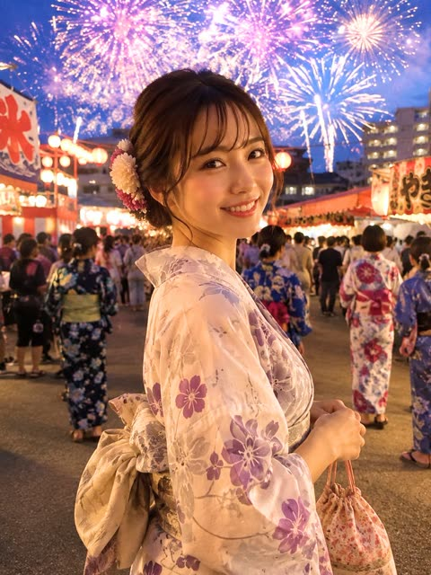</a>

服装、腰带、发饰和束口袋的细节锁定了主体,四分之三背向姿势加浅景深让烟花成为柔和虚化背景。暖色灯笼光与冷蓝暮色天空拉开主体与背景的层次,结尾的避免清单排除了塑料皮肤和动漫风格。

GPT Image 2 · 文生图 · 出处: [@reonkun_sub on X](https://x.com/reonkun_sub/status/2072266484857098584) · 发现于 [YouMind-OpenLab/awesome-gpt-image-2](https://github.com/YouMind-OpenLab/awesome-gpt-image-2)

[`portrait`](tags.md#tag-portrait) [`yukata`](tags.md#tag-yukata) [`fireworks`](tags.md#tag-fireworks) [`festival`](tags.md#tag-festival) [`photorealistic`](tags.md#tag-photorealistic)

<details><summary><b>提示词</b></summary>

```text
Create a highly realistic vertical portrait photo of a beautiful Japanese woman in her 20s at a summer evening fireworks festival in Japan. She is shown from the waist up in a three-quarter back-facing pose, turning her head over her shoulder to smile warmly at the camera, with natural expressive eyes, soft skin texture, and an approachable candid expression. She wears a pale cream-pink yukata with purple and lavender floral patterns, a large beige obi bow tied at the back, and small pink and cream chrysanthemum hair ornaments tucked into a low updo with loose bangs and face-framing strands. Her right hand holds a small floral drawstring kinchaku pouch with thin red cords. The setting is a crowded Japanese matsuri street at dusk, lined with glowing food stalls and red-and-white festival banners, warm paper lanterns, and many festivalgoers in colorful yukata walking away in the background. Above her, the blue twilight sky is filled with large bright fireworks bursts in pink, purple, white, and gold, slightly blurred by depth of field but still dramatic and luminous. Use a close 3/4 portrait composition, subject centered slightly right, shallow depth of field, realistic lens perspective, warm lantern light on her face and yukata, cool blue ambient evening light in the sky, cinematic color grading, crisp detail on the woman and soft bokeh background. Emphasize photorealism, natural human proportions, realistic fabric folds, authentic Japanese summer festival atmosphere, and a joyful romantic mood. Avoid extra text, logos, watermarks, distorted hands, plastic skin, over-smoothed face, or anime styling.
```

</details>

<a id="gpt-image-kids-fashion-boots-concrete-steps-editorial"></a>
### 水泥台阶上身穿灯芯绒夹克的微笑男孩

<a href="https://x.com/Itswsm105f/status/2072544301418988014">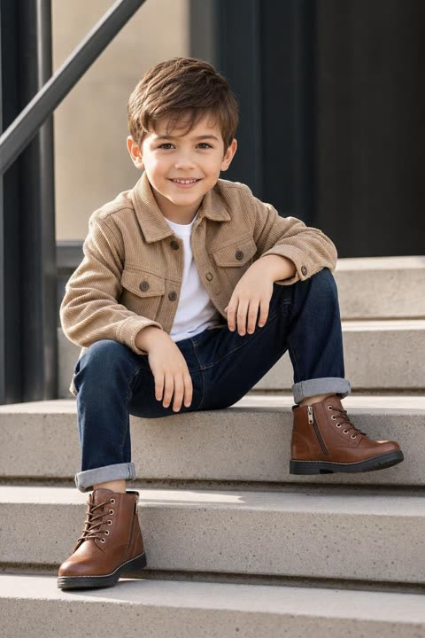</a>

提示词逐件列出服装与材质（灯芯绒、卷边牛仔、皮靴），让质感还原准确。简洁的城市背景、柔和日光和编辑式坐姿把视觉重点留给鞋子。

GPT Image 2 · 文生图 · 出处: [@Itswsm105f on X](https://x.com/Itswsm105f/status/2072544301418988014) · 发现于 [YouMind-OpenLab/awesome-gpt-image-2](https://github.com/YouMind-OpenLab/awesome-gpt-image-2)

[`kids-fashion`](tags.md#tag-kids-fashion) [`editorial`](tags.md#tag-editorial) [`footwear`](tags.md#tag-footwear) [`urban`](tags.md#tag-urban) [`daylight`](tags.md#tag-daylight)

<details><summary><b>提示词</b></summary>

```text
Ultra-realistic premium kids fashion advertisement featuring an adorable little boy with fair glowing skin, stylish brown hair, wearing a beige corduroy jacket, white T-shirt, rolled-up dark blue jeans, and premium brown leather lace-up ankle boots. Sitting confidently on modern concrete steps with a cheerful smile, clean minimal urban background, focus on stylish footwear, luxury fashion campaign, soft natural daylight, cinematic lighting, editorial composition, DSLR photography, ultra-detailed, masterpiece, 8K,
```

</details>

<a id="gpt-image-komorebi-garden-overhead-cat-portrait"></a>
### 木漏日庭院俯拍猫咪人像

<a href="https://x.com/ohmuyi/status/2067930690977779942">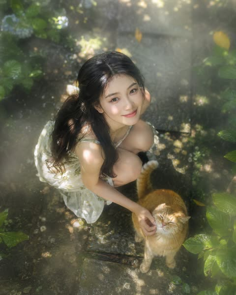</a>

用高角度俯拍机位定下构图，再叠加木漏日光斑、潮湿薄雾形成的丁达尔光柱和柔化的画面边缘来增加层次。表情从俏皮噘嘴写到眼角带纹的真挚笑容，并点明皮肤纹理，让面部显得自然。

GPT Image 2 · 文生图 · 出处: [@ohmuyi on X](https://x.com/ohmuyi/status/2067930690977779942) · 发现于 [freestylefly/awesome-gpt-image-2](https://github.com/freestylefly/awesome-gpt-image-2)

[`top-down`](tags.md#tag-top-down) [`komorebi`](tags.md#tag-komorebi) [`dappled-light`](tags.md#tag-dappled-light) [`garden`](tags.md#tag-garden) [`cat`](tags.md#tag-cat)

<details><summary><b>提示词</b></summary>

```text
俯拍镜头，高角度顶机位，自上而下俯瞰一位年轻的东亚裔女性，她有着精致的东亚五官和柔顺的黑发。她蹲在花园小径上，轻轻逗弄一只毛茸茸的橘猫。头顶密密的枝叶滤过阳光，形成灵动的“木漏日”效果——跃动、圆形的光斑在她的肌肤和猫毛上流转舞动。空气中悬浮着淡淡的潮湿薄雾，捕捉住光束，营造出柔和可见的立体光柱（丁达尔效应）。当她仰头朝向镜头时，一层轻雾柔化了画面边缘，增添梦幻氛围。她的表情从略带俏皮的轻噘嘴，渐渐转为眼角堆起细纹的真挚笑容，斑驳的光线恰好勾勒出她肌肤的细腻纹理和眼中盈盈的水光。
```

</details>

<a id="gpt-image-korean-convenience-store-pink-hoodie-portrait"></a>
### 韩国便利店粉色绒毛连帽衫人像

<a href="https://x.com/john_my07/status/2054573350199111928">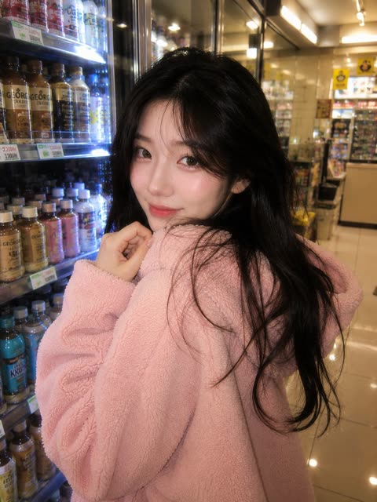</a>

暖色便利店荧光灯与 iPhone 闪光灯的写实感结合，营造出随手抓拍的深夜快照效果。身后发光的冷柜货架和柔和的粉色奶油色调让画面温馨统一。

GPT Image 2 · 文生图 · 出处: [@john_my07 on X](https://x.com/john_my07/status/2054573350199111928) · 发现于 [freestylefly/awesome-gpt-image-2](https://github.com/freestylefly/awesome-gpt-image-2)

[`korean`](tags.md#tag-korean) [`convenience-store`](tags.md#tag-convenience-store) [`iphone-flash`](tags.md#tag-iphone-flash) [`pastel`](tags.md#tag-pastel) [`night`](tags.md#tag-night)

<details><summary><b>提示词</b></summary>

```text
Ultra-realistic cozy Korean convenience store portrait of a beautiful Korean woman standing in front of glowing refrigerator aisles at night, wearing an oversized fluffy pastel pink hoodie with the hood up. She holds a bottle of strawberry milk in one hand and a tiny strawberry cake in the other while shyly looking toward the camera. Long soft black hair, glossy eyes, natural skin texture, subtle blushy makeup, gentle expression, youthful Korean beauty aesthetic. Warm fluorescent convenience store lighting mixed with realistic iPhone flash photography. Tiny reflections on drink bottles and glass refrigerator doors, dreamy romantic atmosphere, soft pink and cream color palette, slice-of-life anime realism blended with cinematic photography, highly detailed, cozy late-night Seoul convenience store vibe, shallow depth of field, realistic Korean snack packaging, candid aesthetic, soft glow, ultra photorealistic.
```

</details>

<a id="gpt-image-low-poly-papercraft-man-portrait"></a>
### 低多边形折纸风男士肖像

<a href="https://x.com/iamsofiaijaz/status/2056953102755115162">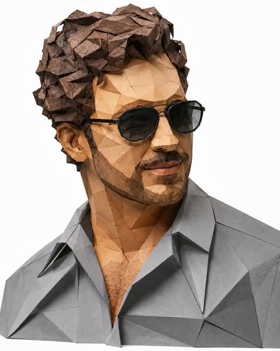</a>

提示词同时写明材质与造型语言：棱角分明的多边形面、层叠纸张纵深和真实纸张质感。头发、衬衫和墨镜的颜色都有指定，再配干净的白色影棚背景与柔和光线。

GPT Image 2 · 文生图 · 出处: [@iamsofiaijaz on X](https://x.com/iamsofiaijaz/status/2056953102755115162) · 发现于 [freestylefly/awesome-gpt-image-2](https://github.com/freestylefly/awesome-gpt-image-2)

[`papercraft`](tags.md#tag-papercraft) [`low-poly`](tags.md#tag-low-poly) [`origami`](tags.md#tag-origami) [`portrait`](tags.md#tag-portrait) [`studio`](tags.md#tag-studio)

<details><summary><b>提示词</b></summary>

```text
Create a highly detailed low-poly papercraft portrait of a stylish young man, designed like an origami paper sculpture. The character has curly dark brown hair, a trimmed beard, and wears slightly black-tinted geometric sunglasses with thin black frames. His shirt is medium grey with sharp polygonal folds and realistic paper texture. Use faceted angular shapes across the face, hair, and clothing, with realistic shadows and layered paper depth. Minimal clean white studio background, soft lighting, ultra-realistic paper craft aesthetic, modern geometric art style, high detail, centered composition, 8k quality.
```

</details>

<a id="gpt-image-minimalist-boutique-full-body-fashion"></a>
### 极简精品店全身时尚写真

<a href="https://x.com/john_my07/status/2062579742759649486">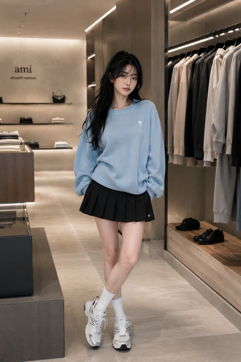</a>

逐件写清服装，从宽松粉蓝针织衫到百褶裙、白袜和厚底运动鞋，再配上木材与石材等零售空间材质。用与参考图相同的外貌来锁定人脸，景深和杂志大片关键词负责定调。

GPT Image 2 · 上传图改图 · 出处: [@john_my07 on X](https://x.com/john_my07/status/2062579742759649486) · 发现于 [freestylefly/awesome-gpt-image-2](https://github.com/freestylefly/awesome-gpt-image-2)

[`fashion`](tags.md#tag-fashion) [`editorial`](tags.md#tag-editorial) [`boutique`](tags.md#tag-boutique) [`full-body`](tags.md#tag-full-body) [`reference-face`](tags.md#tag-reference-face)

<details><summary><b>提示词</b></summary>

```text
A full-body editorial fashion photograph of a beautiful young woman with the same appearance as the reference, long glossy dark hair, soft bangs, fair skin, and refined feminine features. She stands casually in an upscale minimalist fashion boutique, wearing an oversized pastel-blue knit sweater paired with a black pleated tennis-style skirt, white crew socks, and chunky designer sneakers. Relaxed confident pose, gentle smile, luxury retail interior with modern clothing racks, neutral-toned garments, warm ambient lighting, wood and stone textures, clean architectural lines, cinematic depth of field, realistic lighting, premium fashion advertising, Vogue-style editorial, ultra-detailed, sharp focus, photorealistic, 4K.
```

</details>

<a id="gpt-image-morning-bedroom-candid-window-light"></a>
### 晨光窗边卧室抓拍人像

<a href="https://x.com/ToroJushiAi/status/2053078195482632421">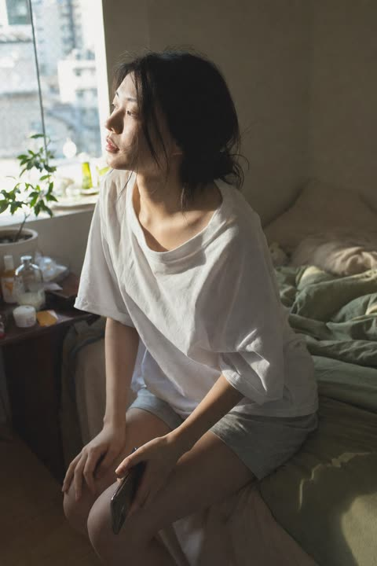</a>

提示词先锁定机位角度、光线方向和冷暖过渡，再加入皮肤次表面散射、散落发丝和 ISO 400 颗粒等物理细节。生活化的背景和结尾的排除项（卡通、插画、动漫）让画面保持摄影质感。

GPT Image 2 · 文生图 · 出处: [@ToroJushiAi on X](https://x.com/ToroJushiAi/status/2053078195482632421) · 发现于 [freestylefly/awesome-gpt-image-2](https://github.com/freestylefly/awesome-gpt-image-2)

[`morning-light`](tags.md#tag-morning-light) [`candid`](tags.md#tag-candid) [`bedroom`](tags.md#tag-bedroom) [`film-grain`](tags.md#tag-film-grain) [`japanese-woman`](tags.md#tag-japanese-woman)

<details><summary><b>提示词</b></summary>

```text
A close-medium shot of a young Japanese woman in her bedroom on an ordinary morning, captured in authentic daily life photography as a natural candid moment. She is seated sideways on the edge of the bed, not fully awake yet, photographed from a slightly elevated three-quarter angle with cool-to-warm morning window light entering from the left.
East Asian young woman in her early 20s. Almond-shaped eyes with soft natural single eyelids, slightly elongated eye corners, still carrying the heaviness of just waking. Straight refined nose with a delicate bridge. Skin tone fair to light beige — skin subsurface scattering visible under the soft directional morning window light, specular micro-highlights catching gently on her cheekbone and nose ridge, fine skin texture perceptible, no makeup. Naturally straight fine black hair loosely gathered, slightly disheveled from sleep.
She wears a loose oversized cotton sleep shirt and soft shorts, nothing styled. Her gaze drifts toward the window, posture relaxed and unhurried, one hand resting on her knee, the other barely holding a phone face-down. The bedroom background suggests real life — slightly unmade linen, a potted plant near the window partially in shadow, small cluttered bedside items. Two or three stray hairs fall across her cheek in natural asymmetric displacement, not geometrically placed.
Soft directional morning light from a side window, cool-to-warm transition across her face and shoulder, long gentle shadows on the bedding behind her. The mood is quietly adrift — not sad, not performing, just suspended in the unhurried first minutes of the day. Subtle ISO 400 film grain in shadow areas, photographic noise texture not CG render smoothness. Aspect ratio 2:3. No watermark, no text overlay, not cartoon, not digitally painted, not illustration, not anime.
```

</details>

<a id="gpt-image-neon-graffiti-black-white-portrait"></a>
### 霓虹绿眼睛的黑白涂鸦肖像

<a href="https://x.com/harboriis/status/2060208419811074350">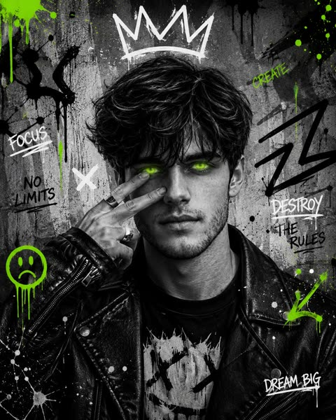</a>

画面整体为黑白，只用一种霓虹绿点缀，最亮处在发光的眼睛，颜料飞溅和标语中也有重复，把人脸和背景联系起来。皇冠、箭头和手写文字等层叠街头涂鸦元素铺满脸部周围的水泥墙，脸部本身保持干净。

GPT Image 2 · 文生图 · 出处: [@harboriis on X](https://x.com/harboriis/status/2060208419811074350) · 发现于 [freestylefly/awesome-gpt-image-2](https://github.com/freestylefly/awesome-gpt-image-2)

[`graffiti`](tags.md#tag-graffiti) [`black-and-white`](tags.md#tag-black-and-white) [`neon`](tags.md#tag-neon) [`street-art`](tags.md#tag-street-art) [`portrait`](tags.md#tag-portrait)

<details><summary><b>提示词</b></summary>

```text
High-contrast black-and-white urban portrait of a curly-haired bearded man in a black leather jacket, holding two fingers near glowing neon green eyes, with bold graffiti doodles, colorful paint splashes, abstract arrows, crown sketches, and grunge street-art textures on a concrete background, cinematic lighting, edgy graphic poster style.
```

</details>

<a id="gpt-image-night-flash-portrait-outside-restaurant"></a>
### 餐厅门外的夜间闪光灯人像

<a href="https://x.com/craftian_keskin/status/2046774231900287107">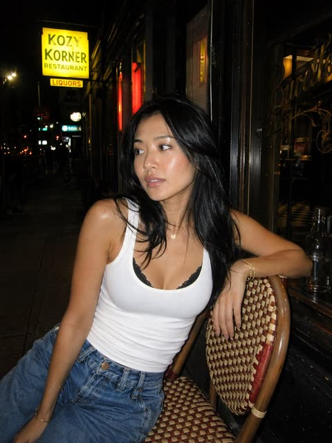</a>

直闪灯配合胶片快照质感、轻微颗粒和深色阴影，营造不加修饰的夜生活氛围。饰品数量、大腿以上竖构图、招牌文字和霓虹位置都写得很具体，画面因此更可控。

GPT Image 2 · 文生图 · 出处: [@craftian_keskin on X](https://x.com/craftian_keskin/status/2046774231900287107) · 发现于 [YouMind-OpenLab/awesome-gpt-image-2](https://github.com/YouMind-OpenLab/awesome-gpt-image-2)

[`night-portrait`](tags.md#tag-night-portrait) [`direct-flash`](tags.md#tag-direct-flash) [`street-style`](tags.md#tag-street-style) [`film-grain`](tags.md#tag-film-grain) [`candid`](tags.md#tag-candid)

<details><summary><b>提示词</b></summary>

```text
A candid nighttime street portrait of a young woman sitting casually on a woven bistro café chair outside a small urban restaurant. She has long black hair worn loose and slightly tousled, tan skin, and minimal natural makeup with a soft flash-lit glow. She wears a fitted white tank top layered over a visible black lace bralette and high-waisted relaxed blue jeans, with subtle gold jewelry: 2 thin bracelets on one wrist, 1 delicate necklace with a tiny heart pendant, and 1 slim bracelet on the other wrist. She leans diagonally toward the camera with one arm draped over the curved chair back and the other hand resting near her lap, giving an off-camera calm, detached expression. Shot vertically as a medium portrait from about thigh-up, slightly close and intimate, direct on-camera flash creating bright skin highlights, deep shadows, and a raw film-snapshot look with slight grain. The setting is a dark city sidewalk at night with storefront windows, black-painted exterior walls, warm interior reflections, and a glowing yellow sign in the upper left reading KOZY KORNER RESTAURANT, with a smaller lit sign below reading LIQUORS. Add a narrow red vertical neon glow in the background, distant streetlights and blurred city bokeh along the left side, and faint gold lettering on the glass door to the right. Include a clear glass bottle on the table edge at the far right. Authentic nightlife mood, stylish but unfiltered, shallow depth of field, realistic proportions, flash photography aesthetic, cinematic urban candid.
```

</details>

<a id="gpt-image-night-market-skewer-three-sword-pose"></a>
### 清冷女子在夜市摆烧烤三刀流姿势

<a href="https://x.com/BubbleBrain/status/2046564674112831920">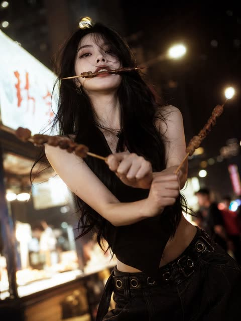</a>

用具体的姿势描述（一根叼在嘴里，两手各持一根并交叉）让动作清晰可控。低机位广角、夜市暖光虚化和胶片颗粒营造出时尚大片的质感。

GPT Image 2 · 文生图 · 出处: [@BubbleBrain on X](https://x.com/BubbleBrain/status/2046564674112831920) · 发现于 [freestylefly/awesome-gpt-image-2](https://github.com/freestylefly/awesome-gpt-image-2)

[`night-market`](tags.md#tag-night-market) [`street-photography`](tags.md#tag-street-photography) [`fashion`](tags.md#tag-fashion) [`film-look`](tags.md#tag-film-look) [`low-angle`](tags.md#tag-low-angle)

<details><summary><b>提示词</b></summary>

```text
[中文]
一个有着清冷孤傲气质的绝美佳人，精致的面部特征，一张冷酷且精致的高级时装面容，长发，以及优雅苗条的身材；烧烤“三刀流”姿势：嘴里叼着一根烧烤串，每只手各拿一根烧烤串交叉以模仿索隆的三刀流；街头夜景氛围，温暖黄色的夜市灯光，模糊的背景，胶片般的质感，柔焦光晕，电影般的叙事感，时髦高端网红风格的时尚拍摄，清晰发光的肌肤，清晰细致的发丝，生动的动态表情，低角度广角镜头，情绪化的暗调氛围，浅景深，超高清8K，极致细节，电影级光照

[English]
a stunning beauty with a cool, aloof atmosphere, delicate facial features, a cold and sophisticated high-fashion face, long hair, and a graceful slender figure; barbecue “three-sword style” pose: one barbecue skewer held in her mouth, one skewer in each hand crossed to mimic Zoro’s three-sword style; street night scene ambiance, warm yellow night market lighting, blurred background, film-like texture, soft-focus glow, cinematic storytelling feel, trendy high-end influencer-style fashion shoot, clear luminous skin, sharply detailed strands of hair, lively dynamic expression, low-angle wide-angle shot, moody dark-toned atmosphere, shallow depth of field, ultra HD 8K, extreme detail, cinematic lighting
```

</details>

<a id="gpt-image-oversized-button-fashion-split-editorial"></a>
### 巨型彩色纽扣分屏时尚大片

<a href="https://x.com/Mind_Boticni/status/2053082199436759258">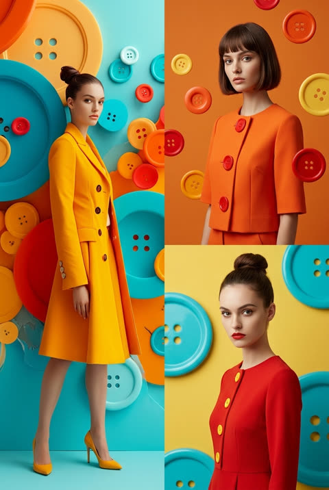</a>

提示词为每个分屏单独写明景别（左侧全身，右侧上下两个半身），并要求各自不同的面孔、姿势和背景色调。固定的青橙黄红配色加上统一的光泽棚拍灯光，让三个画面保持一致。

GPT Image 2 · 文生图 · 出处: [@Mind_Boticni on X](https://x.com/Mind_Boticni/status/2053082199436759258) · 发现于 [freestylefly/awesome-gpt-image-2](https://github.com/freestylefly/awesome-gpt-image-2)

[`fashion`](tags.md#tag-fashion) [`editorial`](tags.md#tag-editorial) [`split-frame`](tags.md#tag-split-frame) [`buttons`](tags.md#tag-buttons) [`studio`](tags.md#tag-studio)

<details><summary><b>提示词</b></summary>

```text
Use reference image as style guide.
Surreal minimalist fashion editorial photography with vibrant oversized colorful buttons as main visual theme (cyan, orange, yellow, red palette), glossy 3D surface design, clean studio lighting, ultra-smooth gradients, and high-end commercial fashion look.
Split-frame composition:

Left side: full-body female model standing from top to bottom, wearing bold minimalist fashion outfit inspired by reference style, confident pose, clean studio background filled with oversized colorful buttons, cinematic lighting, soft shadows, ultra-clean composition.

Right side (vertically split into two parts):
Top-right: half-body female model, different face, different pose, different outfit variation inspired by same button aesthetic, different background color mood.
Bottom-right: another half-body female model, completely different expression and pose, different styling, different background tone, maintaining same surreal button universe aesthetic.

Each section visually distinct but unified by the colorful button-inspired design language, glossy surfaces, soft studio reflections, and fashion magazine editorial feel.
Hyper-realistic, cinematic lighting, ultra-clean composition, high-end luxury campaign style, depth, contrast, 8k, 1:1 aspect ratio --style raw --v 6 --ar 1:1
```

</details>

<a id="gpt-image-phone-screen-face-cover-store-portrait"></a>
### 手机屏幕遮住上半脸的商场人像

<a href="https://x.com/Ciri_ai/status/2053535379618423118">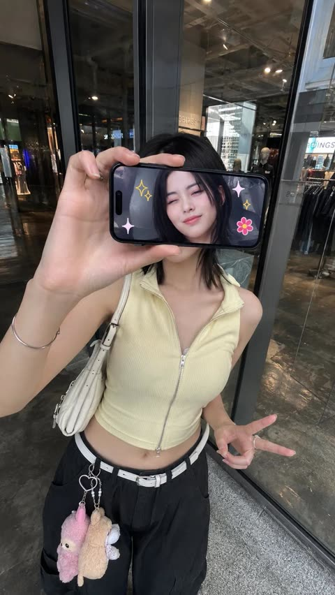</a>

提示词先锁定场景、略微俯拍的正面机位和握手机的姿势，再明确屏幕朝向镜头并显示她的脸，让手机成为画中画，同时用参考图保持人物身份一致。

GPT Image 2 · 上传图改图 · 出处: [@Ciri_ai on X](https://x.com/Ciri_ai/status/2053535379618423118) · 发现于 [freestylefly/awesome-gpt-image-2](https://github.com/freestylefly/awesome-gpt-image-2)

[`iphone-style`](tags.md#tag-iphone-style) [`creative-portrait`](tags.md#tag-creative-portrait) [`frame-within-frame`](tags.md#tag-frame-within-frame) [`identity-preserved`](tags.md#tag-identity-preserved) [`street-photo`](tags.md#tag-street-photo)

<details><summary><b>提示词</b></summary>

```text
Ultra-realistic creative portrait taken with an iPhone, identity accurately preserved from the reference image. A woman stands inside a store, facing a glass display window or a reflective wall, photographed from a slightly elevated frontal angle. She holds a smartphone horizontally in front of her face, covering her eyes and the upper part of her face. The phone's screen points at the camera and clearly displays a real-time image of her face.
```

</details>

<a id="gpt-image-pink-varsity-flower-cafe-portrait"></a>
### 粉色棒球外套女生坐在花店咖啡馆外

<a href="https://x.com/xRahultripathi/status/2050677614168391716"></a>

姿势、构图、服装、光线和镜头分块写明，并加入保持同一张脸的约束来锁定人物身份。低机位 50mm 镜头、暖粉色调，再用负面词排除对视和裁切，让构图稳定。

GPT Image 2 · 上传图改图 · 出处: [@xRahultripathi on X](https://x.com/xRahultripathi/status/2050677614168391716) · 发现于 [freestylefly/awesome-gpt-image-2](https://github.com/freestylefly/awesome-gpt-image-2)

[`portrait`](tags.md#tag-portrait) [`pastel`](tags.md#tag-pastel) [`flower-shop`](tags.md#tag-flower-shop) [`low-angle`](tags.md#tag-low-angle) [`face-preserve`](tags.md#tag-face-preserve)

<details><summary><b>提示词</b></summary>

```text
Edit the provided image while preserving the same face identity, shape, and facial features without altering age, ethnicity, or structure. Maintain a calm, relaxed expression with the subject not looking at the camera.

Subject: young woman (18–23) with soft feminine beauty, smooth glowing skin, natural texture.
Pose (strict): seated on a wooden chair, body angled sideways (45–70°), legs crossed naturally, upper body slightly leaning forward, head turned away from camera, gaze to the side. She holds a drink cup with a straw using both hands.
Framing: full-body vertical (9:16), head to shoes visible, centered but slightly offset for natural composition.
Outfit: light pink varsity jacket with white stripes, soft pink inner top, modest knee-length pleated skirt, white sneakers.
Accessories: beige newsboy cap, sunglasses (on face or cap), pink shoulder bag, small earrings.
Hair: neat low bun with soft loose strands.
Environment: outdoor flower shop street scene with pastel flowers (pink, soft tones), decorative plants, floral storefront.
Lighting: bright natural daylight, soft glossy skin highlights, balanced exposure, soft shadows.
Camera: low/frog angle (slightly below, looking up), 50mm lens, shallow depth of field.
Color grading: warm pastel palette (pink, cream), clean bright lifestyle aesthetic.
Quality: ultra-photorealistic, 8K detail, DSLR realism, natural skin texture.
Negative: front-facing, eye contact, close-up, cropped body, mini/short skirt, indoor scene, dark lighting, anime, cartoon, CGI, plastic skin, distorted anatomy.
--ar 9:16 --style raw --quality high
```

</details>

<a id="gpt-image-rooftop-court-sunset-varsity-portrait"></a>
### 屋顶球场日落下身穿棒球夹克的女生全身人像

<a href="https://x.com/HaniaAi12/status/2061313477696954522"></a>

提示词把姿态写得很具体：重心落在一条腿上、肩膀放松、一只手轻触夹克边缘、身体微侧并直视镜头。再用明确的场景和日落金光定下氛围，开头的超写实关键词把画面推向摄影质感。

GPT Image 2 · 文生图 · 出处: [@HaniaAi12 on X](https://x.com/HaniaAi12/status/2061313477696954522) · 发现于 [freestylefly/awesome-gpt-image-2](https://github.com/freestylefly/awesome-gpt-image-2)

[`portrait`](tags.md#tag-portrait) [`rooftop`](tags.md#tag-rooftop) [`sunset`](tags.md#tag-sunset) [`varsity-jacket`](tags.md#tag-varsity-jacket) [`pose-direction`](tags.md#tag-pose-direction)

<details><summary><b>提示词</b></summary>

```text
Ultra-realistic, high-quality portrait of a stylish young South Asian woman standing gracefully on a colorful urban rooftop basketball court at sunset. She is standing in a relaxed and elegant posture with her weight naturally shifted to one leg, shoulders relaxed, and one hand gently resting by her side while the other lightly touches the edge of her varsity jacket. Her body is slightly angled toward the camera, creating a confident yet sophisticated appearance. She is looking directly into the camera with a warm, natural smile, projecting confidence, charm, and effortless style.
```

</details>

<a id="gpt-image-semi-chibi-double-tugging-runner-editorial"></a>
### 奔跑男子被半Q版分身向后拉扯

<a href="https://x.com/Waseem_890Ai/status/2073412769693741415"></a>

提示词先把人物身份锁定在上传的参考照片上,再加入一个3D半Q版分身,并明确其抓住衣服向后拉的动作。拉伸、褶皱和张力等布料物理描述,加上纯白无缝影棚背景和详细的负面提示词,让这一幕的互动既好笑又可信。

GPT Image 2 · 上传图改图 · 出处: [@Waseem_890Ai on X](https://x.com/Waseem_890Ai/status/2073412769693741415) · 发现于 [YouMind-OpenLab/awesome-gpt-image-2](https://github.com/YouMind-OpenLab/awesome-gpt-image-2)

[`semi-chibi`](tags.md#tag-semi-chibi) [`studio-portrait`](tags.md#tag-studio-portrait) [`fabric-physics`](tags.md#tag-fabric-physics) [`reference-photo`](tags.md#tag-reference-photo) [`playful`](tags.md#tag-playful)

<details><summary><b>提示词</b></summary>

```text
Create an ultra-realistic lifestyle editorial studio photo in a 4:5 aspect ratio. Use the uploaded reference photo as the primary source for the character's identity. Preserve the face, facial features, body proportions, hairstyle, outfit, shoes, colors, and overall appearance exactly as shown. Do not redesign or alter the character. Place the character in a clean, minimalist photo studio with a seamless pure white background. The mood should feel modern, bright, playful, energetic, and polished, like a high-end fashion editorial. Capture the character mid-run with natural, believable movement. The body leans forward, one foot is off the ground, and the arms move naturally. The upper body is subtly pulled backward, as though the clothing is being tugged, while the lower body continues driving forward. Give the character a joyful, expressive face with laughter, excitement, and a hint of playful panic. On the left side, add a stylized 3D semi-chibi version of the same person. Keep the identity recognizable while using a larger head, smaller body, expressive eyes, and exaggerated emotions. The semi-chibi character should look frustrated and determined, grabbing the main character's clothing with both hands and pulling backward in an attempt to stop them. Emphasize the comedic struggle. Focus on realistic fabric physics where the clothing is being pulled, showing stretched material, natural folds, wrinkles, and convincing tension. The interaction should feel physically believable and visually entertaining. Use soft professional studio lighting, crisp shadows, ultra-sharp focus, realistic skin textures, detailed fabric, cinematic editorial styling, clean composition, and a premium polished finish. Negative Prompt: Low quality, blurry, noisy, pixelated, bad anatomy, extra or missing fingers, deformed hands, broken joints, stiff pose, weak motion, incorrect fabric physics, flat clothing, missing wrinkles, unrealistic interaction, altered facial identity, changed outfit, changed shoes, altered body proportions, extra characters, cluttered scene, colored background, props, harsh shadows, dark lighting, plastic skin, poor 3D quality, distorted face, watermark, logo, or text.
```

</details>

<a id="gpt-image-shanghai-metro-platform-reading-portrait"></a>
### 上海地铁站台读书的年轻女子

<a href="https://x.com/ToroJushiAi/status/2059452471127240959"></a>

提示词先定下半身平视构图和虚化的进站列车，再加入皮肤质感、偏绿荧光灯色温与 ISO 400 颗粒。散落发丝和不对称等小瑕疵让画面更像抓拍照片而非渲染图。

GPT Image 2 · 文生图 · 出处: [@ToroJushiAi on X](https://x.com/ToroJushiAi/status/2059452471127240959) · 发现于 [freestylefly/awesome-gpt-image-2](https://github.com/freestylefly/awesome-gpt-image-2)

[`candid`](tags.md#tag-candid) [`metro`](tags.md#tag-metro) [`street-photography`](tags.md#tag-street-photography) [`film-grain`](tags.md#tag-film-grain) [`motion-blur`](tags.md#tag-motion-blur)

<details><summary><b>提示词</b></summary>

```text
A candid photograph of a young woman standing on a Shanghai metro platform during the summer morning commute, authentic daily life photography, natural candid moment. Half-body framing, shot at eye level from moderate distance — the arriving train a motion-blurred streak behind her, the yellow safety line at her feet.
East Asian young woman in her early 20s. Almond-shaped eyes with natural double eyelids, slightly elongated eye corners — eyes directed downward, absorbed. Straight refined nose with a delicate bridge. Skin tone fair to light beige (NC10–NC20) — skin subsurface scattering visible under cool overhead station light, specular micro-highlights on cheekbones and nose ridge, fine foundation powder grain perceptible. Summer fresh look, no heavy coverage, lightly tinted lip.
She wears a relaxed oversized white shirt dress, collar lightly open, sleeves loosely rolled above the elbow. A structured natural tan canvas tote hangs from her shoulder, a physical novel tucked under one arm — pages open at a saved page. She stands with her weight on one hip, gaze downward at the open book, entirely absorbed, occupying her own stillness inside the morning rush. Background: white and grey tiled metro wall, overhead route signage board, arriving train motion blur to one side, other commuters blurred and distant. Two or three stray hairs displaced by the train's air displacement on arrival, natural unplanned imperfection, not geometrically symmetrical.
Cool overhead fluorescent lighting with a slight greenish cast, flat frontal illumination offset by a warm spill from the platform entrance behind. Absorbed in focus, eyes downward, unaware — a private moment inside a public space, the Shanghai morning. Subtle ISO 400 film grain in shadow areas, photographic noise texture not CG render smoothness. Aspect ratio 2:3. No watermark, no text overlay, not cartoon, not digitally painted, not illustration, not anime.
```

</details>

<a id="gpt-image-split-time-birthday-portrait"></a>
### 儿时与成年同框的生日分屏肖像

<a href="https://x.com/ChillaiKalan__/status/2050834691570184611"></a>

提示词要求左右两半机位和姿势完全一致，并把点燃的蛋糕放在中线，用烛光把两个时空连在一起。黑白颗粒与彩色浅景深形成过去与现在的对比，两侧年份文字用引号直接指定。

GPT Image 2 · 文生图 · 出处: [@ChillaiKalan__ on X](https://x.com/ChillaiKalan__/status/2050834691570184611) · 发现于 [YouMind-OpenLab/awesome-gpt-image-2](https://github.com/YouMind-OpenLab/awesome-gpt-image-2)

[`split-screen`](tags.md#tag-split-screen) [`birthday`](tags.md#tag-birthday) [`before-after`](tags.md#tag-before-after) [`nostalgia`](tags.md#tag-nostalgia) [`portrait`](tags.md#tag-portrait)

<details><summary><b>提示词</b></summary>

```text
A highly realistic split-time portrait of the same person meeting her younger self. The image is divided vertically into two perfectly aligned halves with identical camera angle and composition. On the left side: a black-and-white photo of a young girl (3–4 years old), same facial features as the adult, natural smile, sitting at a table, soft diffused lighting, minimal gray background, nostalgic mood, slightly grainy film texture. On the right side: a realistic color photo of the same person as an adult [AGE], identical pose and camera angle, resting her face on her hands, smiling warmly, modern outfit, soft cinematic lighting, shallow depth of field. In the center between them: a birthday cake placed exactly at the middle line, with lit candles forming the number "[AGE]", warm candle glow illuminating both sides. Both versions are looking at each other with emotional connection, perfectly aligned eye level. Text "(2000)" above the child side and "(2026)" above the adult side, minimal elegant font. Ultra realistic, 8K, high detail skin texture, soft shadows, cinematic color grading, clean composition, emotional storytelling.
```

</details>

<a id="gpt-image-summer-flower-field-portrait-motion-blur"></a>
### 夏日花田仰卧人像与前景动态模糊

<a href="https://x.com/lovimg_com/status/2077036746198618336"></a>

提示词按主体、表情、服装、光线、相机、质感分段标注。只让前景花朵产生对角线动态模糊并保持人脸清晰，结尾的负面清单用来防止塑料皮肤和肢体错误。

GPT Image 2 · 文生图 · 出处: [@lovimg_com on X](https://x.com/lovimg_com/status/2077036746198618336) · 发现于 [freestylefly/awesome-gpt-image-2](https://github.com/freestylefly/awesome-gpt-image-2)

[`portrait`](tags.md#tag-portrait) [`flower-field`](tags.md#tag-flower-field) [`summer`](tags.md#tag-summer) [`motion-blur`](tags.md#tag-motion-blur) [`film-grain`](tags.md#tag-film-grain)

<details><summary><b>提示词</b></summary>

```text
主題：
花風のまどろみ

主体：
縦長4:5の写真風ポートレート。白と黄色のマーガレット、オレンジ色の小花が密に咲く夏の草花畑に、成熟した大人の女性が仰向けで静かに横たわっている。人物は画面下部から中央にかけて大きく入り、顔は中央やや右、胸元から肩までは画面下側に収まる。周囲の花が画面全体を埋め、対角線方向に流れる花のモーションブラーが前景を横切る。

人物・表情：
自然で現実感のある日系ポートレート。暗めのブラウンロングヘアに、薄い前髪と顔まわりのやわらかな毛束。目を閉じ、眉は力が抜け、唇は軽く閉じた穏やかな表情。頬と鼻先に自然な血色、肌には過度な補正をせず細かな質感を残す。首筋、鎖骨、頬に夏の日差しが当たり、静かに眠っているような落ち着いた雰囲気。

服装・ポーズ：
白い夏用キャミソールワンピース。細い肩紐、胸元の控えめなレース、中央の小さなリボン、薄手のコットン素材。人物の両肩は草花に自然に沈み、片腕は画面下側で花に隠れて見切れる。体は画面左下から右上へ少し斜めに置かれ、髪は草の上に広がり、風で数本だけ額にかかる。

背景・光：
郊外にある小さな花畑のような、生活感のある自然な草花の密度。背景はすべて緑の葉と白・黄色・オレンジの花で構成し、人工物や読める文字は入れない。高めの位置から差す夏の太陽光。光はやや硬めで暖かく、顔の左側と首筋、肩に明るいハイライトが入り、花と髪の影が肌に細く落ちる。草の反射で下側に淡い緑の返り光。

構図・カメラ：
やや俯瞰の近距離撮影。85mm相当の自然な圧縮感、人物の顔にピントを合わせ、周辺の花は浅い被写界深度で少しぼける。前景の花だけが風に流され、白・黄色・オレンジの細長い光跡として左上から右下へ走る。顔まわりはブラーを弱め、表情と肌の質感をはっきり見せる。

質感・スタイル：
リアルな写真表現。夏の日差し、透明感のある肌、柔らかな髪の束感、薄手コットンのしわ、草花の細密な質感。ナチュラルな色調で、緑を深く、白い花を明るく、オレンジの花をアクセントにする。フィルム写真のようなわずかな粒子感と、雑誌ポートレートの落ち着いた仕上がり。

ネガティブ：
不自然な顔、不自然な視線、余分な指、欠けた指、手足の融合、関節の破綻、服と体の接触不良、浮遊、不自然な重力、誤った遠近法、光源と矛盾する影、過度な美肌補正、プラスチックのような肌、文字化け、ロゴ、透かし。
```

</details>

<a id="gpt-image-summer-hand-hold-backlit-portrait"></a>
### 夏日花园牵手回眸逆光肖像

<a href="https://x.com/iamaiistudio/status/2063247373388992790"></a>

画面左下角只露出一只第一人称的手，加上回眸，形成情侣随手拍的抓拍感。侧逆光勾勒飘动发丝，配合镜头参数、皮肤质感描述和避免清单，保证照片级真实。

GPT Image 2 · 文生图 · 出处: [@iamaiistudio on X](https://x.com/iamaiistudio/status/2063247373388992790) · 发现于 [freestylefly/awesome-gpt-image-2](https://github.com/freestylefly/awesome-gpt-image-2)

[`cinematic-portrait`](tags.md#tag-cinematic-portrait) [`backlight`](tags.md#tag-backlight) [`summer`](tags.md#tag-summer) [`pov`](tags.md#tag-pov) [`photorealistic`](tags.md#tag-photorealistic)

<details><summary><b>提示词</b></summary>

```text
Cinematic portrait photography, ultra-photorealistic, 2160x3840 vertical composition, 50mm or 85mm portrait lens rendering, shallow depth of field, clean translucent summer natural-light color grading — not overly yellow, not over-filtered.

Subject: a young beautiful adult East Asian woman, [describe face shape and features, e.g. soft heart-shaped face, refined classical features, bright almond/fox eyes, petite nose bridge, naturally full lips], overall vibe sweet, sunny, energetic, cute with a touch of allure. Gaze highly engaging — bright, clear, natural catchlights, as if it speaks; corners of mouth slightly lifted, expression gentle, vivid, natural.

She walks along a [scene, e.g. garden stone path / tree-lined lane / European street / courtyard], right hand reaching back to hold the hand of someone behind her; only their hand appears in the lower-left corner — like a first-person couple's POV snapshot. She glances back at the camera while her body stays in a forward walking motion, posture elegant and natural, clearly a candid captured moment with a faint in-love feeling.

Long [hair color] hair, [style, e.g. naturally wavy / relaxed big waves / airy bangs / half-up], many strands tousled and flying in the wind, richly layered and dynamic. Strong natural side-backlight rims the hair edges — clean, crisp rim light and semi-translucent glow, hair edges lit as if by sunlight, light and luminous. This is the core highlight of the image.

She wears [outfit, e.g. white lace slip dress / beige slip dress / light-blue short-sleeve top with white skirt / light-pink fitted dress], fabric texture natural, material light and soft. Bright natural summer sunlight realistically warms her skin, shoulders, collarbone, and clothing with soft, clean highlight transitions.

Skin texture: extremely realistic — visible fine pores, natural skin texture, faint imperfections, subtle tone variation, soft sheen. Cheeks, nose tip, shoulders show natural delicate gradations in sunlight. Translucent, healthy, real and refined — no plastic look, no waxwork, no over-smoothing.

Background: soft atmospheric blur, never distracting.

Avoid: over-smoothing, plastic skin, CG look, anime look, wig look, stiff expression, dead eyes, stiff poses, overall yellow cast, overexposed face, distorted features, wrong fingers, deformed hands, cluttered background, heavy influencer retouching.
```

</details>

<a id="gpt-image-surreal-patio-portrait-crow-poodle"></a>
### 庭院超现实肖像：头顶乌鸦与怀抱贵宾犬

<a href="https://x.com/levelsio/status/2046735438128333096"></a>

背景装饰数量精确到个（4件装饰、2只火烈鸟）并逐一写明位置，画面布局因此稳定。正式呆板的姿势、柔和阴天光和低饱和色调带来复古杂志感，结尾还列出了可替换的变量。

GPT Image 2 · 文生图 · 出处: [@levelsio on X](https://x.com/levelsio/status/2046735438128333096) · 发现于 [YouMind-OpenLab/awesome-gpt-image-2](https://github.com/YouMind-OpenLab/awesome-gpt-image-2)

[`surreal`](tags.md#tag-surreal) [`editorial`](tags.md#tag-editorial) [`courtyard`](tags.md#tag-courtyard) [`pet-portrait`](tags.md#tag-pet-portrait) [`vintage`](tags.md#tag-vintage)

<details><summary><b>提示词</b></summary>

```text
A slightly surreal but photorealistic portrait of a seated person in a quiet courtyard or patio, centered in frame, wearing a fitted white long-sleeve turtleneck top with delicate pink floral prints and a printed illustration of a girl on the chest, paired with loose cream floral pants. The person sits on a simple white metal chair and holds a small fluffy poodle-like dog in their lap; the dog has curly off-white fur and distinctly dyed orange ears. Perched on top of the person’s dark hair bun is a black crow or raven, facing left, calm and balanced as if it naturally belongs there. The subject’s pose is still, direct, and formal, creating an odd deadpan family-portrait feeling. Set the scene against a textured off-white stucco wall with exactly 4 notable decorative background elements: 1 brown sun-shaped wall ornament in the upper left, 1 small wall-mounted planter shelf with a small bird figurine and trailing flowers on the left, 1 tall arched window or mural on the right showing a bright blue sky with soft white clouds, and 1 white pedestal planter at lower right filled with long green leaves and exactly 2 pink flamingo ornaments. Include a bit of stone edging and dark greenery at lower left and a brown tiled floor. Lighting is soft natural daylight, slightly overcast, with muted colors, shallow depth of field, and a vintage editorial photography look. Composition should be vertical, full seated figure, straight-on, balanced, and quietly uncanny. Customize the main figure as a middle-aged woman, the bird as black crow, the dog breed as small poodle mix, the dog ear color as orange, and the outfit palette as white and faded pink florals.
```

</details>

<a id="gpt-image-tokyo-backstreet-film-snapshot-fur-jacket"></a>
### 东京街头白色毛绒外套胶片抓拍人像

<a href="https://x.com/BubbleBrain/status/2055491616392052887"></a>

用胶片颗粒、轻微过曝、不完美构图和慢快门拖影等手机抓拍线索营造随手拍的真实感。电线、自动贩卖机、落叶等街景清单加上背身回头的姿势，让画面更有场景感。

GPT Image 2 · 文生图 · 出处: [@BubbleBrain on X](https://x.com/BubbleBrain/status/2055491616392052887) · 发现于 [freestylefly/awesome-gpt-image-2](https://github.com/freestylefly/awesome-gpt-image-2)

[`film-photography`](tags.md#tag-film-photography) [`street-snapshot`](tags.md#tag-street-snapshot) [`tokyo`](tags.md#tag-tokyo) [`candid`](tags.md#tag-candid) [`portrait`](tags.md#tag-portrait)

<details><summary><b>提示词</b></summary>

```text
film photography, candid street snapshot aesthetic, razor-sharp focus on subject, shallow depth of field with soft blurred urban background, bright daylight, slightly overexposed highlights, vivid contrast, subtle analog film texture, heavy film grain, nostalgic cinematic atmosphere, Tokyo backstreet neighborhood scene near a quiet train station, narrow pedestrian street lined with Japanese convenience stores, vintage vending machines, small ramen shops, hanging signs with faded typography, bicycles parked along tiled sidewalks, utility poles and overhead wires stretching across the sky, scattered fallen leaves on the ground, distant pedestrians and passing taxis softly blurred in the background, warm afternoon sunlight with deep blue sky, realistic street fashion photography style, effortless cool street vibe, vibrant colors with slightly muted faded film tones, beautiful 19-year-old Chinese female influencer, fair porcelain skin with cold pale undertones, exquisite natural makeup, glossy soft lips, defined brows, delicate lashes, soft messy long black hair with natural flowing curves, wearing an off-shoulder white fluffy faux fur jacket, playful yet subtly seductive expression, lazy dreamy vintage filter, ultra high-quality details, intentionally mundane phone-camera snapshot feeling, casual accidental composition, imperfect framing, realistic iPhone photography texture, spontaneous candid energy, highly attractive girl casually posing in the middle of the sidewalk, body facing away from the camera while turning her head back toward the lens with direct eye contact, relaxed posture, soft wind moving her hair, emotional youthful atmosphere, modern Asian street fashion editorial, soft haze, layered composition, masterpiece, best quality, ultra detailed, slight motion blur from slow shutter, authentic everyday realism, “BubbleBrain” small handwritten signature text on bottom corner --ar 9:16
```

</details>

<a id="gpt-image-tribal-warrior-guardian-owl-portrait"></a>
### 部落奇幻女战士与巨型守护猫头鹰

<a href="https://x.com/Aqib__786Ai/status/2091027228645552456"></a>

提示词逐一用材质和颜色描写元素,如银链、绿松石和冰白战纹。猫头鹰有独立的特征清单,冷蓝森林色调与橙色眼睛形成对比。写实质感关键词加电影光效,让奇幻主体呈现真实摄影质感。

GPT Image 2 · 文生图 · 出处: [@Aqib__786Ai on X](https://x.com/Aqib__786Ai/status/2091027228645552456) · 发现于 [YouMind-OpenLab/awesome-gpt-image-2](https://github.com/YouMind-OpenLab/awesome-gpt-image-2)

[`fantasy`](tags.md#tag-fantasy) [`warrior`](tags.md#tag-warrior) [`owl`](tags.md#tag-owl) [`dark-fantasy`](tags.md#tag-dark-fantasy) [`cinematic`](tags.md#tag-cinematic)

<details><summary><b>提示词</b></summary>

```text
A detailed portrait of a fierce tribal fantasy warrior woman leaning close to a massive, majestic great horned owl, cinematic lighting, dark moody atmosphere. The woman has long, wavy dark hair adorned with intricate silver chains, beads, and metallic headpieces. She has striking light green eyes, piercing the camera, with silver and icy-white war paint painted across her cheeks and nose. She wears dark leather armor decorated with silver pendants and turquoise gemstones Beside her the giant owl features sharp glowing orange eyes, patterned white and black feathers and an ornate silver circular medallion studded with a blue crystal resting on its forehead. The background is a shadowy, mystical forest in cool blue and dark gray tones. Highly detailed feathers, hyper-realistic, photorealistic textures, 8k resolution, dramatic dark fantasy aesthetic, masterpiece.
```

</details>

<a id="gpt-image-urban-bird-street-portrait"></a>
### 白衣女子与飞鸟的都市街头肖像

<a href="https://x.com/HaniaAi12/status/2060216757797978245"></a>

真实飞鸟与墙上的黑色涂鸦鸟影相互呼应，画面既有动感又有街头艺术感。逐件列出服装，再加柔和日光和景深，让时尚质感保持稳定。

GPT Image 2 · 文生图 · 出处: [@HaniaAi12 on X](https://x.com/HaniaAi12/status/2060216757797978245) · 发现于 [freestylefly/awesome-gpt-image-2](https://github.com/freestylefly/awesome-gpt-image-2)

[`street-portrait`](tags.md#tag-street-portrait) [`fashion`](tags.md#tag-fashion) [`birds`](tags.md#tag-birds) [`graffiti`](tags.md#tag-graffiti) [`photorealistic`](tags.md#tag-photorealistic)

<details><summary><b>提示词</b></summary>

```text
A stylish cinematic portrait of a confident young woman leaning casually against a textured urban concrete wall, surrounded by vibrant flying birds including blue macaws, white seagulls, and a colorful hummingbird. Black graffiti-style bird silhouettes painted on the wall create an artistic street-art vibe. She is wearing a trendy all-white outfit — oversized denim jacket, fitted graphic tee, skinny jeans, and black sneakers. Soft natural daylight, realistic shadows, ultra-detailed fashion photography, urban luxury aesthetic, sharp facial features, glossy hair, high-end editorial style, dynamic composition, photorealistic, depth of field, 8K quality.
```

</details>

<a id="gpt-image-vintage-garden-wedding-portrait"></a>
### 复古花园影棚婚纱肖像

<a href="https://x.com/zhongying14/status/2061872385075122389"></a>

提示词依次交代两人的站位、服装和配饰，再设定棕褐色油画花园背景，配以柔和定向光、浅景深和胶片颗粒。固定 3:4 构图并明确禁止文字和水印，画面因此干净。

GPT Image 2 · 文生图 · 出处: [@zhongying14 on X](https://x.com/zhongying14/status/2061872385075122389) · 发现于 [YouMind-OpenLab/awesome-gpt-image-2](https://github.com/YouMind-OpenLab/awesome-gpt-image-2)

[`wedding`](tags.md#tag-wedding) [`portrait`](tags.md#tag-portrait) [`vintage`](tags.md#tag-vintage) [`old-hollywood`](tags.md#tag-old-hollywood) [`couple`](tags.md#tag-couple)

<details><summary><b>提示词</b></summary>

```text
Create a vertical 3:4 cinematic fine-art wedding portrait of an elegant couple in a vintage studio garden setting. The groom is an East Asian young adult man with short black textured hair, wearing a classic black tuxedo jacket, white dress shirt, cream waistcoat, and black bow tie; he stands on the left, angled slightly toward the bride, his left arm wrapped around her waist and his right hand relaxed by his side. The bride is an East Asian young adult woman standing on the right with her back mostly to the camera, turned slightly toward the groom in an intimate pose; she wears an ivory satin bridal gown with a deep V-shaped open back, full structured skirt, a vertical row of covered buttons down the back, long black opera gloves, a layered pearl necklace, pearl drop earrings, and a cream pillbox-style bridal hat with a dotted birdcage veil over dark updo hair. Their faces should be close together as if about to kiss, with the mood romantic, composed, and editorial. Use a dark painterly forest-and-garden backdrop with tall shadowy trees, warm sepia-brown haze, a stone planter with pale flowers on the left, and subtle vintage garden architecture in the distance. Lighting should be soft, warm, and directional, with gentle highlights on satin fabric and pearls, muted shadows, shallow depth of field, film-grain texture, and a luxurious old-Hollywood bridal magazine aesthetic. No text, no watermark, no extra people, keep the composition waist-up to full-skirt crop with the bride’s gown occupying the lower right foreground.
```

</details>

<a id="gpt-image-y2k-flash-mirror-selfie-skyline-bathroom"></a>
### Y2K闪光灯浴室镜面自拍与城市夜景

<a href="https://x.com/jzaib4269/status/2062184740849930384"></a>

提示词直接写出镜面灰尘、水渍和闪光灯过曝等瑕疵，让画面显得真实未修饰。杂乱的台面、霓虹天际线倒影，以及结尾的相机参数行（直闪、卡片机、35mm等效、噪点）共同锁定千禧年初的质感。

GPT Image 2 · 文生图 · 出处: [@jzaib4269 on X](https://x.com/jzaib4269/status/2062184740849930384) · 发现于 [freestylefly/awesome-gpt-image-2](https://github.com/freestylefly/awesome-gpt-image-2)

[`y2k`](tags.md#tag-y2k) [`flash-photography`](tags.md#tag-flash-photography) [`mirror-selfie`](tags.md#tag-mirror-selfie) [`night-city`](tags.md#tag-night-city) [`candid`](tags.md#tag-candid)

<details><summary><b>提示词</b></summary>

```text
A moody late-night mirror selfie captured in a luxury high-rise bathroom overlooking a glowing city skyline. A young woman with long, slightly messy black hair leans forward over a marble sink, partially obscuring one eye with loose strands. The photo is taken through a smudged mirror with visible dust particles, water spots, and imperfections, creating an authentic raw aesthetic. A powerful direct camera flash explodes in the frame, producing harsh highlights, lens flare, and a nostalgic early-2000s digital camera look.

The bathroom counter is cluttered with luxury cosmetics, skincare products, jewelry, a smartphone, and everyday personal items, adding a lived-in editorial feel. Reflections of neon-lit skyscrapers and hotel windows shimmer in the background, emphasizing an urban nightlife atmosphere. Soft pale skin tones contrast against dark clothing and black hair. The composition feels intimate, candid, and effortlessly cool.

Style: Y2K flash photography, candid mirror selfie, Korean editorial aesthetic, indie sleaze, hotel bathroom scene, luxury lifestyle, cinematic nightlife, disposable camera look, grainy texture, flash burn, realistic skin texture, shallow depth of field, authentic imperfections, viral Pinterest mood, high-fashion casual energy, raw unfiltered photography.

Camera: direct flash, compact digital camera, 35mm equivalent, harsh lighting, slight motion blur, visible noise, natural color grading, vertical composition, ultra-realistic, high detail.
```

</details>

<a id="gpt-image-y2k-golden-hour-pink-velour-portrait"></a>
### Y2K金色时刻粉色丝绒运动装人像

<a href="https://x.com/SiliconBarbie_/status/2051475105403040014"></a>

一行逗号分隔的提示词依次写明人物、年龄、肤质、服装、发饰、光线和场景，每个细节都能落到画面里。金色时刻的光线、棕榈树和亮唇定下Y2K风格，candid一词让姿态更自然。

GPT Image 2 · 文生图 · 出处: [@SiliconBarbie_ on X](https://x.com/SiliconBarbie_/status/2051475105403040014) · 发现于 [freestylefly/awesome-gpt-image-2](https://github.com/freestylefly/awesome-gpt-image-2)

[`y2k`](tags.md#tag-y2k) [`golden-hour`](tags.md#tag-golden-hour) [`candid-portrait`](tags.md#tag-candid-portrait) [`velour`](tags.md#tag-velour) [`palm-trees`](tags.md#tag-palm-trees)

<details><summary><b>提示词</b></summary>

```text
candid portrait of a beautiful young blonde woman, 21 years old, glowing sun-kissed skin, wearing a baby pink velour tracksuit and butterfly clips in her hair, smiling brightly at the camera, golden hour warm light, palm trees, y2k aesthetic, glossy lips
```

</details>

<a id="gpt-image-yang-zhilin-caricature-editorial-redraw"></a>
### 键盘前的杨植麟夸张漫画肖像

<a href="https://x.com/ElainaNotes/status/2081202322911433189"></a>

逐项列出需要保留的版式元素（姿势、网格背景、点状色块、标题），把构图锁定在参考图上。同时写明夸张特征和紧凑的竖向构图，让人脸明显大于参考图，在保留版式的前提下增强夸张效果。

GPT Image 2 · 上传图改图 · 出处: [@ElainaNotes on X](https://x.com/ElainaNotes/status/2081202322911433189) · 发现于 [YouMind-OpenLab/awesome-gpt-image-2](https://github.com/YouMind-OpenLab/awesome-gpt-image-2)

[`caricature`](tags.md#tag-caricature) [`editorial`](tags.md#tag-editorial) [`portrait`](tags.md#tag-portrait) [`reference-redraw`](tags.md#tag-reference-redraw)

<details><summary><b>提示词</b></summary>

```text
Using the provided reference image, redraw it as a polished exaggerated editorial caricature while preserving the original Financial Times-style composition and all key elements. Keep the same seated-at-keyboard pose, the hands reaching toward the keyboard, the white grid-paper background, the red/pink dotted side shapes, the blue dotted rounded rectangle in the upper right, and the same lower-left headline text: Yang Zhilin, the rock star founder behind China’s Moonshot AI. Transform the portrait into a glossy, high-detail digital caricature with an oversized head, fuller cheeks, slightly comical smile, enlarged glasses, stylized black hair, painterly skin texture, and a more satirical magazine-illustration look. Keep the crop tight and vertical, with the face much larger in frame than the reference and the text overlay still readable in large white serif type across the lower third. Maintain the keyboard along the bottom edge and do not add any new objects, logos, watermarks, or extra text.
```

</details>

[1](image-portrait.md) · **2**
