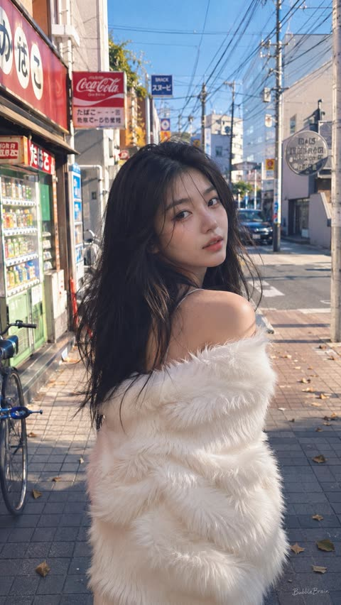
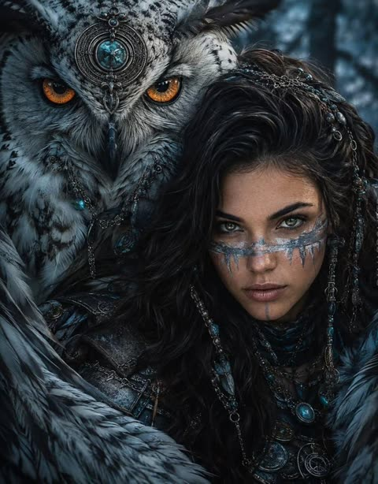
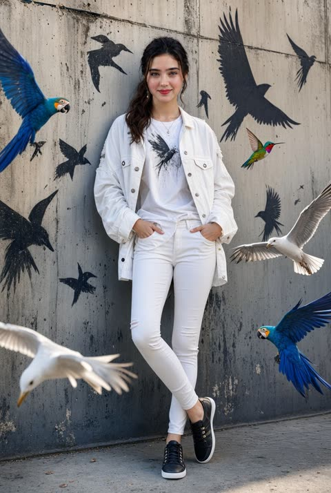
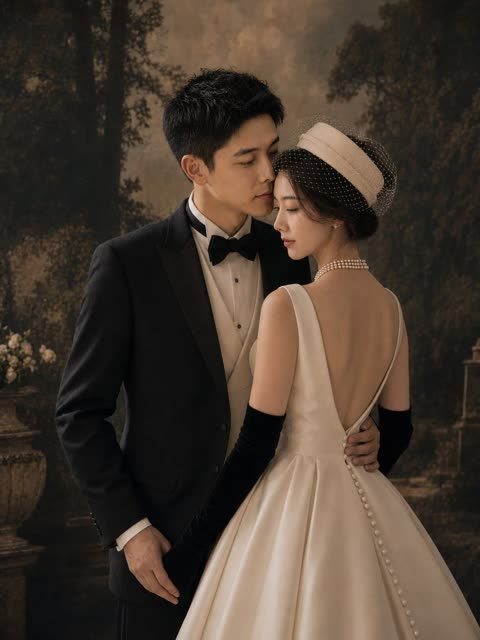
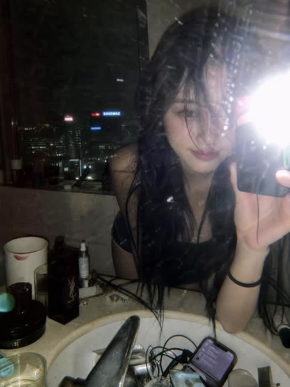
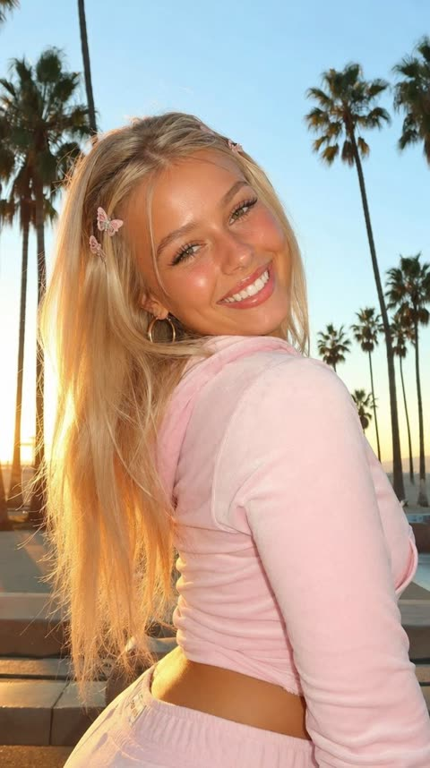
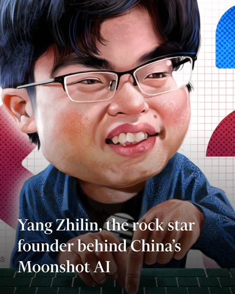

# 人像

[返回目录](../../README_zh.md) · 全部 265 条 · [1](image-portrait.md) · [2](image-portrait-2.md) · **3**

<a id="gpt-image-tokyo-backstreet-film-snapshot-fur-jacket"></a>
### 东京街头白色毛绒外套胶片抓拍人像

<a href="https://x.com/BubbleBrain/status/2055491616392052887"></a>

用胶片颗粒、轻微过曝、不完美构图和慢快门拖影等手机抓拍线索营造随手拍的真实感。电线、自动贩卖机、落叶等街景清单加上背身回头的姿势，让画面更有场景感。

GPT Image 2 · 文生图 · 出处: [@BubbleBrain on X](https://x.com/BubbleBrain/status/2055491616392052887) · 发现于 [freestylefly/awesome-gpt-image-2](https://github.com/freestylefly/awesome-gpt-image-2)

[`film-photography`](tags.md#tag-film-photography) [`street-snapshot`](tags.md#tag-street-snapshot) [`tokyo`](tags.md#tag-tokyo) [`candid`](tags.md#tag-candid) [`portrait`](tags.md#tag-portrait)

<details><summary><b>提示词</b></summary>

```text
film photography, candid street snapshot aesthetic, razor-sharp focus on subject, shallow depth of field with soft blurred urban background, bright daylight, slightly overexposed highlights, vivid contrast, subtle analog film texture, heavy film grain, nostalgic cinematic atmosphere, Tokyo backstreet neighborhood scene near a quiet train station, narrow pedestrian street lined with Japanese convenience stores, vintage vending machines, small ramen shops, hanging signs with faded typography, bicycles parked along tiled sidewalks, utility poles and overhead wires stretching across the sky, scattered fallen leaves on the ground, distant pedestrians and passing taxis softly blurred in the background, warm afternoon sunlight with deep blue sky, realistic street fashion photography style, effortless cool street vibe, vibrant colors with slightly muted faded film tones, beautiful 19-year-old Chinese female influencer, fair porcelain skin with cold pale undertones, exquisite natural makeup, glossy soft lips, defined brows, delicate lashes, soft messy long black hair with natural flowing curves, wearing an off-shoulder white fluffy faux fur jacket, playful yet subtly seductive expression, lazy dreamy vintage filter, ultra high-quality details, intentionally mundane phone-camera snapshot feeling, casual accidental composition, imperfect framing, realistic iPhone photography texture, spontaneous candid energy, highly attractive girl casually posing in the middle of the sidewalk, body facing away from the camera while turning her head back toward the lens with direct eye contact, relaxed posture, soft wind moving her hair, emotional youthful atmosphere, modern Asian street fashion editorial, soft haze, layered composition, masterpiece, best quality, ultra detailed, slight motion blur from slow shutter, authentic everyday realism, “BubbleBrain” small handwritten signature text on bottom corner --ar 9:16
```

</details>

<a id="gpt-image-tribal-warrior-guardian-owl-portrait"></a>
### 部落奇幻女战士与巨型守护猫头鹰

<a href="https://x.com/Aqib__786Ai/status/2091027228645552456"></a>

提示词逐一用材质和颜色描写元素,如银链、绿松石和冰白战纹。猫头鹰有独立的特征清单,冷蓝森林色调与橙色眼睛形成对比。写实质感关键词加电影光效,让奇幻主体呈现真实摄影质感。

GPT Image 2 · 文生图 · 出处: [@Aqib__786Ai on X](https://x.com/Aqib__786Ai/status/2091027228645552456) · 发现于 [YouMind-OpenLab/awesome-gpt-image-2](https://github.com/YouMind-OpenLab/awesome-gpt-image-2)

[`fantasy`](tags.md#tag-fantasy) [`warrior`](tags.md#tag-warrior) [`owl`](tags.md#tag-owl) [`dark-fantasy`](tags.md#tag-dark-fantasy) [`cinematic`](tags.md#tag-cinematic)

<details><summary><b>提示词</b></summary>

```text
A detailed portrait of a fierce tribal fantasy warrior woman leaning close to a massive, majestic great horned owl, cinematic lighting, dark moody atmosphere. The woman has long, wavy dark hair adorned with intricate silver chains, beads, and metallic headpieces. She has striking light green eyes, piercing the camera, with silver and icy-white war paint painted across her cheeks and nose. She wears dark leather armor decorated with silver pendants and turquoise gemstones Beside her the giant owl features sharp glowing orange eyes, patterned white and black feathers and an ornate silver circular medallion studded with a blue crystal resting on its forehead. The background is a shadowy, mystical forest in cool blue and dark gray tones. Highly detailed feathers, hyper-realistic, photorealistic textures, 8k resolution, dramatic dark fantasy aesthetic, masterpiece.
```

</details>

<a id="gpt-image-urban-bird-street-portrait"></a>
### 白衣女子与飞鸟的都市街头肖像

<a href="https://x.com/HaniaAi12/status/2060216757797978245"></a>

真实飞鸟与墙上的黑色涂鸦鸟影相互呼应，画面既有动感又有街头艺术感。逐件列出服装，再加柔和日光和景深，让时尚质感保持稳定。

GPT Image 2 · 文生图 · 出处: [@HaniaAi12 on X](https://x.com/HaniaAi12/status/2060216757797978245) · 发现于 [freestylefly/awesome-gpt-image-2](https://github.com/freestylefly/awesome-gpt-image-2)

[`street-portrait`](tags.md#tag-street-portrait) [`fashion`](tags.md#tag-fashion) [`birds`](tags.md#tag-birds) [`graffiti`](tags.md#tag-graffiti) [`photorealistic`](tags.md#tag-photorealistic)

<details><summary><b>提示词</b></summary>

```text
A stylish cinematic portrait of a confident young woman leaning casually against a textured urban concrete wall, surrounded by vibrant flying birds including blue macaws, white seagulls, and a colorful hummingbird. Black graffiti-style bird silhouettes painted on the wall create an artistic street-art vibe. She is wearing a trendy all-white outfit — oversized denim jacket, fitted graphic tee, skinny jeans, and black sneakers. Soft natural daylight, realistic shadows, ultra-detailed fashion photography, urban luxury aesthetic, sharp facial features, glossy hair, high-end editorial style, dynamic composition, photorealistic, depth of field, 8K quality.
```

</details>

<a id="gpt-image-vintage-garden-wedding-portrait"></a>
### 复古花园影棚婚纱肖像

<a href="https://x.com/zhongying14/status/2061872385075122389"></a>

提示词依次交代两人的站位、服装和配饰，再设定棕褐色油画花园背景，配以柔和定向光、浅景深和胶片颗粒。固定 3:4 构图并明确禁止文字和水印，画面因此干净。

GPT Image 2 · 文生图 · 出处: [@zhongying14 on X](https://x.com/zhongying14/status/2061872385075122389) · 发现于 [YouMind-OpenLab/awesome-gpt-image-2](https://github.com/YouMind-OpenLab/awesome-gpt-image-2)

[`wedding`](tags.md#tag-wedding) [`portrait`](tags.md#tag-portrait) [`vintage`](tags.md#tag-vintage) [`old-hollywood`](tags.md#tag-old-hollywood) [`couple`](tags.md#tag-couple)

<details><summary><b>提示词</b></summary>

```text
Create a vertical 3:4 cinematic fine-art wedding portrait of an elegant couple in a vintage studio garden setting. The groom is an East Asian young adult man with short black textured hair, wearing a classic black tuxedo jacket, white dress shirt, cream waistcoat, and black bow tie; he stands on the left, angled slightly toward the bride, his left arm wrapped around her waist and his right hand relaxed by his side. The bride is an East Asian young adult woman standing on the right with her back mostly to the camera, turned slightly toward the groom in an intimate pose; she wears an ivory satin bridal gown with a deep V-shaped open back, full structured skirt, a vertical row of covered buttons down the back, long black opera gloves, a layered pearl necklace, pearl drop earrings, and a cream pillbox-style bridal hat with a dotted birdcage veil over dark updo hair. Their faces should be close together as if about to kiss, with the mood romantic, composed, and editorial. Use a dark painterly forest-and-garden backdrop with tall shadowy trees, warm sepia-brown haze, a stone planter with pale flowers on the left, and subtle vintage garden architecture in the distance. Lighting should be soft, warm, and directional, with gentle highlights on satin fabric and pearls, muted shadows, shallow depth of field, film-grain texture, and a luxurious old-Hollywood bridal magazine aesthetic. No text, no watermark, no extra people, keep the composition waist-up to full-skirt crop with the bride’s gown occupying the lower right foreground.
```

</details>

<a id="gpt-image-y2k-flash-mirror-selfie-skyline-bathroom"></a>
### Y2K闪光灯浴室镜面自拍与城市夜景

<a href="https://x.com/jzaib4269/status/2062184740849930384"></a>

提示词直接写出镜面灰尘、水渍和闪光灯过曝等瑕疵，让画面显得真实未修饰。杂乱的台面、霓虹天际线倒影，以及结尾的相机参数行（直闪、卡片机、35mm等效、噪点）共同锁定千禧年初的质感。

GPT Image 2 · 文生图 · 出处: [@jzaib4269 on X](https://x.com/jzaib4269/status/2062184740849930384) · 发现于 [freestylefly/awesome-gpt-image-2](https://github.com/freestylefly/awesome-gpt-image-2)

[`y2k`](tags.md#tag-y2k) [`flash-photography`](tags.md#tag-flash-photography) [`mirror-selfie`](tags.md#tag-mirror-selfie) [`night-city`](tags.md#tag-night-city) [`candid`](tags.md#tag-candid)

<details><summary><b>提示词</b></summary>

```text
A moody late-night mirror selfie captured in a luxury high-rise bathroom overlooking a glowing city skyline. A young woman with long, slightly messy black hair leans forward over a marble sink, partially obscuring one eye with loose strands. The photo is taken through a smudged mirror with visible dust particles, water spots, and imperfections, creating an authentic raw aesthetic. A powerful direct camera flash explodes in the frame, producing harsh highlights, lens flare, and a nostalgic early-2000s digital camera look.

The bathroom counter is cluttered with luxury cosmetics, skincare products, jewelry, a smartphone, and everyday personal items, adding a lived-in editorial feel. Reflections of neon-lit skyscrapers and hotel windows shimmer in the background, emphasizing an urban nightlife atmosphere. Soft pale skin tones contrast against dark clothing and black hair. The composition feels intimate, candid, and effortlessly cool.

Style: Y2K flash photography, candid mirror selfie, Korean editorial aesthetic, indie sleaze, hotel bathroom scene, luxury lifestyle, cinematic nightlife, disposable camera look, grainy texture, flash burn, realistic skin texture, shallow depth of field, authentic imperfections, viral Pinterest mood, high-fashion casual energy, raw unfiltered photography.

Camera: direct flash, compact digital camera, 35mm equivalent, harsh lighting, slight motion blur, visible noise, natural color grading, vertical composition, ultra-realistic, high detail.
```

</details>

<a id="gpt-image-y2k-golden-hour-pink-velour-portrait"></a>
### Y2K金色时刻粉色丝绒运动装人像

<a href="https://x.com/SiliconBarbie_/status/2051475105403040014"></a>

一行逗号分隔的提示词依次写明人物、年龄、肤质、服装、发饰、光线和场景，每个细节都能落到画面里。金色时刻的光线、棕榈树和亮唇定下Y2K风格，candid一词让姿态更自然。

GPT Image 2 · 文生图 · 出处: [@SiliconBarbie_ on X](https://x.com/SiliconBarbie_/status/2051475105403040014) · 发现于 [freestylefly/awesome-gpt-image-2](https://github.com/freestylefly/awesome-gpt-image-2)

[`y2k`](tags.md#tag-y2k) [`golden-hour`](tags.md#tag-golden-hour) [`candid-portrait`](tags.md#tag-candid-portrait) [`velour`](tags.md#tag-velour) [`palm-trees`](tags.md#tag-palm-trees)

<details><summary><b>提示词</b></summary>

```text
candid portrait of a beautiful young blonde woman, 21 years old, glowing sun-kissed skin, wearing a baby pink velour tracksuit and butterfly clips in her hair, smiling brightly at the camera, golden hour warm light, palm trees, y2k aesthetic, glossy lips
```

</details>

<a id="gpt-image-yang-zhilin-caricature-editorial-redraw"></a>
### 键盘前的杨植麟夸张漫画肖像

<a href="https://x.com/ElainaNotes/status/2081202322911433189"></a>

逐项列出需要保留的版式元素（姿势、网格背景、点状色块、标题），把构图锁定在参考图上。同时写明夸张特征和紧凑的竖向构图，让人脸明显大于参考图，在保留版式的前提下增强夸张效果。

GPT Image 2 · 上传图改图 · 出处: [@ElainaNotes on X](https://x.com/ElainaNotes/status/2081202322911433189) · 发现于 [YouMind-OpenLab/awesome-gpt-image-2](https://github.com/YouMind-OpenLab/awesome-gpt-image-2)

[`caricature`](tags.md#tag-caricature) [`editorial`](tags.md#tag-editorial) [`portrait`](tags.md#tag-portrait) [`reference-redraw`](tags.md#tag-reference-redraw)

<details><summary><b>提示词</b></summary>

```text
Using the provided reference image, redraw it as a polished exaggerated editorial caricature while preserving the original Financial Times-style composition and all key elements. Keep the same seated-at-keyboard pose, the hands reaching toward the keyboard, the white grid-paper background, the red/pink dotted side shapes, the blue dotted rounded rectangle in the upper right, and the same lower-left headline text: Yang Zhilin, the rock star founder behind China’s Moonshot AI. Transform the portrait into a glossy, high-detail digital caricature with an oversized head, fuller cheeks, slightly comical smile, enlarged glasses, stylized black hair, painterly skin texture, and a more satirical magazine-illustration look. Keep the crop tight and vertical, with the face much larger in frame than the reference and the text overlay still readable in large white serif type across the lower third. Maintain the keyboard along the bottom edge and do not add any new objects, logos, watermarks, or extra text.
```

</details>

[1](image-portrait.md) · [2](image-portrait-2.md) · **3**
