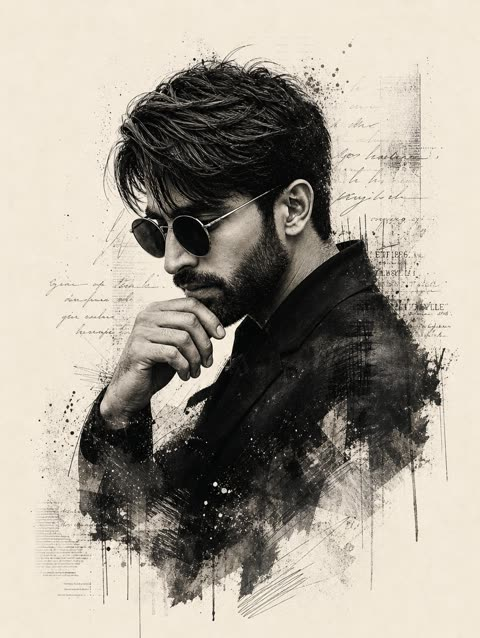

# 人像

[返回目录](../../README_zh.md) · 全部 96 条

<a id="gpt-image-macbook-screen-photo-booth-selfie"></a>
### 笔记本屏幕上Photo Booth里的昏暗卧室自拍

<a href="https://x.com/tadasgedgaudas/status/2046877643929166330"></a>

提示词用结构化JSON，并以身份锁定块保留输入照片中的人脸。它把结果定义为对屏幕的拍摄而不是截图，列出像素网格、摩尔纹、灰尘和指纹等物理瑕疵，再用负面清单排除平整界面和过度精修。

GPT Image 2 · 上传图改图 · 出处: [@tadasgedgaudas on X](https://x.com/tadasgedgaudas/status/2046877643929166330) · 4,434 赞，统计于 2026-10-28

[`screen-photo`](tags.md#tag-screen-photo) [`json-prompt`](tags.md#tag-json-prompt) [`identity-lock`](tags.md#tag-identity-lock) [`low-light`](tags.md#tag-low-light) [`candid`](tags.md#tag-candid)

<details><summary><b>提示词</b></summary>

```text
{"image_settings": {"aspect_ratio": "3:4", "resolution": {"width": 1152, "height": 1536}}, "prompt": {"identity_lock": {"reference": "input_photo", "preserve": ["face", "facial proportions", "eye shape", "nose", "lips", "skin tone", "skin texture", "hairline", "overall identity"], "rules": ["no face swap", "no beautify", "no smoothing", "no reshaping", "no AI look"]}, "scene": {"camera_angle": "high-angle downward shot, POV", "composition": "MacBook screen fills most of the frame, thin strip of physical keyboard visible at the bottom", "screen_surface": ["visible RGB pixel grid", "subtle moire effect", "micro dust on glass", "faint fingerprints", "soft ambient reflections"]}, "digital_interface": {"os": "macOS dark mode", "background_app": {"name": "Spotify", "view": "Liked Songs", "visible_tracks": ["Blank Space \u2013 Taylor Swift", "Shake It Off \u2013 Taylor Swift", "Cruel Summer \u2013 Taylor Swift", "Love Story \u2013 Taylor Swift"]}, "foreground_app": {"name": "Photo Booth", "state": "live preview window", "position": "floating, center-right"}}, "photo_booth_content": {"environment": {"room": "dim bedroom", "background": "off-white wall, rumpled bedding", "lighting": "low-light, nocturnal, cool screen glow mixed with warm skin tones"}, "subject": {"pose": "lying down, relaxed, candid", "expression": "natural, slightly relaxed", "outfit": "light-colored tank top", "prop": {"item": "iPhone 15 Pro", "hand": "right hand"}}}, "realism_rules": ["this is a photo of a screen, not a screenshot", "raw smartphone photo look", "natural noise", "imperfect glass", "no studio lighting", "no HD polish"]}, "negative_prompt": ["screenshot", "flat UI", "perfect screen", "clean glass", "studio lighting", "beauty filter", "cartoon", "3d render", "painting", "watermark", "blurred face"]}
```

</details>

<a id="gpt-image-bougainvillea-archway-courtyard-portrait"></a>
### 九重葛拱门下地中海庭院里的两位女性

<a href="https://x.com/abxxai/status/2097698712978087966"></a>

提示词先详细描写近景人物，再只简单带过远处的第二个人，场景按拱门、庭院、大海由近到远分层。同时指定相机年代、直闪和 CCD 色调，让光线与颗粒质感保持统一。

GPT Image 2.5 · 文生图 · 出处: [@abxxai on X](https://x.com/abxxai/status/2097698712978087966) · 2,645 赞，统计于 2026-10-28

[`portrait`](tags.md#tag-portrait) [`mediterranean`](tags.md#tag-mediterranean) [`flash-photography`](tags.md#tag-flash-photography) [`y2k`](tags.md#tag-y2k) [`candid`](tags.md#tag-candid)

<details><summary><b>提示词</b></summary>

```text
Two women framed by a sun-bleached stone archway — one in the near foreground at frame right, a woman with long straight golden-brown hair loosely pulled back with soft face-framing pieces, warm honey-blonde balayage catching the light, an oval face with warm brown eyes, softly tanned olive-warm skin and full lips, small stud earrings, wearing a rust-terracotta linen wrap top and matching wide-leg linen trousers cinched with a woven raffia belt, hands clasped in front of her, turned back over her shoulder toward camera; a second woman, features unspecified, stands further back in the courtyard in a deep forest-green silk blouse and wide-leg cream trousers, leaning against a whitewashed stone pillar, gazing out toward the sea. Setting: the threshold of a Mediterranean cliffside courtyard, hand-laid terracotta mosaic floor and a weathered stone archway thick with trailing bougainvillea in the foreground, a sun-drenched courtyard beyond with wrought-iron lanterns, potted olive trees and a low stone fountain, whitewashed rooftops and a pale hazy sea filling the horizon, soft late-afternoon light. Shot on an early-2000s point-and-shoot digicam with harsh direct on-camera fill flash that aggressively illuminates the near woman and the archway, flattening her features and putting sharp specular highlights on the linen, the stone and her shoulders; the courtyard and sea beyond stay visible but hazy, milky and underexposed relative to the flash. Warm, slightly saturated CCD tones, strong bloom and halation at the archway edges, minor digital noise. Candid amateur, Y2K editorial, unpolished but stylized.
```

</details>

<a id="gpt-image-mediterranean-archway-y2k-flash-courtyard"></a>
### 地中海庭院九重葛拱门下的女子

<a href="https://x.com/abxxai/status/2097698694296686623"></a>

提示词先写清前景人物的细节，再用简略的第二人物和由拱门、庭院到海面的层次布景铺开空间。随后加入千禧年代数码相机的机顶闪光、CCD 色调、光晕与噪点，让画面更接近随手抓拍的真实感。

GPT Image 2.5 · 文生图 · 出处: [@abxxai on X](https://x.com/abxxai/status/2097698694296686623) · 2,645 赞，统计于 2026-10-28

[`y2k`](tags.md#tag-y2k) [`digicam`](tags.md#tag-digicam) [`flash-photography`](tags.md#tag-flash-photography) [`mediterranean`](tags.md#tag-mediterranean) [`candid`](tags.md#tag-candid)

<details><summary><b>提示词</b></summary>

```text
Two women framed by a sun-bleached stone archway — one in the near foreground at frame right, a woman with long straight golden-brown hair loosely pulled back with soft face-framing pieces, warm honey-blonde balayage catching the light, an oval face with warm brown eyes, softly tanned olive-warm skin and full lips, small stud earrings, wearing a rust-terracotta linen wrap top and matching wide-leg linen trousers cinched with a woven raffia belt, hands clasped in front of her, turned back over her shoulder toward camera; a second woman, features unspecified, stands further back in the courtyard in a deep forest-green silk blouse and wide-leg cream trousers, leaning against a whitewashed stone pillar, gazing out toward the sea. Setting: the threshold of a Mediterranean cliffside courtyard, hand-laid terracotta mosaic floor and a weathered stone archway thick with trailing bougainvillea in the foreground, a sun-drenched courtyard beyond with wrought-iron lanterns, potted olive trees and a low stone fountain, whitewashed rooftops and a pale hazy sea filling the horizon, soft late-afternoon light. Shot on an early-2000s point-and-shoot digicam with harsh direct on-camera fill flash that aggressively illuminates the near woman and the archway, flattening her features and putting sharp specular highlights on the linen, the stone and her shoulders; the courtyard and sea beyond stay visible but hazy, milky and underexposed relative to the flash. Warm, slightly saturated CCD tones, strong bloom and halation at the archway edges, minor digital noise. Candid amateur, Y2K editorial, unpolished but stylized.
```

</details>

<a id="gpt-image-car-door-clifftop-2000s-film-snapshot"></a>
### 透过敞开车门拍摄的千禧年代胶片抓拍

<a href="https://x.com/abxxai/status/2102775797509722602"></a>

上传角色设定图锁定人物身份，再用场景、服装、背景、光线、相机和真实感分块写清各项要求。旧胶片质感靠 28mm 桶形畸变、抬黑、光晕和颗粒等文字描述实现而非滤镜，车门框则提供自然的前景。

GPT Image 2.5 · 上传图改图 · 出处: [@abxxai on X](https://x.com/abxxai/status/2102775797509722602) · 1,687 赞，统计于 2026-10-28

[`film-look`](tags.md#tag-film-look) [`candid`](tags.md#tag-candid) [`road-trip`](tags.md#tag-road-trip) [`character-reference`](tags.md#tag-character-reference) [`2000s`](tags.md#tag-2000s)

<details><summary><b>提示词</b></summary>

```text
4/ the start frame, GPT Image 2.5 made

the old footage look is NOT a filter.. Opus wrote it into the prompt:

Promtp:

Use the uploaded character sheet as the strict identity reference. Keep her exact face, bone structure, brown eyes, light freckles across nose and cheeks, natural full lips, and long straight light-brown hair with sun-kissed caramel highlights parted in the middle. Keep the thin gold chain necklace with the small cross pendant.

SCENE: A candid photo taken from inside a parked silver sedan, looking out through the open rear passenger door. The door frame, the grey fabric headliner, the black door panel with its chrome handle, and part of the seat belt frame the shot on both sides. She stands just outside the open door on a rocky clifftop road above the ocean, both arms raised, one hand gripping the top of the door frame and the other resting on the roof edge, leaning slightly toward the camera. Relaxed, unposed, calm expression, looking straight into the lens.

WARDROBE: Fitted cropped white cotton baby tee with a faded, sun-washed vintage graphic print in pale blue and coral red, slightly worn and soft. Light-wash low-rise denim cutoff shorts with frayed hems. Thin brown leather cord bracelets on one wrist. Hair slightly messy and windblown, a few strands across her face.

BACKGROUND: Deep blue Mediterranean sea filling the frame behind her, sparkling sun glints on the water, a flat horizon line at chest height, pale hazy sky, dark rocks and sandy stones at the cliff edge below.

LIGHT: Harsh direct midday summer sun, bright and slightly overexposed. Sun-warmed skin with a natural sheen and slight glow on the cheeks and nose, soft shadows under the chin, a faint reflection of light off the white car interior.

CAMERA AND LOOK: Early 2000s point-and-shoot film photo, 35mm film, 28mm wide lens with slight barrel distortion at the edges, shot from chest height inside the car. Warm, faded, sun-bleached color grade, lifted blacks, low contrast, creamy highlights that gently blow out in the sky, slightly yellowed whites, soft halation around bright edges, fine visible film grain, a touch of softness and imperfect focus. Looks like a real candid snapshot from a summer road trip, not a studio shot.

REALISM: Real skin texture with visible pores and freckles, no retouching, no plastic skin, natural flyaway hairs, real fabric wrinkles on the tee, real dust and wear on the car interior.

Aspect ratio 4:3. No text, no watermark, no logos.
```

</details>

<a id="gpt-image-car-door-coastal-film-snapshot"></a>
### 车内视角的2000年代初胶片风海边抓拍

<a href="https://x.com/abxxai/status/2102775755646337530"></a>

用上传的角色设定图锁定人物身份，再以车内视角取景，车门框、车顶内衬和安全带自然构成前景。胶片感靠提示词里写明的28mm桶形畸变、提升黑位、光晕和颗粒等相机与调色细节实现，而不是后期滤镜。

GPT Image 2.5 · 上传图改图 · 出处: [@abxxai on X](https://x.com/abxxai/status/2102775755646337530) · 1,687 赞，统计于 2026-10-28

[`film-look`](tags.md#tag-film-look) [`candid-snapshot`](tags.md#tag-candid-snapshot) [`character-reference`](tags.md#tag-character-reference) [`travel`](tags.md#tag-travel) [`y2k`](tags.md#tag-y2k)

<details><summary><b>提示词</b></summary>

```text
4/ the start frame, GPT Image 2.5 made

the old footage look is NOT a filter.. Opus wrote it into the prompt:

Promtp:

Use the uploaded character sheet as the strict identity reference. Keep her exact face, bone structure, brown eyes, light freckles across nose and cheeks, natural full lips, and long straight light-brown hair with sun-kissed caramel highlights parted in the middle. Keep the thin gold chain necklace with the small cross pendant.

SCENE: A candid photo taken from inside a parked silver sedan, looking out through the open rear passenger door. The door frame, the grey fabric headliner, the black door panel with its chrome handle, and part of the seat belt frame the shot on both sides. She stands just outside the open door on a rocky clifftop road above the ocean, both arms raised, one hand gripping the top of the door frame and the other resting on the roof edge, leaning slightly toward the camera. Relaxed, unposed, calm expression, looking straight into the lens.

WARDROBE: Fitted cropped white cotton baby tee with a faded, sun-washed vintage graphic print in pale blue and coral red, slightly worn and soft. Light-wash low-rise denim cutoff shorts with frayed hems. Thin brown leather cord bracelets on one wrist. Hair slightly messy and windblown, a few strands across her face.

BACKGROUND: Deep blue Mediterranean sea filling the frame behind her, sparkling sun glints on the water, a flat horizon line at chest height, pale hazy sky, dark rocks and sandy stones at the cliff edge below.

LIGHT: Harsh direct midday summer sun, bright and slightly overexposed. Sun-warmed skin with a natural sheen and slight glow on the cheeks and nose, soft shadows under the chin, a faint reflection of light off the white car interior.

CAMERA AND LOOK: Early 2000s point-and-shoot film photo, 35mm film, 28mm wide lens with slight barrel distortion at the edges, shot from chest height inside the car. Warm, faded, sun-bleached color grade, lifted blacks, low contrast, creamy highlights that gently blow out in the sky, slightly yellowed whites, soft halation around bright edges, fine visible film grain, a touch of softness and imperfect focus. Looks like a real candid snapshot from a summer road trip, not a studio shot.

REALISM: Real skin texture with visible pores and freckles, no retouching, no plastic skin, natural flyaway hairs, real fabric wrinkles on the tee, real dust and wear on the car interior.

Aspect ratio 4:3. No text, no watermark, no logos.
```

</details>

<a id="nano-banana-sunlit-smartphone-selfie-white-tee"></a>
### 窗边阳光下身穿白T恤的手机自拍

<a href="https://www.reddit.com/r/GeminiAI/comments/1x08axv/nano_banana_21_goes_crazy"></a>

用结构化JSON把面部、头发、服装、光线和相机拆成独立字段，每个细节都能单独控制。写明24到28毫米手机镜头、过曝高光，再配上很长的避免清单，画面保持随手拍的真实感，不会变成影棚质感。

Nano Banana 2.1 · 文生图 · 出处: [u/RIGHT200 on Reddit](https://www.reddit.com/r/GeminiAI/comments/1x08axv/nano_banana_21_goes_crazy) · 1,204 赞，统计于 2026-10-28

[`selfie`](tags.md#tag-selfie) [`smartphone-photo`](tags.md#tag-smartphone-photo) [`json-prompt`](tags.md#tag-json-prompt) [`natural-light`](tags.md#tag-natural-light) [`photorealistic`](tags.md#tag-photorealistic)

<details><summary><b>提示词</b></summary>

```text
{

"prompt_type": "detailed_image_reconstruction",

"aspect_ratio": "16:9 horizontal portrait",

"overall_goal": "Recreate the visual appearance, framing, lighting, styling, and casual smartphone-photo feel of the reference image as closely as possible while keeping the result photorealistic and natural.",

"subject": {

"type": "young adult woman",

"age_range": "early to mid 20s",

"pose": "standing indoors, upper body turned slightly away from the camera while her face turns toward the lens",

"body_position": "relaxed casual posture with shoulders slightly angled",

"expression": "soft neutral expression with a subtle pout, calm and confident",

"gaze": "looking directly toward the camera",

"styling": "minimal everyday styling, clean and natural"

},

"face": {

"shape": "soft oval face with a gently tapered jawline",

"forehead": "medium-height forehead partly framed by center-parted hair",

"eyebrows": "natural medium-thick dark brown eyebrows with a soft arch",

"eyes": {

"shape": "almond-shaped",

"color": "light brown to hazel",

"appearance": "bright eyes with visible catchlights",

"lashes": "long defined eyelashes with subtle mascara"

},

"nose": "small straight nose with a softly rounded tip",

"lips": {

"shape": "full lips with a defined cupid's bow",

"color": "natural rosy pink",

"finish": "soft satin finish, not glossy"

},

"skin": {

"tone": "light warm-neutral skin tone",

"texture": "smooth natural skin with subtle pores and realistic tonal variation",

"cheeks": "soft natural pink flush",

"finish": "fresh luminous skin without heavy retouching"

},

"makeup": "very light natural makeup, softly defined lashes, subtle blush, natural pink lips, no dramatic contour"

},

"hair": {

"color": "rich medium-to-dark chocolate brown",

"length": "very long, extending well below the chest",

"parting": "clean center part",

"texture": "mostly straight with very soft natural bends through the lower lengths",

"density": "thick and healthy-looking",

"finish": "smooth and glossy but still realistic",

"front_sections": "two thin face-framing strands falling naturally along both sides of the face",

"details": "visible individual strands, subtle flyaways near the crown, realistic highlights from sunlight, natural uneven strand separation",

"movement": "hair hanging naturally over both shoulders and down the front of the shirt"

},

"clothing": {

"top": "oversized plain white crew-neck T-shirt",

"fit": "loose casual fit",

"fabric": "soft slightly wrinkled cotton",

"logos": "none",

"accessories": "no visible jewelry or prominent accessories"

},

"composition": {

"shot_type": "close upper-body portrait",

"camera_angle": "slightly above chest level, close to eye level",

"camera_distance": "approximately arm's-length smartphone distance",

"subject_position": "face slightly right of center with long hair occupying much of the lower frame",

"crop": "top of head fully visible, image extending down to around lower torso",

"orientation": "vertical",

"perspective": "natural wide smartphone-camera perspective with mild close-range distortion"

},

"lighting": {

"primary_source": "strong warm natural sunlight entering from the side/front through a nearby window",

"direction": "sunlight striking the subject from camera-left/front",

"face_effect": "bright warm illumination across the forehead, cheeks, nose, and hair",

"hair_effect": "distinct brown highlights and soft reflective streaks along individual strands",

"shadow_quality": "strong but soft-edged natural indoor shadows",

"exposure": "face slightly brightly exposed while the room behind remains much darker",

"color_temperature": "warm daylight"

},

"environment": {

"location": "casual indoor residential room",

"background": "dark gray walls with a white ceiling cornice",

"left_background": "open doorway or darker hallway area",

"right_background": "dark wall and partially visible household objects",

"lower_right": "part of a black tripod or light stand visible",

"overall_feel": "ordinary lived-in room rather than a studio",

"depth": "background moderately out of focus but still recognizable"

},

"camera": {

"capture_device": "modern smartphone camera",

"lens_equivalent": "approximately 24-28mm full-frame equivalent",

"focus": "sharp focus on face and front hair",

"depth_of_field": "mostly natural smartphone depth of field with gentle background softness",

"dynamic_range": "realistic phone-camera HDR with slightly clipped highlights in direct sun",

"image_character": "casual social-media selfie/photo, not professionally staged"

},

"photorealism_details": [

"real individual hair strands",

"natural skin pores and micro-texture",

"subtle peach fuzz",

"realistic eyelash separation",

"tiny variations in lip texture",

"slight fabric creases in the T-shirt",

"small flyaway hairs around the crown",

"natural sunlight falloff across the face",

"slightly imperfect casual framing",

"realistic indoor shadow noise"

],

"style": {

"visual_style": "highly photorealistic casual smartphone portrait",

"mood": "soft, youthful, relaxed, sunlit",

"processing": "light social-media style processing with warm skin tones and slightly enhanced clarity",

"avoid": [

"cinematic movie lighting",

"studio portrait lighting",

"overly smooth plastic skin",

"CGI appearance",

"anime or illustration",

"heavy beauty filter",

"extreme facial symmetry",

"over-sharpened hair",

"artificial jet-black hair",

"dramatic makeup",

"excessive background blur",

"professional studio backdrop",

"text",

"watermarks",

"logos"

]

},

"negative_prompt": "cartoon, anime, illustration, CGI, plastic skin, waxy face, over-retouched skin, excessive beauty filter, unnatural facial symmetry, distorted eyes, crossed eyes, malformed lips, warped face, duplicate hair strands, fake wig appearance, overly black hair, metallic hair shine, stiff hair, messy anatomy, distorted shoulders, extra limbs, extra fingers, studio backdrop, cinematic lighting, dramatic color grading, excessive bokeh, oversaturated colors, text, logo, watermark"

}
```

</details>

<a id="gpt-image-night-tokyo-flash-blur-candid-snapshot"></a>
### 东京夜晚人行道上的模糊闪光抓拍

<a href="https://x.com/doctorwasif/status/2070011415662842000"></a>

叠加运动中闪光、手持抖动、方向性模糊、过曝高光和大量噪点等手机随手拍特征，营造未经修饰的抓拍感。负面提示排除影棚光、锐利对焦和真人复刻。

GPT Image 2 · 文生图 · 出处: [@doctorwasif on X](https://x.com/doctorwasif/status/2070011415662842000) · 713 赞，统计于 2026-10-28

[`candid`](tags.md#tag-candid) [`smartphone-photo`](tags.md#tag-smartphone-photo) [`motion-blur`](tags.md#tag-motion-blur) [`night`](tags.md#tag-night) [`flash`](tags.md#tag-flash)

<details><summary><b>提示词</b></summary>

```text
GPT Image 2

{
  "prompt": "Ultra-realistic candid smartphone photo, 3:4 vertical. Original non-identifiable young woman inspired only by general proportions/vibe. Night Tokyo sidewalk beside white ceramic tile wall. Mid-walk, half-profile, turning back in surprise, hand raised toward lens, shy restrained smile, continuing forward, imperfect framing, nearly exiting frame. Flash fired during motion. Strong handheld shake, heavy directional blur, smeared facial details, blurred hand and hair, ghosting, streaked tile wall, deep darkness around. Harsh flash highlights, blown exposure, hard shadows. Raw accidental snapshot, intrusive, playful, fleeting memory. Extremely noisy, heavily blurred, authentic phone-camera look.",
  "negative_prompt": "identity match, face copy, real person replication, anime, illustration, painting, stylized, studio lighting, beauty lighting, sharp focus, clean face, smooth skin, posed portrait, fashion editorial, cinematic, film still, tripod, professional photography"
}
```

</details>

<a id="gpt-image-six-photo-portrait-grid"></a>
### 同一个人的六宫格人像

<a href="https://x.com/john_my07/status/2112737725430554781"></a>

先把人物写细一次，再写六个画面；要求不留缝，九宫格读起来像一整张。

GPT Image 2.5 · 文生图 · 出处: [@john_my07 on X](https://x.com/john_my07/status/2112737725430554781) · 651 赞，统计于 2026-10-27

[`portrait`](tags.md#tag-portrait) [`grid`](tags.md#tag-grid) [`consistency`](tags.md#tag-consistency)

<details><summary><b>提示词</b></summary>

```text
Create an ultra-realistic 6-photo portrait collage arranged in a seamless 3×2 grid, featuring a naturally beautiful young Portuguese woman in her early 20s. She has warm olive-toned skin, expressive hazel-brown eyes, long chestnut-brown hair with subtle natural highlights, soft face-framing layers, naturally full eyebrows, and delicate, distinctive facial features. Her appearance should feel authentic and individual, with realistic skin texture, tiny imperfections, and minimal everyday makeup.

Visual aesthetic: Effortless European Instagram photo dump, reminiscent of candid photographs taken on a Canon PowerShot G7 X Mark III. Direct built-in camera flash, crisp details, bright facial highlights, hard shadows, slightly imperfect framing, subtle digital noise, and a nostalgic early-2000s point-and-shoot feel.

Setting and styling: A warm off-white bedroom wall with subtle texture, a few natural shadows, and no distracting decorations. She wears a fitted burgundy scoop-neck top, tiny gold hoop earrings, and a delicate necklace. Her makeup is understated, with softly flushed cheeks, natural glossy lips, and lightly defined lashes. Her long hair remains the same color and length but falls differently in every photograph.

Six distinct photographs:

1. Sweet candid: Sitting close to the camera, resting her cheek against one hand, smiling gently with relaxed eyes and loose hair framing her face.
2. Playful snapshot: Looking directly into the lens with a mischievous half-smile, one eyebrow slightly raised, fingers casually tucked behind her ear.
3. Messy-girl moment: Eyes closed and laughing softly, both hands lifting her hair away from her shoulders, a few loose strands catching the flash.
4. Effortless confidence: Turning her face over one shoulder, giving the camera a subtle side-eye, with one hand lightly resting against her neck.
5. Caught laughing: Looking toward someone outside the frame, laughing naturally with her head tilted to the side and hair falling across one cheek.
6. Quiet evening mood: Leaning against the wall, gazing thoughtfully into the lens, lips relaxed, fingertips gently twisting a strand of hair.

Identity consistency: The same Portuguese woman must appear in all six frames, with identical facial proportions, eye color, skin tone, hair color, and recognizable features. Each photograph should have a different pose, expression, head angle, and hair arrangement, as if captured within the same casual photo session.

Photography details: Realistic compact-camera flash, authentic skin pores, fine baby hairs, natural facial asymmetry, believable hands, sharp eyes, slight variations in exposure, and candid framing. Avoid excessive retouching, artificial skin smoothing, exaggerated beauty standards, duplicated expressions, malformed fingers, distorted anatomy, or the overly polished appearance of AI-generated portraits.

Output: Vertical 3:4 aspect ratio, exactly six photographs in a balanced 3-column × 2-row grid, clean alignment, no gutters, no text, no watermark. Photorealistic, youthful, spontaneous, intimate, and effortlessly stylish.
```

</details>

<a id="gpt-image-street-caricature-easel-art-market-portrait"></a>
### 女孩坐在画架旁，身边是她的街头漫画像

<a href="https://x.com/Emmma___0/status/2056061305640169643"></a>

提示词以上传的人像锁定身份，并要求漫画只夸张少数真实面部特征。长串负面词排除了默认的可爱Q版脸和吐舌表情，浅景深的集市背景让真人与画作都清晰可读。

GPT Image 2 · 上传图改图 · 出处: [@Emmma___0 on X](https://x.com/Emmma___0/status/2056061305640169643) · 538 赞，统计于 2026-10-28

[`caricature`](tags.md#tag-caricature) [`street-art`](tags.md#tag-street-art) [`easel`](tags.md#tag-easel) [`identity-reference`](tags.md#tag-identity-reference) [`lifestyle`](tags.md#tag-lifestyle)

<details><summary><b>提示词</b></summary>

```text
Use the uploaded portrait as the identity reference for the subject’s face, hairstyle, facial structure, and overall impression.

Create a high-quality lifestyle editorial portrait of the same person sitting outdoors beside a wooden easel displaying a colorful street-style caricature portrait of them.

The real person and the caricature must clearly resemble the same individual.

Scene:
- the person is seated on a simple wooden folding chair
- beside them is a wooden easel holding a large caricature drawing
- the setting is a sentimental urban art market
- include illustration booths, handmade craft stalls, sketch displays, posters, cozy creative shopfronts, and a few softly blurred pedestrians
- lively but not crowded
- bright soft daylight, warm natural tones, shallow depth of field
- realistic photography for the person and environment
- vertical composition showing both the person and the caricature clearly

Subject:
- preserve the uploaded person’s recognizable identity
- natural pose
- calm, relaxed, slightly amused expression
- stylish casual outfit that suits the subject
- clean editorial lifestyle photography
- do not force the same pose or expression for every subject

Caricature direction:
- the drawing on the easel must be a true observational street caricature, not a generic cute cartoon
- the caricature artist should exaggerate the subject’s actual most recognizable facial traits

- analyze the uploaded face and exaggerate only 2–4 distinctive features, such as eye shape, eyebrows, nose, lips, cheeks, jawline, chin, ears, hairstyle, or facial proportions
- each caricature should feel custom-made for that specific person
- avoid using the same default cute face for every person
- avoid generic big eyes plus tongue-out expression
- the caricature should be funny because it captures the person’s unique features, not because it uses a random silly pose

Caricature style:
- oversized head with smaller simplified body
- playful but recognizable facial proportions
- bold hand-drawn marker lines
- quick sketchy pen strokes
- colored pencil texture
- lively street-artist energy
- humorous but flattering
- witty, expressive, and personality-driven
- charming handmade imperfections
- colorful accent doodles may be added, but keep the focus on the face

Expression in the caricature:
- choose a natural funny expression that fits the person’s facial character
- possible expressions: raised eyebrow, shy smile, surprised eyes, confident smirk, awkward polite smile, exaggerated calm face, pouty lips, confused cute face, or gentle blank stare
- the expression should vary depending on the subject
- do not always use a tongue-out face
- do not always use the same wide-eyed cute expression

Caricature canvas:
- large vertical drawing board or canvas on a wooden easel
- the caricature should be clearly visible and occupy a major part of the image
- it should immediately read as a funny street caricature
- it should be more exaggerated than a portrait sketch
- it should not look like a realistic fashion illustration
- it should not look like a polished beauty drawing

Important:
- the caricature must be custom to the uploaded person
- preserve recognizable identity through the exaggerated features
- prioritize personality, likeness, and humor over generic cuteness
- make the caricature feel like a real street artist observed the person and drew a witty exaggerated version

Negative prompt:
- no generic cute chibi face
- no repeated default caricature face
- no tongue-out pose
- no identical silly expression for every subject
- no random anime expression
- no realistic portrait sketch
- no polished fashion illustration
- no beauty sketch
- no weak exaggeration
- no scary grotesque distortion
- no ugly horror exaggeration
- no distorted anatomy of the real person
- no extra fingers
- no badly drawn hands
- no messy crowded background
- no text
- no watermark
- no Eiffel Tower
- no famous landmarks.
```

</details>

<a id="nano-banana-cobalt-ring-fashion-editorial"></a>
### 钴蓝圆环中的铂金短发模特

<a href="https://x.com/Emmma___0/status/2109146295252459682"></a>

提示词按场景、服装、姿势、光线、色板和摄影风格分块标注。写明镜头焦段、中画幅质感以及冷暖光对比，让高级编辑感保持统一。

Nano Banana 2.1 · 文生图 · 出处: [@Emmma___0 on X](https://x.com/Emmma___0/status/2109146295252459682) · 370 赞，统计于 2026-10-27

[`fashion-editorial`](tags.md#tag-fashion-editorial) [`architecture`](tags.md#tag-architecture) [`cobalt-blue`](tags.md#tag-cobalt-blue) [`studio-portrait`](tags.md#tag-studio-portrait) [`minimalist`](tags.md#tag-minimalist)

<details><summary><b>提示词</b></summary>

```text
Create an ultra-realistic, high-end fashion editorial photoshoot featuring a beautiful young adult woman with short, tousled platinum-blonde bob hair, delicate facial features, fair skin, natural rosy lips, light-colored eyes, and a calm, confident expression.

Scene and Environment: A futuristic minimalist architectural studio featuring a massive sculptural circular opening with thick, smooth, curved white walls. The interior of the circular structure is a rich cobalt-blue or vibrant cyan-blue, creating a striking contrast against the white architectural frame. Clean geometric shapes, curved surfaces, and a contemporary art-gallery aesthetic.

Outfit and Styling: The model wears a sophisticated, oversized black knit sweater or elegant black long-sleeved top paired with tailored black or ivory trousers. Minimal makeup, natural skin texture, understated accessories, and effortless luxury styling.

Pose and Composition: The model poses naturally within and around the giant circular opening. Create a series of artistic editorial poses: a close-up portrait leaning forward through the circular frame, a full-body seated pose inside the sculptural ring with one knee raised, and a standing or seated three-quarter portrait with one hand resting on the curved white surface. Relaxed hands, graceful posture, elongated silhouette, and direct eye contact with the camera.

Lighting: Soft natural daylight entering from one side, creating beautiful directional highlights on the platinum hair, subtle shadows across the face, realistic skin tones, and soft gradients on the white architectural surfaces. Cinematic interplay between cool blue ambient light and warm sunlight.

Color Palette: Vivid cobalt blue, turquoise, icy cyan, pure white, deep black, and platinum blonde. Clean, cool-toned color grading with balanced highlights and rich shadows.

Photography Style: Luxury fashion magazine editorial, contemporary avant-garde photography, minimalist Scandinavian design, architectural fashion campaign, medium-format camera aesthetics, 85mm portrait lens, subtle depth of field, precise focus on the eyes, realistic hair strands, detailed knit fabric, natural skin texture, sophisticated framing, and premium commercial photography quality.

Image Quality: Photorealistic, ultra-detailed, 8K appearance, professional art direction, anatomically accurate hands, realistic proportions, elegant negative space, clean architectural geometry, natural facial expression, crisp details, refined composition, no artificial-looking skin, no excessive retouching.

Vertical portrait composition, 2:3 aspect ratio.
```

</details>

<a id="gpt-image-dusk-film-portrait"></a>
### 黄昏低角度人像，胶片颗粒

<a href="https://x.com/chatgptpaglu/status/2105219509791678731"></a>

不到 600 字：一个机位、一处服装细节、一个光源、一种胶片感。

GPT Image 2.5 · 文生图 · 出处: [@chatgptpaglu on X](https://x.com/chatgptpaglu/status/2105219509791678731) · 318 赞，统计于 2026-10-27

[`portrait`](tags.md#tag-portrait) [`film-grain`](tags.md#tag-film-grain) [`golden-hour`](tags.md#tag-golden-hour)

<details><summary><b>提示词</b></summary>

```text
A low-angle, close-up photograph capturing a young woman with wavy brown hair outdoors at dusk. She is wearing a grey cropped t-shirt with a blue and white graphic text that reads 'DESTINED' above 'SET 1958' and black denim bottoms. Her head is tilted, and she is looking directly into the camera lens. The dark blue evening sky serves as the background, with silhouetted tree branches visible at the bottom of the frame. Strong flash lighting is directed from the front, illuminating her face and highlighting strands of her hair. The composition has a grainy film photography aesthetic.
```

</details>

<a id="gpt-image-wine-bar-ugc-color-reference"></a>
### 酒吧里身穿棕色皮夹克的女子

<a href="https://x.com/Mho_23/status/2097483045221917131"></a>

先把参考照片拆解成包含调色、光线和精确色值的详细JSON，再连同产品图一起交给模型生成，这样能避开AI味的平淡画面，也让风格保持一致。

GPT Image 2.5 · 上传图改图 · 出处: [@Mho_23 on X](https://x.com/Mho_23/status/2097483045221917131) · 298 赞，统计于 2026-10-27

[`ugc`](tags.md#tag-ugc) [`json-prompt`](tags.md#tag-json-prompt) [`color-grading`](tags.md#tag-color-grading) [`reference-image`](tags.md#tag-reference-image) [`product-photo`](tags.md#tag-product-photo)

<details><summary><b>提示词</b></summary>

```text
how to generate AI photos that look 100% real with GPT-Image 2.5:

GPT-Image 2.5 looks slightly better than GPT-Image 2, but it still has some of the same characteristics. out of the box, you can still get that noticeable AI look without references, which is why we are going to be using inspiration photos for color grading and creative direction

> find a photo that has the aesthetic you want

> upload that photo into GPT-6 Astra in ChatGPT and ask for this:

“analyze this photo and give me a very detailed json prompt describing its visual style. really make sure to break down the color grading, lighting and all the exact colors in the photo so i can apply that look to my own images”

we’re using GPT-6 Astra here to break down the reference into a detailed prompt instead of trying to describe every little detail ourselves

> take the json prompt Astra gives you and put it into GPT-Image 2.5 on Higgsfield

> upload your product image and prompt: “using this json as reference, generate a person holding my product [attach product image]”

> GPT-Image 2.5 generates the photo with that person holding your product

compare it with a version generated without the reference and look at the difference in the lighting and color grading

> save the generated character photo you’re happy with as your reference

> for future generations, attach the character photo each time and ask it to preserve the same facial features

now you have a reference character you can use across multiple product photos

you can also iterate the base json prompt and chat back and forth with GPT-6 Astra based on what you want, then repeat the same process..

i like this because it gives you much more direction over the color grading instead of leaving everything up to the model

the basic colours and grainy look are some of the things that can make an image feel AI-generated, so pay attention to those when comparing your results

this is how you can start building a library of high quality ugc images around your own products

the json gives GPT-Image 2.5 the lighting and color direction, your character reference helps with consistency, and you control the product placement

once you have that starting point, you can keep creating variations without writing everything from scratch

GPT-Image 2.5 Sunburst & Flare are available on Higgsfield. try this with your own product and reference images there
```
```

</details>

<a id="gpt-image-navy-studio-fashion-portrait-brush-word"></a>
### 海军蓝影棚时装肖像与手写笔触大字 STILL

<a href="https://x.com/ChillaiKalan__/status/2082663616134992145"></a>

背景、服装和字体同属一个色系，顶部的大号笔触文字与画面浑然一体。柔光箱加轮廓光、85mm 平视构图，再配上可替换的颜色、文字和服装清单，方便批量变化。

GPT Image 2 · 文生图 · 出处: [@ChillaiKalan__ on X](https://x.com/ChillaiKalan__/status/2082663616134992145) · 278 赞，统计于 2026-10-28

[`fashion-portrait`](tags.md#tag-fashion-portrait) [`brush-typography`](tags.md#tag-brush-typography) [`monochrome`](tags.md#tag-monochrome) [`studio-lighting`](tags.md#tag-studio-lighting) [`magazine-cover`](tags.md#tag-magazine-cover)

<details><summary><b>提示词</b></summary>

```text
low quality, blurry, noisy, overexposed, oversaturated, watermark, logo, extra limbs, distorted face, bad anatomy, cropped head, text artifacts, duplicated body parts, cartoon, illustration, CGI, low resolution.
Suggested settings:
Aspect Ratio: 4:5 (Instagram Portrait)
Model: Flux Dev / Flux Pro / Midjourney v7 / GPT Image
Stylize: Medium
Quality: High
Lighting: Soft studio + subtle rim light
Lens: 85mm portrait lens
To generate different versions, simply change:
Background color: navy, mustard yellow, emerald green, teal, burgundy, charcoal.
Typography word: STILL, UNSTOPPABLE, BREATHE, FORWARD, FEARLESS, FOCUSED, RELENTLESS, LIMITLESS, RISE, ELEVATE.
Outfit: tailored suit, turtleneck, bomber jacket, off-shoulder knit, trench coat, monochrome fashion ensemble.
```

</details>

<a id="nano-banana-overhead-snow-portrait-school-uniform"></a>
### 身穿校服躺在雪地里的俯拍人像

<a href="https://x.com/VibeEverything/status/2113256906294796645"></a>

用 JSON 结构把人物身份锁定在参考图上，再把机位、镜头、对焦、姿势、服装和光线分字段写清。阴天柔光、雪花细节和防止改脸的负面提示共同保住了相貌和清冷氛围。

Nano Banana 2.1 · 上传图改图 · 出处: [@VibeEverything on X](https://x.com/VibeEverything/status/2113256906294796645) · 275 赞，统计于 2026-10-28

[`portrait`](tags.md#tag-portrait) [`snow`](tags.md#tag-snow) [`school-uniform`](tags.md#tag-school-uniform) [`overhead`](tags.md#tag-overhead) [`json-prompt`](tags.md#tag-json-prompt)

<details><summary><b>提示词</b></summary>

```text
{
  "reference_image": {
    "identity_preservation": "STRICT — The person's identity from the reference image must be preserved exactly. Keep facial structure, face shape, eye shape, nose, lips, skin tone, freckles/skin texture, and overall likeness identical. Do not alter, beautify, age, or stylize the face.",
    "use_reference_for": ["face", "hairstyle", "overall likeness"]
  },
  "image_type": "photorealistic portrait photograph",
  "aspect_ratio": "2:3 (vertical)",
  "camera": {
    "angle": "top-down overhead shot, camera directly above the subject",
    "framing": "close-up to medium close-up, head to upper chest",
    "lens": "85mm portrait lens look",
    "depth_of_field": "shallow, face in sharp focus",
    "focus": "eyes"
  },
  "subject": {
    "pose": "lying on her back in fresh snow, head slightly tilted, relaxed and calm",
    "gaze": "looking directly into the camera lens, eye contact with the viewer",
    "expression": "calm, dreamy, slightly melancholic, lips gently closed",
    "hair": {
      "color": "black",
      "length": "long",
      "style": "loose, fanned out across the snow, a few strands across the face, snowflakes caught in the hair"
    },
    "accessories": [
      "round tortoiseshell-frame glasses",
      "white wired earphones in both ears, cable running down over the chest"
    ],
    "makeup": "natural, minimal, soft coral lips"
  },
  "outfit": {
    "outerwear": "charcoal school uniform blazer with notched lapels, matte wool texture",
    "shirt": "white collared dress shirt",
    "tie": "navy striped tie with light blue and white diagonal stripes",
    "details": "snowflakes resting on the blazer shoulders and lapels"
  },
  "environment": {
    "setting": "outdoors, lying in a bed of fresh powdery snow",
    "weather": "light snowfall, individual snowflakes visible in the frame",
    "background": "white snow surface filling the background"
  },
  "lighting": {
    "type": "soft diffused natural daylight, overcast",
    "quality": "even, gentle, no harsh shadows",
    "skin_rendering": "natural skin texture, subtle cool tones on skin"
  },
  "color_palette": ["snow white", "charcoal gray", "navy", "black", "warm tortoiseshell brown", "soft coral"],
  "mood": "quiet, cold, cinematic winter, introspective",
  "style": "high-end editorial photography, film-like, realistic detail",
  "negative_prompt": "face alteration, identity change, distorted features, extra fingers, plastic skin, over-smoothing, cartoon, anime, heavy makeup, harsh flash, blurry eyes, looking away from camera"
}
```

</details>

<a id="gpt-image-golden-light-sunglasses-triptych-portrait"></a>
### 金色光线墨镜三联时尚人像

<a href="https://x.com/noorlewisx/status/2065652906209284292"></a>

把 9:16 画面分成三格，每格指定不同景别：中近景、眼部极致微距、特写。人脸参考的严格一致性指令，加上暖色百叶窗光线、镜头光圈参数和负面清单，让三格风格保持统一。

GPT Image 2 · 上传图改图 · 出处: [@noorlewisx on X](https://x.com/noorlewisx/status/2065652906209284292) · 271 赞，统计于 2026-10-28

[`triptych`](tags.md#tag-triptych) [`fashion-editorial`](tags.md#tag-fashion-editorial) [`golden-light`](tags.md#tag-golden-light) [`face-reference`](tags.md#tag-face-reference) [`macro-eye`](tags.md#tag-macro-eye)

<details><summary><b>提示词</b></summary>

```text
Use the uploaded face reference as a strict identity guide and preserve exact facial features, proportions, skin tone, eye shape, nose, lips, jawline, and overall recognizable identity with very high accuracy. Create an ultra-realistic cinematic high-end fashion editorial vertical triptych portrait in 9:16 format divided into three horizontal panels featuring a young Asian woman with elegant feminine beauty, soft natural styling, luxury aesthetic, silver hoop earring, minimal jewelry, and softly voluminous dark ash-brown wavy hair. Panel 1: medium close-up three-quarter portrait wearing black sunglasses, hand near lips, calm introspective expression, warm golden sunlight through window blinds casting striped shadows, cinematic mood. Panel 2: extreme macro close-up of one eye with sunglasses lowered in foreground, highly detailed iris, lashes, moist reflections, cinematic depth, emotional intimate feel. Panel 3: close-up without sunglasses, head turned toward light, hand behind neck, relaxed lips, soft distant gaze, subtle emotional tension. Outfit: smoky taupe or muted beige tailored silk-viscose blouse, minimal elegant luxury fashion styling, realistic fabric texture. Lighting: warm golden cinematic sunlight, soft indoor blinds shadows, luxury editorial lighting, soft contrast, glowing skin highlights. Camera: DSLR ultra-realism, 85mm lens, f/1.4 shallow depth of field, sharp facial detail, natural skin texture, 8K quality. Color grading: warm golden tones, soft amber highlights, cinematic contrast, filmic glow, luxury finish. Negative: no anime, no CGI, no plastic skin, no over-smoothing, no face change, no distortion, no watermark, no text, no logo.
```

</details>

<a id="gpt-image-monochrome-red-streetwear-bean-bag-portrait"></a>
### 全红街头装男士坐在红色懒人沙发上

<a href="https://x.com/Xaroon_x/status/2076616202793939072"></a>

服装、懒人沙发和背景统一为同一种红色，画面形成整块单色。逐件点名服装，用广告大片风格和戏剧化影棚光定调，并明确要求保持上传人脸不变以锁定身份。

GPT Image 2 · 上传图改图 · 出处: [@Xaroon_x on X](https://x.com/Xaroon_x/status/2076616202793939072) · 248 赞，统计于 2026-10-28

[`monochrome`](tags.md#tag-monochrome) [`streetwear`](tags.md#tag-streetwear) [`fashion-editorial`](tags.md#tag-fashion-editorial) [`studio-lighting`](tags.md#tag-studio-lighting) [`face-preservation`](tags.md#tag-face-preservation)

<details><summary><b>提示词</b></summary>

```text
Hyper-realistic cinematic fashion photoshoot of the uploaded person. Seated on a deep light red bean bag, he wears bold all-red oversized streetwear: trench coat, wide red pants, chunky sneakers, silver watch. Solid red background,. Powerful drip vibes, Adidas campaign editorial look, dramatic studio lighting. Keep my face exactly the same as the uploaded photo. Do not change or edit my face. --ar 4:5 ratio
```

</details>

<a id="gpt-image-golden-morning-bedroom-portrait"></a>
### 温馨卧室里的金色晨光人像

<a href="https://x.com/noorlewisx/status/2076916797371228625"></a>

先写清人物、服装、场景和窗边暖光，再用85mm、f/1.8等镜头参数控制浅景深与虚化。另附负面词清单，专门约束皮肤、手部和瑕疵。

GPT Image 2 · 文生图 · 出处: [@noorlewisx on X](https://x.com/noorlewisx/status/2076916797371228625) · 239 赞，统计于 2026-10-28

[`portrait`](tags.md#tag-portrait) [`golden-hour`](tags.md#tag-golden-hour) [`photorealistic`](tags.md#tag-photorealistic) [`bedroom`](tags.md#tag-bedroom) [`negative-prompt`](tags.md#tag-negative-prompt)

<details><summary><b>提示词</b></summary>

```text
low quality, blurry, cartoon, anime, CGI, unrealistic skin, bad anatomy, extra fingers, extra limbs, deformed face, crossed eyes, watermark, logo, text, noise, artifacts, oversaturated colors, duplicate features, cropped, out of frame, ugly, distorted hands, plastic skin.
```

</details>

<a id="gpt-image-golden-hour-newsstand-editorial-portrait"></a>
### 报刊亭前折叠椅上的金发女孩

<a href="https://x.com/SadiaMalik182/status/2081611030019572178"></a>

用结构化 JSON 把风格、相机、场景、人物、服装、姿势和光线拆成独立模块，每个要素都可单独控制。真实的相机镜头参数加柯达 Portra 调色，让黄金时刻的杂志感更稳定。

GPT Image 2 · 文生图 · 出处: [@SadiaMalik182 on X](https://x.com/SadiaMalik182/status/2081611030019572178) · 227 赞，统计于 2026-10-28

[`json-prompt`](tags.md#tag-json-prompt) [`street-fashion`](tags.md#tag-street-fashion) [`golden-hour`](tags.md#tag-golden-hour) [`editorial`](tags.md#tag-editorial) [`newsstand`](tags.md#tag-newsstand)

<details><summary><b>提示词</b></summary>

```text
"category": "Luxury Street Fashion Editorial Portrait",
  "style": {
    "genre": "Editorial Lifestyle Photography",
    "aesthetic": "Vintage Newsstand × Vogue Editorial × European Street Style × Pinterest Aesthetic × Gen-Z Fashion",
    "quality": "Ultra Photorealistic",
    "resolution": "4096×2304 (4K UHD)",
    "aspect_ratio": "16:9",
    "render_engine": "Octane Render / Unreal Engine 5 / Redshift",
    "editorial_reference": [
      "Vogue",
      "Zara",
      "Urban Outfitters",
      "Free People",
      "COS",
      "Pinterest Editorial"
    ],
    "mood": [
      "Golden Hour",
      "Warm",
      "Relaxed",
      "Vintage",
      "Editorial",
      "Natural",
      "Authentic"
    ]
  },
  "camera": {
    "camera": "Sony A7R V",
    "lens": "85mm f/1.4 GM",
    "orientation": "Landscape",
    "angle": "Eye Level",
    "aperture": "f/2.0",
    "iso": 100,
    "shutter_speed": "1/640s",
    "focus": "Eyes",
    "depth_of_field": "Cinematic Shallow",
    "sharpness": "Ultra Detailed"
  },
  "location": {
    "type": "Vintage Outdoor Newspaper & Magazine Stand",
    "environment": {
      "newsstand": true,
      "magazine_display": true,
      "newspaper_stacks": true,
      "bookstall": true,
      "city_sidewalk": true,
      "urban_news_kiosk": true,
      "authentic_street_environment": true
    }
  },
  "subject": {
    "gender": "Female",
    "age": "Early 20s",
    "appearance": {
      "skin": "Natural Fair Skin",
      "expression": "Calm Editorial Expression",
      "eye_contact": "Direct Camera",
      "makeup": {
        "style": "Natural Minimal",
        "skin_finish": "Soft Matte Glow",
        "lips": "Natural Nude",
        "eyes": "Soft Brown"
      }
    },
    "hair": {
      "style": "Messy Blonde Bun or Short Wavy Blonde Hair",
      "movement": "Light Breeze"
    }
  },
  "wardrobe": {
    "top": {
      "type": "Oversized White Graphic Sweatshirt",
      "fabric": "Premium Cotton",
      "fit": "Relaxed Oversized"
    },
    "bottom": {
      "type": "Red Athletic Shorts"
    },
    "socks": "White Ribbed Crew Socks",
    "shoes": "Black Chunky Sneakers"
  },
  "pose": {
    "position": "Relaxed Sitting On Folding Chair",
    "body_angle": "Three Quarter",
    "editorial": true
  },
  "lighting": {
    "time": "Golden Hour",
    "key_light": "Warm Natural Sunlight",
    "rim_light": "Golden Rim Light",
    "cinematic": true
  },
  "post_processing": {
    "hdr": true,
    "ray_tracing": true,
    "global_illumination": true,
    "clarity": "Ultra",
    "color_grading": "Kodak Portra 400",
    "film_grain": "Subtle"
  },
  "negative_prompt": [
    "low quality",
    "blur",
    "noise",
    "bad anatomy",
    "extra fingers",
    "duplicate person",
    "watermark",
    "logo",
    "text artifacts",
    "CGI look",
    "cartoon",
    "anime"
  ]
}
```

</details>

<a id="gpt-image-selfie-chibi-painting-cheek-brush"></a>
### 自拍中画布上的Q版自己为他涂脸颊

<a href="https://x.com/AiWithTariq/status/2098783770513948875"></a>

提示词按头发、面部、服装、概念、画布角色、背景、风格和镜头分块标注,让真人自拍与3D Q版角色同框。两个角色重复使用同一组泼墨颜色,把现实与画中世界连在一起。

GPT Image 2.5 · 上传图改图 · 出处: [@AiWithTariq on X](https://x.com/AiWithTariq/status/2098783770513948875) · 219 赞，统计于 2026-10-28

[`selfie`](tags.md#tag-selfie) [`chibi`](tags.md#tag-chibi) [`paint-splatter`](tags.md#tag-paint-splatter) [`fourth-wall`](tags.md#tag-fourth-wall) [`art-studio`](tags.md#tag-art-studio)

<details><summary><b>提示词</b></summary>

```text
Study the uploaded photo's facial features and use them as inspiration to create a fun selfie-style photo of a similar-looking young man with a creative cartoon canvas twist.
Hair: Messy, tousled dark hair with paint splatters scattered across the hair and face, light stubble beard.
Face/Skin: Face and skin splattered with colorful paint speckles (purple, orange, blue), big laughing open-mouth smile, playful joyful expression, no jewelry, no tattoos.
Outfit: Purple/lavender knit sweater, paint-splattered casual look.
Concept: Taking a close-up selfie next to an easel canvas, where a cute chibi cartoon version of himself is painted on the canvas — the illustrated cartoon character reaching out of the canvas holding a paintbrush and playfully painting/touching the real man's cheek with colorful paint, breaking the fourth wall between reality and illustration.
Chibi cartoon (on canvas): Same messy hair and paint splatters, big expressive cartoon eyes, cheerful smile, wearing a purple off-shoulder top, leaning out of the canvas frame with one arm extended holding the paintbrush.
Background: Cozy art studio setting, softly blurred art supplies, paint bottles, and shelves in the background, warm natural lighting, wooden easel with visible paint-splattered edges.
Art style: Photorealistic selfie photography blended with vibrant 3D chibi cartoon illustration, playful colorful paint-splatter texture throughout, high detail, fun energetic composition.
Camera angle: Close-up selfie angle, slightly wide shot capturing both the real face and the canvas painting.
Text overlay:
Small stylish signature-style text in the top corner: "Mr. Tariq"
```

</details>

<a id="gpt-image-korean-cafe-mirror-selfie-portra-film"></a>
### 韩式咖啡馆庭院圆镜自拍胶片风

<a href="https://x.com/noorlewisx/status/2064996549747458319"></a>

用外貌、服装、姿势、前景、中景、背景分段，围绕圆镜搭出清晰的景深层次。胶片型号、镜头和光圈（Portra 400、85mm、f/1.8）定下温暖柔焦的质感，负面提示词则让画面保持写实。

GPT Image 2 · 文生图 · 出处: [@noorlewisx on X](https://x.com/noorlewisx/status/2064996549747458319) · 214 赞，统计于 2026-10-28

[`film-photography`](tags.md#tag-film-photography) [`mirror-selfie`](tags.md#tag-mirror-selfie) [`korean-cafe`](tags.md#tag-korean-cafe) [`portra-400`](tags.md#tag-portra-400) [`lifestyle`](tags.md#tag-lifestyle)

<details><summary><b>提示词</b></summary>

```text
Hyper-realistic Kodak Portra 400 film photograph, dreamy soft aesthetic, warm natural sunlight, nostalgic Korean café atmosphere, vertical 9:16 composition.

A beautiful young woman crouching gracefully in front of a large round gold-framed mirror placed on a pebble-covered courtyard, taking a mirror selfie with her smartphone. She looks at the screen with a gentle smile and relaxed expression.

Appearance: Fair glowing skin, soft natural makeup, subtle peach blush, glossy pink lips, delicate eyeliner, bright expressive eyes. Long light-brown wavy hair with soft curtain bangs and romantic curls cascading over her shoulders.

Outfit: Oversized pastel lavender T-shirt featuring a small daisy illustration and subtle Korean typography, high-waisted butter-yellow pleated midi skirt, white crew socks, clean white canvas sneakers, soft pink shoulder tote bag.

Pose: Comfortable squat with knees together, one arm resting naturally on her leg while holding her phone. Relaxed shoulders, candid lifestyle photography feel, effortless charm.

Foreground: Two transparent iced latte cups with visible ice cubes, paper straws, soft condensation. Elegant pink tote bags beside the mirror. Creamy foreground bokeh and dreamy highlights.

Midground: Large circular gold-framed mirror reflecting the woman perfectly. Detailed gravel stones, warm sunlight, realistic reflections, soft shadows, potted plants surrounding the mirror, cinematic depth.

Background: Aesthetic Korean-style café exterior with cream-colored walls, wooden-framed windows, Korean signboard, lush ivy vines, flowers, potted plants, and a quiet pedestrian alley. Warm golden-hour sunlight filtering through trees, dreamy foliage bokeh.

Photography Style: Kodak Portra 400, warm pastel tones, soft focus, creamy highlights, realistic skin texture, subtle film grain, shallow depth of field, environmental portrait, HDR, photorealistic, magazine-quality editorial photography, 85mm lens, f/1.8, atmospheric depth, elegant composition, foreground-midground-background layering.

Negative Prompt: anime, cartoon, illustration, CGI, 3D render, painting, blurry face, distorted hands, extra fingers, duplicate objects, unrealistic proportions, overprocessed skin, harsh shadows, oversaturated colors, artificial lighting, watermark, logo, text, cropped subject, low quality.
```

</details>

<a id="nano-banana-hibiscus-film-portrait"></a>
### 粉色木槿花环绕的复古胶片人像

<a href="https://x.com/ZaraIrahh/status/2107705937012142393"></a>

镜头置于花丛中、透过前景花瓣拍摄，形成自然的花朵边框，并用侧分、单手入镜、头到胸构图等硬性规则锁定画面。胶片颗粒、光晕和漏光配合详细的负面词列表，避免成片变成精修棚拍感。

Nano Banana 2.1 · 文生图 · 出处: [@ZaraIrahh on X](https://x.com/ZaraIrahh/status/2107705937012142393) · 206 赞，统计于 2026-10-28

[`portrait`](tags.md#tag-portrait) [`film-look`](tags.md#tag-film-look) [`floral`](tags.md#tag-floral) [`photorealistic`](tags.md#tag-photorealistic) [`golden-light`](tags.md#tag-golden-light)

<details><summary><b>提示词</b></summary>

```text
Create a photorealistic portrait of her in a refined side-profile-inspired three-quarter angle, with her head naturally turned toward the camera and making direct eye contact. Clearly defined SIDE PART — NEVER a center or middle part.

She has extremely long, rich Dark Mocha Mousse curly hair, dramatically moved by a strong natural breeze, with realistic flyaways and loose strands. No ribbons, bows, headwear, hats, or hair accessories.

Soft-glam Korean-inspired makeup: visible natural pores, luminous realistic skin texture, rosy blush, subtle brown eyeliner, softly defined eyes, rosy gradient lips, and nude espresso nail art. She wears a magenta-soft-purple thin-strap mini dress with a subtle heart-shaped neckline barely visible at the chest. Gold fairy-wing pendant necklace with matching earrings.

ONE HAND is naturally raised in front of her face, gently pushing or clearing a hibiscus flower away from her line of sight. Fingers and joints must be anatomically realistic. Her other hand is completely outside the frame.

Expression: calm, intimate, slightly curious, natural and emotionally subtle.

EYE-LEVEL CAMERA positioned directly among dense blooming soft-pink and white hibiscus flowers, photographing THROUGH the flowers. Foreground petals, leaves, and stems are very close to the lens and naturally overlap the outer edges of the frame, creating an intimate organic floral frame. Flowers must not obscure her eyes or facial features.

NO WIDE VIEW. The subject fills approximately 85–95% of the frame. ONLY HEAD TO CHEST VISIBLE.

VISUAL STYLE:
Warm nostalgic historical-memory aesthetic. Authentic vintage Canon analog-film character, subtle natural film grain, delicate halation, slightly faded tones, gentle light leaks, realistic exposure imperfections, soft natural shadows, authentic raw human skin texture, and warm soft daylight. Strong wind visibly moves the curls and loose strands. Mild natural motion blur ONLY on moving hair and nearby flower petals.

The final image should feel like a candid, emotionally intimate photograph captured on vintage film rather than a polished studio portrait.

NEGATIVE PROMPT:
center part, middle part, ribbons, bows, headwear, hat, full body, waist-down, staircase focus, wide shot, distant subject, excessive background, artificial bokeh, studio lighting, smartphone photography, modern digital DSLR look, CGI, cartoon, anime, illustration, plastic skin, beauty filter, over-retouched skin, excessive facial smoothing, face swap, distorted facial anatomy, unnatural hands, malformed fingers, extra fingers, missing fingers, floating limbs, flower covering face, obscured eyes, closed eyes, facial distortion, unnatural pose, watermark, text, logo.
```

</details>

<a id="gpt-image-golden-morning-sweater-bedroom-portrait"></a>
### 白色毛衣女孩的金色晨光人像

<a href="https://x.com/noorlewisx/status/2075833443666309189"></a>

用暖色窗光搭配镜头参数（85mm、f/1.8）营造浅景深和柔和虚化，再用皮肤与发丝质感描述和较长的负面提示词，保持照片般的真实感。

GPT Image 2 · 文生图 · 出处: [@noorlewisx on X](https://x.com/noorlewisx/status/2075833443666309189) · 204 赞，统计于 2026-10-28

[`portrait`](tags.md#tag-portrait) [`golden-hour`](tags.md#tag-golden-hour) [`window-light`](tags.md#tag-window-light) [`bokeh`](tags.md#tag-bokeh) [`negative-prompt`](tags.md#tag-negative-prompt)

<details><summary><b>提示词</b></summary>

```text
low quality, blurry, cartoon, anime, CGI, unrealistic skin, bad anatomy, extra fingers, extra limbs, deformed face, crossed eyes, watermark, logo, text, oversaturated colors, noise, artifacts, duplicate features, cropped, out of frame.
```

</details>

<a id="gpt-image-tokyo-night-flash-candid-snapshot"></a>
### 东京雨夜街头的闪光灯随手抓拍

<a href="https://x.com/frametheory058/status/2098413109258207670"></a>

用参考图锁定人物与服装以保持系列一致，再逐项写明手机拍摄的瑕疵：直闪、行走抖动、卷帘快门、对焦不准和偏心构图。末尾列出棚拍光、HDR、磨皮等禁用项，避免画面显得摆拍。

GPT Image 2.5 · 上传图改图 · 出处: [@frametheory058 on X](https://x.com/frametheory058/status/2098413109258207670) · 191 赞，统计于 2026-10-28

[`smartphone-snapshot`](tags.md#tag-smartphone-snapshot) [`direct-flash`](tags.md#tag-direct-flash) [`night-street`](tags.md#tag-night-street) [`tokyo`](tags.md#tag-tokyo) [`character-consistency`](tags.md#tag-character-consistency)

<details><summary><b>提示词</b></summary>

```text
Ultra-realistic late-night smartphone snapshot, 9:16 vertical.

Use the reference only to establish the same fictional female character’s overall appearance and continuity. Keep her recognizable across the series with the same dark-brown wavy hair, natural features, black fitted sleeveless tank top, loose high-waisted light-blue jeans, small gold hoop earrings, delicate necklace, white sneakers, and small black shoulder bag.

Scene:
A quiet Tokyo side street late at night after light rain. She walks beside an off-white ceramic-tiled building while distant convenience-store lights, traffic signals, parked bicycles and small Japanese storefronts softly disappear into the darkness. Wet pavement catches scattered reflections.

New candid moment:
Photograph her from a slightly low rear three-quarter angle, about two steps behind her. She has just slowed down and casually turns only her upper body toward the camera while continuing forward. One hand is loosely tucking windblown hair behind her ear while the other hangs naturally beside her bag.

She looks toward the camera from the corner of her eyes with a tiny closed-mouth smile, as though she noticed her friend taking another photo and is trying not to laugh.

No deliberate fashion pose. No exaggerated expression. Her shoulders remain relaxed, hips and legs naturally positioned from walking, with one foot caught halfway through the next step.

Camera:
Modern smartphone rear camera with direct flash. Photographer walking at the same time, creating subtle accidental camera shake. Slight motion blur around her hair, moving leg and fingertips, while her eyes remain just barely readable. Mild rolling-shutter distortion, imperfect autofocus, slight edge softness and realistic digital noise.

Composition should feel accidental: her body sits slightly off-center, a little too much empty darkness on one side, with part of her shoe approaching the bottom edge of frame.

Flash & exposure:
Hard direct phone flash illuminates her face, shoulder, black top and denim while the street behind her falls rapidly into darkness. Slightly overexposed skin highlights, hard natural shadow against the tiled wall, shiny flash reflections on individual hair strands and subtle denim texture. Distant lights bloom and smear naturally.

Aesthetic:
Raw Pinterest night-photo-dump energy. Intimate, youthful, spontaneous and imperfect. It should look like a friend took the photo during a random Tokyo night walk—not a photographer conducting a photoshoot.

Real pores, tiny skin variations, flyaway hairs, natural fabric wrinkles, realistic body proportions and ordinary smartphone processing.

Absolutely no: studio lighting, cinematic teal-orange grading, professional bokeh, fashion-editorial posing, perfect symmetry, airbrushed skin, artificial beauty retouching, HDR look, DSLR sharpness, staged composition, AI-perfect anatomy or polished commercial photography.

The final result should feel like an unexpectedly beautiful photo hidden among 30 messy pictures from the same night.
```

</details>

<a id="gpt-image-realistic-woman-3d-girl-night-park"></a>
### 夜晚公园里真人女子与3D动画小女孩同框

<a href="https://x.com/Alina_with_Ai/status/2102960952266432853"></a>

以上传照片作为真人女子的身份参考，并锁定3D小女孩的服装、发型和比例，让两种画风自然融合。用一组硬性约束固定姿势、视线和身高差，再配合暖色路灯轮廓光，保证真人与动画风格统一。

GPT Image 2.5 · 上传图改图 · 出处: [@Alina_with_Ai on X](https://x.com/Alina_with_Ai/status/2102960952266432853) · 185 赞，统计于 2026-10-28

[`mixed-style`](tags.md#tag-mixed-style) [`3d-character`](tags.md#tag-3d-character) [`night-park`](tags.md#tag-night-park) [`identity-reference`](tags.md#tag-identity-reference) [`golden-light`](tags.md#tag-golden-light)

<details><summary><b>提示词</b></summary>

```text
Create a single cinematic vertical 9:16 image based closely on the uploaded reference.

Show TWO characters standing side by side at night in a beautiful city park.

The adult woman is the main realistic character. Use my uploaded photo as her identity reference and preserve my facial identity, facial structure, skin tone, and recognizable appearance. She has long dark brown hair and wears masculine oversized streetwear: a dark olive/black oversized utility jacket, black oversized hoodie, extremely loose black cargo pants, and white chunky sneakers.

The woman is standing naturally and looking DOWN toward the little girl with a warm, genuine smile. Her body is slightly turned toward the little girl. One hand is casually inside her jacket/pants pocket, while her other hand is raised and her index finger is POINTING toward the little girl, as if proudly introducing or showing her. Make the pointing gesture very clear and natural.

Beside her stands an adorable small 3D animated girl. Keep the little girl extremely cute: oversized expressive brown eyes, rosy cheeks, tiny face, brown hair in a messy high bun with loose strands, black oversized hoodie with a small crown emblem, loose black cargo pants, and white chunky sneakers. She is standing upright and looking up at the woman with a sweet playful smile.

IMPORTANT:
- Both characters must be FULLY STANDING.
- One single image only, NOT a collage or split screen.
- The woman must be pointing toward the little girl.
- The woman must be looking at the little girl and smiling.
- The little girl must be looking up at the woman.
- Keep a clear height difference between them.
- Do not make the little girl photorealistic; keep her cute high-quality 3D animated appearance.
- Do not change the little girl's outfit, hairstyle, facial style, or body proportions.

Set them on a nighttime park walkway with leafy trees, warm glowing streetlights, distant city lights, soft bokeh, golden rim lighting around their hair and shoulders, realistic shadows, and a cozy magical atmosphere.

Photorealistic adult woman + adorable 3D animated girl, seamless integration, cinematic photography, realistic skin and clothing textures, warm golden color grading, shallow depth of field, ultra-detailed, natural proportions, professional composition, vertical 9:16.

The final composition should clearly communicate: the big girl is proudly pointing at the cute little girl while smiling at her.
```

</details>

<a id="gpt-image-candid-cafe-iced-coffee-compact-camera-portrait"></a>
### 街边咖啡馆抓拍：冰咖啡与卡片相机

<a href="https://x.com/nawalsehar/status/2109514589427876256"></a>

提示词按固定顺序写清服装、配饰、左右手分工、坐姿和前景物件，让姿态和细节保持一致。再用镜头焦段、光圈、斑驳树影、Kodak Portra 色调和胶片颗粒营造真实抓拍感，并用负面提示词压住塑料皮肤和手部畸形。

GPT Image 2.5 · 文生图 · 出处: [@nawalsehar on X](https://x.com/nawalsehar/status/2109514589427876256) · 179 赞，统计于 2026-10-28

[`candid`](tags.md#tag-candid) [`street-cafe`](tags.md#tag-street-cafe) [`dappled-light`](tags.md#tag-dappled-light) [`film-grain`](tags.md#tag-film-grain) [`lifestyle`](tags.md#tag-lifestyle)

<details><summary><b>提示词</b></summary>

```text
Cartoon, illustration, plastic skin, extra finger, disabled hand, distorted face, blurry, too open, text, watermark, logo, extra limb
```

</details>

<a id="gpt-image-fisheye-selfie-doorstep-cat"></a>
### 门阶上与好奇猫咪的鱼眼自拍

<a href="https://x.com/MissDelulu9/status/2111697628941717933"></a>

提示词指定鱼眼镜头，并让猫的大鼻子占据近景，畸变带来纵深感和趣味。它逐件写明服装和斑驳的门板质感，并要求保留自拍中的面部特征。

GPT Image 2.5 · 上传图改图 · 出处: [@MissDelulu9 on X](https://x.com/MissDelulu9/status/2111697628941717933) · 173 赞，统计于 2026-10-28

[`fisheye`](tags.md#tag-fisheye) [`selfie`](tags.md#tag-selfie) [`pet`](tags.md#tag-pet) [`candid`](tags.md#tag-candid) [`street`](tags.md#tag-street)

<details><summary><b>提示词</b></summary>

```text
Create a realistic fisheye photo of the woman in my uploaded selfie, preserving her exact facial features. She sits on a doorstep in front of weathered green wooden doors, wearing a beige trench coat, ivory turtleneck, and light blue jeans. A curious tabby-and-white cat fills the right foreground with an oversized nose and expressive eyes. Soft daylight, natural textures, playful candid mood, ultra-realistic photography, landscape 16:9, no text.
```

</details>

<a id="nano-banana-ccd-flash-sofa-selfie-portrait"></a>
### 米色毛圈沙发上的肩后闪光灯自拍

<a href="https://x.com/Emmma___0/status/2107687127844856184"></a>

提示词用姿势、发型、表情、服装、背景、相机等分段标签组织，并用极紧的裁切只保留半张脸，画面更私密。末尾的长负面清单加上对参考图人物身份的保持，让脸、脖子和手更自然可信。

Nano Banana 2.1 · 上传图改图 · 出处: [@Emmma___0 on X](https://x.com/Emmma___0/status/2107687127844856184) · 157 赞，统计于 2026-10-27

[`ccd-flash`](tags.md#tag-ccd-flash) [`selfie`](tags.md#tag-selfie) [`korean-makeup`](tags.md#tag-korean-makeup) [`identity-preservation`](tags.md#tag-identity-preservation) [`labeled-blocks`](tags.md#tag-labeled-blocks)

<details><summary><b>提示词</b></summary>

```text
Create image: A hyper-photorealistic shot of the same subject in the attached image, detailed pores, rosy dewy skin, Douyin glass-skin, pink gloss lips, aegyosal, blush, grey contacts, wispy lashes, brushed brows, thin liner. Preserve her recognizable facial identity and natural proportions with a playful yet sophisticated Chryzleen-inspired indoor fashion aesthetic.

[POSE & COMPOSITION] A tight over-the-shoulder CCD selfie while she leans sideways into a plush sofa. The camera sits slightly behind and above her shoulder, creating a close three-quarter over-shoulder perspective. Only one eye, cheekbone, glossy lips, jawline, a sliver of neck, and the near shoulder are visible. The far side of her face is completely cropped out. Her head turns gently back toward the camera with a small natural tilt, keeping the neck relaxed and anatomically believable. One hand rests loosely on the sofa back behind her, with fingertips visible at the edge of the frame. The pose feels subtly seductive and candid rather than overly posed.

[HAIR] Deep side part with lifted roots and intentionally untidy, windswept volume. Several wispy strands fall across the forehead and cheek, while loose pieces spill naturally behind the shoulder. The hair should have irregular movement and soft imperfections, avoiding a freshly styled appearance.

[EXPRESSION] Half-lidded grey-contact gaze looking back toward the camera, relaxed brows, slightly lifted chin, soft jaw, glossy pink lips parted just enough to show a subtle glimpse of front teeth. Alluring, confident, and understated.

[OUTFIT] Sky-blue fitted sweetheart-neckline knit top with tiny white embroidered daisies, delicate scalloped edging, and miniature pearl-like buttons. Cute modern indoor fashion with a feminine fitted silhouette and soft textured fabric.

[BACKGROUND & ENVIRONMENT] A cozy contemporary living room with a warm beige boucle sofa, muted dusty-blue wall, softly blurred floor lamp, and a small cream cushion behind her. The room is visible only in narrow fragments around the extremely tight crop.

[BRANDING] A miniature Chryzleen engraving is physically placed on a tiny gold bracelet charm worn on the hand resting against the sofa. The Chryzleen mark should be naturally etched into the metal and remain subtle. This single Chryzleen accessory is the only visible branding treatment in the entire image.

[CAMERA] Old CCD digicam, direct flash, fine grain. Close over-the-shoulder three-quarter perspective with crisp detail on the visible eye, cheek, lips, messy hair wisps, shoulder, fingers, and tiny jewelry detail.

[QUALITY] Photorealistic pores and skin texture, natural facial asymmetry, believable hair movement, realistic hands and fingers, seamless neck anatomy, authentic knit texture, natural CCD grain, premium indoor fashion-editorial finish.

[MAKEUP] Fresh Korean soft-glam, natural glow, pink blush, wispy lashes, thin winged liner, shimmering rose-taupe eyeshadow, glossy pink lips.

Keep the Chryzleen branding physically integrated into the jewelry and visually understated, never functioning as graphic text.

1:1 aspect ratio.

[NEGATIVE PROMPT] cardigan, cardigan outfit, jacket, blazer, excessive head turn, extreme head tilt, extreme neck arch, twisted neck, unnatural neck curve, stiff pose, frontal selfie, symmetrical composition, perfectly polished hair, salon-perfect hair, no facial wisps, perfectly arranged strands, full body, half body, waist-up, loose crop, distant camera, excessive living room, hands covering face, hair-touching, malformed hands, extra fingers, missing fingers, warped eyes, plastic skin, over-smoothed face, pale washed-out skin, green cast, square skin artifacts, identity drift, multiple people, multiple Chryzleen marks, duplicate branding, watermark, floating text, random readable signage.
```

</details>

<a id="nano-banana-spinning-night-portrait-slow-shutter-blur"></a>
### 夜间街头旋转人像，慢快门动态模糊

<a href="https://x.com/MissDelulu9/status/2111012827213471883"></a>

直接写明快门速度 1/8 到 1/15 秒，并列出对应的画面效果：残影拖尾、横向背景拉丝、双重曝光。结尾用排除句（不要冻结动作、不要清晰的手臂和头发），避免模型把动作拍定格。

Nano Banana 2.1 · 文生图 · 出处: [@MissDelulu9 on X](https://x.com/MissDelulu9/status/2111012827213471883) · 137 赞，统计于 2026-10-28

[`motion-blur`](tags.md#tag-motion-blur) [`slow-shutter`](tags.md#tag-slow-shutter) [`film-grain`](tags.md#tag-film-grain) [`night`](tags.md#tag-night) [`fashion`](tags.md#tag-fashion)

<details><summary><b>提示词</b></summary>

```text
Vertical 9:16 candid fashion portrait of a
beautiful East Asian girl wearing a fitted long-sleeve orange turtleneck and a black mini skirt, with long, messy, loose black hair. She spins rapidly while looking back at the camera, arms spread wide and hair flying. VERY SLOW SHUTTER SPEED 1/8–1/15 sec, extreme realistic motion blur, long ghost trails on arms and hair, blurred body, softly recognizable face, horizontal background streaks, camera shake, double-exposure effect, heavy 35mm film grain, dreamy, moody, underexposed, photorealistic. No CGI, no frozen motion, no sharp arms or hair.
```

</details>

<a id="nano-banana-fisheye-vintage-cafe-mirror-selfie"></a>
### 青绿色复古咖啡馆的鱼眼镜面自拍

<a href="https://x.com/TheVirtualMuse/status/2108762311251116034"></a>

用身份锁定段落保住参考图人脸，再按场景、背景、光线、相机分段写清各自要求。鱼眼畸变与圆形黄铜镜绑定，并用严格规则约束倒影和单张连续照片，保证真实感。

Nano Banana 2.1 · 上传图改图 · 出处: [@TheVirtualMuse on X](https://x.com/TheVirtualMuse/status/2108762311251116034) · 121 赞，统计于 2026-10-28

[`fisheye`](tags.md#tag-fisheye) [`mirror-selfie`](tags.md#tag-mirror-selfie) [`vintage-film`](tags.md#tag-vintage-film) [`cafe`](tags.md#tag-cafe) [`identity-lock`](tags.md#tag-identity-lock)

<details><summary><b>提示词</b></summary>

```text
Using the uploaded reference image, create an ultra-realistic 1990s vintage café mirror selfie with a playful fisheye photography aesthetic.

IDENTITY LOCK: Preserve the exact facial identity of the reference person with maximum accuracy. Maintain the original eye shape, nose, lips, jawline, facial proportions, natural skin tone, age, and recognizable features. No facial alterations, beautification, or artificial skin smoothing.

SCENE & COMPOSITION: The subject is naturally taking a mirror selfie inside a beautiful vintage European café, standing in front of a large circular mirror with an aged brass frame. Use a strong fisheye lens perspective, creating dramatic yet realistic curvature around the café interior while keeping the subject's face naturally proportioned. The phone must appear correctly reflected in the mirror.

BACKGROUND: A charming retro café featuring turquoise accent walls, vintage wooden furniture, small round café tables, patterned tiled flooring, warm hanging pendant lights, antique decorative details, and soft daylight entering through large windows. The entire interior should curve naturally around the circular mirror.

LIGHTING & COLOR: Authentic 1990s analog film photography, warm golden highlights, slightly faded vintage colors, natural skin tones, soft shadows, subtle 35mm film grain, gentle contrast, and realistic reflections.

CAMERA & REALISM: Strong fisheye wide-angle perspective, authentic mirror reflections, natural handheld selfie composition, realistic optical distortion, detailed skin texture, individual hair strands, accurate fabric textures, and natural imperfections. Premium 8K photographic quality with the organic character of a genuine vintage film photograph.

STRICT RULES: One continuous photograph, no collage, no split screen, no additional people, no distorted facial features, no extra fingers, no incorrect reflections, no CGI, no artificial AI-generated appearance, no readable text, no logos, and no watermark.

FINAL LOOK: A beautiful, effortlessly candid vintage café mirror selfie that looks like a genuine photograph captured on a real fisheye lens, not an AI-generated image.
```

</details>

<a id="nano-banana-pointe-ballerina-butterfly-wing-gown"></a>
### 踮脚芭蕾舞者与蝶翼羽裙

<a href="https://x.com/yourPlugAI/status/2109858986711240822"></a>

用方括号模板固定主体、姿态、材质和三种配色，同一结构可以换出多种礼服变体。深色舞台地面的倒影加上高反差聚光灯，让羽毛和蝶翼的质感更突出。

Nano Banana 2.1 · 文生图 · 出处: [@yourPlugAI on X](https://x.com/yourPlugAI/status/2109858986711240822) · 120 赞，统计于 2026-10-28

[`ballet`](tags.md#tag-ballet) [`avant-garde-fashion`](tags.md#tag-avant-garde-fashion) [`butterfly`](tags.md#tag-butterfly) [`studio-lighting`](tags.md#tag-studio-lighting) [`template`](tags.md#tag-template)

<details><summary><b>提示词</b></summary>

```text
Full-body studio photograph of a [SUBJECT, e.g., female ballerina / model / dancer] poised in a graceful [POSTURE / ACTION, e.g., en pointe / reaching upward / mid-leap].

She wears an intricate, avant-garde outfit crafted from [PRIMARY MATERIAL / MOTIF, e.g., layered peacock feathers / butterfly wings / botanical petals] featuring [SECONDARY MATERIAL / DETAIL, e.g., delicate lace / fractal filigree / iridescent crystals].

The gown is designed in a striking color palette of [COLOR 1], [COLOR 2], and [COLOR 3] against a dark studio background with soft reflections on a dark stage floor. High-contrast dramatic spotlighting highlights fine textures and details.

📌Variable Guide attached below
```

</details>

<a id="gpt-image-1998-coastal-summer-travel-editorial"></a>
### 九十年代末海岛夏日旅行杂志人像

<a href="https://x.com/AIwithWania/status/2098773641303310647"></a>

先定年代、地域氛围和胶片质感（柯达颗粒、褪色高光、金色阳光），让画面统一成一本旧杂志的拍摄风格。服装、姿态、场景逐项写清，再用排除清单保持自然写实。

GPT Image 2.5 · 文生图 · 出处: [@AIwithWania on X](https://x.com/AIwithWania/status/2098773641303310647) · 118 赞，统计于 2026-10-28

[`travel-editorial`](tags.md#tag-travel-editorial) [`film-photography`](tags.md#tag-film-photography) [`1990s`](tags.md#tag-1990s) [`coastal`](tags.md#tag-coastal) [`fashion`](tags.md#tag-fashion)

<details><summary><b>提示词</b></summary>

```text
Create an ultra-realistic late-1990s summer travel editorial featuring a stylish young woman and a stylish young man in two separate portrait frames with the exact same visual theme and color grading.

The setting is a dreamy coastal destination inspired by Jeju Island and the Greek islands, with crystal-blue sea, rocky coastline, white seaside cafés, flowering plants, distant mountains, small boats, warm wooden furniture, and bright clear summer skies.

The woman is seated naturally at a charming seaside café. She wears a modest but fashionable pastel-blue puff-sleeve blouse with a flowing cream floral midi skirt, elegant minimal jewelry, and a relaxed straw hat. Her outfit must be tasteful and not revealing. Give her soft, slightly wavy shoulder-length hair with natural movement. Her pose should feel spontaneous and stylish—one hand resting lightly near her hat or hair, the other relaxed beside her, with a gentle natural smile.

The man is seated casually in the same coastal atmosphere, wearing a cream linen shirt, relaxed beige trousers, classic sunglasses, minimal wristwatch, and clean white sneakers. Give him naturally messy wavy hair and an effortless vintage European summer look. One arm rests casually on the chair while the other hand is near his face, creating a relaxed editorial pose.

Use warm 1990s film photography, subtle Kodak-style grain, slightly faded highlights, soft golden sunlight, realistic skin texture, gentle shadows, natural imperfections, rich ocean blues, creamy whites, muted pastels, and nostalgic analog color grading.

Make both portraits look like they were photographed for a rare 1998 international summer travel magazine, candid rather than posed, sophisticated but effortless, cinematic yet completely realistic.

No modern influencer look, no heavy makeup, no bold/revealing clothes, no artificial CGI appearance, no plastic skin, no excessive blur, no text or logos.

Vibe: “A forgotten summer somewhere by the sea — 1998.”
```

</details>

<a id="gpt-image-windswept-meadow-editorial-portrait"></a>
### 身穿象牙白长裙立于风中青草间的女子

<a href="https://x.com/MahnoorAi12/status/2101997367641751808"></a>

前景草叶遮挡人物营造层次，再用鼠尾草绿与森林绿的低饱和配色、柔和阴天光、85mm f/1.8 景深和胶片颗粒定调。1:1 构图让人物偏右、上方留白，形成杂志感。

GPT Image 2.5 · 上传图改图 · 出处: [@MahnoorAi12 on X](https://x.com/MahnoorAi12/status/2101997367641751808) · 113 赞，统计于 2026-10-28

[`editorial`](tags.md#tag-editorial) [`meadow`](tags.md#tag-meadow) [`film-grain`](tags.md#tag-film-grain) [`fashion`](tags.md#tag-fashion) [`cinematic`](tags.md#tag-cinematic)

<details><summary><b>提示词</b></summary>

```text
A cinematic fashion-editorial portrait of a young East Asian woman standing partially concealed within tall, windswept green grass in an expansive meadow. She wears a loose, flowing off-white or ivory linen dress that moves softly with the breeze, contrasting gently against the rich natural surroundings.
Her dark hair appears naturally tousled by the wind, with soft strands falling across her face, partially veiling her eyes. Her head is gently lowered, gaze directed downward or slightly to the side, conveying a quiet, dreamy, introspective mood. The tall grass surrounds and partially obscures her figure, creating layered foreground elements, immersive depth, and a sense of visual intimacy.
Wind moves through the grass with subtle motion blur, while the subject remains sharply focused. The environment feels calm, isolated, and poetic, enhanced by a faint atmospheric haze and a muted palette of sage green, deep forest green, and soft neutral tones. Soft overcast daylight provides diffused, shadowless illumination with smooth tonal transitions, low contrast, gentle highlights, and realistic skin rendering.
Shallow depth of field produces creamy bokeh and natural background separation, while fine film grain adds an organic editorial texture. Minimalist composition emphasizing solitude and emotional storytelling. Square 1:1 composition, subject positioned slightly right of center with generous negative space above and around her, balanced visual weight, refined framing, sophisticated Korean and Japanese fashion magazine aesthetic, cinematic realism, highly detailed photorealistic photography, 85mm portrait lens, f/1.8, natural lens compression, ultra-realistic skin texture, premium color grading, atmospheric depth, elegant visual storytelling, award-winning editorial photography, masterfully composed, authentic and emotionally resonant.
```

</details>

<a id="gpt-image-emerald-cafe-sage-green-fashion-portrait"></a>
### 翠绿咖啡馆外的鼠尾草绿穿搭人像

<a href="https://x.com/hey_am_cherry/status/2112044506514440506"></a>

先定场景，再逐件列出服饰配饰并指定颜色，让整体色调统一。平视全身构图、浅景深和黄金时段光线带来杂志感，结尾的负面提示词用来防止人体结构出错。

GPT Image 2.5 · 文生图 · 出处: [@hey_am_cherry on X](https://x.com/hey_am_cherry/status/2112044506514440506) · 111 赞，统计于 2026-10-28

[`fashion`](tags.md#tag-fashion) [`cafe`](tags.md#tag-cafe) [`golden-hour`](tags.md#tag-golden-hour) [`editorial`](tags.md#tag-editorial) [`full-body`](tags.md#tag-full-body)

<details><summary><b>提示词</b></summary>

```text
Create a realistic lifestyle fashion portrait, subject stands casually outside a premium modern café with deep emerald green exterior panels and large glass windows revealing a warm, softly lit interior. Minimal Scandinavian café aesthetic with hanging pendant lights, wooden furniture, and subtle reflections on the glass.

The model wears a pastel sage-green baseball cap, fitted white tube top, olive-green denim overall shorts with one strap unfastened, matching green sneakers, delicate gold jewelry, and a luxury black quilted mini handbag with pearl chain placed on a small marble café table beside a takeaway coffee cup.

Natural relaxed pose with one leg slightly crossed, one hand inside the pocket, calm confident expression, looking directly at the camera. Eye-level composition, full-body framing, shallow depth of field, creamy bokeh, soft golden-hour daylight, premium editorial fashion photography, ultra-realistic skin texture, luxury color grading, crisp details, cinematic realism, high-end Vogue campaign quality.

Negative Prompt: low quality, blurry, extra fingers, bad anatomy, distorted face, duplicate person, cartoon, CGI, oversaturated colors, watermark, logo, text, cropped body, unnatural pose, plastic skin, noise.
```

</details>

<a id="nano-banana-burgundy-satin-editorial-portrait"></a>
### 酒红缎面高定与金色耳饰的时尚人像

<a href="https://x.com/MissDelulu9/status/2109630710642528421"></a>

提示词按面部、发型服装、姿势、背景、光线和摄影风格分块书写，结构清晰。85mm、柔光箱、毛孔与香槟色高光等具体镜头、光线和皮肤质感词，让画面接近真实杂志大片。

Nano Banana 2.1 · 文生图 · 出处: [@MissDelulu9 on X](https://x.com/MissDelulu9/status/2109630710642528421) · 110 赞，统计于 2026-10-28

[`editorial`](tags.md#tag-editorial) [`fashion`](tags.md#tag-fashion) [`portrait`](tags.md#tag-portrait) [`satin`](tags.md#tag-satin) [`studio-lighting`](tags.md#tag-studio-lighting)

<details><summary><b>提示词</b></summary>

```text
Create an ultra-realistic, high-fashion editorial portrait of a stunning adult woman with striking blue-grey eyes, naturally full lips with glossy coral-red lipstick, defined eyebrows, sharp black winged eyeliner, long eyelashes, subtle freckles, and luminous dewy skin with realistic pores and a soft champagne highlight.

Her sleek, jet-black hair is neatly center-parted and pulled back into a long, straight, low ponytail. She wears an elegant deep burgundy satin couture dress featuring an exaggerated sculptural high collar, dramatic draped fabric, and an asymmetrical sleeveless design. Large, polished gold geometric statement earrings complete the luxurious look.

Pose: Three-quarter over-the-shoulder pose, body turned away from the camera while her face looks directly toward the viewer, with a confident, elegant, slightly mysterious expression.

Background: Minimalist muted sage-green and turquoise studio backdrop with soft, atmospheric gradients.

Lighting: Professional softbox lighting, cinematic shadows, delicate highlights on the cheekbones, realistic satin reflections, beautiful skin texture, and sophisticated color grading.

Photography style: Luxury beauty campaign, Vogue-inspired editorial photography, 85mm portrait lens, shallow depth of field, sharp focus on the eyes, photorealistic details, premium fashion magazine aesthetic,  vertical 9:16 composition.
```

</details>

<a id="nano-banana-blue-haze-hoodie-studio-portrait"></a>
### 深蓝雾气影棚中的深色连帽衫电影感肖像

<a href="https://x.com/Emmma___0/status/2108109236555403768"></a>

对称的中近景构图,边缘冷蓝光配背景一侧的暖橙光,形成电影感色彩对比。皮肤瑕疵、85mm 镜头感,再加上排除塑料皮肤和过度 HDR 的负面提示,让人脸保持真实。

Nano Banana 2.1 · 文生图 · 出处: [@Emmma___0 on X](https://x.com/Emmma___0/status/2108109236555403768) · 102 赞，统计于 2026-10-28

[`portrait`](tags.md#tag-portrait) [`cinematic`](tags.md#tag-cinematic) [`studio-lighting`](tags.md#tag-studio-lighting) [`photorealistic`](tags.md#tag-photorealistic) [`negative-prompt`](tags.md#tag-negative-prompt)

<details><summary><b>提示词</b></summary>

```text
Create a highly photorealistic cinematic portrait of a person standing centered and facing the camera with a calm, serious expression. Natural facial proportions, realistic skin texture, detailed eyes, subtle skin imperfections, and naturally styled hair. The subject wears a simple oversized dark hoodie with a minimal light-colored shirt visible underneath.
Use a symmetrical composition with the subject occupying the central portion of the frame, medium close-up framing, and a clean professional presentation. The background is a dark deep-blue studio environment with atmospheric haze and subtle volumetric fog. Add cool blue lighting around the edges of the subject and a soft warm orange glow in the distant background on one side, creating a cinematic color contrast.
Dramatic but natural studio lighting, soft directional key light, subtle rim lighting, realistic shadows, controlled highlights, shallow depth of field, smooth background falloff, premium editorial photography, modern cinematic aesthetic, high contrast, realistic colors, detailed clothing texture, realistic hair and skin, professional camera photography, 85mm lens look, crisp focus, subtle film grain, ultra-photorealistic, highly detailed, 8K quality.
Negative prompt: cartoon, illustration, CGI, plastic skin, excessive HDR, oversharpening, distorted face, unnatural anatomy, extra limbs, blurry subject, low resolution, artificial skin, text, logo, watermark.
```

</details>

<a id="gpt-image-rooftop-sunset-smoke-disintegration-portrait"></a>
### 日落屋顶上身体化作烟尘消散的男子

<a href="https://x.com/AiWithTariq/status/2101869465977897075"></a>

提示词先定下服装、侧面姿势和场景，再把消散效果限定在身体一侧，人物依然清晰可辨。烟、灰烬、金色火星分别点名，再配上暖色日落光和湿润反光地面，让过渡有明确光源和层次。

GPT Image 2.5 · 文生图 · 出处: [@AiWithTariq on X](https://x.com/AiWithTariq/status/2101869465977897075) · 98 赞，统计于 2026-10-28

[`disintegration`](tags.md#tag-disintegration) [`smoke-effect`](tags.md#tag-smoke-effect) [`rooftop`](tags.md#tag-rooftop) [`sunset`](tags.md#tag-sunset) [`cinematic`](tags.md#tag-cinematic)

<details><summary><b>提示词</b></summary>

```text
Create an ultra-realistic cinematic portrait of a young man standing on a rooftop at sunset, wearing a light grey t-shirt, beige cargo pants, white high-top sneakers, a wristwatch, and black sunglasses. The subject stands in a calm side profile pose with hands in pockets, looking downward thoughtfully.

Apply a dramatic disintegration effect where the left side of his body transforms into swirling dark smoke, floating ash, glowing golden sparks, and particle fragments, blending naturally into the environment. Use a cloudy sunset sky with warm orange light, a distant city skyline, and a wet reflective ground surface.

Make the smoke highly detailed, volumetric, and realistic, with cinematic lighting, soft depth of field, high contrast, and photorealistic textures. The final image should have an epic fantasy-action mood, ultra-detailed 8K quality, and a seamless smoke-to-human transition effect.
```

</details>

<a id="gpt-image-selfie-giant-portrait-beach-birthday-cake"></a>
### 海滩日落生日蛋糕后的巨幅人像

<a href="https://x.com/Adnan_Ai2/status/2104759717289681001"></a>

先用参考图锁定面部，再让大尺寸特写与坐在蛋糕上的小型全身像同框，形成比例错位的效果。牌子和蛋糕正面的文字逐字给出，并要求拼写清晰，字迹因此保持可读。

GPT Image 2.5 · 上传图改图 · 出处: [@Adnan_Ai2 on X](https://x.com/Adnan_Ai2/status/2104759717289681001) · 92 赞，统计于 2026-10-28

[`selfie`](tags.md#tag-selfie) [`miniature-world`](tags.md#tag-miniature-world) [`birthday-cake`](tags.md#tag-birthday-cake) [`golden-hour`](tags.md#tag-golden-hour) [`face-reference`](tags.md#tag-face-reference)

<details><summary><b>提示词</b></summary>

```text
Use the uploaded girl reference image as the exact facial and appearance reference. Create a highly detailed cinematic fantasy birthday portrait inspired by the provided cake-and-beach composition. Show the same girl in two versions: a large realistic close-up portrait rising behind the cake, and a smaller full-body version sitting naturally on top of the cake. Keep her recognizable facial features, hairstyle, soft smile, eyes, and overall appearance consistent with the reference image. Dress her in an elegant cozy cream-white knitted outfit with a soft feminine look.
Place everything on a beautiful beach during golden-hour sunset, with a glowing orange sky, soft clouds, ocean waves, warm sunlight, and cinematic reflections on the water. Create a huge luxurious round vanilla-and-chocolate drip cake in the foreground, covered with creamy white and chocolate frosting swirls, chocolate pieces, truffles, small decorative pearls, and realistic glossy chocolate drips. The small girl should sit naturally on the cake with a relaxed, cute pose, while the large portrait appears behind her with soft glowing edges and artistic depth.
Add a chocolate plaque beside the girl with the text “Girls Make Life Sweeter ♥” and write “Stay Awesome ♡” on the front of the cake with a small crown above it. Make the text clean, readable, and correctly spelled. Use realistic skin texture, detailed hair strands, natural fabric texture, accurate proportions, soft shadows, warm rim lighting, shallow depth of field, photorealistic details, premium editorial photography, dreamy cinematic color grading, 8K quality, highly polished composition, vertical portrait format.
```

</details>

<a id="gpt-image-iphone-photo-woman-in-cafe"></a>
### 咖啡馆里女生的真实iPhone照片

<a href="https://x.com/blueemi99/status/2097602273085931662"></a>

只点明拍摄设备和简单场景，就能触发随手拍的手机照片质感，包含暖色吊灯光、柔和虚化背景和托腮的自然姿态。极简提示词把构图交给模型，结果反而更自然。

GPT Image 2.5 · 文生图 · 出处: [@blueemi99 on X](https://x.com/blueemi99/status/2097602273085931662) · 91 赞，统计于 2026-10-28

[`iphone-photo`](tags.md#tag-iphone-photo) [`cafe`](tags.md#tag-cafe) [`candid`](tags.md#tag-candid) [`short-prompt`](tags.md#tag-short-prompt) [`realistic`](tags.md#tag-realistic)

<details><summary><b>提示词</b></summary>

```text
GPT Image 2.5

"make me a realistic iphone photo of a woman in a cafe"

I dont get how people are getting bad results from this model, genuinely few words prompt and looks so good and realistic
```

</details>

<a id="gpt-image-monochrome-ink-side-profile-portrait"></a>
### 墨色水墨风戴墨镜男士侧脸肖像

<a href="https://x.com/AiWithTariq/status/2100427348789363114"></a>

先指定要保留的参考图姿态、角度、质感与背景，再把配色限定为黑、炭灰、灰与米白。逐项列出水墨晕染、泼溅、手写涂鸦和淡化字体等粗粝元素，并留足空白，形成画廊海报质感。

GPT Image 2.5 · 上传图改图 · 出处: [@AiWithTariq on X](https://x.com/AiWithTariq/status/2100427348789363114) · 91 赞，统计于 2026-10-28

[`monochrome`](tags.md#tag-monochrome) [`ink-wash`](tags.md#tag-ink-wash) [`side-profile`](tags.md#tag-side-profile) [`editorial`](tags.md#tag-editorial) [`grunge`](tags.md#tag-grunge)

<details><summary><b>提示词</b></summary>

```text
Use the uploaded image as the main composition and style reference. Recreate the artwork almost exactly, keeping the same overall pose, side-profile angle, moody expression, rough painterly texture, abstract ink treatment, distressed overlays, and minimal beige background.

Create a high-contrast black-and-white editorial portrait illustration of a stylish man shown in left-facing side profile, wearing round dark sunglasses and a dark jacket, with his head slightly lowered in a thoughtful pose. Keep one hand raised near his mouth/chin in the same position as the reference.

Important change:
Everything else should remain primarily monochrome black, charcoal, gray, and off-white/beige.

Preserve the same grunge fine-art aesthetic:

* rough ink wash textures
* distressed brush strokes
* splattered paint effects
* abstract smudges
* layered handwritten scribbles and sketch marks around the figure
* fragmented editorial collage feeling
* subtle textural blocks and faded typographic elements integrated into the background

Keep the figure vertically centered with a clean off-white / warm beige background, lots of negative space, and the lower body dissolving into abstract painterly textures. Maintain the same premium fashion-poster / gallery-art vibe.

Style: ultra-detailed monochrome mixed-media portrait, contemporary editorial wall art, expressive ink illustration, dramatic contrast, textured fine-art poster, premium minimalist composition.
```

</details>

<a id="nano-banana-peony-bouquet-terracotta-portrait"></a>
### 赭红背景下手捧巨型芍药花束的女子

<a href="https://x.com/TheVirtualMuse/status/2109224903732089215"></a>

开头用身份锁定段落保住参考图的面部特征，随后逐种列出花材，用百分比限定构图占比，并以具体相机镜头和光线方向定下质感。

Nano Banana 2.1 · 上传图改图 · 出处: [@TheVirtualMuse on X](https://x.com/TheVirtualMuse/status/2109224903732089215) · 90 赞，统计于 2026-10-28

[`floral`](tags.md#tag-floral) [`fashion-editorial`](tags.md#tag-fashion-editorial) [`identity-lock`](tags.md#tag-identity-lock) [`golden-hour`](tags.md#tag-golden-hour) [`studio-portrait`](tags.md#tag-studio-portrait)

<details><summary><b>提示词</b></summary>

```text
Using the uploaded reference image as the ONLY facial identity source, create an ultra-realistic, high-end luxury fashion editorial portrait featuring the exact same person holding an oversized, beautifully arranged floral bouquet.

MASTER IDENTITY LOCK (CRITICAL):

Preserve the reference person's facial identity with maximum possible accuracy. Maintain the exact facial structure, eye shape, eyebrows, nose, lips, jawline, cheekbones, natural skin tone, age, and recognizable facial characteristics.

Retain authentic skin texture, visible pores, natural facial asymmetry, and realistic imperfections. No beautification, facial reconstruction, artificial skin smoothing, or identity changes.

SUBJECT & STYLING:

The woman stands elegantly against a warm, burnt-terracotta studio backdrop, wearing a luxurious oversized beige tailored blazer with structured shoulders, notched lapels, refined stitching, and realistic linen-wool fabric texture.

Her dark brown hair is styled in a voluminous, softly tousled side-parted bob with natural movement, individual flyaway strands, and realistic shine.

Minimal sophisticated makeup, softly defined eyebrows, natural eyelashes, subtle warm blush, and muted nude-pink lips.

Her expression is calm, intimate, and effortlessly confident, looking directly into the camera.

FLORAL ARRANGEMENT (CRITICAL):

She holds an enormous, luxurious asymmetrical bouquet covering most of her upper torso and partially concealing the left side of her face.

The arrangement features:

Large, fully bloomed coral-pink peonies with intricate layered petals and golden centers.

Three prominent ivory-white anthurium flowers with delicate veining, glossy sculptural petals, and pale cream spadices.

Smaller blush-pink peonies and unopened flower buds.

Delicate dried pink astilbe and soft peach botanical fillers.

Pale ivory blossoms scattered naturally throughout the arrangement.

Sculptural dried golden palm leaves extending upward between the flowers.

Every flower must display extraordinary botanical realism, natural petal translucency, delicate imperfections, and physically accurate textures.

The bouquet is wrapped in oversized, sculptural charcoal-black textured floral paper with dramatic angular folds, finished with a long, luxurious matte-black satin ribbon tied into an elegant bow.

POSE & COMPOSITION:

Vertical medium portrait, framed from the upper thighs to slightly above the head.

The subject stands slightly right of center, holding the bouquet naturally across her chest with both arms.

The bouquet dominates the left and central portions of the composition.

One large white anthurium partially overlaps her left eye and cheek, while her right eye remains clearly visible and sharply focused.

Her face emerges naturally from behind the flowers, creating an intimate, mysterious editorial composition.

The flowers occupy approximately 60% of the frame, with the subject's face positioned in the upper-right third.

LIGHTING & ATMOSPHERE:

Dramatic late-afternoon sunlight enters from the upper left, producing warm directional illumination across her face, blazer, and flowers.

Strong yet naturally softened shadows create beautiful dimensional contrast.

Distinct botanical shadows fall across her beige blazer and the terracotta wall behind her.

Rich burnt-orange background tones contrast elegantly with the ivory flowers, coral-pink peonies, beige tailoring, and deep-black bouquet wrapping.

Authentic golden-hour warmth, sophisticated editorial contrast, subtle film grain, natural highlight roll-off, and rich cinematic shadows.

CAMERA & IMAGE QUALITY:

Photographed as a real luxury fashion campaign using a Hasselblad X2D 100C medium-format camera with an 80mm portrait lens.

f/2.8 aperture, ISO 100, realistic optical depth of field, precise eye focus, beautifully resolved flower details, and subtle background softness.

Premium Vogue-inspired floral fashion photography, authentic medium-format rendering, refined luxury magazine color grading, extraordinary photographic detail, realistic dynamic range, and natural skin tones.

8K-quality appearance, exceptionally sharp where focused, physically accurate materials, realistic hands and fingers, and professional studio photography.

FINAL REQUIREMENTS:

The final result must look like an authentic photograph captured by a world-class fashion photographer, not an AI-generated image.

Preserve natural human anatomy, believable flower proportions, realistic shadows, and accurate fabric behavior.

No CGI, 3D rendering, illustration, plastic skin, excessive retouching, artificial HDR, oversaturation, distorted facial features, unnatural hands, duplicated flowers, text, logos, or watermarks.

Aspect Ratio: 9:16 vertical.
```

</details>

<a id="nano-banana-london-townhouse-street-style-identity-lock"></a>
### 伦敦联排屋前的皮夹克街拍人像

<a href="https://x.com/iamrealsnow/status/2107680165736468917"></a>

开头先把面部、发型和身材比例锁定到参考图，再逐项写明地点、门和铁栏杆以及每件服装的材质。结尾补上阴天光线、50mm 镜头、浅景深、胶片颗粒和禁止文字水印的约束。

Nano Banana 2.1 · 上传图改图 · 出处: [@iamrealsnow on X](https://x.com/iamrealsnow/status/2107680165736468917) · 85 赞，统计于 2026-10-28

[`street-style`](tags.md#tag-street-style) [`fashion`](tags.md#tag-fashion) [`identity-reference`](tags.md#tag-identity-reference) [`london`](tags.md#tag-london) [`photorealistic`](tags.md#tag-photorealistic)

<details><summary><b>提示词</b></summary>

```text
Use the reference image as the exact identity reference. Preserve the subject’s facial identity, facial proportions, hairstyle, body proportions and natural appearance. Create a photorealistic high-fashion street-style photograph in London. The subject is standing outside a classic British townhouse with a muted blue-gray paneled door and black wrought-iron railings. She wears a fitted black ribbed turtleneck, oversized dark brown vintage leather jacket with a soft shearling collar, brown mini skirt, and carries a structured dark brown leather handbag with gold hardware. Oversized dark sunglasses, minimal makeup, effortless model-off-duty expression. Overcast natural daylight, muted neutral color palette, realistic shadows, authentic leather texture, subtle film grain, editorial fashion photography, candid street photography, 50mm lens, shallow depth of field, extremely photorealistic, no text, no watermark.
```

</details>

<a id="nano-banana-low-key-studio-portrait-black-backdrop"></a>
### 纯黑背景下的低调影棚人像

<a href="https://x.com/john_my07/status/2107801411711123546"></a>

单侧方向光让半边脸渐隐在阴影中，背景为无缝纯黑。点名毛孔和绒毛等皮肤细节，再配合35mm镜头与胶片颗粒，让画面更像真实摄影而非光滑的AI皮肤。

Nano Banana 2.1 · 文生图 · 出处: [@john_my07 on X](https://x.com/john_my07/status/2107801411711123546) · 82 赞，统计于 2026-10-28

[`portrait`](tags.md#tag-portrait) [`low-key`](tags.md#tag-low-key) [`studio-lighting`](tags.md#tag-studio-lighting) [`photorealistic`](tags.md#tag-photorealistic) [`skin-texture`](tags.md#tag-skin-texture)

<details><summary><b>提示词</b></summary>

```text
Create an ultra-realistic, high-end cinematic portrait of a beautiful young woman, framed in a tight head-and-shoulders composition. She faces the camera directly with a calm yet intense expression and a confident, captivating gaze.

Use dramatic low-key studio lighting with a strong directional light illuminating one side of her face while the opposite side gradually disappears into deep, atmospheric shadow. Keep the background completely black and seamless, creating a striking contrast around her silhouette.

Her eyes are deep brown with subtle geometric catchlights. Give her naturally textured, slightly damp-looking hair with individual strands visible and realistic volume. She wears a simple, elegant black crew-neck top with no visible logos or patterns.

Capture extremely realistic skin with visible pores, fine facial texture, subtle imperfections, delicate peach fuzz, natural lips, and detailed eyelashes. Avoid overly smooth or plastic-looking skin.

Photographed with a cinematic 35mm lens aesthetic, shallow depth of field, soft optical falloff, realistic tonal range, subtle analog film grain, and premium editorial photography quality. The final image should feel like an authentic photograph captured in a professional studio — sophisticated, raw, atmospheric, and completely photorealistic, with no obvious AI-generated appearance.
```

</details>

<a id="gpt-image-cafe-golden-hour-over-shoulder-portrait"></a>
### 透过前景虚化人物的金色光咖啡馆人像

<a href="https://x.com/mehvishs25/status/2105280094994587829"></a>

两个虚化的前景人物形成过肩取景，像从缝隙中偷拍，85mm f/1.4 浅景深把焦点锁在眼睛上。逆光金色阳光加上点名的胶片型号（Portra 400、Gold 200）、颗粒和光晕，营造出温暖的胶片质感。

GPT Image 2.5 · 文生图 · 出处: [@mehvishs25 on X](https://x.com/mehvishs25/status/2105280094994587829) · 78 赞，统计于 2026-10-28

[`candid-portrait`](tags.md#tag-candid-portrait) [`golden-hour`](tags.md#tag-golden-hour) [`film-look`](tags.md#tag-film-look) [`bokeh`](tags.md#tag-bokeh) [`cafe`](tags.md#tag-cafe)

<details><summary><b>提示词</b></summary>

```text
Candid cinematic portrait of a woman with a warm, playful, knowing smile, seated at a café table and looking directly at the camera through a gap between two out-of-focus people in the foreground. She has voluminous, tousled, shoulder-length curly hair in honey-brown and caramel tones with sun-lightened highlights, messy shaggy curtain bangs falling across her forehead and eyes, strands catching the light like a glowing halo. Her skin is sun-kissed and warm, with natural texture, minimal makeup, a soft muted-rose lip, and a slight smirk that reads as relaxed and flirtatious. She wears a black oversized knit cardigan or soft black jacket, layered with delicate thin gold necklaces of different lengths.
On the wooden table in front of her sits a white-lidded brown paper takeaway coffee cup, and beside it a small glass of amber tea. In the extreme foreground, blurred shoulders and heads frame the shot: on the left, a person in a striped beanie and white t-shirt, on the right, a person in a dark brown top with dark curly hair, both heavily out of focus.
Setting: a sunlit café interior beside a large window, with a blurred street scene, a soft peach and white building, and a pale sky visible outside.
Lighting: Strong golden-hour sunlight pouring in from the side and behind, creating a glowing rim light through her hair, warm orange highlights across her face, and deep chocolate-brown shadows. Sun-drenched, hazy, slightly overexposed highlights with a soft bloom.
Style / Mood: Warm, nostalgic, effortless, and intimate. Candid lifestyle photography with a "captured in the moment" feel. Analog film aesthetic, Kodak Portra 400 / Kodak Gold 200 look, visible film grain, lifted warm blacks, rich amber, honey, and brown color palette, gentle halation and lens glow.
Camera details: 85mm f/1.4 lens, very shallow depth of field, sharp focus on her eyes and face, layered foreground bokeh (over-the-shoulder framing), vertical 4:5 composition, eye-level shot, slight vignette.
```

</details>

<a id="gpt-image-1980s-fashion-editorial-red-suit-portrait"></a>
### 红色西装的八十年代时尚杂志人像

<a href="https://x.com/mehvishs25/status/2098090489811746853"></a>

用参考图锁定面部身份，再逐项写出年代服装与配饰来定义八十年代造型。影棚背景、暖色模拟光、胶片颗粒和镜头柔化营造杂志质感，结尾的排除清单避免现代元素混入。

GPT Image 2.5 · 上传图改图 · 出处: [@mehvishs25 on X](https://x.com/mehvishs25/status/2098090489811746853) · 74 赞，统计于 2026-10-28

[`1980s`](tags.md#tag-1980s) [`fashion-editorial`](tags.md#tag-fashion-editorial) [`film-grain`](tags.md#tag-film-grain) [`reference-image`](tags.md#tag-reference-image) [`vintage`](tags.md#tag-vintage)

<details><summary><b>提示词</b></summary>

```text
Create a vertical, ultra-photorealistic portrait of the same clearly adult woman from the reference image, preserving her facial identity, facial structure, skin tone, hair characteristics, and overall appearance.

Give her an authentic 1980s fashion-editorial look with a confident, effortless attitude. She is posing confidently with relaxed shoulders, strong posture, and a subtle self-assured expression, looking directly toward the camera. Her pose should feel natural and charismatic rather than overly staged.

Style her in an elegant vintage 80s outfit: a sophisticated fitted top or blouse with tasteful coverage, high-waisted trousers or a classic high-waisted skirt, subtle shoulder structure, and period-accurate accessories such as small statement earrings, a delicate necklace, and a vintage wristwatch. Use rich but tasteful 1980s colors and textures.

Set the scene in a classic 1980s studio fashion environment, with a softly textured backdrop, warm analog lighting, gentle film grain, subtle lens softness, and authentic vintage color rendering. The overall aesthetic should resemble a high-end fashion photograph from an 80s magazine—glamorous, confident, sophisticated, and nostalgic.

Natural skin texture, realistic fabric detail, authentic proportions, realistic hands, cinematic lighting, 35mm film photography aesthetic, subtle grain, soft highlights, shallow depth of field, no modern objects, no contemporary styling, no text or watermark.
```

</details>

<a id="nano-banana-double-breasted-suit-stone-steps-menswear"></a>
### 石阶上的炭灰色双排扣西装男装人像

<a href="https://x.com/pictsbyai/status/2112458298603479350"></a>

提示词按姿势、服装、发型、背景、光线、镜头的顺序展开，每个元素在相机参数之前就已锁定。镜头、光圈、快门、ISO 的具体数值，加上点明阴影与高光的位置，让画面接近编辑摄影。

Nano Banana 2.1 · 文生图 · 出处: [@pictsbyai on X](https://x.com/pictsbyai/status/2112458298603479350) · 68 赞，统计于 2026-10-28

[`menswear`](tags.md#tag-menswear) [`editorial`](tags.md#tag-editorial) [`suit`](tags.md#tag-suit) [`street-style`](tags.md#tag-street-style) [`85mm`](tags.md#tag-85mm)

<details><summary><b>提示词</b></summary>

```text
A confident handsome male in his late twenties or early thirties stands in a classic 45-degree turn with his weight comfortably shifted and shoulders level. He wears a meticulously tailored charcoal grey double-breasted suit, paired with a crisp white dress shirt, a dark patterned tie, and a precise white pocket square. His thick hair is scissor-cut with a classic taper and a deep side part roughly an inch and a half from the right, left three to four inches long on top to showcase a naturally wavy texture. The styling eschews artificial smoothness in favor of organic volume and movement, revealing natural imperfections, slight flyaways, and varying wave directions held by a low-shine, natural-finish paste. His candid expression features relaxed eyebrows and a softly closed mouth as his eyes gaze away toward the open negative space on the left side of the frame. His left arm extends downward with the fingers of his hand curled naturally and organically inward, exposing a silver-tone dress watch with a light dial peeking from beneath his stark white shirt cuff, while his right arm bends cleanly at the elbow, tucked deeply into his trouser pocket. He is framed straight-on outdoors against a medium-depth urban backdrop, standing upon solid, dark gray horizontal stone steps. To his left in the midground, a vintage wrought-iron door features black painted metal with decorative circular and scrolling motifs, softly out of focus. Dominating the right background is a weathered architectural stone pillar crafted from raw carved masonry. This warm taupe-gray and beige stone wall bears the authentic marks of old city buildings, showcasing a matte surface textured with horizontal carved ridges, vertical corner framing, subtle water staining, natural pitting, and patchy accumulations of soot. The scene is enveloped in a sophisticated, timeless urban elegance, illuminated by a single soft, diffused natural light source cascading from above. This moderate-intensity overhead lighting creates an asymmetrically balanced, medium-contrast palette, casting soft-edged, gray shadows subtly under his chin, beneath the structured suit lapels, and deep within the architectural recesses of the stone building. Specular highlights are beautifully preserved across his forehead, the bridge of his nose, his cheekbone, and the textured crests of his hair waves, while a gentle ambient fill maintains the rich charcoal, warm stone, black, and crisp white dominant tones. Captured as a tack-sharp digital menswear editorial photograph influenced by classic Pitti Uomo street style, the cinematic portrait utilizes an 85mm lens at an f/2.8 aperture and 1/250s shutter speed at ISO 100 for a realistic medium depth of field. Post-processing enhances the composition through a subtle warm neutral color grade, deliberately desaturated background elements to isolate the subject, gentle dodging and burning to define the jawline and structured suit lapels, and a delicate layer of film grain, all seamlessly framed in a 9:16 aspect ratio.
```

</details>

<a id="gpt-image-traveler-sunset-chest-portal-ravens"></a>
### 旅人胸口藏着日落风景与乌鸦

<a href="https://x.com/AiWithTariq/status/2103695256445477234"></a>

把微缩风景融入躯干、外套和背包，让人像与场景成为一体的双重曝光。冷灰蓝天空对比熔金般的琥珀色核心，再配合低角度 85mm 镜头和画面两侧的乌鸦，增强反差与纵深。

GPT Image 2.5 · 上传图改图 · 出处: [@AiWithTariq on X](https://x.com/AiWithTariq/status/2103695256445477234) · 67 赞，统计于 2026-10-28

[`double-exposure`](tags.md#tag-double-exposure) [`selfie`](tags.md#tag-selfie) [`surreal`](tags.md#tag-surreal) [`miniature-world`](tags.md#tag-miniature-world) [`cinematic`](tags.md#tag-cinematic)

<details><summary><b>提示词</b></summary>

```text
A breathtaking surreal double-exposure fine-art photograph and masterwork cinematic composite featuring an adventurous, reflective traveler with the uploaded face as reference, depicted in a dramatic low-angle three-quarter profile with their neck gently extended and gaze cast reverently upward toward the sky. The character is dressed in a travel-worn, dusty khaki button-down utility shirt with rolled sleeves and textured denim trousers, carrying a heavy weathered expedition backpack. Seamlessly integrated and blending directly into the wanderer’s torso, jacket, and pack is an enchanting, luminous miniature landscape centered around a colossal, incandescent golden sunset that bathes the scene in warm radiant amber brilliance. Within this surreal chest portal, a winding path of stone steps ascends toward the blazing horizon, flanked by the dark silhouette of an ancient acacia tree and fiery autumn groves of deep orange and crimson foliage that disintegrate into floating embers, billowing dust clouds, and miniature flying bird silhouettes drifting into the open air. Soaring through the surrounding atmosphere are two photorealistic, glossy black ravens with meticulously rendered wing feathers and sharp talons, one carving dynamically across the left foreground and the other descending from the upper right amid ethereal tendrils of gray smoke. The backdrop consists of expansive, muted slate-blue overcast clouds with soft diffused daylight, establishing a poignant color temperature juxtaposition between the cool, cinematic ambient exterior and the molten, hyper-saturated warm glow emanating from the core. Captured from a low-angle medium shot with a prime 85mm portrait lens, deep depth of field rendering crisp tactile details from the rugged cotton weave and feathered edges to the dynamic particulate clouds, featuring high-contrast cinematic color grading, balanced chiaroscuro lighting, and poetic surrealist visual storytelling.
```

</details>

<a id="nano-banana-iphone-closeup-beanie-sunglasses-puffer"></a>
### 戴毛线帽和墨镜的女生手机近景照

<a href="https://x.com/weiinberg/status/2107694579764113701"></a>

提示词写明真实手机镜头参数（24 毫米等效焦距、f/1.8）和轻微的手机式虚化，锁定手机直出的质感。对毛线帽、领口和耳机线的位置逐一限定，确保脸部不被遮挡，光线则描述为柔和的顶部 LED 漫射光，并保留自然肤质。

Nano Banana 2.1 · 文生图 · 出处: [@weiinberg on X](https://x.com/weiinberg/status/2107694579764113701) · 61 赞，统计于 2026-10-28

[`smartphone-photo`](tags.md#tag-smartphone-photo) [`close-up`](tags.md#tag-close-up) [`beanie`](tags.md#tag-beanie) [`sunglasses`](tags.md#tag-sunglasses) [`soft-lighting`](tags.md#tag-soft-lighting)

<details><summary><b>提示词</b></summary>

```text
straight-on eye-level close-up photograph of a young woman, face clearly visible, captured on a recent iPhone main camera at its native 24 mm equivalent, f/1.8, with natural perspective and no wide-angle distortion. Focus is locked on her face and accessories; the background falls into a mild, realistic smartphone blur.
She wears a black ribbed knit beanie sitting normally on her head, not covering her eyes or face, large reflective black sunglasses, and white wired Apple earphones with the cable running down in front of her jacket. Her white puffer jacket is worn open at the collar, not pulled up, so her jaw, mouth, and lower face remain fully visible beneath the sunglasses. A small black embroidered Nike swoosh sits on the left shoulder. The quilted synthetic fabric shows soft volume and fine texture.
The setting is a brightly lit industrial interior with a high cream-colored ceiling and out-of-focus glossy metallic panels or photographic posters behind her. Lighting is large soft overhead ambient, even and slightly cool, like diffused LED panels: gentle fill from above and the front, soft shadows under the chin and beanie brim, and faint specular highlights on the sunglasses and the jacket’s nylon shell. Exposure is clean and slightly bright, true-to-life color, moderate computational sharpening, natural skin texture, no heavy noise or plastic skin. Mood is urban, practical, and quietly anonymous. Photorealistic smartphone photograph.
```

</details>

<a id="gpt-image-cartoon-mural-portrait-yellow-streetwear"></a>
### 涂鸦墙卡通肖像与黄色街头写真

<a href="https://x.com/Techbyhani/status/2102715195454074956"></a>

用带 EXACT 标记的分段分别约束概念、主体、服装、背景、光线、色调和镜头，让图文叠层的构图保持可控。身份锁定段落绑定参考照片，保证前景真人面部不变，背景插画则允许风格化。

GPT Image 2.5 · 上传图改图 · 出处: [@Techbyhani on X](https://x.com/Techbyhani/status/2102715195454074956) · 59 赞，统计于 2026-10-28

[`graffiti-wall`](tags.md#tag-graffiti-wall) [`streetwear`](tags.md#tag-streetwear) [`cartoon-overlay`](tags.md#tag-cartoon-overlay) [`identity-lock`](tags.md#tag-identity-lock) [`yellow`](tags.md#tag-yellow)

<details><summary><b>提示词</b></summary>

```text
Cartoon Ghost Portrait + Sharp Streetwear Photo (Graffiti Wall)

CONCEPT — EXACT: A layered composite — a massive stylized cartoon/anime-style illustrated portrait fills the background against a vibrant graffiti-covered concrete wall, and a smaller sharp full-color photorealistic full-body portrait of the same woman stands in the foreground.

BACKGROUND CARTOON PORTRAIT — EXACT: Large flat-shaded anime/webtoon-style illustrated portrait, head tilted slightly, long straight dark hair falling past the waist, white rectangular sunglasses, glossy red lips, wearing an oversized yellow graphic t-shirt with a small "NY" logo patch and white sleeve stripes, rendered in clean cel-shaded illustration style with bold outlines, blended into the graffiti wall so it reads as a mural-style painting.

MAIN SUBJECT — FOREGROUND — EXACT: Full-body standing pose, hands tucked into the pockets of oversized cargo pants, head tilted slightly, calm confident expression, white rectangular sunglasses, long dark wavy hair with subtle highlights, thin silver necklace, small stud earrings, silver bracelet.

MAIN SUBJECT IDENTITY LOCK: Foreground photorealistic face must match the reference photo exactly — same jaw width, cheek fullness, eyebrow shape, eye shape/color, nose bridge, and lip shape. The background cartoon portrait may be stylized as illustrated art but should echo the same facial features and hairstyle.

BODY: Fair skin tone, slim build, relaxed confident standing posture.

OUTFIT: Oversized yellow crew-neck t-shirt with a small "NY" logo patch on the chest and white sleeve-cuff stripes, matching yellow cargo pants with multiple pockets and a drawstring waist, white sneakers, thin silver necklace, silver bracelet.

BACKGROUND/ENVIRONMENT — EXACT: A concrete wall densely covered in colorful graffiti street art — bold red, blue, orange, and yellow spray-paint shapes, splatter marks, and abstract tag lettering, a white vertical drainpipe running along the right edge, a strip of bright blue sky visible in the upper-right corner, plain grey concrete pavement beneath the subject's feet.

LIGHTING — EXACT: Bright natural daylight throughout, strong directional sunlight casting a defined shadow on the pavement, vivid clear outdoor lighting on the foreground figure.

COLOR GRADE — EXACT: Vivid saturated yellow dominant throughout both the outfit and the illustrated background portrait, bold multicolor graffiti tones providing contrast, natural warm skin tone on the photorealistic figure, clean vibrant streetwear-editorial color grading.

CAMERA: Shot on 35mm lens, natural street-level framing, sharp photorealistic focus on the foreground figure, background cartoon portrait cleanly illustrated with flat shading and bold linework.

Ultra photorealistic — zero AI artifacts, no watermark.

IMPORTANT — Use ONLY my uploaded face reference image for the facial structure and identity of the photorealistic foreground figure. My face must remain EXACTLY the same as my real appearance with zero identity change. Preserve my exact hairstyle, hairline, forehead shape, eyebrows, eye shape, nose structure, lips, jawline, skin tone, facial texture, and feminine proportions exactly as shown in the uploaded image. Do NOT beautify, cartoonize, smooth skin, or replace my face with a random celebrity or model face in the foreground portrait. Identity preservation is the highest priority for the photorealistic figure.
```

</details>

<a id="nano-banana-coastal-street-portrait-white-tee"></a>
### 海滨街头白T男士写实肖像

<a href="https://x.com/pictsbyai/status/2110646359300649048"></a>

提示词先细致描写姿势、发型、服饰和手部位置，再叠加背景纵深、冷调阴天色板与柔和漫射光。结尾给出精确的相机参数（35mm、f/8、1/250s、ISO 200）和3:4画幅，得到深景深的街拍效果。

Nano Banana 2.1 · 文生图 · 出处: [@pictsbyai on X](https://x.com/pictsbyai/status/2110646359300649048) · 59 赞，统计于 2026-10-28

[`street-portrait`](tags.md#tag-street-portrait) [`male-model`](tags.md#tag-male-model) [`overcast`](tags.md#tag-overcast) [`camera-settings`](tags.md#tag-camera-settings) [`coastal`](tags.md#tag-coastal)

<details><summary><b>提示词</b></summary>

```text
A young male adult stands asymmetrically placed with a serious, posed expression, his relaxed eyebrows set above eyes that gaze away into the distance, his mouth closed without a hint of a smile. His hair features a medium-length top of about four inches, parted deeply on the left and brushed back with a natural texture that reveals a slight wave and delicate flyaways, styled with glossy pomade for a distinctive wet look. He is dressed in a crisp white tee with sunglasses casually hanging from the neckline, paired with beige trousers and a silver watch secured on his left wrist. His body is turned at a 45-degree angle, shifting his weight to lean leftward with level shoulders as his left hand rests organically on his front waistband, thumb casually hooked with fingers visible, while his right hand lightly grips the trouser fabric on the opposite side. He leans against a worn, gray metal traffic pole with a dull finish and attached sensors in the right foreground, anchoring the composition. The scene unfolds into a deep, straight-on spatial depth, leading the eye down a beige-gray checkered concrete sidewalk that curves leftward alongside a coastal road. In the left midground, a relaxed European street vibe is established by cafe tables and chairs. To the right, thriving palm trees stretch upward with tall trunks and dark olive green fronds. The calm mood is defined by a cool, overcast, desaturated palette dominated by the cool gray of the sky and road, harmonizing with neutral earth tones. Single-source, softly diffused natural light falls from above, yielding low-contrast illumination with a cool blue temperature that casts short, soft-edged gray shadows under the subject and behind the pole, while preserving gentle specular highlights on his shoulders and forehead. Captured as a realistic digital street portrait using a 35mm lens at f/8.0, 1/250s, and ISO 200, the image employs a deep depth of field to keep the sweeping background sharply in focus. The final aesthetic features smooth textures, slightly soft overall sharpness with zero grain, and a desaturated cool-tone color grade, all beautifully framed in a 3:4 aspect ratio.
```

</details>

<a id="nano-banana-terrace-dining-man-portrait"></a>
### 露台餐桌前的白衬衫男士肖像

<a href="https://x.com/pictsbyai/status/2109559194890502544"></a>

提示词按前景餐桌、主体、中景橄榄树、背景墙面的层次逐一描述场景。结尾给出精确的相机参数(85mm、f/2.8、1/200s)、光线说明和 3:4 比例,让画面保持写实。

Nano Banana 2.1 · 文生图 · 出处: [@pictsbyai on X](https://x.com/pictsbyai/status/2109559194890502544) · 58 赞，统计于 2026-10-28

[`portrait`](tags.md#tag-portrait) [`realism`](tags.md#tag-realism) [`photography`](tags.md#tag-photography) [`lifestyle`](tags.md#tag-lifestyle) [`85mm`](tags.md#tag-85mm)

<details><summary><b>提示词</b></summary>

```text
A handsome man sits centered and facing the camera with level shoulders and a confident, deliberately posed posture, wearing a crisp white dress shirt and a rich brown tie. His medium-short hair is slicked back with a glossy product, revealing natural comb lines and a distinct, slight wave. He maintains a neutral expression with relaxed eyebrows and a direct gaze, while his left hand is raised near his collar with loosely curled fingers and his right hand rests relaxed on the arm of his chair. In the immediate foreground, a pristine dining table draped in a white tablecloth holds a white plate and silver cutlery, visually leading to the subject before gently fading into a deep, softly blurred outdoor environment. To the midground right, a thriving olive tree grows from a large terracotta pot resting on a gray cobblestone stone floor. Behind him, the setting features pristine, warm off-white plaster walls with a slightly textured matte finish and clean classical architectural moldings, subtly accompanied by an overhead heater structure and a distant building. The scene exudes a sophisticated, elegant, and calm luxury dining experience, anchored by a warm, high-contrast color profile dominated by crisp whites, deep structural blacks, rich brown accents, and soft warm yellows. Mixed, diffused front lighting of moderate intensity bathes the scene in a soft glow, casting short, soft-edged gray shadows under his chin and behind his body, while perfectly preserving specular highlights on his face, glossy hair, and bright white shirt. Captured as a tack-sharp realistic digital photograph using an 85mm lens at f/2.8 and 1/200s with a straight-on perspective, the image features zero grain and a medium depth of field that elegantly separates the subject from the European lifestyle-inspired background, finished with warm post-processing color grading, and finally framed in a 3:4 portrait aspect ratio.
```

</details>

<a id="nano-banana-brown-menswear-european-street-lookbook"></a>
### 欧式街头棕色层叠男装行走造型

<a href="https://x.com/pictsbyai/status/2113183073689125330"></a>

按发型、面部、服装、姿势、前景、中景、光线的顺序逐层描述主体，再用 85mm、f/2.8、1/500s 和 4:5 画幅锁定镜头，并写明色调与光线方向。

Nano Banana 2.1 · 文生图 · 出处: [@pictsbyai on X](https://x.com/pictsbyai/status/2113183073689125330) · 57 赞，统计于 2026-10-28

[`menswear`](tags.md#tag-menswear) [`street-style`](tags.md#tag-street-style) [`lookbook`](tags.md#tag-lookbook) [`fashion`](tags.md#tag-fashion) [`85mm`](tags.md#tag-85mm)

<details><summary><b>提示词</b></summary>

```text
A handsome male model walks confidently forward in a sophisticated, layered menswear ensemble, captured from a straight-on, chest-level perspective. His hair is a medium-length layered cut—shorter on the sides with three to four inches on top reaching his eyebrows—styled with a wet-look pomade that enhances its natural texture, featuring slight frizz and uneven clumping. A deep, off-center right part creates a deliberately disheveled look, allowing several loose, wavy S-curl strands to fall naturally across his forehead and right brow. His facial expression is composed and posed, with a closed neutral mouth, relaxed eyebrows, and a direct gaze framed by round tortoiseshell glasses. He wears a crisp white dress shirt with a visible collar and cuffs, paired with a brown tie and a chocolate dark espresso brown long-sleeve knit polo sweater featuring a buttoned placket. His lower half consists of dark brown double-pleated high-waisted trousers held by a cognac leather brown belt with a silver buckle, ending in black leather loafers. His left hand is tucked completely into his left front trouser pocket, pulling the fabric to create a subtle tension, while his right arm rests by his side, the hand securely gripping the dual leather handles of a large cognac brown leather tote bag with knuckles moderately visible. He strides across a foreground of worn, light gray-beige smooth concrete paving stones that bear subtle stains and natural texturing, grounding the scene in an authentic outdoor urban street setting. Behind him, the midground opens up into a slightly blurred, medium-depth classic European street featuring a warm stone beige limestone building facade. This pristine yet historically weathered ashlar masonry displays matte textures, horizontal block joints, and classical pilasters with structural reveals. To the mid-height right, a vintage black wrought-iron window balcony railing catches the eye with ornate gold and brass medallion detailing, beautifully contrasting the pale stone. The atmosphere evokes an elegant, quiet urban morning wrapped in a sophisticated monochromatic brown and neutral palette, illuminated by a single, large diffused source of open-sky daylight pouring in from above and slightly front-left. This soft, moderate-intensity outdoor light casts neutral ambient fill and short, gray shadows with soft gradual edges on the pavement beneath him, as well as subtle shading under his chin and the leather bag. Radiant, preserved specular highlights gently touch his forehead, the tip of his nose, the top curves of the leather tote bag, and the polished shoe leather, creating a dynamic, high-contrast visual hierarchy that draws the eye from his well-lit face down through the dark textures of his outfit. Rendered as tack-sharp digital photography reminiscent of high-end luxury menswear lookbooks and classic sartorial street style, the image utilizes an 85mm lens at f/2.8 with a 1/500s shutter speed to freeze motion while maintaining a crisp subject against the softened architectural backdrop, finalized with subtle warm color grading and selective clarity to enhance the intricate knitwear and leather textures, all beautifully framed in a 4:5 aspect ratio.
```

</details>

<a id="nano-banana-dual-tone-sunglasses-portrait"></a>
### 黑色墨镜双色光电影感人像

<a href="https://x.com/harboriis/status/2109247804707348591"></a>

提示词先用参考图锁定人物与构图，再逐项列出服装和姿态。前方冷蓝光与右侧暖橙轮廓光对比，配合85mm镜头和强烈虚化背景，形成电影感。

Nano Banana 2.1 · 上传图改图 · 出处: [@harboriis on X](https://x.com/harboriis/status/2109247804707348591) · 57 赞，统计于 2026-10-28

[`portrait`](tags.md#tag-portrait) [`cinematic-lighting`](tags.md#tag-cinematic-lighting) [`sunglasses`](tags.md#tag-sunglasses) [`bokeh`](tags.md#tag-bokeh) [`reference-image`](tags.md#tag-reference-image)

<details><summary><b>提示词</b></summary>

```text
Use the uploaded image as the primary reference. Recreate the same person, face, and exact composition, keeping the same face impression, hairstyle, sunglasses, and outfit. A cinematic close-up portrait of a person wearing black rectangular sunglasses, a plain light-colored (white) crew-neck T-shirt, and small ear stud. Their head is slightly tilted, with calm, confident, and cool expression. Use dramatic dual-tone lighting: cool blue light from the front/left side and warm orange rim light from the right side, creating strong cinematic contrast. Keep the background heavily blurred with bokeh, no distractions. Maintain realistic skin texture, sharp facial details, shadows, DSLR quality, 85mm lens, HDR, premium cinematic color grading, ultra-realistic, highly detailed, crisp focus, photorealistic. Vertical 3:4 composition.
```

</details>

<a id="gpt-image-driver-seat-smartphone-selfie"></a>
### 女子在车内驾驶座的手机自拍

<a href="https://x.com/ZarnishNael/status/2104090733305319799"></a>

先限定竖版9:16自拍构图，再逐项写明发型、肤质、服装、车内环境和柔和日光。加入手机轻微柔化和一长串反滤镜否定词（无塑料皮肤、无CGI感），让画面更自然真实。

GPT Image 2.5 · 文生图 · 出处: [@ZarnishNael on X](https://x.com/ZarnishNael/status/2104090733305319799) · 55 赞，统计于 2026-10-28

[`selfie`](tags.md#tag-selfie) [`smartphone-photo`](tags.md#tag-smartphone-photo) [`car-interior`](tags.md#tag-car-interior) [`natural-light`](tags.md#tag-natural-light) [`candid`](tags.md#tag-candid)

<details><summary><b>提示词</b></summary>

```text
Create a highly realistic vertical 9:16 smartphone selfie of a young woman sitting inside a modern car in the driver’s seat. She has long, straight, naturally voluminous dark-brown hair falling over both shoulders, soft natural facial features, warm fair skin with realistic texture, expressive brown eyes, natural eyebrows, subtle rosy cheeks, and a gentle smiling expression. She is wearing a simple fitted black long-sleeve top with black trousers. One hand is holding the steering wheel while she looks naturally toward the camera.
Capture the scene like an authentic casual smartphone photo, with soft natural daylight entering through the car windows, realistic car interior, dashboard and steering wheel visible, urban buildings and parked cars softly visible outside. Natural proportions, realistic skin pores and hair strands, subtle shadows, slight smartphone-camera softness, authentic colors, candid lifestyle photography, photorealistic, high detail, no artificial beauty filter, no plastic skin, no face distortion, no CGI look, no wa
```

</details>

<a id="gpt-image-golden-hour-seated-fashion-editorial-reference-identity"></a>
### 金色光线影棚中的坐姿奢华时尚大片

<a href="https://x.com/mehvishs25/status/2109637018900951298"></a>

先列出需要保留的面部特征来锁定参考图身份，再把服装、姿势和场景拆成带标签的独立段落。结尾补充镜头与调色关键词，并用较长的负面清单防止换脸和手部变形。

GPT Image 2.5 · 上传图改图 · 出处: [@mehvishs25 on X](https://x.com/mehvishs25/status/2109637018900951298) · 54 赞，统计于 2026-10-28

[`fashion-editorial`](tags.md#tag-fashion-editorial) [`identity-reference`](tags.md#tag-identity-reference) [`golden-hour`](tags.md#tag-golden-hour) [`studio-portrait`](tags.md#tag-studio-portrait) [`negative-prompt`](tags.md#tag-negative-prompt)

<details><summary><b>提示词</b></summary>

```text
Create one ultra-realistic luxury fashion editorial photograph using the uploaded reference girl as the exact identity reference. Preserve her original face, green eyes, freckles, nose, lips, natural skin texture, and long, voluminous dark-brown hair. Do not alter her identity.

Outfit: A fitted deep-burgundy off-shoulder knit top, a chocolate-brown leather jacket draped over her shoulders, a flowing charcoal maxi skirt with a subtle satin sheen, cream leg warmers, chunky cream-and-brown sneakers, and a structured dark-brown shoulder bag with elegant gold hardware. Sophisticated, feminine, contemporary styling with rich textures.

Pose: She sits confidently on the studio floor, one knee raised naturally and the other leg folded comfortably beneath the flowing skirt. One hand gently touches her cheek while the other rests beside her. Her head tilts slightly as she gives the camera a bold, captivating gaze.

Setting: A warm ivory studio wall, soft golden-hour sunlight, delicate diagonal shadows, champagne highlights, and a refined luxury fashion-magazine atmosphere.

Professional DSLR photography, 85mm portrait lens, realistic anatomy, natural skin pores, detailed knitwear and leather, authentic fabric folds, soft depth of field, and premium editorial color grading.

Negative prompt: Altered identity, different face, plastic skin, excessive retouching, incorrect outfit, distorted hands, extra fingers, twisted legs, broken joints, floating feet, unnatural proportions, CGI, cartoon, blur, text, logos, or watermarks.

Output: One individual high-resolution, photorealistic fashion photograph with natural anatomy and impeccable styling.
```

</details>

<a id="gpt-image-night-street-white-sweatshirt-light-trails-portrait"></a>
### 霓虹光轨夜街白卫衣人像

<a href="https://x.com/iamsofiaijaz/status/2113137432254173633"></a>

提示词把光线拆成暖橙红背光、冷青补光和机顶闪光，人物保持清晰，车流则被拉成长曝光光轨。35mm 胶片颗粒、构图指令（腰部以上、居中、4:5）和排除清单共同保证皮肤质感真实。

GPT Image 2.5 · 文生图 · 出处: [@iamsofiaijaz on X](https://x.com/iamsofiaijaz/status/2113137432254173633) · 52 赞，统计于 2026-10-28

[`night-street`](tags.md#tag-night-street) [`fashion-editorial`](tags.md#tag-fashion-editorial) [`long-exposure`](tags.md#tag-long-exposure) [`film-grain`](tags.md#tag-film-grain) [`streetwear`](tags.md#tag-streetwear)

<details><summary><b>提示词</b></summary>

```text
A cinematic, photorealistic fashion editorial portrait of a young woman standing on a city street at night, with a short, voluminous dark brown wavy bob haircut, soft curtain bangs, natural glowing skin, subtle freckles, warm blush, glossy nude lips, and minimal natural makeup. She wears an oversized white crewneck sweatshirt with relaxed, voluminous sleeves and high-waisted blue denim jeans, with both hands casually tucked into her front pockets.

She is positioned in the center of the frame, photographed from the hips up, looking directly into the camera with a calm, confident, effortlessly cool expression. The background features a dark urban street with dramatic orange-red streetlights, vibrant cyan and teal illumination, and horizontal streaks of red, orange, and turquoise light created by long-exposure motion blur from passing traffic.

Lighting and color grading: Warm orange-red backlighting illuminating the background, cool cyan fill light along the lower sides, direct on-camera flash softly illuminating the subject's face and white sweatshirt, strong contrast between warm and cool tones, deep cinematic shadows, subtle film grain, slightly dreamy analog-film texture.

Photography style: Contemporary streetwear campaign, high-end fashion photography, 35mm film aesthetic, candid editorial mood, realistic skin texture, sharp facial focus, shallow depth of field, motion-blurred background, natural proportions, imperfect film-like details, balanced composition, authentic nighttime city atmosphere.

Vertical portrait, 4:5 aspect ratio, medium shot, subject centered, ultra-realistic photography, high detail, premium fashion magazine quality.

Avoid: cartoon rendering, CGI, plastic skin, excessive retouching, oversaturated colors, distorted anatomy, extra fingers, blurry face, artificial facial features, text, logos, watermarks.
```

</details>

<a id="gpt-image-seaside-viewpoint-smartphone-selfie"></a>
### 戴白色棒球帽的海边观景台手机自拍

<a href="https://x.com/MissDelulu9/status/2115357570722566196"></a>

先限定从帽顶到下腰的取景，再写明面料细节、单侧强烈正午阳光和手机压缩感，让画面像随手拍。结尾列出要避免的塑料皮肤和影棚质感，防止成品显得摆拍。

GPT Image 2.5 · 文生图 · 出处: [@MissDelulu9 on X](https://x.com/MissDelulu9/status/2115357570722566196) · 48 赞，统计于 2026-10-28

[`smartphone-photo`](tags.md#tag-smartphone-photo) [`travel-selfie`](tags.md#tag-travel-selfie) [`seaside`](tags.md#tag-seaside) [`natural-light`](tags.md#tag-natural-light) [`casual-portrait`](tags.md#tag-casual-portrait)

<details><summary><b>提示词</b></summary>

```text
A real vertical smartphone travel snapshot of a young adult woman in her early 20s at a seaside viewpoint, framed from the top of her white baseball cap to the lower waist in a close front-facing medium portrait. She stands or leans near a wall, very close to the camera, at street.

She wears a white ribbed scoop-neck tank top and a lightweight white jacket half-slipped off her shoulders, with visible rib texture, wrinkles, snap-button and zipper details, and a small strip of lower abdomen visible above a white bottom waistband.

Her hair is deep black, long, side-tied or in a low side ponytail, falling over the left shoulder with windblown strands around her face. She has a small oval face, soft jawline, natural East Asian features, sheer clean vacation makeup, muted pink-coral lips, and a calm expression with lips closed.

Her eyes look gently toward the camera from under the cap brim shadow. Keep the small black logo mark on the cap front, not flipped and not oversized. Strong midday sun from the upper left creates hard highlights and cool ocean-reflected shadows.

Natural skin texture, slightly imperfect framing, subtle phone compression, deep smartphone depth of field. Avoid plastic skin, studio polish, heavy makeup, exaggerated proportions, wrong logo, app UI, cartoon or CGI style
```

</details>

<a id="gpt-image-comic-book-walk-red-hoodie-portrait"></a>
### 女子走过巨大摊开的漫画书

<a href="https://x.com/imGopalTiwari/status/2104045915195724081"></a>

以上传人像为参考锁定面部身份，再分段细写姿态、发型、肤色与服装。悬浮漫画格营造景深，上方左侧单一光束加红青配色，并配合负面提示词，形成漫画与真人电影的融合感。

GPT Image 2.5 · 上传图改图 · 出处: [@imGopalTiwari on X](https://x.com/imGopalTiwari/status/2104045915195724081) · 45 赞，统计于 2026-10-28

[`comic-book`](tags.md#tag-comic-book) [`surreal`](tags.md#tag-surreal) [`cinematic`](tags.md#tag-cinematic) [`face-reference`](tags.md#tag-face-reference) [`vertical`](tags.md#tag-vertical)

<details><summary><b>提示词</b></summary>

```text
Comic Book Magic in Motion

Made with GPT Image 2.5

Prompt: Hyper-realistic IMAX-level Netflix-style surreal cinematic comic-book fantasy portrait, 9:16 vertical. Use the uploaded image as the primary visual reference and preserve the exact facial identity, proportions, and defining features. Create a woman wearing a bright red oversized zip-up hoodie over a fitted plain white T-shirt, high-waisted blue jeans, and black-and-white high-top sneakers. She stands and walks confidently across the center fold of a giant open comic book, her left leg placed forward while the right leg remains slightly behind, knees naturally bent, torso upright, shoulders relaxed, left arm extending slightly outward for balance and right arm hanging loosely beside her body, with her weight shifting naturally onto the forward leg. Her face is turned directly toward the camera with a calm, confident expression, eyes focused straight ahead, relaxed eyelids, softly defined eyebrows, gently closed lips, relaxed jaw and a subtle fearless presence. Her hairstyle is long, straight-to-softly-wavy platinum-blonde hair with a center part, smooth volume at the crown, long face-framing sections falling evenly over both shoulders, slightly curved ends and a few fine strands catching the light, giving the hair a polished but natural movement as she walks. Fair luminous porcelain skin with a bright ivory to light beige tone and neutral-cool undertone, natural realistic texture with soft highlights. She is surrounded by a fantastical bedroom-artist studio filled with framed comic drawings, illustrated panels, scattered books, art supplies, sketches and comic pages, while the giant open comic beneath her creates the illusion that she has stepped directly into its world; multiple floating comic panels surround her at different depths and appear suspended in midair. Thin branching white-blue electrical cracks and glowing energy streaks run through the room, around the comic panels and across the giant pages, suggesting a portal-like transition between reality and the illustrated world. Strong cinematic light enters from the upper-left, creating a bright atmospheric beam through the room and illuminating her hair, face, red hoodie and floating panels, while the surrounding corners remain darker and atmospheric. Rich comic-inspired colour grading with vivid red, cyan-blue, white and muted charcoal tones, warm skin highlights balanced against cool electric-blue energy, deep textured shadows, crisp colour separation, controlled contrast, luminous highlights, restrained skin saturation, subtle atmospheric haze, fine film grain and a polished live-action-meets-graphic-novel cinematic finish.
Negative prompt: changed identity, distorted face, deformed hands or feet, bad anatomy, unnatural walking pose, extra limbs, flat hair, dull colours, plastic skin, text, watermark.
```

</details>

<a id="nano-banana-cottagecore-golden-hour-reading-portrait"></a>
### 金色黄昏树下读书的田园风女子

<a href="https://x.com/TheVirtualMuse/status/2110737749733195788"></a>

先用身份锁定段落保留参考图人脸，再把场景、发型、服装、光线、调色和镜头分块描述，模型执行更清晰。指定85mm f/1.8镜头、左上斜射阳光和Portra 400色调，得到柔和焦外与暖调胶片感。

Nano Banana 2.1 · 上传图改图 · 出处: [@TheVirtualMuse on X](https://x.com/TheVirtualMuse/status/2110737749733195788) · 41 赞，统计于 2026-10-28

[`cottagecore`](tags.md#tag-cottagecore) [`golden-hour`](tags.md#tag-golden-hour) [`fashion-editorial`](tags.md#tag-fashion-editorial) [`identity-lock`](tags.md#tag-identity-lock) [`portrait`](tags.md#tag-portrait)

<details><summary><b>提示词</b></summary>

```text
Using the uploaded reference image, create an exceptionally beautiful, ultra-photorealistic 4:5 vertical cottagecore fashion editorial photograph.

IDENTITY LOCK:
Preserve the exact facial identity of the woman from the reference image, including her natural facial structure, expressive eyes, delicate nose, lips, eyebrows, skin tone, and recognizable features. No face reshaping, artificial beautification, or identity changes. She must look like the same real woman photographed in a different setting.

SCENE & COMPOSITION:
A breathtakingly peaceful woodland meadow during the final hour before sunset. The woman sits gracefully on the soft forest floor, leaning naturally against the textured bark of a magnificent old tree. Her legs rest comfortably to one side, partially surrounded by delicate wildflowers and lush green grass.

She holds a small vintage sage-green hardcover book with both hands, quietly reading with her eyes lowered toward the pages. Her expression is soft, thoughtful, and effortlessly adorable, with naturally relaxed lips and a peaceful gaze.

HAIR & STYLING:
Her beautiful, naturally dark brown hair falls in long, soft, slightly tousled waves over her shoulders and down her back. A few delicate strands frame her face, catching the golden sunlight. Individual hair strands remain naturally visible.

OUTFIT:
A romantic vintage-inspired ivory cottagecore maxi dress featuring tiny dusty-pink floral prints, a delicate square neckline with subtle lace detailing, softly gathered puff sleeves, ruffled cuffs, and a thin blush-pink ribbon tied at the bodice. Premium lightweight cotton fabric with authentic folds, delicate stitching, and natural movement.

LIGHTING — CINEMATIC GOLDEN HOUR:
Absolutely breathtaking natural golden-hour lighting.

Warm late-afternoon sunlight enters diagonally from the upper left, filtering through the woodland canopy and creating beautiful golden highlights across her dark hair, cheekbones, shoulders, and dress.

Delicate amber rim lighting outlines her silhouette. Soft natural shadows sculpt her facial features while subtle reflected light maintains realistic skin tones.

Beautiful scattered sunlight creates glowing circles of bokeh in the background. Highlights remain controlled, with rich shadow detail and a natural cinematic contrast.

PREMIUM COLOR GRADING:
An exquisite luxury editorial film grade inspired by Kodak Portra 400.

Rich honey-gold sunlight, luminous champagne highlights, sophisticated olive-green foliage, muted sage undertones, creamy ivory fabrics, delicate dusty-pink floral accents, and naturally warm skin tones.

Deep forest greens provide elegant cinematic contrast against the glowing subject.

Soft highlight roll-off, slightly lifted shadow detail, gentle organic film grain, beautifully balanced saturation, natural color separation, and refined tonal depth.

The overall palette should feel warm, romantic, expensive, nostalgic, and visually irresistible.

PHOTOGRAPHY:
Captured like an authentic luxury fashion editorial on a full-frame professional camera with an 85mm portrait lens at f/1.8.

Perfectly natural human proportions, realistic perspective, precise focus on her face and eyelashes, detailed skin pores, subtle facial imperfections, authentic hair texture, and physically accurate hands.

Beautiful shallow depth of field with exceptionally smooth optical bokeh. Foreground wildflowers are softly blurred, creating a natural sense of depth.

The framing feels intimate yet cinematic, with her beautiful face, upper body, hands, book, and flowing dress clearly visible.

FINAL AESTHETIC:
A breathtaking fusion of timeless countryside romance, premium fashion photography, and intimate cinematic storytelling.

The photograph should feel like a genuine, professionally captured editorial image from a high-end fashion magazine.

Extremely beautiful yet believable, emotionally captivating, naturally elegant, and instantly eye-catching.
```

</details>

<a id="nano-banana-candid-izakaya-smartphone-snapshot"></a>
### 夜晚居酒屋里的手机抓拍照

<a href="https://x.com/ViralOps_/status/2108572050864644571"></a>

先说明照片来源是朋友用手机拍的短视频截帧，再描写她察觉镜头的瞬间而不是摆拍。再加上曝光不均、动态模糊、毛孔等真实瑕疵，并用负面词清单排除精修感，让画面不像 AI 图。

Nano Banana 2.1 · 文生图 · 出处: [@ViralOps_ on X](https://x.com/ViralOps_/status/2108572050864644571) · 38 赞，统计于 2026-10-28

[`candid`](tags.md#tag-candid) [`smartphone-photo`](tags.md#tag-smartphone-photo) [`restaurant`](tags.md#tag-restaurant) [`night`](tags.md#tag-night) [`realism`](tags.md#tag-realism)

<details><summary><b>提示词</b></summary>

```text
STOP asking AI to make your images look more realistic.

you're literally making the same mistake again and again.

AI images look fake because everything is TOO PERFECT.

→ perfect skin.
→ perfect lighting.
→ perfect poses.
→ perfect backgrounds.

that's not how normal people take photos.

and if you're creating images for tiktok, reels, or youtube shorts, this one mistake can make your entire video look like AI slop.

here's a ridiculously SIMPLE trick i use to make AI images look like real smartphone photos.

you only need 4 things.

1. choose the kind of photo.

don't just say "photorealistic image."

tell AI where the photo came from.

for example:

→ a random tiktok video frame
→ an instagram story screenshot
→ a casual photo taken by a friend
→ a blurry late-night restaurant photo
→ an everyday street snapshot

2. describe a normal person,

not a supermodel.

not someone with flawless skin.

just an ordinary woman in her 20s with natural features, everyday clothes, and a relaxed expression.

3. create a moment, NOT a pose.

this is the BIG SECRET.

instead of making your subject pose for the camera, give them something natural to do.

for example:

a woman is enjoying dinner with her friends at a small restaurant.

someone suddenly points a phone at her.

she turns around, slightly surprised, without fixing her hair or preparing for the photo.

that's the kind of moment we want.

4. add real-life imperfections.

tell AI to keep the lighting uneven, the framing casual, and the skin natural.

even a little camera blur can make the image feel less staged.

now copy this prompt:

image prompt:

"generate a highly realistic candid photo that looks like it was taken by a friend using a normal smartphone.

the subject is a woman in her 20s sitting at a small restaurant at night with her friends.

the photo captures the exact moment she notices the camera and casually turns her head toward it.

she has a natural expression with a slight look of surprise. her face is clearly visible.

the restaurant has warm yellow lights, wooden furniture, food plates, drinks, and menu boards in the background.

the image should look like a real frame taken from someone's instagram reel or tiktok video.

include natural skin pores, tiny facial imperfections, realistic hair, slightly uneven exposure, subtle motion blur, and imperfect camera framing.

make it feel spontaneous, ordinary, and completely unstaged.

avoid the look of a professional photoshoot or a polished commercial.

negative: artificial skin, plastic face, 3d, cgi, illustration, cartoon, anime, beauty retouching, excessive glow, perfect lighting, unnatural eyes, strange hands, forced smile, overly symmetrical face, cinematic lighting, heavy background blur, over-sharpening, studio portrait, unrealistic environment."

and here's one more thing.

stop adding words like "masterpiece," "perfect lighting," and "flawless beauty" to every prompt.

those words can push your images toward that polished AI look you're trying to AVOID.

you're not trying to make a perfect image.

you're trying to make a BELIEVABLE image.

that's a MASSIVE difference.

left: OpenAI gpt images 2.5
right: google's nano banana 2.1
```

</details>

<a id="nano-banana-luxury-mirror-selfie-paisley-headscarf"></a>
### 戴佩斯利头巾和黑色高领毛衣的奢华镜前自拍

<a href="https://x.com/TheVirtualMuse/status/2110656946558611743"></a>

先用严格的身份锁定保留参考图人脸,再按发型、服饰、姿势、妆容、背景、光线分段描述,细节都可控。手机直闪混合暖色钨丝灯光,再用一长串否定词排除磨皮和AI感,画面更像真实照片。

Nano Banana 2.1 · 上传图改图 · 出处: [@TheVirtualMuse on X](https://x.com/TheVirtualMuse/status/2110656946558611743) · 38 赞，统计于 2026-10-28

[`mirror-selfie`](tags.md#tag-mirror-selfie) [`identity-lock`](tags.md#tag-identity-lock) [`flash-photography`](tags.md#tag-flash-photography) [`fashion`](tags.md#tag-fashion) [`photorealistic`](tags.md#tag-photorealistic)

<details><summary><b>提示词</b></summary>

```text
Using the uploaded reference image as the ONLY facial identity reference, create an ultra-photorealistic 4:5 vertical luxury mirror selfie of the exact same young woman.

STRICT IDENTITY LOCK: Preserve her original face, facial structure, eye shape and color, nose, lips, eyebrows, jawline, natural skin tone, and recognizable facial proportions. No facial modifications, beautification, or identity changes.

SUBJECT & HAIRSTYLE:
Her naturally dark brown hair is styled in a beautiful, slightly voluminous, loosely gathered hairstyle, with soft face-framing strands and a few naturally falling wisps. Preserve her original hair color and realistic hair texture.

OUTFIT & ACCESSORIES:
She wears an elegant, fitted black ribbed turtleneck with full sleeves, styled with a luxurious vintage paisley silk headscarf featuring rich burgundy, deep teal, and antique gold patterns. The scarf is loosely draped over her head, allowing some natural hair to remain visible.

Delicate gold butterfly and floral rings adorn her left hand, complemented by perfectly shaped, glossy black almond-pointed nails. The overall styling feels sophisticated, feminine, expensive, and effortlessly fashionable.

POSE & EXPRESSION:
A naturally beautiful close-up mirror selfie. She holds a dark graphite iPhone with triple rear cameras in her right hand, positioned beside her face without obstructing her facial features. The camera flash is activated, producing an authentic bright white flash reflection in the mirror.

Her left palm gently supports her cheek, with her fingers resting naturally along her jawline. She looks directly into the mirror with soft, captivating eyes, a relaxed expression, and naturally slightly parted lips.

MAKEUP:
Beautiful but realistic soft-glam makeup, delicately defined eyelashes, subtle eyeliner, naturally shaped eyebrows, soft rosy-pink blush, and muted matte pink lips. Preserve real skin pores, subtle imperfections, natural facial texture, and authentic skin highlights. No artificial skin smoothing.

BACKGROUND:
An elegant luxury bedroom or dressing room with rich dark walnut wooden wardrobes, warm cream walls, subtle brass details, and sophisticated interior furnishings. The background remains naturally visible but slightly softened, creating realistic photographic depth.

LIGHTING & COLOR GRADING:
Authentic direct iPhone flash photography mixed with warm ambient tungsten lighting. Beautiful natural skin tones, rich burgundy and teal accents, deep realistic blacks, warm walnut-brown surroundings, controlled highlights, and soft cinematic shadows.

Premium editorial color grading with subtle warmth, rich tonal separation, balanced contrast, and exceptionally natural color reproduction. No excessive saturation, orange skin, artificial glow, or cinematic teal-orange filter.

CAMERA & REALISM:
Captured as an authentic high-end iPhone mirror selfie, with realistic perspective, natural lens characteristics, crisp facial details, subtle photographic grain, and physically accurate mirror reflections.

Extremely sharp 8K-quality photographic detail, realistic fabric texture, individual hair strands, accurate hand anatomy, natural reflections, and lifelike skin.

The final image must feel like a genuine luxury lifestyle photograph taken by a real person, not an AI-generated portrait.

NEGATIVE:
No AI look, no CGI, no plastic skin, no beauty filters, no altered identity, no exaggerated facial features, no unnatural eyes, no distorted hands, no extra fingers, no incorrect mirror reflections, no warped phone, no excessive blur, no overprocessed HDR, no artificial color grading.

ASPECT RATIO: 4:5
STYLE: Luxury fashion mirror selfie | Photorealistic | Natural beauty | Premium Instagram editorial
```

</details>

<a id="nano-banana-1960s-car-mirror-fashion-reflection"></a>
### 复古汽车后视镜中的1960年代时装肖像

<a href="https://x.com/mehvishs25/status/2107858748882690121"></a>

整个画面设定为弯曲镀铬后视镜里的倒影，并写明机位和行走姿态，让反射显得真实可信。固定的四色配色加上35mm胶片颗粒和划痕描述带来老旧杂志大片质感，同时用明确的不要改变面部指令锁定参考图人物身份。

Nano Banana 2.1 · 上传图改图 · 出处: [@mehvishs25 on X](https://x.com/mehvishs25/status/2107858748882690121) · 23 赞，统计于 2026-10-28

[`vintage`](tags.md#tag-vintage) [`fashion`](tags.md#tag-fashion) [`mirror-reflection`](tags.md#tag-mirror-reflection) [`film-grain`](tags.md#tag-film-grain) [`identity-preservation`](tags.md#tag-identity-preservation)

<details><summary><b>提示词</b></summary>

```text
Create a hyper-realistic 1960s vintage editorial fashion photograph in a vertical 9:16 composition, featuring the girl from the reference image. Preserve her identity and appearance exactly as shown in the reference — including her facial structure, proportions, distinctive features, skin tone, hairstyle characteristics, and overall natural appearance. Do not alter or reinterpret her face.

The scene is captured as a full-body fashion portrait reflected inside a small, oval chrome side mirror of a vintage car. The mirror has naturally curved, slightly distorted edges and realistic reflections. The camera is positioned close to the driver's window, angled toward the side mirror.

Inside the mirror reflection, the girl is fully visible with generous background space. She is walking toward the rear of the car while slightly turning her head toward the mirror, creating a subtle candid moment. She has a calm, confident expression with a soft, understated smile.

She wears a beautifully tailored powder-blue midi dress with a slim waist belt, paired with a burgundy silk scarf, elegant cat-eye sunglasses, a small ivory handbag, and classic white pointed heels. Her styling has an authentic polished 1960s fashion aesthetic.

The environment is a retro Mediterranean-American street with a palm-lined road, pastel-colored storefronts, a vintage station wagon, and distant mountains. Bright golden morning sunlight creates warm, natural highlights and soft shadows across the scene.

Use a refined color palette of powder blue, ivory, burgundy, and warm beige. The image should look like an authentic aged 35mm film photograph, with natural analog grain, subtle film imperfections, tiny scratches, realistic exposure, authentic skin texture, and physically accurate mirror reflections.

The overall mood should feel chic, nostalgic, elegant, and slightly mysterious — like a genuine fashion editorial photograph captured in the 1960s rather than an AI-generated image. Photorealistic, cinematic, highly detailed, natural proportions, realistic fabric texture, authentic vintage photography aesthetics.
```

</details>

<a id="gpt-image-2003-digital-camera-family-snapshot"></a>
### 2003年数码相机拍摄的小区庭院全家福

<a href="https://x.com/pangyusio/status/2046991223395950810"></a>

点明年份和拍摄设备，模型就会还原那个年代的柔焦、平淡色彩和橙色日期戳。再给出具体场景，即中国小区庭院，配上简单的一家三口构图，画面显得真实可信。

GPT Image 2 · 文生图 · 出处: [@pangyusio on X](https://x.com/pangyusio/status/2046991223395950810) · 发现于 [ZeroLu/awesome-gpt-image](https://github.com/ZeroLu/awesome-gpt-image)

[`family-photo`](tags.md#tag-family-photo) [`nostalgia`](tags.md#tag-nostalgia) [`digital-camera`](tags.md#tag-digital-camera) [`vintage`](tags.md#tag-vintage) [`snapshot`](tags.md#tag-snapshot)

<details><summary><b>提示词</b></summary>

```text
Generate a photo from 2003, shot with a digital camera, of five-year-old me with my mom and dad in the courtyard of our residential compound in China.
```

</details>

<a id="gpt-image-backlit-backless-gown-window-portrait"></a>
### 窗边逆光露背长裙情绪写真

<a href="https://x.com/MrLarus/status/2058131948904599860"></a>

提示词按姿态、露背结构、材质、场景、光线、构图、氛围分项列出，并把背部定为唯一视觉重心。逆光与窗边光被指定用来勾勒肩胛骨和腰线，末尾的长串负面词条则让肤色和布料保持真实胶片感。

GPT Image 2 · 文生图 · 出处: [@MrLarus on X](https://x.com/MrLarus/status/2058131948904599860) · 发现于 [freestylefly/awesome-gpt-image-2](https://github.com/freestylefly/awesome-gpt-image-2)

[`backlight`](tags.md#tag-backlight) [`portrait`](tags.md#tag-portrait) [`window-light`](tags.md#tag-window-light) [`film-look`](tags.md#tag-film-look) [`evening-gown`](tags.md#tag-evening-gown)

<details><summary><b>提示词</b></summary>

```text
请生成一张竖版高质感女性情绪写真，主题为「逆光美背·女性情绪写真」。

核心要求：
画面的绝对重点是“美背”，通过露背结构、肩颈线条、肩胛骨、脊柱中线、腰背曲线和逆光轮廓来呈现女性美。请避免普通女性写真或普通穿搭图的处理方式，背部必须是主视觉核心，脸只作为辅助。

人物设定：
成年女性，真实自然，气质可为温柔、清冷、慵懒、文艺、轻熟或安静。人物不要网红脸，不要塑料感，不要夸张妆容。可侧脸、回眸、低头或闭眼，但正脸不是重点。

姿态要求：
姿态必须服务于背部展示，例如背对镜头微微回头、侧身站立、侧坐、抬手整理头发、低头蜷身、斜倚窗边、半躺回眸、披衣下滑等。动作自然，不要僵硬摆拍，不要正面直视镜头。

露背结构：
必须有明确的露背设计，可为低背长裙、吊带裙、露背礼服、针织外套滑落、薄纱披肩、浴袍半披、宽松衬衫滑肩、丝质罩衫半落等。重点表现肩线、肩胛骨、背中线、腰背收束和布料与肌肤之间的高级过渡。

服装与材质：
服装选择轻柔、垂坠、带有透光感和褶皱感的材质，如薄纱、真丝、针织、棉麻、细闪纱、浴袍质地、软垂感长裙。布料要参与构图，形成半遮半露、滑落、包裹、垂挂的层次，但不能厚重。

场景：
场景为卧室、窗边、床上、白墙房间、民宿、酒店房间、木质空间或复古公寓。背景简洁克制，少量床品、窗帘、木椅、花束、地板等元素即可，不能喧宾夺主。

光线要求：
采用自然光或柔和暖光，以逆光、侧逆光、窗边光为主。重点是让光打到背部，勾出肩颈边缘、肩胛骨轮廓、腰线和发丝高光。可使用晨光、黄昏金光、柔雾散射光或冷白窗光，但背部受光状态必须成立。

构图：
竖版构图，画幅可为 9:16、3:4 或 4:5。人物是绝对主角，视觉重心放在背部、肩颈和腰背曲线上。可采用半身、七分身、近景或全身，但不要让场景抢走主体。

氛围：
整体氛围安静、柔软、私密、克制、高级，像真实摄影师拍摄的电影感情绪写真。重点避免直白性感，改用“美背 + 逆光 + 柔软布料 + 自然姿态”表达女性美。

画质要求：
真实摄影感、电影感、柔雾胶片感、细腻肤色、真实皮肤质感、浅景深、轻微颗粒感、画面通透自然。不要 AI 塑料感，不要 CG 感，不要错误手指，不要肢体畸形，不要低俗色情化表达，不要文字、水印、Logo、边框。

最终效果：
一张以“美背”为主视觉核心的高完成度女性情绪写真，通过露背结构、肩颈背部线条、柔光逆光和柔软布料来呈现克制而高级的女性美。
```

</details>

<a id="gpt-image-burgundy-studio-bearded-man-sunglasses-portrait"></a>
### 酒红棚拍戴墨镜的络腮胡男士肖像

<a href="https://x.com/iamsofiaijaz/status/2090294894187413883"></a>

提示词先用参考图锁定面部身份，再把琥珀主光、绯红轮廓光和酒红渐变背景分开描述。85mm、f/1.8 的镜头参数，加上皮肤、胡须和麂皮质感清单，让特写保持写实。

GPT Image 2 · 上传图改图 · 出处: [@iamsofiaijaz on X](https://x.com/iamsofiaijaz/status/2090294894187413883) · 发现于 [freestylefly/awesome-gpt-image-2](https://github.com/freestylefly/awesome-gpt-image-2)

[`fashion-portrait`](tags.md#tag-fashion-portrait) [`studio-lighting`](tags.md#tag-studio-lighting) [`face-reference`](tags.md#tag-face-reference) [`menswear`](tags.md#tag-menswear) [`cinematic`](tags.md#tag-cinematic)

<details><summary><b>提示词</b></summary>

```text
A cinematic, ultra-realistic close-up portrait of a stylish man, using the provided image as an accurate face reference. Preserve his natural facial identity, thick naturally curly dark brown hair, neatly trimmed salt-and-pepper beard, strong masculine facial structure, and realistic facial proportions. He wears sophisticated round vintage amber-brown sunglasses and a premium deep burgundy suede jacket over a fitted black silk-knit shirt, creating a refined luxury fashion aesthetic.

Warm cinematic studio lighting with a soft amber-golden key light illuminating the face from the front-left, complemented by a subtle crimson-red rim light outlining the hair and shoulders. The background is a rich burgundy, wine-red, and dark plum gradient, with soft atmospheric haze and subtle diffused light creating depth without distracting from the subject. Elegant warm highlights contrast beautifully against the dark clothing.

Extremely detailed natural skin texture, individual beard hairs, realistic pores, subtle facial imperfections, sharp eyes visible behind slightly tinted lenses, natural reflections on the sunglasses, rich dimensional shadows, realistic fabric and suede texture, shallow depth of field. Sophisticated luxury fashion campaign, mysterious and confident mood, premium men's editorial photography, cinematic color grading, photorealistic, HDR, professional studio photography, 85mm portrait lens, f/1.8, crisp facial details, soft background bokeh, centered composition, head-and-shoulders framing, powerful masculine presence, understated elegance, 3:4 aspect ratio.
```

</details>

<a id="gpt-image-candid-coastal-abbey-travel-portrait"></a>
### 海岸修道院前的抓拍旅行人像

<a href="https://x.com/saniaspeaks_/status/2097532595814940683"></a>

提示词把人物放在前景、地标放在背景，再加入远处的小人物和车辆来体现尺度。结尾用手机相机质感、柔和傍晚光和 3:4 竖构图，让画面更像真实抓拍。

GPT Image 2.5 · 文生图 · 出处: [@saniaspeaks_ on X](https://x.com/saniaspeaks_/status/2097532595814940683) · 发现于 [wangrunlin/awesome-gpt-image-2-5-prompts](https://github.com/wangrunlin/awesome-gpt-image-2-5-prompts)

[`travel-portrait`](tags.md#tag-travel-portrait) [`candid`](tags.md#tag-candid) [`landmark`](tags.md#tag-landmark) [`evening-light`](tags.md#tag-evening-light) [`smartphone-look`](tags.md#tag-smartphone-look)

<details><summary><b>提示词</b></summary>

```text
A photorealistic candid travel portrait of a young East Asian woman standing on a quiet sandy shoreline beside large moss-covered rocks, with a magnificent historic stone abbey and medieval castle-like architecture rising dramatically on a rocky island behind her. She has long straight dark brown hair falling naturally over one shoulder, soft youthful facial features, and a gentle warm smile while looking directly at the camera.

She is wearing a long oversized black coat with her hands casually tucked inside the pockets, layered over a light-colored outfit. A large soft cream-white scarf is wrapped warmly around her neck, hanging down the front with a small black designer-style emblem near the end. A delicate chain shoulder bag is partially visible.

The composition captures her in the foreground while the vast historic abbey dominates the background, surrounded by ancient stone walls, rocky cliffs, sandy tidal flats, and a calm coastal atmosphere. A few small distant vehicles and people add realistic scale to the scene. Soft natural evening light and a clear pale blue sky create a peaceful European travel mood.

Ultra-realistic photography, authentic candid travel photo, natural skin texture, realistic fabric details, soft cinematic lighting, subtle smartphone camera aesthetic, slightly dreamy color grading, natural proportions, detailed architecture, peaceful coastal atmosphere, vertical composition, 3:4 aspect ratio.
```

</details>

<a id="gpt-image-candid-sailor-35mm"></a>
### 老水手补网的 35mm 抓拍人像

<a href="https://developers.openai.com/api/docs/guides/image-prompting#control-style-and-lighting"></a>

皮肤纹理、镜头、光线和颗粒逐项写明，最后一句排除美化和精修，成片才像没摆拍的照片。预览图为 Sunburst 版本。

GPT Image 2.5 · 文生图 · 出处: [OpenAI image prompting guide](https://developers.openai.com/api/docs/guides/image-prompting#control-style-and-lighting)

[`photorealism`](tags.md#tag-photorealism) [`film`](tags.md#tag-film) [`portrait`](tags.md#tag-portrait)

<details><summary><b>提示词</b></summary>

```text
Create a photorealistic candid photograph of an elderly sailor standing on a small fishing boat.
He has weathered skin with visible wrinkles, pores, and sun texture, and a few faded traditional sailor tattoos on his arms.
He is calmly adjusting a net while his dog sits nearby on the deck. Shot like a 35mm film photograph, medium close-up at eye level, using a 50mm lens.
Soft coastal daylight, shallow depth of field, subtle film grain, natural color balance.
The image should feel honest and unposed, with real skin texture, worn materials, and everyday detail. No glamorization, no heavy retouching.
```

</details>

<a id="gpt-image-candlelit-side-room-qipao-portrait"></a>
### 烛光暗室中的旗袍女子写实肖像

<a href="https://x.com/ToroJushiAi/status/2056926887344042382"></a>

画外单支蜡烛定下光线方向，琥珀色旗袍与烛光色温一致，让人物融进光里。皮肤质感、散落发丝和 ISO 400 颗粒保持摄影感，末尾的否定清单排除插画风格。

GPT Image 2 · 文生图 · 出处: [@ToroJushiAi on X](https://x.com/ToroJushiAi/status/2056926887344042382) · 发现于 [freestylefly/awesome-gpt-image-2](https://github.com/freestylefly/awesome-gpt-image-2)

[`candlelight`](tags.md#tag-candlelight) [`chiaroscuro`](tags.md#tag-chiaroscuro) [`qipao`](tags.md#tag-qipao) [`85mm`](tags.md#tag-85mm) [`film-grain`](tags.md#tag-film-grain)

<details><summary><b>提示词</b></summary>

```text
A medium-shot authentic daily life photograph, natural candid moment, of an East Asian young woman standing in a small side room lit only by a single candle on a low stone shelf. 85mm lens, waist-up framing, shallow depth of field. The candle is off-frame to the left; the room behind her exists only as dark warm suggestion.

East Asian young woman in her early 20s. Almond-shaped eyes receiving the candle's warm flicker — the irises briefly caught in light before returning to shadow. Straight refined nose, the bridge illuminated in a narrow warm stripe. Skin tone fair beige, warmed entirely by candlelight into something amber. Skin subsurface scattering visible under directional candlelight, specular micro-highlights on cheekbones and nose ridge, fine foundation powder grain perceptible.

She wears an aged amber silk qipao with chrysanthemum embroidery in tones of old bronze and dusty ochre — the amber pigment identical in temperature to the candle's own light, the embroidery appearing and disappearing depending on angle. Mandarin collar, short sleeves. She stands facing the candle without looking at it, arms at her sides, very still. The room is otherwise empty. Two or three stray hairs displaced by faint air movement, natural unplanned imperfection, not geometrically symmetrical.

Single candle — warm amber-orange, directional and fragile. It carves the left side of her face from darkness, leaves the right in near-black shadow. The amber qipao and the candlelight share a single temperature register: the room folds her into the light. Deep chiaroscuro with no artificial fill. Subtle ISO 400 film grain in shadow areas, photographic noise texture not CG render smoothness. Aspect ratio 9:16. No watermark, no text overlay, not cartoon, not digitally painted, not illustration, not anime.
```

</details>

<a id="gpt-image-cherry-blossom-over-shoulder-portrait"></a>
### 樱花小径回眸电影感人像

<a href="https://x.com/SheBuildsAI_/status/2092431090095149533"></a>

提示词用 JSON 字段把场景、主体、细节、光线和构图分开，方便逐层调整。85mm 镜头、浅景深和逆光花瓣加体积雾，营造出电影感的杂志人像。

GPT Image 2 · 文生图 · 出处: [@SheBuildsAI_ on X](https://x.com/SheBuildsAI_/status/2092431090095149533) · 发现于 [freestylefly/awesome-gpt-image-2](https://github.com/freestylefly/awesome-gpt-image-2)

[`cherry-blossom`](tags.md#tag-cherry-blossom) [`portrait`](tags.md#tag-portrait) [`cinematic`](tags.md#tag-cinematic) [`85mm`](tags.md#tag-85mm) [`json-prompt`](tags.md#tag-json-prompt)

<details><summary><b>提示词</b></summary>

```text
{
  "title": "WHISPERS OF SPRING",

  "scene": "A peaceful pathway beneath blooming cherry blossom trees during a warm spring afternoon. Pink blossoms fill the canopy overhead while delicate petals drift gracefully through the air. Soft sunlight filters through the branches, creating a dreamy and enchanting atmosphere.",

  "subject": "A young woman walks away from the camera before gently turning her head over her shoulder with a soft, mysterious smile. She wears a flowing natural linen dress that moves gracefully with the breeze, highlighting her delicate facial features and effortless elegance.",

  "detail": "Wind carries countless pink cherry blossom petals across the frame while warm sunlight creates glowing highlights throughout the scene. Every strand of hair moves naturally in the breeze, with ultra realistic skin texture, lifelike fabric folds, soft floral surroundings, and subtle atmospheric haze enhancing the cinematic realism.",

  "atmosphere": "Elegant, peaceful, romantic, dreamy, timeless, cinematic, graceful, and enchanting.",

  "lighting": "Warm spring sunlight filtering through cherry blossom branches, soft natural illumination, glowing highlights, volumetric light rays, gentle ambient shadows, and subtle atmospheric haze.",

  "composition": "Cinematic editorial portrait captured with an 85mm lens, featuring the subject in a three-quarter over-the-shoulder pose. Shallow depth of field, creamy bokeh, balanced framing with flowering trees, soft leading lines, and immersive visual storytelling.",

  "style": "Photorealistic, masterpiece, editorial fashion photography, analog film aesthetic, dreamy pastel color palette, ultra realistic skin texture, highly detailed, shallow depth of field, creamy bokeh, atmospheric haze, HDR, cinematic realism, 8K."
}
```

</details>

<a id="gpt-image-cloud-balloon-mountain-ridge-travel-portrait"></a>
### 山脊上手牵巨大云朵气球的旅行人像

<a href="https://x.com/AiwithLariab/status/2091394735416160715"></a>

开头先锁定参考图的人物身份，再按姿势、场景、云朵、服装、光线和构图分块描述。云朵牵线强调物理可信，并固定为 9:16 全身构图，天空占上半部分。

GPT Image 2 · 上传图改图 · 出处: [@AiwithLariab on X](https://x.com/AiwithLariab/status/2091394735416160715) · 发现于 [freestylefly/awesome-gpt-image-2](https://github.com/freestylefly/awesome-gpt-image-2)

[`cloud-balloon`](tags.md#tag-cloud-balloon) [`mountain`](tags.md#tag-mountain) [`travel-fashion`](tags.md#tag-travel-fashion) [`identity-preserve`](tags.md#tag-identity-preserve) [`vertical`](tags.md#tag-vertical)

<details><summary><b>提示词</b></summary>

```text
Create a dreamy ultra-photorealistic outdoor fashion photograph based on the person in @image1.

IDENTITY & FACE:
Preserve the exact facial identity of the person in @image1. Keep the same face shape, facial proportions, eyes, eyebrows, nose, lips, skin tone, hairstyle, hairline, and all recognizable facial features. The person must remain clearly recognizable and consistent with the reference image. Do not redesign or replace the face.

POSE & COMPOSITION:
Create a full-body vertical portrait of the person standing naturally on a grassy mountain ridge. The body is slightly turned toward the camera while the face looks naturally toward the viewer. One hand gently holds several long white strings attached to an enormous fluffy white cloud floating directly above the person like a whimsical balloon bouquet. The other hand rests naturally beside the body.

SCENE:
A breathtaking high-altitude mountain landscape with layers of distant blue-green mountains stretching across the horizon. The subject stands on a natural grassy ridge with delicate wild grass around her feet. Vast open sky dominates the upper portion of the composition.

CLOUD BALLOON:
Create one enormous soft white cumulus cloud directly above the subject, visually resembling a giant floating cloud balloon. Multiple thin white strings descend from the cloud and gather elegantly into the person's hand. The strings should look physically believable and naturally connected to the cloud. The cloud is fluffy, voluminous, bright white, and beautifully illuminated by sunlight.

CLOTHING:
Dress the person in a completely modest, elegant, fully covered outfit:

long flowing light-blue maxi dress reaching the ankles

loose long sleeves covering the arms completely

high and modest neckline

opaque non-transparent fabric

full-length flowing skirt

simple white closed-toe sneakers

small woven crossbody bag
No exposed midriff, no deep neckline, no sheer fabric, no short skirt, no revealing clothing. The outfit should look graceful, comfortable, elegant, and wholesome.

ACCESSORIES:
Add tasteful round dark sunglasses and a simple woven shoulder/crossbody bag. Keep accessories minimal and natural.

HAIR:
Keep the person's original hairstyle and hair color from @image1 as much as possible. Allow a few natural strands of hair to move gently in the mountain breeze.

LIGHTING:
Bright natural midday sunlight, soft atmospheric illumination, realistic highlights on the white cloud and dress, subtle natural shadows, crisp but gentle exposure, beautiful blue-sky contrast.

PHOTOGRAPHY STYLE:
Ultra-photorealistic professional travel-fashion photography, realistic skin texture, natural fabric details, physically accurate lighting, realistic depth of field, cinematic atmospheric perspective, high dynamic range, sharp subject with a softly detailed background.

COLOR PALETTE:
Sky blue, soft white, pale powder blue, natural green grass, and distant blue mountains. Clean, airy, dreamy color grading with a peaceful summer atmosphere.

COMPOSITION:
9:16 vertical portrait, full body visible from head to shoes, subject positioned slightly below center, enormous blue sky and cloud occupying the upper half, distant mountains forming a soft horizontal horizon, balanced negative space, visually striking editorial travel photograph.

IMPORTANT:
Preserve the exact identity from @image1. Do not change the person's recognizable face or facial structure. Keep the outfit completely modest, opaque, and fully covering. Maintain realistic anatomy, natural hands, realistic proportions, and believable interaction between the person, strings, cloud, grass, and mountain environment.
```

</details>

<a id="gpt-image-cybernetic-horror-skull-mask-monochrome"></a>
### 缠绕线缆的骷髅面具单色赛博恐怖肖像

<a href="https://x.com/meng_dagg695/status/2097558679956664521"></a>

提示词列出不对称的具体细节，一边是空洞眼窝，一边是金属环，再加上线缆和线圈部件，让面具形象明确。低调光、黑色背景、85mm 镜头和浅景深让单色画面更有戏剧感。

GPT Image 2.5 · 文生图 · 出处: [@meng_dagg695 on X](https://x.com/meng_dagg695/status/2097558679956664521) · 发现于 [wangrunlin/awesome-gpt-image-2-5-prompts](https://github.com/wangrunlin/awesome-gpt-image-2-5-prompts)

[`cybernetic`](tags.md#tag-cybernetic) [`horror`](tags.md#tag-horror) [`monochrome`](tags.md#tag-monochrome) [`portrait`](tags.md#tag-portrait) [`low-key`](tags.md#tag-low-key)

<details><summary><b>提示词</b></summary>

```text
Cybernetic horror portrait, gaunt humanoid figure with cracked porcelain-white skull-like mask, mismatched hollow eye sockets (one sunken void, one recessed metallic ring), jagged exposed teeth, surrounded by a chaotic tangle of thick black cables and industrial bobbin/coil attachments wired into the head, tattered dark fabric top, dramatic low-key lighting, deep black background, high contrast monochrome, horror photography, cinematic, hyperdetailed texture, 85mm lens, shallow depth.
```

</details>

<a id="gpt-image-digicam-lcd-nostalgic-portrait-comic-shelf"></a>
### 数码相机屏幕里的2012年漫画书架旁怀旧人像

<a href="https://x.com/Ciri_ai/status/2055876982630686956"></a>

提示词采用画中画结构：先拍相机LCD屏幕特写，再在屏幕里呈现2010年代初的抓拍照片。直闪、颗粒、动态模糊，加上时间戳、曝光参数和电池图标等界面元素，让画面像真实的数码相机成像。

GPT Image 2 · 文生图 · 出处: [@Ciri_ai on X](https://x.com/Ciri_ai/status/2055876982630686956) · 发现于 [freestylefly/awesome-gpt-image-2](https://github.com/freestylefly/awesome-gpt-image-2)

[`digicam`](tags.md#tag-digicam) [`nostalgic`](tags.md#tag-nostalgic) [`flash-photography`](tags.md#tag-flash-photography) [`candid-portrait`](tags.md#tag-candid-portrait) [`camera-ui`](tags.md#tag-camera-ui)

<details><summary><b>提示词</b></summary>

```text
A realistic close-up shot of a small digital camera screen glowing brightly in a dark indoor environment. Displayed on the LCD is a candid early-2010s style photograph of a young East Asian woman with long dark wavy hair standing beside a wooden shelf packed tightly with colorful comic books and magazines.

She wears a black spaghetti-strap top with a loose white cardigan hanging casually from both shoulders and faded blue jeans. Captured mid-laugh while turning her face slightly sideways, her expression feels spontaneous and natural, with hair falling softly across part of her cheek.

The harsh direct flash from the compact camera creates strong highlights on her face and cardigan while flattening shadows in the background, producing an authentic nostalgic digicam aesthetic. Slight motion blur and digital grain enhance the candid realism.

Camera UI overlays are visible across the LCD screen, including the timestamp “8. 1. 2012 3:15 AM,” exposure data “1/30 F3.4 ISO 100,” focus indicators, and a small green battery symbol in the corner.

The image preserves visible screen pixel structure, slight glare reflections, chromatic softness, and compressed digital texture. Outside the LCD, the surrounding darkness fades smoothly into blur, emphasizing the glowing nostalgic screen.

Shot to resemble an authentic Sony Cyber-shot point-and-shoot camera from the early 2010s using a CCD sensor with vintage digital rendering and imperfect flash exposure.
```

</details>

<a id="gpt-image-double-exposure-aviator-fashion-portrait"></a>
### 戴飞行员墨镜的双重曝光时尚肖像

<a href="https://x.com/Anaya_Ai12/status/2062191518975508678"></a>

用半透明的大尺寸侧脸叠加全身站姿构成双重曝光，并锁定上传人脸作为参考。暖调棕褐与炭灰配色、一角的金橙漏光以及 85mm 镜头描述，共同营造电影感。

GPT Image 2 · 上传图改图 · 出处: [@Anaya_Ai12 on X](https://x.com/Anaya_Ai12/status/2062191518975508678) · 发现于 [freestylefly/awesome-gpt-image-2](https://github.com/freestylefly/awesome-gpt-image-2)

[`double-exposure`](tags.md#tag-double-exposure) [`fashion`](tags.md#tag-fashion) [`portrait`](tags.md#tag-portrait) [`sepia`](tags.md#tag-sepia) [`light-leak`](tags.md#tag-light-leak)

<details><summary><b>提示词</b></summary>

```text
A cinematic double-exposure fashion portrait featuring a woman with the uploaded face used 100% as reference, wearing stylish metallic aviator sunglasses. The composition artfully blends a large, semi-transparent close-up profile of her face on the left with her full-body figure standing confidently on the right. She wears an open, light-grey textured corduroy shirt layered over a dark grey fitted t-shirt and dark denim jeans, posing naturally with her hands in her pockets. She has long, flowing dark hair, flawless skin, elegant feminine features, and a confident, sophisticated expression.

The background is a minimalist neutral studio setting, allowing the double-exposure composition to remain the visual focus. The color grading features a sophisticated warm desaturated sepia and charcoal palette, enhanced by a soft golden-orange light-leak flare in the upper-right corner. Professional 85mm lens photography with high-contrast yet soft cinematic lighting accentuates the fabric textures, facial details, and layered portrait effect.

Ultra-realistic skin texture, luxury fashion-editorial aesthetic, premium magazine-cover quality, subtle film grain, cinematic depth, elegant shadows, refined color grading, modern retro-inspired styling, masterpiece composition, ultra-sharp focus, visually striking storytelling, high-end commercial fashion campaign look.
```

</details>

<a id="gpt-image-fairycore-butterfly-floral-crown-portrait"></a>
### 蝴蝶环绕的花冠仙境肖像

<a href="https://x.com/HaniaAi12/status/2062696495741391006"></a>

提示词先写具体的发饰和纱裙细节，如玫瑰、水晶、羽毛和刺绣薄纱，再限定粉彩色调与柔和晨光，最后用虚化、体积光、柔焦高光等摄影术语收束。

GPT Image 2 · 文生图 · 出处: [@HaniaAi12 on X](https://x.com/HaniaAi12/status/2062696495741391006) · 发现于 [freestylefly/awesome-gpt-image-2](https://github.com/freestylefly/awesome-gpt-image-2)

[`fairycore`](tags.md#tag-fairycore) [`fantasy-portrait`](tags.md#tag-fantasy-portrait) [`pastel`](tags.md#tag-pastel) [`butterflies`](tags.md#tag-butterflies) [`soft-light`](tags.md#tag-soft-light)

<details><summary><b>提示词</b></summary>

```text
Ultra-realistic ethereal fantasy portrait of a breathtaking young woman with delicate porcelain skin, soft grey-blue eyes, and natural rosy lips. She gazes gently toward the viewer with a serene, dreamy expression, her fingertips lightly touching her chin. Wispy ash-brown hair flows softly in the breeze, styled in a loose romantic updo adorned with pastel blush roses, shimmering crystal ornaments, delicate feathers, and intricate floral accessories. She wears elegant dangling crystal earrings and a translucent, flowing gown made of sheer iridescent fabric embroidered with tiny sparkling flowers.

The scene is bathed in soft diffused morning light, creating a luminous glow around her face and shoulders. Surrounded by floating butterflies, sparkling dust particles, translucent petals, and dreamy floral textures, the background blends pastel lavender, pearl white, blush pink, and silver tones. Cinematic fine-art photography, fairycore aesthetic, enchanted garden atmosphere, magical realism, ultra-detailed skin texture, soft focus highlights, volumetric lighting, bokeh, masterpiece quality, highly detailed, 8K resolution, delicate feminine beauty, romantic fantasy artwork, elegant composition, dreamy color grading, soft glow, celestial ambiance.
```

</details>

<a id="gpt-image-fisheye-mirror-retro-cafe-portrait"></a>
### 鱼眼镜面复古青绿咖啡馆人像

<a href="https://x.com/harboriis/status/2049044698900361241"></a>

点明鱼眼镜头、圆形镜框和前倾近距离姿势，画面畸变感与亲密感都很强。青绿地铁砖、吊灯、黄色镜片等具体布景细节加上暖调氛围词，让色调保持统一。

GPT Image 2 · 上传图改图 · 出处: [@harboriis on X](https://x.com/harboriis/status/2049044698900361241) · 发现于 [freestylefly/awesome-gpt-image-2](https://github.com/freestylefly/awesome-gpt-image-2)

[`fisheye`](tags.md#tag-fisheye) [`retro-cafe`](tags.md#tag-retro-cafe) [`mirror`](tags.md#tag-mirror) [`portrait`](tags.md#tag-portrait) [`warm-moody`](tags.md#tag-warm-moody)

<details><summary><b>提示词</b></summary>

```text
A fish-eye lens close-up of [your photo as reference] sipping from a teal/turquoise coffee mug, leaning forward intimately toward camera. Shot through or near a round mirror. Retro café interior with glossy teal subway tiles, vintage appliances, pendant lights. Black t-shirt, yellow-tinted round glasses. Warm moody tones.
```

</details>

<a id="gpt-image-ice-blue-hanfu-full-body"></a>
### 冰蓝星点襦裙全身人像

<a href="https://x.com/fdtreesky/status/2046508731090018331"></a>

提示词按服装细节、材质光影、构图镜头三段书写,明确写出面料层次与亮片刺绣。侧光透过薄纱,加上85mm f/1.8全身构图,让半透明感与织物质感清晰可见。

GPT Image 2 · 文生图 · 出处: [@fdtreesky on X](https://x.com/fdtreesky/status/2046508731090018331) · 发现于 [freestylefly/awesome-gpt-image-2](https://github.com/freestylefly/awesome-gpt-image-2)

[`hanfu`](tags.md#tag-hanfu) [`fashion`](tags.md#tag-fashion) [`full-body`](tags.md#tag-full-body) [`translucent-fabric`](tags.md#tag-translucent-fabric) [`85mm`](tags.md#tag-85mm)

<details><summary><b>提示词</b></summary>

```text
[中文]
服裝細節： 模特兒身穿一套精緻的淡冰藍色齊胸襦裙，採用多層輕盈的薄紗和絲綢歐根紗材質制成。其寬大的、半透明的廣袖上點綴著如繁星般微小的銀色和淺藍色亮片刺繡，在光線下閃爍（具有銀河般的夢幻感）。抹胸位置有複雜的銀色蕾絲和編織紋理細節，腰帶自然垂落。

材質與光影： 畫面呈現 8k 超高分辨率和對織物微距紋理的極致渲染。光線採用柔和的自然側光（丁達爾效應 Typndall Effect），精準地透射過輕薄的紗布，營造出面料的半透明感（Translucency）和流動感。

構圖與鏡頭： 採用 85mm 黄金人像鏡頭效果，f/1.8 大光圈，全身構圖，模特居中站立

[English]
Clothing details: The model wears an exquisite pale ice blue chest-high ruqun, made of multiple layers of lightweight tulle and silk organza materials. Its wide, translucent broad sleeves are adorned with tiny silver and light blue sequin embroideries like stars, shimmering under the light (with a galaxy-like dreamy feel). The tube top position has complex silver lace and woven texture details, and the belt falls naturally.
Material and light and shadow: The image presents 8k ultra-high resolution and extreme rendering of macro textures of the fabric. The lighting uses soft natural side light (Tyndall Effect Typndall Effect), accurately transmitting through the light gauze, creating a sense of translucency (Translucency) and fluidity of the fabric.
Composition and lens: Uses 85mm golden portrait lens effect, f/1.8 large aperture, full-body composition, model standing in the center
```

</details>

<a id="gpt-image-japanese-cafe-couple-dessert-scrapbook"></a>
### 日系咖啡馆情侣分享甜点写真

<a href="https://x.com/sha_zdiii/status/2054047328420634927"></a>

用方括号槽位控制服装、道具、光线、涂鸦颜色和色调，一条提示词可以生成多种变体。背景虚化的日文招牌加上画面四周的手写涂鸦，营造出真实照片与手帐拼贴结合的效果。

GPT Image 2 · 文生图 · 出处: [@sha_zdiii on X](https://x.com/sha_zdiii/status/2054047328420634927) · 发现于 [freestylefly/awesome-gpt-image-2](https://github.com/freestylefly/awesome-gpt-image-2)

[`cafe`](tags.md#tag-cafe) [`couple`](tags.md#tag-couple) [`scrapbook`](tags.md#tag-scrapbook) [`japanese`](tags.md#tag-japanese) [`template`](tags.md#tag-template)

<details><summary><b>提示词</b></summary>

```text
Ultra-realistic cozy Japanese-Korean café photography featuring a cute young [Japanese/Korean] couple sitting together naturally in a trendy aesthetic café. The young couple should look stylish and youthful, wearing [fashion style/outfit colors], smiling softly and enjoying desserts together.

The table is beautifully filled with [desserts/foods] such as pancakes, strawberry cakes, macarons, croissants, pastries, iced coffees, matcha lattes, fruit desserts, and aesthetic drinks arranged in a visually satisfying composition. Add small aesthetic café props like [flowers/ribbons/books/candles/pearls/notebooks] on the table for a premium Pinterest moodboard feel.

Soft [lighting style] lighting enters through the café windows creating dreamy highlights, creamy shadows, glossy reflections on drinks, and realistic dessert textures. Background should contain softly blurred [Japanese/Korean] signs, glowing café boards, handwritten Japanese text, neon typography, and aesthetic city café elements for an authentic Tokyo/Seoul vibe.

Add cute scrapbook-style doodles and handwritten notes around the image in [doodle color] ink — tiny hearts, stars, sparkles, ribbons, arrows, smiley sketches, bows, diary stickers, and handwritten café notes.

Color palette should focus on [color theme] tones. Style inspired by viral Pinterest café photography, Korean lifestyle aesthetics, Japanese cozy café culture, dreamy Gen-Z romance mood, shallow depth of field, cinematic composition, ultra realistic food textures, soft blurry background, ultra detailed realistic photography, clean aesthetic layout, 8k.
```

</details>

<a id="gpt-image-komorebi-garden-overhead-cat-portrait"></a>
### 木漏日庭院俯拍猫咪人像

<a href="https://x.com/ohmuyi/status/2067930690977779942"></a>

用高角度俯拍机位定下构图，再叠加木漏日光斑、潮湿薄雾形成的丁达尔光柱和柔化的画面边缘来增加层次。表情从俏皮噘嘴写到眼角带纹的真挚笑容，并点明皮肤纹理，让面部显得自然。

GPT Image 2 · 文生图 · 出处: [@ohmuyi on X](https://x.com/ohmuyi/status/2067930690977779942) · 发现于 [freestylefly/awesome-gpt-image-2](https://github.com/freestylefly/awesome-gpt-image-2)

[`top-down`](tags.md#tag-top-down) [`komorebi`](tags.md#tag-komorebi) [`dappled-light`](tags.md#tag-dappled-light) [`garden`](tags.md#tag-garden) [`cat`](tags.md#tag-cat)

<details><summary><b>提示词</b></summary>

```text
俯拍镜头，高角度顶机位，自上而下俯瞰一位年轻的东亚裔女性，她有着精致的东亚五官和柔顺的黑发。她蹲在花园小径上，轻轻逗弄一只毛茸茸的橘猫。头顶密密的枝叶滤过阳光，形成灵动的“木漏日”效果——跃动、圆形的光斑在她的肌肤和猫毛上流转舞动。空气中悬浮着淡淡的潮湿薄雾，捕捉住光束，营造出柔和可见的立体光柱（丁达尔效应）。当她仰头朝向镜头时，一层轻雾柔化了画面边缘，增添梦幻氛围。她的表情从略带俏皮的轻噘嘴，渐渐转为眼角堆起细纹的真挚笑容，斑驳的光线恰好勾勒出她肌肤的细腻纹理和眼中盈盈的水光。
```

</details>

<a id="gpt-image-korean-convenience-store-pink-hoodie-portrait"></a>
### 韩国便利店粉色毛绒连帽衫人像

<a href="https://x.com/john_my07/status/2054573350199111928"></a>

暖色荧光灯与 iPhone 闪光灯的真实质感叠加，营造随手抓拍的感觉。具体的道具、玻璃冷柜反光和粉奶油色调让画面统一。

GPT Image 2 · 文生图 · 出处: [@john_my07 on X](https://x.com/john_my07/status/2054573350199111928) · 发现于 [freestylefly/awesome-gpt-image-2](https://github.com/freestylefly/awesome-gpt-image-2)

[`korean`](tags.md#tag-korean) [`convenience-store`](tags.md#tag-convenience-store) [`iphone-flash`](tags.md#tag-iphone-flash) [`pastel`](tags.md#tag-pastel) [`night`](tags.md#tag-night)

<details><summary><b>提示词</b></summary>

```text
Ultra-realistic cozy Korean convenience store portrait of a beautiful Korean woman standing in front of glowing refrigerator aisles at night, wearing an oversized fluffy pastel pink hoodie with the hood up. She holds a bottle of strawberry milk in one hand and a tiny strawberry cake in the other while shyly looking toward the camera. Long soft black hair, glossy eyes, natural skin texture, subtle blushy makeup, gentle expression, youthful Korean beauty aesthetic. Warm fluorescent convenience store lighting mixed with realistic iPhone flash photography. Tiny reflections on drink bottles and glass refrigerator doors, dreamy romantic atmosphere, soft pink and cream color palette, slice-of-life anime realism blended with cinematic photography, highly detailed, cozy late-night Seoul convenience store vibe, shallow depth of field, realistic Korean snack packaging, candid aesthetic, soft glow, ultra photorealistic.
```

</details>

<a id="gpt-image-low-poly-papercraft-man-portrait"></a>
### 低多边形折纸风男士肖像

<a href="https://x.com/iamsofiaijaz/status/2056953102755115162"></a>

提示词同时写明材质与造型语言：棱角分明的多边形面、层叠纸张纵深和真实纸张质感。头发、衬衫和墨镜的颜色都有指定，再配干净的白色影棚背景与柔和光线。

GPT Image 2 · 文生图 · 出处: [@iamsofiaijaz on X](https://x.com/iamsofiaijaz/status/2056953102755115162) · 发现于 [freestylefly/awesome-gpt-image-2](https://github.com/freestylefly/awesome-gpt-image-2)

[`papercraft`](tags.md#tag-papercraft) [`low-poly`](tags.md#tag-low-poly) [`origami`](tags.md#tag-origami) [`portrait`](tags.md#tag-portrait) [`studio`](tags.md#tag-studio)

<details><summary><b>提示词</b></summary>

```text
Create a highly detailed low-poly papercraft portrait of a stylish young man, designed like an origami paper sculpture. The character has curly dark brown hair, a trimmed beard, and wears slightly black-tinted geometric sunglasses with thin black frames. His shirt is medium grey with sharp polygonal folds and realistic paper texture. Use faceted angular shapes across the face, hair, and clothing, with realistic shadows and layered paper depth. Minimal clean white studio background, soft lighting, ultra-realistic paper craft aesthetic, modern geometric art style, high detail, centered composition, 8k quality.
```

</details>

<a id="gpt-image-minimalist-boutique-full-body-fashion"></a>
### 极简精品店全身时尚写真

<a href="https://x.com/john_my07/status/2062579742759649486"></a>

逐件写清服装，从宽松粉蓝针织衫到百褶裙、白袜和厚底运动鞋，再配上木材与石材等零售空间材质。用与参考图相同的外貌来锁定人脸，景深和杂志大片关键词负责定调。

GPT Image 2 · 上传图改图 · 出处: [@john_my07 on X](https://x.com/john_my07/status/2062579742759649486) · 发现于 [freestylefly/awesome-gpt-image-2](https://github.com/freestylefly/awesome-gpt-image-2)

[`fashion`](tags.md#tag-fashion) [`editorial`](tags.md#tag-editorial) [`boutique`](tags.md#tag-boutique) [`full-body`](tags.md#tag-full-body) [`reference-face`](tags.md#tag-reference-face)

<details><summary><b>提示词</b></summary>

```text
A full-body editorial fashion photograph of a beautiful young woman with the same appearance as the reference, long glossy dark hair, soft bangs, fair skin, and refined feminine features. She stands casually in an upscale minimalist fashion boutique, wearing an oversized pastel-blue knit sweater paired with a black pleated tennis-style skirt, white crew socks, and chunky designer sneakers. Relaxed confident pose, gentle smile, luxury retail interior with modern clothing racks, neutral-toned garments, warm ambient lighting, wood and stone textures, clean architectural lines, cinematic depth of field, realistic lighting, premium fashion advertising, Vogue-style editorial, ultra-detailed, sharp focus, photorealistic, 4K.
```

</details>

<a id="gpt-image-morning-bedroom-candid-window-light"></a>
### 晨光窗边卧室抓拍人像

<a href="https://x.com/ToroJushiAi/status/2053078195482632421"></a>

提示词先锁定机位角度、光线方向和冷暖过渡，再加入皮肤次表面散射、散落发丝和 ISO 400 颗粒等物理细节。生活化的背景和结尾的排除项（卡通、插画、动漫）让画面保持摄影质感。

GPT Image 2 · 文生图 · 出处: [@ToroJushiAi on X](https://x.com/ToroJushiAi/status/2053078195482632421) · 发现于 [freestylefly/awesome-gpt-image-2](https://github.com/freestylefly/awesome-gpt-image-2)

[`morning-light`](tags.md#tag-morning-light) [`candid`](tags.md#tag-candid) [`bedroom`](tags.md#tag-bedroom) [`film-grain`](tags.md#tag-film-grain) [`japanese-woman`](tags.md#tag-japanese-woman)

<details><summary><b>提示词</b></summary>

```text
A close-medium shot of a young Japanese woman in her bedroom on an ordinary morning, captured in authentic daily life photography as a natural candid moment. She is seated sideways on the edge of the bed, not fully awake yet, photographed from a slightly elevated three-quarter angle with cool-to-warm morning window light entering from the left.
East Asian young woman in her early 20s. Almond-shaped eyes with soft natural single eyelids, slightly elongated eye corners, still carrying the heaviness of just waking. Straight refined nose with a delicate bridge. Skin tone fair to light beige — skin subsurface scattering visible under the soft directional morning window light, specular micro-highlights catching gently on her cheekbone and nose ridge, fine skin texture perceptible, no makeup. Naturally straight fine black hair loosely gathered, slightly disheveled from sleep.
She wears a loose oversized cotton sleep shirt and soft shorts, nothing styled. Her gaze drifts toward the window, posture relaxed and unhurried, one hand resting on her knee, the other barely holding a phone face-down. The bedroom background suggests real life — slightly unmade linen, a potted plant near the window partially in shadow, small cluttered bedside items. Two or three stray hairs fall across her cheek in natural asymmetric displacement, not geometrically placed.
Soft directional morning light from a side window, cool-to-warm transition across her face and shoulder, long gentle shadows on the bedding behind her. The mood is quietly adrift — not sad, not performing, just suspended in the unhurried first minutes of the day. Subtle ISO 400 film grain in shadow areas, photographic noise texture not CG render smoothness. Aspect ratio 2:3. No watermark, no text overlay, not cartoon, not digitally painted, not illustration, not anime.
```

</details>

<a id="gpt-image-neon-graffiti-black-white-portrait"></a>
### 黑白涂鸦人像与霓虹绿眼睛

<a href="https://x.com/harboriis/status/2060208419811074350"></a>

整体黑白，只有霓虹绿的眼睛保留颜色，视觉焦点一目了然。涂鸦、泼溅、箭头和皇冠等街头元素铺满混凝土背景，又不会压住人脸。

GPT Image 2 · 文生图 · 出处: [@harboriis on X](https://x.com/harboriis/status/2060208419811074350) · 发现于 [freestylefly/awesome-gpt-image-2](https://github.com/freestylefly/awesome-gpt-image-2)

[`graffiti`](tags.md#tag-graffiti) [`black-and-white`](tags.md#tag-black-and-white) [`neon`](tags.md#tag-neon) [`street-art`](tags.md#tag-street-art) [`portrait`](tags.md#tag-portrait)

<details><summary><b>提示词</b></summary>

```text
High-contrast black-and-white urban portrait of a curly-haired bearded man in a black leather jacket, holding two fingers near glowing neon green eyes, with bold graffiti doodles, colorful paint splashes, abstract arrows, crown sketches, and grunge street-art textures on a concrete background, cinematic lighting, edgy graphic poster style.
```

</details>

<a id="gpt-image-night-market-skewer-three-sword-pose"></a>
### 清冷女子在夜市摆烧烤三刀流姿势

<a href="https://x.com/BubbleBrain/status/2046564674112831920"></a>

用具体的姿势描述（一根叼在嘴里，两手各持一根并交叉）让动作清晰可控。低机位广角、夜市暖光虚化和胶片颗粒营造出时尚大片的质感。

GPT Image 2 · 文生图 · 出处: [@BubbleBrain on X](https://x.com/BubbleBrain/status/2046564674112831920) · 发现于 [freestylefly/awesome-gpt-image-2](https://github.com/freestylefly/awesome-gpt-image-2)

[`night-market`](tags.md#tag-night-market) [`street-photography`](tags.md#tag-street-photography) [`fashion`](tags.md#tag-fashion) [`film-look`](tags.md#tag-film-look) [`low-angle`](tags.md#tag-low-angle)

<details><summary><b>提示词</b></summary>

```text
[中文]
一个有着清冷孤傲气质的绝美佳人，精致的面部特征，一张冷酷且精致的高级时装面容，长发，以及优雅苗条的身材；烧烤“三刀流”姿势：嘴里叼着一根烧烤串，每只手各拿一根烧烤串交叉以模仿索隆的三刀流；街头夜景氛围，温暖黄色的夜市灯光，模糊的背景，胶片般的质感，柔焦光晕，电影般的叙事感，时髦高端网红风格的时尚拍摄，清晰发光的肌肤，清晰细致的发丝，生动的动态表情，低角度广角镜头，情绪化的暗调氛围，浅景深，超高清8K，极致细节，电影级光照

[English]
a stunning beauty with a cool, aloof atmosphere, delicate facial features, a cold and sophisticated high-fashion face, long hair, and a graceful slender figure; barbecue “three-sword style” pose: one barbecue skewer held in her mouth, one skewer in each hand crossed to mimic Zoro’s three-sword style; street night scene ambiance, warm yellow night market lighting, blurred background, film-like texture, soft-focus glow, cinematic storytelling feel, trendy high-end influencer-style fashion shoot, clear luminous skin, sharply detailed strands of hair, lively dynamic expression, low-angle wide-angle shot, moody dark-toned atmosphere, shallow depth of field, ultra HD 8K, extreme detail, cinematic lighting
```

</details>

<a id="gpt-image-paper-collage-countryside-portrait-diorama"></a>
### 纸雕拼贴乡野中的写实女孩人像

<a href="https://x.com/AiwithLariab/status/2090297565732585554"></a>

用严格的人脸身份锁定保留参考图中的真人写实感，同时把整个环境限定为手工纸艺。服装、场景、漂浮装饰、艺术指导和构图分块描述，每一层都有独立约束，再用手撕边、纸纤维、多层卡纸等质感词强化手作效果。

GPT Image 2 · 上传图改图 · 出处: [@AiwithLariab on X](https://x.com/AiwithLariab/status/2090297565732585554) · 发现于 [freestylefly/awesome-gpt-image-2](https://github.com/freestylefly/awesome-gpt-image-2)

[`paper-collage`](tags.md#tag-paper-collage) [`diorama`](tags.md#tag-diorama) [`face-lock`](tags.md#tag-face-lock) [`countryside`](tags.md#tag-countryside) [`fashion-editorial`](tags.md#tag-fashion-editorial)

<details><summary><b>提示词</b></summary>

```text
Create a premium whimsical handcrafted paper-collage diorama inspired exactly by the uploaded reference image.

Use the uploaded girl reference as the ONLY human subject. Preserve her facial identity with maximum accuracy: exact face shape, eyes, eyebrows, nose, lips, skin tone, hairstyle, hairline, and recognizable facial features. Strict face identity lock — do not redesign, beautify, stylize, age, de-age, or replace her face.

The girl stands alone in the center of the composition in a graceful, natural editorial pose. She is facing the camera with a relaxed confident expression and a subtle natural smile. Her body is slightly angled, creating a candid fashion-editorial feeling. She holds a beautiful small mixed bouquet of flowers naturally with both hands in front of her. One leg is slightly crossed in front of the other for an elegant relaxed pose.

Outfit

Change the outfit completely from the original reference while keeping it fully modest and elegant:

- elegant ivory/cream long-sleeve button-up blouse
- high-waisted wide-leg beige trousers
- full-length trousers with complete coverage
- simple cream closed-toe shoes
- small brown leather shoulder bag
- no revealing clothing
- no exposed midriff
- sophisticated countryside editorial fashion
- natural realistic fabric folds and texture

Environment

Create a beautiful handcrafted 3D paper-diorama countryside scene:

- layered blue mountains in the distance
- green forest and rolling hills
- peaceful blue lake
- grassy lakeside landscape
- textured beige paper pathway in the foreground
- rustic white wooden fence behind the girl
- dreamy pastel sky

Surround the composition with oversized handmade paper flowers in pink, peach, cream, white, and light blue, with layered green paper leaves.

Add decorative paper elements floating in the sky:

- pink paper hearts
- yellow paper stars
- blue stars
- soft white and pale-blue clouds
- tiny colorful paper dots

Place two tiny vintage vehicles near the lake in the background: a cream vintage camper van on one side and a small vintage blue-green car on the other.

Art Direction

The entire environment should look handcrafted from premium textured paper while the girl remains photorealistic and seamlessly integrated into the paper world.

Use:
hand-torn paper edges, visible paper fibers, layered cardstock, subtle imperfections, realistic paper shadows, dimensional cut-paper elements, tactile textures, soft natural daylight, cinematic depth, gentle atmospheric perspective, premium editorial photography.

The final image should feel like a luxury handmade paper storybook brought to life with a real photographic subject.

Composition

Centered full-body girl
Face clearly visible and sharply detailed
Natural elegant pose
Bouquet held naturally
Rustic fence framing the subject
Lake and mountains creating depth
Large flowers framing both lower corners
Clouds and decorative elements filling the upper background
Balanced symmetrical composition with organic handmade imperfections
Girl remains the strongest focal point

Final Look

Photorealistic girl + handcrafted paper-art environment
Dreamy pastel colors
Luxury editorial aesthetic
Whimsical miniature diorama
Soft cinematic daylight
Highly detailed paper textures
Natural realistic skin
Sharp facial identity
Professional fashion photography
Pinterest/Instagram viral visual aesthetic
Magazine-quality composition

Vertical 4:5 portrait composition, full-body framing, ultra-detailed, high resolution, clean polished finish, visually striking, aesthetically balanced, premium handcrafted paper-collage photography.
```

</details>

<a id="gpt-image-phone-screen-face-cover-store-portrait"></a>
### 手机屏幕遮住上半脸的商场人像

<a href="https://x.com/Ciri_ai/status/2053535379618423118"></a>

提示词先锁定场景、略微俯拍的正面机位和握手机的姿势，再明确屏幕朝向镜头并显示她的脸，让手机成为画中画，同时用参考图保持人物身份一致。

GPT Image 2 · 上传图改图 · 出处: [@Ciri_ai on X](https://x.com/Ciri_ai/status/2053535379618423118) · 发现于 [freestylefly/awesome-gpt-image-2](https://github.com/freestylefly/awesome-gpt-image-2)

[`iphone-style`](tags.md#tag-iphone-style) [`creative-portrait`](tags.md#tag-creative-portrait) [`frame-within-frame`](tags.md#tag-frame-within-frame) [`identity-preserved`](tags.md#tag-identity-preserved) [`street-photo`](tags.md#tag-street-photo)

<details><summary><b>提示词</b></summary>

```text
Ultra-realistic creative portrait taken with an iPhone, identity accurately preserved from the reference image. A woman stands inside a store, facing a glass display window or a reflective wall, photographed from a slightly elevated frontal angle. She holds a smartphone horizontally in front of her face, covering her eyes and the upper part of her face. The phone's screen points at the camera and clearly displays a real-time image of her face.
```

</details>

<a id="gpt-image-pink-varsity-flower-cafe-portrait"></a>
### 粉色棒球外套女生坐在花店咖啡馆外

<a href="https://x.com/xRahultripathi/status/2050677614168391716"></a>

姿势、构图、服装、光线和镜头分块写明，并加入保持同一张脸的约束来锁定人物身份。低机位 50mm 镜头、暖粉色调，再用负面词排除对视和裁切，让构图稳定。

GPT Image 2 · 上传图改图 · 出处: [@xRahultripathi on X](https://x.com/xRahultripathi/status/2050677614168391716) · 发现于 [freestylefly/awesome-gpt-image-2](https://github.com/freestylefly/awesome-gpt-image-2)

[`portrait`](tags.md#tag-portrait) [`pastel`](tags.md#tag-pastel) [`flower-shop`](tags.md#tag-flower-shop) [`low-angle`](tags.md#tag-low-angle) [`face-preserve`](tags.md#tag-face-preserve)

<details><summary><b>提示词</b></summary>

```text
Edit the provided image while preserving the same face identity, shape, and facial features without altering age, ethnicity, or structure. Maintain a calm, relaxed expression with the subject not looking at the camera.

Subject: young woman (18–23) with soft feminine beauty, smooth glowing skin, natural texture.
Pose (strict): seated on a wooden chair, body angled sideways (45–70°), legs crossed naturally, upper body slightly leaning forward, head turned away from camera, gaze to the side. She holds a drink cup with a straw using both hands.
Framing: full-body vertical (9:16), head to shoes visible, centered but slightly offset for natural composition.
Outfit: light pink varsity jacket with white stripes, soft pink inner top, modest knee-length pleated skirt, white sneakers.
Accessories: beige newsboy cap, sunglasses (on face or cap), pink shoulder bag, small earrings.
Hair: neat low bun with soft loose strands.
Environment: outdoor flower shop street scene with pastel flowers (pink, soft tones), decorative plants, floral storefront.
Lighting: bright natural daylight, soft glossy skin highlights, balanced exposure, soft shadows.
Camera: low/frog angle (slightly below, looking up), 50mm lens, shallow depth of field.
Color grading: warm pastel palette (pink, cream), clean bright lifestyle aesthetic.
Quality: ultra-photorealistic, 8K detail, DSLR realism, natural skin texture.
Negative: front-facing, eye contact, close-up, cropped body, mini/short skirt, indoor scene, dark lighting, anime, cartoon, CGI, plastic skin, distorted anatomy.
--ar 9:16 --style raw --quality high
```

</details>

<a id="gpt-image-recursive-king-of-spades-playing-card"></a>
### 黑桃国王递归扑克牌,红心皇后手持

<a href="https://x.com/Professor_134/status/2063244295977800057"></a>

提示词开头先锁定上传人脸的身份特征,再用层层嵌套的卡牌场景让主角在画中重复出现,形成递归。分条列出的埃舍尔元素、固定的五色色板和明暗对照光线,让复杂画面保持统一。

GPT Image 2 · 上传图改图 · 出处: [@Professor_134 on X](https://x.com/Professor_134/status/2063244295977800057) · 发现于 [freestylefly/awesome-gpt-image-2](https://github.com/freestylefly/awesome-gpt-image-2)

[`playing-card`](tags.md#tag-playing-card) [`recursion`](tags.md#tag-recursion) [`face-reference`](tags.md#tag-face-reference) [`fantasy`](tags.md#tag-fantasy) [`escher`](tags.md#tag-escher)

<details><summary><b>提示词</b></summary>

```text
Use my uploaded face image as the primary identity reference. Preserve my exact facial identity with extremely high fidelity: identical facial structure, jawline, cheekbones, eye shape, eyebrows, nose, lips, beard pattern, hairstyle, hair texture, skin tone, skin texture, and overall recognizable appearance. Do not beautify, alter, or reinterpret my face. Maintain realistic anatomy and authentic likeness.

Create an ultra-detailed, cinematic, surreal luxury playing-card artwork.

The main subject is me as the King of Spades, occupying the full design of a magnificent, royal Ace-quality playing card. I wear elaborate black-and-silver spade-themed regalia, a crown forged from obsidian and polished steel, intricate embroidered armor, and flowing royal garments decorated with subtle spade symbols. My expression is calm, intelligent, and powerful.

In my right hand, I am holding a pristine Ace of Spades card.

The creative twist: the Ace of Spades I am holding is not a normal card. It contains another complete playing-card illustration. Inside that card, I again appear as the King of Spades, and that entire card is being elegantly held between the fingers of a majestic Queen of Hearts. The Queen is graceful, regal, and visually striking, dressed in rich crimson and gold royal attire adorned with heart motifs.

The illusion continues with subtle recursive storytelling: the Queen of Hearts appears to be examining the card with fascination, creating a “card within a card” visual paradox. The composition should feel like a legendary tale of power, strategy, love, and destiny intertwined.

Add impossible Escher-inspired visual design elements:
•Infinite recursion effect
•Card-world folding into itself
•Floating spade and heart symbols transforming into ravens and rose petals
•Ornate golden borders extending beyond physical card edges
•Royal chess pieces suspended in midair
•Fractal patterns hidden within the card engravings
•Elegant smoke forming suit symbols
•Dimensional portals emerging from card corners

Style: ultra-realistic fantasy realism mixed with luxury casino art, Renaissance royal portraiture, and modern cinematic concept art.

Lighting: dramatic chiaroscuro, volumetric god rays, rich contrast, glowing metallic highlights, subtle magical energy around the Ace of Spades.

Color palette:
•Deep blacks
•Silver chrome
•Ivory white
•Crimson red
•Antique gold accents

Composition:
•Vertical masterpiece
•Museum-quality detail
•Hyper-realistic textures
•Intricate card engravings
•Perfectly symmetrical playing-card aesthetics blended with cinematic depth
•Sharp focus on my face
•Extremely high identity fidelity
•Epic storytelling through visual symbolism

The final image should feel like the cover of a legendary fantasy card game where the King of Spades has become self-aware, existing across multiple layers of reality while being held in the hands of fate itself, represented by the Queen of Hearts.
```

</details>

<a id="gpt-image-red-track-low-angle-bridge-portrait"></a>
### 白色拱桥红跑道上躺着的女生低角度人像

<a href="https://x.com/Shinning1010/status/2053521749967352285"></a>

用上传的人像锁定人物外貌，超广角低机位自拍视角加前景伸出的手臂营造纵深。明确写出对称拱桥、蓝天和正午硬阴影，再用较长的负面提示保护脸部、手部和肤质。

GPT Image 2 · 上传图改图 · 出处: [@Shinning1010 on X](https://x.com/Shinning1010/status/2053521749967352285) · 发现于 [freestylefly/awesome-gpt-image-2](https://github.com/freestylefly/awesome-gpt-image-2)

[`selfie`](tags.md#tag-selfie) [`low-angle`](tags.md#tag-low-angle) [`summer`](tags.md#tag-summer) [`red-track`](tags.md#tag-red-track) [`photorealistic`](tags.md#tag-photorealistic)

<details><summary><b>提示词</b></summary>

```text
watermark, logo, text, caption, signature, AI label, extra fingers, deformed hands, distorted face, wrong identity, duplicate person, blurry face, low resolution, over-smoothed skin, plastic skin, unnatural anatomy, bad perspective, messy background, harsh artifacts, overexposure, underexposure
```

</details>

<a id="gpt-image-rooftop-court-sunset-varsity-portrait"></a>
### 屋顶球场日落下身穿棒球夹克的女生全身人像

<a href="https://x.com/HaniaAi12/status/2061313477696954522"></a>

提示词把姿态写得很具体：重心落在一条腿上、肩膀放松、一只手轻触夹克边缘、身体微侧并直视镜头。再用明确的场景和日落金光定下氛围，开头的超写实关键词把画面推向摄影质感。

GPT Image 2 · 文生图 · 出处: [@HaniaAi12 on X](https://x.com/HaniaAi12/status/2061313477696954522) · 发现于 [freestylefly/awesome-gpt-image-2](https://github.com/freestylefly/awesome-gpt-image-2)

[`portrait`](tags.md#tag-portrait) [`rooftop`](tags.md#tag-rooftop) [`sunset`](tags.md#tag-sunset) [`varsity-jacket`](tags.md#tag-varsity-jacket) [`pose-direction`](tags.md#tag-pose-direction)

<details><summary><b>提示词</b></summary>

```text
Ultra-realistic, high-quality portrait of a stylish young South Asian woman standing gracefully on a colorful urban rooftop basketball court at sunset. She is standing in a relaxed and elegant posture with her weight naturally shifted to one leg, shoulders relaxed, and one hand gently resting by her side while the other lightly touches the edge of her varsity jacket. Her body is slightly angled toward the camera, creating a confident yet sophisticated appearance. She is looking directly into the camera with a warm, natural smile, projecting confidence, charm, and effortless style.
```

</details>

<a id="gpt-image-shanghai-metro-platform-reading-portrait"></a>
### 上海地铁站台读书的年轻女子

<a href="https://x.com/ToroJushiAi/status/2059452471127240959"></a>

提示词先定下半身平视构图和虚化的进站列车，再加入皮肤质感、偏绿荧光灯色温与 ISO 400 颗粒。散落发丝和不对称等小瑕疵让画面更像抓拍照片而非渲染图。

GPT Image 2 · 文生图 · 出处: [@ToroJushiAi on X](https://x.com/ToroJushiAi/status/2059452471127240959) · 发现于 [freestylefly/awesome-gpt-image-2](https://github.com/freestylefly/awesome-gpt-image-2)

[`candid`](tags.md#tag-candid) [`metro`](tags.md#tag-metro) [`street-photography`](tags.md#tag-street-photography) [`film-grain`](tags.md#tag-film-grain) [`motion-blur`](tags.md#tag-motion-blur)

<details><summary><b>提示词</b></summary>

```text
A candid photograph of a young woman standing on a Shanghai metro platform during the summer morning commute, authentic daily life photography, natural candid moment. Half-body framing, shot at eye level from moderate distance — the arriving train a motion-blurred streak behind her, the yellow safety line at her feet.
East Asian young woman in her early 20s. Almond-shaped eyes with natural double eyelids, slightly elongated eye corners — eyes directed downward, absorbed. Straight refined nose with a delicate bridge. Skin tone fair to light beige (NC10–NC20) — skin subsurface scattering visible under cool overhead station light, specular micro-highlights on cheekbones and nose ridge, fine foundation powder grain perceptible. Summer fresh look, no heavy coverage, lightly tinted lip.
She wears a relaxed oversized white shirt dress, collar lightly open, sleeves loosely rolled above the elbow. A structured natural tan canvas tote hangs from her shoulder, a physical novel tucked under one arm — pages open at a saved page. She stands with her weight on one hip, gaze downward at the open book, entirely absorbed, occupying her own stillness inside the morning rush. Background: white and grey tiled metro wall, overhead route signage board, arriving train motion blur to one side, other commuters blurred and distant. Two or three stray hairs displaced by the train's air displacement on arrival, natural unplanned imperfection, not geometrically symmetrical.
Cool overhead fluorescent lighting with a slight greenish cast, flat frontal illumination offset by a warm spill from the platform entrance behind. Absorbed in focus, eyes downward, unaware — a private moment inside a public space, the Shanghai morning. Subtle ISO 400 film grain in shadow areas, photographic noise texture not CG render smoothness. Aspect ratio 2:3. No watermark, no text overlay, not cartoon, not digitally painted, not illustration, not anime.
```

</details>

<a id="gpt-image-summer-flower-field-portrait-motion-blur"></a>
### 夏日花田仰卧人像与前景动态模糊

<a href="https://x.com/lovimg_com/status/2077036746198618336"></a>

提示词按主体、表情、服装、光线、相机、质感分段标注。只让前景花朵产生对角线动态模糊并保持人脸清晰，结尾的负面清单用来防止塑料皮肤和肢体错误。

GPT Image 2 · 文生图 · 出处: [@lovimg_com on X](https://x.com/lovimg_com/status/2077036746198618336) · 发现于 [freestylefly/awesome-gpt-image-2](https://github.com/freestylefly/awesome-gpt-image-2)

[`portrait`](tags.md#tag-portrait) [`flower-field`](tags.md#tag-flower-field) [`summer`](tags.md#tag-summer) [`motion-blur`](tags.md#tag-motion-blur) [`film-grain`](tags.md#tag-film-grain)

<details><summary><b>提示词</b></summary>

```text
主題：
花風のまどろみ

主体：
縦長4:5の写真風ポートレート。白と黄色のマーガレット、オレンジ色の小花が密に咲く夏の草花畑に、成熟した大人の女性が仰向けで静かに横たわっている。人物は画面下部から中央にかけて大きく入り、顔は中央やや右、胸元から肩までは画面下側に収まる。周囲の花が画面全体を埋め、対角線方向に流れる花のモーションブラーが前景を横切る。

人物・表情：
自然で現実感のある日系ポートレート。暗めのブラウンロングヘアに、薄い前髪と顔まわりのやわらかな毛束。目を閉じ、眉は力が抜け、唇は軽く閉じた穏やかな表情。頬と鼻先に自然な血色、肌には過度な補正をせず細かな質感を残す。首筋、鎖骨、頬に夏の日差しが当たり、静かに眠っているような落ち着いた雰囲気。

服装・ポーズ：
白い夏用キャミソールワンピース。細い肩紐、胸元の控えめなレース、中央の小さなリボン、薄手のコットン素材。人物の両肩は草花に自然に沈み、片腕は画面下側で花に隠れて見切れる。体は画面左下から右上へ少し斜めに置かれ、髪は草の上に広がり、風で数本だけ額にかかる。

背景・光：
郊外にある小さな花畑のような、生活感のある自然な草花の密度。背景はすべて緑の葉と白・黄色・オレンジの花で構成し、人工物や読める文字は入れない。高めの位置から差す夏の太陽光。光はやや硬めで暖かく、顔の左側と首筋、肩に明るいハイライトが入り、花と髪の影が肌に細く落ちる。草の反射で下側に淡い緑の返り光。

構図・カメラ：
やや俯瞰の近距離撮影。85mm相当の自然な圧縮感、人物の顔にピントを合わせ、周辺の花は浅い被写界深度で少しぼける。前景の花だけが風に流され、白・黄色・オレンジの細長い光跡として左上から右下へ走る。顔まわりはブラーを弱め、表情と肌の質感をはっきり見せる。

質感・スタイル：
リアルな写真表現。夏の日差し、透明感のある肌、柔らかな髪の束感、薄手コットンのしわ、草花の細密な質感。ナチュラルな色調で、緑を深く、白い花を明るく、オレンジの花をアクセントにする。フィルム写真のようなわずかな粒子感と、雑誌ポートレートの落ち着いた仕上がり。

ネガティブ：
不自然な顔、不自然な視線、余分な指、欠けた指、手足の融合、関節の破綻、服と体の接触不良、浮遊、不自然な重力、誤った遠近法、光源と矛盾する影、過度な美肌補正、プラスチックのような肌、文字化け、ロゴ、透かし。
```

</details>

<a id="gpt-image-summer-hand-hold-backlit-portrait"></a>
### 夏日花园牵手回眸逆光肖像

<a href="https://x.com/iamaiistudio/status/2063247373388992790"></a>

画面左下角只露出一只第一人称的手，加上回眸，形成情侣随手拍的抓拍感。侧逆光勾勒飘动发丝，配合镜头参数、皮肤质感描述和避免清单，保证照片级真实。

GPT Image 2 · 文生图 · 出处: [@iamaiistudio on X](https://x.com/iamaiistudio/status/2063247373388992790) · 发现于 [freestylefly/awesome-gpt-image-2](https://github.com/freestylefly/awesome-gpt-image-2)

[`cinematic-portrait`](tags.md#tag-cinematic-portrait) [`backlight`](tags.md#tag-backlight) [`summer`](tags.md#tag-summer) [`pov`](tags.md#tag-pov) [`photorealistic`](tags.md#tag-photorealistic)

<details><summary><b>提示词</b></summary>

```text
Cinematic portrait photography, ultra-photorealistic, 2160x3840 vertical composition, 50mm or 85mm portrait lens rendering, shallow depth of field, clean translucent summer natural-light color grading — not overly yellow, not over-filtered.

Subject: a young beautiful adult East Asian woman, [describe face shape and features, e.g. soft heart-shaped face, refined classical features, bright almond/fox eyes, petite nose bridge, naturally full lips], overall vibe sweet, sunny, energetic, cute with a touch of allure. Gaze highly engaging — bright, clear, natural catchlights, as if it speaks; corners of mouth slightly lifted, expression gentle, vivid, natural.

She walks along a [scene, e.g. garden stone path / tree-lined lane / European street / courtyard], right hand reaching back to hold the hand of someone behind her; only their hand appears in the lower-left corner — like a first-person couple's POV snapshot. She glances back at the camera while her body stays in a forward walking motion, posture elegant and natural, clearly a candid captured moment with a faint in-love feeling.

Long [hair color] hair, [style, e.g. naturally wavy / relaxed big waves / airy bangs / half-up], many strands tousled and flying in the wind, richly layered and dynamic. Strong natural side-backlight rims the hair edges — clean, crisp rim light and semi-translucent glow, hair edges lit as if by sunlight, light and luminous. This is the core highlight of the image.

She wears [outfit, e.g. white lace slip dress / beige slip dress / light-blue short-sleeve top with white skirt / light-pink fitted dress], fabric texture natural, material light and soft. Bright natural summer sunlight realistically warms her skin, shoulders, collarbone, and clothing with soft, clean highlight transitions.

Skin texture: extremely realistic — visible fine pores, natural skin texture, faint imperfections, subtle tone variation, soft sheen. Cheeks, nose tip, shoulders show natural delicate gradations in sunlight. Translucent, healthy, real and refined — no plastic look, no waxwork, no over-smoothing.

Background: soft atmospheric blur, never distracting.

Avoid: over-smoothing, plastic skin, CG look, anime look, wig look, stiff expression, dead eyes, stiff poses, overall yellow cast, overexposed face, distorted features, wrong fingers, deformed hands, cluttered background, heavy influencer retouching.
```

</details>

<a id="gpt-image-tokyo-backstreet-film-snapshot-fur-jacket"></a>
### 东京街头白色毛绒外套胶片抓拍人像

<a href="https://x.com/BubbleBrain/status/2055491616392052887"></a>

用胶片颗粒、轻微过曝、不完美构图和慢快门拖影等手机抓拍线索营造随手拍的真实感。电线、自动贩卖机、落叶等街景清单加上背身回头的姿势，让画面更有场景感。

GPT Image 2 · 文生图 · 出处: [@BubbleBrain on X](https://x.com/BubbleBrain/status/2055491616392052887) · 发现于 [freestylefly/awesome-gpt-image-2](https://github.com/freestylefly/awesome-gpt-image-2)

[`film-photography`](tags.md#tag-film-photography) [`street-snapshot`](tags.md#tag-street-snapshot) [`tokyo`](tags.md#tag-tokyo) [`candid`](tags.md#tag-candid) [`portrait`](tags.md#tag-portrait)

<details><summary><b>提示词</b></summary>

```text
film photography, candid street snapshot aesthetic, razor-sharp focus on subject, shallow depth of field with soft blurred urban background, bright daylight, slightly overexposed highlights, vivid contrast, subtle analog film texture, heavy film grain, nostalgic cinematic atmosphere, Tokyo backstreet neighborhood scene near a quiet train station, narrow pedestrian street lined with Japanese convenience stores, vintage vending machines, small ramen shops, hanging signs with faded typography, bicycles parked along tiled sidewalks, utility poles and overhead wires stretching across the sky, scattered fallen leaves on the ground, distant pedestrians and passing taxis softly blurred in the background, warm afternoon sunlight with deep blue sky, realistic street fashion photography style, effortless cool street vibe, vibrant colors with slightly muted faded film tones, beautiful 19-year-old Chinese female influencer, fair porcelain skin with cold pale undertones, exquisite natural makeup, glossy soft lips, defined brows, delicate lashes, soft messy long black hair with natural flowing curves, wearing an off-shoulder white fluffy faux fur jacket, playful yet subtly seductive expression, lazy dreamy vintage filter, ultra high-quality details, intentionally mundane phone-camera snapshot feeling, casual accidental composition, imperfect framing, realistic iPhone photography texture, spontaneous candid energy, highly attractive girl casually posing in the middle of the sidewalk, body facing away from the camera while turning her head back toward the lens with direct eye contact, relaxed posture, soft wind moving her hair, emotional youthful atmosphere, modern Asian street fashion editorial, soft haze, layered composition, masterpiece, best quality, ultra detailed, slight motion blur from slow shutter, authentic everyday realism, “BubbleBrain” small handwritten signature text on bottom corner --ar 9:16
```

</details>

<a id="gpt-image-urban-bird-street-portrait"></a>
### 白衣女子与飞鸟的都市街头肖像

<a href="https://x.com/HaniaAi12/status/2060216757797978245"></a>

真实飞鸟与墙上的黑色涂鸦鸟影相互呼应，画面既有动感又有街头艺术感。逐件列出服装，再加柔和日光和景深，让时尚质感保持稳定。

GPT Image 2 · 文生图 · 出处: [@HaniaAi12 on X](https://x.com/HaniaAi12/status/2060216757797978245) · 发现于 [freestylefly/awesome-gpt-image-2](https://github.com/freestylefly/awesome-gpt-image-2)

[`street-portrait`](tags.md#tag-street-portrait) [`fashion`](tags.md#tag-fashion) [`birds`](tags.md#tag-birds) [`graffiti`](tags.md#tag-graffiti) [`photorealistic`](tags.md#tag-photorealistic)

<details><summary><b>提示词</b></summary>

```text
A stylish cinematic portrait of a confident young woman leaning casually against a textured urban concrete wall, surrounded by vibrant flying birds including blue macaws, white seagulls, and a colorful hummingbird. Black graffiti-style bird silhouettes painted on the wall create an artistic street-art vibe. She is wearing a trendy all-white outfit — oversized denim jacket, fitted graphic tee, skinny jeans, and black sneakers. Soft natural daylight, realistic shadows, ultra-detailed fashion photography, urban luxury aesthetic, sharp facial features, glossy hair, high-end editorial style, dynamic composition, photorealistic, depth of field, 8K quality.
```

</details>

<a id="gpt-image-y2k-flash-mirror-selfie-skyline-bathroom"></a>
### Y2K闪光灯浴室镜面自拍与城市夜景

<a href="https://x.com/jzaib4269/status/2062184740849930384"></a>

提示词直接写出镜面灰尘、水渍和闪光灯过曝等瑕疵，让画面显得真实未修饰。杂乱的台面、霓虹天际线倒影，以及结尾的相机参数行（直闪、卡片机、35mm等效、噪点）共同锁定千禧年初的质感。

GPT Image 2 · 文生图 · 出处: [@jzaib4269 on X](https://x.com/jzaib4269/status/2062184740849930384) · 发现于 [freestylefly/awesome-gpt-image-2](https://github.com/freestylefly/awesome-gpt-image-2)

[`y2k`](tags.md#tag-y2k) [`flash-photography`](tags.md#tag-flash-photography) [`mirror-selfie`](tags.md#tag-mirror-selfie) [`night-city`](tags.md#tag-night-city) [`candid`](tags.md#tag-candid)

<details><summary><b>提示词</b></summary>

```text
A moody late-night mirror selfie captured in a luxury high-rise bathroom overlooking a glowing city skyline. A young woman with long, slightly messy black hair leans forward over a marble sink, partially obscuring one eye with loose strands. The photo is taken through a smudged mirror with visible dust particles, water spots, and imperfections, creating an authentic raw aesthetic. A powerful direct camera flash explodes in the frame, producing harsh highlights, lens flare, and a nostalgic early-2000s digital camera look.

The bathroom counter is cluttered with luxury cosmetics, skincare products, jewelry, a smartphone, and everyday personal items, adding a lived-in editorial feel. Reflections of neon-lit skyscrapers and hotel windows shimmer in the background, emphasizing an urban nightlife atmosphere. Soft pale skin tones contrast against dark clothing and black hair. The composition feels intimate, candid, and effortlessly cool.

Style: Y2K flash photography, candid mirror selfie, Korean editorial aesthetic, indie sleaze, hotel bathroom scene, luxury lifestyle, cinematic nightlife, disposable camera look, grainy texture, flash burn, realistic skin texture, shallow depth of field, authentic imperfections, viral Pinterest mood, high-fashion casual energy, raw unfiltered photography.

Camera: direct flash, compact digital camera, 35mm equivalent, harsh lighting, slight motion blur, visible noise, natural color grading, vertical composition, ultra-realistic, high detail.
```

</details>

<a id="gpt-image-y2k-golden-hour-pink-velour-portrait"></a>
### Y2K金色时刻粉色丝绒运动装人像

<a href="https://x.com/SiliconBarbie_/status/2051475105403040014"></a>

一行逗号分隔的提示词依次写明人物、年龄、肤质、服装、发饰、光线和场景，每个细节都能落到画面里。金色时刻的光线、棕榈树和亮唇定下Y2K风格，candid一词让姿态更自然。

GPT Image 2 · 文生图 · 出处: [@SiliconBarbie_ on X](https://x.com/SiliconBarbie_/status/2051475105403040014) · 发现于 [freestylefly/awesome-gpt-image-2](https://github.com/freestylefly/awesome-gpt-image-2)

[`y2k`](tags.md#tag-y2k) [`golden-hour`](tags.md#tag-golden-hour) [`candid-portrait`](tags.md#tag-candid-portrait) [`velour`](tags.md#tag-velour) [`palm-trees`](tags.md#tag-palm-trees)

<details><summary><b>提示词</b></summary>

```text
candid portrait of a beautiful young blonde woman, 21 years old, glowing sun-kissed skin, wearing a baby pink velour tracksuit and butterfly clips in her hair, smiling brightly at the camera, golden hour warm light, palm trees, y2k aesthetic, glossy lips
```

</details>
