# 人像

[返回目录](../../README_zh.md) · 全部 157 条 · **1** · [2](image-portrait-2.md)

<a id="gpt-image-bougainvillea-archway-courtyard-portrait"></a>
### 海边九重葛拱门下回眸的女子

<a href="https://x.com/abxxai/status/2097698712978087966"></a>

提示词细致描写近处人物，第二个人物只交代服装和姿态，并从花拱门、庭院到朦胧海面逐层铺开景深。模型保留了这种分层构图和暖色调，但画出的是柔和自然光，而非提示词要求的直闪效果。

GPT Image 2.5 · 文生图 · 出处: [@abxxai on X](https://x.com/abxxai/status/2097698712978087966) · 2,645 赞，统计于 2026-10-28

[`portrait`](tags.md#tag-portrait) [`mediterranean`](tags.md#tag-mediterranean) [`flash-photography`](tags.md#tag-flash-photography) [`y2k`](tags.md#tag-y2k) [`candid`](tags.md#tag-candid)

<details><summary><b>提示词</b></summary>

```text
Two women framed by a sun-bleached stone archway — one in the near foreground at frame right, a woman with long straight golden-brown hair loosely pulled back with soft face-framing pieces, warm honey-blonde balayage catching the light, an oval face with warm brown eyes, softly tanned olive-warm skin and full lips, small stud earrings, wearing a rust-terracotta linen wrap top and matching wide-leg linen trousers cinched with a woven raffia belt, hands clasped in front of her, turned back over her shoulder toward camera; a second woman, features unspecified, stands further back in the courtyard in a deep forest-green silk blouse and wide-leg cream trousers, leaning against a whitewashed stone pillar, gazing out toward the sea. Setting: the threshold of a Mediterranean cliffside courtyard, hand-laid terracotta mosaic floor and a weathered stone archway thick with trailing bougainvillea in the foreground, a sun-drenched courtyard beyond with wrought-iron lanterns, potted olive trees and a low stone fountain, whitewashed rooftops and a pale hazy sea filling the horizon, soft late-afternoon light. Shot on an early-2000s point-and-shoot digicam with harsh direct on-camera fill flash that aggressively illuminates the near woman and the archway, flattening her features and putting sharp specular highlights on the linen, the stone and her shoulders; the courtyard and sea beyond stay visible but hazy, milky and underexposed relative to the flash. Warm, slightly saturated CCD tones, strong bloom and halation at the archway edges, minor digital noise. Candid amateur, Y2K editorial, unpolished but stylized.
```

</details>

<a id="gpt-image-mediterranean-archway-y2k-flash-courtyard"></a>
### 地中海庭院九重葛拱门下的女子

<a href="https://x.com/abxxai/status/2097698694296686623"></a>

提示词先写清前景人物的细节，再用简略的第二人物和由拱门、庭院到海面的层次布景铺开空间。随后加入千禧年代数码相机的机顶闪光、CCD 色调、光晕与噪点，让画面更接近随手抓拍的真实感。

GPT Image 2.5 · 文生图 · 出处: [@abxxai on X](https://x.com/abxxai/status/2097698694296686623) · 2,645 赞，统计于 2026-10-28

[`y2k`](tags.md#tag-y2k) [`digicam`](tags.md#tag-digicam) [`flash-photography`](tags.md#tag-flash-photography) [`mediterranean`](tags.md#tag-mediterranean) [`candid`](tags.md#tag-candid)

<details><summary><b>提示词</b></summary>

```text
Two women framed by a sun-bleached stone archway — one in the near foreground at frame right, a woman with long straight golden-brown hair loosely pulled back with soft face-framing pieces, warm honey-blonde balayage catching the light, an oval face with warm brown eyes, softly tanned olive-warm skin and full lips, small stud earrings, wearing a rust-terracotta linen wrap top and matching wide-leg linen trousers cinched with a woven raffia belt, hands clasped in front of her, turned back over her shoulder toward camera; a second woman, features unspecified, stands further back in the courtyard in a deep forest-green silk blouse and wide-leg cream trousers, leaning against a whitewashed stone pillar, gazing out toward the sea. Setting: the threshold of a Mediterranean cliffside courtyard, hand-laid terracotta mosaic floor and a weathered stone archway thick with trailing bougainvillea in the foreground, a sun-drenched courtyard beyond with wrought-iron lanterns, potted olive trees and a low stone fountain, whitewashed rooftops and a pale hazy sea filling the horizon, soft late-afternoon light. Shot on an early-2000s point-and-shoot digicam with harsh direct on-camera fill flash that aggressively illuminates the near woman and the archway, flattening her features and putting sharp specular highlights on the linen, the stone and her shoulders; the courtyard and sea beyond stay visible but hazy, milky and underexposed relative to the flash. Warm, slightly saturated CCD tones, strong bloom and halation at the archway edges, minor digital noise. Candid amateur, Y2K editorial, unpolished but stylized.
```

</details>

<a id="gpt-image-car-door-clifftop-2000s-film-snapshot"></a>
### 透过敞开车门拍摄的千禧年代胶片抓拍

<a href="https://x.com/abxxai/status/2102775797509722602"></a>

上传角色设定图锁定人物身份，再用场景、服装、背景、光线、相机和真实感分块写清各项要求。旧胶片质感靠 28mm 桶形畸变、抬黑、光晕和颗粒等文字描述实现而非滤镜，车门框则提供自然的前景。

GPT Image 2.5 · 上传图改图 · 出处: [@abxxai on X](https://x.com/abxxai/status/2102775797509722602) · 1,687 赞，统计于 2026-10-28

[`film-look`](tags.md#tag-film-look) [`candid`](tags.md#tag-candid) [`road-trip`](tags.md#tag-road-trip) [`character-reference`](tags.md#tag-character-reference) [`2000s`](tags.md#tag-2000s)

<details><summary><b>提示词</b></summary>

```text
4/ the start frame, GPT Image 2.5 made

the old footage look is NOT a filter.. Opus wrote it into the prompt:

Promtp:

Use the uploaded character sheet as the strict identity reference. Keep her exact face, bone structure, brown eyes, light freckles across nose and cheeks, natural full lips, and long straight light-brown hair with sun-kissed caramel highlights parted in the middle. Keep the thin gold chain necklace with the small cross pendant.

SCENE: A candid photo taken from inside a parked silver sedan, looking out through the open rear passenger door. The door frame, the grey fabric headliner, the black door panel with its chrome handle, and part of the seat belt frame the shot on both sides. She stands just outside the open door on a rocky clifftop road above the ocean, both arms raised, one hand gripping the top of the door frame and the other resting on the roof edge, leaning slightly toward the camera. Relaxed, unposed, calm expression, looking straight into the lens.

WARDROBE: Fitted cropped white cotton baby tee with a faded, sun-washed vintage graphic print in pale blue and coral red, slightly worn and soft. Light-wash low-rise denim cutoff shorts with frayed hems. Thin brown leather cord bracelets on one wrist. Hair slightly messy and windblown, a few strands across her face.

BACKGROUND: Deep blue Mediterranean sea filling the frame behind her, sparkling sun glints on the water, a flat horizon line at chest height, pale hazy sky, dark rocks and sandy stones at the cliff edge below.

LIGHT: Harsh direct midday summer sun, bright and slightly overexposed. Sun-warmed skin with a natural sheen and slight glow on the cheeks and nose, soft shadows under the chin, a faint reflection of light off the white car interior.

CAMERA AND LOOK: Early 2000s point-and-shoot film photo, 35mm film, 28mm wide lens with slight barrel distortion at the edges, shot from chest height inside the car. Warm, faded, sun-bleached color grade, lifted blacks, low contrast, creamy highlights that gently blow out in the sky, slightly yellowed whites, soft halation around bright edges, fine visible film grain, a touch of softness and imperfect focus. Looks like a real candid snapshot from a summer road trip, not a studio shot.

REALISM: Real skin texture with visible pores and freckles, no retouching, no plastic skin, natural flyaway hairs, real fabric wrinkles on the tee, real dust and wear on the car interior.

Aspect ratio 4:3. No text, no watermark, no logos.
```

</details>

<a id="gpt-image-car-door-coastal-film-snapshot"></a>
### 车内视角的2000年代初胶片风海边抓拍

<a href="https://x.com/abxxai/status/2102775755646337530"></a>

用上传的角色设定图锁定人物身份，再以车内视角取景，车门框、车顶内衬和安全带自然构成前景。胶片感靠提示词里写明的28mm桶形畸变、提升黑位、光晕和颗粒等相机与调色细节实现，而不是后期滤镜。

GPT Image 2.5 · 上传图改图 · 出处: [@abxxai on X](https://x.com/abxxai/status/2102775755646337530) · 1,687 赞，统计于 2026-10-28

[`film-look`](tags.md#tag-film-look) [`candid-snapshot`](tags.md#tag-candid-snapshot) [`character-reference`](tags.md#tag-character-reference) [`travel`](tags.md#tag-travel) [`y2k`](tags.md#tag-y2k)

<details><summary><b>提示词</b></summary>

```text
4/ the start frame, GPT Image 2.5 made

the old footage look is NOT a filter.. Opus wrote it into the prompt:

Promtp:

Use the uploaded character sheet as the strict identity reference. Keep her exact face, bone structure, brown eyes, light freckles across nose and cheeks, natural full lips, and long straight light-brown hair with sun-kissed caramel highlights parted in the middle. Keep the thin gold chain necklace with the small cross pendant.

SCENE: A candid photo taken from inside a parked silver sedan, looking out through the open rear passenger door. The door frame, the grey fabric headliner, the black door panel with its chrome handle, and part of the seat belt frame the shot on both sides. She stands just outside the open door on a rocky clifftop road above the ocean, both arms raised, one hand gripping the top of the door frame and the other resting on the roof edge, leaning slightly toward the camera. Relaxed, unposed, calm expression, looking straight into the lens.

WARDROBE: Fitted cropped white cotton baby tee with a faded, sun-washed vintage graphic print in pale blue and coral red, slightly worn and soft. Light-wash low-rise denim cutoff shorts with frayed hems. Thin brown leather cord bracelets on one wrist. Hair slightly messy and windblown, a few strands across her face.

BACKGROUND: Deep blue Mediterranean sea filling the frame behind her, sparkling sun glints on the water, a flat horizon line at chest height, pale hazy sky, dark rocks and sandy stones at the cliff edge below.

LIGHT: Harsh direct midday summer sun, bright and slightly overexposed. Sun-warmed skin with a natural sheen and slight glow on the cheeks and nose, soft shadows under the chin, a faint reflection of light off the white car interior.

CAMERA AND LOOK: Early 2000s point-and-shoot film photo, 35mm film, 28mm wide lens with slight barrel distortion at the edges, shot from chest height inside the car. Warm, faded, sun-bleached color grade, lifted blacks, low contrast, creamy highlights that gently blow out in the sky, slightly yellowed whites, soft halation around bright edges, fine visible film grain, a touch of softness and imperfect focus. Looks like a real candid snapshot from a summer road trip, not a studio shot.

REALISM: Real skin texture with visible pores and freckles, no retouching, no plastic skin, natural flyaway hairs, real fabric wrinkles on the tee, real dust and wear on the car interior.

Aspect ratio 4:3. No text, no watermark, no logos.
```

</details>

<a id="gpt-image-cozy-hoodie-sleeve-selfie"></a>
### 奶油色宽松卫衣里的温柔自拍

<a href="https://x.com/MissDelulu9/status/2067555456688791598"></a>

提示词先锁定贴脸自拍的构图和脸颊靠在袖口的姿势，再依次叠加五官细节、柔和光线、浅景深和 9:16 比例，让画面像真实的前置自拍。

GPT Image 2 · 文生图 · 出处: [@MissDelulu9 on X](https://x.com/MissDelulu9/status/2067555456688791598) · 996 赞，统计于 2026-10-29

[`selfie`](tags.md#tag-selfie) [`portrait`](tags.md#tag-portrait) [`cozy`](tags.md#tag-cozy) [`shallow-depth-of-field`](tags.md#tag-shallow-depth-of-field) [`photorealistic`](tags.md#tag-photorealistic)

<details><summary><b>提示词</b></summary>

```text
Photorealistic close-up selfie of an adorable young woman, face filling most of the frame, head slightly tilted with cheek resting inside a cozy cream oversized hoodie sleeve. Long silky hair with soft curtain bangs covering one eye, big expressive eyes with winged eyeliner, fluffy lashes, natural glowing skin, dusty pink lips, gentle pout, sweet and cute expression.

Hoodie slipping off one shoulder, visible collarbone. Warm indoor lighting, soft beige-gray blurred background, shallow depth of field, ultra-detailed eye focus, realistic hair texture, cozy aesthetic, authentic webcam selfie vibe, muted pastel tones, high realism, 9:16 portrait.
```

</details>

<a id="gpt-image-spotlight-museum-mural-portrait"></a>
### 暗色展厅里聚光灯下的日式壁画前女子肖像

<a href="https://x.com/oggii_0/status/2056647551470997670"></a>

开头先锁定参考照片的身份特征,再用单束斜向聚光灯、70度侧脸角度和前景暗影构图营造展厅氛围。相机、光线、氛围和负面提示分块书写,用Portra胶片色调保持写实质感。

GPT Image 2 · 上传图改图 · 出处: [@oggii_0 on X](https://x.com/oggii_0/status/2056647551470997670) · 672 赞，统计于 2026-10-29

[`spotlight`](tags.md#tag-spotlight) [`museum`](tags.md#tag-museum) [`film-grain`](tags.md#tag-film-grain) [`reference-photo`](tags.md#tag-reference-photo) [`low-light`](tags.md#tag-low-light)

<details><summary><b>提示词</b></summary>

```text
GPT Image 2 on
@itsPolloAI


Prompt: Use my reference photo to preserve the exact facial features, hairstyle, bangs, facial proportions, skin tone, body posture, and overall silhouette with high identity consistency.

Cinematic portrait of a woman standing alone inside a dark exhibition room. She wears a vintage white shirt layered with a soft pink outer jacket and a black vintage-textured skirt. Minimal makeup. Front-profile pose with her body facing the camera, relaxed posture, one shoulder slightly lowered, hands gently adjusting her hair. Calm, mysterious expression with an intellectual and elegant aura.

She is positioned in the lower center of the frame, surrounded by darkness. A single dramatic diagonal spotlight cuts across the scene from the upper right to the lower left, illuminating only half of her body while the rest fades into shadow. Behind her is a colorful vintage Japanese mural wall filled with retro cartoon illustrations and traditional artistic details.

Foreground shadows naturally frame the composition like torn darkness, creating a moody museum atmosphere with lonely artistic energy and a contemplative cinematic mood. Realistic photography with subtle film grain, analog texture, muted blacks, and vibrant mural accents.

Camera angle: eye-level shot, medium-close portrait framing, subject captured at approximately a 70-degree side profile angle, slight distance from the subject for environmental storytelling, centered cinematic composition.

Camera settings: cinematic low-light photography, shallow depth of field, realistic shadow falloff, Kodak Portra film color grading.

Lighting: harsh focused spotlight from the upper right creating a strong diagonal beam and deep high-contrast shadows, minimal ambient light, rich blacks, soft warm highlights along the face and glasses edges.

Vibe: mysterious, artistic, museum-core aesthetic, intelligent quiet energy, melancholic cinematic atmosphere, indie film still, luxury editorial photography, solitary nighttime mood, understated elegance.

Style: ultra-realistic cinematic photography, analog grain, editorial fashion portrait, natural skin texture, subtle imperfections, realistic color science, masterpiece quality.

Negative prompt: anime, smiling, overexposed lighting, extra limbs, bad anatomy, overly colorful outfit, cyberpunk neon, blurry face, low quality, distorted hands, unrealistic skin, HDR overload, exaggerated makeup, busy composition, duplicate person.
```

</details>

<a id="gpt-image-street-caricature-easel-art-market-portrait"></a>
### 女孩坐在画架旁，身边是她的街头漫画像

<a href="https://x.com/Emmma___0/status/2056061305640169643"></a>

提示词以上传的人像锁定身份，并要求漫画只夸张少数真实面部特征。长串负面词排除了默认的可爱Q版脸和吐舌表情，浅景深的集市背景让真人与画作都清晰可读。

GPT Image 2 · 上传图改图 · 出处: [@Emmma___0 on X](https://x.com/Emmma___0/status/2056061305640169643) · 538 赞，统计于 2026-10-28

[`caricature`](tags.md#tag-caricature) [`street-art`](tags.md#tag-street-art) [`easel`](tags.md#tag-easel) [`identity-reference`](tags.md#tag-identity-reference) [`lifestyle`](tags.md#tag-lifestyle)

<details><summary><b>提示词</b></summary>

```text
Use the uploaded portrait as the identity reference for the subject’s face, hairstyle, facial structure, and overall impression.

Create a high-quality lifestyle editorial portrait of the same person sitting outdoors beside a wooden easel displaying a colorful street-style caricature portrait of them.

The real person and the caricature must clearly resemble the same individual.

Scene:
- the person is seated on a simple wooden folding chair
- beside them is a wooden easel holding a large caricature drawing
- the setting is a sentimental urban art market
- include illustration booths, handmade craft stalls, sketch displays, posters, cozy creative shopfronts, and a few softly blurred pedestrians
- lively but not crowded
- bright soft daylight, warm natural tones, shallow depth of field
- realistic photography for the person and environment
- vertical composition showing both the person and the caricature clearly

Subject:
- preserve the uploaded person’s recognizable identity
- natural pose
- calm, relaxed, slightly amused expression
- stylish casual outfit that suits the subject
- clean editorial lifestyle photography
- do not force the same pose or expression for every subject

Caricature direction:
- the drawing on the easel must be a true observational street caricature, not a generic cute cartoon
- the caricature artist should exaggerate the subject’s actual most recognizable facial traits

- analyze the uploaded face and exaggerate only 2–4 distinctive features, such as eye shape, eyebrows, nose, lips, cheeks, jawline, chin, ears, hairstyle, or facial proportions
- each caricature should feel custom-made for that specific person
- avoid using the same default cute face for every person
- avoid generic big eyes plus tongue-out expression
- the caricature should be funny because it captures the person’s unique features, not because it uses a random silly pose

Caricature style:
- oversized head with smaller simplified body
- playful but recognizable facial proportions
- bold hand-drawn marker lines
- quick sketchy pen strokes
- colored pencil texture
- lively street-artist energy
- humorous but flattering
- witty, expressive, and personality-driven
- charming handmade imperfections
- colorful accent doodles may be added, but keep the focus on the face

Expression in the caricature:
- choose a natural funny expression that fits the person’s facial character
- possible expressions: raised eyebrow, shy smile, surprised eyes, confident smirk, awkward polite smile, exaggerated calm face, pouty lips, confused cute face, or gentle blank stare
- the expression should vary depending on the subject
- do not always use a tongue-out face
- do not always use the same wide-eyed cute expression

Caricature canvas:
- large vertical drawing board or canvas on a wooden easel
- the caricature should be clearly visible and occupy a major part of the image
- it should immediately read as a funny street caricature
- it should be more exaggerated than a portrait sketch
- it should not look like a realistic fashion illustration
- it should not look like a polished beauty drawing

Important:
- the caricature must be custom to the uploaded person
- preserve recognizable identity through the exaggerated features
- prioritize personality, likeness, and humor over generic cuteness
- make the caricature feel like a real street artist observed the person and drew a witty exaggerated version

Negative prompt:
- no generic cute chibi face
- no repeated default caricature face
- no tongue-out pose
- no identical silly expression for every subject
- no random anime expression
- no realistic portrait sketch
- no polished fashion illustration
- no beauty sketch
- no weak exaggeration
- no scary grotesque distortion
- no ugly horror exaggeration
- no distorted anatomy of the real person
- no extra fingers
- no badly drawn hands
- no messy crowded background
- no text
- no watermark
- no Eiffel Tower
- no famous landmarks.
```

</details>

<a id="nano-banana-cobalt-ring-fashion-editorial"></a>
### 铂金短发模特坐在天蓝色圆形拱洞中

<a href="https://x.com/Emmma___0/status/2109146295252459682"></a>

提示词按场景、服装、姿势、光线、配色和摄影风格分成带标签的段落。指定85mm镜头、中画幅质感以及冷暖光对比，让高端时尚大片的质感保持统一。

Nano Banana 2.1 · 文生图 · 出处: [@Emmma___0 on X](https://x.com/Emmma___0/status/2109146295252459682) · 370 赞，统计于 2026-10-27

[`fashion-editorial`](tags.md#tag-fashion-editorial) [`architecture`](tags.md#tag-architecture) [`cobalt-blue`](tags.md#tag-cobalt-blue) [`studio-portrait`](tags.md#tag-studio-portrait) [`minimalist`](tags.md#tag-minimalist)

<details><summary><b>提示词</b></summary>

```text
Create an ultra-realistic, high-end fashion editorial photoshoot featuring a beautiful young adult woman with short, tousled platinum-blonde bob hair, delicate facial features, fair skin, natural rosy lips, light-colored eyes, and a calm, confident expression.

Scene and Environment: A futuristic minimalist architectural studio featuring a massive sculptural circular opening with thick, smooth, curved white walls. The interior of the circular structure is a rich cobalt-blue or vibrant cyan-blue, creating a striking contrast against the white architectural frame. Clean geometric shapes, curved surfaces, and a contemporary art-gallery aesthetic.

Outfit and Styling: The model wears a sophisticated, oversized black knit sweater or elegant black long-sleeved top paired with tailored black or ivory trousers. Minimal makeup, natural skin texture, understated accessories, and effortless luxury styling.

Pose and Composition: The model poses naturally within and around the giant circular opening. Create a series of artistic editorial poses: a close-up portrait leaning forward through the circular frame, a full-body seated pose inside the sculptural ring with one knee raised, and a standing or seated three-quarter portrait with one hand resting on the curved white surface. Relaxed hands, graceful posture, elongated silhouette, and direct eye contact with the camera.

Lighting: Soft natural daylight entering from one side, creating beautiful directional highlights on the platinum hair, subtle shadows across the face, realistic skin tones, and soft gradients on the white architectural surfaces. Cinematic interplay between cool blue ambient light and warm sunlight.

Color Palette: Vivid cobalt blue, turquoise, icy cyan, pure white, deep black, and platinum blonde. Clean, cool-toned color grading with balanced highlights and rich shadows.

Photography Style: Luxury fashion magazine editorial, contemporary avant-garde photography, minimalist Scandinavian design, architectural fashion campaign, medium-format camera aesthetics, 85mm portrait lens, subtle depth of field, precise focus on the eyes, realistic hair strands, detailed knit fabric, natural skin texture, sophisticated framing, and premium commercial photography quality.

Image Quality: Photorealistic, ultra-detailed, 8K appearance, professional art direction, anatomically accurate hands, realistic proportions, elegant negative space, clean architectural geometry, natural facial expression, crisp details, refined composition, no artificial-looking skin, no excessive retouching.

Vertical portrait composition, 2:3 aspect ratio.
```

</details>

<a id="nano-banana-seaside-wind-triptych-portrait"></a>
### 海风海鸥三联幅人像

<a href="https://x.com/rovvmut_/status/2028344848517062936"></a>

提示词先用上传照片锁定人物身份，再按景别逐幅定义：远景、侧面中景、特写。统一的场景、镜头、光线和调色说明让三幅画面保持一致。

Nano Banana 2 · 上传图改图 · 出处: [@rovvmut_ on X](https://x.com/rovvmut_/status/2028344848517062936) · 352 赞，统计于 2026-10-28

[`triptych`](tags.md#tag-triptych) [`identity-reference`](tags.md#tag-identity-reference) [`seaside`](tags.md#tag-seaside) [`cinematic-portrait`](tags.md#tag-cinematic-portrait) [`overcast-light`](tags.md#tag-overcast-light)

<details><summary><b>提示词</b></summary>

```text
Google Nano Banana 2 on Yapper

Prompt: Use the uploaded photo as the exact identity reference. Keep the same person, the same face, the same facial features, proportions, and natural expression.
Create a photorealistic cinematic triptych portrait, a three-frame composition combined into one image.
Scene: a windy seaside with a cold sea, overcast sky, flying seagulls, strong ocean wind, and a vivid, alive atmosphere.
Frame 1 (top): wide cinematic shot. The person stands by the sea, smiling naturally. Their hair is blowing in the wind. Seagulls are flying in the background.
Frame 2 (middle): medium shot from behind or from the side. The person is looking at the sea. Their coat and hair are moving in the wind. Seagulls fly nearby.
Frame 3 (bottom): close-up emotional portrait. Wind in the hair, natural skin texture, thoughtful gaze, cinematic mood.
Style: real photography, cinematic lifestyle portrait, documentary fashion photography.
Lighting: natural overcast daylight, soft shadows, cold seaside tones.
Camera: full-frame DSLR look, 85mm lens aesthetic, shallow depth of field.
Color grading: muted cinematic colors, cool palette, film-like mood.
Ultra photorealistic, natural skin texture, real moment. No illustration, no CGI. No text, no logos, no watermark.
```

</details>

<a id="gpt-image-dusk-film-portrait"></a>
### 黄昏低角度闪光灯胶片颗粒人像

<a href="https://x.com/chatgptpaglu/status/2105219509791678731"></a>

正面直闪配合深蓝色黄昏天空，把人物从暗背景中提亮，低机位加上剪影树枝带来随手抓拍的感觉。明确写出衣服上的文字，模型就能把图案字样清晰渲染出来。

GPT Image 2.5 · 文生图 · 出处: [@chatgptpaglu on X](https://x.com/chatgptpaglu/status/2105219509791678731) · 318 赞，统计于 2026-10-27

[`portrait`](tags.md#tag-portrait) [`film-grain`](tags.md#tag-film-grain) [`golden-hour`](tags.md#tag-golden-hour)

<details><summary><b>提示词</b></summary>

```text
A low-angle, close-up photograph capturing a young woman with wavy brown hair outdoors at dusk. She is wearing a grey cropped t-shirt with a blue and white graphic text that reads 'DESTINED' above 'SET 1958' and black denim bottoms. Her head is tilted, and she is looking directly into the camera lens. The dark blue evening sky serves as the background, with silhouetted tree branches visible at the bottom of the frame. Strong flash lighting is directed from the front, illuminating her face and highlighting strands of her hair. The composition has a grainy film photography aesthetic.
```

</details>

<a id="nano-banana-night-flash-hair-tying-stone-steps"></a>
### 石阶上扎头发的夜间闪光抓拍

<a href="https://x.com/MahiraEhan/status/2107702956258685009"></a>

手机直闪在深色石阶上迅速衰减，加上扎发瞬间的抓拍姿势，让画面像真实的随手快照。提示词把姿势、头发、妆容、服装和相机分段写清，最后列出要避免的效果，让肤质和光线不会变成精修的影棚感。

Nano Banana 2.1 · 上传图改图 · 出处: [@MahiraEhan on X](https://x.com/MahiraEhan/status/2107702956258685009) · 296 赞，统计于 2026-10-28

[`candid`](tags.md#tag-candid) [`flash-photography`](tags.md#tag-flash-photography) [`iphone-style`](tags.md#tag-iphone-style) [`night`](tags.md#tag-night) [`portrait`](tags.md#tag-portrait)

<details><summary><b>提示词</b></summary>

```text
A spontaneous evening shot, a candid moment caught in motion. Taken on an iPhone 17 Pro with flash. The frame should look like a real photo from a personal gallery, not a staged fashion shoot.

POSE: The girl is sitting directly on wide, light-colored stone steps, with her torso slightly turned into a 3/4 angle. One leg is bent closer to her body, while the other rests on the step below.

At the moment of capture, the girl raises both hands to quickly tie her hair into a high, messy ponytail. Her elbows are positioned on opposite sides of her head, with her hands still in motion. Her head is slightly turned to the side, and her gaze is directed past the camera. Her lips are relaxed and slightly parted.

The frame is captured in the exact in-between second — her hair is not fully tied yet, part of it is still held in her hands, and several strands are flying freely near her face. Subtle directional motion blur on the hands, hair ends, and edges of the clothing. Do not blur or deform the facial features; the face must remain clear, recognizable, and true to the original.

HAIR: Very long, thick hair. Most of the hair is being lifted upward and backward by her hands, while the lower section still falls freely over her shoulders and back. A few thin strands have come loose around the temples and cheeks. Do not let them cover the eyes, nose, or lips.

MAKEUP: Expressive modern evening makeup. A thin, elongated black winged eyeliner, voluminous lashes with a fox-eye effect, laminated brows. The lips are outlined with a cool brownish-pink pencil slightly darker than the natural lip tone, with a translucent berry-nude gloss inside. Skin is slightly tanned, fresh, with visible real pores and natural micro-texture.

CLOTHING: A fitted white top with a wide boat neckline, revealing the collarbones and one shoulder. Long sleeves partially cover the hands. Bottoms: loose black low-rise trousers with soft folds.

ACCESSORIES: Large silver hoop earrings, one chunky silver ring. Manicure: short square nails, in a shade matching the top.

ENVIRONMENT: A wide outdoor stone staircase at night. Light-colored natural stone occupies almost the entire background and creates graphic horizontal lines. No restaurants, cars, signs, flowers, or decorative objects. The upper part of the frame gradually falls into darkness.

FLASH PHOTOGRAPHY: Deep night. The only main light source is the direct built-in iPhone flash. It sharply illuminates the face, collarbones, raised hands, top, and nearest steps.

The light falls off quickly into the depth of the staircase. Distant steps fade into gray-black shadow. No soft studio lighting and no evenly illuminated scene.

CAMERA: iPhone 17 Pro, vertical 9:16 format. Medium-close framing, approximately from mid-thighs to the space slightly above the raised hands. The camera is close, positioned slightly above and to the side, as if someone standing nearby suddenly raised their phone and pressed the shutter while the girl was tying her hair.

The girl is not perfectly centered. One elbow is close to the upper edge of the frame, and part of the jacket is naturally cropped at the bottom. Handheld, slightly imperfect framing.

Natural skin, realistic texture of hair, knit fabric, trousers, and stone. Slight digital noise, visible fine film grain, muted nighttime color rendering, deep shadows, subtle vignette, RAW unedited feeling.

Do not use 8K, ultra sharp, HDR, beauty filters, airbrushing, plastic skin, artificial bokeh, studio lighting, perfect symmetry, or a glossy AI look.
```

</details>

<a id="gpt-image-black-blazer-editorial-portrait-reference"></a>
### 黑色超大西装的半身时尚人像

<a href="https://x.com/MissDelulu9/status/2078741062714356031"></a>

开头先锁定参考图的面部与身份，再依次交代构图、姿态、服装和妆容。指定相机镜头，用白墙加侧向柔光，结尾列出排除项，保证皮肤真实、五官不变。

GPT Image 2 · 上传图改图 · 出处: [@MissDelulu9 on X](https://x.com/MissDelulu9/status/2078741062714356031) · 282 赞，统计于 2026-10-29

[`editorial`](tags.md#tag-editorial) [`portrait`](tags.md#tag-portrait) [`black-blazer`](tags.md#tag-black-blazer) [`reference-image`](tags.md#tag-reference-image) [`fashion`](tags.md#tag-fashion)

<details><summary><b>提示词</b></summary>

```text
Use the girl from the reference image and preserve her face, identity, proportions, and overall appearance exactly. Ultra-realistic 9:16 chest-up editorial portrait. She sits with a slight head tilt, looking directly at the camera with a calm, confident expression. Long straight glossy hair with a clean center part.

Wearing a structured oversized black blazer with broad shoulders. Natural luxury makeup with luminous skin, soft brown eyeshadow, subtle eyeliner, defined lashes, and nude glossy lips. Clean white minimalist background with soft side sunlight creating elegant shadows. Shot on a Sony A7R IV, 85mm f/1.4, shallow depth of field, cinematic lighting, realistic skin texture, 8K RAW, premium fashion editorial, no facial changes, no distortion, no plastic skin, no text, logo, or watermark.
```

</details>

<a id="nano-banana-overhead-snow-portrait-school-uniform"></a>
### 身穿校服躺在雪地里的俯拍人像

<a href="https://x.com/VibeEverything/status/2113256906294796645"></a>

用 JSON 结构把人物身份锁定在参考图上，再把机位、镜头、对焦、姿势、服装和光线分字段写清。阴天柔光、雪花细节和防止改脸的负面提示共同保住了相貌和清冷氛围。

Nano Banana 2.1 · 上传图改图 · 出处: [@VibeEverything on X](https://x.com/VibeEverything/status/2113256906294796645) · 275 赞，统计于 2026-10-28

[`portrait`](tags.md#tag-portrait) [`snow`](tags.md#tag-snow) [`school-uniform`](tags.md#tag-school-uniform) [`overhead`](tags.md#tag-overhead) [`json-prompt`](tags.md#tag-json-prompt)

<details><summary><b>提示词</b></summary>

```text
{
  "reference_image": {
    "identity_preservation": "STRICT — The person's identity from the reference image must be preserved exactly. Keep facial structure, face shape, eye shape, nose, lips, skin tone, freckles/skin texture, and overall likeness identical. Do not alter, beautify, age, or stylize the face.",
    "use_reference_for": ["face", "hairstyle", "overall likeness"]
  },
  "image_type": "photorealistic portrait photograph",
  "aspect_ratio": "2:3 (vertical)",
  "camera": {
    "angle": "top-down overhead shot, camera directly above the subject",
    "framing": "close-up to medium close-up, head to upper chest",
    "lens": "85mm portrait lens look",
    "depth_of_field": "shallow, face in sharp focus",
    "focus": "eyes"
  },
  "subject": {
    "pose": "lying on her back in fresh snow, head slightly tilted, relaxed and calm",
    "gaze": "looking directly into the camera lens, eye contact with the viewer",
    "expression": "calm, dreamy, slightly melancholic, lips gently closed",
    "hair": {
      "color": "black",
      "length": "long",
      "style": "loose, fanned out across the snow, a few strands across the face, snowflakes caught in the hair"
    },
    "accessories": [
      "round tortoiseshell-frame glasses",
      "white wired earphones in both ears, cable running down over the chest"
    ],
    "makeup": "natural, minimal, soft coral lips"
  },
  "outfit": {
    "outerwear": "charcoal school uniform blazer with notched lapels, matte wool texture",
    "shirt": "white collared dress shirt",
    "tie": "navy striped tie with light blue and white diagonal stripes",
    "details": "snowflakes resting on the blazer shoulders and lapels"
  },
  "environment": {
    "setting": "outdoors, lying in a bed of fresh powdery snow",
    "weather": "light snowfall, individual snowflakes visible in the frame",
    "background": "white snow surface filling the background"
  },
  "lighting": {
    "type": "soft diffused natural daylight, overcast",
    "quality": "even, gentle, no harsh shadows",
    "skin_rendering": "natural skin texture, subtle cool tones on skin"
  },
  "color_palette": ["snow white", "charcoal gray", "navy", "black", "warm tortoiseshell brown", "soft coral"],
  "mood": "quiet, cold, cinematic winter, introspective",
  "style": "high-end editorial photography, film-like, realistic detail",
  "negative_prompt": "face alteration, identity change, distorted features, extra fingers, plastic skin, over-smoothing, cartoon, anime, heavy makeup, harsh flash, blurry eyes, looking away from camera"
}
```

</details>

<a id="gpt-image-golden-light-sunglasses-triptych-portrait"></a>
### 金色光线墨镜三联时尚人像

<a href="https://x.com/noorlewisx/status/2065652906209284292"></a>

把 9:16 画面分成三格，每格指定不同景别：中近景、眼部极致微距、特写。人脸参考的严格一致性指令，加上暖色百叶窗光线、镜头光圈参数和负面清单，让三格风格保持统一。

GPT Image 2 · 上传图改图 · 出处: [@noorlewisx on X](https://x.com/noorlewisx/status/2065652906209284292) · 271 赞，统计于 2026-10-28

[`triptych`](tags.md#tag-triptych) [`fashion-editorial`](tags.md#tag-fashion-editorial) [`golden-light`](tags.md#tag-golden-light) [`face-reference`](tags.md#tag-face-reference) [`macro-eye`](tags.md#tag-macro-eye)

<details><summary><b>提示词</b></summary>

```text
Use the uploaded face reference as a strict identity guide and preserve exact facial features, proportions, skin tone, eye shape, nose, lips, jawline, and overall recognizable identity with very high accuracy. Create an ultra-realistic cinematic high-end fashion editorial vertical triptych portrait in 9:16 format divided into three horizontal panels featuring a young Asian woman with elegant feminine beauty, soft natural styling, luxury aesthetic, silver hoop earring, minimal jewelry, and softly voluminous dark ash-brown wavy hair. Panel 1: medium close-up three-quarter portrait wearing black sunglasses, hand near lips, calm introspective expression, warm golden sunlight through window blinds casting striped shadows, cinematic mood. Panel 2: extreme macro close-up of one eye with sunglasses lowered in foreground, highly detailed iris, lashes, moist reflections, cinematic depth, emotional intimate feel. Panel 3: close-up without sunglasses, head turned toward light, hand behind neck, relaxed lips, soft distant gaze, subtle emotional tension. Outfit: smoky taupe or muted beige tailored silk-viscose blouse, minimal elegant luxury fashion styling, realistic fabric texture. Lighting: warm golden cinematic sunlight, soft indoor blinds shadows, luxury editorial lighting, soft contrast, glowing skin highlights. Camera: DSLR ultra-realism, 85mm lens, f/1.4 shallow depth of field, sharp facial detail, natural skin texture, 8K quality. Color grading: warm golden tones, soft amber highlights, cinematic contrast, filmic glow, luxury finish. Negative: no anime, no CGI, no plastic skin, no over-smoothing, no face change, no distortion, no watermark, no text, no logo.
```

</details>

<a id="gpt-image-sunny-park-bench-hoodie-portrait"></a>
### 公园长椅上穿灰色卫衣的女子

<a href="https://x.com/noorlewisx/status/2083775433485754565"></a>

依次写清人物、穿搭和姿势，再加上85mm与f/1.8等镜头参数，以及透过树叶的阳光，营造柔和的焦外虚化。参考图一行用来保持面部一致。

GPT Image 2 · 上传图改图 · 出处: [@noorlewisx on X](https://x.com/noorlewisx/status/2083775433485754565) · 267 赞，统计于 2026-10-29

[`park`](tags.md#tag-park) [`bench`](tags.md#tag-bench) [`lifestyle`](tags.md#tag-lifestyle) [`bokeh`](tags.md#tag-bokeh) [`face-reference`](tags.md#tag-face-reference)

<details><summary><b>提示词</b></summary>

```text
A stunning young woman sitting casually on a wooden park bench in a lush green city park during a bright sunny afternoon, wearing a light gray oversized hoodie and matching sweatpants, clean white sneakers, messy high bun hairstyle with soft face-framing strands, natural makeup, warm gentle smile, looking directly at the camera, one hand touching her hair, relaxed and confident pose with one leg folded on the bench, cinematic lifestyle photography, vibrant flowers, tall green trees, soft sunlight filtering through leaves, shallow depth of field, creamy bokeh, ultra realistic skin texture, high-end fashion editorial, DSLR photography, 85mm lens, f/1.8, natural lighting, HDR, ultra-detailed, photorealistic, 8K, premium quality.
Same Face as reference image.
Camera Angle.Walk-behind shot.
```

</details>

<a id="gpt-image-monochrome-red-streetwear-bean-bag-portrait"></a>
### 全红街头装男士坐在红色懒人沙发上

<a href="https://x.com/Xaroon_x/status/2076616202793939072"></a>

服装、懒人沙发和背景统一为同一种红色，画面形成整块单色。逐件点名服装，用广告大片风格和戏剧化影棚光定调，并明确要求保持上传人脸不变以锁定身份。

GPT Image 2 · 上传图改图 · 出处: [@Xaroon_x on X](https://x.com/Xaroon_x/status/2076616202793939072) · 248 赞，统计于 2026-10-28

[`monochrome`](tags.md#tag-monochrome) [`streetwear`](tags.md#tag-streetwear) [`fashion-editorial`](tags.md#tag-fashion-editorial) [`studio-lighting`](tags.md#tag-studio-lighting) [`face-preservation`](tags.md#tag-face-preservation)

<details><summary><b>提示词</b></summary>

```text
Hyper-realistic cinematic fashion photoshoot of the uploaded person. Seated on a deep light red bean bag, he wears bold all-red oversized streetwear: trench coat, wide red pants, chunky sneakers, silver watch. Solid red background,. Powerful drip vibes, Adidas campaign editorial look, dramatic studio lighting. Keep my face exactly the same as the uploaded photo. Do not change or edit my face. --ar 4:5 ratio
```

</details>

<a id="nano-banana-half-face-name-portrait"></a>
### 半张脸肖像，名字字母透出另一半

<a href="https://x.com/Emmma___0/status/2108777847800426542"></a>

提示词保留半张脸，在另一侧竖排名字，每个字母镂空透出被遮住那半张脸的对应部分，整张脸依然连贯。填入名字、背景和光线即可。

Nano Banana 2.1 · 上传图改图 · 出处: [@Emmma___0 on X](https://x.com/Emmma___0/status/2108777847800426542) · 244 赞，统计于 2026-10-27

[`typography`](tags.md#tag-typography) [`studio`](tags.md#tag-studio) [`template`](tags.md#tag-template)

<details><summary><b>提示词</b></summary>

```text
Transform the uploaded image into a modern studio portrait. Preserve the subject’s identity and features. Show half the face on the left; stack [NAME] vertically on the right, with each letter filled by matching details from the hidden half. Seamless alignment, [BACKGROUND] backdrop, [LIGHTING], modern typography.
```

</details>

<a id="gpt-image-candid-park-portrait-olive-cardigan-burgundy-bag"></a>
### 公园阳光下身穿橄榄绿开衫的抓拍人像

<a href="https://x.com/Aqsahere_/status/2095351414524608662"></a>

提示词按单品逐一写明颜色和面料，再分段交代姿势、场景和光线方向。结尾用手机摄影、胶片颗粒、镜头光晕和 4:5 竖构图等关键词，做出自然抓拍、不过度修饰的质感。

GPT Image 2 · 文生图 · 出处: [@Aqsahere_ on X](https://x.com/Aqsahere_/status/2095351414524608662) · 233 赞，统计于 2026-10-28

[`candid-portrait`](tags.md#tag-candid-portrait) [`smartphone-photography`](tags.md#tag-smartphone-photography) [`sunlight`](tags.md#tag-sunlight) [`film-grain`](tags.md#tag-film-grain) [`fashion`](tags.md#tag-fashion)

<details><summary><b>提示词</b></summary>

```text
A photorealistic candid outdoor portrait of a young woman standing in a peaceful urban park on a sunny afternoon. She has long dark-brown hair styled in a loose low ponytail, with wispy face-framing strands gently falling across her face. She gazes softly toward the side with a calm, thoughtful expression.
She wears an olive-green cardigan over a delicate white textured ruffle camisole, paired with a long dark-green skirt. A deep burgundy-red shoulder bag hangs naturally at her side. One hand rests gently near her neck while the other is relaxed in front of her.
She stands beside a paved walkway surrounded by green grass, mature leafy trees, and subtle urban buildings in the background. Strong sunlight filters through the trees, creating beautiful highlights in her hair, soft shadows, and a subtle lens flare in the upper corner.
Natural smartphone photography, candid lifestyle aesthetic, warm sunlight, realistic skin texture, detailed hair strands, authentic fabric textures, soft atmospheric contrast, gentle vintage film grain, muted earthy color palette, shallow depth of field, cinematic natural lighting, peaceful summer mood, highly photorealistic, vertical 4:5 composition.
```

</details>

<a id="gpt-image-golden-hour-newsstand-editorial-portrait"></a>
### 报刊亭前折叠椅上的金发女孩

<a href="https://x.com/SadiaMalik182/status/2081611030019572178"></a>

用结构化 JSON 把风格、相机、场景、人物、服装、姿势和光线拆成独立模块，每个要素都可单独控制。真实的相机镜头参数加柯达 Portra 调色，让黄金时刻的杂志感更稳定。

GPT Image 2 · 文生图 · 出处: [@SadiaMalik182 on X](https://x.com/SadiaMalik182/status/2081611030019572178) · 227 赞，统计于 2026-10-28

[`json-prompt`](tags.md#tag-json-prompt) [`street-fashion`](tags.md#tag-street-fashion) [`golden-hour`](tags.md#tag-golden-hour) [`editorial`](tags.md#tag-editorial) [`newsstand`](tags.md#tag-newsstand)

<details><summary><b>提示词</b></summary>

```text
"category": "Luxury Street Fashion Editorial Portrait",
  "style": {
    "genre": "Editorial Lifestyle Photography",
    "aesthetic": "Vintage Newsstand × Vogue Editorial × European Street Style × Pinterest Aesthetic × Gen-Z Fashion",
    "quality": "Ultra Photorealistic",
    "resolution": "4096×2304 (4K UHD)",
    "aspect_ratio": "16:9",
    "render_engine": "Octane Render / Unreal Engine 5 / Redshift",
    "editorial_reference": [
      "Vogue",
      "Zara",
      "Urban Outfitters",
      "Free People",
      "COS",
      "Pinterest Editorial"
    ],
    "mood": [
      "Golden Hour",
      "Warm",
      "Relaxed",
      "Vintage",
      "Editorial",
      "Natural",
      "Authentic"
    ]
  },
  "camera": {
    "camera": "Sony A7R V",
    "lens": "85mm f/1.4 GM",
    "orientation": "Landscape",
    "angle": "Eye Level",
    "aperture": "f/2.0",
    "iso": 100,
    "shutter_speed": "1/640s",
    "focus": "Eyes",
    "depth_of_field": "Cinematic Shallow",
    "sharpness": "Ultra Detailed"
  },
  "location": {
    "type": "Vintage Outdoor Newspaper & Magazine Stand",
    "environment": {
      "newsstand": true,
      "magazine_display": true,
      "newspaper_stacks": true,
      "bookstall": true,
      "city_sidewalk": true,
      "urban_news_kiosk": true,
      "authentic_street_environment": true
    }
  },
  "subject": {
    "gender": "Female",
    "age": "Early 20s",
    "appearance": {
      "skin": "Natural Fair Skin",
      "expression": "Calm Editorial Expression",
      "eye_contact": "Direct Camera",
      "makeup": {
        "style": "Natural Minimal",
        "skin_finish": "Soft Matte Glow",
        "lips": "Natural Nude",
        "eyes": "Soft Brown"
      }
    },
    "hair": {
      "style": "Messy Blonde Bun or Short Wavy Blonde Hair",
      "movement": "Light Breeze"
    }
  },
  "wardrobe": {
    "top": {
      "type": "Oversized White Graphic Sweatshirt",
      "fabric": "Premium Cotton",
      "fit": "Relaxed Oversized"
    },
    "bottom": {
      "type": "Red Athletic Shorts"
    },
    "socks": "White Ribbed Crew Socks",
    "shoes": "Black Chunky Sneakers"
  },
  "pose": {
    "position": "Relaxed Sitting On Folding Chair",
    "body_angle": "Three Quarter",
    "editorial": true
  },
  "lighting": {
    "time": "Golden Hour",
    "key_light": "Warm Natural Sunlight",
    "rim_light": "Golden Rim Light",
    "cinematic": true
  },
  "post_processing": {
    "hdr": true,
    "ray_tracing": true,
    "global_illumination": true,
    "clarity": "Ultra",
    "color_grading": "Kodak Portra 400",
    "film_grain": "Subtle"
  },
  "negative_prompt": [
    "low quality",
    "blur",
    "noise",
    "bad anatomy",
    "extra fingers",
    "duplicate person",
    "watermark",
    "logo",
    "text artifacts",
    "CGI look",
    "cartoon",
    "anime"
  ]
}
```

</details>

<a id="gpt-image-selfie-chibi-painting-cheek-brush"></a>
### 自拍中画布上的Q版自己为他涂脸颊

<a href="https://x.com/AiWithTariq/status/2098783770513948875"></a>

提示词按头发、面部、服装、概念、画布角色、背景、风格和镜头分块标注,让真人自拍与3D Q版角色同框。两个角色重复使用同一组泼墨颜色,把现实与画中世界连在一起。

GPT Image 2.5 · 上传图改图 · 出处: [@AiWithTariq on X](https://x.com/AiWithTariq/status/2098783770513948875) · 219 赞，统计于 2026-10-28

[`selfie`](tags.md#tag-selfie) [`chibi`](tags.md#tag-chibi) [`paint-splatter`](tags.md#tag-paint-splatter) [`fourth-wall`](tags.md#tag-fourth-wall) [`art-studio`](tags.md#tag-art-studio)

<details><summary><b>提示词</b></summary>

```text
Study the uploaded photo's facial features and use them as inspiration to create a fun selfie-style photo of a similar-looking young man with a creative cartoon canvas twist.
Hair: Messy, tousled dark hair with paint splatters scattered across the hair and face, light stubble beard.
Face/Skin: Face and skin splattered with colorful paint speckles (purple, orange, blue), big laughing open-mouth smile, playful joyful expression, no jewelry, no tattoos.
Outfit: Purple/lavender knit sweater, paint-splattered casual look.
Concept: Taking a close-up selfie next to an easel canvas, where a cute chibi cartoon version of himself is painted on the canvas — the illustrated cartoon character reaching out of the canvas holding a paintbrush and playfully painting/touching the real man's cheek with colorful paint, breaking the fourth wall between reality and illustration.
Chibi cartoon (on canvas): Same messy hair and paint splatters, big expressive cartoon eyes, cheerful smile, wearing a purple off-shoulder top, leaning out of the canvas frame with one arm extended holding the paintbrush.
Background: Cozy art studio setting, softly blurred art supplies, paint bottles, and shelves in the background, warm natural lighting, wooden easel with visible paint-splattered edges.
Art style: Photorealistic selfie photography blended with vibrant 3D chibi cartoon illustration, playful colorful paint-splatter texture throughout, high detail, fun energetic composition.
Camera angle: Close-up selfie angle, slightly wide shot capturing both the real face and the canvas painting.
Text overlay:
Small stylish signature-style text in the top corner: "Mr. Tariq"
```

</details>

<a id="gpt-image-korean-cafe-mirror-selfie-portra-film"></a>
### 韩式咖啡馆庭院圆镜自拍胶片风

<a href="https://x.com/noorlewisx/status/2064996549747458319"></a>

用外貌、服装、姿势、前景、中景、背景分段，围绕圆镜搭出清晰的景深层次。胶片型号、镜头和光圈（Portra 400、85mm、f/1.8）定下温暖柔焦的质感，负面提示词则让画面保持写实。

GPT Image 2 · 文生图 · 出处: [@noorlewisx on X](https://x.com/noorlewisx/status/2064996549747458319) · 214 赞，统计于 2026-10-28

[`film-photography`](tags.md#tag-film-photography) [`mirror-selfie`](tags.md#tag-mirror-selfie) [`korean-cafe`](tags.md#tag-korean-cafe) [`portra-400`](tags.md#tag-portra-400) [`lifestyle`](tags.md#tag-lifestyle)

<details><summary><b>提示词</b></summary>

```text
Hyper-realistic Kodak Portra 400 film photograph, dreamy soft aesthetic, warm natural sunlight, nostalgic Korean café atmosphere, vertical 9:16 composition.

A beautiful young woman crouching gracefully in front of a large round gold-framed mirror placed on a pebble-covered courtyard, taking a mirror selfie with her smartphone. She looks at the screen with a gentle smile and relaxed expression.

Appearance: Fair glowing skin, soft natural makeup, subtle peach blush, glossy pink lips, delicate eyeliner, bright expressive eyes. Long light-brown wavy hair with soft curtain bangs and romantic curls cascading over her shoulders.

Outfit: Oversized pastel lavender T-shirt featuring a small daisy illustration and subtle Korean typography, high-waisted butter-yellow pleated midi skirt, white crew socks, clean white canvas sneakers, soft pink shoulder tote bag.

Pose: Comfortable squat with knees together, one arm resting naturally on her leg while holding her phone. Relaxed shoulders, candid lifestyle photography feel, effortless charm.

Foreground: Two transparent iced latte cups with visible ice cubes, paper straws, soft condensation. Elegant pink tote bags beside the mirror. Creamy foreground bokeh and dreamy highlights.

Midground: Large circular gold-framed mirror reflecting the woman perfectly. Detailed gravel stones, warm sunlight, realistic reflections, soft shadows, potted plants surrounding the mirror, cinematic depth.

Background: Aesthetic Korean-style café exterior with cream-colored walls, wooden-framed windows, Korean signboard, lush ivy vines, flowers, potted plants, and a quiet pedestrian alley. Warm golden-hour sunlight filtering through trees, dreamy foliage bokeh.

Photography Style: Kodak Portra 400, warm pastel tones, soft focus, creamy highlights, realistic skin texture, subtle film grain, shallow depth of field, environmental portrait, HDR, photorealistic, magazine-quality editorial photography, 85mm lens, f/1.8, atmospheric depth, elegant composition, foreground-midground-background layering.

Negative Prompt: anime, cartoon, illustration, CGI, 3D render, painting, blurry face, distorted hands, extra fingers, duplicate objects, unrealistic proportions, overprocessed skin, harsh shadows, oversaturated colors, artificial lighting, watermark, logo, text, cropped subject, low quality.
```

</details>

<a id="nano-banana-bw-studio-portrait-white-shirt-contemplative-pose"></a>
### 白衬衫黑白棚拍男士肖像

<a href="https://x.com/weiinberg/status/2079797303280591190"></a>

以上传照片为基础,先锁定面部特征、发型和胡须,再写服装与手托下巴的具体姿势。用明确的光线方向、无缝炭黑背景和85mm浅景深营造杂志感黑白效果。

Nano Banana 2 · 上传图改图 · 出处: [@weiinberg on X](https://x.com/weiinberg/status/2079797303280591190) · 211 赞，统计于 2026-10-29

[`black-and-white`](tags.md#tag-black-and-white) [`studio-portrait`](tags.md#tag-studio-portrait) [`identity-preserving`](tags.md#tag-identity-preserving) [`editorial`](tags.md#tag-editorial) [`85mm`](tags.md#tag-85mm)

<details><summary><b>提示词</b></summary>

```text
Nano Banana 2 on OpenArt.

Prompt: Create a premium black-and-white studio portrait of the uploaded man, preserving his recognizable facial identity, natural hairstyle, skin texture, and existing facial hair. Frame him from the upper thighs upward, standing confidently, subtle body tilt and facing the camera with an intense, sharp expression.Dress him in a crisp fitted white dress shirt with the collar slightly open and the sleeves neatly rolled to the elbows, paired with tailored black trousers. Pose him with one arm folded horizontally across his waist, supporting the opposite elbow, while the raised hand rests naturally against his lips or chin in a contemplative gesture. Add a classic round analog wristwatch with a dark leather strap on the raised wrist.
Place him against a clean, seamless charcoal-black studio background with a subtle soft gradient behind the upper body and no visible corners or props. Use soft directional light from the upper camera-right side, creating sculpted highlights on one side of the face and shirt while the opposite side falls into rich shadow. Keep strong subject-to-background separation, balanced contrast, crisp focus on the eyes, face, hands, and watch, realistic fabric folds, natural anatomy, and refined monochrome editorial toning. Shot with an 85mm portrait lens, shallow depth of field, high-end professional photography, 4:5 aspect ratio.
```

</details>

<a id="nano-banana-hibiscus-film-portrait"></a>
### 粉色木槿花环绕的复古胶片人像

<a href="https://x.com/ZaraIrahh/status/2107705937012142393"></a>

镜头置于花丛中、透过前景花瓣拍摄，形成自然的花朵边框，并用侧分、单手入镜、头到胸构图等硬性规则锁定画面。胶片颗粒、光晕和漏光配合详细的负面词列表，避免成片变成精修棚拍感。

Nano Banana 2.1 · 文生图 · 出处: [@ZaraIrahh on X](https://x.com/ZaraIrahh/status/2107705937012142393) · 206 赞，统计于 2026-10-28

[`portrait`](tags.md#tag-portrait) [`film-look`](tags.md#tag-film-look) [`floral`](tags.md#tag-floral) [`photorealistic`](tags.md#tag-photorealistic) [`golden-light`](tags.md#tag-golden-light)

<details><summary><b>提示词</b></summary>

```text
Create a photorealistic portrait of her in a refined side-profile-inspired three-quarter angle, with her head naturally turned toward the camera and making direct eye contact. Clearly defined SIDE PART — NEVER a center or middle part.

She has extremely long, rich Dark Mocha Mousse curly hair, dramatically moved by a strong natural breeze, with realistic flyaways and loose strands. No ribbons, bows, headwear, hats, or hair accessories.

Soft-glam Korean-inspired makeup: visible natural pores, luminous realistic skin texture, rosy blush, subtle brown eyeliner, softly defined eyes, rosy gradient lips, and nude espresso nail art. She wears a magenta-soft-purple thin-strap mini dress with a subtle heart-shaped neckline barely visible at the chest. Gold fairy-wing pendant necklace with matching earrings.

ONE HAND is naturally raised in front of her face, gently pushing or clearing a hibiscus flower away from her line of sight. Fingers and joints must be anatomically realistic. Her other hand is completely outside the frame.

Expression: calm, intimate, slightly curious, natural and emotionally subtle.

EYE-LEVEL CAMERA positioned directly among dense blooming soft-pink and white hibiscus flowers, photographing THROUGH the flowers. Foreground petals, leaves, and stems are very close to the lens and naturally overlap the outer edges of the frame, creating an intimate organic floral frame. Flowers must not obscure her eyes or facial features.

NO WIDE VIEW. The subject fills approximately 85–95% of the frame. ONLY HEAD TO CHEST VISIBLE.

VISUAL STYLE:
Warm nostalgic historical-memory aesthetic. Authentic vintage Canon analog-film character, subtle natural film grain, delicate halation, slightly faded tones, gentle light leaks, realistic exposure imperfections, soft natural shadows, authentic raw human skin texture, and warm soft daylight. Strong wind visibly moves the curls and loose strands. Mild natural motion blur ONLY on moving hair and nearby flower petals.

The final image should feel like a candid, emotionally intimate photograph captured on vintage film rather than a polished studio portrait.

NEGATIVE PROMPT:
center part, middle part, ribbons, bows, headwear, hat, full body, waist-down, staircase focus, wide shot, distant subject, excessive background, artificial bokeh, studio lighting, smartphone photography, modern digital DSLR look, CGI, cartoon, anime, illustration, plastic skin, beauty filter, over-retouched skin, excessive facial smoothing, face swap, distorted facial anatomy, unnatural hands, malformed fingers, extra fingers, missing fingers, floating limbs, flower covering face, obscured eyes, closed eyes, facial distortion, unnatural pose, watermark, text, logo.
```

</details>

<a id="gpt-image-snowy-village-floral-shawl-portrait"></a>
### 雪村中披蓝色花披肩的女子肖像

<a href="https://x.com/noorlewisx/status/2067526808602542413"></a>

提示词依次交代服饰、肤色、眼神和表情，再用虚化木屋和远处模糊人影营造层次。85mm、浅景深、柔和漫射光和冷色调等镜头与光线描述带出电影感。

GPT Image 2 · 文生图 · 出处: [@noorlewisx on X](https://x.com/noorlewisx/status/2067526808602542413) · 201 赞，统计于 2026-10-29

[`portrait`](tags.md#tag-portrait) [`winter`](tags.md#tag-winter) [`snow`](tags.md#tag-snow) [`cinematic`](tags.md#tag-cinematic) [`85mm`](tags.md#tag-85mm)

<details><summary><b>提示词</b></summary>

```text
A cinematic portrait of a young woman standing in a snowy village, softly falling snowflakes surrounding her. She wears a delicate blue floral shawl wrapped around her head and shoulders, dusted with snow. Her skin is fair with a natural glow, soft pink lips, and expressive light eyes looking slightly to the side. Her expression is calm and introspective. The background shows a blurred wooden cabin and a faint figure in the distance,creating depth. Cold winter atmosphere, soft diffused lighting, shallow depth of field, ultra-realistic, highly detailed textures, 85mm lens, bokeh, photorealistic, 8K resolution, muted cool color palette, cinematic mood."
```

</details>

<a id="gpt-image-tokyo-night-flash-candid-snapshot"></a>
### 东京雨夜街头的闪光灯随手抓拍

<a href="https://x.com/frametheory058/status/2098413109258207670"></a>

用参考图锁定人物与服装以保持系列一致，再逐项写明手机拍摄的瑕疵：直闪、行走抖动、卷帘快门、对焦不准和偏心构图。末尾列出棚拍光、HDR、磨皮等禁用项，避免画面显得摆拍。

GPT Image 2.5 · 上传图改图 · 出处: [@frametheory058 on X](https://x.com/frametheory058/status/2098413109258207670) · 191 赞，统计于 2026-10-28

[`smartphone-snapshot`](tags.md#tag-smartphone-snapshot) [`direct-flash`](tags.md#tag-direct-flash) [`night-street`](tags.md#tag-night-street) [`tokyo`](tags.md#tag-tokyo) [`character-consistency`](tags.md#tag-character-consistency)

<details><summary><b>提示词</b></summary>

```text
Ultra-realistic late-night smartphone snapshot, 9:16 vertical.

Use the reference only to establish the same fictional female character’s overall appearance and continuity. Keep her recognizable across the series with the same dark-brown wavy hair, natural features, black fitted sleeveless tank top, loose high-waisted light-blue jeans, small gold hoop earrings, delicate necklace, white sneakers, and small black shoulder bag.

Scene:
A quiet Tokyo side street late at night after light rain. She walks beside an off-white ceramic-tiled building while distant convenience-store lights, traffic signals, parked bicycles and small Japanese storefronts softly disappear into the darkness. Wet pavement catches scattered reflections.

New candid moment:
Photograph her from a slightly low rear three-quarter angle, about two steps behind her. She has just slowed down and casually turns only her upper body toward the camera while continuing forward. One hand is loosely tucking windblown hair behind her ear while the other hangs naturally beside her bag.

She looks toward the camera from the corner of her eyes with a tiny closed-mouth smile, as though she noticed her friend taking another photo and is trying not to laugh.

No deliberate fashion pose. No exaggerated expression. Her shoulders remain relaxed, hips and legs naturally positioned from walking, with one foot caught halfway through the next step.

Camera:
Modern smartphone rear camera with direct flash. Photographer walking at the same time, creating subtle accidental camera shake. Slight motion blur around her hair, moving leg and fingertips, while her eyes remain just barely readable. Mild rolling-shutter distortion, imperfect autofocus, slight edge softness and realistic digital noise.

Composition should feel accidental: her body sits slightly off-center, a little too much empty darkness on one side, with part of her shoe approaching the bottom edge of frame.

Flash & exposure:
Hard direct phone flash illuminates her face, shoulder, black top and denim while the street behind her falls rapidly into darkness. Slightly overexposed skin highlights, hard natural shadow against the tiled wall, shiny flash reflections on individual hair strands and subtle denim texture. Distant lights bloom and smear naturally.

Aesthetic:
Raw Pinterest night-photo-dump energy. Intimate, youthful, spontaneous and imperfect. It should look like a friend took the photo during a random Tokyo night walk—not a photographer conducting a photoshoot.

Real pores, tiny skin variations, flyaway hairs, natural fabric wrinkles, realistic body proportions and ordinary smartphone processing.

Absolutely no: studio lighting, cinematic teal-orange grading, professional bokeh, fashion-editorial posing, perfect symmetry, airbrushed skin, artificial beauty retouching, HDR look, DSLR sharpness, staged composition, AI-perfect anatomy or polished commercial photography.

The final result should feel like an unexpectedly beautiful photo hidden among 30 messy pictures from the same night.
```

</details>

<a id="nano-banana-pink-picnic-blanket-peony-portrait"></a>
### 粉色野餐芍药与草莓人像

<a href="https://x.com/Just_sharon7/status/2075819429372305722"></a>

提示词让发色、裙子、野餐垫和花朵统一使用婴儿粉色调，整幅画面形成一致的色彩基调。黄金时刻逆光加上公园背景虚化，让场景柔和梦幻。

Nano Banana 2 · 文生图 · 出处: [@Just_sharon7 on X](https://x.com/Just_sharon7/status/2075819429372305722) · 186 赞，统计于 2026-10-28

[`picnic`](tags.md#tag-picnic) [`pink`](tags.md#tag-pink) [`peony`](tags.md#tag-peony) [`golden-hour`](tags.md#tag-golden-hour) [`top-down`](tags.md#tag-top-down)

<details><summary><b>提示词</b></summary>

```text
A beautiful young East Asian woman lying on her back on a soft baby pink floral picnic blanket, top-down view, long voluminous wavy platinum blonde hair with baby pink highlights dramatically spread out around her head like a golden-pink halo, soft bangs, fair flawless skin, bright cheerful smile showing perfect white teeth, large expressive brown eyes, wearing a cute baby pink summer dress with puffed short sleeves and square neckline showing cleavage, delicate gold layered necklaces with heart pendant, small gold hoop earrings, sunny outdoor park picnic scene, large vibrant baby pink peonies and roses placed around her, wicker picnic basket in the corner, glass of fresh lemonade with lemon slice nearby, soft golden hour sunlight with gentle pink tones, beautiful natural lighting, bokeh background, highly detailed, photorealistic, cinematic composition, vibrant baby pink color palette, dreamy summer atmosphere.
```

</details>

<a id="gpt-image-realistic-woman-3d-girl-night-park"></a>
### 公园长椅上的真人女子与3D动画女孩

<a href="https://x.com/Alina_with_Ai/status/2102960952266432853"></a>

上传的照片锁定女子的身份，另一段详细描述让女孩保持可爱的3D动画风格并穿着同款街头服装。暖色路灯轮廓光和柔和的城市散景把两种风格融进同一个夜景，不过模型对指定姿势的执行比较宽松。

GPT Image 2.5 · 上传图改图 · 出处: [@Alina_with_Ai on X](https://x.com/Alina_with_Ai/status/2102960952266432853) · 185 赞，统计于 2026-10-28

[`mixed-style`](tags.md#tag-mixed-style) [`3d-character`](tags.md#tag-3d-character) [`night-park`](tags.md#tag-night-park) [`identity-reference`](tags.md#tag-identity-reference) [`golden-light`](tags.md#tag-golden-light)

<details><summary><b>提示词</b></summary>

```text
Create a single cinematic vertical 9:16 image based closely on the uploaded reference.

Show TWO characters standing side by side at night in a beautiful city park.

The adult woman is the main realistic character. Use my uploaded photo as her identity reference and preserve my facial identity, facial structure, skin tone, and recognizable appearance. She has long dark brown hair and wears masculine oversized streetwear: a dark olive/black oversized utility jacket, black oversized hoodie, extremely loose black cargo pants, and white chunky sneakers.

The woman is standing naturally and looking DOWN toward the little girl with a warm, genuine smile. Her body is slightly turned toward the little girl. One hand is casually inside her jacket/pants pocket, while her other hand is raised and her index finger is POINTING toward the little girl, as if proudly introducing or showing her. Make the pointing gesture very clear and natural.

Beside her stands an adorable small 3D animated girl. Keep the little girl extremely cute: oversized expressive brown eyes, rosy cheeks, tiny face, brown hair in a messy high bun with loose strands, black oversized hoodie with a small crown emblem, loose black cargo pants, and white chunky sneakers. She is standing upright and looking up at the woman with a sweet playful smile.

IMPORTANT:
- Both characters must be FULLY STANDING.
- One single image only, NOT a collage or split screen.
- The woman must be pointing toward the little girl.
- The woman must be looking at the little girl and smiling.
- The little girl must be looking up at the woman.
- Keep a clear height difference between them.
- Do not make the little girl photorealistic; keep her cute high-quality 3D animated appearance.
- Do not change the little girl's outfit, hairstyle, facial style, or body proportions.

Set them on a nighttime park walkway with leafy trees, warm glowing streetlights, distant city lights, soft bokeh, golden rim lighting around their hair and shoulders, realistic shadows, and a cozy magical atmosphere.

Photorealistic adult woman + adorable 3D animated girl, seamless integration, cinematic photography, realistic skin and clothing textures, warm golden color grading, shallow depth of field, ultra-detailed, natural proportions, professional composition, vertical 9:16.

The final composition should clearly communicate: the big girl is proudly pointing at the cute little girl while smiling at her.
```

</details>

<a id="gpt-image-fisheye-selfie-doorstep-cat"></a>
### 门阶上与好奇猫咪的鱼眼自拍

<a href="https://x.com/MissDelulu9/status/2111697628941717933"></a>

提示词指定鱼眼镜头，并让猫的大鼻子占据近景，畸变带来纵深感和趣味。它逐件写明服装和斑驳的门板质感，并要求保留自拍中的面部特征。

GPT Image 2.5 · 上传图改图 · 出处: [@MissDelulu9 on X](https://x.com/MissDelulu9/status/2111697628941717933) · 173 赞，统计于 2026-10-28

[`fisheye`](tags.md#tag-fisheye) [`selfie`](tags.md#tag-selfie) [`pet`](tags.md#tag-pet) [`candid`](tags.md#tag-candid) [`street`](tags.md#tag-street)

<details><summary><b>提示词</b></summary>

```text
Create a realistic fisheye photo of the woman in my uploaded selfie, preserving her exact facial features. She sits on a doorstep in front of weathered green wooden doors, wearing a beige trench coat, ivory turtleneck, and light blue jeans. A curious tabby-and-white cat fills the right foreground with an oversized nose and expressive eyes. Soft daylight, natural textures, playful candid mood, ultra-realistic photography, landscape 16:9, no text.
```

</details>

<a id="nano-banana-y2k-flash-beauty-portrait-black-backdrop"></a>
### 黑色背景下的Y2K闪光灯美妆人像

<a href="https://x.com/SimplyAnnisa/status/2072293670007796111"></a>

提示词按妆容、发型、表情、服装、光线分块标注，便于单独调整每个元素。直闪加轮廓逆光在纯黑背景上形成光晕，结尾的风格关键词串则锁定2000年代初数码相机的质感。

Nano Banana 2 · 文生图 · 出处: [@SimplyAnnisa on X](https://x.com/SimplyAnnisa/status/2072293670007796111) · 171 赞，统计于 2026-10-28

[`y2k`](tags.md#tag-y2k) [`flash-photography`](tags.md#tag-flash-photography) [`beauty-portrait`](tags.md#tag-beauty-portrait) [`rim-light`](tags.md#tag-rim-light) [`editorial`](tags.md#tag-editorial)

<details><summary><b>提示词</b></summary>

```text
Ultra-realistic beauty portrait of a stunning young woman, photographed from a slightly low-angle smartphone selfie perspective. Captured with an authentic early-2000s digital camera aesthetic using an intense direct flash. Deep pure-black background completely isolates the subject, creating dramatic contrast and making the face glow against darkness. Strong Y2K flash photography produces bright specular highlights, glass-like eye reflections, glossy skin sheen, and a nostalgic nightlife editorial atmosphere.

MAKEUP:
The woman has large almond-shaped hazel-brown eyes with luminous reflections, thick wispy manga-inspired lashes, naturally full fluffy eyebrows, soft freckles scattered across the bridge of the nose and upper cheeks, a delicate button nose with rosy blush concentrated on the tip, and full naturally plump lips wearing dusty rose pink lipstick with a subtle glossy finish. Flawless porcelain skin with realistic pores, natural texture, and soft peachy undertones. Soft feminine glam makeup. Neutral taupe eyeshadow, elongated fox-eye liner extending toward the temples, dramatic clustered lashes, luminous inner-corner shimmer, subtle contouring, flushed rosy cheeks and nose bridge, softly overlined lips, glossy highlights enhanced by direct flash. Luxury editorial beauty makeup.

HAIR
Extremely voluminous supermodel blowout hairstyle with rich chocolate-brown tones and warm caramel undertones. Dramatic crown lift, feathered layers, luxurious salon-finished texture, silky shine, flowing movement, soft flyaways. Powerful luminous halo surrounding the hair and face. Strong rim lighting traces every strand of hair, creating a radiant angelic aura. Backlit glow creates a dreamy cinematic effect with soft bloom around illuminated edges.

EXPRESSION:
Dreamy upward gaze looking away from the camera, confident yet ethereal expression.

OUTFIT
Sleeveless charcoal-gray pinstripe fitted top with black ribbon lace-up neckline. Elegant feminine silhouette. Modern Y2K-inspired styling.

LIGHTING
Strong direct Y2K camera flash combined with subtle backlighting. Bright flash creates crisp facial definition, intense eye reflections, glossy lips, luminous cheekbones, and reflective skin highlights. Ethereal halo surrounding the entire silhouette. Soft bloom effect around highlights, subtle lens glow, dreamy atmospheric diffusion.

Vogue beauty editorial, luxury cosmetics campaign, fashion magazine cover photography, cinematic beauty portrait, ultra-detailed skin texture, shallow depth of field, HDR photography, hyper-realistic eyes, nostalgic digital camera grain, flash bloom, glamorous nightlife energy, dark feminine aesthetic, angelic glow, luxury fashion campaign, 8K ultra realism.

STYLE BOOSTERS
Y2K digital camera flash, cyber-feminine glamour, dreamy halo glow, luminous aura, glowing silhouette, flash photography, nostalgic 2003 party photography, supermodel beauty campaign, luxury editorial portrait, soft bloom, cinematic rim light, glossy highlights, dark aesthetic, hyperrealism, magazine cover quality.
```

</details>

<a id="nano-banana-chiaroscuro-portrait"></a>
### 把你的照片拍成明暗对比强烈的电影特写

<a href="https://x.com/rovvmut_/status/2107691827323392159"></a>

单侧光，明确要求看得见毛孔，皮肤就不会像磨过皮。

Nano Banana 2.1 · 上传图改图 · 出处: [@rovvmut_ on X](https://x.com/rovvmut_/status/2107691827323392159) · 170 赞，统计于 2026-10-27

[`chiaroscuro`](tags.md#tag-chiaroscuro) [`cinematic`](tags.md#tag-cinematic) [`skin-detail`](tags.md#tag-skin-detail)

<details><summary><b>提示词</b></summary>

```text
A hyper-realistic, 8K resolution cinematic close-up portrait of the person in the uploaded image. The image features dramatic chiaroscuro lighting, heavily illuminating the left side of his face while casting deep, moody shadows on the right against a solid black background. He has an intense, direct gaze, dark brown eyes with square catchlights, and textured, wet-styled hair. He is wearing a plain black t-shirt. Render with 35mm film grain and a shallow depth of field, prioritizing extreme character consistency and highly detailed skin texture, including visible pores.
```

</details>

<a id="nano-banana-art-studio-man-miniature-self-figurine"></a>
### 微笑画师与桌上的迷你自己手办

<a href="https://x.com/Taaruk_/status/2039625508535885876"></a>

直接点明比例反差错觉，并用手办细节描述让桌上的迷你分身显得真实可信。暖色台灯、浅景深和 50mm 镜头让整个画室场景保持摄影质感。

Nano Banana 2 · 文生图 · 出处: [@Taaruk_ on X](https://x.com/Taaruk_/status/2039625508535885876) · 164 赞，统计于 2026-10-28

[`miniature`](tags.md#tag-miniature) [`scale-contrast`](tags.md#tag-scale-contrast) [`studio-portrait`](tags.md#tag-studio-portrait) [`shallow-depth-of-field`](tags.md#tag-shallow-depth-of-field) [`cinematic`](tags.md#tag-cinematic)

<details><summary><b>提示词</b></summary>

```text
Ultra-realistic cinematic portrait of a young man sitting at a wooden desk in a cozy art studio, smiling warmly at the camera, with a tiny miniature version of himself standing on the table in front of him, perfectly detailed like a small figurine, surrounded by paint brushes, sketches, and art tools, warm ambient lighting from a desk lamp, shallow depth of field, soft bokeh background, creative storytelling composition, scale contrast illusion, hyper-detailed textures, 50mm lens, photorealistic, 8K.
```

</details>

<a id="nano-banana-bearded-man-amber-sunglasses-blue-cardigan"></a>
### 戴琥珀色墨镜、穿蓝色针织开衫的胡须男士

<a href="https://x.com/rovvmut_/status/2052273526758121636"></a>

提示词按脸部、眼镜、服装和道具分句逐项描写，再交代明亮自然光和虚化的蓝色老车背景。点明材质细节，并用冷色背景衬托暖色镜框与肤色，画面更有电影感。

Nano Banana 2 · 文生图 · 出处: [@rovvmut_ on X](https://x.com/rovvmut_/status/2052273526758121636) · 163 赞，统计于 2026-10-28

[`portrait`](tags.md#tag-portrait) [`sunglasses`](tags.md#tag-sunglasses) [`knitwear`](tags.md#tag-knitwear) [`street-style`](tags.md#tag-street-style) [`cinematic`](tags.md#tag-cinematic)

<details><summary><b>提示词</b></summary>

```text
Nano Banana 2 on Gemini.

Prompt: A stylish, rugged portrait of a man with a relaxed yet sophisticated urban look. He features messy dark hair with natural highlights and a well-maintained, thick beard. He is wearing distinctive vintage-style sunglasses with translucent amber frames and dark, circular lenses that feature a unique metal flip-up bridge mechanism. He is dressed for cool weather in a chunky, blue ribbed-knit cardigan with a thick lapel, worn over a simple white t-shirt. In the foreground, his hand is partially visible, holding a white disposable coffee cup with a matching white lid. The lighting is bright and natural, casting soft shadows that emphasize the texture of his knitwear and facial hair. The background is a soft-focus blue vintage vehicle with horizontal grille lines, creating a cool-toned, cinematic backdrop that makes the warm tones of his sunglasses and skin pop.
```

</details>

<a id="nano-banana-ccd-flash-sofa-selfie-portrait"></a>
### 米色圈圈绒沙发上的回眸CCD闪光自拍

<a href="https://x.com/Emmma___0/status/2107687127844856184"></a>

提示词把要求拆成姿势、发型、表情、服装、背景和相机等标注段落，并指定老式CCD相机直闪，营造随手抓拍的质感。长长的负面词列表排除了过于整齐的头发、塑料感皮肤和扭曲的脖子，让凌乱发丝、皮肤纹理和姿态都显得真实可信。

Nano Banana 2.1 · 上传图改图 · 出处: [@Emmma___0 on X](https://x.com/Emmma___0/status/2107687127844856184) · 157 赞，统计于 2026-10-27

[`ccd-flash`](tags.md#tag-ccd-flash) [`selfie`](tags.md#tag-selfie) [`korean-makeup`](tags.md#tag-korean-makeup) [`identity-preservation`](tags.md#tag-identity-preservation) [`labeled-blocks`](tags.md#tag-labeled-blocks)

<details><summary><b>提示词</b></summary>

```text
Create image: A hyper-photorealistic shot of the same subject in the attached image, detailed pores, rosy dewy skin, Douyin glass-skin, pink gloss lips, aegyosal, blush, grey contacts, wispy lashes, brushed brows, thin liner. Preserve her recognizable facial identity and natural proportions with a playful yet sophisticated Chryzleen-inspired indoor fashion aesthetic.

[POSE & COMPOSITION] A tight over-the-shoulder CCD selfie while she leans sideways into a plush sofa. The camera sits slightly behind and above her shoulder, creating a close three-quarter over-shoulder perspective. Only one eye, cheekbone, glossy lips, jawline, a sliver of neck, and the near shoulder are visible. The far side of her face is completely cropped out. Her head turns gently back toward the camera with a small natural tilt, keeping the neck relaxed and anatomically believable. One hand rests loosely on the sofa back behind her, with fingertips visible at the edge of the frame. The pose feels subtly seductive and candid rather than overly posed.

[HAIR] Deep side part with lifted roots and intentionally untidy, windswept volume. Several wispy strands fall across the forehead and cheek, while loose pieces spill naturally behind the shoulder. The hair should have irregular movement and soft imperfections, avoiding a freshly styled appearance.

[EXPRESSION] Half-lidded grey-contact gaze looking back toward the camera, relaxed brows, slightly lifted chin, soft jaw, glossy pink lips parted just enough to show a subtle glimpse of front teeth. Alluring, confident, and understated.

[OUTFIT] Sky-blue fitted sweetheart-neckline knit top with tiny white embroidered daisies, delicate scalloped edging, and miniature pearl-like buttons. Cute modern indoor fashion with a feminine fitted silhouette and soft textured fabric.

[BACKGROUND & ENVIRONMENT] A cozy contemporary living room with a warm beige boucle sofa, muted dusty-blue wall, softly blurred floor lamp, and a small cream cushion behind her. The room is visible only in narrow fragments around the extremely tight crop.

[BRANDING] A miniature Chryzleen engraving is physically placed on a tiny gold bracelet charm worn on the hand resting against the sofa. The Chryzleen mark should be naturally etched into the metal and remain subtle. This single Chryzleen accessory is the only visible branding treatment in the entire image.

[CAMERA] Old CCD digicam, direct flash, fine grain. Close over-the-shoulder three-quarter perspective with crisp detail on the visible eye, cheek, lips, messy hair wisps, shoulder, fingers, and tiny jewelry detail.

[QUALITY] Photorealistic pores and skin texture, natural facial asymmetry, believable hair movement, realistic hands and fingers, seamless neck anatomy, authentic knit texture, natural CCD grain, premium indoor fashion-editorial finish.

[MAKEUP] Fresh Korean soft-glam, natural glow, pink blush, wispy lashes, thin winged liner, shimmering rose-taupe eyeshadow, glossy pink lips.

Keep the Chryzleen branding physically integrated into the jewelry and visually understated, never functioning as graphic text.

1:1 aspect ratio.

[NEGATIVE PROMPT] cardigan, cardigan outfit, jacket, blazer, excessive head turn, extreme head tilt, extreme neck arch, twisted neck, unnatural neck curve, stiff pose, frontal selfie, symmetrical composition, perfectly polished hair, salon-perfect hair, no facial wisps, perfectly arranged strands, full body, half body, waist-up, loose crop, distant camera, excessive living room, hands covering face, hair-touching, malformed hands, extra fingers, missing fingers, warped eyes, plastic skin, over-smoothed face, pale washed-out skin, green cast, square skin artifacts, identity drift, multiple people, multiple Chryzleen marks, duplicate branding, watermark, floating text, random readable signage.
```

</details>

<a id="nano-banana-rainy-car-window-night-portrait"></a>
### 雨夜车窗外拍的电影感人像

<a href="https://x.com/NikhilRajX/status/2035707444777865469"></a>

把机位放在车外,让湿玻璃隔在镜头和人物之间,并明确写出雨滴、霓虹倒影和红蓝黄色虚化光斑。浅景深加低环境光打在脸上形成电影剧照氛围,上传的人脸图用来保持身份一致。

Nano Banana 2 · 上传图改图 · 出处: [@NikhilRajX on X](https://x.com/NikhilRajX/status/2035707444777865469) · 155 赞，统计于 2026-10-28

[`cinematic`](tags.md#tag-cinematic) [`rain`](tags.md#tag-rain) [`night`](tags.md#tag-night) [`portrait`](tags.md#tag-portrait) [`bokeh`](tags.md#tag-bokeh)

<details><summary><b>提示词</b></summary>

```text
Nano Banana 2 on Google Gemini

Prompt: Create a highly cinematic and realistic photo of a person using the face from the uploaded image. The person is sitting inside a car at night, looking out through a rain-covered window. The camera is positioned outside the car, capturing the person through the wet glass. Raindrops and streaks of water are clearly visible on the window, with reflections of city lights, neon signs, and passing cars blending into the glass. The person’s face is softly lit by ambient street lights and subtle interior car lighting, creating a moody and emotional expression. The background outside is blurred with colorful bokeh lights (red, blue, yellow), giving a deep cinematic feel. The person is wearing a modern outfit like a hoodie or jacket. The mood feels introspective and film-like. Ultra realistic photography, shallow depth of field, dramatic lighting, reflections, rain texture, Hollywood movie scene composition, high detail.
```

</details>

<a id="nano-banana-black-white-street-portrait-city-crowd"></a>
### 人群中静立的黑白街头肖像

<a href="https://x.com/iamrealsnow/status/2031179469617320282"></a>

清晰的主体搭配动态模糊的人群和浅景深，让人物在喧闹场景中被单独突出。强对比光加脸部柔和轮廓光，保持夜晚街头的电影感。

Nano Banana 2 · 文生图 · 出处: [@iamrealsnow on X](https://x.com/iamrealsnow/status/2031179469617320282) · 152 赞，统计于 2026-10-28

[`street-portrait`](tags.md#tag-street-portrait) [`black-and-white`](tags.md#tag-black-and-white) [`motion-blur`](tags.md#tag-motion-blur) [`night`](tags.md#tag-night) [`cinematic`](tags.md#tag-cinematic)

<details><summary><b>提示词</b></summary>

```text
.
A cinematic black and white street portrait of a handsome man standing still in a busy city crowd, sharp focus on the subject while people around him are motion-blurred, shallow depth of field, intense masculine facial features textured beard, slightly messy wavy hair, wearing a dark tailored coat, calm yet powerful expression, dramatic contrast lighting, soft rim light on face, urban night atmosphere,
```

</details>

<a id="nano-banana-golden-hour-bridge-portrait"></a>
### 悬索桥上的黄金时刻人像

<a href="https://x.com/ZaraIrahh/status/2027672194805874699"></a>

提示词先具体列出服装和配饰，再写明暖色日落光线方向，并用虚化天际线营造纵深。85mm、浅景深、柔和颗粒等镜头词把画面引向编辑感街拍。

Nano Banana 2 · 文生图 · 出处: [@ZaraIrahh on X](https://x.com/ZaraIrahh/status/2027672194805874699) · 143 赞，统计于 2026-10-28

[`golden-hour`](tags.md#tag-golden-hour) [`portrait`](tags.md#tag-portrait) [`street-photography`](tags.md#tag-street-photography) [`cinematic`](tags.md#tag-cinematic) [`bridge`](tags.md#tag-bridge)

<details><summary><b>提示词</b></summary>

```text
Cinematic golden hour portrait of a stylish young woman standing on a historic suspension bridge with a city skyline in the background. She has sleek brown hair tied in a high ponytail, natural glam makeup, and small elegant stud earrings. She is wearing a dark brown coat with a thick oversized brown scarf wrapped around her neck, and a shoulder bag with a gold chain strap. She gazes into camera with soft smile. Warm sunset light casts a soft amber glow across her face and the wooden bridge walkway. The skyline behind her is softly blurred, urban atmosphere with subtle pedestrian movement. Shot on 85mm lens, shallow depth of field, filmic tones, soft grain, editorial street photography style, photorealistic, high detail, 4K resolution.
```

</details>

<a id="gpt-image-vhs-camcorder-night-car-portrait"></a>
### 九十年代末夜间车内VHS摄像机人像

<a href="https://x.com/saniaspeaks_/status/2064192184698716186"></a>

叠加色度溢出、跟踪噪点、掉线条纹和带时间戳的REC画面信息等具体模拟瑕疵，再用明确色调锁定调色。结尾的负面清单排除单反、HDR和现代干净质感。

GPT Image 2 · 上传图改图 · 出处: [@saniaspeaks_ on X](https://x.com/saniaspeaks_/status/2064192184698716186) · 142 赞，统计于 2026-10-29

[`vhs`](tags.md#tag-vhs) [`retro`](tags.md#tag-retro) [`night`](tags.md#tag-night) [`portrait`](tags.md#tag-portrait) [`camcorder`](tags.md#tag-camcorder)

<details><summary><b>提示词</b></summary>

```text
Use the attached face as the only identity reference, preserving recognizable facial features and natural asymmetry. Create an authentic late-1990s VHS camcorder scene of a young woman riding in the backseat of a moving car at night, wearing a black off-shoulder top, long windblown dark hair, soft 90s makeup, and a romantic, lonely expression. Warm city lights, neon reflections, and blurred traffic streak past the windows while the dim car interior glows with sodium-vapor streetlight tones. Render as genuine pre-2000s VHS footage with magnetic tape softness, motion blur, scanlines, chroma bleed, focus drift, tape grain, tracking noise, RGB separation, dropout streaks, warped edges, flickering exposure, and a burned-in REC HUD with timestamp, battery icon, SP mode, and tape counter. Vertical 4:5 handheld framing with slight camera tilt, imperfect crop, and nostalgic analog nightlife color grading featuring dirty orange highlights, red neon spill, green-blue shadows, faded blacks, and low contrast. Romantic rediscovered VHS memory from a late-night drive in 1998. Negative: DSLR sharpness, HDR, smartphone look, cinematic grading, ultra-clean skin, influencer aesthetic, crisp digital detail, modern 4K rendering.
```

</details>

<a id="nano-banana-golden-rim-light-black-turtleneck-portrait"></a>
### 黑色背景下的金色轮廓光人像

<a href="https://x.com/Soaima_Ai/status/2064199999135907913"></a>

提示词把具体的外貌细节和单一主光源叠加起来，用暖金橙色轮廓光穿过发丝，衬在纯黑影棚背景上。漂浮的金色光斑、浅景深和时尚摄影的取景让视觉重点落在发光的头发上。

Nano Banana 2 · 文生图 · 出处: [@Soaima_Ai on X](https://x.com/Soaima_Ai/status/2064199999135907913) · 140 赞，统计于 2026-10-28

[`portrait`](tags.md#tag-portrait) [`rim-lighting`](tags.md#tag-rim-lighting) [`bokeh`](tags.md#tag-bokeh) [`studio`](tags.md#tag-studio) [`fashion`](tags.md#tag-fashion)

<details><summary><b>提示词</b></summary>

```text
A hyper-realistic AI portrait of a beautiful young woman with long voluminous wavy black hair with stunning warm golden-orange rim lighting glowing through the hair, fair porcelain skin, soft hazel-brown eyes with warm eye makeup, soft pink lips with a gentle confident smile, small nose piercing, silver hoop earrings, wearing a black ribbed turtleneck sweater, one hand raised touching her hair gracefully, dramatic pitch black studio background with glowing golden bokeh particles floating in the air, cinematic rim lighting, ultra-realistic, 8K, shallow depth of field, professional fashion portrait photography
```

</details>

<a id="nano-banana-noir-portrait-man-vintage-convertible"></a>
### 老式敞篷车里的黑白男士肖像

<a href="https://x.com/pictsbyai/status/2039256212496163327"></a>

用结构化 JSON 逐项写明构图、光线、镜头和颗粒，再附上一段简短的自然语言提示，让模型得到精确的摄影控制。浅景深、单一方向光和胶片颗粒营造出黑色电影的杂志质感。

Nano Banana 2 · 文生图 · 出处: [@pictsbyai on X](https://x.com/pictsbyai/status/2039256212496163327) · 140 赞，统计于 2026-10-28

[`black-and-white`](tags.md#tag-black-and-white) [`json-prompt`](tags.md#tag-json-prompt) [`vintage-car`](tags.md#tag-vintage-car) [`editorial`](tags.md#tag-editorial) [`film-grain`](tags.md#tag-film-grain)

<details><summary><b>提示词</b></summary>

```text
{
"metadata": {
"image_type": "photograph",
"primary_purpose": "editorial"
},
"composition": {
"rule_applied": "rule of thirds",
"aspect_ratio": "4:5",
"layout": "layered",
"focal_points": [
"Man's face and intense eyes",
"Left hand resting near the chrome car mirror"
],
"visual_hierarchy": "Eye starts at the subject's face, follows the line of his left arm down to his hand, and reflects back along the glossy car edge",
"balance": "asymmetric"
},
"color_profile": {
"dominant_colors": [
{
"color": "Black",
"hex": "#0a0a0a",
"percentage": "45%",
"role": "background, car exterior, and clothing"
},
{
"color": "Mid-Gray",
"hex": "#5a5a5a",
"percentage": "40%",
"role": "skin tones and blurred background elements"
},
{
"color": "White",
"hex": "#f5f5f5",
"percentage": "15%",
"role": "highlights, car interior, and chrome reflections"
}
],
"color_palette": "monochromatic",
"temperature": "neutral",
"saturation": "black and white",
"contrast": "high contrast"
},
"lighting": {
"type": "natural window/outdoor diffused",
"source_count": "single source",
"direction": "front and slightly top",
"directionality": "highly directional",
"quality": "soft light with dramatic falloff",
"intensity": "moody",
"contrast_ratio": "high contrast (dramatic shadows)",
"mood": "dramatic",
"shadows": {
"type": "soft gradual edges",
"density": "deep black",
"placement": "under chin, right side of face, interior of car",
"length": "medium"
},
"highlights": {
"treatment": "preserved",
"placement": "on forehead, cheekbones, nose bridge, and specular highlights on car chrome"
},
"ambient_fill": "absent",
"light_temperature": "neutral"
},
"technical_specs": {
"medium": "digital photography",
"style": "realistic",
"texture": "grainy",
"sharpness": "tack sharp on subject face",
"grain": "film grain",
"depth_of_field": "shallow",
"perspective": "straight on slightly elevated"
},
"artistic_elements": {
"genre": "portrait",
"influences": [
"Classic Hollywood automotive photography",
"Cinematic noir"
],
"mood": "sophisticated",
"atmosphere": "Brooding, timeless, and elegant cinematic tension",
"visual_style": "clean"
},
"typography": {
"present": false,
"fonts": [],
"placement": "none",
"integration": "none"
},
"subject_analysis": {
"primary_subject": "Adult male, estimated 30s, with short dark hair, trimmed beard, wearing a dark collared shirt. Hair is 2-3 inches on top, styled back with natural volume and texture. Hair texture shows natural imperfections with slight flyaways, individual strands visible against the light, and uneven layering typical of a textured scissor cut. Styling indicates matte product use. Hair part is unrefined, pushed back organically rather than sharply divided.",
"positioning": "center",
"scale": "medium",
"interaction": "interacting with environment",
"facial_expression": {
"mouth": "closed neutral",
"smile_intensity": "no smile",
"eyes": "intense",
"eyebrows": "furrowed",
"overall_emotion": "serious",
"authenticity": "posed"
},
"hands_and_gestures": {
"left_hand": "resting on car door frame, index finger extended lightly touching or pointing near the chrome side mirror",
"right_hand": "not visible",
"finger_positions": "relaxed, index finger slightly extended, remaining fingers softly curled inward",
"finger_interlacing": "none",
"hand_tension": "relaxed",
"interaction": "resting on car exterior",
"naturalness": "deliberately posed"
},
"body_positioning": {
"posture": "sitting",
"angle": "facing camera",
"weight_distribution": "leaning left",
"shoulders": "tilted"
}
},
"background": {
"setting_type": "outdoor",
"spatial_depth": "shallow",
"elements_detailed": [
{
"item": "Vintage convertible car body",
"position": "bottom",
"distance": "foreground",
"size": "dominant",
"condition": "pristine",
"specific_features": "dark glossy paint with sharp reflections"
},
{
"item": "Chrome side mirror",
"position": "center",
"distance": "midground",
"size": "small",
"condition": "pristine",
"specific_features": "highly reflective, bullet-style vintage mirror"
},
{
"item": "Windshield frame",
"position": "left",
"distance": "midground",
"size": "medium",
"condition": "pristine",
"specific_features": "chrome trim"
}
],
"wall_surface": {
"material": "not applicable - outdoor background",
"surface_treatment": "blurred",
"texture": "perfectly smooth bokeh",
"finish": "matte",
"color": "mid-gray",
"color_variation": "gradient",
"features": "out of focus shapes indicating trees or street structures",
"wear_indicators": "none"
},
"floor_surface": {
"material": "asphalt",
"color": "dark gray",
"pattern": "blurred"
},
"objects_catalog": "Vintage convertible automobile, chrome side mirror, windshield trim, light-colored car interior seats",
"background_treatment": "blurred"
},
"generation_parameters": {
"prompts": [
"Black and white cinematic photography, medium shot of a handsome man in his 30s sitting in the driver's seat of a classic vintage convertible car. He is leaning his left arm on the car door, hand relaxed near a chrome side mirror. He has short textured dark hair, trimmed beard, furrowed brows, intense brooding gaze, wearing a dark collared shirt. Shallow depth of field, blurred outdoor background. High contrast, directional soft lighting, deep shadows, fine film grain, editorial fashion style.",
"Vintage Hollywood style portrait, black and white, man in classic car leaning out window, dramatic shadows, sharp focus on face, Leica 50mm, f/2.0."
],
"keywords": [
"black and white",
"cinematic portrait",
"vintage car",
"editorial",
"male model",
"brooding",
"film grain",
"classic automotive"
],
"technical_settings": "50mm lens, f/2.0 aperture for shallow depth of field, 1/250s shutter speed, ISO 400 to introduce natural film grain",
"post_processing": "Black and white conversion with crushed blacks, lifted midtone contrast, and added analog film grain"
}
}
```

</details>

<a id="nano-banana-spinning-night-portrait-slow-shutter-blur"></a>
### 夜间街头旋转人像，慢快门动态模糊

<a href="https://x.com/MissDelulu9/status/2111012827213471883"></a>

直接写明快门速度 1/8 到 1/15 秒，并列出对应的画面效果：残影拖尾、横向背景拉丝、双重曝光。结尾用排除句（不要冻结动作、不要清晰的手臂和头发），避免模型把动作拍定格。

Nano Banana 2.1 · 文生图 · 出处: [@MissDelulu9 on X](https://x.com/MissDelulu9/status/2111012827213471883) · 137 赞，统计于 2026-10-28

[`motion-blur`](tags.md#tag-motion-blur) [`slow-shutter`](tags.md#tag-slow-shutter) [`film-grain`](tags.md#tag-film-grain) [`night`](tags.md#tag-night) [`fashion`](tags.md#tag-fashion)

<details><summary><b>提示词</b></summary>

```text
Vertical 9:16 candid fashion portrait of a
beautiful East Asian girl wearing a fitted long-sleeve orange turtleneck and a black mini skirt, with long, messy, loose black hair. She spins rapidly while looking back at the camera, arms spread wide and hair flying. VERY SLOW SHUTTER SPEED 1/8–1/15 sec, extreme realistic motion blur, long ghost trails on arms and hair, blurred body, softly recognizable face, horizontal background streaks, camera shake, double-exposure effect, heavy 35mm film grain, dreamy, moody, underexposed, photorealistic. No CGI, no frozen motion, no sharp arms or hair.
```

</details>

<a id="nano-banana-cream-suit-dark-studio-portrait"></a>
### 黑色背景下的奶油色西装棚拍人像

<a href="https://x.com/iamsofiaijaz/status/2038838879852376336"></a>

提示词写明面料、镶边颜色和手部动作，让西装质感与姿势准确呈现。85mm、浅景深和深色极简背景等镜头与光线用语带出杂志大片的质感。

Nano Banana 2 · 文生图 · 出处: [@iamsofiaijaz on X](https://x.com/iamsofiaijaz/status/2038838879852376336) · 136 赞，统计于 2026-10-28

[`fashion`](tags.md#tag-fashion) [`studio-portrait`](tags.md#tag-studio-portrait) [`editorial`](tags.md#tag-editorial) [`suit`](tags.md#tag-suit) [`low-key`](tags.md#tag-low-key)

<details><summary><b>提示词</b></summary>

```text
A cinematic portrait of a handsome young man with neatly styled brown hair and light stubble, wearing a cream-colored tailored suit with subtle gold trim details, paired with a black dress shirt and black tie. He is adjusting his jacket with one hand, wearing a luxury wristwatch. The background is dark and minimal, creating a dramatic contrast. Soft studio lighting highlights his face and the texture of the suit, with a moody, elegant, high-fashion editorial style. Ultra-realistic, sharp focus, shallow depth of field, 85mm lens, professional photography, luxury aesthetic, high contrast, warm tones.
```

</details>

<a id="nano-banana-warm-mirror-selfie-mirrorless-camera-portrait"></a>
### 手持无反相机的暖色镜前自拍人像

<a href="https://x.com/AIwithSarah_/status/2046180588886114701"></a>

提示词把人像拆成取景、姿势、发型、妆容、场景和光线几个独立段落，便于分别控制。暖黄橙光线、奶油色虚化背景，加上结尾的保持面部不变，让人物一致且氛围温馨。

Nano Banana 2 · 上传图改图 · 出处: [@AIwithSarah_ on X](https://x.com/AIwithSarah_/status/2046180588886114701) · 133 赞，统计于 2026-10-28

[`mirror-selfie`](tags.md#tag-mirror-selfie) [`portrait`](tags.md#tag-portrait) [`warm-light`](tags.md#tag-warm-light) [`face-preserve`](tags.md#tag-face-preserve) [`shallow-depth-of-field`](tags.md#tag-shallow-depth-of-field)

<details><summary><b>提示词</b></summary>

```text
Nano Banana 2 on Higgsfield.

Prompt: A portrait of a young woman with a soft, natural expression, half-body close-up (shoulders up), side angle pose. Her head is slightly tilted to the right, looking at the camera with a subtle smile. She is taking a mirror selfie, holding a mirrorless camera in front of her face. Her hair partially covers one side of her face, giving a candid, relaxed feel.
She wears a fitted dusty pink / soft peach t-shirt, minimal and casual with no accessories.
Short shoulder-length bob haircut, slightly voluminous and naturally messy, soft and shiny texture, loosely parted, some strands covering one side of the face (only one side visible), natural black or dark brown hair.
Natural clean makeup look: light base, smooth glowing skin, soft peach/pink blush, natural pink lips (soft tint), minimal eye makeup, no bold eyeliner, fresh and youthful appearance.
Indoor setting, likely a bedroom or small studio, mirror selfie composition, minimal props. Background is plain beige / warm cream, softly blurred (shallow depth of field), clean and uncluttered.
Warm lighting (yellow/orange tones), soft light (indoor or sunset), gentle shadows, soft highlights on skin, cozy and intimate mood. Do not change the face.
```

</details>

<a id="nano-banana-candid-athleisure-smoothie-la-street"></a>
### 身穿橄榄绿运动套装、手拿绿色奶昔的街头抓拍

<a href="https://x.com/astronomerozge1/status/2045415777197518948"></a>

用结构化 JSON 把主体、场景、姿态、镜头和质感分块描述，并以参考图锁定人物身份。50mm 镜头、略偏离中心的机位和行走中的姿态带来抓拍感，负面清单保证背景干净。

Nano Banana 2 · 上传图改图 · 出处: [@astronomerozge1 on X](https://x.com/astronomerozge1/status/2045415777197518948) · 132 赞，统计于 2026-10-29

[`json-prompt`](tags.md#tag-json-prompt) [`candid`](tags.md#tag-candid) [`athleisure`](tags.md#tag-athleisure) [`reference-identity`](tags.md#tag-reference-identity) [`street-photo`](tags.md#tag-street-photo)

<details><summary><b>提示词</b></summary>

```text
{
  "generation_request": {
    "meta_data": {
      "tool": "Nano Banana 2",
      "task_type": "erewhon_wellness_luxury_candid",
      "language": "en",
      "priority": "highest",
      "version": "v2.0_LA_CLEAN_GIRL_LUXURY"
    },

    "input": {
      "mode": "image_to_image",
      "reference_image_usage": "very_high",
      "preserve_identity": true,
      "notes": "Use the reference woman. Scene set outside Erewhon Market in Los Angeles. She exits holding a smoothie in a natural candid moment. The vibe is paparazzi-meets-editorial. She is not posing directly, caught mid-walk with confident effortless energy."
    },

    "output_settings": {
      "aspect_ratio": "4:5",
      "orientation": "portrait",
      "resolution_target": "ultra_high_res",
      "render_style": "luxury_wellness_editorial",
      "sharpness": "ultra_crisp",
      "dynamic_range": "clean_bright_daylight",
      "color_grade": "neutral_beige_green_wellness"
    },

    "subject": {
      "identity": "reference woman",
      "expression": "neutral confident face, slightly detached, cool-girl energy",
      "hair": "sleek high ponytail or slick bun, ultra clean finish",
      "makeup": "no-makeup makeup, dewy skin, subtle glow, natural lips",
      "outfit": "ultra premium fitted athleisure set (sculpting leggings + cropped top), neutral tones like beige, olive or soft grey",
      "accessories": "designer sunglasses, minimalist tote bag, smoothie cup",
      "body": "perfect anatomy, natural walking posture"
    },

    "scene": {
      "environment": "Erewhon Market exterior with clean modern facade, glass, greenery",
      "lighting": "bright soft California daylight, no harsh shadows",
      "mood": "clean, elite, wellness-focused, understated luxury"
    },

    "pose_language": {
      "pose": "mid-step walking out of store, one arm holding smoothie, other relaxed",
      "hands": "natural grip, relaxed fingers",
      "posture": "confident, straight, effortless"
    },

    "camera": {
      "lens": "50mm lifestyle lens",
      "angle": "slightly off-center candid angle",
      "framing": "mid-full body",
      "focus": "sharp subject, lightly blurred background",
      "depth_of_field": "moderately shallow"
    },

    "texture_details": {
      "skin_texture": "natural dewy skin with realistic pores",
      "fabric_texture": "tight athletic fabric with subtle stretch and sheen",
      "hair_texture": "clean sleek strands, controlled finish"
    },

    "color_grading": {
      "palette": "beige, soft greens, whites, clean neutral tones",
      "style": "minimal luxury wellness aesthetic"
    },

    "must_have": [
      "Erewhon style setting",
      "smoothie",
      "athleisure luxury",
      "clean girl aesthetic",
      "same identity",
      "perfect anatomy",
      "no text"
    ],

    "negative_prompt": [
      "messy background",
      "fast food setting",
      "heavy glam makeup",
      "cheap outfit",
      "bad anatomy",
      "extra fingers",
      "over-posed",
      "text",
      "logo",
      "watermark"
    ]
  }
}
```

</details>

<a id="nano-banana-bw-vogue-hard-light-portrait"></a>
### 硬侧光黑白时尚编辑人像

<a href="https://x.com/MissDelulu9/status/2113862505504407630"></a>

先写姿态、发型和服装，再用硬侧光、明暗对比和暗背景锁定画面氛围。85mm、浅景深和胶片颗粒等镜头词让眼睛和皮肤保持锐利真实。

Nano Banana 2.1 · 文生图 · 出处: [@MissDelulu9 on X](https://x.com/MissDelulu9/status/2113862505504407630) · 126 赞，统计于 2026-10-29

[`black-and-white`](tags.md#tag-black-and-white) [`editorial`](tags.md#tag-editorial) [`chiaroscuro`](tags.md#tag-chiaroscuro) [`hard-light`](tags.md#tag-hard-light) [`fashion`](tags.md#tag-fashion)

<details><summary><b>提示词</b></summary>

```text
Ultra-realistic cinematic black-and-white Vogue editorial portrait of a beautiful Japanese woman. Three-quarter profile pose, shoulders turned away from the camera, head gently tilted upward and looking off-frame with a calm, dreamy expression and softly parted lips. Long, naturally wavy black hair with loose strands flowing across the face. Elegant off-shoulder white satin blouse, delicate sparkling earrings.

Dramatic hard side lighting casting bold diagonal shadows across the eyes and face, high-contrast chiaroscuro, minimal dark studio background. 85mm lens, shallow depth of field, razor-sharp eyes, hyper-detailed natural skin texture, subtle film grain, luxury fashion photography, timeless editorial aesthetic, ultra-photorealistic, 8K.
```

</details>

<a id="nano-banana-gothic-vampire-foggy-alley-portrait"></a>
### 雾巷石墙边的哥特吸血鬼女子

<a href="https://x.com/The_Kremlinn/status/2054418680692228271"></a>

场景段落把具体的环境细节（湿砖墙、路灯倒影、体积雾）和35mm胶片感、颗粒、浅景深等电影术语叠在一起，得到电影感恐怖静帧。再加上从靴子升到眼睛的镜头路径和微笑、獠牙、低语、渐黑的节拍描述，可以顺势扩展成视频。

Nano Banana 2 · 文生图 · 出处: [@The_Kremlinn on X](https://x.com/The_Kremlinn/status/2054418680692228271) · 124 赞，统计于 2026-10-28

[`vampire`](tags.md#tag-vampire) [`gothic`](tags.md#tag-gothic) [`cinematic`](tags.md#tag-cinematic) [`fog`](tags.md#tag-fog) [`horror`](tags.md#tag-horror)

<details><summary><b>提示词</b></summary>

```text
Dark gothic alley at night, wet brick wall and rain-soaked pavement reflecting a dim street lamp. Heavy fog drifts slowly through the alley. A pale elegant vampire woman in a long black coat and dark red dress leans against the wall, motionless and mysterious. Cinematic horror lighting, dramatic shadows, shallow depth of field, ultra-realistic, 35mm film look, film grain, volumetric fog.
The camera begins at her black leather boots and performs a slow cinematic vertical dolly shot upward, moving smoothly from her feet → legs → waist → shoulders → lips → eyes. Suspense builds as the camera rises.
When the camera reaches her face, she slowly tilts her head and gives a cold villain smile. Her long sharp vampire fangs slide into view, fresh blood dripping slowly from the tips. Her eyes glow subtly in the darkness.
She whispers softly: “Welcome to the night…”
Immediately after, she lets out a quiet sinister villain laugh as the fog thickens and the lighting darkens.
The scene begins to slowly fade to black, while the camera continues pushing forward into an extreme close-up, zooming closer and closer until the camera enters her mouth, ending in darkness.
Style keywords: cinematic horror, gothic vampire, slow camera movement, dramatic lighting, suspenseful, photorealistic, moody atmosphere, shallow depth of field, film grain, volumetric fog.
```

</details>

<a id="nano-banana-color-block-fashion-high-angle-reaching-hand"></a>
### 撞色时装人像与伸向镜头的手

<a href="https://x.com/alizagori1/status/2078375640416313479"></a>

俯拍广角加上伸向镜头的手,形成强烈的透视夸张效果。纯白无缝背景、明亮均匀的影棚光和明确的 24mm 镜头参数,让撞色服装成为画面重点。

Nano Banana 2 · 文生图 · 出处: [@alizagori1 on X](https://x.com/alizagori1/status/2078375640416313479) · 123 赞，统计于 2026-10-28

[`fashion`](tags.md#tag-fashion) [`editorial`](tags.md#tag-editorial) [`wide-angle`](tags.md#tag-wide-angle) [`studio-lighting`](tags.md#tag-studio-lighting) [`forced-perspective`](tags.md#tag-forced-perspective)

<details><summary><b>提示词</b></summary>

```text
Made with Gemini Nano Banana 2 on
@Lart_AI
.

Model: Gemini Nano Banana 2
Aspect Ratio: 9:16
Resolution: 2K

Prompt: Ultra-realistic, high-fashion editorial portrait of a stylish young model captured from a dramatic bird's-eye wide-angle perspective, reaching one hand toward the camera to create an exaggerated perspective effect. Vibrant color-block outfit with modern accessories, clean white seamless studio background, high-key studio lighting, playful Gen Z aesthetic, confident expression, commercial fashion photography, ultra-detailed skin texture, sharp focus, premium styling, 8K, HDR, magazine cover quality, DSLR, 24mm wide-angle lens, f/2.8, crisp details, natural colors.
Negative Prompt: Low quality, blurry, noisy, overexposed, underexposed, distorted anatomy, extra fingers, deformed hands, duplicate limbs, bad proportions, cropped, watermark, text, logo, artifacts, motion blur, oversaturated, cartoon, CGI, low resolution.
Settings: SDXL, DPM++ 2M Karras, Steps: 30, CFG: 7, Aspect Ratio: 4:5.
```

</details>

<a id="gpt-image-charcoal-sketch-wall-seated-portrait"></a>
### 巨幅炭笔素描前坐着的真人女性肖像

<a href="https://x.com/Kubra_286/status/2102597090534649952"></a>

同一张脸的棕褐色炭笔素描铺满墙面，前景是全彩写实坐姿人像，单色与全彩的对比拉开层次。用一整段身份锁定加明确的禁止条目，让素描和真人保持同一张脸。

GPT Image 2.5 · 上传图改图 · 出处: [@Kubra_286 on X](https://x.com/Kubra_286/status/2102597090534649952) · 122 赞，统计于 2026-10-29

[`charcoal-sketch`](tags.md#tag-charcoal-sketch) [`layered-composite`](tags.md#tag-layered-composite) [`identity-lock`](tags.md#tag-identity-lock) [`editorial-portrait`](tags.md#tag-editorial-portrait)

<details><summary><b>提示词</b></summary>

```text
Create a layered composite portrait of the SAME FEMALE PERSON from the uploaded face reference image.

CONCEPT:
A massive, highly detailed charcoal/pencil sketch portrait fills the background like a hand-drawn wall mural, while a sharp full-color photorealistic seated portrait of the same woman appears in the foreground on a dark reflective floor.

BACKGROUND SKETCH PORTRAIT:
Large detailed black-and-white pencil and charcoal sketch of the same woman, head turned slightly to the side. Preserve her exact hairstyle and hair texture, facial features, eyebrows, eyes, nose, lips, jawline and natural facial proportions. The sketch should have visible pencil hatch strokes, charcoal shading, fine facial linework and realistic hand-drawn texture. Add rough torn-paper edges, ink-splatter marks and charcoal dust surrounding the sketch, blending naturally into a warm sepia-grey textured wall.

FOREGROUND FEMALE SUBJECT:
The same woman is seated casually on the floor. One leg is bent with the knee raised and one forearm resting naturally on the knee; the other leg extends outward to the side. Her torso is slightly turned, head tilted while looking off to the side, with a calm, thoughtful and natural expression.

IDENTITY LOCK — HIGHEST PRIORITY:
Use ONLY the uploaded female face reference image for facial identity and facial structure in BOTH the background sketch and the foreground photorealistic woman.

The foreground woman and background sketch must represent EXACTLY the same real person.

Preserve the exact:

- Face shape
- Jawline and jaw width
- Cheek structure
- Forehead shape
- Exact hairline
- Hairstyle and hair texture
- Eyebrow shape
- Eye shape, size and spacing
- Nose structure
- Lip shape and proportions
- Natural facial features
- Skin tone
- Skin texture
- Natural facial imperfections
- Overall feminine facial proportions

ZERO identity change.

Do NOT beautify or alter the face.
Do NOT change her age or facial structure.
Do NOT feminize or masculinize the face.
Do NOT smooth away natural skin texture.
Do NOT make her look like a celebrity or model.
Do NOT use a generic female face.
Do NOT introduce facial morphing.
Do NOT change her hairstyle or hairline unless required by the reference.
Do NOT create a different person.

The uploaded reference image is the ONLY source of facial identity.

BODY:
Natural feminine body proportions, realistic physique, natural skin tone and relaxed seated posture.

OUTFIT:
Black hooded sweatshirt with visible drawstrings, light grey jogger sweatpants and clean white-and-grey sneakers.

ENVIRONMENT:
Warm sepia-grey textured wall covered by the giant detailed pencil/charcoal portrait. Rough ink-splatter, charcoal dust and expressive pencil marks spread naturally around the sketch. Dark polished reflective floor beneath the seated woman, creating a subtle soft mirror reflection.

COMPOSITION:
Vertical editorial poster composition.
The large background sketch dominates the frame while the full-color seated woman is clearly separated in the foreground.
Strong visual depth between the hand-drawn portrait and realistic subject.
Balanced negative space.
Premium fashion-editorial composition.

LIGHTING:
Soft, even studio lighting from the front.
Minimal harsh shadows.
Warm neutral illumination.
Natural skin highlights.
Subtle controlled reflections on the dark floor.

COLOR GRADING:
Background: sepia-grey monochrome charcoal/pencil aesthetic.
Foreground: natural full-color female subject with realistic warm skin tones.
Strong but elegant contrast between the monochrome sketch and realistic woman.
Clean high-contrast editorial poster color grading.

CAMERA / QUALITY:
Sony A7R IV
50mm lens
f/1.8
Foreground subject tack sharp.
Extremely detailed skin texture, individual hair strands and clothing fabric.
Background pencil strokes, charcoal shading and ink-splatter texture highly detailed.
Ultra-photorealistic.
Premium editorial photography.
Natural depth of field.
Realistic materials and reflections.
4K-level detail.
Zero AI-looking artifacts.

NEGATIVE PROMPT:
No identity change, no different face, no generic female face, no celebrity resemblance, no face-swap artifacts, no facial distortion, no asymmetrical eyes, no extra fingers, no extra limbs, no malformed hands, no duplicated body parts, no plastic skin, no excessive skin smoothing, no beauty filter, no cartoon, no anime, no unrealistic body proportions, no blurry face, no low resolution, no watermark, no text, no logo.

OUTPUT:
Aspect Ratio: 3:4
Photorealistic female portrait
Identity preservation is the absolute highest priority.
```

</details>

<a id="nano-banana-fisheye-vintage-cafe-mirror-selfie"></a>
### 青绿色复古咖啡馆的鱼眼镜面自拍

<a href="https://x.com/TheVirtualMuse/status/2108762311251116034"></a>

用身份锁定段落保住参考图人脸，再按场景、背景、光线、相机分段写清各自要求。鱼眼畸变与圆形黄铜镜绑定，并用严格规则约束倒影和单张连续照片，保证真实感。

Nano Banana 2.1 · 上传图改图 · 出处: [@TheVirtualMuse on X](https://x.com/TheVirtualMuse/status/2108762311251116034) · 121 赞，统计于 2026-10-28

[`fisheye`](tags.md#tag-fisheye) [`mirror-selfie`](tags.md#tag-mirror-selfie) [`vintage-film`](tags.md#tag-vintage-film) [`cafe`](tags.md#tag-cafe) [`identity-lock`](tags.md#tag-identity-lock)

<details><summary><b>提示词</b></summary>

```text
Using the uploaded reference image, create an ultra-realistic 1990s vintage café mirror selfie with a playful fisheye photography aesthetic.

IDENTITY LOCK: Preserve the exact facial identity of the reference person with maximum accuracy. Maintain the original eye shape, nose, lips, jawline, facial proportions, natural skin tone, age, and recognizable features. No facial alterations, beautification, or artificial skin smoothing.

SCENE & COMPOSITION: The subject is naturally taking a mirror selfie inside a beautiful vintage European café, standing in front of a large circular mirror with an aged brass frame. Use a strong fisheye lens perspective, creating dramatic yet realistic curvature around the café interior while keeping the subject's face naturally proportioned. The phone must appear correctly reflected in the mirror.

BACKGROUND: A charming retro café featuring turquoise accent walls, vintage wooden furniture, small round café tables, patterned tiled flooring, warm hanging pendant lights, antique decorative details, and soft daylight entering through large windows. The entire interior should curve naturally around the circular mirror.

LIGHTING & COLOR: Authentic 1990s analog film photography, warm golden highlights, slightly faded vintage colors, natural skin tones, soft shadows, subtle 35mm film grain, gentle contrast, and realistic reflections.

CAMERA & REALISM: Strong fisheye wide-angle perspective, authentic mirror reflections, natural handheld selfie composition, realistic optical distortion, detailed skin texture, individual hair strands, accurate fabric textures, and natural imperfections. Premium 8K photographic quality with the organic character of a genuine vintage film photograph.

STRICT RULES: One continuous photograph, no collage, no split screen, no additional people, no distorted facial features, no extra fingers, no incorrect reflections, no CGI, no artificial AI-generated appearance, no readable text, no logos, and no watermark.

FINAL LOOK: A beautiful, effortlessly candid vintage café mirror selfie that looks like a genuine photograph captured on a real fisheye lens, not an AI-generated image.
```

</details>

<a id="nano-banana-pointe-ballerina-butterfly-wing-gown"></a>
### 踮脚芭蕾舞者与蝶翼羽裙

<a href="https://x.com/yourPlugAI/status/2109858986711240822"></a>

用方括号模板固定主体、姿态、材质和三种配色，同一结构可以换出多种礼服变体。深色舞台地面的倒影加上高反差聚光灯，让羽毛和蝶翼的质感更突出。

Nano Banana 2.1 · 文生图 · 出处: [@yourPlugAI on X](https://x.com/yourPlugAI/status/2109858986711240822) · 120 赞，统计于 2026-10-28

[`ballet`](tags.md#tag-ballet) [`avant-garde-fashion`](tags.md#tag-avant-garde-fashion) [`butterfly`](tags.md#tag-butterfly) [`studio-lighting`](tags.md#tag-studio-lighting) [`template`](tags.md#tag-template)

<details><summary><b>提示词</b></summary>

```text
Full-body studio photograph of a [SUBJECT, e.g., female ballerina / model / dancer] poised in a graceful [POSTURE / ACTION, e.g., en pointe / reaching upward / mid-leap].

She wears an intricate, avant-garde outfit crafted from [PRIMARY MATERIAL / MOTIF, e.g., layered peacock feathers / butterfly wings / botanical petals] featuring [SECONDARY MATERIAL / DETAIL, e.g., delicate lace / fractal filigree / iridescent crystals].

The gown is designed in a striking color palette of [COLOR 1], [COLOR 2], and [COLOR 3] against a dark studio background with soft reflections on a dark stage floor. High-contrast dramatic spotlighting highlights fine textures and details.

📌Variable Guide attached below
```

</details>

<a id="nano-banana-dark-cinematic-skin-detail-portrait"></a>
### 极致皮肤细节的暗调电影感特写人像

<a href="https://x.com/Ozayrr_irl/status/2078676250244354493"></a>

先锁定参考图人脸，再规定紧凑裁切、高位侧向单一窄光斑、无补光和一道细边缘光。皮肤按毛孔、胡茬、油光、毛细血管红润和虹膜纤维逐项描述，让侧逆光呈现出质感。

Nano Banana 2 · 上传图改图 · 出处: [@Ozayrr_irl on X](https://x.com/Ozayrr_irl/status/2078676250244354493) · 119 赞，统计于 2026-10-29

[`portrait`](tags.md#tag-portrait) [`close-up`](tags.md#tag-close-up) [`skin-detail`](tags.md#tag-skin-detail) [`dramatic-lighting`](tags.md#tag-dramatic-lighting) [`face-reference`](tags.md#tag-face-reference)

<details><summary><b>提示词</b></summary>

```text
Use the exact same face from the reference image and generate a dark cinematic portrait where obsessive skin detail and dramatic lighting collide into a single devastating image — where every pore becomes a universe and the darkness makes the face feel sacred.

Extreme close-up — face filling 90% of the frame, tight crop from just above the brows to just below the lips, ears dissolving at the edges into darkness. No outfit visible. No distractions. Just the face and the dark consuming everything around it.

Expression carries absolute still weight — eyes open and fully present, staring directly into the lens with a calm devastating intensity that requires no performance. Lips naturally sealed with the faintest natural tension. Every facial muscle completely still — the specific stillness of someone who knows exactly who they are and needs nothing from the world to confirm it.

Skin is the complete obsession — rendered at a level that makes dermatologists lean forward and photographers put down their cameras. Every individual pore with its own unique diameter, depth, shadow and raised wall structure simultaneously visible. Sebaceous filaments as dark pinpoint details across the nose wings and chin. The micro-topography of real skin — hills valleys ridges plateaus all visible as a landscape under raking light. Individual stubble hairs at follicle level — each one with its own emergence angle, thickness tapering from root to glowing tip, its own micro-shadow cast across the surrounding skin. Some hairs just breaking the surface, some fully emerged, some curling slightly — completely individual and real. Natural skin pigmentation variation — micro spots, subtle uneven tone, the biological truth of real skin. The specific oil distribution of real skin — slight natural sheen concentrated at the nose tip center forehead and cupid's bow, more matte at the jaw and temples. Natural capillary flush beneath the skin surface at the cheeks and nose — warmth visible under the skin like embers under ash. Under-eye skin showing its specific delicate thinness, the faint natural shadow of the tear trough. Every eyelash rendered individually with unique length thickness curl spacing and the way they catch the single light source and glow at their tips. Iris at microscopic fiber-pattern level — individual collagen fibers radiating from the pupil, natural color variation within the iris, the limbal ring a precise dark circle, the pupil a deep black with internal dimensional depth. A single sharp catch light in each eye from the key source — small, precise, alive.

Lighting is a single narrow Fresnel spotlight from high above and sharply to one side — the most brutal and revealing light possible, a column of cold white-blue light cutting across the face at a steep diagonal angle. The lit side of the face mercilessly exposed — every pore every follicle every skin surface variation caught by the raking light and made three-dimensional by micro-shadows. The light transition across the nose bridge razor sharp — lit side in brilliant cold detail, shadow side dissolving gradually into absolute black. No fill light anywhere — the shadow side is genuine darkness, total and final, only the faintest ghost of a razor-thin cold rim light from directly behind tracing the ear edge and jaw line with a thread of blue-white light — the only evidence the shadow side of the face exists.

The lit areas of skin catch the cold spotlight with scientific precision — the nose tip the highest highlight point, the forehead plane catching a wide sweep of light, the cheekbone a sharp bright ridge, the upper lip a subtle highlight above the sealed mouth. Every surface variation between these points creating its own micro-shadow under the raking light — the face as a topographic map of human biology.
```

</details>

<a id="gpt-image-1998-coastal-summer-travel-editorial"></a>
### 九十年代末海岛夏日旅行杂志人像

<a href="https://x.com/AIwithWania/status/2098773641303310647"></a>

先定年代、地域氛围和胶片质感（柯达颗粒、褪色高光、金色阳光），让画面统一成一本旧杂志的拍摄风格。服装、姿态、场景逐项写清，再用排除清单保持自然写实。

GPT Image 2.5 · 文生图 · 出处: [@AIwithWania on X](https://x.com/AIwithWania/status/2098773641303310647) · 118 赞，统计于 2026-10-28

[`travel-editorial`](tags.md#tag-travel-editorial) [`film-photography`](tags.md#tag-film-photography) [`1990s`](tags.md#tag-1990s) [`coastal`](tags.md#tag-coastal) [`fashion`](tags.md#tag-fashion)

<details><summary><b>提示词</b></summary>

```text
Create an ultra-realistic late-1990s summer travel editorial featuring a stylish young woman and a stylish young man in two separate portrait frames with the exact same visual theme and color grading.

The setting is a dreamy coastal destination inspired by Jeju Island and the Greek islands, with crystal-blue sea, rocky coastline, white seaside cafés, flowering plants, distant mountains, small boats, warm wooden furniture, and bright clear summer skies.

The woman is seated naturally at a charming seaside café. She wears a modest but fashionable pastel-blue puff-sleeve blouse with a flowing cream floral midi skirt, elegant minimal jewelry, and a relaxed straw hat. Her outfit must be tasteful and not revealing. Give her soft, slightly wavy shoulder-length hair with natural movement. Her pose should feel spontaneous and stylish—one hand resting lightly near her hat or hair, the other relaxed beside her, with a gentle natural smile.

The man is seated casually in the same coastal atmosphere, wearing a cream linen shirt, relaxed beige trousers, classic sunglasses, minimal wristwatch, and clean white sneakers. Give him naturally messy wavy hair and an effortless vintage European summer look. One arm rests casually on the chair while the other hand is near his face, creating a relaxed editorial pose.

Use warm 1990s film photography, subtle Kodak-style grain, slightly faded highlights, soft golden sunlight, realistic skin texture, gentle shadows, natural imperfections, rich ocean blues, creamy whites, muted pastels, and nostalgic analog color grading.

Make both portraits look like they were photographed for a rare 1998 international summer travel magazine, candid rather than posed, sophisticated but effortless, cinematic yet completely realistic.

No modern influencer look, no heavy makeup, no bold/revealing clothes, no artificial CGI appearance, no plastic skin, no excessive blur, no text or logos.

Vibe: “A forgotten summer somewhere by the sea — 1998.”
```

</details>

<a id="nano-banana-neon-cyberpunk-bearded-man-portrait"></a>
### 粉色墨镜络腮胡男子的霓虹肖像

<a href="https://x.com/Sheldon056/status/2033335996889379057"></a>

先写明人物、神态和服装，再用青色与洋红色光源在脸上打出强烈明暗。结尾的风格句（赛博朋克风格影棚摄影）定下整体气质，反光镜片则增加了霓虹细节。

Nano Banana 2 · 文生图 · 出处: [@Sheldon056 on X](https://x.com/Sheldon056/status/2033335996889379057) · 117 赞，统计于 2026-10-28

[`portrait`](tags.md#tag-portrait) [`neon`](tags.md#tag-neon) [`cyberpunk`](tags.md#tag-cyberpunk) [`studio-lighting`](tags.md#tag-studio-lighting) [`sunglasses`](tags.md#tag-sunglasses)

<details><summary><b>提示词</b></summary>

```text
Generated with Nano Banana 2 on
@yapper_so
.

Prompt: Create a bold, cinematic portrait 8k ultra HD high details resulation of a confident young man a well groomed beard, looking upward with purpose. He wears vibrant pink sunglasses reflecting neon lights, He wears a black t-shirts. Dramatic lighting in teal and magenta casts bold shadows and highlights across his face. Style: edgy, modern, cyberpunk-inspired studio photography.
```

</details>

<a id="nano-banana-wet-pool-portrait-pearl-heart-necklace"></a>
### 绿松石泳池中佩戴珍珠项链的雀斑女子

<a href="https://x.com/Just_sharon7/status/2044359258008113552"></a>

开头用锁脸指令保持参考图人物不变，再叠加雀斑、水珠和湿润肌肤等细节，并写明首饰与手部姿势。结尾的浅景深、35mm镜头和柔和日光营造出护肤广告质感。

Nano Banana 2 · 上传图改图 · 出处: [@Just_sharon7 on X](https://x.com/Just_sharon7/status/2044359258008113552) · 116 赞，统计于 2026-10-29

[`portrait`](tags.md#tag-portrait) [`reference-face`](tags.md#tag-reference-face) [`wet-skin`](tags.md#tag-wet-skin) [`skincare-commercial`](tags.md#tag-skincare-commercial) [`shallow-depth-of-field`](tags.md#tag-shallow-depth-of-field)

<details><summary><b>提示词</b></summary>

```text
Use the same face from the reference image without changing facial features.
Cinematic fashion portrait of a young western woman with light freckles across her nose and cheeks, striking bright blue eyes, and fair skin. She is emerging gracefully from a turquoise swimming pool, water dripping from her wet, dark curly hair that clings to her shoulders. Her skin is glistening and damp under soft natural daylight. She wears a delicate light blue pearl necklace featuring a small glass heart pendant and matching diamond stud earrings. One hand is softly touching her cheek, displaying elegant white manicured nails. The image has a luxurious high-end skincare commercial aesthetic, shallow depth of field with a beautifully blurred water background, hyper-realistic details, 8k resolution, shot on a 35mm lens, cinematic lighting.
```

</details>

<a id="nano-banana-teen-suit-supercar-sunset-skyline"></a>
### 黄昏城市天际线下坐在超跑车顶的黑西装少年

<a href="https://x.com/Zarlish_Shahid/status/2078634279895248920"></a>

单一主体、明确场景和一组道具搭起画面，金色夕阳天际线增加纵深。浅景深、光泽反射和杂志封面质感等摄影词让画面保持写实。要求无标志让车型保持通用。

Nano Banana 2 · 文生图 · 出处: [@Zarlish_Shahid on X](https://x.com/Zarlish_Shahid/status/2078634279895248920) · 114 赞，统计于 2026-10-28

[`fashion-editorial`](tags.md#tag-fashion-editorial) [`supercar`](tags.md#tag-supercar) [`golden-hour`](tags.md#tag-golden-hour) [`cityscape`](tags.md#tag-cityscape) [`luxury`](tags.md#tag-luxury)

<details><summary><b>提示词</b></summary>

```text
Luxury Has No Age

A confident 16-year-old boy sitting on the roof of a futuristic luxury supercar (Bugatti-inspired, no logos), wearing an expensive black tailored suit, premium designer sneakers, a luxury watch, and stylish sunglasses. Surrounded by luxury shopping bags, high-end fashion accessories, and elegant designer clothing. A modern city skyline with golden sunset lighting in the background. Ultra-realistic, cinematic composition, glossy reflections, shallow depth of field, dramatic lighting, luxury lifestyle, rich colors, 8K, hyper-detailed, magazine cover quality, photorealistic, premium fashion editorial style.

If you could create your dream luxury lifestyle with AI, what would be the first thing you'd add?
```

</details>

<a id="gpt-image-windswept-meadow-editorial-portrait"></a>
### 身穿象牙白长裙立于风中青草间的女子

<a href="https://x.com/MahnoorAi12/status/2101997367641751808"></a>

前景草叶遮挡人物营造层次，再用鼠尾草绿与森林绿的低饱和配色、柔和阴天光、85mm f/1.8 景深和胶片颗粒定调。1:1 构图让人物偏右、上方留白，形成杂志感。

GPT Image 2.5 · 上传图改图 · 出处: [@MahnoorAi12 on X](https://x.com/MahnoorAi12/status/2101997367641751808) · 113 赞，统计于 2026-10-28

[`editorial`](tags.md#tag-editorial) [`meadow`](tags.md#tag-meadow) [`film-grain`](tags.md#tag-film-grain) [`fashion`](tags.md#tag-fashion) [`cinematic`](tags.md#tag-cinematic)

<details><summary><b>提示词</b></summary>

```text
A cinematic fashion-editorial portrait of a young East Asian woman standing partially concealed within tall, windswept green grass in an expansive meadow. She wears a loose, flowing off-white or ivory linen dress that moves softly with the breeze, contrasting gently against the rich natural surroundings.
Her dark hair appears naturally tousled by the wind, with soft strands falling across her face, partially veiling her eyes. Her head is gently lowered, gaze directed downward or slightly to the side, conveying a quiet, dreamy, introspective mood. The tall grass surrounds and partially obscures her figure, creating layered foreground elements, immersive depth, and a sense of visual intimacy.
Wind moves through the grass with subtle motion blur, while the subject remains sharply focused. The environment feels calm, isolated, and poetic, enhanced by a faint atmospheric haze and a muted palette of sage green, deep forest green, and soft neutral tones. Soft overcast daylight provides diffused, shadowless illumination with smooth tonal transitions, low contrast, gentle highlights, and realistic skin rendering.
Shallow depth of field produces creamy bokeh and natural background separation, while fine film grain adds an organic editorial texture. Minimalist composition emphasizing solitude and emotional storytelling. Square 1:1 composition, subject positioned slightly right of center with generous negative space above and around her, balanced visual weight, refined framing, sophisticated Korean and Japanese fashion magazine aesthetic, cinematic realism, highly detailed photorealistic photography, 85mm portrait lens, f/1.8, natural lens compression, ultra-realistic skin texture, premium color grading, atmospheric depth, elegant visual storytelling, award-winning editorial photography, masterfully composed, authentic and emotionally resonant.
```

</details>

<a id="nano-banana-emerald-blazer-fashion-grid-sunglasses"></a>
### 祖母绿西装墨镜四宫格时尚写真

<a href="https://x.com/weiinberg/status/2033048967777497600"></a>

以上传照片作为身份参考，明确 2x2 版式、服装和四个姿势。再用布光位置、相机参数和皮肤细节描述把画面推向杂志级写实。

Nano Banana 2 · 上传图改图 · 出处: [@weiinberg on X](https://x.com/weiinberg/status/2033048967777497600) · 113 赞，统计于 2026-10-28

[`fashion`](tags.md#tag-fashion) [`studio-portrait`](tags.md#tag-studio-portrait) [`grid-layout`](tags.md#tag-grid-layout) [`identity-reference`](tags.md#tag-identity-reference) [`editorial`](tags.md#tag-editorial)

<details><summary><b>提示词</b></summary>

```text
Use my uploaded photo as the identity reference.
Create a professional studio fashion photoshoot in a 2×2 grid collage showing four poses of the same person wearing black sunglasses.

Outfit: deep emerald green tailored blazer, cream/off-white dress shirt, black slim trousers, burgundy tie, optional silver watch. Blazer appears differently across frames (worn, draped over shoulder, partially removed, held).
Background: clean teal-to-turquoise gradient studio backdrop, minimal fashion studio setting.
Poses:
1.Close portrait adjusting tie.
2.Seated editorial pose leaning forward with elbow on knee.
3.Relaxed pose with vintage camera around neck.
4.Stylish pose running hand through hair while holding blazer.
Lighting: professional three-point studio lighting — softbox key light 45° camera left, soft fill light camera right, subtle rim light behind subject.
Camera: Sony A7R V, 85mm portrait lens, f/2.2, ISO 100, 1/160s, WB 5600K, shallow depth of field, focus on eyes.
Realism: natural skin pores, hair strands, subtle fabric wrinkles, realistic shadows, lens compression, reflections in sunglasses.
Output: ultra-realistic GQ/Vogue-style editorial photography, sharp detail, 4K resolution, clean 2×2 grid layout.
```

</details>

<a id="gpt-image-convenience-store-flash-found-photo"></a>
### 深夜便利店里的闪光灯随手拍人像

<a href="https://x.com/Ciri_ai/status/2101253843870707722"></a>

把杂志编辑感与具体的卡片机参数（30mm、ISO 640、f/3.2）和直闪叠加，再刻意加入高光溢出、偏色白平衡和随意构图等瑕疵。长负面清单排除影棚质感、HDR 与塑料皮肤，让画面像翻出来的旧照片。

GPT Image 2.5 · 文生图 · 出处: [@Ciri_ai on X](https://x.com/Ciri_ai/status/2101253843870707722) · 111 赞，统计于 2026-10-29

[`found-photo`](tags.md#tag-found-photo) [`direct-flash`](tags.md#tag-direct-flash) [`y2k-compact`](tags.md#tag-y2k-compact) [`convenience-store`](tags.md#tag-convenience-store) [`fashion-editorial`](tags.md#tag-fashion-editorial)

<details><summary><b>提示词</b></summary>

```text
GINZA Magazine-inspired Japanese lifestyle fashion editorial × early-2000s Y2K consumer compact digital camera × Korean female idol × raw documentary-fashion hybrid × found photograph aesthetic.

The image must feel like a real photograph discovered inside an old digital camera rather than a deliberately retro-styled AI image.

Japanese urban lifestyle sensibility, understated fashion intelligence, quiet observational storytelling, mundane everyday environment transformed into subtle fashion imagery.

A beautiful young adult Korean female idol standing inside a small Japanese convenience store late at night, casually holding a bottled milk drink while looking directly into the camera.

She wears a faded navy oversized zip hoodie over a white fitted ribbed tank top, low-rise charcoal mini skirt, worn sneakers, tiny silver shoulder bag and thin silver necklace.

Long platinum-blonde hair, slightly messy straight bangs, loose strands around her face.

Soft Korean-Japanese makeup, natural flushed cheeks, subtle taupe eyeshadow, soft pink lips, realistic visible pores.

She stands between narrow convenience-store aisles, refrigerators glowing behind her, shelves of snacks and drinks creating visual clutter.

Photographed extremely close with a late-2000s consumer compact digital camera, 30mm equivalent, ISO 640, f/3.2.

DIRECT ON-CAMERA FLASH, slightly harsh frontal flash, realistic specular highlights on skin and packaging, warm fluorescent ambient light mixing with cooler refrigerator illumination.

Slightly imperfect white balance, clipped highlights on reflective packaging, darker corners, subtle digital noise, mild chromatic aberration, slight edge softness.

The framing feels accidental: part of a shelf enters the foreground, one product is slightly cropped, subject not perfectly centered.

GINZA-inspired quiet Japanese lifestyle sensibility, understated fashion intelligence, raw documentary observation.

LUT: Warm Convenience Digital / muted highlights / fluorescent contamination
Harmony: navy × white × charcoal × refrigerator cyan
sRef: [Y2K-COMPACT-SREF]
Tokens: found photograph, direct flash, consumer digital, mundane location, incidental framing, not retro filter.
Real photograph, not AI fashion campaign.

3:4 portrait.

NEGATIVE:
studio lighting, beauty campaign, luxury advertising, perfect symmetry, HDR, smartphone photography, cinematic teal orange, plastic skin, excessive bokeh, flawless skin, CGI, illustration, anime, overly posed idol photoshoot.
```

</details>

<a id="gpt-image-emerald-cafe-sage-green-fashion-portrait"></a>
### 翠绿咖啡馆外的鼠尾草绿穿搭人像

<a href="https://x.com/hey_am_cherry/status/2112044506514440506"></a>

先定场景，再逐件列出服饰配饰并指定颜色，让整体色调统一。平视全身构图、浅景深和黄金时段光线带来杂志感，结尾的负面提示词用来防止人体结构出错。

GPT Image 2.5 · 文生图 · 出处: [@hey_am_cherry on X](https://x.com/hey_am_cherry/status/2112044506514440506) · 111 赞，统计于 2026-10-28

[`fashion`](tags.md#tag-fashion) [`cafe`](tags.md#tag-cafe) [`golden-hour`](tags.md#tag-golden-hour) [`editorial`](tags.md#tag-editorial) [`full-body`](tags.md#tag-full-body)

<details><summary><b>提示词</b></summary>

```text
Create a realistic lifestyle fashion portrait, subject stands casually outside a premium modern café with deep emerald green exterior panels and large glass windows revealing a warm, softly lit interior. Minimal Scandinavian café aesthetic with hanging pendant lights, wooden furniture, and subtle reflections on the glass.

The model wears a pastel sage-green baseball cap, fitted white tube top, olive-green denim overall shorts with one strap unfastened, matching green sneakers, delicate gold jewelry, and a luxury black quilted mini handbag with pearl chain placed on a small marble café table beside a takeaway coffee cup.

Natural relaxed pose with one leg slightly crossed, one hand inside the pocket, calm confident expression, looking directly at the camera. Eye-level composition, full-body framing, shallow depth of field, creamy bokeh, soft golden-hour daylight, premium editorial fashion photography, ultra-realistic skin texture, luxury color grading, crisp details, cinematic realism, high-end Vogue campaign quality.

Negative Prompt: low quality, blurry, extra fingers, bad anatomy, distorted face, duplicate person, cartoon, CGI, oversaturated colors, watermark, logo, text, cropped body, unnatural pose, plastic skin, noise.
```

</details>

<a id="gpt-image-surveillance-hud-street-portrait-russian-text"></a>
### 街头人像叠加俄文监控界面

<a href="https://x.com/codewithhajra/status/2074473336327802940"></a>

以监控视角的抓拍照为底，再列出人脸框、身份卡、扫描线、时间戳等具体界面元素。要求所有界面文字统一为俄语并禁用英文，保证标签一致，服装、地点、动物和色板用方括号留空，可直接套用。

GPT Image 2 · 文生图 · 出处: [@codewithhajra on X](https://x.com/codewithhajra/status/2074473336327802940) · 111 赞，统计于 2026-10-29

[`hud-overlay`](tags.md#tag-hud-overlay) [`surveillance-style`](tags.md#tag-surveillance-style) [`street-photography`](tags.md#tag-street-photography) [`multilingual-text`](tags.md#tag-multilingual-text) [`template`](tags.md#tag-template)

<details><summary><b>提示词</b></summary>

```text
Cyber-core editorial photography of [your details] wearing [clothing], walking through [location] with [animal]. A realistic candid street photograph captured from a slightly elevated surveillance-style angle, featuring natural movement, stylish everyday fashion, and a calm cinematic atmosphere. Add elegant digital interface elements, including a facial detection frame, object labels, an identity card panel, subtle scan lines, thin HUD boxes, small data text, tracking points, a timestamp, and minimal biometric graphics. Keep the interface clean, refined, and well-spaced. All visible interface text, labels, captions, ID panel content, biometric data, object tags, timestamps, and digital overlay elements must be written entirely in Russian. Do not use any English text anywhere in the image. Use a [color palette] with realistic lighting, polished editorial photography, soft contrast, sharp details, and a sophisticated futuristic design language. Beautiful, minimal, and uncluttered. Aspect ratio: 4:5.
```

</details>

<a id="nano-banana-cheetah-red-velvet-sofa-luxury"></a>
### 红色丝绒沙发上抱着猎豹的男人

<a href="https://x.com/auqibhabib/status/2029721401033384149"></a>

以参考图锁定人物面部，再依次列出服装、道具、沙发场景和虚化背景中的保镖来营造层次。结尾的电影感光线和戏剧氛围用来定下整体情绪。

Nano Banana 2 · 上传图改图 · 出处: [@auqibhabib on X](https://x.com/auqibhabib/status/2029721401033384149) · 111 赞，统计于 2026-10-28

[`reference-image`](tags.md#tag-reference-image) [`luxury`](tags.md#tag-luxury) [`cinematic-lighting`](tags.md#tag-cinematic-lighting) [`animal`](tags.md#tag-animal) [`portrait`](tags.md#tag-portrait)

<details><summary><b>提示词</b></summary>

```text
Using the reference picture, create A stylish man sitting on a luxurious vintage red velvet sofa, wearing black silk shirt, sunglasses, confi-dently holding a cheetah adorned with cinematic lighting, dollars are spread on sofa too and there are two guards on back side in blur bg, luxury life-style, dramatic atmosphere." 100% Real Face 8K Resolution
```

</details>

<a id="nano-banana-miniature-self-figurine-in-hand"></a>
### 女子掌托自己的迷你手办

<a href="https://x.com/HaniaAi12/status/2031190193253056883"></a>

用24mm广角和强制透视，把手办放在前景、真人放在中景。真人和手办共用同一张上传的人脸参考，并重复描述服装让两者保持一致。手部皮肤细节清晰，花园背景虚化柔和，强化了大小反差的错觉。

Nano Banana 2 · 上传图改图 · 出处: [@HaniaAi12 on X](https://x.com/HaniaAi12/status/2031190193253056883) · 111 赞，统计于 2026-10-29

[`forced-perspective`](tags.md#tag-forced-perspective) [`miniature-figurine`](tags.md#tag-miniature-figurine) [`face-reference`](tags.md#tag-face-reference) [`wide-angle`](tags.md#tag-wide-angle) [`scale-illusion`](tags.md#tag-scale-illusion)

<details><summary><b>提示词</b></summary>

```text
A hyper-realistic, forced-perspective wide-angle photography shot captured with a 24mm lens, featuring a woman holding a highly detailed miniature figurine of herself in her outstretched right hand, creating a playful scale illusion. The woman in the mid-ground, identified by the uploaded face as reference, wears a black and grey plaid flannel shirt left unbuttoned over a black graphic t-shirt with a yellow and white logo, paired with blue jeans, and is smiling warmly with a soft focus applied to her face.

The miniature figurine in the immediate foreground is a perfect scale replica, also featuring the uploaded face as reference but with a slightly stylized, hand-painted resin texture, wearing the exact same outfit including the plaid shirt, graphic tee, distressed denim jeans with rips, and grey sneakers, standing on a small circular grey concrete base.

The hand holding the base is rendered with extreme dermatological fidelity, showing skin pores, knuckles, and fingerprints in razor-sharp focus. The background is a picturesque English countryside garden featuring a stone cottage with a chimney, a wooden archway covered in climbing purple wisteria, lush green lawns, and vibrant pink rose bushes, all bathed in soft, diffused natural daylight with a shallow depth of field that creates a creamy bokeh effect on the distant architecture and foliage.

8K resolution, cinematic lighting, photorealistic textures, 2:3 ratio.
```

</details>

<a id="nano-banana-burgundy-satin-editorial-portrait"></a>
### 酒红缎面高定与金色耳饰的时尚人像

<a href="https://x.com/MissDelulu9/status/2109630710642528421"></a>

提示词按面部、发型服装、姿势、背景、光线和摄影风格分块书写，结构清晰。85mm、柔光箱、毛孔与香槟色高光等具体镜头、光线和皮肤质感词，让画面接近真实杂志大片。

Nano Banana 2.1 · 文生图 · 出处: [@MissDelulu9 on X](https://x.com/MissDelulu9/status/2109630710642528421) · 110 赞，统计于 2026-10-28

[`editorial`](tags.md#tag-editorial) [`fashion`](tags.md#tag-fashion) [`portrait`](tags.md#tag-portrait) [`satin`](tags.md#tag-satin) [`studio-lighting`](tags.md#tag-studio-lighting)

<details><summary><b>提示词</b></summary>

```text
Create an ultra-realistic, high-fashion editorial portrait of a stunning adult woman with striking blue-grey eyes, naturally full lips with glossy coral-red lipstick, defined eyebrows, sharp black winged eyeliner, long eyelashes, subtle freckles, and luminous dewy skin with realistic pores and a soft champagne highlight.

Her sleek, jet-black hair is neatly center-parted and pulled back into a long, straight, low ponytail. She wears an elegant deep burgundy satin couture dress featuring an exaggerated sculptural high collar, dramatic draped fabric, and an asymmetrical sleeveless design. Large, polished gold geometric statement earrings complete the luxurious look.

Pose: Three-quarter over-the-shoulder pose, body turned away from the camera while her face looks directly toward the viewer, with a confident, elegant, slightly mysterious expression.

Background: Minimalist muted sage-green and turquoise studio backdrop with soft, atmospheric gradients.

Lighting: Professional softbox lighting, cinematic shadows, delicate highlights on the cheekbones, realistic satin reflections, beautiful skin texture, and sophisticated color grading.

Photography style: Luxury beauty campaign, Vogue-inspired editorial photography, 85mm portrait lens, shallow depth of field, sharp focus on the eyes, photorealistic details, premium fashion magazine aesthetic,  vertical 9:16 composition.
```

</details>

<a id="gpt-image-halftone-windswept-hair-portrait-ivory-paper"></a>
### 象牙纸上的飞发网点肖像

<a href="https://x.com/hey_am_cherry/status/2111324127378416005"></a>

提示词点明网点、点刻阴影和丝网印刷质感，并限定为深黑与奶油两色，复古印刷感很到位。独立的反向提示排除彩色、3D 和塑料皮肤，同时明确了胸部以上的构图。

GPT Image 2.5 · 文生图 · 出处: [@hey_am_cherry on X](https://x.com/hey_am_cherry/status/2111324127378416005) · 108 赞，统计于 2026-10-29

[`halftone`](tags.md#tag-halftone) [`monochrome`](tags.md#tag-monochrome) [`portrait`](tags.md#tag-portrait) [`vintage-print`](tags.md#tag-vintage-print) [`negative-prompt`](tags.md#tag-negative-prompt)

<details><summary><b>提示词</b></summary>

```text
{
  "aspect_ratio": "9:16",
  "prompt": "A beautiful young woman with long, messy black hair blowing dramatically across her face, eyes closed, lips slightly parted, head tilted back, elegant elongated neck, wearing a simple black V-neck top. Chest-up portrait, slightly right of center. Vintage monochrome halftone print art, tiny black ink dots, stippled shading, high contrast, warm ivory textured paper background, deep black shadows, cream highlights, retro editorial photography, moody, dreamy, melancholic, intricate details, sharp facial features, authentic screen-print texture.",
  "negative_prompt": "color, 3D, anime, plastic skin, open eyes, exaggerated expression, deformed face, bad anatomy, extra features, busy background, text, watermark, excessive blur"
}
```

</details>

<a id="nano-banana-bw-seaside-windblown-portrait"></a>
### 黑白海边风吹发丝特写肖像

<a href="https://x.com/SimplyAnnisa/status/2070720737426428068"></a>

先用参考图锁定面部并明确禁止美化，再叠加一次性胶片颗粒、85mm浅景深和极致微距构图描述。结尾的否定清单（不要数码锐利、不要居中构图）让画面保持抓拍感。

Nano Banana 2 · 上传图改图 · 出处: [@SimplyAnnisa on X](https://x.com/SimplyAnnisa/status/2070720737426428068) · 102 赞，统计于 2026-10-28

[`black-and-white`](tags.md#tag-black-and-white) [`film-grain`](tags.md#tag-film-grain) [`macro-portrait`](tags.md#tag-macro-portrait) [`face-reference`](tags.md#tag-face-reference) [`coastal`](tags.md#tag-coastal)

<details><summary><b>提示词</b></summary>

```text
Nano banana 2 on
@Lart_AI


https://
lartai.com/?TG=10259
Intimate Wind Whisper
Composition: Extreme macro close-up focusing tightly on the face with wind-blown hair strands delicately framing the features and shallow focus on natural skin texture
Prompt: Using the uploaded photo as the exact face reference. Keep the face identity 100% unchanged, do not alter facial features, proportions, expression structure, or skin details. No face distortion, no beautification, no AI-looking changes. Photorealistic candid snapshot taken on a low-quality disposable film camera, black and white cinematic film photography, authentic 35mm grain, subtle imperfections, natural texture, vintage analog look. The woman has full voluminous hair slightly messy and blown by ocean wind, strands of hair falling naturally across the face, chin slightly raised, eyes gently closed, dreamy peaceful expression, soft genuine smile. She is wearing a voluminous white dress, sitting on wet textured seaside rocks. The background shows a dramatic massive coastal cliff covered in mist under a heavy overcast grey sky creating a moody coastal atmosphere with raw cinematic realism. Natural diffused daylight casts soft shadows in an emotional editorial photography style, realistic film exposure, high dynamic range, shallow depth of field, shot on 85mm lens, cinematic framing, authentic documentary feeling. Extreme close-up macro framing tightly captures her face, highlighting the texture of her skin and the delicate strands of wind-blown hair resting across her closed eyes and smile, with the white dress softly visible at the lower frame edge and the misty cliff gently out of focus behind.
no clean digital sharpness, no CGI look, no poster composition, no centered portrait, no black bars –ar 9:16
```

</details>

<a id="gpt-image-rooftop-sunset-smoke-disintegration-portrait"></a>
### 日落屋顶上身体化作烟尘消散的男子

<a href="https://x.com/AiWithTariq/status/2101869465977897075"></a>

提示词先定下服装、侧面姿势和场景，再把消散效果限定在身体一侧，人物依然清晰可辨。烟、灰烬、金色火星分别点名，再配上暖色日落光和湿润反光地面，让过渡有明确光源和层次。

GPT Image 2.5 · 文生图 · 出处: [@AiWithTariq on X](https://x.com/AiWithTariq/status/2101869465977897075) · 98 赞，统计于 2026-10-28

[`disintegration`](tags.md#tag-disintegration) [`smoke-effect`](tags.md#tag-smoke-effect) [`rooftop`](tags.md#tag-rooftop) [`sunset`](tags.md#tag-sunset) [`cinematic`](tags.md#tag-cinematic)

<details><summary><b>提示词</b></summary>

```text
Create an ultra-realistic cinematic portrait of a young man standing on a rooftop at sunset, wearing a light grey t-shirt, beige cargo pants, white high-top sneakers, a wristwatch, and black sunglasses. The subject stands in a calm side profile pose with hands in pockets, looking downward thoughtfully.

Apply a dramatic disintegration effect where the left side of his body transforms into swirling dark smoke, floating ash, glowing golden sparks, and particle fragments, blending naturally into the environment. Use a cloudy sunset sky with warm orange light, a distant city skyline, and a wet reflective ground surface.

Make the smoke highly detailed, volumetric, and realistic, with cinematic lighting, soft depth of field, high contrast, and photorealistic textures. The final image should have an epic fantasy-action mood, ultra-detailed 8K quality, and a seamless smoke-to-human transition effect.
```

</details>

<a id="nano-banana-sepia-flash-photobooth-linen-shirt-grid"></a>
### 亚麻衬衫棕褐闪光照相亭四宫格

<a href="https://x.com/SimplyAnnisa/status/2066054801226379621"></a>

用参考图锁定人物身份，再逐格写明2x2四宫格每一格的姿势与视线。直闪加墙面硬阴影、棕褐色调以及相机镜头参数，共同营造复古拍立得质感。

Nano Banana 2 · 上传图改图 · 出处: [@SimplyAnnisa on X](https://x.com/SimplyAnnisa/status/2066054801226379621) · 97 赞，统计于 2026-10-29

[`photobooth`](tags.md#tag-photobooth) [`grid`](tags.md#tag-grid) [`sepia`](tags.md#tag-sepia) [`flash-photography`](tags.md#tag-flash-photography) [`identity-preserve`](tags.md#tag-identity-preserve)

<details><summary><b>提示词</b></summary>

```text
Nano banana 2

Create an ultra-realistic  using the reference image as the identity source.
Preserve the exact facial features, bone structure, proportions, skin tone, and identity of the subject.
Do not beautify, reshape, or alter the face in any way. Maintain natural likeness and authentic facial geometry.   Subject & Core Identity
An ultra-realistic, high-fidelity portrait of a 28-year-old woman with soft, defined facial structures, an elegant jawline, full natural lips, and expressive dark eyes. The subject possesses a distinct, unaltered facial identity that must be replicated with 100% accuracy, maintaining her natural features with zero modifications and absolutely no nose piercings.
Pose & Composition
Format: A 4-panel photo grid layout (2x2 matrix) showcasing a continuous sequence of candid poses in a photo-booth style.
Top-Left Panel: Close-up, side profile angled slightly toward the camera. Her right arm is raised, hand resting casually behind her head, pulling her hair up slightly. The white linen shirt drops slightly off her right shoulder.
Top-Right Panel: Side-profile view looking slightly off-camera to the left. A contemplative, elegant posture with a neutral gaze.
Bottom-Left Panel: A direct, slightly tilted head-on shot looking straight into the lens with a soft, confident tilt.
Bottom-Right Panel: Frontal shot, eyes closed, playfully puckering her lips in a kiss-face expression, with both hands raised, fingers running lightly through the sides of her hair.
Framing: Medium close-ups focusing on the upper torso, shoulders, and head.
Hairstyle & Makeup
Hairstyle: Long, voluminous brunette hair with soft, effortless waves and natural, layered movement. The texture is textured and slightly tousled, with a relaxed, effortless middle part and occasional loose strands framing her face.
Makeup: Minimalist, "no-makeup" makeup look. Subtle, natural brow definition, clean skin texture with a soft matte finish, light mascara enhancing the eyelashes, and a natural nude-toned lip color matching the subject’s authentic features perfectly.
Wardrobe & Styling
Attire: An oversized, relaxed-fit white linen button-down shirt. The fabric texture shows visible, realistic linen creases, weave patterns, and soft folds. The collar is loosely unbuttoned to create a casual, editorial look.
Accessories: Minimalist, classic styling including a delicate silver chain bracelet on the right wrist and a classic metal link watch on the left wrist. Subtle, small metallic hoop earrings.
Setting, Lighting & Atmosphere
Setting: A minimalist, clean studio setting against a solid, neutral off-white/light gray studio wall backdrop.
Lighting: Direct, high-contrast flash photography casting a soft, distinct shadow against the wall directly behind the subject, simulating an authentic polaroid or retro photo-booth flash. The lighting creates clean highlights on her skin, shoulders, and the fabric of the shirt.
Color Grading: Monochromatic desaturated tone with a warm, muted sepia-vintage tint, reminiscent of a classic 90s fashion polaroid or silver-halide film aesthetic.
Camera Details & Texture Boosters
Camera Hardware: Shot on a high-end mirrorless camera, Sony A7R V or Canon EOS R5, paired with an 85mm f/1.4 lens for a perfect portrait perspective with zero distortion.
Image Quality: Ultra-HD, 32K resolution, capturing hyper-detailed skin texture, individual hair strands, micro-folds in the linen fabric, and a subtle, authentic fine-grain film texture. Super-sharp focus on the facial features, preserving every authentic detail with lifelike cinematic realism.   Negative Prompt
low quality, blurry, flat lighting, dull colors, bad anatomy, extra limbs, distorted face, stiff pose, cartoon, anime, CGI, plastic skin, cheap costume, repetitive outfit, watermark, logo, text
```

</details>

<a id="gpt-image-black-blazer-editorial-portrait-reference-2"></a>
### 参考图黑色西装编辑风人像

<a href="https://x.com/MissDelulu9/status/2114321139959001218"></a>

提示词先锁定参考图的面部与身份，再用不要改脸、不要塑料皮肤等否定约束保证一致性。相机镜头参数（Sony A7R IV、85mm f/1.4）加白底侧向柔光，营造干净的时尚编辑感。

GPT Image 2.5 · 上传图改图 · 出处: [@MissDelulu9 on X](https://x.com/MissDelulu9/status/2114321139959001218) · 96 赞，统计于 2026-10-29

[`portrait`](tags.md#tag-portrait) [`editorial`](tags.md#tag-editorial) [`reference-image`](tags.md#tag-reference-image) [`fashion`](tags.md#tag-fashion) [`studio-light`](tags.md#tag-studio-light)

<details><summary><b>提示词</b></summary>

```text
Use the girl from the reference image and preserve her face, identity, proportions, and overall appearance exactly. Ultra-realistic 9:16 chest-up editorial portrait. She sits with a slight head tilt, looking directly at the camera with a calm, confident expression. Long straight glossy hair with a clean center part.

Wearing a structured oversized black blazer with broad shoulders. Natural luxury makeup with luminous skin, soft brown eyeshadow, subtle eyeliner, defined lashes, and nude glossy lips. Clean white minimalist background with soft side sunlight creating elegant shadows. Shot on a Sony A7R IV, 85mm f/1.4, shallow depth of field, cinematic lighting, realistic skin texture, 8K RAW, premium fashion editorial, no facial changes, no distortion, no plastic skin, no text, logo, or watermark.
```

</details>

<a id="gpt-image-selfie-giant-portrait-beach-birthday-cake"></a>
### 海滩日落生日蛋糕后的巨幅人像

<a href="https://x.com/Adnan_Ai2/status/2104759717289681001"></a>

先用参考图锁定面部，再让大尺寸特写与坐在蛋糕上的小型全身像同框，形成比例错位的效果。牌子和蛋糕正面的文字逐字给出，并要求拼写清晰，字迹因此保持可读。

GPT Image 2.5 · 上传图改图 · 出处: [@Adnan_Ai2 on X](https://x.com/Adnan_Ai2/status/2104759717289681001) · 92 赞，统计于 2026-10-28

[`selfie`](tags.md#tag-selfie) [`miniature-world`](tags.md#tag-miniature-world) [`birthday-cake`](tags.md#tag-birthday-cake) [`golden-hour`](tags.md#tag-golden-hour) [`face-reference`](tags.md#tag-face-reference)

<details><summary><b>提示词</b></summary>

```text
Use the uploaded girl reference image as the exact facial and appearance reference. Create a highly detailed cinematic fantasy birthday portrait inspired by the provided cake-and-beach composition. Show the same girl in two versions: a large realistic close-up portrait rising behind the cake, and a smaller full-body version sitting naturally on top of the cake. Keep her recognizable facial features, hairstyle, soft smile, eyes, and overall appearance consistent with the reference image. Dress her in an elegant cozy cream-white knitted outfit with a soft feminine look.
Place everything on a beautiful beach during golden-hour sunset, with a glowing orange sky, soft clouds, ocean waves, warm sunlight, and cinematic reflections on the water. Create a huge luxurious round vanilla-and-chocolate drip cake in the foreground, covered with creamy white and chocolate frosting swirls, chocolate pieces, truffles, small decorative pearls, and realistic glossy chocolate drips. The small girl should sit naturally on the cake with a relaxed, cute pose, while the large portrait appears behind her with soft glowing edges and artistic depth.
Add a chocolate plaque beside the girl with the text “Girls Make Life Sweeter ♥” and write “Stay Awesome ♡” on the front of the cake with a small crown above it. Make the text clean, readable, and correctly spelled. Use realistic skin texture, detailed hair strands, natural fabric texture, accurate proportions, soft shadows, warm rim lighting, shallow depth of field, photorealistic details, premium editorial photography, dreamy cinematic color grading, 8K quality, highly polished composition, vertical portrait format.
```

</details>

<a id="gpt-image-iphone-photo-woman-in-cafe"></a>
### 咖啡馆里女生的真实iPhone照片

<a href="https://x.com/blueemi99/status/2097602273085931662"></a>

只点明拍摄设备和简单场景，就能触发随手拍的手机照片质感，包含暖色吊灯光、柔和虚化背景和托腮的自然姿态。极简提示词把构图交给模型，结果反而更自然。

GPT Image 2.5 · 文生图 · 出处: [@blueemi99 on X](https://x.com/blueemi99/status/2097602273085931662) · 91 赞，统计于 2026-10-28

[`iphone-photo`](tags.md#tag-iphone-photo) [`cafe`](tags.md#tag-cafe) [`candid`](tags.md#tag-candid) [`short-prompt`](tags.md#tag-short-prompt) [`realistic`](tags.md#tag-realistic)

<details><summary><b>提示词</b></summary>

```text
GPT Image 2.5

"make me a realistic iphone photo of a woman in a cafe"

I dont get how people are getting bad results from this model, genuinely few words prompt and looks so good and realistic
```

</details>

<a id="nano-banana-peony-bouquet-terracotta-portrait"></a>
### 赭红背景下手捧巨型芍药花束的女子

<a href="https://x.com/TheVirtualMuse/status/2109224903732089215"></a>

开头用身份锁定段落保住参考图的面部特征，随后逐种列出花材，用百分比限定构图占比，并以具体相机镜头和光线方向定下质感。

Nano Banana 2.1 · 上传图改图 · 出处: [@TheVirtualMuse on X](https://x.com/TheVirtualMuse/status/2109224903732089215) · 90 赞，统计于 2026-10-28

[`floral`](tags.md#tag-floral) [`fashion-editorial`](tags.md#tag-fashion-editorial) [`identity-lock`](tags.md#tag-identity-lock) [`golden-hour`](tags.md#tag-golden-hour) [`studio-portrait`](tags.md#tag-studio-portrait)

<details><summary><b>提示词</b></summary>

```text
Using the uploaded reference image as the ONLY facial identity source, create an ultra-realistic, high-end luxury fashion editorial portrait featuring the exact same person holding an oversized, beautifully arranged floral bouquet.

MASTER IDENTITY LOCK (CRITICAL):

Preserve the reference person's facial identity with maximum possible accuracy. Maintain the exact facial structure, eye shape, eyebrows, nose, lips, jawline, cheekbones, natural skin tone, age, and recognizable facial characteristics.

Retain authentic skin texture, visible pores, natural facial asymmetry, and realistic imperfections. No beautification, facial reconstruction, artificial skin smoothing, or identity changes.

SUBJECT & STYLING:

The woman stands elegantly against a warm, burnt-terracotta studio backdrop, wearing a luxurious oversized beige tailored blazer with structured shoulders, notched lapels, refined stitching, and realistic linen-wool fabric texture.

Her dark brown hair is styled in a voluminous, softly tousled side-parted bob with natural movement, individual flyaway strands, and realistic shine.

Minimal sophisticated makeup, softly defined eyebrows, natural eyelashes, subtle warm blush, and muted nude-pink lips.

Her expression is calm, intimate, and effortlessly confident, looking directly into the camera.

FLORAL ARRANGEMENT (CRITICAL):

She holds an enormous, luxurious asymmetrical bouquet covering most of her upper torso and partially concealing the left side of her face.

The arrangement features:

Large, fully bloomed coral-pink peonies with intricate layered petals and golden centers.

Three prominent ivory-white anthurium flowers with delicate veining, glossy sculptural petals, and pale cream spadices.

Smaller blush-pink peonies and unopened flower buds.

Delicate dried pink astilbe and soft peach botanical fillers.

Pale ivory blossoms scattered naturally throughout the arrangement.

Sculptural dried golden palm leaves extending upward between the flowers.

Every flower must display extraordinary botanical realism, natural petal translucency, delicate imperfections, and physically accurate textures.

The bouquet is wrapped in oversized, sculptural charcoal-black textured floral paper with dramatic angular folds, finished with a long, luxurious matte-black satin ribbon tied into an elegant bow.

POSE & COMPOSITION:

Vertical medium portrait, framed from the upper thighs to slightly above the head.

The subject stands slightly right of center, holding the bouquet naturally across her chest with both arms.

The bouquet dominates the left and central portions of the composition.

One large white anthurium partially overlaps her left eye and cheek, while her right eye remains clearly visible and sharply focused.

Her face emerges naturally from behind the flowers, creating an intimate, mysterious editorial composition.

The flowers occupy approximately 60% of the frame, with the subject's face positioned in the upper-right third.

LIGHTING & ATMOSPHERE:

Dramatic late-afternoon sunlight enters from the upper left, producing warm directional illumination across her face, blazer, and flowers.

Strong yet naturally softened shadows create beautiful dimensional contrast.

Distinct botanical shadows fall across her beige blazer and the terracotta wall behind her.

Rich burnt-orange background tones contrast elegantly with the ivory flowers, coral-pink peonies, beige tailoring, and deep-black bouquet wrapping.

Authentic golden-hour warmth, sophisticated editorial contrast, subtle film grain, natural highlight roll-off, and rich cinematic shadows.

CAMERA & IMAGE QUALITY:

Photographed as a real luxury fashion campaign using a Hasselblad X2D 100C medium-format camera with an 80mm portrait lens.

f/2.8 aperture, ISO 100, realistic optical depth of field, precise eye focus, beautifully resolved flower details, and subtle background softness.

Premium Vogue-inspired floral fashion photography, authentic medium-format rendering, refined luxury magazine color grading, extraordinary photographic detail, realistic dynamic range, and natural skin tones.

8K-quality appearance, exceptionally sharp where focused, physically accurate materials, realistic hands and fingers, and professional studio photography.

FINAL REQUIREMENTS:

The final result must look like an authentic photograph captured by a world-class fashion photographer, not an AI-generated image.

Preserve natural human anatomy, believable flower proportions, realistic shadows, and accurate fabric behavior.

No CGI, 3D rendering, illustration, plastic skin, excessive retouching, artificial HDR, oversaturation, distorted facial features, unnatural hands, duplicated flowers, text, logos, or watermarks.

Aspect Ratio: 9:16 vertical.
```

</details>

<a id="gpt-image-selfie-chibi-self-painting-cheek-canvas"></a>
### 自拍中画布上的Q版自己为她涂画脸颊

<a href="https://x.com/Arina_hoqe/status/2098966830874595582"></a>

提示词按发型、面部、服装、概念、Q版形象、背景、风格、镜头分块，让真人与画中的自己保持一致。相同的颜料飞溅和打破第四面墙的动作把写实照片与3D Q版插画融为一体，面部参考规则则保留上传照片中的人物特征。

GPT Image 2.5 · 上传图改图 · 出处: [@Arina_hoqe on X](https://x.com/Arina_hoqe/status/2098966830874595582) · 85 赞，统计于 2026-10-28

[`selfie`](tags.md#tag-selfie) [`chibi`](tags.md#tag-chibi) [`paint-splatter`](tags.md#tag-paint-splatter) [`fourth-wall`](tags.md#tag-fourth-wall) [`art-studio`](tags.md#tag-art-studio)

<details><summary><b>提示词</b></summary>

```text
Study the uploaded photo’s facial features and use them as inspiration to create a fun selfie-style photo of a similar-looking young woman with a creative cartoon canvas twist.

Hair: Messy, tousled dark hair with colorful paint splatters scattered naturally across the hair and face, soft loose strands, light natural texture.

Face/Skin: Preserve the recognizable facial features and overall identity from the reference image while creating a female version. Natural youthful skin with colorful paint speckles in purple, orange, and blue across the face. Big laughing open-mouth smile, playful joyful expression, expressive eyes, natural feminine appearance, no jewelry, no tattoos.

Outfit: Purple/lavender knit sweater, casual artistic look with colorful paint splatters on the clothing.

Concept: Taking a close-up selfie next to an easel canvas, where a cute chibi cartoon version of herself is painted on the canvas. The illustrated cartoon character is playfully reaching out of the canvas, holding a paintbrush and painting/touching the real woman’s cheek with colorful paint, creating a fun fourth-wall-breaking interaction between the real person and the illustration.

Chibi Cartoon on Canvas: A cute female chibi version of the same woman, with the same messy dark hair, colorful paint splatters, big expressive cartoon eyes, cheerful laughing smile, wearing a purple/lavender off-shoulder top. She is leaning out of the canvas frame with one arm extended, holding a paintbrush and playfully touching the real woman’s cheek.

Background: Cozy creative art studio, softly blurred art supplies, colorful paint bottles, brushes, canvases, and wooden shelves in the background. Warm natural window lighting. Wooden easel with clearly visible paint-splattered edges.

Art Style: Photorealistic selfie photography seamlessly blended with a vibrant high-quality 3D chibi cartoon illustration. Realistic skin texture, natural facial details, colorful paint-splatter texture throughout, playful energetic composition, premium photography, high detail.

Camera: Close-up selfie perspective, slightly wide-angle lens, natural handheld selfie framing, capturing both the real woman’s face and the full interaction with the canvas painting. Realistic depth of field, cinematic lighting, sharp facial details.

Face Reference Rules: Use the uploaded image as the primary facial reference. Preserve the same recognizable facial structure, eyes, nose, lips, face shape, skin tone, and overall identity as closely as possible. Do not replace the identity with a generic face. Keep the woman looking naturally like the reference person while adapting the appearance into a feminine version of the concept.

Text Overlay: Small stylish signature-style text in the top corner reading exactly: “Arina Ai”

Negative Prompt: blurry face, distorted facial features, extra fingers, extra limbs, duplicate person, deformed hands, bad anatomy, jewelry, tattoos, masculine body, plastic skin, unrealistic face, anime real person, low quality, excessive makeup, text errors, misspelled “Arina Ai”, watermark, logo.
```

</details>

<a id="nano-banana-london-townhouse-street-style-identity-lock"></a>
### 伦敦联排屋前的皮夹克街拍人像

<a href="https://x.com/iamrealsnow/status/2107680165736468917"></a>

开头先把面部、发型和身材比例锁定到参考图，再逐项写明地点、门和铁栏杆以及每件服装的材质。结尾补上阴天光线、50mm 镜头、浅景深、胶片颗粒和禁止文字水印的约束。

Nano Banana 2.1 · 上传图改图 · 出处: [@iamrealsnow on X](https://x.com/iamrealsnow/status/2107680165736468917) · 85 赞，统计于 2026-10-28

[`street-style`](tags.md#tag-street-style) [`fashion`](tags.md#tag-fashion) [`identity-reference`](tags.md#tag-identity-reference) [`london`](tags.md#tag-london) [`photorealistic`](tags.md#tag-photorealistic)

<details><summary><b>提示词</b></summary>

```text
Use the reference image as the exact identity reference. Preserve the subject’s facial identity, facial proportions, hairstyle, body proportions and natural appearance. Create a photorealistic high-fashion street-style photograph in London. The subject is standing outside a classic British townhouse with a muted blue-gray paneled door and black wrought-iron railings. She wears a fitted black ribbed turtleneck, oversized dark brown vintage leather jacket with a soft shearling collar, brown mini skirt, and carries a structured dark brown leather handbag with gold hardware. Oversized dark sunglasses, minimal makeup, effortless model-off-duty expression. Overcast natural daylight, muted neutral color palette, realistic shadows, authentic leather texture, subtle film grain, editorial fashion photography, candid street photography, 50mm lens, shallow depth of field, extremely photorealistic, no text, no watermark.
```

</details>

<a id="nano-banana-low-key-studio-portrait-black-backdrop"></a>
### 纯黑背景下的低调影棚人像

<a href="https://x.com/john_my07/status/2107801411711123546"></a>

单侧方向光让半边脸渐隐在阴影中，背景为无缝纯黑。点名毛孔和绒毛等皮肤细节，再配合35mm镜头与胶片颗粒，让画面更像真实摄影而非光滑的AI皮肤。

Nano Banana 2.1 · 文生图 · 出处: [@john_my07 on X](https://x.com/john_my07/status/2107801411711123546) · 82 赞，统计于 2026-10-28

[`portrait`](tags.md#tag-portrait) [`low-key`](tags.md#tag-low-key) [`studio-lighting`](tags.md#tag-studio-lighting) [`photorealistic`](tags.md#tag-photorealistic) [`skin-texture`](tags.md#tag-skin-texture)

<details><summary><b>提示词</b></summary>

```text
Create an ultra-realistic, high-end cinematic portrait of a beautiful young woman, framed in a tight head-and-shoulders composition. She faces the camera directly with a calm yet intense expression and a confident, captivating gaze.

Use dramatic low-key studio lighting with a strong directional light illuminating one side of her face while the opposite side gradually disappears into deep, atmospheric shadow. Keep the background completely black and seamless, creating a striking contrast around her silhouette.

Her eyes are deep brown with subtle geometric catchlights. Give her naturally textured, slightly damp-looking hair with individual strands visible and realistic volume. She wears a simple, elegant black crew-neck top with no visible logos or patterns.

Capture extremely realistic skin with visible pores, fine facial texture, subtle imperfections, delicate peach fuzz, natural lips, and detailed eyelashes. Avoid overly smooth or plastic-looking skin.

Photographed with a cinematic 35mm lens aesthetic, shallow depth of field, soft optical falloff, realistic tonal range, subtle analog film grain, and premium editorial photography quality. The final image should feel like an authentic photograph captured in a professional studio — sophisticated, raw, atmospheric, and completely photorealistic, with no obvious AI-generated appearance.
```

</details>

<a id="gpt-image-cafe-golden-hour-over-shoulder-portrait"></a>
### 透过前景虚化人物的金色光咖啡馆人像

<a href="https://x.com/mehvishs25/status/2105280094994587829"></a>

两个虚化的前景人物形成过肩取景，像从缝隙中偷拍，85mm f/1.4 浅景深把焦点锁在眼睛上。逆光金色阳光加上点名的胶片型号（Portra 400、Gold 200）、颗粒和光晕，营造出温暖的胶片质感。

GPT Image 2.5 · 文生图 · 出处: [@mehvishs25 on X](https://x.com/mehvishs25/status/2105280094994587829) · 78 赞，统计于 2026-10-28

[`candid-portrait`](tags.md#tag-candid-portrait) [`golden-hour`](tags.md#tag-golden-hour) [`film-look`](tags.md#tag-film-look) [`bokeh`](tags.md#tag-bokeh) [`cafe`](tags.md#tag-cafe)

<details><summary><b>提示词</b></summary>

```text
Candid cinematic portrait of a woman with a warm, playful, knowing smile, seated at a café table and looking directly at the camera through a gap between two out-of-focus people in the foreground. She has voluminous, tousled, shoulder-length curly hair in honey-brown and caramel tones with sun-lightened highlights, messy shaggy curtain bangs falling across her forehead and eyes, strands catching the light like a glowing halo. Her skin is sun-kissed and warm, with natural texture, minimal makeup, a soft muted-rose lip, and a slight smirk that reads as relaxed and flirtatious. She wears a black oversized knit cardigan or soft black jacket, layered with delicate thin gold necklaces of different lengths.
On the wooden table in front of her sits a white-lidded brown paper takeaway coffee cup, and beside it a small glass of amber tea. In the extreme foreground, blurred shoulders and heads frame the shot: on the left, a person in a striped beanie and white t-shirt, on the right, a person in a dark brown top with dark curly hair, both heavily out of focus.
Setting: a sunlit café interior beside a large window, with a blurred street scene, a soft peach and white building, and a pale sky visible outside.
Lighting: Strong golden-hour sunlight pouring in from the side and behind, creating a glowing rim light through her hair, warm orange highlights across her face, and deep chocolate-brown shadows. Sun-drenched, hazy, slightly overexposed highlights with a soft bloom.
Style / Mood: Warm, nostalgic, effortless, and intimate. Candid lifestyle photography with a "captured in the moment" feel. Analog film aesthetic, Kodak Portra 400 / Kodak Gold 200 look, visible film grain, lifted warm blacks, rich amber, honey, and brown color palette, gentle halation and lens glow.
Camera details: 85mm f/1.4 lens, very shallow depth of field, sharp focus on her eyes and face, layered foreground bokeh (over-the-shoulder framing), vertical 4:5 composition, eye-level shot, slight vignette.
```

</details>

<a id="gpt-image-1980s-fashion-editorial-red-suit-portrait"></a>
### 红色西装的八十年代时尚杂志人像

<a href="https://x.com/mehvishs25/status/2098090489811746853"></a>

用参考图锁定面部身份，再逐项写出年代服装与配饰来定义八十年代造型。影棚背景、暖色模拟光、胶片颗粒和镜头柔化营造杂志质感，结尾的排除清单避免现代元素混入。

GPT Image 2.5 · 上传图改图 · 出处: [@mehvishs25 on X](https://x.com/mehvishs25/status/2098090489811746853) · 74 赞，统计于 2026-10-28

[`1980s`](tags.md#tag-1980s) [`fashion-editorial`](tags.md#tag-fashion-editorial) [`film-grain`](tags.md#tag-film-grain) [`reference-image`](tags.md#tag-reference-image) [`vintage`](tags.md#tag-vintage)

<details><summary><b>提示词</b></summary>

```text
Create a vertical, ultra-photorealistic portrait of the same clearly adult woman from the reference image, preserving her facial identity, facial structure, skin tone, hair characteristics, and overall appearance.

Give her an authentic 1980s fashion-editorial look with a confident, effortless attitude. She is posing confidently with relaxed shoulders, strong posture, and a subtle self-assured expression, looking directly toward the camera. Her pose should feel natural and charismatic rather than overly staged.

Style her in an elegant vintage 80s outfit: a sophisticated fitted top or blouse with tasteful coverage, high-waisted trousers or a classic high-waisted skirt, subtle shoulder structure, and period-accurate accessories such as small statement earrings, a delicate necklace, and a vintage wristwatch. Use rich but tasteful 1980s colors and textures.

Set the scene in a classic 1980s studio fashion environment, with a softly textured backdrop, warm analog lighting, gentle film grain, subtle lens softness, and authentic vintage color rendering. The overall aesthetic should resemble a high-end fashion photograph from an 80s magazine—glamorous, confident, sophisticated, and nostalgic.

Natural skin texture, realistic fabric detail, authentic proportions, realistic hands, cinematic lighting, 35mm film photography aesthetic, subtle grain, soft highlights, shallow depth of field, no modern objects, no contemporary styling, no text or watermark.
```

</details>

<a id="nano-banana-amber-glasses-beanie-side-profile-portrait"></a>
### 琥珀眼镜与针织帽的四分之三侧脸肖像

<a href="https://x.com/weiinberg/status/2071813959901143140"></a>

参考图只用于锁定面部身份，服装、姿势和背景由提示词重写。四分之三侧脸角度、85mm f/1.8 镜头、单侧窗光加上较长的负面提示，让皮肤质感真实且眼部清晰。

Nano Banana 2 · 上传图改图 · 出处: [@weiinberg on X](https://x.com/weiinberg/status/2071813959901143140) · 72 赞，统计于 2026-10-29

[`portrait`](tags.md#tag-portrait) [`eyewear`](tags.md#tag-eyewear) [`identity-lock`](tags.md#tag-identity-lock) [`window-light`](tags.md#tag-window-light) [`shallow-depth-of-field`](tags.md#tag-shallow-depth-of-field)

<details><summary><b>提示词</b></summary>

```text
Use the uploaded reference image only for preserving the subject's facial identity, facial proportions, skin tone, hairstyle (unless specified otherwise), and overall likeness. Do not copy the original background, pose, clothing, or lighting.

Create a hyper-realistic close-up portrait from a 3/4 side profile (30–45° angle), with the subject looking slightly away from the camera. Frame from the upper chest to the top of the head, filling 80–90% of the frame. Maintain natural facial anatomy and realistic skin texture with visible pores, subtle imperfections, and authentic details.

Style the subject with transparent amber acetate eyeglasses, a rust-colored ribbed knit beanie, a clean white crew-neck t-shirt, and a thin silver chain necklace. Keep the expression neutral, calm, and thoughtful.

Use soft diffused natural window light from one side, creating gentle shadows and smooth highlights across the face. Background should be a clean off-white or light beige studio wall with minimal distractions. Apply a very shallow depth of field with creamy bokeh and crisp focus on the eyes and face.

Editorial fashion photography, minimalist aesthetic, premium lifestyle portrait, luxury eyewear campaign, muted warm color grading, soft contrast, realistic color tones, DSLR quality, 85mm lens, f/1.8, ISO 100, ultra-sharp focus, photorealistic, HDR, 8K, magazine-quality, high-detail facial features, natural skin, cinematic composition.

Negative prompt: low quality, blurry, oversharpened, plastic skin, extra facial features, distorted anatomy, asymmetrical eyes, duplicate glasses, unrealistic beard or hair, oversaturated colors, watermark, logo, text, frame, cartoon, CGI, illustration, low resolution, noise, artifacts.
```

</details>

<a id="nano-banana-man-beside-anime-self-graffiti-mural"></a>
### 男子站在自己动漫形象的涂鸦墙前

<a href="https://x.com/Minahil42298354/status/2032956520057414135"></a>

写实前景人物与同一人物的赛璐璐漫画风壁画同框，形成真人与动漫的对照。提示词点明壁画配色、片假名文字和涂鸦签名，再用脏旧的小巷地面收住前景，让墙面鲜艳而前景保持照片质感。

Nano Banana 2 · 文生图 · 出处: [@Minahil42298354 on X](https://x.com/Minahil42298354/status/2032956520057414135) · 70 赞，统计于 2026-10-29

[`graffiti`](tags.md#tag-graffiti) [`anime-mural`](tags.md#tag-anime-mural) [`mixed-style`](tags.md#tag-mixed-style) [`street-art`](tags.md#tag-street-art) [`portrait`](tags.md#tag-portrait)

<details><summary><b>提示词</b></summary>

```text
A medium shot of a real-life man with short dark hair and a beard, wearing a black hoodie, standing in a pensive pose with his fingers to his temple. He is positioned in front of a massive, vibrant graffiti mural on a concrete wall. The mural depicts an anime-style version of the same man in a dynamic action pose, holding a spray paint can. The art style is bold cel-shaded manga with thick outlines, featuring Japanese katakana text, bright orange and purple splashes, and "
http://
YAPPER.SO" tags. Hyper-realistic foreground, gritty urban alleyway floor with scattered paint cans.
```

</details>

<a id="nano-banana-concrete-passage-burgundy-fashion-portrait"></a>
### 复古混凝土廊道中的酒红色时装人像

<a href="https://x.com/ChillaiKalan__/status/2114593231640170868"></a>

提示词先锁定参考图的面部身份，再按颜色和材质逐项列出服装、配饰与妆容细节。50mm 镜头和傍晚暖光营造出自然的杂志级景深。

Nano Banana 2.1 · 上传图改图 · 出处: [@ChillaiKalan__ on X](https://x.com/ChillaiKalan__/status/2114593231640170868) · 69 赞，统计于 2026-10-29

[`fashion`](tags.md#tag-fashion) [`editorial`](tags.md#tag-editorial) [`full-body`](tags.md#tag-full-body) [`reference-photo`](tags.md#tag-reference-photo) [`realistic`](tags.md#tag-realistic)

<details><summary><b>提示词</b></summary>

```text
Use the reference photo and keep her original face identity completely unchanged. Create an ultra-realistic full-body fashion portrait in a quiet vintage concrete passage with aged textured walls, narrow architectural shadows, and warm late-afternoon light.
She wears a fitted burgundy satin blouse, charcoal-gray high-waisted wide-leg trousers, and oversized dark olive leather jacket. Add chunky black platform ankle boots with a sculptural heel. Her hair is long, sleek, and softly waved with wispy curtain bangs.
Makeup luminous matte skin, taupe smoky eyes, subtle brown eyeliner, softly sculpted cheeks, muted berry blush, and deep rose-brown glossy lips. Add a vintage watch, layered silver necklaces, small hoop earrings, and a structured mini shoulder bag. Dark burgundy nails with tiny chrome accents. Fashion editorial realism, 50mm lens, natural depth of field.Use the reference photo and keep her original face identity completely unchanged. Create an ultra-realistic full-body fashion portrait in a quiet vintage concrete passage with aged textured walls, narrow architectural shadows, and warm late-afternoon light.
She wears a fitted burgundy satin blouse, charcoal-gray high-waisted wide-leg trousers, and oversized dark olive leather jacket. Add chunky black platform ankle boots with a sculptural heel. Her hair is long, sleek, and softly waved with wispy curtain bangs.
Makeup luminous matte skin, taupe smoky eyes, subtle brown eyeliner, softly sculpted cheeks, muted berry blush, and deep rose-brown glossy lips. Add a vintage watch, layered silver necklaces, small hoop earrings, and a structured mini shoulder bag. Dark burgundy nails with tiny chrome accents. Fashion editorial realism, 50mm lens, natural depth of field.
```

</details>

<a id="nano-banana-double-breasted-suit-stone-steps-menswear"></a>
### 石阶上的炭灰色双排扣西装男装人像

<a href="https://x.com/pictsbyai/status/2112458298603479350"></a>

提示词按姿势、服装、发型、背景、光线、镜头的顺序展开，每个元素在相机参数之前就已锁定。镜头、光圈、快门、ISO 的具体数值，加上点明阴影与高光的位置，让画面接近编辑摄影。

Nano Banana 2.1 · 文生图 · 出处: [@pictsbyai on X](https://x.com/pictsbyai/status/2112458298603479350) · 68 赞，统计于 2026-10-28

[`menswear`](tags.md#tag-menswear) [`editorial`](tags.md#tag-editorial) [`suit`](tags.md#tag-suit) [`street-style`](tags.md#tag-street-style) [`85mm`](tags.md#tag-85mm)

<details><summary><b>提示词</b></summary>

```text
A confident handsome male in his late twenties or early thirties stands in a classic 45-degree turn with his weight comfortably shifted and shoulders level. He wears a meticulously tailored charcoal grey double-breasted suit, paired with a crisp white dress shirt, a dark patterned tie, and a precise white pocket square. His thick hair is scissor-cut with a classic taper and a deep side part roughly an inch and a half from the right, left three to four inches long on top to showcase a naturally wavy texture. The styling eschews artificial smoothness in favor of organic volume and movement, revealing natural imperfections, slight flyaways, and varying wave directions held by a low-shine, natural-finish paste. His candid expression features relaxed eyebrows and a softly closed mouth as his eyes gaze away toward the open negative space on the left side of the frame. His left arm extends downward with the fingers of his hand curled naturally and organically inward, exposing a silver-tone dress watch with a light dial peeking from beneath his stark white shirt cuff, while his right arm bends cleanly at the elbow, tucked deeply into his trouser pocket. He is framed straight-on outdoors against a medium-depth urban backdrop, standing upon solid, dark gray horizontal stone steps. To his left in the midground, a vintage wrought-iron door features black painted metal with decorative circular and scrolling motifs, softly out of focus. Dominating the right background is a weathered architectural stone pillar crafted from raw carved masonry. This warm taupe-gray and beige stone wall bears the authentic marks of old city buildings, showcasing a matte surface textured with horizontal carved ridges, vertical corner framing, subtle water staining, natural pitting, and patchy accumulations of soot. The scene is enveloped in a sophisticated, timeless urban elegance, illuminated by a single soft, diffused natural light source cascading from above. This moderate-intensity overhead lighting creates an asymmetrically balanced, medium-contrast palette, casting soft-edged, gray shadows subtly under his chin, beneath the structured suit lapels, and deep within the architectural recesses of the stone building. Specular highlights are beautifully preserved across his forehead, the bridge of his nose, his cheekbone, and the textured crests of his hair waves, while a gentle ambient fill maintains the rich charcoal, warm stone, black, and crisp white dominant tones. Captured as a tack-sharp digital menswear editorial photograph influenced by classic Pitti Uomo street style, the cinematic portrait utilizes an 85mm lens at an f/2.8 aperture and 1/250s shutter speed at ISO 100 for a realistic medium depth of field. Post-processing enhances the composition through a subtle warm neutral color grade, deliberately desaturated background elements to isolate the subject, gentle dodging and burning to define the jawline and structured suit lapels, and a delicate layer of film grain, all seamlessly framed in a 9:16 aspect ratio.
```

</details>

<a id="nano-banana-golden-hour-coastal-portrait-pair"></a>
### 海岸金色时刻的男性特写肖像

<a href="https://x.com/ozansihay/status/2107565033186083128"></a>

一对提示词沿用完全相同的构图、光线方向和背景描述，让男女肖像保持一致。脸部占比、眼睛位置、85mm f/1.4 镜头以及逆光加天空补光的细节，营造出电影剧照质感。

Nano Banana 2.1 · 文生图 · 出处: [@ozansihay on X](https://x.com/ozansihay/status/2107565033186083128) · 68 赞，统计于 2026-10-28

[`golden-hour`](tags.md#tag-golden-hour) [`portrait`](tags.md#tag-portrait) [`film-still`](tags.md#tag-film-still) [`backlight`](tags.md#tag-backlight) [`photoreal`](tags.md#tag-photoreal)

<details><summary><b>提示词</b></summary>

```text
Woman
Cinematic outdoor close-up at golden hour of a beautiful woman in her late 20s with Mediterranean features, warm olive skin, dark brown eyes catching the low sun, soft freckles, natural slightly parted lips, loose dark wavy hair lifted by a light breeze across her right cheek. Head-and-shoulders, face filling about 60% of the frame, eyes on the upper third, body turned three-quarter toward camera-left while she looks just past the lens. Real sunset backlight from behind-right wrapping her hair in warm rim glow, soft open-shade fill on the face from the sky, long gentle shadows. Background: softly blurred coastal landscape with amber sky, distant hills and a hint of sea sparkle, empty of people and props. Shot like an arthouse film still on 85mm f/1.4, creamy bokeh, fine film grain, natural skin texture, warm gold highlights against cool blue shadow pockets, photoreal, no flash look, no plastic skin, no text.

Man
Cinematic outdoor close-up at golden hour of a handsome man in his early 30s, strong jaw under short dark stubble, hazel eyes catching the low sun, messy black hair with a few wind-blown strands on the forehead, natural lips slightly closed. Identical framing to the female portrait: head-and-shoulders, face filling about 60% of the frame, eyes on the upper third, body turned three-quarter toward camera-left while he looks just past the lens. Real sunset backlight from behind-right wrapping his hair and shoulders in warm rim glow, soft open-shade fill on the face from the sky, long gentle shadows. Background: the same softly blurred coastal landscape with amber sky, distant hills and a hint of sea sparkle, empty of people and props. Shot like an arthouse film still on 85mm f/1.4, creamy bokeh, fine film grain, visible pores and microtexture, warm gold highlights against cool blue shadow pockets, photoreal, no flash look, no plastic skin, no text.
```

</details>

<a id="gpt-image-traveler-sunset-chest-portal-ravens"></a>
### 旅人胸口藏着日落风景与乌鸦

<a href="https://x.com/AiWithTariq/status/2103695256445477234"></a>

把微缩风景融入躯干、外套和背包，让人像与场景成为一体的双重曝光。冷灰蓝天空对比熔金般的琥珀色核心，再配合低角度 85mm 镜头和画面两侧的乌鸦，增强反差与纵深。

GPT Image 2.5 · 上传图改图 · 出处: [@AiWithTariq on X](https://x.com/AiWithTariq/status/2103695256445477234) · 67 赞，统计于 2026-10-28

[`double-exposure`](tags.md#tag-double-exposure) [`selfie`](tags.md#tag-selfie) [`surreal`](tags.md#tag-surreal) [`miniature-world`](tags.md#tag-miniature-world) [`cinematic`](tags.md#tag-cinematic)

<details><summary><b>提示词</b></summary>

```text
A breathtaking surreal double-exposure fine-art photograph and masterwork cinematic composite featuring an adventurous, reflective traveler with the uploaded face as reference, depicted in a dramatic low-angle three-quarter profile with their neck gently extended and gaze cast reverently upward toward the sky. The character is dressed in a travel-worn, dusty khaki button-down utility shirt with rolled sleeves and textured denim trousers, carrying a heavy weathered expedition backpack. Seamlessly integrated and blending directly into the wanderer’s torso, jacket, and pack is an enchanting, luminous miniature landscape centered around a colossal, incandescent golden sunset that bathes the scene in warm radiant amber brilliance. Within this surreal chest portal, a winding path of stone steps ascends toward the blazing horizon, flanked by the dark silhouette of an ancient acacia tree and fiery autumn groves of deep orange and crimson foliage that disintegrate into floating embers, billowing dust clouds, and miniature flying bird silhouettes drifting into the open air. Soaring through the surrounding atmosphere are two photorealistic, glossy black ravens with meticulously rendered wing feathers and sharp talons, one carving dynamically across the left foreground and the other descending from the upper right amid ethereal tendrils of gray smoke. The backdrop consists of expansive, muted slate-blue overcast clouds with soft diffused daylight, establishing a poignant color temperature juxtaposition between the cool, cinematic ambient exterior and the molten, hyper-saturated warm glow emanating from the core. Captured from a low-angle medium shot with a prime 85mm portrait lens, deep depth of field rendering crisp tactile details from the rugged cotton weave and feathered edges to the dynamic particulate clouds, featuring high-contrast cinematic color grading, balanced chiaroscuro lighting, and poetic surrealist visual storytelling.
```

</details>

<a id="nano-banana-brutalist-porthole-stairwell-bw-portrait"></a>
### 圆形洞口中的混凝土楼梯黑白人像

<a href="https://x.com/ChillaiKalan__/status/2107688620081738000"></a>

平涂炭黑背景上的圆形镜口加细白边框，构图一目了然。强烈的直射光、压暗的黑部，以及 85mm f/1.4 浅景深，让人脸成为画面最锐利的焦点。

Nano Banana 2.1 · 文生图 · 出处: [@ChillaiKalan__ on X](https://x.com/ChillaiKalan__/status/2107688620081738000) · 67 赞，统计于 2026-10-29

[`black-and-white`](tags.md#tag-black-and-white) [`brutalist`](tags.md#tag-brutalist) [`architectural-portrait`](tags.md#tag-architectural-portrait) [`high-contrast`](tags.md#tag-high-contrast) [`porthole-frame`](tags.md#tag-porthole-frame)

<details><summary><b>提示词</b></summary>

```text
Black and white fine-art architectural portrait photography, vertical 4:5 portrait format. A perfectly circular porthole-shaped cutout reveals a brutalist concrete stairwell, while everything outside the circle is flat, solid near-black charcoal (#161616), with a thin crisp white rectangular border line inset a few millimeters from the frame edge. The circle sits slightly above center, with the thick, weathered concrete ring edge visible on the left side.

Inside the circle: wide concrete steps rising diagonally from left to right, a slim dark metal handrail running parallel along the diagonal, a large curved concrete wall on the right catching a hard shaft of direct sunlight that creates a bright white diagonal shape, a dark curved ceiling overhang at the top right, and rough concrete texture on the left wall. Extremely high contrast, deep crushed blacks, bright highlights, strong geometric lines and curves.

A lone man is walking up the stairs in the lower right of the circle, caught mid-step, one hand lightly sliding along the metal handrail. His body is angled up the staircase, but his head is turned and he looks directly into the camera lens, making strong eye contact with the viewer. He is clearly visible, not a silhouette: bareheaded with short dark hair, no hat, no cap, wearing a dark long coat, face lit by the sunbeam on one side, with a calm, serious expression. His face is the sharpest point in the image, with crisp eyes, skin texture, and defined jawline, in razor-sharp focus.

Shot on an 85mm f/1.4 portrait lens, shallow depth of field, the stairs, handrail, and concrete walls behind and in front of him fall into a soft, creamy blur, with gentle compression of the stairwell geometry. Moody, minimalist, cinematic, fine film grain, no color, no text.
```

</details>

<a id="gpt-image-double-exposure-travel-silhouette-portrait"></a>
### 欧洲老城双重曝光旅行人像

<a href="https://x.com/Arina_hoqe/status/2104060103704150362"></a>

大幅侧脸剪影内嵌目的地风景，前景再放同一位女性行走，参考图同时驱动两个图层。酒红、藏青与象牙白水彩泼溅配干净白底把画面统一起来，结尾的否定清单用来守住人物身份和皮肤质感。

GPT Image 2.5 · 上传图改图 · 出处: [@Arina_hoqe on X](https://x.com/Arina_hoqe/status/2104060103704150362) · 65 赞，统计于 2026-10-29

[`double-exposure`](tags.md#tag-double-exposure) [`travel`](tags.md#tag-travel) [`watercolor`](tags.md#tag-watercolor) [`selfie`](tags.md#tag-selfie) [`silhouette`](tags.md#tag-silhouette)

<details><summary><b>提示词</b></summary>

```text
Create a premium photorealistic artistic travel portrait using the same woman from the reference photo. Preserve her facial identity, natural features, hairstyle, and realistic appearance accurately.

Create a creative double-exposure composition: a large elegant side-profile silhouette of the woman forms the background, beautifully blended with a breathtaking travel destination inside her silhouette. In the foreground, show the same woman walking naturally through the scene with a stylish travel outfit, backpack, sunglasses, and sneakers.

Inside the silhouette, include a magnificent European old-town street with grand historic architecture, warm sunset light, distant mountains, birds, and subtle atmospheric details. Add artistic watercolor splashes flowing outward from the bottom in soft burgundy, navy, and ivory tones.

Clean white background, seamless photo blending, cinematic sunset glow, realistic shadows, sophisticated travel-editorial aesthetic, highly detailed, premium magazine composition, photorealistic, 8K, elegant and visually captivating.

No cartoon, no anime, no illustration, no distorted face, no duplicate person, no extra limbs, no artificial-looking skin, no identity change.
```

</details>

<a id="nano-banana-comic-collage-dress-monarch-wings"></a>
### 漫画拼贴礼服与帝王蝶翅披风

<a href="https://x.com/Ozayrr_irl/status/2059559152024739856"></a>

提示词先交代礼服的拼贴材质，再叠加帝王蝶翅披风这一个超大元素，让轮廓一眼可辨。明亮的白色走廊、棚拍布光和红色高跟鞋点缀，让彩色礼服成为视觉焦点。

Nano Banana 2 · 文生图 · 出处: [@Ozayrr_irl on X](https://x.com/Ozayrr_irl/status/2059559152024739856) · 65 赞，统计于 2026-10-29

[`fashion`](tags.md#tag-fashion) [`editorial`](tags.md#tag-editorial) [`pop-art`](tags.md#tag-pop-art) [`butterfly`](tags.md#tag-butterfly) [`studio-lighting`](tags.md#tag-studio-lighting)

<details><summary><b>提示词</b></summary>

```text
Avant-garde high-fashion photography of a female model in an editorial pose. She is wearing a dramatic dress made from a collage of colorful pop art and yellow comic book pages. The back of the dress features massive, realistic yellow and black monarch butterfly wings as a cape. Elegant floral headpiece, red high heels, bright white luxury hallway background, professional studio lighting, vivid colors, photorealistic.
```

</details>

<a id="nano-banana-rooftop-golden-hour-menswear-portrait"></a>
### 黄金时刻屋顶男装人像

<a href="https://x.com/pictsbyai/status/2114270237004628019"></a>

先写明光线方向、角度和补光颜色，再逐项描述面料、围墙和天际线的材质，最后用镜头、光圈和色调收尾，让虚化与皮肤质感更真实。

Nano Banana 2.1 · 文生图 · 出处: [@pictsbyai on X](https://x.com/pictsbyai/status/2114270237004628019) · 61 赞，统计于 2026-10-29

[`editorial`](tags.md#tag-editorial) [`menswear`](tags.md#tag-menswear) [`golden-hour`](tags.md#tag-golden-hour) [`rooftop`](tags.md#tag-rooftop) [`85mm`](tags.md#tag-85mm)

<details><summary><b>提示词</b></summary>

```text
A candid, medium-full editorial photograph of a confident young handsome male model with a chiselled bone structure and sharp jawline, captured in a thoughtful gaze looking away toward the upper left horizon on an outdoor high-rise urban rooftop terrace during the golden hour, framed in a 9:16 aspect ratio. He stands with an asymmetrical, natural posture, his body turned at a 45-degree angle, with both hands casually inserted into the pockets of his tailored charcoal wool overcoat, slightly pulling the coat's edges forward. He wears a high-contrast cream, ribbed turtleneck sweater that frames his neck, partially visible under the heavy, textured dark overcoat. His medium-short, dark brown hair is styled in a classic cut, swept back and to the left with natural, wavy volume, featuring loose flyaway curls on his left forehead and a matte finish. Natural 45-degree side lighting from the low, golden-hour sun on the camera's left illuminates his left cheekbone, nose bridge, brow ridge, and the cream turtleneck, while casting soft, gradual shadow edges across the right side of his face, neck, and the folds of his dark coat, with a gentle, cool sky-blue fill on the shadow side. He is positioned center-right, leaning near a foreground rooftop parapet wall that features weathered gray stone coping, a tan brick base with recessed mortar joints, and a brushed steel tubular handrail. The background, captured with a shallow depth of field, blurs into a deep, creamy bokeh of an urban skyline, balanced on the far left by a tall, modern glass skyscraper reflecting the warm golden sunset, alongside aged mid-century commercial towers with boxy dark brown and terracotta tan masonry facades catching the orange sunlight. The cinematic image, characteristic of a classic menswear luxury campaign, boasts tack-sharp detail on the subject against the soft, warm golden-hour atmosphere, retaining a rich color profile of charcoal, soft sky blue-gray, cream, and warm amber, shot straight on with the characteristic natural clarity of a full-frame digital camera using an 85mm lens at f/2.0, with preserved shadow details in the wool fabric and natural skin textures.
```

</details>

<a id="nano-banana-coastal-street-portrait-white-tee"></a>
### 海滨街头白T男士写实肖像

<a href="https://x.com/pictsbyai/status/2110646359300649048"></a>

提示词先细致描写姿势、发型、服饰和手部位置，再叠加背景纵深、冷调阴天色板与柔和漫射光。结尾给出精确的相机参数（35mm、f/8、1/250s、ISO 200）和3:4画幅，得到深景深的街拍效果。

Nano Banana 2.1 · 文生图 · 出处: [@pictsbyai on X](https://x.com/pictsbyai/status/2110646359300649048) · 59 赞，统计于 2026-10-28

[`street-portrait`](tags.md#tag-street-portrait) [`male-model`](tags.md#tag-male-model) [`overcast`](tags.md#tag-overcast) [`camera-settings`](tags.md#tag-camera-settings) [`coastal`](tags.md#tag-coastal)

<details><summary><b>提示词</b></summary>

```text
A young male adult stands asymmetrically placed with a serious, posed expression, his relaxed eyebrows set above eyes that gaze away into the distance, his mouth closed without a hint of a smile. His hair features a medium-length top of about four inches, parted deeply on the left and brushed back with a natural texture that reveals a slight wave and delicate flyaways, styled with glossy pomade for a distinctive wet look. He is dressed in a crisp white tee with sunglasses casually hanging from the neckline, paired with beige trousers and a silver watch secured on his left wrist. His body is turned at a 45-degree angle, shifting his weight to lean leftward with level shoulders as his left hand rests organically on his front waistband, thumb casually hooked with fingers visible, while his right hand lightly grips the trouser fabric on the opposite side. He leans against a worn, gray metal traffic pole with a dull finish and attached sensors in the right foreground, anchoring the composition. The scene unfolds into a deep, straight-on spatial depth, leading the eye down a beige-gray checkered concrete sidewalk that curves leftward alongside a coastal road. In the left midground, a relaxed European street vibe is established by cafe tables and chairs. To the right, thriving palm trees stretch upward with tall trunks and dark olive green fronds. The calm mood is defined by a cool, overcast, desaturated palette dominated by the cool gray of the sky and road, harmonizing with neutral earth tones. Single-source, softly diffused natural light falls from above, yielding low-contrast illumination with a cool blue temperature that casts short, soft-edged gray shadows under the subject and behind the pole, while preserving gentle specular highlights on his shoulders and forehead. Captured as a realistic digital street portrait using a 35mm lens at f/8.0, 1/250s, and ISO 200, the image employs a deep depth of field to keep the sweeping background sharply in focus. The final aesthetic features smooth textures, slightly soft overall sharpness with zero grain, and a desaturated cool-tone color grade, all beautifully framed in a 3:4 aspect ratio.
```

</details>

<a id="nano-banana-terrace-dining-man-portrait"></a>
### 露台餐桌前的白衬衫男士肖像

<a href="https://x.com/pictsbyai/status/2109559194890502544"></a>

提示词按前景餐桌、主体、中景橄榄树、背景墙面的层次逐一描述场景。结尾给出精确的相机参数(85mm、f/2.8、1/200s)、光线说明和 3:4 比例,让画面保持写实。

Nano Banana 2.1 · 文生图 · 出处: [@pictsbyai on X](https://x.com/pictsbyai/status/2109559194890502544) · 58 赞，统计于 2026-10-28

[`portrait`](tags.md#tag-portrait) [`realism`](tags.md#tag-realism) [`photography`](tags.md#tag-photography) [`lifestyle`](tags.md#tag-lifestyle) [`85mm`](tags.md#tag-85mm)

<details><summary><b>提示词</b></summary>

```text
A handsome man sits centered and facing the camera with level shoulders and a confident, deliberately posed posture, wearing a crisp white dress shirt and a rich brown tie. His medium-short hair is slicked back with a glossy product, revealing natural comb lines and a distinct, slight wave. He maintains a neutral expression with relaxed eyebrows and a direct gaze, while his left hand is raised near his collar with loosely curled fingers and his right hand rests relaxed on the arm of his chair. In the immediate foreground, a pristine dining table draped in a white tablecloth holds a white plate and silver cutlery, visually leading to the subject before gently fading into a deep, softly blurred outdoor environment. To the midground right, a thriving olive tree grows from a large terracotta pot resting on a gray cobblestone stone floor. Behind him, the setting features pristine, warm off-white plaster walls with a slightly textured matte finish and clean classical architectural moldings, subtly accompanied by an overhead heater structure and a distant building. The scene exudes a sophisticated, elegant, and calm luxury dining experience, anchored by a warm, high-contrast color profile dominated by crisp whites, deep structural blacks, rich brown accents, and soft warm yellows. Mixed, diffused front lighting of moderate intensity bathes the scene in a soft glow, casting short, soft-edged gray shadows under his chin and behind his body, while perfectly preserving specular highlights on his face, glossy hair, and bright white shirt. Captured as a tack-sharp realistic digital photograph using an 85mm lens at f/2.8 and 1/200s with a straight-on perspective, the image features zero grain and a medium depth of field that elegantly separates the subject from the European lifestyle-inspired background, finished with warm post-processing color grading, and finally framed in a 3:4 portrait aspect ratio.
```

</details>

<a id="gpt-image-fire-water-wet-portrait-reference"></a>
### 火与水交织的凶猛湿发特写肖像

<a href="https://x.com/AiWithTariq/status/2102380695704465698"></a>

提示词先要求完全沿用参考图的面部，再把光线分成暖橙一侧与冷暗一侧。水珠、湿发和胡须等具体质感词让特写显得真实而有冲击力。

GPT Image 2.5 · 上传图改图 · 出处: [@AiWithTariq on X](https://x.com/AiWithTariq/status/2102380695704465698) · 57 赞，统计于 2026-10-29

[`close-up`](tags.md#tag-close-up) [`dramatic-lighting`](tags.md#tag-dramatic-lighting) [`fire-and-water`](tags.md#tag-fire-and-water) [`face-reference`](tags.md#tag-face-reference) [`cinematic`](tags.md#tag-cinematic)

<details><summary><b>提示词</b></summary>

```text
Create image "A hyper-realistic, cinematic close-up portrait of a man ( use the reference image 100% ) with piercing blue eyes, wet skin glistening with water droplets, and strands of dark wet hair falling across his intense face.His expression is fierce and determined, illuminated by a dramatic fiery orange glow on one side, contrasting with the cool darkness on the other.Ultra-detailed textures of skin, beard, and water droplets create a raw and powerful atmosphere, blending elements of fire and water. Moody, high-contrast lighting, epic and dramatic tone, 8K ultra-detailed.
```

</details>

<a id="nano-banana-brown-menswear-european-street-lookbook"></a>
### 欧式街头棕色层叠男装行走造型

<a href="https://x.com/pictsbyai/status/2113183073689125330"></a>

按发型、面部、服装、姿势、前景、中景、光线的顺序逐层描述主体，再用 85mm、f/2.8、1/500s 和 4:5 画幅锁定镜头，并写明色调与光线方向。

Nano Banana 2.1 · 文生图 · 出处: [@pictsbyai on X](https://x.com/pictsbyai/status/2113183073689125330) · 57 赞，统计于 2026-10-28

[`menswear`](tags.md#tag-menswear) [`street-style`](tags.md#tag-street-style) [`lookbook`](tags.md#tag-lookbook) [`fashion`](tags.md#tag-fashion) [`85mm`](tags.md#tag-85mm)

<details><summary><b>提示词</b></summary>

```text
A handsome male model walks confidently forward in a sophisticated, layered menswear ensemble, captured from a straight-on, chest-level perspective. His hair is a medium-length layered cut—shorter on the sides with three to four inches on top reaching his eyebrows—styled with a wet-look pomade that enhances its natural texture, featuring slight frizz and uneven clumping. A deep, off-center right part creates a deliberately disheveled look, allowing several loose, wavy S-curl strands to fall naturally across his forehead and right brow. His facial expression is composed and posed, with a closed neutral mouth, relaxed eyebrows, and a direct gaze framed by round tortoiseshell glasses. He wears a crisp white dress shirt with a visible collar and cuffs, paired with a brown tie and a chocolate dark espresso brown long-sleeve knit polo sweater featuring a buttoned placket. His lower half consists of dark brown double-pleated high-waisted trousers held by a cognac leather brown belt with a silver buckle, ending in black leather loafers. His left hand is tucked completely into his left front trouser pocket, pulling the fabric to create a subtle tension, while his right arm rests by his side, the hand securely gripping the dual leather handles of a large cognac brown leather tote bag with knuckles moderately visible. He strides across a foreground of worn, light gray-beige smooth concrete paving stones that bear subtle stains and natural texturing, grounding the scene in an authentic outdoor urban street setting. Behind him, the midground opens up into a slightly blurred, medium-depth classic European street featuring a warm stone beige limestone building facade. This pristine yet historically weathered ashlar masonry displays matte textures, horizontal block joints, and classical pilasters with structural reveals. To the mid-height right, a vintage black wrought-iron window balcony railing catches the eye with ornate gold and brass medallion detailing, beautifully contrasting the pale stone. The atmosphere evokes an elegant, quiet urban morning wrapped in a sophisticated monochromatic brown and neutral palette, illuminated by a single, large diffused source of open-sky daylight pouring in from above and slightly front-left. This soft, moderate-intensity outdoor light casts neutral ambient fill and short, gray shadows with soft gradual edges on the pavement beneath him, as well as subtle shading under his chin and the leather bag. Radiant, preserved specular highlights gently touch his forehead, the tip of his nose, the top curves of the leather tote bag, and the polished shoe leather, creating a dynamic, high-contrast visual hierarchy that draws the eye from his well-lit face down through the dark textures of his outfit. Rendered as tack-sharp digital photography reminiscent of high-end luxury menswear lookbooks and classic sartorial street style, the image utilizes an 85mm lens at f/2.8 with a 1/500s shutter speed to freeze motion while maintaining a crisp subject against the softened architectural backdrop, finalized with subtle warm color grading and selective clarity to enhance the intricate knitwear and leather textures, all beautifully framed in a 4:5 aspect ratio.
```

</details>

<a id="nano-banana-dual-tone-sunglasses-portrait"></a>
### 黑色墨镜双色光电影感人像

<a href="https://x.com/harboriis/status/2109247804707348591"></a>

提示词先用参考图锁定人物与构图，再逐项列出服装和姿态。前方冷蓝光与右侧暖橙轮廓光对比，配合85mm镜头和强烈虚化背景，形成电影感。

Nano Banana 2.1 · 上传图改图 · 出处: [@harboriis on X](https://x.com/harboriis/status/2109247804707348591) · 57 赞，统计于 2026-10-28

[`portrait`](tags.md#tag-portrait) [`cinematic-lighting`](tags.md#tag-cinematic-lighting) [`sunglasses`](tags.md#tag-sunglasses) [`bokeh`](tags.md#tag-bokeh) [`reference-image`](tags.md#tag-reference-image)

<details><summary><b>提示词</b></summary>

```text
Use the uploaded image as the primary reference. Recreate the same person, face, and exact composition, keeping the same face impression, hairstyle, sunglasses, and outfit. A cinematic close-up portrait of a person wearing black rectangular sunglasses, a plain light-colored (white) crew-neck T-shirt, and small ear stud. Their head is slightly tilted, with calm, confident, and cool expression. Use dramatic dual-tone lighting: cool blue light from the front/left side and warm orange rim light from the right side, creating strong cinematic contrast. Keep the background heavily blurred with bokeh, no distractions. Maintain realistic skin texture, sharp facial details, shadows, DSLR quality, 85mm lens, HDR, premium cinematic color grading, ultra-realistic, highly detailed, crisp focus, photorealistic. Vertical 3:4 composition.
```

</details>

<a id="gpt-image-watercolor-seated-portrait-monochrome-face-backdrop"></a>
### 坐姿女子与巨幅水墨素描面庞背景

<a href="https://x.com/Enaya_ai/status/2103719141849117036">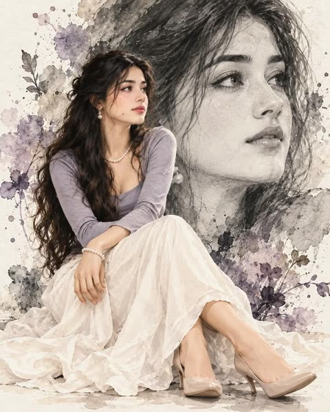</a>

提示词按主体、姿势、背景肖像、风格、色板、光线、构图分块书写，并要求背景大脸与前景人物保持同一身份，再用负面提示词防止脸部漂移和手部错误。

GPT Image 2.5 · 文生图 · 出处: [@Enaya_ai on X](https://x.com/Enaya_ai/status/2103719141849117036) · 56 赞，统计于 2026-10-28

[`watercolor`](tags.md#tag-watercolor) [`fashion-illustration`](tags.md#tag-fashion-illustration) [`portrait`](tags.md#tag-portrait) [`monochrome`](tags.md#tag-monochrome) [`double-exposure`](tags.md#tag-double-exposure)

<details><summary><b>提示词</b></summary>

```text
Create a highly detailed elegant watercolor portrait composition of a beautiful South Asian woman, combining a realistic full-body seated portrait with a large monochrome artistic facial portrait in the background.

Main Subject:
A graceful young South Asian woman sitting elegantly on the floor with her legs gently crossed. She has long, thick, naturally wavy dark-black hair styled loosely with soft strands framing her face. Preserve a realistic, delicate facial structure with expressive almond-shaped eyes, naturally defined eyebrows, a refined nose, soft lips, smooth warm skin tone, and a calm gentle expression while looking toward the right side.

She is wearing an elegant lavender-gray fitted long-sleeve blouse paired with a flowing ivory-white ankle-length skirt made from soft lightweight fabric. The skirt has natural folds and realistic fabric draping. She wears delicate pearl jewelry: a fine pearl necklace, small dangling pearl earrings, and elegant pearl bracelets. Nude-beige high-heeled shoes complete the outfit.

Pose:
She is seated gracefully with both hands resting naturally over one knee, relaxed posture, shoulders slightly turned toward the right, looking peacefully into the distance. Full body visible, including shoes.

Background Portrait:
Behind her, create a large artistic black-and-white close-up portrait of the same woman’s face, occupying most of the upper-right background. The facial identity, hairstyle, eyes, nose, lips, jawline, and overall appearance should remain consistent with the foreground woman. The background portrait should look like a soft graphite-and-watercolor painting, slightly faded and atmospheric, blending naturally into the watercolor background.

Art Style:
Luxury editorial watercolor portrait, sophisticated fashion illustration, realistic watercolor painting combined with delicate pencil/ink details, soft brush strokes, subtle paint bleeding, transparent watercolor washes, cold-pressed textured paper, fine facial details, elegant artistic imperfections, gentle ink splashes and watercolor stains.

Color Palette:
Soft monochrome gray, charcoal, ivory, muted lavender, subtle beige and warm skin tones. Low saturation, sophisticated and timeless.

Lighting:
Soft diffused studio lighting, gentle highlights on the face and clothing, subtle shadows, luminous watercolor atmosphere, no harsh contrast.

Composition:
Vertical portrait composition, foreground woman positioned slightly left of center, large monochrome face extending across the upper-right background, balanced negative space, artistic watercolor splashes around the edges, premium fashion magazine aesthetic.

Quality:
Ultra-detailed, photorealistic facial rendering blended with authentic watercolor texture, realistic anatomy, natural hands and fingers, realistic fabric folds, intricate jewelry details, cinematic composition, premium fine-art portrait, high resolution.

Negative Prompt:
blurry face, distorted anatomy, extra fingers, malformed hands, duplicate person, inconsistent face, different facial identity, deformed eyes, asymmetrical eyes, bad jewelry, plastic skin, oversaturated colors, cartoon, anime, 3D render, CGI, low resolution, harsh lighting, text, watermark, logo.
```

</details>

<a id="gpt-image-pencil-sketch-ghost-portrait-seated-photo"></a>
### 坐姿男子与身后巨幅铅笔素描自画像

<a href="https://x.com/AiWithTariq/status/2102743467449606390"></a>

每一层都用独立的 EXACT 段落描述（概念、背景素描、主体、服装、环境、光线、调色），合成结构清晰。身份锁定段把前景人脸与素描的下颌、脸颊、胡须、鼻形和唇形对齐，再用棕褐单色背景对比全彩人物形成反差。

GPT Image 2.5 · 上传图改图 · 出处: [@AiWithTariq on X](https://x.com/AiWithTariq/status/2102743467449606390) · 55 赞，统计于 2026-10-29

[`pencil-sketch`](tags.md#tag-pencil-sketch) [`layered-composite`](tags.md#tag-layered-composite) [`identity-lock`](tags.md#tag-identity-lock) [`seated-portrait`](tags.md#tag-seated-portrait) [`sepia`](tags.md#tag-sepia)

<details><summary><b>提示词</b></summary>

```text
PROMPT 1 — Pencil Sketch Ghost Portrait + Sharp Seated Photo

CONCEPT — EXACT: A layered composite — a massive detailed charcoal/pencil sketch portrait fills the background, textured like a hand-drawn wall mural with visible pencil strokes and ink-splatter texture, and a sharp full-color seated photorealistic portrait of the same man sits in the foreground on a reflective dark floor.

BACKGROUND SKETCH PORTRAIT — EXACT: Large detailed black-and-white pencil/charcoal sketch, head turned slightly to the side, short spiky textured hair rendered with visible hatch-strokes, wearing thin wire-frame glasses, light beard and moustache, collared shirt with visible fabric-fold linework, rough torn-paper/ink-splatter texture surrounding the sketch blending into a warm sepia-grey wall.

MAIN SUBJECT — FOREGROUND — EXACT: Seated pose on the floor, one leg bent with the knee up and forearm resting on it, other leg extended out to the side, torso turned slightly with head tilted looking off to the side, calm thoughtful expression, short neat dark hair, thin wire-frame glasses, light beard.

MAIN SUBJECT IDENTITY LOCK: Foreground face must match the background sketch exactly — same jaw width, cheek fullness, beard density, nose shape, and lip shape, with natural head-to-body proportion.

BODY: Medium-tan skin tone, lean build, relaxed seated posture.

OUTFIT: Black hooded sweatshirt with drawstrings, light grey jogger sweatpants, white-and-grey sneakers.

BACKGROUND/ENVIRONMENT — EXACT: Warm sepia-grey textured wall filled with the large pencil-sketch portrait and rough ink-splatter marks, dark reflective floor beneath the seated figure showing a soft mirrored reflection.

LIGHTING — EXACT: Soft even studio lighting from the front, minimal harsh shadow, warm neutral tone throughout.

COLOR GRADE — EXACT: Sepia-grey monochrome background sketch contrasted with a natural full-color foreground figure, warm skin tone standing out clearly, clean high-contrast editorial poster color grad
```

</details>

<a id="nano-banana-black-outfit-elevator-selfie"></a>
### 黑色套装男子在电梯里自拍

<a href="https://x.com/pictsbyai/status/2110283970508398966"></a>

提示词逐项锁定姿势、手部位置、发型质感和不锈钢电梯环境，再写明光源、阴影位置和带一点棕褐点缀的低饱和配色。结尾用正面数码自拍构图、深景深、无颗粒和 9:16 画幅收束。

Nano Banana 2.1 · 文生图 · 出处: [@pictsbyai on X](https://x.com/pictsbyai/status/2110283970508398966) · 55 赞，统计于 2026-10-29

[`selfie`](tags.md#tag-selfie) [`elevator`](tags.md#tag-elevator) [`monochrome`](tags.md#tag-monochrome) [`realistic-portrait`](tags.md#tag-realistic-portrait) [`vertical`](tags.md#tag-vertical)

<details><summary><b>提示词</b></summary>

```text
A confident man stands in the center of the frame facing the camera, his weight comfortably shifted and shoulders relaxed, dressed cleanly in a sleek black button-down shirt and matching black slacks. His dark hair features faded sides transitioning into two to three inches of textured wavy curls on top, styled with a matte product and a deep side part that explicitly embraces natural flyaways. Though his face is partially obscured by the smartphone he holds perfectly at face level in his left hand—with his index finger resting naturally on the back of the device—his visible eyes convey an intense, deliberate gaze beneath relaxed eyebrows. His right hand is casually tucked into his front right trouser pocket with the thumb gently hidden, revealing a silver watch gleaming on his wrist. He is positioned within the shallow spatial depth of a polished indoor elevator, standing on a solid dark gray metal floor. In the midground to his left, a small cylindrical brushed metal handrail adds dimension, while the background is entirely dominated by pristine brushed stainless steel elevator door panels featuring clean vertical seams and a perfectly smooth satin finish that bounces cool silver-gray gradients. The cool interior is bathed in even, moderate artificial light beaming downward from two top ceiling panels fitted with grid pattern diffusion covers. This diffused overhead lighting casts soft, gradual-edged gray shadows under his chin and across his chest muscles, while striking specular highlights onto his textured hair, the bridge of his nose, and the sleek metal doors. The environment embraces a desaturated, medium-contrast monochromatic color palette heavily weighted by the silver surroundings and black attire, warmed slightly by a subtle tan accent to evoke a distinctly professional mood. Captured straight on as a digital selfie, the image boasts tack-sharp focus and a deep depth of field that renders every smooth texture crisp and entirely grain-free, finalized with careful contrast enhancement for a realistic, clean aesthetic, all framed in a 9:16 aspect ratio.
```

</details>

<a id="nano-banana-quiet-luxury-suede-menswear-editorial"></a>
### 砂岩墙前的静奢风男装人像

<a href="https://x.com/iamsofiaijaz/status/2112387493178020109"></a>

提示词按服装、姿势、环境、光线和摄影风格分块标注，并指定85mm f/2.8镜头和右上方黄金时刻光线，再用负面提示词排除塑料皮肤和畸形手部。

Nano Banana 2.1 · 文生图 · 出处: [@iamsofiaijaz on X](https://x.com/iamsofiaijaz/status/2112387493178020109) · 55 赞，统计于 2026-10-28

[`menswear`](tags.md#tag-menswear) [`fashion-editorial`](tags.md#tag-fashion-editorial) [`quiet-luxury`](tags.md#tag-quiet-luxury) [`golden-hour`](tags.md#tag-golden-hour) [`portrait`](tags.md#tag-portrait)

<details><summary><b>提示词</b></summary>

```text
Create an ultra-realistic luxury menswear editorial photograph of a stylish, handsome young man with thick, voluminous, swept-back dark brown hair, a neatly trimmed beard and mustache, and black rectangular sunglasses. He is leaning casually against a warm, textured beige sandstone wall, adjusting his sunglasses with one hand while keeping the other hand in his trouser pocket. His expression is calm, confident, masculine, and effortlessly sophisticated.

Outfit: A premium taupe-beige suede zip-up overshirt jacket with a structured collar, double-ended metal zipper, large patch chest pocket, and relaxed tailored fit. Underneath, a crisp white button-down shirt with the collar slightly open and cuffs visible. Matching light beige tailored trousers with subtle pleats. A sophisticated luxury wristwatch with a black leather strap completes the outfit.

Pose and composition: Three-quarter to nearly full-body portrait, subject positioned slightly left of center, body leaning naturally against the wall, one elbow bent as he adjusts his sunglasses, the other hand resting inside his pocket. Relaxed posture with a refined fashion-model presence.

Environment: Minimalist architectural setting with a warm sand-colored textured plaster wall, subtle natural imperfections, earthy brown and beige tones, and no distracting background elements.

Lighting: Soft natural golden-hour sunlight entering from the upper right, creating gentle highlights on the hair, face, suede jacket, and wall. Soft shadows, warm cinematic color grading, realistic skin texture, and beautiful tonal depth.

Photography style: High-end luxury fashion campaign, quiet luxury aesthetic, old-money menswear editorial, photorealistic skin and fabric textures, 85mm portrait lens, f/2.8, shallow depth of field, sophisticated neutral color palette, natural proportions, sharp facial details, premium magazine photography, vertical 2:3 composition, 8K detail.

Negative prompt: cartoon, illustration, CGI, plastic skin, excessive retouching, distorted hands, extra fingers, asymmetrical sunglasses, unnatural body proportions, blurry face, oversaturated colors, harsh flash, artificial lighting, logos, text, watermark, cluttered background.
```

</details>

<a id="gpt-image-golden-hour-seated-fashion-editorial-reference-identity"></a>
### 金色光线影棚中的坐姿奢华时尚大片

<a href="https://x.com/mehvishs25/status/2109637018900951298"></a>

先列出需要保留的面部特征来锁定参考图身份，再把服装、姿势和场景拆成带标签的独立段落。结尾补充镜头与调色关键词，并用较长的负面清单防止换脸和手部变形。

GPT Image 2.5 · 上传图改图 · 出处: [@mehvishs25 on X](https://x.com/mehvishs25/status/2109637018900951298) · 54 赞，统计于 2026-10-28

[`fashion-editorial`](tags.md#tag-fashion-editorial) [`identity-reference`](tags.md#tag-identity-reference) [`golden-hour`](tags.md#tag-golden-hour) [`studio-portrait`](tags.md#tag-studio-portrait) [`negative-prompt`](tags.md#tag-negative-prompt)

<details><summary><b>提示词</b></summary>

```text
Create one ultra-realistic luxury fashion editorial photograph using the uploaded reference girl as the exact identity reference. Preserve her original face, green eyes, freckles, nose, lips, natural skin texture, and long, voluminous dark-brown hair. Do not alter her identity.

Outfit: A fitted deep-burgundy off-shoulder knit top, a chocolate-brown leather jacket draped over her shoulders, a flowing charcoal maxi skirt with a subtle satin sheen, cream leg warmers, chunky cream-and-brown sneakers, and a structured dark-brown shoulder bag with elegant gold hardware. Sophisticated, feminine, contemporary styling with rich textures.

Pose: She sits confidently on the studio floor, one knee raised naturally and the other leg folded comfortably beneath the flowing skirt. One hand gently touches her cheek while the other rests beside her. Her head tilts slightly as she gives the camera a bold, captivating gaze.

Setting: A warm ivory studio wall, soft golden-hour sunlight, delicate diagonal shadows, champagne highlights, and a refined luxury fashion-magazine atmosphere.

Professional DSLR photography, 85mm portrait lens, realistic anatomy, natural skin pores, detailed knitwear and leather, authentic fabric folds, soft depth of field, and premium editorial color grading.

Negative prompt: Altered identity, different face, plastic skin, excessive retouching, incorrect outfit, distorted hands, extra fingers, twisted legs, broken joints, floating feet, unnatural proportions, CGI, cartoon, blur, text, logos, or watermarks.

Output: One individual high-resolution, photorealistic fashion photograph with natural anatomy and impeccable styling.
```

</details>

<a id="gpt-image-pink-outfit-woman-beside-guitar-mural-of-herself"></a>
### 粉色穿搭女子与墙上自己的吉他壁画

<a href="https://x.com/Kubra_286/status/2102390516792832257"></a>

提示词把真人与壁画并列描写,反复强调脸、服装和高马尾一致,让墙上的画像与本人对应。服装、发型、妆容、配饰分行列出,再加雨天小巷场景和负面提示词,保持写实质感。

GPT Image 2.5 · 上传图改图 · 出处: [@Kubra_286 on X](https://x.com/Kubra_286/status/2102390516792832257) · 54 赞，统计于 2026-10-29

[`mural`](tags.md#tag-mural) [`selfie`](tags.md#tag-selfie) [`photoreal`](tags.md#tag-photoreal) [`street-fashion`](tags.md#tag-street-fashion) [`vertical`](tags.md#tag-vertical)

<details><summary><b>提示词</b></summary>

```text
Create an ultra realistic cinematic visual of a woman standing in front of a brick wall that has a large mural painting of herself playing acoustic guitar with flying musical notes, treble clefs and music staff waves, while she is listening to music with black wired headphones, both hands holding the headphones on her ears.

Woman outfit: light pink blazer, black croptop blouse, light pink pleated mini skirt fold, white mary jane doll shoes with bow.

Face match 100%

Hair: high ponytail, long wavy hair, natural black.

Makeup: pink lips, thick eyelashes, peach blush, light natural glam.

Accessories: pink gemstone necklace, pink drop earrings.

The mural painting on the bricks is similar to her — same face, same outfit (pink blazer, pink pleated skirt, black top), same high ponytail, playing brown acoustic guitar, surrounded by black musical notes and G-clefs.

The woman is standing on a sidewalk, puddles on ground, old brick wall with some green vines, urban alley background.

True to life color grading, photorealistic, DSLR 8K, cinematic natural daylight, ultra detailed skin, same face recognizable, 9:16 vertical aspect ratio.
*Negative prompt / to avoid (if your app has it):*
blurry, cartoon, anime, painting style on real person, distorted face, extra fingers, low quality, over saturated
```

</details>

<a id="nano-banana-paris-street-fashion-portrait-eiffel"></a>
### 黑色大衣男子与埃菲尔铁塔街拍

<a href="https://x.com/pictsbyai/status/2111733521924456499"></a>

提示词依次写主体、姿态与造型、场景、光线方向、色调和相机参数。它指定了85mm镜头、f/2.8光圈、左前方45度硬光和9:16画幅，所以画面像真实的街头时尚摄影。

Nano Banana 2.1 · 文生图 · 出处: [@pictsbyai on X](https://x.com/pictsbyai/status/2111733521924456499) · 53 赞，统计于 2026-10-29

[`street-fashion`](tags.md#tag-street-fashion) [`paris`](tags.md#tag-paris) [`hard-light`](tags.md#tag-hard-light) [`85mm`](tags.md#tag-85mm) [`vertical`](tags.md#tag-vertical)

<details><summary><b>提示词</b></summary>

```text
A stylish man in a heavy black winter coat and textured grey sweater stands centered, facing the camera at a slight angle with relaxed shoulders. He wears sunglasses and flashes a broad, candid, open-mouthed smile showing his teeth. His short-to-medium hair features a wavy top and faded sides, styled with a matte product that highlights its natural texture and delicate sunlit flyaways. His left hand rests organically on his hip and thigh, casually displaying a silver watch and gold ring, while his right hand is tucked comfortably into his pocket. He is positioned on a grey asphalt street marked with solid white crosswalk paint, surrounded by a slightly blurred midground. To the left, a pristine classic Parisian building showcases perfectly smooth, warm cream cut stone with elegant architectural moldings, arched windows, and iron balconies. Thriving autumn trees with yellowing foliage frame the street alongside faint cars and street signs. In the spatial background, the pristine lattice structure of the Eiffel Tower rises beautifully in the top right corner against a clear sky-blue backdrop. The cheerful scene is bathed in bright, highly directional natural sunlight originating from a front-left 45-degree angle, generating a warm, high-contrast aesthetic. This hard light preserves striking highlights on the left side of his face and the grey sweater's fabric, while casting short, harsh, and deep black shadows with defined edges under his chin, across the right side of his face, and along his dark coat. A complementary color palette merges moderate saturation with an energetic, sunny atmosphere, softened just enough by ambient fill light. Captured as a realistic digital photograph from a straight-on perspective, the image utilizes an 85mm lens at f/2.8 and a fast shutter speed with daylight white balance to achieve a tack-sharp, grain-free subject against a medium depth of field. Drawing from clean men's street fashion photography, the final piece features a warm color grade and contrast enhancement, elegantly framed in a 9:16 aspect ratio.
```

</details>

<a id="gpt-image-night-street-white-sweatshirt-light-trails-portrait"></a>
### 霓虹光轨夜街白卫衣人像

<a href="https://x.com/iamsofiaijaz/status/2113137432254173633"></a>

提示词把光线拆成暖橙红背光、冷青补光和机顶闪光，人物保持清晰，车流则被拉成长曝光光轨。35mm 胶片颗粒、构图指令（腰部以上、居中、4:5）和排除清单共同保证皮肤质感真实。

GPT Image 2.5 · 文生图 · 出处: [@iamsofiaijaz on X](https://x.com/iamsofiaijaz/status/2113137432254173633) · 52 赞，统计于 2026-10-28

[`night-street`](tags.md#tag-night-street) [`fashion-editorial`](tags.md#tag-fashion-editorial) [`long-exposure`](tags.md#tag-long-exposure) [`film-grain`](tags.md#tag-film-grain) [`streetwear`](tags.md#tag-streetwear)

<details><summary><b>提示词</b></summary>

```text
A cinematic, photorealistic fashion editorial portrait of a young woman standing on a city street at night, with a short, voluminous dark brown wavy bob haircut, soft curtain bangs, natural glowing skin, subtle freckles, warm blush, glossy nude lips, and minimal natural makeup. She wears an oversized white crewneck sweatshirt with relaxed, voluminous sleeves and high-waisted blue denim jeans, with both hands casually tucked into her front pockets.

She is positioned in the center of the frame, photographed from the hips up, looking directly into the camera with a calm, confident, effortlessly cool expression. The background features a dark urban street with dramatic orange-red streetlights, vibrant cyan and teal illumination, and horizontal streaks of red, orange, and turquoise light created by long-exposure motion blur from passing traffic.

Lighting and color grading: Warm orange-red backlighting illuminating the background, cool cyan fill light along the lower sides, direct on-camera flash softly illuminating the subject's face and white sweatshirt, strong contrast between warm and cool tones, deep cinematic shadows, subtle film grain, slightly dreamy analog-film texture.

Photography style: Contemporary streetwear campaign, high-end fashion photography, 35mm film aesthetic, candid editorial mood, realistic skin texture, sharp facial focus, shallow depth of field, motion-blurred background, natural proportions, imperfect film-like details, balanced composition, authentic nighttime city atmosphere.

Vertical portrait, 4:5 aspect ratio, medium shot, subject centered, ultra-realistic photography, high detail, premium fashion magazine quality.

Avoid: cartoon rendering, CGI, plastic skin, excessive retouching, oversaturated colors, distorted anatomy, extra fingers, blurry face, artificial facial features, text, logos, watermarks.
```

</details>

<a id="nano-banana-lake-como-tuxedo-teacup-portrait"></a>
### 湖畔露台上身着礼服啜饮茶的男子

<a href="https://x.com/pictsbyai/status/2114995012962234778"></a>

提示词把人物放在右三分之一，并用左下角的石柱做不对称平衡。再逐项写明发型、手部姿势、硬质黄金时刻光线、阴影边缘以及镜头、ISO 和快门参数，得到清晰锐利的杂志风画面。

Nano Banana 2.1 · 文生图 · 出处: [@pictsbyai on X](https://x.com/pictsbyai/status/2114995012962234778) · 52 赞，统计于 2026-10-29

[`old-money`](tags.md#tag-old-money) [`golden-hour`](tags.md#tag-golden-hour) [`editorial-portrait`](tags.md#tag-editorial-portrait) [`menswear`](tags.md#tag-menswear) [`travel-photography`](tags.md#tag-travel-photography)

<details><summary><b>提示词</b></summary>

```text
A young handsome man with light stubble along his jawline stands in profile on the right third of the frame, dressed in an impeccably tailored black shawl-lapel tuxedo, a crisp white pleated dress shirt, a black bow tie, and a neatly folded white pocket square. His sandy blonde to light brown hair is styled in a classic tapered scissor cut, cleanly tapered around the ears to the mid-neck on the back and sides, while the longer three-to-four-inch layered top is swept forward and slightly to the right, showcasing a natural wavy texture with a matte, light-hold finish, subtle golden-hour frizz, and loose flyaways at the crown without any harsh part line. With centered weight and level shoulders, he projects a calm, deliberately posed expression with relaxed eyebrows as he gazes serenely to the left across the water, his lips pursed against the rim of a crisp white ceramic cup mid-sip. His relaxed right hand is raised to his mouth, holding the teacup with his index and middle fingers curled through and around the handle, his thumb resting against the side, and his ring and pinky fingers tucked neatly underneath, while his left arm hangs naturally down along his side toward the lower frame edge. He stands on an outdoor lakeside terrace overlooking an Italian alpine lake resembling Lake Como, asymmetrically balanced by a weathered stone balcony pillar in the bottom-left foreground and a black painted iron balustrade with a curved top scroll spanning the lower third. The pillar features a smooth, warm beige-gray square limestone cap with a beveled edge and fine stone pitting atop an unfinished, patchy gray rough-cast stucco base. Beyond the terrace in the midground, pristine deep blue lake water stretches out with fine wind ripples and a tiny distant white boat wake on the left. In the background, steep mountain slopes covered in thriving, muted olive-brown mixed deciduous and evergreen alpine forests rise dramatically, with clusters of pastel lakeside village buildings nestled along the shoreline and a single small white cumulus cloud floating in the expansive clear blue sky above the peak. The scene is illuminated by bright, highly directional, hard golden-hour sunlight coming from a low angle on the front-left, creating a serene, affluent, and romantic atmosphere with high contrast and a warm complementary color palette. Preserved warm highlights catch the subject's forehead, nose bridge, cheekbone, right hand, the white ceramic cup, and the top of the limestone pillar cap, while long, deep black shadows with harsh defined edges fall across the back of his head and suit, cast a sharp diagonal line across the stone pillar cap, and drape across the distant mountain slopes, all subtly balanced by soft, cool ambient skylight filling the shaded areas. Captured straight-on as a clean, tack-sharp digital photograph typical of a 26mm to 35mm lens at f/2.8 to f/5.6, ISO 64, and 1/1000s shutter speed, the image maintains a deep depth of field that keeps the foreground pillar, the subject, the lake ripples, and the distant mountain ridges in crisp focus, blending Old Money lifestyle aesthetics, classic European luxury travel photography, and editorial menswear portraiture with grain-free realism, minimal retouching that preserves natural skin and hair textures, and subtle warm color grading in the highlights, framed in a 3:4 aspect ratio.
```

</details>

<a id="gpt-image-five-color-block-outfits-seated-armchair-portrait"></a>
### 五色色块换装与扶手椅坐姿人像

<a href="https://x.com/Arina_hoqe/status/2104898420255453267"></a>

每个色块面板单独指定颜色、姿势和服装，底部的颜料滴落衔接到白色下半区的大幅坐姿照。六处人脸重复写明身份锁定，并分别为面板和坐姿照指定镜头，保证人脸一致。

GPT Image 2.5 · 上传图改图 · 出处: [@Arina_hoqe on X](https://x.com/Arina_hoqe/status/2104898420255453267) · 50 赞，统计于 2026-10-29

[`color-block`](tags.md#tag-color-block) [`paint-drip`](tags.md#tag-paint-drip) [`identity-lock`](tags.md#tag-identity-lock) [`outfit-variations`](tags.md#tag-outfit-variations) [`selfie`](tags.md#tag-selfie)

<details><summary><b>提示词</b></summary>

```text
PROMPT 2 — Five Color-Block Outfits + Seated Portrait (Female)

CONCEPT — EXACT: A vertical poster composite — five tall color-block panels in a row across the top, each holding a standing portrait of the same woman in a different outfit matching that panel's color, with the bottom of each panel melting into dripping paint splashes in the same color over a clean white background, and below them a larger seated portrait of her on an ornate teal armchair.

PANEL COLORS (left to right): bright blue, red, green, navy, orange — each panel a solid flat color with the woman cropped from the head to mid-thigh, and the panel's lower edge dissolving into a paint splash with long vertical drips running down onto the white background.

PANEL 1 (blue): Standing straight, arms relaxed at her sides, soft calm smile, light-wash denim jacket over a white top, jeans.
PANEL 2 (red): Standing with one hand on the hip, soft calm smile, red sleeveless V-neck pleated midi dress.
PANEL 3 (green): Standing straight, arms relaxed, soft calm smile, emerald-green satin button-up blouse tucked into black bottoms.
PANEL 4 (navy): Standing straight, one hand resting lightly near the waist, soft calm smile, tailored navy blazer with a matching navy top and trousers, slim wristwatch.
PANEL 5 (orange): Standing straight, hands near the pockets, soft calm smile, casual short-sleeve graphic tee with bold abstract street-style lettering (no readable brand text) over blue jeans.

SEATED PORTRAIT — EXACT: Seated on an ornate Rococo-style teal velvet armchair with carved scrolled wooden frame, legs crossed elegantly, one arm resting along the armrest, other hand resting near the knee, torso slightly turned, head tilted with a confident warm closed-mouth smile toward camera.

MAIN SUBJECT IDENTITY LOCK: All six instances of the face (five panels + seated portrait) must match the reference photo exactly — same jaw width, cheek fullness, eyebrow shape, eye shape and color, nose bridge, lip shape, and hair as in the reference. Identical face in every instance with zero drift.

BODY: Slim build, poised confident posture in every instance.

OUTFIT (seated portrait): Deep red satin spaghetti-strap cami top, black high-waisted wide-leg trousers, black pointed-toe heels.

BACKGROUND — EXACT: Pure clean white studio background below the color-block panels, soft grounded shadow beneath the armchair, paint splashes and drips in blue, red, green, navy, and orange spreading down from the bottom edge of each color panel.

LIGHTING — EXACT: Soft even bright studio lighting on all six instances, gentle natural shadow definition, clean high-key commercial lighting.

COLOR GRADE — EXACT: Vivid saturated block colors (blue, red, green, navy, orange) against a pure white base, teal chair as a rich accent, natural warm skin tone throughout, crisp glossy editorial color grading with ultra-detailed 8K sharpness.

CAMERA: Shot on 85mm lens for the panels and 50mm for the seated portrait, sharp focus on the face in every instance.

Ultra photorealistic — zero AI artifacts, no watermark.

IMPORTANT — Use ONLY my uploaded face reference image for the facial structure and identity in ALL SIX instances of my likeness across this composite. My face must remain EXACTLY the same as my real appearance with zero identity change. Preserve my exact hairstyle, hairline, forehead shape, eyebrows, eye shape, nose structure, lips, jawline, skin tone, facial texture, and feminine proportions exactly as shown in the uploaded image. Do NOT beautify, cartoonize, smooth skin, or replace my face with a random celebrity or model face. Identity preservation is the highest priority across all instances of my likeness in this composite.

Gnrat ratio 3:4
```

</details>

<a id="gpt-image-seaside-viewpoint-smartphone-selfie"></a>
### 戴白色棒球帽的海边观景台手机自拍

<a href="https://x.com/MissDelulu9/status/2115357570722566196"></a>

先限定从帽顶到下腰的取景，再写明面料细节、单侧强烈正午阳光和手机压缩感，让画面像随手拍。结尾列出要避免的塑料皮肤和影棚质感，防止成品显得摆拍。

GPT Image 2.5 · 文生图 · 出处: [@MissDelulu9 on X](https://x.com/MissDelulu9/status/2115357570722566196) · 48 赞，统计于 2026-10-28

[`smartphone-photo`](tags.md#tag-smartphone-photo) [`travel-selfie`](tags.md#tag-travel-selfie) [`seaside`](tags.md#tag-seaside) [`natural-light`](tags.md#tag-natural-light) [`casual-portrait`](tags.md#tag-casual-portrait)

<details><summary><b>提示词</b></summary>

```text
A real vertical smartphone travel snapshot of a young adult woman in her early 20s at a seaside viewpoint, framed from the top of her white baseball cap to the lower waist in a close front-facing medium portrait. She stands or leans near a wall, very close to the camera, at street.

She wears a white ribbed scoop-neck tank top and a lightweight white jacket half-slipped off her shoulders, with visible rib texture, wrinkles, snap-button and zipper details, and a small strip of lower abdomen visible above a white bottom waistband.

Her hair is deep black, long, side-tied or in a low side ponytail, falling over the left shoulder with windblown strands around her face. She has a small oval face, soft jawline, natural East Asian features, sheer clean vacation makeup, muted pink-coral lips, and a calm expression with lips closed.

Her eyes look gently toward the camera from under the cap brim shadow. Keep the small black logo mark on the cap front, not flipped and not oversized. Strong midday sun from the upper left creates hard highlights and cool ocean-reflected shadows.

Natural skin texture, slightly imperfect framing, subtle phone compression, deep smartphone depth of field. Avoid plastic skin, studio polish, heavy makeup, exaggerated proportions, wrong logo, app UI, cartoon or CGI style
```

</details>

<a id="gpt-image-blush-pleated-couture-gown-beauty-portrait"></a>
### 腮红粉褶皱高定礼服美妆人像

<a href="https://x.com/mehvishs25/status/2100051238041932083"></a>

提示词把发型、眼妆、姿态和手部位置分段描述，再单独用一段写礼服面料的褶皱与阴影细节。结尾补充棚拍光线、85mm镜头，并用负面提示词压制塑料皮肤和畸形手指。

GPT Image 2.5 · 文生图 · 出处: [@mehvishs25 on X](https://x.com/mehvishs25/status/2100051238041932083) · 45 赞，统计于 2026-10-29

[`fashion`](tags.md#tag-fashion) [`beauty-portrait`](tags.md#tag-beauty-portrait) [`pleated-gown`](tags.md#tag-pleated-gown) [`studio-lighting`](tags.md#tag-studio-lighting) [`editorial`](tags.md#tag-editorial)

<details><summary><b>提示词</b></summary>

```text
Create a photorealistic high-fashion beauty portrait of an elegant adult woman with same features and luminous natural skin. She has long, perfectly straight, glossy black hair, sleekly parted down the center and falling smoothly behind her shoulders. Her almond-shaped dark brown eyes are softly defined with subtle eyeliner and warm neutral eyeshadow. She has naturally shaped brows, soft peach blush, radiant cheekbones, and glossy muted nude-pink lips.

She poses gracefully with her head slightly tilted upward and turned subtly toward the camera, giving a calm, sophisticated, confident expression. One delicate hand is raised beside her face, with her fingertips gently touching beneath her chin. Natural elegant fingers and realistic hands.

She is wrapped in an exquisite blush-pink pleated couture gown made from lightweight sculptural fabric. The fabric forms dramatic oversized pleated folds that sweep around her shoulders, arms, and torso like flowing architectural waves, creating a luxurious sculptural silhouette while remaining elegant and tasteful. Fine accordion pleats are highly detailed and realistic, with soft dimensional shadows between every fold.

Minimalist studio background in warm soft gray, with large flowing pleated fabric shapes surrounding her like an artistic backdrop. Soft diffused beauty lighting illuminates her face evenly, creating subtle highlights on her cheekbones, shoulder, and glossy hair. Premium beauty campaign aesthetic, sophisticated editorial photography, dreamy feminine atmosphere, ultra-realistic skin texture, realistic fabric detail, cinematic depth of field, 85mm portrait lens, high-end fashion magazine quality, vertical composition, photorealistic.

Negative prompt: text, logos, watermark, symbols, stickers, borders, social media UI, excessive makeup, plastic skin, over-smoothed face, distorted hands, extra fingers, malformed fingers, asymmetrical eyes, unrealistic hair, messy hair, cartoon, illustration, CGI, low resolution, blur, oversaturated colors.
```

</details>

<a id="gpt-image-low-angle-red-gown-manhattan-vintage-car"></a>
### 低机位红色褶皱长裙与复古老爷车时尚大片

<a href="https://x.com/frametheory058/status/2106379728303309011"></a>

低机位加 24mm 广角让摩天楼向上汇聚，长裙在画面中展开成巨大的扇形。深红、焦橙与青绿的互补配色，加上真实相机参数和瑕疵描述，让画面更接近实拍而不是合成感。

GPT Image 2.5 · 文生图 · 出处: [@frametheory058 on X](https://x.com/frametheory058/status/2106379728303309011) · 45 赞，统计于 2026-10-29

[`fashion-editorial`](tags.md#tag-fashion-editorial) [`low-angle`](tags.md#tag-low-angle) [`pleated-gown`](tags.md#tag-pleated-gown) [`street-photography`](tags.md#tag-street-photography) [`manhattan`](tags.md#tag-manhattan)

<details><summary><b>提示词</b></summary>

```text
A striking high-fashion editorial photographed from an extreme low street-level angle in Manhattan, New York. A beautiful young woman with fair natural skin and softly windswept light-brown hair stands confidently beside a polished vintage burnt-orange sedan with classic round headlights. She wears an extravagant floor-length crimson red pleated gown with a clean sleeveless silhouette, holding the flowing fabric outward with both hands so the dress spreads dramatically across the frame like a giant sculptural fan.

Her posture feels effortless yet powerful — shoulders relaxed, head tilted toward the sky, eyes gently closed, hair catching the breeze. Above her, a scattered flock of white and grey city pigeons sweeps across a vivid turquoise-blue sky, adding spontaneous movement and scale.

Massive Manhattan skyscrapers rise steeply on both sides of the frame, converging toward the sky and creating dramatic architectural leading lines. The vintage orange car remains partially visible in the foreground, its chrome details catching small highlights from the sun.

Warm late-afternoon sunlight cuts naturally between the buildings, producing realistic directional shadows, subtle rim light around her hair and dress, and beautiful reflections across the car. Deep crimson fabric against burnt orange paint, turquoise sky and warm stone architecture. Rich but believable editorial color grading, realistic skin pores and texture, individual hair strands, extremely detailed pleated fabric, natural cloth physics, authentic street imperfections, realistic reflections and shadows.

Shot as a real luxury fashion campaign on a full-frame camera, 24mm wide-angle lens, f/4, low camera position, crisp subject detail, controlled highlights, subtle photographic grain, sophisticated magazine-cover composition, cinematic fashion photography, timeless 1990s editorial influence mixed with contemporary luxury campaign photography, photorealistic, tactile, imperfect, expensive, absolutely no CGI or synthetic AI aesthetic --ar 2:3 --style raw --stylize 750 --q 2
```

</details>

<a id="gpt-image-bag-pov-ios-incoming-call-portrait"></a>
### 包内视角人像叠加 iOS 来电界面

<a href="https://x.com/TheVirtualMuse/status/2110015285323559093"></a>

镜头设在毛绒内衬包内向上拍，绒毛自然成框，前景透视变形的手指增加纵深。界面文字逐一写明，并明确要求以参考图锁定面部，因此来电界面文字准确、人物身份稳定。

GPT Image 2.5 · 上传图改图 · 出处: [@TheVirtualMuse on X](https://x.com/TheVirtualMuse/status/2110015285323559093) · 43 赞，统计于 2026-10-28

[`face-reference`](tags.md#tag-face-reference) [`pov`](tags.md#tag-pov) [`ios-ui-overlay`](tags.md#tag-ios-ui-overlay) [`street-style`](tags.md#tag-street-style) [`realistic`](tags.md#tag-realistic)

<details><summary><b>提示词</b></summary>

```text
Use my uploaded photo as the face reference. 3:4 vertical. Point-of-view shot from inside a grey fleece-lined bag looking up. The soft
fuzzy lining frames every edge of the image. the person in reference, keeping her exact face, hairstyle and identity, reaches down into the
bag toward the camera, her fingers foreshortened in the foreground and stacked with chunky silver rings. She wears a black ribbed beanie,
black oval sunglasses, a navy blazer and a blue-and-white striped shirt: a white London
townhouse with a dark grey-green front door numbered 27, black iron railings and a small olive tree. Overlaid iOS incoming call interface
in white system font: a "Message" button on the left and a "Voicemail" button on the right as frosted round icons, and at the bottom a
frosted glass pill slider reading "slide to answer" with a white circle holding a green phone icon. Natural daylight, candid street-style
fashion photography, realistic skin texture.
Make it realistic
Improve its colour grading
```

</details>

<a id="nano-banana-cottagecore-golden-hour-reading-portrait"></a>
### 金色黄昏树下读书的田园风女子

<a href="https://x.com/TheVirtualMuse/status/2110737749733195788"></a>

先用身份锁定段落保留参考图人脸，再把场景、发型、服装、光线、调色和镜头分块描述，模型执行更清晰。指定85mm f/1.8镜头、左上斜射阳光和Portra 400色调，得到柔和焦外与暖调胶片感。

Nano Banana 2.1 · 上传图改图 · 出处: [@TheVirtualMuse on X](https://x.com/TheVirtualMuse/status/2110737749733195788) · 41 赞，统计于 2026-10-28

[`cottagecore`](tags.md#tag-cottagecore) [`golden-hour`](tags.md#tag-golden-hour) [`fashion-editorial`](tags.md#tag-fashion-editorial) [`identity-lock`](tags.md#tag-identity-lock) [`portrait`](tags.md#tag-portrait)

<details><summary><b>提示词</b></summary>

```text
Using the uploaded reference image, create an exceptionally beautiful, ultra-photorealistic 4:5 vertical cottagecore fashion editorial photograph.

IDENTITY LOCK:
Preserve the exact facial identity of the woman from the reference image, including her natural facial structure, expressive eyes, delicate nose, lips, eyebrows, skin tone, and recognizable features. No face reshaping, artificial beautification, or identity changes. She must look like the same real woman photographed in a different setting.

SCENE & COMPOSITION:
A breathtakingly peaceful woodland meadow during the final hour before sunset. The woman sits gracefully on the soft forest floor, leaning naturally against the textured bark of a magnificent old tree. Her legs rest comfortably to one side, partially surrounded by delicate wildflowers and lush green grass.

She holds a small vintage sage-green hardcover book with both hands, quietly reading with her eyes lowered toward the pages. Her expression is soft, thoughtful, and effortlessly adorable, with naturally relaxed lips and a peaceful gaze.

HAIR & STYLING:
Her beautiful, naturally dark brown hair falls in long, soft, slightly tousled waves over her shoulders and down her back. A few delicate strands frame her face, catching the golden sunlight. Individual hair strands remain naturally visible.

OUTFIT:
A romantic vintage-inspired ivory cottagecore maxi dress featuring tiny dusty-pink floral prints, a delicate square neckline with subtle lace detailing, softly gathered puff sleeves, ruffled cuffs, and a thin blush-pink ribbon tied at the bodice. Premium lightweight cotton fabric with authentic folds, delicate stitching, and natural movement.

LIGHTING — CINEMATIC GOLDEN HOUR:
Absolutely breathtaking natural golden-hour lighting.

Warm late-afternoon sunlight enters diagonally from the upper left, filtering through the woodland canopy and creating beautiful golden highlights across her dark hair, cheekbones, shoulders, and dress.

Delicate amber rim lighting outlines her silhouette. Soft natural shadows sculpt her facial features while subtle reflected light maintains realistic skin tones.

Beautiful scattered sunlight creates glowing circles of bokeh in the background. Highlights remain controlled, with rich shadow detail and a natural cinematic contrast.

PREMIUM COLOR GRADING:
An exquisite luxury editorial film grade inspired by Kodak Portra 400.

Rich honey-gold sunlight, luminous champagne highlights, sophisticated olive-green foliage, muted sage undertones, creamy ivory fabrics, delicate dusty-pink floral accents, and naturally warm skin tones.

Deep forest greens provide elegant cinematic contrast against the glowing subject.

Soft highlight roll-off, slightly lifted shadow detail, gentle organic film grain, beautifully balanced saturation, natural color separation, and refined tonal depth.

The overall palette should feel warm, romantic, expensive, nostalgic, and visually irresistible.

PHOTOGRAPHY:
Captured like an authentic luxury fashion editorial on a full-frame professional camera with an 85mm portrait lens at f/1.8.

Perfectly natural human proportions, realistic perspective, precise focus on her face and eyelashes, detailed skin pores, subtle facial imperfections, authentic hair texture, and physically accurate hands.

Beautiful shallow depth of field with exceptionally smooth optical bokeh. Foreground wildflowers are softly blurred, creating a natural sense of depth.

The framing feels intimate yet cinematic, with her beautiful face, upper body, hands, book, and flowing dress clearly visible.

FINAL AESTHETIC:
A breathtaking fusion of timeless countryside romance, premium fashion photography, and intimate cinematic storytelling.

The photograph should feel like a genuine, professionally captured editorial image from a high-end fashion magazine.

Extremely beautiful yet believable, emotionally captivating, naturally elegant, and instantly eye-catching.
```

</details>

<a id="gpt-image-sun-disintegration-doves-selfie-portrait"></a>
### 男子身体碎裂成黑色碎片,背后是橙色巨日

<a href="https://x.com/AiWithTariq/status/2102054027605459193"></a>

提示词先用一串面部特征锁定参考图中的人物身份,再写清服装、姿势和构图。它只让半边身体向碎片与粒子过渡,用远近不同的白鸽增加层次,最后用负面提示词防止脸部走样和手部错误。

GPT Image 2.5 · 上传图改图 · 出处: [@AiWithTariq on X](https://x.com/AiWithTariq/status/2102054027605459193) · 40 赞，统计于 2026-10-29

[`selfie`](tags.md#tag-selfie) [`disintegration`](tags.md#tag-disintegration) [`surreal`](tags.md#tag-surreal) [`cinematic`](tags.md#tag-cinematic) [`reference-photo`](tags.md#tag-reference-photo)

<details><summary><b>提示词</b></summary>

```text
Create a highly realistic cinematic full-body portrait of the person from the reference image. Preserve the exact facial identity, facial structure, hairstyle, skin tone, beard, eyes, nose, lips, and natural body proportions.

The man is standing confidently in a relaxed pose with both hands naturally inside his pants pockets. He is wearing a dark charcoal oversized sweatshirt, black cargo pants, a black wristwatch, and black sneakers.

Behind him is a huge textured burnt-orange circular sun, creating a powerful cinematic backdrop. The left side of his entire body is dramatically disintegrating into thousands of black and dark-gray geometric fragments, dust, tiny particles, and shattered pieces flying toward the left side of the frame. The transition from solid body to particles must look extremely realistic and seamless.

Several beautiful white doves are flying around him at different distances, with realistic feathers and natural wing positions.

Dark cinematic studio background, smoky atmosphere, floating dust, dramatic volumetric lighting, soft shadows, subtle orange rim light from the giant sun, realistic fabric texture, photorealistic skin.

Professional cinematic photography, surreal conceptual art, Hollywood movie-poster quality, ultra-detailed, realistic physics, HDR, sharp face, 35mm lens, full-body composition, cinematic depth of field, subtle film grain.

Vertical 4:5 composition, subject centered, entire body and shoes visible.

Negative prompt: cartoon, anime, illustration, plastic skin, CGI face, altered identity, distorted face, extra fingers, extra limbs, deformed hands, duplicate person, unnatural anatomy, blurry face, low quality, text, logo, watermark.
```

</details>

<a id="gpt-image-blue-streetwear-portrait-white-doodle-overlay"></a>
### 蓝色街头风人像搭配白色手绘涂鸦

<a href="https://x.com/AiwithBloodline/status/2114366276743352666"></a>

提示词用 JSON 分成元信息、主体、服装、图形元素和复原要点，只锁定参考图的面部，并明确列出服装、姿势、光线和背景不要照搬。蓝底蓝衣加白色线稿的配色，让照片层与矢量层分离清晰。

GPT Image 2.5 · 上传图改图 · 出处: [@AiwithBloodline on X](https://x.com/AiwithBloodline/status/2114366276743352666) · 39 赞，统计于 2026-10-29

[`json-prompt`](tags.md#tag-json-prompt) [`face-reference`](tags.md#tag-face-reference) [`doodle-overlay`](tags.md#tag-doodle-overlay) [`blue-palette`](tags.md#tag-blue-palette) [`streetwear`](tags.md#tag-streetwear)

<details><summary><b>提示词</b></summary>

```text
{
  "meta": {
    "image_quality": "High",
    "image_type": "Mixed Media (Photography + Vector Illustration)",
    "reference_image_usage": "Use the attached image strictly for facial identity matching only. Face shape, beard, glasses, eyes, nose, lips, and hair texture must match exactly. Do not copy clothing, lighting, or background from the reference.",
    "resolution_estimation": "High resolution, sharp vector edges",
    "file_characteristics": {
      "compression_artifacts": "Low",
      "noise_level": "None",
      "lens_type_estimation": "Standard portrait look (35–50mm equivalent)"
    }
  },
  "global_context": {
    "scene_description": "A full-body studio portrait of a young man in a dynamic, confident pose against a solid bright blue background. The image blends realistic photography with white hand-drawn vector doodles and abstract blue liquid shapes, creating a modern street-art editorial look.",
    "environment_type": "Studio / Graphic Design Composition",
    "atmosphere": "Energetic, urban, creative, cool",
    "lighting": {
      "source": "Artificial studio lighting",
      "direction": "Front-right dominant",
      "quality": "Soft and diffused",
      "color_temperature": "Neutral white"
    },
    "color_palette": {
      "dominant_colors": [
        "Bright blue background",
        "Deep blue clothing",
        "White graphic accents"
      ],
      "contrast_level": "High"
    }
  },
  "composition": {
    "camera_angle": "Low-angle, slightly upward",
    "framing": "Full body (head to toe)",
    "depth_of_field": "Deep focus",
    "focal_point": "Face and upper torso",
    "balance": "Asymmetrical with graphics filling negative space"
  },
  "subject": {
    "identity_source": "Attached reference image",
    "gender": "Male",
    "pose": "Standing with relaxed confidence, body angled slightly right, head tilted slightly left, one hand raised near the face, legs casually crossed",
    "expression": "Neutral, confident, calm",
    "face_constraints": {
      "glasses": "Round black eyeglasses",
      "facial_hair": "Trimmed beard",
      "hair": "Short, slightly tousled",
      "must_match_reference": true
    }
  },
  "wardrobe": {
    "style": "Monochromatic blue streetwear",
    "upper_body": "Blue fleece-style jacket worn open",
    "inner_layer": "Blue t-shirt with large white abstract graphic symbol",
    "lower_body": "Dark blue denim jeans with visible white contrast stitching and rolled cuffs",
    "footwear": "Clean white low-top sneakers"
  },
  "graphic_elements": {
    "style": "Hand-drawn white vector doodles",
    "elements": [
      "Microphone outline near raised hand",
      "Boombox line-art floating to the side",
      "Radiating sound or motion lines around head",
      "Cracked ground illustration beneath feet"
    ],
    "background_graphics": "Abstract blue liquid shapes layered behind the subject"
  },
  "background_details": {
    "color": "Solid bright blue",
    "texture": "Flat, uniform",
    "lighting_behavior": "Even, shadow-free background"
  },
  "reconstruction_notes": {
    "mandatory": [
      "Exact facial identity match from reference image",
      "Full-body pose",
      "Blue-on-blue color harmony",
      "White doodle overlays",
      "Sharp separation between photo and vector layers"
    ],
    "do_not_copy_from_reference": [
      "Clothing",
      "Pose",
      "Lighting",
      "Background"
    ],
    "intended_use": "High-impact editorial image or start frame for image-to-video animation"
  }
}
```

</details>

<a id="nano-banana-luxury-mirror-selfie-paisley-headscarf"></a>
### 戴佩斯利头巾和黑色高领毛衣的奢华镜前自拍

<a href="https://x.com/TheVirtualMuse/status/2110656946558611743">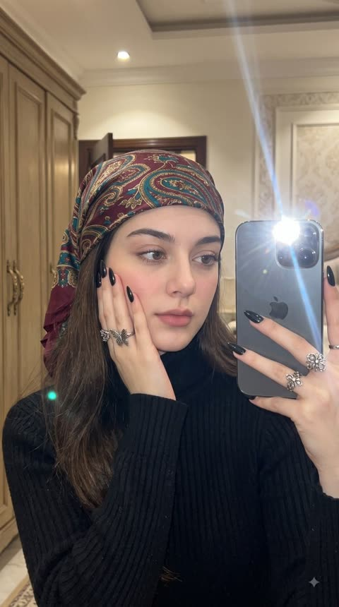</a>

先用严格的身份锁定保留参考图人脸,再按发型、服饰、姿势、妆容、背景、光线分段描述,细节都可控。手机直闪混合暖色钨丝灯光,再用一长串否定词排除磨皮和AI感,画面更像真实照片。

Nano Banana 2.1 · 上传图改图 · 出处: [@TheVirtualMuse on X](https://x.com/TheVirtualMuse/status/2110656946558611743) · 38 赞，统计于 2026-10-28

[`mirror-selfie`](tags.md#tag-mirror-selfie) [`identity-lock`](tags.md#tag-identity-lock) [`flash-photography`](tags.md#tag-flash-photography) [`fashion`](tags.md#tag-fashion) [`photorealistic`](tags.md#tag-photorealistic)

<details><summary><b>提示词</b></summary>

```text
Using the uploaded reference image as the ONLY facial identity reference, create an ultra-photorealistic 4:5 vertical luxury mirror selfie of the exact same young woman.

STRICT IDENTITY LOCK: Preserve her original face, facial structure, eye shape and color, nose, lips, eyebrows, jawline, natural skin tone, and recognizable facial proportions. No facial modifications, beautification, or identity changes.

SUBJECT & HAIRSTYLE:
Her naturally dark brown hair is styled in a beautiful, slightly voluminous, loosely gathered hairstyle, with soft face-framing strands and a few naturally falling wisps. Preserve her original hair color and realistic hair texture.

OUTFIT & ACCESSORIES:
She wears an elegant, fitted black ribbed turtleneck with full sleeves, styled with a luxurious vintage paisley silk headscarf featuring rich burgundy, deep teal, and antique gold patterns. The scarf is loosely draped over her head, allowing some natural hair to remain visible.

Delicate gold butterfly and floral rings adorn her left hand, complemented by perfectly shaped, glossy black almond-pointed nails. The overall styling feels sophisticated, feminine, expensive, and effortlessly fashionable.

POSE & EXPRESSION:
A naturally beautiful close-up mirror selfie. She holds a dark graphite iPhone with triple rear cameras in her right hand, positioned beside her face without obstructing her facial features. The camera flash is activated, producing an authentic bright white flash reflection in the mirror.

Her left palm gently supports her cheek, with her fingers resting naturally along her jawline. She looks directly into the mirror with soft, captivating eyes, a relaxed expression, and naturally slightly parted lips.

MAKEUP:
Beautiful but realistic soft-glam makeup, delicately defined eyelashes, subtle eyeliner, naturally shaped eyebrows, soft rosy-pink blush, and muted matte pink lips. Preserve real skin pores, subtle imperfections, natural facial texture, and authentic skin highlights. No artificial skin smoothing.

BACKGROUND:
An elegant luxury bedroom or dressing room with rich dark walnut wooden wardrobes, warm cream walls, subtle brass details, and sophisticated interior furnishings. The background remains naturally visible but slightly softened, creating realistic photographic depth.

LIGHTING & COLOR GRADING:
Authentic direct iPhone flash photography mixed with warm ambient tungsten lighting. Beautiful natural skin tones, rich burgundy and teal accents, deep realistic blacks, warm walnut-brown surroundings, controlled highlights, and soft cinematic shadows.

Premium editorial color grading with subtle warmth, rich tonal separation, balanced contrast, and exceptionally natural color reproduction. No excessive saturation, orange skin, artificial glow, or cinematic teal-orange filter.

CAMERA & REALISM:
Captured as an authentic high-end iPhone mirror selfie, with realistic perspective, natural lens characteristics, crisp facial details, subtle photographic grain, and physically accurate mirror reflections.

Extremely sharp 8K-quality photographic detail, realistic fabric texture, individual hair strands, accurate hand anatomy, natural reflections, and lifelike skin.

The final image must feel like a genuine luxury lifestyle photograph taken by a real person, not an AI-generated portrait.

NEGATIVE:
No AI look, no CGI, no plastic skin, no beauty filters, no altered identity, no exaggerated facial features, no unnatural eyes, no distorted hands, no extra fingers, no incorrect mirror reflections, no warped phone, no excessive blur, no overprocessed HDR, no artificial color grading.

ASPECT RATIO: 4:5
STYLE: Luxury fashion mirror selfie | Photorealistic | Natural beauty | Premium Instagram editorial
```

</details>

<a id="nano-banana-minimalist-luxury-sunglasses-profile-campaign"></a>
### 极简奢华广告风侧脸墨镜人像，发丝飞扬

<a href="https://x.com/weiinberg/status/2112776041064476736">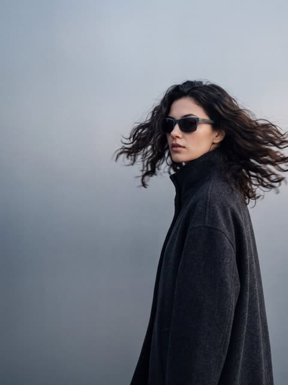</a>

用一行全大写提示词依次叠加广告氛围、姿态、发丝动态模糊、渐变背景和浅景深，并以参考图标记锁定模特形象。

Nano Banana 2.1 · 上传图改图 · 出处: [@weiinberg on X](https://x.com/weiinberg/status/2112776041064476736) · 37 赞，统计于 2026-10-28

[`fashion-editorial`](tags.md#tag-fashion-editorial) [`luxury`](tags.md#tag-luxury) [`motion-blur`](tags.md#tag-motion-blur) [`negative-space`](tags.md#tag-negative-space) [`sunglasses`](tags.md#tag-sunglasses)

<details><summary><b>提示词</b></summary>

```text
Nano Banana 2.1.

Prompt: MINIMALIST MODERN LUXURY CAMPAIGN, FEMALE  MODEL as in <<<image_1>>> IN PROFILE, LOOKING BEHIND CAMERA, WEARING PREMIUM SUNGLASSES, FAST MOTION BLUR HAIR MOVEMENT, COOL GRADIENT BACKDROP, AIRY NEGATIVE SPACE, CALM CINEMATIC LIGHTING, MATTE TEXTURES, UNDERSTATED LUXURY FASHION AESTHETIC, HIGH-END EDITORIAL PHOTOGRAPHY, SHALLOW DEPTH OF FIELD
```

</details>

<a id="nano-banana-conservatory-monstera-dappled-portrait"></a>
### 温室里龟背竹叶后的斑驳光影人像

<a href="https://x.com/bmx_ai13/status/2114613454292283394">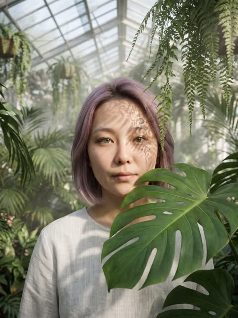</a>

提示词先交代场景，再用前景叶片遮挡部分面部，并把光线写成透过玻璃顶的斑驳阳光。浅景深和朴素的亚麻衬衫让视线落在面部与光影图案上。

Nano Banana 2.1 · 文生图 · 出处: [@bmx_ai13 on X](https://x.com/bmx_ai13/status/2114613454292283394) · 26 赞，统计于 2026-10-29

[`conservatory`](tags.md#tag-conservatory) [`dappled-light`](tags.md#tag-dappled-light) [`botanical`](tags.md#tag-botanical) [`shallow-depth-of-field`](tags.md#tag-shallow-depth-of-field) [`portrait`](tags.md#tag-portrait)

<details><summary><b>提示词</b></summary>

```text
Nano banana 2.1 Prompt: Inside a hyper realistic, lush botanical conservatory. Face is partially obscured by large, vibrant Monstera leaves and hanging ferns. Lighting: dappled sunlight breaking through a glass ceiling, creating intricate shadow patterns on skin. Wearing a simple, high quality linen shirt. Depth of field: shallow, with a soft bokeh effect on the tropical greenery in the background. Feels intimate and ethereal.
```

</details>

<a id="nano-banana-dusk-beach-blush-silk-dress-portrait"></a>
### 黄昏海滩上身穿粉色丝绸长裙的赤脚女子

<a href="https://x.com/bmx_ai13/status/2114226447636402356">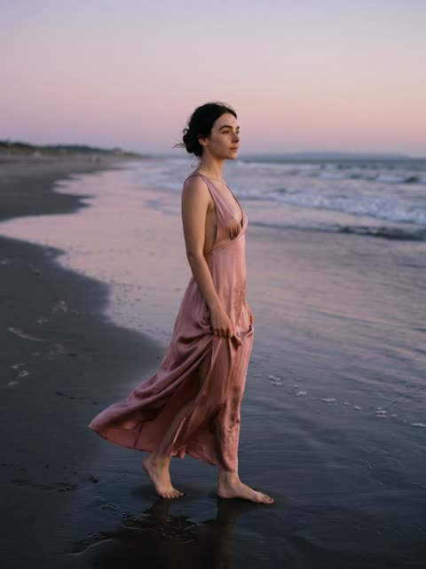</a>

用上传的参考图锁定面部和发型细节，再按地点时间、服装、姿态、微风的顺序逐层搭建场景。镜头与光圈参数、柔和日落光、皮肤与丝绸质感词，加上结尾的排除项，把画面推向真实摄影。

Nano Banana 2.1 · 上传图改图 · 出处: [@bmx_ai13 on X](https://x.com/bmx_ai13/status/2114226447636402356) · 26 赞，统计于 2026-10-29

[`beach`](tags.md#tag-beach) [`dusk`](tags.md#tag-dusk) [`fashion-photography`](tags.md#tag-fashion-photography) [`reference-image`](tags.md#tag-reference-image) [`silk-dress`](tags.md#tag-silk-dress)

<details><summary><b>提示词</b></summary>

```text
Blush by the Ocean

Nano Banana 2.1 Prompt: Use uploaded image as the adult character reference; preserve her face, mauve spiral updo, beauty marks and crescent forehead detail. Real cinematic fashion photograph on an empty beach at dusk. She wears a dusty-pink silk maxi dress with a plunging neckline, an open back and a side slit, barefoot on wet sand. Standing in three-quarter profile, she gently gathers the skirt at one hip and looks toward the horizon. A light sea breeze moves the hem while her sculpted hair stays intact. Full-length composition with a soft ocean horizon. 70mm lens, f/2.8, diffused sunset light, warm skin against cool water, natural pores and realistic silk. Subtle film grain, tasteful sensuality, no illustration, CGI, text or watermark.
```

</details>

<a id="nano-banana-smartphone-beauty-portrait-grid-identity-lock"></a>
### 手机质感的四宫格美妆人像

<a href="https://x.com/TheVirtualMuse/status/2115657618710786506">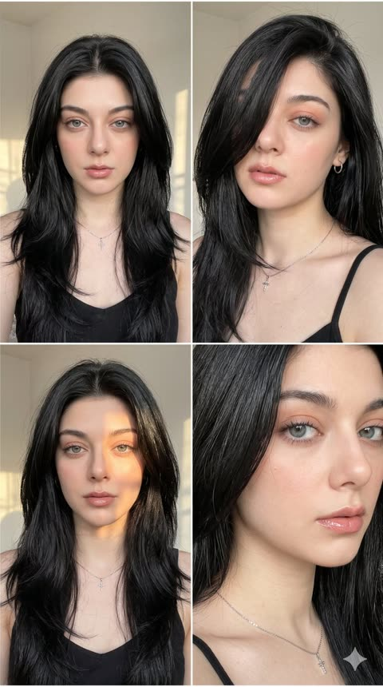</a>

用身份锁定段落把面部绑定到上传的自拍，发型、妆容、服装和光线由文字决定。四格各自指定景别，并用统一的阳光设定和较长的负面提示保证一致。

Nano Banana 2.1 · 上传图改图 · 出处: [@TheVirtualMuse on X](https://x.com/TheVirtualMuse/status/2115657618710786506) · 24 赞，统计于 2026-10-29

[`beauty-portrait`](tags.md#tag-beauty-portrait) [`identity-lock`](tags.md#tag-identity-lock) [`2x2-grid`](tags.md#tag-2x2-grid) [`smartphone-photo`](tags.md#tag-smartphone-photo) [`golden-light`](tags.md#tag-golden-light)

<details><summary><b>提示词</b></summary>

```text
Create a single, ultra-realistic 2×2 photographic collage in a vertical 9:16 aspect ratio, featuring the same adult woman in four distinct beauty portraits. The final image should look like four genuine smartphone photographs taken during the same indoor photoshoot, with consistent identity, hair, makeup, wardrobe, and environment. Prioritize realistic facial anatomy, crisp eye detail, natural skin texture, and accurate sunlight.

IDENTITY LOCK

Use the uploaded selfie as the reference for her face only. The hair, makeup, wardrobe, pose, lighting, and setting come from this prompt. Preserve her recognizable facial features, facial proportions, eye shape, nose, lips, eyebrows, cheekbones, and jawline. Keep her light blue-gray eyes and skin tone consistent across all four panels. Do not create four different women, change her apparent age, or excessively beautify her.

PANEL LAYOUT

Four equal portrait panels in a clean 2×2 grid, with straight, consistent borders and no overlapping images or extra panels.

Top-left: A frontal medium close-up. She faces the camera directly with an intense, confident gaze and her chin slightly lowered. Her voluminous black hair frames both sides of her face and falls over her shoulders. The crop reaches about the upper chest.

Top-right: A close-up three-quarter view with her head turned slightly. A thick section of jet-black hair sweeps diagonally across her left eye (the viewer's left), covering it, while her right eye looks toward the camera. Her lips are relaxed and slightly parted. A small silver hoop earring is visible.

Bottom-left: A medium close-up facing forward, looking directly into the camera with a calm, sultry expression. A warm patch of direct sunlight crosses her right cheek and forehead, with realistic shadows over the rest of her face. Her long black hair forms layers around her face and chest.

Bottom-right: An extreme close-up from a three-quarter side angle. The crop emphasizes one light blue-gray eye, the cheekbone, the nose, and her glossy nude-pink lips, which are slightly parted. Her black hair frames the outer edge of the face and falls along the neck. A delicate silver chain with a small cross pendant is visible near the lower edge.

HAIR

Long, thick, voluminous layered black hair with soft curtain-like framing pieces, a lifted crown, and large flowing layers around the shoulders. The hair is deep jet black with cool, restrained charcoal reflections where daylight hits the strands. It looks natural and glossy, with individual strands, fine flyaways, and realistic shadow depth. Do not change the hair to brown, chestnut, copper, auburn, blonde, or gray.

MAKEUP & SKIN

Natural peach-nude eyeshadow, sharp but slim black eyeliner, defined dark eyebrows, realistic eyelashes, softly contoured cheeks, and glossy nude-pink lips with a subtle darker lip liner. Skin is fair-to-golden with natural warmth, realistic tonal variation, a dewy highlight on the cheekbones and nose bridge, and visible pores. Avoid excessive airbrushing or plastic-looking skin.

WARDROBE & ACCESSORIES

A minimalist black camisole with realistic fabric texture and natural folds. A small silver hoop earring and a fine silver chain necklace with a delicate cross pendant. Keep the same wardrobe and accessories in all four panels.

SETTING & LIGHTING

A clean indoor space with off-white walls, a window frame in the upper-left area, and subtle architectural edges. Strong natural golden daylight from a nearby window creates distinct geometric sunlight across her face and hair, with deep but detailed shadows. Keep sunlit areas bright without blowing out the skin, and keep catchlights in the eyes. No neon lighting, no colored backgrounds, no furniture, no text.

CAMERA & OPTICS

Realistic modern smartphone photography, 35mm-equivalent lens, natural close-up perspective with subtle optical distortion, mild background separation, sharp eyes, eyelashes, eyebrows, and lips, and balanced exposure. The image should look like an authentic, lightly edited smartphone photograph.

Visible natural skin pores, individual eyelashes, fine eyebrow hairs, realistic iris patterns, natural lip lines, detailed black hair strands, fine flyaways, realistic fabric fibers, and accurate silver reflections. Natural daylight color with neutral skin tones, deep black hair, and no heavy filters or excessive orange tones.

Clean photograph only. No text, watermarks, logos, or interface elements.

NEGATIVE PROMPT

different woman in each panel, inconsistent identity, altered facial proportions, different eye color, brown hair, chestnut hair, copper hair, auburn hair, blonde hair, gray hair, blue hair, flat hair, short hair, missing hair volume, different clothing, missing necklace, oversized earrings, flat lighting, excessive orange lighting, blown-out face, blurry eyes, blurry lips, plastic skin, excessive airbrushing, artificial glow, overprocessed makeup, distorted face, extra fingers, deformed hands, cartoon, anime, illustration, digital painting, 3D render, CGI, low resolution, pixelation, excessive sharpening, text, watermark, logo, uneven grid, unequal panels, extra panels, overlapping panels, 4:5 aspect ratio
```

</details>

<a id="nano-banana-1960s-car-mirror-fashion-reflection"></a>
### 复古汽车后视镜中的1960年代时装肖像

<a href="https://x.com/mehvishs25/status/2107858748882690121">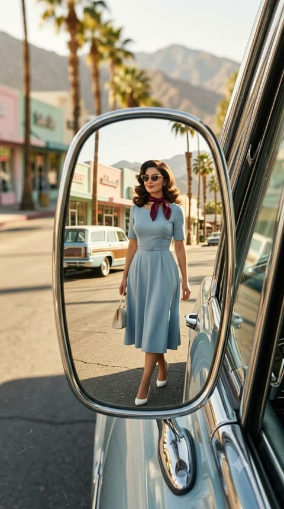</a>

整个画面设定为弯曲镀铬后视镜里的倒影，并写明机位和行走姿态，让反射显得真实可信。固定的四色配色加上35mm胶片颗粒和划痕描述带来老旧杂志大片质感，同时用明确的不要改变面部指令锁定参考图人物身份。

Nano Banana 2.1 · 上传图改图 · 出处: [@mehvishs25 on X](https://x.com/mehvishs25/status/2107858748882690121) · 23 赞，统计于 2026-10-28

[`vintage`](tags.md#tag-vintage) [`fashion`](tags.md#tag-fashion) [`mirror-reflection`](tags.md#tag-mirror-reflection) [`film-grain`](tags.md#tag-film-grain) [`identity-preservation`](tags.md#tag-identity-preservation)

<details><summary><b>提示词</b></summary>

```text
Create a hyper-realistic 1960s vintage editorial fashion photograph in a vertical 9:16 composition, featuring the girl from the reference image. Preserve her identity and appearance exactly as shown in the reference — including her facial structure, proportions, distinctive features, skin tone, hairstyle characteristics, and overall natural appearance. Do not alter or reinterpret her face.

The scene is captured as a full-body fashion portrait reflected inside a small, oval chrome side mirror of a vintage car. The mirror has naturally curved, slightly distorted edges and realistic reflections. The camera is positioned close to the driver's window, angled toward the side mirror.

Inside the mirror reflection, the girl is fully visible with generous background space. She is walking toward the rear of the car while slightly turning her head toward the mirror, creating a subtle candid moment. She has a calm, confident expression with a soft, understated smile.

She wears a beautifully tailored powder-blue midi dress with a slim waist belt, paired with a burgundy silk scarf, elegant cat-eye sunglasses, a small ivory handbag, and classic white pointed heels. Her styling has an authentic polished 1960s fashion aesthetic.

The environment is a retro Mediterranean-American street with a palm-lined road, pastel-colored storefronts, a vintage station wagon, and distant mountains. Bright golden morning sunlight creates warm, natural highlights and soft shadows across the scene.

Use a refined color palette of powder blue, ivory, burgundy, and warm beige. The image should look like an authentic aged 35mm film photograph, with natural analog grain, subtle film imperfections, tiny scratches, realistic exposure, authentic skin texture, and physically accurate mirror reflections.

The overall mood should feel chic, nostalgic, elegant, and slightly mysterious — like a genuine fashion editorial photograph captured in the 1960s rather than an AI-generated image. Photorealistic, cinematic, highly detailed, natural proportions, realistic fabric texture, authentic vintage photography aesthetics.
```

</details>

<a id="nano-banana-blonde-creator-vanity-portrait"></a>
### 卧室梳妆台前直视镜头的金发博主

<a href="https://x.com/purrdoom/status/2115216612030865415"></a>

提示词分层描述人物：年龄、发型、妆容、毛孔和痣等皮肤瑕疵、首饰与服装，再加一句神态；随后单独写场景与光线，并用否定句禁止标志和文字。瑕疵细节加柔和正面光，让画面像真实的手机视频截图。

Nano Banana 2.1 · 文生图 · 出处: [@purrdoom on X](https://x.com/purrdoom/status/2115216612030865415) · 22 赞，统计于 2026-10-29

[`creator-portrait`](tags.md#tag-creator-portrait) [`talking-head`](tags.md#tag-talking-head) [`skin-texture`](tags.md#tag-skin-texture) [`natural-light`](tags.md#tag-natural-light) [`realistic-person`](tags.md#tag-realistic-person)

<details><summary><b>提示词</b></summary>

```text
A white woman, 34, a glamorous social media creator with the polished look of a pro athlete's wife. Very long, straight, sleek golden-blonde hair with a center part and slightly darker roots. A natural sun-kissed tan. Full glam makeup with a soft matte finish: voluminous lashes, sculpted arched brows, soft contour, satin peachy-nude overlined lips. Real skin texture: visible pores, faint lines under her eyes, a small mole on her left jaw. Small gold hoop earrings, a thin gold chain necklace, a large oval diamond engagement ring. A fitted ribbed heather-grey scoop-neck tank top. Confident, direct, a little urgent, like a friend about to tell you something you need to hear.

She sits at a white vanity in her bedroom in the late afternoon. Behind her: a muted sage-grey wall, a dark doorway on the left edge of the frame, and a white ceiling at the top. Warm, soft natural light on her face from the front, with soft catchlights in her eyes. No makeup products in frame. No logos or readable text anywhere in frame.
```

</details>

<a id="gpt-image-backlit-backless-gown-window-portrait"></a>
### 窗边逆光露背长裙情绪写真

<a href="https://x.com/MrLarus/status/2058131948904599860">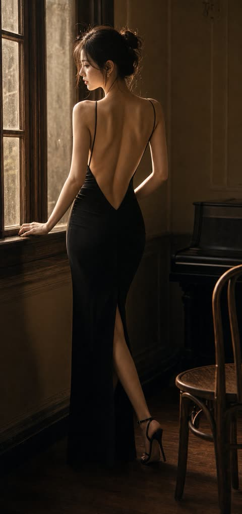</a>

提示词按姿态、露背结构、材质、场景、光线、构图、氛围分项列出，并把背部定为唯一视觉重心。逆光与窗边光被指定用来勾勒肩胛骨和腰线，末尾的长串负面词条则让肤色和布料保持真实胶片感。

GPT Image 2 · 文生图 · 出处: [@MrLarus on X](https://x.com/MrLarus/status/2058131948904599860) · 发现于 [freestylefly/awesome-gpt-image-2](https://github.com/freestylefly/awesome-gpt-image-2)

[`backlight`](tags.md#tag-backlight) [`portrait`](tags.md#tag-portrait) [`window-light`](tags.md#tag-window-light) [`film-look`](tags.md#tag-film-look) [`evening-gown`](tags.md#tag-evening-gown)

<details><summary><b>提示词</b></summary>

```text
请生成一张竖版高质感女性情绪写真，主题为「逆光美背·女性情绪写真」。

核心要求：
画面的绝对重点是“美背”，通过露背结构、肩颈线条、肩胛骨、脊柱中线、腰背曲线和逆光轮廓来呈现女性美。请避免普通女性写真或普通穿搭图的处理方式，背部必须是主视觉核心，脸只作为辅助。

人物设定：
成年女性，真实自然，气质可为温柔、清冷、慵懒、文艺、轻熟或安静。人物不要网红脸，不要塑料感，不要夸张妆容。可侧脸、回眸、低头或闭眼，但正脸不是重点。

姿态要求：
姿态必须服务于背部展示，例如背对镜头微微回头、侧身站立、侧坐、抬手整理头发、低头蜷身、斜倚窗边、半躺回眸、披衣下滑等。动作自然，不要僵硬摆拍，不要正面直视镜头。

露背结构：
必须有明确的露背设计，可为低背长裙、吊带裙、露背礼服、针织外套滑落、薄纱披肩、浴袍半披、宽松衬衫滑肩、丝质罩衫半落等。重点表现肩线、肩胛骨、背中线、腰背收束和布料与肌肤之间的高级过渡。

服装与材质：
服装选择轻柔、垂坠、带有透光感和褶皱感的材质，如薄纱、真丝、针织、棉麻、细闪纱、浴袍质地、软垂感长裙。布料要参与构图，形成半遮半露、滑落、包裹、垂挂的层次，但不能厚重。

场景：
场景为卧室、窗边、床上、白墙房间、民宿、酒店房间、木质空间或复古公寓。背景简洁克制，少量床品、窗帘、木椅、花束、地板等元素即可，不能喧宾夺主。

光线要求：
采用自然光或柔和暖光，以逆光、侧逆光、窗边光为主。重点是让光打到背部，勾出肩颈边缘、肩胛骨轮廓、腰线和发丝高光。可使用晨光、黄昏金光、柔雾散射光或冷白窗光，但背部受光状态必须成立。

构图：
竖版构图，画幅可为 9:16、3:4 或 4:5。人物是绝对主角，视觉重心放在背部、肩颈和腰背曲线上。可采用半身、七分身、近景或全身，但不要让场景抢走主体。

氛围：
整体氛围安静、柔软、私密、克制、高级，像真实摄影师拍摄的电影感情绪写真。重点避免直白性感，改用“美背 + 逆光 + 柔软布料 + 自然姿态”表达女性美。

画质要求：
真实摄影感、电影感、柔雾胶片感、细腻肤色、真实皮肤质感、浅景深、轻微颗粒感、画面通透自然。不要 AI 塑料感，不要 CG 感，不要错误手指，不要肢体畸形，不要低俗色情化表达，不要文字、水印、Logo、边框。

最终效果：
一张以“美背”为主视觉核心的高完成度女性情绪写真，通过露背结构、肩颈背部线条、柔光逆光和柔软布料来呈现克制而高级的女性美。
```

</details>

<a id="gpt-image-bangkok-sunny-street-selfie"></a>
### 曼谷阳光街头年轻女子自拍

<a href="https://x.com/Stonic_AI/status/2069649170429075962">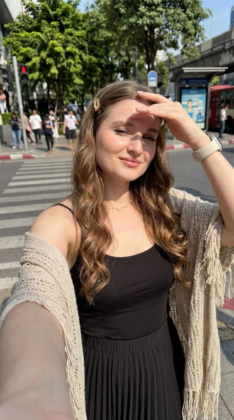</a>

提示词先设定手机自拍的低角度、伸臂和强烈直射阳光，再逐项列出发型、妆容、配饰和服装，并把曼谷街景元素安排在画面一侧，让结果更像真实照片。

GPT Image 2 · 文生图 · 出处: [@Stonic_AI on X](https://x.com/Stonic_AI/status/2069649170429075962) · 发现于 [YouMind-OpenLab/awesome-gpt-image-2](https://github.com/YouMind-OpenLab/awesome-gpt-image-2)

[`selfie`](tags.md#tag-selfie) [`street-photography`](tags.md#tag-street-photography) [`bangkok`](tags.md#tag-bangkok) [`harsh-sunlight`](tags.md#tag-harsh-sunlight) [`photorealistic`](tags.md#tag-photorealistic)

<details><summary><b>提示词</b></summary>

```text
Hyper-realistic 8K close self-shot, young European woman, slightly low angle, arm extended holding phone, bright sunny daytime, direct harsh sunlight, sharp facial shadows, artistic high-contrast light and shadow, energetic intense atmosphere, slight gentle smile, fair pink-toned glowing smooth skin. Long waist-length curly hair, no bangs, naturally flowing curls at ends, gold hair clip. Thin winged eyeliner, full long lashes, soft peach blush, defined brows, glossy light pink ombre lips. Cream smartwatch, dainty gold necklace. Loose casual camisole top, high-waisted pleated midi skirt, lightweight knitted fringed shawl. Slightly tilted posture, squinting gently against sunlight, one hand raised to block glare. Outdoor Bangkok city background, right side filled with urban scenery, lush green trees, crosswalk, bus stop bench, ultra-detailed, photorealistic.9：16
```

</details>

<a id="gpt-image-burgundy-studio-bearded-man-sunglasses-portrait"></a>
### 酒红棚拍戴墨镜的络腮胡男士肖像

<a href="https://x.com/iamsofiaijaz/status/2090294894187413883">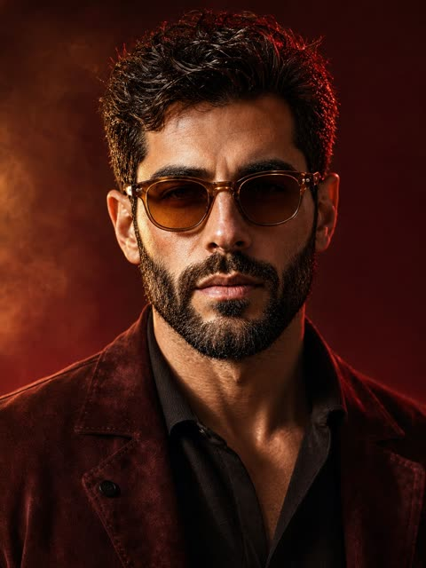</a>

提示词先用参考图锁定面部身份，再把琥珀主光、绯红轮廓光和酒红渐变背景分开描述。85mm、f/1.8 的镜头参数，加上皮肤、胡须和麂皮质感清单，让特写保持写实。

GPT Image 2 · 上传图改图 · 出处: [@iamsofiaijaz on X](https://x.com/iamsofiaijaz/status/2090294894187413883) · 发现于 [freestylefly/awesome-gpt-image-2](https://github.com/freestylefly/awesome-gpt-image-2)

[`fashion-portrait`](tags.md#tag-fashion-portrait) [`studio-lighting`](tags.md#tag-studio-lighting) [`face-reference`](tags.md#tag-face-reference) [`menswear`](tags.md#tag-menswear) [`cinematic`](tags.md#tag-cinematic)

<details><summary><b>提示词</b></summary>

```text
A cinematic, ultra-realistic close-up portrait of a stylish man, using the provided image as an accurate face reference. Preserve his natural facial identity, thick naturally curly dark brown hair, neatly trimmed salt-and-pepper beard, strong masculine facial structure, and realistic facial proportions. He wears sophisticated round vintage amber-brown sunglasses and a premium deep burgundy suede jacket over a fitted black silk-knit shirt, creating a refined luxury fashion aesthetic.

Warm cinematic studio lighting with a soft amber-golden key light illuminating the face from the front-left, complemented by a subtle crimson-red rim light outlining the hair and shoulders. The background is a rich burgundy, wine-red, and dark plum gradient, with soft atmospheric haze and subtle diffused light creating depth without distracting from the subject. Elegant warm highlights contrast beautifully against the dark clothing.

Extremely detailed natural skin texture, individual beard hairs, realistic pores, subtle facial imperfections, sharp eyes visible behind slightly tinted lenses, natural reflections on the sunglasses, rich dimensional shadows, realistic fabric and suede texture, shallow depth of field. Sophisticated luxury fashion campaign, mysterious and confident mood, premium men's editorial photography, cinematic color grading, photorealistic, HDR, professional studio photography, 85mm portrait lens, f/1.8, crisp facial details, soft background bokeh, centered composition, head-and-shoulders framing, powerful masculine presence, understated elegance, 3:4 aspect ratio.
```

</details>

<a id="gpt-image-candid-coastal-abbey-travel-portrait"></a>
### 海岸修道院前的抓拍旅行人像

<a href="https://x.com/saniaspeaks_/status/2097532595814940683">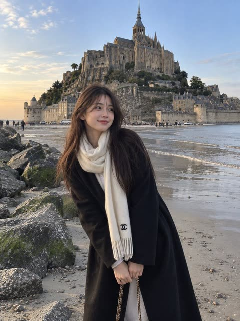</a>

提示词把人物放在前景、地标放在背景，再加入远处的小人物和车辆来体现尺度。结尾用手机相机质感、柔和傍晚光和 3:4 竖构图，让画面更像真实抓拍。

GPT Image 2.5 · 文生图 · 出处: [@saniaspeaks_ on X](https://x.com/saniaspeaks_/status/2097532595814940683) · 发现于 [wangrunlin/awesome-gpt-image-2-5-prompts](https://github.com/wangrunlin/awesome-gpt-image-2-5-prompts)

[`travel-portrait`](tags.md#tag-travel-portrait) [`candid`](tags.md#tag-candid) [`landmark`](tags.md#tag-landmark) [`evening-light`](tags.md#tag-evening-light) [`smartphone-look`](tags.md#tag-smartphone-look)

<details><summary><b>提示词</b></summary>

```text
A photorealistic candid travel portrait of a young East Asian woman standing on a quiet sandy shoreline beside large moss-covered rocks, with a magnificent historic stone abbey and medieval castle-like architecture rising dramatically on a rocky island behind her. She has long straight dark brown hair falling naturally over one shoulder, soft youthful facial features, and a gentle warm smile while looking directly at the camera.

She is wearing a long oversized black coat with her hands casually tucked inside the pockets, layered over a light-colored outfit. A large soft cream-white scarf is wrapped warmly around her neck, hanging down the front with a small black designer-style emblem near the end. A delicate chain shoulder bag is partially visible.

The composition captures her in the foreground while the vast historic abbey dominates the background, surrounded by ancient stone walls, rocky cliffs, sandy tidal flats, and a calm coastal atmosphere. A few small distant vehicles and people add realistic scale to the scene. Soft natural evening light and a clear pale blue sky create a peaceful European travel mood.

Ultra-realistic photography, authentic candid travel photo, natural skin texture, realistic fabric details, soft cinematic lighting, subtle smartphone camera aesthetic, slightly dreamy color grading, natural proportions, detailed architecture, peaceful coastal atmosphere, vertical composition, 3:4 aspect ratio.
```

</details>

<a id="gpt-image-candid-sailor-35mm"></a>
### 老水手补渔网的35毫米抓拍肖像

<a href="https://developers.openai.com/api/docs/guides/image-prompting#control-style-and-lighting">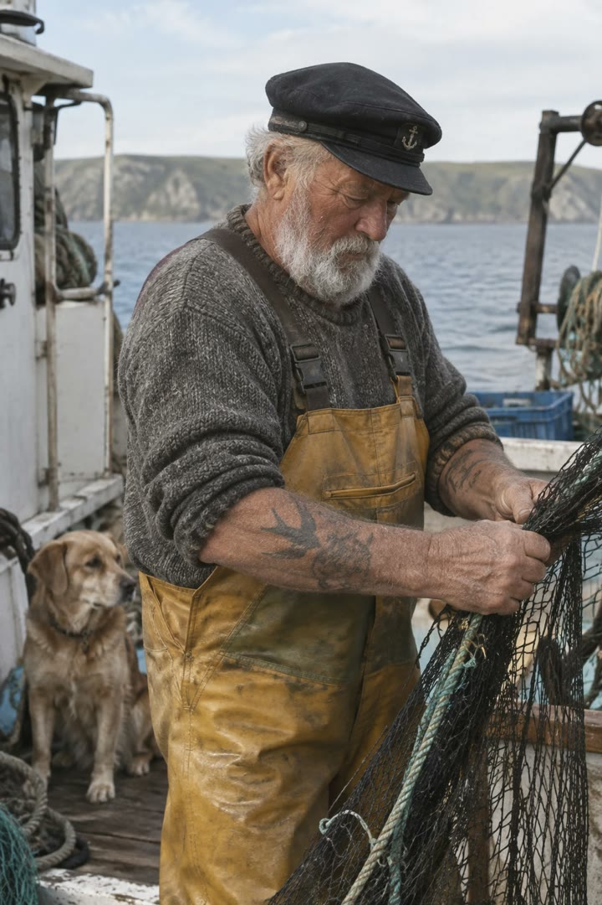</a>

提示词逐一写明皮肤质感、镜头、光线和胶片颗粒，最后一句排除美化和重度修图，因此成片像一张未经摆拍的纪实照片。

GPT Image 2.5 · 文生图 · 出处: [OpenAI image prompting guide](https://developers.openai.com/api/docs/guides/image-prompting#control-style-and-lighting)

[`photorealism`](tags.md#tag-photorealism) [`film`](tags.md#tag-film) [`portrait`](tags.md#tag-portrait)

<details><summary><b>提示词</b></summary>

```text
Create a photorealistic candid photograph of an elderly sailor standing on a small fishing boat.
He has weathered skin with visible wrinkles, pores, and sun texture, and a few faded traditional sailor tattoos on his arms.
He is calmly adjusting a net while his dog sits nearby on the deck. Shot like a 35mm film photograph, medium close-up at eye level, using a 50mm lens.
Soft coastal daylight, shallow depth of field, subtle film grain, natural color balance.
The image should feel honest and unposed, with real skin texture, worn materials, and everyday detail. No glamorization, no heavy retouching.
```

</details>

<a id="gpt-image-candlelit-side-room-qipao-portrait"></a>
### 烛光暗室中的旗袍女子写实肖像

<a href="https://x.com/ToroJushiAi/status/2056926887344042382">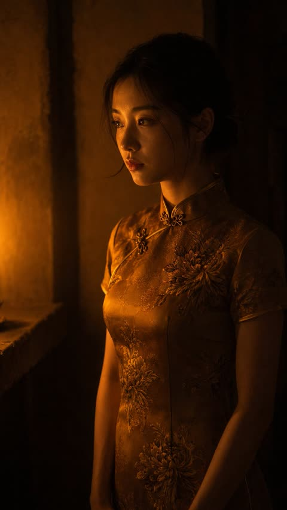</a>

画外单支蜡烛定下光线方向，琥珀色旗袍与烛光色温一致，让人物融进光里。皮肤质感、散落发丝和 ISO 400 颗粒保持摄影感，末尾的否定清单排除插画风格。

GPT Image 2 · 文生图 · 出处: [@ToroJushiAi on X](https://x.com/ToroJushiAi/status/2056926887344042382) · 发现于 [freestylefly/awesome-gpt-image-2](https://github.com/freestylefly/awesome-gpt-image-2)

[`candlelight`](tags.md#tag-candlelight) [`chiaroscuro`](tags.md#tag-chiaroscuro) [`qipao`](tags.md#tag-qipao) [`85mm`](tags.md#tag-85mm) [`film-grain`](tags.md#tag-film-grain)

<details><summary><b>提示词</b></summary>

```text
A medium-shot authentic daily life photograph, natural candid moment, of an East Asian young woman standing in a small side room lit only by a single candle on a low stone shelf. 85mm lens, waist-up framing, shallow depth of field. The candle is off-frame to the left; the room behind her exists only as dark warm suggestion.

East Asian young woman in her early 20s. Almond-shaped eyes receiving the candle's warm flicker — the irises briefly caught in light before returning to shadow. Straight refined nose, the bridge illuminated in a narrow warm stripe. Skin tone fair beige, warmed entirely by candlelight into something amber. Skin subsurface scattering visible under directional candlelight, specular micro-highlights on cheekbones and nose ridge, fine foundation powder grain perceptible.

She wears an aged amber silk qipao with chrysanthemum embroidery in tones of old bronze and dusty ochre — the amber pigment identical in temperature to the candle's own light, the embroidery appearing and disappearing depending on angle. Mandarin collar, short sleeves. She stands facing the candle without looking at it, arms at her sides, very still. The room is otherwise empty. Two or three stray hairs displaced by faint air movement, natural unplanned imperfection, not geometrically symmetrical.

Single candle — warm amber-orange, directional and fragile. It carves the left side of her face from darkness, leaves the right in near-black shadow. The amber qipao and the candlelight share a single temperature register: the room folds her into the light. Deep chiaroscuro with no artificial fill. Subtle ISO 400 film grain in shadow areas, photographic noise texture not CG render smoothness. Aspect ratio 9:16. No watermark, no text overlay, not cartoon, not digitally painted, not illustration, not anime.
```

</details>

<a id="gpt-image-cherry-blossom-over-shoulder-portrait"></a>
### 樱花小径回眸电影感人像

<a href="https://x.com/SheBuildsAI_/status/2092431090095149533">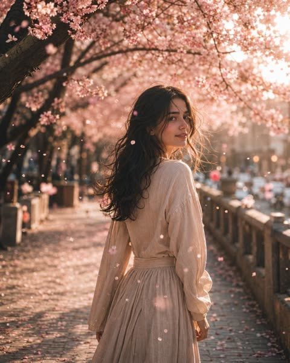</a>

提示词用 JSON 字段把场景、主体、细节、光线和构图分开，方便逐层调整。85mm 镜头、浅景深和逆光花瓣加体积雾，营造出电影感的杂志人像。

GPT Image 2 · 文生图 · 出处: [@SheBuildsAI_ on X](https://x.com/SheBuildsAI_/status/2092431090095149533) · 发现于 [freestylefly/awesome-gpt-image-2](https://github.com/freestylefly/awesome-gpt-image-2)

[`cherry-blossom`](tags.md#tag-cherry-blossom) [`portrait`](tags.md#tag-portrait) [`cinematic`](tags.md#tag-cinematic) [`85mm`](tags.md#tag-85mm) [`json-prompt`](tags.md#tag-json-prompt)

<details><summary><b>提示词</b></summary>

```text
{
  "title": "WHISPERS OF SPRING",

  "scene": "A peaceful pathway beneath blooming cherry blossom trees during a warm spring afternoon. Pink blossoms fill the canopy overhead while delicate petals drift gracefully through the air. Soft sunlight filters through the branches, creating a dreamy and enchanting atmosphere.",

  "subject": "A young woman walks away from the camera before gently turning her head over her shoulder with a soft, mysterious smile. She wears a flowing natural linen dress that moves gracefully with the breeze, highlighting her delicate facial features and effortless elegance.",

  "detail": "Wind carries countless pink cherry blossom petals across the frame while warm sunlight creates glowing highlights throughout the scene. Every strand of hair moves naturally in the breeze, with ultra realistic skin texture, lifelike fabric folds, soft floral surroundings, and subtle atmospheric haze enhancing the cinematic realism.",

  "atmosphere": "Elegant, peaceful, romantic, dreamy, timeless, cinematic, graceful, and enchanting.",

  "lighting": "Warm spring sunlight filtering through cherry blossom branches, soft natural illumination, glowing highlights, volumetric light rays, gentle ambient shadows, and subtle atmospheric haze.",

  "composition": "Cinematic editorial portrait captured with an 85mm lens, featuring the subject in a three-quarter over-the-shoulder pose. Shallow depth of field, creamy bokeh, balanced framing with flowering trees, soft leading lines, and immersive visual storytelling.",

  "style": "Photorealistic, masterpiece, editorial fashion photography, analog film aesthetic, dreamy pastel color palette, ultra realistic skin texture, highly detailed, shallow depth of field, creamy bokeh, atmospheric haze, HDR, cinematic realism, 8K."
}
```

</details>

<a id="gpt-image-cinematic-night-car-backseat-portrait"></a>
### 夜晚车后座的电影感人像

<a href="https://x.com/AiwithElisia/status/2089221808436531381">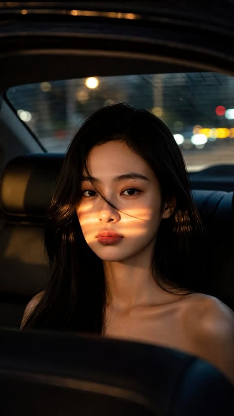</a>

横向的暖色街灯光带落在脸上形成戏剧性明暗,后窗外虚化的城市光斑增加景深层次。提示词写明85mm、f/1.4等相机参数和构图,并用否定词避免塑料感皮肤,保证真实质感。

GPT Image 2 · 文生图 · 出处: [@AiwithElisia on X](https://x.com/AiwithElisia/status/2089221808436531381) · 发现于 [YouMind-OpenLab/awesome-gpt-image-2](https://github.com/YouMind-OpenLab/awesome-gpt-image-2)

[`portrait`](tags.md#tag-portrait) [`night`](tags.md#tag-night) [`cinematic`](tags.md#tag-cinematic) [`bokeh`](tags.md#tag-bokeh) [`low-light`](tags.md#tag-low-light)

<details><summary><b>提示词</b></summary>

```text
A cinematic, photorealistic close-up portrait of a young East Asian woman sitting in the back seat of a car at night. She has long, naturally straight, glossy black hair with a few loose strands falling softly across her face, delicate facial features, smooth natural skin texture, dark expressive eyes, subtle eyeliner, soft natural eyebrows, and muted rosy-red lips. She is looking directly toward the camera with a calm, neutral, slightly melancholic expression.

Warm golden horizontal bands of streetlight pass naturally across her face, creating dramatic cinematic light and shadow. The lighting should softly illuminate her eyes, nose, cheeks, and lips while leaving parts of her face and hair in deep natural shadow. Preserve realistic skin pores and fine facial details without excessive retouching or plastic-looking skin.

She is seated inside a dark luxury car, with black leather seats and interior surrounding her. Through the rear window, a nighttime city scene is visible with heavily blurred colorful lights, warm yellow bokeh, white headlights, subtle red traffic lights, and dark urban buildings. Strong shallow depth of field separates her from the background.

Shot on a professional full-frame camera, 85mm portrait lens, f/1.4 aperture, cinematic depth of field, realistic low-light photography, soft filmic contrast, subtle warm highlights, deep blacks, natural color grading, high dynamic range, crisp eyes, detailed hair strands, realistic skin texture, soft bokeh, atmospheric nighttime mood.

Composition: vertical portrait, subject centered slightly below the middle of the frame, head and shoulders visible, natural perspective, intimate close-up framing, cinematic negative space, realistic car interior framing in the foreground.

Ultra-realistic photography, high detail, sharp facial focus, natural imperfections, realistic lighting, premium editorial photography, cinematic movie still, subtle film grain, professional color grading, 8K detail, no artificial beauty filter, no over-sharpening, no distorted facial features, no extra fingers, no text, no watermark.
```

</details>

<a id="gpt-image-digicam-lcd-nostalgic-portrait-comic-shelf"></a>
### 数码相机屏幕里的2012年漫画书架旁怀旧人像

<a href="https://x.com/Ciri_ai/status/2055876982630686956">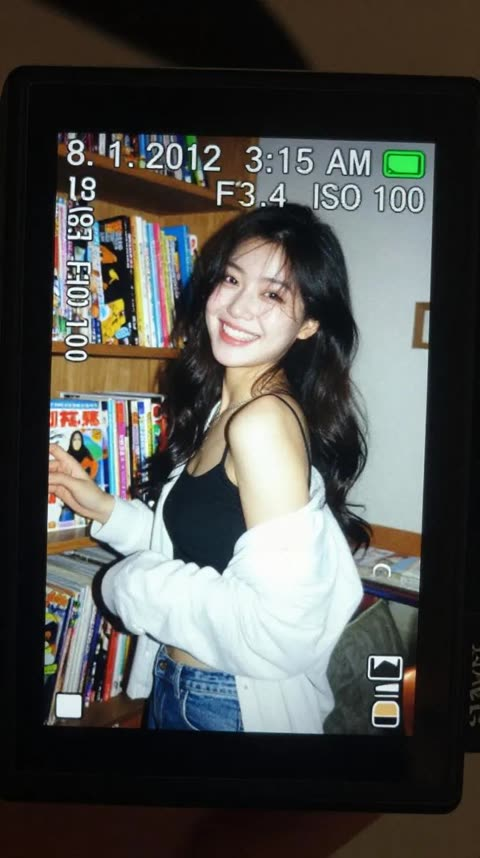</a>

提示词采用画中画结构：先拍相机LCD屏幕特写，再在屏幕里呈现2010年代初的抓拍照片。直闪、颗粒、动态模糊，加上时间戳、曝光参数和电池图标等界面元素，让画面像真实的数码相机成像。

GPT Image 2 · 文生图 · 出处: [@Ciri_ai on X](https://x.com/Ciri_ai/status/2055876982630686956) · 发现于 [freestylefly/awesome-gpt-image-2](https://github.com/freestylefly/awesome-gpt-image-2)

[`digicam`](tags.md#tag-digicam) [`nostalgic`](tags.md#tag-nostalgic) [`flash-photography`](tags.md#tag-flash-photography) [`candid-portrait`](tags.md#tag-candid-portrait) [`camera-ui`](tags.md#tag-camera-ui)

<details><summary><b>提示词</b></summary>

```text
A realistic close-up shot of a small digital camera screen glowing brightly in a dark indoor environment. Displayed on the LCD is a candid early-2010s style photograph of a young East Asian woman with long dark wavy hair standing beside a wooden shelf packed tightly with colorful comic books and magazines.

She wears a black spaghetti-strap top with a loose white cardigan hanging casually from both shoulders and faded blue jeans. Captured mid-laugh while turning her face slightly sideways, her expression feels spontaneous and natural, with hair falling softly across part of her cheek.

The harsh direct flash from the compact camera creates strong highlights on her face and cardigan while flattening shadows in the background, producing an authentic nostalgic digicam aesthetic. Slight motion blur and digital grain enhance the candid realism.

Camera UI overlays are visible across the LCD screen, including the timestamp “8. 1. 2012 3:15 AM,” exposure data “1/30 F3.4 ISO 100,” focus indicators, and a small green battery symbol in the corner.

The image preserves visible screen pixel structure, slight glare reflections, chromatic softness, and compressed digital texture. Outside the LCD, the surrounding darkness fades smoothly into blur, emphasizing the glowing nostalgic screen.

Shot to resemble an authentic Sony Cyber-shot point-and-shoot camera from the early 2010s using a CCD sensor with vintage digital rendering and imperfect flash exposure.
```

</details>

<a id="gpt-image-double-exposure-aviator-fashion-portrait"></a>
### 戴飞行员墨镜的双重曝光时尚肖像

<a href="https://x.com/Anaya_Ai12/status/2062191518975508678">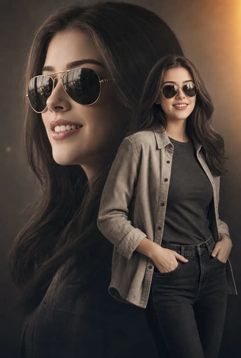</a>

用半透明的大尺寸侧脸叠加全身站姿构成双重曝光，并锁定上传人脸作为参考。暖调棕褐与炭灰配色、一角的金橙漏光以及 85mm 镜头描述，共同营造电影感。

GPT Image 2 · 上传图改图 · 出处: [@Anaya_Ai12 on X](https://x.com/Anaya_Ai12/status/2062191518975508678) · 发现于 [freestylefly/awesome-gpt-image-2](https://github.com/freestylefly/awesome-gpt-image-2)

[`double-exposure`](tags.md#tag-double-exposure) [`fashion`](tags.md#tag-fashion) [`portrait`](tags.md#tag-portrait) [`sepia`](tags.md#tag-sepia) [`light-leak`](tags.md#tag-light-leak)

<details><summary><b>提示词</b></summary>

```text
A cinematic double-exposure fashion portrait featuring a woman with the uploaded face used 100% as reference, wearing stylish metallic aviator sunglasses. The composition artfully blends a large, semi-transparent close-up profile of her face on the left with her full-body figure standing confidently on the right. She wears an open, light-grey textured corduroy shirt layered over a dark grey fitted t-shirt and dark denim jeans, posing naturally with her hands in her pockets. She has long, flowing dark hair, flawless skin, elegant feminine features, and a confident, sophisticated expression.

The background is a minimalist neutral studio setting, allowing the double-exposure composition to remain the visual focus. The color grading features a sophisticated warm desaturated sepia and charcoal palette, enhanced by a soft golden-orange light-leak flare in the upper-right corner. Professional 85mm lens photography with high-contrast yet soft cinematic lighting accentuates the fabric textures, facial details, and layered portrait effect.

Ultra-realistic skin texture, luxury fashion-editorial aesthetic, premium magazine-cover quality, subtle film grain, cinematic depth, elegant shadows, refined color grading, modern retro-inspired styling, masterpiece composition, ultra-sharp focus, visually striking storytelling, high-end commercial fashion campaign look.
```

</details>

<a id="gpt-image-fairycore-butterfly-floral-crown-portrait"></a>
### 蝴蝶环绕的花冠仙境肖像

<a href="https://x.com/HaniaAi12/status/2062696495741391006">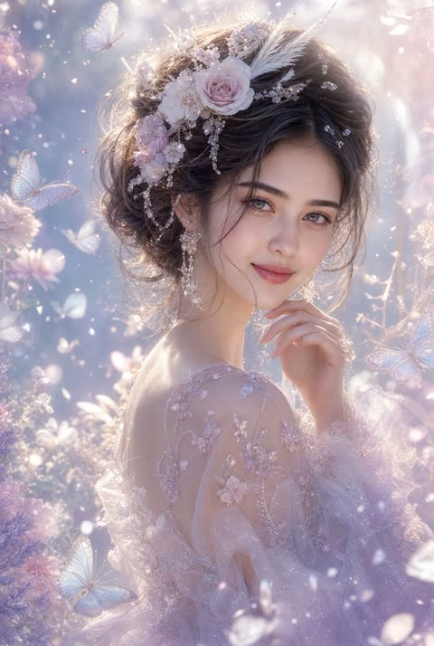</a>

提示词先写具体的发饰和纱裙细节，如玫瑰、水晶、羽毛和刺绣薄纱，再限定粉彩色调与柔和晨光，最后用虚化、体积光、柔焦高光等摄影术语收束。

GPT Image 2 · 文生图 · 出处: [@HaniaAi12 on X](https://x.com/HaniaAi12/status/2062696495741391006) · 发现于 [freestylefly/awesome-gpt-image-2](https://github.com/freestylefly/awesome-gpt-image-2)

[`fairycore`](tags.md#tag-fairycore) [`fantasy-portrait`](tags.md#tag-fantasy-portrait) [`pastel`](tags.md#tag-pastel) [`butterflies`](tags.md#tag-butterflies) [`soft-light`](tags.md#tag-soft-light)

<details><summary><b>提示词</b></summary>

```text
Ultra-realistic ethereal fantasy portrait of a breathtaking young woman with delicate porcelain skin, soft grey-blue eyes, and natural rosy lips. She gazes gently toward the viewer with a serene, dreamy expression, her fingertips lightly touching her chin. Wispy ash-brown hair flows softly in the breeze, styled in a loose romantic updo adorned with pastel blush roses, shimmering crystal ornaments, delicate feathers, and intricate floral accessories. She wears elegant dangling crystal earrings and a translucent, flowing gown made of sheer iridescent fabric embroidered with tiny sparkling flowers.

The scene is bathed in soft diffused morning light, creating a luminous glow around her face and shoulders. Surrounded by floating butterflies, sparkling dust particles, translucent petals, and dreamy floral textures, the background blends pastel lavender, pearl white, blush pink, and silver tones. Cinematic fine-art photography, fairycore aesthetic, enchanted garden atmosphere, magical realism, ultra-detailed skin texture, soft focus highlights, volumetric lighting, bokeh, masterpiece quality, highly detailed, 8K resolution, delicate feminine beauty, romantic fantasy artwork, elegant composition, dreamy color grading, soft glow, celestial ambiance.
```

</details>

<a id="gpt-image-fisheye-mirror-retro-cafe-portrait"></a>
### 鱼眼镜面复古青绿咖啡馆人像

<a href="https://x.com/harboriis/status/2049044698900361241">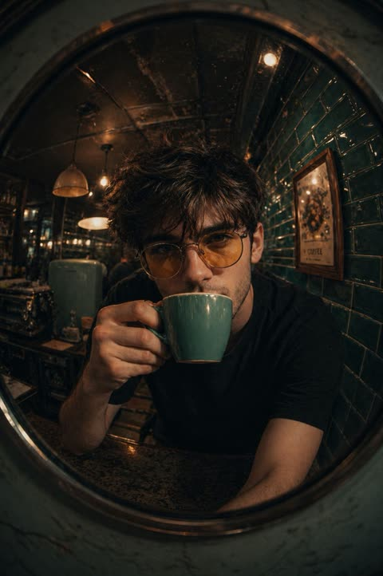</a>

点明鱼眼镜头、圆形镜框和前倾近距离姿势，画面畸变感与亲密感都很强。青绿地铁砖、吊灯、黄色镜片等具体布景细节加上暖调氛围词，让色调保持统一。

GPT Image 2 · 上传图改图 · 出处: [@harboriis on X](https://x.com/harboriis/status/2049044698900361241) · 发现于 [freestylefly/awesome-gpt-image-2](https://github.com/freestylefly/awesome-gpt-image-2)

[`fisheye`](tags.md#tag-fisheye) [`retro-cafe`](tags.md#tag-retro-cafe) [`mirror`](tags.md#tag-mirror) [`portrait`](tags.md#tag-portrait) [`warm-moody`](tags.md#tag-warm-moody)

<details><summary><b>提示词</b></summary>

```text
A fish-eye lens close-up of [your photo as reference] sipping from a teal/turquoise coffee mug, leaning forward intimately toward camera. Shot through or near a round mirror. Retro café interior with glossy teal subway tiles, vintage appliances, pendant lights. Black t-shirt, yellow-tinted round glasses. Warm moody tones.
```

</details>

<a id="gpt-image-futuristic-office-businesswoman-portrait"></a>
### 未来感玻璃办公室中的职场女性肖像

<a href="https://x.com/NadzuAI/status/2087901626891940013"></a>

提示词依次叠加服装、场景、光线和镜头线索（柔和电影光、浅景深、真实皮肤质感），并把色调限定为蓝白。同时指定4:5竖构图，并加入无文字无水印的约束，让成图更干净。

GPT Image 2 · 文生图 · 出处: [@NadzuAI on X](https://x.com/NadzuAI/status/2087901626891940013) · 发现于 [YouMind-OpenLab/awesome-gpt-image-2](https://github.com/YouMind-OpenLab/awesome-gpt-image-2)

[`corporate-portrait`](tags.md#tag-corporate-portrait) [`business`](tags.md#tag-business) [`photorealistic`](tags.md#tag-photorealistic) [`futuristic-office`](tags.md#tag-futuristic-office) [`vertical`](tags.md#tag-vertical)

<details><summary><b>提示词</b></summary>

```text
Create a hyper-realistic HD portrait of a confident young professional businesswoman, elegant modern black blazer over a white blouse, standing in a premium futuristic office with glass walls, subtle AI technology screens and a city skyline in the background. Natural makeup, polished hairstyle, confident expression, professional corporate appearance, cinematic soft lighting, realistic skin texture, shallow depth of field, luxury business atmosphere, sophisticated blue-and-white tones, ultra-detailed, photorealistic, 8K quality, sharp focus, premium LinkedIn and AI startup branding aesthetic, vertical 4:5 composition, no text, no watermark.
```

</details>

<a id="gpt-image-golden-hour-couple-cinematic-closeup"></a>
### 日落黄金时刻情侣特写

<a href="https://x.com/darshal_/status/2049071963520508058">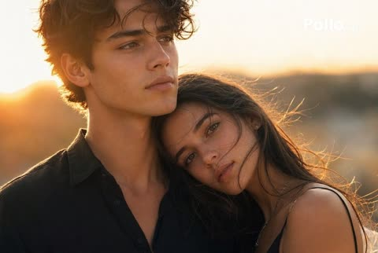</a>

低角度夕阳逆光配合轮廓光、柔和镜头光晕与浅景深，营造出电影感的香水广告氛围。50mm 镜头提示与低饱和大地色调让皮肤和发丝质感保持真实。

GPT Image 2 · 文生图 · 出处: [@darshal_ on X](https://x.com/darshal_/status/2049071963520508058) · 发现于 [YouMind-OpenLab/awesome-gpt-image-2](https://github.com/YouMind-OpenLab/awesome-gpt-image-2)

[`couple`](tags.md#tag-couple) [`golden-hour`](tags.md#tag-golden-hour) [`backlight`](tags.md#tag-backlight) [`cinematic`](tags.md#tag-cinematic) [`close-up`](tags.md#tag-close-up)

<details><summary><b>提示词</b></summary>

```text
A cinematic golden-hour close-up of a young couple in an intimate outdoor moment, framed from the chest up. The main focus is a handsome young man with dark brown tousled wavy hair, soft defined jawline, smooth light-tan skin, and a calm, distant expression as he gazes slightly upward and off to the left. He wears a black open-collar button-up shirt with a relaxed, elegant fit. Leaning into him is 1 young woman with long dark brown hair, her face mostly hidden against his shoulder and chest, creating a tender, protective mood; only part of her hair, shoulder, and thin black spaghetti-strap dress are visible. Use warm sunset backlighting with the sun low behind them on the left, creating glowing rim light around their hair and shoulders, soft lens flare, amber highlights, shallow depth of field, and a blurred natural landscape in the background with low hills. The composition should feel romantic, editorial, and filmic, like a luxury fragrance or fashion campaign, with soft skin detail, realistic textures, subtle wind in the hair, muted earth tones, and high-end cinematic color grading. Photorealistic, emotional, intimate, 50mm lens look, ultra-detailed, natural light, soft contrast.
```

</details>

<a id="gpt-image-ice-blue-hanfu-full-body"></a>
### 冰蓝星点襦裙全身人像

<a href="https://x.com/fdtreesky/status/2046508731090018331">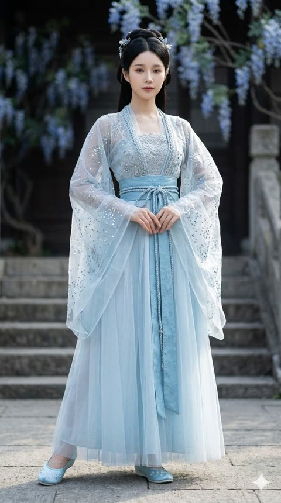</a>

提示词按服装细节、材质光影、构图镜头三段书写,明确写出面料层次与亮片刺绣。侧光透过薄纱,加上85mm f/1.8全身构图,让半透明感与织物质感清晰可见。

GPT Image 2 · 文生图 · 出处: [@fdtreesky on X](https://x.com/fdtreesky/status/2046508731090018331) · 发现于 [freestylefly/awesome-gpt-image-2](https://github.com/freestylefly/awesome-gpt-image-2)

[`hanfu`](tags.md#tag-hanfu) [`fashion`](tags.md#tag-fashion) [`full-body`](tags.md#tag-full-body) [`translucent-fabric`](tags.md#tag-translucent-fabric) [`85mm`](tags.md#tag-85mm)

<details><summary><b>提示词</b></summary>

```text
[中文]
服裝細節： 模特兒身穿一套精緻的淡冰藍色齊胸襦裙，採用多層輕盈的薄紗和絲綢歐根紗材質制成。其寬大的、半透明的廣袖上點綴著如繁星般微小的銀色和淺藍色亮片刺繡，在光線下閃爍（具有銀河般的夢幻感）。抹胸位置有複雜的銀色蕾絲和編織紋理細節，腰帶自然垂落。

材質與光影： 畫面呈現 8k 超高分辨率和對織物微距紋理的極致渲染。光線採用柔和的自然側光（丁達爾效應 Typndall Effect），精準地透射過輕薄的紗布，營造出面料的半透明感（Translucency）和流動感。

構圖與鏡頭： 採用 85mm 黄金人像鏡頭效果，f/1.8 大光圈，全身構圖，模特居中站立

[English]
Clothing details: The model wears an exquisite pale ice blue chest-high ruqun, made of multiple layers of lightweight tulle and silk organza materials. Its wide, translucent broad sleeves are adorned with tiny silver and light blue sequin embroideries like stars, shimmering under the light (with a galaxy-like dreamy feel). The tube top position has complex silver lace and woven texture details, and the belt falls naturally.
Material and light and shadow: The image presents 8k ultra-high resolution and extreme rendering of macro textures of the fabric. The lighting uses soft natural side light (Tyndall Effect Typndall Effect), accurately transmitting through the light gauze, creating a sense of translucency (Translucency) and fluidity of the fabric.
Composition and lens: Uses 85mm golden portrait lens effect, f/1.8 large aperture, full-body composition, model standing in the center
```

</details>

<a id="gpt-image-impasto-oil-portrait-abstract-wall"></a>
### 抽象墙面前的厚涂油画肖像

<a href="https://x.com/mon010_de/status/2058033940305469461">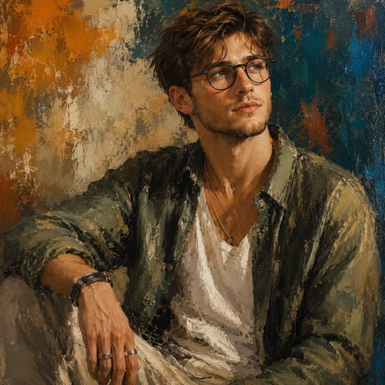</a>

直接点明油画媒介特征（厚涂、刮刀、可见笔触），并为墙面设定橙、米、深蓝的暖色调。再加入放松的坐姿、侧视目光和层次服饰细节，让人物与绘画质感融为一体。

GPT Image 2 · 文生图 · 出处: [@mon010_de on X](https://x.com/mon010_de/status/2058033940305469461) · 发现于 [YouMind-OpenLab/awesome-gpt-image-2](https://github.com/YouMind-OpenLab/awesome-gpt-image-2)

[`oil-painting`](tags.md#tag-oil-painting) [`impasto`](tags.md#tag-impasto) [`portrait`](tags.md#tag-portrait) [`palette-knife`](tags.md#tag-palette-knife) [`editorial`](tags.md#tag-editorial)

<details><summary><b>提示词</b></summary>

```text
Ultra-realistic expressive oil painting portrait of a handsome young man with medium-length messy blonde hair and sun-kissed skin, sitting casually against a textured abstract wall with orange, beige, and deep blue paint strokes. He is looking sideways with a calm, thoughtful expression. He wears an oversized olive-green satin shirt over a white t-shirt, layered silver necklaces, rings, bracelets, and a luxury wristwatch.

The artwork features dramatic warm lighting, cinematic shadows, highly detailed brush strokes, painterly texture, rich impasto oil paint style, modern contemporary art aesthetic, realistic facial anatomy, rugged masculine features, soft glowing skin tones, relaxed pose with one arm resting on his knee.

Background is abstract and artistic with rough palette knife textures and mixed earthy colors. Moody luxury vibe, editorial fashion portrait, museum-quality oil painting, ultra-detailed, high contrast, 8k resolution, masterpiece composition.
```

</details>

<a id="gpt-image-iphone-candid-dusk-street-snapshot"></a>
### 黄昏街头模糊的 iPhone 抓拍人像

<a href="https://x.com/Ciri_ai/status/2051292618248904809">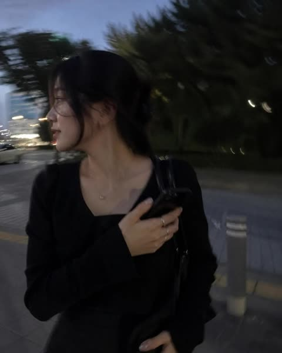</a>

提示词把画面设定为随手误拍的 iPhone 照片，并明确要求轻微动态模糊和不均匀的自然光。这些瑕疵加上平凡的构图，让模型避开精修棚拍感，得到可信的抓拍效果。

GPT Image 2 · 文生图 · 出处: [@Ciri_ai on X](https://x.com/Ciri_ai/status/2051292618248904809) · 发现于 [freestylefly/awesome-gpt-image-2](https://github.com/freestylefly/awesome-gpt-image-2)

[`iphone-snapshot`](tags.md#tag-iphone-snapshot) [`candid`](tags.md#tag-candid) [`motion-blur`](tags.md#tag-motion-blur) [`natural-light`](tags.md#tag-natural-light) [`lifestyle`](tags.md#tag-lifestyle)

<details><summary><b>提示词</b></summary>

```text
I want to see what you really look like.
Draw a snapshot of your everyday life as if it were accidentally taken on an iPhone.
Make it feel like a very ordinary, imperfect candid shot.
The photo should have slight motion blur, with uneven, natural lighting.
```

</details>

**1** · [2](image-portrait-2.md)
