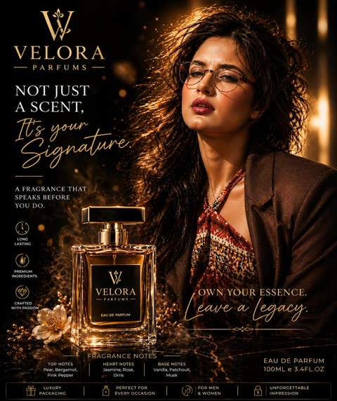
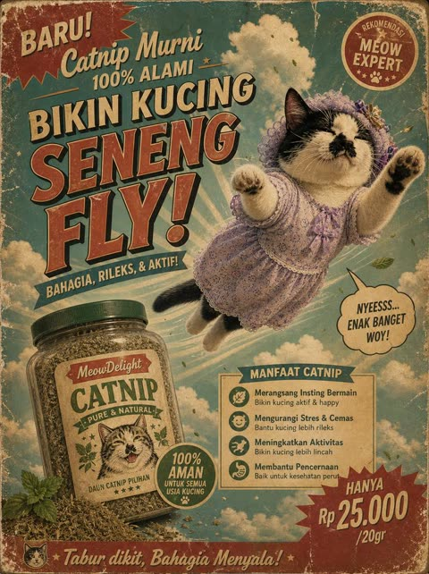
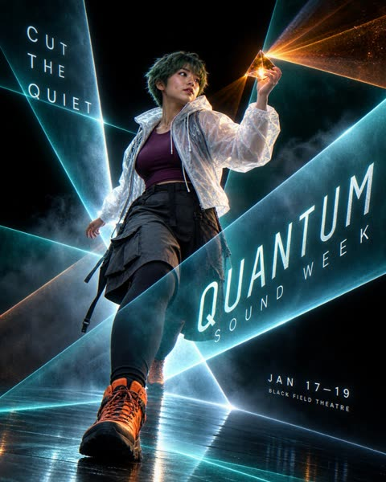
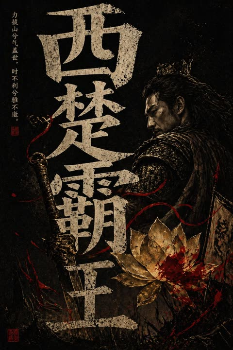
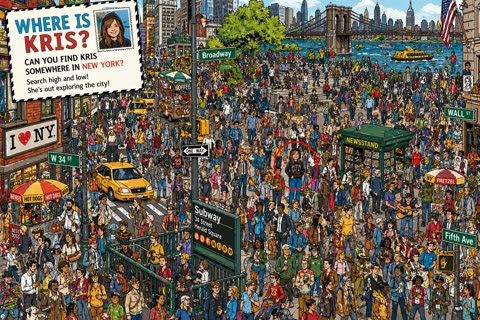
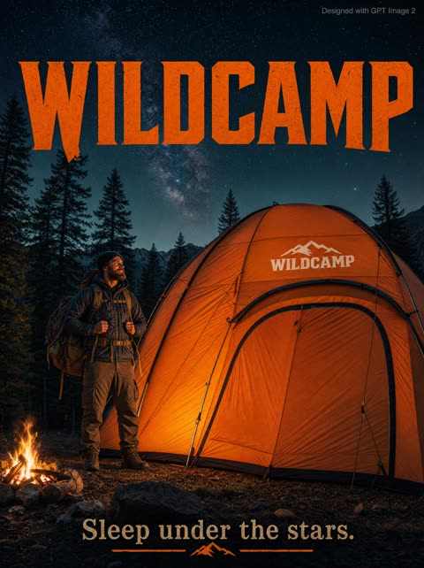
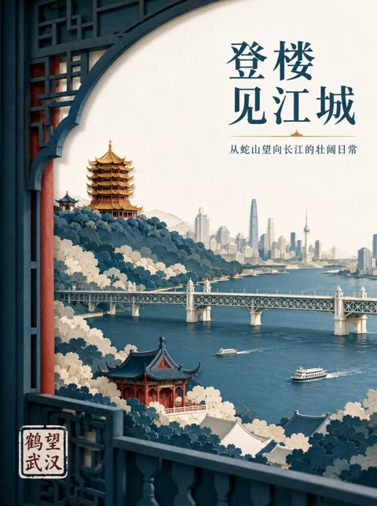
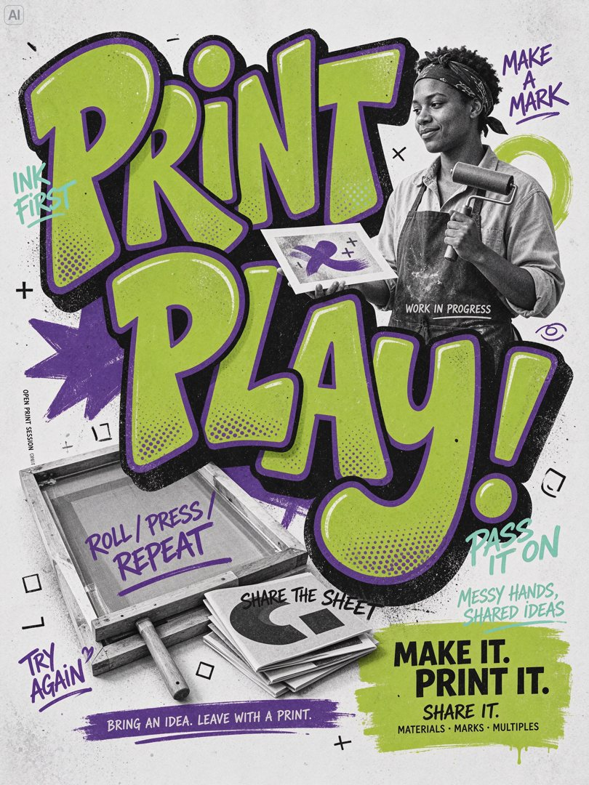
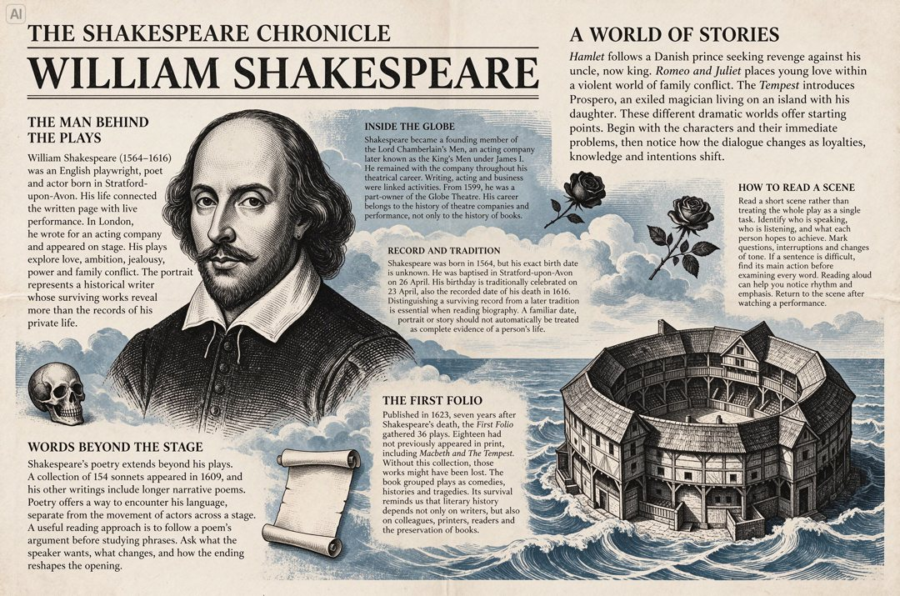

# 海报与编辑排版

[返回目录](../../README_zh.md) · 全部 222 条 · [1](image-poster.md) · [2](image-poster-2.md) · **3**

<a id="gpt-image-velora-parfums-signature-perfume-poster"></a>
### VELORA 香水海报 戴眼镜模特与金色瓶身

<a href="https://x.com/akkiwani703/status/2049778680969437564"></a>

提示词用完整的 JSON 结构锁定镜头、光线和配色，并把标题、卖点与香调文字逐条列出，让模型按版式排布文案。指定 85mm 镜头、f/1.6 光圈和低机位，使画面更接近真实的广告大片。

GPT Image 2 · 文生图 · 出处: [@akkiwani703 on X](https://x.com/akkiwani703/status/2049778680969437564) · 发现于 [freestylefly/awesome-gpt-image-2](https://github.com/freestylefly/awesome-gpt-image-2)

[`perfume`](tags.md#tag-perfume) [`poster`](tags.md#tag-poster) [`json-prompt`](tags.md#tag-json-prompt) [`typography`](tags.md#tag-typography)

<details><summary><b>提示词</b></summary>

```text
{
  "image_type": "luxury perfume advertisement poster",
  "resolution": "4K ultra HD (4096x5120)",
  "aspect_ratio": "portrait (4:5)",
  "style": {
    "aesthetic": "high-end fragrance campaign (Tom Ford, Dior inspired)",
    "tone": "dark luxury, sensual, elegant, powerful",
    "color_grading": "deep black shadows with rich golden highlights and warm amber glow",
    "lighting": "cinematic spotlight + golden rim light + soft fill light, dramatic shadows",
    "contrast": "high cinematic contrast",
    "depth_of_field": "shallow, sharp focus on face and perfume bottle"
  },
  "camera": {
    "type": "85mm portrait lens",
    "aperture": "f/1.6",
    "angle": "slightly low angle, premium perspective",
    "framing": "model upper body + product foreground"
  },
  "subject": {
    "gender": "female",
    "age_appearance": "young adult",
    "expression": "confident, sensual, calm",
    "styling": {
      "hair": "voluminous, slightly messy, glossy strands with golden highlights",
      "makeup": "soft glam, glowing skin, bold lips",
      "outfit": "brown tailored blazer with patterned silk scarf",
      "accessory": "thin transparent eyeglasses"
    }
  },
  "product": {
    "type": "luxury perfume bottle",
    "brand": "VELORA PARFUMS",
    "label": "EAU DE PARFUM",
    "design": "clear crystal glass bottle, golden liquid inside, metallic gold cap",
    "placement": "bottom center foreground on glossy black marble surface",
    "effects": "strong reflections, golden glow, subtle condensation, cinematic shine"
  },
  "environment": {
    "background": "dark blurred luxury interior with warm golden light streaks",
    "surface": "black marble with reflections",
    "extra_elements": "small flowers near bottle, golden particles, soft smoke"
  },
  "typography": {
    "logo": "V monogram + VELORA PARFUMS",
    "headline": "Not just a scent, It’s your Signature.",
    "tagline": "A fragrance that speaks before you do.",
    "secondary": "Own your essence. Leave a legacy.",
    "features": [
      "Long Lasting",
      "Premium Ingredients",
      "Crafted with Passion"
    ],
    "notes": [
      "Top: Pear, Bergamot, Pink Pepper",
      "Heart: Jasmine, Rose, Orris",
      "Base: Vanilla, Patchouli, Musk"
    ],
    "font_style": "luxury serif + elegant handwritten script",
    "color": "gold metallic",
    "placement": "top left + mid left + bottom balanced layout"
  },
  "post_processing": {
    "sharpness": "ultra sharp on face and bottle",
    "glow": "golden cinematic glow",
    "retouch": "high-end editorial finish",
    "vignette": "subtle dark vignette"
  },
  "mood": "premium luxury perfume campaign, cinematic, bold brand identity",
  "quality": "hyper-realistic, 4K ultra HD, commercial grade, award-winning fragrance ad"
}
```

</details>

<a id="gpt-image-vintage-indonesian-catnip-poster"></a>
### 复古印尼猫薄荷广告海报,穿裙子的燕尾服猫飞在空中

<a href="https://x.com/NyaiiBubu/status/2053075349424992532"></a>

先叠加年代质感关键词(70年代纸张、做旧印刷、褪色、颗粒、划痕),再配上有趣的主体和带引号的标题文字来锁定字形。列出假产品罐、徽章、价签等广告元素,让版面更像真实的老广告。

GPT Image 2 · 文生图 · 出处: [@NyaiiBubu on X](https://x.com/NyaiiBubu/status/2053075349424992532) · 发现于 [freestylefly/awesome-gpt-image-2](https://github.com/freestylefly/awesome-gpt-image-2)

[`vintage-poster`](tags.md#tag-vintage-poster) [`retro-typography`](tags.md#tag-retro-typography) [`indonesian`](tags.md#tag-indonesian) [`cat`](tags.md#tag-cat) [`distressed-print`](tags.md#tag-distressed-print)

<details><summary><b>提示词</b></summary>

```text
Ultra realistic vintage Indonesian catnip advertisement poster, retro 1970s paper texture, distressed print, faded colors. A black-and-white tuxedo cat wearing cute vintage housewife clothes floating happily in the air after smelling catnip, euphoric expression, swirling catnip leaves, absurd Indonesian meme energy. Bold retro typography: “BIKIN KUCING SENENG FLY!” fake catnip jar product, old-school badges, price tag, nostalgic warung advertisement aesthetic, cinematic lighting, grain, scratches, authentic aged poster look.
```

</details>

<a id="gpt-image-volumetric-laser-black-stage-poster"></a>
### 全黑舞台体积激光海报

<a href="https://x.com/zhidawang219555/status/2090246237094310178"></a>

六片体积激光在全黑剧场里分层，每片都写明起点、透视和薄雾厚度。标题与其中一片光面共享透视，脸部只用一道边光，小字留在纯黑负空间。

GPT Image 2 · 文生图 · 出处: [@zhidawang219555 on X](https://x.com/zhidawang219555/status/2090246237094310178) · 发现于 [freestylefly/awesome-gpt-image-2](https://github.com/freestylefly/awesome-gpt-image-2)

[`laser`](tags.md#tag-laser) [`volumetric-light`](tags.md#tag-volumetric-light) [`black-stage`](tags.md#tag-black-stage) [`typography`](tags.md#tag-typography) [`diagonal-composition`](tags.md#tag-diagonal-composition)

<details><summary><b>提示词</b></summary>

```text
从全黑剧场开始，像切标本一样用六片真实体积激光把空间分层。光面必须有明确起点、透视和薄雾中的厚度，人物站在交汇点，透明道具折射出一小束异色光扇。构图沿左下至右上的对角线推进，脸只用一道克制边光揭示；标题与其中一片光面共享透视，小字留在纯黑负空间。每次替换主题与角色时，不得退化成夜店模板、HUD、霓虹城市或无物理来源的光线。
```

</details>

<a id="gpt-image-western-chu-overlord-dark-poster"></a>
### 国风暗黑巨型石刻标题海报

<a href="https://x.com/stellimbris/status/2048633434961072617"></a>

纯黑背景上一个巨大的做旧石刻标题撑起整个画面，配合严格的黑白金红配色。标题文字需要自己写进提示词，这张图里模型自行补上了西楚霸王和对应的武将形象。

GPT Image 2 · 文生图 · 出处: [@stellimbris on X](https://x.com/stellimbris/status/2048633434961072617) · 发现于 [freestylefly/awesome-gpt-image-2](https://github.com/freestylefly/awesome-gpt-image-2)

[`chinese-style`](tags.md#tag-chinese-style) [`dark-poster`](tags.md#tag-dark-poster) [`typography`](tags.md#tag-typography) [`cinematic`](tags.md#tag-cinematic) [`texture`](tags.md#tag-texture)

<details><summary><b>提示词</b></summary>

```text
竖版国风暗黑海报，黑色纯背景，中央巨大的中文标题字，占据画面大部分空间，字体为粗粝做旧的米白色石刻/旧纸质感，带明显颗粒、磨损、裂痕与噪点；整体构图层次丰富，强烈黑白金红对比，东方审美，神秘、压抑、欲望与审判感并存 电影海报质感 高级平面设计，极致细节 纸张纹理 印章落款 小字标语，4K
```

</details>

<a id="gpt-image-where-is-name-crowd-search-poster"></a>
### 纽约人群中寻找指定人物的搜寻海报

<a href="https://x.com/icreatelife/status/2046639884421550482"></a>

用填入姓名的模板只指定海报形式并可更换城市,由模型自行补全密集人群、路牌和地标。圈出答案和带邮票头像的标题卡都来自搜寻海报这一形式本身。

GPT Image 2 · 文生图 · 出处: [@icreatelife on X](https://x.com/icreatelife/status/2046639884421550482) · 发现于 [ZeroLu/awesome-gpt-image](https://github.com/ZeroLu/awesome-gpt-image)

[`search-poster`](tags.md#tag-search-poster) [`crowd-scene`](tags.md#tag-crowd-scene) [`city`](tags.md#tag-city) [`template`](tags.md#tag-template) [`personalised`](tags.md#tag-personalised)

<details><summary><b>提示词</b></summary>

```text
Create a "Where is [Your Name]" crowd search poster set in the city of your choosing
```

</details>

<a id="gpt-image-wildcamp-giant-tent-night-poster"></a>
### 夜空下大胡子徒步者与巨型橙色帐篷

<a href="https://x.com/Strength04_X/status/2056258909334306897"></a>

提示词先用帐篷是人三倍高来固定尺度对比，再指定篝火暖光与星空的冷暖反差。每段文字都写明位置和作用：天空中的大标题、底部标语、角落的小字署名。

GPT Image 2 · 文生图 · 出处: [@Strength04_X on X](https://x.com/Strength04_X/status/2056258909334306897) · 发现于 [freestylefly/awesome-gpt-image-2](https://github.com/freestylefly/awesome-gpt-image-2)

[`camping`](tags.md#tag-camping) [`advertising`](tags.md#tag-advertising) [`night-sky`](tags.md#tag-night-sky) [`typography`](tags.md#tag-typography) [`cinematic-lighting`](tags.md#tag-cinematic-lighting)

<details><summary><b>提示词</b></summary>

```text
An outdoor adventure advertisement poster featuring a rugged bearded man in full hiking gear standing confidently beside a massive orange camping tent three times taller than him, fully pitched in a dramatic forest clearing surrounded by towering pine trees beneath a deep starry night sky. The tent features a bold white “WILDCAMP” logo stitched onto the rainfly. Warm cinematic campfire lighting illuminates the scene with realistic shadows and rich outdoor textures, creating a premium adventure-commercial aesthetic. Large rugged serif typography reading “WILDCAMP” dominates the dark sky area in bold orange lettering, while the tagline “Sleep under the stars.” appears elegantly at the bottom. Small grey text in the top-right corner reads “Designed with GPT Image 2.” Photorealistic, ultra-detailed, cinematic outdoor advertising style with dramatic atmosphere and high-end commercial composition.
```

</details>

<a id="gpt-image-wuhan-layered-paper-cut-tourism-poster"></a>
### 武汉江城分层纸雕文旅海报

<a href="https://x.com/Mrpinecone888/status/2086643289525264395"></a>

提示词用前景窗口构图并叠加五至七层纹理纸，统一左上光源，让层间阴影真实。配色严格限定，金色只用于视觉焦点。标题、副标题和印章文字逐一写明，并用详细的负面清单排除廉价红金模板、建筑变形和多余文案。

GPT Image 2 · 文生图 · 出处: [@Mrpinecone888 on X](https://x.com/Mrpinecone888/status/2086643289525264395) · 发现于 [YouMind-OpenLab/awesome-gpt-image-2](https://github.com/YouMind-OpenLab/awesome-gpt-image-2)

[`paper-cut`](tags.md#tag-paper-cut) [`layered-diorama`](tags.md#tag-layered-diorama) [`travel-poster`](tags.md#tag-travel-poster) [`chinese-typography`](tags.md#tag-chinese-typography) [`landmark`](tags.md#tag-landmark)

<details><summary><b>提示词</b></summary>

```text
为原创文旅品牌“鹤望武汉”创作一幅高端分层纸雕插画海报，传播命题为“登楼望江，一眼看见武汉的山水骨架”，3:4 竖版。画面使用前景窗口构图，以五至七层厚纹理纸构成蛇山、黄鹤楼、长江、武汉长江大桥与对岸城市天际线；黄鹤楼位于后景山脊，屋檐层叠、金色琉璃瓦与朱红柱体关系准确，中景长江大桥横向延伸，江面两艘小型轮渡尺度克制，不能把晴川阁与黄鹤楼合并。纸张切边利落，统一左上柔光，层间阴影真实，综合色为黛青、暖米白、朱砂红和少量鎏金黄，金色只用于视觉焦点。主标题“登楼见江城”置于右上大片留白区，两行现代宋体；副标题“从蛇山望向长江的壮阔日常”横排于标题下方；品牌名“鹤望武汉”置于左下纸质印章形品牌位，保持现代而非仿古。规范简体中文、无错字漏字，仅使用中文；禁止廉价红金模板、漫天祥云、古装人物、建筑比例失真、塑料材质、厚重发光描边、知名标识、水印与额外文案。
```

</details>

<a id="seedream-5-5-print-play-graffiti-collage-poster"></a>
### PRINT PLAY 涂鸦拼贴海报

<a href="https://seed.bytedance.com/en/seedream5_5"></a>

三种指定颜色、一种纸张质感、逐字的标语和每个元素的位置，把一种松散的风格变成模型能逐句照做的版面。

Seedream 5.5 · 文生图 · 出处: [ByteDance Seed: Seedream 5.5](https://seed.bytedance.com/en/seedream5_5)

[`seedream`](tags.md#tag-seedream) [`graffiti`](tags.md#tag-graffiti) [`collage`](tags.md#tag-collage) [`typography`](tags.md#tag-typography) [`halftone`](tags.md#tag-halftone)

<details><summary><b>提示词</b></summary>

```text
Create a graffiti collage poster about collaborative street printing, using lime green, aubergine purple and mint over a gray-white photocopied paper texture. Oversized “PRINT PLAY!” lettering overlaps diagonally. A grayscale printmaker at the upper right holds a roller and print sample, with printing tools and handwritten phrases including “MAKE A MARK” and “PASS IT ON” below. Preserve matte halftone ink, fine grain and legible lettering in a layered, asymmetric composition.
```

</details>

<a id="seedream-5-5-shakespeare-chronicle-newspaper-page"></a>
### 莎士比亚文学报，七篇短文环绕插图

<a href="https://seed.bytedance.com/en/seedream5_5"></a>

报头和大标题逐字给出，版面要求七篇英文短文，小字清晰可读。密集小字是字节为 5.5 列出的三项升级之一。

Seedream 5.5 · 文生图 · 出处: [ByteDance Seed: Seedream 5.5](https://seed.bytedance.com/en/seedream5_5)

[`seedream`](tags.md#tag-seedream) [`newspaper`](tags.md#tag-newspaper) [`small-text`](tags.md#tag-small-text) [`engraving`](tags.md#tag-engraving) [`editorial-layout`](tags.md#tag-editorial-layout)

<details><summary><b>提示词</b></summary>

```text
Design a landscape literary newspaper with the masthead “THE SHAKESPEARE CHRONICLE” and the headline “WILLIAM SHAKESPEARE”. On warm ivory paper, illustrate Shakespeare and the Globe Theatre in black engraving, with muted blue clouds and waves weaving through the page. Arrange seven short articles in English around the illustrations, using bold serif headings and legible small type.
```

</details>

[1](image-poster.md) · [2](image-poster-2.md) · **3**
