# 海报与编辑排版

[返回目录](../../README_zh.md) · 全部 146 条 · **1** · [2](image-poster-2.md)

<a id="gpt-image-flat-vector-city-travel-poster-template"></a>
### 适用任意城市的扁平矢量旅行海报模板

<a href="https://x.com/MahnoorAi12/status/2091349007922778211"></a>

用一个城市名占位符驱动地标、交通、生活瞬间、本地植物、视角五个要素，让每个城市的画面结构都不同。严格的配色体系、少量人物和较长的反向提示词，让扁平矢量风格保持安静统一。

GPT Image 2 · 文生图 · 出处: [@MahnoorAi12 on X](https://x.com/MahnoorAi12/status/2091349007922778211) · 3,421 赞，统计于 2026-10-28

[`travel-poster`](tags.md#tag-travel-poster) [`flat-vector`](tags.md#tag-flat-vector) [`template`](tags.md#tag-template) [`city`](tags.md#tag-city) [`minimalist`](tags.md#tag-minimalist)

<details><summary><b>提示词</b></summary>

```text
Premium minimalist flat-vector travel poster for [CITY_NAME], 3:4 vertical format.

Design an original, sophisticated travel poster that captures the authentic visual personality of [CITY_NAME]. The composition must feel purpose-built for this city rather than following a reusable template.

CITY IDENTITY

First interpret the unique visual character of [CITY_NAME] and build the scene around these five elements:

1. A recognizable landmark, architectural feature, or skyline element.
2. A distinctive local way of moving through the city.
3. One subtle everyday lifestyle moment.
4. A native plant, landscape, or environmental characteristic.
5. A composition and viewpoint that naturally belongs to the city.

The overall scene structure must change from city to city. Do not repeatedly use the same object positions or visual formula.

Possible compositions include:
harbor viewpoint, narrow historic lane, riverside garden, coastal path, elevated city overlook, lively market passage, tram avenue, ferry terminal, botanical setting, heritage square, beach promenade, cultural plaza, or skyline terrace.

Choose whichever composition best represents [CITY_NAME].

TYPOGRAPHY

Place “[CITY_NAME]” in the upper-left area with generous clean negative space.

Add one short, sophisticated English tagline inspired by the atmosphere of the city.

Typography should feel understated, editorial, spacious, and premium. Never allow text to dominate the artwork.

VISUAL HIERARCHY

Use one iconic landmark or architectural feature as the main focal point.

Support it with only 2–4 carefully selected local elements. Every added detail should strengthen the sense of place.

Avoid landmark collections or postcard-style collages. Keep the scene visually quiet and intentional.

PEOPLE

Include only 3–6 small-scale figures.

Give each person a believable activity connected to local life, such as:
walking through a historic lane, cycling, waiting for public transport, sketching architecture, boarding a ferry, reading outdoors, taking a quiet photograph, carrying beach equipment, browsing a market, or jogging beside the water.

Avoid crowds and avoid making any single person the main character. Figures should integrate naturally into the environment.

LOCAL CHARACTER

Use city-specific elements only when they genuinely fit [CITY_NAME]:

- local transportation
- architecture
- street furniture
- vegetation
- small signs or wayfinding
- local food references
- recreational activities
- pavement markings
- cultural details

Transport and signage should remain subtle. Instead of always using a large signboard, incorporate details naturally through a small transit marker, station clock, ferry information panel, bike symbol, painted road marking, beach flag, or understated metro icon.

ART DIRECTION

Japanese stationery-inspired aesthetic,
luxury sticker illustration,
premium commercial vector artwork,
modern editorial travel branding,
clean delicate outlines,
uniform line weight,
simple geometric forms,
flat-color illustration,
soft shapes,
balanced visual rhythm,
high-end minimalist postcard design.

COLOR SYSTEM

Build the atmosphere primarily with:
pale powder blue, soft sky blue, mist blue, and cool airy blues.

Balance these with:
warm ivory, cream, soft beige, muted sage, gray-green, and understated architectural neutrals.

Use dusty rose or muted blush only for tiny visual accents such as flowers, clothing details, small signs, awnings, or decorative objects.

Colors should remain soft, sophisticated, slightly desaturated, and cohesive.

MOOD

Fresh, airy, peaceful, refined, contemporary, elegant.

The final artwork should feel like a premium boutique travel postcard or luxury lifestyle brand illustration, with generous breathing room and a relaxed sense of place.

IMPORTANT QUALITY RULES

Every city must have its own visual identity.
Change the camera angle, scene structure, landmark placement, foreground treatment, and supporting details according to the city's character.

Do not simply replace [CITY_NAME] inside an existing composition.

NEGATIVE PROMPT

No photorealism.
No realism.
No watercolor.
No painterly brushwork.
No gradients.
No heavy shadows.
No dramatic cinematic lighting.
No paper texture.
No excessive detail.
No cluttered background.
No landmark collage.
No crowded streets.
No oversized characters.
No dominant hero character.
No repetitive café composition.
No fixed signboard position.
No identical foreground treatment.
No generic tourist-poster formula.
No copied layout from another city.
No unnecessary decorative elements.
```

</details>

<a id="nano-banana-monoline-city-travel-poster-kyoto"></a>
### 京都街景红色单线旅行海报

<a href="https://x.com/Goodmanprotocol/status/2052974175435026714"></a>

用目的地占位符让同一模板适配任意城市。提示词限定单一主色加单一底色并给出各城市配色示例,要求密集的单线细节和当地语言招牌,再用文字质量条款保证字体清晰可读。

Nano Banana 2 · 文生图 · 出处: [@Goodmanprotocol on X](https://x.com/Goodmanprotocol/status/2052974175435026714) · 1,436 赞，统计于 2026-10-29

[`travel-poster`](tags.md#tag-travel-poster) [`line-art`](tags.md#tag-line-art) [`monochrome`](tags.md#tag-monochrome) [`swiss-modernist`](tags.md#tag-swiss-modernist) [`template`](tags.md#tag-template)

<details><summary><b>提示词</b></summary>

```text
Create an ultra-high-resolution minimalist line-art travel poster of [DESTINATION], portraying the city as a stylish everyday urban scene rather than a tourist postcard.

CORE COMPOSITION:
- Central composition shows the city’s most iconic street, intersection, alley, tram street, or pedestrian avenue
- Foreground includes locals, commuters, cyclists, travelers, shoppers, students, café visitors
- People should naturally reflect the city’s local lifestyle and fashion culture
- Background filled with realistic local signage, cafés, restaurants, transportation signs, storefronts, and architectural details
- Landmarks should appear naturally integrated into everyday life, never exaggerated
- Include authentic local-language typography and culturally recognizable visual elements
- Large bold typography at the top center:
  “[DESTINATION]”
- Subtitle below:
  local language + country name
  examples:
  東京 JAPAN
  서울 KOREA
  ΚΟΛΩΝΙΑ GERMANY

STYLE:
ultra clean vector illustration,
Swiss modernist travel poster,
minimal line art,
monoline drawing,
mid-century editorial aesthetic,
architectural illustration,
Japanese graphic poster style,
precise geometric perspective,
extremely clean negative space,
premium travel branding aesthetic

LINE STYLE:
- monochrome line-based illustration only
- thin and highly precise linework
- minimal fill areas
- intricate city-map-like detail density
- rhythmic layering of signs, buildings, windows, and street objects
- visually dense yet highly organized composition

COLOR SYSTEM — VERY IMPORTANT:
- use only ONE main color + ONE background color
- automatically choose a color that best represents the city’s atmosphere
- monochrome silkscreen poster aesthetic
- no rainbow palettes
- no excessive neon
- color should reflect the city’s architecture, climate, nightlife, and cultural identity

Examples:
Tokyo → vivid red on warm ivory
Paris → deep navy on cream
New York → charcoal black on light gray
Kyoto → muted burgundy on warm cream
Hong Kong → teal blue on pale ivory
Santorini → Mediterranean blue on white
Cairo → desert sepia on sand beige

COMPOSITION:
- vertical poster layout
- frontal street-level perspective
- pedestrians crossing streets or moving naturally
- balanced urban rhythm and visual flow
- should feel like a premium city-brand campaign poster

MOOD:
stylish urban life,
calm but lively,
editorial travel magazine cover,
timeless city identity,
premium tourism campaign visual,
minimal yet highly detailed

TEXT QUALITY — EXTREMELY IMPORTANT:
- all typography must be readable and accurate
- no random characters
- no broken or distorted letters
- local signage should feel authentic and natural
- professional editorial typography alignment

OUTPUT:
- vertical poster composition
- 8K ultra detailed
- print-ready
- ultra sharp vector quality
```

</details>

<a id="gpt-image-carved-22-birthday-poster-pop-out"></a>
### 雕刻数字22的奢华生日海报

<a href="https://x.com/Sairah_0/status/2064643917895839913"></a>

数字被雕刻进纹理墙面并带内阴影，里面填满气球和鲜花，人物坐在数字曲线上并伸出边框形成立体效果。参考人脸指令、藏青与白的限定配色、侧面阳光和逐行指定的文字让整张海报风格统一。

GPT Image 2 · 上传图改图 · 出处: [@Sairah_0 on X](https://x.com/Sairah_0/status/2064643917895839913) · 1,026 赞，统计于 2026-10-29

[`birthday`](tags.md#tag-birthday) [`pop-out`](tags.md#tag-pop-out) [`carved-number`](tags.md#tag-carved-number) [`navy-palette`](tags.md#tag-navy-palette) [`reference-face`](tags.md#tag-reference-face)

<details><summary><b>提示词</b></summary>

```text
Professional luxury birthday poster, 3:4 ratio. Entire frame filled with a premium off-white luxury paper textured wall. Large number “22” precisely carved into the wall with visible depth, realistic inner shadows, and elegant dimensional detailing. Inside the number: navy blue, pastel blue, and white balloons, delicate white flowers, refined bouquet arrangements, and premium celebration styling. A happy 22-year-old child with preserved reference facial features, wearing a navy blue T-shirt and navy blue denim overalls, sitting casually on the lower curve of the number “22” with one leg bent and the other dangling naturally, smiling brightly while looking slightly upward. Face, shoulder, one arm, and one foot extend outside the carved number, creating a realistic 3D pop-out effect. Warm cinematic sunlight entering from one side, soft rim lighting, photorealistic skin texture, premium studio photography, ultra-realistic details, sharp focus, luxury editorial quality. Typography on the wall: “NOEL”, “CHAPTER 22”, “365 MORE DAYS OF WONDER”. Clean minimalist composition, luxury magazine cover aesthetic, high-end art direction, realistic shadows, natural colors, no tree shadows, no fake lighting, no AI artifacts, premium birthday campaign photography, masterpiece quality."
```

</details>

<a id="gpt-image-city-placeholder-flat-vector-travel-poster"></a>
### 可替换城市名的扁平矢量旅行海报

<a href="https://x.com/AiwithLariab/status/2091435219002003957"></a>

用一个城市占位符展开出地标、本地交通、生活片段、本地植物和视角五项要素，再用人物数量上限、浅蓝奶油色板和详细的负面提示，让每个城市的构图各不相同。

GPT Image 2 · 文生图 · 出处: [@AiwithLariab on X](https://x.com/AiwithLariab/status/2091435219002003957) · 954 赞，统计于 2026-10-28

[`travel-poster`](tags.md#tag-travel-poster) [`flat-vector`](tags.md#tag-flat-vector) [`city`](tags.md#tag-city) [`template`](tags.md#tag-template) [`minimalist`](tags.md#tag-minimalist)

<details><summary><b>提示词</b></summary>

```text
Premium minimalist flat-vector travel poster for [CITY_NAME], 3:4 vertical format.

Design an original, sophisticated travel poster that captures the authentic visual personality of [CITY_NAME]. The composition must feel purpose-built for this city rather than following a reusable template.

CITY IDENTITY

First interpret the unique visual character of [CITY_NAME] and build the scene around these five elements:

1. A recognizable landmark, architectural feature, or skyline element.
2. A distinctive local way of moving through the city.
3. One subtle everyday lifestyle moment.
4. A native plant, landscape, or environmental characteristic.
5. A composition and viewpoint that naturally belongs to the city.

The overall scene structure must change from city to city. Do not repeatedly use the same object positions or visual formula.

Possible compositions include:
harbor viewpoint, narrow historic lane, riverside garden, coastal path, elevated city overlook, lively market passage, tram avenue, ferry terminal, botanical setting, heritage square, beach promenade, cultural plaza, or skyline terrace.

Choose whichever composition best represents [CITY_NAME].

TYPOGRAPHY

Place “[CITY_NAME]” in the upper-left area with generous clean negative space.

Add one short, sophisticated English tagline inspired by the atmosphere of the city.

Typography should feel understated, editorial, spacious, and premium. Never allow text to dominate the artwork.

VISUAL HIERARCHY

Use one iconic landmark or architectural feature as the main focal point.

Support it with only 2–4 carefully selected local elements. Every added detail should strengthen the sense of place.

Avoid landmark collections or postcard-style collages. Keep the scene visually quiet and intentional.

PEOPLE

Include only 3–6 small-scale figures.

Give each person a believable activity connected to local life, such as:
walking through a historic lane, cycling, waiting for public transport, sketching architecture, boarding a ferry, reading outdoors, taking a quiet photograph, carrying beach equipment, browsing a market, or jogging beside the water.

Avoid crowds and avoid making any single person the main character. Figures should integrate naturally into the environment.

LOCAL CHARACTER

Use city-specific elements only when they genuinely fit [CITY_NAME]:

- local transportation
- architecture
- street furniture
- vegetation
- small signs or wayfinding
- local food references
- recreational activities
- pavement markings
- cultural details

Transport and signage should remain subtle. Instead of always using a large signboard, incorporate details naturally through a small transit marker, station clock, ferry information panel, bike symbol, painted road marking, beach flag, or understated metro icon.

ART DIRECTION

Japanese stationery-inspired aesthetic,
luxury sticker illustration,
premium commercial vector artwork,
modern editorial travel branding,
clean delicate outlines,
uniform line weight,
simple geometric forms,
flat-color illustration,
soft shapes,
balanced visual rhythm,
high-end minimalist postcard design.

COLOR SYSTEM

Build the atmosphere primarily with:
pale powder blue, soft sky blue, mist blue, and cool airy blues.

Balance these with:
warm ivory, cream, soft beige, muted sage, gray-green, and understated architectural neutrals.

Use dusty rose or muted blush only for tiny visual accents such as flowers, clothing details, small signs, awnings, or decorative objects.

Colors should remain soft, sophisticated, slightly desaturated, and cohesive.

MOOD

Fresh, airy, peaceful, refined, contemporary, elegant.

The final artwork should feel like a premium boutique travel postcard or luxury lifestyle brand illustration, with generous breathing room and a relaxed sense of place.

IMPORTANT QUALITY RULES

Every city must have its own visual identity.
Change the camera angle, scene structure, landmark placement, foreground treatment, and supporting details according to the city's character.

Do not simply replace [CITY_NAME] inside an existing composition.

NEGATIVE PROMPT

No photorealism.
No realism.
No watercolor.
No painterly brushwork.
No gradients.
No heavy shadows.
No dramatic cinematic lighting.
No paper texture.
No excessive detail.
No cluttered background.
No landmark collage.
No crowded streets.
No oversized characters.
No dominant hero character.
No repetitive café composition.
No fixed signboard position.
No identical foreground treatment.
No generic tourist-poster formula.
No copied layout from another city.
No unnecessary decorative elements.
```

</details>

<a id="gpt-image-harbour-promenade-travel-journal-poster"></a>
### 海滨步道照片变成极简旅行手账海报

<a href="https://x.com/Taaruk_/status/2095422896428798063">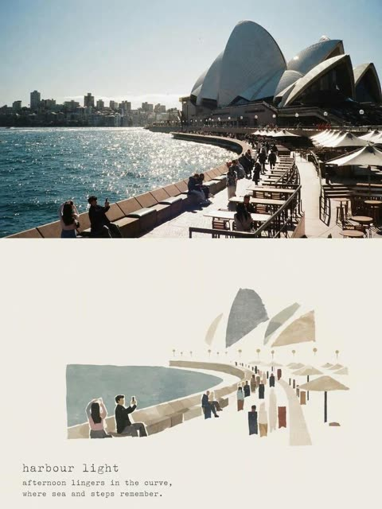</a>

提示词先列出要保留的参考图元素(建筑、步道、人群、构图),再要求手绘丝网印刷风格,并固定低饱和配色和纸张颗粒。打字机字体的原文标题与 4:5 比例锁定版式,大量留白让画面更有编辑感。

GPT Image 2 · 上传图改图 · 出处: [@Taaruk_ on X](https://x.com/Taaruk_/status/2095422896428798063) · 778 赞，统计于 2026-10-29

[`travel-poster`](tags.md#tag-travel-poster) [`screen-print`](tags.md#tag-screen-print) [`watercolor`](tags.md#tag-watercolor) [`typewriter-typography`](tags.md#tag-typewriter-typography) [`paper-texture`](tags.md#tag-paper-texture)

<details><summary><b>提示词</b></summary>

```text
Transform the reference photograph into a minimalist vintage travel-journal poster while preserving the recognizable street scene: historic ornate buildings, double-decker buses, bus stop, street lamps, pedestrians, storefronts, and warm afternoon sunlight. Reinterpret everything as a refined hand-drawn screen-print illustration using simplified architectural silhouettes, delicate imperfect ink lines, flat muted olive green, ochre, warm brown, cream and soft gray tones, subtle watercolor texture and lightly distressed pigment. Place the illustration in the center of a large warm ivory textured paper sheet, surrounded by generous negative space. Maintain the distinctive building shapes and street perspective while keeping the illustration clean and poetic. Add elegant typewriter-style typography at the bottom reading “afternoon on the high street”, followed by “buses come and go. the light remembers the buildings.” Nostalgic urban travel diary, quiet afternoon atmosphere, editorial art-book aesthetic, handmade paper texture, restrained colors, sophisticated minimalist composition, authentic vintage print imperfections, vertical 4:5 poster.
```

</details>

<a id="gpt-image-photo-to-handmade-collage-split-poster"></a>
### 上半真实照片下半手作拼贴的编辑海报

<a href="https://x.com/saniaspeaks_/status/2097176979497791899">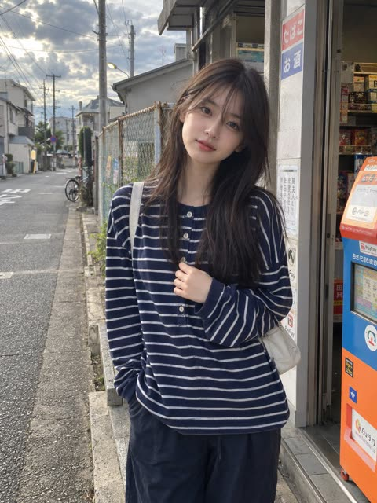</a>

严格上下等分的版式，上半保留忠实原图，下半在象牙白留白中放一幅小型手作拼贴。调色限定为从照片提取的四种颜色，并点名撕纸和水粉等质感，让两半画面彼此呼应。

GPT Image 2 · 上传图改图 · 出处: [@saniaspeaks_ on X](https://x.com/saniaspeaks_/status/2097176979497791899) · 653 赞，统计于 2026-10-28

[`editorial-poster`](tags.md#tag-editorial-poster) [`mixed-media`](tags.md#tag-mixed-media) [`split-layout`](tags.md#tag-split-layout) [`photo-reinterpretation`](tags.md#tag-photo-reinterpretation) [`negative-space`](tags.md#tag-negative-space)

<details><summary><b>提示词</b></summary>

```text
Create a premium editorial art poster for every uploaded photograph, treating each image as its own independent composition and never merging multiple photos together. Use a strict 3:4 vertical format with the canvas split into two perfectly equal horizontal halves: the upper half should remain a faithful, photorealistic presentation of the original image, preserving the subject’s exact identity, facial features, proportions, pose, clothing, objects, composition, lighting, shadows, mood, and natural colors, enhanced only with sophisticated editorial color grading and seamless environmental extension where necessary; the lower half should transform the visual story into an entirely different artistic interpretation—a tiny, carefully composed handmade mixed-media artwork centered within expansive warm ivory negative space, occupying no more than 10–20% of the lower section, using expressive ink sketching, layered gouache-like color fields, subtle collage textures, torn-paper edges, imperfect brushwork, visible fibers, soft pigment variations, and charming human imperfections while retaining the most recognizable silhouette, gesture, objects, and emotional narrative from the original photo. Extract up to four dominant harmonious colors from each photograph and reinterpret them in a muted, sophisticated palette. Add only occasional understated editorial typography when it genuinely enhances the composition, such as a poetic title, place, date, or single word. The overall result should feel like a collectible contemporary art publication cover—minimal, poetic, tactile, elegant, emotionally quiet, visually distinctive, and unmistakably connected to its original photograph.
```

</details>

<a id="gpt-image-human-fragments-typography-poster-template"></a>
### 人物与单车融入巨型字母的编辑排版海报

<a href="https://x.com/ChillaiKalan__/status/2084503517709119999"></a>

以超大字母作为版面骨架，让人物和街景出现在字形内部并突破字形边缘。主题、主体、状态、色板使用占位符，再固定系列名和年份，可作为通用模板反复套用。

GPT Image 2 · 文生图 · 出处: [@ChillaiKalan__ on X](https://x.com/ChillaiKalan__/status/2084503517709119999) · 621 赞，统计于 2026-10-29

[`typography`](tags.md#tag-typography) [`editorial`](tags.md#tag-editorial) [`template`](tags.md#tag-template) [`lifestyle`](tags.md#tag-lifestyle) [`9-16`](tags.md#tag-9-16)

<details><summary><b>提示词</b></summary>

```text
Create a 9:16 editorial typography poster from a single human-centered lifestyle moment.

Use oversized typography as the main composition structure. Let the person, movement, city space, or everyday scene appear inside the letters, pass through them, or break beyond their edges. The image should feel integrated with the type, not simply placed behind text.Theme: [Custom Title]
Subject: [Subject Gender Or Origin]
Human state: [Human State]
Color palette: [Color Palette]
Series: HUMAN FRAGMENTS
Year: 2026
```

</details>

<a id="nano-banana-levitating-outfit-fashion-editorial-labels"></a>
### 悬浮服装时装大片与标注框

<a href="https://x.com/AllaAisling/status/2034382842084708533"></a>

提示词按从鞋到帽的顺序列出单品,并为每种面料指定垂坠物理表现。标签格式固定为大写名称、斜体面料和一个关键细节,再配合主光、暖色补光和冷色轮廓光三段布光,让隐形人体的效果保持稳定。

Nano Banana 2 · 文生图 · 出处: [@AllaAisling on X](https://x.com/AllaAisling/status/2034382842084708533) · 503 赞，统计于 2026-10-28

[`fashion`](tags.md#tag-fashion) [`levitation`](tags.md#tag-levitation) [`editorial`](tags.md#tag-editorial) [`template`](tags.md#tag-template) [`callout-labels`](tags.md#tag-callout-labels)

<details><summary><b>提示词</b></summary>

```text
Prompt Studio: Gravity Fashion Editorial, with Nano Banana 2 in Firefly

Complete [STYLE] outfit floating in its exact worn position around  an invisible body with every piece suspended mid-breath, mid-billow.  LOOK (bottom to top): [FOOTWEAR] → [BOTTOMS] → [TOP] → [LAYER] →  [ACCESSORIES] → [JEWELLERY] → [HEADWEAR]  FABRIC PHYSICS: each material true to its weight, wool hangs,  silk drapes, denim holds its crease, leather keeps its shape.  Every edge lifting slightly as if caught in one silent gust.  LABELS: hairline leader to floating label box. "[GARMENT]" uppercase / "[FABRIC]" italic / "[ONE DEFINING DETAIL]"  LIGHTING: soft directional from upper left + warm fill from below  catching linings and sole edges + cool rim outlining the silhouette. BACKGROUND: [COLOR] seamless, fashion-forward. TITLE: "[LOOK NAME]" elegant serif type, top right. SUBTITLE: "[MOOD / OCCASION]" italic.  Mood: high-concept levitation editorial, the outfit exists,  the person is imagination. 4K, extraordinary fabric fidelity, tack sharp.

Check ALTs for ideas 👇
@AdobeFirefly
```

</details>

<a id="gpt-image-halftone-architecture-poster"></a>
### 建筑照片变半调拼贴旅行海报

<a href="https://x.com/Naiknelofar788/status/2100067049288634730"></a>

长篇规格，结尾给出优先级：先保建筑准确，再谈半调效果。

GPT Image 2.5 · 上传图改图 · 出处: [@Naiknelofar788 on X](https://x.com/Naiknelofar788/status/2100067049288634730) · 497 赞，统计于 2026-10-27

[`halftone`](tags.md#tag-halftone) [`architecture`](tags.md#tag-architecture) [`travel`](tags.md#tag-travel) [`collage`](tags.md#tag-collage)

<details><summary><b>提示词</b></summary>

```text
Turn this structure photo into a single high-end halftone architectural travel-collage poster. Output one poster per uploaded photo — never merge multiple structures or photos into one frame.

FORMAT

3:4 vertical canvas. Split into two roughly equal zones — real architectural photo on top, printed reconstruction below — divided by one clean, sharp horizontal line.

Do not stretch, warp, tilt, or unnaturally reposition the structure to force the proportions.

TOP HALF — THE REAL SHOT

Preserve the original structure faithfully: same architecture, proportions, perspective, distinctive details, surrounding elements, natural light and shadow, and original color mood.

Keep recognizable features such as:

* façade
* windows and arches
* towers or domes
* doors and structural details
* roofline
* surrounding landscape or street elements

Add only a subtle high-end color grade and the faintest film grain. Do not redesign or reinterpret the architecture.

BOTTOM HALF — THE PRINTED RECONSTRUCTION

Rebuild the same structure as an experimental printed architectural collage using:

torn photographic fragments + fixed-width ASCII character fields + photocopy halftone dots + architectural linework.

The structure must remain immediately recognizable.

* Torn-edge photographic fragments preserve the most important architectural details.
* Brick, stone, glass, metal, shadows, windows, and surrounding textures gradually dissolve outward into ASCII characters, black halftone dots, fragmented print grain, and fine architectural drafting lines.
* Use thin technical construction lines to subtly trace the structure’s geometry.
* Let selected areas break apart into paper fibers and halftone fragments, creating the feeling that the building is emerging from an archival print.
* Keep the main silhouette strong and readable.
* Texture: rough white paper-fiber edges, subtle photocopy imperfections, slight print misregistration, faded ink, old-paper stains, a few restrained crop marks, and one small red calibration bar.
* Color: warm gray old-paper background + black ink + the structure’s original muted colors + a single restrained red accent.
* Never fully desaturate the structure.

The structure should occupy roughly 60–88% of the frame width, scaled according to what reads best for the architecture.

Leave 22–38% of the paper visibly untouched and empty, creating generous negative space so the poster feels like an archival architectural specimen rather than a packed digital screen.

TYPOGRAPHY

Add one clean, readable fixed-width architectural title based on the structure:

[STRUCTURE NAME]

Below it include:

[CITY, COUNTRY]
REC. STUDY 01

Add one short observational caption related to the architecture, such as:

“A monumental study in geometry, time, and place.”

Typography should feel like an old architectural archive mixed with an underground experimental design journal.

A few loose ASCII glyphs may trace the outer silhouette or architectural edges as texture only — never use ASCII to invent windows, doors, structural details, or technical specifications.

MOOD

Early digital systems × analog photocopy × architectural archive × underground zine × modern travel editorial.

The structure should feel like it is surfacing from an old printed document — half photograph, half architectural drawing, half experimental print.

Sophisticated, minimal, tactile, intellectual, slightly mysterious, and highly collectible.

AVOID

Solid black terminal backgrounds, dense walls of code, cyberpunk neon, excessive ASCII, distorted architecture, impossible geometry, invented architectural details, fake technical specifications, random symbols with no meaning, garbled text, excessive colors, brand logos, QR codes, watermarks, author credits, or tourist-poster clichés.

Priority: Preserve the structure’s identity and architectural accuracy first. The experimental halftone/ASCII treatment should enhance the architecture, not hide it.
```

</details>

<a id="gpt-image-photo-top-illustration-bottom-editorial-poster"></a>
### 上方照片下方纸面插画的编辑海报

<a href="https://x.com/Sairah_0/status/2096807576168169628">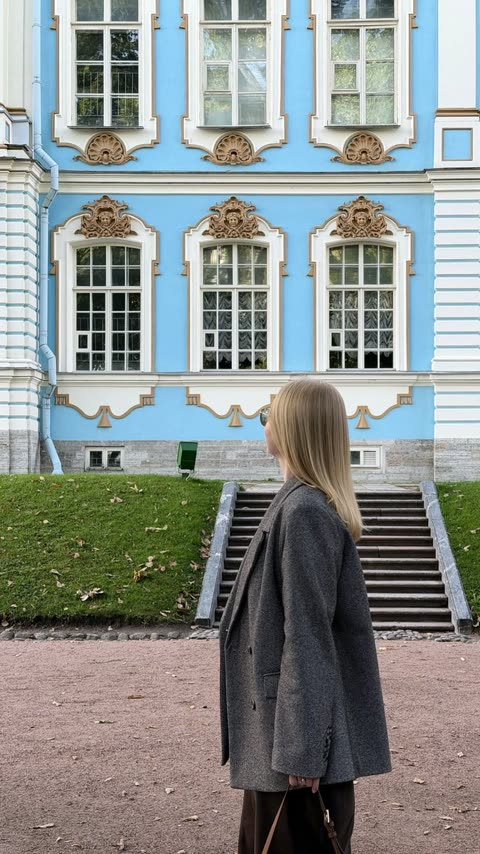</a>

画面严格上下各占一半，上半保留原照片，下半把照片里的主要元素重绘成小幅丙烯纸面插画，配色取自照片且不超过四种。明确写出占比 10% 到 20% 和留白要求，版面安静，像艺术画册封面。

GPT Image 2 · 上传图改图 · 出处: [@Sairah_0 on X](https://x.com/Sairah_0/status/2096807576168169628) · 474 赞，统计于 2026-10-29

[`editorial-poster`](tags.md#tag-editorial-poster) [`photo-to-illustration`](tags.md#tag-photo-to-illustration) [`split-layout`](tags.md#tag-split-layout) [`minimal`](tags.md#tag-minimal) [`paper-texture`](tags.md#tag-paper-texture)

<details><summary><b>提示词</b></summary>

```text
Create ONE independent high-end editorial poster for EACH uploaded photo. Never combine photos. Each photo must become a separate poster.

FORMAT
Strict 3:4 vertical. Divide the canvas into two exactly equal 50% horizontal sections.

TOP 50% — ORIGINAL PHOTO
Preserve the photo faithfully: identity, face, body proportions, pose, clothing, objects, composition, lighting, shadows, atmosphere, and colors. Keep it photorealistic with subtle premium editorial color grading. Seamlessly extend the background if needed; never distort or alter the subject.

BOTTOM 50% — MINIMAL ILLUSTRATION
Reinterpret the most recognizable elements as a small, centered, hand-drawn paper illustration occupying only 10–20% of the bottom half. Preserve the key subject, silhouette, pose, objects, and narrative.

Use delicate imperfect lines, bold flat acrylic-style shapes, rough paper grain, handmade brush marks, and organic edges. Keep the background warm white/off-white with generous negative space.

COLOR
Extract dominant colors from the original photo and reduce them to a maximum of 4 restrained, harmonious colors.

TYPOGRAPHY
Optional minimal editorial text such as a short title, location, year, or keyword. Do not force text if unnecessary.

STYLE
Quiet, poetic, refined, minimal, innocent, artistic, thoughtful, premium, and highly recognizable — like a contemporary art book or independent editorial cover.
```

</details>

<a id="gpt-image-watercolor-city-travel-poster-cafe"></a>
### 洛杉矶街角咖啡馆水彩旅行海报

<a href="https://x.com/oggii_0/status/2055876530988015791"></a>

用方括号变量 CITY、COUNTRY 和 LANDMARK 把提示词做成可替换任意城市的模板。风格、构图、字体、色板和质感分块书写，天空留白给标题，地标只作远景点缀。

GPT Image 2 · 文生图 · 出处: [@oggii_0 on X](https://x.com/oggii_0/status/2055876530988015791) · 471 赞，统计于 2026-10-29

[`watercolor`](tags.md#tag-watercolor) [`travel-poster`](tags.md#tag-travel-poster) [`city-template`](tags.md#tag-city-template) [`architecture`](tags.md#tag-architecture) [`typography`](tags.md#tag-typography)

<details><summary><b>提示词</b></summary>

```text
[COUNTRY] = South Korea
[LANDMARK] = a recognizable landmark or scenic element of [CITY]

Create a serene architectural travel illustration inspired by [CITY], [COUNTRY], in a soft hand-drawn watercolor and ink style.

Main concept:
Show a quiet, charming street-side house or small building inspired by the everyday atmosphere of [CITY], [COUNTRY], while subtly incorporating [LANDMARK] in the composition.
The landmark should appear naturally in the background, distance, or surrounding scenery, so the image clearly feels connected to [CITY], [COUNTRY] without losing the calm residential mood.

Visual style:
delicate hand-drawn architectural illustration,
soft watercolor washes,
thin ink outlines,
slightly imperfect sketch lines,
warm sunlit atmosphere,
gentle pastel palette,
subtle paper texture,
quiet travel sketchbook aesthetic,
minimal yet detailed composition,
calm editorial illustration mood,
poetic everyday scenery,
cozy and refined visual tone,
no photorealism,
no harsh contrast,
no saturated colors,
no dramatic lighting.

Scene:
A peaceful small house, café, studio, or local building with simple walls, a tiled or regionally inspired roof, painted doors or windows, and several potted plants arranged naturally in front.
Include subtle local architectural details and everyday design elements that feel authentic to [CITY], [COUNTRY].
Incorporate [LANDMARK] as a softly integrated city symbol — for example, visible above rooftops, in the distance, or as part of the surrounding skyline or landscape.
The overall scene should feel quiet, elegant, warm, and locally rooted.

Composition:
landscape travel-poster format,
wide horizontal layout,
large open sky occupying the upper half or upper-left area,
main building placed across the lower portion of the composition,
balanced negative space,
front-facing or slightly angled composition,
potted plants and small objects along the base,
landmark subtly placed in the background or upper distance,
clean and spacious layout,
minimal but emotionally rich composition.

Typography:
Include the city name “[CITY]” clearly in the image.
Render “[CITY]” as elegant travel-poster typography, large but refined, placed prominently in the sky area or upper portion of the composition.
Optionally include “[COUNTRY]” in smaller text beneath or near the city name.
The text should feel integrated into the poster design, not like a random overlay.
Use clean, tasteful lettering that matches the calm watercolor travel-poster mood.

Color palette:
pale sky blue,
warm cream,
terracotta,
muted blue accents,
olive and soft green,
light earthy browns,
soft natural neutrals.

Texture:
visible watercolor paper grain,
transparent paint layering,
soft handmade brush texture,
gentle ink-and-wash finish.

Mood:
peaceful,
sunny,
quiet,
nostalgic,
cozy,
refined,
poetic,
calm everyday travel atmosphere.

Important:
The image should express both the intimate charm of a local building and the identity of [CITY], [COUNTRY] through the inclusion of [LANDMARK].
Do not make the landmark too dominant; it should support the mood rather than overpower the house scene.
The city name “[CITY]” must be visible and clearly readable in the final image.

Aspect ratio: 4:3 or 3:2

Creator: @hermes_agent_kr on Threads
```

</details>

<a id="gpt-image-city-identity-minimalist-travel-poster-template"></a>
### 波西塔诺旅行海报，柠檬树与石阶

<a href="https://x.com/AiwithLariab/status/2091726408649445788">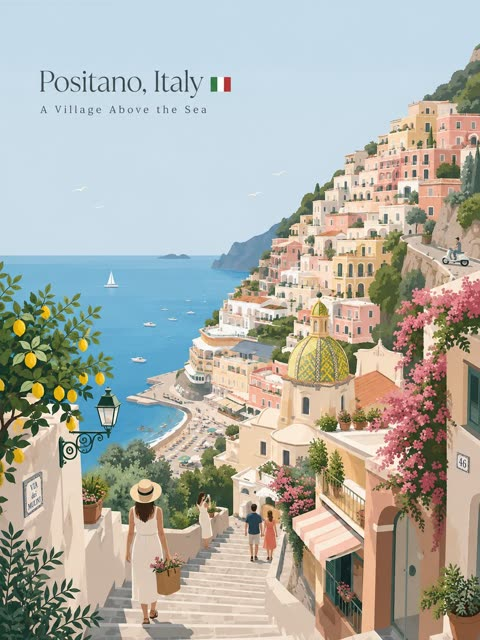</a>

用一个 CITY_NAME 占位符展开为五个城市特征槽位（地标、本地出行、日常瞬间、本地植物、视角），让每座城市的构图各不相同而不是套用同一版式。限定淡蓝与奶油色调、单一视觉焦点、3到6个小人物，再配上长长的负面清单，保持扁平矢量风格统一。

GPT Image 2 · 文生图 · 出处: [@AiwithLariab on X](https://x.com/AiwithLariab/status/2091726408649445788) · 465 赞，统计于 2026-10-29

[`travel-poster`](tags.md#tag-travel-poster) [`flat-vector`](tags.md#tag-flat-vector) [`city`](tags.md#tag-city) [`template`](tags.md#tag-template) [`minimalist`](tags.md#tag-minimalist)

<details><summary><b>提示词</b></summary>

```text
Premium minimalist flat-vector travel poster for [CITY_NAME], 3:4 vertical format.
Design an original, sophisticated travel poster that captures the authentic visual personality of [CITY_NAME]. The composition must feel purpose-built for this city rather than following a reusable template.

CITY IDENTITY

First interpret the unique visual character of [CITY_NAME] and build the scene around these five elements:

1. A recognizable landmark, architectural feature, or skyline element.
2. A distinctive local way of moving through the city.
3. One subtle everyday lifestyle moment.
4. A native plant, landscape, or environmental characteristic.
5. A composition and viewpoint that naturally belongs to the city.

The overall scene structure must change from city to city. Do not repeatedly use the same object positions or visual formula.

Possible compositions include:
harbor viewpoint, narrow historic lane, riverside garden, coastal path, elevated city overlook, lively market passage, tram avenue, ferry terminal, botanical setting, heritage square, beach promenade, cultural plaza, or skyline terrace.

Choose whichever composition best represents [CITY_NAME].

TYPOGRAPHY

Place “[CITY_NAME]” in the upper-left area with generous clean negative space.

Add one short, sophisticated English tagline inspired by the atmosphere of the city.

Typography should feel understated, editorial, spacious, and premium. Never allow text to dominate the artwork.

VISUAL HIERARCHY

Use one iconic landmark or architectural feature as the main focal point.

Support it with only 2–4 carefully selected local elements. Every added detail should strengthen the sense of place.

Avoid landmark collections or postcard-style collages. Keep the scene visually quiet and intentional.

PEOPLE

Include only 3–6 small-scale figures.

Give each person a believable activity connected to local life, such as:
walking through a historic lane, cycling, waiting for public transport, sketching architecture, boarding a ferry, reading outdoors, taking a quiet photograph, carrying beach equipment, browsing a market, or jogging beside the water.

Avoid crowds and avoid making any single person the main character. Figures should integrate naturally into the environment.

LOCAL CHARACTER

Use city-specific elements only when they genuinely fit [CITY_NAME]:

- local transportation
- architecture
- street furniture
- vegetation
- small signs or wayfinding
- local food references
- recreational activities
- pavement markings
- cultural details

Transport and signage should remain subtle. Instead of always using a large signboard, incorporate details naturally through a small transit marker, station clock, ferry information panel, bike symbol, painted road marking, beach flag, or understated metro icon.

ART DIRECTION

Japanese stationery-inspired aesthetic,
luxury sticker illustration,
premium commercial vector artwork,
modern editorial travel branding,
clean delicate outlines,
uniform line weight,
simple geometric forms,
flat-color illustration,
soft shapes,
balanced visual rhythm,
high-end minimalist postcard design.

COLOR SYSTEM

Build the atmosphere primarily with:
pale powder blue, soft sky blue, mist blue, and cool airy blues.

Balance these with:
warm ivory, cream, soft beige, muted sage, gray-green, and understated architectural neutrals.

Use dusty rose or muted blush only for tiny visual accents such as flowers, clothing details, small signs, awnings, or decorative objects.

Colors should remain soft, sophisticated, slightly desaturated, and cohesive.

MOOD

Fresh, airy, peaceful, refined, contemporary, elegant.

The final artwork should feel like a premium boutique travel postcard or luxury lifestyle brand illustration, with generous breathing room and a relaxed sense of place.

IMPORTANT QUALITY RULES

Every city must have its own visual identity.
Change the camera angle, scene structure, landmark placement, foreground treatment, and supporting details according to the city's character.

Do not simply replace [CITY_NAME] inside an existing composition.

NEGATIVE PROMPT

No photorealism.
No realism.
No watercolor.
No painterly brushwork.
No gradients.
No heavy shadows.
No dramatic cinematic lighting.
No paper texture.
No excessive detail.
No cluttered background.
No landmark collage.
No crowded streets.
No oversized characters.
No dominant hero character.
No repetitive café composition.
No fixed signboard position.
No identical foreground treatment.
No generic tourist-poster formula.
No copied layout from another city.
No unnecessary decorative elements.
```

</details>

<a id="gpt-image-bw-panels-color-cutout-fashion-poster"></a>
### 黑白分格背景上的彩色人像时尚海报

<a href="https://x.com/saniaspeaks_/status/2061289299060924451"></a>

用四个圆角黑白人像分格做背景，再叠加同一人物的全彩抠图，靠黑白与彩色的对比和层次营造深度。明确写出无文字、无排版和柔和阴影，让画面保持干净。

GPT Image 2 · 文生图 · 出处: [@saniaspeaks_ on X](https://x.com/saniaspeaks_/status/2061289299060924451) · 445 赞，统计于 2026-10-29

[`collage`](tags.md#tag-collage) [`fashion`](tags.md#tag-fashion) [`editorial`](tags.md#tag-editorial) [`black-and-white`](tags.md#tag-black-and-white) [`layering`](tags.md#tag-layering)

<details><summary><b>提示词</b></summary>

```text
MODERN EDITORIAL COLLAGE POSTER DESIGN. THE BACKGROUND FEATURES FOUR STACKED ROUNDED PANELS FILLED WITH BLACK AND WHITE CINEMATIC PORTRAITS OF A STYLISH YOUNG WOMAN WEARING SUNGLASSES IN DIFFERENT FASHION POSES. OVERLAYED IN THE FOREGROUND IS A HIGH-QUALITY FULL-COLOR CUTOUT OF THE SAME WOMAN WEARING A WHITE OVERSIZED SHIRT WITH BLACK PANTS AND SUNGLASSES, STRIKING A CONFIDENT FASHION POSE.
CLEAN MINIMAL DESIGN, NO TEXT, NO TYPOGRAPHY, NO LETTERS, SOFT SHADOWS, DEPTH LAYERING, HIGH CONTRAST LIGHTING, PREMIUM MAGAZINE STYLE, ULTRA REALISTIC, 8K, PROFESSIONAL POSTER COMPOSITION.
```

</details>

<a id="gpt-image-oversized-type-pink-fashion-editorial-poster"></a>
### 巨型发光字母背景的粉色时尚海报

<a href="https://x.com/SimplyAnnisa/status/2053814655655543119"></a>

填空式模板，把风格、主体、版式、字体、光线和配色分成独立板块。巨大的标题放在居中全身模特身后形成层次，单一主色让整张海报保持统一。

GPT Image 2 · 文生图 · 出处: [@SimplyAnnisa on X](https://x.com/SimplyAnnisa/status/2053814655655543119) · 444 赞，统计于 2026-10-28

[`fashion`](tags.md#tag-fashion) [`editorial`](tags.md#tag-editorial) [`typography`](tags.md#tag-typography) [`monochrome`](tags.md#tag-monochrome) [`template`](tags.md#tag-template)

<details><summary><b>提示词</b></summary>

```text
Create a premium high-fashion editorial poster for [BRAND NAME].

TOPIC:
[STREETWEAR / FASHION COLLECTION / EDITORIAL CAMPAIGN]

STYLE & ART DIRECTION:

Oversized typography editorial aesthetic

Minimal futuristic fashion design

Korean high-fashion poster influence

Luxury streetwear branding

Avant-garde magazine-cover atmosphere

Soft monochromatic composition

Pinterest fashion-editorial aesthetic

High-end commercial styling

Modern runway campaign design

Minimal but bold visual hierarchy

Vogue-meets-streetwear atmosphere

MAIN SUBJECT:

A full-body fashion model prominently centered in the composition

Oversized luxury streetwear outfit

Fashion-forward silhouette and styling

Minimal expressive pose

Elegant emotional neutrality

Realistic luxury-fashion photography

Premium editorial lighting

Modern runway attitude

Soft futuristic mood

Clean symmetrical body positioning

LAYOUT & COMPOSITION:

Same exact editorial composition and hierarchy as the reference design

Massive oversized typography placed behind the model

Typography integrated into the composition as a graphic element

Strong centered symmetry

Minimal clean background

Spacious luxury editorial layout

Magazine-cover inspired balance

Minimal distractions

Strong visual focus on the fashion styling

TEXT & TYPOGRAPHY:

Huge bold geometric typography

Editorial fashion font style

Oversized lettering occupying most of the background

Minimal secondary micro typography

Luxury magazine hierarchy

Main title:
"[MAIN FASHION WORD]"

Supporting text:
"[COLLECTION / EDITORIAL SUBTITLE]"

DEPTH & LIGHTING:

Soft editorial studio lighting

Luxury fashion shadows

Smooth pastel reflections

Minimal contrast

Premium commercial skin rendering

High-end fashion atmosphere

EXTRA DESIGN DETAILS:

Tiny editorial text blocks

Magazine micro-details

Fashion-brand symbols

Minimal graphic accents

Soft texture overlays

Luxury typography interaction

Editorial spacing

COLOR PALETTE:

[PRIMARY MONOCHROMATIC COLOR]

Soft pastel tones

White / cream highlights

Minimal luxury contrast

QUALITY:

Ultra realistic fashion photography

Premium editorial poster design

Behance-quality fashion campaign

Vogue-style streetwear composition

Same exact visual identity and layout as the reference

Ultra high resolution
```

</details>

<a id="gpt-image-flat-vector-city-travel-poster-template-2"></a>
### 扁平矢量风京都河岸旅行海报

<a href="https://x.com/MissDelulu9/status/2091724761424670980"></a>

用一个 [CITY_NAME] 占位符把提示词做成可复用模板。固定的元素清单(地标、交通、生活场景、本地细节、标识)、收紧的柔和配色和很长的否定清单,让扁平矢量风格保持一致,而构图随城市变化。

GPT Image 2 · 文生图 · 出处: [@MissDelulu9 on X](https://x.com/MissDelulu9/status/2091724761424670980) · 429 赞，统计于 2026-10-28

[`travel-poster`](tags.md#tag-travel-poster) [`flat-vector`](tags.md#tag-flat-vector) [`template`](tags.md#tag-template) [`city`](tags.md#tag-city) [`pastel`](tags.md#tag-pastel)

<details><summary><b>提示词</b></summary>

```text
Premium minimalist flat-vector travel poster for [CITY_NAME], 3:4 vertical.

Create an original city-specific travel poster that captures the authentic personality of [CITY_NAME]. Choose the best composition for the city harbor, historic lane, riverside, coastal path, market, tram avenue, heritage square, skyline terrace, etc.

Include:
-One iconic landmark as the main focal point
-One distinctive local transport element
-One subtle everyday lifestyle moment
-Native vegetation or landscape
-3–6 small, naturally integrated people
-2–4 carefully chosen local details
-Subtle authentic signage/wayfinding

Typography:
Place “[CITY_NAME]” upper-left with generous negative space. Add one short elegant English tagline. Premium editorial typography, understated and spacious.

Style:
Japanese stationery-inspired, luxury sticker illustration, premium commercial vector, modern editorial travel branding, delicate uniform outlines, geometric shapes, flat colors, soft forms, minimalist postcard aesthetic.

Colors:
Pale powder blue, sky blue, mist blue, ivory, cream, beige, muted sage and gray-green. Tiny dusty-rose accents only. Soft, sophisticated, slightly desaturated palette.

Mood:
Fresh, airy, peaceful, refined, contemporary and elegant.

Important:
Make every city visually unique. Change the viewpoint, composition, landmark placement and foreground according to the city's identity. Do not reuse a generic template.

Negative:
No photorealism, realism, watercolor, painterly brushwork, gradients, heavy shadows, cinematic lighting, paper texture, clutter, landmark collage, crowds, oversized characters, dominant hero character, repetitive café scenes, generic tourist-poster layouts, copied compositions or unnecessary decoration.
```

</details>

<a id="gpt-image-photo-to-paper-illustration-split-poster"></a>
### 湖边实景照片搭配手绘纸本插画

<a href="https://x.com/harboriis/status/2107346549542203400"></a>

严格五五分栏，上半保留原照片，下半把同一场景重绘成居中的小幅手绘插画。调色限制为从照片提取的最多四种颜色，并留出大量纸面空白，让上下两部分连成一体。

GPT Image 2.5 · 上传图改图 · 出处: [@harboriis on X](https://x.com/harboriis/status/2107346549542203400) · 417 赞，统计于 2026-10-27

[`editorial-poster`](tags.md#tag-editorial-poster) [`photo-to-illustration`](tags.md#tag-photo-to-illustration) [`split-layout`](tags.md#tag-split-layout) [`paper-texture`](tags.md#tag-paper-texture) [`minimalist`](tags.md#tag-minimalist)

<details><summary><b>提示词</b></summary>

```text
Create one independent high-end editorial poster for each uploaded photo. Never combine photos.

FORMAT
Strict 3:4 vertical composition with an exact 50/50 horizontal split. The top and bottom halves must be equal in height and visually connected as one refined editorial cover.

TOP HALF: ORIGINAL PHOTO
Use the original photo faithfully. Preserve the subject, identity, facial features, proportions, pose, clothing, objects, composition, lighting, shadows, atmosphere, and color mood. Keep it fully photorealistic with only subtle premium editorial color grading. Never stylize, distort, replace, or alter the main subject. Extend only surrounding background when necessary, seamlessly and naturally.

BOTTOM HALF: HAND-DRAWN ILLUSTRATION
Reinterpret the same scene as a minimalist handmade paper illustration. Preserve the recognizable subject, silhouette, pose, key objects, and main visual story.

Use delicate imperfect lines, simple acrylic-style flat color shapes, visible brush marks, rough paper texture, organic edges, and subtle handmade imperfections. Keep the illustration small and centered, occupying about 10–20% of the bottom half, with generous negative space.

Use a rough white, warm off-white, or pale natural paper background with only minimal environmental details.

COLOR
Extract colors from the original photo and reduce them to a maximum of 4 restrained, harmonious colors. Use controlled flat color blocks while maintaining subtle paper grain and brush texture.

TYPOGRAPHY
Optional minimal editorial text only when appropriate, such as a short title, keyword, location, or number. Keep it understated and never force text into the design.

STYLE
Quiet, poetic, refined, minimal, relaxed, artistic, thoughtful, premium, high-recognition.

FINAL
Maintain the exact 50/50 split. The top must remain a faithful photograph, while the bottom is a simplified handmade illustration of the same scene. Avoid clutter, excessive colors, heavy typography, artificial effects, or unnecessary details. The result should feel like a premium contemporary independent art publication cover.
```

</details>

<a id="gpt-image-split-photo-sketch-travel-journal-poster"></a>
### 实景照片与水彩速写对照的旅行海报

<a href="https://x.com/MissDelulu9/status/2096902953110299096">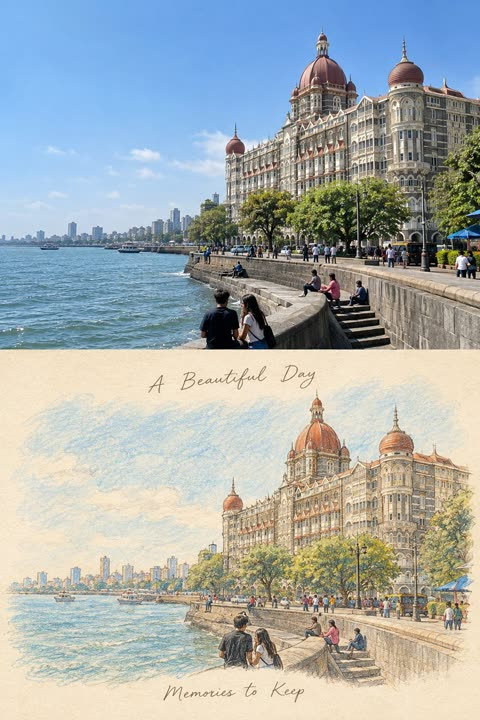</a>

严格的上下五五分版面让上半部分保留原始参考照片，下半部分把同一场景转成奶油色纸上的彩铅加水彩。提示词写明纸张、笔触、淡彩和排线，并固定了手写标题的上下位置，因此速写忠于原图，版面也稳定。

GPT Image 2 · 上传图改图 · 出处: [@MissDelulu9 on X](https://x.com/MissDelulu9/status/2096902953110299096) · 417 赞，统计于 2026-10-28

[`travel-journal`](tags.md#tag-travel-journal) [`split-layout`](tags.md#tag-split-layout) [`watercolor-sketch`](tags.md#tag-watercolor-sketch) [`colored-pencil`](tags.md#tag-colored-pencil) [`photo-to-sketch`](tags.md#tag-photo-to-sketch)

<details><summary><b>提示词</b></summary>

```text
Create a premium vertical travel-journal poster in an exact 50/50 split.

Top 50%: Keep the original reference photo completely real and unchanged same composition, architecture, people, colors, lighting, perspective, and details.

Bottom 50%: Transform the same photo into a delicate hand-drawn colored-pencil + watercolor sketch on warm cream paper, with visible pencil strokes, soft washes, subtle paper grain, imperfect outlines, and gentle cross-hatching. Keep every subject recognizable.

Add elegant handwritten text: “A Beautiful Day” above and “Memories to Keep” below. Minimal, nostalgic, sophisticated travel-magazine aesthetic. No extra objects, no photorealism in the bottom half, exact 50/50 layout.
```

</details>

<a id="nano-banana-dubai-double-exposure-travel-poster"></a>
### 迪拜极简双重曝光旅行海报

<a href="https://x.com/Naiknelofar788/status/2048929122936909857"></a>

提示词按主体、效果、版式、文字、美学分块列出要求，每项都很明确。指定侧脸剪影内填充地标，再配白色背景与留白，让双重曝光柔和不杂乱。

Nano Banana 2 · 文生图 · 出处: [@Naiknelofar788 on X](https://x.com/Naiknelofar788/status/2048929122936909857) · 380 赞，统计于 2026-10-29

[`double-exposure`](tags.md#tag-double-exposure) [`travel-poster`](tags.md#tag-travel-poster) [`minimalist`](tags.md#tag-minimalist) [`dubai`](tags.md#tag-dubai) [`silhouette`](tags.md#tag-silhouette)

<details><summary><b>提示词</b></summary>

```text
Create a minimalist double exposure travel poster for DUBAI.
**Main Subject:** A stylish international traveler, depicted in a sharp profile silhouette. The subject should be dressed in modern travel fashion (simple, neat clothing) with subtle elements such as sunglasses, a camera strap, or a map in hand.
**Effect:** Inside the silhouette, use a double exposure effect filled with iconic DUBAI visuals such as landmarks, architecture, cultural elements, landscapes, and city atmosphere. The composition should be blended, soft, and seamless—not overloaded, with a clear focus.
**Layout & Style:** Maintain a clean and elegant layout using a bright or white background, soft gradient lighting, minimal distractions, and smooth transitions between elements.
**Text:** Add a modern editorial headline in a large, clear font: **'TRAVEL DUBAI'**.
Optional small subtext: **[UAE]**
**Aesthetic:** The design style should resemble a premium travel campaign with:
 * Minimalist composition
 * Soft glow and cinematic lighting
 * High-end branding aesthetic
 * No clutter, no busy collages
 * Balanced negative space
**Final Look:** Sophisticated, modern double exposure poster, elegant, print-ready, ultra-detailed, 4K."
```

</details>

<a id="gpt-image-mood-sky-low-angle-portrait-poster"></a>
### 仰拍天空海报与弧形日期文字

<a href="https://x.com/SimplyAnnisa/status/2053416803297358135"></a>

用方括号分段的模板(输入、目标、主体锁定、构图、心情对应天空、文字、风格、禁止项),参考人像保持身份并避开正脸。相机贴地、鞋底近景以及沿身体轮廓弯曲的白色文字带来强烈透视。

GPT Image 2 · 上传图改图 · 出处: [@SimplyAnnisa on X](https://x.com/SimplyAnnisa/status/2053416803297358135) · 362 赞，统计于 2026-10-29

[`low-angle`](tags.md#tag-low-angle) [`sky`](tags.md#tag-sky) [`poster`](tags.md#tag-poster) [`typography`](tags.md#tag-typography) [`reference-photo`](tags.md#tag-reference-photo)

<details><summary><b>提示词</b></summary>

```text
[INPUT]

- reference image: {Portrait Photo}

- Date: {Today's Date
http://
yyyy.mm.dd}

- Today's Mood: { }

[Goal]

Create a poster of the sky using an extreme low-angle perspective, looking up at the subject from the ground.

Express today's mood through the sky, light, clouds, and color scheme.

[Maintain Subject]

Maintain the facial mood, hair, body shape, and clothing style of the uploaded subject.

However, the face should not be shown from the front; instead, a side profile or just a slight glimpse of the jawline should be visible.

[Key Composition]

- The camera is almost flat on the ground.

- The subject is slightly floating above the camera or in a jumping moment.

- The soles of the shoes are prominently visible close to the camera.

- The legs appear long with a sense of perspective.

- The subject is in a side view or semi-profile.

- The sky occupies most of the screen.

[Sky by Mood]

Create a sky that matches today's mood.

 Examples:

- Happiness: Clear blue sky, white clouds, warm sunlight

- Excitement: Pink clouds, soft sunshine

- Calmness: Pale blue sky, thin clouds

- Loneliness: Sunset, long shadows, empty sky

- Frustration: Low, heavy clouds

- Rain: Overcast sky, raindrops, wet lens texture

[Text]

Arrange the date and mood message in a curved line along the outline or silhouette of the figure's body.

Text to include:

“{Date}”

“{Today’s Mood}”

“{Short Message}”

Text should be white, rounded, and bold poster typography.

Avoid overly long sentences and arrange text for easy readability.

If no short message input is provided, it should be automatically generated and entered.

[Style]

Sentimental Sky Poster, Warm Eye View, Bottom View, Wide Angle, Cinematic Fashion Poster, Clear Film Photo, Vast Sky, Clean Typography.

 [Prohibited]
- No ordinary standing poses
- No poses where shoe soles are not visible
- No frontal face close-ups
- No indoor backgrounds
- No excessive text
- No random text
- No watermarks/logos
```

</details>

<a id="gpt-image-editorial-city-travel-artwork-reflection"></a>
### 旧金山编辑风旅行海报与玻璃倒影

<a href="https://x.com/MahnoorAi12/status/2091711340666568868"></a>

用方括号占位符替换城市名、地貌、建筑和标语，一套模板可适配任何城市。低饱和配色、玻璃倒影带、淡几何边框和小号疏朗的杂志字体让画面统一，长长的排除清单避免地标拼贴和过大的文字。

GPT Image 2 · 文生图 · 出处: [@MahnoorAi12 on X](https://x.com/MahnoorAi12/status/2091711340666568868) · 356 赞，统计于 2026-10-28

[`travel-poster`](tags.md#tag-travel-poster) [`city`](tags.md#tag-city) [`template`](tags.md#tag-template) [`reflection`](tags.md#tag-reflection) [`editorial`](tags.md#tag-editorial)

<details><summary><b>提示词</b></summary>

```text
Create a premium 4:5 vertical contemporary travel artwork featuring [CITY NAME], [COUNTRY], transformed into a serene, sophisticated and collectible editorial travel landscape.

Build the entire composition around the unique identity of [CITY NAME]. Naturally integrate its most recognizable combination of landscape, architecture, culture, streets, nature, waterfront or mountains, depending on what genuinely defines the city. The scene should feel like one cohesive environment rather than a collage of separate landmarks.

In the background, create an atmospheric sense of place using [CITY'S SIGNATURE LANDSCAPE — e.g. coastline, mountains, river, desert, forest, skyline, historic district], with soft depth, subtle haze and elegant natural lighting.

In the foreground, introduce refined simplified architectural forms inspired by [CITY'S HISTORIC / CULTURAL ARCHITECTURE]. Include characteristic rooftops, facades, streets, balconies, walls, pathways and local textures. Add subtle vegetation and a few tiny human silhouettes naturally interacting with the environment, keeping them understated and non-dominant.

Make the visual identity unmistakably [CITY NAME], but avoid turning the artwork into a landmark collage. Every element should flow naturally into the surrounding landscape.

Use a sophisticated, slightly desaturated palette inspired by the destination, combining warm ivory, soft beige, muted earth tones, gentle architectural colors and subtle environmental blues/greens. Keep the entire palette harmonious, refined and luxurious.

Place the entire landscape above a calm glass-like reflective surface, creating delicate vertical reflections of the architecture, landscape and major visual elements. Keep the reflections soft, atmospheric and slightly faded.

Add extremely subtle translucent geometric forms around the borders to create a contemporary gallery-art aesthetic without distracting from the destination.

Use generous negative space, atmospheric haze, diffused natural light, delicate shadows, fine architectural linework, tactile paper grain and restrained watercolor-and-gouache textures blended with sophisticated modern digital illustration.

At the top, add elegant magazine typography:

[CITY NAME]
[SHORT POETIC CITY TAGLINE]
No. 05 — 2026

Typography should be small, refined, widely spaced, minimal and perfectly aligned.

Avoid anime aesthetics, excessive cultural symbols, clutter, photorealistic collage, generic stock imagery, oversized landmarks, excessive decoration and oversized typography.

The final artwork should feel like a rare collectible luxury travel print — tranquil, artistic, timeless, sophisticated and instantly recognizable as [CITY NAME].

Important: Prioritize the authentic visual character of the chosen city. Do not force elements that do not belong there. Adapt the architecture, landscape, vegetation, atmosphere and color palette specifically to the city.
```

</details>

<a id="nano-banana-ink-watercolor-city-travel-sketch-poster"></a>
### 钢笔水彩城市街景旅行海报

<a href="https://x.com/Naiknelofar788/status/2054567307880669248"></a>

细腻黑色钢笔线稿加轻盈水彩晕染，配合带纹理的素描纸，呈现手绘旅行手账质感。方括号城市名占位、短标语和大量留白，让版式可以直接替换成任意城市。

Nano Banana 2 · 文生图 · 出处: [@Naiknelofar788 on X](https://x.com/Naiknelofar788/status/2054567307880669248) · 355 赞，统计于 2026-10-29

[`travel-poster`](tags.md#tag-travel-poster) [`watercolor`](tags.md#tag-watercolor) [`ink-sketch`](tags.md#tag-ink-sketch) [`city-scene`](tags.md#tag-city-scene) [`template`](tags.md#tag-template)

<details><summary><b>提示词</b></summary>

```text
Minimalist ultra-high-resolution travel sketch poster of New York City, on clean white sketchbook paper with subtle paper grain texture. Style: refined pen drawing + loose watercolor sketch. Delicate black ink linework, airy watercolor washes, elegant urban details. Show a calm everyday NYC street scene — small cafés, yellow taxis, bicycles, crosswalks, brownstone buildings, subtle local signage, fashionable pedestrians, soft morning light. Spacious editorial composition with generous negative space. Mood: calm, modern, sophisticated, poetic. Typography: “[NEW YORK]” “Everyday Urban Rhythm” Premium travel sketch aesthetic, minimal and stylish, ultra-realistic watercolor + ink travel journal style, ultra-high-resolution, 9:16.
```

</details>

<a id="gpt-image-editorial-split-poster-roses"></a>
### 手捧玫瑰与黄色手袋女子的编辑风海报

<a href="https://x.com/Ziha_ai/status/2106990557813968909"></a>

画布严格上下对半，上半保留原图不重绘，下半重构主体，并叠加一条从原图取色的低饱和色带。主体跨越色带边缘进入白色留白，形成层次，避免贴纸感。

GPT Image 2.5 · 上传图改图 · 出处: [@Ziha_ai on X](https://x.com/Ziha_ai/status/2106990557813968909) · 337 赞，统计于 2026-10-27

[`editorial-poster`](tags.md#tag-editorial-poster) [`split-layout`](tags.md#tag-split-layout) [`color-window`](tags.md#tag-color-window) [`negative-space`](tags.md#tag-negative-space) [`photo-reconstruction`](tags.md#tag-photo-reconstruction)

<details><summary><b>提示词</b></summary>

```text
Premium Editorial Poster Instructions

Each uploaded photo must be made into a separate, independent, premium editorial poster, and multiple photos must not be combined. Use a strict 3:4 vertical canvas. Split the canvas horizontally in the exact center: the upper half and the lower half each occupy 50% of the height, are equally wide, and equally high, with no alteration of proportion.

The upper half uses the original photo directly and must not be regenerated. Preserve the identity of the main subject, the human body or architectural structure, proportions, perspective, spatial relationships, texture, natural light and shadow, color, and environment in their entirety. Only slight cropping and restrained premium color grading are permitted; re-drawing the main subject, fictional light, HDR, excessive saturation, plastic texture, and fictional content are prohibited. hibited. When needing to adapt to the frame, only environmental areas such as sky, water surface, ground, walls, plants, or background can be extended.

The lower half extracts and reconstructs the "narrative core" of the photo: it can be a single primary subject, or a group of related elements that together embody the photo's identity, scale, action, o story relationship. Maintain its realistic, recognizable appearance, proportion, internal structure, texture, and relative position. Do not remove important related elements, and do not directly us rectangular photo cutouts. The reconstructed subject typically occupies 55%-80% of the width of the lower area. It should naturally extend based on the photo's primary direction and retain plausible ground, water lines, shadows, or softly dissipated edges to integrate into the background, avoiding a sticker-like or floating appearance.

Incorporate a narrow, low-saturation geometric color field behind or through the center of the subject, serving as a "critical window" between reality and editorial abstraction. The color of the window must be extracted from the original photo, and its orientation (horizontal, vertical, or diagonal) chosen based on the overall narrative direction.

The subject must actively pass through the window: part of it is within the color field, and part enters the open negative space, naturally crossing the window's boundary to create occlusion, penetration, and spatial depth. The window is not a frame or a card; it must not fully enclose the subject. Only one primary window is allowed; multiple color blocks, thick borders, rounded corners, strong gradients, and drop shadows are prohibited.

Use a white, cool white, very light gray, or near-white background for the lower half, coordinated with the photo. Employ a restrained asymmetrical composition and abundant negative space to establish a three-tier hierarchy:

Reconstructed subject or narrative composition

Low-saturation geometric window
```

</details>

<a id="gpt-image-product-campaign-poster-grid-template"></a>
### 基于产品参考图的高端广告海报模板

<a href="https://x.com/ZaraIrahh/status/2054139543423492547"></a>

先把产品参考图设为唯一依据，再用12栏网格和四层结构（色块、裁切大字、模特与产品、平面文字）控制版式。所有文字逐项列出且只出现一次，并用占位符便于替换，排版更干净。

GPT Image 2 · 上传图改图 · 出处: [@ZaraIrahh on X](https://x.com/ZaraIrahh/status/2054139543423492547) · 289 赞，统计于 2026-10-29

[`product-poster`](tags.md#tag-product-poster) [`campaign-template`](tags.md#tag-campaign-template) [`glassmorphism`](tags.md#tag-glassmorphism) [`reference-image`](tags.md#tag-reference-image) [`typography`](tags.md#tag-typography)

<details><summary><b>提示词</b></summary>

```text
REFERENCE IMAGE INSTRUCTION: Use the uploaded product photo as the exact source of truth for the product's appearance, color, finish, branding, and form factor. Do not invent or alter any product detail. Reproduce it with photorealistic precision.
---
Create a photorealistic premium [PRODUCT CATEGORY] campaign poster in a 4:5 vertical aspect ratio. Design it as a clean global OOH, digital, and social campaign layout with strict grid alignment, premium white space, and precise typography. The campaign idea is "[CAMPAIGN TAGLINE]," but do not render that phrase as visible text.

Use a strict 12-column poster grid with 6% outer margins. Keep all text aligned to this grid. The image has four layers: background shape, giant background typography, subject/product photography, and clean graphic text overlays.

BACKGROUND: Pure matte white canvas. Place one large rounded-rectangle block behind the subject, occupying roughly 70% of the poster height and 76% of the width, centered slightly above the middle. The block uses a controlled [PRIMARY BRAND COLOR] gradient, glowing gently from top-left to bottom-right. Behind the subject and product, place giant cropped typography reading "[BACKGROUND HERO WORD]" in ultra-bold geometric sans-serif letters. The word is a background layer only: huge, partially cropped by the frame edges, wide letter spacing, darker [PRIMARY BRAND COLOR] than the rectangle, subtle embossed depth, soft shadow, and low enough contrast that it does not fight the product.

SUBJECT AND PRODUCT: [DESCRIBE MODEL OR SUBJECT — e.g., "a female model with a clean editorial look, neutral confident expression, natural slightly wind-touched hair, muted off-white outfit, and [ACCENT COLOR] jacket"]. Shoot from a slightly low hero angle. Body angled for depth, face turned toward the viewer with direct eye contact. One hand extends toward the camera holding the product from the uploaded reference image. The product is the dominant foreground object, slightly tilted to reveal [KEY PRODUCT DETAIL — e.g., "the triple camera system, brushed titanium edges, and centered brand logo"]. Keep the product sharp with realistic surface reflections, material texture, faint micro-details, and soft bloom around premium features. Keep the model's face readable behind it.

LIGHTING: Soft studio key light from front-left, warm rim light from the right, and subtle [PRIMARY BRAND COLOR] bounce from the background block. Skin remains natural and non-airbrushed with realistic catchlights. Product edges have clean [MATERIAL FINISH — e.g., "metallic / matte / glossy"] highlights. Shadows are soft and controlled.

TYPOGRAPHY OVERLAY: All text must be flat, crisp, perfectly aligned graphic typography — not painted onto the scene. Render exactly these text elements once, with no extra text:

Top left, small black logo: [BRAND LOGO NAME/MARK]

Top right, thin sans-serif: "[BRAND SUB-TAGLINE — e.g., 'Built for Apple Intelligence.']"

Mid left, glassmorphism pill: "[PRODUCT NAME — e.g., 'iPhone 17 Pro']"

Large background type: "[BACKGROUND HERO WORD]"

Bottom right body copy, small clean sans-serif:
"[PRODUCT NAME]. [POWER STATEMENT — one sentence.]
[FEATURE 1]. [FEATURE 2].
[CLOSING LINE — e.g., 'Designed for what's next.']"

BOTTOM FEATURE STRIP: Place four equal-width glass-white rounded cards along the bottom, aligned to the grid, same height, same spacing, same baseline alignment. Each card has one minimal line icon above the heading. Render exactly:
Card 1: "[FEATURE HEADING 1]" / "[FEATURE SUBLINE 1]"
Card 2: "[FEATURE HEADING 2]" / "[FEATURE SUBLINE 2]"
Card 3: "[FEATURE HEADING 3]" / "[FEATURE SUBLINE 3]"
Card 4: "[FEATURE HEADING 4]" / "[FEATURE SUBLINE 4]"

GRAPHIC DETAILS: Two or three small sparkle icons only, subtle grain, soft glassmorphism, controlled [PRIMARY BRAND COLOR]-white-[ACCENT COLOR] palette, no neon, no oversaturation.
```

</details>

<a id="gpt-image-tram-photo-paper-illustration-poster"></a>
### 锈红电车照片搭配手工纸本插画海报

<a href="https://x.com/Ziha_ai/status/2104111940180316193"></a>

提示词把 3:4 画面严格对半分，上半保留原照片，下半是只用四种取色的小幅手工纸本插画。限定插画只占下半部分的 10% 到 20%，并要求大面积暖白留白，成片就有独立艺术书封面的气质。

GPT Image 2.5 · 上传图改图 · 出处: [@Ziha_ai on X](https://x.com/Ziha_ai/status/2104111940180316193) · 266 赞，统计于 2026-10-27

[`editorial-poster`](tags.md#tag-editorial-poster) [`photo-to-illustration`](tags.md#tag-photo-to-illustration) [`split-layout`](tags.md#tag-split-layout) [`negative-space`](tags.md#tag-negative-space) [`paper-texture`](tags.md#tag-paper-texture)

<details><summary><b>提示词</b></summary>

```text
Create a high-end editorial poster using the uploaded photo as the exact reference, in a strict 3:4 vertical format divided horizontally into two equal 50/50 sections. Preserve the original photo faithfully in the top half, including subjects, identity, pose, clothing, objects, lighting, colors, and realistic texture, with only subtle premium editorial color grading. In the bottom half, reinterpret the most recognizable elements as a small, centered, minimalist handmade paper illustration using delicate imperfect lines, bold flat acrylic-like color shapes, subtle paper grain, organic edges, and no more than 4 colors extracted from the original photo. Keep the illustration only 10–20% of the bottom section with lots of warm off-white negative space and optional minimal editorial typography. The overall result should feel quiet, poetic, refined, artistic, premium, and like an independent art-book cover, avoiding cartoon, watercolor, colored-pencil, 3D, glossy, busy, or commercial aesthetics.
```

</details>

<a id="nano-banana-photo-sketch-editorial"></a>
### 上面照片下面素描的编辑海报模板

<a href="https://x.com/ChillaiKalan__/status/2111332272670417236"></a>

填 `[SUBJECT]` 和 `[SETTING]`。禁止项针对分割海报的常见毛病：粗边框、上下脸不一致。

Nano Banana 2.1 · 文生图 · 出处: [@ChillaiKalan__ on X](https://x.com/ChillaiKalan__/status/2111332272670417236) · 266 赞，统计于 2026-10-27

[`split-composition`](tags.md#tag-split-composition) [`template`](tags.md#tag-template) [`editorial`](tags.md#tag-editorial)

<details><summary><b>提示词</b></summary>

```text
Create a premium editorial poster featuring a two-part visual composition. The upper half shows a photorealistic photograph of [SUBJECT] in [SETTING], captured in warm natural sunlight with realistic skin texture, authentic expressions, soft highlights, and cinematic depth of field. The lower half transforms the exact same scene into a beautiful hand-painted digital illustration, preserving the subject’s pose, hairstyle, clothing, colors, and key visual details.

Place the illustrated scene inside a clean rectangular frame on a warm ivory, subtly textured paper background. Use a charming contemporary illustration style with delicate brush textures, simplified organic shapes, pastel colors, soft outlines, and a nostalgic summer-magazine aesthetic. Add tasteful decorative elements that complement the scene.

Below the illustration, include a centered minimalist editorial title reading “[MAIN TITLE]” in thin, widely spaced uppercase typography, followed by a smaller subtitle reading “[TAGLINE]” in elegant letter-spaced text. Add a short, thin pastel-colored line underneath.

Maintain balanced spacing, refined art direction, a cohesive color palette, and a sophisticated print-design finish. Vertical 3:4 composition, high resolution, natural lighting, polished editorial layout, aesthetically pleasing, realistic-to-illustration transformation.

Avoid clutter, excessive text, distorted anatomy, inconsistent facial features, harsh colors, heavy borders, and unnecessary graphic elements.
```

</details>

<a id="gpt-image-photo-to-ink-wash-split-seaside-tower"></a>
### 海边高楼写实照与水墨重构对照

<a href="https://x.com/Ziha_ai/status/2109118256045002828">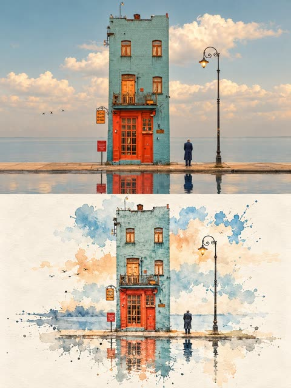</a>

提示词把画面等分为上下两区，上方保留写实照片，下方重构为极简水墨。通过纸张肌理、少量点染色彩、留白比例和稀疏文字来控制下半部分。

GPT Image 2.5 · 文生图 · 出处: [@Ziha_ai on X](https://x.com/Ziha_ai/status/2109118256045002828) · 257 赞，统计于 2026-10-28

[`ink-wash`](tags.md#tag-ink-wash) [`split-layout`](tags.md#tag-split-layout) [`photo-to-art`](tags.md#tag-photo-to-art) [`negative-space`](tags.md#tag-negative-space) [`eastern-aesthetics`](tags.md#tag-eastern-aesthetics)

<details><summary><b>提示词</b></summary>

```text
The image is in a 3:4 vertical composition, divided into two regions, with a strict 1:1 ratio, each taking up 50% of the image.

Upper Region - Original Photo Shoot Area

Preserves the subject's identity, structure, perspective, and true material, natural light, and original color atmosphere, with only slight high-end color grading and image purification, presenting it with the texture of art magazines or exhibition photography. It allows for a moderate expansion of the background to fit the screen size, but does not stretch, distort, or reshape the subject, without changing the subject's structure, posture, and core composition.

Lower Region - Minimalist Ink Wash Reconstruction Area

First, refine the subject with the most memorable details, such as the outline, structure, trend, perspective, rhythm, and atmosphere, and then reconstruct the same scene into a minimalist ink wash material landscape. Do not copy the photo details, do not make a realistic copy, only preserve the most recognizable structure and charm, allowing people to recognize the corresponding relationship between the upper region and the original photo at first glance.

The overall base of the lower half is milky white, warm white or paper white, with delicate paper fiber and natural texture. The main body is reconstructed in ink wash blending, dry-wet interplay, flying white, seepage, ink accumulation, and white space, forming a quiet, restrained, and poetic Eastern visual. Removing secondary details, only retaining the most distinctive contours, structural turns, spatial layers, and breath, not pursuing realistic completeness, but rather summarizing, refining, and leaving a lingering impression. The use of ink in black, gray, and light ink tones, layered and progressing, with varying intensities and rhythms.

The most vibrant colors can be extracted from the original image to create a few spots of dyeing or coloring, without mechanically replicating the color values. The colors can be transformed locally into clear blue-gray, distant blue, soft gold, warm yellow, vermilion red, light cyan, etc., to emphasize the main focus and emotional rhythm, but the overall composition is still dominated by ink tones and negative space. Avoiding dull, heavy, old brown, excessive decoration, and vulgar color combinations.

The main core areas should be more refined and concentrated, with edges gradually loosening, breaking away, disappearing, and scattering, forming a sense of breathing with the large negative space. The lower half of the composition should account for about 30%-45%, with the rest reserved for large negative spaces. The composition can be biased, framed, suspended, or slightly cut, but must maintain an asymmetrical balance and a high-end editorial feel. Negative space is not blank, but an important component of the visual structure. It is better to reduce information than to fill the entire image, so that the main focus looks like an ink seal or an oriental material work displayed on a page.

Text Treatment

Text is only allowed a very small amount of editing intervention, without preset titles and numbers. A small number of words or short sentences can be extracted from the subject, location, time, action, emotion, or metaphor, and quietly placed in the blank area or the edge of the subject. The text should be restrained, sparse, and have a sense of breathing, not noisy or dominant.

Overall Presentation

Contemporary Eastern aesthetics, minimalist ink wash reconstruction, large-scale art blank, small-scale seal impression, quiet editing layout and exhibition poster style. Avoid complex backgrounds, piled-up real details, overly decorative, excessive text, template layout and filled composition
```

</details>

<a id="nano-banana-traveler-on-giant-country-map-poster"></a>
### 坐在巨型国家地图上的旅行者海报

<a href="https://x.com/frametheory058/status/2038934237479674133"></a>

用参考照片锁定人脸,大洲、国家和地标用占位符,换个国家就能复用。画面按层次描述(前景地图和图钉、背景地标天际线、天空中的国名大字),再补充相机、光线和胶片调色。

Nano Banana 2 · 上传图改图 · 出处: [@frametheory058 on X](https://x.com/frametheory058/status/2038934237479674133) · 252 赞，统计于 2026-10-28

[`travel`](tags.md#tag-travel) [`map`](tags.md#tag-map) [`reference-face`](tags.md#tag-reference-face) [`editorial`](tags.md#tag-editorial) [`template`](tags.md#tag-template)

<details><summary><b>提示词</b></summary>

```text
"Ultra-realistic editorial travel concept.
A wanderer with the same face as in the reference photo is sitting casually on a giant, hyper-realistic travel map of [CONTINENT], zoomed into [COUNTRY]. On the map, there are large 3D location pins marking destinations across [COUNTRY].
Behind him stretches a breathtaking, cinematic horizon of [COUNTRY], featuring iconic landmarks like [LANDMARK 1], [LANDMARK 2], and [LANDMARK 3], seamlessly blended into one visually stunning environment. The word “[COUNTRY NAME IN CAPS]” floats boldly in clean luxury travel typography across the sky.
He is dressed in versatile streetwear suitable for any destination: cream cargo pants, a light pink hoodie, chunky sneakers, a crossbody bag, a cap, and carrying a Sony A7C II camera.
Surrounding elements include playful sketches of airplanes, flight tickets, passport stamps, and subtle [COUNTRY-THEMED ELEMENTS] (like cultural patterns, textures, environment-specific elements).
Shot on Sony A7C II, 35mm f/1.4 lens, ultra-shallow depth of field, razor-sharp focus on subject, creamy cinematic bokeh in background.
High-end commercial lighting setup, soft diffused key light, subtle rim light outlining the subject, global illumination, HDR tone mapping, realistic light falloff, soft shadows.
Hyper-detailed skin texture, realistic fabric folds, micro-details, physically accurate materials, 8K resolution, ultra high dynamic range.
Professional color grading based on environment:
Warm golden tones for deserts/tropical
Cool blue tones for winter/mountains
Neon tones for city/night scenes
Kodak Portra 400 film look, soft contrast, rich highlights, clean whites, no overexposure.
Rule of thirds composition, depth layering (foreground, midground, background), cinematic perspective, slight low-angle shot for dominance.
Atmospheric depth with light haze, volumetric lighting, subtle particles in air, environment interaction (fog, snow, sand, rain depending on location).
Vogue-style editorial photography, high-end travel magazine aesthetic, luxury advertisement quality, global campaign look.
Ultra photorealistic, no CGI look, indistinguishable from real photograph, insanely realistic, trending on Instagram, cinematic masterpiece.
```

</details>

<a id="gpt-image-photo-to-paper-illustration-editorial-split-poster"></a>
### 上半实景照片下半极简纸本插画的分栏海报

<a href="https://x.com/saniaspeaks_/status/2102972265541304823">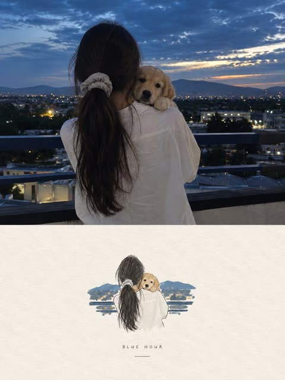</a>

严格的上下对半分栏，上半保留原照片，下半把主要元素重绘成小幅手作插画。四色上限、占比10%到20%的尺寸限制和大面积留白让画面安静克制，排除清单则避开卡通、水彩和3D质感。

GPT Image 2.5 · 上传图改图 · 出处: [@saniaspeaks_ on X](https://x.com/saniaspeaks_/status/2102972265541304823) · 248 赞，统计于 2026-10-28

[`editorial-poster`](tags.md#tag-editorial-poster) [`photo-to-illustration`](tags.md#tag-photo-to-illustration) [`split-layout`](tags.md#tag-split-layout) [`paper-texture`](tags.md#tag-paper-texture) [`minimalist`](tags.md#tag-minimalist)

<details><summary><b>提示词</b></summary>

```text
Create a high-end editorial poster using the uploaded photo as the exact reference, in a strict 3:4 vertical format divided horizontally into two equal 50/50 sections. Preserve the original photo faithfully in the top half, including subjects, identity, pose, clothing, objects, lighting, colors, and realistic texture, with only subtle premium editorial color grading. In the bottom half, reinterpret the most recognizable elements as a small, centered, minimalist handmade paper illustration using delicate imperfect lines, bold flat acrylic-like color shapes, subtle paper grain, organic edges, and no more than 4 colors extracted from the original photo. Keep the illustration only 10–20% of the bottom section with lots of warm off-white negative space and optional minimal editorial typography. The overall result should feel quiet, poetic, refined, artistic, premium, and like an independent art-book cover, avoiding cartoon, watercolor, colored-pencil, 3D, glossy, busy, or commercial aesthetics.
```

</details>

<a id="gpt-image-split-photo-editorial-poster-color-window"></a>
### 上方原图下方抽离主体的风车编辑海报

<a href="https://x.com/harboriis/status/2108082784665473508">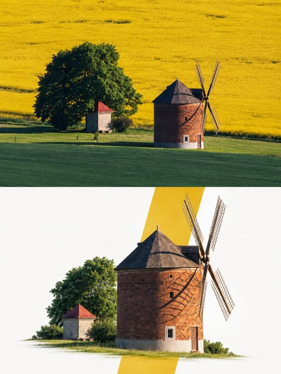</a>

画布严格对半分，上半保留原图不重绘，下半把叙事主体重构在近白底上。一个取自原图色彩的低饱和色窗穿过主体制造层次，并明确禁止HDR、重绘和多余色块，成品更干净。

GPT Image 2.5 · 上传图改图 · 出处: [@harboriis on X](https://x.com/harboriis/status/2108082784665473508) · 246 赞，统计于 2026-10-29

[`editorial-poster`](tags.md#tag-editorial-poster) [`split-layout`](tags.md#tag-split-layout) [`color-window`](tags.md#tag-color-window) [`negative-space`](tags.md#tag-negative-space) [`photo-reconstruction`](tags.md#tag-photo-reconstruction)

<details><summary><b>提示词</b></summary>

```text
Premium Editorial Poster Instructions

Each uploaded photo must be made into a separate, independent, premium editorial poster, and multiple photos must not be combined. Use a strict 3:4 vertical canvas. Split the canvas horizontally in the exact center: the upper half and the lower half each occupy 50% of the height, are equally wide, and equally high, with no alteration of proportion.

The upper half uses the original photo directly and must not be regenerated. Preserve the identity of the main subject, the human body or architectural structure, proportions, perspective, spatial relationships, texture, natural light and shadow, color, and environment in their entirety. Only slight cropping and restrained premium color grading are permitted; re-drawing the main subject, fictional light, HDR, excessive saturation, plastic texture, and fictional content are prohibited. When needing to adapt to the frame, only environmental areas such as sky, water surface, ground, walls, plants, or background can be extended.

The lower half extracts and reconstructs the "narrative core" of the photo: it can be a single primary subject, or a group of related elements that together embody the photo's identity, scale, action, o story relationship. Maintain its realistic, recognizable appearance, proportion, internal structure, texture, and relative position. Do not remove important related elements, and do not directly use rectangular photo cutouts. The reconstructed subject typically occupies 55%-80% of the width of the lower area. It should naturally extend based on the photo's primary direction and retain plausible ground, water lines, shadows, or softly dissipated edges to integrate into the background, avoiding a sticker-like or floating appearance.

Incorporate a narrow, low-saturation geometric color field behind or through the center of the subject, serving as a "critical window" between reality and editorial abstraction. The color of the window must be extracted from the original photo, and its orientation (horizontal, vertical, or diagonal) chosen based on the overall narrative direction.

The subject must actively pass through the window: part of it is within the color field, and part enters the open negative space, naturally crossing the window's boundary to create occlusion, penetration, and spatial depth. The window is not a frame or a card; it must not fully enclose the subject. Only one primary window is allowed; multiple color blocks, thick borders, rounded corners, strong gradients, and drop shadows are prohibited.

Use a white, cool white, very light gray, or near-white background for the lower half, coordinated with the photo. Employ a restrained asymmetrical composition and abundant negative space to establish a three-tier hierarchy:

Reconstructed subject or narrative composition

Low-saturation geometric window
```

</details>

<a id="nano-banana-retro-winter-fashion-ad-four-models"></a>
### 四位模特的复古冬季时装广告

<a href="https://x.com/rovvmut_/status/2029228739192865157"></a>

为每位模特分别写明服装、姿势和位置，并用十六进制色值锁定青灰与焦橙配色，让画面统一。页眉、页脚和压在人物前的大号衬线字标分开描述，形成层叠的海报效果。

Nano Banana 2 · 文生图 · 出处: [@rovvmut_ on X](https://x.com/rovvmut_/status/2029228739192865157) · 238 赞，统计于 2026-10-28

[`fashion`](tags.md#tag-fashion) [`advertisement`](tags.md#tag-advertisement) [`retro`](tags.md#tag-retro) [`typography`](tags.md#tag-typography) [`group-portrait`](tags.md#tag-group-portrait)

<details><summary><b>提示词</b></summary>

```text
A wide-angle, studio fashion advertisement with a sophisticated retro-modern aesthetic. The scene is set against a monochromatic teal-grey (#506D6D) architectural backdrop featuring minimalist geometric props, including a fluted column and stepped circular platforms. The lighting is professionally diffused studio light, creating soft, graduated shadows that provide depth without harshness.

The Subjects:
Four models are posed in a cohesive, stylish group dynamic:

A Black man on the far left, standing tall in a brown tweed blazer, a deep burgundy turtleneck, and dark yellow-and-brown checkered trousers. He is smiling and warmly holding the hand of the woman next to him.

A Black woman with a voluminous afro, sitting sideways on a vintage 1950s wooden television set. She wears a dark brown knit top and vibrant burnt orange (#E88D4D) trousers with sleek brown leather boots.

A White woman sitting on the floor in the center, leaning forward with her hand to her face. she wears a vintage-style headband, an argyle-patterned sleeveless top in orange and slate blue, a brown wool skirt, and white wedge sandals.

A White man leaning into the frame from the center-right, hands on his knees. He wears a heavy cream-colored cable-knit sweater with dark trim and tailored brown trousers.
Furniture & Props:
To the right stands a minimalist dark teal industrial clothing rack. It displays curated garments including hanging shirts, a wide-brimmed white fedora, and a prominent structured orange leather messenger bag. At the base of the rack are white high-top sneakers and sandals. A single, truncated orange cone prop sits in the foreground.
Primary Text: A massive, high-contrast white serif font (Bodoni-style) reading "KAIRO" is overlaid across the center-left, partially occluding the models to create a layered, 3D effect.
Header: At the top center, the words "winter" (in orange cursive script) and "COLLECTION" (in white clean sans-serif) are centered.
Footer: The URL "
http://
KAIROFASHION.COM" is printed in small, wide-tracked white sans-serif in the bottom right corner.
Color Palette:
A sophisticated mix of Teal-Grey, Burnt Orange, Chocolate Brown, and Crisp White, creating a warm yet muted autumnal atmosphere.
```

</details>

<a id="gpt-image-flat-vector-city-travel-poster-template-2-2"></a>
### 极简扁平矢量城市旅行海报模板

<a href="https://x.com/oggii_0/status/2069643205818437808"></a>

用 CITY_NAME 占位符让模型自动补全地标、建筑和街景细节。预留左上角排版空白、限定三到六个人物，再锁定配色并列出禁用效果，使扁平矢量风格保持一致。

GPT Image 2 · 文生图 · 出处: [@oggii_0 on X](https://x.com/oggii_0/status/2069643205818437808) · 234 赞，统计于 2026-10-29

[`travel-poster`](tags.md#tag-travel-poster) [`flat-vector`](tags.md#tag-flat-vector) [`template`](tags.md#tag-template) [`city`](tags.md#tag-city) [`pastel-palette`](tags.md#tag-pastel-palette)

<details><summary><b>提示词</b></summary>

```text
GPT Image 2 on Chatgpt

Prompt: Premium minimal flat-vector travel poster for [CITY_NAME], 3:4 vertical.

Create an airy, elegant city scene with large typography-safe negative space in the upper-left.
Add “[CITY_NAME]” and one short refined English caption that matches the city mood.

Automatically adapt the illustration to [CITY_NAME]:
include one iconic primary landmark, local architecture, café culture, a transport sign, street lamps, flowers, trees, small city details, and calm daily-life moments.

Use only 3–6 people, naturally interacting with the city:
talking at a café, walking, jogging, sketching, or taking photos.
Avoid crowds, avoid a single hero character, and keep the composition open and uncluttered.

Style:
Japanese stationery aesthetic, luxury sticker illustration, premium commercial flat-vector poster, clean thin outlines, consistent line weight, flat colors only.

Palette:
pale powder blue, soft sky blue, mist blue as the dominant background tones;
warm cream, soft beige, sage green, muted gray-green for architecture and nature;
dusty rose or blush pink only as tiny accents on flowers, signs, awnings, or small decorative details.

Mood:
fresh, minimal, elegant, calm, refined, high-end travel postcard and lifestyle branding.

No realism, no watercolor, no painterly effects, no photorealism, no shading, no gradients, no texture, no dense background.
```

</details>

<a id="gpt-image-birthday-poster-man-carved-paper-number"></a>
### 男子坐在镂空数字里的生日海报

<a href="https://x.com/Alina_with_Ai/status/2067250994954846272"></a>

整个画面只用白色纹理纸墙一种材质，镂空数字像一扇窗，露出里面的气球和花束。人物坐在数字边缘，肢体探出框外形成立体感，侧面阳光带来真实的层次。原提示词里数字写成了04和18，复用时要统一。

GPT Image 2 · 上传图改图 · 出处: [@Alina_with_Ai on X](https://x.com/Alina_with_Ai/status/2067250994954846272) · 231 赞，统计于 2026-10-28

[`birthday`](tags.md#tag-birthday) [`paper-carving`](tags.md#tag-paper-carving) [`balloons`](tags.md#tag-balloons) [`reference-photo`](tags.md#tag-reference-photo) [`editorial`](tags.md#tag-editorial)

<details><summary><b>提示词</b></summary>

```text
Professional luxury birthday poster, vertical 3:4 ratio. The entire scene is crafted from premium snow-white textured paper walls with elegant architectural depth. A giant number “04” is precisely carved into the wall, featuring realistic depth, refined inner shadows, smooth edges, and luxurious volumetric detailing.

Inside the carved number, a sophisticated birthday celebration setup is revealed, decorated with dark blue, pastel blue, and white balloons, delicate white flowers, premium floral arrangements, and high-end festive styling.

The man from the reference photo is sitting casually on the lower curve of the number “18,” with one leg bent and the other hanging naturally. He wears a radiant smile and looks slightly upward with confidence and joy. His face, shoulder, one arm, and one leg extend beyond the carved number frame, creating a highly realistic 3D pop-out window effect.

Warm cinematic sunlight enters from one side, producing soft highlights, realistic shadows, and elegant depth. Ultra-detailed photorealistic skin texture, natural facial features, premium studio-quality lighting, crystal-clear focus, luxury editorial photography, and masterpiece-level realism.

Elegant wall typography: , ALAINA Ai” “CHAPTER 28” “365 MORE DAYS OF MIRACLES”

Pure minimalist composition, luxury magazine-cover aesthetics, premium art direction, realistic depth and shadows, natural color grading, clean background, no tree shadows, no artificial AI artifacts, no distortion, no extra limbs, no text errors, first-class birthday campaign photography, ultra-realistic, award-winning editorial quality, 8K detail.
```

</details>

<a id="gpt-image-city-landmark-split-photo-graphic-travel-poster"></a>
### 上海天际线实景照片与扁平图形双拼海报

<a href="https://x.com/Goodmanprotocol/status/2090495333877141904"></a>

固定上下各占一半，上半是写实地标摄影，下半是同一地标的扁平几何重绘。从照片提取四到六色的配色、瑞士展览海报参照和较长的禁用清单让画面保持统一，替换[CITY]占位符即可套用到任何城市。

GPT Image 2 · 文生图 · 出处: [@Goodmanprotocol on X](https://x.com/Goodmanprotocol/status/2090495333877141904) · 226 赞，统计于 2026-10-29

[`travel-poster`](tags.md#tag-travel-poster) [`landmark`](tags.md#tag-landmark) [`split-layout`](tags.md#tag-split-layout) [`swiss-design`](tags.md#tag-swiss-design) [`city`](tags.md#tag-city)

<details><summary><b>提示词</b></summary>

```text
Create a refined 3:4 vertical premium travel poster for [CITY].

First identify the city, country, architecture, landscape, climate, cultural character, and visual identity. Select ONE iconic and highly recognizable real-world landmark or subject as the HERO. Establish one believable photographic viewpoint and ensure every environmental element logically belongs to that location. Do not create a collage of unrelated landmarks.

COMPOSITION: Divide the poster into two perfectly equal sections: 50% top and 50% bottom. Use a warm beige, ivory, or soft-white background with generous negative space and precise alignment.

TOP — HERO PHOTOGRAPH: Create an ultra-realistic, high-end editorial photograph of the chosen landmark from a believable real-world viewpoint. Preserve accurate architecture, proportions, materials, surrounding environment, natural lighting, shadows, atmosphere, and geographic character. The scene should feel like premium architectural photography or a museum-quality travel photograph, with realistic textures and sophisticated cinematic composition.

BOTTOM — GRAPHIC INTERPRETATION: Reinterpret the same hero landmark as a sophisticated flat graphic design. Extract its most recognizable silhouette, contours, structural details, proportions, and distinctive architectural elements. Simplify them into elegant geometric shapes, flat color blocks, thin lines, restrained divisions, and generous negative space. The landmark must remain instantly recognizable without becoming a realistic illustration, 3D render, cartoon, or game graphic.

COLOR & TYPOGRAPHY: Derive a restrained palette of approximately 4–6 colors from the city's architecture, environment, and hero photograph. Keep the palette sophisticated with slightly muted saturation. Add minimal geometric accents only when they improve the composition.

Use limited, elegant typography such as: [CITY] [COUNTRY] ARCHITECTURAL STUDY 2026

Use Swiss/international graphic design, architectural exhibition posters, luxury editorial design, and museum visual identity as the aesthetic reference. Keep typography subtle, with generous letter spacing and strong visual hierarchy.

FINAL AESTHETIC: Sophisticated, minimal, contemporary, culturally authentic, artistic, and premium. The photographic upper half and graphic lower half should feel like two expressions of the same visual identity. The final result should resemble a world-class gallery poster, collector's travel print, architectural exhibition artwork, or luxury brand campaign.

Avoid landmark collages, inaccurate architecture, invented structures, excessive text, tourist-brochure aesthetics, neon, flashy effects, heavy gradients, glossy 3D rendering, cartoon styling, game UI, clutter, excessive decoration, and generic AI-generated cityscapes.
```

</details>

<a id="gpt-image-orange-panel-cowboy-hat-fashion-poster"></a>
### 橙色分栏裁切效果的宽檐帽时尚海报

<a href="https://x.com/harboriis/status/2099350017844867510"></a>

先描述白底上三块高度不同的竖向色块，再让人物与帽子横跨所有色块，形成裁切叠压效果。单一焦橙色调，并明确禁止文字、标志和多余物体，使画面保持干净。

GPT Image 2.5 · 文生图 · 出处: [@harboriis on X](https://x.com/harboriis/status/2099350017844867510) · 223 赞，统计于 2026-10-29

[`fashion-editorial`](tags.md#tag-fashion-editorial) [`minimalist`](tags.md#tag-minimalist) [`cutout-effect`](tags.md#tag-cutout-effect) [`monochromatic`](tags.md#tag-monochromatic) [`orange`](tags.md#tag-orange)

<details><summary><b>提示词</b></summary>

```text
Create a vertical 2:3 fashion editorial poster with a minimalist, modern aesthetic. Use a clean white background with three tall, rectangular orange panels arranged vertically across the center, with narrow white gaps between them. The middle panel is slightly taller than the two outer panels.

Feature a realistic young woman with fair skin, delicate facial features, and light brown hair styled neatly under a large, wide-brimmed burnt-orange cowboy hat. She wears an elegant burnt-orange long-sleeve blouse with soft folds and a refined fashion-forward look.

Position the woman in a three-quarter profile, facing slightly toward the camera with a calm, confident expression. Her head and oversized hat extend across all three orange panels, while her body is primarily visible through the center panel. The orange panels should create a striking cutout effect, with parts of the portrait appearing to overlap the panel edges.

Use warm studio lighting, soft natural skin texture, subtle shadows, crisp edges, high-end fashion photography, balanced negative space, and a premium contemporary magazine design. Use a monochromatic burnt-orange color palette against a pure white background.

No text, no logos, no typography, no borders, no extra objects. Focus entirely on the woman, the oversized hat, and the geometric orange panel composition.
```

</details>

<a id="gpt-image-futuristic-editorial-profile-poster-template"></a>
### 侧脸人像未来感编辑海报

<a href="https://x.com/HustleXR/status/2093967364379324896"></a>

模板用方括号留出人物、服装、三种强调色、标题和正文的位置。白底、粗色块、细电路线、不对称杂志版式和 4:5 比例都写死，排版与构图因此稳定可控。

GPT Image 2 · 文生图 · 出处: [@HustleXR on X](https://x.com/HustleXR/status/2093967364379324896) · 214 赞，统计于 2026-10-28

[`editorial-poster`](tags.md#tag-editorial-poster) [`template`](tags.md#tag-template) [`side-profile`](tags.md#tag-side-profile) [`futuristic`](tags.md#tag-futuristic) [`typography`](tags.md#tag-typography)

<details><summary><b>提示词</b></summary>

```text
Conceptual futuristic editorial poster design featuring [HUMAN] in a large side-profile portrait, wearing [CLOTHING], sleek contemporary fashion styling, clean studio lighting, white background with bold [COLOR1] graphic shapes, fine [COLOR2] circuit-like line diagrams, and subtle [COLOR3] interface accents. Large uppercase title "[TITLE]" placed prominently at the top, a short block of small editorial text reading "[TEXT]", modern experimental typography, asymmetrical magazine layout, sharp high-contrast composition, premium graphic design aesthetic, 4:5 aspect ratio.
```

</details>

<a id="gpt-image-landmark-sketch-travel-poster"></a>
### 红色墨线风格的伊斯坦布尔地标旅行海报

<a href="https://x.com/Naiknelofar788/status/2101315631237021853"></a>

填空式模板只需替换地标、城市和坐标，固定的风格词保证画面统一。象牙色纸面、排线、网点、几何形状和 4:5 比例共同造出版画质感。

GPT Image 2.5 · 文生图 · 出处: [@Naiknelofar788 on X](https://x.com/Naiknelofar788/status/2101315631237021853) · 211 赞，统计于 2026-10-28

[`travel-poster`](tags.md#tag-travel-poster) [`architecture`](tags.md#tag-architecture) [`sketch`](tags.md#tag-sketch) [`halftone`](tags.md#tag-halftone) [`template`](tags.md#tag-template)

<details><summary><b>提示词</b></summary>

```text
A sophisticated minimalist architectural art poster featuring [LANDMARK / STRUCTURE] as the central subject, illustrated in a refined hand-drawn architectural sketch style. Preserve the landmark’s recognizable silhouette, proportions, and defining architectural details, while transforming it into an elegant artistic composition.

Use a limited monochromatic color palette inspired by the location, with soft vintage tones on a warm ivory/off-white paper background. Combine delicate ink lines, fine architectural hatching, subtle halftone texture, and lightly distressed print details.

Surround the structure with a few abstract geometric shapes, soft translucent circles, subtle atmospheric elements, birds, or tiny contextual details that complement the landmark without overpowering it. Add a subtle sense of depth through overlapping layers and faded linework.

Include small minimalist typography on one side: [CITY / COUNTRY], [LANDMARK NAME], and optional coordinates or a short location descriptor, arranged like a premium travel-art print.

Clean negative space, editorial graphic design, museum-quality travel poster aesthetic, elegant composition, understated luxury, vintage screen-print texture, artistic architectural illustration, no people, no photorealistic background, no unnecessary objects, 4:5 vertical composition.

[LANDMARK] reimagined as a collectible minimalist travel-art poster, combining architectural sketching, vintage printmaking, geometric abstract shapes, delicate linework, halftone texture, muted location-inspired colors, and elegant negative space. The landmark remains instantly recognizable but feels like a hand-crafted piece of modern graphic art. Add tiny birds, subtle environmental elements, coordinates, and minimal location typography. Premium editorial aesthetic, artistic, sophisticated, highly shareable, 4:5 vertical.
```

</details>

<a id="gpt-image-travel-poster-photo-diorama-split"></a>
### 上海天际线实景照与等距微缩模型海报

<a href="https://x.com/Goodmanprotocol/status/2107675234858131544"></a>

海报上下分成两半,上半是写实的目的地照片,下半是同一场景的等距微缩模型,放在深灰底座上。连续性约束、可替换的地点占位符,以及固定的排版区块和暖白留白,让版式能套用到任何城市。

GPT Image 2.5 · 文生图 · 出处: [@Goodmanprotocol on X](https://x.com/Goodmanprotocol/status/2107675234858131544) · 200 赞，统计于 2026-10-28

[`travel-poster`](tags.md#tag-travel-poster) [`isometric`](tags.md#tag-isometric) [`diorama`](tags.md#tag-diorama) [`miniature`](tags.md#tag-miniature) [`editorial-layout`](tags.md#tag-editorial-layout)

<details><summary><b>提示词</b></summary>

```text
Create a premium 3:4 vertical editorial travel poster for [COUNTRY / CITY / LOCATION / SUBJECT].

TEXT-TO-IMAGE ONLY — generate the entire artwork creatively from [COUNTRY / CITY / LOCATION / SUBJECT] alone. No reference image required.

COMPOSITION
Divide the poster into two seamless stacked halves with no gap.

TOP HALF:
Create a full-width photorealistic cinematic travel scene representing [COUNTRY / CITY / LOCATION / SUBJECT]. Automatically choose its most recognizable architecture, surroundings, atmosphere, materials, colors, and natural lighting. Treat this as the authentic photographic view of the destination.

BOTTOM HALF:
Transform the same scene into a highly detailed isometric miniature diorama viewed from approximately a 45° elevated angle. Rebuild the recognizable architecture, streets, landscape, vegetation, and surrounding elements as a physically believable miniature world on a thin dark-gray rectangular base slab.

Maintain visual continuity between the upper photograph and lower diorama — same architecture, same environment, same lighting mood, and recognizable details — while making the lower section clearly handcrafted as a miniature.

EDITORIAL LAYOUT
Place the diorama toward the lower-right area, leaving generous warm off-white negative space around it.

Use thin dark-navy sans-serif typography in the empty space:
- a poetic 3-line uppercase title
- “/”
- a short 4-line travel verse
- bottom-left: “001” followed by a thin horizontal rule and [CITY / COUNTRY]
- bottom-right: a thin horizontal rule followed by accurate GPS coordinates

Automatically determine the appropriate city, country, landmark, and coordinates from [COUNTRY / CITY / LOCATION / SUBJECT].

STYLE
Photorealistic travel photography × hyper-detailed architectural miniature × premium editorial design × quiet luxury travel journal.

Use realistic materials, miniature-scale details, natural shadows, subtle depth of field, warm off-white paper, restrained dark-navy typography, and sophisticated negative space.

The lower diorama must feel physically constructed rather than like a flat illustration — tiny buildings, roads, vegetation, textures, shadows, and architectural details should have believable scale and depth.

FINAL AESTHETIC
Minimal, intelligent, atmospheric, collectible, and highly refined — a contemporary travel journal combining the real destination with its miniature architectural memory.

Avoid collage seams, separate unrelated scenes, generic architecture, invented landmarks, excessive typography, glossy CGI, cartoon styling, clutter, logos, watermarks, borders, and UI elements.

FORMAT
3:4 vertical, two stacked halves, no gap, upper photorealistic destination scene, lower isometric miniature diorama, premium editorial finish.
```

</details>

<a id="nano-banana-green-hoodie-fashion-ad-layout"></a>
### 绿色卫衣时尚广告，衬线大标题与斜向丝带

<a href="https://x.com/rovvmut_/status/2029599397483532714"></a>

提示词把广告拆成服装、图形排版和环境三个模块，并给出精确的文字内容、位置和三色配色。尺码胶囊、缩略图、色板等界面元素逐一指明位置，让它们围绕上传的人物照片准确排布。

Nano Banana 2 · 上传图改图 · 出处: [@rovvmut_ on X](https://x.com/rovvmut_/status/2029599397483532714) · 193 赞，统计于 2026-10-28

[`fashion-ad`](tags.md#tag-fashion-ad) [`typography`](tags.md#tag-typography) [`hoodie`](tags.md#tag-hoodie) [`studio-lighting`](tags.md#tag-studio-lighting) [`layout`](tags.md#tag-layout)

<details><summary><b>提示词</b></summary>

```text
Nano Banana 2 Product Advertisement Prompt:

A professional commercial fashion advertisement featuring a young male model in the uploaded image, sitting on a minimalist white matte cube. He has a neutral, confident expression and is looking directly at the camera.

Attire & Styling:
Hoodie: A high-quality, heavyweight forest green (British Racing Green) hoodie. It features a relaxed fit, a spacious kangaroo pocket, and metal-tipped drawstrings.
Bottoms: Clean, slim-fit white trousers with visible seams.
Footwear: Stylish low-top sneakers in a color-blocked design of forest green, navy blue, and white, with off-white midsoles and white laces.
Accessories: Simple silver bands/rings on his fingers.

Graphic Design & Layout:
Typography: The word "HOODIE" is written in a massive, elegant high-contrast serif font across the top. A small, four-pointed yellow spark icon is centered inside the "O". Above this, "K A I R O  P R E M I U M" is printed in a wide-spaced sans-serif font.
Branding Elements: A dark green diagonal "caution tape" style ribbon crosses the bottom third of the frame, with the words "PREMIUM HOODIE" repeating in white uppercase text.
UI Accents: * A yellow pill-shaped size selector labeled "S M L XL" on the left.
A small thumbnail of the hoodie floating on the mid-left.
Three circular color swatches (Green, Yellow, Black) on the right side.
Two blocks of justified serif body text describing the product's comfort and eco-friendly materials.
The URL "
http://
kairofashion.com" in the bottom left corner.

Environment & Lighting:
Setting: A clean, bright, white-on-white minimalist studio cove.
Lighting: Soft, diffused studio lighting creates gentle shadows under the model and the cube, emphasizing the rich texture of the green fabric and the crispness of the white pants.
Color Palette: Deep forest green, bright white, and golden yellow accents.
```

</details>

<a id="gpt-image-split-photo-paper-illustration-poster"></a>
### 宠物依偎照片搭配极简手绘纸面插画

<a href="https://x.com/saniaspeaks_/status/2102730273347846346">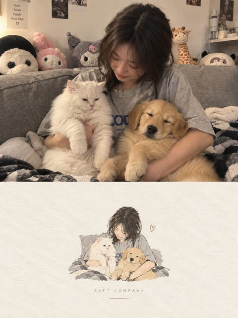</a>

提示词把画布精确分成上下两半：上半保留原照片，下半把照片重绘成小幅手绘纸面插画。色板限定为从照片提取的四种颜色，并规定主体只占10%到20%、四周大量留白，使两半浑然一体。

GPT Image 2.5 · 上传图改图 · 出处: [@saniaspeaks_ on X](https://x.com/saniaspeaks_/status/2102730273347846346) · 187 赞，统计于 2026-10-28

[`editorial-poster`](tags.md#tag-editorial-poster) [`photo-to-illustration`](tags.md#tag-photo-to-illustration) [`split-layout`](tags.md#tag-split-layout) [`negative-space`](tags.md#tag-negative-space) [`paper-texture`](tags.md#tag-paper-texture)

<details><summary><b>提示词</b></summary>

```text
Create one independent high-end editorial poster for each uploaded photo. Do not combine multiple photos into a collage. Each photo must be processed and output as a separate poster. OVERALL FORMAT Strict 3:4 vertical composition. Divide the canvas horizontally into two exactly equal sections, with a precise 1:1 height ratio. The top half occupies exactly 50% of the canvas. The bottom half occupies exactly 50% of the canvas.

The two sections should feel visually connected as one refined art publication cover. TOP HALF — ORIGINAL PHOTOGRAPH Preserve the original photograph as faithfully as possible. Keep the main composition, subjects, identity, facial features, body proportions, poses, expressions, clothing, objects, and spatial relationships unchanged. Preserve the realistic photographic texture, natural lighting, shadows, atmosphere, and original color mood.

Apply only subtle, sophisticated editorial color grading, creating the feeling of a premium magazine photograph, contemporary art book, or high-end independent publication. The image should remain photorealistic and authentic, never overly retouched or artificially stylized. If necessary to fit the 3:4 composition naturally, extend the sky, ground, walls, or surrounding environmental background. Background extension must feel seamless and photographic.

Never stretch, distort, reshape, replace, or alter the main subject. BOTTOM HALF — MINIMAL HAND-DRAWN PAPER ILLUSTRATION Extract the most recognizable visual elements from the original photograph and reinterpret them as a minimalist hand-drawn paper-cover illustration. Preserve: The most recognizable subject Essential silhouette and proportions Key pose or gesture Important objects The core narrative relationship between people and objects Highly simplify the image.

Remove unnecessary details and retain only the visual information needed for immediate recognition. Use: Delicate, slightly imperfect hand-drawn lines A small number of bold, clearly defined acrylic-style flat color shapes Rough paper texture Visible handmade brush marks Slightly irregular, organic edges Subtle imperfections that make it feel genuinely handmade The main illustrated subject should be small, centered, and carefully composed, occupying approximately 10–20% of the bottom half.

Leave a large amount of negative space around the illustration. The background should primarily resemble: Rough white paper Warm off-white paper Pale natural paper Minimal editorial book-cover stock Use only a few lines or small color shapes to suggest the surrounding environment. COLOR PALETTE Extract the dominant colors directly from the original photograph. Compress the palette into no more than 4 main colors. Keep the colors restrained, sophisticated, and harmonious.

Use bold but controlled flat color blocks. Avoid excessive color variation. Preserve subtle paper grain and handmade brush texture. The illustration should visually feel like a simplified color interpretation of the photograph. TYPOGRAPHY A small amount of simple typography may be included when appropriate. Possible elements: A short title Keyword Object name Location Year Number Short phrase Text should be minimal, understated, and editorial.

Typography should naturally interact with the large areas of negative space and the small illustration, evoking: Art book covers Independent publishing Contemporary editorial design Thoughtful children's picture books Do not force text into the composition if it does not naturally fit the photograph. VISUAL LANGUAGE The final poster should feel: Quiet · Poetic · Refined · Minimal · Innocent · Relaxed · Artistic · Thoughtful · High-recognition · Premium The visual concept should be:

Prioritize recognition, restraint, negative space, material texture, subtle imperfection, editorial sophistication, and artistic storytelling over decorative complexity.
```

</details>

<a id="gpt-image-photo-ink-wash-split-editorial-poster"></a>
### 上方古罗马斗兽场照片，下方水墨重构

<a href="https://x.com/Ziha_ai/status/2107353999796326889">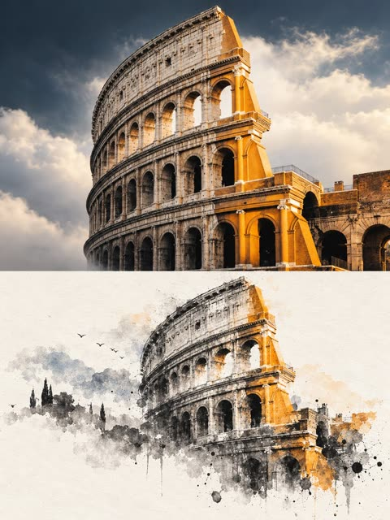</a>

提示词严格锁定上下各占一半的版式，上半部分保留原图不改动，下半部分重构为留白充足的水墨。它点明具体笔法，只从原图提取少量克制的色彩，让上下两部分相互呼应。

GPT Image 2.5 · 上传图改图 · 出处: [@Ziha_ai on X](https://x.com/Ziha_ai/status/2107353999796326889) · 177 赞，统计于 2026-10-29

[`ink-wash`](tags.md#tag-ink-wash) [`split-layout`](tags.md#tag-split-layout) [`editorial-poster`](tags.md#tag-editorial-poster) [`negative-space`](tags.md#tag-negative-space) [`landmark`](tags.md#tag-landmark)

<details><summary><b>提示词</b></summary>

```text
Create a premium 3:4 vertical editorial poster using the uploaded photo as the sole reference.

OVERALL FORMAT

The image must use a strict 3:4 vertical composition divided horizontally into two equal regions with an exact 1:1 height ratio. Each region occupies exactly 50% of the total image height.

UPPER REGION: ORIGINAL PHOTO

Use the original uploaded photo directly as the upper 50% of the composition.

Preserve the subject's exact identity, facial features, body structure, proportions, posture, perspective, clothing, materials, lighting, and original color atmosphere.

Do not regenerate, reshape, distort, stretch, beautify, or alter the subject.

Only apply subtle high-end color grading, image purification, refined tonal balance, and gentle detail enhancement, giving the image the refined texture of an art magazine or exhibition photograph.

The background may be moderately expanded to fit the 3:4 composition, but the subject must remain completely unchanged in structure, posture, proportions, and core composition.

LOWER REGION: MINIMALIST INK WASH RECONSTRUCTION

Reconstruct the same subject and scene as a minimalist contemporary ink wash artwork.

First identify and preserve the most recognizable elements of the original image, including silhouette, outline, structure, perspective, movement, visual rhythm, spatial relationship, and overall atmosphere.

Do not directly copy photographic details. Do not create a realistic reproduction. Instead, translate the original scene into an artistic ink wash interpretation that preserves its recognizable essence and visual relationship with the upper photograph.

Use a milky white, warm white, or natural paper-white base with delicate paper fibers and subtle organic texture.

Build the artwork using expressive ink wash techniques including dry and wet brushwork, flying white, ink seepage, ink accumulation, soft diffusion, broken edges, layered washes, and intentional white space.

Remove secondary details. Keep only the most distinctive contours, structural transitions, spatial layers, movement, and atmosphere.

The lower artwork should feel summarized, refined, poetic, and intentionally incomplete rather than realistically detailed.

INK AND COLOR

Use black, charcoal gray, soft gray, and diluted ink tones as the dominant palette.

Create clear tonal layering with varied ink density, pressure, rhythm, and transparency.

Extract only a few emotionally important colors from the original image and reinterpret them as small areas of artistic staining or pigment.

Colors may transform naturally into blue-gray, distant blue, soft gold, warm yellow, vermilion red, light cyan, or similar restrained tones.

Do not mechanically reproduce the original color values.

Ink and negative space must remain dominant.

Avoid muddy brown, dull vintage tones, heavy coloring, excessive decoration, or vulgar color combinations.

COMPOSITION AND NEGATIVE SPACE

The main reconstructed subject should occupy approximately 30% to 45% of the lower half.

Reserve the remaining area for generous negative space.

The artwork may be asymmetrically positioned, partially framed, suspended, slightly cropped, or offset.

Maintain strong asymmetrical balance and a sophisticated editorial composition.

The edges of the ink artwork should gradually loosen, fragment, fade, scatter, and disappear into the paper, creating a natural sense of breathing space.

Negative space must function as an intentional visual element, not as empty unused space.

Reduce information rather than filling the entire lower region.

The final lower section should resemble a refined ink seal, contemporary Eastern material study, or museum-quality oriental artwork displayed on a clean editorial page.

TEXT

Use very little text.

Do not add preset titles, numbers, labels, or template typography.

If appropriate, extract only a few meaningful words or a very short phrase related to the subject, location, time, action, emotion, or metaphor.

Place the text quietly within the negative space or near the edge of the artwork.

Typography must remain subtle, sparse, elegant, and secondary to the visual composition.

OVERALL AESTHETIC

Contemporary Eastern aesthetics.

Minimalist ink wash reconstruction.

Premium art magazine presentation.

Exhibition photography quality.

Large-scale intentional negative space.

Subtle editorial typography.

Small-scale seal-like visual focus.

Quiet, restrained, poetic atmosphere.

Elegant asymmetrical composition.

Refined paper texture.

Museum-quality visual finish.

Avoid complex backgrounds, excessive photographic details, realistic duplication, decorative clutter, excessive text, rigid template layouts, filled compositions, heavy colors, old-fashioned brown tones, and unnecessary visual elements.
```

</details>

<a id="nano-banana-novel-cover-woman-reading-candlelit-room"></a>
### 烛光古董房里读黑色丝绒小说的女子

<a href="https://x.com/JuliaClarky/status/2079417419114942568"></a>

书名和作者名逐字给出并指定字体与位置，让书封文字清晰可读。烛光、古董家具和暗色花朵营造氛围，第二条提示词沿用同一书名生成配套场景。

Nano Banana 2 · 文生图 · 出处: [@JuliaClarky on X](https://x.com/JuliaClarky/status/2079417419114942568) · 159 赞，统计于 2026-10-28

[`book-cover`](tags.md#tag-book-cover) [`candlelight`](tags.md#tag-candlelight) [`vintage-room`](tags.md#tag-vintage-room) [`typography`](tags.md#tag-typography) [`cinematic`](tags.md#tag-cinematic)

<details><summary><b>提示词</b></summary>

```text
A luxurious cinematic novel cover poster featuring a beautiful young woman sitting in an elegant dimly lit vintage room, holding a premium black hardcover book in her hands while reading it. She has a captivating expression, a shy mysterious smile, and emotional eyes as she gets lost in the story. The book cover in her hands is clearly visible and features a seductive luxury design with black velvet texture, golden embossed details, deep red roses, and elegant typography. The main title on the book cover reads “HIS TEMPTATION” in a bold sophisticated serif font, and directly underneath the title it says “by Elena Voss” in a smaller elegant font. Add candlelight, antique furniture, dark flowers, dramatic shadows, cinematic lighting, high-fashion editorial style, realistic photography, ultra detailed, 8K, professional bestselling novel cover design, mysterious and intense atmosphere.

Prompt 2 — “His Temptation” Movie Scene at Home A cinematic back-view shot of a young woman sitting comfortably on a luxurious velvet sofa in her elegant living room at night. She is watching the movie adaptation of the novel “His Temptation” on a large LED screen. The camera is positioned behind her, showing her silhouette, long hair, and relaxed posture as she becomes completely absorbed in the story. The LED screen displays a dramatic romantic scene featuring the mysterious male lead and female lead from the novel. The room has warm golden lamps, candles, a large bookshelf, soft cushions, dark flowers, and a cozy luxury interior. A copy of the book “His Temptation” by Elena Voss rests on the coffee table beside her. Emotional cinematic atmosphere, realistic home setting, professional film camera shot, shallow depth of field, ultra realistic, 8K movie still quality. 🖤
```

</details>

<a id="gpt-image-photo-to-watercolor-scrapbook-poster"></a>
### 奶油色手账海报上的照片与水彩画对照

<a href="https://x.com/Alina_with_Ai/status/2102714815793992093">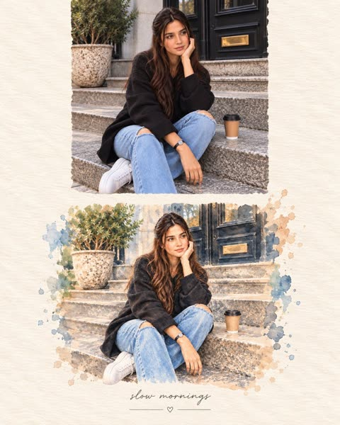</a>

提示词把上传照片的写实版放在上方,下方用水彩重绘同一场景,并逐项列出需要保持一致的人物身份、服装和姿势。纸张质感、泼溅、边缘和手写题字等细节让版面有编辑感手账风格。

GPT Image 2.5 · 上传图改图 · 出处: [@Alina_with_Ai on X](https://x.com/Alina_with_Ai/status/2102714815793992093) · 157 赞，统计于 2026-10-28

[`watercolor`](tags.md#tag-watercolor) [`scrapbook`](tags.md#tag-scrapbook) [`photo-reference`](tags.md#tag-photo-reference) [`poster`](tags.md#tag-poster) [`handmade-paper`](tags.md#tag-handmade-paper)

<details><summary><b>提示词</b></summary>

```text
Create a vertical scrapbook-style artistic poster using the uploaded photo as the exact reference. Keep the woman’s identity, facial features, hairstyle, pink button-up shirt, light blue wide-leg jeans, white sneakers, pose, proportions, and outfit consistent.

The poster is printed on textured warm ivory watercolor paper. At the top, place a clean, realistic version of the original photograph, showing the woman casually leaning against a terrace railing with one hand resting on the railing and the other in her pocket. Preserve the scenic lake, distant mountains, hillside houses, tall trees, warm sunlight, stone terrace, and vibrant pink bougainvillea.

Below the photo, create a beautiful hand-painted watercolor version of the exact same scene and pose, with soft blue mountain washes, a calm lake, warm beige architecture, green trees, pink flowers, delicate paper texture, natural watercolor bleeding, visible brush strokes, subtle paint splatters, and irregular artistic edges. Make the watercolor version clearly recognizable as the same woman and location.

Leave generous cream-colored paper space around both images for a premium editorial scrapbook aesthetic. Add elegant handwritten-style text underneath: “sunny days”, with a thin decorative line and a tiny heart beneath it.

Soft natural color palette, cozy travel-journal aesthetic, realistic photo + delicate watercolor illustration, sophisticated composition, high detail, subtle film grain, authentic handmade paper texture, balanced spacing, clean vertical 4:5 composition, Pinterest/Instagram editorial aesthetic, photorealistic upper image and artistic watercolor lower image.
```

</details>

<a id="nano-banana-vintage-country-travel-poster-template"></a>
### 适用于任意国家的复古羊皮纸旅行海报

<a href="https://x.com/TechieBySA/status/2044113138551763191"></a>

只用一个国家占位符就能驱动整张海报，同一模板可批量生成成套作品。提示词按顺序叠加版面线索：羊皮纸质感、巴洛克金边、全景地标、前景文化符号、黄金时刻光线，最后是衬线标题和斜体副标题。

Nano Banana 2 · 文生图 · 出处: [@TechieBySA on X](https://x.com/TechieBySA/status/2044113138551763191) · 151 赞，统计于 2026-10-29

[`travel-poster`](tags.md#tag-travel-poster) [`vintage`](tags.md#tag-vintage) [`template`](tags.md#tag-template) [`landmarks`](tags.md#tag-landmarks) [`parchment`](tags.md#tag-parchment)

<details><summary><b>提示词</b></summary>

```text
“Vintage illustrated travel poster of [COUNTRY], aged parchment background
texture, ornate gold baroque decorative border, hyper-detailed editorial
illustration style, wide panoramic scene featuring the most iconic landmarks
and landscapes of [COUNTRY], foreground scattered with local cultural symbols
(traditional food, national flag, flora, iconic objects), warm golden hour
sunset lighting, rich earthy tones with pops of color, large serif display
title text "COUNTRY" at top, elegant italic subtitle below, small decorative
flourishes and botanical elements in corners, 4:5 aspect ratio.”
```

</details>

<a id="gpt-image-photo-to-handmade-art-book-cover"></a>
### 街拍照片搭配手工纸微型艺术画的艺术书封面

<a href="https://x.com/saniaspeaks_/status/2103453485496668450">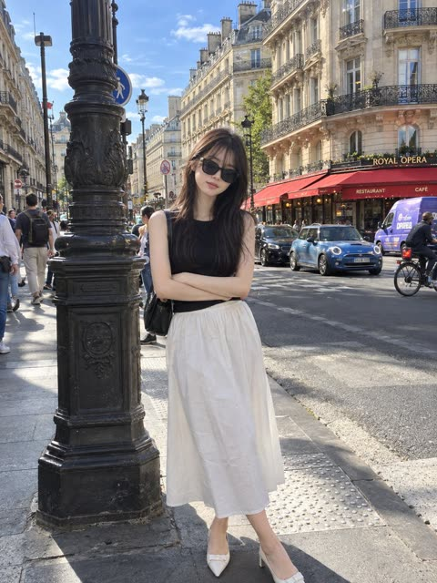</a>

画面严格分为上下两半，上半几乎原样保留上传照片，下半把场景重绘成暖白纸上的手绘墨线微缩小画。明确微缩画只占10%到20%、最多4种取自照片的颜色，并列出要避开的风格，从而守住留白的安静感。

GPT Image 2.5 · 上传图改图 · 出处: [@saniaspeaks_ on X](https://x.com/saniaspeaks_/status/2103453485496668450) · 147 赞，统计于 2026-10-29

[`art-book`](tags.md#tag-art-book) [`split-layout`](tags.md#tag-split-layout) [`handmade-paper`](tags.md#tag-handmade-paper) [`negative-space`](tags.md#tag-negative-space) [`photo-reference`](tags.md#tag-photo-reference)

<details><summary><b>提示词</b></summary>

```text
Create a sophisticated 3:4 vertical editorial art poster with GPT Image 2.5, using the uploaded photograph as the primary visual reference.

Divide the composition into two perfectly balanced horizontal halves.

Upper 50% — Original Photograph
Keep the uploaded image almost completely untouched. Preserve the exact identity, facial features, pose, styling, clothing, objects, composition, lighting, colors, proportions, and natural photographic texture. The image should still look like the original photograph, enhanced only with subtle high-end editorial color grading.

Lower 50% — Artistic Interpretation
Transform the key visual elements of the photograph into a tiny, centered handmade-paper artwork. Reduce the scene into a few recognizable shapes and imperfect hand-drawn lines, as if created for an independent contemporary art publication.

Use:

- warm off-white handmade paper
- delicate imperfect ink-like outlines
- simple flat acrylic-inspired shapes
- organic uneven edges
- subtle natural paper fibers and grain
- maximum 4 colors sampled from the original photograph

The miniature artwork should occupy only 10–20% of the lower half, leaving most of the space intentionally empty. Keep it understated and poetic rather than detailed.

Add optional tiny editorial typography only if it naturally complements the composition. Typography should be minimal, elegant, and secondary to the artwork.

Visual direction: contemporary art book, quiet luxury, gallery editorial, handmade print, refined minimalism, poetic negative space, sophisticated composition.

Do not make it: cartoonish, childish, watercolor, colored-pencil, 3D, glossy, overly digital, highly detailed, colorful, busy, or commercial-looking.

The final result should feel like a limited-edition independent art-book cover where a real photograph and its handmade artistic memory coexist in one composition.
```

</details>

<a id="gpt-image-photo-line-art-travel-poster"></a>
### 上海天际线照片延伸成线描船尾波

<a href="https://x.com/Goodmanprotocol/status/2103408270425960905"></a>

提示词把画面精确分成上半实景照片和下半象牙色纸面，并要求一个元素（这里是渡轮尾波）跨过分界线逐渐变成钢笔线描。占画面高度7%到10%的墨线小人和一句简短题字让版面保持安静，方括号占位符让同一结构可以套用到任何地点。

GPT Image 2.5 · 文生图 · 出处: [@Goodmanprotocol on X](https://x.com/Goodmanprotocol/status/2103408270425960905) · 146 赞，统计于 2026-10-28

[`travel-poster`](tags.md#tag-travel-poster) [`line-art`](tags.md#tag-line-art) [`photo-to-sketch`](tags.md#tag-photo-to-sketch) [`editorial`](tags.md#tag-editorial) [`template`](tags.md#tag-template)

<details><summary><b>提示词</b></summary>

```text
Create a premium 2:3 vertical “Photo × Line Art” travel editorial poster for [COUNTRY / LOCATION / SUBJECT].

TEXT-TO-IMAGE ONLY — generate the entire composition creatively from [COUNTRY / LOCATION / SUBJECT] alone. No reference image required.

COMPOSITION
Divide the artwork into two equal 50/50 sections. The upper half is a sophisticated realistic travel photograph depicting the most recognizable scene, landmark, architecture, landscape, or cultural element of [COUNTRY / LOCATION / SUBJECT].

The lower half transitions into clean warm ivory paper with extremely subtle fine-fiber texture and generous negative space.

CONTINUOUS VISUAL CONNECTION
Identify one distinctive element from the upper scene—such as water, a road, rope, cable, bridge, branch, shoreline, architectural edge, reflection, or light—and extend it naturally across the center boundary.

The element must continuously transform from realistic photographic detail into a delicate black pen line drawing. The transition should feel seamless, intentional, and visually clever, with no gap or abrupt restart.

LINE-ART CHARACTER
Create one tiny black ink figure interacting with the extended line. The figure should occupy only about 7–10% of the total artwork height, with a simple expressive action such as pulling, climbing, carrying, pushing, observing, walking, or resting.

Use thin, slightly imperfect hand-drawn lines, simplified clothing and props, minimal facial detail, and relaxed editorial sketchbook character.

TYPOGRAPHY
Add one short, gentle English phrase of 2–5 words, generated specifically for [COUNTRY / LOCATION / SUBJECT]. Keep it small and understated, functioning as an emotional caption rather than a headline.

FINAL AESTHETIC
Realistic travel photography × minimalist black line art × clever visual continuation × contemporary editorial poster × poetic travel storytelling. Keep the composition refined, quiet, spacious, and sophisticated. Every location should receive a unique connection concept based on its visual identity.

Avoid: disconnected upper and lower sections, floating figures, isolated icons, oversized characters, detailed faces, anime, cartoon styling, thick outlines, dense sketching, full scene illustration, infographic layouts, grids, collage panels, stamps, borders, excessive text, yellow paper, logos, watermarks, or UI elements.

FORMAT: 2:3 vertical, exact 50/50 composition, premium editorial travel-poster aesthetic.
```

</details>

<a id="gpt-image-face-locked-cafe-scrapbook-poster"></a>
### 巴黎咖啡馆女子的手账风编辑海报

<a href="https://x.com/KrishnaBio1/status/2102550122752311623">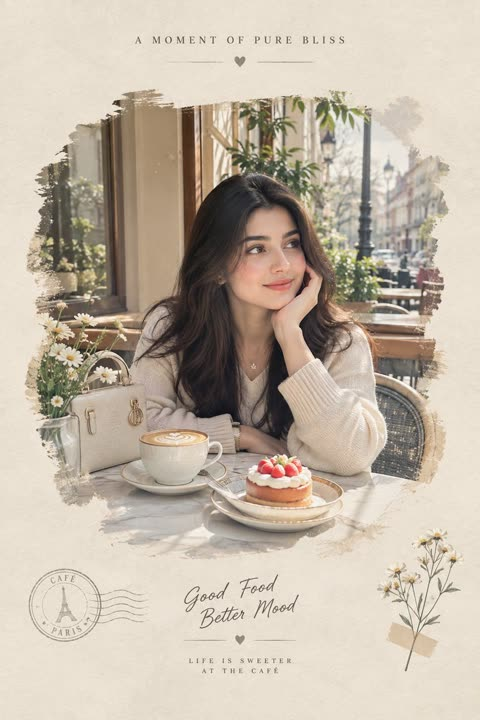</a>

用严格的身份锁定把人脸参考限定为只控制长相，并单独说明灵感图只控制构图与风格。主体、发型、服装、场景、手账版式和光线分段描述，再给出确切的海报文字和负面提示词，版面更干净。

GPT Image 2.5 · 上传图改图 · 出处: [@KrishnaBio1 on X](https://x.com/KrishnaBio1/status/2102550122752311623) · 143 赞，统计于 2026-10-28

[`face-reference`](tags.md#tag-face-reference) [`scrapbook`](tags.md#tag-scrapbook) [`cafe`](tags.md#tag-cafe) [`editorial`](tags.md#tag-editorial) [`identity-lock`](tags.md#tag-identity-lock)

<details><summary><b>提示词</b></summary>

```text
Use the uploaded face reference image ONLY as the identity reference for the woman.
STRICT FACE IDENTITY LOCK:
Preserve her recognizable facial identity exactly from the face reference. Keep the same facial structure, face shape, eyes, eyebrows, nose, lips, jawline, cheek structure, skin tone, and natural facial proportions. Do not beautify, redesign, age, de-age, or replace her face. Do not create a different person.
Use the provided images ONLY as visual inspiration for the overall composition, lifestyle concept, outfit styling, café atmosphere, photography angle, color palette, scrapbook layout, and editorial aesthetic. Do not copy another person's facial identity.
Create a premium ultra-photorealistic lifestyle editorial photograph of the woman enjoying an elegant café moment in a sophisticated outdoor European-style café.
Subject & Face:
The woman has the exact recognizable face from the reference image, with natural elegant makeup, realistic skin texture, expressive eyes, and a soft relaxed expression. Keep her identity completely consistent and authentic.
Hair:
Long, thick, naturally flowing dark hair with soft waves, realistic individual strands, subtle natural shine, and an effortless feminine appearance.
Outfit:
Elegant ivory/cream-white feminine outfit with delicate lace and embroidered details, sheer textured fabric, refined sleeves, and sophisticated styling. Add tasteful gold jewelry, an elegant watch, delicate rings, and cream pointed-toe heels. Include a refined luxury handbag placed naturally beside her.
Scene & Pose:
Create two complementary lifestyle moments within the same visual concept:
A beautiful overhead café photograph showing the woman seated at a marble café table, her elegant lace outfit visible, one hand naturally holding a ceramic coffee cup with beautiful heart-shaped latte art. A slice of berry cheesecake sits on a delicate white plate beside the coffee.
A softly framed portrait moment of the same woman sitting at the café, resting one hand gently against her cheek while looking naturally toward the side with a calm, subtle smile. Coffee, dessert, flowers, and her handbag remain naturally arranged on the table.
Environment:
A beautiful upscale outdoor European café with marble tables, elegant chairs, soft greenery, small white flowers, warm natural sunlight, and a softly blurred sophisticated street in the background. The environment should feel authentic, peaceful, luxurious, and naturally photographed.
Scrapbook Editorial Design:
Present the final composition as a refined vintage scrapbook-style editorial poster on warm ivory textured paper. Use softly painted/watercolor edges around the main photograph, an organic imperfect cutout effect, subtle paper grain, delicate botanical illustrations, tiny vintage postal elements, and elegant minimal decorative lines.
Add tasteful typography with a sophisticated editorial feel, such as:
“A MOMENT OF PURE BLISS”
and underneath:
“Good Coffee, Better Days”
with a small elegant heart or botanical ornament. Keep the typography minimal, refined, and beautifully integrated into the paper layout.
Color & Lighting:
Warm ivory, cream, beige, soft brown, muted green, and subtle golden tones. Natural afternoon sunlight, gentle highlights, realistic shadows, soft cinematic glow, subtle analog film grain, delicate depth of field, and premium editorial color grading.
Overall Style:
Ultra-photorealistic, high-end lifestyle photography, luxury café editorial, sophisticated feminine aesthetic, realistic skin and fabric texture, authentic hands and fingers, natural body proportions, realistic coffee and dessert details, cinematic photography, premium magazine quality, 8K detail, crisp but soft natural image quality, elegant nostalgic atmosphere, sophisticated Pinterest/editorial scrapbook aesthetic.
IMPORTANT:
The face reference controls ONLY the woman's identity. The uploaded inspiration images control the visual concept, composition, styling, café atmosphere, colors, and scrapbook presentation. Do not merge another person's face into the subject. Keep the woman's identity recognizable and consistent throughout the entire composition.
Negative Prompt:
different face, altered identity, face swap, beautified face, distorted facial features, extra fingers, malformed hands, unrealistic skin, plastic skin, cartoon, 3D render, CGI look, blurry face, low resolution, oversaturated colors, artificial lighting, duplicate objects, distorted coffee cup, malformed dessert, excessive text, watermark, logo, messy composition, unnatural pose, unrealistic body proportions.
```

</details>

<a id="nano-banana-floating-outfit-fashion-editorial"></a>
### 悬浮冬装搭配与面料标注图

<a href="https://x.com/Strength04_X/status/2034474068087566463"></a>

按自下而上的顺序列出单品并用方括号留出可替换位置，再逐种面料描述物理表现，让羊毛、丝绸和皮革各有质感。细引线标签、三重布光和衬线标题把画面做成时装大片。

Nano Banana 2 · 文生图 · 出处: [@Strength04_X on X](https://x.com/Strength04_X/status/2034474068087566463) · 140 赞，统计于 2026-10-29

[`fashion`](tags.md#tag-fashion) [`levitation`](tags.md#tag-levitation) [`outfit`](tags.md#tag-outfit) [`labels`](tags.md#tag-labels) [`editorial`](tags.md#tag-editorial)

<details><summary><b>提示词</b></summary>

```text
Complete [STYLE] outfit floating in its exact worn position around  an invisible body with every piece suspended mid-breath, mid-billow.  LOOK (bottom to top): [FOOTWEAR] → [BOTTOMS] → [TOP] → [LAYER] →  [ACCESSORIES] → [JEWELLERY] → [HEADWEAR]  FABRIC PHYSICS: each material true to its weight, wool hangs,  silk drapes, denim holds its crease, leather keeps its shape.  Every edge lifting slightly as if caught in one silent gust.  LABELS: hairline leader to floating label box. "[GARMENT]" uppercase / "[FABRIC]" italic / "[ONE DEFINING DETAIL]"  LIGHTING: soft directional from upper left + warm fill from below  catching linings and sole edges + cool rim outlining the silhouette. BACKGROUND: [COLOR] seamless, fashion-forward. TITLE: "[LOOK NAME]" elegant serif type, top right. SUBTITLE: "[MOOD / OCCASION]" italic.  Mood: high-concept levitation editorial, the outfit exists,  the person is imagination. 4K, extraordinary fabric fidelity, tack sharp.
```

</details>

<a id="nano-banana-graffiti-streetwear-portrait-poster"></a>
### 喷漆字体街头潮牌人像海报

<a href="https://x.com/SadiaMalik182/status/2068623080491012278"></a>

把涂鸦字体、滴漆、贴纸和泼溅等元素逐项列出，围绕一位摆拍的时尚模特。要求高级编辑感而非杂乱壁画，让繁复的背景保持克制，再用负面提示词压制瑕疵。

Nano Banana 2 · 文生图 · 出处: [@SadiaMalik182 on X](https://x.com/SadiaMalik182/status/2068623080491012278) · 138 赞，统计于 2026-10-28

[`graffiti`](tags.md#tag-graffiti) [`streetwear`](tags.md#tag-streetwear) [`fashion-poster`](tags.md#tag-fashion-poster) [`spray-paint`](tags.md#tag-spray-paint) [`editorial`](tags.md#tag-editorial)

<details><summary><b>提示词</b></summary>

```text
Create a high-detail portrait poster in a bold American graffiti-inspired art style, combining modern urban street aesthetics with expressive American visual culture. Feature dynamic graffiti typography, layered spray-paint textures, hand-drawn symbols, abstract paint splashes, neon brush strokes, urban sticker elements, American calligraphy accents, and decorative ornaments that reinforce a vibrant street-art atmosphere.

The subject should pose confidently in fashionable contemporary streetwear, wearing layered oversized urban fashion pieces, premium casual styling, cargo denim, statement sneakers, and expressive accessories. Use a charismatic fashion-model pose with natural attitude and cinematic presence.

Fill the background with colorful graffiti walls, spray textures, stickers, urban signage, painted symbols, paint drips, street culture graphics, and modern American-inspired visual motifs. Maintain a premium editorial campaign look rather than a messy street mural.

Cinematic lighting, realistic skin texture, strong contrast, ultra-sharp details, vibrant color harmony, luxury street-fashion campaign aesthetic, poster-ready composition, immersive storytelling, ultra-detailed textures, premium urban atmosphere, 8K ultra-high resolution.

Negative Prompt: blurry details, bad anatomy, extra fingers, distorted face, low quality, dull colors, messy composition, watermark, logo, text artifacts.
```

</details>

<a id="gpt-image-photo-to-manga-split-panel-poster"></a>
### 照片与日式漫画重绘对照海报，花瓣草地上的女孩

<a href="https://x.com/oggii_0/status/2114943832894972403"></a>

上下各占一半，上半保留原图不改动，下半按十六进制色值限定墨线、米色底和点缀色重绘成日式漫画。按人物、动物、物体、风景分别设定规则，并限制插画占比、自动生成手写短句，使重绘忠实又留白。

GPT Image 2.5 · 上传图改图 · 出处: [@oggii_0 on X](https://x.com/oggii_0/status/2114943832894972403) · 136 赞，统计于 2026-10-28

[`photo-to-manga`](tags.md#tag-photo-to-manga) [`split-panel`](tags.md#tag-split-panel) [`limited-palette`](tags.md#tag-limited-palette) [`handwritten-caption`](tags.md#tag-handwritten-caption) [`print-poster`](tags.md#tag-print-poster)

<details><summary><b>提示词</b></summary>

```text
Turn any photo into a minimalist Japanese manga print poster with GPT Image 2.5.

Prompt: Task: Create a 3:4 Split-Panel Photo-to-Japanese Illustration Poster

Transform the uploaded photograph into a vertically composed 3:4 comparison poster. The upper half displays the original photograph, while the lower half features a Japanese hand-drawn manga illustration with a limited-color print-poster aesthetic, faithfully redrawn from the same photograph.

Divide the canvas into two equal horizontal sections, each occupying exactly 50% of the total height. Both sections must have the same width. The horizontal division should connect seamlessly, with no gap, border, overlap, or decorative separator.

1. Upper Half — Original Photograph

- Preserve the original photograph exactly as it is.
- Do not redraw, recolor, retouch, or add any text to the photograph.
- Scale proportionally without stretching or distorting the image.
- If necessary, crop peripheral background areas first while preserving the main subject and important visual details.
- If the aspect ratio cannot be accommodated without compromising essential content, extend the edges with a light grayish-cream background. Never invent or reconstruct missing parts of the original photograph.

2. Lower Half — Japanese Hand-Drawn Illustration

Redraw the photograph as a Japanese-inspired hand-drawn manga illustration with a minimalist, limited-color screen-print poster aesthetic.

The original photograph is the exclusive source of the subject's identity, appearance, pose, structure, composition, layout, and relationships between objects.

For people:

- Preserve recognizable facial shape, hairstyle silhouette, expression, pose, gestures, and clothing category.
- Simplify the face into clean manga-style shapes.
- Render hair as grouped, flowing masses rather than individual strands.
- Express clothing through elegant, simplified fashion silhouettes.

For animals:

- Preserve the species, body proportions, distinctive coat-color patterns, and pose.
- Use simplified contours and flat color blocks to retain recognizability.

For objects:

- Preserve the original silhouette, essential structural details, and proportions.

For landscapes and scenery:

- Preserve the terrain, architecture, distribution of visible elements, and spatial depth.
- Redraw the main landscape as a cohesive illustration rather than reducing it to an isolated object.

Preserve all visible contact, overlap, and occlusion relationships. Depict only what is visible in the source photograph. Do not introduce new subjects, props, gestures, or structures outside the original image.

If an additional style reference is provided, use it only for drawing technique, color palette, and layout. Never copy its subjects or content.

3. Linework and Color Treatment

Use a consistent combination of delicate ink outlines, naturally simplified shapes, and limited-color flat fills.

- Ink outline: Near-black "#02030B", with varied pressure, subtle line-weight changes, occasional pauses, and slightly irregular hand-drawn edges.
- Keep internal lines minimal, retaining only the structural details necessary to define form.
- Use clean, continuous, opaque color blocks.
- Merge shadows into a small number of hard-edged color shapes.
- Avoid individual hair strands, dense hatching, photorealistic textures, and excessive decorative detail.
- Preserve the subject's essential natural colors and distinctive identifying color patterns.

Lower-panel background: Light grayish cream "#ECEDE5".

Primary accent: Warm red "#E9444B".

Secondary accent: Muted blue-gray "#5296BD".

Use red as the dominant accent and blue sparingly. Ensure that accent colors complement the subject without compromising its recognizability.

Simplify the background to the cream paper tone, retaining only the environmental details needed to communicate the setting, explain the action, and preserve spatial relationships. For landscape photographs, translate the principal scenery into the illustration rather than omitting it.

4. Lower Panel — Minimalist Poster Layout

Create a refined editorial composition with a small illustration surrounded by generous negative space.

- Treat the subject and essential environmental elements as one cohesive illustration.
- Scale the complete illustration proportionally and center it within the lower panel.
- Keep the entire illustration group within approximately 65–70% of the panel width and 60–65% of the panel height.
- Fit the illustration within these limits without stretching or distorting it.
- Maintain generous light grayish-cream margins on all sides.
- Do not let the illustration touch the edges or fill the entire panel.
- Do not use large background color blocks to fill the empty space.
- Do not add a border around the illustration.

The overall layout should resemble a thoughtfully designed Japanese art-print poster: restrained, balanced, airy, and visually sophisticated.

5. Handwritten Typography

Add two small handwritten text elements within the negative space of the lower panel.

Top area: Place a small, delicate, near-black handwritten phrase, such as:

“FROM LIFE TO LINES.”

Beside the illustration: Add an even smaller, casual handwritten phrase, such as:

“another way to see.”

Generate both phrases automatically based on the subject, setting, and emotional atmosphere of the original photograph. The wording should feel concise, natural, poetic, and contextually relevant.

The example phrases are references for tone and placement only. Do not use them automatically if a more fitting caption can be generated.

Typography must remain subtle and secondary to the illustration. Use a natural handwritten style with fine, slightly imperfect strokes. Ensure all generated text is spelled correctly and legible.

6. Final Output Requirements

- Aspect ratio: 3:4 portrait.
- Upper half: 50% of canvas height, displaying the untouched original photograph.
- Lower half: 50% of canvas height, displaying the Japanese-inspired hand-drawn illustration.
- Equal panel widths, seamless horizontal transition, no gap, no frame, and no overlap.
- Consistent minimalist Japanese manga linework and limited-color print-poster styling.
- Small, centered illustration with generous cream-colored negative space.
- Subtle, context-aware handwritten typography in the lower panel.

Core principle: The original photograph determines what is depicted. The illustration style determines how the lower half is redrawn. Preserve the source's identity and composition while transforming the lower panel into an elegant, minimalist Japanese illustration poster.
```

</details>

<a id="gpt-image-architectural-landmark-graphite-watercolor-poster"></a>
### 比萨斜塔铅笔线稿与水彩建筑海报

<a href="https://x.com/Naiknelofar788/status/2104418521233215906"></a>

把占位符换成任意地标和城市即可复用。用层次分明的细节、一条在手写坐标旁断开的铅笔线，以及与国家对应的单一点缀色，营造出深度和独特气质。

GPT Image 2.5 · 文生图 · 出处: [@Naiknelofar788 on X](https://x.com/Naiknelofar788/status/2104418521233215906) · 129 赞，统计于 2026-10-28

[`architecture`](tags.md#tag-architecture) [`landmark`](tags.md#tag-landmark) [`graphite`](tags.md#tag-graphite) [`watercolor`](tags.md#tag-watercolor) [`travel-poster`](tags.md#tag-travel-poster)

<details><summary><b>提示词</b></summary>

```text
Create an exceptionally original minimalist architectural art poster featuring [LANDMARK] in [CITY, COUNTRY].

Depict the landmark in its recognizable natural architectural appearance, with its authentic proportions, distinctive structure, materials, and characteristic details. Combine fine graphite architectural drawing with subtle vintage watercolor washes, creating the feeling of a sophisticated illustrated travel archive.

The landmark should be the central visual focus, surrounded by an intricate but restrained world of extremely delicate architectural linework: construction measurements, perspective guides, tiny streets, rooftops, surrounding buildings, local landscape, clouds, birds, shadows, fragments of maps, compass marks, elevation studies, structural details, and subtle environmental contours.

Use a layered visual language where some elements are highly detailed while others fade into the paper, creating depth without making the composition feel crowded.

Add one unexpected artistic detail: a single continuous pencil line travels around the landmark without directly tracing its outline. Allow it to occasionally intersect with construction lines, then break at one point beside a tiny handwritten coordinate, date, measurement, or architectural note.

Use warm ivory handmade paper, graphite pencil, extremely fine ink lines, delicate watercolor washes, subtle eraser dust, visible paper fibers, faint halftone imperfections, soft natural shadows, and lightly weathered archival texture.

Color palette

Keep the overall artwork muted, sophisticated, and vintage. Use warm ivory and graphite as the foundation, with the landmark shown in its authentic recognizable colors through restrained watercolor washes.

Add one subtle accent color inspired by [CITY/COUNTRY] — for example:

- Italy → muted terracotta
- Japan → restrained vermilion
- France → faded blue
- UK → muted navy or burgundy
- India → subtle saffron
- USA → muted teal or dusty red

Avoid bright digital colors.

Surrounding details

Include carefully chosen elements associated with [CITY/COUNTRY], such as:

- local architecture
- landscape or geography
- streets and rooftops
- transportation
- vegetation
- small cultural details
- map fragments
- architectural ornaments
- elevation or measurement diagrams
- compass rose
- coordinates
- faint historical annotations

These details should frame and contextualize the landmark rather than compete with it.

Typography

Place small, refined typography in generous negative space:

[LANDMARK NAME]
[CITY, COUNTRY]

“drawn by everything around it.”

Use elegant editorial serif typography with generous spacing. Add only a few tiny handwritten architectural annotations or coordinates.

Artistic direction

The final composition should feel mysterious, intelligent, timeless, and unexpectedly beautiful — somewhere between a vintage European travel poster, an architect's working sketch, a museum exhibition print, and a collector's archival illustration.

No people.
No photorealistic background.
No excessive typography.
No decorative clutter.
No neon colors.
No glossy digital rendering.
No cartoon aesthetic.
No generic stock-travel-poster appearance.

4:5 vertical composition, premium editorial design, tactile handmade paper, sophisticated architectural illustration, precise fine-line details, subtle watercolor, elegant negative space, balanced visual hierarchy, museum-quality contemporary art poster.
```

</details>

<a id="gpt-image-city-screenprint-travel-poster-paris"></a>
### 巴黎地标丝网印刷风旅行海报配绿色老爷车

<a href="https://x.com/Maercihh/status/2099757585264251102"></a>

这是只替换城市名的JSON模板，由模型自选4到7个地标做成粗黑剪影，底部放一辆本地交通工具，并配2到4色的克制配色。其中的禁止照搬清单、禁止多余文字，以及奶油纸与油墨颗粒的设定，让结果像手工印刷而不是干净的矢量图。

GPT Image 2.5 · 文生图 · 出处: [@Maercihh on X](https://x.com/Maercihh/status/2099757585264251102) · 129 赞，统计于 2026-10-28

[`travel-poster`](tags.md#tag-travel-poster) [`screenprint`](tags.md#tag-screenprint) [`city-template`](tags.md#tag-city-template) [`landmarks`](tags.md#tag-landmarks) [`json-prompt`](tags.md#tag-json-prompt)

<details><summary><b>提示词</b></summary>

```text
{
  "input": {
    "city_name": "{{USER_INPUT_CITY}}"
  },

  "reference_style": {
    "use_uploaded_reference_images": true,
    "reference_images_define": [
      "overall composition",
      "hand-cut screenprint aesthetic",
      "bold black graphic silhouettes",
      "limited color palette",
      "vintage travel poster character",
      "rough ink texture",
      "slightly imperfect handmade edges",
      "large oversized city typography",
      "layered landmark arrangement",
      "bottom transportation element",
      "cream/off-white paper background",
      "minimal editorial composition"
    ],
    "do_not_copy": [
      "specific landmarks",
      "specific city name",
      "specific vehicle",
      "specific color combinations",
      "exact typography arrangement",
      "exact landmark placement"
    ]
  },

  "generation": {
    "type": "vintage_city_travel_poster",
    "aspect_ratio": "3:4",
    "resolution": "high",
    "orientation": "portrait",

    "city_adaptation": {
      "primary_rule": "Everything must be redesigned around the user's city_name.",
      "identify_city": true,
      "research_visual_identity": true,

      "landmarks": {
        "count": "4-7",
        "selection": "Automatically select the most recognizable and visually distinctive landmarks of the specified city.",
        "prioritize": [
          "major landmark",
          "historic architecture",
          "modern architectural icon",
          "religious or cultural landmark",
          "bridge or monument",
          "recognizable skyline element"
        ],
        "rendering": "Convert each landmark into simplified bold black screenprint silhouettes while preserving its recognizable architectural identity."
      },

      "transportation": {
        "automatically_select": true,
        "instruction": "Choose a transportation vehicle strongly associated with the specified city, such as a taxi, tram, bus, metro train, tuk-tuk, cable car, rickshaw, classic car, ferry, or other iconic local transport.",
        "placement": "large foreground element along the bottom edge",
        "style": "simplified vintage screenprint illustration"
      },

      "colors": {
        "automatically_adapt": true,
        "instruction": "Select a restrained 2-4 color palette inspired by the city's visual identity, local transportation, flag, architecture, or cultural colors.",
        "black": "dominant graphic ink color",
        "background": "warm aged cream paper",
        "accent_colors": "city-specific and muted, never overly saturated"
      },

      "typography": {
        "text": "{{USER_INPUT_CITY}}",
        "case": "uppercase",
        "style": "large bold irregular condensed display lettering",
        "placement": "integrated prominently between or behind the landmarks",
        "texture": "rough printed ink",
        "alignment": "slightly imperfect and organic",
        "rule": "The city name must be perfectly spelled and clearly readable."
      },

      "secondary_text": {
        "enabled": false,
        "instruction": "Do not add arbitrary slogans, dates, tourist phrases, descriptions, or extra readable text."
      },

      "local_details": {
        "automatically_adapt": true,
        "instruction": "Add subtle visual details that immediately reinforce the identity of the specified city without overcrowding the composition."
      }
    },

    "composition": {
      "layout": "editorial vintage travel poster",
      "landmarks": "arranged dynamically around the typography",
      "typography": "large central visual anchor",
      "foreground": "one iconic city transportation element",
      "depth": "flat graphic layering with minimal overlap",
      "negative_space": "generous cream-colored negative space",
      "balance": "asymmetrical but visually balanced",
      "cropping": "allow selected landmarks or transportation to naturally extend toward the edges"
    },

    "art_direction": {
      "medium": "hand-pulled screenprint / linocut-inspired travel poster",
      "visual_language": [
        "bold silhouettes",
        "flat shapes",
        "rough ink edges",
        "visible print grain",
        "subtle ink distress",
        "slight registration imperfections",
        "handmade imperfections",
        "graphic editorial design",
        "mid-century travel poster influence"
      ],
      "linework": "strong, chunky and simplified",
      "texture": "authentic paper grain and uneven ink coverage",
      "finish": "physical printed artwork rather than digitally perfect vector art"
    },

    "background": {
      "color": "warm ivory / aged cream",
      "texture": "subtle natural paper fibers",
      "pattern": "none",
      "gradient": false
    },

    "quality": {
      "photorealism": false,
      "vector_perfection": false,
      "digital_gloss": false,
      "clean_modern_ui": false,
      "high_detail": true,
      "print_ready_appearance": true
    }
  },

  "constraints": {
    "user_controls_only": [
      "city_name"
    ],
    "model_controls": [
      "landmark selection",
      "landmark arrangement",
      "transportation",
      "color palette",
      "local visual details",
      "typographic composition",
      "graphic hierarchy"
    ],
    "must_have": [
      "correct city name",
      "recognizable landmarks from that city",
      "city-specific transportation or mobility element",
      "warm cream paper background",
      "bold black screenprint forms",
      "large city typography",
      "vintage handmade print texture",
      "cohesive travel-poster composition"
    ],
    "avoid": [
      "landmarks from other cities",
      "generic buildings",
      "generic tourist imagery",
      "photorealistic rendering",
      "3D rendering",
      "glossy gradients",
      "neon colors",
      "modern corporate poster design",
      "random text",
      "misspelled city name",
      "extra slogans",
      "watermarks",
      "logos",
      "AI artifacts",
      "overly clean vector edges"
    ]
  },

  "output_instruction": "Create a single finished vintage screenprint travel poster representing {{USER_INPUT_CITY}}. Preserve the artistic language and visual restraint of the supplied references, but completely redesign the landmarks, transportation, color accents and local details so they authentically belong to the specified city."
}
```

</details>

<a id="nano-banana-papercraft-globe-country-travel-poster"></a>
### 巴西纸艺地球旅行海报

<a href="https://x.com/SimplyAnnisa/status/2070347440423576022"></a>

模板只替换国家名，版式固定：衬线标题、角落引语与徽章、五项清单，以及坐在纸艺地球上的旅行者。逐一写明文字位置和地球底部的微缩道具，让不同国家的海报构图保持稳定。

Nano Banana 2 · 文生图 · 出处: [@SimplyAnnisa on X](https://x.com/SimplyAnnisa/status/2070347440423576022) · 125 赞，统计于 2026-10-28

[`travel-poster`](tags.md#tag-travel-poster) [`papercraft`](tags.md#tag-papercraft) [`globe`](tags.md#tag-globe) [`template`](tags.md#tag-template) [`diorama`](tags.md#tag-diorama)

<details><summary><b>提示词</b></summary>

```text
Design a premium vintage-inspired travel poster on a clean cream background featuring a highly detailed 3D papercraft globe of {COUNTRY} filled with its iconic landmarks, landscapes, wildlife, cultural symbols, regional labels, transportation, food, and famous attractioAt the top place the bold serif title "{COUNTRY}", with "{TOP LEFT QUOTE}" on the upper left, a circular badge reading "{COUNTRY} {BADGE TEXT}" on the upper right, and the subtitle "{COUNTRY SUBTITLE}" below the title. Position a famous {COUNTRY} celebrity/traveler sitting on top of the globe wearing stylish travel clothing and holding a {TRAVEL ACCESSORY}. Add a left vertical checklist with five themed experiences and minimalist icons.Arrange miniature vehicles, traditional foods, wildlife, souvenirs, and famous monuments neatly around the base of the globe. Finish with the bottom slogan "{BOTTOM TAGLINE}". Hyper-realistic, intricate papercraft diorama, editorial travel poster, premium print design, vibrant colors, soft shadows, centered composition, ultra-detailed, 8K.
```

</details>

<a id="gpt-image-hiker-leaf-disintegration-motivational-poster"></a>
### 徒步女孩化作秋叶的励志海报

<a href="https://x.com/mehwishkiran07/status/2100787007811362831"></a>

指定人物一侧化作落叶、尘埃和飞鸟，让海报有唯一的视觉焦点。每处文字都给出确切内容，再要求带撕纸边框的第二版，形成上下两幅的版式。

GPT Image 2.5 · 上传图改图 · 出处: [@mehwishkiran07 on X](https://x.com/mehwishkiran07/status/2100787007811362831) · 121 赞，统计于 2026-10-28

[`motivational-poster`](tags.md#tag-motivational-poster) [`disintegration`](tags.md#tag-disintegration) [`autumn`](tags.md#tag-autumn) [`typography`](tags.md#tag-typography) [`golden-hour`](tags.md#tag-golden-hour)

<details><summary><b>提示词</b></summary>

```text
Create a cinematic, ultra-realistic motivational poster of a young woman hiking on a rocky mountain trail at golden hour, with a breathtaking lake, mountains, and warm sunset in the background. She wears a cozy beige fleece jacket over a black top, olive cargo pants, hiking boots, and a backpack. Her hair is tied in a messy bun, with a natural, confident expression.
Create a dramatic disintegration effect on the right side of her body, where her figure transforms into flying autumn leaves, dust particles, and small fragments carried into the sky. Add several black birds flying among the leaves. Include ancient stone ruins on the right side and a large rock with the text “SAME HUSTLE BIGGER TOMORROW.”
On the left side, add elegant typography: “Progress” in stylish handwritten script, followed by “LOOKS GOOD ON YOU” in clean uppercase serif lettering. Use warm orange, brown, and golden tones, cinematic lighting, shallow depth of field, realistic textures, atmospheric perspective, high detail, professional advertising photography, 8K quality.
Create a second framed version below with a white artistic torn-paper/paint-splatter border and autumn leaves around the edges. At the bottom add the handwritten text “Same Girl… Bigger Dreams ♡” and below it: “REAL MOMENTS • BRIGHTER DAYS • A KINDER ME.”
```

</details>

<a id="nano-banana-three-panel-streetwear-editorial-poster"></a>
### 棕色调街头风三格编辑海报

<a href="https://x.com/saniaspeaks_/status/2040591799757230151"></a>

用 JSON 结构锁定参考图人物身份，并为三个画格分别指定景别、光线和情绪。统一的棕色调胶片颗粒调色加上负面约束清单，让拼贴保持一致。

Nano Banana 2 · 上传图改图 · 出处: [@saniaspeaks_ on X](https://x.com/saniaspeaks_/status/2040591799757230151) · 119 赞，统计于 2026-10-28

[`json-prompt`](tags.md#tag-json-prompt) [`multi-panel`](tags.md#tag-multi-panel) [`streetwear`](tags.md#tag-streetwear) [`identity-lock`](tags.md#tag-identity-lock) [`film-grain`](tags.md#tag-film-grain)

<details><summary><b>提示词</b></summary>

```text
"style": "editorial poster, retro analog-digital fusion, urban streetwear aesthetic",
  "aspect_ratio": "4:5",
  "resolution": "high resolution",
  "identity_preservation": {
    "use_reference_image": true,
    "strict_identity_lock": true,
    "notes": "Maintain the exact facial features, proportions, skin texture, and identity from the uploaded reference photo."
  },
  "composition": {
    "layout": "multi-panel collage",
    "frames": 3,
    "structure": "asymmetric arrangement",
    "design": "editorial poster style with layered visual storytelling"
  },
  "subject": {
    "gender": "female",
    "appearance": {
      "hair": "softly tousled mid-length hair with natural volume",
      "features": "delicate facial features",
      "expression": "subtle, confident, calm"
    },
    "styling": {
      "fashion": "urban streetwear",
      "palette": "muted brown tones, earthy neutrals",
      "aesthetic": "modern with retro influence"
    }
  },
  "frames_details": [
    {
      "frame": 1,
      "type": "close-up portrait",
      "focus": "face and expression",
      "lighting": "soft cinematic lighting",
      "mood": "intimate and editorial"
    },
    {
      "frame": 2,
      "type": "mid-shot",
      "focus": "outfit and posture",
      "lighting": "natural street-style lighting",
      "mood": "confident and modern"
    },
    {
      "frame": 3,
      "type": "creative angle",
      "focus": "artistic composition",
      "lighting": "mixed analog-style light with subtle grain",
      "mood": "retro-digital fusion aesthetic"
    }
  ],
  "environment": {
    "setting": "urban street background",
    "details": [
      "textured walls",
      "subtle city elements",
      "minimal distractions"
    ],
    "atmosphere": "calm, stylish, editorial"
  },
  "color_grading": {
    "tones": "muted brown, warm neutrals",
    "style": "film-inspired with slight grain",
    "contrast": "balanced cinematic contrast"
  },
  "camera": {
    "style": "editorial photography",
    "depth_of_field": "shallow",
    "focus": "sharp on subject, soft background"
  },
  "quality": {
    "realism": "photorealistic",
    "detail": "high detail skin and fabric textures",
    "finish": "magazine-quality"
  },
  "constraints": [
    "no face alteration",
    "no cartoon or illustration",
    "no distortion",
    "no watermark",
    "no text unless part of design"
  ],
  "output_goal": "Create a high-end editorial poster-style multi-panel collage of the same woman in three asymmetric frames with a cohesive muted-brown urban streetwear and retro analog-digital aesthetic."
}
```

</details>

<a id="gpt-image-architectural-travel-postcard-seoul"></a>
### 首尔光化门建筑旅行明信片

<a href="https://x.com/AiwithLariab/status/2105494196195049873"></a>

用方括号槽位填入目的地和国家，让模型选一个地标作为绝对主体。细墨线加两到四种低饱和色，淡化的街区地图层和明确的视觉层级让版面有编辑感。

GPT Image 2.5 · 文生图 · 出处: [@AiwithLariab on X](https://x.com/AiwithLariab/status/2105494196195049873) · 118 赞，统计于 2026-10-28

[`travel-poster`](tags.md#tag-travel-poster) [`architecture`](tags.md#tag-architecture) [`pen-and-ink`](tags.md#tag-pen-and-ink) [`template`](tags.md#tag-template) [`seoul`](tags.md#tag-seoul)

<details><summary><b>提示词</b></summary>

```text
DESTINATION: [CITY / DESTINATION]
COUNTRY: [COUNTRY]

Create a sophisticated vertical 2:3 premium architectural travel postcard for [DESTINATION], [COUNTRY].

CORE STYLE

Use the visual language of a high-end contemporary architectural travel poster combined with refined vintage editorial illustration.

The design should feel:
- elegant
- cultured
- timeless
- architectural
- collectible
- premium
- museum-shop quality

Combine extremely detailed architectural pen-and-ink illustration, delicate graphite linework, restrained watercolor-style flat color, archival cartographic graphics, elegant editorial typography, and generous white space.

Do NOT make it look like a generic tourist poster.

MAIN ARCHITECTURAL HERO

Select ONE iconic and instantly recognizable architectural landmark strongly associated with [DESTINATION].

Examples can include:
- historic monument
- palace
- cathedral
- mosque
- temple
- tower
- bridge
- government building
- famous street façade
- traditional architectural landmark
- modern architectural icon

The selected landmark must be the dominant visual subject.

Show it from a believable three-quarter or slightly dramatic architectural perspective.

Maintain accurate architectural proportions and recognizable structural details.

Do not combine multiple major landmarks into one main illustration.

ILLUSTRATION STYLE

Render the main landmark using exceptionally fine black or dark graphite ink lines.

Include:
- detailed architectural hatching
- precise windows
- doors
- columns
- roofs
- arches
- ornaments
- façade details
- realistic structural geometry
- subtle hand-drawn imperfections

Keep the architecture primarily as detailed line art with selective flat color.

Use refined illustrative detailing rather than photorealistic rendering.

COLOR PALETTE

Use mostly white space with only 2–4 sophisticated destination-specific colors.

Choose colors naturally associated with [DESTINATION] or the landmark.

Examples:
- muted architectural stone tones
- traditional local colors
- restrained blue
- muted green
- terracotta
- burgundy
- soft red
- architectural gold
- subtle natural tones

Colors should be elegant and slightly muted.

Avoid:
- neon colors
- excessive saturation
- gradients
- glossy effects
- muddy sepia
- excessive beige
- photorealistic color grading

BACKGROUND

Use a clean pure white background.

Behind the architecture, add extremely subtle archival graphic elements such as:

- faint city map
- street plan
- river outline
- coordinates
- contour lines
- architectural diagram
- compass
- grid lines
- local-language annotations
- minimal geographical markings

These elements must remain secondary and lightly faded.

Do not allow the background map to overpower the main architecture.

COMPOSITION

Use a vertical 2:3 editorial composition.

The main landmark should occupy approximately 60–75% of the artwork.

Create generous negative space around the typography and architectural subject.

Use an asymmetric premium editorial layout.

The composition should feel carefully designed rather than centered like a basic tourist souvenir.

Tasteful cropping is allowed when it creates a stronger architectural composition.

TYPOGRAPHY

At the top or upper-left area, display:

[DESTINATION]

Use large elegant high-contrast editorial serif typography inspired by premium architecture magazines and museum catalogues.

Below it, optionally include:

[LOCAL NAME]

using the authentic local writing system of the destination.

For example:
Seoul
서울

London
London

Tokyo
東京

Paris
Paris

Use restrained typography with generous letter spacing.

Do not use giant decorative typography that overwhelms the architecture.

SECONDARY INFORMATION

Include a small elegant information block containing destination-specific details such as:

[SHORT DESTINATION DESCRIPTION]

[COORDINATES]

[LOCAL NAME]

[COUNTRY]

Use tiny refined typography with generous spacing.

Optional subtle elements:

- compass
- small architectural sketch
- miniature landmark drawing
- local-language stamp-like mark
- faint map label

Keep all secondary elements minimal.

ARCHIVAL MAP ELEMENT

Include a very subtle map or street-plan layer related specifically to [DESTINATION].

If the destination has a recognizable river, coastline, mountain, historic district, or urban grid, integrate it naturally into the background.

Add a small understated geographical label where appropriate.

Do not create a cluttered map.

CONTEXTUAL DETAILS

Add only a few tiny environmental elements when they naturally belong to the location:

- pedestrians
- bicycles
- trees
- street lamps
- local vehicles
- benches
- small street details
- birds

These elements should primarily establish scale and atmosphere.

Do not turn the image into a busy city scene.

DESTINATION AUTHENTICITY

Make the architecture, typography, environmental details, colors, map elements, and small contextual objects culturally and geographically appropriate to [DESTINATION], [COUNTRY].

Avoid generic architecture that could belong to another city.

The landmark must immediately communicate the destination.

VISUAL HIERARCHY

Priority order:

1. Main architectural landmark
2. Destination name
3. Supporting map / archival graphics
4. Local-language name
5. Small contextual details
6. Coordinates and information strip

Everything should support the main landmark.

BOTTOM INFORMATION STRIP

At the bottom, add a refined museum-catalogue-style information strip:

[DESTINATION]  |  [COUNTRY]  |  [ARCHITECTURAL STYLE]  |  EST. [YEAR]

Keep it small, elegant, evenly spaced, and understated.

If the landmark's construction date is uncertain, use an appropriate historical date or omit the year rather than inventing information.

MOOD

Quiet urban sophistication.

Cultural authenticity.

Architectural heritage.

Modern editorial design.

Historical character combined with contemporary graphic design.

The final artwork should feel like a premium collectible architectural print purchased from a museum design shop.

AVOID

No landmark collage.

No fake architecture.

No random buildings.

No generic tourist-poster aesthetic.

No cartoon style.

No 3D rendering.

No glossy photorealism.

No excessive vintage filters.

No heavy sepia.

No fake passport stamps.

No excessive decorative elements.

No clutter.

No giant unnecessary text.

No random flags.

No inaccurate cultural symbols.

No distorted architecture.

No unrealistic perspective.

No excessive gradients.

No excessive beige.

FINAL GOAL

Create a highly detailed, sophisticated, timeless architectural travel postcard that could work consistently for ANY city or country while maintaining the same premium visual identity.

Only change the destination-specific elements such as:

[DESTINATION]
[COUNTRY]
[ICONIC LANDMARK]
[LOCAL NAME]
[ARCHITECTURAL STYLE]
[COORDINATES]
[ESTABLISHED / CONSTRUCTION YEAR]
[DESTINATION-SPECIFIC COLORS]
[MAP / GEOGRAPHICAL ELEMENTS]

Everything else should maintain the same refined editorial postcard design language.
```

</details>

<a id="nano-banana-underwater-sinking-man-triptych-poster"></a>
### 男子下沉水中的三格电影海报

<a href="https://x.com/NikhilRajX/status/2029451287914528979"></a>

提示词把海报分成上中下三格，分别指定特写、中景和远景，从面部一路拉到深海，形成尺度感。体积光束、气泡和青蓝调色统一三格画面，最后用一行简短片名确定海报字体。

Nano Banana 2 · 文生图 · 出处: [@NikhilRajX on X](https://x.com/NikhilRajX/status/2029451287914528979) · 118 赞，统计于 2026-10-28

[`movie-poster`](tags.md#tag-movie-poster) [`underwater`](tags.md#tag-underwater) [`triptych`](tags.md#tag-triptych) [`cinematic`](tags.md#tag-cinematic) [`volumetric-light`](tags.md#tag-volumetric-light)

<details><summary><b>提示词</b></summary>

```text
Gemini Nano Banana 2 on Yapper.

Prompt: A cinematic underwater movie poster showing a young man slowly sinking in deep ocean water. The composition is split into three horizontal cinematic frames. In the top frame, a close-up of the man’s face underwater with small air bubbles escaping from his mouth, soft sunlight rays penetrating from the surface above, illuminating floating particles in the water. In the middle frame, a medium shot of the man floating weightlessly underwater, wearing a loose white shirt and dark pants, his hair and clothes drifting naturally with the water currents, dramatic volumetric light beams from above. In the bottom frame, a wide shot showing the man alone in the vast deep blue ocean abyss, surrounded by darkness and fading light rays, creating a sense of scale and isolation.
Atmosphere is emotional, mysterious, and cinematic. Deep teal and blue color grading, soft foggy underwater diffusion, ultra-realistic water physics, bubbles and particles, dramatic lighting, shallow depth of field, high contrast, IMAX movie poster style, 8k, hyper-realistic photography.
Minimal movie title text at the bottom: “BEYOND THE DEPTHS”, elegant cinematic typography.
```

</details>

<a id="gpt-image-sahara-double-exposure-travel-poster"></a>
### 撒哈拉双重曝光旅行海报与行走的女子

<a href="https://x.com/AiwithLariab/status/2106607115733553225"></a>

提示词先指定双重曝光剪影风格，再逐项列出沙丘、绿洲、石塔和驼队，让风景融进人物侧脸轮廓。同时锁定服装、4:5 比例、象牙色纸张留白和无文字。

GPT Image 2.5 · 文生图 · 出处: [@AiwithLariab on X](https://x.com/AiwithLariab/status/2106607115733553225) · 116 赞，统计于 2026-10-28

[`travel-poster`](tags.md#tag-travel-poster) [`double-exposure`](tags.md#tag-double-exposure) [`desert`](tags.md#tag-desert) [`silhouette`](tags.md#tag-silhouette) [`golden-hour`](tags.md#tag-golden-hour)

<details><summary><b>提示词</b></summary>

```text
Create a premium cinematic travel poster in a sophisticated double-exposure / silhouette collage style. A stylish young adult woman walking toward the right side of the frame, wearing a beige wide-brimmed safari hat, dark sunglasses, elegant white oversized button-up shirt with rolled sleeves, high-waisted cream trousers, white sneakers, and a small brown leather crossbody bag. Preserve realistic human proportions and natural walking posture.
Behind and partially merged into the woman’s silhouette is a breathtaking golden Sahara desert landscape at sunset: vast rolling sand dunes, dramatic layered mountains, warm orange sunlight, a glowing sun near the horizon, palm trees surrounding a small desert oasis, traditional desert village architecture, ancient stone towers, tents, and a small camel caravan crossing the dunes.
The desert landscape forms an artistic human-profile silhouette on the left side, seamlessly blending into the woman's walking composition on the right. Elegant paint-splash and ink-brush edges around the landscape, subtle dust particles, soft atmospheric haze, warm golden-hour lighting, luxury travel editorial aesthetic, sophisticated minimal composition.
Background: clean warm ivory/cream paper texture with large negative space on the right and lower area. High-end tourism campaign poster, artistic commercial photography, photorealistic desert details, realistic fabric texture, cinematic depth, refined composition, premium magazine advertising style.
Composition: vertical 4:5, full-body woman on the right, desert silhouette dominating the left, balanced negative space, clean edges, no text, no logo, no watermark, ultra-detailed, high resolution.
```

</details>

<a id="gpt-image-architectural-passport-travel-poster"></a>
### 东京雷门彩铅建筑护照旅行海报

<a href="https://x.com/Naiknelofar788/status/2105486629586796891"></a>

靠对比起效：地标满色且细节密集，城市地图、尺寸标注和立面草图则淡如幽灵地留在象牙色纸面上。简短的配色清单、城市与地标的方括号占位符，以及污迹和擦除construction线等瑕疵清单，共同保住手绘质感。

GPT Image 2.5 · 文生图 · 出处: [@Naiknelofar788 on X](https://x.com/Naiknelofar788/status/2105486629586796891) · 113 赞，统计于 2026-10-28

[`travel-poster`](tags.md#tag-travel-poster) [`colored-pencil`](tags.md#tag-colored-pencil) [`architecture`](tags.md#tag-architecture) [`sketchbook`](tags.md#tag-sketchbook) [`template`](tags.md#tag-template)

<details><summary><b>提示词</b></summary>

```text
Create a highly detailed “Architectural Passport” travel poster for [CITY / LANDMARK], designed to look like a premium collectible art print that blends colored-pencil illustration, fine ink drawing, vintage architectural documentation, and subtle watercolor texture.

Place the landmark as the dramatic hero, drawn with intricate hand-rendered details, realistic perspective, delicate pencil hatching, visible paper grain, and carefully controlled pops of natural color. Surround it with a faint city map, street names, architectural measurements, tiny elevation sketches, construction lines, botanical details, directional arrows, and miniature diagrammatic studies.

Use an elegant warm ivory paper background with mostly muted graphite, charcoal, terracotta, olive green, dusty blue, and warm beige tones. Keep the background extremely clean and editorial, allowing the landmark to visually emerge from the page.

Add sophisticated typography:
[CITY]
[LANDMARK NAME]
small coordinates, founding/construction date, architectural style, neighborhood name, and tiny archival annotations.

Include one or two miniature architectural detail drawings beside the main structure, as if taken from an architect’s sketchbook. Add subtle imperfections: pencil smudges, uneven ink pressure, erased construction marks, paper fibers, faint halftone texture, and hand-drawn annotation marks.

The composition should feel like a cross between a vintage travel poster, an architectural magazine cover, a museum exhibition print, and a designer’s sketchbook.

Visual hook: make the landmark extremely detailed and colorful while the surrounding city information remains almost ghost-like, creating a striking contrast between “the place” and “the blueprint of the place.”

Vertical 4:5 composition, premium editorial design, sophisticated negative space, ultra-detailed hand illustration, realistic architectural perspective, tactile paper texture, collectible poster aesthetic, visually striking at thumbnail size, no photorealistic rendering, no 3D CGI look.
```

</details>

<a id="gpt-image-golden-thread-travel-poster-template"></a>
### 写实城市天际线经金线化为象牙纸水墨小景

<a href="https://x.com/Goodmanprotocol/status/2105230944617775113"></a>

一根金线把上半部电影感实景与下方象牙纸上的小幅水墨插画连成一体，避免画面割裂。方括号占位符让同一模板适用于任何目的地，并用避免清单排除拼贴感与杂乱。

GPT Image 2.5 · 文生图 · 出处: [@Goodmanprotocol on X](https://x.com/Goodmanprotocol/status/2105230944617775113) · 113 赞，统计于 2026-10-28

[`travel-poster`](tags.md#tag-travel-poster) [`golden-thread`](tags.md#tag-golden-thread) [`ink-illustration`](tags.md#tag-ink-illustration) [`template`](tags.md#tag-template) [`cinematic`](tags.md#tag-cinematic)

<details><summary><b>提示词</b></summary>

```text
Create a premium 4:5 vertical conceptual travel-art poster for [COUNTRY / CITY / LOCATION / SUBJECT].

TEXT-TO-IMAGE ONLY — generate the entire artwork from [COUNTRY / CITY / LOCATION / SUBJECT] alone.

CORE CONCEPT
Create a poetic travel memory in which a cinematic realistic destination scene gradually transforms into a delicate hand-drawn illustration through one continuous golden thread.

UPPER SCENE
Create a breathtaking, highly realistic cinematic view of the most iconic location associated with [COUNTRY / CITY / LOCATION / SUBJECT]. Automatically choose the most atmospheric lighting—sunrise, sunset, golden hour, or blue hour.

Show authentic architecture, landscape, proportions, recognizable local details, realistic materials, atmospheric depth, natural light, subtle film grain, and sophisticated editorial travel-photography composition.

GOLDEN THREAD
Choose one meaningful visual element from the scene—such as the sun, tower, dome, window, streetlight, mountain peak, river, bridge, cable, or architectural detail—and transform it into one thin golden thread that naturally extends downward from the scene.

The thread should remain continuous, delicate, slightly imperfect, and elegant as it travels into the open space below.

LOWER STORY
On warm ivory textured paper, let the golden thread evolve into a tiny minimalist ink illustration inspired by [COUNTRY / CITY / LOCATION / SUBJECT].

Automatically choose one meaningful local symbol, traveler, traditional object, miniature landmark, street scene, boat, train, flower, map element, or cultural detail. Draw it with fine black ink lines, subtle hatching, tiny golden accents, and very little detail.

Keep the illustration small and surrounded by generous negative space. It should feel like a quiet continuation of the upper scene rather than a separate picture.

TYPOGRAPHY
Add minimal refined editorial typography based on [COUNTRY / CITY / LOCATION / SUBJECT]. Use a small destination name, landmark name, or short poetic phrase. Keep the typography subtle and secondary.

FINAL AESTHETIC
Cinematic travel photography × delicate ink illustration × continuous golden thread × warm ivory paper × poetic visual storytelling × premium editorial art print.

The upper scene should feel authentic and visually dominant, while the lower illustration feels like a beautiful hand-drawn memory emerging naturally from the destination.

Avoid split-screen rigidity, collage clutter, disconnected illustration, random objects, cartoon styling, distorted architecture, excessive text, logos, watermarks, heavy vintage effects, or generic travel imagery.

FORMAT: 4:5 vertical, sophisticated museum-quality travel artwork, generous negative space. Generate for new york
```

</details>

<a id="gpt-image-photo-scratchboard-diary-poster"></a>
### 上半旋转木马照片，下半刮画墨线日记海报

<a href="https://x.com/harboriis/status/2113153634833993796"></a>

海报由一条笔直分割线分成等高上下两半：上半为铺满的参考照片，下半把同一主体重绘为黑色墨块，内部白色刻线，墨块外延伸为象牙纸上的黑色钢笔线条。严格限定的配色与手写字体分区（标题、经纬度、日记说明）让版式稳定统一。

GPT Image 2.5 · 上传图改图 · 出处: [@harboriis on X](https://x.com/harboriis/status/2113153634833993796) · 111 赞，统计于 2026-10-29

[`scratchboard`](tags.md#tag-scratchboard) [`editorial-poster`](tags.md#tag-editorial-poster) [`photo-to-illustration`](tags.md#tag-photo-to-illustration) [`monochrome`](tags.md#tag-monochrome) [`handwritten-type`](tags.md#tag-handwritten-type)

<details><summary><b>提示词</b></summary>

```text
Create a high-resolution, vertical 2:3 editorial art poster using the uploaded reference photo.

TOP HALF: Use the original photograph full bleed, preserving the subject's identity, appearance, natural lighting, and photographic quality. Crop carefully if needed. No borders or margins.

BOTTOM HALF: On textured ivory paper, create a monochrome scratchboard illustration of only the main subject and essential accessories. Place a large, rough-edged black ink block in the center. The figure must be larger than the block, with roughly two-thirds inside it and the lower third breaking out onto the ivory paper. Add loose horizontal ink strokes beneath the feet for grounding.

Inside the black block, use fine white and light-grey etched linework. Outside it, continue the same figure in expressive black pen strokes on ivory. Ensure a seamless transition between both tonal styles. Avoid excessive hatching and unnecessary background details.

COLORS: The bottom half must use only black, white, and ivory, with subtle paper grain.

TYPOGRAPHY: Use rough, upright handwritten lettering.

- Top left: a 2 to 4 word title across two lines, followed by three short lowercase verbs separated by periods.
- Top right: latitude and longitude on two lines only.
- Bottom left: the location or theme followed by “DIARY.”, with a short descriptive sentence beneath.
- Keep all typography black on ivory, natural and imperfect, never cursive.

FINAL COMPOSITION: Exactly one standalone poster with two equal horizontal halves and one perfectly straight dividing line. Preserve the original subject's identity and proportions. Maintain generous negative space and a restrained, collectible editorial aesthetic, combining documentary photography with expressive hand-printed illustration. Print quality, 2:3 vertical aspect ratio.
```

</details>

<a id="gpt-image-split-editorial-poster-photo-to-cutout"></a>
### 风车照片变成上下分栏的编辑海报

<a href="https://x.com/AiwithLariab/status/2109302875629478374"></a>

提示词固定3:4画幅并在正中分成两半，上半保留原照片。下半在近白底上重建主体，并让它穿过一块取自照片的低饱和色带。

GPT Image 2.5 · 上传图改图 · 出处: [@AiwithLariab on X](https://x.com/AiwithLariab/status/2109302875629478374) · 106 赞，统计于 2026-10-28

[`editorial-poster`](tags.md#tag-editorial-poster) [`split-layout`](tags.md#tag-split-layout) [`color-field`](tags.md#tag-color-field) [`negative-space`](tags.md#tag-negative-space) [`photo-reconstruction`](tags.md#tag-photo-reconstruction)

<details><summary><b>提示词</b></summary>

```text
Premium Editorial Poster Instructions
Each uploaded photo must be transformed into a separate, independent premium editorial poster. Never combine multiple photos into one design. Use a strict 3:4 vertical canvas divided horizontally at the exact center into two equal halves, each occupying 50% of the total height and full width, without altering proportions.

The upper half must use the original photo directly without regeneration. Preserve the main subject's identity, human anatomy or architectural structure, proportions, perspective, spatial relationships, textures, natural lighting, shadows, colors, and environment exactly as shown. Only slight cropping and restrained premium color grading are permitted. Do not redraw the main subject, introduce artificial lighting, apply excessive HDR or saturation, create plastic textures, or add fictional elements. If necessary, extend only environmental areas such as the sky, water, ground, walls, plants, or background.

The lower half must reconstruct the photo's central narrative, whether it is a single primary subject or a connected group of elements representing the image's identity, scale, action, or story. Preserve realistic appearance, recognizable identity, proportions, internal structure, texture, and relative positioning. Do not remove important related elements or use a rectangular photo cutout. The reconstructed subject should occupy approximately 55%–80% of the lower half's width. Extend the subject naturally according to the scene's direction, maintaining believable ground contact, waterlines, realistic shadows, or softly fading edges. Integrate it seamlessly into the background without a sticker-like or floating appearance.

Place one narrow, low-saturation geometric color field behind or partially through the subject, creating a subtle transition between photographic realism and editorial abstraction. Extract the color from the original photo and choose a horizontal, vertical, or diagonal orientation according to the scene's narrative direction. The subject must visibly cross the color field's boundary, with part overlapping the colored area and another part extending into the open negative space. Create natural occlusion, overlap, and spatial depth. The color field must not act as a frame or card and must never completely enclose the subject. Use only one primary geometric window. Do not add multiple color blocks, thick borders, rounded corners, strong gradients, or drop shadows.

Use a white, cool-white, very light gray, or near-white background in the lower half, coordinated with the original photograph. Maintain a restrained asymmetrical composition with generous negative space and a clear visual hierarchy: the reconstructed subject as the primary focus, the low-saturation geometric window as the secondary element, and the clean background as supporting space.

The final poster must look premium, refined, realistic, and editorial while preserving the original photo's visual identity, exact two-half composition, original proportions, and overall artistic direction.
```

</details>

<a id="nano-banana-monochrome-tech-product-promo-poster"></a>
### 单色耳机宣传海报与背景巨型字

<a href="https://x.com/Sheldon056/status/2074697587756806354"></a>

用风格、主体、版式、字体、光影、配色等分区标题拆解需求，并用方括号占位符表示品牌、产品和颜色，方便复用。产品后方放置被裁切的超大背景文字，再让立体主体悬浮其上，形成层次感。

Nano Banana 2 · 文生图 · 出处: [@Sheldon056 on X](https://x.com/Sheldon056/status/2074697587756806354) · 102 赞，统计于 2026-10-29

[`tech-poster`](tags.md#tag-tech-poster) [`product-render`](tags.md#tag-product-render) [`monochrome`](tags.md#tag-monochrome) [`typography`](tags.md#tag-typography) [`social-media`](tags.md#tag-social-media)

<details><summary><b>提示词</b></summary>

```text
Nano Banana 2 on Gemini

Prompt: Create a premium modern tech product promotional social media poster for [BRAND NAME].

TOPIC:
[PRODUCT NAME]

STYLE & ART DIRECTION:

Modern futuristic tech advertising design

Minimal premium commercial poster aesthetic

Monochromatic color branding

Clean geometric composition

High-end electronic product advertisement

Soft abstract background elements

Instagram and Behance-quality tech campaign style

MAIN SUBJECT:

A large realistic 3D render of [PRODUCT]

Product centered prominently as the hero element

High-detail premium material textures

Soft reflective surfaces

Product slightly floating above the background

Realistic studio product rendering

Strong focus on curves, materials, and lighting

LAYOUT & COMPOSITION:

Centralized symmetrical composition

Giant background typography behind the product

Large cropped bold text integrated into the background

Minimal clean layout with spacious negative space

Simple CTA button at the bottom center

Small social/contact information aligned at the bottom

Abstract geometric overlays in the corners

TEXT & TYPOGRAPHY:

Bold futuristic typography

Large oversized background text

Minimal modern sans-serif fonts

Clean premium branding style

Short high-impact promotional wording

DEPTH & LIGHTING:

Soft cinematic studio lighting

Ambient shadows beneath the product

Smooth reflective highlights

Subtle glow around edges

Premium product render depth

Clean soft shadow gradients

EXTRA DESIGN DETAILS:

Transparent geometric overlays

Rounded modern shapes

Minimal UI-inspired elements

Soft gradients

Futuristic visual identity

Elegant commercial balance

COLOR PALETTE:

[PRIMARY COLOR]

Tonal monochromatic shades

Soft highlights and shadows

White typography accents

QUALITY:

Ultra realistic

High-end product advertisement

Behance-quality composition

Premium studio render quality

Ultra high resolution
```

</details>

<a id="nano-banana-landmark-photo-geometric-split-poster"></a>
### 上方地标实拍,下方几何插画的双联海报

<a href="https://www.reddit.com/r/GeminiAI/comments/1x97v1p/turn_landmark_photos_into_geometric_architecture"></a>

画面严格对半分割,上半保留真实照片,下半用少量大色块重绘。跨分界线对齐塔楼和屋顶线,让两半都能认出同一座地标。

Nano Banana 2.1 · 上传图改图 · 出处: [u/Few-Profession421 on Reddit](https://www.reddit.com/r/GeminiAI/comments/1x97v1p/turn_landmark_photos_into_geometric_architecture) · 101 赞，统计于 2026-10-28

[`landmark`](tags.md#tag-landmark) [`split-poster`](tags.md#tag-split-poster) [`geometric`](tags.md#tag-geometric) [`screen-print`](tags.md#tag-screen-print) [`photo-to-illustration`](tags.md#tag-photo-to-illustration)

<details><summary><b>提示词</b></summary>

```text
Using the uploaded photograph of [LANDMARK], [CITY], [COUNTRY], create one premium 3:4 vertical editorial poster.
Divide the canvas into two exactly equal horizontal halves with a straight central boundary.
Top 50% — Photography
Preserve the landmark’s identity, proportions, materials, perspective, surroundings, and natural lighting. Apply restrained editorial color grading. Extend the environment only if necessary; never stretch, distort, or redesign the building.
Bottom 50% — Geometric illustration
Reinterpret the same landmark using a few large, cohesive rectangles, circles, triangles, arches, and layered planes. Preserve its distinctive silhouette and structural rhythm. Avoid tiny fragments and generic building symbols.
Use a restrained palette drawn from the photograph, with subtle paper grain, matte surfaces, and delicate screen-print texture.
Keep the viewing angle consistent between both halves. Where possible, align signature towers, rooflines, or dominant verticals across the division. Balance the composition with generous negative space.
No text, numbers, logos, watermarks, borders, added flags, unrelated landmarks, or multiple-photo collages. Output one complete standalone poster.
```

</details>

<a id="gpt-image-watercolor-travel-editorial-three-city-woman"></a>
### 水彩泼溅风旅行海报，女子漫步迪拜

<a href="https://x.com/KrishnaBio1/status/2102691221764477093">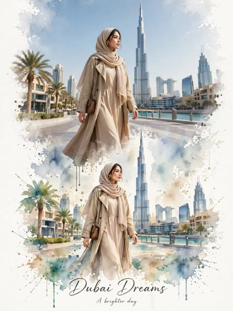</a>

提示词为每张参考图指定城市、服装和氛围，再用水彩泼溅作为场景过渡，让画面连成一个故事。反复强调保持面部与比例一致来锁定人物，底部的手写体标题补全杂志式版面。

GPT Image 2.5 · 上传图改图 · 出处: [@KrishnaBio1 on X](https://x.com/KrishnaBio1/status/2102691221764477093) · 97 赞，统计于 2026-10-28

[`watercolor`](tags.md#tag-watercolor) [`travel-poster`](tags.md#tag-travel-poster) [`scrapbook`](tags.md#tag-scrapbook) [`reference-photos`](tags.md#tag-reference-photos) [`editorial`](tags.md#tag-editorial)

<details><summary><b>提示词</b></summary>

```text
Create a premium vertical 9:16 luxury travel artwork by seamlessly combining all three uploaded reference images into one cohesive visual story.

Show the same stylish woman traveling through three iconic destinations:
1. Paris — elegant Parisian streets with the Eiffel Tower, beige sophisticated outfit, black sunglasses and luxury city-walk atmosphere.
2. Dubai — modern waterfront promenade with Burj Khalifa, soft neutral modest outfit with a flowing scarf, warm upscale atmosphere.
3. Sydney — Sydney Opera House beside the waterfront, casual white top, light blue jeans, sneakers and relaxed summer-travel mood.

Blend all three destinations together with elegant watercolor splash transitions, soft artistic paint textures, subtle paper details and realistic photographic elements. Keep the woman’s appearance, facial identity, proportions and styling natural and consistent throughout the three scenes.

Luxury travel editorial aesthetic, cinematic natural lighting, premium composition, soft pastel tones, realistic details mixed with artistic watercolor, clean elegant background, sophisticated lifestyle photography, high-end travel magazine design, ultra-detailed, sharp subject, balanced composition, 8K quality.

Add a tasteful handwritten-style title near the bottom:
“WANDER • DREAM • DISCOVER”

Make the final image feel like one beautiful international travel story rather than three unrelated pictures.
```

</details>

<a id="gpt-image-red-white-motivational-fashion-poster-triple-portrait"></a>
### 红白配色励志时尚海报，同一人三种景别

<a href="https://x.com/mehwishkiran07/status/2102714995427737651"></a>

以上传照片锁定身份，并用编号分别指定特写、半身、全身三种景别的位置，让同一人物在海报中分层而不显重复。每段文字都写明位置和字体风格，如单词用深红毛笔体、其余用深色小字，结尾再要求拼写正确。

GPT Image 2.5 · 上传图改图 · 出处: [@mehwishkiran07 on X](https://x.com/mehwishkiran07/status/2102714995427737651) · 92 赞，统计于 2026-10-28

[`fashion-poster`](tags.md#tag-fashion-poster) [`identity-reference`](tags.md#tag-identity-reference) [`typography`](tags.md#tag-typography) [`red-white`](tags.md#tag-red-white) [`triple-portrait`](tags.md#tag-triple-portrait)

<details><summary><b>提示词</b></summary>

```text
> Use the uploaded reference image as the primary identity reference. Preserve the subject’s exact facial identity, facial structure, skin tone, hairstyle, eyes, nose, lips, jawline, and overall likeness. Create a premium cinematic motivational fashion poster in a vertical 4:5 composition.

The poster features the same person in three integrated appearances/scales:

1. A huge close-up portrait occupying the upper-left and center background, showing the face in sharp detail with a confident, subtle smile and natural realistic skin texture.

2. A large half/full upper-body portrait positioned on the right side, slightly behind the main subject, maintaining the exact same identity and hairstyle.

3. A full-body fashion portrait in the center foreground, walking confidently toward the camera with both hands naturally placed in the trouser pockets.

Create a luxury editorial fashion campaign aesthetic, cinematic photography, ultra-realistic skin texture, realistic hair strands, natural facial proportions, premium studio lighting, sharp focus, sophisticated confident expression.

Outfit: elegant monochromatic white fashion outfit. For the female version, a tailored white blazer, fitted white top, high-waisted white trousers and clean white sneakers. For the male version, a perfectly tailored white blazer, open-collar white shirt, white trousers and clean white sneakers. Add a premium minimalist wristwatch.

Background: dramatic white and deep crimson-red abstract paint splashes, energetic brush strokes, textured grunge effects, dark red metropolitan city skyline silhouettes emerging from the paint, cinematic reflections on a glossy wet floor, strong red atmospheric glow, high contrast between white and crimson.

The composition should feel like a high-end fashion magazine cover mixed with a motivational movie poster. Layer the large portraits naturally into the background without looking duplicated or artificial. Maintain realistic depth, scale, perspective, shadows and lighting consistency across all three versions of the subject.

Add elegant editorial typography integrated into the design:

Top right: SAME
DREAMS
BIGGER
MOVES

Left side: DISCIPLINE
CREATIVITY
PROGRESS
FREEDOM

Large lower-left text:
VISION

Large handwritten brush-script text on lower-right:
Better

Under it: THAN
YESTERDAY

Bottom-left: A
YOUNG
MIND
WITH
A BIG
VISION

Bottom-right: GOOD
IDEAS
TAKE TIME

Typography should be elegant, editorial, clean and perfectly aligned, with deep red brush lettering for “Better” and subtle black/dark typography for the smaller text.

Overall style: ultra-photorealistic, cinematic, premium luxury fashion campaign, sophisticated editorial composition, dramatic red-and-white color palette, realistic photography, high detail, sharp facial features, natural skin pores, realistic hair, volumetric lighting, glossy reflections, professional art direction, 8K quality, highly polished commercial poster.

Important: Keep the subject’s identity consistent across all three appearances. Do not change the face, age, ethnicity, facial proportions or recognizable features. No extra fingers, distorted hands, duplicated limbs, warped face, unnatural anatomy, blurry face, cartoon appearance or plastic skin. Ensure all typography is correctly spelled and readable.
```

</details>

<a id="gpt-image-minimalist-ink-sketch-travel-poster"></a>
### 地标极简钢笔速写旅行海报

<a href="https://x.com/Naiknelofar788/status/2115000503151231060"></a>

用地标和目的地占位符让提示词可重复套用。细墨线搭配有限的粉彩色板、象牙白纸面上的干笔色块,并固定标题排版与分隔线。再用不要3D、不要多余文字等排除项保持画面干净。

GPT Image 2.5 · 文生图 · 出处: [@Naiknelofar788 on X](https://x.com/Naiknelofar788/status/2115000503151231060) · 87 赞，统计于 2026-10-28

[`travel-poster`](tags.md#tag-travel-poster) [`ink-sketch`](tags.md#tag-ink-sketch) [`pastel`](tags.md#tag-pastel) [`minimalist`](tags.md#tag-minimalist) [`template`](tags.md#tag-template)

<details><summary><b>提示词</b></summary>

```text
Create a beautiful, minimalist hand-drawn travel illustration of [LANDMARK / CITY / COUNTRY], inspired by Japanese architectural sketchbook art and contemporary minimalist travel posters.

Illustration style:

Fine black ink outlines with loose, expressive, imperfect hand-drawn strokes.
Simplified architectural forms that preserve the destination’s most recognizable features.
Soft, dry-brush pastel colour patches in the background, with a distressed, textured, almost crayon-like finish.
A limited palette of muted sage green, dusty pink, pale blue, warm beige, and soft ochre.
Warm ivory paper background with subtle natural paper grain.
Delicate sketchy trees, tiny shrubs, birds, distant mountains, clouds, or other location-specific elements.
Beautiful negative space and an airy, uncluttered composition.
Artistic imperfections, uneven ink lines, and a handmade illustration aesthetic.

Composition:
Place the iconic landmark in the lower half of the image, drawn in elegant black ink. Add a few surrounding elements to create a small, atmospheric scene. Behind the architecture, incorporate abstract vertical or irregular pastel brushstrokes that add colour without overpowering the drawing.

Typography:
At the top, write the destination name in thin, spaced-out uppercase lettering: “[DESTINATION NAME]”. Place the country name directly underneath in smaller, elegant uppercase letters. Add a fine horizontal divider with tiny circular endpoints between the title and subtitle, if appropriate.

Overall mood: Peaceful, poetic, artistic, minimalist, nostalgic, and sophisticated — like a page from a beautifully illustrated travel journal.

Technical details: Square 1:1 composition, crisp fine-line drawing, restrained pastel colours, plenty of cream negative space, no photorealism, no 3D effects, no glossy finish, no heavy shadows, no clutter, and no extra text. Ensure the destination name is spelled correctly.
```

</details>

<a id="nano-banana-editorial-poster-motion-ghost-figures"></a>
### 带动态模糊虚影的编辑风人像海报

<a href="https://x.com/CodeByPoonam/status/2107769327751709117"></a>

先锁定上传照片的人脸特征，再按场景、背景、光线、文字分块写清版式。粗体窄字压在下半身前形成层次，结尾用否定清单排除多余图形和文字。

Nano Banana 2.1 · 上传图改图 · 出处: [@CodeByPoonam on X](https://x.com/CodeByPoonam/status/2107769327751709117) · 83 赞，统计于 2026-10-28

[`editorial-poster`](tags.md#tag-editorial-poster) [`identity-lock`](tags.md#tag-identity-lock) [`typography`](tags.md#tag-typography) [`motion-blur`](tags.md#tag-motion-blur) [`cinematic`](tags.md#tag-cinematic)

<details><summary><b>提示词</b></summary>

```text
Use the uploaded photo of me as the main subject. Keep my face, skin tone, hair and features exactly the same. Recreate the style and layout of the reference poster.

Scene: A vertical 4:5 editorial poster. I stand in the center, facing the camera with a calm, serious expression. My head is slightly tilted. I wear a flowy, elegant midi dress in a deep charcoal navy shade. The fabric has soft natural folds.

Background: A soft blue-grey studio wall with a cinematic teal and navy gradient. Two blurred, motion-smeared figures in dark oversized clothing stand on the left and right edges. They look like long-exposure ghosts. Keep them out of focus.

Lighting: Soft, moody natural light. Gentle rim light on my hair. Muted film tones, fine grain, shallow depth of field. Fashion editorial look.

Text layout:
- Top center: small, wide-spaced white text "SONI"
- Center, over the lower body: huge, bold, condensed white sans-serif text "PROMPT". It sits in front of the dress, slightly overlapping me.
- Just below it: orange handwritten script text "NanoBanana 2.1", slightly tilted

Do not add any arrow, button, oval or pill shape. Do not add any other text, logos or watermarks.

Style: premium magazine poster, clean typography, high contrast text, cinematic, photorealistic, 4:5  aspect ratio
```

</details>

<a id="gpt-image-rainy-day-editorial-poster"></a>
### 雨天撑伞行人的编辑风海报

<a href="https://x.com/Goodmanprotocol/status/2100508937514897577"></a>

用方括号主题占位让模板可复用，同时限定低饱和色板、22%到30%留白，以及手写笔触标题加衬线小字的字体层级。胶片颗粒与纸张质感带来印刷杂志的味道。

GPT Image 2.5 · 文生图 · 出处: [@Goodmanprotocol on X](https://x.com/Goodmanprotocol/status/2100508937514897577) · 76 赞，统计于 2026-10-28

[`editorial`](tags.md#tag-editorial) [`poster`](tags.md#tag-poster) [`template`](tags.md#tag-template) [`typography`](tags.md#tag-typography) [`film-grain`](tags.md#tag-film-grain)

<details><summary><b>提示词</b></summary>

```text
Create one premium 3:4 vertical editorial art poster for [COUNTRY / LOCATION / SUBJECT].

TEXT-TO-IMAGE GENERATION ONLY. Generate the complete artwork from [COUNTRY / LOCATION / SUBJECT] alone. No reference image or additional visual input is required.

Automatically interpret the subject and create a visually compelling composition that reflects its character, atmosphere, appearance, setting, colors, and distinctive visual identity.

LOWER SECTION

Use a refined background palette inspired by [COUNTRY / LOCATION / SUBJECT], using limited low-saturation tones such as misty gray, warm beige, light khaki, cream white, dusty rose, or soft gray-pink, selecting only the colors that naturally suit the subject.

Keep approximately 22–30% continuous negative space. Avoid complicated scenery, excessive objects, sticker-like elements, or meaningless decoration.

TYPOGRAPHY

Create a sophisticated editorial typography system based on the subject.

Automatically generate a short main title inspired by the subject's appearance, mood, action, or personality.

Add one natural 8–16 word English sentence written like a subtle editorial note or magazine caption.

Use a carefully designed hand-drawn or retro bubble-style font for the main title. Use smaller refined typography for supporting text, such as an elegant serif, subtle typewriter style, or delicate book-inspired font.

Create clear hierarchy, breathing room, and intentional spacing. Typography should feel integrated into the artwork rather than simply placed on top.

VISUAL STYLE

Keep the overall palette restrained and cohesive, with subtle film grain, tactile paper texture, and a gentle printed-editorial quality.

Allow slight asymmetry and imperfect positioning to create a sophisticated independent-magazine aesthetic without making the composition messy.

IMPORTANT

Keep the main subject recognizable and naturally proportioned. Do not cartoonize the person or subject.

Avoid:
multiple mascots, existing animated characters, brand logos, QR codes, watermarks, signatures, gibberish text, incorrect hands, extra limbs, excessive decoration, cheap templates, overly cute styling, or cluttered compositions.

FINAL LOOK

The finished artwork should feel like a premium independent fashion magazine, contemporary art publication, or sophisticated editorial ZINE—minimal, tactile, slightly imperfect, modern, and visually intelligent.

STRICT 3:4 VERTICAL | TEXT-ONLY GENERATION | RESTRAINED COLORS | 22–30% NEGATIVE SPACE | PREMIUM EDITORIAL TYPOGRAPHY | SUBTLE FILM GRAIN & PAPER PRINT TEXTURE.

Generate everything autonomously from [COUNTRY / LOCATION / SUBJECT] alone.
```

</details>

<a id="gpt-image-photo-to-ink-editorial-split-poster"></a>
### 照片与黑色墨线插画上下分割海报

<a href="https://x.com/TheVirtualMuse/status/2109930829942288624">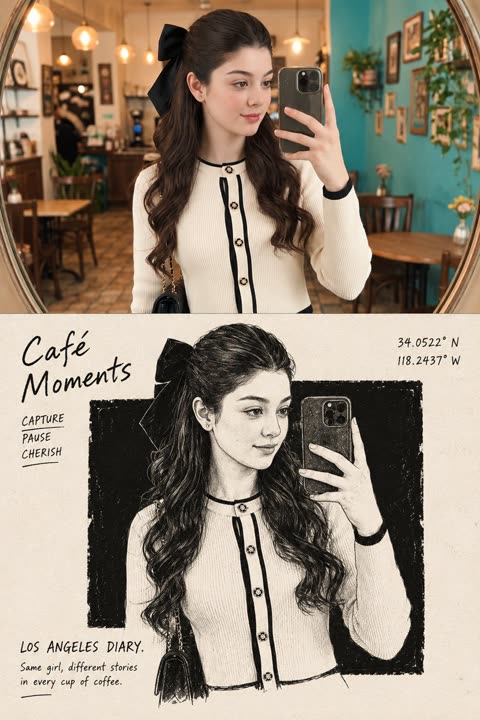</a>

画面精确对半分割，上半保留参考照片，下半把主体重绘为黑色油墨块上的钢笔插画。严格的尺寸比例、黑白配色加一个可选点缀色，以及固定的手写文字位置（标题、坐标、日记句），让版式保持稳定。

GPT Image 2.5 · 上传图改图 · 出处: [@TheVirtualMuse on X](https://x.com/TheVirtualMuse/status/2109930829942288624) · 69 赞，统计于 2026-10-28

[`editorial`](tags.md#tag-editorial) [`split-layout`](tags.md#tag-split-layout) [`ink-illustration`](tags.md#tag-ink-illustration) [`handwritten-typography`](tags.md#tag-handwritten-typography) [`poster`](tags.md#tag-poster)

<details><summary><b>提示词</b></summary>

```text
Using the uploaded reference image, create a single high-resolution vertical 2:3 editorial art poster.

Divide the canvas into two perfectly equal horizontal sections, each occupying exactly 50% of the total height. Separate them with a clean, perfectly straight horizontal dividing line.

1. TOP HALF — ORIGINAL REFERENCE PHOTOGRAPH

Use the uploaded reference photograph directly in the upper 50% of the poster.

Preserve its original photographic quality, sharpness, natural lighting, and color relationships.

Allow only subtle, intelligent cropping around the outer edges when necessary, without compromising the main subject.

If required, naturally extend a small portion of the surrounding environment to fit the composition.

Do not redraw, illustrate, stretch, blur, or modify the subject's appearance, structure, or spatial relationships.

Do not introduce black borders, white margins, or empty edges.

2. BOTTOM HALF — MINIMALIST EDITORIAL ILLUSTRATION

Use a warm, near-white ivory paper background with an extremely subtle paper texture.

Analyze the main subject and visual story of the uploaded reference image.

Extract only the primary subject, preserving one or two essential identifying elements.

Remove or heavily simplify all secondary details, including background architecture, crowds, vehicles, fences, signs, trees, and other unnecessary elements.

Transform the primary subject into a sophisticated black-ink editorial illustration.

ILLUSTRATION STYLE:

Use natural, clean pen strokes with varied line weight.

Preserve an authentic hand-drawn appearance with expressive but controlled linework.

Avoid overly precise engraving aesthetics, excessive internal details, and dense cross-hatching.

Place a large, nearly pure-black rectangular ink block behind the illustrated subject.

The rectangular block should have subtly imperfect, handmade print-style edges.

Keep the black background clean, with only fine paper grain and minimal noise.

Avoid obvious hatching, scratches, architectural lines, or complex textures.

ILLUSTRATION SCALE AND COMPOSITION:

The illustrated subject must occupy approximately 72–77% of the canvas width and 58–64% of the bottom section's height.

Maintain a clear visual focal point with generous negative space surrounding the illustration.

3. COLOR RULES

The bottom illustration must follow a strictly black-and-white color palette by default.

Preserve only one localized accent color if the original reference image contains a clearly distinctive, concentrated color element with meaningful narrative importance.

Ordinary blue skies, green vegetation, stone surfaces, skin tones, and environmental colors must not be treated as accent colors.

Any preserved accent color must remain strictly localized to the relevant subject or area.

Never allow accent colors to spread across the entire illustration.

4. TYPOGRAPHY AND EDITORIAL LAYOUT

Automatically generate concise, meaningful English typography based on the content of the uploaded reference photograph.

The typography must resemble handwritten editorial annotations from an independent art publication.

TOP-LEFT CORNER:

Generate a short handwritten title consisting of 2–5 words, arranged across two lines.

Directly beneath the title, include three short English action verbs relevant to the photograph.

TOP-RIGHT CORNER:

Display only two lines of geographic coordinates:

Latitude
Longitude

Do not include any additional text in this area.

BOTTOM-LEFT CORNER:

Display the location name followed by the word "DIARY."

Directly beneath it, add one short descriptive English sentence inspired by the photograph.

TYPOGRAPHY STYLE:

Use a rough, upright, slightly irregular handwritten typeface.

Maintain subtle imperfections and a natural editorial annotation aesthetic.

Avoid elegant cursive, calligraphy, overly decorative lettering, and excessively polished typography.

5. FINAL ART DIRECTION

The finished poster must combine:

Authentic, high-quality photography.
Minimalist black-and-white editorial illustration.
Generous negative space.
Independent art publication aesthetics.
Quiet, restrained, sophisticated visual storytelling.
Natural handwritten typography.
A balanced relationship between documentary realism and expressive hand-drawn artwork.

The overall result should resemble a carefully designed, collectible editorial art print.

6. FINAL OUTPUT REQUIREMENTS

ASPECT RATIO:
2:3 vertical.

RESOLUTION:
High-resolution, sharp, print-quality output.

COMPOSITION:

Exactly 50% original reference photography on top.

Exactly 50% editorial illustration on the bottom.

One perfectly straight horizontal dividing line.

One complete, standalone poster.

RESTRICTIONS:

No collages.
No multi-poster layouts.
No combined images.
No unnecessary decorative elements.
No modifications to the original subject's identity or appearance.
No excessive illustration details.
No changes to the original photograph's natural color relationships.

FINAL GOAL:

Create a sophisticated, visually balanced editorial art poster that faithfully preserves the uploaded reference photograph while transforming its primary subject into an expressive, minimalist black-ink illustration.
```

</details>

<a id="gpt-image-onsen-town-photo-to-watercolor-travel-poster"></a>
### 温泉小镇照片渐变水彩旅行海报

<a href="https://x.com/KrishnaBio1/status/2106416152364863790">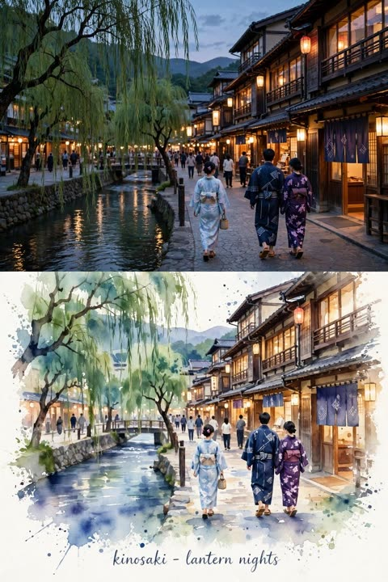</a>

点名两个真实地点并把各自氛围融合成一个场景。画面上半部是照片级写实,下半部渐变为米白纸上的水彩,底部再给出确切的手写字幕文案。

GPT Image 2.5 · 文生图 · 出处: [@KrishnaBio1 on X](https://x.com/KrishnaBio1/status/2106416152364863790) · 66 赞，统计于 2026-10-29

[`travel-poster`](tags.md#tag-travel-poster) [`watercolor`](tags.md#tag-watercolor) [`photo-to-watercolor`](tags.md#tag-photo-to-watercolor) [`japan`](tags.md#tag-japan) [`onsen`](tags.md#tag-onsen)

<details><summary><b>提示词</b></summary>

```text
Create a cinematic, ultra-realistic travel editorial scene inspired by the uploaded references, blending the atmosphere of Kinosaki and Hakone, Japan into one cohesive composition. Show a peaceful traditional Japanese onsen town at evening, with narrow stone streets, elegant wooden ryokan buildings, dark tiled roofs, warm glowing paper lanterns, small traditional shops, noren curtains, and a quiet flowing canal lined with graceful willow trees. Add a misty mountain landscape in the background, with subtle steam rising from hot-spring vents and a calm, authentic Japanese atmosphere.
Include a small group of naturally dressed travelers walking through the street, with realistic proportions and candid body language. Combine the warm lantern-lit nighttime mood of Kinosaki with the tranquil misty hot-spring atmosphere of Hakone. Use soft cinematic lighting, realistic textures, gentle reflections on the water, atmospheric depth, natural colors, and highly detailed architecture.
Present the final artwork as a premium vintage travel-poster / watercolor art-book composition: the upper/main scene should feel photographic and photorealistic, while the lower portion gradually transforms into delicate hand-painted watercolor with artistic paint splashes and textured off-white paper. Keep the transition seamless and elegant.
Add refined handwritten-style typography at the bottom:
“KINOSAKI — LANTERN NIGHTS”
“HAKONE — QUIET ONSEN STREETS”
Minimal, sophisticated Japanese travel aesthetic, nostalgic winter/early-evening mood, editorial composition, 8K detail, realistic photography blended with refined watercolor illustration, no clutter, no distorted architecture, no extra text.
```

</details>

<a id="gpt-image-photo-over-paper-sculpture-editorial-poster"></a>
### 上半部原图，下半部纸雕拼贴海报

<a href="https://x.com/j_smeaton99/status/2111755839895699812"></a>

严格 3:4 画幅上下各占一半，上半保留原照片，下半把人物重做成多层卡纸剪贴。配色取自原图，并用排除清单和克制的文字排版让每张海报各有个性。

GPT Image 2.5 · 上传图改图 · 出处: [@j_smeaton99 on X](https://x.com/j_smeaton99/status/2111755839895699812) · 64 赞，统计于 2026-10-28

[`paper-cutout`](tags.md#tag-paper-cutout) [`editorial-poster`](tags.md#tag-editorial-poster) [`photo-to-collage`](tags.md#tag-photo-to-collage) [`pastel-palette`](tags.md#tag-pastel-palette) [`split-layout`](tags.md#tag-split-layout)

<details><summary><b>提示词</b></summary>

```text
Create a collection of individual, high-end editorial art posters, producing one separate design for every uploaded photograph. Treat each image as its own creative project, with no image merging, repeated layouts, or borrowed design elements between posters.

CANVAS & STRUCTURE: Use a strict 3:4 vertical format with a precise 50/50 horizontal division. The upper section must retain the original photograph, including the subject’s face, identity, pose, clothing, defining details, original color relationships, and natural lighting. Apply only restrained tonal refinement for a polished magazine finish. Do not reconstruct, reshape, or replace the photographed subject.

PHOTOGRAPHIC UPPER PANEL: Preserve the authentic image as the visual anchor. Simplify distracting surroundings only where necessary, without altering the subject or compromising the photograph’s original character.

LOWER PANEL — PAPER SCULPTURE: Reinterpret the subject’s defining features, silhouette, or visual story as a contemporary handcrafted paper composition. Build the artwork from bold cutouts, abstract contours, overlapping cardstock, and carefully arranged geometric fragments. Reduce unnecessary details while retaining recognizable visual connections to the original photograph. The result should feel like an art director’s handcrafted mixed-media experiment, not a cartoon illustration.

LAYOUT & SPATIAL DESIGN: Create a striking contrast between a spacious, pale upper field and a confidently colored lower section extending edge to edge. Let the subject interact visually with the dividing line, creating a seamless relationship between photography and collage. Introduce an off-center shape, architectural color panel, or restrained graphic accent only when it strengthens the composition. Keep the arrangement intentional, airy, and visually distinctive.

PALETTE & MATERIALS: Derive a small selection of complementary colors from the source image, then translate them into luminous, understated pastel tones. Combine matte paper surfaces, fine fibrous grain, slightly irregular cut edges, and delicate overlapping layers. Establish dimension through the arrangement of paper elements rather than pronounced shadows, gradients, or artificial depth.

EDITORIAL FINISH: Use typography sparingly. If suitable, include a small art-publication title, discreet caption, or minimal typographic detail, positioned with precision. Avoid unnecessary text, decorative labels, and oversized lettering.

ARTISTIC DIRECTION: Contemporary gallery poster meets independent art-journal design. Balance photographic authenticity with tactile paper craftsmanship, bold color blocking, thoughtful asymmetry, and generous breathing room. Every poster should have its own visual character, derived directly from its source photograph.

STRICT EXCLUSIONS: No combined photographs, duplicated designs, distorted anatomy, altered facial identity, full-scene illustration, cartoon rendering, glossy 3D elements, excessive drop shadows, gradients, busy backgrounds, or mass-produced template aesthetics.

FINAL OBJECTIVE: Produce a refined, collectible-quality editorial poster that feels individually art-directed. The original photograph remains authentic in the upper half, while the lower half translates its visual identity into a fresh, tactile, minimalist paper-art interpretation.
```

</details>

<a id="nano-banana-photo-to-painting-editorial-poster-seoul"></a>
### 实拍与手绘版叠放的杂志风海报

<a href="https://x.com/saniaspeaks_/status/2113118463824671218">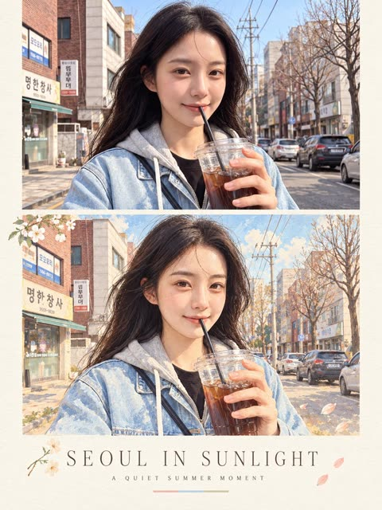</a>

提示词把实拍照片与手绘重绘上下叠放，并锁定姿势、服装、道具和光线方向，让两幅画面像同一瞬间。奶油色纸面版式加上字距拉开的大写标题与副标题占位，方便反复套用。

Nano Banana 2.1 · 上传图改图 · 出处: [@saniaspeaks_ on X](https://x.com/saniaspeaks_/status/2113118463824671218) · 62 赞，统计于 2026-10-28

[`photo-to-painting`](tags.md#tag-photo-to-painting) [`editorial-layout`](tags.md#tag-editorial-layout) [`magazine-poster`](tags.md#tag-magazine-poster) [`before-after`](tags.md#tag-before-after) [`pastel`](tags.md#tag-pastel)

<details><summary><b>提示词</b></summary>

```text
Design a sophisticated vertical magazine-style poster built around a seamless transition from reality to illustration. At the top, present the subject as a highly realistic lifestyle photograph, naturally placed within the original environment. Use soft golden sunlight, lifelike skin and hair details, subtle facial expression, natural shadows, and a shallow cinematic focus for an authentic photographic feel.

Directly beneath it, reinterpret the very same moment as a refined hand-painted artwork. Keep the character instantly recognizable by matching the original composition, body position, hairstyle, outfit, smartphone, lighting direction, and surrounding environment. Give the artwork a gentle painterly finish with visible brushwork, soft edges, organic forms, muted pastel tones, and a nostalgic illustrated-magazine atmosphere.

Arrange both scenes within a carefully designed editorial layout surrounded by warm cream-colored paper with subtle grain and tactile print texture. Add a few delicate botanical or seasonal accents around the artwork without overwhelming the composition.

Under the illustrated panel, create a clean typography section with a centered uppercase headline: “[MAIN TITLE]”. Use elegant, widely tracked lettering with a refined fashion-editorial feel. Beneath it, place “[TAGLINE]” in a smaller, understated typeface with generous spacing. Finish the typography area with one short horizontal pastel accent rule.

Keep the entire composition calm, premium, and visually cohesive. The photographic and illustrated versions should feel like two interpretations of the exact same moment rather than separate scenes.

Use a vertical 3:4 poster format, high-resolution output, balanced negative space, soft natural color grading, polished print aesthetics, and contemporary editorial art direction.

Do not introduce unnecessary text, dramatic borders, oversaturated colors, visual clutter, unrealistic anatomy, mismatched facial features, or changes to the subject’s identity and clothing.
```

</details>

<a id="gpt-image-opera-house-riso-zine-split-poster"></a>
### 悉尼歌剧院实景照片与孔版印刷杂志重构双联海报

<a href="https://x.com/sebatheepan/status/2101034408253837454"></a>

画面上下分区，上半是忠实实景，下半是双色孔版印刷重构，并明确要求保留建筑原貌，地标依然一眼可辨。结构、光线、密度和文字都留成固定槽位，一套母提示词就能批量出系列，并用唯一红色点缀和固定留白统一版面。

GPT Image 2.5 · 文生图 · 出处: [@sebatheepan on X](https://x.com/sebatheepan/status/2101034408253837454) · 52 赞，统计于 2026-10-29

[`risograph`](tags.md#tag-risograph) [`zine`](tags.md#tag-zine) [`architecture`](tags.md#tag-architecture) [`split-layout`](tags.md#tag-split-layout) [`template`](tags.md#tag-template)

<details><summary><b>提示词</b></summary>

```text
─────────────────────────
One poster, 3:4 vertical canvas. Split into two roughly equal zones — a realistic photograph on top, a printed reconstruction below — divided by one clean sharp horizontal line. The structure must not be stretched, warped, tilted or repositioned unnaturally.

TOP HALF — THE REAL SHOT
{STRUCTURE DESCRIPTION}. {PLATE LIGHT}. Preserve the structure faithfully: same architecture, proportions, perspective, distinctive details, natural light and shadow. Add only a subtle high-end color grade and the faintest film grain. Never redesign or reinterpret the architecture.

BOTTOM HALF — THE PRINTED RECONSTRUCTION
Rebuild the same structure as a two-color risograph zine print: bold flat spot-color shapes (one deep ink layer plus the structure's muted colors as a second spot layer), visible misregistration offsets between the layers, drum streaks, coarse layered ink-grain, halftone texture from overlapping dots, a zine masthead bar, two staple marks and paste-up edges. The photograph dissolves outward into flat spot-color shapes, misaligned layers and grainy ink. The structure must remain immediately recognizable. {PLATE DENSITY}.
Texture: cheap zine paper, layered soy ink, misregistration, drum streaks, folded-edge wear, cut-and-paste edges, restrained crop marks, one small fluorescent red calibration bar. Color: cream zine paper, black ink, one deep spot color, the structure's original muted colors, a single fluorescent red accent. Never fully desaturate the structure.
The structure occupies roughly 60-88% of the frame width. Leave 22-38% of the paper visibly untouched and empty — generous negative space so the poster reads as an archival specimen, not a packed screen.

TYPOGRAPHY — a clean fixed-width architectural title block, pinned top-left at a small fixed inset, black ink, monospaced technical typeface, verbatim, each line in caps:
"{NAME}"
"{CITY, COUNTRY}"
"ZINE PLATE 0N"
A thin horizontal rule under the third line, then one short observational caption verbatim:
"{CAPTION}"

A solid vertical red rectangle — the only red in the poster — is pinned to the bottom-right corner zone about 12% from the bottom and right edges. Four thin black crop marks sit in the four corners of the bottom half at identical insets. Red bar, crop marks and text block keep exactly the same position and size relative to the frame.

MOOD: underground zine crossed with an architecture fanzine — young, tactile, collectible. Sophisticated, minimal, tactile, intellectual, slightly mysterious, highly collectible.

AVOID: solid black terminal backgrounds, dense walls of code, cyberpunk neon, excessive decorative glyphs, distorted architecture, impossible geometry, invented architectural details, fake technical specifications, random meaningless symbols, garbled text, extra colors, brand logos, QR codes, watermarks, author credits, tourist-poster clichés.

Priority: preserve the structure's identity and architectural accuracy first. The experimental print treatment enhances the architecture, never hides it.

──────────────────────────────────────────────
THE FOUR VARIATIONS (one axis change per plate)
──────────────────────────────────────────────
PLATE 01 — DENSE · light: "Golden-hour sunlight with long warm shadows" · density: "The print treatment is at its densest and richest: layered marks, full system detail"
PLATE 02 — LINEWORK · light: "Soft overcast daylight, muted flat tones" · density: "The print is linework-forward: thin drafting lines and technical geometry dominate the reconstruction"
PLATE 03 — FRAGMENT · light: "Blue-hour dusk with cool tones, the shells glowing warm against the dusk" · density: "The print is fragment-forward: torn photographic fragments dominate, with fewer system marks around them"
PLATE 04 — MINIMAL · light: "Bright midday sunlight with crisp shadows" · density: "The print is the minimal plate of the set: sparse marks, maximum untouched paper"
```

</details>

<a id="gpt-image-photo-to-ink-golden-thread-travel-poster"></a>
### 巴黎日落实景照片过渡到墨线插画的旅行海报

<a href="https://x.com/Ziha_ai/status/2103336789339709511"></a>

提示词把画面拆成实景照片、过渡、墨线插画三段，并用一根金色细线把它们连起来。地标和时段用方括号占位，方便复用，结尾的排除项让照片保持主体、版面不杂乱。

GPT Image 2.5 · 文生图 · 出处: [@Ziha_ai on X](https://x.com/Ziha_ai/status/2103336789339709511) · 48 赞，统计于 2026-10-28

[`travel-poster`](tags.md#tag-travel-poster) [`photo-to-ink`](tags.md#tag-photo-to-ink) [`golden-thread`](tags.md#tag-golden-thread) [`landmark`](tags.md#tag-landmark) [`template`](tags.md#tag-template)

<details><summary><b>提示词</b></summary>

```text
Create a sophisticated conceptual travel-art poster based on [LANDMARK / CITY / COUNTRY], inspired by the visual storytelling of a real photograph seamlessly transitioning into delicate hand-drawn illustration.

TOP SECTION — REALISTIC PHOTOGRAPH:
Show a breathtaking, cinematic photograph of [LANDMARK / CITY / COUNTRY] during [sunrise / sunset / golden hour / blue hour]. Preserve the authentic architecture, landscape, proportions, recognizable details, atmosphere, natural lighting, and distinctive visual identity of the location. Use dramatic warm light, glowing highlights, realistic textures, atmospheric depth, subtle film grain, and an editorial travel-photography aesthetic.

THE TRANSITION:
From one important visual element of the photograph — such as the sun, a window, tower, dome, streetlight, mountain peak, river, or architectural detail — create a single thin golden thread / beam of light that naturally extends downward from the photograph into the empty paper space. The thread should feel delicate, handmade, slightly imperfect, and continuous.

BOTTOM SECTION — HAND-DRAWN STORY:
On warm ivory textured paper, transform the end of the golden thread into a beautiful minimal ink illustration connected to [LANDMARK / CITY / COUNTRY]. The thread could lead to a tiny illustrated traveler, artist, child, architect, traditional object, local street scene, miniature landmark, map element, flower, boat, train, or another meaningful cultural symbol.

Keep the illustration extremely elegant and sparse, using fine black ink lines, subtle hatching, tiny golden accents, and lots of negative space. Integrate small recognizable details from [CITY / COUNTRY] into the illustration without making it crowded.

TYPOGRAPHY:
Add a small handwritten or refined editorial phrase such as:
[CITY] [PLACE NAME]

Add minimal typography: [CITY / COUNTRY] — [LANDMARK NAME], with optional coordinates or a small location descriptor.

STYLE: premium conceptual travel poster, poetic visual storytelling, real photography + minimalist ink illustration, warm ivory paper, delicate golden thread, sophisticated editorial composition, museum-quality art print, subtle vintage texture, emotional but understated, generous negative space, vertical 4:5 composition.

IMPORTANT: Keep the real photograph visually dominant and authentic. The illustrated section should feel like it is physically connected to the photograph by the single continuous golden thread. No collage clutter, no excessive typography, no random objects, no cartoonish style, no distorted architecture.
```

</details>

<a id="gpt-image-city-travel-poster-vector-template"></a>
### 苏黎世矢量旅行海报模板

<a href="https://x.com/Maercihh/status/2113234692199641441"></a>

JSON 提示词只留一个城市名占位符，由模型自动选择地标、交通工具和国家文字。分层景深、固定的藏青与象牙白配色以及独立的文字区，让每个城市都保持同一套复古海报风格。

GPT Image 2.5 · 文生图 · 出处: [@Maercihh on X](https://x.com/Maercihh/status/2113234692199641441) · 44 赞，统计于 2026-10-29

[`travel-poster`](tags.md#tag-travel-poster) [`vector`](tags.md#tag-vector) [`template`](tags.md#tag-template) [`json-prompt`](tags.md#tag-json-prompt) [`city`](tags.md#tag-city)

<details><summary><b>提示词</b></summary>

```text
{
"input": {
"city_name": "{{CITY NAME}}"
},

"generation": {
"type": "premium_illustrated_travel_poster",
"aspect_ratio": "3:4",
"orientation": "portrait",
"resolution": "high",
"reference_mode": "use_uploaded_images_for_style_reference_only",
"city_adaptation": "fully_automatic"
},

"creative_direction": {
"objective": "Create a beautifully composed, destination-specific illustrated travel poster that resembles a premium vintage European travel print with crisp modern vector artwork. Every generated image must feel like an authentic visual postcard of the specified city.",

"art_style": {
  "primary": "refined_flat_vector_illustration",
  "secondary": "mid_century_travel_poster",
  "influences": [
    "classic European tourism posters",
    "Japanese illustrated travel prints",
    "modern editorial vector artwork",
    "minimalist architectural illustration"
  ],
  "rendering": "clean geometric shapes, precise architectural outlines, layered silhouettes, controlled shading, subtle tonal gradients, carefully simplified details",
  "texture": "smooth matte printed-paper appearance with extremely subtle print texture",
  "realism_level": "stylized illustration with recognizable architectural accuracy",
  "avoid": [
    "photorealism",
    "3D rendering",
    "watercolor effects",
    "rough sketching",
    "childish cartoon styling",
    "excessive gradients",
    "plastic-looking surfaces",
    "generic AI artwork"
  ]
},

"destination_intelligence": {
  "instruction": "Identify the actual city, its country, and its most recognizable visual landmarks. Build the composition around a carefully selected combination of authentic architecture, local scenery, transportation, public spaces, and cultural elements.",
  "landmarks": "Select 2 to 4 recognizable landmarks or architectural features associated with the specified city.",
  "architecture": "Reproduce the city's characteristic architectural styles, rooflines, facades, towers, monuments, and urban structures.",
  "natural_environment": "Include locally appropriate mountains, rivers, lakes, coastlines, gardens, trees, or other landscape elements when relevant.",
  "transportation": "Add a locally recognizable train, tram, bus, boat, bicycle, or other transportation element only when appropriate.",
  "cultural_details": "Include subtle, authentic local details such as street lamps, traditional storefronts, bridges, signage, or regional vegetation.",
  "accuracy_rule": "Do not invent landmarks or combine unrelated cities. All recognizable locations and cultural details must correspond to the requested destination.",
  "fallback": "If a city has limited internationally recognizable landmarks, create an authentic composition using its actual architecture, urban character, and regional landscape."
},

"composition": {
  "layout": "large illustrated cityscape in the upper portion, destination typography in a separate lower section",
  "main_illustration": {
    "coverage": "approximately 78 to 83 percent of the canvas height",
    "framing": "a carefully composed, almost rectangular scenic illustration with clean edges",
    "perspective": "slightly elevated or street-level architectural perspective chosen to best showcase the destination",
    "depth_layers": [
      "foreground with flowers, trees, benches, railings, steps, pedestrians, or waterfront details",
      "middle ground with streets, bridges, public spaces, transport, and prominent architecture",
      "background with the city's skyline, secondary landmarks, and natural landscape"
    ],
    "visual_hierarchy": "one dominant landmark supported by complementary architectural elements",
    "spacing": "balanced, intentional, and visually rich without overcrowding",
    "human_figures": "small, elegantly simplified pedestrians used sparingly to establish scale",
    "sky": "clean pale sky with a few minimal stylized clouds or birds when appropriate"
  },

  "foreground_details": {
    "instruction": "Select destination-appropriate details that frame the scene naturally without obscuring its important landmarks.",
    "density": "moderate",
    "rule": "Avoid forcing flowers, boats, trees, or other elements into cities where they would look geographically or compositionally unnatural."
  },

  "background": {
    "color": "warm white or very pale ivory",
    "style": "minimal, uncluttered, print-ready",
    "negative_space": "generous space surrounding the illustration and destination typography"
  }
},

"color_palette": {
  "primary": [
    "deep navy blue",
    "cobalt blue",
    "sky blue",
    "warm ivory",
    "soft cream"
  ],
  "secondary": [
    "muted forest green",
    "sage green",
    "warm architectural beige",
    "terracotta",
    "soft grey"
  ],
  "adaptation": "Adjust accent colors to complement the city's architecture, national character, and natural surroundings.",
  "contrast": "clear and harmonious with strong separation between architectural layers",
  "saturation": "moderate, elegant, and print-friendly",
  "lighting": "bright, soft daylight with minimal hard shadows"
},

"typography": {
  "placement": "centered beneath the illustration",
  "city_name": {
    "text": "{{CITY NAME IN UPPERCASE}}",
    "font_style": "large, elegant, geometric sans-serif",
    "weight": "regular to medium",
    "letter_spacing": "very wide",
    "alignment": "center",
    "color": "deep navy blue",
    "importance": "primary visual anchor of the lower section"
  },

  "country_name": {
    "text": "Automatically identify the correct country and display its name in uppercase",
    "font_style": "small, clean sans-serif",
    "letter_spacing": "wide",
    "alignment": "center",
    "color": "muted navy or a restrained destination-appropriate accent",
    "position": "directly below the city name"
  },

  "decorative_elements": {
    "horizontal_lines": "thin symmetrical horizontal lines on either side of the country name when visually appropriate",
    "national_emblem": "Optional small, accurate national symbol beneath the typography only when suitable",
    "rule": "Keep typography minimal, legible, accurately spelled, and free of additional promotional copy."
  }
},

"image_quality": {
  "edges": "crisp and clean",
  "architecture": "recognizable, coherent, and carefully detailed",
  "shapes": "precise geometric silhouettes",
  "print_quality": "premium travel-poster finish",
  "composition_quality": "professional graphic-design balance",
  "text_quality": "correct city and country spelling",
  "final_appearance": "a sophisticated collectible illustrated travel poster suitable for high-quality social media publishing"
}

},

"strict_rules": {
"preserve_reference_style": true,
"change_destination_automatically": true,
"use_real_city_landmarks": true,
"use_correct_country_name": true,
"keep_illustration_above_typography": true,
"maintain_clean_ivory_background": true,
"maintain_wide_letter_spacing": true,
"keep_composition_balanced": true,
"no_unrequested_text": true,
"no_watermarks": true,
"no_borders_unless_integral_to_design": true,
"no_photographic_rendering": true,
"no_unrelated_landmarks": true,
"no_misspelled_text": true
},

"negative_prompt": [
"photorealistic photography",
"3D CGI",
"anime",
"childlike cartoon",
"watercolor painting",
"oil painting",
"messy sketch lines",
"overly textured paper",
"dark dramatic lighting",
"neon colors",
"cluttered composition",
"distorted buildings",
"incorrect landmarks",
"geographically inconsistent scenery",
"unreadable typography",
"misspelled city name",
"incorrect country name",
"random letters",
"excessive text",
"watermarks",
"logos",
"cropped landmarks",
"unbalanced typography",
"photographic cutouts"
]
}
```

</details>

<a id="gpt-image-naive-art-designer-poster-girl-cat"></a>
### 朴素艺术风格少女与猫海报

<a href="https://x.com/j_smeaton99/status/2114352687366156785">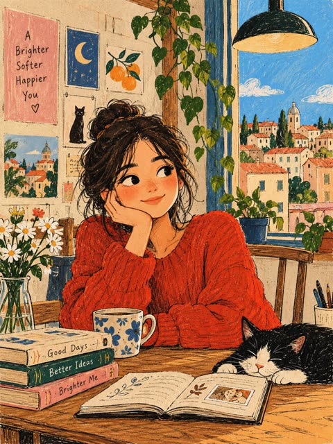</a>

提示词先点明现代朴素艺术风格，再列出手绘特征：不完美的铅笔轮廓、可见草稿线、涂鸦装饰、平涂色彩和纸张纹理。同时禁用阴影、渐变和3D，让画面保持扁平的印刷海报质感。

GPT Image 2.5 · 文生图 · 出处: [@j_smeaton99 on X](https://x.com/j_smeaton99/status/2114352687366156785) · 44 赞，统计于 2026-10-29

[`naive-art`](tags.md#tag-naive-art) [`hand-drawn`](tags.md#tag-hand-drawn) [`paper-texture`](tags.md#tag-paper-texture) [`flat-color`](tags.md#tag-flat-color) [`designer-poster`](tags.md#tag-designer-poster)

<details><summary><b>提示词</b></summary>

```text
Create an original modern naïve art illustration as a premium designer poster. Feature a charming, whimsical character in a simple everyday setting, with playful proportions, expressive minimal facial features, and an imaginative composition. Use a minimalist hand-drawn aesthetic with imperfect pencil outlines, visible sketch marks, decorative doodles, and soft yet contrasting flat colors. Incorporate subtle paper texture and an authentic handmade feel, like an illustration drawn by an independent contemporary artist. Keep shapes organic, details intentionally imperfect, and the overall design artistic, warm, and visually distinctive. No shadows, gradients, photorealism, or 3D effects. Clean composition, balanced negative space, sophisticated color palette, gallery-worthy editorial design, high-quality print poster aesthetic. Generate the complete artwork from scratch without using or requiring any reference image.
```

</details>

<a id="gpt-image-tilt-shift-map-road-travel-poster"></a>
### 从复古地图延伸出的上海移轴天际线

<a href="https://x.com/Goodmanprotocol/status/2109581797944443143"></a>

用城市占位符配合前景、中景、远景三层结构，让蜿蜒道路从印刷地图通向天际线。单一车辆作为视觉焦点，黄金时刻光线与移轴微缩质感让画面可信，排除清单则控制了杂乱。

GPT Image 2.5 · 文生图 · 出处: [@Goodmanprotocol on X](https://x.com/Goodmanprotocol/status/2109581797944443143) · 44 赞，统计于 2026-10-28

[`tilt-shift`](tags.md#tag-tilt-shift) [`miniature`](tags.md#tag-miniature) [`travel-poster`](tags.md#tag-travel-poster) [`vintage-map`](tags.md#tag-vintage-map) [`golden-hour`](tags.md#tag-golden-hour)

<details><summary><b>提示词</b></summary>

```text
Create a premium FULL-FRAME 4:5 vertical miniature tilt-shift travel poster for [CITY / LOCATION].

TEXT-TO-IMAGE ONLY — generate the entire scene from the destination name alone. No reference image required.

CORE CONCEPT:
A vintage printed city map transforms into a winding elevated road leading toward the destination’s iconic skyline. One realistic local vehicle drives along the curved road, becoming the main focal point.

COMPOSITION:
Foreground: detailed vintage map with “[CITY NAME]” printed boldly across it. Middle ground: a winding road emerging naturally from the map. Background: recognizable landmarks, authentic architecture, and local scenery arranged in atmospheric depth.

STYLE:
Photorealistic miniature diorama, tilt-shift photography, intricate cartographic textures, realistic vehicle details, shallow depth of field, warm golden-hour lighting, and cinematic shadows.

FINAL AESTHETIC:
A premium collectible travel poster blending vintage cartography with a realistic miniature world. Strong visual depth, authentic local atmosphere, and clean, uncluttered composition.

AVOID:
Unrelated landmarks, distorted roads, oversized vehicles, excessive labels, incorrect text, logos, watermarks, and borders.

FORMAT: Full-bleed 4:5 vertical composition.
```

</details>

<a id="gpt-image-pisa-tower-survey-plate-split-poster"></a>
### 比萨斜塔实景照与测绘地图双层海报

<a href="https://x.com/sebatheepan/status/2100914552682450985">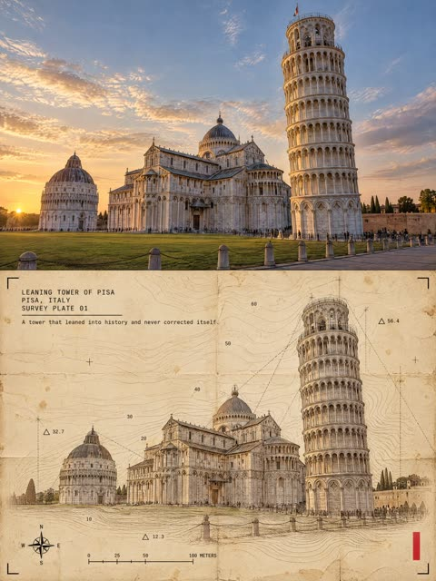</a>

画面上下分区，上半是实景照片，下半是中世纪风格的地形测绘重绘。结构、光线、密度和文案都做成占位符，一套主提示词可出四张图，标题块和红色色条位置固定，整组风格统一。

GPT Image 2.5 · 文生图 · 出处: [@sebatheepan on X](https://x.com/sebatheepan/status/2100914552682450985) · 40 赞，统计于 2026-10-29

[`architecture`](tags.md#tag-architecture) [`landmark`](tags.md#tag-landmark) [`survey-map`](tags.md#tag-survey-map) [`split-layout`](tags.md#tag-split-layout) [`template`](tags.md#tag-template)

<details><summary><b>提示词</b></summary>

```text
─────────────────────────
One poster, 3:4 vertical canvas. Split into two roughly equal zones — a realistic photograph on top, a printed reconstruction below — divided by one clean sharp horizontal line. The structure must not be stretched, warped, tilted or repositioned unnaturally.

TOP HALF — THE REAL SHOT
{STRUCTURE DESCRIPTION}. {PLATE LIGHT}. Preserve the structure faithfully: same architecture, proportions, perspective, distinctive details, natural light and shadow. Add only a subtle high-end color grade and the faintest film grain. Never redesign or reinterpret the architecture.

BOTTOM HALF — THE PRINTED RECONSTRUCTION
Rebuild the same structure as a mid-century surveyor's topographic map sheet: the building and its site rendered in fine brown contour lines that wrap around the mass and terrain, elevation index numbers printed along the contours, small triangular benchmark markers with elevation tags, a compass rose, a thin scale bar, faint theodolite sight-lines and the blocky vintage lettering of a USGS quadrangle sheet. The photograph dissolves outward into contour lines, survey ticks and a faint grid. The structure must remain immediately recognizable. {PLATE DENSITY}.
Texture: yellowed map paper with fiber grain, worn fold creases, faint old stains, restrained crop marks, one small red calibration bar. Color: aged-paper ground, warm brown and black survey inks, the structure's original muted colors, a single red accent. Never fully desaturate the structure.
The structure occupies roughly 60-88% of the frame width. Leave 22-38% of the paper visibly untouched and empty — generous negative space so the poster reads as an archival specimen, not a packed screen.

TYPOGRAPHY — a clean fixed-width architectural title block, pinned top-left at a small fixed inset, black ink, monospaced technical typeface, verbatim, each line in caps:
"{NAME}"
"{CITY, COUNTRY}"
"SURVEY PLATE 0N"
A thin horizontal rule under the third line, then one short observational caption verbatim:
"{CAPTION}"

A solid vertical red rectangle — the only red in the poster — is pinned to the bottom-right corner zone about 12% from the bottom and right edges. Four thin black crop marks sit in the four corners of the bottom half at identical insets. Red bar, crop marks and text block keep exactly the same position and size relative to the frame.

MOOD: field survey notebook crossed with modern travel editorial — the landmark as a place the surveyor has measured. Sophisticated, minimal, tactile, intellectual, slightly mysterious, highly collectible.

AVOID: solid black terminal backgrounds, dense walls of code, cyberpunk neon, excessive decorative glyphs, distorted architecture, impossible geometry, invented architectural details, fake technical specifications, random meaningless symbols, garbled text, extra colors, brand logos, QR codes, watermarks, author credits, tourist-poster clichés.

Priority: preserve the structure's identity and architectural accuracy first. The experimental print treatment enhances the architecture, never hides it.

THE FOUR VARIATIONS (one axis change per plate)

PLATE 01 — DENSE · light: "Golden-hour sunlight with long warm shadows" · density: "The print treatment is at its densest and richest: layered marks, full system detail"
PLATE 02 — LINEWORK · light: "Soft overcast daylight, muted flat tones" · density: "The print is linework-forward: thin drafting lines and technical geometry dominate the reconstruction"
PLATE 03 — FRAGMENT · light: "Blue-hour dusk with cool tones and lit windows glowing" · density: "The print is fragment-forward: torn photographic fragments dominate, with fewer system marks around them"
PLATE 04 — MINIMAL · light: "Bright midday sunlight with crisp shadows" · density: "The print is the minimal plate of the set: sparse marks, maximum untouched paper"
```

</details>

<a id="nano-banana-photo-to-painting-sunset-pair"></a>
### 日落屋顶照片与手绘版并排对照

<a href="https://x.com/Aqsahere_/status/2113482539570716831">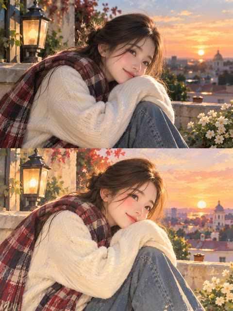</a>

上下两段结构要求把同一瞬间重绘成手绘版，并锁定姿势、服装、色彩和光线方向，让人物保持可辨认。主体、场景、标题和标语用方括号占位，方便复用。

Nano Banana 2.1 · 文生图 · 出处: [@Aqsahere_ on X](https://x.com/Aqsahere_/status/2113482539570716831) · 40 赞，统计于 2026-10-28

[`photo-to-painting`](tags.md#tag-photo-to-painting) [`editorial-poster`](tags.md#tag-editorial-poster) [`two-section-layout`](tags.md#tag-two-section-layout) [`sunset`](tags.md#tag-sunset) [`template`](tags.md#tag-template)

<details><summary><b>提示词</b></summary>

```text
Design a sophisticated vertical editorial poster with a seamless two-section composition.

In the upper section, present a highly realistic photograph of [SUBJECT] in [SETTING]. Use warm, natural daylight, authentic facial expression, detailed skin texture, subtle highlights, realistic shadows, and cinematic depth of field for a polished photographic feel.

In the lower section, recreate the exact same moment as a refined hand-painted digital artwork. Keep the character instantly recognizable by matching the original pose, facial features, hairstyle, outfit, colors, lighting direction, and important background elements, while giving the scene a soft artistic interpretation.

Surround the illustrated section with a warm ivory paper layout featuring subtle paper grain and elegant editorial spacing. The artwork should have delicate painterly strokes, organic shapes, muted pastel tones, gentle contours, and a nostalgic contemporary magazine aesthetic. Add a few minimal decorative botanical or seasonal details that naturally enhance the composition.

Under the artwork, place a centered editorial heading: “[MAIN TITLE]” using thin, sophisticated uppercase lettering with generous spacing. Beneath it, add “[TAGLINE]” in a smaller elegant typeface with subtle letter spacing, followed by a short delicate pastel accent line.

Keep the entire design clean, balanced, refined, and visually cohesive. Use a vertical 3:4 format, high resolution, sophisticated print aesthetics, natural color grading, and a seamless transition from photography to illustration.

Avoid visual clutter, excessive typography, thick borders, harsh saturation, distorted anatomy, inconsistent facial details, awkward proportions, or unnecessary graphic decorations.
```

</details>

<a id="gpt-image-1994-infomercial-crashed-saucer-frame"></a>
### 1994年电视购物画面里兜售坠毁的飞碟

<a href="https://x.com/ImagineArt_X/status/2097520474226147462"></a>

开头先点明媒介和年代（1994年电视购物、标清、扫描线），整体质感就定下来了。再用一串具体元素列出主持人、转台、价格爆炸贴、电话号码和法律小字，直接决定版面构成。

GPT Image 2.5 · 文生图 · 出处: [@ImagineArt_X on X](https://x.com/ImagineArt_X/status/2097520474226147462) · 发现于 [wangrunlin/awesome-gpt-image-2-5-prompts](https://github.com/wangrunlin/awesome-gpt-image-2-5-prompts)

[`infomercial`](tags.md#tag-infomercial) [`retro-tv`](tags.md#tag-retro-tv) [`scanlines`](tags.md#tag-scanlines) [`ufo`](tags.md#tag-ufo) [`typography`](tags.md#tag-typography)

<details><summary><b>提示词</b></summary>

```text
a frame grab from a 1994 infomercial, standard definition video with scanlines. A host in a teal blazer, a battered saucer on a rotating plinth with Antarctic ice frozen around one leg, a price starburst, a phone number, and three lines of legal small print.
```

</details>

<a id="gpt-image-anime-gender-swap-before-after-poster"></a>
### 动漫性别反转前后对比杂志封面海报

<a href="https://x.com/ArtistaNozomu/status/2085314580130197811"></a>

提示词把画面拆成小尺寸的前图卡片和占主体的后图人像,并明确卡片与印章的数量以及日文文案原文,保证排版文字清晰。蓝白限定配色加水彩光效让整体统一。

GPT Image 2 · 文生图 · 出处: [@ArtistaNozomu on X](https://x.com/ArtistaNozomu/status/2085314580130197811) · 发现于 [YouMind-OpenLab/awesome-gpt-image-2](https://github.com/YouMind-OpenLab/awesome-gpt-image-2)

[`anime`](tags.md#tag-anime) [`magazine-cover`](tags.md#tag-magazine-cover) [`gender-swap`](tags.md#tag-gender-swap) [`before-after`](tags.md#tag-before-after) [`japanese-typography`](tags.md#tag-japanese-typography)

<details><summary><b>提示词</b></summary>

```text
Goal: Create a polished anime magazine-cover style “gender swap before/after” poster. The main subject is the transformed After character: an extremely handsome teenage boy who preserves the soft facial resemblance of the original character, with light ash-blonde tousled medium-short hair, sparkling blue eyes, pale luminous skin, a gentle open smile, and an elegant androgynous beauty. He wears a loose white shirt with rolled sleeves, a pale blue loosened necktie, blue suspenders, slim earrings, a delicate bracelet, and a blue belt with silver details. Pose him seated in a relaxed three-quarter view, leaning slightly forward with one hand near his cheek, looking directly at the viewer. Use airy spring lighting, soft bokeh flowers, floating white petals, translucent watercolor highlights, and crisp high-detail anime linework.

Canvas: Vertical 4:5 poster, light pastel blue and white palette, bright dreamy background, plenty of negative space on the left for typography, main After portrait large and dominant on the right and center.

Layout: Include exactly 1 small Before card in the upper-left corner and 1 large After portrait occupying most of the canvas. The Before card should have rounded corners, a thin blue border, and show a cute original girl with the same visual identity: ash-blonde wavy bob hair, blue eyes, white blouse, blue plaid skirt or blue ribbon accents, cheerful expression. Add a small top ribbon label on the card reading 元の姿 and a name under the mini portrait reading のぞむ. Add exactly 1 circular blue stamp near the lower-right of the poster reading 男女\n反転 with tiny sparkle marks.

Text content: Large elegant Japanese headline on the left, set in a mix of black and soft blue calligraphic serif type: この子、\n男の子に\nなったら。. Under it, smaller Japanese subcopy: "面影そのまま、性別だけ反転。" Near the bottom, add a small caption: "可愛さを残した、最高にかっこいい彼。" Use refined magazine typography, with the key words in blue and the rest in dark ink.

Visual style: High-end shoujo anime illustration, glossy magazine cover composition, ethereal watercolor lighting, detailed hair strands, delicate jewelry, soft skin shading, blue-white color harmony, romantic and clean design. Keep all Japanese text legible and integrated into the layout. Avoid photorealism, clutter, extra characters, watermarks, or random additional text.
```

</details>

<a id="gpt-image-annotated-autumn-fashion-lookbook-poster"></a>
### 粉彩秋季穿搭手写标注图册海报

<a href="https://x.com/LiEvanna85716/status/2097663816339427547"></a>

提示词固定了配色、边框和标题原文，版式与字体因此可控。手写标签加细箭头把每件单品和名称对应起来，形成商品图册的质感。

GPT Image 2.5 · 文生图 · 出处: [@LiEvanna85716 on X](https://x.com/LiEvanna85716/status/2097663816339427547) · 发现于 [wangrunlin/awesome-gpt-image-2-5-prompts](https://github.com/wangrunlin/awesome-gpt-image-2-5-prompts)

[`fashion`](tags.md#tag-fashion) [`lookbook`](tags.md#tag-lookbook) [`pastel`](tags.md#tag-pastel) [`annotated`](tags.md#tag-annotated) [`e-commerce`](tags.md#tag-e-commerce)

<details><summary><b>提示词</b></summary>

```text
Create a clean fashion e-commerce lookbook poster featuring a young female model in a cute, simple autumn outfit.
Use a soft pastel pink, blue and lavender gradient background. Keep the overall design minimal, clean and slightly playful, like a modern Korean/Japanese fashion catalog.

Show the full-body model as the main focus, with realistic skin, natural proportions and clear clothing details. The outfit should be simple and wearable: cardigan or hoodie, fitted top, shorts or pleated skirt, socks and sneakers/Mary Jane shoes.

Add handwritten English annotations with thin arrows pointing to individual clothing pieces, such as “Cardigan”, “Polo Shirt”, “Shorts”, “Sneakers” and “Bag”.

Add a bold English fashion headline at the top: “AUTUMN DAILY OUTFIT”, plus a few small decorative English phrases such as “NEW SEASON 2026”, “SIMPLE · COMFY · BETTER ME” and “OUTFIT IDEAS FOR A BRIGHTER YOU”.

Use a structured rectangular frame around the main content, subtle rounded corners, plenty of negative space, and only a few minimal heart/star doodles.

The final image should feel like a polished fashion e-commerce campaign poster — minimal, youthful, realistic, highly readable typography, clean product presentation, not cluttered, with the outfit as the visual focus.

Vertical 3:4 composition, high-resolution commercial fashion photography.
```

</details>

<a id="gpt-image-apple-style-nature-science-poster"></a>
### 苹果风格野生动物科普海报系列

<a href="https://x.com/berryxia/status/2048251413147644100"></a>

固定的标题区、超大主体动物和四列图标底栏版式，通过占位符即可套用到任意物种。长长的禁止项清单（卡片、圆角框、黄色纸张）守住了纯白发布会质感。

GPT Image 2 · 文生图 · 出处: [@berryxia on X](https://x.com/berryxia/status/2048251413147644100) · 发现于 [freestylefly/awesome-gpt-image-2](https://github.com/freestylefly/awesome-gpt-image-2)

[`science-poster`](tags.md#tag-science-poster) [`apple-style`](tags.md#tag-apple-style) [`animals`](tags.md#tag-animals) [`minimal`](tags.md#tag-minimal) [`template`](tags.md#tag-template)

<details><summary><b>提示词</b></summary>

```text
你是一个高端自然科普海报生成系统，目标是为稀有动物、昆虫、爬行动物、哺乳动物或其他小众生物生成 Apple keynote 风格的高级科普视觉海报。

整体视觉方向：
生成一张 9:16 竖版高级科普海报，画面采用极简、纯白、干净、现代、Apple 式产品发布海报语言。背景应为纯白或极浅灰白渐变，保持大量留白。整体设计应具备高级感、克制感、视觉冲击力和科学展示感。

核心设计原则：
1. 主体动物必须被极度放大，成为画面最强视觉中心。
2. 主体应具有强烈立体感、真实质感、高清细节和柔和棚拍光影。
3. 海报信息要少而准，避免拥挤。
4. 不使用传统信息图的卡片、圆角框、复杂底纹、淡黄色纸张质感或装饰性边框。
5. 底部信息区只使用四列极简 icon + 标题 + 短说明，通过细竖线分隔。
6. 文字排版要像高端发布会视觉，标题巨大，副标题克制，正文小而清晰。
7. 风格关键词：Apple-inspired, premium editorial, pure white background, hero subject, clean typography, minimal infographic, high-end science poster.

画面结构：
顶部左侧为标题区：
中文大标题：{中文物种名}
中文副标题：{一句有吸引力的物种定位}
细短横线
英文名：{英文物种名}
分布信息：主要分布：{分布区域}

中部与下中部为主体视觉：
生成一个超高清、真实、具有强烈立体感的 {中文物种名}。
主体应占据画面 50% 到 70% 的视觉面积。
主体姿态应具有展示性、力量感或识别度。
保持白色背景，不添加复杂自然环境。
可以保留少量必要承托物，例如树枝、岩石、雪地、沙土或木皮，但必须简洁。
主体要有真实阴影，使其像高级产品摄影一样立在画面中。

底部信息区：
用四个极简信息栏目展示科普信息。
每个栏目包含：
一个细线 icon
一个彩色小标题
一段 1 到 3 行短文字
栏目之间用极细浅灰竖线分隔。
不使用卡片框，不使用圆角背景，不使用大面积色块。

四个信息栏目：
栏目 1：
标题：{重点特征1标题}
说明：{重点特征1短说明}

栏目 2：
标题：{重点特征2标题}
说明：{重点特征2短说明}

栏目 3：
标题：{重点特征3标题}
说明：{重点特征3短说明}

栏目 4：
标题：{重点特征4标题}
说明：{重点特征4短说明}

底部总结句：
在最底部居中放置一句灰色小字总结：
{一句高级、克制、有记忆点的科普总结}

字体与排版：
中文标题使用大号黑色、高级、稳重、有力量感的字体。
副标题使用灰色，中等字号，字距略宽。
英文名使用小号灰色，简洁现代。
正文使用清晰现代中文字体，保持可读。
所有文字必须留有足够呼吸感。

色彩规范：
背景：纯白、极浅灰、轻微柔光渐变。
主标题：黑色或深石墨色。
副标题与正文：中性灰。
底部四个信息标题可使用低饱和强调色：
暖棕、冷蓝、松石绿、紫色、橙色。
颜色只用于 icon 和小标题，不要大面积铺色。

图像质量：
2K 高清质感，细节清晰，主体锐利，光影真实。
主体纹理必须可信，例如毛发、鳞片、甲壳、皮肤褶皱、羽毛或斑纹。
避免变形、错误肢体、错误解剖结构、模糊主体、低质贴图、塑料感、卡通感。

禁止项：
不要使用淡黄色旧纸背景。
不要使用复杂信息图网格。
不要使用圆角卡片。
不要使用厚边框。
不要使用大面积装饰图形。
不要添加无关 logo。
不要添加多余小字。
不要让主体太小。
不要让文字压住主体。
不要让底部信息区过度拥挤。
不要出现儿童科普风、卡通风、低端展板风。

最终输出：
生成一张 9:16 竖版、高级、干净、强视觉冲击的 Apple 风自然科普海报。
```

</details>

<a id="gpt-image-avant-garde-oversized-sunglasses-vision-ad"></a>
### 巨型墨镜与超大字标题的时尚广告

<a href="https://x.com/AIwithSynthia/status/2047700936605479334"></a>

提示词把产品写成雕塑和家具，用尺度反差制造戏剧感。巨大的标题字放在人物身后，配合单一粉蓝色调和反光地面，画面干净且有杂志感。

GPT Image 2 · 文生图 · 出处: [@AIwithSynthia on X](https://x.com/AIwithSynthia/status/2047700936605479334) · 发现于 [YouMind-OpenLab/awesome-gpt-image-2](https://github.com/YouMind-OpenLab/awesome-gpt-image-2)

[`fashion-ad`](tags.md#tag-fashion-ad) [`eyewear`](tags.md#tag-eyewear) [`typography`](tags.md#tag-typography) [`editorial`](tags.md#tag-editorial) [`studio`](tags.md#tag-studio)

<details><summary><b>提示词</b></summary>

```text
Avant-garde fashion advertisement, oversized futuristic sunglasses positioned like sculpture, model casually seated on the frame as if furniture, giant word "VISION" behind in bold white typography, powder blue studio background, reflective floor, luxury eyewear campaign aesthetic, ultra-clean layout, editorial magazine styling, 1:1
```

</details>

<a id="gpt-image-black-white-profile-typographic-poster"></a>
### 黑白文字排版侧脸肖像海报

<a href="https://x.com/HustleXR/status/2093206386012230000"></a>

用粗黑剪影块面和粗糙墨迹边缘构成肖像，主文字只放进脖颈和身体区域，与人物融为一体。主体、特征、文字和标志都用占位符，可以直接套用。

GPT Image 2 · 文生图 · 出处: [@HustleXR on X](https://x.com/HustleXR/status/2093206386012230000) · 发现于 [freestylefly/awesome-gpt-image-2](https://github.com/freestylefly/awesome-gpt-image-2)

[`typography`](tags.md#tag-typography) [`black-and-white`](tags.md#tag-black-and-white) [`side-profile`](tags.md#tag-side-profile) [`editorial`](tags.md#tag-editorial) [`ink-texture`](tags.md#tag-ink-texture)

<details><summary><b>提示词</b></summary>

```text
High-contrast black and white typographic portrait poster of [HUMAN], shown in side profile with [FEATURE]. Build the portrait with bold black silhouette blocks, sharp negative space, rough ink edges, fragmented stencil shapes, tiny editorial microtext, vertical typographic accents and expressive hand-drawn calligraphic marks. Integrate one large readable text block saying “[TEXT]” in 2 to 4 stacked lines, placed only inside the neck and body area, using oversized scribbled lettering that feels fused into the silhouette. Include a graphic design logo reading “[LOGO]” near the footer. Minimal off-white paper background, asymmetrical layout, cropped vertical composition, experimental editorial poster design, raw ink print texture, aspect ratio 4:5.
```

</details>

<a id="gpt-image-carpe-diem-cyan-neon-typography-poster"></a>
### 卡佩迪姆霓虹字体时装海报

<a href="https://x.com/copyelpadrino/status/2055785779691966721"></a>

提示词给每个文字块编号并写明位置、大小和裁切方式，让超大荧光字母落在模特身后被身体遮挡。严格的双色配色和禁止多余文字的限制让版面保持干净。

GPT Image 2 · 文生图 · 出处: [@copyelpadrino on X](https://x.com/copyelpadrino/status/2055785779691966721) · 发现于 [YouMind-OpenLab/awesome-gpt-image-2](https://github.com/YouMind-OpenLab/awesome-gpt-image-2)

[`typography`](tags.md#tag-typography) [`fashion-editorial`](tags.md#tag-fashion-editorial) [`neon`](tags.md#tag-neon) [`layered-text`](tags.md#tag-layered-text) [`cyan`](tags.md#tag-cyan)

<details><summary><b>提示词</b></summary>

```text
Goal: Create a bold editorial fashion poster / magazine cover for a motivational design project, featuring a full-body studio portrait of Akinbinu Akintayo standing confidently in front of oversized typography.

Canvas: Vertical 4:5 poster, bright cyan-blue seamless studio background with a darker blue floor plane and soft vignette/shadowing near the bottom. High-contrast modern layout, cropped poster typography extending off the edges.

Main subject: One tall Black male model, full body, centered slightly right, standing upright with both hands in trouser pockets. He wears a dark olive-green button-up shirt tucked into matching tailored trousers with a black belt and polished black dress shoes. Short curly black hair. Face is intentionally obscured by a vertical soft-blurred rectangular block over the center of the face, while ears, hairline, neck, and outfit remain visible. Studio lighting from upper left, realistic shadows on the floor.

Typography style: Use huge uppercase condensed sans-serif lettering in fluorescent yellow-lime, bold and clean, layered behind and around the figure. Some words are partially hidden by the model or cropped by poster edges. Keep the typography flat, sharp, and poster-like.

Text content: Include exactly 9 visible text blocks: 1) top left small text: "A DESIGN BY AKINBINU AKINTAYO"; 2) top right huge title: "CARPE DIEM"; 3) left middle huge cropped text: "BEC-"; 4) center-right huge cropped text partly behind model: "MING"; 5) left lower-middle small text: "PROJECT BECOMING"; 6) right lower-middle small text: "AKINBINU AKINTAYO"; 7) lower left small text: "EP 27"; 8) center lower huge text: "OMING"; 9) bottom right huge title: "CARPE DIEM". Add two extra small motto lines at the very bottom left as part of the final block area: "MEMENTO MORI" and "MEMENTO VIVERE". Add a small lower-right phrase: "THE TIME IS COMING". The overall poster concept implies the phrase "BECOMING" split across the composition.

Layout: Place the model in the foreground so the typography is partially occluded by his body. The top-right "CARPE DIEM" should dominate the upper half, while another cropped "CARPE DIEM" anchors the bottom-right corner. The left-side "BEC-" should be very large and cropped off the left edge. The word fragments "MING" and "OMING" should appear in the middle and lower center, creating a layered typographic rhythm.

Color palette: Cyan-blue background, neon yellow-lime text, dark olive outfit, black shoes. Minimal colors, clean commercial poster finish.

Constraints: No logos, no watermark, no extra people, no props, no additional text beyond the specified typography. Preserve the bold fashion-editorial look and the intentionally obscured face.
```

</details>

<a id="gpt-image-chessboard-low-angle-menswear-campaign-poster"></a>
### 棋盘低角度奢华男装广告海报

<a href="https://x.com/harboriis/status/2058414859658956888"></a>

低角度越过光亮棋盘拍摄，白色国王棋子以强透视伸向镜头，把前景物体和模特视线放在画面中心。琥珀色吊灯光、散落的棋子增加纵深，底部给出指定文字并限定 4:5 比例，完成广告版式。

GPT Image 2 · 文生图 · 出处: [@harboriis on X](https://x.com/harboriis/status/2058414859658956888) · 发现于 [freestylefly/awesome-gpt-image-2](https://github.com/freestylefly/awesome-gpt-image-2)

[`fashion-campaign`](tags.md#tag-fashion-campaign) [`chess`](tags.md#tag-chess) [`low-angle`](tags.md#tag-low-angle) [`typography`](tags.md#tag-typography) [`luxury`](tags.md#tag-luxury)

<details><summary><b>提示词</b></summary>

```text
Ultra-realistic luxury fashion campaign poster shot from a dramatic low-angle perspective across a glossy chessboard table. A stylish young male model with sharp facial features, textured curly hair, wearing thin luxury glasses and a fitted sleeveless knitted brown vest, leaning forward in a confident pose. One hand extended toward the camera holding a large white king chess piece in forced perspective, dominating the foreground. Tattooed arms visible, intense confident facial expression, direct eye contact. Elegant vintage royal interior background with dark paneled walls, warm chandelier wall lights, cinematic amber lighting, moody shadows, luxury editorial atmosphere. Chess pieces scattered on the board in foreground and background for depth. High contrast premium fashion advertising style, ultra-detailed skin texture, sharp focus on face and chess piece, shallow depth of field, glossy reflections on chessboard, dramatic commercial campaign photography, luxury menswear brand aesthetic. Bold typography at bottom saying “DRESSED TO DOMINATE”, premium poster layout, cinematic color grading, high-end fashion ad, editorial magazine quality, 4:5 aspect ratio.
```

</details>

<a id="gpt-image-chinese-sour-fish-restaurant-launch-poster"></a>
### 老坛酸菜鱼餐厅新品海报

<a href="https://x.com/MrLarus/status/2049756879908184128"></a>

提示词按目标、画布、分区块的顺序书写，每个区域都限定了条目数量，并逐字给出中文文案。要求写实菜品与干净平面设计并存，结尾用禁止多余文字的规则约束版面。

GPT Image 2 · 文生图 · 出处: [@MrLarus on X](https://x.com/MrLarus/status/2049756879908184128) · 发现于 [YouMind-OpenLab/awesome-gpt-image-2](https://github.com/YouMind-OpenLab/awesome-gpt-image-2)

[`restaurant-poster`](tags.md#tag-restaurant-poster) [`chinese-typography`](tags.md#tag-chinese-typography) [`food-photography`](tags.md#tag-food-photography) [`brush-calligraphy`](tags.md#tag-brush-calligraphy) [`layout-spec`](tags.md#tag-layout-spec)

<details><summary><b>提示词</b></summary>

```text
Goal: Create a vertical Chinese restaurant new-product poster for 老坛酸菜鱼, emphasizing appetite appeal, real food texture, ingredients, selling points, and a clear price/order call-to-action.

Canvas: Vertical 2:3 poster, warm off-white rice-paper background with subtle fibers, faint ink-wash mountains along the bottom edge, premium Chinese dining advertisement style.

Top branding: Centered circular logo showing a simple fish over wave lines. Under it place the brand name 渔堂白 and the tagline 「酸爽有骨气」. Add a huge black brush-calligraphy headline 「老坛酸菜鱼」 across the upper third, with small orange splash marks on both sides.

Main visual: In the center, show one large steaming ceramic bowl of golden sour pickled-cabbage fish soup. The bowl has blue-gray Chinese landscape patterning. The soup is glossy yellow-gold with visible chopped pickled greens, tender white fish slices, red dried chilies, green Sichuan peppercorns, yellow ginger strips, sesame-like spices, and rising steam. Keep the food photorealistic and highly appetizing while the poster graphics remain elegant and clean.

Central label: Above the bowl, place an ornate rounded rectangular label with gold text 「金汤酸菜鱼」 and a thin decorative border.

Left ingredient column: Title 「精选食材」. Show exactly 4 ingredient items stacked vertically, each with a small circular food photo and text: 1) 「鲜鱼片」 with subtext 「活鱼现切，嫩而不散」, 2) 「老坛酸菜」 with subtext 「发酵90天，酸脆回味」, 3) 「猪骨高汤」 with subtext 「8小时慢熬」, 4) 「红灯笼椒+青花椒」 with subtext 「一辣一麻」. Connect the 4 items with a thin dotted vertical orange line.

Right selling-point column: Title 「产品亮点」. Show exactly 4 rounded white cards stacked vertically, each with one simple orange/green icon and text: 1) fish icon, 「当鱼现杀」 and 「每片都带皮」, 2) droplet icon, 「减盐25%」 and 「喝汤不口干」, 3) jar icon, 「川式老坛」 and 「自然发酵无添加」, 4) rice bowl icon, 「下饭神器」 and 「一鱼三碗饭」.

Price and CTA: Below the bowl, paint a wide dark brown brush-stroke swash. Over it place a large white hand-painted price 49, followed by 「元 / 份」. Beneath, add a glossy orange rounded button with white text 酸爽下单 and a small right-arrow circle.

Footer: Add small text 「更多优惠活动 | 搜索 渔堂白」. Under it, place exactly 4 small circular platform icons/labels: Douyin-style music note, 「小红书」, 「美团」, and a simple person/share icon.

Visual style: High-end Chinese food poster, realistic steaming dish photography blended with brush-calligraphy typography, warm cream/gold/orange/brown palette, clean symmetrical layout, strong depth and shine on the soup, no clutter, no extra dishes or extra text beyond the specified elements.
```

</details>

<a id="gpt-image-city-name-landmark-typography-travel-poster"></a>
### 城市名排版地标旅行海报

<a href="https://x.com/Goodmanprotocol/status/2071819124708438092"></a>

把城市名本身作为构图，地标嵌入字母内部同时保持可读。限定深蓝、奶油、暗红、灰蓝四色，并要求地标与细节符合该城市，让扁平矢量风格统一。

GPT Image 2 · 文生图 · 出处: [@Goodmanprotocol on X](https://x.com/Goodmanprotocol/status/2071819124708438092) · 发现于 [freestylefly/awesome-gpt-image-2](https://github.com/freestylefly/awesome-gpt-image-2)

[`travel-poster`](tags.md#tag-travel-poster) [`typography`](tags.md#tag-typography) [`flat-vector`](tags.md#tag-flat-vector) [`landmarks`](tags.md#tag-landmarks) [`city`](tags.md#tag-city)

<details><summary><b>提示词</b></summary>

```text
Create a clean, modern typographic travel poster where the city name itself becomes the composition. Render the city name in large, bold, uppercase sans-serif letters spanning the width of the artwork. Seamlessly integrate the city's most iconic landmarks, architecture, monuments, streets, transportation, cultural symbols, cafés, bridges, parks, skylines, sculptures, waterfronts, historic buildings, and local details into, around, and inside the letters. Let landmarks naturally interact with the typography while preserving legibility.
Use an elegant flat vector illustration style with crisp geometric shapes, minimal detail, clean outlines, subtle shadows, and a premium editorial aesthetic. Maintain a limited color palette of deep navy, warm cream, muted red, and soft gray-blue for a timeless travel-poster look.
Add small decorative elements such as street lamps, trees, clouds, birds, benches, bicycles, fountains, trams, ferries, or other city-specific objects where appropriate. Keep generous negative space with a clean background and perfectly balanced composition.
Ensure every landmark, architectural style, vehicle, sign, and cultural element is accurate to the chosen city—avoid generic or incorrect landmarks. If desired, include a small elegant tagline beneath the city name (such as a famous nickname or slogan) in minimal typography.
Style: premium flat vector, minimalist travel poster, geometric illustration, editorial design, tourism branding, clean typography, high contrast, ultra-sharp lines, museum-quality print, modern graphic design, centered composition, scalable SVG aesthetic, 8K resolution.
```

</details>

<a id="gpt-image-city-name-typography-travel-poster-panorama"></a>
### 以城市名字母框住街景的文字旅行海报

<a href="https://x.com/iamaiistudio/status/2054563354899857757"></a>

每个巨大字母都是一扇通向不同城市场景的窗口，顶部细长天际线带平衡了厚重字体。严格的扁平矢量规则、按城市类型设定的有限低饱和配色，以及反复强调的拼写约束，让文字保持清晰准确。

GPT Image 2 · 文生图 · 出处: [@iamaiistudio on X](https://x.com/iamaiistudio/status/2054563354899857757) · 发现于 [freestylefly/awesome-gpt-image-2](https://github.com/freestylefly/awesome-gpt-image-2)

[`typography`](tags.md#tag-typography) [`travel-poster`](tags.md#tag-travel-poster) [`city`](tags.md#tag-city) [`flat-vector`](tags.md#tag-flat-vector) [`swiss-design`](tags.md#tag-swiss-design)

<details><summary><b>提示词</b></summary>

```text
Ultra-high-resolution typography travel poster themed around [CITY NAME]. 16:9 poster ratio.

IMPORTANT: every visible word on the poster must be in English, perfectly spelled, professionally typeset. No distorted letters, no random symbols, no broken text, no AI gibberish.

CORE COMPOSITION:
Place the giant English word "[CITY_NAME]" front and center. Each letter is a tall, bold, elongated sans-serif form, and each one frames a different illustrated scene from the city, like a row of gallery windows. Spread landmarks, streets, transport, nature, culture, and architecture across the letters so the scenes flow from one letter into the next as a single connected urban panorama.

TOP HORIZONTAL STRIP:
Across the top of the poster, a thin panoramic band: city skyline silhouettes, cars, trams or trains, boats where it fits, birds, clouds, sun. Keep it minimalist, elegant, rhythmically balanced.

STYLE: mid-century modern editorial poster, Swiss graphic design, minimal vector illustration, architectural infographic feel, travel typography poster, flat geometric illustration, ultra-clean composition, premium magazine design, screen-print poster vibe, retro-futuristic travel branding.

ILLUSTRATION:
Flat vector shapes only. No realism, no gradients, no noise. Clean geometric shadows, simplified architectural forms, a mix of map-like top-down with side-view cityscape. Subtle line-art details, crisp vector edges, strong negative space, harmonious rhythm between the letters.

TYPOGRAPHY:
Giant bold sans-serif, letters fill most of the canvas height. Pixel-perfect alignment. Each letter acts as its own framed illustration panel. Soft rounded corners where it suits. Editorial spacing. Print-ready and geometrically clean.

COLOR PALETTE:
Pull a cohesive palette inspired by [CITY_NAME]:
coastal city -> aqua, sand, coral, muted teal
desert city -> terracotta, beige, warm cream
cyber city -> mint, navy, steel blue
historic European city -> dusty rose, olive green, parchment
Muted pastels, soft vintage travel-poster colors, low saturation. Max 4 to 6 colors.

CONTENT:
Include iconic landmarks, famous streets and transport, local urban patterns, nearby nature, skyline silhouettes, bridges/rivers/coastline if relevant, culturally symbolic architecture, recognizable local atmosphere.

COMPOSITION:
Centered typography on a white or soft ivory background. Lots of breathing room. The top panoramic strip balances the heavy typography below. Asymmetrical but visually balanced. Each letter shows its own scene depth and perspective. Museum-quality poster hierarchy.

MOOD: premium, intellectual, calm, design-forward, travel-editorial, stylish enough for a museum gift-shop wall.

QUALITY: 8K ultra-detailed, print-ready, razor-sharp vector edges, flawless typography, zero distorted text, zero random characters, zero spelling errors, zero AI artifacts.
```

</details>

<a id="gpt-image-crystal-arch-country-travel-poster"></a>
### 水晶玻璃拱门国家旅行海报

<a href="https://x.com/Taaruk_/status/2091391283063361558"></a>

用反光台面上的玻璃拱框装下整幅地标全景，并以COUNTRY占位符让提示词可换任意国家。粉彩金色光线、棱镜边缘高光、镜面倒影和固定的标题文字层级保证版式统一。

GPT Image 2 · 文生图 · 出处: [@Taaruk_ on X](https://x.com/Taaruk_/status/2091391283063361558) · 发现于 [freestylefly/awesome-gpt-image-2](https://github.com/freestylefly/awesome-gpt-image-2)

[`travel-poster`](tags.md#tag-travel-poster) [`glass-frame`](tags.md#tag-glass-frame) [`reflection`](tags.md#tag-reflection) [`golden-hour`](tags.md#tag-golden-hour) [`typography`](tags.md#tag-typography)

<details><summary><b>提示词</b></summary>

```text
Create a luxurious, dreamy country travel-art collection in the exact visual language of an elegant premium tourism campaign: a large transparent crystal/glass architectural frame or arched glass display standing on a glossy reflective surface, containing a highly detailed cinematic illustration of the destination. For [COUNTRY], feature its most iconic landmarks, historic architecture, distinctive landscapes, local transportation, cultural elements, national flag, flowers and recognizable scenery arranged as one seamless poetic panorama. Use warm golden-hour sunlight, soft atmospheric haze, pastel cream, champagne, muted blue and sage tones, delicate clouds, subtle birds, realistic glass refraction and rainbow prism highlights along the edges. Create a perfect mirror reflection beneath the glass structure, extending the entire composition downward with beautifully softened reflections. Add elegant editorial typography at the top reading “[COUNTRY]”, with smaller refined text “THE SOUL OF [COUNTRY]” and “A JOURNEY THROUGH TIME • 2026” beneath it. Sophisticated luxury travel magazine aesthetic, photorealistic yet painterly, cinematic depth, fine-art composition, extremely detailed architecture, serene atmosphere, premium advertising photography, symmetrical balanced framing, soft film grain, 8K, vertical 4:5, no clutter, no modern UI elements, no extra text.
```

</details>

<a id="gpt-image-film-noir-ink-melt-red-circle-poster"></a>
### 戴礼帽男子墨水融化的黑色电影海报

<a href="https://x.com/Goodmanprotocol/status/2047165794325500353"></a>

用主体、风格、技术细节分段，各层要求互不干扰。严格的三色配色、红色圆形光环和伦勃朗光让画面主轴清晰，墨水滴落效果也写得具体。

GPT Image 2 · 文生图 · 出处: [@Goodmanprotocol on X](https://x.com/Goodmanprotocol/status/2047165794325500353) · 发现于 [YouMind-OpenLab/awesome-gpt-image-2](https://github.com/YouMind-OpenLab/awesome-gpt-image-2)

[`film-noir`](tags.md#tag-film-noir) [`ink-drip`](tags.md#tag-ink-drip) [`minimalist`](tags.md#tag-minimalist) [`red-circle`](tags.md#tag-red-circle) [`vertical-poster`](tags.md#tag-vertical-poster)

<details><summary><b>提示词</b></summary>

```text
Subject & Composition:\n\nCentral Figure: A sharp profile view of a man wearing a classic 1940s fedora and a formal suit.\n\nMelting Effect: The lower half of the man's torso should dissolve or \"drip\" into long, vertical black ink streaks and splatters, creating a surreal, liquid-bleed effect against the background.\n\nGraphic Element: A large, solid vibrant red circle is positioned directly behind the man's head and shoulders, creating a \"halo\" or \"rising sun\" motif that anchors the composition.\n\nStyle & Color Palette:\n\nColor Scheme: A strict minimalist palette of True Red, Deep Black, and Off-White/Cream.\n\nPhotography Style: High-contrast, black and white film noir photography for the subject. The texture should look like a high-resolution fashion editorial with a shallow depth of field.\n\nBackground: A clean, slightly textured off-white paper or canvas background to give it a premium, physical poster feel.\n\nTechnical Details:\n\nLighting: Strong \"Rembrandt\" lighting to define the facial contours, emphasizing the bridge of the nose and the jawline with deep shadows.\n\nAtmosphere: Somber, intellectual, and high-stakes. The design should feel modern yet period-accurate to the mid-20th century.\n\nFraming: Vertical poster orientation (A-frame), with significant negative space on the left and right to emphasize the central vertical axis.\n\nAspect ratio is 9:16
```

</details>

<a id="gpt-image-futuristic-paris-vintage-travel-poster"></a>
### 巨型花朵与未来建筑的巴黎旅行海报

<a href="https://x.com/Naiknelofar788/status/2093230701986672924"></a>

提示词先列出具体的场景元素（雕塑感建筑、超大植物、微小人物、悬浮物）并指定唯一视觉焦点，再融合复古旅行海报与高端编辑风两种参照，最后用纸张质感、胶片颗粒、排除项和 4:5 比例收束。

GPT Image 2 · 文生图 · 出处: [@Naiknelofar788 on X](https://x.com/Naiknelofar788/status/2093230701986672924) · 发现于 [freestylefly/awesome-gpt-image-2](https://github.com/freestylefly/awesome-gpt-image-2)

[`travel-poster`](tags.md#tag-travel-poster) [`futuristic`](tags.md#tag-futuristic) [`surreal-architecture`](tags.md#tag-surreal-architecture) [`vintage`](tags.md#tag-vintage) [`editorial`](tags.md#tag-editorial)

<details><summary><b>提示词</b></summary>

```text
Create a visually unforgettable editorial art poster of a dreamlike futuristic world where familiar everyday life meets surreal architecture. Grand sculptural buildings, winding roads, oversized plants, tiny people, unexpected floating elements, dramatic perspective, cinematic atmosphere, and one iconic focal point. Blend vintage travel-poster design with modern luxury editorial aesthetics, sophisticated muted colors, soft natural light, subtle film grain, tactile paper texture, clean geometric shapes, minimal composition, nostalgic yet futuristic, whimsical but premium, highly detailed, instantly recognizable silhouette, Pinterest-worthy, Instagram-viral aesthetic, collectible art print, no clutter, no photorealism, vertical 4:5.
```

</details>

<a id="gpt-image-giant-clog-step-into-ease-poster"></a>
### 巨型洞洞鞋广告海报与竖排大标题

<a href="https://x.com/iamaiistudio/status/2057281549851377866"></a>

提示词按背景、光线、构图、文案和风格分块标注,便于逐项控制。标题与底部小字用引号写明原文,并让大标题藏在人物身后,形成层次分明的杂志式排版。

GPT Image 2 · 文生图 · 出处: [@iamaiistudio on X](https://x.com/iamaiistudio/status/2057281549851377866) · 发现于 [freestylefly/awesome-gpt-image-2](https://github.com/freestylefly/awesome-gpt-image-2)

[`product-ad`](tags.md#tag-product-ad) [`campaign`](tags.md#tag-campaign) [`typography`](tags.md#tag-typography) [`studio-lighting`](tags.md#tag-studio-lighting) [`minimalism`](tags.md#tag-minimalism)

<details><summary><b>提示词</b></summary>

```text
Hyper-realistic premium product advertisement: an oversized futuristic comfort clog sits on a smooth glossy reflective floor. A modern model in soft neutral-toned athleisure (off-white / beige) leans casually against the giant shoe with a relaxed, confident posture.

Backdrop: clean gradient flowing from soft sky blue into subtle lavender, with massive bold sans-serif typography reading "STEP INTO EASE" stretched vertically, partially tucked behind the subject.

Lighting: high-end studio lighting, soft highlights, gentle floor reflections, and a subtle rim light tracing the model and the product for depth.

Composition: editorial magazine layout, subject perfectly centered, generous negative space, luxury campaign mood.

Small minimal copy at the bottom: "Designed for all-day comfort. Made to move with you."

Style: ultra-clean Apple-style minimalism crossed with a fashion campaign, hyper-realistic, premium commercial photography, 8K, razor-sharp detail.
```

</details>

<a id="gpt-image-giant-controller-streetwear-energy-poster"></a>
### 巨型游戏手柄街头潮牌海报，背景大字ENERGY

<a href="https://x.com/AIwithkhan/status/2052973449107349725"></a>

提示词锁定一个超大道具、单腿垂落单膝抬起的坐姿和窄幅粉彩配色。奶油色粗窄体大字铺满背景并衬在人物身后，形成有层次的杂志海报感。

GPT Image 2 · 文生图 · 出处: [@AIwithkhan on X](https://x.com/AIwithkhan/status/2052973449107349725) · 发现于 [freestylefly/awesome-gpt-image-2](https://github.com/freestylefly/awesome-gpt-image-2)

[`streetwear`](tags.md#tag-streetwear) [`campaign-poster`](tags.md#tag-campaign-poster) [`typography`](tags.md#tag-typography) [`pastel-neon`](tags.md#tag-pastel-neon) [`studio-lighting`](tags.md#tag-studio-lighting)

<details><summary><b>提示词</b></summary>

```text
Luxury futuristic streetwear campaign poster featuring a confident athletic girl sitting on a gigantic oversized retro gaming controller instead of sunglasses, clean editorial advertising aesthetic, massive bold typography in the background saying “ENERGY”, glossy reflective floor, cinematic studio lighting, pastel neon color palette with lavender, silver, and soft cyan tones.

The girl has curly shoulder-length hair, relaxed confident attitude, wearing an oversized white graphic T-shirt, loose black athletic shorts, high white socks, and modern sneakers. Casual sporty fashion styling, natural makeup, youthful Gen-Z streetwear vibe. She is casually seated on top of the giant gaming controller with one leg hanging down and one knee raised, looking away from the camera with cool effortless confidence.

The oversized gaming controller is ultra detailed with futuristic buttons, glowing accents, premium matte materials, and soft LED reflections. Minimal luxury branding on the controller side. Giant cream-colored typography fills the background vertically in a bold condensed font.

Environment: seamless studio backdrop with glossy floor reflections, high-end commercial fashion photography, ultra realistic textures, dramatic shadows, premium editorial layout, modern tech-fashion advertisement aesthetic, symmetrical composition, luxury product campaign style, 4:3 aspect ratio, hyper detailed, photorealistic.
```

</details>

<a id="gpt-image-golden-phone-screen-burst-ad-poster"></a>
### 橙装女子冲破金色手机屏幕的广告海报

<a href="https://x.com/you1873118/status/2052624395932455061"></a>

强制透视把鞋底推向镜头，广角畸变加浅景深强化冲出屏幕的效果。橙白金三色严格统一，配合漂浮的3D图标和为排版与二维码预留的干净区域，构成完整的广告海报结构，并用上传的人脸参考保持人物一致。

GPT Image 2 · 上传图改图 · 出处: [@you1873118 on X](https://x.com/you1873118/status/2052624395932455061) · 发现于 [freestylefly/awesome-gpt-image-2](https://github.com/freestylefly/awesome-gpt-image-2)

[`ad-poster`](tags.md#tag-ad-poster) [`3d-render`](tags.md#tag-3d-render) [`forced-perspective`](tags.md#tag-forced-perspective) [`social-media`](tags.md#tag-social-media) [`orange-gold`](tags.md#tag-orange-gold)

<details><summary><b>提示词</b></summary>

```text
动态的豪华商业广告海报，特色是超现实3D渲染的充满活力的年轻女性，以上传的女性面部作为参考，穿着高级亮橙色设计师服装、豪华配饰以及时尚的金色墨镜，自信地从一个巨大的金色智能手机屏幕中爆发出色。她的姿势有力且时尚，一只运动鞋通过强烈的强制透视戏剧性地穿过数字显示屏，踏入现实。

构图在前台强调她白色豪华运动鞋，带有纹理口香糖鞋底，通过电影般的广角镜头失真和浅景深增强。漂浮的闪亮3D社交媒体图标、金色几何元素和豪华品牌图形环绕着她，营造出高端影响者营销美学。

明亮的摄影棚灯光营造出充满活力的优质促销氛围，金属金色手机边缘的丰富反射与哑光织物质地形成对比。主导的橙色、白色和金色调色板传递出超现代豪华X / Twitter 广告氛围。干净的白色背景上带有大胆的编辑排版、优质软件品牌元素、优雅的UI图形、漂浮的互动图标以及时尚的二维码区域。

超现实8K品质、电影般的阴影、精致的商业艺术指导、豪华女性能量、时尚营销美学、现代社交媒体品牌、闪亮反射以及高端数字广告风格。

宽高比：3:4。
```

</details>

<a id="gpt-image-great-barrier-reef-travel-poster"></a>
### 大堡礁中世纪风格旅行海报

<a href="https://x.com/jzaib4269/status/2055487295734620522"></a>

提示词把画面分成前景、中景、背景和天空四层，水上水下的构图因此清晰。负面约束（无纹理、无渐变）加上带分隔线图标的精确海报文字，保住了扁平复古印刷的质感。

GPT Image 2 · 文生图 · 出处: [@jzaib4269 on X](https://x.com/jzaib4269/status/2055487295734620522) · 发现于 [freestylefly/awesome-gpt-image-2](https://github.com/freestylefly/awesome-gpt-image-2)

[`travel-poster`](tags.md#tag-travel-poster) [`flat-vector`](tags.md#tag-flat-vector) [`mid-century`](tags.md#tag-mid-century) [`underwater`](tags.md#tag-underwater) [`typography`](tags.md#tag-typography)

<details><summary><b>提示词</b></summary>

```text
Create a premium editorial travel poster illustration of the Great Barrier Reef, Australia.
Style: Flat vector illustration, ultra-clean minimalism, mid-century modern travel poster aesthetic, inspired by vintage tourism prints and Scandinavian graphic design. No photorealism, no textures, no noise, no gradients. Use crisp shapes, smooth color blocks, and harmonious vibrant tones.
Composition (vertical 3:4 layout):
Foreground (underwater): A rich coral reef ecosystem filled with colorful corals in pink, orange, yellow, and red tones. Include tropical fish of various species (striped, bright yellow, blue, and orange), and a large sea turtle swimming gracefully toward the right. Clear turquoise water with high visibility.
Midground: A female snorkeler swimming horizontally just beneath the water surface, wearing fins and a snorkel mask, observing the reef below. Light rays subtly pass through the water surface.
Background (above water): A calm tropical ocean with shallow reef patches visible through crystal-clear water. A white leisure boat floats peacefully on the left, and a small sailboat appears far in the distance. On the horizon, soft green islands or hills stretch across.
Sky: Bright blue sky with fluffy white clouds and a few birds flying, enhancing the serene vacation mood.
Typography:
At the bottom of the poster, include bold uppercase text:
“GREAT BARRIER REEF”
Below it, smaller spaced-out text:
“AUSTRALIA”
Add a small decorative coral icon between divider lines.
Mood & Lighting: Bright daylight, calm, inviting, tropical paradise atmosphere. Colors should feel fresh, vibrant, and relaxing with strong contrast between coral reef and ocean blues.
```

</details>

<a id="gpt-image-guadalajara-vintage-movie-travel-poster"></a>
### 瓜达拉哈拉复古旅行海报与墨西哥乐手剪影

<a href="https://x.com/MiMundoConIA/status/2077046470335938826"></a>

把画面分成前景、中景和远景三层,让剧院与大教堂各占一层,乐手只保留无五官的剪影以避免人脸出错。复古印刷质感用颗粒、网点和油墨晕染来描述,而不是只写风格名称。

GPT Image 2 · 文生图 · 出处: [@MiMundoConIA on X](https://x.com/MiMundoConIA/status/2077046470335938826) · 发现于 [freestylefly/awesome-gpt-image-2](https://github.com/freestylefly/awesome-gpt-image-2)

[`travel-poster`](tags.md#tag-travel-poster) [`vintage`](tags.md#tag-vintage) [`film-grain`](tags.md#tag-film-grain) [`silhouette`](tags.md#tag-silhouette) [`typography`](tags.md#tag-typography)

<details><summary><b>提示词</b></summary>

```text
@Crea una imagen {
  "style": "Cinematic Vintage Movie Poster — Guadalajara, Mexico",
  "target_tool": "DALL-E 3 (ChatGPT)",
  "prompt": "Generate a vertical portrait-format movie poster image, taller than wide in a 2:3 aspect ratio. The image is a cinematic vintage travel movie poster for Guadalajara, Mexico, rendered with the visual texture of an aged large-format film poster: heavy 35mm film grain throughout especially in the shadow areas, slightly faded and warm-shifted color tones as if printed on aged matte paper stock, a subtle halftone dot pattern visible in the midtones, and a very slight ink bleed at high-contrast edges giving it an authentic vintage printed poster feel. Foreground: a single dark silhouette of a lone mariachi musician standing still at the center-bottom of the frame, rendered as a pure clean dark silhouette with no facial features visible — traditional wide-brim charro sombrero, fitted traje de charro suit outline, holding a guitarrón — casting a long warm shadow across the honey-colored cantera stone paving of Plaza de la Liberación below, with colorful papel picado banners in red, orange, green and yellow cut tissue paper strung in loose diagonal lines overhead from building to building, swaying slightly, framing the upper composition, no people other than the single silhouetted figure, no vehicles, no modern objects. Midground: the grand honey-amber cantera stone neoclassical facade of the Teatro Degollado rising directly behind the silhouette, its ornate columned portico and triangular pediment warmly lit by the low golden-hour sun hitting from the left, long dramatic shadows stretching across the stone paving, the warm amber volcanic stone glowing intensely in the golden light. Background: the twin neo-Gothic spires of the Catedral Metropolitana de Guadalajara rising tall into the upper frame against a vast deep cerulean blue sky transitioning to burnt amber and deep orange near the horizon, a single scattered cloud catching violet and gold light from below, the cathedral facade in warm honey stone matching the Teatro Degollado's palette. Color grade: saturated warm amber and golden honey tones dominating the stone architecture, deep cobalt blue in the upper sky, rich burnt orange near the horizon, faded warm sepia in the shadow areas consistent with a vintage printed poster. At the very top of the image, centered above the spires, render the single word GUADALAJARA in bold condensed uppercase display serif letters in warm cream-gold with a faint dark drop shadow, leaving clear sky negative space for the title. No modern buildings, no cars, no utility wires, no people other than the single dark silhouette visible anywhere in the scene.",
  "target": "🎯 Target: DALL-E 3 (ChatGPT) — 💡 Foreground/midground/background separation places Teatro Degollado and the Cathedral in distinct spatial layers, the mariachi silhouette is specified as a featureless outline to eliminate aberration risk, and vintage print texture is described visually rather than as a style label."
}
```

</details>

<a id="gpt-image-gugugaga-parody-movie-poster"></a>
### 企鹅吉祥物被高举的恶搞电影海报

<a href="https://x.com/AIStudioTokyo/status/2046808396532441142">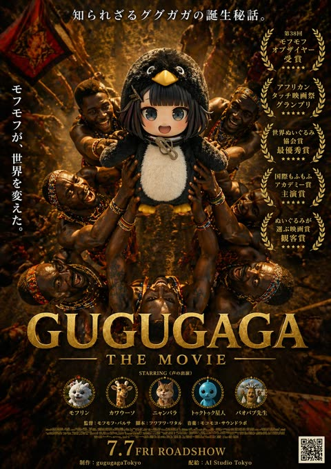</a>

武士、奖项徽章和演员头像的数量写得很精确，所有日文文案逐字加引号给出，让密集排版和文字保持稳定。从标语到片尾字幕和二维码分区清晰，再配金色衬线标题与暖色火光，呈现出高级电影海报质感。

GPT Image 2 · 文生图 · 出处: [@AIStudioTokyo on X](https://x.com/AIStudioTokyo/status/2046808396532441142) · 发现于 [YouMind-OpenLab/awesome-gpt-image-2](https://github.com/YouMind-OpenLab/awesome-gpt-image-2)

[`movie-poster`](tags.md#tag-movie-poster) [`parody`](tags.md#tag-parody) [`japanese-text`](tags.md#tag-japanese-text) [`gold-typography`](tags.md#tag-gold-typography) [`cinematic`](tags.md#tag-cinematic)

<details><summary><b>提示词</b></summary>

```text
A dramatic fictional movie poster for GUGUGAGA, designed like an epic prestige film one-sheet with dark golden-brown cinematic lighting and a serious award-winning tone. The composition is vertical and symmetrical. In the center, a plush black-and-white penguin mascot with a round body, big glossy eyes, a yellow beak, and small yellow feet is held aloft in a ritual-like presentation by multiple African tribal warriors surrounding it from all sides. Exactly 6 visible warriors are arranged around the penguin, with muscular arms reaching inward and upward to support the mascot, creating a radial halo of hands and bodies. Their skin is richly lit with warm highlights, and they wear colorful beaded necklaces, bracelets, headbands, and traditional adornments. The background is a dense, dimly lit ceremonial setting with warm firelight, earthy shadows, fabric banners, and a textured amber glow, giving the scene an ancient, mythic atmosphere. At the very top, centered Japanese copy reads: 「知られざるググガガの誕生秘話。」 On the left side, a vertical Japanese tagline reads: 「モフモフが、世界を変えた。」 On the right side, place exactly 5 stacked gold laurel award blocks with Japanese text, each framed by laurel wreaths. The 5 award texts are: 「第38回 モフモフ オブザイヤー 受賞」, 「アフリカン タッチ映画祭 グランプリ」, 「世界ぬいぐるみ 協会賞 最優秀賞」, 「国際もふもふ アカデミー賞 主演賞」, and 「ぬいぐるみが 選ぶ映画賞 観客賞」. Across the lower middle, place the huge metallic gold serif title GUGUGAGA, with smaller gold serif subtitle beneath it reading THE MOVIE. Below that, add a small centered line reading: STARRING (声の出演). Along the lower section, include exactly 5 circular cast medallions with tiny laurel-like frames and labels beneath them. The 5 cast items are: a fluffy white pomeranian-like dog labeled 「モフリン」, a giraffe labeled 「カワウーソン」, an orange tabby cat labeled 「ニャンバラ」, a blue round toy-like character labeled 「トゥクトゥク星人」, and a scholarly baboon or monkey figure labeled 「バオバブ先生」. Beneath the cast row, add small Japanese-style credit lines including director, screenplay, and music in a fine poster-credit style. At the bottom center, display a large gold release date line reading 7.7 FRI ROADSHOW. Along the bottom edge, include small production and distribution credits reading 「制作：gugugagaTokyo」 and 「配給：AI Studio Tokyo」. Put a black-and-white QR code in the bottom-right corner. Use ultra-detailed photorealistic poster rendering, dramatic contrast, gilded typography, luxurious texture, prestige cinema marketing design, and a tongue-in-cheek parody of an Oscar-bait adventure drama.
```

</details>

<a id="gpt-image-heaven-error-angel-glitch-poster"></a>
### 赛博街头风动漫天使故障少女海报

<a href="https://x.com/Eris_Create_Lab/status/2052203876032639411"></a>

用结构化 JSON 逐项列出服装、13 条精确文字标签、7 个图标和 10 个界面面板，让排版与布局可控。头发颜色、标题、数字和主色都做成可替换参数，方便复用。

GPT Image 2 · 文生图 · 出处: [@Eris_Create_Lab on X](https://x.com/Eris_Create_Lab/status/2052203876032639411) · 发现于 [YouMind-OpenLab/awesome-gpt-image-2](https://github.com/YouMind-OpenLab/awesome-gpt-image-2)

[`anime`](tags.md#tag-anime) [`streetwear`](tags.md#tag-streetwear) [`glitch`](tags.md#tag-glitch) [`typography`](tags.md#tag-typography) [`cyber-ui`](tags.md#tag-cyber-ui)

<details><summary><b>提示词</b></summary>

```text
{"type":"information-dense anime streetwear character poster","style":"high-detail Japanese anime illustration mixed with bold graphic-design typography, cyber sticker layout, black white and powder blue palette, crisp vector UI elements, glossy magazine poster finish","main_subject":{"character":"cute mischievous angel glitch girl","pose":"full-body floating dynamic pose, knees bent, one boot forward, both hands making peace signs near her face, winking with tongue out","appearance":{"hair":"{argument name=\"hair color\" default=\"short light blue bob with straight bangs\"}","eyes":"one red eye open and one eye winking","features":"long pointed elf ears, small white halo tilted above the head, small white angel wings, playful smile, tiny cyber face markings and hair clips"},"outfit":{"count":6,"items":["oversized sky-blue bomber jacket covered in white cloud motifs, patches, zipper pulls, and dangling straps","cropped white graphic top with black lace-up details","black pleated mini skirt with belts and chains","blue utility belt and pouch with small labels","chunky white and blue lace-up platform boots with mechanical streetwear details","blue garter straps, bandage-style leg patches, and hanging rabbit charm accessory"]}},"layout":{"canvas":"square poster, centered character overlapping a dense editorial background","background":"split white and black cyber grid composition with thick blocks, thin technical lines, halftone stripes, barcode motifs, arrows, frames, dots, stars, and UI boxes","main_text":{"headline":"{argument name=\"headline text\" default=\"HEAVEN ERROR\"}","number":"{argument name=\"error number\" default=\"777\"}","placement":"giant bold condensed black headline on the left and top, huge pale blue number behind the character"},"visible_text_elements":{"count":13,"labels":["ANGEL GLITCH","HEAVEN ERROR","777","HEAVEN ERROR ANGEL GLITCH","KEEP OUT","CODE : 777 STATUS : ANGEL GLITCH AREA : HEAVEN'S ERROR","GLITCH MODE","ERROR 777","ANGEL GLITCH SYSTEM","OVERLOAD HEAVEN PROTOCOL ERROR","ERROR 777","ANGEL GLITCH SYSTEM ERROR CODE 777","HEAVEN ERROR"]},"graphic_icons":{"count":7,"items":["black heart icon near ANGEL GLITCH at top left","large arrow icon inside a square with KEEP OUT","globe icon in a circle on the left information panel","blue heart with a black cross at top right","blue framed rabbit-face icon at mid right","small blue heart-and-cross error badge in bottom left panel","blue wireframe globe icon near bottom center"]},"panels_and_ui_components":{"count":10,"items":["top left brand strip with heart and ANGEL GLITCH","top right black warning bar with KEEP OUT and ERROR 777","left data block under the huge number with title and stars","left square arrow KEEP OUT sign","bottom left GLITCH MODE barcode box","bottom left ERROR 777 badge","right vertical ANGEL GLITCH SYSTEM ERROR CODE 777 strip","middle-right rabbit icon scan frame","bottom center ANGEL GLITCH SYSTEM label and empty technical rectangle","bottom-right overload protocol error label and stripe block"]}},"color_palette":{"primary":"{argument name=\"primary accent color\" default=\"powder blue\"}","secondary":"black and white","accents":"tiny red eye and small sticker details"},"rendering_instructions":"Use sharp clean line art, highly polished anime shading, detailed fabric folds, glossy highlights, readable bold typography, layered print-poster composition, no photorealism, no blurry text, no extra characters."}
```

</details>

<a id="gpt-image-impasto-miniature-split-poster"></a>
### 家庭照片搭配厚涂油画微缩世界海报

<a href="https://x.com/Goodmanprotocol/status/2094347150251655199">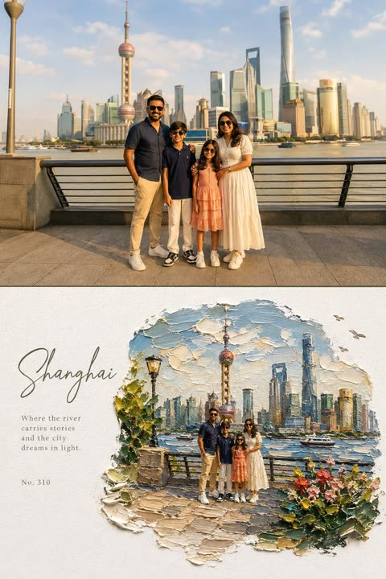</a>

海报上下等分，上半锁定原照片，下半把同一场景重绘成白纸上的厚涂油画微缩景观。画面占比、点名的色彩、具体的笔刀质感描述和详细的避免清单，让质感保持立体，文字只留在空白处。

GPT Image 2 · 上传图改图 · 出处: [@Goodmanprotocol on X](https://x.com/Goodmanprotocol/status/2094347150251655199) · 发现于 [YouMind-OpenLab/awesome-gpt-image-2](https://github.com/YouMind-OpenLab/awesome-gpt-image-2)

[`split-frame`](tags.md#tag-split-frame) [`impasto`](tags.md#tag-impasto) [`diorama`](tags.md#tag-diorama) [`editorial-poster`](tags.md#tag-editorial-poster) [`oil-painting`](tags.md#tag-oil-painting)

<details><summary><b>提示词</b></summary>

```text
Create a high-end editorial art poster in strict 3:4 vertical format, divided horizontally into two equal 50% halves, with either a seamless join or a very thin divider.

TOP — ORIGINAL PHOTO

Preserve the photograph exactly: identity, faces, clothing, proportions, poses, expressions, and subject relationships must remain unchanged. Apply only a warm fine-art film grade with soft contrast, lifted shadows, warm highlights, natural vivid color, and subtle grain. Extend the background naturally if needed, without distorting subjects. Generous environmental space is encouraged.

BOTTOM — IMPASTO MINIATURE WORLD

Reimagine the same scene as a poetic miniature diorama made from extremely thick impasto oil paint on pure white textured paper. Keep subjects recognizable but make them tiny, figurine-like, preserving their poses, clothing colors, and key features.

The painted world should occupy 60–75% of the lower half, surrounded by generous white negative space. Use organic, irregular, feathered paint edges, never a rectangular frame.

Include sculptural palette-knife clouds, reflective water or a natural path, small flowers, grass, foliage, rocks, birds, distant scenery, and atmospheric light where appropriate. The environment may become slightly more idyllic and dreamlike.

Make the paint thick, tactile, raised, and three-dimensional, with visible brush and palette-knife marks, paint ridges, drag textures, tiny shadows, and subtle translucent glazes. Keep the paper grain clearly visible.

TYPOGRAPHY

Place elegant typography only in the white space: a large handwritten calligraphy title, a short poetic subtitle, and a small reference number. Use refined olive green, warm gray, or soft blue-gray tones. Keep typography understated.

COLOR & MOOD

Use vivid, natural colors inspired by the photograph: sky blue, lake blue, green, warm yellow, coral, cherry red, peach, cream, and warm white. The overall feeling should be sunny, fresh, warm, joyful, relaxed, and dreamlike.

Avoid: muted or muddy colors, sepia, dark-brown filters, fluorescent tones, flat digital art, smooth airbrush effects, plastic 3D rendering, hard borders, generic fonts, text over subjects, and distorted figures.
```

</details>

<a id="gpt-image-indian-menu-beef-roast-promo"></a>
### 印度牛肉煲餐厅菜单宣传海报

<a href="https://x.com/Johnson998877/status/2050354965110268123"></a>

以真实菜单照片为输入，要求生成引人入胜的说明图，菜品与信息都有据可依。指定英文文字要在手机小屏幕上易于识别，促使模型使用大标题、短标语和徽章式标注。

GPT Image 2 · 上传图改图 · 出处: [@Johnson998877 on X](https://x.com/Johnson998877/status/2050354965110268123) · 发现于 [freestylefly/awesome-gpt-image-2](https://github.com/freestylefly/awesome-gpt-image-2)

[`food-poster`](tags.md#tag-food-poster) [`menu-redesign`](tags.md#tag-menu-redesign) [`restaurant`](tags.md#tag-restaurant) [`legible-text`](tags.md#tag-legible-text) [`mobile-friendly`](tags.md#tag-mobile-friendly)

<details><summary><b>提示词</b></summary>

```text
这是india 料理中的一份真实menu。根据此 重新生成带文本说明的 引人入胜垂涎欲滴的 说明图片 先用English 文本易于识别（手机小屏幕） 这个是beef roast
```

</details>

<a id="gpt-image-japanese-ad-banner-sheet-2x2"></a>
### 四款日式广告横幅组成的二乘二展示板

<a href="https://x.com/kgsi/status/2046796434536911054"></a>

用 JSON 规定网格，再为每个分区写明位置、逐条日文文案标签和设计说明，文字因此渲染准确。统一性条款让四个不同品牌看起来属于同一块展示板，参数占位符方便替换品牌名。

GPT Image 2 · 文生图 · 出处: [@kgsi on X](https://x.com/kgsi/status/2046796434536911054) · 发现于 [YouMind-OpenLab/awesome-gpt-image-2](https://github.com/YouMind-OpenLab/awesome-gpt-image-2)

[`japanese`](tags.md#tag-japanese) [`ad-banner`](tags.md#tag-ad-banner) [`typography`](tags.md#tag-typography) [`layout`](tags.md#tag-layout) [`json-prompt`](tags.md#tag-json-prompt)

<details><summary><b>提示词</b></summary>

```text
{"type":"four-panel Japanese promotional banner sheet","style":"clean commercial ad mockup board for layout and typography reference, square 2x2 grid, polished modern branding, soft premium lighting, realistic product and lifestyle imagery mixed with app marketing design","canvas":{"aspect_ratio":"1:1","background":"white","grid":{"columns":2,"rows":2,"divider_color":"light gray","divider_thickness":"thin"}},"layout":{"sections":[{"title":"skincare serum banner","position":"top-left","count":8,"labels":["素肌が、目を覚ます。","うるおい満ちる、透明ハリ肌へ。","LUNÉA","ルネア","モイストリペア セラム","美容液 30mL","発売記念 10%OFF 5.31まで","詳しくはこちら"],"design":"luxury minimal cosmetics ad with elegant Japanese serif headline on the left, centered frosted glass serum bottle with dropper, translucent liquid smear behind the bottle, scattered water droplets, pale blush and lavender palette, circular discount badge, small ingredient icons and short benefit list aligned vertically"},{"title":"note app banner","position":"top-right","count":7,"labels":["考える時間を、もっと創造的に。","アイデアをカタチにする新しいノート。","notero","ノテロ","AIがアイデアを整理","マルチデバイス対応","無料で始める"],"design":"modern SaaS app advertisement with white and light blue gradient background, bold Japanese sans-serif headline with the word 新しい in bright blue, app logo under headline, descriptive copy, rounded feature pills along the bottom, large smartphone mockup on the right showing a clean task and summary interface, subtle blue wave shape across lower-right area"},{"title":"travel banner","position":"bottom-left","count":7,"labels":["まだ見ぬ景色が、きっとあなたを待っている。","瀬戸内、ゆるり旅。","心ほどける、島時間。","期間限定 6/1(金)〜6/30(月) 新作プラン登場 最大20%OFF","直行フェリーで楽々","絶景スポット多数","おすすめプランを見る"],"design":"bright scenic tourism ad featuring vivid blue sea, green islands, white terrace architecture in the foreground, flowers on the right edge, airy summer sky with large clouds, large white Japanese headline over the sky and water, circular pink discount badge, three small travel feature icons in a translucent bottom strip, teal rounded call-to-action button"},{"title":"matcha drink banner","position":"bottom-right","count":8,"labels":["季節限定","抹茶ティラミスラテ","New!","香り高い抹茶となめらかなマスカルポーネのハーモニー。ほろ苦く、やさしい余韻を。","Regular ¥680(税込)","Tall ¥730(税込)","メニューをチェック","テイクアウトOK"],"design":"elegant café seasonal menu poster with warm cream background, editorial Japanese serif typography, large realistic iced matcha tiramisu latte in a clear glass on the right with whipped mascarpone topping dusted with matcha, small bowl of matcha powder and wooden spoon in the foreground, green leaves entering from the top-right, refined natural color palette, rounded green call-to-action button"}],"consistency":"all four banners are distinct brands but presented as a cohesive ad inspiration board with professional spacing, Japanese typography, strong hierarchy, and realistic high-end mockup rendering"},"customization":{"brand names":["LUNÉA","notero","HARUKA CAFE"],"main travel destination":"{argument name=\"destination name\" default=\"瀬戸内\"}","app name":"{argument name=\"app name\" default=\"notero\"}","cosmetic brand":"{argument name=\"cosmetic brand\" default=\"LUNÉA\"}","cafe name":"{argument name=\"cafe name\" default=\"HARUKA CAFE\"}","seasonal drink name":"{argument name=\"drink name\" default=\"抹茶ティラミスラテ\"}"}}
```

</details>

<a id="gpt-image-japanese-curry-plate-photo-vector-poster"></a>
### 日式咖喱饭实拍与矢量插画对照海报

<a href="https://x.com/izutorishima/status/2090497949990334773"></a>

提示词把海报分为上下两个画面,并列出精确数量的食物元素,让实拍与矢量重绘保持一致。限定色板、文字块和装饰线条的数量,保证版面极简。

GPT Image 2 · 文生图 · 出处: [@izutorishima on X](https://x.com/izutorishima/status/2090497949990334773) · 发现于 [YouMind-OpenLab/awesome-gpt-image-2](https://github.com/YouMind-OpenLab/awesome-gpt-image-2)

[`food`](tags.md#tag-food) [`poster`](tags.md#tag-poster) [`minimal`](tags.md#tag-minimal) [`vector-illustration`](tags.md#tag-vector-illustration) [`typography`](tags.md#tag-typography)

<details><summary><b>提示词</b></summary>

```text
Goal: Create a minimalist editorial food poster that demonstrates reducing a realistic food photo into a clean low-detail illustration while preserving the composition.

Canvas: Vertical poster in a 3:4 aspect ratio, warm off-white paper background, generous margins, quiet Japanese magazine/poster design.

Layout: Divide the poster into exactly 2 main visual panels. The top half contains a realistic rectangular food photograph with a thin off-white border around it. The bottom half contains a simplified vector-style illustration of the same dish, centered and slightly smaller, surrounded by sparse typography and fine registration-mark lines.

Top panel: Show a close-up restaurant photograph of a Japanese curry plate on a dark glossy tabletop. The dish sits on an oval dark brown ceramic plate viewed from a high three-quarter angle. Include exactly 8 visible food components: 1 large pool of brown curry sauce, 1 mound of white rice mostly hidden under toppings, 1 pile of thin fried shredded onions on the left, 1 heap of sliced pork or beef in the center, 1 scattering of pale garlic chips across the top, 1 scoop of white potato salad on the right, 1 small garnish of chopped greens near the back, and 1 lemon wedge at the back right. Add exactly 1 shiny metal spoon entering from the right edge into the curry. Use natural warm restaurant lighting, realistic texture, shallow shadows, and no people.

Bottom panel illustration: Recreate the same plate as a flattened minimal vector illustration using reduced information and reduced color. Keep the exact same 8 food components and 1 spoon, but simplify them into layered organic shapes with thin light outlines and a limited palette of curry brown, tan, cream, pale yellow, muted green, and soft gray. The oval plate is suggested by a fine gray outline and a dark brown curry shape beneath the toppings. Avoid photorealistic detail; make it look like a tasteful poster illustration.

Text content: Add exactly 5 text blocks. Left of the illustration, small spaced uppercase text reads "JAPANESE" above a large elegant serif title reading "CURRY\nPLATE". Upper right, small serif copy reads "Comfort in\nEvery Layer." Bottom left, small text reads "2024" with a thin horizontal line beside it. Bottom right, small spaced uppercase text reads "MINIMAL\nPOSTER SERIES". Use refined black or dark brown typography.

Graphic details: Add exactly 3 fine-line decorative marks around the lower illustration: 1 thin vertical line near the left of the title area, 1 small crosshair mark on the lower right of the illustrated plate, and 1 subtle horizontal line near the year. Maintain a restrained, premium editorial look with lots of negative space.

Style constraints: Minimal colors, low visual noise, no extra captions, no logos, no watermark, no additional utensils, no extra plates, and no people. The final image should feel like a polished Japanese food poster comparing a realistic curry plate photograph with its simplified illustration.
```

</details>

<a id="gpt-image-japanese-travel-app-collage-poster"></a>
### 日本旅行应用拼贴广告海报

<a href="https://x.com/shinojapan/status/2072208937349492857">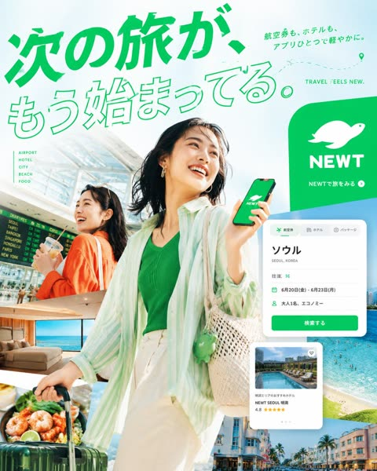</a>

提示词按区域规定版面,并给文字组、拼贴抠图和界面卡片逐项编号,同时直接引用日文原文以保证排版清晰。严格的绿白配色和详细的人物服装描述让整体广告风格保持统一。

GPT Image 2 · 文生图 · 出处: [@shinojapan on X](https://x.com/shinojapan/status/2072208937349492857) · 发现于 [YouMind-OpenLab/awesome-gpt-image-2](https://github.com/YouMind-OpenLab/awesome-gpt-image-2)

[`travel`](tags.md#tag-travel) [`advertising`](tags.md#tag-advertising) [`japanese-typography`](tags.md#tag-japanese-typography) [`app-ui`](tags.md#tag-app-ui) [`collage`](tags.md#tag-collage)

<details><summary><b>提示词</b></summary>

```text
Goal: Create a vibrant Japanese travel-app advertising poster for NEWT, combining editorial travel photography, clean app UI mockups, and bold Japanese typography to promote the feeling that the next trip is already beginning.

Canvas: Square 1:1 promotional graphic, bright white and mint-green background, high-key summer lighting, energetic composition, polished commercial ad quality.

Layout: A large diagonal Japanese headline dominates the top-left and upper center. The main traveler stands large in the center foreground, smiling and looking up to the right while holding a smartphone showing the green brand screen. A second traveler appears behind her on the left inside an airport scene. Layer multiple travel photo cutouts around the lower half and right side, with floating app interface cards over them. Place a large green rounded brand block on the upper-right.

Text content: Use exactly 5 main text groups: 1) huge headline text 次の旅が、もう始まってる。 in vivid green, with the first line filled and the second line outlined; 2) small upper-right Japanese copy 航空券も、ホテルも、アプリひとつで軽やかに。; 3) English tagline “TRAVEL FEELS NEW.” near the top-right; 4) left-side vertical category list with exactly 5 items: “AIRPORT”, “HOTEL”, “CITY”, “BEACH”, “FOOD”; 5) brand block text with a white animal-like logo, the word “NEWT”, and the small Japanese call-to-action “NEWTで旅をみる” with a circular arrow icon.

Subject details: Main subject is a cheerful young East Asian woman traveler, mid-20s, short dark bob hair moving naturally, gold hoop earrings, green ribbed top, loose translucent mint-and-white striped overshirt, cream high-waisted pants, woven straw shoulder bag with a small green charm, pulling a dark green rolling suitcase. She holds a phone with a green screen, white brand logo, and “NEWT” text. Secondary subject is a smiling young East Asian woman in an orange cardigan at an airport, holding a drink, with a departures board behind her.

Travel image collage: Include exactly 5 travel photo cutouts: 1) bright airport terminal with departures board behind the secondary woman, 2) luxury hotel room with ocean view, 3) close-up seafood dish with shrimp and greens near the suitcase, 4) turquoise beach and ocean with swimmers on the right, 5) colorful resort city street with palm trees along the bottom-right.

App UI cards: Include exactly 2 floating white app interface cards with rounded corners and soft shadows. Card 1 is a booking search card at mid-right with tabs for flight, hotel, and package; large destination text “ソウル”, small text “SEOUL, KOREA”, rows showing round trip, dates “6月20日(金) - 6月23日(月)”, passengers “大人1名、エコノミー”, and a green button labeled “検索する”. Card 2 is a hotel recommendation card lower-right with a pool thumbnail, small heart icon, hotel name “NEWT SEOUL 明洞”, rating “4.8”, and five yellow stars.

Visual style: Premium Japanese startup travel campaign, fresh mint green brand color, crisp cutout collage, clean sans-serif typography, dynamic diagonal composition, airy negative space, glossy magazine-ad finish, realistic photography mixed with minimal vector UI. Add a dotted flight path with a location pin near the top-right.

Constraints: Use no extra logos or watermarks beyond the specified brand. Keep all Japanese text legible and accurately placed. Maintain the strong green-and-white identity, optimistic summer travel mood, and layered depth.
```

</details>

**1** · [2](image-poster-2.md)
