# 产品图与电商

[返回目录](../../README_zh.md) · 全部 71 条

<a id="gpt-image-giant-pepsi-can-seated-model-ad"></a>
### 女性倚靠巨型百事可乐罐广告

<a href="https://x.com/mehvishs25/status/2047829613502754919">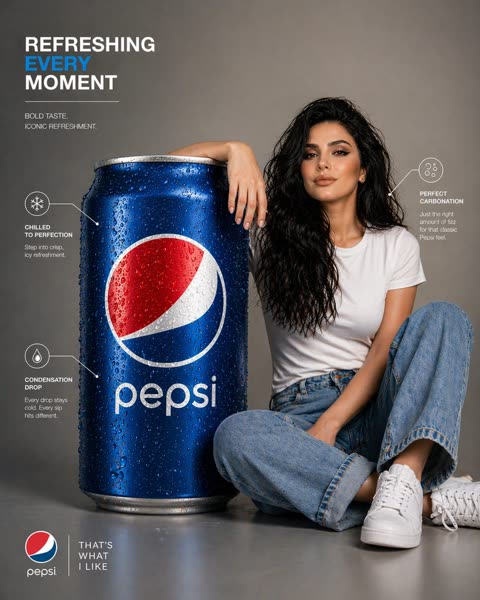</a>

尺度对比是画面的核心：罐身几乎与坐姿人物等高，并附上参考图以保持人脸一致。细线标注和纯净的影棚渐变背景让广告保持简洁高级。

GPT Image 2 · 上传图改图 · 出处: [@mehvishs25 on X](https://x.com/mehvishs25/status/2047829613502754919) · 912 赞，统计于 2026-10-29

[`product-ad`](tags.md#tag-product-ad) [`scale-contrast`](tags.md#tag-scale-contrast) [`reference-face`](tags.md#tag-reference-face) [`infographic`](tags.md#tag-infographic)

<details><summary><b>提示词</b></summary>

```text
A premium infographic-style visual featuring an oversized Pepsi can placed beside a young woman. The can is scaled to be nearly the same size as her entire seated body, creating a striking, surreal proportion. The woman sits casually leaning against the giant can, one arm resting on it, interacting naturally with the object.
Her face must closely match the provided reference image, accurate facial structure, skin tone, hairstyle, and expression — polished, realistic, and visually appealing.
The Pepsi can is ultra-detailed with crisp branding, condensation droplets, realistic reflections, and metallic texture. The logo is clean, sharp, and properly proportioned.
Composition is modern and minimal, set in a clean studio or soft gradient background. Include subtle infographic-style elements such as thin annotation lines, minimal labels, or callouts highlighting features like “refreshment,” “carbonation,” or “chilled texture,” but keep it elegant and uncluttered.
Lighting is soft studio lighting with controlled highlights and shadows, giving a premium advertising look. The model is styled in minimal, contemporary clothing that complements the red, white, and blue tones of the can.
Color grading is crisp and slightly vibrant, with a commercial ad aesthetic. Balanced composition, sharp focus, slight depth of field for realism.
Style: high-end product infographic, commercial beverage advertisement, clean UI-inspired annotations
Resolution: ultra high resolution, 4K, highly detailed, photorealistic

85mm lens, f/2.8
hyper-realistic, studio quality
no distortion, correct proportions
clean typography, modern layout
```

</details>

<a id="gpt-image-iced-coffee-glass-studio-product-photo"></a>
### 挂满水珠的玻璃杯中奶咖交融的冰咖啡

<a href="https://x.com/Strength04_X/status/2049082049995362785"></a>

提示词逐层描述饮品：深色咖啡底、渐变交融的奶纹、折射光线的透明冰块和杯壁水珠。柔和棚拍光线加上单反微距用语，让画面呈现干净的饮品广告质感。

GPT Image 2 · 文生图 · 出处: [@Strength04_X on X](https://x.com/Strength04_X/status/2049082049995362785) · 617 赞，统计于 2026-10-28

[`iced-coffee`](tags.md#tag-iced-coffee) [`beverage`](tags.md#tag-beverage) [`studio-lighting`](tags.md#tag-studio-lighting) [`macro`](tags.md#tag-macro) [`product-photography`](tags.md#tag-product-photography)

<details><summary><b>提示词</b></summary>

```text
Made with GPT image 2 + Hailuo 2.3 on
@Hailuo_AI


PROMPT - A high-end café-style product photograph of a transparent glass filled with iced coffee, centered against a soft beige and cream seamless studio background. The drink shows a rich dark coffee base blending with creamy milk swirls, creating a smooth gradient effect. Several clear ice cubes are visible with realistic transparency and light refraction. The glass has subtle condensation droplets, adding freshness. Soft natural studio lighting creates delicate highlights and a clean shadow beneath the glass. Ultra-sharp focus, premium beverage advertisement style, DSLR macro photography, hyper realistic, 8K.

PROMPT 2 - Create a hyper-realistic exploded vertical infographic composition of an iced coffee.

Top → Bottom structure:
Foam Layer (light creamy foam with soft airy texture)
→ Coffee Liquid (rich dark espresso layer with smooth gradient)
→ Ice Cubes (transparent cubes with sharp edges and reflections)
→ Milk Layer (soft creamy white layer with smooth blend effect)
→ Glass Base (clear minimal glass structure)

All elements must be perfectly centered, evenly spaced, and aligned vertically. Use a soft beige seamless background with clean café-style lighting and subtle realistic shadows beneath each floating element. The composition should feel like a premium beverage ad combined with a clean infographic layout.

Add clean minimalist text labels with thin pointer lines using these exact labels:
“Foam”
“Coffee”
“Ice”
“Milk”
“Glass”
Ultra-realistic liquid detail, sharp reflections, premium commercial photography, 8K.
```

</details>

<a id="nano-banana-soda-can-paper-tear-fruit-reveal"></a>
### 撕开纸面与易拉罐露出新鲜水果的汽水罐

<a href="https://x.com/Arminn_Ai/status/2027470188644626803">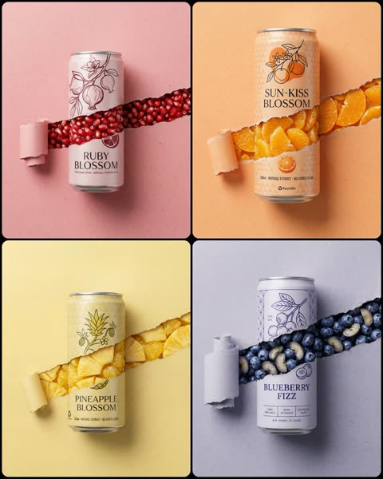</a>

一条连续的撕纸裂口横贯罐身与背景，末端卷成纸卷，裂口里露出密实的水果。方括号槽位覆盖罐型、底色、水果、墨色和品牌名，可以换口味反复套用。

Nano Banana 2 · 文生图 · 出处: [@Arminn_Ai on X](https://x.com/Arminn_Ai/status/2027470188644626803) · 589 赞，统计于 2026-10-28

[`soda-can`](tags.md#tag-soda-can) [`paper-tear`](tags.md#tag-paper-tear) [`fruit`](tags.md#tag-fruit) [`packaging`](tags.md#tag-packaging) [`template`](tags.md#tag-template)

<details><summary><b>提示词</b></summary>

```text
A photorealistic, highly detailed commercial product photograph of a standard aluminum [Type of Soda Can] centered against a minimal, textured [Background Color] paper background, with subtle fibers visible. A single, continuous horizontal paper-tear strip runs across the entire width of the frame, seamless from the far-right edge to the far-left edge. The torn channel cuts through the metal body of the can and continues across the background on both sides with a barely perceptible and minimal diagonal slope towards the upper-left. The tear channel is significantly broader, revealing a dense, glistening, and vibrant layer of [Description of Fruit Segments/Sacs/Berries] tightly packed inside. Near the extreme far-left end of this tear, the paper is neatly rolled into a tight, realistic coil that occupies almost the entire left margin. The can features a newly designed, minimalist branding: the upper portion has a stylized, abstract line-art illustration of [Fruit Branch/Plant] in a contrasting [Ink Color], set against a subtle matte geometric [Pattern Type] pattern on the can surface. Below this, the brand name "[Brand Name]" is printed in an elegant, modern dark typography, with smaller technical text "330ml - NATURAL EXTRACT" and a small "Recyclable" logo. A small, detailed graphic of the fruit is located below the torn path. The lighting is soft and cinematic, casting delicate drop shadows beneath the torn paper edges and the large left coil. 8k resolution, macro details on fibrous paper and glossy fruit texture.
```

</details>

<a id="nano-banana-radial-exploded-view-smartphone"></a>
### 深色背景下带标注部件的智能手机爆炸图

<a href="https://x.com/AllaAisling/status/2032126653309030481">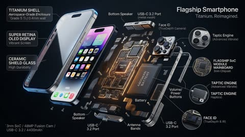</a>

为玻璃、铝、电路板和橡胶分别给出材质描述，让每个部件有各自的表面质感；标题、规格块和标签排版都固定位置，让版式保持一致。冷色顶光、内部暖色琥珀底光和外壳蓝色细边光在深色背景上区分出各层。

Nano Banana 2 · 文生图 · 出处: [@AllaAisling on X](https://x.com/AllaAisling/status/2032126653309030481) · 468 赞，统计于 2026-10-28

[`exploded-view`](tags.md#tag-exploded-view) [`product-teardown`](tags.md#tag-product-teardown) [`3d-render`](tags.md#tag-3d-render) [`infographic-labels`](tags.md#tag-infographic-labels) [`dark-background`](tags.md#tag-dark-background)

<details><summary><b>提示词</b></summary>

```text
Prompt Studio: 3D Radial Explosion with Nano Banana 2 in Firefly

Hyperrealistic 3D radial exploded view of [PRODUCT]  [NUMBER] components  bursting outward from a central axis in every direction, frozen in mid-air.  True spatial explosion, not a vertical stack, depth and parallax visible.  COMPONENTS (core outward): [SHELL] → [DISPLAY] → [FRAME] → [MAINBOARD] →  [BATTERY] → [MICRO PARTS shown in 3x floating callout circles]  MATERIALS: glass refracts and catches specular highlights, aluminium shows  brushed grain and machined edges, PCB traces glow faintly amber,   rubber gaskets matte with micro-texture, cables with soft bend physics.  LABELS: hairline leader to floating box. "[COMPONENT]" uppercase /  "[FUNCTION]" italic / "[KEY SPEC]" monospace. Radiate outward, no overlaps.  LIGHTING: cool diffused overhead + warm amber underlighting on internals +  thin blue rim on outer shell. Displays emit soft UI glow. Circuits self-illuminate.  BACKGROUND: [COLOR], deep, non-reflective. Midnight black recommended. TITLE: "[PRODUCT NAME]" top right. SUBTITLE: "[TAGLINE]".  SPEC BLOCK: "[SPEC 1] / [SPEC 2] / [SPEC 3]" bottom left in monospace.  Mood: iFixit teardown meets NASA manual meets WIRED cover. 4K, tack sharp, extraordinary material fidelity.

Check ALTs for ideas 👇
@AdobeFirefly
```

</details>

<a id="nano-banana-playful-character-face-food-packaging"></a>
### 笑脸角色造型的趣味食品包装设计

<a href="https://x.com/azed_ai/status/2044053391832486350"></a>

提示词让包装结构本身构成脸部，开口翻盖或镂空窗成为嘴巴，真实产品填满其中。用产品名占位符、扁平矢量风格、纯白背景和 1:1 比例，让整套结果保持一致。

Nano Banana 2 · 文生图 · 出处: [@azed_ai on X](https://x.com/azed_ai/status/2044053391832486350) · 280 赞，统计于 2026-10-28

[`packaging`](tags.md#tag-packaging) [`character-face`](tags.md#tag-character-face) [`flat-vector`](tags.md#tag-flat-vector) [`product-mockup`](tags.md#tag-product-mockup) [`die-cut`](tags.md#tag-die-cut)

<details><summary><b>提示词</b></summary>

```text
Playful concept packaging design for [product name], box structure creatively shaped to reflect the product theme, bold illustrated character face integrated across the front panels, the opening flap or die-cut window forms the character’s mouth, teeth or expression, real product visible inside completing the face illusion, clever interaction between packaging mechanics and facial expression, flat vector illustration style, bold graphic lines, high-contrast colors, minimal modern branding, smooth matte cardboard texture, clean structural details, studio product photography, centered composition, pure white background, soft realistic shadow beneath, ultra-detailed, high-end creative packaging mockup, 1:1 aspect ratio.
```

</details>

<a id="nano-banana-underwater-ice-pop-diver"></a>
### 手持内含水下潜水员的冰棒

<a href="https://x.com/mr_farman_ai/status/2070002523919028394">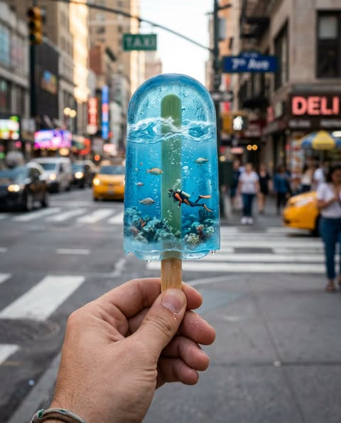</a>

第一人称平视构图让手和冰棒清晰对焦，街道虚化作背景。描述透明蓝色外壳、融化边缘等材质，并指定高端产品摄影风格，使冰块的折射质感更真实。

Nano Banana 2 · 文生图 · 出处: [@mr_farman_ai on X](https://x.com/mr_farman_ai/status/2070002523919028394) · 266 赞，统计于 2026-10-29

[`surreal`](tags.md#tag-surreal) [`first-person`](tags.md#tag-first-person) [`ice-pop`](tags.md#tag-ice-pop) [`product-photography`](tags.md#tag-product-photography)

<details><summary><b>提示词</b></summary>

```text
First-person perspective, one hand holding a surreal ice cream bar with a transparent blue shell revealing an underwater scene inside, featuring a small diver, a few small fish, floating bubbles, and churning waves. A green ice stick runs through the center. The ice bar is slightly melted, with a wooden stick at the bottom, which the hand is holding. The background is a blurred New York cityscape street, captured in a high-end product photography style.
```

</details>

<a id="nano-banana-ramen-liquid-explosion-labeled"></a>
### 带标注的拉面汤汁爆炸高速摄影

<a href="https://x.com/AllaAisling/status/2030670376104087834">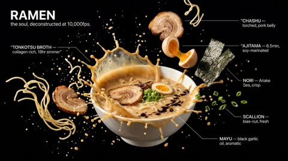</a>

带括号占位符的可复用模板，可替换菜品、配料标注、标语和背景色。把定格的高速瞬间、单一暖光源和摄影师风格参考，与编辑式排版和细引线标注结合起来。

Nano Banana 2 · 文生图 · 出处: [@AllaAisling on X](https://x.com/AllaAisling/status/2030670376104087834) · 237 赞，统计于 2026-10-29

[`food`](tags.md#tag-food) [`high-speed`](tags.md#tag-high-speed) [`liquid-splash`](tags.md#tag-liquid-splash) [`labeled-ingredients`](tags.md#tag-labeled-ingredients) [`template`](tags.md#tag-template)

<details><summary><b>提示词</b></summary>

```text
Prompt Studio: Food, Liquid Explosion with Nano Banana 2 in Firefly

[DISH] captured at the exact millisecond of a dramatic liquid explosion, high-speed photography frozen in time, every droplet suspended mid-air with razor precision. Hero [DISH] at center perfectly intact and hyperreal, surrounded by an orchestrated explosion of its own sauce, broth, or glaze erupting outward in every direction. Droplets catching dramatic single-source warm light like liquid diamonds. Each floating ingredient or droplet labeled with ultra-thin lines in clean uppercase: "[INGREDIENT]  [descriptor]". Dish name in bold editorial typography: "[DISH NAME]". Subtitle: "[TAGLINE]". Pure [COLOR] background. Mood: Harold Edgerton high-speed photography meets Michelin-star food editorial. 4K, tack sharp every droplet, extraordinary and craveable.

Check ALTs for ideas 👇
@AdobeFirefly
```

</details>

<a id="nano-banana-product-storyboard-3x3-grid"></a>
### 香水瓶的 3x3 分镜网格展示

<a href="https://x.com/arceyul/status/2027526257018024246">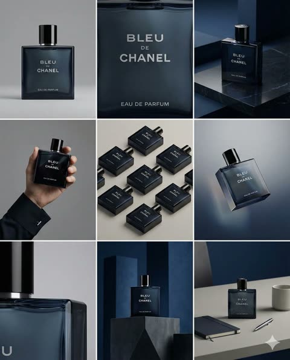</a>

参考图锁定产品的标签、比例与包装，确保九个画面中的产品保持一致。每个画面使用不同的角度与构图，统一的光线逻辑与色调让整组图像看起来像同一个系列。

Nano Banana 2 · 上传图改图 · 出处: [@arceyul on X](https://x.com/arceyul/status/2027526257018024246) · 207 赞，统计于 2026-10-29

[`storyboard`](tags.md#tag-storyboard) [`product-mockup`](tags.md#tag-product-mockup) [`grid`](tags.md#tag-grid) [`reference-image`](tags.md#tag-reference-image)

<details><summary><b>提示词</b></summary>

```text
Crea UNA imagen final.

Un storyboard limpio en cuadrícula 3×3 con nueve paneles iguales en proporción [ratio], dentro de un formato total 4:5.

Usa la imagen de referencia como base del producto. Mantén exactamente el mismo producto, diseño del packaging, branding, materiales, colores, proporciones e identidad general en los nueve paneles, tal como en la referencia. El producto debe ser claramente reconocible en cada frame. La etiqueta, el logo y las proporciones deben permanecer exactamente iguales.

Este storyboard es una presentación mockup de alto nivel para un portfolio de branding. El enfoque está en la forma, la composición, la materialidad y el ritmo visual, más que en el realismo o una narrativa lifestyle. El resultado debe sentirse curado, editorial y orientado al diseño.

FRAME 1:
Plano frontal hero del producto en un entorno de estudio limpio. Fondo neutro, composición equilibrada, presentación calmada y segura del producto.

FRAME 2:
Primer plano con el enfoque centrado en la parte media del producto. Se destacan la textura de la superficie, los materiales y los detalles de impresión.

FRAME 3:
El producto de referencia colocado en un entorno que encaja naturalmente con la marca y la categoría del producto. Escenario de estudio inspirado en los elementos de diseño y colores del producto.

FRAME 4:
Producto mostrado en uso o en interacción sobre un fondo de estudio neutro. Las manos y los elementos de interacción son mínimos y discretos, manteniendo el estilo del packaging.

FRAME 5:
Composición isométrica que muestra varios productos organizados en un orden geométrico preciso desde un ángulo isométrico superior. Todos los productos están colocados con el mismo ángulo isométrico, espaciados de forma uniforme, limpios, estructurados y gráficos.

FRAME 6:
Producto levitando ligeramente, inclinado sobre un fondo neutro que coincida con la paleta de colores de la imagen de referencia. La posición flotante es intencional y natural en el espacio.

FRAME 7:
Primerísimo primer plano centrado en un detalle específico de la etiqueta, el borde, la textura o el comportamiento del material.

FRAME 8:
El producto en un entorno inesperado pero estéticamente potente, con un enfoque audaz, editorial y visualmente impactante. Escenario inesperado pero altamente estilizado, basado en estudio y dirigido por diseño. Composición fuerte que eleva la marca.

FRAME 9:
Composición amplia que muestra el producto en uso dentro de un setup de diseño refinado. Props limpios, estilismo controlado y coherente con el resto de la serie.

CÁMARA Y ESTILO:
Imágenes de estudio de ultra alta calidad con apariencia de cámara real. Diferentes ángulos y encuadres en cada frame. Profundidad de campo controlada, iluminación precisa, materiales y reflejos realistas. La lógica de iluminación, la paleta de colores, el mood y el lenguaje visual deben mantenerse consistentes en los nueve paneles como una sola serie cohesionada.

OUTPUT:
Una cuadrícula limpia 3×3 sin bordes, sin texto, sin captions y sin marcas de agua.
```

</details>

<a id="nano-banana-cartoon-food-packaging"></a>
### 四款带卡通脸和开窗设计的食品包装

<a href="https://x.com/azed_ai/status/2027806040109289487">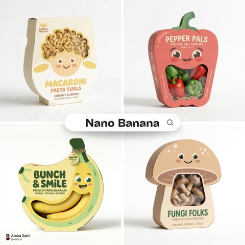</a>

替换成你的产品名，然后要求正面印有卡通脸，并把开窗做成表情的一部分，让包装造型与产品融为一体。柔和棚拍光、纯白背景和细微接触阴影，让渲染干净、可直接用于零售展示。

Nano Banana 2 · 文生图 · 出处: [@azed_ai on X](https://x.com/azed_ai/status/2027806040109289487) · 187 赞，统计于 2026-10-29

[`packaging`](tags.md#tag-packaging) [`mockup`](tags.md#tag-mockup) [`cartoon`](tags.md#tag-cartoon) [`product`](tags.md#tag-product)

<details><summary><b>提示词</b></summary>

```text
Playful designer packaging for [product name], creative box shaped like the product, integrated cartoon face on the front panel, oversized die-cut window revealing the real contents as part of the character’s expression, smooth matte cardboard material, bold flat graphic design, modern minimalist branding, limited pastel color palette, rounded friendly shapes, clean typography, high-end 3D packaging mockup render, soft studio lighting, pure white background, subtle realistic contact shadow beneath, ultra-detailed, retail-ready presentation, 1:1 aspect ratio.
```

</details>

<a id="nano-banana-miniature-pizza-hut-showroom-palm"></a>
### 手掌上的微型必胜客门店

<a href="https://x.com/Naiknelofar788/status/2044605023557222629">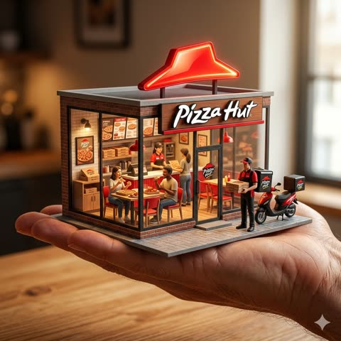</a>

模板保留 [YOUR BRAND] 和 [PRODUCTS] 占位符，可替换为任意零售品牌。手掌作为比例参照，透明玻璃墙内的微型人物和暖色电影光线，让微缩场景看起来像真实的产品照片。

Nano Banana 2 · 文生图 · 出处: [@Naiknelofar788 on X](https://x.com/Naiknelofar788/status/2044605023557222629) · 185 赞，统计于 2026-10-29

[`miniature`](tags.md#tag-miniature) [`diorama`](tags.md#tag-diorama) [`brand-showroom`](tags.md#tag-brand-showroom) [`palm-scale`](tags.md#tag-palm-scale)

<details><summary><b>提示词</b></summary>

```text
An ultra-realistic miniature [YOUR BRAND] showroom balanced on a human palm, designed with transparent glass walls. Inside, tiny lifelike figures are enjoying [PRODUCTS]. On the rooftop, a glowing 3D logo shines brightly, while the front facade displays the brand name in a bold, recognizable typeface. Outside the showroom, a miniature delivery person is standing with a branded delivery bag strapped to their back, ready to deliver orders.The showroom’s interior is styled like a cozy retail outlet, with miniature products and branding details on display. Lighting is cinematic with warm tones, crisp details, and natural shadows. Captured in professional product photography style, the scene conveys a vibrant, iconic, and instantly recognizable atmosphere. 1080x1080 dimension.
```

</details>

<a id="nano-banana-uv-unwrapped-albedo-texture-box-device"></a>
### 硬表面盒状设备的UV展开反照率贴图

<a href="https://x.com/boredmaxx/status/2044862943498809685">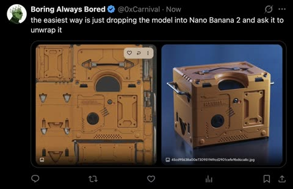</a>

以渲染好的三维物体作为参考图，要求输出平面UV展开图。用否定约束排除透视、阴影和光照，并固定1:1画布，得到干净的PBR基础色贴图。

Nano Banana 2 · 上传图改图 · 出处: [@boredmaxx on X](https://x.com/boredmaxx/status/2044862943498809685) · 182 赞，统计于 2026-10-29

[`uv-unwrap`](tags.md#tag-uv-unwrap) [`albedo-map`](tags.md#tag-albedo-map) [`pbr-texture`](tags.md#tag-pbr-texture) [`hard-surface`](tags.md#tag-hard-surface) [`reference-image`](tags.md#tag-reference-image)

<details><summary><b>提示词</b></summary>

```text
or just use Nano Banana 2

prompt: UV unwrapped albedo texture map of a hard surface box device, flat 2D layout only, no 3D rendering, no perspective distortion, no shadows or lighting effects, seamless unwrap filling the entire 1:1 square canvas, high-resolution PBR base color map, macro close-up texture details
```

</details>

<a id="nano-banana-fifa-2026-trophy-architectural-template"></a>
### 金色 FIFA 2026 奖杯配铬金属框架

<a href="https://x.com/ShamsAmin56/status/2065836139429384468">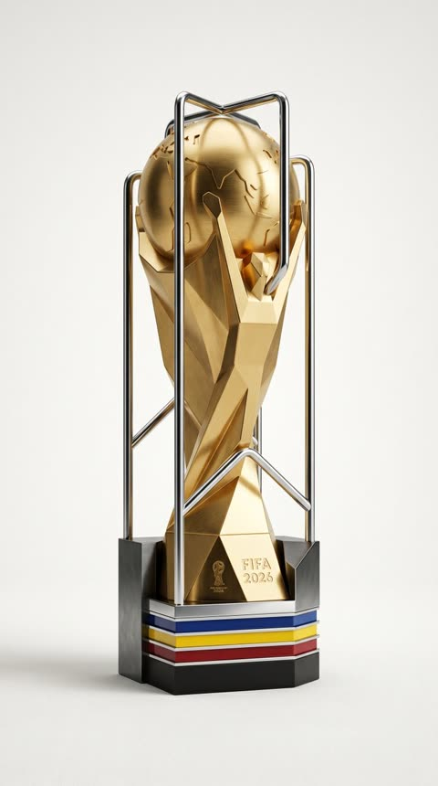</a>

模板把摄影棚设置固定下来：米白背景 #F5F5F0、居中低角度构图、影棚光和 9:16 竖幅，只替换括号里的建筑风格与材质。光照和材质描述保持不变，因此无论套用哪种风格，金色奖杯轮廓和 FIFA 2026 刻字都依然清晰可辨。

Nano Banana 2 · 文生图 · 出处: [@ShamsAmin56 on X](https://x.com/ShamsAmin56/status/2065836139429384468) · 181 赞，统计于 2026-10-29

[`fifa`](tags.md#tag-fifa) [`product-render`](tags.md#tag-product-render) [`template`](tags.md#tag-template) [`studio-lighting`](tags.md#tag-studio-lighting)

<details><summary><b>提示词</b></summary>

```text
A highly detailed, photorealistic product render of the FIFA 2026 World Cup trophy, featuring the iconic golden silhouette with modern geometric updates and subtle "2026" engraving. The trophy is reimagined through the lens of [ARCHITECTURAL STYLE], incorporating [KEY STYLE ELEMENTS: e.g., stepped geometries, raw material textures, soaring vertical lines, fluid parametric curves, or ornate classical motifs]. Centered vertical composition, eye-level perspective with a slight low-angle framing to emphasize monumentality. Studio three-point lighting with soft directional highlights, emphasizing metallic gold surfaces paired with [STYLE MATERIAL: e.g., polished brass, matte stone, brushed titanium, or frosted glass]. Seamless off-white background (#F5F5F0), clean and uncluttered, grounded with a soft, natural drop shadow. High-end product photography style, Octane Render, ultra-detailed textures, photorealistic, --ar 9:16 --v 6.0 --style raw

Super Easy To Edit:

Type your favorite style in the bracket [ARCHITECTURAL STYLE]
```

</details>

<a id="gpt-image-giant-chocolate-bar-snowy-valley"></a>
### 巨型巧克力条矗立在雪山山谷中

<a href="https://x.com/Urwa_345/status/2091899842457206792">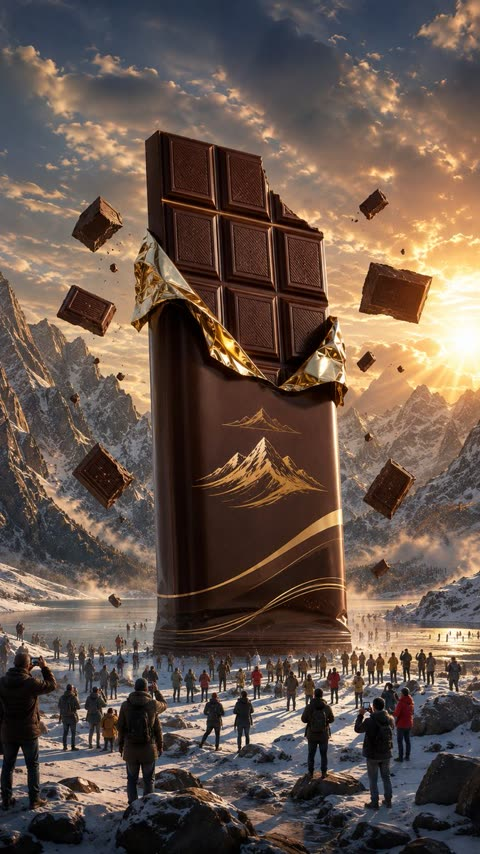</a>

提示词用具体细节锚定超现实的尺度反差，例如拍照的小人、悬浮的巧克力块和穿透云层的金色光线。明确竖向9:16构图和真实比例，能让巨大的产品不变形。

GPT Image 2 · 文生图 · 出处: [@Urwa_345 on X](https://x.com/Urwa_345/status/2091899842457206792) · 172 赞，统计于 2026-10-29

[`surreal`](tags.md#tag-surreal) [`food-ad`](tags.md#tag-food-ad) [`scale`](tags.md#tag-scale) [`product-photo`](tags.md#tag-product-photo)

<details><summary><b>提示词</b></summary>

```text
Ultra-realistic cinematic chocolate advertisement featuring a gigantic premium chocolate bar standing vertically in the middle of a beautiful snowy mountain valley. The chocolate bar is dramatically oversized, towering above the surrounding landscape. Rich glossy chocolate texture with realistic details and elegant premium packaging. Hundreds of tiny people stand nearby taking photographs while snow-covered mountains rise dramatically in the background. Pieces of chocolate appear to float around the giant product as if gravity has stopped. Warm golden sunlight breaks through the clouds, creating a magical luxurious glow. Cinematic atmosphere, realistic snow reflections, highly detailed textures, photorealistic product photography, premium food advertising aesthetic, 8K, sharp focus, vertical 9:16 composition, realistic proportions, no distortion, no watermark, no extra text
```

</details>

<a id="gpt-image-cheese-universe-pizza-slice-city-ad"></a>
### 女子举起披萨块，拉出发光芝士漩涡

<a href="https://x.com/Itswsm105f/status/2058147639020187754">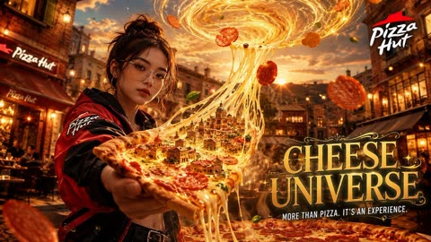</a>

用带标题的分段（背景、光线与特效、排版、风格）把每项要求分开，并逐字写出主标题和副标题，文字才能准确呈现。把芝士拉丝作为核心动作、把迷你城市放在披萨块内部，画面就有了清晰的焦点。

GPT Image 2 · 文生图 · 出处: [@Itswsm105f on X](https://x.com/Itswsm105f/status/2058147639020187754) · 164 赞，统计于 2026-10-29

[`food-ad`](tags.md#tag-food-ad) [`cheese-stretch`](tags.md#tag-cheese-stretch) [`text-in-image`](tags.md#tag-text-in-image) [`cinematic`](tags.md#tag-cinematic)

<details><summary><b>提示词</b></summary>

```text
A hyper-realistic cinematic food advertisement in vertical 9:16 format featuring a stylish young woman  wearing a modern red-and-black streetwear outfit with transparent eyeglasses. She is holding a giant Pizza Hut pizza slice toward the camera while pulling it upward in a dramatic cheese stretch pose.
The melted cheese stretches infinitely in glowing golden strands, forming a magical cheese vortex in the air. Floating pepperoni slices spin like planets, and steam rises in cinematic slow motion. Inside the pizza slice, a miniature glowing pizza city exists

BACKGROUND:
A warm Italian-inspired cinematic city at golden sunset with glowing brick streets, soft ambient lights, and blurred pizzerias in the distance. The atmosphere feels cozy, premium, and appetizing.

LIGHTING & EFFECTS:
Golden hour glow, cinematic steam, cheese light reflections, floating herbs, shallow depth of field, warm food photography lighting, soft bokeh highlights.

TYPOGRAPHY:
“CHEESE UNIVERSE”
“MORE THAN PIZZA. IT’S AN EXPERIENCE.”

STYLE: Ultra-realistic 8K food commercial, premium cinematic advertising.
```

</details>

<a id="nano-banana-amber-perfume-forced-perspective-shira"></a>
### 女子俯身凑近巨大琥珀色香水瓶

<a href="https://x.com/Maercihh/status/2038838341572178374">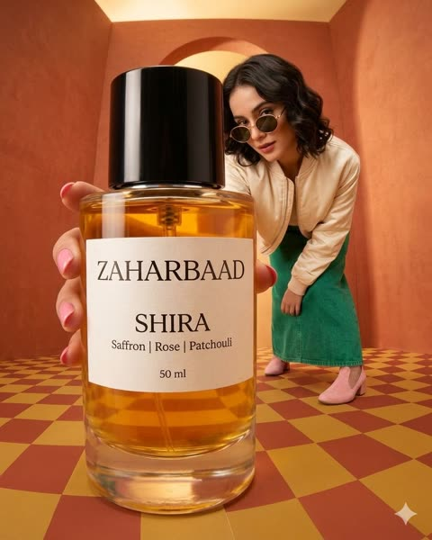</a>

从低位用24毫米广角镜头拍摄，让瓶子在前景中显得巨大，浅景深则把焦点锁定在标签上。明确写出陶土色墙面、琥珀色玻璃和芥末黄格纹地面等配色，使画面色调统一。

Nano Banana 2 · 文生图 · 出处: [@Maercihh on X](https://x.com/Maercihh/status/2038838341572178374) · 163 赞，统计于 2026-10-29

[`product-photography`](tags.md#tag-product-photography) [`forced-perspective`](tags.md#tag-forced-perspective) [`perfume`](tags.md#tag-perfume) [`warm-palette`](tags.md#tag-warm-palette)

<details><summary><b>提示词</b></summary>

```text
{
  "settings": {
    "aspect_ratio": "4:5",
    "resolution": "1024x1280",
    "style": "photorealistic",
    "lighting": "soft diffused studio lighting with warm tones",
    "camera": "wide angle lens (24mm), low perspective",
    "depth_of_field": "shallow, focus on perfume bottle",
    "color_grading": "warm cinematic, terracotta and amber tones",
    "render_quality": "high detail, natural textures, no plastic skin",
    "motion": "still frame",
    "grain": "subtle film grain"
  },
  "prompt": "A surreal forced-perspective product shot of a large amber glass perfume bottle labeled 'ZAHARBAAD SHIRA' in the foreground, held by a woman's hand with soft pink nails. In the background, a stylish woman with short wavy dark hair, wearing round sunglasses, a beige jacket, green skirt, and pink heels, leans forward curiously toward the oversized bottle. The room is minimal and geometric with warm terracotta walls, an arched doorway, and a retro checkered floor in mustard and brown tones. The lighting is soft and warm, creating gentle shadows and a premium editorial feel. Realistic skin texture, natural reflections on glass, accurate scale illusion, no over-smoothing, no CGI look.",
  "negative_prompt": "blurry, low resolution, distorted proportions, extra fingers, plastic skin, overexposed highlights, harsh shadows, unrealistic reflections, text errors, watermark, logo artifacts"
}
```

</details>

<a id="gpt-image-nike-tubing-shoe-bag-render"></a>
### 蓝色橡胶管鞋袋配红色对勾标志

<a href="https://x.com/Just_sharon7/status/2077034244988150062">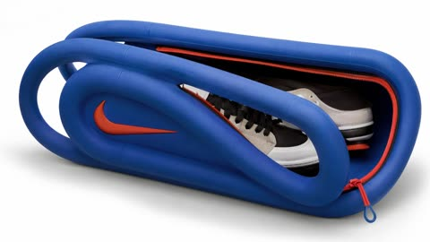</a>

提示词将物体描述为弯曲的工业橡胶管，并使用弹性体纹理、压缩、拉伸和防滑表面等材料物理词汇，让造型看起来像真实的工业产品。纯白无缝背景配合柔和的漫射光与接触阴影，形成干净的产品目录式棚拍效果。

GPT Image 2 · 文生图 · 出处: [@Just_sharon7 on X](https://x.com/Just_sharon7/status/2077034244988150062) · 162 赞，统计于 2026-10-29

[`3d-render`](tags.md#tag-3d-render) [`product`](tags.md#tag-product) [`rubber-tubing`](tags.md#tag-rubber-tubing) [`studio-lighting`](tags.md#tag-studio-lighting)

<details><summary><b>提示词</b></summary>

```text
Create an ultra-detailed hyper-realistic 3D render of {Object} , formed from thick industrial rubber tubing bent into the exact shape of the design, flexible yet dense structure, smooth rounded contours, subtle matte finish, realistic elastomer texture, faint molded seam lines, soft tension at each curve, authentic material compression and stretch behavior, slightly grippy surface quality, engineered object realism, colored using the authentic official brand color palette of [brand], faithful brand-matching hues applied across the tubing, accurate color blocking that follows the original logo design, premium studio product photography aesthetic, isolated on a pure white seamless background, soft diffused studio lighting, realistic contact shadow, macro detail, razor-sharp focus, photorealistic, 8k, 16:9, no watermark, no extra text.
```

</details>

<a id="nano-banana-exploded-view-headphones-diagram"></a>
### 无线耳机爆炸图结构示意

<a href="https://x.com/Strength04_X/status/2028442638781984986">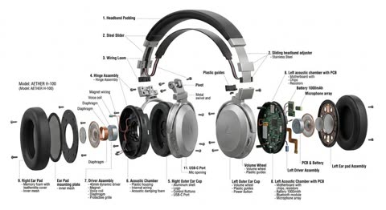</a>

这是一个可替换物体的填空式模板，用爆炸图格式、白色背景和影棚产品光来限定画面。highly detailed internal components 这一句促使模型把内部零件逐一拆开并标注。

Nano Banana 2 · 文生图 · 出处: [@Strength04_X on X](https://x.com/Strength04_X/status/2028442638781984986) · 160 赞，统计于 2026-10-29

[`exploded-view`](tags.md#tag-exploded-view) [`product-design`](tags.md#tag-product-design) [`diagram`](tags.md#tag-diagram) [`white-background`](tags.md#tag-white-background) [`studio-lighting`](tags.md#tag-studio-lighting)

<details><summary><b>提示词</b></summary>

```text
product design, [object or vehicle with material accents], exploded view diagram, white background, three-dimensional, highly detailed internal components, studio lighting, product photography, best quality
```

</details>

<a id="nano-banana-luxury-gold-plaque-dessert-cones"></a>
### 带金色铭牌的奢华巧克力焦糖脆筒

<a href="https://x.com/yourPlugAI/status/2070528605986124079">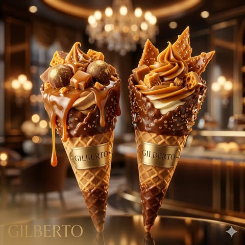</a>

模板用方括号槽位替换涂层、奶油、配料和配色，固定的金色铭牌、角落淡化签名和灯光组合保持不变。微距美食摄影、金色散景室内背景以及轮廓光加主光，营造出奢侈品广告质感。

Nano Banana 2 · 文生图 · 出处: [@yourPlugAI on X](https://x.com/yourPlugAI/status/2070528605986124079) · 152 赞，统计于 2026-10-28

[`food`](tags.md#tag-food) [`dessert`](tags.md#tag-dessert) [`luxury`](tags.md#tag-luxury) [`template`](tags.md#tag-template) [`macro`](tags.md#tag-macro)

<details><summary><b>提示词</b></summary>

```text
Ultra realistic luxury food advertisement photography of two premium "GILBERTO" dessert cones. Handcrafted waffle cones coated in [COATING MATERIAL AND TEXTURE], overflowing with [PRIMARY CREAM], [MAIN TOPPINGS], [DRIZZLES OR SAUCES], and [ACCENT INGREDIENTS]. Textures are indulgent, luxurious, highly detailed, with realistic moisture, shine, and layered depth.

Add an elegant metallic gold plaque around the center of each cone engraved with the brand name "GILBERTO". Remove all other logos or signatures.

At the bottom left corner place a subtle, semi-transparent gold signature text reading "GILBERTO", softly faded into the scene, elegant and unobtrusive.

Color palette: [PRIMARY COLORS], [ACCENT COLORS], [METALLIC DETAILS].

Background: luxurious [ENVIRONMENT TYPE] with [COLOR TONES], cinematic golden bokeh lights, softly blurred premium interior details, reflective surfaces, sophisticated atmosphere, shallow depth of field.

Lighting: cinematic studio lighting with [LIGHT TEMPERATURE], soft front key light, dramatic rim lighting, subtle backlighting, high-contrast shadows, and rich specular highlights emphasizing the ingredients and coatings.

Composition: centered hero shot, macro food photography, shallow depth of field, premium confectionery advertising campaign, ultra photorealistic textures, luxury magazine quality, hyper detailed, HDR, 8K, masterpiece, aspect ratio 1:1.
```

</details>

<a id="gpt-image-giant-lip-essence-tube-city-boulevard-ad"></a>
### 巨型红色唇部精华管矗立在雨后城市大道中央

<a href="https://x.com/Its_Saad_kkk/status/2091748835328512255">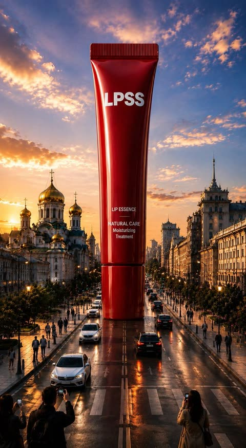</a>

用汽车和拍照路人等真实城市元素作参照，让超大产品的尺度显得可信。精确写出包装文字，并加上不要额外文字的约束，让品牌标识保持清晰。

GPT Image 2 · 文生图 · 出处: [@Its_Saad_kkk on X](https://x.com/Its_Saad_kkk/status/2091748835328512255) · 146 赞，统计于 2026-10-29

[`product-ad`](tags.md#tag-product-ad) [`surreal-scale`](tags.md#tag-surreal-scale) [`city-street`](tags.md#tag-city-street) [`beauty`](tags.md#tag-beauty)

<details><summary><b>提示词</b></summary>

```text
Ultra-realistic cinematic product advertisement featuring a giant glossy deep-red lip essence tube standing vertically in the center of a busy grand city boulevard after rain. The product is dramatically oversized, towering above the surrounding buildings and vehicles. Minimal premium packaging with bold white “LPSS” branding and smaller text reading “LIP ESSENCE – NATURAL CARE – Moisturizing Treatment.” Wet reflective road surface with realistic reflections, cars driving around the product, pedestrians walking and photographing it with smartphones. Elegant historic European-style architecture on both sides, beautiful golden-domed cathedral visible in the background, dramatic blue sky filled with soft golden sunset clouds, warm sunlight creating a luxurious glow. Highly detailed realistic textures, accurate product reflections, cinematic lighting, shallow atmospheric depth, photorealistic photography, premium beauty campaign aesthetic, 8K, sharp focus, realistic proportions, vertical composition, no distortion, no extra text, no watermark.
```

</details>

<a id="nano-banana-luxury-watch-macro-contact-sheet"></a>
### 蓝色表盘奢华腕表微距九宫格

<a href="https://x.com/kellyyjjones/status/2078418060374106127">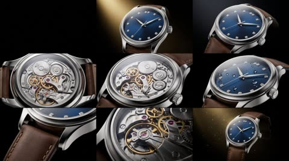</a>

提示词逐一点名蓝宝石镜面、放射纹表盘、透底机芯和摆轮等部件，让每个微距画面都有明确主体。360度环绕、单束金色聚光、黑色背景和水珠等镜头与光线设定，使各画面之间有变化。

Nano Banana 2 · 文生图 · 出处: [@kellyyjjones on X](https://x.com/kellyyjjones/status/2078418060374106127) · 130 赞，统计于 2026-10-29

[`watch`](tags.md#tag-watch) [`macro`](tags.md#tag-macro) [`luxury`](tags.md#tag-luxury) [`product-shot`](tags.md#tag-product-shot) [`cinematic`](tags.md#tag-cinematic)

<details><summary><b>提示词</b></summary>

```text
Ultra-realistic cinematic luxury fashion commercial featuring a confident, well-dressed gentleman wearing an elegant premium luxury wristwatch. He is dressed in a perfectly tailored black suit, crisp white shirt, and silk tie, standing inside a modern luxury penthouse overlooking a breathtaking city skyline at golden hour. The camera begins with an extreme macro close-up of the luxury watch on his wrist, revealing the flawless sapphire crystal, polished stainless-steel case, deep sunburst dial, luminous hands, diamond-cut hour markers, and smooth sweeping second hand. As he adjusts his cuff, the watch catches the warm sunlight, creating beautiful cinematic reflections. The camera slowly circles around his wrist while the intricate mechanical movement is visible through the transparent exhibition case back. Premium leather strap with handcrafted stitching, scratch-resistant finish, exceptional craftsmanship, precision engineering, timeless elegance, luxury lifestyle, confidence, success, sophistication. Soft golden sunlight, volumetric lighting, shallow depth of field, realistic skin textures, premium fashion photography, smooth cinematic camera movement, ARRI Alexa 65 look, 8K HDR, hyper-realistic, luxury advertisement, masterpiece quality, no logos, no text, no watermark.Ultra-realistic cinematic luxury watch commercial,
 8-second sequence. The film opens with an extreme macro shot of a premium luxury wristwatch emerging from darkness as a single golden spotlight slowly illuminates every detail. The camera performs a smooth 360° orbit around the watch while the polished stainless-steel case reflects elegant studio lights. The sapphire crystal sparkles with flawless clarity, revealing a deep sunburst dial with diamond-cut hour markers and precision-crafted luminous hands. The sweeping second hand moves perfectly smoothly, emphasizing the high-precision automatic movement. The camera transitions into the transparent exhibition case back, where hundreds of intricate mechanical gears, polished bridges, ruby jewels, and the oscillating balance wheel move in perfect harmony. Slow-motion water droplets glide across the scratch-resistant sapphire crystal and premium metal case, demonstrating exceptional water resistance. Fine leather strap stitching and luxury finishing are revealed through cinematic macro close-ups. Floating golden dust particles, soft volumetric lighting, elegant reflections, dramatic black background, shallow depth of field, premium product cinematography, ARRI Alexa 65 look, 8K HDR, hyper-realistic textures, smooth camera motion, luxury advertisement, timeless elegance, precision engineering, exclusivity, masterpiece quality, no text, no logos, no watermark.
```

</details>

<a id="nano-banana-logo-mirror-glaze-cakes"></a>
### 四个社交媒体标志做成镜面釉面蛋糕

<a href="https://x.com/azed_ai/status/2038254924207886653">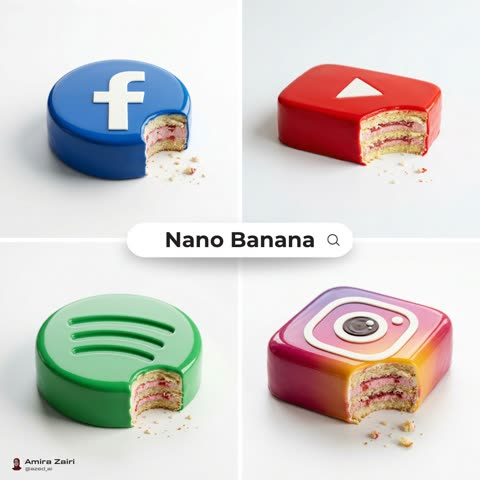</a>

[品牌名] 占位符让同一模板可把任意标志变成甜点，咬痕露出海绵和奶油夹层带来质感对比。纯白背景配柔和光线，把注意力集中在镜面釉面上。

Nano Banana 2 · 文生图 · 出处: [@azed_ai on X](https://x.com/azed_ai/status/2038254924207886653) · 124 赞，统计于 2026-10-29

[`food-sculpture`](tags.md#tag-food-sculpture) [`mirror-glaze`](tags.md#tag-mirror-glaze) [`logo-design`](tags.md#tag-logo-design) [`product-photography`](tags.md#tag-product-photography)

<details><summary><b>提示词</b></summary>

```text
minimalist luxury product photography of an edible sculpture inspired by the [brand name] logo, logo transformed into a refined dessert object, bold monochrome mirror glaze matching brand identity, ultra smooth glossy surface with realistic light reflections, isolated on a pure white background, subtle soft shadow grounding the object, single elegant bite mark revealing layered sponge and creamy filling inside, visible texture contrast between glaze and cake interior, delicate natural crumbs, soft high-key studio lighting, clean minimal composition with balanced negative space, contemporary premium advertising aesthetic, hyper-realistic detail, ultra sharp focus
```

</details>

<a id="nano-banana-honey-jar-wheat-field-macro"></a>
### 麦田中木凹槽里的高端蜂蜜罐

<a href="https://x.com/Just_sharon7/status/2039694451552272532">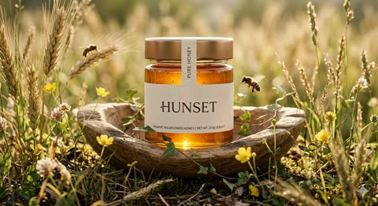</a>

用低角度微距、傍晚逆光和 90mm f/2.2 镜头参数，让蜂蜜透光发亮并虚化前景麦穗。常春藤、两只蜜蜂和空气中的花粉增加真实感，标签文字用引号写明。

Nano Banana 2 · 文生图 · 出处: [@Just_sharon7 on X](https://x.com/Just_sharon7/status/2039694451552272532) · 119 赞，统计于 2026-10-29

[`product-shot`](tags.md#tag-product-shot) [`macro`](tags.md#tag-macro) [`honey`](tags.md#tag-honey) [`backlit`](tags.md#tag-backlit) [`organic-brand`](tags.md#tag-organic-brand)

<details><summary><b>提示词</b></summary>

```text
Ultra-realistic cinematic product shot of a premium honey jar placed inside a shallow wooden hollow surrounded by tall wild wheat and tiny yellow meadow flowers, captured from an intimate low-angle macro perspective with slight cinematic depth, transparent glass jar filled with luminous deep golden honey, topped with a satin bronze metallic lid and a narrow cream seal strip crossing vertically over the cap, minimal luxury label reading “HUNSET”, jar lightly touched by thin climbing ivy strands for a refined organic detail, one realistic honeybee hovering near the front glass surface while another rests on a wheat stem behind the jar, environment set in a quiet countryside field during late afternoon, warm sunlight filtering through wheat stalks from behind creating glowing translucency inside the honey and soft halo edges around the jar, foreground with blurred wheat tips and soft natural bokeh, distant background fading into creamy green and amber tones, shallow depth of field with extreme sharpness on jar textures, visible honey thickness, subtle glass reflections, detailed plant fibers and pollen particles in air, cinematic luxury advertising mood, shot on 90mm macro lens, f/2.2, ultra-detailed natural textures, premium organic brand campaign style, 8k resolution, no text, no watermark.
```

</details>

<a id="nano-banana-nexora-mango-soda-can-liquid-splash"></a>
### 芒果百香果汽水罐与液体飞溅

<a href="https://x.com/Draymen424/status/2082742013892628511">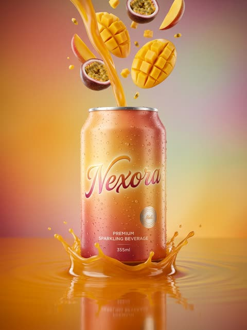</a>

水果、颜色和液体质感做成可替换占位符，一套模板可套用任意口味。光线按奢华广告的方式逐项列出，85mm 微距浅景深让标志和冷凝水珠保持锐利。

Nano Banana 2 · 文生图 · 出处: [@Draymen424 on X](https://x.com/Draymen424/status/2082742013892628511) · 113 赞，统计于 2026-10-28

[`beverage`](tags.md#tag-beverage) [`product-photography`](tags.md#tag-product-photography) [`condensation`](tags.md#tag-condensation) [`liquid-splash`](tags.md#tag-liquid-splash) [`template`](tags.md#tag-template)

<details><summary><b>提示词</b></summary>

```text
Ultra-realistic premium beverage commercial featuring a chilled Nexora aluminum can suspended in mid-air inside a futuristic luxury studio. The environment is surrounded by elegant floating crystal panels and soft volumetric light, with a seamless premium gradient backdrop inspired by {argument name="fruit type" default="FRUIT"} colors, blending deep {argument name="color shade" default="COLOR"} tones into soft glowing highlights.

The matte aluminum can has a sophisticated satin gradient finish inspired by the fruit palette, covered in microscopic condensation droplets with realistic cold texture. The bold flowing "Nexora" logo is embossed with a glossy metallic gradient, accompanied by minimalist premium typography and a subtle metallic authenticity seal.

Instead of resting on a surface, the can levitates at the center while an elegant spiral ribbon of {argument name="liquid texture" default="TEXTURE"} liquid wraps around it in slow motion. The liquid forms smooth twisting arcs with ultra-realistic viscosity, tiny droplets, and delicate mist particles.

Fresh [FRUIT] slices, whole fruits, leaves, and tiny juice droplets orbit naturally around the can with cinematic motion. Small sparkling ice crystals float through the air, emphasizing freshness and premium quality.

Below the floating product, a transparent reflective glass pedestal catches subtle reflections while remaining visually clean. Soft atmospheric particles create depth without distracting from the product.

Lighting is crafted like a luxury perfume campaign:

Large softbox key light for silky reflections
Warm rim lighting outlining every curve
Gentle top spotlight emphasizing condensation
Cinematic volumetric glow
Soft reflective bounce light from below
High-end commercial HDR lighting

Camera uses an 85mm macro cinema lens, shallow depth of field, eye-level perspective, extremely sharp focus on the logo and condensation, with creamy background bokeh and elegant compression.

Color grading is luxurious and vibrant, combining premium beverage advertising aesthetics with fashion-brand sophistication.
```

</details>

<a id="nano-banana-face-wash-tube-water-splash-pedestal"></a>
### 黑色石台上的洗面奶与水花产品图

<a href="https://x.com/Aqib__786Ai/status/2075432044637876431">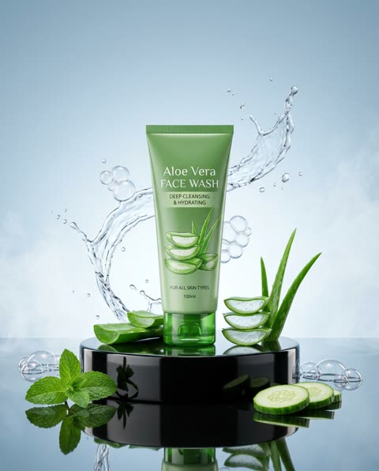</a>

先列出水花、绿叶、气泡和薄雾等辅助元素来表达清洁与保湿，再写明柔光箱、轮廓光和反射的布光。结尾要求留出大片空白，方便后期加品牌文字。

Nano Banana 2 · 文生图 · 出处: [@Aqib__786Ai on X](https://x.com/Aqib__786Ai/status/2075432044637876431) · 112 赞，统计于 2026-10-28

[`product-photography`](tags.md#tag-product-photography) [`skincare`](tags.md#tag-skincare) [`water-splash`](tags.md#tag-water-splash) [`studio-lighting`](tags.md#tag-studio-lighting) [`negative-space`](tags.md#tag-negative-space)

<details><summary><b>提示词</b></summary>

```text
Refresh Your Skin with Every Wash. made with Nano banana 2 on
@Lart_AI


Try here 👇 👇

https://
lartai.com/?TG=15347

Model : Nana banana 2

Resolution 1080

Ratio 4:5

Prompht: 1

Create a premium commercial product photography image of a luxury face wash tube standing upright on a polished black stone pedestal.

The product is surrounded by crystal-clear water splashes, fresh green leaves, soft bubbles, and subtle mist to represent deep cleansing and hydration.

Background is a soft blue-to-white gradient with elegant lighting and premium skincare aesthetics.

Professional beauty studio lighting with softbox, rim light, realistic reflections, and natural shadows.

Ultra-realistic packaging, sharp details, glossy finish, luxury skincare advertisement, premium cosmetic photography, photorealistic, HDR, 8K quality.

Minimal composition with plenty of negative space for branding.

Prompt 2:

Create a high-end commercial skincare advertisement featuring a premium face wash tube placed on a natural white marble rock beside flowing crystal-clear water.

Fresh aloe vera leaves, cucumber slices, mint leaves, water droplets, soft foam, and floating botanical elements surround the product.

Golden sunrise light mixed with cool blue ambient lighting creates a luxurious skincare atmosphere.

Background is bright, clean, and premium with soft bokeh, realistic reflections, and subtle mist.

Luxury cosmetic campaign style, ultra-photorealistic, cinematic lighting, premium packaging, extremely detailed textures, HDR, ray tracing, award-winning commercial product photography.
```

</details>

<a id="nano-banana-mamaearth-vitamin-c-serum-nature-glow"></a>
### Mamaearth 维C精华，搭配柑橘与姜黄

<a href="https://x.com/Diplomeme/status/2070816926872601002">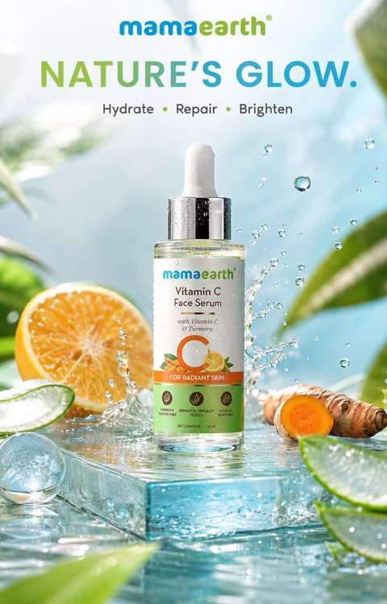</a>

提示词固定了瓶身占画面高度的 35% 到 45%，并给出了确切的主标题和副文案，所以版式干净，像一张广告海报。它描述了分层的湿润亚克力台面和水波纹，再加上指定的镜头和柔光箱布光，带来高光玻璃的棚拍质感。

Nano Banana 2 · 文生图 · 出处: [@Diplomeme on X](https://x.com/Diplomeme/status/2070816926872601002) · 107 赞，统计于 2026-10-29

[`skincare`](tags.md#tag-skincare) [`product-shoot`](tags.md#tag-product-shoot) [`poster`](tags.md#tag-poster) [`ingredients`](tags.md#tag-ingredients)

<details><summary><b>提示词</b></summary>

```text
Act as a senior beauty art director and elite FMCG product photographer specializing in premium skincare campaigns for high-conversion social media advertising.

Create an ultra-premium product shoot social media poster for Mamaearth serum in vertical 4:5 format.

OBJECTIVE:
Create a premium yet approachable skincare advertisement that communicates hydration, purity, natural ingredients, and toxin-free goodness while staying true to Mamaearth’s clean botanical brand identity.

ART DIRECTION:
Clean FMCG luxury.
Fresh, bright, natural.
Premium but accessible.
Modern skincare advertising.
Minimal clutter.
High-conversion SMM quality.

BRAND IDENTITY:
Strict Mamaearth branding.

Primary colors:
Mint green
Sky blue
Soft white
Botanical green

HERO PRODUCT:
A premium Mamaearth serum bottle positioned centrally, occupying 35–45% of frame height.
Perfect label readability.
Sharp glass bottle edges.
Luxury dropper cap.
Hyper-detailed transparent serum liquid visible inside bottle.
No distortion.

ENVIRONMENT:
Environmental luxury skincare setup inspired by nature and hydration.

Use layered premium surfaces:
translucent acrylic blocks,
wet reflective glass platform,
soft water ripples,
floating botanical leaves,
natural ingredient elements.

Environment should feel fresh, bright, and clean.

INGREDIENT STORY:
Surround product with premium hero ingredients relevant to serum formulation:
vitamin C citrus slices,
turmeric particles,
aloe gel droplets,
water splash arcs,
hyaluronic acid droplets.

Ingredients should feel realistic and premium.
No clutter.

SURFACE DETAILS:
Wet glossy surfaces.
Subtle condensation.
Tiny water droplets.
Reflective premium surfaces.

LIGHTING:
Soft diffused beauty lighting.
Large softbox reflections.
Clean hydration glow.
Gentle specular highlights on bottle.
Soft shadows.
Translucent glow through serum liquid.

DETAIL SHOTS:
Visible macro details:
serum droplet suspended mid-air,
glass reflections,
liquid viscosity,
label embossing,
micro condensation.

TYPOGRAPHY:
Minimal premium SMM typography.

Main headline:
NATURE’S GLOW.

Secondary copy:
Hydrate • Repair • Brighten

Clean modern sans-serif.
Bold but elegant.

CAMERA:
Shot on Phase One XF IQ4
100mm macro lens
Luxury product photography
Shallow depth of field

COLOR SYSTEM:
Strict controlled palette using Mamaearth brand colors.
Soft green-blue gradients.
Fresh botanical highlights.

POST PROCESS:
Subtle bloom
Micro contrast sharpening
Beauty retouch
Premium FMCG campaign polish

QUALITY:
Hyper-realistic
Photorealistic skincare advertising
Premium social media campaign
Ultra-detailed
8K UHD

NEGATIVE:
No AI artifacts
No warped bottle
No distorted label
No clutter
No cheap ecommerce aesthetics
No oversaturated colors
```

</details>

<a id="gpt-image-kfc-red-claw-machine-fried-chicken"></a>
### 红色 KFC 风格娃娃机，内装炸鸡桶

<a href="https://x.com/harboriis/status/2058103785306878367">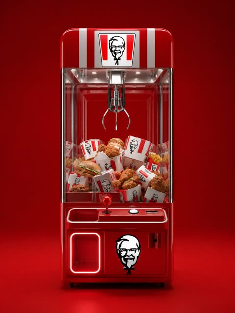</a>

提示词是可填充的模板，品牌、主色和内容物可以替换而结构保持不变。玻璃、抛光金属等材质词，加上对称的 3:4 竖向构图和单色背景，营造出高端商品陈列的质感。

GPT Image 2 · 文生图 · 出处: [@harboriis on X](https://x.com/harboriis/status/2058103785306878367) · 104 赞，统计于 2026-10-29

[`claw-machine`](tags.md#tag-claw-machine) [`product-shot`](tags.md#tag-product-shot) [`template`](tags.md#tag-template) [`fast-food`](tags.md#tag-fast-food)

<details><summary><b>提示词</b></summary>

```text
[A futuristic claw machine inspired by the brand's visual identity (BRAND NAME)] JUMA Premium Arcade Machine fully customized with the colors, logo, and visual identity of the brand (BRAND NAME)] [Inside the machine, multiple customized products based on (what should exist inside the machine) stacked naturally in a fun and visually pleasing composition) (A metal claw hanging at the top centered above the products ready to grab an item)] [Clean minimalist studio environment with monochromatic background following (main brand color)] [ULTRA-REALISTIC CINEMATIC 3D RENDERING STYLE] [EXTERIOR OF THE MACHINE MADE OF GLOSSY PAINTED METAL, CRYSTAL CLEAR GLASS PANELS, POLISHED EDGES AND REALISTIC REFLECTIONS] [HIGHLY DETAILED INTERIOR WITH REALISTIC PACKAGING, SHADOWS AND DEPTH] [SOFT REFLECTIONS ON THE GLASS, SUBTLE METALLIC HIGHLIGHTS AND SMOOTH CINEMATIC GRADIENTS] [SYMMETRICAL CENTERED COMPOSITION WITH ELEGANT NEGATIVE SPACE] [DRAMATIC STUDIO LIGHTING WITH SOFT SHADOWS, LUMINOUS GLOWS AND VOLUMETRIC ATMOSPHERE] [DOMINANT COLORS (COLORS OF [BRAND] [INSPIRED BY LUXURY BRANDING CAMPAIGNS, COLLECTIBLE PRODUCT DISPLAYS, MODERN ARCADE AESTHETICS AND PREMIUM COMMERCIAL ADVERTISING] [MINIMALIST COMPOSITION WITH STRONG VISUAL HIERARCHY AND SOPHISTICATED FEEL OF PREMIUM PRESENTATION] [NO TEXT, NO WATERMARK, NO DISTORTION, NO VISUAL POLLUTION] [3:4 VERTICAL COMPOSITION WITH CENTERED FRAMING AND CLEAN BACKGROUND] [BK RESOLUTION, ULTRA-SHARP DETAILS, REALISTIC DEPTH, CINEMATOGRAPHIC LENS BEHAVIOR, HIGH DYNAMIC RANGE] [HYPER-DETAILED TEXTURES, TRANSPARENCY] Realistic glass, polished reflections, volumetric lighting, extreme realism.
```

</details>

<a id="nano-banana-low-angle-streetwear-sneaker-graffiti"></a>
### 低角度仰拍，红色耳机女孩与白色球鞋

<a href="https://x.com/AIwithSarah_/status/2041369381784154173">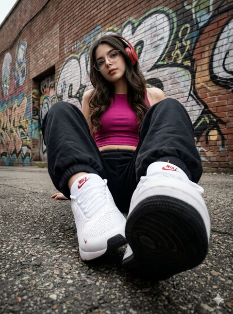</a>

提示词用低机位加极端透视，让前景球鞋占据画面，同时依靠参考图锁定服装与涂鸦砖墙背景。把品牌标识限定在鞋舌和鞋侧，使其不抢画面。

Nano Banana 2 · 上传图改图 · 出处: [@AIwithSarah_ on X](https://x.com/AIwithSarah_/status/2041369381784154173) · 104 赞，统计于 2026-10-29

[`streetwear`](tags.md#tag-streetwear) [`fashion`](tags.md#tag-fashion) [`low-angle`](tags.md#tag-low-angle) [`foreshortening`](tags.md#tag-foreshortening)

<details><summary><b>提示词</b></summary>

```text
Nano Banana 2 on Gemini.

Prompt: Photorealistic and hyper-detailed fashion art (image attached) of a modern girl wearing red over-ear headphones, a fuchsia crop top, and baggy black sweatpants. Low-angle perspective, extreme foreshortening with a projected white sneaker; only the nameless "NIKE" logo is clearly visible on the tongue and side, detailed texture of the sole. Urban streetwear aesthetic, on asphalt, background of a brick wall with colorful graffiti, clean studio lighting, soft gradients, defined edges, high contrast, masterpiece.
```

</details>

<a id="nano-banana-strawberry-yogurt-jar-cotton-candy-clouds"></a>
### 粉色棉花糖云朵中的草莓酸奶玻璃罐

<a href="https://x.com/oggii_0/status/2027789311383621877">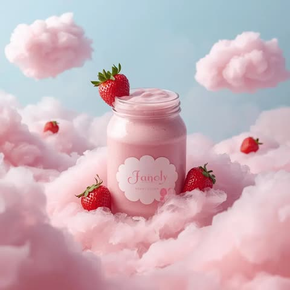</a>

提示词先设定超现实的粉蓝天空，再依次交代玻璃罐、标签形状、罐口草莓和云朵位置，层次清楚。柔和漫射日光、对称构图和浅景深但主体清晰的写法，让画面既写实又梦幻。

Nano Banana 2 · 文生图 · 出处: [@oggii_0 on X](https://x.com/oggii_0/status/2027789311383621877) · 103 赞，统计于 2026-10-28

[`product-photography`](tags.md#tag-product-photography) [`pastel`](tags.md#tag-pastel) [`strawberry`](tags.md#tag-strawberry) [`cotton-candy`](tags.md#tag-cotton-candy) [`surreal`](tags.md#tag-surreal)

<details><summary><b>提示词</b></summary>

```text
Nano Banana 2 on
@SocialSight


Prompt: Ultra-realistic dreamy product photography in a surreal pastel sky environment. A transparent plastic jar filled with thick pink strawberry yogurt smoothie sits centered and slightly embedded inside fluffy cotton-candy-like pink clouds, the jar open at the top with creamy surface visible and a fresh whole strawberry resting on the rim. The jar label is a soft white scalloped shape with simple elegant pink brand text and small strawberry illustrations around the container.
Additional ripe strawberries are placed around the jar partially resting on the clouds. The background is a soft pale blue sky filled with multiple floating pink cotton candy clouds, some clouds containing small strawberries nestled inside them. Lighting is soft diffused daylight creating gentle shadows and glossy highlights on the creamy texture and plastic surface. Clean symmetrical composition, whimsical dessert advertising aesthetic, soft pastel color palette dominated by pink and light blue, shallow depth of field but product fully sharp, highly detailed textures on clouds and fruit, photorealistic 8k quality.
```

</details>

<a id="nano-banana-giant-pepsi-can-mountain-waterfall"></a>
### 山顶巨型百事可乐罐倾泻瀑布

<a href="https://x.com/Sheldon056/status/2036657572296769934">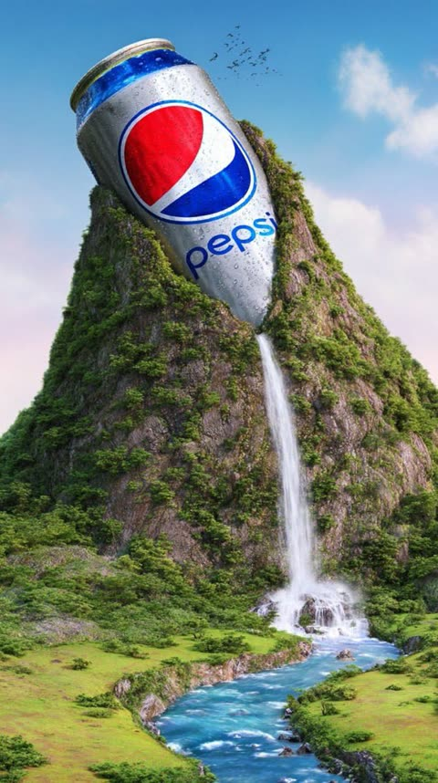</a>

这是可替换品牌、logo 和液体颜色的占位模板，换成其他产品场景结构不变。按主体、从罐口经山体流到河谷的水流路径、最后光线的顺序描述，使瀑布从罐口到山谷保持连贯。

Nano Banana 2 · 文生图 · 出处: [@Sheldon056 on X](https://x.com/Sheldon056/status/2036657572296769934) · 99 赞，统计于 2026-10-29

[`surreal`](tags.md#tag-surreal) [`product`](tags.md#tag-product) [`waterfall`](tags.md#tag-waterfall) [`template`](tags.md#tag-template)

<details><summary><b>提示词</b></summary>

```text
Nano Banana 2 on
@Hailuo_AI
 .

Prompt: A highly realistic, surreal photograph of a colossal, giant [BRAND] aluminum can (with the [BRAND COLORS & LOGO DESCRIPTION] clearly visible) positioned at the top of a rocky summit of a steep, cone-shaped, lush green mountain. The can is lying on its side and a powerful and effervescent waterfall is pouring from its tab opening. This waterfall cascades down the entire side of the mountain face and feeds directly into a pristine, winding river at the mountain's base flowing through a serene green valley. The water should have effervescent bubbles and a luminous, vibrant [LIQUID COLOR] quality. A small flock of birds is visible flying near the peak. Bright, crisp, clear summer day lighting. Natural daylight, clear blue sky with a few soft clouds. Wide-angle.
```

</details>

<a id="gpt-image-oatly-barista-edition-milk-splash-hero"></a>
### Oatly 咖啡师版燕麦奶盒与牛奶飞溅和拉花咖啡

<a href="https://x.com/aziz4ai/status/2073691521564451078">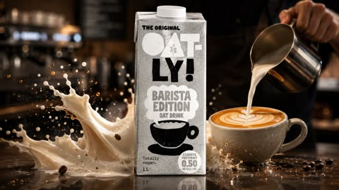</a>

先上传清晰的产品图作为精确参考，使 logo、标签和包装保持准确可读。牛奶飞溅与拉花倒奶的画面把口感和咖啡师场景带入画面，居中的产品在暗色虚化的咖啡馆背景前一眼抓住视线。

GPT Image 2 · 上传图改图 · 出处: [@aziz4ai on X](https://x.com/aziz4ai/status/2073691521564451078) · 97 赞，统计于 2026-10-29

[`branded-proof`](tags.md#tag-branded-proof) [`product-hero`](tags.md#tag-product-hero) [`milk-splash`](tags.md#tag-milk-splash) [`latte`](tags.md#tag-latte)

<details><summary><b>提示词</b></summary>

```text
Upload a clear product image first.

Create a premium 16:9 advertising key visual using the uploaded product as the exact hero reference.

The product must be large, front-facing or best-selling angle, sharply focused, and occupy 35–50% of the frame.

Keep the logo, label, packaging shape, colors, proportions, typography, and recognizable brand details accurate, readable, and unobstructed.

Use the visual system: “Branded Proof”.

Do not just make a pretty scene.
Make the environment prove the product’s benefit.

The product stays clean, pristine, and dominant.
Everything around it becomes evidence of what the product does:
before/after contrast, texture change, temperature shift, freshness, speed, impact, comfort, flavor, protection, glow, silence, energy, or luxury.

Build a strong foreground, midground, and background.
The eye should land on the logo first, then understand the benefit in one second.

Style:
premium commercial photography, cinematic lighting, agency-grade campaign visual, high contrast, tactile realism, clean negative space, realistic shadows, polished reflections, scroll-stopping composition.

Avoid:
tiny people, micro worlds, UI overlays, holograms, fake floating logos, messy clutter, unreadable labels, hidden branding, random effects, extra text overlays.

Output: one hero ad image, 16:9.
```

</details>

<a id="nano-banana-cornetto-belgian-chocolate-ad"></a>
### Cornetto 比利时巧克力冰淇淋悬浮广告

<a href="https://x.com/iamrealsnow/status/2056661445950214603">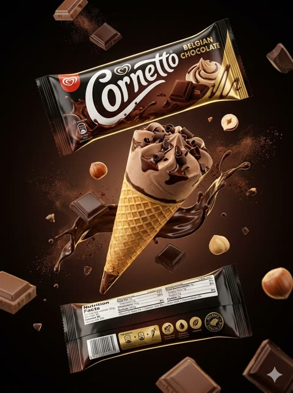</a>

提示词为每个物体单独指定位置、朝向和材质，因此正面包装、甜筒和背面包装能组成统一的版面。冻结动态的巧克力飞溅配合左上方主光与金色边缘轮廓光，形成高端商业 CGI 质感。

Nano Banana 2 · 文生图 · 出处: [@iamrealsnow on X](https://x.com/iamrealsnow/status/2056661445950214603) · 94 赞，统计于 2026-10-29

[`ice-cream`](tags.md#tag-ice-cream) [`food-photography`](tags.md#tag-food-photography) [`chocolate`](tags.md#tag-chocolate) [`brand-ad`](tags.md#tag-brand-ad)

<details><summary><b>提示词</b></summary>

```text
{
  "image_type": "luxury commercial ice cream advertisement",
  "resolution_target": "8K",
  "aspect_ratio": "3:4",
  "orientation": "vertical",

  "scene": {
    "environment": "premium studio product photography",
    "background": {
      "color": "deep chocolate brown to black gradient",
      "texture": "smooth matte finish",
      "lighting_falloff": "soft cinematic radial glow behind product"
    }
  },

  "composition": {
    "style": "floating premium dessert arrangement",
    "depth": "layered foreground, midground and background composition",
    "camera_angle": "slightly top-down cinematic perspective",
    "camera_distance": "medium close-up",
    "focus": "sharp focus on central Cornetto package and ice cream cone",
    "visual_flow": "dynamic diagonal movement from upper left to lower right"
  },

  "primary_objects": [
    {
      "object_type": "ice_cream_package",
      "brand_text": "Cornetto",
      "flavor_text": "Belgian Chocolate",
      "position": "upper center",
      "orientation": "slightly tilted upward",
      "packaging_material": "glossy premium wrapper",
      "packaging_colors": [
        "dark chocolate brown",
        "black",
        "gold"
      ],
      "text_details": {
        "main_text": "Cornetto",
        "secondary_text": "Belgian Chocolate",
        "font_style": "luxury modern script with bold sans-serif",
        "text_colors": [
          "white",
          "gold"
        ]
      },
      "graphics": [
        "melted Belgian chocolate splash",
        "rich chocolate chunks",
        "creamy swirl illustration",
        "gold chocolate drizzle"
      ]
    },

    {
      "object_type": "ice_cream_cone",
      "brand_style": "Cornetto waffle cone",
      "position": "center",
      "orientation": "slightly angled toward camera",
      "cone_texture": "crispy golden waffle pattern",
      "ice_cream_flavor": "Belgian chocolate soft swirl",
      "toppings": [
        "dark chocolate curls",
        "Belgian chocolate shards",
        "chocolate sauce drizzle"
      ],
      "details": {
        "top_texture": "smooth creamy swirl",
        "bottom_tip": "signature chocolate-filled cone tip",
        "surface_reflection": "subtle glossy highlights"
      }
    },

    {
      "object_type": "ice_cream_package",
      "brand_text": "Cornetto",
      "position": "bottom",
      "orientation": "back side visible",
      "packaging_material": "glossy plastic wrapper",
      "visible_elements": [
        "nutrition information",
        "barcode",
        "ingredient icons",
        "Belgian chocolate emblem"
      ]
    }
  ],

  "secondary_objects": [
    {
      "object_type": "chocolate_chunks",
      "colors": [
        "dark brown",
        "milk chocolate"
      ],
      "texture": "rich glossy Belgian chocolate",
      "positions": [
        "floating around cone",
        "foreground",
        "background"
      ]
    },

    {
      "object_type": "cocoa_powder_particles",
      "color": "dark cocoa brown",
      "distribution": "floating cinematic dust effect"
    },

    {
      "object_type": "hazelnuts",
      "color": "warm beige brown",
      "texture": "natural matte shell",
      "positions": "scattered mid-air around product"
    },

    {
      "object_type": "liquid_chocolate_splash",
      "color": "dark Belgian chocolate",
      "style": "high-speed frozen splash effect",
      "positions": "wrapping around center cone"
    }
  ],

  "lighting": {
    "type": "cinematic studio lighting",
    "key_light": "soft directional light from upper left",
    "fill_light": "subtle ambient fill lighting",
    "rim_light": "golden edge highlights on packaging and cone",
    "reflections": "luxury glossy reflections on chocolate and wrapper",
    "shadows": "soft floating shadows beneath suspended objects"
  },

  "materials": {
    "packaging": "premium glossy foil wrapper",
    "cone": "crispy matte waffle texture",
    "ice_cream": "smooth creamy Belgian chocolate texture",
    "chocolate": "rich glossy melted surface",
    "nuts": "natural matte texture"
  },

  "color_palette": {
    "dominant": [
      "black",
      "dark chocolate brown"
    ],
    "accent": [
      "gold",
      "cream",
      "warm beige"
    ],
    "highlight": [
      "white",
      "glossy reflections"
    ]
  },

  "motion_effect": {
    "style": "frozen motion photography",
    "objects": "cone, chocolate splashes and chunks suspended mid-air",
    "particle_effect": "floating cocoa dust and crumbs"
  },

  "render_quality": {
    "detail_level": "ultra high detail",
    "sharpness": "extremely crisp edges",
    "texture_quality": "hyper realistic materials",
    "render_style": "cinematic luxury food advertising",
    "finish": "premium commercial CGI look"
  }
}
```

</details>

<a id="gpt-image-matcha-splash-iced-drink"></a>
### 抹茶冰饮飞溅特写，身后站着模特

<a href="https://x.com/codewithhajra/status/2074109215652659439">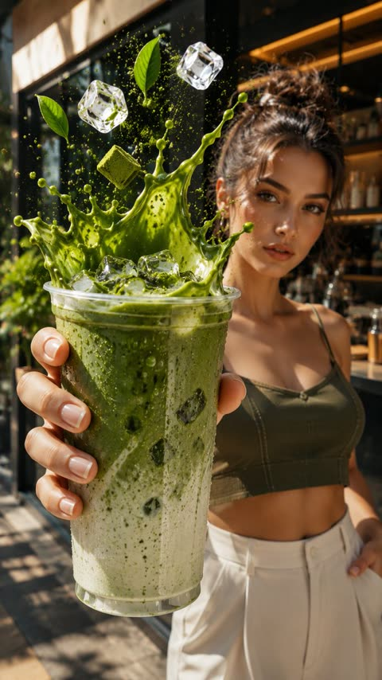</a>

提示词把饮品放在极近的前景并使用透视夸张，人物略靠后，让产品占据主视觉的同时人物依然清晰可辨。冻结的飞溅动态加上固定的悬浮配料清单，让画面形成唯一的焦点。

GPT Image 2 · 文生图 · 出处: [@codewithhajra on X](https://x.com/codewithhajra/status/2074109215652659439) · 89 赞，统计于 2026-10-29

[`beverage`](tags.md#tag-beverage) [`advertisement`](tags.md#tag-advertisement) [`forced perspective`](tags.md#tag-forcedperspective) [`splash`](tags.md#tag-splash)

<details><summary><b>提示词</b></summary>

```text
Ultra-realistic luxury beverage advertisement, cinematic commercial photography, vertical 9:16.

A stylish, elegant, fashion-forward [woman] stands confidently in the background, looking directly at the camera with a calm luxury editorial expression. Wearing a modern minimalist outfit perfectly matching the color palette and mood of the drink. One hand casually in pocket while the other arm extends naturally toward the camera, holding an oversized crystal-clear cup that dominates the foreground using dramatic forced perspective.

The beverage is the undisputed hero of the image. Hyper-realistic liquid explosion frozen in time bursting upward from the cup with dynamic splash physics. Floating premium ingredients explode naturally around the splash, including [Iced Frape], realistic garnish, crystal-clear ice cubes, tiny droplets, sparkling particles, and subtle atmospheric elements matching the drink. Every ingredient appears suspended mid-air with cinematic precision.

The drink features beautiful swirling layers, realistic condensation, water droplets, glossy reflections, transparent cup, premium texture, and ultra-detailed ingredients. Splash shape feels energetic yet elegant, creating a luxury advertising aesthetic.

Background perfectly matches the beverage theme:
[LOCATION OR ENVIRONMENT]
Luxury café, modern city street, cherry blossom avenue, tropical garden, rooftop lounge, European street, luxury hotel, futuristic café, beach resort, forest retreat, neon nightlife, or premium indoor setting.

Lighting:
Soft cinematic sunlight or premium golden hour lighting, natural volumetric rays, realistic reflections, HDR dynamic range, global illumination, ray tracing, subtle rim light, realistic shadows.

Composition:
Extreme foreground drink occupying 60–70% of the frame, model positioned slightly behind for depth, shallow depth of field, creamy bokeh, perfect subject separation, centered composition, commercial framing, luxury branding aesthetic.

Style:
Luxury beverage campaign, Vogue editorial meets premium food photography, ultra-clean composition, hyper-realistic textures, frozen action, cinematic color grading, premium advertising quality.

Camera:
Full-frame mirrorless camera, 35mm lens, f/2.2, ultra-high resolution, HDR, razor-sharp focus on the drink, realistic skin texture, natural proportions, physically accurate lighting, no distortion.

Quality:
Photorealistic, 8K, masterpiece, commercial product photography, luxury lifestyle campaign, award-winning advertising, extremely detailed, vibrant yet realistic.

Negative prompt:
low quality, blurry, plastic skin, deformed hands, extra fingers, duplicate ingredients, melted ice, warped cup, incorrect reflections, oversaturated colors, flat lighting, text, watermark, logo, cropped drink, bad anatomy, CGI look, artificial textures, noise, artifacts
```

</details>

<a id="gpt-image-mint-toner-glass-pedestal-skincare-ad"></a>
### 薄荷色化妆水瓶置于玻璃底座，搭配丝带与气泡

<a href="https://x.com/AIwithWania/status/2069099746564960670">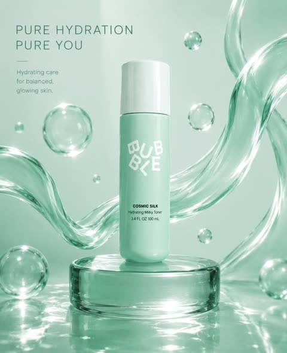</a>

开头用括号点明广告类型，并写出完整标题文案，版式和文字都能被锁定。单个主体瓶身放在玻璃底座上，配合有限的薄荷色调，以及光泽、半透明、反光等材质词，画面干净，突出产品。

GPT Image 2 · 文生图 · 出处: [@AIwithWania on X](https://x.com/AIwithWania/status/2069099746564960670) · 89 赞，统计于 2026-10-29

[`skincare`](tags.md#tag-skincare) [`product-ad`](tags.md#tag-product-ad) [`mint-palette`](tags.md#tag-mint-palette)

<details><summary><b>提示词</b></summary>

```text
(Luxury skincare product advertisement), (cool mint-green pastel theme), premium cosmetic bottle on glossy glass pedestal, floating translucent bubbles, flowing liquid silk ribbons around product, soft cinematic studio lighting, reflective surface, minimal clean background, high-end beauty campaign aesthetic, hyper-realistic 3D render, elegant typography text (PURE HYDRATION / PURE YOU), premium packaging mockup, ultra-detailed, modern commercial branding, glossy texture, soft shadows, minimal luxury composition, fresh hydrating vibe, trending cosmetic ad style, 8K, photorealistic.
```

</details>

<a id="nano-banana-chrome-hypercar-desert-canyon-sunset"></a>
### 日落峡谷边缘的镀铬超跑

<a href="https://x.com/kellyyjjones/status/2069600913246113957">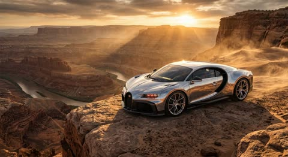</a>

围绕单一主体堆叠光束、体积感尘埃和逆光日落等光线与大气词汇。用杂志式商业摄影风格和低角度广角镜头定义构图与真实感。

Nano Banana 2 · 文生图 · 出处: [@kellyyjjones on X](https://x.com/kellyyjjones/status/2069600913246113957) · 89 赞，统计于 2026-10-29

[`hypercar`](tags.md#tag-hypercar) [`desert`](tags.md#tag-desert) [`cinematic-lighting`](tags.md#tag-cinematic-lighting) [`automotive`](tags.md#tag-automotive)

<details><summary><b>提示词</b></summary>

```text
Image generated by Nano Banana 2 on
@Lart_AI


Try it there 👇🏻


http://
lartai.com/?TG=12459

Ultra-detailed cinematic shot of a futuristic hypercar (Bugatti/Lamborghini style) parked on the edge of a vast desert canyon at sunset. The vehicle has a mirror-like metallic finish reflecting the dramatic environment. Golden sunlight cuts through heavy atmospheric dust, creating god rays and long cinematic shadows. Massive sandstone cliffs surround the scene, emphasizing extreme scale and isolation. Subtle sand particles in the air, wind motion visible in the dunes, hyper-realistic textures on rock and car surface. Low-angle wide shot to emphasize power and dominance. Luxury automotive commercial photography style, National Geographic realism mixed with high-end fashion advertising. Ultra sharp focus, HDR, volumetric lighting, depth of field, 8K resolution, masterpiece quality. ❄️ Alternate Extreme Version (Arctic Luxury) Hyper-realistic luxury hypercar driving across a frozen Arctic wasteland under glowing aurora borealis. Ice crystals reflecting neon green and purple lights across the car’s glossy surface. Snow storm gently blowing, dramatic cinematic motion, frozen mountains in background, reflective ice floor like a mirror. Ultra-wide shot, slow-motion cinematic feel, luxury meets survival in extreme nature. High contrast lighting, volumetric fog, ultra-detailed, 8K, editorial automotive photography, award-winning style. Negative Prompt (Improved) cartoon, CGI look, low detail, blurry, distorted car shape, extra wheels, incorrect reflections, watermark, text, logo, oversaturated colors, bad perspective, cropped vehicle, plastic texture
```

</details>

<a id="nano-banana-candy-biscuits-hero-packet"></a>
### 糖果饼干包装配飞落糖果与金色背景

<a href="https://x.com/Aqib__786Ai/status/2075583441438114168">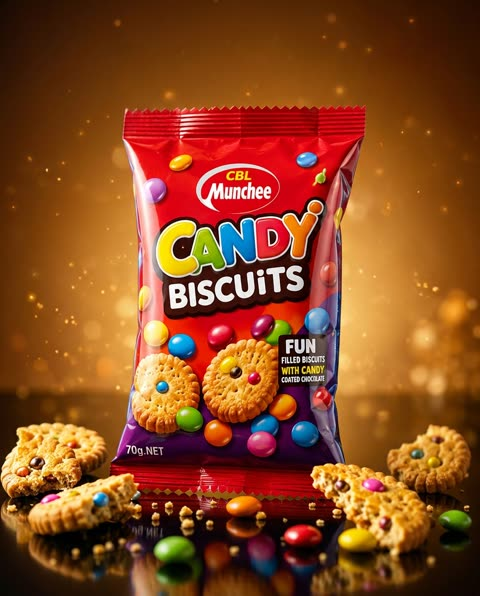</a>

提示词把包装锁定为唯一主体，并排除多余产品、手部和裁切，使包装文字保持清晰。暖金橙渐变背景、散景和 85mm f/5.6 浅景深营造高端广告质感。

Nano Banana 2 · 文生图 · 出处: [@Aqib__786Ai on X](https://x.com/Aqib__786Ai/status/2075583441438114168) · 81 赞，统计于 2026-10-29

[`product-photography`](tags.md#tag-product-photography) [`food`](tags.md#tag-food) [`packaging`](tags.md#tag-packaging) [`candy`](tags.md#tag-candy)

<details><summary><b>提示词</b></summary>

```text
Create a premium commercial product photography image of a "Candy Biscuits" packet standing upright on a clean reflective surface. The packaging is perfectly centered, crisp, and 100% accurate with readable branding and vibrant colors. Surround the product with a few golden crispy biscuits and colorful candy pieces scattered naturally. Soft studio lighting with subtle rim light, realistic reflections, soft shadows, luxury food advertising style, ultra-photorealistic, high-end packaging photography, macro-level texture details, vibrant colors, premium supermarket advertisement look, shallow depth of field, 85mm camera lens, f/4, HDR, 8K quality, razor-sharp focus, realistic food styling, elegant composition, no extra products, no watermark, no text distortion, no cropped product.

Prompht 2:

Create a premium hero product advertisement featuring a single "Candy Biscuits" packet as the main focus. The packet is standing upright on a glossy surface with realistic reflections. Place a few crunchy golden biscuits broken into halves around the product, with colorful candy-coated chocolate pieces falling in mid-air to create a dynamic, eye-catching composition. Use a warm golden-orange gradient background with soft glowing light, subtle bokeh, and floating crumbs for a fresh, delicious feel.

Lighting should be cinematic with soft key light, gentle rim lighting, and realistic shadows that make the packaging pop. Keep the product perfectly sharp with accurate colors, readable branding, and premium packaging details. Capture in high-end commercial food photography style with ultra-realistic textures, HDR quality, shallow depth of field, 85mm lens, f/5.6, luxury FMCG advertising, clean composition, vibrant colors, premium supermarket campaign look.

Negative Prompt:
No extra products, no duplicate packets, no human hands, no watermark, no logo distortion, no spelling errors, no blurry packaging, no overexposed lighting, no unrealistic reflections, no cropped product, no low resolution.
```

</details>

<a id="nano-banana-pink-watermelon-lip-balm-studio"></a>
### 粉色西瓜润唇膏管立于切开的西瓜片之间

<a href="https://x.com/AIwithSynthia/status/2042219830842098072">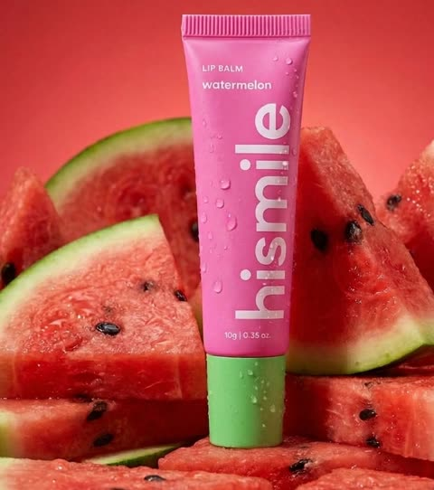</a>

用一句话同时点明产品、颜色和周围的水果，让主体在果肉中依然清晰。柔和漫射光、极少阴影与微距提示共同营造干净的商业美妆广告质感。

Nano Banana 2 · 文生图 · 出处: [@AIwithSynthia on X](https://x.com/AIwithSynthia/status/2042219830842098072) · 78 赞，统计于 2026-10-29

[`lip-balm`](tags.md#tag-lip-balm) [`watermelon`](tags.md#tag-watermelon) [`product-shot`](tags.md#tag-product-shot) [`studio`](tags.md#tag-studio)

<details><summary><b>提示词</b></summary>

```text
A vibrant studio product shot of a pink watermelon lip balm tube standing upright among freshly cut watermelon slices, glossy water droplets on both the product and fruit, rich juicy red textures with visible seeds, green rind contrast, soft diffused lighting with subtle highlights, clean gradient background in warm red tones, hyper-realistic, macro photography, sharp focus, commercial beauty ad style, centered composition, high detail, 4K, minimal shadows
```

</details>

<a id="nano-banana-holochrome-chrome-character-grid"></a>
### 四个带虹彩边缘的铬金属卡通角色

<a href="https://x.com/lloydcreates/status/2028852538443743580">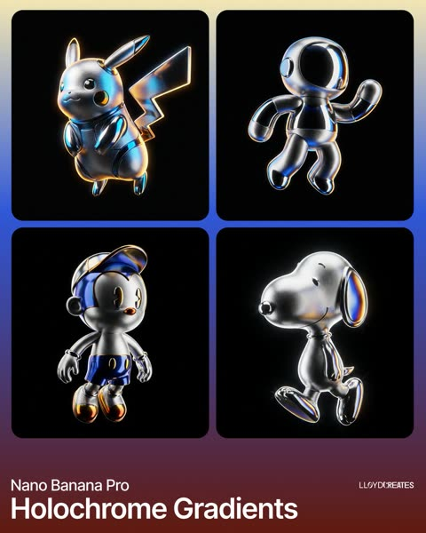</a>

纯黑无地面的虚空配合强边缘光，让每个角色都像悬浮的棚拍产品。金属边缘的色散与拉丝加镜面的混合质感让材质可信，换掉主体即可复用同一套渲染。

Nano Banana 2 · 文生图 · 出处: [@lloydcreates on X](https://x.com/lloydcreates/status/2028852538443743580) · 77 赞，统计于 2026-10-29

[`chrome`](tags.md#tag-chrome) [`iridescent`](tags.md#tag-iridescent) [`character`](tags.md#tag-character) [`studio-lighting`](tags.md#tag-studio-lighting)

<details><summary><b>提示词</b></summary>

```text
Create a hyper-realistic 8K product render of [INSERT YOUR PRODUCT HERE]

The subject should be perfectly centered and levitating in mid-air, floating in a void with no surface, platform, stand, or floor. Show the full product with zero cropping and visible margins on all sides.
Use a dynamic macro 45-degree hero angle.

The background must be solid pure black (#000000).

Lighting should feature hard edge lighting with strong rim light highlights. Use a high-contrast chiaroscuro look with thin chromatic aberration along metallic edges. Include reflective caustic light hits and an oily iridescent sheen on polished surfaces.

Color palette:

Background: #000000
Metal highlights: #E0E0E0
Iridescent accents: #4169E1, #FFD700, #FF4500

Materials and textures should combine micro-brushed sandblasted aluminum with mirror-finish chrome. Add subtle prismatic dispersion and thin-film interference along metal curves. Include fine film grain for tactile realism.

Do not include any props or additional objects.
No light boxes, umbrellas, softboxes, pedestals, cables, tripods, or hands.
No cropped edges or cut-off parts.
No text, logos, watermarks, blur, bokeh background, dust, or scratches.

Style reference: Industrial Design meets luxury hardware photography.
```

</details>

<a id="nano-banana-pringles-fire-chili-flow-volcano"></a>
### Pringles 火辣辣椒味薯片罐从熔岩岩石中升起

<a href="https://x.com/mr_farman_ai/status/2076622941026988261">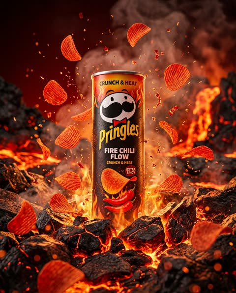</a>

先写明产品与口味，再描述场景（破裂火山岩、发光的熔岩裂缝）和打光方向（熔橙与深红），让整张画面保持统一的暖色调。结尾加入高端影棚灯光、浅景深和8K渲染等商业用语，确定光泽感的广告成片效果。

Nano Banana 2 · 文生图 · 出处: [@mr_farman_ai on X](https://x.com/mr_farman_ai/status/2076622941026988261) · 71 赞，统计于 2026-10-29

[`snack`](tags.md#tag-snack) [`food ad`](tags.md#tag-foodad) [`volcano`](tags.md#tag-volcano) [`fire`](tags.md#tag-fire)

<details><summary><b>提示词</b></summary>

```text
Ultra-realistic cinematic advertising photography of a “Pringler – Fire Chili Flow” potato chips can emerging from cracked volcanic rocks. The can stands upright in the center while glowing lava fissures surround it. Fiery red chili chips levitate around the product in slow motion, illuminated by molten orange and deep crimson lighting. Explosive sparks, burning chili flakes, and floating embers fill the atmosphere, creating the feeling of extreme heat and intensity. Thick spicy smoke swirls behind the can, while droplets of chili oil and seasoning particles shimmer in the air. Premium commercial food photography, dramatic contrast, hyper-detailed textures, luxury snack campaign, high-end studio lighting, cinematic depth of field, ultra-realistic 8K render.
```

</details>

<a id="nano-banana-minute-maid-pulpy-orange-orchard-ad"></a>
### 手持美汁源果肉橙汁的女子站在橙园中

<a href="https://x.com/iamrealsnow/status/2053313676493607192">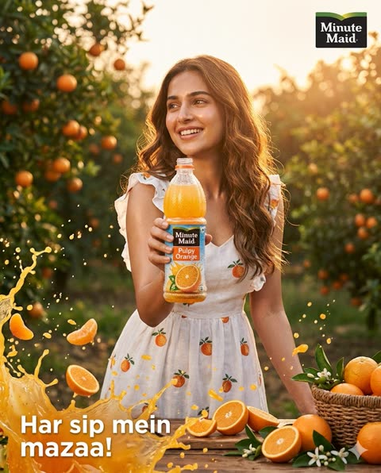</a>

提示词预先规定了版面：顶部留给品牌标识，左侧留出标语空间，瓶子朝向镜头。提前写明这些区域，可让文字与人物和果汁飞溅分开。

Nano Banana 2 · 文生图 · 出处: [@iamrealsnow on X](https://x.com/iamrealsnow/status/2053313676493607192) · 66 赞，统计于 2026-10-29

[`advertising`](tags.md#tag-advertising) [`beverage`](tags.md#tag-beverage) [`text-layout`](tags.md#tag-text-layout) [`golden-hour`](tags.md#tag-golden-hour)

<details><summary><b>提示词</b></summary>

```text
.
Ultra realistic premium commercial advertisement for Minute Maid Pulpy Orange, vertical 4:5 format, cinematic beverage photography, beautiful young woman with soft glowing skin and long silky hair standing in a fresh orange orchard during golden hour sunlight, wearing elegant orange and white summer outfit inspired by luxury fashion campaigns, smiling naturally while holding an ice cold Minute Maid Pulpy Orange bottle close to camera, visible orange pulp texture inside bottle, realistic water droplets and condensation on plastic bottle, detailed Minute Maid logo perfectly visible, dynamic splash of fresh orange juice exploding around foreground, sliced oranges flying in motion, tiny pulp particles suspended in air, fresh green leaves floating naturally, luxurious commercial lighting, warm orange color palette, high-end Coca Cola style branding aesthetic, shallow depth of field, dreamy creamy bokeh background, cinematic lens flare from sunlight, hyper detailed facial features, glossy lips, realistic eyes with catchlights, natural pose like a real beverage campaign model, energetic summer vibes, refreshing atmosphere, ultra realistic fruit textures, detailed oranges basket near foreground, splashing juice waves at bottom frame, glowing mist particles in background, clean advertising composition with strong hierarchy, top section reserved for Minute Maid logo, center focus on girl and bottle, bottom filled with oranges and splash effects, realistic reflections, HDR photography, premium product advertising, luxury FMCG campaign, photorealistic skin texture, vibrant orange tones, magazine quality, highly detailed, commercial studio quality, 8K ultra sharp details, global beverage campaign aesthetic, realistic shadows and highlights, emotional joyful expression, fresh healthy energetic mood, professional advertising photography, no extra fingers, no distorted anatomy, perfect hand holding bottle naturally, realistic typography space on left side for slogan “Har Sip Mein Mazaa”, visually balanced composition, award winning beverage advertisement style, Gemini Nano Banana optimized prompt
```

</details>

<a id="nano-banana-ukiyo-cat-human-diorama-food-can"></a>
### 开罐后升起的江户猫人立体微缩景观

<a href="https://x.com/KanaWorks_AI/status/2072146043551281217">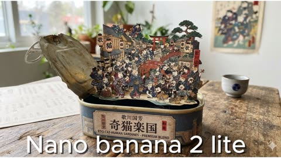</a>

提示词先写出朴素的工业罐头外观，再描述开盖后微缩景观升起的反差，并用具体的浮世绘画家作风格参照，使物体结构清晰、场景统一。

Nano Banana 2 · 文生图 · 出处: [@KanaWorks_AI on X](https://x.com/KanaWorks_AI/status/2072146043551281217) · 62 赞，统计于 2026-10-29

[`ukiyo-e`](tags.md#tag-ukiyo-e) [`diorama`](tags.md#tag-diorama) [`miniature`](tags.md#tag-miniature) [`cat`](tags.md#tag-cat) [`tin-can`](tags.md#tag-tin-can)

<details><summary><b>提示词</b></summary>

```text
Based on Utagawa Kuniyoshi’s famous ukiyo-e cat-human imagery,
this is a creatively designed art food can.
At first glance, it appears to be an ordinary, restrained, and industrial food can.
But the moment the lid is opened—
the whimsical half-cat, half-human figures from Kuniyoshi’s ukiyo-e world
slowly rise from inside the can
in the form of a miniature diorama landscape.
```

</details>

<a id="nano-banana-manga-creator-toy-box-grid"></a>
### 四位漫画家的玩具手办，作品从包装盒中跃出

<a href="https://x.com/Gdgtify/status/2113528348362338611">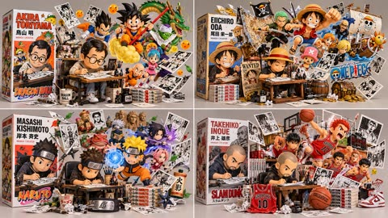</a>

每一条都是编号规则，并配有一句否定条件，写明不允许出现的内容，让模型逐项对照检查。固定的 2x2 网格、16:9 画幅和影棚式玩具渲染描述，使四个画面的构图与光线保持一致。

Nano Banana 2.1 · 文生图 · 出处: [@Gdgtify on X](https://x.com/Gdgtify/status/2113528348362338611) · 17 赞，统计于 2026-10-29

[`manga`](tags.md#tag-manga) [`figurine`](tags.md#tag-figurine) [`grid`](tags.md#tag-grid) [`toy-packaging`](tags.md#tag-toy-packaging)

<details><summary><b>提示词</b></summary>

```text
Same manga prompt I did with Nano Banana 2.1 but this time with GPT 2.5

Prompt: 2x2 grid, modify this prompt do this for 4 famous founding fathers, 2x2 grid, 16:9, do this for 4 famous manga: B₁  CREATOR FIGURE AT CRAFT (master)   a stylized 3D figurine of the creator at their craft station (drafting desk, pen,       tablet, typewriter) in a focused working pose; toy/vinyl material.   ¬B₁ = no figure / realistic human / idle figure / no craft station. B₂  OWN PACKAGING IN COMPOSITION   the creator's retail box — title + box art depicting the creator — present in‑frame as       a set piece; figure and box art share the same character design.   ¬B₂ = no box / box unrelated / box art ≠ figure. B₃  CREATIONS ESCAPE THE BOX   the works the creator made (characters/creatures/panels) burst OUT of the box art into 3D       space in dynamic poses; ≥2 escapees.   ¬B₃ = creations static on the box / no escape / creations unrelated to the creator. B₄  CRAFT ARTIFACTS ORBIT   floating artifacts of the craft (pages/panels, ink bottles, erasers, crumpled drafts, sprites)       suspended around, implying a stopped moment.   ¬B₄ = no artifacts / artifacts resting on ground / unrelated props. B₅  STUDIO TOY PRESENTATION   clean neutral studio background, soft light, collectible‑figure render quality, legible box       title.   ¬B₅ = busy background / flat render / illegible title / harsh light. η   HONEST TOY   vinyl/plastic sheen, box print texture, panel linework legible. FORBIDDEN = realistic human · no box · box art mismatch · static creations · no escape · no artifacts · busy bg · illegible title · flat render
```

</details>

<a id="gpt-image-blue-perfume-corrugated-glass-ad"></a>
### 波纹玻璃后的天空蓝香水瓶广告

<a href="https://x.com/ShamiWeb3/status/2078074982337515555">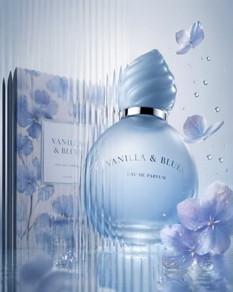</a>

低角度仰拍让瓶身显得高大，竖纹波纹玻璃为虚化的花卉包装盒带来纵向扭曲。收紧的配色、银色轮廓光，以及绣球花瓣与水珠，用画面传达香调。

GPT Image 2 · 文生图 · 出处: [@ShamiWeb3 on X](https://x.com/ShamiWeb3/status/2078074982337515555) · 发现于 [YouMind-OpenLab/awesome-gpt-image-2](https://github.com/YouMind-OpenLab/awesome-gpt-image-2)

[`perfume`](tags.md#tag-perfume) [`product-ad`](tags.md#tag-product-ad) [`minimalist`](tags.md#tag-minimalist) [`glass-distortion`](tags.md#tag-glass-distortion) [`blue-palette`](tags.md#tag-blue-palette)

<details><summary><b>提示词</b></summary>

```text
Minimalist product advertisement featuring [{argument name="product" default="the Vanilla & Blues Eau de Parfum 100ml — a round frosted sky-blue glass bottle filled with pale blue liquid, topped with a twisted seashell-shaped cap in matching light blue and a slim silver collar band, "Vanilla & Blues Eau De Parfum" printed on the rounded face"}] shot from a low upward angle so the bottle looms large and slightly tilted, with its matching blue-and-white floral watercolor box positioned softly out of focus behind it, seen through a vertical corrugated glass panel, with [a pale icy-white studio backdrop with a faint cool blue gradient wash] visible behind the object. Use [a palette of powder blue, frosted ice-white, silver, and soft hydrangea lavender-blue], soft directional lighting with a gentle silver rim-light along the cap and glass edge, semi-obscured contours through the corrugated distortion, elongated vertical distortion lines, elegant editorial mood, asymmetrical off-center composition, subtle depth, smooth gradients, polished commercial styling, delicate blue hydrangea petals and fine water droplets suspended mid-air beside the bottle to evoke its [sweet vanilla, soft floral bouquet, and clean powdery musk] notes, and the title "[VANILLA & BLUES]" in refined serif typography arched gently above the bottle's shoulder, vertical 4:5.
```

</details>

<a id="gpt-image-blueberry-clamshell-ecommerce-poster"></a>
### 冰蓝色调蓝莓果盒电商海报

<a href="https://x.com/op7418/status/2046626506722746736">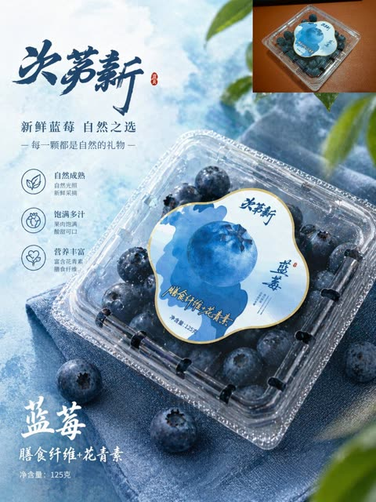</a>

先锁定包装形状、标签配色和机位让产品保持真实,再叠加参考小图、书法标题和图标列表。冷色调与果实水珠细节让摄影与平面排版风格统一。

GPT Image 2 · 上传图改图 · 出处: [@op7418 on X](https://x.com/op7418/status/2046626506722746736) · 发现于 [YouMind-OpenLab/awesome-gpt-image-2](https://github.com/YouMind-OpenLab/awesome-gpt-image-2)

[`ecommerce`](tags.md#tag-ecommerce) [`packaging`](tags.md#tag-packaging) [`blueberry`](tags.md#tag-blueberry) [`chinese-typography`](tags.md#tag-chinese-typography) [`product-poster`](tags.md#tag-product-poster)

<details><summary><b>提示词</b></summary>

```text
A premium e-commerce poster for fresh blueberries in a clean Chinese product-advertising style. Show a clear plastic clamshell box of blueberries as the main subject, placed diagonally from lower center to right side on folded blue fabric, viewed from a slightly elevated angle. The package must remain realistic and consistent: a transparent square container with rounded corners, filled with dark blue blueberries, with a large irregular rounded label on top in white, pale blue, and deep blue, featuring one oversized blueberry illustration in the center and elegant Chinese branding. Make the fruit inside look larger, plumper, fresher, and covered with subtle moisture droplets, while keeping the overall blueberry arrangement believable. The background is an airy icy-blue tabletop with soft cloudy texture, cool daylight, and scattered loose blueberries around the package. Add a few blurred green leaves entering from the top right and bottom right edges for a fresh natural feeling. In the upper-right corner, include 1 small inset image showing the original product package from above on a warm brown surface, like a reference thumbnail. On the left side, create Chinese promotional typography with a large dark blue calligraphy headline 决茗新, followed by 2 smaller lines of copy: 新鲜蓝莓 自然之选 and 每一颗都是自然的礼物. Below that, place 3 vertically stacked feature icons with short Chinese captions: a leaf icon for natural ripeness, a fruit icon for juicy fullness, and a heart icon for rich nutrition. Near the bottom left, add large white brush-style Chinese text 蓝莓, a secondary line 膳食纤维+花青素, and a small net weight line reading 125克. Use cool blue color grading, crisp commercial lighting, sparkling highlights on the plastic lid, premium supermarket packaging aesthetics, high detail, realistic product photography blended with polished graphic design.
```

</details>

<a id="gpt-image-chibi-eraser-bag-rainbow-rare-japanese"></a>
### 日本迷你橡皮袋装，附彩虹稀有款

<a href="https://x.com/ZetoGroovin/status/2058408514247410003">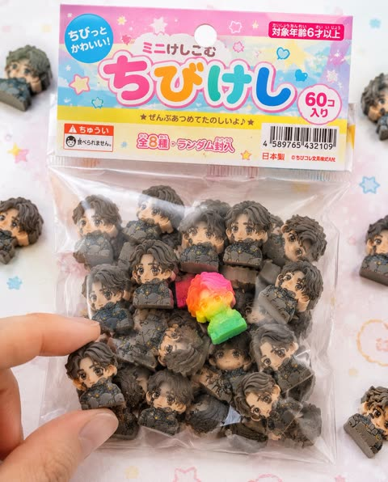</a>

提示词逐层指定商品细节：OPP袋、带吊孔的廉价印刷头卡、条码、年龄标识和食用警告，让画面像真实货架上的商品。袋中放一个彩虹渐变稀有款，并让手指作势去拿，形成清晰的视觉焦点。

GPT Image 2 · 文生图 · 出处: [@ZetoGroovin on X](https://x.com/ZetoGroovin/status/2058408514247410003) · 发现于 [freestylefly/awesome-gpt-image-2](https://github.com/freestylefly/awesome-gpt-image-2)

[`eraser`](tags.md#tag-eraser) [`packaging`](tags.md#tag-packaging) [`chibi`](tags.md#tag-chibi) [`product-photo`](tags.md#tag-product-photo)

<details><summary><b>提示词</b></summary>

```text
添付されたキャラクターシートをSTRICTなデザインリファレンスとして使用すること。 キャラクターの顔、髪型、目の形、プロポーションは絶対に変更しない。

■目的： キャラクターを日本の「ちび消しゴム商品」として完全に商品化し、 実際に文房具売り場やガチャで販売されているようなリアルなパッケージ商品写真を作成する。

■コンセプト： 「100円ショップや文房具店で売られている袋入りちび消しゴム商品」

■消しゴム本体： （※前回と同じ仕様を完全維持） - 強いデフォルメちびキャラ - 厚みのあるブロック形状 - 完全マットなラバー素材 - 微細な粒子・粉・削れ・摩耗あり - 印刷ズレ・色ブレあり - 50個以上のランダム構成

■パッケージ（超重要）： - 小さな透明ビニール袋（OPP袋） - 上部に紙ヘッダー（吊り下げ用の穴あり） - ヘッダーはややチープな印刷（軽いズレ・インクのムラ） - ビニールはシワあり、やや曇り、静電気で中身に張り付く - 一部空気が入ってふくらみあり - シール部分に軽いヨレ

■グラフィックデザイン： - 日本の子供向け文房具風デザイン - ポップでカラフル（ピンク・黄色・水色ベース） - 手書き風フォントや丸文字 - 商品名ロゴ（オリジナルでOK） - 「ミニけし」「ちびけし」などの表記 - 星・ハート・キラキラ装飾

■情報要素（リアル感強化）： - JANコード（バーコード） - 「対象年齢6才以上」 - 「食べられません」注意書き - 「全◯種」や「ランダム封入」 - 小さな会社名（架空） - MADE IN JAPAN or CHINA表記

■構図： - パッケージがメインで画面中央 - 周囲に少しだけこぼれた消しゴム - 1〜2個は袋から出ている - 指先が1つをつまもうとしている演出 - 一部フレームアウトで自然さ

■レア要素： - 蛍光カラーやグラデーションの特別個体を1つ混ぜる - 視線誘導として目立つ位置に配置

■ライティング： - 明るい自然光（ややハイキー） - 柔らかい影 - 商品写真のような清潔感

■カメラ： - マクロ寄り - 浅い被写界深度 - 中央シャープ

■背景： - 白〜パステルのテーブル - ほんのりドットやポップ柄 - シンプルで清潔

■禁止： - プラスチック感 - glossy表現 - 高級すぎる質感（安っぽさが正解） - 完璧すぎる印刷

■出力： - 実在する商品にしか見えないレベル - コンビニや100均にありそうなリアリティ - SNSで「これ欲しい」と思わせる完成度
```

</details>

<a id="gpt-image-cinematic-potato-chips-ad"></a>
### 乐事经典装薯片袋，飞溅薯片与金色碎屑

<a href="https://x.com/azed_ai/status/2046980650440544368">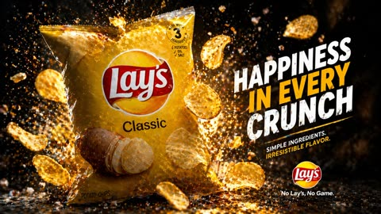</a>

产品以四分之三角度置于黑色背景前，配合暖色边缘光，让包装成为视觉焦点。逐字指定徽章与标题文字及颜色分配，使排版和产品文案准确可读。

GPT Image 2 · 文生图 · 出处: [@azed_ai on X](https://x.com/azed_ai/status/2046980650440544368) · 发现于 [YouMind-OpenLab/awesome-gpt-image-2](https://github.com/YouMind-OpenLab/awesome-gpt-image-2)

[`snack`](tags.md#tag-snack) [`advertising`](tags.md#tag-advertising) [`food-photography`](tags.md#tag-food-photography) [`typography`](tags.md#tag-typography)

<details><summary><b>提示词</b></summary>

```text
Create a high-impact commercial snack advertisement in a dramatic studio setting. Show a large glossy bag of Lay's Classic potato chips standing upright slightly left of center, photographed at a three-quarter front angle. The bag is bright golden yellow with a realistic crinkled plastic texture, a large red-and-white logo centered near the top, the flavor name printed below, a photo of whole potatoes and several stacked potato chips near the lower front, and small package details including a circular badge near the top right that reads "MADE WITH 3 INGREDIENTS" with tiny lines under it reading "POTATOES", "OIL", "SALT", plus small text near the bottom left reading "POTATO CHIPS". Surround the bag with exactly 11 visible potato chips flying through the air at different depths and angles, some curled and some flat, with crisp texture and golden highlights. Fill the scene with explosive golden crumbs, seasoning dust, and sparkling particles bursting around the package, especially behind it and across the floor. Use a deep black background with warm amber rim lighting, strong contrast, glowing highlights, and cinematic backlit particles. On the right side, add a bold stacked headline in large distressed uppercase sans-serif text reading HAPPINESS IN EVERY CRUNCH, with "HAPPINESS" and "CRUNCH" in white and "IN EVERY" in vivid golden yellow. Beneath the headline, place a two-line subheading in smaller uppercase text reading SIMPLE INGREDIENTS. IRRESISTIBLE FLAVOR., with the first line in white and the second line in yellow. At the bottom right, place a small round brand logo above the tagline No Lay's, No Game.. The composition should feel energetic, premium, messy in a controlled way, and optimized for e-commerce or promotional ad creative, with ultra-sharp product focus, dramatic lighting, floating debris, glossy reflections on the ground, and a polished photorealistic food photography look.
```

</details>

<a id="gpt-image-crumple-chair-design-board"></a>
### 皱纸造型沙发概念研发板

<a href="https://x.com/ShamsAmin56/status/2050281206139461780"></a>

提示词按五个阶段展开，从形态分析到人体工学、结构和材质。具体的尺寸、角度和材料选项让画面像一份真实的产品研发板。

GPT Image 2 · 文生图 · 出处: [@ShamsAmin56 on X](https://x.com/ShamsAmin56/status/2050281206139461780) · 发现于 [freestylefly/awesome-gpt-image-2](https://github.com/freestylefly/awesome-gpt-image-2)

[`product-design`](tags.md#tag-product-design) [`furniture`](tags.md#tag-furniture) [`concept-board`](tags.md#tag-concept-board) [`blueprint`](tags.md#tag-blueprint) [`industrial-design`](tags.md#tag-industrial-design)

<details><summary><b>提示词</b></summary>

```text
Design Concept: The Crumple Chair Core Philosophy: Translating the "controlled chaos" of a tossed paper ball into a sculptural, high-comfort seating experience.

Stage 1: Observation & Morphological Analysis The goal is to deconstruct the image of the crumpled paper into usable geometric data. Crease Mapping: Identify the primary "valley" and "ridge" lines. These represent potential structural ribs or seams in the chair. Faceted Planes: Break down the sphere into a series of non-uniform polygons. Each flat surface of the paper becomes a potential panel for the chair’s upholstery or shell. Shadow Study: Analyze how the "tossed" form creates deep recesses. These natural pockets guide where the user’s weight will be cradled.

Stage 2: Iterative Form Exploration Moving from a sphere to a seat through "Digital Crumpling." Subtractive Sculpting: Imagine the paper ball as a solid mass. Use Boolean operations to "carve out" a seating cavity that fits the human form while maintaining the external jagged texture. Tension Simulation: Use 3D software (like Rhino or Blender) to simulate a flat sheet of material being compressed. This ensures the folds look authentic and not "modeled." The "Toss" Logic: Experiment with gravity-based simulation dropping a digital mesh to see how it settles naturally, mimicking the "tossed" origin.

Stage 3: Ergonomic Translation & Blueprinting Refining the raw aesthetic into a functional object. The Comfort Core: Overlay a standard ergonomic template (Seating Angle: 105°–110°) over the crumpled form. Adjust the internal "folds" to provide lumbar support and pressure relief. Blueprint Generation: Create technical orthographic views (Front, Side, Top). Map out the dimensions: Seat Height: 450mm Total Width: 850mm Surface Smoothing: Maintain the sharp "paper edges" on the exterior shell while softening the interior contact points for skin comfort.

Stage 4: Structural Integration & Scaling Making the concept physically viable. The Skeleton: Design a hidden internal frame (likely CNC-bent steel rods or a 3D-printed lattice) that follows the most prominent ridges of the paper folds to provide rigidity. Material Selection: * Option A (High-End): Faceted, cast aluminum with a white powder coat. Option B (Soft): Vacuum-formed recycled plastic shell covered in "memory-fold" technical fabric that retains a wrinkled appearance.

Stage 5: Final Prototyping & Material Finish Textural Replication: Apply a matte, slightly porous finish to the material to mimic the tactile feel of heavy-bond paper. Lighting Contrast: Use directional studio lighting in the final renders to emphasize the "tossed" shadows, making the chair look like a giant piece of discarded inspiration. Design Tip: To keep the "tossed" look authentic, avoid symmetry. The most compelling aspect of a crumpled paper ball is its unique irregularity—ensure the left and right sides of the chair are balance-equivalent but not identical
```

</details>

<a id="gpt-image-dieline-3d-box-studio-render"></a>
### 平面刀版图组装成三维产品包装盒

<a href="https://x.com/Salmaaboukarr/status/2047008188285792724">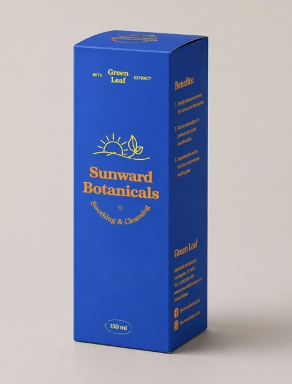</a>

提示词要求原样保留刀版图的图案和文字，避免模型重绘上传的稿件。随后限定相机为直立四分之三角度，并给出简洁的影棚设置：柔光、无道具、哑光纸板质感。

GPT Image 2 · 上传图改图 · 出处: [@Salmaaboukarr on X](https://x.com/Salmaaboukarr/status/2047008188285792724) · 发现于 [YouMind-OpenLab/awesome-gpt-image-2](https://github.com/YouMind-OpenLab/awesome-gpt-image-2)

[`packaging`](tags.md#tag-packaging) [`dieline`](tags.md#tag-dieline) [`3d-mockup`](tags.md#tag-3d-mockup) [`studio-lighting`](tags.md#tag-studio-lighting) [`product-render`](tags.md#tag-product-render)

<details><summary><b>提示词</b></summary>

```text
Assemble the dieline into a flawless 3D box with accurate panels, clean folds, undistorted type, and artwork preserved exactly. shoot it upright at a refined ¾ angle in a minimal premium studio setting with a soft neutral background, diffused light, subtle shadows, no props, true colours, matte paperboard texture, and realistic editorial detail
```

</details>

<a id="gpt-image-enamel-pin-set-portrait-center"></a>
### 肖像徽章居中的珐琅徽章套组

<a href="https://x.com/miratechtool/status/2097710852413497646"></a>

参考照片被转成居中的主徽章，提示词写明徽章数量、大小和分工，并加入金属描边、凸起边缘和棚拍光线等材质线索。结尾的排除清单让版面保持干净，但模型仍可能多出几枚徽章。

GPT Image 2.5 · 上传图改图 · 出处: [@miratechtool on X](https://x.com/miratechtool/status/2097710852413497646) · 发现于 [wangrunlin/awesome-gpt-image-2-5-prompts](https://github.com/wangrunlin/awesome-gpt-image-2-5-prompts)

[`enamel-pin`](tags.md#tag-enamel-pin) [`product-photography`](tags.md#tag-product-photography) [`portrait`](tags.md#tag-portrait) [`collectible`](tags.md#tag-collectible) [`reference-image`](tags.md#tag-reference-image)

<details><summary><b>提示词</b></summary>

```text
Create a hyper-realistic enamel pin collection in a vertical 4:5 composition on a dark textured background. Design exactly 8 separate premium pins with polished gold-metal outlines, glossy hard-enamel surfaces, subtle raised edges, realistic reflections, and soft shadows. The main medium-sized center pin is a portrait of [CHARACTER], preserving the reference image’s recognizable face, hairstyle, skin tone, expression, clothing, and key features while translating them into a detailed premium enamel illustration. Add 1 small name pin reading “[NAME]” and 1 small personality-word pin reading “[WORD]”. The remaining 5 pins should represent [CHARACTER]’s interests and lifestyle, such as creative work, AI/technology, visual creation, photography, travel, friendship, hobbies, or everyday objects, using clever symbolic illustrations rather than excessive text. Arrange everything organically around the portrait with varied pin shapes and sizes, generous spacing, and no rigid grid. Use bold, flat, bright colors with sophisticated contrast, crisp details, realistic metallic depth, and high-end commercial product lighting. Make it feel like a limited-edition designer pin set photographed in a studio—modern, vibrant, personal, collectible, and instantly eye-catching. No city names or specific landmarks, no duplicated pins, no clutter, no random text, no misspellings, no cheap cartoon or plastic appearance.
```

</details>

<a id="gpt-image-fictional-itasha-meadow-car"></a>
### 花草地中的原创痛车与少女

<a href="https://x.com/ashiwata100/status/2054848942345486704">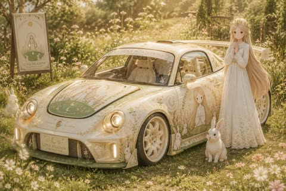</a>

提示词把插画主题对应到不同的车身风格，让造型、材质和贴纸都贴合原图。同时要求所有标志原创，并把角色放在车旁，采用电影感汽车摄影风格。

GPT Image 2 · 上传图改图 · 出处: [@ashiwata100 on X](https://x.com/ashiwata100/status/2054848942345486704) · 发现于 [YouMind-OpenLab/awesome-gpt-image-2](https://github.com/YouMind-OpenLab/awesome-gpt-image-2)

[`itasha`](tags.md#tag-itasha) [`fictional-car`](tags.md#tag-fictional-car) [`anime-photorealism`](tags.md#tag-anime-photorealism) [`automotive`](tags.md#tag-automotive) [`character-vehicle`](tags.md#tag-character-vehicle)

<details><summary><b>提示词</b></summary>

```text
Create an original Japanese itasha vehicle based entirely on the uploaded illustration. Design a fully fictional car and manufacturer naturally born from the artwork’s universe, never resembling real vehicles or brands. The design must adapt to the illustration itself: cute rounded styling for soft fantasy or shrine themes, elegant luxury styling for regal worlds, aggressive mechanical styling for cyberpunk or military themes, sporty styling for energetic characters, mystical styling for magical worlds, or retro-futuristic styling for nostalgic sci-fi. Body shape, proportions, cockpit, wheels, headlights, aero parts, glowing elements, materials, and interior must visually match the illustration’s atmosphere, colors, fashion, architecture, magic, and technology. All decals, logos, symbols, typography, crests, and sponsor-style graphics must be fully original fictional designs inspired only by the illustration. If a character exists, place them naturally beside the vehicle. Cinematic automotive photography, anime-inspired photorealism, masterpiece quality.
```

</details>

<a id="gpt-image-four-seasons-packaging-campaign-grid"></a>
### 四季包装宣传图 2x2 宫格

<a href="https://x.com/SRKDAN/status/2048582939504431195"></a>

提示词按产品、宫格、构图、一致性四个编号阶段拆分。锁定同一产品轮廓，只让每格的色调和道具变化，整组画面保持统一，方括号占位符便于替换复用。

GPT Image 2 · 文生图 · 出处: [@SRKDAN on X](https://x.com/SRKDAN/status/2048582939504431195) · 发现于 [freestylefly/awesome-gpt-image-2](https://github.com/freestylefly/awesome-gpt-image-2)

[`packaging`](tags.md#tag-packaging) [`seasonal`](tags.md#tag-seasonal) [`grid`](tags.md#tag-grid) [`campaign`](tags.md#tag-campaign) [`template`](tags.md#tag-template)

<details><summary><b>提示词</b></summary>

```text
PHASE 1 - PRODUCT: [ITEM] in [MATERIAL] packaging, minimal label design
PHASE 2 - GRID: 2x2 seasonal grid, four distinct brand worlds
PHASE 3 - COMPOSITION: each quadrant a full campaign scene with props and environment
PHASE 4 - CONSISTENCY: same product silhouette, four distinct palettes

Swap: [ITEM] / [MATERIAL] / [LABEL STYLE]
```

</details>

<a id="gpt-image-luxury-perfume-hotel-lobby-skyline"></a>
### 大理石桌上的奢华香水与城市天际线

<a href="https://x.com/Urwa_345/status/2092256327917797570">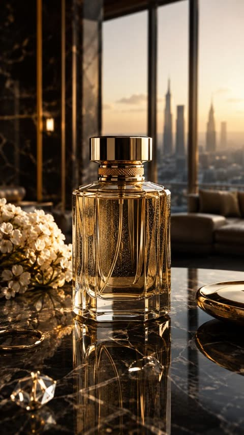</a>

先锁定居中的主体、桌面材质和黄金时刻的窗外背景，再补充85mm镜头、布光、玻璃折射和凝结水珠等质感线索。结尾的否定约束列表让瓶身保持干净且不出现文字。

GPT Image 2 · 文生图 · 出处: [@Urwa_345 on X](https://x.com/Urwa_345/status/2092256327917797570) · 发现于 [YouMind-OpenLab/awesome-gpt-image-2](https://github.com/YouMind-OpenLab/awesome-gpt-image-2)

[`perfume`](tags.md#tag-perfume) [`commercial-photography`](tags.md#tag-commercial-photography) [`golden-hour`](tags.md#tag-golden-hour) [`marble`](tags.md#tag-marble) [`vertical-9x16`](tags.md#tag-vertical-9x16)

<details><summary><b>提示词</b></summary>

```text
Ultra-realistic professional commercial product photography of a premium glass perfume bottle placed on a polished black marble table inside a luxurious modern hotel lobby. The perfume bottle has a sophisticated transparent glass design, elegant metallic cap, realistic liquid visible inside, subtle condensation droplets, and clean premium packaging. In the background, a large floor-to-ceiling window overlooks a beautiful modern city skyline during golden hour, with warm sunlight naturally entering the room. The bottle is positioned perfectly in the center of the composition with realistic studio-quality reflections on the glass and marble surface. A few delicate white flowers and minimal luxury accessories are arranged naturally around the product without distracting from it. Soft warm sunlight creates realistic highlights along the edges of the bottle while subtle professional fill lighting keeps the product perfectly exposed. Natural shadows, realistic glass refraction, accurate reflections, physically accurate materials, authentic photography imperfections, shallow depth of field, realistic background bokeh, premium beauty campaign aesthetic, high-end commercial photography, shot on a professional full-frame camera with an 85mm lens, natural cinematic color grading, extremely detailed, photorealistic, 8K resolution, sharp product focus, realistic proportions, vertical 9:16 composition, no fantasy elements, no surreal effects, no floating objects, no distorted packaging, no extra text, no watermark.
```

</details>

<a id="gpt-image-luxury-water-bottle-splash-ice"></a>
### 高端水瓶配螺旋水花与冰块

<a href="https://x.com/Itswsm105f/status/2071488588345405695">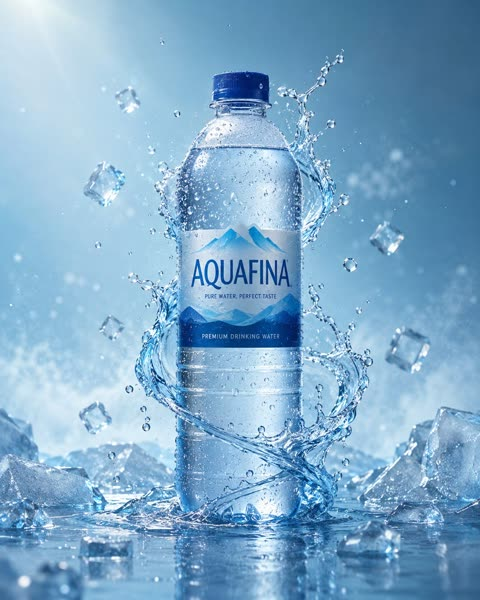</a>

第二段重复固定的主体与棚拍设定，再把水花、冰块、薄雾和轮廓光作为独立的场景描述逐项叠加。明确写出光线、色调与留白，为品牌文字预留版面。

GPT Image 2 · 文生图 · 出处: [@Itswsm105f on X](https://x.com/Itswsm105f/status/2071488588345405695) · 发现于 [YouMind-OpenLab/awesome-gpt-image-2](https://github.com/YouMind-OpenLab/awesome-gpt-image-2)

[`product-photography`](tags.md#tag-product-photography) [`water-bottle`](tags.md#tag-water-bottle) [`splash`](tags.md#tag-splash) [`studio-lighting`](tags.md#tag-studio-lighting)

<details><summary><b>提示词</b></summary>

```text
Ultra-realistic luxury commercial product photography of a premium transparent water bottle standing upright on a glossy reflective surface. The bottle is covered with tiny cold water droplets, symbolizing freshness. A dramatic splash of crystal-clear water wraps around the bottle in a dynamic spiral. Background features cool icy blue gradients with soft white lighting, floating ice cubes, light mist, and subtle glowing particles. High-end studio lighting with cinematic rim light, premium advertising style, sharp focus, ultra-detailed, photorealistic, 8K, clean composition, luxury beverage campaign, minimalistic yet eye-catching, plenty of copy space for branding and text. Ultra-realistic luxury commercial product photography of the same premium transparent water bottle standing upright on a reflective wet surface. The bottle is covered with fresh condensation droplets. A powerful splash of crystal-clear water rises around the bottle with small floating bubbles. Background features refreshing aqua green and turquoise gradients with soft sunlight rays, tropical leaves slightly blurred in the distance, fresh mist, and glowing highlights. High-end commercial studio lighting, cinematic product advertisement, ultra-detailed, photorealistic, 8K, elegant composition, premium hydration campaign, minimal branding space, vibrant yet clean aesthetic.
```

</details>

<a id="gpt-image-mind-icons-scientist-figure-grid"></a>
### 爱因斯坦、居里夫人、牛顿和特斯拉的收藏手办发布图

<a href="https://x.com/Gdgtify/status/2049766203392921897">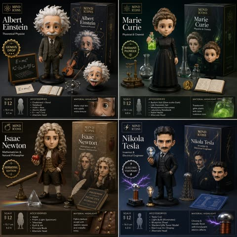</a>

提示词固定了 2x2 网格，并在每格中重复同样的版面要素（手办、配件、包装、比例、材质特写），四格因此像同一系列产品。奢侈首发与开箱的措辞带来精致的棚拍光感，同时让包装盒退居手办之后。

GPT Image 2 · 文生图 · 出处: [@Gdgtify on X](https://x.com/Gdgtify/status/2049766203392921897) · 发现于 [freestylefly/awesome-gpt-image-2](https://github.com/freestylefly/awesome-gpt-image-2)

[`collectible`](tags.md#tag-collectible) [`product-launch`](tags.md#tag-product-launch) [`grid-layout`](tags.md#tag-grid-layout) [`scientists`](tags.md#tag-scientists)

<details><summary><b>提示词</b></summary>

```text
2x2 grid, do this for 4 famous scientists in history: Design a collector-grade launch visual for [TOY / FIGURE / DESIGNER OBJECT] shown in pristine hero form along with interchangeable accessories, alternate expressions, packaging design, scale references, sticker details, rarity indicators, and close-up material highlights. The object should feel like a luxury drop, somewhere between art toy culture and elite product branding.  Accessory Layout: Arrange [ACCESSORY 1], [ACCESSORY 2], [ALT VERSION], [PACKAGING FEATURE], and [LIMITED EDITION DETAIL] around the figure in carefully staged clusters. Everything should feel desirable, neat, and “unboxable.”  Visual Style: Hype-culture collectible reveal meets premium e-commerce launch campaign. Clean, glossy, tactile, designer-toy sophistication with a playful but expensive sensibility.  Composition Guidelines: Hero figure remains dominant. Accessories should be balanced and elegantly spaced. Packaging should be visible but not steal the scene. The entire image should feel like a product collectors would screenshot instantly.  Lighting & Background: Soft commercial lighting with subtle specular highlights, polished background in [BACKGROUND STYLE], crisp shadows, premium color separation, ultra-sharp details, no watermark.
```

</details>

<a id="gpt-image-mint-rose-perfume-bottle-ecommerce"></a>
### 薄荷绿香水瓶配玫瑰与米色织带

<a href="https://x.com/lovimg_com/status/2077036313832996893">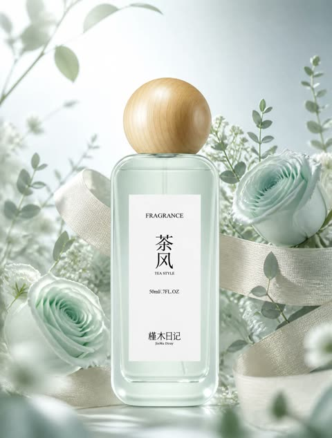</a>

开头的保留条款锁定上传原图的瓶身造型、玻璃质感、木球盖和标签文字，编辑只改变周围环境。道具、冷调逆光、景深虚化和竖版画布共同决定氛围与详情页版式。

GPT Image 2 · 上传图改图 · 出处: [@lovimg_com on X](https://x.com/lovimg_com/status/2077036313832996893) · 发现于 [freestylefly/awesome-gpt-image-2](https://github.com/freestylefly/awesome-gpt-image-2)

[`perfume`](tags.md#tag-perfume) [`ecommerce`](tags.md#tag-ecommerce) [`product-photo`](tags.md#tag-product-photo) [`mint`](tags.md#tag-mint)

<details><summary><b>提示词</b></summary>

```text
100%完整保留上传的原图香水瓶的全部原始外观细节，瓶身造型、薄荷绿玻璃质感、木纹球形瓶盖、原有标签文字完全不做任何修改；瓶身环绕米色织带，周围簇拥薄荷绿玫瑰和浅绿色植物，冷调渐变浅留白背景，冷调逆光柔焦光影，低饱和度冷清高级色调，景深虚化突出香水主体，超写实C4D质感，轻奢高级ins风，适配竖版电商详情页，2K高清
```

</details>

<a id="gpt-image-moonlit-anime-chocolate-gift-box-2"></a>
### 月夜动漫风巧克力礼盒与十颗巧克力

<a href="https://x.com/ArtistaNozomu/status/2055605251525513216">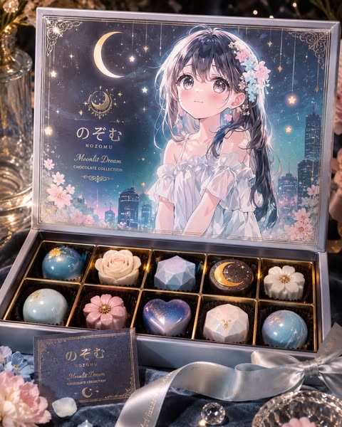</a>

提示词按 2 乘 5 网格给十颗巧克力逐一编号并描述,锁定了数量和排布。盒盖文字、配套展示卡和金色加粉彩的配色统一了包装风格,末尾的排除项避免多余巧克力和杂乱字体。

GPT Image 2 · 文生图 · 出处: [@ArtistaNozomu on X](https://x.com/ArtistaNozomu/status/2055605251525513216) · 发现于 [YouMind-OpenLab/awesome-gpt-image-2](https://github.com/YouMind-OpenLab/awesome-gpt-image-2)

[`chocolate-box`](tags.md#tag-chocolate-box) [`packaging`](tags.md#tag-packaging) [`anime`](tags.md#tag-anime) [`luxury`](tags.md#tag-luxury) [`product-photo`](tags.md#tag-product-photo)

<details><summary><b>提示词</b></summary>

```text
Create a premium luxury patisserie product photograph of a limited-edition chocolate box inspired by an original anime-style girl character named Nozomu. The box is open on an elegant dark satin tabletop with crystal glassware, soft flowers, scattered sparkles, and a pale satin ribbon, photographed like a real high-end department-store confectionery gift set. The inside lid features a large illustrated package design: a dreamy moonlit night sky with teal-to-navy gradient, crescent moon, hanging gold stars, city skyline silhouettes, ornate gold corner filigree, pale pink and blue flowers, and an anime girl with long dark bluish-black hair with pink highlights, floral hair accessories, and an off-shoulder white ruffled dress; leave the face unobstructed in the generated image unless a privacy-safe blank face placeholder is desired. Add elegant gold Japanese-style branding text on the lid: のぞむ, small romanized text NOZOMU, script subtitle Moonlit Dream, and small uppercase text "CHOCOLATE COLLECTION". In the lower tray, show exactly 10 luxury chocolates in a 2-by-5 grid with gold dividers and black paper cups: 1 glossy sky-blue dome with gold leaf, 2 cream rose-shaped chocolate, 3 faceted pale blue crystal chocolate, 4 dark round chocolate with gold crescent moon and starry night surface, 5 white daisy flower chocolate with gold center, 6 pale blue-white speckled dome, 7 pink flower chocolate with gold center, 8 glossy purple-blue heart chocolate with tiny star speckles, 9 faceted pale blush crystal chocolate with gold flecks, and 10 sky-blue marbled dome with gold constellation lines. Include a matching small display card in front of the box with the same branding text and moon motif. Use soft cinematic lighting, shallow depth of field, realistic reflections, delicate gold foil details, pastel celestial palette, ultra-detailed premium packaging, and a romantic fantasy luxury chocolate aesthetic. Avoid extra chocolates, avoid modern logos, avoid cluttered typography, and keep the box and all 10 chocolates sharply visible.
```

</details>

<a id="gpt-image-moonlit-anime-chocolate-gift-box"></a>
### 月夜动漫风巧克力礼盒与十枚手工巧克力

<a href="https://x.com/ArtistaNozomu/status/2055605249147351470"></a>

提示词用确切数量和二乘五网格固定布局,再逐枚写明巧克力的形状、颜色和金色点缀,避免模型自由发挥。同时原样给出盒盖与卡片文字,并把产品摄影与动漫插画混合在一起。

GPT Image 2 · 文生图 · 出处: [@ArtistaNozomu on X](https://x.com/ArtistaNozomu/status/2055605249147351470) · 发现于 [YouMind-OpenLab/awesome-gpt-image-2](https://github.com/YouMind-OpenLab/awesome-gpt-image-2)

[`chocolate-box`](tags.md#tag-chocolate-box) [`anime-packaging`](tags.md#tag-anime-packaging) [`product-photography`](tags.md#tag-product-photography) [`celestial`](tags.md#tag-celestial) [`pastel`](tags.md#tag-pastel)

<details><summary><b>提示词</b></summary>

```text
Create a luxurious square product photo of an open premium chocolate gift box themed around an original anime girl character named Nozomu. The box lid is a custom limited-edition package illustration: a soft, dreamy anime girl with long dark navy-black hair with pale pink highlights, large sparkling eyes, blush cheeks, and small pastel blue and pink flowers tucked in her hair, wearing a white ruffled off-shoulder dress. Behind her is a moonlit night city skyline in teal and navy, a large crescent moon, tiny stars, hanging celestial ornaments, delicate gold filigree corner borders, and scattered cherry blossoms. Include elegant package typography on the lid: Japanese-style title “のぞむ”, small romanization “NOZOMU”, script subtitle “Moonlit Dream”, and “CHOCOLATE COLLECTION”. Inside the box, show exactly 10 artisan chocolates arranged in a 2-by-5 grid in black paper cups with thin gold dividers: 1 glossy blue sphere with gold flakes, 1 cream rose-shaped chocolate, 1 faceted pale blue gem chocolate, 1 dark round chocolate with a gold crescent moon and starry top, 1 white flower chocolate with gold center, 1 pale blue-white sphere with gold speckles, 1 pink flower chocolate with gold center, 1 glossy purple heart chocolate with tiny stars, 1 faceted white crystal chocolate with gold accents, and 1 blue marbled sphere with gold swirls. In front of the box, place a small matching dark navy product card with the same “のぞむ / NOZOMU / Moonlit Dream / CHOCOLATE COLLECTION” branding and crescent motif. Surround the scene with satin fabric, a pale silver ribbon bow, crystal glassware, small flowers, warm fairy lights, and sparkling highlights. Use a high-end romantic confectionery advertisement style, shallow depth of field, soft cinematic lighting, pastel blue pink gold palette, glossy textures, intricate packaging details, elegant and magical atmosphere, ultra-detailed photorealistic product photography mixed with polished anime illustration. Keep all text legible and avoid extra logos or watermarks.
```

</details>

<a id="gpt-image-noxen-four-dimensions-chronograph-watch-ad"></a>
### 四种元素世界中的奢华计时腕表广告

<a href="https://x.com/Riya333S/status/2054744217239597125"></a>

固定的 2x2 四宫格加上对同一款腕表的细致描述，让产品在各格保持一致，只替换材质与环境。每格都写明品牌名、字母标志和标语原文，并严格禁止多余文字。

GPT Image 2 · 文生图 · 出处: [@Riya333S on X](https://x.com/Riya333S/status/2054744217239597125) · 发现于 [YouMind-OpenLab/awesome-gpt-image-2](https://github.com/YouMind-OpenLab/awesome-gpt-image-2)

[`watch`](tags.md#tag-watch) [`advertising`](tags.md#tag-advertising) [`four-panel`](tags.md#tag-four-panel) [`luxury`](tags.md#tag-luxury) [`typography`](tags.md#tag-typography)

<details><summary><b>提示词</b></summary>

```text
Goal: Create a luxury square advertising collage for a futuristic wristwatch brand, showing one premium chronograph watch across four elemental dimensions. Use the brand name NOXEN and the monogram N.

Canvas: Square 1:1 image divided into exactly 4 equal panels in a clean 2x2 grid, separated by thin white divider lines. Each panel is a cinematic product poster with dramatic lighting, high contrast, sharp watch detail, and premium commercial photography realism.

Overall subject: A masculine luxury stainless-steel chronograph wristwatch with integrated metal bracelet, octagonal/rounded bezel with small screws, black dial, three subdials, baton hour markers, central hands, crown and pushers on the right side, and subtle brand text on the dial. The watch should remain recognizable as the same model in all 4 panels while material color and environment change.

Panel count and details: Exactly 4 distinct watch posters:
1. Top-left panel: matte black watch in a dark smoky void, surrounded by black dust, volcanic ash, floating debris, and mist. Monochrome black-and-charcoal palette with silver highlights. Place the monogram above the brand name near the top center. Add the small tagline ENGINEERED IN DARKNESS near the bottom center.
2. Top-right panel: polished gold watch surrounded by a dramatic splash of liquid gold, bubbles, and warm amber reflections. Black background with intense golden highlights. Place the monogram above the brand name near the top center. Add the small tagline CRAFTED IN GOLD near the bottom center.
3. Bottom-left panel: silver steel watch frozen inside a translucent block of cracked blue ice, with frosty mist, icy rock texture, and cold blue lighting. Place a large monogram above the brand name near the bottom center, with the small tagline BUILT BEYOND TIME beneath it.
4. Bottom-right panel: black and dark steel watch with neon green accents in a cyberpunk futuristic city at night, glowing skyscrapers, circuit-like lines, holographic HUD rings, and emerald light beams. Place a large glowing monogram above the brand name near the top center. Add the small tagline FUTURE. ENGINEERED. near the bottom center.

Typography: Elegant luxury serif or widely spaced uppercase lettering for the brand name, thin uppercase tracking for taglines, centered and minimal. Text must be crisp and legible: brand name appears in all 4 panels, the monogram appears in all 4 panels, and each panel has exactly one tagline as listed.

Visual style: Ultra-realistic high-end watch advertising, macro product photography, cinematic lighting, glossy reflections, deep blacks, premium contrast, sharp metal textures, atmospheric particles, no people, no extra logos, no watermark, no additional text beyond the specified brand, monogram, and four taglines.
```

</details>

<a id="gpt-image-nozomu-capsule-figure-display"></a>
### 粉彩扭蛋手办产品展示广告

<a href="https://x.com/ArtistaNozomu/status/2066112982313263612"></a>

提示词按目标、画布、主体、道具、标牌和约束分块编写。对扭蛋、款式和道具给出精确数量，并写明标牌文字，使版面和文字更可控。

GPT Image 2 · 文生图 · 出处: [@ArtistaNozomu on X](https://x.com/ArtistaNozomu/status/2066112982313263612) · 发现于 [YouMind-OpenLab/awesome-gpt-image-2](https://github.com/YouMind-OpenLab/awesome-gpt-image-2)

[`gashapon`](tags.md#tag-gashapon) [`chibi-figure`](tags.md#tag-chibi-figure) [`product-mockup`](tags.md#tag-product-mockup) [`pastel`](tags.md#tag-pastel) [`text-rendering`](tags.md#tag-text-rendering)

<details><summary><b>提示词</b></summary>

```text
Goal: Create a highly polished pastel product advertisement photo for a fictional gashapon toy line featuring NOZOMU, designed like a collectible capsule figure display.

Canvas: Square 1:1 image, high-resolution commercial product photography with soft studio lighting, shallow depth of field, glossy reflections, and a cute teal, white, lavender, and pale pink palette.

Main subject: Center foreground shows one chibi anime capsule figure standing on a transparent round display base labeled “NOZOMU.” The figure is a small girl with long dark teal hair, large teal eyes, a cheerful open-mouth smile, and a white bear-ear hoodie with teal bear ears. She wears a teal oversized jacket over a white frilly dress, teal ribbons, tiny bear charms, white socks, and white sneakers. Her right hand lifts the edge of the hood, and her left arm is slightly out to the side. The base is clear acrylic with teal trim, decorative white scrollwork, a small bow motif, and the character name on the front.

Background and props: Place the figure in front of a transparent capsule vending machine filled with pastel capsules. Include exactly 9 visible capsule balls: 3 teal capsules, 2 lavender capsules, 2 white capsules, 1 pale blue capsule, and 1 pale pink capsule. The machine has a teal coin panel and a white dial, with small Japanese-style coin-insertion signage. On the right foreground, place exactly 2 large empty transparent capsule halves, slightly open and reflective. On the lower left, place exactly 1 mini brochure/card showing the same character artwork and the text “NOZOMU Mini Collection.” On the lower right, place exactly 1 clear plastic accessory bag containing small teal-and-white toy parts: a tiny bear-face charm, teal ribbon-like pieces, and small white accessories.

Left vending-machine sign: Add a rounded white sign with teal text at upper left. It must read “NOZOMU” in large letters, then “Capsule Figure” and “Mini Collection.” Include two teal rounded labels: one says “全5種” and one says “1回 400円.” Decorate the sign with small pale stars and soft pastel shapes.

Right collection board: Add a large rectangular collection lineup board on the right side with teal border and rounded corners. Header reads “NOZOMU Mini Collection” with a small teal badge reading “全5種.” The board displays exactly 5 variants in a 2-row grid: 1) “Standard” standing pose, 2) “Smile” winking/smiling pose, 3) “Sitting Pose” standing or seated variant image, 4) “Special Color” gray-toned seated version with a pink “New” sticker, and 5) “Secret” as a dark bear-eared silhouette with a white question mark and a small “Premium Rare” badge. Make the labels small but legible, matching the product mockup style.

Visual style: Cute Japanese collectible toy aesthetic, realistic miniature figure material, glossy plastic capsules, pastel teal branding, clean merchandising layout, bokeh highlights, soft shadows, premium catalog photography, detailed anime face and hair sculpt, realistic acrylic reflections.

Constraints: Use exactly one main figure on the central base, exactly one lineup board with five variant entries, exactly one left price/collection sign, exactly one brochure, exactly one accessory bag, exactly two open capsule halves, and exactly nine filled capsules in the machine. Keep all text crisp and integrated into the product design. Do not add extra characters, logos, watermarks, or unrelated objects.
```

</details>

<a id="gpt-image-ordinary-serum-dropper-water-splash"></a>
### The Ordinary 精华滴管瓶置于蓝色水花中

<a href="https://x.com/AI_with_Lyra/status/2092116220912771292"></a>

用精确数量和方位词锁定画面元素，例如 1 个瓶子、位于四个角落的 4 片叶子，再加上微距、浅景深和焦散光等摄影语汇，形成高端美妆广告的质感。

GPT Image 2 · 文生图 · 出处: [@AI_with_Lyra on X](https://x.com/AI_with_Lyra/status/2092116220912771292) · 发现于 [YouMind-OpenLab/awesome-gpt-image-2](https://github.com/YouMind-OpenLab/awesome-gpt-image-2)

[`skincare`](tags.md#tag-skincare) [`product-photography`](tags.md#tag-product-photography) [`water-splash`](tags.md#tag-water-splash) [`advertising`](tags.md#tag-advertising)

<details><summary><b>提示词</b></summary>

```text
Create an ultra-realistic cinematic luxury skincare advertisement in a vertical 9:16 frame. Show one premium clear glass serum dropper bottle of The Ordinary suspended at a slight diagonal angle in crystal-clear blue water, emerging from the center of a dramatic crown-shaped splash. The bottle has a transparent cylindrical glass body, pale aqua serum inside, a minimalist white label with small black skincare text, a white ribbed screw cap, and a soft white rubber pipette; keep the label, proportions, cap, and branding crisp and readable while the surrounding motion feels dynamic. Count exactly 1 product bottle, 1 main water splash crown around it, many realistic floating droplets, and 4 large out-of-focus green leaves framing the scene: one upper left, one top center edge, one upper right, and one lower left foreground. Use warm sunlight, teal-blue background bokeh, glossy reflections, caustic light patterns on the water surface, realistic glass refraction, sharp focus on the product, shallow depth of field, macro product photography, slow-motion frozen-action feeling, premium beauty campaign aesthetic, 4K UHD detail. No extra text, no watermark, no distortion, no hands, no additional products.
```

</details>

<a id="gpt-image-oversized-smartwatch-leaning-model-ad"></a>
### 超大黑色智能手表广告与倚靠模特

<a href="https://x.com/im_shahid7/status/2051172470548476197"></a>

用超大手表与模特倚靠的姿势同时定义比例与构图，再加入光泽反光地面和柔和棚拍光，营造高端商业摄影质感。写明文字位置（右上角、底部居中）让版式保持稳定。

GPT Image 2 · 文生图 · 出处: [@im_shahid7 on X](https://x.com/im_shahid7/status/2051172470548476197) · 发现于 [YouMind-OpenLab/awesome-gpt-image-2](https://github.com/YouMind-OpenLab/awesome-gpt-image-2)

[`smartwatch`](tags.md#tag-smartwatch) [`product-ad`](tags.md#tag-product-ad) [`studio-lighting`](tags.md#tag-studio-lighting) [`text-placement`](tags.md#tag-text-placement)

<details><summary><b>提示词</b></summary>

```text
Minimalist commercial ad featuring oversized BLACK smartwatch, ultra-clean design. A young Man in all-white and yellow outfit leans casually against the giant watch, relaxed confident pose, eyes open in excitement expression , also wearing the same smartwatch on his wrist. Soft gradient blue background with large bold white “SMASUNG” text behind. Glossy reflective floor, soft studio lighting, modern high-end fashion/product photography. Small top-right text “Designed by Shamus”. Bottom center tagline in small white font: “TIME IS TIDE.”
```

</details>

<a id="gpt-image-premium-meat-seafood-brand-hero"></a>
### 黑色大理石上的高端牛排品牌主视觉

<a href="https://x.com/xpg0970/status/2050108279385419965"></a>

提示词是三段式填空模板：品牌基础设定、核心视觉元素、主产品定义，每个字段都附带示例值。只需替换产品部分，就能复用于牛排、帝王蟹或甜虾。

GPT Image 2 · 文生图 · 出处: [@xpg0970 on X](https://x.com/xpg0970/status/2050108279385419965) · 发现于 [freestylefly/awesome-gpt-image-2](https://github.com/freestylefly/awesome-gpt-image-2)

[`product`](tags.md#tag-product) [`e-commerce`](tags.md#tag-e-commerce) [`food`](tags.md#tag-food) [`luxury`](tags.md#tag-luxury) [`template`](tags.md#tag-template)

<details><summary><b>提示词</b></summary>

```text
一、品牌基础设定
品牌名称：[请填写，例如：PRIME STEAK / OCEAN PRIME]
品牌标语：[请填写，例如：Steakhouse Quality, Your Table / Restaurant Grade, Home Delivered]
主色调：[请填写，例如：黑金 / 深红+金 / 深蓝+银]
字体风格：
标题：[请填写，例如：金色衬线体，大写，奢华感]
正文：[请填写，例如：细衬线体/无衬线体]
二、核心视觉元素
台面材质：[请填写，例如：大理石/黑色石板]
背景调性：[请填写，例如：深色渐变/暗调餐厅环境]
光线风格：[请填写，例如：聚光/侧光/顶部照明]
三、主产品定义（必填）
产品名称/类型：[请填写，例如：和牛牛排 / 帝王蟹 / 北极甜虾]
产品数量/摆放：[请填写，例如：1份单品 / 3块整齐摆放]
呈现方式：[请填写，例如：切片展示 / 带骨展示 / 原壳展示]
产品特色/质感提示：[请填写，例如：肉质纹理清晰、多汁感 / 光泽晶亮 / 肉眼可见油花]
```

</details>

<a id="gpt-image-product-cutout-transparent"></a>
### 透明背景产品抠图

<a href="https://developers.openai.com/api/docs/guides/image-prompting#create-a-transparent-product-cutout"></a>

要求轮廓清晰无光晕，几何形状与标签文字完全保留，并禁止背景、画出来的棋盘格和阴影，保证透明通道干净。导出时选择 PNG 或 WebP 并将背景设为透明。

GPT Image 2.5 · 上传图改图 · 出处: [OpenAI image prompting guide](https://developers.openai.com/api/docs/guides/image-prompting#create-a-transparent-product-cutout)

[`product`](tags.md#tag-product) [`transparent`](tags.md#tag-transparent) [`cutout`](tags.md#tag-cutout)

<details><summary><b>提示词</b></summary>

```text
Extract the product from the input image and isolate it on a fully transparent background.
Output: centered product, crisp silhouette, no halos/fringing.
Preserve product geometry and label legibility exactly.
Add only light polishing. Do not add a solid backdrop, checkerboard, scenery, or shadow.
Do not restyle the product; remove the background and preserve clean alpha transparency.
```

</details>

输入素材: [1](https://developers.openai.com/images/platform/guides/image-prompting/shampoo.webp)

<a id="gpt-image-rhode-peptide-lip-treatment-comparison"></a>
### rhode 唇部护理广告 GPT Image 2 与 GPT Image 2.5 对比

<a href="https://x.com/HeyOz_AI/status/2097590858564726955"></a>

提示词按数量和位置逐项锁定元素（左侧广告 3 块西瓜，右侧广告 5 块），并给出确切的标题和标签文字，因此两版广告的差别主要在飞溅密度和产品大小。黑色 16:9 画布加两个圆角方形面板和同色橙字标签，让对比一眼可见。

GPT Image 2.5 · 文生图 · 出处: [@HeyOz_AI on X](https://x.com/HeyOz_AI/status/2097590858564726955) · 发现于 [YouMind-OpenLab/awesome-gpt-image-2](https://github.com/YouMind-OpenLab/awesome-gpt-image-2)

[`beauty-ad`](tags.md#tag-beauty-ad) [`model-comparison`](tags.md#tag-model-comparison) [`liquid-splash`](tags.md#tag-liquid-splash) [`text-layout`](tags.md#tag-text-layout)

<details><summary><b>提示词</b></summary>

```text
Goal: Create a wide comparison graphic showing two generated versions of a rhode beauty static ad for Peptide Lip Treatment in Watermelon Slice, with a black presentation background and two square ad mockups side by side.

Canvas: 16:9 horizontal frame, black background, high contrast, clean social-media comparison layout.

Layout: Place two rounded-corner square ad images centered horizontally with generous spacing. The left panel is labeled above in bright orange text: “GPT-Image-2”. The right panel is labeled above in the same bright orange text: “GPT-Image-2.5”. Add one small italic orange caption centered near the bottom reading “prompt in comments”.

Ad panels: Use exactly 2 square beauty advertisement panels.
1. Left panel: soft pink background, rounded corners, elegant editorial beauty-ad composition. At the upper left, large serif headline text reads “A SLICE OF GLOSS.” with smaller text below reading “Peptide Lip Treatment”. A pink rhode Peptide Lip Treatment tube floats diagonally from upper right toward lower center, with vertical white “rhode” branding. Surround it with a glossy pink gel swirl, transparent splash droplets, and watermelon slices. Include a large circular pink sunburst shape behind the product. Watermelon elements count: 3 visible slices or wedges — one large lower watermelon slice, one right-middle slice behind the tube, and one small upper-right wedge. Keep the product large and central.
2. Right panel: more dynamic, brighter, more detailed version of the same rhode ad. Pink background, rounded corners, upper-left serif headline “A SLICE OF GLOSS.” and smaller “Peptide Lip Treatment”. A larger pink rhode tube floats diagonally near the center, surrounded by a dramatic translucent glossy pink splash ribbon, many bubbles and droplets, and watermelon slices. Watermelon elements count: 5 visible pieces — one large foreground watermelon strip at the bottom, one left-middle wedge, one right-middle wedge, one small upper-right wedge, and one partial slice behind the splash near the center. The product should appear sharper, glossier, and more premium than the left panel.

Visual style: polished product advertising, vivid watermelon pinks and reds, glossy liquid textures, studio lighting, high-end cosmetics campaign, crisp typography, saturated color, realistic 3D product rendering mixed with surreal splash photography.

Text and customization: Use the top labels {argument name="left model label" default="GPT-Image-2"} and {argument name="right model label" default="GPT-Image-2.5"}. Use the ad headline {argument name="headline text" default="A SLICE OF GLOSS."}. Use the brand on the tube {argument name="brand name" default="rhode"}. Use the bottom caption {argument name="bottom caption" default="prompt in comments"}.

Constraints: Keep exactly 2 comparison panels, exactly 2 orange model labels, and exactly 1 bottom caption. Do not add extra logos, watermarks, UI chrome, or additional text outside the specified labels and ad copy.
```

</details>

<a id="gpt-image-rolex-submariner-exploded-view"></a>
### 劳力士潜水表爆炸视图，七个分解部件加机芯

<a href="https://x.com/RoundtableSpace/status/2055170060172579287"></a>

用编号列出恰好七个分离部件并按垂直顺序排列，爆炸结构因此清晰可读。中间半开的机芯模块展示了各部件如何连接，深色棚拍背景与 4:3 横向构图让画面更像产品摄影而不是示意图。

GPT Image 2 · 文生图 · 出处: [@RoundtableSpace on X](https://x.com/RoundtableSpace/status/2055170060172579287) · 发现于 [YouMind-OpenLab/awesome-gpt-image-2](https://github.com/YouMind-OpenLab/awesome-gpt-image-2)

[`exploded-view`](tags.md#tag-exploded-view) [`luxury-watch`](tags.md#tag-luxury-watch) [`product-render`](tags.md#tag-product-render) [`studio-lighting`](tags.md#tag-studio-lighting)

<details><summary><b>提示词</b></summary>

```text
Create a photorealistic luxury product rendering of an exploded mechanical dive watch, centered on a Rolex Submariner in stainless steel with a black dial and black ceramic bezel. Canvas is landscape 4:3, dark charcoal-to-black studio background, dramatic softbox reflections, ultra sharp macro detail, premium advertising look, no people. Composition: the fully assembled watch occupies the right half of the image at a slight three-quarter angle, with a brushed oyster-style metal bracelet continuing upward and downward out of frame; the crown is visible on the right side, the serrated bezel has white minute markings and large numerals 10, 20, 30, and 50, and the dial shows luminous round, rectangular, and triangle indices, Mercedes-style hour hand, minute hand, seconds hand, and small white printed dial text including the brand crown logo, brand name, model name, depth rating, and certification lines. On the left half, show an exploded vertical stack of exactly 7 separated watch components aligned in perspective: 1) a transparent domed sapphire crystal floating at the top, 2) a black rotating bezel insert with white markings beneath it, 3) a dark chapter/rehaut ring with tiny engraved brand text, 4) the black watch dial with luminous markers and printed brand/model text, 5) three separate silver hands floating below the dial, 6) a detailed mechanical movement with jewels, screws, gears, and bridges, and 7) the lower steel caseback/case ring at the bottom. Between the exploded stack and the complete watch, show a partially separated circular movement and case module tilted open, exposing gears, gold-toned wheels, ruby jewels, screws, and a rotor with a small gold crown emblem, as if the mechanism is being pulled into the watch. Materials: polished and brushed stainless steel, black glossy ceramic, transparent glass edge highlights, engraved ridges, high-contrast reflections, precise machining, realistic shadows, shallow depth of field but all main parts crisp. Text should be legible where possible and resemble authentic luxury watch dial typography, using black, brushed stainless steel, and deep black. Constraints: make the image look like a high-end technical product visualization, not a diagram; no captions, no labels outside the watch, no watermark, no extra watches, no hands or tools.
```

</details>

<a id="gpt-image-saint-baroque-black-gold-potato-chips-bag"></a>
### 黑金巴洛克圣人薯片包装袋

<a href="https://x.com/ashiwata100/status/2054486550550061072"></a>

提示词把每个元素对应到包装袋上的具体区域(丝带、肖像、徽章、横幅),并给出每处的日文原文。芯片、碗、辣椒的精确数量加上约束行,让版面保持稳定。

GPT Image 2 · 文生图 · 出处: [@ashiwata100 on X](https://x.com/ashiwata100/status/2054486550550061072) · 发现于 [YouMind-OpenLab/awesome-gpt-image-2](https://github.com/YouMind-OpenLab/awesome-gpt-image-2)

[`packaging`](tags.md#tag-packaging) [`mockup`](tags.md#tag-mockup) [`baroque`](tags.md#tag-baroque) [`black-and-gold`](tags.md#tag-black-and-gold) [`japanese-text`](tags.md#tag-japanese-text)

<details><summary><b>提示词</b></summary>

```text
Goal: Create a premium Japanese potato chips package mockup inspired by a dark Catholic/European saint painting, using a black glossy snack bag with ornate gold typography and luxury limited-edition branding.

Canvas: Front-facing vertical product package, centered on a clean white background, realistic crinkled plastic potato chip bag with serrated sealed edges at top and bottom. Use a tall 3:4 composition, slightly rounded pillow-pack shape, glossy black material with strong highlights and folds.

Layout: At the very top center place a refined gold brand mark with a small crown and decorative flourishes reading San Ignacio, with small katakana beneath it. Under that, add a short Japanese tagline in small white-gold text. Across the upper middle, place a very large embossed metallic-gold Japanese product title reading ポテトチップス. In the upper-left corner, add one vertical gold ribbon label reading 期間限定. The central-left area contains a framed religious oil-painting style portrait of Saint Ignatius in a black robe, halo, smoky clouds, and glowing sacred heart; place a neutral blurred rectangular mask over the face. The right middle contains a circular gold ornamental flavor badge with Japanese text reading 聖イグナチオの スパイシー 黒胡椒味. The lower-left has one circular laurel badge reading "国産じゃがいも 100% 使用". The lower center foreground contains exactly 3 large golden ridged potato chips overlapping each other. The lower-right foreground contains exactly 1 small bowl filled with black peppercorns, plus exactly 2 red chili peppers and sprigs of green herbs. Along the bottom-left background, add a dark silhouette of a European church or cathedral at sunset. At the very bottom center, add one gold ribbon banner reading イエズス会の精神を、味わいに込めて。, and add tiny disclaimer-style Japanese text at bottom right.

Visual style: Ultra-realistic commercial packaging design, luxury black-and-gold palette, embossed foil lettering, Baroque religious ornament, fine gold filigree borders, dramatic chiaroscuro lighting, realistic chip texture with black pepper speckles, premium limited-edition snack branding. Keep all text integrated onto the bag surface with perspective and plastic wrinkles.

Constraints: Show exactly 1 product bag, 1 left ribbon label, 1 central saint portrait, 1 right circular flavor badge, 1 lower-left 100% badge, 3 visible potato chips, 1 peppercorn bowl, 2 red chili peppers, and 1 bottom banner. Do not add hands, people outside the illustration, extra packages, watermarks, or English replacement text for the Japanese package copy.
```

</details>

<a id="gpt-image-satirical-ai-hater-action-figure-packaging"></a>
### 讽刺风AI黑粉手办玩具包装

<a href="https://x.com/Artedeingenio/status/2046550068140937575"></a>

用JSON结构写明每个标签的文字、各区块位置和物品数量，让包装上的文字清晰可读。再配合指定配色、吸塑包装材质描述和正面棚拍构图，让整个零售包装样机保持统一。

GPT Image 2 · 文生图 · 出处: [@Artedeingenio on X](https://x.com/Artedeingenio/status/2046550068140937575) · 发现于 [YouMind-OpenLab/awesome-gpt-image-2](https://github.com/YouMind-OpenLab/awesome-gpt-image-2)

[`action-figure`](tags.md#tag-action-figure) [`packaging-mockup`](tags.md#tag-packaging-mockup) [`parody`](tags.md#tag-parody) [`toy-box`](tags.md#tag-toy-box) [`json-prompt`](tags.md#tag-json-prompt)

<details><summary><b>提示词</b></summary>

```text
{"type":"satirical collectible action figure packaging illustration","style":"retro toy blister pack mockup with gritty streetwear design, distressed cardboard backing, bold comic-style typography, highly legible packaging text, humorous anti-AI culture parody","subject":{"product_name":"AI HATER","product_type":"action figure","theme":"skeptical anti-hype tech critic parody toy","age_label":"AGES 14+","warning_label":{"title":"WARNING:","text":"MAY CAUSE PRODUCTIVITY AND ORIGINAL THOUGHT."},"burst_badge":"100% ORGANIC SKEPTICISM"},"figure":{"count":1,"appearance":"stylized male action figure with intentionally obscured face, standing with arms crossed inside blister packaging","outfit_count":5,"outfit_pieces":["black cap with white text 'THINK FOR YOURSELF'","black hoodie with white text 'CTRL+ COMMON SENSE'","blue distressed jeans with ripped knees and a side chain","black-and-white low-top sneakers","dark undershirt peeking from the hoodie"]},"layout":{"packaging_style":"vertical retail toy box with clear plastic blister window","sections":[{"title":"includes","position":"left-middle pink badge","count":1,"labels":["0 FAITH IN HYPE"]},{"title":"ACCESSORIES","position":"upper-right","count":5,"labels":["black mug reading 'HUMAN TEARS (FUEL)'","spiral notepad reading 'THINGS AI STILL CAN'T DO:' with 4 checklist items: 'BE FUNNY', 'HAVE SOUL', 'LOVE DOGS', 'GET SARCASM'","device reading 'TOUCH GRASS MODE' with a green 'ON' button","grumpy gray-and-white cat figure","sign on wooden stake reading 'PROMPT BETTER. BRO.'"]},{"title":"EXTRA HEADS","position":"mid-right lower than accessories","count":3,"labels":["extra head 1 with obscured face","extra head 2 with obscured face","extra head 3 with obscured face"]},{"title":"BONUS ITEMS","position":"bottom-right","count":3,"labels":["spray can reading 'BULLSHIT DETECTOR SPRAY' with small text 'APPLY DIRECTLY TO PROJECT'","pink brain labeled 'LAST WORKING BRAIN CELL'","metal trash can labeled 'AI SLOP'"]},{"title":"COLLECT THEM ALL!","position":"bottom center strip","count":5,"labels":["DOOMSCROLLER","CRYPTO BRO","INFLUENCER","CORPORATE NPC","YOU?"]},{"title":"mission","position":"bottom-right pink note","count":1,"labels":["KEEP HUMANITY FROM BECOMING BORING."]}]} ,"extra_graphics":{"count":2,"labels":["small illustrated portrait of the character in lower-left corner holding a speech bubble that says 'CRITICAL THINKING IS MY SUPERPOWER.'","black banner under title reading 'NOT ANTI-TECH. ANTI-BS.'"]},"color_palette":{"cardboard":"aged beige with grime and scuffs","accent_colors_count":3,"accent_colors":["hot pink","black","warning yellow"]},"composition":"front-facing product shot, centered figure on left half, accessories arranged in molded compartments on right half, bottom strip of collectible silhouettes, realistic toy packaging reflections and shadows, clean studio lighting"}
```

</details>

<a id="gpt-image-shampoo-highway-billboard"></a>
### 日落高速公路上的洗发水广告牌样机

<a href="https://developers.openai.com/api/docs/guides/image-prompting#refine-an-image-across-turns"></a>

把产品放到路边广告牌上，并把文案锁定为逐字原文，同时指定字体排版，要求文字只出现一次。禁止水印和标志，让广告画面干净且不带品牌。

GPT Image 2.5 · 上传图改图 · 出处: [OpenAI image prompting guide](https://developers.openai.com/api/docs/guides/image-prompting#refine-an-image-across-turns)

[`billboard`](tags.md#tag-billboard) [`product`](tags.md#tag-product) [`text-render`](tags.md#tag-text-render)

<details><summary><b>提示词</b></summary>

```text
Create a realistic billboard mockup of the shampoo on a highway scene during sunset.
Billboard text (EXACT, verbatim, no extra characters):
"Fresh and clean"
Typography: bold sans-serif, high contrast, centered, clean kerning.
Ensure text appears once and is perfectly legible.
No watermarks, no logos.
```

</details>

输入素材: [1](https://developers.openai.com/images/platform/guides/image-prompting/shampoo.webp)

<a id="gpt-image-strawberry-energy-drink-athlete-ad"></a>
### 运动员跃动，身旁是草莓能量饮料罐

<a href="https://x.com/SPEEDAI07/status/2049043627163435040"></a>

提示词把主体、饮料罐和草莓的位置一一固定：人物跃在空中，罐子在前景，草莓落在反光台面上。再加上明确的布光和主体身后的醒目字体，画面就呈现出完整的广告海报效果。

GPT Image 2 · 文生图 · 出处: [@SPEEDAI07 on X](https://x.com/SPEEDAI07/status/2049043627163435040) · 发现于 [freestylefly/awesome-gpt-image-2](https://github.com/freestylefly/awesome-gpt-image-2)

[`energy-drink`](tags.md#tag-energy-drink) [`product-ad`](tags.md#tag-product-ad) [`sports`](tags.md#tag-sports) [`strawberry`](tags.md#tag-strawberry)

<details><summary><b>提示词</b></summary>

```text
A hyper-realistic commercial advertisement blending energy drink and sports branding. A dynamic athletic woman mid-air jump, wearing modern sportswear (light translucent jacket, orange shorts, white sneakers), surrounded by explosive splashes of red strawberry liquid and flying ice cubes. A cold metallic energy drink can (strawberry flavor) bursting with droplets sits in the foreground, covered in condensation. Fresh strawberries scattered on a glossy reflective surface.

Bright cinematic lighting with dramatic highlights and motion effects. Vibrant orange gradient background with bold glowing typography behind the subject. Ultra-detailed, high contrast, sharp focus, commercial product photography style, 8K resolution, advertising poster aesthetic, energetic, powerful, refreshing mood.
```

</details>

<a id="gpt-image-three-reference-amber-shampoo-bottle-ad"></a>
### 琥珀色洗发露瓶广告配叶影

<a href="https://x.com/jackzhang123vip/status/2098414576031481953"></a>

三张参考图各管一件事：产品本身、氛围、版式，并写明冲突时的优先级和不可复制的内容。这样标签文字保持准确，右侧留白也得以保留。

GPT Image 2.5 · 上传图改图 · 出处: [@jackzhang123vip on X](https://x.com/jackzhang123vip/status/2098414576031481953) · 发现于 [wangrunlin/awesome-gpt-image-2-5-prompts](https://github.com/wangrunlin/awesome-gpt-image-2-5-prompts)

[`product-ad`](tags.md#tag-product-ad) [`multi-reference`](tags.md#tag-multi-reference) [`negative-space`](tags.md#tag-negative-space) [`packaging`](tags.md#tag-packaging) [`label-accuracy`](tags.md#tag-label-accuracy)

<details><summary><b>提示词</b></summary>

```text
Image 1 is the primary reference for the product itself; Image 2 provides only the color, lighting, tonal values, and overall atmosphere; Image 3 provides only the composition, product placement, visual proportions, and negative space structure. Conflict priority: Product authenticity and label accuracy from Image 1 > Layout structure from Image 3 > Color and lighting from Image 2. Create a 1024×1536 vertical commercial product advertisement. Use the exact shampoo bottle from Image 1, placing it fully on the left side of the frame, while reserving a large, clean, and uniform area of ​​negative space for copy on the right, as shown in Image 3. Apply the atmosphere from Image 2—featuring soft warm light entering from the top-left, low-saturation creamy tones, pale apricot hues, and grey-green accents—but do not replicate the objects found in Image 2. Fully preserve the product's shape, proportions, amber glass, ivory-white pump structure, label size and placement, leaf graphic, and the two lines of accurate text ("“山野洗发露”" and "“净含量 300毫升”"). The text must be clear, in the correct order, and appear only on the product label. Do not redesign, recolor, distort, crop, duplicate, or alter the product. Only physically accurate reflections and natural contact shadows may be added to integrate the product into the environment. The product must be fully visible with safe margins around it; no text may be generated on the right side. Do not replicate the spheres, glass cubes, fabric, cylinders, products, text, logos, or branding elements from Image 2 or Image 3.
Do not add copy, placeholder text, English text, garbled characters, QR codes, watermarks, extra packaging, props, people, or a second product.
```

</details>

<a id="gpt-image-toy-airplane-collectible-box"></a>
### 圣诞吸塑包装中的复古玩具飞机

<a href="https://developers.openai.com/api/docs/guides/image-prompting#design-collectible-merchandise"></a>

高端玩具摄影的提示词控制塑料与旧漆质感、棚拍光线和标签印刷效果。将包装文字锁定为一句原文，使字体清晰且设计保持原创。

GPT Image 2.5 · 文生图 · 出处: [OpenAI image prompting guide](https://developers.openai.com/api/docs/guides/image-prompting#design-collectible-merchandise)

[`packaging`](tags.md#tag-packaging) [`product`](tags.md#tag-product) [`toy`](tags.md#tag-toy)

<details><summary><b>提示词</b></summary>

```text
Create a collectible action figure of a vintage-style toy propeller airplane with rounded wings, a front-mounted spinning propeller, slightly worn paint edges, classic childhood proportions, designed as a nostalgic holiday collectible, in blister packaging.

Concept:
A nostalgic holiday collectible inspired by the simple toy airplanes
children used to play with during winter holidays.
Evokes warmth, imagination, and childhood wonder.

Style:
Premium toy photography, realistic plastic and painted metal textures,
studio lighting, shallow depth of field,
sharp label printing, high-end retail presentation.

Constraints:
- Original design only
- No trademarks
- No watermarks
- No logos

Include ONLY this packaging text (verbatim):
"Christmas Memories Edition"
```

</details>

<a id="gpt-image-travel-souvenir-enamel-pin-lake-scene"></a>
### 山间湖泊旅行纪念珐琅徽章

<a href="https://x.com/Emmma__0/status/2093194689222705645"></a>

提示词先确立地景为主体、人物只是按真实比例缩小的点缀，并写明肤色用浅色珐琅且不画五官，再用负面清单排除黑色剪影。每条分隔线都用金线勾边，外轮廓贴合场景，配平整的藏青亚麻底，成品像真实的徽章。

GPT Image 2 · 上传图改图 · 出处: [@Emmma__0 on X](https://x.com/Emmma__0/status/2093194689222705645) · 发现于 [freestylefly/awesome-gpt-image-2](https://github.com/freestylefly/awesome-gpt-image-2)

[`enamel-pin`](tags.md#tag-enamel-pin) [`souvenir`](tags.md#tag-souvenir) [`landscape`](tags.md#tag-landscape) [`gold-outline`](tags.md#tag-gold-outline) [`product-design`](tags.md#tag-product-design)

<details><summary><b>提示词</b></summary>

```text
Turn the reference photo into a travel souvenir enamel pin badge. Compose it as a SCENE, not a single isolated object.

Subject hierarchy: the defining landscape, terrain or landmark of the photo forms the main body of the badge and occupies most of its area. If a person appears prominently in the photo, keep them in the badge as a small, simplified figure at true relative scale within that landscape — the person is an accent, the landscape is the subject. Preserve the original spatial relationship and scale between the figure and the surroundings.

How to render the person: flat enamel color blocks matching their real clothing and hair color from the photo. The face is a smooth plain area of light skin-tone enamel with no drawn facial features — do NOT render the person as a dark or black silhouette, and do NOT black out the face or head. Skin reads as a warm light enamel color, clearly lighter than the clothing.

Styling: thin polished gold outline around the silhouette and along every internal divider, glossy enamel color fill, gentle even lighting with only a soft sheen on the gold lines, very subtle drop shadow. Outer contour follows the scene's own shape, not a plain rectangle.

Background: flat dark navy coarse linen texture. Badge centered, filling about 60% of the frame.

Avoid: black silhouette figure, blacked-out face, dark featureless head, portrait close-up, detailed facial features, person dominating the badge, cropping out the landscape, three-quarter angle, macro product photography, heavy specular glare, cartoon, realistic scene, text, watermark.
```

</details>
