# 写实照片

[返回目录](../../README_zh.md) · 全部 85 条

<a id="gpt-image-coca-cola-tanker-leak-mentos-truck-dashcam"></a>
### 可口可乐罐车漏液，旁边是Mentos货车

<a href="https://x.com/techhalla/status/2100526486113472703"></a>

以未经摆拍的行车记录仪视角构图，画面包含挡风玻璃、车窗边框和仪表盘边缘，让场景像真实抓拍。写明品牌涂装、深棕色喷流和关闭的货车车门，使两个品牌清晰可辨，漏液成为画面焦点。

GPT Image 2.5 · 文生图 · 出处: [@techhalla on X](https://x.com/techhalla/status/2100526486113472703) · 22,510 赞，统计于 2026-10-29

[`dashcam`](tags.md#tag-dashcam) [`realism`](tags.md#tag-realism) [`branded-vehicles`](tags.md#tag-branded-vehicles) [`spill`](tags.md#tag-spill)

<details><summary><b>提示词</b></summary>

```text
First, lock the initial frame to a realistic one. I've used GPT Image 2.5 and the prompt below:

DIRECTIVE:
Produce one still that reads as a real in-car dashcam frame grabbed from a moving car on a highway. Optical dashcam capture, wide windshield view, windshield glass, A-pillar, a slice of dashboard/hood — lived-in dashcam JPEG, not cinema, not HDR.

BEAT / COMPOSITION:
Looking forward through the windshield. On the LEFT side of the road (left lane or left shoulder, clearly in frame): TWO branded trucks close together.

COCA-COLA TRUCK (LEFT, CRITICAL):
A full-size Coca-Cola tanker / delivery truck, official Coca-Cola red livery and logos readable. It has a breakdown: a torn ragged hole in the tank wall. A thick, heavy jet of dark-brown Coca-Cola is blasting out of that hole onto the asphalt — lots of liquid, puddle spreading, foam, spray in the air, wet road shine. The truck is stopped or crawling, hazard situation.

MENTOS TRUCK (BESIDE IT, CRITICAL):
Right next to the Coca-Cola truck (same left cluster, slightly ahead or alongside): a closed box truck / delivery truck with large, unmistakable MENTOS branding on the side (Mentos logo, candy rolls artwork). Rear and side doors CLOSED. No candy spilling. You can clearly read that it is a Mentos truck.

CAMERA PACK:
Fixed dashcam behind the windshield, slight barrel wide, dashboard or hood bottom of frame, windshield dirt/reflections, timestamp overlay optional, daytime road, other traffic farther ahead. Real consumer dashcam still.

LIGHT:
Daylight, overcast or sun, real road color, cola looking like dark soda not black oil.

PHOTOGRAPHIC CHARACTER:
Unstaged dashcam grab — physically grounded trucks, readable brands, the leak is the event.

Once it's ready, use it as reference for Seedance 2.5 and this prompt:

[STYLE + CAMERA + ATMOSPHERE]
Vertical 3:4 smartphone video filmed FROM INSIDE a moving car, passenger or driver seat. Phone held handheld (not a bolted dashcam): arms, slight breathing shake, windshield and A-pillar in frame, a slice of dashboard/hood at the bottom, maybe a finger edge. We are ARRIVING — forward motion first, trucks growing larger, then we slow and stop short of the cola lake. CONTINUOUS SINGLE TAKE the entire 30s. Digital pinch-zooms only (no cuts): punch into the Coke jet, the jug fill, the Mentos doors, the launch, then zoom out as he shrinks to the horizon. Daylight, overcast, wet asphalt, rain specks on glass. Consumer phone JPEG, autofocus hunting, rolling shutter. Photoreal live physics: cola viscosity, foam, Mentos cases, one adult body launched like a Mentos rocket.

LOCKED SET / VEHICLES:
- LEFT ahead through the windshield: red Coca-Cola tanker with a ragged hole, dark-brown Coca-Cola ALREADY blasting onto the lane, spreading cola lake.
- BESIDE it: Mentos box truck, rear doors CLOSED at arrival, Mentos livery readable ("mentos / The Freshmaker").
- Highway continuing past them toward a clear vanishing-point horizon.
- NO other truck for the guy. He does not exit a vehicle.

LOCKED CAST:
- THE GUY: one very large man alone — sweat-dark tank top, cargo shorts, stained baseball cap, Alabama redneck energy. No second person. He ENTERS FRAME FROM THE RIGHT (shoulder / right edge of the windshield view) already on foot — he does not get out of any truck, van, or car.
- HERO OBJECT: one giant gas-station plastic jug / Big Gulp–scale cup in his right hand. Starts EMPTY (daylight visible through clear plastic), stays in that hand until the blast.

Diegetic audio: road noise while arriving, cola hiss, gulping, metal latch, volcanic foam roar, Doppler scream as he flies away, phone mic clipping.

[IMAGE REFERENCES]
[ref_image] = locked opening phone still from inside the car looking through the windshield at the Coke tanker + Mentos truck cluster. Tanker, hole, cola jet, Mentos truck, and in-car foreground are LAW. Clip BEGINS with us still rolling toward that cluster.

[TIMELINE SECOND BY SECOND]

0-3s: [HOOK — ARRIVING + ZOOM] Phone already rolling. Road noise. Through the windshield the Coca-Cola tanker and Mentos truck are already ahead on the left; cola ALREADY jetting from the hole. We close distance — trucks grow. Digital zoom punches into the Coke stream and the hole. By ~2.5s brakes dip. Several events already: motion, the leak, closing in, first zoom.

3-5s: [STOP + HE ENTERS FROM RIGHT] We fully stop. Idle phone shake. Zoom out a notch. THE GUY walks INTO FRAME FROM THE RIGHT — already on foot from the shoulder / right edge, giant EMPTY jug held high, clear plastic with daylight through it. He does not exit any vehicle. He steps straight into the cola lake toward the tanker jet.

5-9s: [FILL — HOLD IT] He shoves the empty jug INTO the Coke stream. ONE CONTACT: jug into the jet. Phone slam-zooms the fill and HOLDS. For a clear ~2 full seconds (through ~7–8s) the jug is STILL filling under the blast — brown liquid climbing the plastic, foam boiling over the rim, overflowing his forearm, stream hammering the mouth of the jug the whole time. Only then does he pull the full heavy jug out and raise it.

9-12s: [CHUG] He tilts and CHUGS — huge gulps, cola down the tank top. Empties most of it, gasps, still holding the jug. Turns to the Mentos rear doors. Phone zooms out enough to keep tanker jet + Mentos bumper + him in frame.

12-16s: [OPEN + DUMP] ONE CONTACT: he yanks both Mentos rear doors open. Cases stacked high. He dumps a case — Mentos rolls cascade into the cola lake. Packs split, white mints into the brown river. Digital zoom on the mint waterfall hitting the puddle. He still stands in the lake with the jug.

16-20s: [IT GOES] Hard fizz, then a WHITE FOAM COLUMN erupts between the trucks. ONE CONTACT: the fountain hits him from below like a human Mentos rocket. Feet leave asphalt. Jug flies. He launches UP and AWAY down the highway axis. Phone slam-zooms his body leaving the ground, then struggles to track him.

20-24s: [HUMAN FOUNTAIN] He is a dark silhouette riding the white column, spinning once, cap gone. The geyser leans him toward the open highway horizon. Foam hits our windshield — phone jerks but stays inside the car, still filming through glass. Digital zoom hunting his shape in the spray.

24-26s: [SHRINKS] Zoom out through foam streaks on the glass. He is airborne over the far lanes, a tiny spinning figure on a white spray trail, Mentos truck hopping, tanker still feeding the column. Phone digital-zooms into the shrinking speck, then out again.

26-30s: [PAYOFF — GONE] He dwindles to a speck and DISAPPEARS into the horizon haze past the vanishing point (~1s earlier than before). Phone holds on empty sky/road where he vanished, foam still climbing between the trucks, Mentos doors still open, Coke still dumping. Final tiny digital zoom into that empty vanishing point. Loop-open: empty horizon, roar still going.

[STYLE & QUALITY BOOSTERS]
Photoreal handheld phone from inside a car, 3:4 vertical. Arriving motion then stop. Digital pinch-zooms only, continuous take. One man enters from the RIGHT on foot — never exits a vehicle. Empty jug fills on camera for a clear multi-second hold. Body launched to the vanishing point. Coherent liquid physics. Identity lock to [ref_image] for both trucks, the hole, and the in-car windshield framing.
```

</details>

<a id="gpt-image-coca-cola-tanker-mentos-truck-dashcam"></a>
### 可乐罐车漏液，旁边停着薄荷糖货车

<a href="https://x.com/techhalla/status/2100526482212712584"></a>

以未经摆拍的行车记录仪画面构图，挡风玻璃边框和仪表台入镜，让画面像真实拍摄。明确写出车身配色、罐体破口位置和紧闭的车门，两辆车都清晰可辨，可乐喷射成为画面焦点。

GPT Image 2.5 · 文生图 · 出处: [@techhalla on X](https://x.com/techhalla/status/2100526482212712584) · 22,510 赞，统计于 2026-10-29

[`dashcam`](tags.md#tag-dashcam) [`photoreal`](tags.md#tag-photoreal) [`road-scene`](tags.md#tag-road-scene)

<details><summary><b>提示词</b></summary>

```text
First, lock the initial frame to a realistic one. I've used GPT Image 2.5 and the prompt below:

DIRECTIVE:
Produce one still that reads as a real in-car dashcam frame grabbed from a moving car on a highway. Optical dashcam capture, wide windshield view, windshield glass, A-pillar, a slice of dashboard/hood — lived-in dashcam JPEG, not cinema, not HDR.

BEAT / COMPOSITION:
Looking forward through the windshield. On the LEFT side of the road (left lane or left shoulder, clearly in frame): TWO branded trucks close together.

COCA-COLA TRUCK (LEFT, CRITICAL):
A full-size Coca-Cola tanker / delivery truck, official Coca-Cola red livery and logos readable. It has a breakdown: a torn ragged hole in the tank wall. A thick, heavy jet of dark-brown Coca-Cola is blasting out of that hole onto the asphalt — lots of liquid, puddle spreading, foam, spray in the air, wet road shine. The truck is stopped or crawling, hazard situation.

MENTOS TRUCK (BESIDE IT, CRITICAL):
Right next to the Coca-Cola truck (same left cluster, slightly ahead or alongside): a closed box truck / delivery truck with large, unmistakable MENTOS branding on the side (Mentos logo, candy rolls artwork). Rear and side doors CLOSED. No candy spilling. You can clearly read that it is a Mentos truck.

CAMERA PACK:
Fixed dashcam behind the windshield, slight barrel wide, dashboard or hood bottom of frame, windshield dirt/reflections, timestamp overlay optional, daytime road, other traffic farther ahead. Real consumer dashcam still.

LIGHT:
Daylight, overcast or sun, real road color, cola looking like dark soda not black oil.

PHOTOGRAPHIC CHARACTER:
Unstaged dashcam grab — physically grounded trucks, readable brands, the leak is the event.

Once it's ready, use it as reference for Seedance 2.5 and this prompt:

[STYLE + CAMERA + ATMOSPHERE]
Vertical 3:4 smartphone video filmed FROM INSIDE a moving car, passenger or driver seat. Phone held handheld (not a bolted dashcam): arms, slight breathing shake, windshield and A-pillar in frame, a slice of dashboard/hood at the bottom, maybe a finger edge. We are ARRIVING — forward motion first, trucks growing larger, then we slow and stop short of the cola lake. CONTINUOUS SINGLE TAKE the entire 30s. Digital pinch-zooms only (no cuts): punch into the Coke jet, the jug fill, the Mentos doors, the launch, then zoom out as he shrinks to the horizon. Daylight, overcast, wet asphalt, rain specks on glass. Consumer phone JPEG, autofocus hunting, rolling shutter. Photoreal live physics: cola viscosity, foam, Mentos cases, one adult body launched like a Mentos rocket.

LOCKED SET / VEHICLES:
- LEFT ahead through the windshield: red Coca-Cola tanker with a ragged hole, dark-brown Coca-Cola ALREADY blasting onto the lane, spreading cola lake.
- BESIDE it: Mentos box truck, rear doors CLOSED at arrival, Mentos livery readable ("mentos / The Freshmaker").
- Highway continuing past them toward a clear vanishing-point horizon.
- NO other truck for the guy. He does not exit a vehicle.

LOCKED CAST:
- THE GUY: one very large man alone — sweat-dark tank top, cargo shorts, stained baseball cap, Alabama redneck energy. No second person. He ENTERS FRAME FROM THE RIGHT (shoulder / right edge of the windshield view) already on foot — he does not get out of any truck, van, or car.
- HERO OBJECT: one giant gas-station plastic jug / Big Gulp–scale cup in his right hand. Starts EMPTY (daylight visible through clear plastic), stays in that hand until the blast.

Diegetic audio: road noise while arriving, cola hiss, gulping, metal latch, volcanic foam roar, Doppler scream as he flies away, phone mic clipping.

[IMAGE REFERENCES]
[ref_image] = locked opening phone still from inside the car looking through the windshield at the Coke tanker + Mentos truck cluster. Tanker, hole, cola jet, Mentos truck, and in-car foreground are LAW. Clip BEGINS with us still rolling toward that cluster.

[TIMELINE SECOND BY SECOND]

0-3s: [HOOK — ARRIVING + ZOOM] Phone already rolling. Road noise. Through the windshield the Coca-Cola tanker and Mentos truck are already ahead on the left; cola ALREADY jetting from the hole. We close distance — trucks grow. Digital zoom punches into the Coke stream and the hole. By ~2.5s brakes dip. Several events already: motion, the leak, closing in, first zoom.

3-5s: [STOP + HE ENTERS FROM RIGHT] We fully stop. Idle phone shake. Zoom out a notch. THE GUY walks INTO FRAME FROM THE RIGHT — already on foot from the shoulder / right edge, giant EMPTY jug held high, clear plastic with daylight through it. He does not exit any vehicle. He steps straight into the cola lake toward the tanker jet.

5-9s: [FILL — HOLD IT] He shoves the empty jug INTO the Coke stream. ONE CONTACT: jug into the jet. Phone slam-zooms the fill and HOLDS. For a clear ~2 full seconds (through ~7–8s) the jug is STILL filling under the blast — brown liquid climbing the plastic, foam boiling over the rim, overflowing his forearm, stream hammering the mouth of the jug the whole time. Only then does he pull the full heavy jug out and raise it.

9-12s: [CHUG] He tilts and CHUGS — huge gulps, cola down the tank top. Empties most of it, gasps, still holding the jug. Turns to the Mentos rear doors. Phone zooms out enough to keep tanker jet + Mentos bumper + him in frame.

12-16s: [OPEN + DUMP] ONE CONTACT: he yanks both Mentos rear doors open. Cases stacked high. He dumps a case — Mentos rolls cascade into the cola lake. Packs split, white mints into the brown river. Digital zoom on the mint waterfall hitting the puddle. He still stands in the lake with the jug.

16-20s: [IT GOES] Hard fizz, then a WHITE FOAM COLUMN erupts between the trucks. ONE CONTACT: the fountain hits him from below like a human Mentos rocket. Feet leave asphalt. Jug flies. He launches UP and AWAY down the highway axis. Phone slam-zooms his body leaving the ground, then struggles to track him.

20-24s: [HUMAN FOUNTAIN] He is a dark silhouette riding the white column, spinning once, cap gone. The geyser leans him toward the open highway horizon. Foam hits our windshield — phone jerks but stays inside the car, still filming through glass. Digital zoom hunting his shape in the spray.

24-26s: [SHRINKS] Zoom out through foam streaks on the glass. He is airborne over the far lanes, a tiny spinning figure on a white spray trail, Mentos truck hopping, tanker still feeding the column. Phone digital-zooms into the shrinking speck, then out again.

26-30s: [PAYOFF — GONE] He dwindles to a speck and DISAPPEARS into the horizon haze past the vanishing point (~1s earlier than before). Phone holds on empty sky/road where he vanished, foam still climbing between the trucks, Mentos doors still open, Coke still dumping. Final tiny digital zoom into that empty vanishing point. Loop-open: empty horizon, roar still going.

[STYLE & QUALITY BOOSTERS]
Photoreal handheld phone from inside a car, 3:4 vertical. Arriving motion then stop. Digital pinch-zooms only, continuous take. One man enters from the RIGHT on foot — never exits a vehicle. Empty jug fills on camera for a clear multi-second hold. Body launched to the vanishing point. Coherent liquid physics. Identity lock to [ref_image] for both trucks, the hole, and the in-car windshield framing.
```

</details>

<a id="gpt-image-night-tokyo-flash-blur-candid-snapshot"></a>
### 东京夜晚人行道上的模糊闪光抓拍

<a href="https://x.com/doctorwasif/status/2070011415662842000">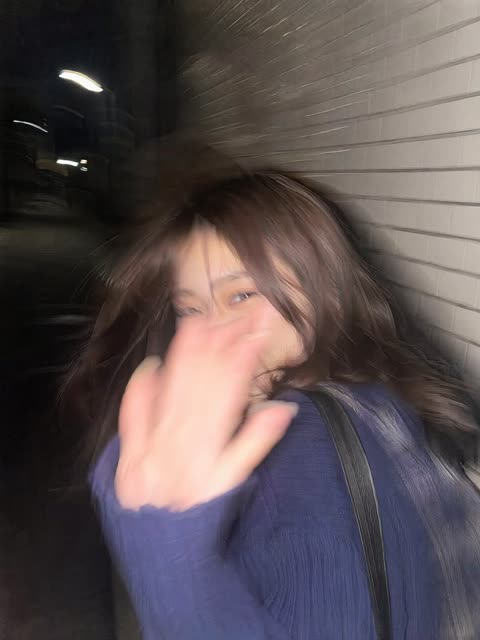</a>

叠加运动中闪光、手持抖动、方向性模糊、过曝高光和大量噪点等手机随手拍特征，营造未经修饰的抓拍感。负面提示排除影棚光、锐利对焦和真人复刻。

GPT Image 2 · 文生图 · 出处: [@doctorwasif on X](https://x.com/doctorwasif/status/2070011415662842000) · 713 赞，统计于 2026-10-28

[`candid`](tags.md#tag-candid) [`smartphone-photo`](tags.md#tag-smartphone-photo) [`motion-blur`](tags.md#tag-motion-blur) [`night`](tags.md#tag-night) [`flash`](tags.md#tag-flash)

<details><summary><b>提示词</b></summary>

```text
GPT Image 2

{
  "prompt": "Ultra-realistic candid smartphone photo, 3:4 vertical. Original non-identifiable young woman inspired only by general proportions/vibe. Night Tokyo sidewalk beside white ceramic tile wall. Mid-walk, half-profile, turning back in surprise, hand raised toward lens, shy restrained smile, continuing forward, imperfect framing, nearly exiting frame. Flash fired during motion. Strong handheld shake, heavy directional blur, smeared facial details, blurred hand and hair, ghosting, streaked tile wall, deep darkness around. Harsh flash highlights, blown exposure, hard shadows. Raw accidental snapshot, intrusive, playful, fleeting memory. Extremely noisy, heavily blurred, authentic phone-camera look.",
  "negative_prompt": "identity match, face copy, real person replication, anime, illustration, painting, stylized, studio lighting, beauty lighting, sharp focus, clean face, smooth skin, posed portrait, fashion editorial, cinematic, film still, tripod, professional photography"
}
```

</details>

<a id="nano-banana-red-one-piece-swimsuit-pool-steps"></a>
### 红色海贼王连体泳衣女子站在泳池台阶上

<a href="https://x.com/KeorUnreal/status/2039691442440802306">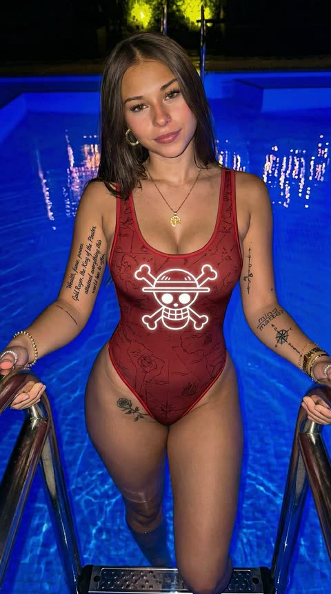</a>

嵌套的 JSON 结构把主体、姿势、镜头、灯光和负面提示分开写，让模型保持胸前徽章、扶手抓握和水下蓝光的一致。平视角加 50 到 85 毫米人像镜头与适中景深，主体清晰，背景柔和。

Nano Banana 2 · 文生图 · 出处: [@KeorUnreal on X](https://x.com/KeorUnreal/status/2039691442440802306) · 703 赞，统计于 2026-10-29

[`json-prompt`](tags.md#tag-json-prompt) [`fan-art`](tags.md#tag-fan-art) [`night-pool`](tags.md#tag-night-pool) [`smartphone-photo`](tags.md#tag-smartphone-photo)

<details><summary><b>提示词</b></summary>

```text
{
  "subject": {
    "desc": "Young woman, fair skin, long straight brown hair over shoulders/back, symmetrical face with full lips, defined eyebrows, green-hazel eyes",
    "apparel": {
      "item": "One Piece inspired bodysuit",
      "style": "Halter-neck sleeveless bodysuit",
      "color": "Vibrant red base with bright white neon web pattern, red trim, large glowing white neon one piece emblem on chest",
      "details": "Stretch fabric with neon red and white web design, matching neon red and white patterned thigh-high stockings"
    },
    "anatomy": {
      "body_type": "Naturally proportioned hourglass figure",
      "bust": "Full bust",
      "hips": "Wide hips, full thighs, narrow waist",
      "skin": "Smooth fair with natural tone variation"
    }
  },
  "pose": {
    "posture": "Standing on pool steps, body leaning slightly forward, weight balanced with both hands gripping the metal handrails on either side, hips angled naturally, one leg slightly forward on a higher step",
    "limbs": {
      "right_arm": "Extended to the side gripping the right metal handrail",
      "left_arm": "Extended to the side gripping the left metal handrail",
      "head": "Slight tilt, facing forward"
    },
    "gaze": "Direct eye contact, soft neutral confident expression"
  },
  "environment": {
    "location": "Outdoor swimming pool at night",
    "elements": [
      "Crystal clear blue illuminated pool water with reflections",
      "Metal pool handrails in foreground",
      "Pool ladder and steps",
      "Dark nighttime background with blurred greenery and warm yellow lights",
      "Neon white written 'KeorUnreal' on wall in backdrop"
    ]
  },
  "camera": {
    "shot": "Medium (thighs up), vertical 3:4",
    "angle": "Eye-level slightly frontal",
    "lens": "50-85mm portrait",
    "dof": "Moderate, sharp subject, slightly soft distinct background",
    "framing": "Centered subject"
  },
  "lighting": "Vibrant blue pool lighting from underwater with neon reflections on water and skin, soft nighttime ambient lighting, highlights on body contours and fabric sheen",
  "mood": "Confident calm, glamorous nighttime pool atmosphere",
  "style": "Photorealistic smartphone photography, high-fidelity detailed fabric/skin textures, natural color grading, unstyled physical proportions",
  "colors": "Vibrant neon red and white suit dominant, deep blue pool water, warm background lights, natural contrast/saturation",
  "quality": "High-def sharp focus on eyes/face/suit pattern, low noise, minimal grain",
  "negative_prompt": "small/reduced/flattened bust, lifted breasts, slimmed torso/hips, proportion averaging, plastic/airbrushed skin, beautification, stylization, depth flattening, wide distortion, mirror selfies, reflections, phone-in-hand"
}
```

</details>

<a id="gpt-image-pencil-essay-coffee-stain"></a>
### 带咖啡渍的线格纸铅笔手写文章

<a href="https://x.com/chetaslua/status/2095556181012128005"></a>

提示词先限定媒介（8.5x11 线格纸上的铅笔字）和拍摄方式（手机照片）。再要求笔迹有变化，并指定一处角落的咖啡渍作为小瑕疵，真实感由此而来。

GPT Image 2.5 · 文生图 · 出处: [@chetaslua on X](https://x.com/chetaslua/status/2095556181012128005) · 614 赞，统计于 2026-10-27

[`handwriting`](tags.md#tag-handwriting) [`paper`](tags.md#tag-paper) [`phone-photo`](tags.md#tag-phone-photo) [`texture`](tags.md#tag-texture) [`coffee-stain`](tags.md#tag-coffee-stain)

<details><summary><b>提示词</b></summary>

```text
🚨 GPT-Image-2.5 Output

I said it to write like einstein it did it without reference < i did not give image or anything   >

left side is AI and right side is real photo from reddit to compare

Prompt : a photorealistic, taken by phone photo of a handwritten essay in pencil, albert einstein handwriting, on an 8.5x11 piece of lined paper, about the history of money in world. make sure there is variance in the writing in a very einstein way. give it a slight coffee stain on the top right corner
```

</details>

<a id="nano-banana-sadie-sink-lifeguard-stand-golden-hour"></a>
### 金色时刻救生塔上穿红色泳衣的女性

<a href="https://x.com/Strength04_X/status/2038177524048630043">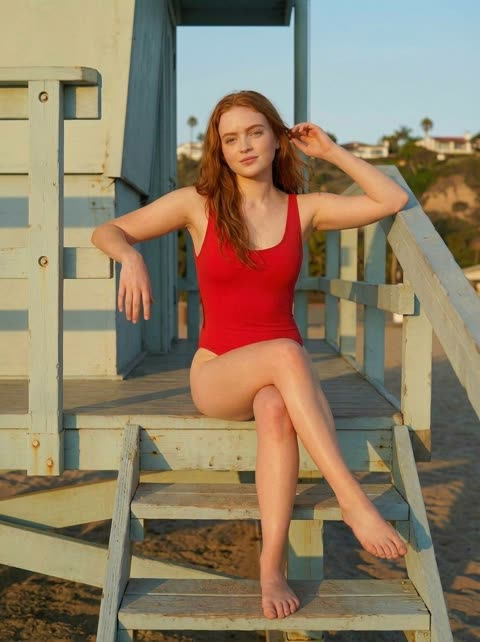</a>

用 JSON 分块描述场景、人物、光线和镜头，每个细节都明确。指定 85mm 人像镜头、f/2.8 浅景深和金色时刻侧光，带出杂志摄影质感。

Nano Banana 2 · 文生图 · 出处: [@Strength04_X on X](https://x.com/Strength04_X/status/2038177524048630043) · 448 赞，统计于 2026-10-29

[`json-prompt`](tags.md#tag-json-prompt) [`portrait`](tags.md#tag-portrait) [`golden-hour`](tags.md#tag-golden-hour) [`editorial`](tags.md#tag-editorial)

<details><summary><b>提示词</b></summary>

```text
"scene": {
    "type": "cinematic beachside portrait",
    "style": "ultra realistic editorial summer photography",
    "environment": "wooden beach lifeguard walkway at golden hour, coastal houses and hillside softly blurred in the background"
  },
  "subject": {
    "identity": "Sadie Sink",
    "pose": "sitting on a wooden boardwalk floor leaning slightly against the side railing, one leg extended naturally, the other bent upward with one hand resting on the knee, relaxed elegant posture",
    "expression": "calm distant gaze with a soft serious expression",
    "appearance": {
      "hair": "long natural wavy red hair",
      "skin": "fair skin with realistic natural texture",
      "makeup": "minimal soft natural makeup"
    }
  },
  "wardrobe": {
    "outfit": "simple red one-piece swimsuit",
    "footwear": "barefoot with casual sandals placed nearby on the wooden floor"
  },
  "composition": {
    "framing": "full body vertical portrait",
    "camera_angle": "slightly low eye-level perspective",
    "background": "sunlit beach architecture and coastal scenery softly blurred"
  },
  "lighting": {
    "setup": "golden hour natural sunlight",
    "details": "warm side lighting casting long soft shadows across the wooden deck, cinematic glow on skin and hair"
  },
  "camera": {
    "type": "professional DSLR",
    "lens": "85mm portrait lens",
    "settings": "f/2.8 shallow depth of field",
    "quality": "8k ultra photorealistic",
    "focus": "sharp focus on subject"
  },
  "render": {
    "style": "high-end editorial beach fashion photography",
    "details": "realistic skin texture, natural sunlight, soft background bokeh, cinematic composition",
    "restrictions": "no watermark, no logo, no text"
  },
  "aspect_ratio": "3:4"
}
```

</details>

<a id="gpt-image-forest-clearing-foliage-noise-test"></a>
### 阳光洒落的林间空地与茂密绿叶

<a href="https://x.com/mark_k/status/2097411028510179759"></a>

一句话点明主体、照片媒介和高细节要求，可作为噪点伪影测试，因为密集重复的树叶最容易暴露纹理涂抹和颗粒问题。提示词很短，光线与构图交由模型自行决定。

GPT Image 2.5 · 文生图 · 出处: [@mark_k on X](https://x.com/mark_k/status/2097411028510179759) · 415 赞，统计于 2026-10-27

[`forest`](tags.md#tag-forest) [`nature`](tags.md#tag-nature) [`foliage`](tags.md#tag-foliage) [`texture-test`](tags.md#tag-texture-test) [`landscape`](tags.md#tag-landscape)

<details><summary><b>提示词</b></summary>

```text
GPT-Image-2.5 has arrived in
@ChatGPT
 🔥

It features many improvements, but I couldn't help myself from doing the infamous "noise artifact" test.

The results are mixed!

Prompt: "Photo of a clearing in the woods with lots of green foliage, highly detailed"

See for yourself:
```

</details>

<a id="gpt-image-fisheye-tiny-planet-stepping-sneaker-plaza"></a>
### 鱼眼小星球广场与迈步跨过镜头的球鞋

<a href="https://x.com/AiwithLariab/status/2067484351378690487">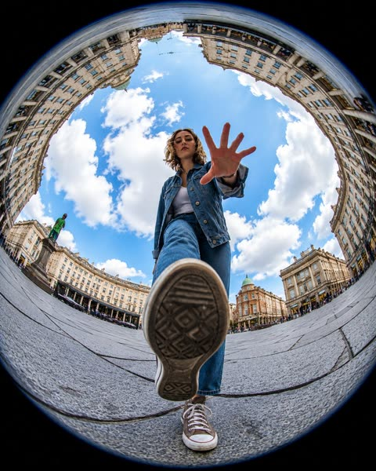</a>

用 8mm 极端鱼眼加贴地仰拍视角，并点明前景鞋底和伸向镜头的手，让主体占满画面。建筑沿边缘环绕、中央留出云天，形成小星球式的纵深与尺度感。

GPT Image 2 · 文生图 · 出处: [@AiwithLariab on X](https://x.com/AiwithLariab/status/2067484351378690487) · 401 赞，统计于 2026-10-29

[`fisheye`](tags.md#tag-fisheye) [`tiny-planet`](tags.md#tag-tiny-planet) [`worms-eye-view`](tags.md#tag-worms-eye-view) [`street-photography`](tags.md#tag-street-photography) [`travel`](tags.md#tag-travel)

<details><summary><b>提示词</b></summary>

```text
Ultra-realistic action photography, extreme fisheye lens, 8mm, worm’s-eye view from ground level, dynamic urban plaza scene. A stylish young person appears to be stepping over the camera, one sneaker sole dominating the foreground, hand reaching toward the lens.. Massive circular “tiny planet” perspective with historic European architecture curving around the edges of the frame, bright blue sky filled with fluffy white clouds at the center. Cinematic composition, dramatic distortion, ultra-wide angle, vibrant colors, sharp focus, HDR, photorealistic, highly detailed skin texture, travel photography aesthetic, motion energy, depth and scale, 8K resolution, professional DSLR quality, masterpiece, Instagram viral shot. Aspect Ratio 4:5.
```

</details>

<a id="gpt-image-tokyo-night-flash-blur-snapshot"></a>
### 东京夜街挥手的闪光模糊抓拍

<a href="https://x.com/MissDelulu9/status/2070345476189336033">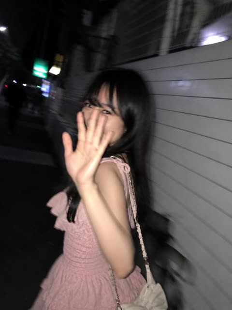</a>

刻意描述有缺陷的手机照片：行进中开闪光灯、手持抖动、重影、高光过曝和构图不完美。负面提示排除影棚光、锐利对焦和精修人像感，让画面像一张意外抓拍。

GPT Image 2 · 文生图 · 出处: [@MissDelulu9 on X](https://x.com/MissDelulu9/status/2070345476189336033) · 344 赞，统计于 2026-10-29

[`candid`](tags.md#tag-candid) [`smartphone-photo`](tags.md#tag-smartphone-photo) [`motion-blur`](tags.md#tag-motion-blur) [`flash`](tags.md#tag-flash) [`night`](tags.md#tag-night)

<details><summary><b>提示词</b></summary>

```text
Ultra-realistic candid smartphone photo, 3:4 vertical. Original non-identifiable young woman on a Tokyo sidewalk at night beside a white tiled wall. Mid-walk, half-profile, turning back with a shy smile, hand raised toward the camera. Flash fired during motion, strong handheld shake, heavy motion blur, ghosting, streaked tiles, deep shadows, blown highlights, imperfect framing, raw accidental snapshot, authentic noisy phone-camera aesthetic.

Negative Prompt: identity match, face copy, real person replication, anime, illustration, painting, CGI, stylized, studio lighting, beauty lighting, sharp focus, smooth skin, posed portrait, fashion editorial, cinematic, DSLR, tripod, professional photography
```

</details>

<a id="nano-banana-json-reconstruction"></a>
### 逐项复刻一张照片的 JSON 提示词

<a href="https://x.com/ViralOps_/status/2107538470818484305"></a>

按 JSON 字段写（构图、光线、色彩、负面词）。原帖用同一段 JSON 对比了 Nano Banana 2.1 和 GPT Image 2.5。

Nano Banana 2.1 · 上传图改图 · 出处: [@ViralOps_ on X](https://x.com/ViralOps_/status/2107538470818484305) · 326 赞，统计于 2026-10-27

[`json`](tags.md#tag-json) [`reconstruction`](tags.md#tag-reconstruction) [`comparison`](tags.md#tag-comparison)

<details><summary><b>提示词</b></summary>

```text
{
  "prompt_type": "detailed_image_reconstruction",
  "aspect_ratio": "4:5 vertical portrait",
  "overall_goal": "Recreate the visual appearance, framing, lighting, styling, and casual smartphone-photo feel of the reference image as closely as possible while keeping the result photorealistic and natural.",

  "subject": {
    "type": "young adult woman",
    "age_range": "early to mid 20s",
    "pose": "standing indoors, upper body turned slightly away from the camera while her face turns toward the lens",
    "body_position": "relaxed casual posture with shoulders slightly angled",
    "expression": "soft neutral expression with a subtle pout, calm and confident",
    "gaze": "looking directly toward the camera",
    "styling": "minimal everyday styling, clean and natural"
  },

  "face": {
    "shape": "soft oval face with a gently tapered jawline",
    "forehead": "medium-height forehead partly framed by center-parted hair",
    "eyebrows": "natural medium-thick dark brown eyebrows with a soft arch",
    "eyes": {
      "shape": "almond-shaped",
      "color": "light brown to hazel",
      "appearance": "bright eyes with visible catchlights",
      "lashes": "long defined eyelashes with subtle mascara"
    },
    "nose": "small straight nose with a softly rounded tip",
    "lips": {
      "shape": "full lips with a defined cupid's bow",
      "color": "natural rosy pink",
      "finish": "soft satin finish, not glossy"
    },
    "skin": {
      "tone": "light warm-neutral skin tone",
      "texture": "smooth natural skin with subtle pores and realistic tonal variation",
      "cheeks": "soft natural pink flush",
      "finish": "fresh luminous skin without heavy retouching"
    },
    "makeup": "very light natural makeup, softly defined lashes, subtle blush, natural pink lips, no dramatic contour"
  },

  "hair": {
    "color": "rich medium-to-dark chocolate brown",
    "length": "very long, extending well below the chest",
    "parting": "clean center part",
    "texture": "mostly straight with very soft natural bends through the lower lengths",
    "density": "thick and healthy-looking",
    "finish": "smooth and glossy but still realistic",
    "front_sections": "two thin face-framing strands falling naturally along both sides of the face",
    "details": "visible individual strands, subtle flyaways near the crown, realistic highlights from sunlight, natural uneven strand separation",
    "movement": "hair hanging naturally over both shoulders and down the front of the shirt"
  },

  "clothing": {
    "top": "oversized plain white crew-neck T-shirt",
    "fit": "loose casual fit",
    "fabric": "soft slightly wrinkled cotton",
    "logos": "none",
    "accessories": "no visible jewelry or prominent accessories"
  },

  "composition": {
    "shot_type": "close upper-body portrait",
    "camera_angle": "slightly above chest level, close to eye level",
    "camera_distance": "approximately arm's-length smartphone distance",
    "subject_position": "face slightly right of center with long hair occupying much of the lower frame",
    "crop": "top of head fully visible, image extending down to around lower torso",
    "orientation": "vertical",
    "perspective": "natural wide smartphone-camera perspective with mild close-range distortion"
  },

  "lighting": {
    "primary_source": "strong warm natural sunlight entering from the side/front through a nearby window",
    "direction": "sunlight striking the subject from camera-left/front",
    "face_effect": "bright warm illumination across the forehead, cheeks, nose, and hair",
    "hair_effect": "distinct brown highlights and soft reflective streaks along individual strands",
    "shadow_quality": "strong but soft-edged natural indoor shadows",
    "exposure": "face slightly brightly exposed while the room behind remains much darker",
    "color_temperature": "warm daylight"
  },

  "environment": {
    "location": "casual indoor residential room",
    "background": "dark gray walls with a white ceiling cornice",
    "left_background": "open doorway or darker hallway area",
    "right_background": "dark wall and partially visible household objects",
    "lower_right": "part of a black tripod or light stand visible",
    "overall_feel": "ordinary lived-in room rather than a studio",
    "depth": "background moderately out of focus but still recognizable"
  },

  "camera": {
    "capture_device": "modern smartphone camera",
    "lens_equivalent": "approximately 24-28mm full-frame equivalent",
    "focus": "sharp focus on face and front hair",
    "depth_of_field": "mostly natural smartphone depth of field with gentle background softness",
    "dynamic_range": "realistic phone-camera HDR with slightly clipped highlights in direct sun",
    "image_character": "casual social-media selfie/photo, not professionally staged"
  },

  "photorealism_details": [
    "real individual hair strands",
    "natural skin pores and micro-texture",
    "subtle peach fuzz",
    "realistic eyelash separation",
    "tiny variations in lip texture",
    "slight fabric creases in the T-shirt",
    "small flyaway hairs around the crown",
    "natural sunlight falloff across the face",
    "slightly imperfect casual framing",
    "realistic indoor shadow noise"
  ],

  "style": {
    "visual_style": "highly photorealistic casual smartphone portrait",
    "mood": "soft, youthful, relaxed, sunlit",
    "processing": "light social-media style processing with warm skin tones and slightly enhanced clarity",
    "avoid": [
      "cinematic movie lighting",
      "studio portrait lighting",
      "overly smooth plastic skin",
      "CGI appearance",
      "anime or illustration",
      "heavy beauty filter",
      "extreme facial symmetry",
      "over-sharpened hair",
      "artificial jet-black hair",
      "dramatic makeup",
      "excessive background blur",
      "professional studio backdrop",
      "text",
      "watermarks",
      "logos"
    ]
  },

  "negative_prompt": "cartoon, anime, illustration, CGI, plastic skin, waxy face, over-retouched skin, excessive beauty filter, unnatural facial symmetry, distorted eyes, crossed eyes, malformed lips, warped face, duplicate hair strands, fake wig appearance, overly black hair, metallic hair shine, stiff hair, messy anatomy, distorted shoulders, extra limbs, extra fingers, studio backdrop, cinematic lighting, dramatic color grading, excessive bokeh, oversaturated colors, text, logo, watermark"
}
```

</details>

<a id="gpt-image-train-platform-snapshot"></a>
### 站台上的手机随手拍

<a href="https://x.com/MissDelulu9/status/2114965450425868519"></a>

靠手机相机的瑕疵出真实感：列车动态模糊、真实噪点、轻微广角变形。

GPT Image 2.5 · 文生图 · 出处: [@MissDelulu9 on X](https://x.com/MissDelulu9/status/2114965450425868519) · 305 赞，统计于 2026-10-27

[`phone-photo`](tags.md#tag-phone-photo) [`street`](tags.md#tag-street) [`motion-blur`](tags.md#tag-motion-blur)

<details><summary><b>提示词</b></summary>

```text
Realistic vertical phone street snapshot of a young woman on an urban train platform, slightly right of center, as a silver train with a green stripe rushes behind in horizontal motion blur. Low angle from waist height, close half-body to mid-thigh, handheld and imperfect.

Long deep-black hair sweeps left in station wind. Oversized brown gradient sunglasses hide her eyes; head tilted upward, lips relaxed, cool distant expression. Small oval face, soft jawline, clean East Asian Y2K makeup, nude-pink lips. Warm-white cropped halter tank, low neckline, fitted ribbed cotton, subtle wrinkles, hem above waist. Low-rise loose vintage gray-brown jeans, layered gold necklaces, black quilted chain bag.

Warm-beige skin with natural texture on shoulders, collarbones, arms, waist and abdomen. Cool fluorescent station light, metallic reflections, yellow tactile paving, concrete floor, blurred passengers in train windows. Real mobile noise, slight wide-angle feel.
```

</details>

<a id="nano-banana-surveillance-crosswalk-face-match-hud"></a>
### 带霓虹人脸匹配界面的监控风格路口照片

<a href="https://x.com/frametheory058/status/2038647491781181624">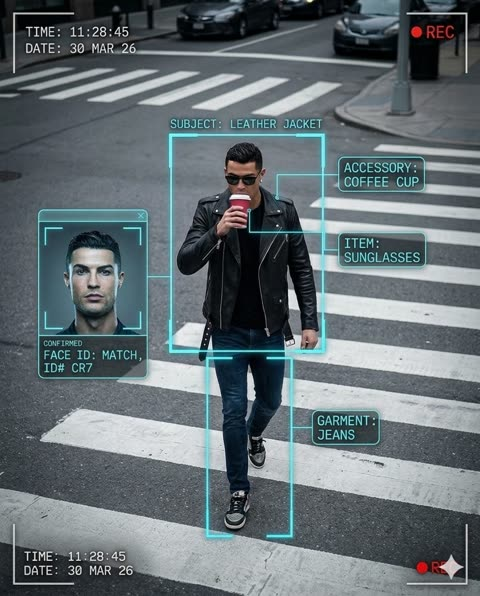</a>

高位监控视角、35mm 镜头和参考人脸让画面保持写实，同时把追踪框、标签和元数据逐项列为独立的 HUD 元素，使叠加界面显得有条理而不杂乱。

Nano Banana 2 · 上传图改图 · 出处: [@frametheory058 on X](https://x.com/frametheory058/status/2038647491781181624) · 233 赞，统计于 2026-10-29

[`surveillance`](tags.md#tag-surveillance) [`hud-overlay`](tags.md#tag-hud-overlay) [`street-photo`](tags.md#tag-street-photo) [`reference-face`](tags.md#tag-reference-face)

<details><summary><b>提示词</b></summary>

```text
{
  "title": "Hyper-Realistic Surveillance Crosswalk Scene with Futuristic HUD",
  "description": "A cinematic, hyper-realistic high-angle surveillance-style image capturing a lone male subject walking across a pedestrian crosswalk in an urban environment. The composition emphasizes a technical, observational perspective as if recorded by an advanced security system.",
  "subject": {
    "appearance": "Adult male with a clearly defined, recognizable face (reference-based), neutral to focused expression",
    "clothing": [
      "Black leather biker jacket",
      "Black T-shirt",
      "Dark denim jeans",
      "Casual sneakers",
      "Dark sunglasses"
    ],
    "accessory": "Holding a red coffee cup in both hands"
  },
  "environment": {
    "location": "Urban pedestrian crosswalk",
    "lighting": "Diffused natural daylight with soft shadows",
    "color_palette": [
      "Muted grays of asphalt",
      "Glossy black tones",
      "Subtle urban neutrals"
    ],
    "atmosphere": "Gloomy, subdued, and slightly cinematic with a technological surveillance tone"
  },
  "camera": {
    "angle": "High-angle (CCTV / surveillance perspective)",
    "lens": "35mm",
    "depth_of_field": "Large depth of field ensuring full scene clarity",
    "style": "Hyper-realistic, sharp detail, documentary-like capture"
  },
  "hud_overlay": {
    "style": "Futuristic neon blue interface",
    "elements": [
      "Dynamic tracking frame outlining the subject",
      "Segmented highlights around clothing and accessories",
      "Technical labels such as 'SUBJECT: LEATHER JACKET'",
      "Facial recognition confirmation window positioned on the left",
      "Subtle scanning lines and data points",
      "Camera metadata text in corners (ISO, shutter speed, timestamp)"
    ],
    "tone": "Clean, advanced, minimal yet highly technical"
  },
  "composition_notes": [
    "Maintain strong subject centering within crosswalk lines",
    "Ensure contrast between subject and environment for clarity",
    "Blend realism with subtle sci-fi interface elements",
    "Avoid over-saturation; keep tones natural and cinematic"
  ],
  "rendering_style": {
    "quality": "Ultra-detailed, photorealistic",
    "textures": "Highly defined materials (leather, fabric, asphalt)",
    "post_processing": "Slight cinematic grading with cool undertones"
  }
}
```

</details>

<a id="gpt-image-fisheye-jump-brick-street"></a>
### 鱼眼镜头下跃起伸手的女子与红砖街道

<a href="https://x.com/iamsofiaijaz/status/2048367604574908593">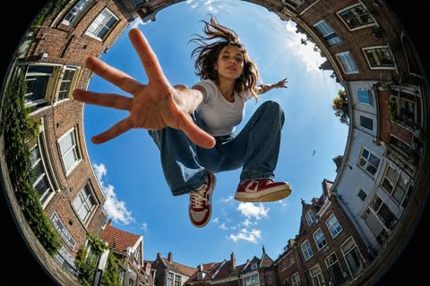</a>

将镜头贴近地面并垂直向上拍摄，周围建筑会形成围绕天空的圆形画框。手臂伸向镜头，让近处的手部产生强烈透视，增加纵深与动感。

GPT Image 2 · 文生图 · 出处: [@iamsofiaijaz on X](https://x.com/iamsofiaijaz/status/2048367604574908593) · 227 赞，统计于 2026-10-29

[`fisheye`](tags.md#tag-fisheye) [`jump-pose`](tags.md#tag-jump-pose) [`street`](tags.md#tag-street) [`photorealistic`](tags.md#tag-photorealistic)

<details><summary><b>提示词</b></summary>

```text
Make an Ultra-wide fisheye lens perspective shot from ground level looking straight up at a young women crouching mid-air between brick buildings forming a circular frame around the sky. She reaches one hand dramatically toward the camera, fingers spread wide, creating strong foreground distortion and depth. Dynamic action pose, confident expression, casual streetwear outfit: fitted white t-shirt, blue straight-leg jeans, red and white sneakers. Urban European neighborhood setting with brick houses, tiled roofs, windows visible around the edges. Bright daylight, clear blue sky, natural lighting, sharp focus, high detail, cinematic composition, exaggerated perspective, 8k resolution, photorealistic, adventure photography style.
```

</details>

<a id="gpt-image-raw-chicken-cinematic-food-commercial"></a>
### 暗色木板上的生鸡肉,电影感美食广告

<a href="https://x.com/DuaFatimaAi/status/2091684066622103675"></a>

提示词把广告拆成四个编号场景,按生鸡肉到炸鸡的顺序推进,每个场景都写明镜头距离和动作。结尾的风格句叠加微距、浅景深、暖光,并要求无文字无标志。

GPT Image 2 · 文生图 · 出处: [@DuaFatimaAi on X](https://x.com/DuaFatimaAi/status/2091684066622103675) · 226 赞，统计于 2026-10-28

[`food`](tags.md#tag-food) [`commercial`](tags.md#tag-commercial) [`macro`](tags.md#tag-macro) [`cinematic`](tags.md#tag-cinematic) [`multi-scene`](tags.md#tag-multi-scene)

<details><summary><b>提示词</b></summary>

```text
Create a hyper-realistic cinematic food commercial showing raw chicken pieces being expertly seasoned and transformed into crispy golden fried chicken.

Scene 1: Close-up of fresh raw chicken pieces arranged on a dark wooden cutting board in a dramatic dark kitchen environment. Soft warm side lighting highlights the natural texture and moisture of the chicken.

Scene 2: A generous blend of spices is sprinkled over the chicken in slow motion. Capture every tiny spice particle floating through the air and landing naturally on the chicken. Use extreme macro detail and shallow depth of field.

Scene 3: The seasoned chicken is carefully lowered into hot oil. Show an intense close-up of the oil rapidly bubbling and sizzling around the chicken, with realistic steam, tiny oil droplets, and crunchy batter forming.

Scene 4: Golden-brown crispy fried chicken is lifted from the hot oil with stainless-steel kitchen tongs. Oil droplets fall back into the pan in slow motion while the crispy textured coating glistens under warm cinematic lighting.

Ultra-realistic food photography, cinematic commercial style, macro close-ups, rich golden tones, realistic textures, dramatic contrast, shallow depth of field, soft background bokeh, slow-motion details, natural movement, professional food advertisement, 4K, highly detailed, appetizing presentation, no text, no logos
```

</details>

<a id="gpt-image-miniature-workers-building-giant-sushi-roll"></a>
### 迷你工人建造巨型寿司卷

<a href="https://x.com/SeeratFatima112/status/2088658313114423488">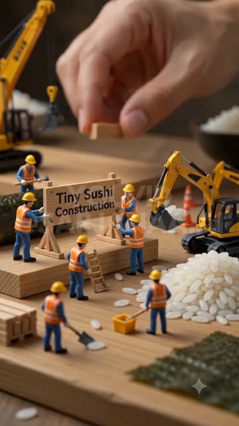</a>

提示词把10秒拆成八个带时间码的分镜，每个分镜只写一个动作和一种微距构图，顺序清晰。镜头、声音和画质分段列出，真人手的出现交代了微缩比例。

GPT Image 2 · 文生图 · 出处: [@SeeratFatima112 on X](https://x.com/SeeratFatima112/status/2088658313114423488) · 222 赞，统计于 2026-10-28

[`miniature`](tags.md#tag-miniature) [`macro`](tags.md#tag-macro) [`asmr`](tags.md#tag-asmr) [`food`](tags.md#tag-food) [`video-prompt`](tags.md#tag-video-prompt)

<details><summary><b>提示词</b></summary>

```text
Gpt image 2
Prompt Create a 10-second ultra-realistic cinematic miniature-world video showing tiny construction workers building a giant sushi roll with the help of real human hands. The style is realistic ASMR, satisfying miniature construction, macro photography, highly detailed textures, warm cinematic lighting, shallow depth of field.

Scene 1 — 0:00–0:01: Tiny construction workers use a miniature excavator to scoop freshly cooked white rice and place it into a large bowl. Close-up macro shot, realistic rice texture, tiny machinery sounds.

Scene 2 — 0:01–0:02: A giant human hand pours water into the rice bowl while miniature workers carefully wash and mix the rice. Clear water movement, realistic ASMR sound.

Scene 3 — 0:02–0:03: The rice is transferred into a miniature cooking pot. Steam rises as tiny workers supervise the cooking process. Close-up of the lid opening and warm steam escaping.

Scene 4 — 0:03–0:04: Tiny workers spread the cooked sticky rice evenly across a large sheet of nori using miniature tools, while a human hand gently helps flatten and smooth the rice.

Scene 5 — 0:04–0:05: A tiny construction crane carefully lifts large pieces of fresh salmon and places them neatly on top of the rice. The salmon looks glossy, fresh, and realistic.

Scene 6 — 0:05–0:06: Tiny workers bring cucumber and other colorful sushi vegetables and carefully arrange them in straight layers over the salmon. Macro close-up of the ingredients.

Scene 7 — 0:06–0:07: Several miniature construction workers work together to roll the sushi tightly. A human hand assists by gently pushing and guiding the roll. The nori wraps smoothly around the filling.

Scene 8 — 0:07–0:10: A large human hand uses a sharp sushi knife to cut the finished sushi roll into perfect pieces. Tiny workers celebrate around the completed sushi, raising their hands. Add a small “MISSION COMPLETE” sign.

Camera: macro close-ups, smooth cinematic camera movement, realistic focus pulls, shallow depth of field, detailed miniature perspective.

Audio: satisfying ASMR, rice movement, water pouring, steam, tiny construction machinery, knife cutting through sushi, subtle ambient sounds. No music.

Visual quality: photorealistic, cinematic, highly detailed, realistic human hands, realistic miniature workers, natural physics, clean composition, warm restaurant/kitchen environment, 4K, vertical 9:16, smooth motion, no text except the small “MISSION COMPLETE” sign.
```

</details>

<a id="nano-banana-giant-object-miniature-world-macro"></a>
### 微缩小人在巨型日常物件上搭建的世界

<a href="https://x.com/DrSadek_/status/2033136123342401904">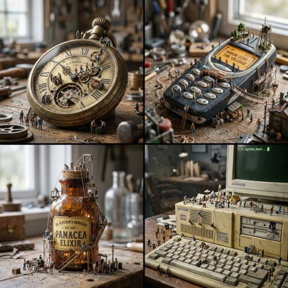</a>

填空式模板，只替换日常物件，固定 85mm 微距镜头、f/1.8 浅景深和方向性微阴影。物件表面的灰尘与划痕强化了与小人之间的尺度对比。

Nano Banana 2 · 文生图 · 出处: [@DrSadek_ on X](https://x.com/DrSadek_/status/2033136123342401904) · 219 赞，统计于 2026-10-28

[`macro`](tags.md#tag-macro) [`miniature`](tags.md#tag-miniature) [`surreal`](tags.md#tag-surreal) [`template`](tags.md#tag-template) [`tilt-shift`](tags.md#tag-tilt-shift)

<details><summary><b>提示词</b></summary>

```text
Create a hyper-realistic macro photograph of a miniature surreal scene. The environment is dominated by a giant, oversized <everyday object>, which has been repurposed as a bustling landscape. Tiny, highly detailed miniature human figures are interacting around and on the object. Shot on an 85mm macro lens with a shallow depth of field (f/1.8) to heavily blur the distant background. Lighting is soft, directional, and casts appropriate micro-shadows to emphasize the massive scale of the object relative to the figures. Intricate environmental details like dust particles and surface scratches are visible on the object. Cinematic, photorealistic, 4K.
```

</details>

<a id="gpt-image-bosphorus-night-kofte-caravan-stall"></a>
### 博斯普鲁斯海岸夜间肉丸餐车摊

<a href="https://x.com/ozansihay/status/2107544398531637407">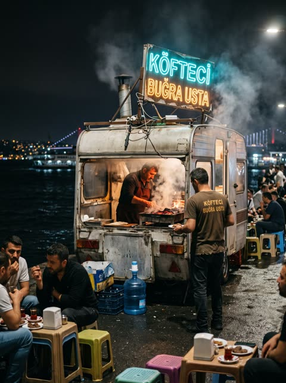</a>

提示词叠加了具体的场景层次（自制霓虹招牌、炭火光、塑料凳、大水桶、渡轮剪影），并把土耳其语招牌文字在招牌和服务员衣背上各写一次。35mm f/1.8、胶片颗粒、湿沥青反光等摄影参数，加上结尾的文字不出错要求，保证了写实感和字样准确。

GPT Image 2.5 · 文生图 · 出处: [@ozansihay on X](https://x.com/ozansihay/status/2107544398531637407) · 216 赞，统计于 2026-10-28

[`night-street`](tags.md#tag-night-street) [`food-stall`](tags.md#tag-food-stall) [`istanbul`](tags.md#tag-istanbul) [`neon-sign`](tags.md#tag-neon-sign) [`documentary`](tags.md#tag-documentary)

<details><summary><b>提示词</b></summary>

```text
Aynı promptu sırasıyla şu modeller ile denedim;
-Nano Banana 2.1
-GPT Image 2.5
-Grok Imagine 2.0
-Ideogram 4.5

Prompt: Ultra-realistic night street photograph on the Istanbul Bosphorus waterfront. A tiny makeshift caravan food stall, slightly battered metal sides, steam rising. Hand-painted neon-style rickety sign reading “Köfteci Buğra Usta” in Turkish, glowing uneven cyan and warm amber, wires and brackets visibly DIY. Inside the open caravan, the usta grilling köfte over charcoal, orange ember glow on his face and apron. One waiter in a simple dark shirt stands in front of the stall; the same “Köfteci Buğra Usta” lettering is printed on the back of his shirt. Plastic stools and small low tables outside, a few locals eating, soft conversation. A plastic water jug (damacana) near the counter. Behind them, dark Bosphorus water with distant city lights and a faint ferry silhouette. Wet asphalt reflections, streetlamp spill, shallow depth of field, natural film grain, shot on 35mm f/1.8, candid documentary look, no CGI look, no text errors on signs.
```

</details>

<a id="gpt-image-plastic-bag-sea-animal-sculpture"></a>
### 塑料袋拼成的座头鲸雕塑

<a href="https://x.com/ShamsAmin56/status/2062836449729474727">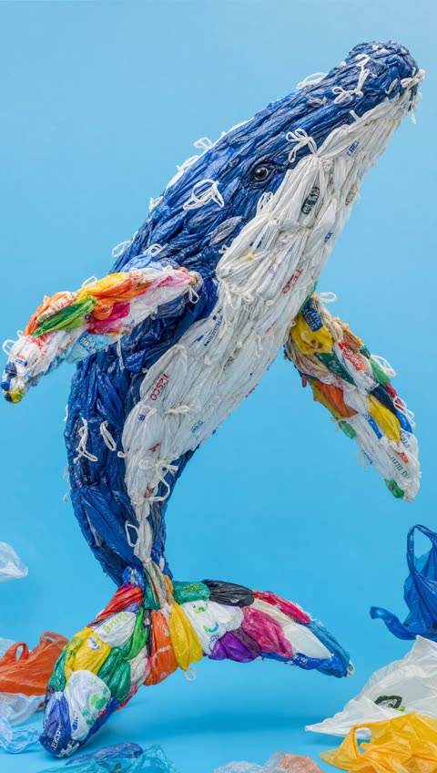</a>

模板把动物、身体特征、塑料袋颜色和背景做成可替换的空位，一套结构就能出一整个系列。写明袋面纹理、绑结、白色提手和印刷图案，让画面更像手工雕塑的真实质感，纯色柔和背景加边角散落的塑料袋用来收束构图。

GPT Image 2 · 文生图 · 出处: [@ShamsAmin56 on X](https://x.com/ShamsAmin56/status/2062836449729474727) · 214 赞，统计于 2026-10-28

[`plastic-bags`](tags.md#tag-plastic-bags) [`sculpture`](tags.md#tag-sculpture) [`sea-animals`](tags.md#tag-sea-animals) [`environmental`](tags.md#tag-environmental) [`template`](tags.md#tag-template)

<details><summary><b>提示词</b></summary>

```text
A highly detailed realistic photograph of a creative sculpture of a [SEA ANIMAL] made entirely from colorful recycled plastic bags and shopping bags tied and shaped into the animal form, with [specific features like fins, tentacles, shell, etc] from knotted and arranged [color] bags, head/eyes from cutouts or printed sections, in the exact style of handmade plastic bag animal art sculptures with visible bag textures, wrinkles, ties, white strings/handles, and brand prints. Solid soft light [background color like mint green / turquoise / pale blue] background, 9:16 portrait ratio. Add a few loose colorful plastic bags scattered subtly at the bottom and side borders of the frame, slightly visible.

How to Edit (Very Easy Steps):

Replace [SEA ANIMAL] → e.g. sea turtle, shark, octopus, dolphin, jellyfish

Replace [SPECIFIC FEATURES] → Describe the body parts Example: detailed shell patterns, flippers from knotted blue and green bags

Replace [COLORS] → Main colors used Example: blue, green, yellow and white

Replace [BACKGROUND COLOR] → Choose soft colors Example: mint green, turquoise, pale blue, light gray-blue, coral pink
```

</details>

<a id="nano-banana-floating-objects-spiral-bedroom-tunnel"></a>
### 漂浮日用品螺旋隧道中的卧室女子

<a href="https://x.com/AiwithLariab/status/2048074285953290537"></a>

用日常物品组成向房间深处收拢的螺旋，在居中安静的人物周围形成隧道纵深。广角、浅景深和轻微动态模糊表现旋转感，渲染引擎关键词定下质感。

Nano Banana 2 · 文生图 · 出处: [@AiwithLariab on X](https://x.com/AiwithLariab/status/2048074285953290537) · 207 赞，统计于 2026-10-28

[`surreal`](tags.md#tag-surreal) [`spiral`](tags.md#tag-spiral) [`bedroom`](tags.md#tag-bedroom) [`wide-angle`](tags.md#tag-wide-angle) [`bokeh`](tags.md#tag-bokeh)

<details><summary><b>提示词</b></summary>

```text
A women sitting calmly at the center of a wide horizontal swirling spiral made of everyday objects (books, cups, pens, shoes, clothes, pillows, blankets, bags etc) floating and rotating gently around her, the swirling motion expanding outward and receding deep into the bedroom toward the back wall, creating a dynamic tunnel-like depth effect. The room is a normal cozy bedroom with a bed, desk, and soft daylight from a window. Cinematic wide-angle composition, natural warm lighting, shallow depth of field with creamy bokeh, subtle motion blur showing rotation, sharp focus on the man's face. Octane render & unreal engine 5.
```

</details>

<a id="gpt-image-curry-udon-doodle-table"></a>
### 咖喱乌冬两碗配天妇罗与涂鸦便签

<a href="https://x.com/john_my07/status/2053700365338714193"></a>

固定的俯拍角度与暖色餐厅灯光保证美食照的写实感，白色马克笔涂鸦以独立的图标与注释清单描述，形成叠加在照片之上的一层。

GPT Image 2 · 文生图 · 出处: [@john_my07 on X](https://x.com/john_my07/status/2053700365338714193) · 181 赞，统计于 2026-10-29

[`food-photography`](tags.md#tag-food-photography) [`overhead-shot`](tags.md#tag-overhead-shot) [`doodles`](tags.md#tag-doodles) [`scrapbook`](tags.md#tag-scrapbook)

<details><summary><b>提示词</b></summary>

```text
Luxury artisan bakery flatlay photography featuring freshly baked croissants, sourdough slices, butter rolls, fruit danishes, and handcrafted coffee arranged beautifully on a textured linen table setup. Warm morning sunlight spills across the scene, creating soft golden highlights and cozy café shadows. Elegant food styling with realistic flaky pastry textures, melted butter details, and creamy coffee foam. Surround the composition with playful hand-drawn doodles and journal-style annotations — tiny stars, ribbon sketches, smiley faces, handwritten bakery notes, sparkles, and whimsical arrows in soft white ink. Chic European café atmosphere blended with modern scrapbook aesthetics, warm beige and caramel color palette, cinematic depth, comforting brunch mood, ultra detailed lifestyle food photography, soft bokeh accents, 8k resolution.
```

</details>

<a id="nano-banana-low-angle-yellow-top-bulma-poster"></a>
### 黄色上衣女子站在龙珠海报前的低角度照片

<a href="https://x.com/KeorUnreal/status/2069773380593606947">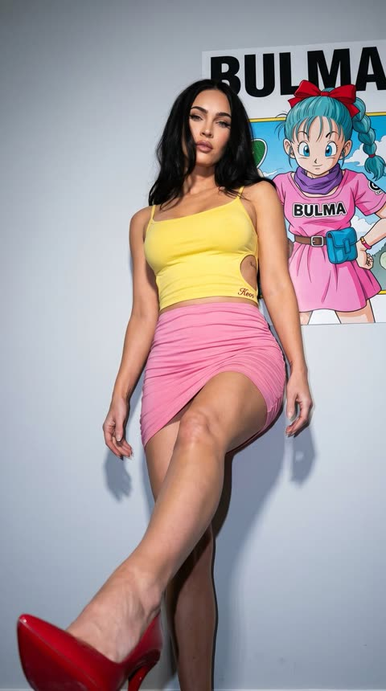</a>

结构化 JSON 提示词锁定服装、姿势和背景，极低机位加前景腿部形成强透视。正面硬闪光和手机快照质感让画面更像真实照片，而非棚拍。

Nano Banana 2 · 文生图 · 出处: [@KeorUnreal on X](https://x.com/KeorUnreal/status/2069773380593606947) · 178 赞，统计于 2026-10-29

[`json-prompt`](tags.md#tag-json-prompt) [`low-angle`](tags.md#tag-low-angle) [`fashion`](tags.md#tag-fashion) [`flash-photo`](tags.md#tag-flash-photo)

<details><summary><b>提示词</b></summary>

```text
{
  "subject": {
    "description": "Adult woman megan fox in her 20s, calm and distant presence, low-angle ultra close-up fashion selfie style",
    "mirror_rules": "Not a mirror selfie; no phone or reflective surface",
    "age": "Adult, early 20s",
    "expression": {
      "eyes": {
        "look": "Calm, slightly looking down at camera",
        "energy": "Cool, quiet, subtle pressure",
        "direction": "Direct gaze into low lens"
      },
      "overall": "Restrained, emotion shown only through eyes"
    },
    "face": {
      "makeup": "Cool-toned british fashion: soft gray-brown eyeshadow, thin eyeliner, natural brows, glossy lips"
    }
  },
  "hair": {
    "color": "Deep black",
    "style": "Long straight with soft bends, one side over chest, other near cheek",
    "effect": "Natural volume with flyaways"
  },
  "body": {
    "frame": "Slim elongated figure with visible collarbones and shoulders",
    "pose": "Standing, body leaning slightly back, one leg extended with red high heel forward toward camera creating strong perspective, hands relaxed at sides",
    "skin": {
      "tone": "Fair cool undertone",
      "texture": "Smooth with realistic texture, soft flash highlights on shoulders and foreground leg"
    }
  },
  "clothing": {
    "top": {
      "type": "Yellow tight sleeveless long crop tank top, loose-fitting with thin straps and a deep side cutout prominently visible revealing skin",
      "details": "Tight-fitting, small 'Keor' sign embroidered on edge"
    },
    "bottom": {
      "type": "Pink high-waisted ruched bodycon mini skirt",
      "details": "Asymmetric opening revealing one thigh"
    }
  },
  "accessories": {
    "headwear": "None"
  },
  "photography": {
    "camera_style": "Indoor low-angle mobile phone selfie / self-timer snapshot",
    "angle": "Very low, near leg height, pointing upward",
    "shot_type": "Vertical full-body, strong foreground leg perspective",
    "aspect_ratio": "9:16",
    "lighting": "Hard direct front phone flash with soft ambient",
    "texture": "Realistic phone flash look with slight noise and compression"
  },
  "background": {
    "setting": "Simple indoor space with light gray wall",
    "elements": [
      "Huge Bulma manga cosplay poster prominently displayed behind her",
      "Plain light gray wall"
    ],
    "atmosphere": "Quiet, private, casual night-out vibe"
  },
  "the_vibe": {
    "energy": "Calm, restrained, cool",
    "mood": "Minimal indoor fashion snapshot",
    "authenticity": "Realistic phone photo imperfections and strong low-angle perspective"
  },
  "constraints": {
    "must_keep": [
      "Adult woman",
      "Long black hair",
      "Yellow strapless top with 'Keor'",
      "Pink ruched mini skirt",
      "Low-angle upward shot with strong leg perspective with red high heel",
      "Hard front flash",
      "Huge Bulma cosplay poster in background"
    ],
    "avoid": [
      "Face mask",
      "Underage appearance",
      "Nudity",
      "Plastic skin",
      "Studio lighting",
      "Extra limbs",
      "Watermark or text"
    ]
  },
  "negative_prompt": [
    "face mask",
    "underage",
    "nudity",
    "transparent clothing",
    "plastic skin",
    "over-retouched",
    "studio lighting",
    "extra fingers",
    "deformed legs",
    "watermark",
    "text",
    "logo"
  ]
}
```

</details>

<a id="gpt-image-fisheye-tiny-planet-red-tracksuit-plaza"></a>
### 鱼眼小星球广场与跃起的红裤女孩

<a href="https://x.com/AvelyrahnAI/status/2063816992583487927">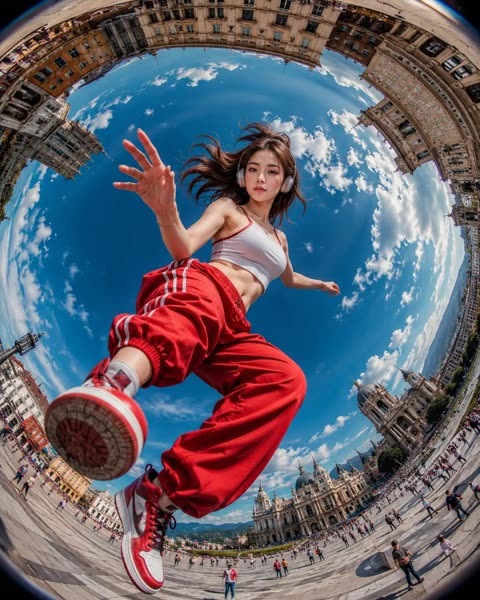</a>

开头就写明8mm鱼眼镜头和贴地视角，并让鞋底压向镜头来夸大纵深。小星球式弯曲把建筑卷到画面边缘，天空占据中心。

GPT Image 2 · 文生图 · 出处: [@AvelyrahnAI on X](https://x.com/AvelyrahnAI/status/2063816992583487927) · 177 赞，统计于 2026-10-28

[`fisheye`](tags.md#tag-fisheye) [`tiny-planet`](tags.md#tag-tiny-planet) [`low-angle`](tags.md#tag-low-angle) [`street-fashion`](tags.md#tag-street-fashion) [`travel-photography`](tags.md#tag-travel-photography)

<details><summary><b>提示词</b></summary>

```text
Ultra-realistic action photography, extreme fisheye lens (8mm), worm’s-eye view from ground level, dynamic urban plaza scene. A stylish young woman appears to be stepping over the camera, one sneaker sole dominating the foreground, hand reaching toward the lens. She wears oversized red track pants with white side stripes, a fitted white crop top, red-and-white high-top sneakers, and silver headphones. Wind-blown dark hair, natural beauty, confident expression. Massive circular “tiny planet” perspective with historic European architecture curving around the edges of the frame, bright blue sky filled with fluffy white clouds at the center. Cinematic composition, dramatic distortion, ultra-wide angle, vibrant colors, sharp focus, HDR, photorealistic, highly detailed skin texture, travel photography aesthetic, motion energy, depth and scale, 8K resolution, professional DSLR quality, masterpiece, Instagram viral shot.
```

</details>

<a id="nano-banana-blue-crop-top-studio-portrait"></a>
### 蓝色露背上衣女性棚拍写实人像

<a href="https://x.com/Strength04_X/status/2056927764549423431">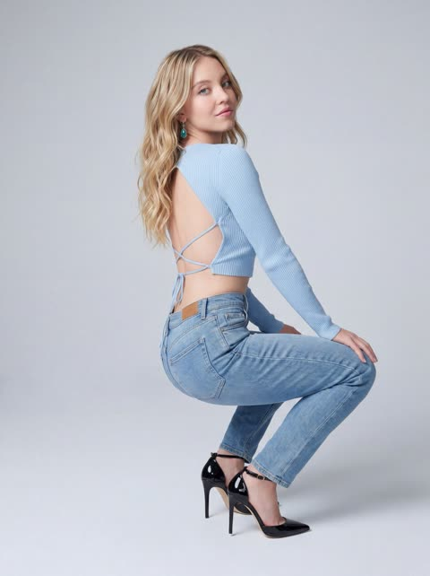</a>

结构化的 JSON 提示词把主体、服装、环境和技术参数分开描述，让每个细节都被固定下来。无缝浅灰背景、柔和漫射的棚拍光线和略低机位的中景构图，共同营造干净的棚拍写实效果。

Nano Banana 2 · 文生图 · 出处: [@Strength04_X on X](https://x.com/Strength04_X/status/2056927764549423431) · 166 赞，统计于 2026-10-29

[`json-prompt`](tags.md#tag-json-prompt) [`studio`](tags.md#tag-studio) [`fashion`](tags.md#tag-fashion) [`portrait`](tags.md#tag-portrait)

<details><summary><b>提示词</b></summary>

```text
"style": "Photorealistic fashion photography",
  "subject": {
    "name": Sydney Sweeney
    "features": "Slender, curvy, and fit physique, subtle makeup, pale pink lips, teal teardrop dangle earrings",
    "pose": "Sitting on the floor with her back to the camera, legs bent upward, looking back softly over her right shoulder with a neutral expression"
  },
  "clothing": {
    "top": "Light-blue ribbed long-sleeve cropped top with an open back and crisscross tie details",
    "bottom": "Slim-fit light-blue jeans",
    "shoes": "Black patent leather stiletto high heels with ankle straps"
  },
  "environment": {
    "setting": "Seamless light-gray studio background, minimal and distraction-free",
    "lighting": "Soft, diffused studio lighting, delicate highlights on hair and skin, subtle shadows emphasizing fabric textures"
  },
  "technical": {
    "framing": "Medium shot, positioned slightly low to emphasize the seated pose",
    "quality": "Highly detailed, sharp focus, 8k resolution, professional studio quality",
    "aspect_ratio": "9:16"
  }
}
```

</details>

<a id="nano-banana-night-triptych-smoker-convenience-store"></a>
### 夜景三联画：男子吸烟与饮用易拉罐

<a href="https://x.com/rovvmut_/status/2033793020940980720">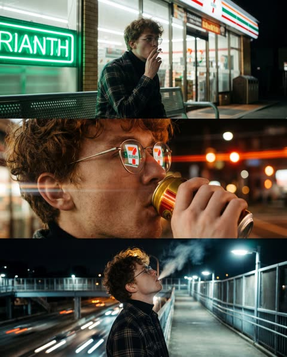</a>

将画面拆成三个分镜并分别指定景别，从中景到大特写，让模型按顺序生成。每个画面都点明光源，如绿色霓虹、荧光灯和车灯拖影，使夜景色调保持统一。

Nano Banana 2 · 文生图 · 出处: [@rovvmut_ on X](https://x.com/rovvmut_/status/2033793020940980720) · 164 赞，统计于 2026-10-29

[`triptych`](tags.md#tag-triptych) [`night`](tags.md#tag-night) [`cinematic`](tags.md#tag-cinematic) [`film-look`](tags.md#tag-film-look)

<details><summary><b>提示词</b></summary>

```text
Google Nano Banana 2 on Gemini.

Prompt: A vertical triptych of three cinematic, night-time urban photographs featuring a young man with messy, curly reddish-brown hair and thin, round wire-frame glasses.
Top Panel: The man is seated in front of a 7-Eleven storefront. He wears a dark plaid flannel shirt over a black turtleneck. He is captured in a candid moment, holding a lit cigarette to his lips. To the left, there's a vibrant green neon sign. The lighting is dominated by a cool, fluorescent green glow and the warm interior light of the convenience store.
Middle Panel: An extreme close-up profile shot. He is drinking from a gold-and-red metallic beverage can. His glasses catch a sharp, vivid reflection of the 7-Eleven logo and orange-red street lights. A subtle lens flare streaks horizontally across his face. The background is a soft, warm bokeh of city lights and traffic signals.
Bottom Panel: The man stands on a pedestrian overpass overlooking a busy highway. He has his head tilted back, exhaling a thick wisp of white smoke into the night air. Below him, the blurred streaks of white headlights and red taillights create a sense of motion. The overpass structure is lit with cool-toned industrial lamps, contrasting with his warm skin tones.
Style: 35mm film aesthetic, cinematic grain, shallow depth of field, high contrast, urban noir mood.
```

</details>

<a id="nano-banana-novel-cover-woman-reading-candlelit-room"></a>
### 烛光古董房里读黑色丝绒小说的女子

<a href="https://x.com/JuliaClarky/status/2079417419114942568"></a>

书名和作者名逐字给出并指定字体与位置，让书封文字清晰可读。烛光、古董家具和暗色花朵营造氛围，第二条提示词沿用同一书名生成配套场景。

Nano Banana 2 · 文生图 · 出处: [@JuliaClarky on X](https://x.com/JuliaClarky/status/2079417419114942568) · 159 赞，统计于 2026-10-28

[`book-cover`](tags.md#tag-book-cover) [`candlelight`](tags.md#tag-candlelight) [`vintage-room`](tags.md#tag-vintage-room) [`typography`](tags.md#tag-typography) [`cinematic`](tags.md#tag-cinematic)

<details><summary><b>提示词</b></summary>

```text
A luxurious cinematic novel cover poster featuring a beautiful young woman sitting in an elegant dimly lit vintage room, holding a premium black hardcover book in her hands while reading it. She has a captivating expression, a shy mysterious smile, and emotional eyes as she gets lost in the story. The book cover in her hands is clearly visible and features a seductive luxury design with black velvet texture, golden embossed details, deep red roses, and elegant typography. The main title on the book cover reads “HIS TEMPTATION” in a bold sophisticated serif font, and directly underneath the title it says “by Elena Voss” in a smaller elegant font. Add candlelight, antique furniture, dark flowers, dramatic shadows, cinematic lighting, high-fashion editorial style, realistic photography, ultra detailed, 8K, professional bestselling novel cover design, mysterious and intense atmosphere.

Prompt 2 — “His Temptation” Movie Scene at Home A cinematic back-view shot of a young woman sitting comfortably on a luxurious velvet sofa in her elegant living room at night. She is watching the movie adaptation of the novel “His Temptation” on a large LED screen. The camera is positioned behind her, showing her silhouette, long hair, and relaxed posture as she becomes completely absorbed in the story. The LED screen displays a dramatic romantic scene featuring the mysterious male lead and female lead from the novel. The room has warm golden lamps, candles, a large bookshelf, soft cushions, dark flowers, and a cozy luxury interior. A copy of the book “His Temptation” by Elena Voss rests on the coffee table beside her. Emotional cinematic atmosphere, realistic home setting, professional film camera shot, shallow depth of field, ultra realistic, 8K movie still quality. 🖤
```

</details>

<a id="gpt-image-tree-sun-skyline-frozen-lake"></a>
### 巨大落日前的树影与冰湖倒影

<a href="https://x.com/churvikv/status/2110114825082945740">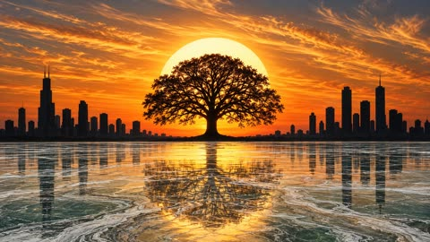</a>

提示词按天空、太阳、树、城市、水面、倒影和色板分块,每个元素都有明确的位置规则。长负面清单加上建筑不得遮挡树和太阳等限定,保住了对称构图。

GPT Image 2.5 · 文生图 · 出处: [@churvikv on X](https://x.com/churvikv/status/2110114825082945740) · 150 赞，统计于 2026-10-28

[`silhouette`](tags.md#tag-silhouette) [`sunset`](tags.md#tag-sunset) [`skyline`](tags.md#tag-skyline) [`reflection`](tags.md#tag-reflection) [`panoramic`](tags.md#tag-panoramic)

<details><summary><b>提示词</b></summary>

```text
Photorealistic silhouette sunset composite, wide 16:9 panoramic composition, cinematic, ultra-detailed. Edge to edge, no frame, no border.

SKY: the upper half is a furnace of amber, apricot and burnt gold, deepest at the horizon, cooling to smoky blue-grey at the very top. Long streaky cirrus clouds sweep diagonally across it, undersides lit gold, edges trailing thin warm wisps.

SUN: one huge perfectly round pale white-hot sun disc sits exactly at the centre of the frame just above the treeline, its rim glowing and bleeding a soft warm halo into the surrounding orange.

TREE: dead centre, in front of the sun, a single massive spreading broadleaf tree in pure black silhouette — a thick trunk flaring at the base into a rounded knoll, and a vast dense canopy of fine branch tracery and leaf clusters spreading wide and symmetrical, its edges softly dissolving into the glow.

CITY: flanking the tree, a dense skyline of black skyscraper silhouettes stands along a low ridge of rooftops. Left, a tall stepped tower with twin thin antennae, ringed by shorter blocks. Right, three dark high-rises of graduated height, one carrying a slender spire. The buildings never overlap the tree and never cross the sun.

WATER: the entire lower third is a frozen lake surface, not smooth water — a turbulent marbled expanse of glacial ice and flowed stone, banded in chalky white, sea-green, slate grey and warm tan in long swirling veins.

REFLECTION: sky, sun, tree and skyline all mirror downward into that marbled surface, broken and stretched by the ice grain. The reflected sun lies as a broad soft gold field beneath the trunk, the reflected tree spreads as a dark root-mass of branching veins below it, and the reflected towers hang as vertical dark bars, all smeared by the swirling white and green stone.

PALETTE: pure black, apricot, amber gold, burnt orange, smoky grey, chalk white, glacier green, tan. Sharp silhouette edges against soft glow, high dynamic range, clean and unmarked.

text, watermark, logo, signature, artist signature, handwritten signature, initials, monogram, date, stamp, seal, lettering of any kind, any words, digits, frame, border, picture frame, mat, bevel, molding, plaque, rectangular outline, painting, illustration, oil painting, impasto, watercolor, colored pencil, airbrush, digital art, cartoon, anime, chibi, flat 2d vector, blurry, soft focus, noisy grain, neon, fluorescent, oversaturated greens, blue midday sky, sunrise pink, purple sky, night, moon, stars, clouds covering the sun, rain, storm, lightning, snow falling, second tree, forest, multiple trees, leaves visible on tree with colour, lit windows on buildings, people, faces, birds, animals, deer, boat, ship, dock, bridge, road, cars, traffic, streetlamps, palm trees, mountains, desert, ocean waves, beach, sun cut off, tree cut off, off-centre tree, asymmetric composition
```

</details>

<a id="gpt-image-cumulus-cloud-river-reflection-countryside"></a>
### 乡村河流中倒映的积云与小教堂

<a href="https://x.com/churvikv/status/2095472478340468762">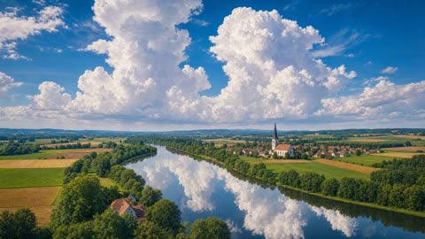</a>

提示词按环境、光线、材质、构图分块，并在每块里写明要避免的内容，如过曝的白色和占据画面的道路。高空俯视视角加上 S 形河道，把云的倒影托成画面主角。

GPT Image 2 · 文生图 · 出处: [@churvikv on X](https://x.com/churvikv/status/2095472478340468762) · 148 赞，统计于 2026-10-29

[`landscape`](tags.md#tag-landscape) [`clouds`](tags.md#tag-clouds) [`reflection`](tags.md#tag-reflection) [`aerial-view`](tags.md#tag-aerial-view) [`countryside`](tags.md#tag-countryside)

<details><summary><b>提示词</b></summary>

```text
A painterly, highly detailed landscape scene with a luminous blue summer sky dominated by towering white cumulus clouds, rendered in a romantic fine-art campaign style. The hero is the dramatic cloud formation and its near-symmetrical reflection in a calm winding river, with patchwork farmland, dense green trees, and a small village church adding scale and pastoral elegance.

Environment:
• Elevated panoramic view over a rural countryside with a broad horizon line
• Massive vertical cloud towers filling most of the upper frame, clustered and sculptural, with soft lavender-gray shading in their interiors
• A reflective river curves through the center of the landscape, mirroring the clouds almost perfectly
• Surrounding fields in green, tan, and muted gold arranged in large geometric plots
• Dense tree lines along the riverbanks, with a few small red-roofed buildings near the water
• A church with a tall dark spire and pale walls positioned right of center in the mid-distance
• Avoid urban elements, roads dominating the frame, modern infrastructure, and visual clutter

Lighting:
• Bright daytime sunlight with crisp atmospheric clarity
• Soft but defined illumination across the clouds, emphasizing volume and height
• Even landscape exposure with gentle contrast and clear reflections in the water
• No harsh blown-out whites, no muddy shadows, no dramatic sunset tones

Materials:
• Billowing cloud masses with soft, cotton-like texture and subtle cool-shadow coloration
• Glassy river surface with mirror-like reflection and slight natural softness
• Organic tree canopies, cultivated farmland textures, stucco walls, dark church spire, clay-tile rooftops

Composition:
• Vertical aspect ratio
• High aerial or hilltop viewpoint looking slightly downward across the valley
• River forms a strong S-curve leading from foreground to mid-ground
• Cloud reflection occupies the lower center, echoing the cloud mass above
• Church and village serve as secondary focal
```

</details>

<a id="nano-banana-retro-kitchen-tiramisu-fashion"></a>
### 复古厨房里手持提拉米苏的金发模特

<a href="https://x.com/KeorUnreal/status/2110467656272728546">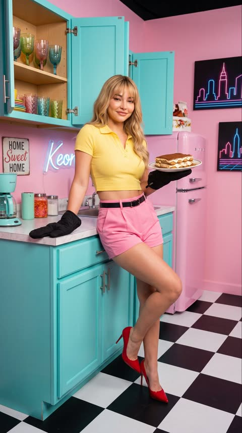</a>

将提示词拆分为主体、服装、布景、灯光和镜头等模块，让每个元素都明确具体。略低角度的全身取景加上指定的配色，让复古厨房风格保持统一。

Nano Banana 2.1 · 文生图 · 出处: [@KeorUnreal on X](https://x.com/KeorUnreal/status/2110467656272728546) · 142 赞，统计于 2026-10-29

[`json-prompt`](tags.md#tag-json-prompt) [`retro-kitchen`](tags.md#tag-retro-kitchen) [`fashion`](tags.md#tag-fashion) [`tiramisu`](tags.md#tag-tiramisu)

<details><summary><b>提示词</b></summary>

```text
{
  "subject": {
    "description": "Young woman with fair skin, long wavy blonde hair with bangs, soft smile, looking toward the camera",
    "hair": "Long wavy blonde hair with curtain bangs, falling over the shoulders",
    "body": "Curvy, athletic figure",
    "pose": "Leaning against a kitchen counter, one leg crossed in front of the other, one hand resting on the counter, the other holding a tiramisù",
    "expression": "Friendly, slight smile, direct gaze"
  },
  "outfit": {
    "top": "yellow short-sleeve cropped polo shirt",
    "bottom": "Pink high-waisted shorts with a black belt",
    "footwear": "Red pointed stiletto heels",
    "accessories": "Black oven mitts on both hands"
  },
  "props": {
    "item": "Freshly tiramisu held on a plate in one hand"
  },
  "setting": {
    "location": "Retro-style kitchen",
    "background": "Pink walls, turquoise open cabinets filled with colorful glassware, pink refrigerator, black-and-white checkered floor, 'Home Sweet Home' signs, neon city skyline artwork",
    "added_element": "Neon writing reading 'Keor' glowing in the backdrop"
  },
  "lighting": {
    "type": "Bright, even indoor lighting with a playful retro feel",
    "effects": "Clean highlights on skin and clothing, colorful kitchen surfaces, soft neon glow from the 'Keor' sign"
  },
  "camera": {
    "angle": "Slightly low full-body angle",
    "framing": "Full-body shot, subject centered in the kitchen",
    "style": "Photorealistic, high-detail fashion photography, sharp focus"
  },
  "additional_details": {
    "skin": "Smooth with a natural sheen",
    "atmosphere": "Playful, colorful retro kitchen scene"
  }
}
```

</details>

<a id="gpt-image-floating-library-above-clouds"></a>
### 云海之上漂浮的图书馆与飘动的书籍

<a href="https://x.com/JuliaClarky/status/2078149885413801993">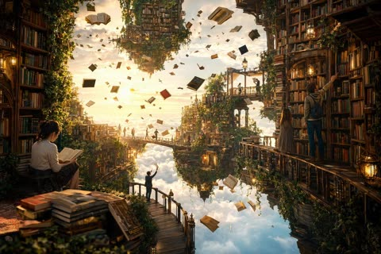</a>

用具体结构（由木桥和玻璃走道相连的漂浮岛屿）和单一光源（黄金时刻、体积光）为模型提供空间逻辑。负面提示词排除重复书籍和透视变形，这是密集书架场景最常见的出错点。

GPT Image 2 · 文生图 · 出处: [@JuliaClarky on X](https://x.com/JuliaClarky/status/2078149885413801993) · 140 赞，统计于 2026-10-29

[`fantasy`](tags.md#tag-fantasy) [`library`](tags.md#tag-library) [`golden-hour`](tags.md#tag-golden-hour) [`cinematic`](tags.md#tag-cinematic)

<details><summary><b>提示词</b></summary>

```text
Inside the same ultra-realistic floating library above the clouds, surrounded by endless white clouds glowing in the golden evening light. Thousands of magical books drift gently through the air while people quietly browse the bookshelves in the background. In the foreground, a beautiful young woman wearing a flowing light-blue chiffon dress sits comfortably on a cozy reading sofa beside a large floor-to-ceiling library window overlooking the clouds. She is reading Pride and Prejudice aloud from an elegant hardcover edition with a soft smile. Sitting beside her is a young man, completely captivated—not by the book, but by her. He looks at her with genuine affection, admiration, and warmth, smiling softly as she reads. Their body language is natural, intimate, and peaceful, conveying quiet love without exaggeration. Nearby, a small wooden table holds tea and bookmarks, while glowing pages and golden particles drift gently around them. The library is filled with books of every genre, creating a magical yet believable atmosphere. Ultra-realistic human expressions, cinematic storytelling, HDR, 8K, masterpiece, DSLR photography, volumetric lighting, natural color grading, National Geographic realism, fantasy blended with realism, dreamy, cozy, and emotionally rich. Negative Prompt: Low quality, blurry, cartoon, anime, CGI, painting, watermark, text, logo, deformed faces, bad anatomy, extra fingers, duplicate people, unrealistic expressions, empty bookshelves, oversaturated colors, artifacts, cropped, out of frame, low resolution.
```

</details>

<a id="gpt-image-neon-yacht-moonlit-harbour-reflections"></a>
### 月夜港湾中的霓虹游艇

<a href="https://x.com/churvikv/status/2109710598972035578"></a>

提示词按港口、月亮、游艇、山丘、小镇、倒影、色板分成带标签的段落，每个元素都有固定位置和颜色。单独的倒影段落规定了游艇下方的洋红与青色色带和其余水面的琥珀色光柱，水面因此呈现丝带般的效果。

GPT Image 2.5 · 文生图 · 出处: [@churvikv on X](https://x.com/churvikv/status/2109710598972035578) · 127 赞，统计于 2026-10-28

[`night-scene`](tags.md#tag-night-scene) [`harbour`](tags.md#tag-harbour) [`neon`](tags.md#tag-neon) [`reflections`](tags.md#tag-reflections) [`panoramic`](tags.md#tag-panoramic)

<details><summary><b>提示词</b></summary>

```text
Photorealistic night harbour scene, wide 16:9 panoramic composition, cinematic, ultra-detailed. Edge to edge, no frame, no border.

HARBOUR: the lower half is calm black water rippling in fine horizontal chop, carrying long smeared vertical reflections that stretch down the frame.

MOON: high in the upper middle of the deep navy night sky hangs one enormous, sharply detailed full moon, its craters crisp, ringed by a soft cool blue-white halo. The sky is darkest at the top corners, paling slightly toward the horizon.

BOAT: just left of centre sits a sleek modern white motor yacht at rest, seen broadside from the front-left. Its flanks are washed in vivid neon ultraviolet magenta along the hull and glowing electric cyan along the upper deck and railings, with a dark tinted glass bridge, a radar mast, a blue-lit stern platform and a line of small dark portholes.

HILLS: behind, layered dark ridgelines rise across the full width, their slopes dotted with scattered warm gold lights of hillside villas and small windows.

TOWN: along the water's edge runs a continuous waterfront promenade of low pale buildings with warm golden lit façades, arcades, windows and streetlamps. A row of moored white boats and small yachts lines the quay in dark silhouette.

REFLECTIONS: the water is split into ribbons of colour. Directly beneath the yacht run two bold vertical bands — bright magenta and electric cyan — vivid and saturated, broken into short ripples. Across the rest of the surface, the town lights throw long warm amber and orange columns, with cooler teal and deep green streaks threading between them in the lower right.

PALETTE: deep navy, near-black water, brilliant magenta, electric cyan, warm amber gold, teal green, silver-white moon. Sharp focus, high dynamic range, glossy wet highlights, clean and unmarked.
```

</details>

<a id="nano-banana-kfc-bag-head-wink-booth"></a>
### 女子头顶肯德基纸袋眨眼嘟嘴

<a href="https://x.com/john_my07/status/2051611199582937536">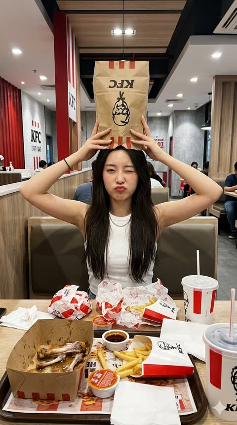</a>

提示词以参考照片锁定人物身份，并逐项写明姿势、服装和餐桌物品，使主体与杂乱的快餐桌面保持一致。要求原始 iPhone 质感且不加美颜，有助于保留自然肤质和顶光效果。

Nano Banana 2 · 上传图改图 · 出处: [@john_my07 on X](https://x.com/john_my07/status/2051611199582937536) · 123 赞，统计于 2026-10-29

[`kfc`](tags.md#tag-kfc) [`iphone-style`](tags.md#tag-iphone-style) [`reference-identity`](tags.md#tag-reference-identity) [`fast-food`](tags.md#tag-fast-food)

<details><summary><b>提示词</b></summary>

```text
Ultra-realistic iPhone-style photo set inside a KFC fast-food restaurant, maintaining the subject’s identity exactly as in the reference image.
A young Korean woman is seated in a booth, captured from across the table with a slightly wide, casual iPhone perspective. She sits centered in frame, leaning back comfortably while a messy spread of fast food fills the foreground.
Pose & expression:
She’s holding a brown KFC paper bag on top of her head with both hands, elbows lifted outward. Her expression is playful and a bit cheeky, one eye closed in a wink, lips slightly pouted, giving a mock-annoyed yet cute vibe.
Outfit & styling:
She wears a fitted white sleeveless top, with long, dark flowing hair. Minimal accessories like a thin necklace or chain. Long, well-manicured nails. Overall look is casual, clean, and effortlessly stylish.
Table setup:
The table in front is cluttered with KFC-style items, fried chicken buckets, fries, wrappers, branded paper cups with straws, dipping sauces, napkins, tray liner with colorful illustrated graphics, and a crumpled takeaway bag. The arrangement feels natural, slightly chaotic, like mid-meal.
Environment:
Modern KFC interior with a mix of white tiles and darker textured walls, subtle branding or typography on the walls, booth seating, and a few tables or stools visible in the background. Typical fast-food ambiance.
Camera & lighting:
Shot like a raw iPhone photo, slightly wide lens distortion, overhead indoor lighting that creates mild shadows, unfiltered and authentic. Feels like a spontaneous social media snap rather than a staged shoot.
Important details:
Keep the booth framing, bag-on-head pose, wink + pout expression, white sleeveless outfit, and messy fast-food spread consistent. Focus on realism, natural skin texture, accurate food packaging, no smoothing or beauty filters.
Format: 4K resolution, vertical aspect ratio.
```

</details>

<a id="nano-banana-kinder-joy-egg-swing-chair"></a>
### 女子坐在巨型 Kinder Joy 蛋形秋千椅中

<a href="https://x.com/HaniaAi12/status/2028673990672216202">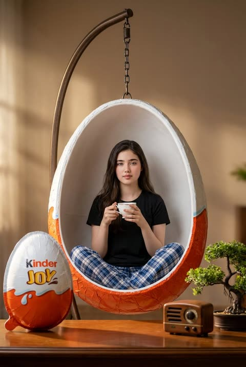</a>

提示词用明确的左右位置标注每个道具，并固定单一光源方向，让场景层次清晰。上传的人脸参考图配合固定的服装和姿势，保证人物形象一致。

Nano Banana 2 · 上传图改图 · 出处: [@HaniaAi12 on X](https://x.com/HaniaAi12/status/2028673990672216202) · 119 赞，统计于 2026-10-29

[`surreal`](tags.md#tag-surreal) [`scale`](tags.md#tag-scale) [`face-reference`](tags.md#tag-face-reference) [`kinder-joy`](tags.md#tag-kinder-joy)

<details><summary><b>提示词</b></summary>

```text
A hyper-realistic, 8k, medium shot photograph captured with a standard lens and shallow depth of field, showcasing a surreal indoor scene with cinematic lighting. The composition features a normal-sized woman, using the uploaded face as reference, sitting cross-legged inside a colossal, highly detailed Kinder Joy egg that functions as a swing chair. The giant egg is split, with its white interior forming the seat and the orange, textured exterior visible, suspended by dark metal chains from a curved, dark metal stand.

The woman wears a black t-shirt and blue and white plaid pajama pants, holding a small white teacup with both hands, looking directly at the viewer with a calm and relaxed expression.

To the left in the foreground, on a highly detailed polished wooden table, stands another gigantic, fully wrapped Kinder Joy egg, exhibiting intricate foil texture and branding. To the right of the swing's base, also on the table, are miniature props: a vintage-style wooden radio with white dials and a tiny bonsai tree in a small pot.

The lighting is soft, warm, and directional from the left, casting subtle shadows and highlighting the highly detailed textures of the egg wrappers, the woman’s clothing, and the wooden surface. The background is a softly blurred, warm-toned interior wall, creating a pleasing bokeh effect.
```

</details>

<a id="nano-banana-leopard-swimsuit-disco-cube"></a>
### 豹纹泳装女子站在迪斯科方块上

<a href="https://x.com/KeorUnreal/status/2114097366823551024">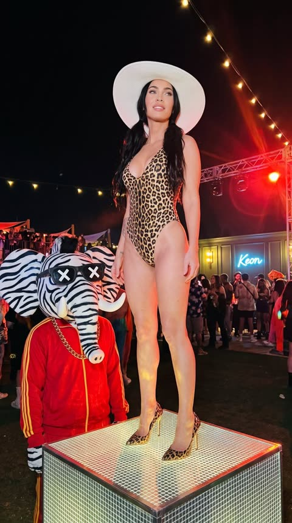</a>

结构化 JSON 把主体、服装、场景、灯光和镜头分成独立字段，让每个元素都保持可控。低角度全身构图加上暖色串灯高光，营造真实的夜间活动摄影质感。

Nano Banana 2.1 · 文生图 · 出处: [@KeorUnreal on X](https://x.com/KeorUnreal/status/2114097366823551024) · 118 赞，统计于 2026-10-29

[`json-prompt`](tags.md#tag-json-prompt) [`low-angle`](tags.md#tag-low-angle) [`night-event`](tags.md#tag-night-event) [`photorealistic`](tags.md#tag-photorealistic)

<details><summary><b>提示词</b></summary>

```text
{
 "subject": {
 "description": "Young woman with fair skin, long black hair, looking slightly upward with a soft expression",
 "hair": "Long wavy black hair ponytail falling over her shoulders",
 "body": "Slender yet curvy figure",
 "pose": "She's on top of a disco cube, Standing upright, arms relaxed at her sides, body facing slightly to the side",
 "expression": "Calm, slightly smiling gaze"
 },
 "outfit": {
 "swimsuit": "leopard one-piece swimsuit with a deep neckline and high-cut legs",
 "headwear": "Large white wide-brim hat",
 "footwear": "Leopard glossy high heels"
 },
 "secondary_subject": {
 "description": "Person in an electric zebra elephant mascot head with white tusks, black sunglasses featuring a white X, wearing a red tracksuit jacket with yellow stripes and a large gold chain",
 "placement": "Standing to the left of behind the woman, partially in the foreground under the disco cube"
 },
 "setting": {
 "location": "Outdoor night event or party",
 "background": "Dark sky, string lights overhead, red and yellow ambient lighting, distant crowd and structures",
 "added_element": "Neon disco-style writing reading 'Keor' glowing in the backdrop"
 },
 "lighting": {
 "type": "Nighttime event lighting with string lights and neon glow",
 "effects": "Warm string-light highlights on skin and clothing, colorful neon illumination from the 'Keor' sign"
 },
 "camera": {
 "angle": "Low angle looking up at the standing subjects",
 "framing": "Full-body shot of the woman with the elephant mascot beside her",
 "style": "Photorealistic, high-detail event photography, sharp focus"
 },
 "additional_details": {
 "skin": "Smooth with a natural night-event sheen",
 "atmosphere": "Playful nighttime party scene with a mascot"
 }
}
```

</details>

<a id="nano-banana-white-convertible-mediterranean-portrait"></a>
### 男子倚靠白色敞篷车，站在地中海海岸边

<a href="https://x.com/pictsbyai/status/2052064741917417687">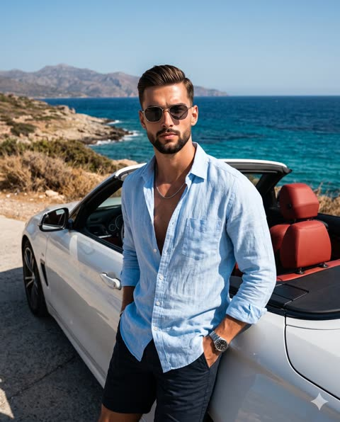</a>

以相机和光线参数（ISO 100、1/1000秒快门、5500K色温、f/8至f/11光圈、正面平拍）叠加精确的人物姿势描述，使画面呈现清晰的日间摄影质感。由近及远依次描述车身、灌木与海面，引导视线穿过画面纵深。

Nano Banana 2 · 文生图 · 出处: [@pictsbyai on X](https://x.com/pictsbyai/status/2052064741917417687) · 114 赞，统计于 2026-10-29

[`lifestyle`](tags.md#tag-lifestyle) [`car`](tags.md#tag-car) [`mediterranean`](tags.md#tag-mediterranean) [`portrait`](tags.md#tag-portrait)

<details><summary><b>提示词</b></summary>

```text
A confident young adult male stands posed in a relaxed, leaning posture on the right side of the frame, facing the camera with shifted weight and relaxed shoulders, wearing an unbuttoned light blue linen shirt with deep folds, dark shorts, a silver chain necklace, a wristwatch with a dark strap, and metal-framed sunglasses that shield his direct, serious gaze. His expression features a neutral mouth and relaxed eyebrows, projecting a cool, polished demeanor with warm tan skin. His left hand rests casually inside the left pocket of his shorts, with the thumb exposed and securely hooked over the pocket edge. His right hand leans gently against the pristine white exterior of a car body just below the door line, the tension relaxed with fingers curled downward naturally, clearly exposing the resting index and middle fingers. He interacts seamlessly with this dominant foreground element, a pristine white BMW convertible parked on solid light grey concrete, featuring an open dropped top, deep red leather seats, chrome accents, and a black steering wheel. The eye follows an asymmetric visual hierarchy starting from his face, moving down the clear blue shirt to the deep red car interior, before sweeping out to the deep spatial environment. The midground on the right is framed by weathered, dry green and brown scrub brush gripping rugged coastal rocks, dropping off to a background of deep ocean blue water that lightens into turquoise shallows near the coast. In the far left distance, a faint mountainous silhouette anchors the horizon beneath a perfectly smooth, clear bright blue gradient sky accented by a single small white cloud on the far left. A luxurious, breezy Mediterranean summer atmosphere envelops the scene, defined by an energetic, highly saturated, high-contrast split-complementary color palette. Hard, bright, highly directional natural sunlight streams from the top front-left, casting deep black, harsh-edged short shadows tucked beneath the subject's chin, nestled within the folds of his shirt, inside the car's interior, and beneath the side mirror. In stark contrast, brilliant specular highlights gleam across the car's paint, as well as on the subject's forehead, nose, and the tops of his shoulders, blending cool overall temperatures with warm sunlight accents. Captured straight-on through the lens of modern digital photography at ISO 100 with a fast 1/1000s shutter speed and a daylight white balance of 5500K, the realistic, clean image boasts a tack-sharp, grain-free texture and a deep depth of field from f/8.0 to f/11 that keeps every distant landscape detail perfectly in focus. The aesthetic draws heavily from contemporary social media and automotive lifestyle modeling, refined in post-processing with a high contrast curve, boosted saturation in the blue and red channels, enhanced clarity, and careful highlight protection for the white exterior, all perfectly framed in a 4:5 aspect ratio.
```

</details>

<a id="nano-banana-woman-painting-fiance-studio"></a>
### 女子作画，未婚夫在身后凝望

<a href="https://x.com/JuliaClarky/status/2069993197015814486"></a>

提示词按主体、服装、道具、同伴的顺序描述，再加入镜头和风格段落。镜头段指定中景侧角与浅景深，风格段固定光线与调色。

Nano Banana 2 · 文生图 · 出处: [@JuliaClarky on X](https://x.com/JuliaClarky/status/2069993197015814486) · 111 赞，统计于 2026-10-29

[`photorealism`](tags.md#tag-photorealism) [`lifestyle`](tags.md#tag-lifestyle) [`soft-lighting`](tags.md#tag-soft-lighting) [`camera-angle`](tags.md#tag-camera-angle)

<details><summary><b>提示词</b></summary>

```text
Ultra-realistic cinematic photography, 8K, warm natural lighting, cozy artistic atmosphere. A beautiful young woman is deeply focused on painting in her private art studio-bedroom. She wears a simple oversized white T-shirt and a flowing skirt, creating a comfortable and creative look. Large studio headphones cover her ears as she becomes completely immersed in her artwork.

Her hair is stunning—long, voluminous, wavy layers with a professional layered haircut, soft strands naturally framing her face. She holds a painter's palette filled with vibrant colors in one hand while carefully painting on a large canvas with the other. Her expression shows concentration, passion, and peace.

The room is clearly her personal creative space, filled with canvases, paintbrushes, sketchbooks, art supplies, books, fairy lights, indoor plants, and framed artwork on the walls. Soft sunlight streams through a nearby window, illuminating floating dust particles and creating a dreamy artistic ambiance.

Standing slightly behind her is her fiancé, dressed casually and elegantly. He isn't interrupting her work; instead, he watches her with genuine admiration and affection. His eyes are full of pride, warmth, and love as he quietly observes her doing what she loves. His body language is gentle and supportive, as if he finds joy simply in seeing her happy and creating.

The interaction feels natural and candid rather than posed—a quiet moment of love, respect, and admiration between two people.

Camera: Medium-wide cinematic shot, slightly side angle, both subjects visible, shallow depth of field, soft bokeh background, natural composition.

Style: Ultra-realistic, photorealistic, cinematic storytelling, luxury lifestyle photography, magazine-quality image, realistic skin textures, detailed fabric folds, volumetric sunlight, warm color grading, emotional atmosphere, masterpiece, 8K HDR, highly detailed, no text, no watermark.
```

</details>

<a id="nano-banana-mountain-cabin-coffee-retreat"></a>
### 山间小屋窗边冒着热气的咖啡杯

<a href="https://x.com/kellyyjjones/status/2078710249750769810">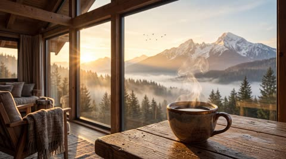</a>

用一个主体放在分层的远景前，并指定镜头和机身参数（85mm、ARRI Alexa 65、浅景深），把画面推向照片级商业摄影。负面提示词排除人物和文字，让咖啡杯保持唯一焦点。

Nano Banana 2 · 文生图 · 出处: [@kellyyjjones on X](https://x.com/kellyyjjones/status/2078710249750769810) · 106 赞，统计于 2026-10-29

[`coffee`](tags.md#tag-coffee) [`mountain`](tags.md#tag-mountain) [`cinematic-lighting`](tags.md#tag-cinematic-lighting) [`lifestyle`](tags.md#tag-lifestyle)

<details><summary><b>提示词</b></summary>

```text
PHOTO 1 — Mountain Cabin Coffee Retreat

Ultra-realistic cinematic luxury coffee commercial. A cozy Scandinavian-style wooden cabin sits dramatically on a peaceful mountain cliff during golden sunrise. In the foreground, a handcrafted ceramic coffee cup filled with freshly brewed coffee rests on an aged rustic wooden table beside an expansive floor-to-ceiling panoramic window. Delicate steam curls naturally upward, illuminated by warm sunlight streaming through the glass.

Outside, endless pine forests emerge from layers of soft morning mist while majestic snow-capped mountain peaks glow beneath the first light of day. Tiny dew droplets sparkle across the wooden surface, catching golden highlights. Birds drift gracefully across the luminous sky as gentle wind moves distant treetops.

Camera performs a slow cinematic push-in toward the coffee cup, creating a feeling of warmth, comfort, and luxury. Volumetric sun rays, realistic atmospheric haze, HDR lighting, global illumination, ray-traced reflections, physically accurate materials, shallow depth of field, creamy bokeh, cinematic contrast, warm premium color grading, ARRI Alexa 65, 85mm lens, ultra-detailed textures, photorealistic commercial photography, luxury lifestyle advertising, 8K masterpiece quality.

Negative Prompt: people, human presence, text, captions, watermark, logo, low resolution, oversaturation, distortion, artifacts, duplicate objects, blur, noise, unrealistic lighting.

PHOTO 2 — Alpine Lake Coffee Escape

Ultra-realistic cinematic luxury coffee commercial. The exact same handcrafted ceramic coffee cup from Photo 1 sits on a weathered wooden deck overlooking a crystal-clear emerald alpine lake during golden sunrise, maintaining identical visual identity, color palette, and premium branding aesthetic.

Gentle steam rises naturally from the coffee while soft morning fog glides across the lake surface. Dense pine forests surround the shoreline, leading toward towering snow-covered mountains glowing in warm sunlight. A cozy wool blanket and an open book rest beside the cup, suggesting peaceful morning relaxation. Wildflowers bloom around the deck, gently swaying in a light breeze. Birds soar across the sky while sunlight creates shimmering reflections on the calm water.

Camera performs a slow cinematic orbit around the coffee cup, revealing the breathtaking landscape while keeping the cup as the hero subject. Warm volumetric sunlight, realistic atmospheric depth, HDR, global illumination, ray-traced reflections, physically accurate materials, shallow depth of field, luxury travel-commercial aesthetic, ARRI Alexa 65, 85mm lens, cinematic bokeh, ultra-photorealistic textures, premium color grading matching Photo 1, 8K masterpiece quality.

Negative Prompt: people, human presence, text, captions, watermark, logo, low resolution, distortion, blur, noise, unrealistic reflections, artifacts, duplicate objects, oversharpening.
```

</details>

<a id="nano-banana-paris-flag-miniature-city-diorama"></a>
### 巴黎旗帜幻化成的微缩地标城市

<a href="https://x.com/Sheldon056/status/2034418908506296520">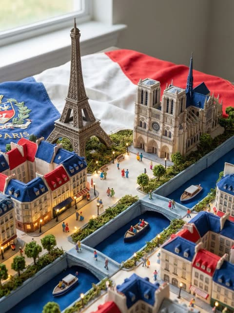</a>

用方括号 [PARIS] 做占位词，可替换成任意国家或城市的旗帜。相机机身、镜头、光圈和光线方向锁定写实质感，旗帜布料变成建筑加上微缩游客，带来超现实的尺度感。

Nano Banana 2 · 文生图 · 出处: [@Sheldon056 on X](https://x.com/Sheldon056/status/2034418908506296520) · 106 赞，统计于 2026-10-28

[`miniature`](tags.md#tag-miniature) [`diorama`](tags.md#tag-diorama) [`flag`](tags.md#tag-flag) [`landmark`](tags.md#tag-landmark) [`photorealistic`](tags.md#tag-photorealistic)

<details><summary><b>提示词</b></summary>

```text
Google Nano Banana 2 on Gemini.

Prompt: Photorealistic hero product photography shot on Sony A7III with 85mm f/1.4 lens at f/2.8, soft natural daylight from upper left creating gentle realistic shadows and visible surface textures: A cutaway [PARIS] flag ingeniously transformed into a luxurious miniature landmark city. The fabric forms iconic buildings, rivers, and glowing streets. Miniature visitors in tiny colorful clothes explore monuments, ride boats, and take photos. Intricate details, physically plausible yet surreal. Shot for a luxury architecture magazine cover, ultra-detailed 8K, perfectly centered square composition, aspect ratio 1:1, no text, no artifacts.
```

</details>

<a id="nano-banana-mexico-fan-stadium-vip-portrait"></a>
### 墨西哥球迷在满座球场举国旗

<a href="https://x.com/SimplyAnnisa/status/2067601264557609050"></a>

通过固定镜头（85mm f/1.8）、光线（照在脸上的黄金时段光）和前景站位，让身后的人群与记分牌保持柔焦。明确列出球衣、国旗和红色发饰等具体道具，为模型提供可稳定呈现的锚点。

Nano Banana 2 · 文生图 · 出处: [@SimplyAnnisa on X](https://x.com/SimplyAnnisa/status/2067601264557609050) · 104 赞，统计于 2026-10-29

[`portrait`](tags.md#tag-portrait) [`stadium`](tags.md#tag-stadium) [`golden-hour`](tags.md#tag-golden-hour) [`sports`](tags.md#tag-sports)

<details><summary><b>提示词</b></summary>

```text
Ultra-realistic cinematic photograph of a young Mexican female football fan posing in the VIP stands of a completely packed football stadium during a Mexico National Team match, captured in a vertical 9:16 format.

The young woman is in the foreground, looking directly at the camera with a sweet, natural smile, expressing joy and youthful energy. She has fair, radiant skin with realistic texture, delicate facial features, large warm brown eyes, naturally pink lips, soft "no-makeup makeup" style cosmetics, and slightly blushed cheeks.

She has long, thick, wavy hair reaching her waist in a rich chocolate brown color with subtle caramel highlights and balayage. Soft strands frame her face, while her silky hair flows naturally in the breeze. A small satin red bow sits on top of her hair, adding a youthful and feminine touch.

She is wearing the official black Mexico National Team jersey with emerald green details on the collar and sleeves, featuring a fitted athletic cut, paired with high-waisted black shorts.

She holds a Mexican flag in her left hand, clearly displaying its vibrant green, white, and red colors with the national emblem accurately visible.

She is leaning casually against a metal railing in the upper VIP section of the stadium.

In the background, a brightly illuminated professional football pitch is visible, surrounded by thousands of fans dressed in green, countless Mexican flags waving throughout the stands, a festive and patriotic atmosphere, a distant electronic scoreboard, and the modern stadium architecture featuring a monumental curved roof.

Natural golden-hour sunset lighting softly illuminates her face, creating delicate shadows and a warm cinematic glow. The image features a shallow depth of field with a subtly blurred background, soft crowd bokeh, vibrant yet realistic colors, and an editorial sports photography aesthetic.

Centered composition, shot with an 85mm f/1.8 lens, razor-sharp focus on the eyes, highly realistic skin, hair, and fabric textures, professional photographic quality, natural HDR, ultra-detailed, photorealistic, 8K UHD, masterpiece, realistic lighting, cinematic atmosphere, premium sports editorial photography, joyful Mexican football fan celebrating her team, authentic stadium energy, highly detailed crowd, realistic body proportions, and a natural pose.
```

</details>

<a id="gpt-image-milan-duomo-rain-floating-iphones-fashion"></a>
### 雨中米兰大教堂前，女子伸手够漂浮的蓝色手机

<a href="https://x.com/Arzoo12sh/status/2102710718302966229">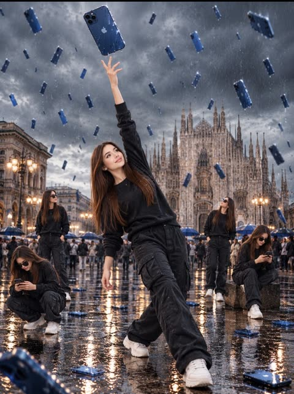</a>

用具体地标和天气锁定场景，再逐件列出服装，让穿搭描述更具体。要求背景中出现重复人物并采用竖构图，营造多层次的广告大片效果。

GPT Image 2.5 · 文生图 · 出处: [@Arzoo12sh on X](https://x.com/Arzoo12sh/status/2102710718302966229) · 102 赞，统计于 2026-10-29

[`fashion`](tags.md#tag-fashion) [`milan`](tags.md#tag-milan) [`rain`](tags.md#tag-rain) [`campaign`](tags.md#tag-campaign)

<details><summary><b>提示词</b></summary>

```text
A cinematic ultra-realistic fashion campaign in Piazza del Duomo, Milan, during heavy rain. A beautiful young woman wearing an all-black oversized streetwear outfit, black cargo pants, black sweatshirt and clean white sneakers, confidently posing in the center with one arm raised toward a floating blue iPhone. Multiple identical blue smartphones are dramatically floating and falling from the stormy sky around her. Wet reflective pavement, realistic rain droplets, dramatic dark cloudy sky, Milan Cathedral clearly visible in the background, crowded tourists with umbrellas, several duplicate versions of the same woman naturally positioned in the background, premium luxury advertising aesthetic, dynamic fashion photography, realistic skin texture, natural anatomy, cinematic lighting, sharp details, depth of field, photorealistic, high-end commercial campaign, vertical composition.
```

</details>

<a id="nano-banana-upside-down-woman-neon-korean-street"></a>
### 霓虹雨街上倒挂天空的女子

<a href="https://x.com/iamsofiaijaz/status/2041558867897938137">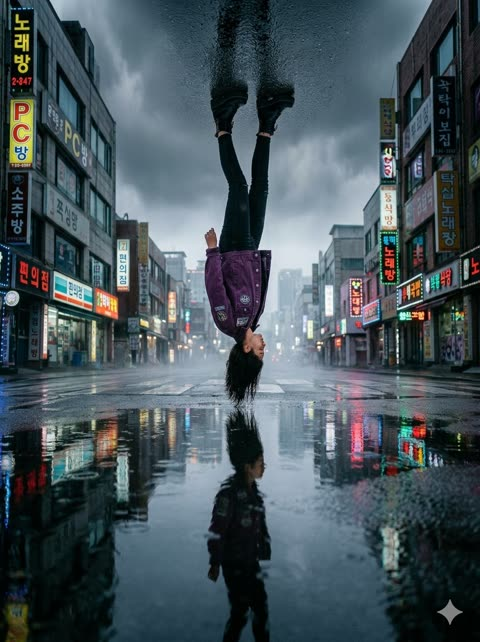</a>

提示词直接描述倒置构图：脚踩顶部沥青天花板，下半部是街道。再用水坑倒影、薄雾和霓虹招牌增加层次，最后补上镜头与画幅参数。

Nano Banana 2 · 文生图 · 出处: [@iamsofiaijaz on X](https://x.com/iamsofiaijaz/status/2041558867897938137) · 102 赞，统计于 2026-10-28

[`surreal`](tags.md#tag-surreal) [`neon`](tags.md#tag-neon) [`rainy-street`](tags.md#tag-rainy-street) [`reflection`](tags.md#tag-reflection) [`cinematic`](tags.md#tag-cinematic)

<details><summary><b>提示词</b></summary>

```text
A surreal, cinematic full-body shot of a woman wearing a purple denim jacket and black jeans, appearing to hang upside down from the sky. Her feet are firmly touching a dark, wet asphalt surface that forms the "ceiling" at the top of the frame. The bottom half of the image features a glowing, rain-slicked city street with vibrant neon Korean storefront signs, reflecting her perfectly in the deep puddles. The atmosphere is moody and overcast with thick mist and high contrast lighting. 8k resolution, photorealistic, shot on a 35mm lens, 3:4 aspect ratio.
```

</details>

<a id="nano-banana-woman-soda-can-foam-splash"></a>
### 女子开启汽水罐喷出泡沫

<a href="https://x.com/oye_samia/status/2053698484130447722">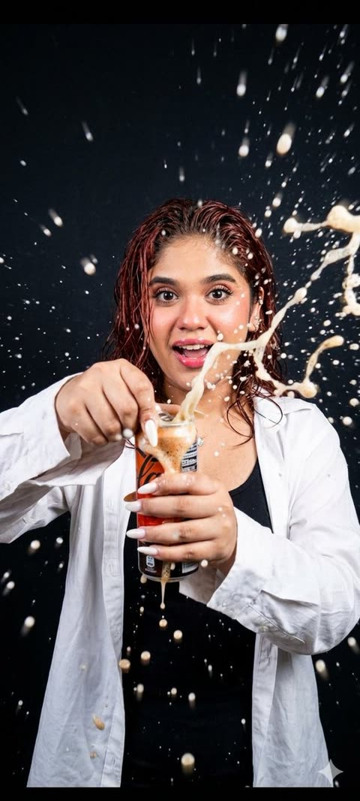</a>

深色无缝背景配合强烈闪光灯突出主体并凝固空中的水滴，12mm 超广角镜头让飞溅物朝镜头方向延伸形成纵深感。提示词直接写明镜头与凝固动态，便于模型还原拍摄方式。

Nano Banana 2 · 文生图 · 出处: [@oye_samia on X](https://x.com/oye_samia/status/2053698484130447722) · 100 赞，统计于 2026-10-29

[`soda`](tags.md#tag-soda) [`splash`](tags.md#tag-splash) [`wide-angle`](tags.md#tag-wide-angle) [`action-shot`](tags.md#tag-action-shot)

<details><summary><b>提示词</b></summary>

```text
bright advertising action shot, dark seamless background, harsh flash, high-speed liquid photography, SUPER wide-angle 12mm lens, beautiful brunette shaking and opening a soda can, powerful jet of liquid with splashes and foam bursting out in a long arc, droplets frozen in the air, large splashes and drops flying straight toward the camera, some motion blur
```

</details>

<a id="nano-banana-gym-three-panel-collage"></a>
### 健身房三联画：背影、镜前展示与喘息

<a href="https://x.com/MrDasCreates/status/2040293909713359284">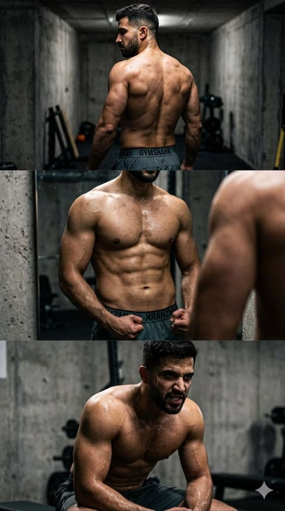</a>

将画面拆成三个机位（背影、镜前展示、低角度喘息），形成叙事变化；同一个强硬主光在各面板重复出现，让三联画保持统一。

Nano Banana 2 · 文生图 · 出处: [@MrDasCreates on X](https://x.com/MrDasCreates/status/2040293909713359284) · 91 赞，统计于 2026-10-29

[`fitness`](tags.md#tag-fitness) [`collage`](tags.md#tag-collage) [`portrait`](tags.md#tag-portrait) [`gym`](tags.md#tag-gym)

<details><summary><b>提示词</b></summary>

```text
A cinematic three-panel vertical collage featuring a fit young man in a dark underground gym, shirtless, wearing black Gymshark athletic shorts. In the top panel, he is captured from behind, standing under a single dim overhead light, revealing a deeply defined back and shoulders with shadows cutting across his muscles. In the middle panel, he faces forward in a mirror, performing a slow controlled flex, showcasing sharp abs, chest, and arms with a powerful, intense presence. In the bottom panel, he is shown in a low-angle close-up, leaning forward with hands on his knees, breathing heavily after a set, sweat dripping onto the floor. His messy medium-length dark hair is damp and partially covering his eyes, giving a raw, focused, and slightly aggressive expression.

The environment is gritty with concrete walls, exposed pipes, and minimal lighting, enhanced by subtle fog and dust particles in the air. A single harsh light source creates deep shadows and dramatic contrast, emphasizing muscle definition. Blurred old-school gym equipment in the background, shallow depth of field, ultra-realistic skin texture, editorial underground fitness photography style. 4K resolution, hyper-realistic, cinematic film still, high-contrast dark color grading, 100% same face as reference photo, vertical 9:16 composition, slightly zoomed-in framing.
```

</details>

<a id="nano-banana-supper-club-lobster-roll-tray"></a>
### 烛光晚宴女侍者手托银盘龙虾卷

<a href="https://x.com/oye_samia/status/2054101412976738575">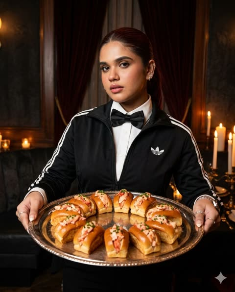</a>

提示词把银盘定为唯一视觉焦点，并用正面略仰视的中景构图围绕它展开。单向烛光、指定相机镜头，再加上禁止塑料感和CGI感的负面描述，让画面更接近真实摄影。

Nano Banana 2 · 文生图 · 出处: [@oye_samia on X](https://x.com/oye_samia/status/2054101412976738575) · 89 赞，统计于 2026-10-29

[`supper-club`](tags.md#tag-supper-club) [`candlelight`](tags.md#tag-candlelight) [`food-photography`](tags.md#tag-food-photography) [`low-angle`](tags.md#tag-low-angle) [`photorealistic`](tags.md#tag-photorealistic)

<details><summary><b>提示词</b></summary>

```text
Hyper-realistic vertical photograph 4:5. Private dining area of an exclusive supper club with dark wooden panels, burgundy velvet curtains, golden candlelight, and a deep anthracite background.
A stunning woman stands frontally, medium shot from the chest up, slight low angle. She holds with both hands an ornate oval silver tray extended toward the camera. On the tray is a perfect ring of 12 miniature lobster rolls on brioche buns with pink lobster meat. The silver tray is the main focal point of the scene.
Clothing: Elegant black Adidas Originals Firebird-inspired zip-up cropped jacket with three white stripes and Trefoil logo, worn over a starched white fitted dress shirt with a black silk bow tie, paired with a sleek high-waisted black mini skirt or tailored black trousers, statement AP Royal Oak watch in steel, delicate silver rings and earrings.
Lighting: Warm, low golden-amber candlelight coming from the right, sculpting her face and creating beautiful highlights on the silver tray. Deep dramatic shadows on the left. Monochrome black with luxurious gold accents.
Camera: Sony A7R V, 50mm f/1.4 lens, 8K resolution, natural skin texture, natural depth of field with soft organic candle bokeh. No plasticity, no CGI, no AI artifacts.
```

</details>

<a id="nano-banana-floating-gyoza-ponzu-splash"></a>
### 漂浮的煎饺与酱汁飞溅

<a href="https://x.com/Ozayrr_irl/status/2054043869512184255"></a>

用微距摄影的细节描述（焦痕、油泡、褶皱、蒸汽轨迹）让食物看起来真实，单束低角度侧光在金棕色背景上拉出长阴影。为每个元素单独写明空中的位置和运动，模型就能清楚理解悬浮构图。

Nano Banana 2 · 文生图 · 出处: [@Ozayrr_irl on X](https://x.com/Ozayrr_irl/status/2054043869512184255) · 81 赞，统计于 2026-10-29

[`food-photography`](tags.md#tag-food-photography) [`floating`](tags.md#tag-floating) [`gyoza`](tags.md#tag-gyoza) [`macro`](tags.md#tag-macro)

<details><summary><b>提示词</b></summary>

```text
A cinematic ultra-detailed floating food photography shot — a dozen pan-fried gyoza dumplings exploding outward in zero gravity, each dumpling showing its perfectly crispy golden-brown bottom crust with visible char marks and oil bubbles still sizzling under macro lens, several gyoza cracked open mid-air revealing juicy pork and cabbage filling with steam escaping in slow wispy trails catching warm side light, the iconic pleated fold edges of each dumpling showing every individual crimp in perfect detail, ponzu dipping sauce erupting from a small bowl in dramatic curved splash arcs frozen mid-air the liquid so clear you can see light refracting through it, sesame oil droplets suspended individually glowing amber in the spotlight beam, thin-sliced green onion rounds orbiting the composition like confetti, chili flakes drifting like tiny red sparks, warm golden-brown background with dramatic low side lighting creating long shadows behind every dumpling, OzairAI subtly stamped into the dark shadow zone of the background. Vertical 9:13 format. Ultra photorealistic, 8K, no text overlays, cinematic color grading.
```

</details>

<a id="gpt-image-giant-croissant-woodland-picnic-tug-of-war"></a>
### 女子与兔子松鼠在森林野餐中争抢巨型可颂

<a href="https://x.com/Adnan_Ai2/status/2107434655083577768">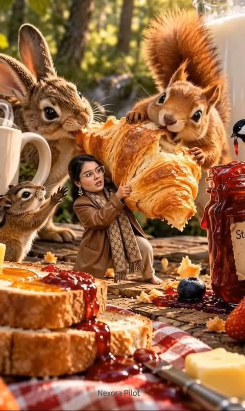</a>

先固定人物的服装、发型和比例来锁定角色，再按镜头顺序写出场景，包含拉远揭示、低机位和慢动作上举等运镜。结尾堆叠毛发、碎屑、金色逆光和景深等写实要求，并附负面清单，让巨型食物和动物显得可信。

GPT Image 2.5 · 上传图改图 · 出处: [@Adnan_Ai2 on X](https://x.com/Adnan_Ai2/status/2107434655083577768) · 79 赞，统计于 2026-10-29

[`fantasy`](tags.md#tag-fantasy) [`giant-food`](tags.md#tag-giant-food) [`woodland`](tags.md#tag-woodland) [`animals`](tags.md#tag-animals) [`golden-hour`](tags.md#tag-golden-hour)

<details><summary><b>提示词</b></summary>

```text
🎬 Prompt 2 — More Viral / Magical AI Video
Generate a premium photorealistic fantasy short film in a magical woodland picnic environment. Maintain one consistent young woman as the main character from beginning to end. She has natural facial features and wears a brown leather jacket, beige patterned scarf, light neutral trousers and brown ankle boots. Her appearance, clothing, hairstyle and proportions must remain consistent in every shot.

Open with an extreme close-up of a giant golden croissant resting on a rustic picnic table, surrounded by glossy strawberry jam, fresh strawberries, toast, butter and berries. Slowly pull the camera backward to reveal a beautiful forest picnic surrounded by enormous adorable rabbits and squirrels. Warm sunlight shines through the trees, creating cinematic golden rays and creamy background bokeh.

The woman enters the frame and tries to pick up the enormous croissant. Suddenly a giant fluffy rabbit grabs the other side. Create a playful tug-of-war between the woman and the rabbit. The croissant bends naturally under tension, small crumbs fall realistically, and the woman reacts with surprise and laughter.

Change to a low-angle cinematic shot where the woman loses balance and sits down among the picnic food while several cute woodland animals surround her. She looks shocked for a moment, then becomes amused as the animals curiously inspect the food around her.

Next, focus on a large glass jar filled with bright red strawberry jam. A tiny colorful forest bird lands on the jar, looks around, grabs a fresh strawberry and flies toward the woman. The camera follows the bird with a smooth tracking movement while the background remains softly blurred.

Cut to a dramatic slow-motion shot of the woman lifting an enormous croissant above her head with both hands. She looks upward in amazement while golden crumbs and tiny pastry flakes fall around her. Giant rabbits and squirrels watch from behind her.

Finish with a warm emotional close-up: the woman sits at the picnic table, smiling while holding a strawberry-covered piece of toast. A cute squirrel sits beside her and a rabbit approaches gently from the other side. She looks toward the animals and smiles naturally.

Make the entire video visually rich, magical yet believable, with realistic animal movements, detailed fur, realistic food textures, natural human motion, cinematic depth of field, golden-hour lighting, volumetric sun rays, subtle lens flare, smooth camera transitions, professional commercial-film quality, highly detailed photorealism, realistic shadows, consistent character identity, vertical 9:16 format, no glitches, no deformed anatomy, no duplicate animals, no text, no watermark.
```

</details>

<a id="nano-banana-cowboy-grassland-sunset-cumulus"></a>
### 金色落日积云前的骑马牛仔

<a href="https://x.com/im_shahid7/status/2109289268107776324">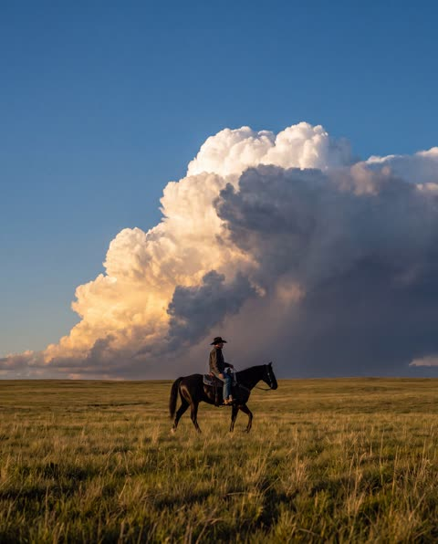</a>

把积云分成镀金的一面和深阴影的一面，制造强烈明暗对比。长焦镜头、低地平线和竖构图让小小的骑手衬出巨大的云。

Nano Banana 2.1 · 文生图 · 出处: [@im_shahid7 on X](https://x.com/im_shahid7/status/2109289268107776324) · 72 赞，统计于 2026-10-29

[`landscape`](tags.md#tag-landscape) [`cowboy`](tags.md#tag-cowboy) [`cumulus-cloud`](tags.md#tag-cumulus-cloud) [`golden-hour`](tags.md#tag-golden-hour) [`telephoto`](tags.md#tag-telephoto)

<details><summary><b>提示词</b></summary>

```text
Vertical landscape photography, vast grassland horizon, a cowboy with black wide-brim hat riding a dark black horse walking horizontally, behind him stands a towering massive cumulus cloud, one side of the cloud is gilded with warm golden sunset light, the other side has deep shadow, strong light and shadow contrast, clear deep blue sky, soft side light from sunset, natural light on meadow, cinematic wilderness atmosphere, realistic outdoor photo, rich light detail, shot on telephoto lens, 8K ultra high definition --ar 9:16 --v 6.0 --style raw --s 220 --q 2
```

</details>

<a id="nano-banana-giant-comic-portal-bedroom-sequence"></a>
### 男子跪看发光巨型漫画书传送门

<a href="https://x.com/Minahil42298354/status/2034230423014740304">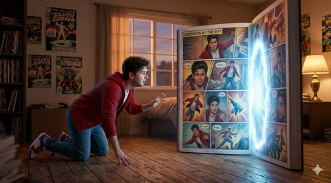</a>

一本有标题的落地巨型漫画书，右页透出青色传送门，让奇幻场景落在真实卧室里。传送门的光是画面主光源，在木地板上投下长长的影子。

Nano Banana 2 · 文生图 · 出处: [@Minahil42298354 on X](https://x.com/Minahil42298354/status/2034230423014740304) · 72 赞，统计于 2026-10-29

[`sequential-frames`](tags.md#tag-sequential-frames) [`portal`](tags.md#tag-portal) [`comic-book`](tags.md#tag-comic-book) [`bedroom`](tags.md#tag-bedroom) [`cinematic-lighting`](tags.md#tag-cinematic-lighting)

<details><summary><b>提示词</b></summary>

```text
A hyper-realistic photograph captures a sequential moment across two side-by-side frames within a vintage-decorated bedroom.
​In the left frame, a young man in a red hoodie and jeans is kneeling on a wooden floor, his hand outstretched with a look of pure astonishment. He is gazing at a massive, floor-standing comic book titled 'ASCENSION #1: THE RIFT' that has come to life. The pages are actively illuminated, and an electric blue energy portal is pulsing violently through the right-hand page.
​The right frame shows the immediate aftermath of that discovery. The same young man, maintaining the identical smile and attire, has now completely emerged from the pulsing blue portal and is standing on the bedroom floor in mid-stride, stepping confidently away from the giant book and into the reality of the room. He is smiling.
​The environment in both frames is a cozy bedroom filled with memorabilia, including multiple vintage superhero posters (Silver Surfer, Doctor Strange), a full bookshelf, and a glowing bedside lamp. The lighting is dominated by the magical, cyan energy of the portal, which casts long shadows across the textured floor.
```

</details>

<a id="nano-banana-alley-girl-anime-graffiti-mural"></a>
### 黑色皮衣女子站在动漫涂鸦墙前

<a href="https://x.com/AiwithLariab/status/2049813446620033198">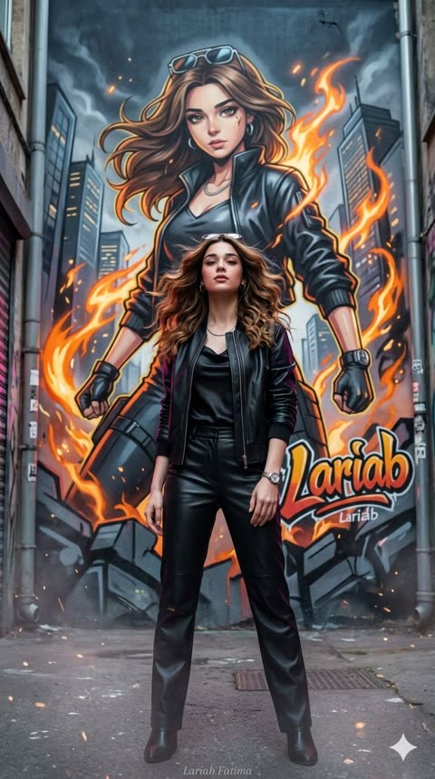</a>

把壁画写成与真人姿势呼应的第二个主体，模型会把两者当作同一画面来构图。明确点出真人三维与二维动漫的对比，并把固定文字放进壁画，让融合风格和名字都保持一致。

Nano Banana 2 · 文生图 · 出处: [@AiwithLariab on X](https://x.com/AiwithLariab/status/2049813446620033198) · 66 赞，统计于 2026-10-29

[`street-fashion`](tags.md#tag-street-fashion) [`graffiti`](tags.md#tag-graffiti) [`anime-fusion`](tags.md#tag-anime-fusion) [`urban-editorial`](tags.md#tag-urban-editorial)

<details><summary><b>提示词</b></summary>

```text
Ultra-high-definition full-body cinematic photograph of a confident young girl standing in a gritty, neon-accented urban alleyway, surrounded by textured concrete walls, subtle grime, layered graffiti tags, and atmospheric depth. The environment blends raw street realism with stylized cinematic polish, creating a bold, high-impact visual. She stands in a strong power pose—one leg slightly forward, arms crossed with attitude, chin slightly raised, projecting confidence and presence. Her hair is natural, voluminous, softly wind-swept, adding motion and energy to the frame. Outfit ( Street-Couture – Completely ): She is styled in a high-end street- fashion ensemble, replacing casual denim with a  editorial look: A cropped designer leather or satin bomber jacket with subtle sheen and tailored structure A fitted  inner top (silk, stretch knit, or minimalist high-end fabric) High-waisted tailored trousers or sleek leather pants with a sharp, clean silhouette Optional layering detail: belt with metallic accent or subtle branding-style buckle Color direction options (choose one for variation): Black & gold (ultra-) Deep red & black (bold cinematic) Ivory & champagne metallic (soft )  Styling Details: Eyewear: Sleek designer sunglasses with tinted lenses and  frames (adds attitude + modern vibe) Watch: A  wristwatch (metal strap, minimalist dial, polished finish—clearly ) Footwear: High-end designer sneakers or  ankle boots, clean and sharply styled (no casual/basic look) Optional jewelry: subtle (small studs or minimal chain for polish) Signature Visual Element (Anime Graffiti Fusion): Behind her is a massive, highly detailed anime-style graffiti mural that mirrors her exact pose and personality: The mural depicts her as a stylized manga/anime character, with bold linework and dynamic shading The artwork includes vibrant orange flames, glowing accents, and stylized city skyscrapers in the background The name “LARIAB” is integrated in bold graffiti typography with a street-art edge Add subtle spray paint splatter, drips, and layered textures for realism The contrast between hyper-realistic girl (3D) and vivid 2D anime mural creates a powerful visual fusion. Lighting & Cinematic Effects: Dramatic cinematic lighting setup with a mix of: Soft natural key light on the subject Neon accent lights (orange/red tones from mural reflections) Subtle rim lighting for separation Add light haze, dust particles, and glow reflections for atmosphere Shot on 35mm lens, shallow depth of field, subject in crisp focus, background slightly softened Surface & Texture Detail: Ultra-detailed textures on clothing (leather grain, fabric weave, metallic reflections) Realistic skin tones and natural highlights High contrast between gritty alley textures and clean  styling Branding Detail: Add a subtle yet  watermark text “Lariab Fatima” integrated naturally into the scene: Option 1: bottom corner in elegant typography Option 2: blended into the wall graffiti or ground reflection Ensure it feels stylish and non-intrusive Style Keywords: ultra-realistic, cinematic, 8K resolution, HDR,  street fashion, urban editorial, anime fusion, graffiti art, volumetric lighting, high contrast, depth-rich composition, viral concept, hyper-detailed textures
```

</details>

<a id="nano-banana-soldier-painting-pink-flower-ruins"></a>
### 士兵在废墟中绘制粉色花朵

<a href="https://x.com/tanzeel617919/status/2064903529131876825">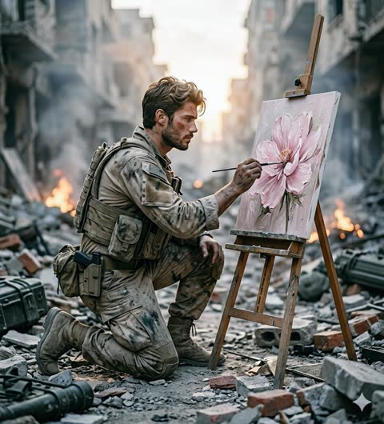</a>

把硬核战地场景与温柔的绘画动作放在一起形成对比，故事感由此而来。85mm、f/1.8、平视取景和逆光轮廓光让画面呈现纪实摄影质感。

Nano Banana 2 · 文生图 · 出处: [@tanzeel617919 on X](https://x.com/tanzeel617919/status/2064903529131876825) · 66 赞，统计于 2026-10-29

[`war-zone`](tags.md#tag-war-zone) [`portrait`](tags.md#tag-portrait) [`cinematic`](tags.md#tag-cinematic) [`contrast`](tags.md#tag-contrast)

<details><summary><b>提示词</b></summary>

```text
Ultra-realistic cinematic war-zone photography, a battle-worn military soldier kneeling on one knee amidst the rubble of a destroyed city street, peacefully painting a large delicate pink flower on a canvas mounted on a weathered wooden easel. The soldier wears dusty tan combat fatigues, tactical gear, utility pouches, and a rugged field uniform stained with dirt and ash. His short blond undercut hairstyle is slightly messy, and his face shows deep concentration as he carefully applies paint with a fine brush.
The environment contrasts destruction and beauty: shattered concrete, debris, broken bricks, scattered equipment, and smoldering fires glowing softly in the blurred background. The canvas features an expressive, highly detailed pink flower with thick painterly textures and rich brushstrokes. Warm sunset light filters through the ruined urban canyon, creating dramatic rim lighting on the soldier and easel.
Shallow depth of field, creamy cinematic bokeh, photorealistic skin texture, realistic fabric folds, ultra-detailed military equipment, atmospheric smoke, emotional storytelling, symbolism of hope and creativity amid conflict, documentary-style composition, eye-level perspective, 85mm lens, f/1.8, HDR, volumetric lighting, muted earth-tone color grading with soft pink highlights, award-winning photojournalism, masterpiece quality, ultra-sharp focus on the soldier and painting, 8K resolution.
```

</details>

<a id="nano-banana-supermarket-cart-maltese"></a>
### 男子推购物车与马尔济斯犬逛超市

<a href="https://x.com/AiWithTariq/status/2071038196461212153"></a>

先上传参考照片并明确锁定面部身份，再按主体、道具、环境、光线、相机参数的顺序描述画面，例如索尼 A7R V、35mm 镜头和 f/2.8。居中全身构图并要求两辆购物车都可见，让画面保持平衡。

Nano Banana 2 · 上传图改图 · 出处: [@AiWithTariq on X](https://x.com/AiWithTariq/status/2071038196461212153) · 65 赞，统计于 2026-10-29

[`identity-lock`](tags.md#tag-identity-lock) [`supermarket`](tags.md#tag-supermarket) [`pet`](tags.md#tag-pet) [`lifestyle`](tags.md#tag-lifestyle)

<details><summary><b>提示词</b></summary>

```text
Gpt Image 2 | Nano banana 2 | Grok | Gemini Prompt 👇

Use the uploaded reference image as the face and identity reference for the man. Preserve his exact facial identity, facial structure, eyes, nose, lips, eyebrows, hairstyle, skin tone, proportions, expression style, and overall recognizable appearance. Do not alter his identity.

Create an ultra-realistic lifestyle photograph inside a bright, modern premium supermarket. The man is standing confidently between two shopping carts in the fresh produce section, smiling naturally at the camera. He wears a fitted white crew-neck T-shirt layered with a light blue casual overshirt, light-wash straight-leg jeans, clean white sneakers, and a premium stainless-steel wristwatch. A simple crossbody sling bag hangs naturally across his shoulder, giving him a stylish yet relaxed everyday look.

One shopping cart is filled with colorful groceries including fresh vegetables, fruits, bread, bottled water, snacks, flowers, and household essentials. The second shopping cart is customized for his adorable fluffy white Maltese dog, comfortably seated on a soft beige cushion while wearing a cute blue gingham bandana. The man gently pets the dog with one hand while holding the grocery cart with the other. The dog looks happily toward the camera with bright expressive eyes and a joyful open-mouth smile.

The supermarket features beautifully organized produce displays overflowing with apples, oranges, bananas, pineapples, leafy greens, and colorful flowers. Large refrigerators line the background, polished reflective floors create subtle reflections, warm pendant lighting hangs from the ceiling, and the environment feels premium, clean, lively, and inviting.

Composition: full-body portrait, centered framing, eye-level perspective, both shopping carts fully visible, balanced composition, relaxed confident posture, authentic candid lifestyle feeling.

Lighting: soft diffused commercial indoor lighting, natural skin tones, realistic highlights, subtle shadows, premium retail ambiance.

Camera: Sony A7R V, 35mm lens, f/2.8, ISO 200, ultra-sharp focus, shallow depth of field with softly blurred background.

Style: luxury lifestyle photography, magazine editorial quality, photorealistic, HDR, extremely detailed skin texture, realistic hair strands, detailed clothing fabric, natural color grading, cinematic depth, ultra-high resolution, 8K, masterpiece, professional commercial photography.

Negative Prompt: low quality, blurry, duplicate people, extra limbs, distorted anatomy, deformed hands, bad fingers, incorrect face, altered identity, cartoon, anime, CGI, painting, overprocessed skin, unrealistic lighting, watermark, logo, text, cropped body, motion blur, oversaturated colors, noise, artifacts.
```

</details>

<a id="nano-banana-cyclist-coastal-selfie-golden-hour"></a>
### 黄昏海岸公路骑行者自拍

<a href="https://x.com/MrDasCreates/status/2028846886564856006">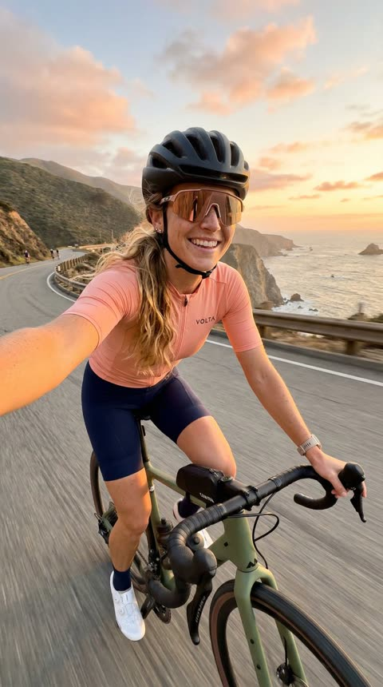</a>

广角前置自拍镜头配合浅景深和路面动态模糊，营造骑行的速度感。金色逆光勾出人物轮廓，珊瑚色与深蓝色的搭配让主体始终清晰突出。

Nano Banana 2 · 文生图 · 出处: [@MrDasCreates on X](https://x.com/MrDasCreates/status/2028846886564856006) · 64 赞，统计于 2026-10-29

[`selfie`](tags.md#tag-selfie) [`cycling`](tags.md#tag-cycling) [`golden-hour`](tags.md#tag-golden-hour) [`coastal`](tags.md#tag-coastal)

<details><summary><b>提示词</b></summary>

```text
{
  "image_type": "photorealistic smartphone selfie / action portrait",
  "scene": "outdoor biking photoshoot on a scenic coastal road at golden hour",
  "subject": {
    "description": "fit young woman in her mid-20s, sun-kissed skin with natural glow, light freckles across nose and cheeks",
    "hair": "long wavy blonde hair slightly tousled by wind, few loose strands blowing across face, secured partially with a loose ponytail",
    "expression": "confident joyful smile, eyes looking directly at camera (selfie angle), subtle squint from bright sunlight",
    "pose": "leaning slightly forward over handlebars of a sleek gravel bike, one hand gripping handlebar, other arm extended holding phone for selfie, shoulders relaxed, dynamic but natural riding posture"
  },
  "outfit": {
    "top": "form-fitting lightweight cycling jersey in soft pastel coral with subtle mesh panels, short sleeves, small brand logo on chest",
    "bottom": "high-waisted padded cycling bib shorts in deep navy, clean lines",
    "accessories": "stylish wrap-around cycling sunglasses (mirrored rose-gold lenses), small stud earrings, thin sports watch",
    "shoes": "white cycling shoes with subtle colorful accents"
  },
  "bike": "modern carbon gravel bike, matte olive green frame with cream accents, wide tires, drop bars, small saddle bag, clean minimalist look",
  "environment": {
    "location": "winding coastal cliffside road, ocean to the right, golden-hour sunlight raking across scene",
    "foreground": "slightly blurred handlebars and front wheel, natural bokeh from phone lens",
    "background": "dramatic golden ocean horizon, distant rugged cliffs, warm sky with soft pink-orange clouds, gentle motion blur on distant scenery suggesting speed",
    "atmosphere": "breezy, adventurous, carefree summer evening ride vibe"
  },
  "lighting": {
    "time_of_day": "golden hour — warm sunset light coming from slightly behind and to the side",
    "effects": "rich golden rim light in hair and shoulders, soft warm highlights on skin and jersey, gentle lens flare from low sun, long soft shadows on road"
  },
  "camera_simulation": {
    "perspective": "classic front-facing smartphone selfie angle (slight wide distortion at edges, natural close-up feel)",
    "lens": "equivalent to 26–28mm full-frame (mild wide), f/1.8–f/2.0 look",
    "depth_of_field": "shallow — sharp face and upper body, progressive blur toward bike and background",
    "quality": "ultra-detailed skin texture, realistic sweat微 beads from ride, natural imperfections, high dynamic range, subtle chromatic aberration and lens vignette for authenticity"
  },
  "mood": "empowered, free-spirited, radiant summer energy, adventurous yet relaxed",
  "color_palette": "warm golds, soft corals, deep ocean blues, creamy highlights, rich sunset oranges",
  "technical": {
    "resolution": "ultra high detail, 8K equivalent",
    "style": "hyper-photorealistic, smartphone candid aesthetic, no artificial perfection",
    "grain": "very light natural grain for realism",
    "text": "none"
  }
}
```

</details>

<a id="nano-banana-spidey-girl-golden-hour-skyscraper"></a>
### 金发蜘蛛装女英雄在夕阳下攀爬玻璃高楼

<a href="https://x.com/Document195/status/2031008869775016223">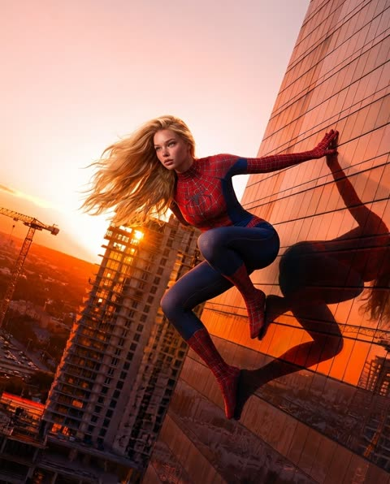</a>

提示词用服装、发色和场景锁定主体，再以黄金时刻的光线映照玻璃幕墙，并加入 85 毫米镜头和浅景深形成电影感。把动作概括为一个简短的姿势描述，人物在攀爬中的轮廓更清晰。

Nano Banana 2 · 文生图 · 出处: [@Document195 on X](https://x.com/Document195/status/2031008869775016223) · 64 赞，统计于 2026-10-29

[`superhero`](tags.md#tag-superhero) [`golden-hour`](tags.md#tag-golden-hour) [`cinematic`](tags.md#tag-cinematic) [`photorealistic`](tags.md#tag-photorealistic)

<details><summary><b>提示词</b></summary>

```text
http://
wondercat.ai Nano Banana 2💜

{
  "prompt": "female superhero in red and blue spider suit climbing a glass skyscraper at sunset, long blonde hair flowing in the wind, city skyline in background, golden hour lighting reflecting on glass building, dynamic action pose, cinematic superhero scene, ultra detailed, photorealistic, 85mm lens",
  "negative_prompt": "low quality, blurry, distorted body, extra limbs, bad anatomy, watermark, text",
  "style": "cinematic superhero photography",
  "lighting": "golden hour sunset",
  "camera": "85mm, shallow depth of field",
  "resolution": "1024x1536"
}
```

</details>

<a id="nano-banana-woman-giant-pencil-happy-monday"></a>
### 女子抱着巨型铅笔在温馨房间里画画

<a href="https://x.com/ariaxawan/status/2051246805892161960"></a>

参考图锁定人物面部与服装，提示词再叠加抓拍式写实场景、涂鸦装饰，以及分布在书架和地板上的四个微缩复制人物。指定相机机型、镜头和画幅比例，让画面保持摄影质感。

Nano Banana 2 · 上传图改图 · 出处: [@ariaxawan on X](https://x.com/ariaxawan/status/2051246805892161960) · 62 赞，统计于 2026-10-29

[`reference-image`](tags.md#tag-reference-image) [`miniature-replicas`](tags.md#tag-miniature-replicas) [`doodle-overlay`](tags.md#tag-doodle-overlay) [`candid-photo`](tags.md#tag-candid-photo)

<details><summary><b>提示词</b></summary>

```text
A realistic, candid photograph of a petite Asian woman with a detailed, lifelike face and hairstyle (referencing the provided image for specific features), captured during a soft afternoon. She is wearing the specific clothing from the reference image. She is happily and intently hugging a gigantic wooden pencil adorned with cute, kawaii cartoon patterns with both hands, using it to draw on a massive sketchbook spread before her on a cozy room floor. The scene is full of warmth, with a soft, diffused sunlight filtering in. The floor is covered in pastel-colored (light pink, light blue) oversized toys, stationery, and a cute colored pencil box. A small, fluffy cat plush sits nearby. The room background features warm-toned wooden bookshelves filled with charming books and collectibles, all glowing with soft afternoon light. A minimal white doodle outline loosely traces the woman's figure.  Cute, minimal white handwritten text on the side reads "Happy Monday", and pink handwritten text reads "Hello". Small, simple white doodle elements like stars, flowers, cats, and bunnies are scattered around. Four distinct, miniature 3D chibi-style figures, exact miniature replicas of the woman in the same clothing but in playful, mischievous poses, are placed around her on the shelves, books, and among the giant stationery. The entire image has a soft, dreamy, and warm glow, with pastel tones in the surroundings contrasting with natural wood and cream background colors. Shot on a Canon EOS R5 with a 35mm f/1.4 lens, natural grain, cinematic lighting. Aspect Ratio: 4:5 Style: Realistic Photo, Candid, Warm, Dreamy Lighting: Soft Afternoon Sunlight, Diffused
```

</details>

<a id="gpt-image-rain-couple-train-platform-farewell"></a>
### 雨中列车铁栏窗边的女子与伸手的湿透男子

<a href="https://x.com/Redchili105/status/2072588248963055715">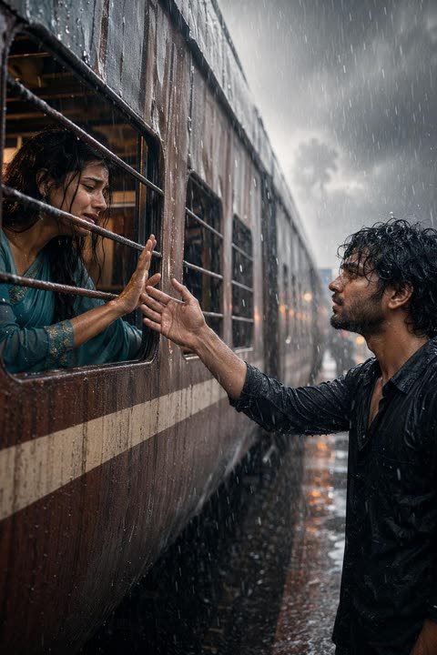</a>

提示词将镜头固定在站台的平视位置，透过车窗同时框住两人，并以两人之间的伸手动作定义情绪节拍。负面提示列出了常见的面部与肢体错误以便抑制。

GPT Image 2 · 文生图 · 出处: [@Redchili105 on X](https://x.com/Redchili105/status/2072588248963055715) · 61 赞，统计于 2026-10-29

[`cinematic`](tags.md#tag-cinematic) [`rain`](tags.md#tag-rain) [`train-platform`](tags.md#tag-train-platform) [`couple`](tags.md#tag-couple)

<details><summary><b>提示词</b></summary>

```text
Title
Rain Couple: Emotional Train Platform Farewell
Subject
Ultra-realistic cinematic emotional farewell of a South Asian couple at an old Indian railway platform during a heavy monsoon rainstorm, with strict character consistency and photorealistic quality.
Main Scene
A heartbreaking yet beautiful farewell unfolds as an old train prepares to depart in a torrential monsoon. The woman is inside a vintage train compartment, leaning against the barred open window with one trembling hand pressed to the iron bars, desperately trying to reach the man outside. She wears a flowing peacock teal-blue georgette saree with the pallu loosely draped, rain-dampened dark hair clinging to her cheeks, tear-filled expressive eyes, and a sorrowful yet loving expression. Outside on the rain-soaked platform, the man stands completely drenched, reaching toward her with deep emotion, his face filled with longing and heartbreak.
Character Lock
Maintain 99–100% facial identity preservation with the reference images. Do not alter facial structure, skin tone, hairstyle, or proportions. The man has curly messy bedhead black hair, natural light beard, expressive eyes, and realistic wet skin. Both characters must remain fully recognizable.
Environment
Vintage Indian railway platform, old passenger train with weathered barred windows, heavy monsoon rain, puddles reflecting station lights, misty atmosphere, steam, dramatic clouds, realistic water splashes, cinematic depth, emotional ambiance.
Camera & Composition
Medium cinematic shot from the platform, framing both characters through the train window, eye-level perspective, shallow depth of field, natural composition, intense emotional storytelling.
Lighting
Soft overcast monsoon daylight mixed with warm train interior glow, realistic wet reflections, diffused rain light, volumetric atmosphere, subtle rim lighting.
Quality & Style
Ultra-realistic, hyper-detailed, cinematic photography, HDR, 8K, DSLR realism, natural skin texture, realistic rain physics, lifelike wet fabric, emotional storytelling, award-winning composition, masterpiece, sharp focus.
Negative Prompt
Low quality, blurry, cartoon, CGI, anime, extra fingers, extra limbs, duplicate people, distorted face, altered identity, incorrect hairstyle, oversaturated colors, unrealistic rain, bad anatomy, watermark, logo, text, frame, artifacts, cropped composition.
```

</details>

<a id="nano-banana-iphone-closeup-beanie-sunglasses-puffer"></a>
### 黑色毛线帽墨镜白色羽绒服的手机近拍

<a href="https://x.com/weiinberg/status/2107694579764113701">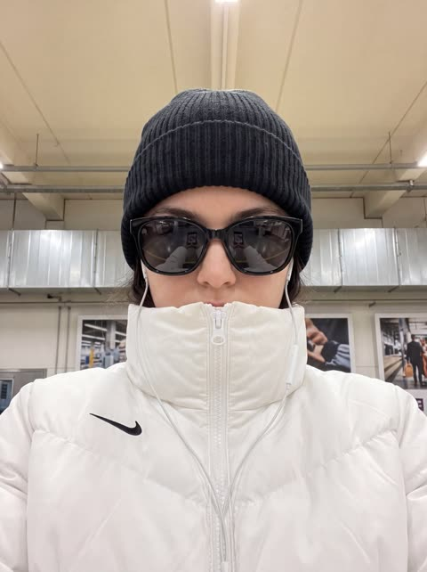</a>

写明真实手机镜头参数24毫米和f/1.8，再加上轻微的手机虚化，让画面像一张可信的手机照片。顶部柔和的LED漫射光加上镜片和尼龙面料上的高光，让材质质感真实。

Nano Banana 2.1 · 文生图 · 出处: [@weiinberg on X](https://x.com/weiinberg/status/2107694579764113701) · 61 赞，统计于 2026-10-28

[`smartphone-photo`](tags.md#tag-smartphone-photo) [`close-up`](tags.md#tag-close-up) [`beanie`](tags.md#tag-beanie) [`sunglasses`](tags.md#tag-sunglasses) [`soft-lighting`](tags.md#tag-soft-lighting)

<details><summary><b>提示词</b></summary>

```text
straight-on eye-level close-up photograph of a young woman, face clearly visible, captured on a recent iPhone main camera at its native 24 mm equivalent, f/1.8, with natural perspective and no wide-angle distortion. Focus is locked on her face and accessories; the background falls into a mild, realistic smartphone blur.
She wears a black ribbed knit beanie sitting normally on her head, not covering her eyes or face, large reflective black sunglasses, and white wired Apple earphones with the cable running down in front of her jacket. Her white puffer jacket is worn open at the collar, not pulled up, so her jaw, mouth, and lower face remain fully visible beneath the sunglasses. A small black embroidered Nike swoosh sits on the left shoulder. The quilted synthetic fabric shows soft volume and fine texture.
The setting is a brightly lit industrial interior with a high cream-colored ceiling and out-of-focus glossy metallic panels or photographic posters behind her. Lighting is large soft overhead ambient, even and slightly cool, like diffused LED panels: gentle fill from above and the front, soft shadows under the chin and beanie brim, and faint specular highlights on the sunglasses and the jacket’s nylon shell. Exposure is clean and slightly bright, true-to-life color, moderate computational sharpening, natural skin texture, no heavy noise or plastic skin. Mood is urban, practical, and quietly anonymous. Photorealistic smartphone photograph.
```

</details>

<a id="gpt-image-satin-bustier-living-room-selfie"></a>
### 身穿缎面抹胸上衣在室内自拍的女性

<a href="https://x.com/rewind02/status/2102439961073000920">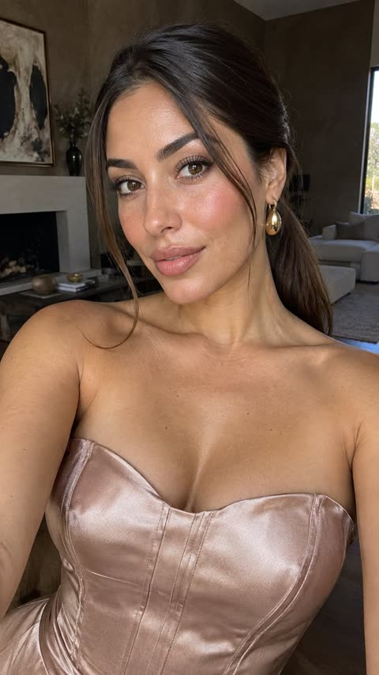</a>

用有优先级的清单锁定构图、光线和自拍取景，再要求生成新的面孔，使画面接近参考图但不复制人物。列出需去除的文字、爱心和界面元素，让画面可以直接用于社交媒体。

GPT Image 2.5 · 上传图改图 · 出处: [@rewind02 on X](https://x.com/rewind02/status/2102439961073000920) · 50 赞，统计于 2026-10-29

[`selfie`](tags.md#tag-selfie) [`ai-ugc`](tags.md#tag-ai-ugc) [`reference-variation`](tags.md#tag-reference-variation) [`social-media`](tags.md#tag-social-media)

<details><summary><b>提示词</b></summary>

```text
{
"prompt_type": "photorealistic_reference_variation",
"objective": "Use the supplied reference photograph as a guide for the same close vertical smartphone selfie composition, lighting, upscale interior, crop, and polished social-media aesthetic. Create a visually similar image, but make the woman a distinct person with subtly different facial features, hairstyle details, jewelry, expression, and wardrobe color. Completely remove all text, icons, hearts, buttons, interface graphics, timestamps, watermarks, logos, or other on-screen elements.",
"reference_fidelity": {
"target": "high similarity in overall composition, camera perspective, lighting, setting, and fashion beauty aesthetic, while preserving a clearly distinct subject identity",
"priority_order": [
"overall vertical crop and composition",
"bright frontal daylight against a darker luxury living-room background",
"close upper-body smartphone selfie framing",
"warm luminous skin and polished soft-glam beauty styling",
"sleek dark updo with face-framing strands",
"elegant strapless satin bustier",
"large gold statement earrings",
"natural high-resolution smartphone-camera rendering"
],
"variation_instruction": "Do not replicate the exact face from the reference. Create a new adult woman with a slightly more heart-shaped face, softer jawline, hazel-brown eyes, a subtle closed-lip smile, a deep side-part hairstyle, and different sculptural gold earrings."
},
"canvas": {
"orientation": "portrait",
"aspect_ratio": "approximately 918:1588",
"framing": "tight vertical smartphone selfie",
"crop": "from just above the top of the hair to below the bust and upper torso",
"subject_scale": "large, occupying most of the frame",
"subject_alignment": "slightly right of center",
"camera_distance": "close arm's-length selfie distance",
"headroom": "very small",
"bottom_crop": "cuts through the lower torso and structured satin top",
"left_background": "fireplace and framed artwork softly visible",
"right_background": "soft sofa and doorway or window edge visible",
"instruction": "do not include any white heart icon or social-media interface graphics"
},
"scene": {
"location": "upscale dimly lit modern living room or lounge",
"time_of_day": "daytime with strong natural window light",
"mood": "polished, elegant, intimate, warm",
"visual_style": "authentic high-resolution smartphone beauty selfie",
"background_complexity": "moderate but visually subdued",
"environment": {
"walls": "dark warm taupe textured walls",
"fireplace": "minimal stone or plaster fireplace at left",
"sofa": "large soft light-gray sectional sofa in the rear-right",
"art": "large framed muted abstract artwork above or near the fireplace",
"lighting": "bright frontal daylight on the subject with a darker ambient interior behind"
}
},
"subject": {
"description": "a distinct adult woman taking a close front-facing selfie indoors",
"identity_instruction": "Create a naturally beautiful woman who is not an exact facial copy of any reference person.",
"position": "center foreground",
"body_visibility": "head, neck, shoulders, upper chest, and upper torso",
"pose": {
"head": "upright with a very slight turn toward viewer-right",
"torso": "mostly frontal",
"shoulders": "relaxed and bare",
"camera_arm": "extended toward camera outside the visible frame",
"posture": "upright, elegant, and composed"
},
"expression": {
"overall": "calm, confident, softly warm",
"mouth": "closed with a faint natural smile",
"lips": "softly relaxed",
"gaze": "directly into camera",
"brows": "relaxed but defined"
},
"skin": {
"tone": "warm medium olive-tan with a golden undertone",
"finish": "luminous satin glow",
"texture": "realistic fine skin texture with subtle pores",
"freckles_and_marks": "a few faint freckles and small natural beauty marks retained",
"highlights": "bright natural highlights on forehead, cheekbones, nose bridge, collarbones, shoulders, and chest",
"retouching": "light-to-moderate social-media processing, never plastic"
},
"face": {
"shape": "soft heart-oval shape with slightly higher cheekbones and a gently tapered jaw",
"forehead": "medium height",
"cheekbones": "defined but natural",
"jaw": "slender and softly sculpted",
"chin": "small and rounded",
"eyes": {
"shape": "almond-shaped",
"color": "warm hazel-brown",
"size": "medium",
"lashes": "long, curled, dark, cleanly separated",
"eyeliner": "very subtle brown-black lash-line enhancement",
"eyeshadow": "soft bronze-peach neutral tone",
"catchlights": "bright natural window reflections"
},
"eyebrows": {
"shape": "full with a soft natural arch",
"color": "deep brown",
"density": "medium-full",
"finish": "cleanly groomed and softly filled"
},
"nose": {
"shape": "straight and refined",
"bridge": "narrow-medium",
"tip": "softly rounded",
"highlight": "subtle centered highlight"
},
"lips": {
"shape": "full but natural",
"upper_lip": "defined cupid's bow",
"lower_lip": "slightly fuller",
"color": "muted dusty-rose nude",
"liner": "slightly deeper nude-pink",
"finish": "soft satin gloss"
},
"makeup": {
"style": "natural soft glam",
"foundation": "smooth radiant skin-like finish",
"bronzer": "warm subtle sculpting",
"blush": "soft peach-rose blush across cheeks",
"highlight": "controlled luminous sheen on cheekbones",
"eyes": "neutral bronze shadow with defined lashes",
"lips": "dusty nude rose"
}
}
},
"hair": {
"color": "dark chestnut brown, almost espresso",
"style": "sleek low bun or low tucked ponytail",
"part": "deep side part",
"texture": "smooth and glossy",
"crown": "softly controlled with a little natural volume",
"front_sections": "two long, slim face-framing strands left loose on both sides",
"left_face_strand": "a thin dark strand falls from the temple past the jaw toward the shoulder",
"right_face_strand": "a matching strand curves softly alongside the cheek toward the chest",
"back": "hair gathered into a neat low bun or tucked ponytail",
"flyaways": "minimal but realistic",
"shine": "soft warm highlights along dark strands"
},
"jewelry": {
"earrings": {
"type": "large sculptural twisted oval gold drop earrings",
"shape": "rounded organic vertical form, distinct from rectangular earrings",
"material": "polished warm gold metal",
"surface": "smooth reflective metal with subtle ridged detailing",
"size": "medium-large statement earrings",
"visibility": "viewer-left earring highly visible, opposite earring partially visible",
"finish": "bright reflective warm gold"
},
"necklace": "none visible"
},
"wardrobe": {
"top": {
"type": "strapless structured satin corset or bustier top",
"color": "pale champagne ivory with a soft rose-beige undertone",
"neckline": "straight to gently curved strapless neckline",
"construction": "boned corset-style structure with refined cup seams",
"cups": "shaped underwire-style satin cups",
"center": "subtle central vertical seam and structured paneling",
"fit": "close-fitting and supportive",
"material": "smooth satin",
"finish": "soft pearl-like sheen",
"wrinkles": "small realistic tension creases in satin",
"instruction": "preserve the elegant structured fashion silhouette without making the garment exaggerated or costume-like"
}
},
"body_and_pose": {
"shoulders": "bare and evenly lit",
"collarbones": "visible with soft natural highlights",
"upper_chest": "warm natural skin tone with subtle tonal variation",
"torso": "slightly angled but mostly frontal",
"left_arm": "partially visible near the lower-left edge, extended toward camera",
"right_side": "cropped close to shoulder and torso edge"
},
"background": {
"left": {
"fireplace": {
"type": "minimal traditional stone or plaster fireplace",
"color": "warm gray-beige",
"mantel": "thick simple mantel shelf",
"opening": "dark black fireplace opening",
"interior": "very dark"
},
"artwork": {
"type": "large framed monochrome or muted abstract artwork",
"position": "above the fireplace",
"frame": "light gray or off-white",
"content": "abstract forms only, no readable text"
}
},
"center_rear": {
"lighting": "small soft warm accent light near the wall",
"furniture": "dark low-profile furnishings partly obscured"
},
"right": {
"sofa": {
"type": "large plush sectional",
"color": "light gray",
"cushions": "soft oversized cushions",
"focus": "slightly out of focus"
},
"vertical_edge": {
"type": "bright door frame or window frame",
"color": "white",
"position": "far right edge"
}
}
},
"lighting": {
"type": "strong natural daylight from directly in front of the subject",
"primary_source": "large window or open doorway near the camera",
"direction": "front and slightly above",
"quality": "bright but diffused",
"contrast": "high subject-to-background contrast",
"subject": "face and upper body brightly illuminated",
"background": "intentionally darker and moodier",
"skin_effect": "warm luminous highlights without clipped whites",
"hair_effect": "subtle glossy reflections",
"satin_effect": "soft pearl sheen with gentle highlights",
"color_temperature": "neutral-warm daylight",
"shadow_style": "very soft facial shadows and deeper background shadows"
},
"camera": {
"device": "modern smartphone front-facing camera",
"orientation": "vertical portrait",
"lens": "standard wide selfie lens",
"focal_length_equivalent": "approximately 24-28mm",
"camera_height": "slightly above chest and near face level",
"camera_distance": "approximately 45-70 cm from face",
"perspective": "mild wide-angle smartphone perspective",
"focus": "sharpest on eyes and face",
"depth_of_field": "moderately deep but background naturally softer",
"image_quality": "high-resolution smartphone image",
"dynamic_range": "strong HDR preserving bright skin and dark room",
"processing": "subtle sharpening and noise reduction",
"grain": "very light realistic phone-sensor grain",
"motion_blur": "none"
},
"composition_geometry": {
"face_center": "approximately x=55%, y=31%",
"eye_line": "approximately y=28%",
"head_top": "approximately y=2%",
"mouth": "approximately y=43%",
"shoulder_line": "approximately y=60%",
"neckline": "approximately y=82%",
"corset_center": "approximately x=55%, y=91%",
"viewer_left_earring": "approximately x=27%, y=37%",
"fireplace": "left-rear background",
"sofa": "right-rear background",
"visual_balance": "bright subject contrasted against a dark elegant room"
},
"color_palette": {
"dominant_colors": [
"warm olive-gold",
"dark chestnut brown",
"champagne ivory",
"warm gold",
"charcoal",
"light gray",
"taupe"
],
"skin": "golden olive tan",
"hair": "deep chestnut espresso brown",
"top": "champagne ivory with a rose-beige undertone",
"earrings": "warm gold",
"background": "dark taupe and charcoal",
"sofa": "light gray",
"overall_saturation": "moderate",
"contrast": "moderately high",
"white_balance": "warm-neutral"
},
"image_texture": {
"skin": "fine pores, faint freckles, and small natural beauty marks",
"hair": "individual sleek strands and minimal soft flyaways",
"satin": "smooth woven sheen with fine tension folds",
"earrings": "polished gold-metal reflections",
"walls": "matte textured plaster",
"sofa": "soft woven upholstery",
"fireplace": "subtle stone or plaster texture"
},
"photographic_style": {
"genre": "beauty and fashion smartphone selfie",
"aesthetic": "luxury social-media portrait",
"realism": "extreme photorealism",
"retouching": "polished but believable",
"production_value": "personal phone photo with high-quality natural light",
"desired_result": "looks like a genuine high-resolution selfie captured near a window in an upscale living room"
},
"negative_prompt": [
"text",
"caption",
"white heart icon",
"social media UI",
"buttons",
"watermark",
"logo",
"screen overlay",
"extra people",
"different camera angle",
"full-body shot",
"side profile",
"heavy head tilt",
"long loose hair",
"curly hair",
"blonde hair",
"red hair",
"high ponytail",
"messy bun",
"missing face-framing strands",
"silver earrings",
"small stud earrings",
"hoop earrings",
"missing earrings",
"heavy contour",
"red lipstick",
"smoky black eye makeup",
"large smile",
"open mouth",
"looking away",
"black top",
"white t-shirt",
"sports bra",
"dress with sleeves",
"visible straps",
"bedroom",
"bathroom",
"kitchen",
"outdoor setting",
"bright background",
"studio backdrop",
"hard flash",
"cold blue lighting",
"dramatic cinematic shadows",
"extreme bokeh",
"fisheye distortion",
"plastic skin",
"over-smoothed face",
"over-sharpened pores",
"CGI",
"3D render",
"illustration",
"anime",
"cartoon",
"distorted anatomy",
"warped shoulders",
"asymmetrical eyes",
"deformed corset",
"exact facial copy of the reference person"
],
"final_generation_instruction": "Generate one extremely photorealistic vertical smartphone selfie using the supplied image only as a guide for composition, lighting, fashion mood, and upscale interior. Show a distinct adult woman centered close to the camera with warm olive-golden skin, hazel-brown almond eyes, full dark brows, soft peach-rose blush, long lashes, and muted dusty-rose nude lips. Her dark chestnut-brown hair has a deep side part and is pulled into a sleek low bun or tucked ponytail, with two long narrow face-framing strands beside her cheeks. Add large sculptural twisted oval gold earrings. Dress her in a pale champagne-ivory strapless satin corset bustier with subtle structured cups and visible seam construction. Frame the image from the top of the head to the lower upper torso, with the subject filling most of the image. Keep the dim upscale living room behind her: dark warm-gray walls, stone fireplace and framed artwork on the left, plush light-gray sectional sofa on the right, and a bright white door or window edge at the far right. Illuminate the subject with bright diffused frontal daylight so her face, shoulders, jewelry, and satin top glow while the room remains darker. Preserve realistic skin pores, faint freckles, natural smartphone HDR, mild phone-lens perspective, and crisp facial detail. Completely omit all text, buttons, hearts, watermarks, logos, interface graphics, and screen overlays."
}
```

</details>

<a id="gpt-image-infinite-clone-line-emerald-portal"></a>
### 翡翠传送门前无尽排列的克隆人

<a href="https://x.com/Just_Anika_Here/status/2113126775178088582">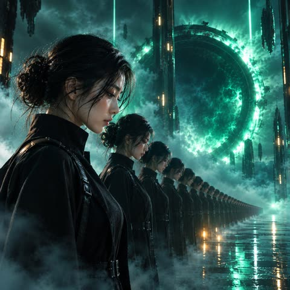</a>

按主体、意外视觉、环境、光线和构图分段，让超现实创意保持可控。前景清晰、远处克隆人渐隐入雾，形成纵深，结尾的质量约束清单则防止人物一致性崩坏。

GPT Image 2.5 · 文生图 · 出处: [@Just_Anika_Here on X](https://x.com/Just_Anika_Here/status/2113126775178088582) · 44 赞，统计于 2026-10-29

[`sci-fi`](tags.md#tag-sci-fi) [`clones`](tags.md#tag-clones) [`cinematic`](tags.md#tag-cinematic) [`fog`](tags.md#tag-fog) [`portal`](tags.md#tag-portal)

<details><summary><b>提示词</b></summary>

```text
Create an ultra-detailed, high-quality cinematic sci-fi film still in a 1:1 square aspect ratio.

MAIN SUBJECT: A beautiful young woman standing in the extreme foreground, shown in left-facing side profile, her head slightly lowered and expression calm, mysterious, and confident. She wears a sleek, minimalist black futuristic coat with a high collar. Her dark hair is loosely tied back, with a few natural strands framing her face. Her facial features, skin texture, and hair must look photorealistic and natural.

UNEXPECTED VISUAL: Behind her, an impossibly long, perfectly aligned row of identical versions of the same woman stretches into the distance, each wearing exactly the same black outfit and standing completely motionless. The clones gradually disappear into dense atmospheric fog, creating an eerie sense of infinite repetition.

ENVIRONMENT: A colossal circular portal dominates the background, glowing with intense emerald green and icy cyan light. Towering futuristic monoliths and thin vertical neon light pillars rise through the darkness. The ground is wet, glossy black stone, reflecting the portal and scattered amber lights. Thick rolling fog flows around the subjects' legs and across the reflective floor.

LIGHTING & CAMERA: Dramatic cyan-green volumetric light rays, strong rim lighting outlining the woman's silhouette, deep cinematic shadows, subtle amber highlights, realistic skin pores, fine hair details, rich blacks, controlled highlights, shallow depth of field, and atmospheric perspective. The foreground woman is razor-sharp while the distant clones progressively soften into the mist.

VISUAL STYLE: Premium Hollywood dystopian sci-fi, photorealistic cinematic photography, sophisticated color grading, realistic materials, subtle film grain, powerful composition, surreal scale, mysterious atmosphere, and breathtaking visual depth.

COMPOSITION: The foreground woman occupies the left third of the square frame. The line of clones creates a strong diagonal leading toward the enormous glowing portal in the background. Every clone has consistent facial identity, anatomy, clothing, and proportions.

QUALITY CONTROL: No distorted faces, duplicate body parts, extra limbs, malformed hands, inconsistent outfits, floating objects, random characters, text, logos, watermarks, excessive neon saturation, or artificial plastic skin. Every element must feel intentional, coherent, and visually believable
```

</details>

<a id="nano-banana-candid-izakaya-smartphone-snapshot"></a>
### 夜晚居酒屋里的手机抓拍照

<a href="https://x.com/ViralOps_/status/2108572050864644571">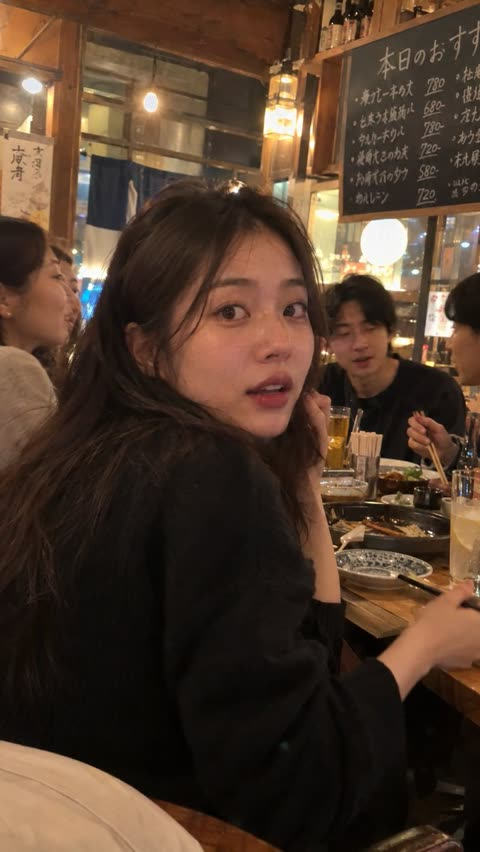</a>

先说明照片来源是朋友用手机拍的短视频截帧，再描写她察觉镜头的瞬间而不是摆拍。再加上曝光不均、动态模糊、毛孔等真实瑕疵，并用负面词清单排除精修感，让画面不像 AI 图。

Nano Banana 2.1 · 文生图 · 出处: [@ViralOps_ on X](https://x.com/ViralOps_/status/2108572050864644571) · 38 赞，统计于 2026-10-28

[`candid`](tags.md#tag-candid) [`smartphone-photo`](tags.md#tag-smartphone-photo) [`restaurant`](tags.md#tag-restaurant) [`night`](tags.md#tag-night) [`realism`](tags.md#tag-realism)

<details><summary><b>提示词</b></summary>

```text
STOP asking AI to make your images look more realistic.

you're literally making the same mistake again and again.

AI images look fake because everything is TOO PERFECT.

→ perfect skin.
→ perfect lighting.
→ perfect poses.
→ perfect backgrounds.

that's not how normal people take photos.

and if you're creating images for tiktok, reels, or youtube shorts, this one mistake can make your entire video look like AI slop.

here's a ridiculously SIMPLE trick i use to make AI images look like real smartphone photos.

you only need 4 things.

1. choose the kind of photo.

don't just say "photorealistic image."

tell AI where the photo came from.

for example:

→ a random tiktok video frame
→ an instagram story screenshot
→ a casual photo taken by a friend
→ a blurry late-night restaurant photo
→ an everyday street snapshot

2. describe a normal person,

not a supermodel.

not someone with flawless skin.

just an ordinary woman in her 20s with natural features, everyday clothes, and a relaxed expression.

3. create a moment, NOT a pose.

this is the BIG SECRET.

instead of making your subject pose for the camera, give them something natural to do.

for example:

a woman is enjoying dinner with her friends at a small restaurant.

someone suddenly points a phone at her.

she turns around, slightly surprised, without fixing her hair or preparing for the photo.

that's the kind of moment we want.

4. add real-life imperfections.

tell AI to keep the lighting uneven, the framing casual, and the skin natural.

even a little camera blur can make the image feel less staged.

now copy this prompt:

image prompt:

"generate a highly realistic candid photo that looks like it was taken by a friend using a normal smartphone.

the subject is a woman in her 20s sitting at a small restaurant at night with her friends.

the photo captures the exact moment she notices the camera and casually turns her head toward it.

she has a natural expression with a slight look of surprise. her face is clearly visible.

the restaurant has warm yellow lights, wooden furniture, food plates, drinks, and menu boards in the background.

the image should look like a real frame taken from someone's instagram reel or tiktok video.

include natural skin pores, tiny facial imperfections, realistic hair, slightly uneven exposure, subtle motion blur, and imperfect camera framing.

make it feel spontaneous, ordinary, and completely unstaged.

avoid the look of a professional photoshoot or a polished commercial.

negative: artificial skin, plastic face, 3d, cgi, illustration, cartoon, anime, beauty retouching, excessive glow, perfect lighting, unnatural eyes, strange hands, forced smile, overly symmetrical face, cinematic lighting, heavy background blur, over-sharpening, studio portrait, unrealistic environment."

and here's one more thing.

stop adding words like "masterpiece," "perfect lighting," and "flawless beauty" to every prompt.

those words can push your images toward that polished AI look you're trying to AVOID.

you're not trying to make a perfect image.

you're trying to make a BELIEVABLE image.

that's a MASSIVE difference.

left: OpenAI gpt images 2.5
right: google's nano banana 2.1
```

</details>

<a id="gpt-image-1942-arcade-city-pilot-walk"></a>
### 飞行员走过街机空战主题的战时城市

<a href="https://x.com/Xaroon_x/status/2056940561148363010">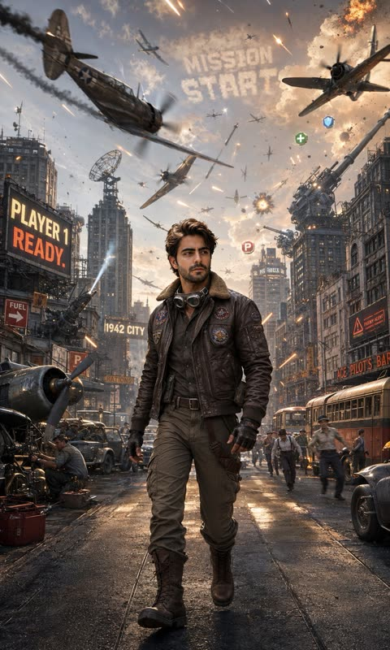</a>

提示词按世界观、喜剧细节、光线和镜头分段列出清单，让背景塞满层次分明的小细节。用 exact face 锁定参考人脸，同时把服装逐件写明。

GPT Image 2 · 上传图改图 · 出处: [@Xaroon_x on X](https://x.com/Xaroon_x/status/2056940561148363010) · 发现于 [freestylefly/awesome-gpt-image-2](https://github.com/freestylefly/awesome-gpt-image-2)

[`wwii`](tags.md#tag-wwii) [`arcade`](tags.md#tag-arcade) [`cinematic`](tags.md#tag-cinematic) [`worldbuilding`](tags.md#tag-worldbuilding) [`face-reference`](tags.md#tag-face-reference)

<details><summary><b>提示词</b></summary>

```text
Ultra-realistic cinematic “1942 City” scene, retro WWII arcade-shooter-inspired metropolis in real life, intense aerial-war atmosphere, vertical 4:5 editorial composition

Male, exact face, vintage military-pilot-inspired streetwear from head to toe, bomber jacket with retro aviation patches, fitted cargo trousers, rugged combat boots, fingerless gloves, pilot goggles hanging around neck, walking through the city with fearless ace-pilot expression while fighter planes soar overhead

✈️ 1942 CITY WORLDBUILDING

entire city functions like a living 1942 arcade shooter universe
• massive WWII fighter planes dogfighting above skyscrapers
• giant anti-aircraft cannons mounted across rooftops
• endless bullet patterns streaking through cloudy skies
• retro military airfields integrated into urban districts
• giant “MISSION START” alerts projected into the clouds
• dramatic explosion trails lighting the skyline at night
• aircraft carriers docked beside futuristic city ports
• glowing power-up icons floating through aerial battle zones
• giant radar systems rotating above downtown towers
• endless enemy squadrons emerging from storm clouds
• cinematic ocean-and-warzone environments surrounding the metropolis

😂 COMEDIC DETAILS

• random civilians casually dodging fighter planes on the way to work 😭
• one pilot barrel-rolling dramatically for absolutely no reason
• giant billboard flashing: “PLAYER 1 READY.”
• pedestrians treating near-miss explosions like normal traffic
• somebody still trying to collect every floating power-up midair
• random mechanic repairing planes using pure confidence
• one legendary pilot surviving impossible situations through arcade logic alone

💡 LIGHTING & STYLE

retro war-film cinematic lighting, fiery aerial-battle atmosphere, dramatic clouds and explosion reflections, hyper-detailed realistic textures mixed with nostalgic arcade-shooter aesthetics, intense blockbuster-war energy, masterpiece quality

🎥 CAMERA

cinematic aerial tracking shot, immersive dogfight atmosphere, dynamic motion blur from fighter planes and explosions, documentary-meets-retro-arcade realism, futuristic Manila-inspired 1942 metropolis, “classic arcade air combat became civilization” atmosphere
```

</details>

<a id="gpt-image-1969-festival-crowd"></a>
### 1969年8月纽约贝瑟尔音乐节人群

<a href="https://developers.openai.com/api/docs/guides/image-prompting#use-historical-and-real-world-context">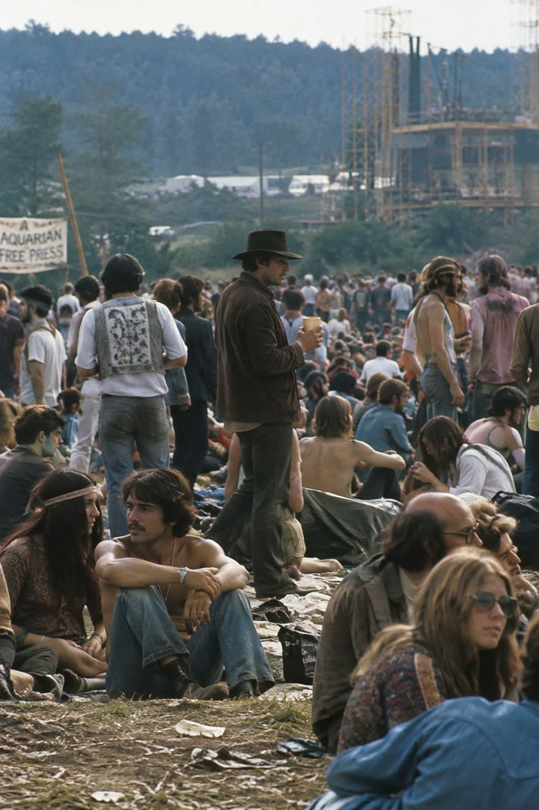</a>

只给出精确的地点和日期，模型就能自行推断当时的服饰、发型、舞台脚手架和胶片色调，无需逐项列出。要求符合时代细节，能让画面更像纪实摄影，而不是戏服式的模仿。

GPT Image 2.5 · 文生图 · 出处: [OpenAI image prompting guide](https://developers.openai.com/api/docs/guides/image-prompting#use-historical-and-real-world-context)

[`historical`](tags.md#tag-historical) [`crowd`](tags.md#tag-crowd) [`photorealism`](tags.md#tag-photorealism)

<details><summary><b>提示词</b></summary>

```text
Create a realistic outdoor crowd scene in Bethel, New York on August 16, 1969.
Photorealistic, period-accurate clothing, staging, and environment.
```

</details>

<a id="gpt-image-2003-digital-camera-family-snapshot"></a>
### 2003年数码相机拍摄的小区庭院全家福

<a href="https://x.com/pangyusio/status/2046991223395950810">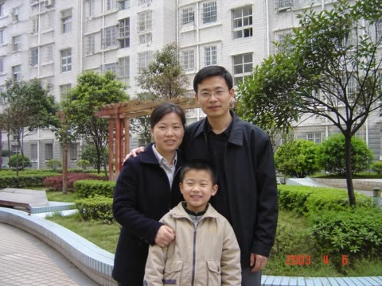</a>

点明年份和拍摄设备，模型就会还原那个年代的柔焦、平淡色彩和橙色日期戳。再给出具体场景，即中国小区庭院，配上简单的一家三口构图，画面显得真实可信。

GPT Image 2 · 文生图 · 出处: [@pangyusio on X](https://x.com/pangyusio/status/2046991223395950810) · 发现于 [ZeroLu/awesome-gpt-image](https://github.com/ZeroLu/awesome-gpt-image)

[`family-photo`](tags.md#tag-family-photo) [`nostalgia`](tags.md#tag-nostalgia) [`digital-camera`](tags.md#tag-digital-camera) [`vintage`](tags.md#tag-vintage) [`snapshot`](tags.md#tag-snapshot)

<details><summary><b>提示词</b></summary>

```text
Generate a photo from 2003, shot with a digital camera, of five-year-old me with my mom and dad in the courtyard of our residential compound in China.
```

</details>

<a id="gpt-image-ai-model-portrait-comparison"></a>
### 两款 AI 图像模型的街头人像对比

<a href="https://x.com/TimJayas/status/2086455464930459760">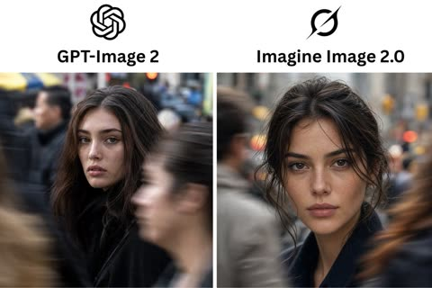</a>

两个画面重复同一位女性的详细描述，让对比聚焦于模型本身而非人物。镜头感、焦段、运动模糊，以及固定的元素数量和白色分隔线，使版式可控、两张照片风格一致。

GPT Image 2 · 文生图 · 出处: [@TimJayas on X](https://x.com/TimJayas/status/2086455464930459760) · 发现于 [YouMind-OpenLab/awesome-gpt-image-2](https://github.com/YouMind-OpenLab/awesome-gpt-image-2)

[`comparison`](tags.md#tag-comparison) [`street-portrait`](tags.md#tag-street-portrait) [`photorealistic`](tags.md#tag-photorealistic) [`social-media`](tags.md#tag-social-media)

<details><summary><b>提示词</b></summary>

```text
Goal: Create a clean side-by-side comparison graphic showing two AI image model outputs as realistic street portraits.

Canvas: Horizontal 3:2 social media comparison image, white background, high resolution. Use a simple two-column layout with a narrow vertical white divider between the image panels.

Layout: Top header area contains exactly 2 black logos centered above exactly 2 bold model names. Left column: OpenAI knot logo above the heading “GPT-Image 2”. Right column: Grok-style black circular slash logo above the heading “Imagine Image 2.0”. Below the headers are exactly 2 equal-size rectangular photo panels: one on the left and one on the right.

Photo content: Both panels show a cinematic, photorealistic urban street portrait of the same young woman in a crowded city. She has dark brown hair, natural makeup, full brows, soft lips, and a calm direct gaze. She wears a dark coat. The background is a busy city sidewalk with motion-blurred pedestrians, shallow depth of field, muted gray urban tones, and warm bokeh traffic lights.

Left photo panel: The woman is slightly left of center, turned partly toward the camera, with loose voluminous hair around her face. A large blurred pedestrian crosses the foreground on the right, partially obscuring the lower face/body area; another blurred figure appears on the left. The image should feel like a candid real-camera street photograph with natural imperfections and documentary realism.

Right photo panel: The woman is centered closer to camera, facing forward with slightly tousled hair pulled back loosely and face-framing strands. Her facial detail is sharper and more polished, with visible skin texture and freckles. Blurred pedestrians pass on both sides, including a gray figure on the left and a warm brown motion blur on the right.

Visual style: Photorealistic DSLR street photography, natural light, shallow depth of field, 50mm lens feel, realistic skin texture, subtle filmic color grading, high detail in faces, strong motion blur on passing pedestrians, no illustration style.

Text and element count: Include exactly 2 logos, exactly 2 headings, exactly 2 photo panels, and exactly 2 main female portraits. Do not add extra captions, scores, labels, borders, watermarks, or interface elements.
```

</details>

<a id="gpt-image-anime-wrapped-train-japanese-station"></a>
### 日本车站的动漫涂装列车

<a href="https://x.com/ArtistaNozomu/status/2057817110823539188"></a>

固定低位四分之三前视角,并用编号列出恰好三处站台广告及各自的精确文字。真实摄影细节如盲道和阳光与印刷动漫广告风格结合,让涂装和场景都显得可信。

GPT Image 2 · 文生图 · 出处: [@ArtistaNozomu on X](https://x.com/ArtistaNozomu/status/2057817110823539188) · 发现于 [YouMind-OpenLab/awesome-gpt-image-2](https://github.com/YouMind-OpenLab/awesome-gpt-image-2)

[`anime-wrap`](tags.md#tag-anime-wrap) [`train-station`](tags.md#tag-train-station) [`japan`](tags.md#tag-japan) [`photoreal-ad`](tags.md#tag-photoreal-ad) [`text-rendering`](tags.md#tag-text-rendering)

<details><summary><b>提示词</b></summary>

```text
Create a photorealistic wide-angle scene of a modern Japanese station platform in bright daytime, featuring a sleek white limited express train fully covered in an elegant anime character wrapping design for NOZOMU. The train is stopped beside the platform, viewed from a low three-quarter front angle so the rounded glossy black windshield fills the left edge and the decorated cars recede into the distance on the right. The wrap design shows one large pastel anime girl illustration on the nearest car: long light brown hair, oversized pale lavender bow on her head, delicate clock-and-gold accessory details, soft white blouse, fantasy memorial-line styling; keep her face intentionally obscured by a plain rectangular privacy blur. Surround the character with ornate gold filigree frames, antique clocks, stars, white flowers, pale blue ribbons, and soft watercolor accents. Add large refined serif branding on the train side reading “NOZOMU”, with smaller text “SPECIAL WRAPPED TRAIN” and “Limited Memorial Line.” Continue the same illustrated wrap along the following cars with smaller repeated character art and decorative clock motifs visible between dark rectangular train windows. On the platform, include exactly three promotional placements: 1) a large overhead station sign near the upper right reading “NOZOMU / SPECIAL WRAPPED TRAIN / Limited Memorial Line” with a blue strip of Japanese text “本日限定運行” and a blurred character face on the right; 2) a vertical poster pillar on the far right showing the anime girl, Japanese copy “会いに行ける、うちの子。” and NOZOMU branding; 3) a floor advertisement decal near the lower right with ornate border and the same NOZOMU special wrapped train logo. Add a few real commuters in the background on the platform, including one person photographing the train with a phone, but keep them small and secondary. Use realistic railway platform details: yellow tactile paving strip, tiled floor, overhead canopy beams, hanging lights, wires, rails implied beside the train, soft shadows, blue sky, and strong natural sunlight. Style should blend real photography with high-quality printed anime advertising, crisp reflections on the train windows, premium commemorative campaign atmosphere, pastel ivory, gold, pale blue, and lavender color palette. No extra logos, no watermarks, no additional vehicles, and keep all visible text clean and legible.
```

</details>

<a id="gpt-image-beach-selfie-braids-blue-nails"></a>
### 沙滩上单手遮阳的高角度自拍

<a href="https://x.com/IamEmily2050/status/2046602266627465534">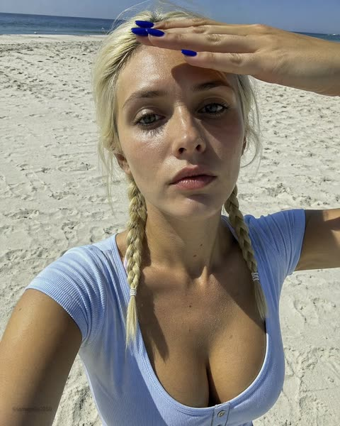</a>

用举臂前置镜头取景、等效24mm广角畸变、5500K色温和沙面反光补光等具体参数定义画面，让结果更接近真实手机照片。明确要求保留毛孔、细绒毛和不磨皮的皮肤纹理，可以抵消图像模型常见的美颜质感。

GPT Image 2 · 文生图 · 出处: [@IamEmily2050 on X](https://x.com/IamEmily2050/status/2046602266627465534) · 发现于 [freestylefly/awesome-gpt-image-2](https://github.com/freestylefly/awesome-gpt-image-2)

[`selfie`](tags.md#tag-selfie) [`realism`](tags.md#tag-realism) [`beach`](tags.md#tag-beach) [`portrait`](tags.md#tag-portrait)

<details><summary><b>提示词</b></summary>

```text
[中文]
{
  超写实iPhone 15 Pro前置摄像头自拍，一位成年女性在明亮的沙滩上，
  从举臂高角度自拍视角拍摄。手机略微举在脸部上方，
  营造出自然的前置摄像头几何形态，带有轻微的等效24mm广角畸变，
  写实的面部比例，
  以及智能手机的深景深。她向上抬起下巴，一只手遮挡刺眼的阳光，同时直视手机镜头。她的表情中性，
  面无表情，
  且略带疏离感，
  眼睛大而专注，但在解剖学上具有真实的眼部尺寸和自然面部比例。\n\n她有着极浅的铂金色头发，梳成两条紧紧的辫子，
  苍白的皮肤带有真实摄影的皮肤纹理，
  可见的毛孔，
  细微的绒毛，
  淡淡的眼下纹理，
  自然的唇部纹理，
  以及柔和的阳光光泽，而不是磨皮后的完美无瑕。她的嘴唇是自然色调且略丰满，
  她的鼻子小巧精致但很写实。她的指甲是鲜艳的蓝色。她穿着一件浅蓝色紧身弹力棉上衣，领口非常深且宽，以自然、
  非风格化的方式露出突出的锁骨和上胸结构。\n\n背景是宽阔的海岸沙滩，在强烈的上午晚些时候的阳光下，
  背景中有一条柔和模糊的地平线。光线明亮，
  色温约5500K的高调海岸日光，
  强烈的白色沙子反光从下方和脸部周围均匀地填充阴影。皮肤被直射阳光加上海滩宽阔柔和的反射补光照亮，
  产生清脆但写实的高光，没有生硬的对比。明亮沙子的细小颗粒微妙地捕捉光线。整体图像应该感觉像是在强烈的海边光线下在户外拍摄的真正高曝光智能手机自拍。\n\n色彩渲染应该是柔和、
  干净、
  且现代的，
  带有中性至柔和的色调，
  写实的iPhone计算摄影，
  略微提高的曝光，
  受控的高光过渡，
  自然的肤色，
  没有电影级调色。优先考虑写实性、
  物理准确性、
  可信的解剖结构，
  以及真实的智能手机图像表现，而不是美化风格化。", "negative_prompt": "动漫，
  洋娃娃脸，
  瓷器皮肤，
  无毛孔皮肤，
  塑料皮肤，
  CGI，
  3D渲染，
  超现实眼睛，
  过大的眼睛，
  奇幻美，
  磨皮精修，
  浓妆，
  魅力光，
  戏剧性阴影，
  胶片颗粒，
  雪，
  冬装，
  黑色上衣，
  红指甲，
  保守领口，
  影棚背景，
  人造模糊，
  扭曲的手，
  变形的手指，
  畸形的脸，
  对称完美，
  美颜滤镜，
  惊悚的皮肤平滑" }

[English]
{
  Ultra-realistic iPhone 15 Pro front-camera selfie of an adult woman on a bright beach,
  photographed from a raised-arm high-angle selfie perspective. The phone is held slightly above her face,
  creating natural front-camera geometry with mild 24mm equivalent wide-angle distortion,
  realistic facial proportions,
  and deep smartphone depth of field. She tilts her chin upward and looks directly toward the phone lens while shielding harsh sunlight with one hand. Her expression is neutral,
  blank,
  and slightly distant,
  with wide attentive eyes but anatomically realistic eye size and natural facial proportions.\n\nShe has very light platinum-blonde hair styled in two tight braids,
  pale skin with real photographic skin texture,
  visible pores,
  subtle peach fuzz,
  faint under-eye texture,
  natural lip texture,
  and a soft sunlit sheen rather than airbrushed perfection. Her lips are naturally toned and slightly full,
  her nose is small and refined but realistic. Her nails are vivid blue. She wears a light blue fitted stretch-cotton top with a very deep wide neckline that reveals pronounced collarbones and upper chest structure in a natural,
  non-stylized way.\n\nThe setting is a wide coastal beach under strong late-morning sunlight,
  with a softly blurred horizon line in the background. The lighting is bright,
  high-key coastal daylight around 5500K,
  with strong white sand bounce filling the shadows evenly from below and around the face. Skin is illuminated by direct sun plus broad soft reflected fill from the beach,
  producing crisp but realistic highlights without harsh contrast. Fine grains of bright sand catch light subtly. The overall image should feel like a real high-exposure smartphone selfie taken outdoors in intense seaside light.\n\nColor rendering should be soft,
  clean,
  and modern,
  with neutral-to-pastel tones,
  realistic iPhone computational photography,
  slightly elevated exposure,
  controlled highlight rolloff,
  natural skin color,
  and no cinematic grading. Prioritize realism,
  physical accuracy,
  believable anatomy,
  and true smartphone image behavior over beauty stylization.", "negative_prompt": "anime,
  doll face,
  porcelain skin,
  poreless skin,
  plastic skin,
  CGI,
  3D render,
  surreal eyes,
  oversized eyes,
  fantasy beauty,
  airbrushed retouching,
  heavy makeup,
  glamour lighting,
  dramatic shadows,
  film grain,
  snow,
  winter clothing,
  black top,
  red nails,
  conservative neckline,
  studio backdrop,
  artificial blur,
  warped hands,
  deformed fingers,
  malformed face,
  symmetry perfection,
  beauty filter,
  uncanny skin smoothing" }
```

</details>

<a id="gpt-image-car-window-deer-phone-snapshot"></a>
### 女孩与好奇小鹿的手机随拍

<a href="https://x.com/saniaspeaks_/status/2067813435136680242">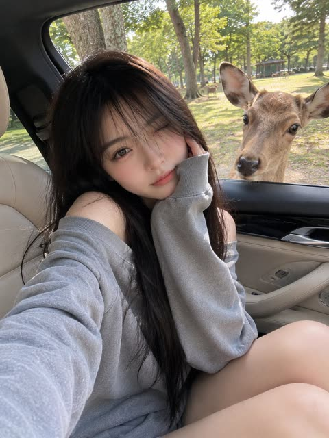</a>

提示词先交代车内人物与车窗外小鹿的清晰场景，再叠加手持iPhone、手机HDR、略不完美构图等手机摄影特征。no studio lighting、no cinematic color grading等否定短语让画面保持随拍感而不显精修。

GPT Image 2 · 文生图 · 出处: [@saniaspeaks_ on X](https://x.com/saniaspeaks_/status/2067813435136680242) · 发现于 [YouMind-OpenLab/awesome-gpt-image-2](https://github.com/YouMind-OpenLab/awesome-gpt-image-2)

[`smartphone-photo`](tags.md#tag-smartphone-photo) [`candid`](tags.md#tag-candid) [`travel`](tags.md#tag-travel) [`animal`](tags.md#tag-animal) [`car-interior`](tags.md#tag-car-interior)

<details><summary><b>提示词</b></summary>

```text
Young Japanese girl with long silky black hair and soft wispy bangs, sitting casually in the front passenger seat of a luxury car with beige leather interior, wearing an oversized gray off-shoulder sweatshirt. Natural soft smile, making a peace sign with one hand, long red manicure, relaxed and playful expression. A curious deer stands outside the open car window looking directly inside, with a green park and other deer visible in the background. Captured as a casual smartphone photo, natural daylight, handheld iPhone camera shot, everyday travel snapshot, realistic skin texture, authentic mobile HDR processing, slightly imperfect framing, natural colors, candid social media aesthetic, spontaneous moment, no professional posing, no studio lighting, no cinematic color grading, realistic reflections on car windows and interior, ordinary phone-camera perspective, photorealistic, high-quality mobile photography, lifestyle travel vibe.
```

</details>

<a id="gpt-image-f1-final-lap-paddock-broadcast-screenshot"></a>
### F1 决赛圈直播截图中的围场嘉宾

<a href="https://x.com/bigwonbots/status/2054573714012787059">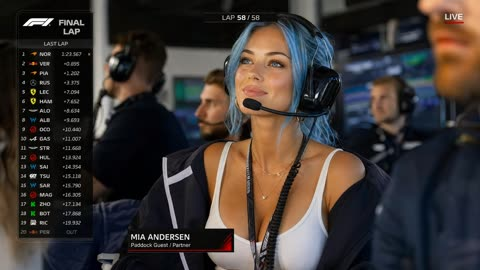</a>

提示词把画面设定为长焦电视转播截图，压缩痕迹、数字噪点和不做磨皮的要求让图像接近真实截屏。各个图层按固定顺序列出（横幅、圈数、计时塔、徽标、LIVE 标识、字幕条），让每个图形都出现在转播版式的预期位置。

GPT Image 2 · 文生图 · 出处: [@bigwonbots on X](https://x.com/bigwonbots/status/2054573714012787059) · 发现于 [freestylefly/awesome-gpt-image-2](https://github.com/freestylefly/awesome-gpt-image-2)

[`f1`](tags.md#tag-f1) [`broadcast`](tags.md#tag-broadcast) [`photo-realism`](tags.md#tag-photo-realism) [`lower third`](tags.md#tag-lowerthird)

<details><summary><b>提示词</b></summary>

```text
Ultra-realistic F1 live TV broadcast screenshot. A strikingly beautiful, 25-year-old young woman with bright light blue hair and captivating bright cerulean blue eyes is sitting in the VIP paddock / team garage during a Formula 1 race. Shown on the official live race broadcast as the girlfriend of an F1 driver, she is listening to the team radio through a professional racing headset. It is the final lap, and she is watching the garage monitors with a proud, enchanting smile.
She wears a fitted white tank top, an oversized racing team jacket (with generic, unbranded or blank team logos) draped over her shoulders, large black team-radio headset with boom mic, gold jewelry, and soft glam makeup. A slim, unbranded paddock pass hangs naturally from her neck.
Add realistic F1 broadcast graphics: "FINAL LAP" banner, lap counter showing final lap, driver timing tower on the left, small F1-style logo bug, "LIVE" indicator, and a lower-third identifying her as a driver partner / paddock guest (e.g., "MIA ANDERSEN - Paddock Guest / Partner"). No fake oversized badges, no selfie angle.
Team staff (in generic kit), headsets, garage screens, and generic race equipment are blurred around her. Telephoto broadcast camera shot from across the garage, professional depth of field, compression artifacts, digital noise, bright paddock lighting, natural skin texture, no smoothing, 8k quality, cinematic lighting.
```

</details>

<a id="gpt-image-first-person-tropical-island-warzone"></a>
### 第一人称热带海岛战场游戏主视觉

<a href="https://x.com/lipeng0820/status/2047231302118858815"></a>

以右下角戴手套的步枪确立第一人称视角。碉堡、战舰、直升机和导弹尾迹都给出确切数量与左右位置,让复杂画面井然有序。

GPT Image 2 · 文生图 · 出处: [@lipeng0820 on X](https://x.com/lipeng0820/status/2047231302118858815) · 发现于 [YouMind-OpenLab/awesome-gpt-image-2](https://github.com/YouMind-OpenLab/awesome-gpt-image-2)

[`fps`](tags.md#tag-fps) [`game-key-art`](tags.md#tag-game-key-art) [`military`](tags.md#tag-military) [`first-person`](tags.md#tag-first-person) [`cinematic`](tags.md#tag-cinematic)

<details><summary><b>提示词</b></summary>

```text
A cinematic first-person modern military battle on a tropical island coastline, viewed from the perspective of a soldier holding a black assault rifle in both hands at the lower right foreground, with dark tactical gloves visible. The scene shows a fortified coastal base under attack in bright midday sunlight beneath a vivid blue sky with scattered white clouds. In the foreground and midground, depict a rugged dirt path with dry grass, scattered debris, crates, and metal barrels leading into a compact military installation made of futuristic-industrial bunkers and machinery painted olive green and gray. Include 5 prominent base structures: a rounded bunker with a small dome on the far left, a cylindrical tower just right of it, a large central arched hangar-like bunker with a dark entrance, 1 squat turreted structure on the right midground, and 1 stone-and-metal defensive wall section at the far right front. In the center midground, show 1 major ground explosion with orange fire and black smoke, plus 1 tall vertical smoke plume rising behind the base near the cliffs. The background features rocky cliffs lined with many palm trees and a small waterfall descending near the center-left, with the ocean and horizon visible to the right. Over the water, show 4 large gray battleships grouped near the coast on the right side. In the sky, include 3 helicopters, 4 smaller aircraft or drones in the distance, and 5 visible missile or rocket trails streaking diagonally across the sky from right to left, emphasizing an active large-scale assault. Ultra-detailed photorealistic AAA video game key art, realistic lighting, sharp textures, cinematic action composition, wide-angle first-person shooter viewpoint, high contrast, dynamic war atmosphere, epic scale.
```

</details>

<a id="gpt-image-fisheye-cat-fish-thief-street-chase"></a>
### 鱼眼街头追逐叼着偷来鱼的猫

<a href="https://x.com/mehvishs25/status/2058375167550845263">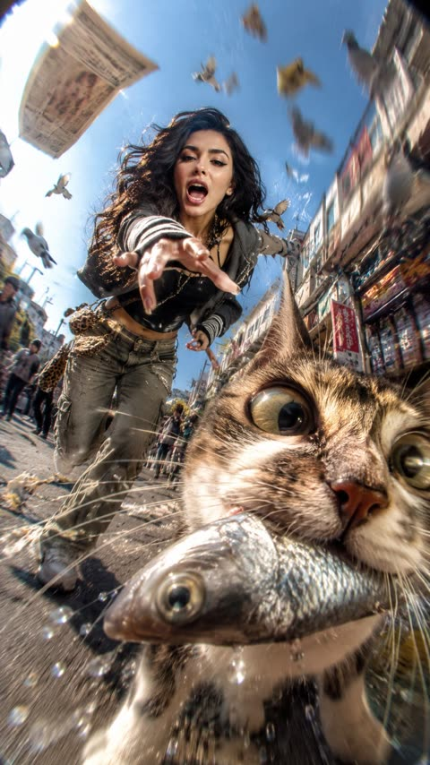</a>

提示词明确给出主次两个焦点，并让猫脸贴近镜头，鱼眼畸变就落在主体上。倾斜构图、径向模糊、CCD拖影和直闪层层叠加出千禧年数码相机质感，同时锁定参考图身份保持人脸一致。

GPT Image 2 · 上传图改图 · 出处: [@mehvishs25 on X](https://x.com/mehvishs25/status/2058375167550845263) · 发现于 [freestylefly/awesome-gpt-image-2](https://github.com/freestylefly/awesome-gpt-image-2)

[`fisheye`](tags.md#tag-fisheye) [`digicam`](tags.md#tag-digicam) [`y2k`](tags.md#tag-y2k) [`street-photography`](tags.md#tag-street-photography) [`identity-lock`](tags.md#tag-identity-lock)

<details><summary><b>提示词</b></summary>

```text
Use the uploaded reference image as the exact identity base for the main subject. Preserve their authentic facial structure, recognizable appearance, hairstyle, body proportions, skin texture, and overall identity with high consistency. Completely ignore any unrelated background from the original image.

Create a hyper-chaotic early-2000s Japanese digicam snapshot aesthetic with raw paparazzi energy and accidental comedy.

Scene: the subject is sprinting wildly through a busy city street while yelling and laughing in pure chaos, desperately trying to catch a mischievous cat that just stole a large shiny fish from a market stall. The cat is gripping the slippery silver fish tightly in its mouth while running directly toward the camera.

Composition must prioritize TWO focal subjects:

1. PRIMARY FOCUS → the cat's face
2. SECONDARY FOCUS → the human subject's face

The cat dominates the foreground frame with its face pushed absurdly close into the lens, partially cropped near the lower-right side. Massive fisheye distortion stretches its features dramatically - huge bulging eyes, exaggerated whiskers, detailed fur texture, fish flapping violently with droplets and motion streaks flying outward.

Behind the cat, the subject is charging forward aggressively with intense energy, reaching toward the animal mid-run. Their expression is loud, chaotic, and comedic, eyes locked directly onto the cat to create strong interaction and pursuit tension.

Styling:
Randomized layered Y2K Tokyo streetwear inspired by chaotic Shibuya nightlife fashion - oversized zip hoodies, vintage mesh layers, mini bags, low-rise pieces, striped arm warmers, chunky accessories, early-2000s sneaker styling, messy fashionable youth aesthetic.

Camera & framing:
extreme low-angle fisheye lens, ultra-wide invasive perspective, severe Dutch angle, asymmetrical framing, warped spatial distortion, exaggerated depth compression, aggressive foreshortening.

Motion treatment:
insanely intense movement blur with radial streaking, shutter drag, CCD sensor smearing, directional speed trails, accidental camera shake, stretched highlights, warped moving objects, imperfect chaotic snapshot timing.

Environment:
sunny crowded urban street with pigeons exploding into flight across the frame, scattered newspapers and debris flying through the air, warped pedestrians, market elements smeared by motion, overexposed sunlight leaking into one corner of the frame.

Lighting & texture:
harsh direct flash combined with bright outdoor sunlight, dirty CCD digicam texture, blown highlights, chromatic aberration, digital noise, bloom artifacts, compressed early-2000s camera look, gritty nostalgic cyber-chaos atmosphere.

Ultra-raw candid energy, messy composition, humorous accidental masterpiece aesthetic.
```

</details>

<a id="gpt-image-fisheye-strawberry-ice-cup-summer-ad"></a>
### 杯内鱼眼视角的草莓冰饮夏日广告

<a href="https://x.com/lovimg_com/status/2077036659028484375"></a>

提示词按主体、人物、服装、光线、镜头、质感和负面词分段书写。它把相机放在杯内的极端低角度并指定鱼眼镜头，同时写明对焦、光向和色彩对比，因此景深与折射效果稳定。

GPT Image 2 · 文生图 · 出处: [@lovimg_com on X](https://x.com/lovimg_com/status/2077036659028484375) · 发现于 [freestylefly/awesome-gpt-image-2](https://github.com/freestylefly/awesome-gpt-image-2)

[`fisheye`](tags.md#tag-fisheye) [`summer`](tags.md#tag-summer) [`product-ad`](tags.md#tag-product-ad) [`strawberry`](tags.md#tag-strawberry) [`japanese`](tags.md#tag-japanese)

<details><summary><b>提示词</b></summary>

```text
主題：
氷越しの夏

主体：
縦長2:3のリアル写真。透明な大型プラスチックカップの内側から見上げるような超広角フィッシュアイ構図。画面下半分いっぱいに赤いいちご果肉とクラッシュアイスが迫り、中央から太いグリーンのストローが奥へ一直線に伸びる。丸く歪んだカップの開口部の向こうに、女性の顔が中央に大きく収まる。

人物・表情：
自然で現実感のある若い女性。黒髪に近いダークブラウンの髪を高めのお団子にまとめ、薄い前髪と顔まわりの後れ毛が日差しで細く光っている。透明感のあるナチュラルメイク、淡いピンクの頬、つやのあるリップ。目を大きく開いてカメラをまっすぐ見つめ、唇を小さく丸めてストローをくわえている。少し驚いたような、可愛らしく無邪気な表情。

服装・ポーズ：
白いレース素材のブラウス。首元と肩まわりに細かなフリルがあり、夏らしく軽い質感。人物はカップの向こう側に顔を近づけ、両肩は下部に少しだけ見える。ストローは人物の口元に自然に接触し、奥から手前の赤い氷へ向かって強い奥行きを作る。

背景・光：
背景は晴れた夏の日の古い商店街。木造風の店先、かき氷屋の暖簾、苺柄の看板、白い小さな旗、街路樹が見える。文字はすべてぼかされた読めない装飾として扱う。左上から強い太陽光が入り、透明カップの水滴、カップ縁、氷、赤い果肉に細かな反射とハイライトが出る。影は右下へ落ち、白いクリームの残りがカップ内側にリング状についている。

構図・カメラ：
カメラはカップの底付近、赤い氷のすぐ上に置いたような極端なローアングル。フィッシュアイレンズでカップの円形リムが大きく湾曲し、周囲の商店街も軽く歪む。画面下45％は赤い氷と果肉の前ボケ、中央はストローと女性の顔、上部は青空とカップの透明な縁。ピントは女性の目と口元、手前の氷はきらめく浅いボケ。

質感・スタイル：
プロ用カメラで撮影した夏の広告写真風。透明プラスチックの屈折、水滴の粒、氷の冷たさ、いちご果肉の瑞々しさを高精細に表現。青空、赤い氷、グリーンのストロー、白いブラウスの色の対比を鮮やかにする。肌は自然な質感を残し、過度な美肌補正はしない。明るくポップで、少しユーモラスな日本の夏スイーツ写真。

ネガティブ：
実在ブランドロゴ、読める文字、商標の再現、不自然な顔、不自然な視線、歯や唇の崩れ、ストローとの接触不良、余分な指、欠けた指、手足の融合、氷の浮遊、不自然な重力、誤った遠近法、光源と矛盾する影、文字化け、透かし、過度な美肌補正、プラスチックのような肌。
```

</details>

<a id="gpt-image-giant-fox-curled-around-clock-tower-sunset"></a>
### 日落时分蜷缩在大本钟上的巨型狐狸

<a href="https://x.com/Just_sharon7/status/2062860722250596360"></a>

用 ANIMAL 和 PLACE/OBJECT 两个可替换的占位符让提示词可以反复套用，并用周围建筑像微缩模型来固定巨大的比例反差。暖色日落光线加上写实和治愈的氛围词，让巨型主体既可爱又可信。

GPT Image 2 · 文生图 · 出处: [@Just_sharon7 on X](https://x.com/Just_sharon7/status/2062860722250596360) · 发现于 [YouMind-OpenLab/awesome-gpt-image-2](https://github.com/YouMind-OpenLab/awesome-gpt-image-2)

[`giant-animal`](tags.md#tag-giant-animal) [`miniature-city`](tags.md#tag-miniature-city) [`sunset`](tags.md#tag-sunset) [`photorealistic`](tags.md#tag-photorealistic) [`template`](tags.md#tag-template)

<details><summary><b>提示词</b></summary>

```text
A super enormous ANIMAL curled up adorably on the PLACE/OBJECT, its tail wrapped around the structure. Surrounding historic London buildings appear tiny like miniature models. Realistic city setting during a soft sunset, warm gentle light, quiet soothing and heartwarming cute atmosphere, photorealistic, serene and charming.
```

</details>

<a id="gpt-image-harry-potter-cast-selfie-hogwarts-library"></a>
### 霍格沃茨图书馆中的哈利波特群体自拍

<a href="https://x.com/RuzainaMeer/status/2082052362428989936"></a>

第一人称广角自拍构图，前景的手臂把观众拉进合影之中。胶片型号（Kodak Portra 400）、24mm 镜头和暖色烛光调色共同营造电影般的真实感，服装颜色则明确了整体色调。

GPT Image 2 · 文生图 · 出处: [@RuzainaMeer on X](https://x.com/RuzainaMeer/status/2082052362428989936) · 发现于 [YouMind-OpenLab/awesome-gpt-image-2](https://github.com/YouMind-OpenLab/awesome-gpt-image-2)

[`fan-art`](tags.md#tag-fan-art) [`selfie`](tags.md#tag-selfie) [`group-portrait`](tags.md#tag-group-portrait) [`film-look`](tags.md#tag-film-look)

<details><summary><b>提示词</b></summary>

```text
Ultra-realistic photograph, wide-angle selfie from a first-person perspective.
A young woman stands in the center foreground taking a selfie with Harry Potter, Hermione Granger, Ron Weasley, Ginny Weasley, and Professor Dumbledore. Everyone is smiling naturally while wearing Gryffindor robes with rich burnt-orange and deep crimson accents, luxurious scarves, and elegant wizard uniforms.
The scene takes place inside the Hogwarts library filled with towering wooden bookshelves, floating candles, glowing fireplaces, antique furniture, magical artifacts, and warm amber lanterns. Soft orange candlelight fills the room, creating a nostalgic golden atmosphere with cozy cinematic lighting.
The background features shallow depth of field with creamy bokeh while every face remains razor sharp.
Captured with Kodak Portra 400 color science, 24mm wide-angle lens, natural skin tones, ultra-realistic facial details, cinematic orange color grading, subtle film grain, HDR lighting, photorealistic, 8K.
Aspect Ratio: 2:3
```

</details>

<a id="gpt-image-imperial-palace-courier-station"></a>
### 皇宫里身着金袍的快递驿站

<a href="https://x.com/joshesye/status/2046596222505361866"></a>

一句话用乘号把两个毫不相干的场景并置,细节由模型自行补全。金色宫廷服饰、包裹与扫码枪、宫廷风格的快递驿站匾额,都来自这一组反差。

GPT Image 2 · 文生图 · 出处: [@joshesye on X](https://x.com/joshesye/status/2046596222505361866) · 发现于 [freestylefly/awesome-gpt-image-2](https://github.com/freestylefly/awesome-gpt-image-2)

[`imperial-palace`](tags.md#tag-imperial-palace) [`express-delivery`](tags.md#tag-express-delivery) [`mashup`](tags.md#tag-mashup) [`chinese-costume`](tags.md#tag-chinese-costume) [`crossover`](tags.md#tag-crossover)

<details><summary><b>提示词</b></summary>

```text
[中文]
生成一张古代皇宫 × 快递驿站

[English]
Generate an ancient imperial palace × express delivery station
```

</details>

<a id="gpt-image-isometric-glass-cube-spheres-cylinder"></a>
### 透明玻璃立方体内的彩色球体与圆柱

<a href="https://x.com/Hyperouters/status/2097654503692443744"></a>

每个物体都写明位置（内部或外部、左后上方、右前下方、正上方），把画面变成一次空间关系测试。指定等距视角固定了镜头，也方便核对各物体的位置。

GPT Image 2.5 · 文生图 · 出处: [@Hyperouters on X](https://x.com/Hyperouters/status/2097654503692443744) · 发现于 [wangrunlin/awesome-gpt-image-2-5-prompts](https://github.com/wangrunlin/awesome-gpt-image-2-5-prompts)

[`isometric`](tags.md#tag-isometric) [`spatial-relation`](tags.md#tag-spatial-relation) [`glass`](tags.md#tag-glass) [`3d-shapes`](tags.md#tag-3d-shapes) [`test`](tags.md#tag-test)

<details><summary><b>提示词</b></summary>

```text
A transparent glass cube: place a red sphere inside at the upper back left, a blue sphere inside at the lower front right, a green sphere outside directly above it, and a yellow cylinder crossing from the lower left to the upper right. Use an isometric view.
```

</details>

<a id="gpt-image-kawaii-katsu-curry-doodle-food-photo"></a>
### 日式炸猪排咖喱套餐与可爱涂鸦叠加

<a href="https://x.com/Maercihh/status/2050858178099994898"></a>

用结构化 JSON 把场景、构图、主体、配菜、涂鸦层和配色分开控制，每一层都可单独调整。用 70% 写实加 30% 涂鸦的比例设定，让食物保持照片质感，手绘表情、爱心和手写短句叠加在上面。

GPT Image 2 · 文生图 · 出处: [@Maercihh on X](https://x.com/Maercihh/status/2050858178099994898) · 发现于 [YouMind-OpenLab/awesome-gpt-image-2](https://github.com/YouMind-OpenLab/awesome-gpt-image-2)

[`food-photography`](tags.md#tag-food-photography) [`kawaii`](tags.md#tag-kawaii) [`json-prompt`](tags.md#tag-json-prompt) [`doodle-overlay`](tags.md#tag-doodle-overlay) [`katsu-curry`](tags.md#tag-katsu-curry)

<details><summary><b>提示词</b></summary>

```text
{
  "scene": {
    "type": "food_photography",
    "style": "playful kawaii cafe aesthetic with subtle realism",
    "location": "cozy japanese curry restaurant table near window",
    "surface": "light grey terrazzo tabletop",
    "lighting": {
      "type": "natural daylight",
      "direction": "side lighting from window",
      "quality": "soft, diffused, gentle highlights, minimal harsh shadows"
    }
  },
  "composition": {
    "camera_angle": "45-degree top-down",
    "framing": "hero plate centered slightly right, supporting elements surrounding",
    "depth": "shallow depth of field, foreground crisp, background slightly softened",
    "aspect_ratio": "4:5",
    "focus": "main dish (katsu curry) with secondary attention to drink and side salad"
  },
  "main_subject": {
    "dish": "japanese katsu curry",
    "details": [
      "crispy golden breaded cutlet sliced evenly",
      "rich brown curry sauce with visible vegetables (carrot, potato, green beans)",
      "steamed white rice base",
      "slightly glossy sauce texture",
      "crispy crumb texture highly detailed"
    ],
    "plating": "white ceramic plate with minimal branding",
    "style_overlay": {
      "kawaii_faces": true,
      "expressions": "cute smiling faces on curry pieces and vegetables",
      "extra_elements": ["tiny crown on katsu", "sparkles around dish"]
    }
  },
  "secondary_elements": [
    {
      "type": "drink",
      "description": "iced matcha latte in tall glass",
      "details": ["ice cubes visible", "striped straw", "cute face overlay"]
    },
    {
      "type": "side_dish",
      "description": "small salad bowl",
      "details": ["shredded cabbage", "corn", "cherry tomatoes", "kawaii face accents"]
    },
    {
      "type": "soup",
      "description": "miso soup in black bowl",
      "details": ["tofu cubes", "green onions", "soft steam"]
    },
    {
      "type": "menu_prop",
      "description": "standing menu card with food image",
      "placement": "background right"
    }
  ],
  "graphic_overlay": {
    "style": "hand-drawn doodles",
    "elements": [
      "hearts",
      "sparkles",
      "speech bubbles",
      "arrows pointing to food"
    ],
    "text_phrases": [
      "sip sip happiness",
      "comfort food level 100%",
      "crispy outside, happy inside",
      "perfect pick-me-up"
    ],
    "font_style": "casual handwritten white ink with slight shadow"
  },
  "color_palette": {
    "primary": ["warm golden brown", "creamy white", "soft green"],
    "accent": ["pastel pink", "light yellow", "soft orange"],
    "mood": "warm, cozy, cheerful"
  },
  "rendering": {
    "quality": "ultra-detailed",
    "texture_focus": "crispy coating, glossy curry, glass reflections",
    "sharpness": "high",
    "noise": "minimal",
    "style_balance": "70% realistic, 30% stylized doodle overlay"
  }
}
```

</details>

<a id="gpt-image-laptop-screen-facetime-night-phone-photo"></a>
### 夜间手机拍摄的笔记本 FaceTime 通话屏幕

<a href="https://x.com/kaanakz/status/2056290465503171000"></a>

提示词先声明是手机实拍而不是截图，再列出像素网格、摩尔纹、灰尘、指纹和不均匀反光等屏幕瑕疵。窗口层叠关系和便签文字写得很具体，界面因此显得可信。

GPT Image 2 · 文生图 · 出处: [@kaanakz on X](https://x.com/kaanakz/status/2056290465503171000) · 发现于 [freestylefly/awesome-gpt-image-2](https://github.com/freestylefly/awesome-gpt-image-2)

[`laptop-screen`](tags.md#tag-laptop-screen) [`facetime`](tags.md#tag-facetime) [`macos`](tags.md#tag-macos) [`smartphone-photo`](tags.md#tag-smartphone-photo) [`night`](tags.md#tag-night)

<details><summary><b>提示词</b></summary>

```text
Create a raw smartphone photo of a laptop screen, not a screenshot. Aspect ratio 3:4, high-angle downward POV from someone standing over a desk at night. The laptop display fills most of the frame, with a narrow strip of black keyboard and trackpad visible at the bottom. Strong realism: visible RGB subpixel grid, subtle moire bands, small dust specks, faint fingerprints, uneven glass reflections, handheld phone noise, slight perspective skew, no studio polish. macOS dark mode. Background app: Apple Notes with a late-night study note titled "Design Critique" and short visible bullets: "layout", "lighting", "source links", "ship tomorrow". Foreground app: FaceTime live preview window floating lower-right, showing a fictional adult man in his 20s sitting at a cluttered desk, hoodie, tired but amused expression, warm desk lamp behind him, books and sticky notes in the room. A second small Finder window with image thumbnails is partly visible behind it. Make it feel like an accidental real phone photo of a working laptop screen. No real-person likeness, no beauty filter, no perfect UI, no screenshot, no watermark, no cartoon, no 3D render.
```

</details>

<a id="gpt-image-mediterranean-alien-world-settlement"></a>
### 环状行星上的地中海风格未来聚落

<a href="https://x.com/wonder_villas/status/2097869977890017784"></a>

一句话给出时间、场景和两种明确风格的混合，即地中海建筑与克制的复古未来主义。夕阳光线、海面、家庭和机器人都由模型自行补全。

GPT Image 2.5 · 文生图 · 出处: [@wonder_villas on X](https://x.com/wonder_villas/status/2097869977890017784) · 发现于 [wangrunlin/awesome-gpt-image-2-5-prompts](https://github.com/wangrunlin/awesome-gpt-image-2-5-prompts)

[`sci-fi`](tags.md#tag-sci-fi) [`retro-futurism`](tags.md#tag-retro-futurism) [`mediterranean`](tags.md#tag-mediterranean) [`worldbuilding`](tags.md#tag-worldbuilding) [`sunset`](tags.md#tag-sunset)

<details><summary><b>提示词</b></summary>

```text
A distant alien world, a century from now, where humans have settled and built a new civilisation blending Mediterranean-inspired architecture with a subtle retro-futurist aesthetic.
```

</details>

<a id="gpt-image-miniature-city-in-hair-macro"></a>
### 藏在卷发里的微缩城市

<a href="https://x.com/krafterlab/status/2051399740986740986"></a>

把城市放进真实的头发里，并让部分额头留在画面中，尺度一眼就能看懂。85mm微距镜头配合浅景深，再加上一串细小的瑕疵描述，让画面像一张真实照片。

GPT Image 2 · 文生图 · 出处: [@krafterlab on X](https://x.com/krafterlab/status/2051399740986740986) · 发现于 [freestylefly/awesome-gpt-image-2](https://github.com/freestylefly/awesome-gpt-image-2)

[`miniature`](tags.md#tag-miniature) [`macro`](tags.md#tag-macro) [`surreal`](tags.md#tag-surreal) [`photorealistic`](tags.md#tag-photorealistic) [`hair`](tags.md#tag-hair)

<details><summary><b>提示词</b></summary>

```text
Macro photograph of a miniature city hidden in human hair, clearly on a real human head, with part of the forehead and hairline visible, realistic skin texture with pores, tiny people walking through the streets between the hair strands, extremely small but realistic proportions, macro photography, 85mm lens, shallow depth of field, natural lighting, neutral colors, no warm tones, ultra realistic hair with visible roots, natural imperfections, slightly messy strands, realistic materials, slightly dirty buildings, no perfect surfaces, photorealistic, looks like a real photo, no illustration, no CGI, no glow
```

</details>

<a id="gpt-image-otter-scientist-benchmark-slide-conference"></a>
### 水獭科学家在会议上讲解AI基准测试幻灯片

<a href="https://x.com/emollick/status/2046665274535854146"></a>

提示词把幻灯片上的每一行文字都用引号写明，并规定图片、分数框和要点的确切数量，让密集排版依然清晰可读。胸牌、白板涂鸦和虚化的前景观众增加了会议现场的真实感。

GPT Image 2 · 文生图 · 出处: [@emollick on X](https://x.com/emollick/status/2046665274535854146) · 发现于 [YouMind-OpenLab/awesome-gpt-image-2](https://github.com/YouMind-OpenLab/awesome-gpt-image-2)

[`satire`](tags.md#tag-satire) [`presentation-slide`](tags.md#tag-presentation-slide) [`anthropomorphic-animal`](tags.md#tag-anthropomorphic-animal) [`text-rendering`](tags.md#tag-text-rendering) [`editorial-photo`](tags.md#tag-editorial-photo)

<details><summary><b>提示词</b></summary>

```text
A photorealistic humorous academic presentation in a conference room: an anthropomorphic otter scientist stands at the left side of the frame wearing a crisp white lab coat and holding a thin pointing stick toward a large presentation board on an easel. The otter is upright like a human, with realistic brown fur, dark paws, and a professional posture. The lab coat has a stitched name tag reading "Dr. Otter" and a smaller line reading "Aquatic Systems Lab," plus two pens in the chest pocket. The otter’s face is partially censored by a square blur block. Behind the otter is a whiteboard with faint handwritten notes and doodles, including "WiFi > Fish," "H2O," "Hydration," a fish sketch, and a wifi symbol. The main focus is a large clean presentation slide with sharp readable text and polished corporate-academic layout. At the top, a bold title reads "Ethan Mollick’s Otter Test" and beneath it a subtitle reads "Prompt: \"An otter sitting on an airplane seat using in-flight wifi on a laptop\"". Below that is a boxed section titled "Sample AI-Generated Images" containing exactly 4 side-by-side sample images of a realistic otter seated in an airplane seat using a laptop or tablet, each framed like model outputs, with one showing a large wifi symbol above the seat. Beneath the images is a section labeled "Performance Results (Pass = otter, airplane seat, in-flight wifi, laptop/tablet)" with exactly 5 score boxes: "DALL·E 3" with no visible numeric score, "GPT-4o" with "4/4" and "100%", "Midjourney v6" with "3/4" and "75%", "Stable Diffusion XL" with "2/4" and "50%", and "SD 1.5" with "0/4" and "0%". On the right side is a large highlighted box reading "Average Score" and "70%" in large blue type. At the bottom of the slide is a "Key Findings" box with exactly 3 bullet points: "Modern models understand complex, specific prompts surprisingly well.", "Otters + airplanes + wifi = a reliable benchmark.", and "Further research is otter-ly necessary." A small simple cartoon otter doodle appears in the lower-right corner of the slide. The room is warmly lit with wood-paneled walls, shallow depth of field, and a few blurred audience members in the foreground, including a laptop at the bottom edge showing an otter image on its screen and a glass pitcher on a table. Style: ultra-realistic editorial photography, deadpan scientific satire, believable conference presentation, high detail, natural indoor lighting, professional lens compression, readable slide typography, polished yet absurd.
```

</details>

<a id="gpt-image-parisian-morning-cafe-trench-coat-woman"></a>
### 巴黎街头手持咖啡与可颂的女子

<a href="https://x.com/noorlewisx/status/2089930417420087621"></a>

提示词按场景顺序展开,从门口、咖啡馆到街头收尾镜头,并固定服装、包袋和发型细节以保持人物一致。结尾的柔和自然光、暖色调和浅景深关键词营造出金色鹅卵石街道的质感。

GPT Image 2 · 文生图 · 出处: [@noorlewisx on X](https://x.com/noorlewisx/status/2089930417420087621) · 发现于 [YouMind-OpenLab/awesome-gpt-image-2](https://github.com/YouMind-OpenLab/awesome-gpt-image-2)

[`paris`](tags.md#tag-paris) [`lifestyle`](tags.md#tag-lifestyle) [`cafe`](tags.md#tag-cafe) [`street`](tags.md#tag-street) [`golden-hour`](tags.md#tag-golden-hour)

<details><summary><b>提示词</b></summary>

```text
A cinematic, realistic short video of a stylish young woman with long wavy brown hair and bangs, wearing a beige trench coat over a white top and light pants, carrying a brown leather shoulder bag. She steps out of an elegant blue door of a classic European building onto a sunlit cobblestone street lined with plants and flower boxes. She walks confidently down the charming Parisian-style alley. She approaches and enters a cozy cafe with wooden doors and glass windows labeled something like “CHANEL ALEX” or similar. Inside the warm, inviting cafe with exposed beams, pendant lights, and a marble counter, she orders an “Ice vanilla latte, please” from a bearded barista in an apron. A close-up of a golden, flaky croissant on a white plate with a fork. She sits by the window, happily sips the layered latte from a clear glass mug, closes her eyes in enjoyment, and says “That’s the good stuff.” She then takes a big bite of the croissant and says “Perfect start to the day.” Final shot of her walking down a bustling cobblestone street in golden morning light, holding the coffee and half-eaten croissant, smiling and looking at the camera. Soft natural lighting, warm tones, shallow depth of field, high detail, lifestyle aesthetic
```

</details>

<a id="gpt-image-pink-puma-tee-red-thar-streetwear"></a>
### 粉色 Puma T恤男子倚靠红色 Thar

<a href="https://x.com/Xaroon_x/status/2067560718379999279"></a>

提示词明确了服装颜色、印花文字和自然光，并加入 DSLR 虚化背景的镜头描述，使画面保持时尚编辑风格。红色越野车作为色彩锚点，让粉色与红色在绿色背景中更醒目。

GPT Image 2 · 文生图 · 出处: [@Xaroon_x on X](https://x.com/Xaroon_x/status/2067560718379999279) · 发现于 [YouMind-OpenLab/awesome-gpt-image-2](https://github.com/YouMind-OpenLab/awesome-gpt-image-2)

[`streetwear`](tags.md#tag-streetwear) [`fashion-editorial`](tags.md#tag-fashion-editorial) [`natural-light`](tags.md#tag-natural-light) [`bokeh`](tags.md#tag-bokeh)

<details><summary><b>提示词</b></summary>

```text
AGE 24 EAR OLD CREATE KHAKI HEAVYWEIGHT FULL BODY OVERSIZED pink T-SHIRT WITH THE red COLOUR TEXT puma. Bell bottom PANTS. WHITE SNEAKERS. WATCH IS LEFT HAND. SLIGHTLY MESSY DARK HAIR BLACK SUNGLASSES. RANDAM STYLISH ATTITUDE POST IN Red THAR. THERE WILL BE SOME TREES IN THE green BACKGROUND THAT WILL BE BLURRED, LIKE WHEN TAKING PHOTOS WITH A DSLR. NATURAL LIGHT. URBAN FASHION EDITORIAL STYLE, BOLD ATTITUDE, HIGH CONTRAST PHOTO,
```

</details>

<a id="gpt-image-pink-soft-serve-spoon-macro"></a>
### 不锈钢勺上的粉色软冰淇淋漩涡

<a href="https://x.com/_xxsun1/status/2066842213242527914"></a>

明确限定螺旋褶皱数量、单一侧光方向和纯米色背景,让冰淇淋漩涡成为唯一主体。微距镜头、浅景深和细小气孔、柔和高光等质感描述保证写实效果。

GPT Image 2 · 文生图 · 出处: [@_xxsun1 on X](https://x.com/_xxsun1/status/2066842213242527914) · 发现于 [YouMind-OpenLab/awesome-gpt-image-2](https://github.com/YouMind-OpenLab/awesome-gpt-image-2)

[`food`](tags.md#tag-food) [`macro`](tags.md#tag-macro) [`still-life`](tags.md#tag-still-life) [`soft-serve`](tags.md#tag-soft-serve) [`photorealistic`](tags.md#tag-photorealistic)

<details><summary><b>提示词</b></summary>

```text
Create a photorealistic close-up food still life of one polished stainless-steel spoon held vertically in the center of the frame, its bowl facing forward and filled with one tall mound of soft-serve ice cream. The dessert is pale blush pink, piped into a glossy spiral with exactly 7 broad visible ribbon folds wrapping around the mound and a sharp curled peak at the top. The texture should look creamy, dense, and slightly aerated with tiny surface pores and soft highlights. Use warm natural side lighting from the upper left, creating gentle shadows in the spoon bowl and subtle reflections along the metal rim and handle. The background is a plain warm beige surface with a faint paper-like texture, no props, no text, no hands, and no visible bowl or cone. Compose the image as a vertical 3:4 crop, macro lens perspective, shallow depth of field, centered subject, realistic color grading, minimal elegant food photography style.
```

</details>

<a id="gpt-image-raccoon-painter-paris-champs-elysees"></a>
### 巴黎街头为海豹作画的浣熊画家

<a href="https://x.com/arceyul/status/2051948054975029344"></a>

一句话叠加服装(贝雷帽、沾满颜料的罩衫)、嵌套主体(画架上的海豹肖像)和带地标的具体地点。晴天与林荫大道限定了光线和景深,让写实动物自然融入真实场景。

GPT Image 2 · 文生图 · 出处: [@arceyul on X](https://x.com/arceyul/status/2051948054975029344) · 发现于 [YouMind-OpenLab/awesome-gpt-image-2](https://github.com/YouMind-OpenLab/awesome-gpt-image-2)

[`raccoon`](tags.md#tag-raccoon) [`painter`](tags.md#tag-painter) [`paris`](tags.md#tag-paris) [`photorealistic`](tags.md#tag-photorealistic) [`animal`](tags.md#tag-animal)

<details><summary><b>提示词</b></summary>

```text
A photorealistic raccoon dressed as a French painter, wearing a black beret and paint-stained smock, painting a portrait of a seal on a canvas easel. Set on the Champs-Élysées in Paris with the Eiffel Tower in the background, sunny day, trees lining the avenue.
```

</details>

<a id="gpt-image-rice-grain-micro-typography"></a>
### 米堆中一粒米上的微型文字

<a href="https://x.com/adonis_singh/status/2046673729082560919"></a>

一句话建立巨大的尺度对比，整堆米对应单粒米，并用引号写明确切文字，让模型清晰渲染。大小写混合的wOw用来测试微小文字的还原精度。

GPT Image 2 · 文生图 · 出处: [@adonis_singh on X](https://x.com/adonis_singh/status/2046673729082560919) · 发现于 [ZeroLu/awesome-gpt-image](https://github.com/ZeroLu/awesome-gpt-image)

[`micro-typography`](tags.md#tag-micro-typography) [`rice`](tags.md#tag-rice) [`macro`](tags.md#tag-macro) [`text-rendering`](tags.md#tag-text-rendering) [`scale-contrast`](tags.md#tag-scale-contrast)

<details><summary><b>提示词</b></summary>

```text
A massive pile of rice, and on one single grain of rice there is tiny text that reads "wOw"
```

</details>

<a id="gpt-image-smartphone-chat-screen-glare-photo"></a>
### 手持手机拍摄的老板员工聊天界面

<a href="https://x.com/Gorden_Sun/status/2047178119854145562"></a>

把真实拍摄的瑕疵叠加到屏幕上：指纹划痕、直射光反光、倾斜的手持构图和不完美取景。对话内容写成带文档附件的简短剧本，让屏幕文字保持连贯。

GPT Image 2 · 文生图 · 出处: [@Gorden_Sun on X](https://x.com/Gorden_Sun/status/2047178119854145562) · 发现于 [ZeroLu/awesome-gpt-image](https://github.com/ZeroLu/awesome-gpt-image)

[`smartphone-photo`](tags.md#tag-smartphone-photo) [`chat-interface`](tags.md#tag-chat-interface) [`screen-glare`](tags.md#tag-screen-glare) [`handheld`](tags.md#tag-handheld) [`realism`](tags.md#tag-realism)

<details><summary><b>提示词</b></summary>

```text
Generate an image, aspect ratio 3:4. A real-life smartphone photo, with the phone screen displaying a WeChat chat interface in Chinese dialogue, featuring chat bubbles and a Word document attachment. The interface has green and gray bubbles. The screen shows obvious fingerprints, smudges, and scratches. The glass has strong reflections and a direct light source creating glare. The frame is slightly tilted, handheld shot, natural ambient light, imperfect composition, strong sense of realism, casual everyday snapshot, high detail, 4K. The dialogue is between a boss and an employee: the employee sends a file to the boss, and the boss replies that they will take a look first.
```

</details>

<a id="gpt-image-welsh-village-cork-notice-board"></a>
### 威尔士乡村邮局外的软木公告板

<a href="https://x.com/ImagineArt_X/status/2097520484569276860"></a>

提示词给出确切的张数，并逐一说明每件物品的纸张与字体风格，让模型在同一场景里渲染多种文字样式。特意要求一张空白卡片，用来检验模型能否留白。

GPT Image 2.5 · 文生图 · 出处: [@ImagineArt_X on X](https://x.com/ImagineArt_X/status/2097520484569276860) · 发现于 [wangrunlin/awesome-gpt-image-2-5-prompts](https://github.com/wangrunlin/awesome-gpt-image-2-5-prompts)

[`notice-board`](tags.md#tag-notice-board) [`typography`](tags.md#tag-typography) [`village`](tags.md#tag-village) [`mixed-text`](tags.md#tag-mixed-text) [`overcast`](tags.md#tag-overcast)

<details><summary><b>提示词</b></summary>

```text
a cork notice board outside a Welsh village post office, overcast light, seven pinned items. A choral society flyer, a lost cat poster on yellow paper, a handwritten piano card, a bus timetable with four times, a sheepdog photo, tear off tabs, and one blank white card.
```

</details>
