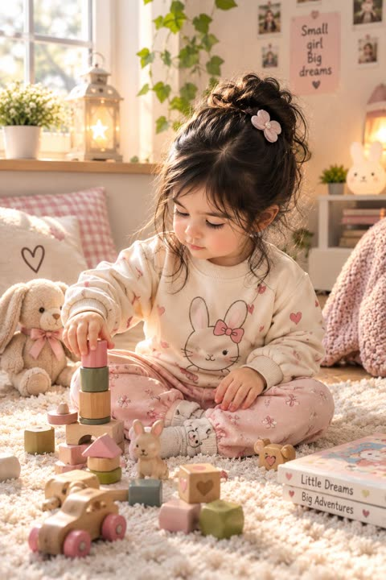

# 写实照片

[返回目录](../../README_zh.md) · 全部 44 条

<a id="gpt-image-pencil-essay-coffee-stain"></a>
### 带咖啡渍的线格纸铅笔手写文章

<a href="https://x.com/chetaslua/status/2095556181012128005"></a>

提示词先限定媒介（8.5x11 线格纸上的铅笔字）和拍摄方式（手机照片）。再要求笔迹有变化，并指定一处角落的咖啡渍作为小瑕疵，真实感由此而来。

GPT Image 2.5 · 文生图 · 出处: [@chetaslua on X](https://x.com/chetaslua/status/2095556181012128005) · 614 赞，统计于 2026-10-27

[`handwriting`](tags.md#tag-handwriting) [`paper`](tags.md#tag-paper) [`phone-photo`](tags.md#tag-phone-photo) [`texture`](tags.md#tag-texture) [`coffee-stain`](tags.md#tag-coffee-stain)

<details><summary><b>提示词</b></summary>

```text
🚨 GPT-Image-2.5 Output

I said it to write like einstein it did it without reference < i did not give image or anything   >

left side is AI and right side is real photo from reddit to compare

Prompt : a photorealistic, taken by phone photo of a handwritten essay in pencil, albert einstein handwriting, on an 8.5x11 piece of lined paper, about the history of money in world. make sure there is variance in the writing in a very einstein way. give it a slight coffee stain on the top right corner
```

</details>

<a id="nano-banana-monstera-leaf-hidden-words"></a>
### 龟背竹叶片缝隙中浮现隐藏文字

<a href="https://x.com/fofrAI/status/2107509669514113058"></a>

提示词只指定一个真实物体，并要求文字从它的天然特征中自然浮现，字形顺着叶片自身的裂口生成，而不是叠加在表面。简洁的背景让缝隙更容易被读成字母。

Nano Banana 2.1 · 文生图 · 出处: [@fofrAI on X](https://x.com/fofrAI/status/2107509669514113058) · 549 赞，统计于 2026-10-28

[`text-in-image`](tags.md#tag-text-in-image) [`monstera`](tags.md#tag-monstera) [`nature`](tags.md#tag-nature) [`typography`](tags.md#tag-typography) [`photo`](tags.md#tag-photo)

<details><summary><b>提示词</b></summary>

```text
A photo of a monstera leaf against a simple backdrop, cleverly and organically appearing within the natural gaps of the leaf are the words Nano Banana
```

</details>

<a id="gpt-image-forest-clearing-foliage-noise-test"></a>
### 阳光洒落的林间空地与茂密绿叶

<a href="https://x.com/mark_k/status/2097411028510179759"></a>

一句话点明主体、照片媒介和高细节要求，可作为噪点伪影测试，因为密集重复的树叶最容易暴露纹理涂抹和颗粒问题。提示词很短，光线与构图交由模型自行决定。

GPT Image 2.5 · 文生图 · 出处: [@mark_k on X](https://x.com/mark_k/status/2097411028510179759) · 415 赞，统计于 2026-10-27

[`forest`](tags.md#tag-forest) [`nature`](tags.md#tag-nature) [`foliage`](tags.md#tag-foliage) [`texture-test`](tags.md#tag-texture-test) [`landscape`](tags.md#tag-landscape)

<details><summary><b>提示词</b></summary>

```text
GPT-Image-2.5 has arrived in
@ChatGPT
 🔥

It features many improvements, but I couldn't help myself from doing the infamous "noise artifact" test.

The results are mixed!

Prompt: "Photo of a clearing in the woods with lots of green foliage, highly detailed"

See for yourself:
```

</details>

<a id="gpt-image-fisheye-tiny-planet-stepping-sneaker-plaza"></a>
### 鱼眼小星球广场与迈步跨过镜头的球鞋

<a href="https://x.com/AiwithLariab/status/2067484351378690487"></a>

用 8mm 极端鱼眼加贴地仰拍视角，并点明前景鞋底和伸向镜头的手，让主体占满画面。建筑沿边缘环绕、中央留出云天，形成小星球式的纵深与尺度感。

GPT Image 2 · 文生图 · 出处: [@AiwithLariab on X](https://x.com/AiwithLariab/status/2067484351378690487) · 401 赞，统计于 2026-10-29

[`fisheye`](tags.md#tag-fisheye) [`tiny-planet`](tags.md#tag-tiny-planet) [`worms-eye-view`](tags.md#tag-worms-eye-view) [`street-photography`](tags.md#tag-street-photography) [`travel`](tags.md#tag-travel)

<details><summary><b>提示词</b></summary>

```text
Ultra-realistic action photography, extreme fisheye lens, 8mm, worm’s-eye view from ground level, dynamic urban plaza scene. A stylish young person appears to be stepping over the camera, one sneaker sole dominating the foreground, hand reaching toward the lens.. Massive circular “tiny planet” perspective with historic European architecture curving around the edges of the frame, bright blue sky filled with fluffy white clouds at the center. Cinematic composition, dramatic distortion, ultra-wide angle, vibrant colors, sharp focus, HDR, photorealistic, highly detailed skin texture, travel photography aesthetic, motion energy, depth and scale, 8K resolution, professional DSLR quality, masterpiece, Instagram viral shot. Aspect Ratio 4:5.
```

</details>

<a id="nano-banana-json-reconstruction"></a>
### 逐项复刻一张照片的 JSON 提示词

<a href="https://x.com/ViralOps_/status/2107538470818484305"></a>

按 JSON 字段写（构图、光线、色彩、负面词）。原帖用同一段 JSON 对比了 Nano Banana 2.1 和 GPT Image 2.5。

Nano Banana 2.1 · 上传图改图 · 出处: [@ViralOps_ on X](https://x.com/ViralOps_/status/2107538470818484305) · 326 赞，统计于 2026-10-27

[`json`](tags.md#tag-json) [`reconstruction`](tags.md#tag-reconstruction) [`comparison`](tags.md#tag-comparison)

<details><summary><b>提示词</b></summary>

```text
{
  "prompt_type": "detailed_image_reconstruction",
  "aspect_ratio": "4:5 vertical portrait",
  "overall_goal": "Recreate the visual appearance, framing, lighting, styling, and casual smartphone-photo feel of the reference image as closely as possible while keeping the result photorealistic and natural.",

  "subject": {
    "type": "young adult woman",
    "age_range": "early to mid 20s",
    "pose": "standing indoors, upper body turned slightly away from the camera while her face turns toward the lens",
    "body_position": "relaxed casual posture with shoulders slightly angled",
    "expression": "soft neutral expression with a subtle pout, calm and confident",
    "gaze": "looking directly toward the camera",
    "styling": "minimal everyday styling, clean and natural"
  },

  "face": {
    "shape": "soft oval face with a gently tapered jawline",
    "forehead": "medium-height forehead partly framed by center-parted hair",
    "eyebrows": "natural medium-thick dark brown eyebrows with a soft arch",
    "eyes": {
      "shape": "almond-shaped",
      "color": "light brown to hazel",
      "appearance": "bright eyes with visible catchlights",
      "lashes": "long defined eyelashes with subtle mascara"
    },
    "nose": "small straight nose with a softly rounded tip",
    "lips": {
      "shape": "full lips with a defined cupid's bow",
      "color": "natural rosy pink",
      "finish": "soft satin finish, not glossy"
    },
    "skin": {
      "tone": "light warm-neutral skin tone",
      "texture": "smooth natural skin with subtle pores and realistic tonal variation",
      "cheeks": "soft natural pink flush",
      "finish": "fresh luminous skin without heavy retouching"
    },
    "makeup": "very light natural makeup, softly defined lashes, subtle blush, natural pink lips, no dramatic contour"
  },

  "hair": {
    "color": "rich medium-to-dark chocolate brown",
    "length": "very long, extending well below the chest",
    "parting": "clean center part",
    "texture": "mostly straight with very soft natural bends through the lower lengths",
    "density": "thick and healthy-looking",
    "finish": "smooth and glossy but still realistic",
    "front_sections": "two thin face-framing strands falling naturally along both sides of the face",
    "details": "visible individual strands, subtle flyaways near the crown, realistic highlights from sunlight, natural uneven strand separation",
    "movement": "hair hanging naturally over both shoulders and down the front of the shirt"
  },

  "clothing": {
    "top": "oversized plain white crew-neck T-shirt",
    "fit": "loose casual fit",
    "fabric": "soft slightly wrinkled cotton",
    "logos": "none",
    "accessories": "no visible jewelry or prominent accessories"
  },

  "composition": {
    "shot_type": "close upper-body portrait",
    "camera_angle": "slightly above chest level, close to eye level",
    "camera_distance": "approximately arm's-length smartphone distance",
    "subject_position": "face slightly right of center with long hair occupying much of the lower frame",
    "crop": "top of head fully visible, image extending down to around lower torso",
    "orientation": "vertical",
    "perspective": "natural wide smartphone-camera perspective with mild close-range distortion"
  },

  "lighting": {
    "primary_source": "strong warm natural sunlight entering from the side/front through a nearby window",
    "direction": "sunlight striking the subject from camera-left/front",
    "face_effect": "bright warm illumination across the forehead, cheeks, nose, and hair",
    "hair_effect": "distinct brown highlights and soft reflective streaks along individual strands",
    "shadow_quality": "strong but soft-edged natural indoor shadows",
    "exposure": "face slightly brightly exposed while the room behind remains much darker",
    "color_temperature": "warm daylight"
  },

  "environment": {
    "location": "casual indoor residential room",
    "background": "dark gray walls with a white ceiling cornice",
    "left_background": "open doorway or darker hallway area",
    "right_background": "dark wall and partially visible household objects",
    "lower_right": "part of a black tripod or light stand visible",
    "overall_feel": "ordinary lived-in room rather than a studio",
    "depth": "background moderately out of focus but still recognizable"
  },

  "camera": {
    "capture_device": "modern smartphone camera",
    "lens_equivalent": "approximately 24-28mm full-frame equivalent",
    "focus": "sharp focus on face and front hair",
    "depth_of_field": "mostly natural smartphone depth of field with gentle background softness",
    "dynamic_range": "realistic phone-camera HDR with slightly clipped highlights in direct sun",
    "image_character": "casual social-media selfie/photo, not professionally staged"
  },

  "photorealism_details": [
    "real individual hair strands",
    "natural skin pores and micro-texture",
    "subtle peach fuzz",
    "realistic eyelash separation",
    "tiny variations in lip texture",
    "slight fabric creases in the T-shirt",
    "small flyaway hairs around the crown",
    "natural sunlight falloff across the face",
    "slightly imperfect casual framing",
    "realistic indoor shadow noise"
  ],

  "style": {
    "visual_style": "highly photorealistic casual smartphone portrait",
    "mood": "soft, youthful, relaxed, sunlit",
    "processing": "light social-media style processing with warm skin tones and slightly enhanced clarity",
    "avoid": [
      "cinematic movie lighting",
      "studio portrait lighting",
      "overly smooth plastic skin",
      "CGI appearance",
      "anime or illustration",
      "heavy beauty filter",
      "extreme facial symmetry",
      "over-sharpened hair",
      "artificial jet-black hair",
      "dramatic makeup",
      "excessive background blur",
      "professional studio backdrop",
      "text",
      "watermarks",
      "logos"
    ]
  },

  "negative_prompt": "cartoon, anime, illustration, CGI, plastic skin, waxy face, over-retouched skin, excessive beauty filter, unnatural facial symmetry, distorted eyes, crossed eyes, malformed lips, warped face, duplicate hair strands, fake wig appearance, overly black hair, metallic hair shine, stiff hair, messy anatomy, distorted shoulders, extra limbs, extra fingers, studio backdrop, cinematic lighting, dramatic color grading, excessive bokeh, oversaturated colors, text, logo, watermark"
}
```

</details>

<a id="gpt-image-train-platform-snapshot"></a>
### 站台上的手机随手拍

<a href="https://x.com/MissDelulu9/status/2114965450425868519"></a>

靠手机相机的瑕疵出真实感：列车动态模糊、真实噪点、轻微广角变形。

GPT Image 2.5 · 文生图 · 出处: [@MissDelulu9 on X](https://x.com/MissDelulu9/status/2114965450425868519) · 305 赞，统计于 2026-10-27

[`phone-photo`](tags.md#tag-phone-photo) [`street`](tags.md#tag-street) [`motion-blur`](tags.md#tag-motion-blur)

<details><summary><b>提示词</b></summary>

```text
Realistic vertical phone street snapshot of a young woman on an urban train platform, slightly right of center, as a silver train with a green stripe rushes behind in horizontal motion blur. Low angle from waist height, close half-body to mid-thigh, handheld and imperfect.

Long deep-black hair sweeps left in station wind. Oversized brown gradient sunglasses hide her eyes; head tilted upward, lips relaxed, cool distant expression. Small oval face, soft jawline, clean East Asian Y2K makeup, nude-pink lips. Warm-white cropped halter tank, low neckline, fitted ribbed cotton, subtle wrinkles, hem above waist. Low-rise loose vintage gray-brown jeans, layered gold necklaces, black quilted chain bag.

Warm-beige skin with natural texture on shoulders, collarbones, arms, waist and abdomen. Cool fluorescent station light, metallic reflections, yellow tactile paving, concrete floor, blurred passengers in train windows. Real mobile noise, slight wide-angle feel.
```

</details>

<a id="gpt-image-raw-chicken-cinematic-food-commercial"></a>
### 暗色木板上的生鸡肉,电影感美食广告

<a href="https://x.com/DuaFatimaAi/status/2091684066622103675"></a>

提示词把广告拆成四个编号场景,按生鸡肉到炸鸡的顺序推进,每个场景都写明镜头距离和动作。结尾的风格句叠加微距、浅景深、暖光,并要求无文字无标志。

GPT Image 2 · 文生图 · 出处: [@DuaFatimaAi on X](https://x.com/DuaFatimaAi/status/2091684066622103675) · 226 赞，统计于 2026-10-28

[`food`](tags.md#tag-food) [`commercial`](tags.md#tag-commercial) [`macro`](tags.md#tag-macro) [`cinematic`](tags.md#tag-cinematic) [`multi-scene`](tags.md#tag-multi-scene)

<details><summary><b>提示词</b></summary>

```text
Create a hyper-realistic cinematic food commercial showing raw chicken pieces being expertly seasoned and transformed into crispy golden fried chicken.

Scene 1: Close-up of fresh raw chicken pieces arranged on a dark wooden cutting board in a dramatic dark kitchen environment. Soft warm side lighting highlights the natural texture and moisture of the chicken.

Scene 2: A generous blend of spices is sprinkled over the chicken in slow motion. Capture every tiny spice particle floating through the air and landing naturally on the chicken. Use extreme macro detail and shallow depth of field.

Scene 3: The seasoned chicken is carefully lowered into hot oil. Show an intense close-up of the oil rapidly bubbling and sizzling around the chicken, with realistic steam, tiny oil droplets, and crunchy batter forming.

Scene 4: Golden-brown crispy fried chicken is lifted from the hot oil with stainless-steel kitchen tongs. Oil droplets fall back into the pan in slow motion while the crispy textured coating glistens under warm cinematic lighting.

Ultra-realistic food photography, cinematic commercial style, macro close-ups, rich golden tones, realistic textures, dramatic contrast, shallow depth of field, soft background bokeh, slow-motion details, natural movement, professional food advertisement, 4K, highly detailed, appetizing presentation, no text, no logos
```

</details>

<a id="gpt-image-miniature-workers-building-giant-sushi-roll"></a>
### 迷你工人建造巨型寿司卷

<a href="https://x.com/SeeratFatima112/status/2088658313114423488"></a>

提示词把10秒拆成八个带时间码的分镜，每个分镜只写一个动作和一种微距构图，顺序清晰。镜头、声音和画质分段列出，真人手的出现交代了微缩比例。

GPT Image 2 · 文生图 · 出处: [@SeeratFatima112 on X](https://x.com/SeeratFatima112/status/2088658313114423488) · 222 赞，统计于 2026-10-28

[`miniature`](tags.md#tag-miniature) [`macro`](tags.md#tag-macro) [`asmr`](tags.md#tag-asmr) [`food`](tags.md#tag-food) [`video-prompt`](tags.md#tag-video-prompt)

<details><summary><b>提示词</b></summary>

```text
Gpt image 2
Prompt Create a 10-second ultra-realistic cinematic miniature-world video showing tiny construction workers building a giant sushi roll with the help of real human hands. The style is realistic ASMR, satisfying miniature construction, macro photography, highly detailed textures, warm cinematic lighting, shallow depth of field.

Scene 1 — 0:00–0:01: Tiny construction workers use a miniature excavator to scoop freshly cooked white rice and place it into a large bowl. Close-up macro shot, realistic rice texture, tiny machinery sounds.

Scene 2 — 0:01–0:02: A giant human hand pours water into the rice bowl while miniature workers carefully wash and mix the rice. Clear water movement, realistic ASMR sound.

Scene 3 — 0:02–0:03: The rice is transferred into a miniature cooking pot. Steam rises as tiny workers supervise the cooking process. Close-up of the lid opening and warm steam escaping.

Scene 4 — 0:03–0:04: Tiny workers spread the cooked sticky rice evenly across a large sheet of nori using miniature tools, while a human hand gently helps flatten and smooth the rice.

Scene 5 — 0:04–0:05: A tiny construction crane carefully lifts large pieces of fresh salmon and places them neatly on top of the rice. The salmon looks glossy, fresh, and realistic.

Scene 6 — 0:05–0:06: Tiny workers bring cucumber and other colorful sushi vegetables and carefully arrange them in straight layers over the salmon. Macro close-up of the ingredients.

Scene 7 — 0:06–0:07: Several miniature construction workers work together to roll the sushi tightly. A human hand assists by gently pushing and guiding the roll. The nori wraps smoothly around the filling.

Scene 8 — 0:07–0:10: A large human hand uses a sharp sushi knife to cut the finished sushi roll into perfect pieces. Tiny workers celebrate around the completed sushi, raising their hands. Add a small “MISSION COMPLETE” sign.

Camera: macro close-ups, smooth cinematic camera movement, realistic focus pulls, shallow depth of field, detailed miniature perspective.

Audio: satisfying ASMR, rice movement, water pouring, steam, tiny construction machinery, knife cutting through sushi, subtle ambient sounds. No music.

Visual quality: photorealistic, cinematic, highly detailed, realistic human hands, realistic miniature workers, natural physics, clean composition, warm restaurant/kitchen environment, 4K, vertical 9:16, smooth motion, no text except the small “MISSION COMPLETE” sign.
```

</details>

<a id="nano-banana-giant-object-miniature-world-macro"></a>
### 微缩小人在巨型日常物件上搭建的世界

<a href="https://x.com/DrSadek_/status/2033136123342401904"></a>

填空式模板，只替换日常物件，固定 85mm 微距镜头、f/1.8 浅景深和方向性微阴影。物件表面的灰尘与划痕强化了与小人之间的尺度对比。

Nano Banana 2 · 文生图 · 出处: [@DrSadek_ on X](https://x.com/DrSadek_/status/2033136123342401904) · 219 赞，统计于 2026-10-28

[`macro`](tags.md#tag-macro) [`miniature`](tags.md#tag-miniature) [`surreal`](tags.md#tag-surreal) [`template`](tags.md#tag-template) [`tilt-shift`](tags.md#tag-tilt-shift)

<details><summary><b>提示词</b></summary>

```text
Create a hyper-realistic macro photograph of a miniature surreal scene. The environment is dominated by a giant, oversized <everyday object>, which has been repurposed as a bustling landscape. Tiny, highly detailed miniature human figures are interacting around and on the object. Shot on an 85mm macro lens with a shallow depth of field (f/1.8) to heavily blur the distant background. Lighting is soft, directional, and casts appropriate micro-shadows to emphasize the massive scale of the object relative to the figures. Intricate environmental details like dust particles and surface scratches are visible on the object. Cinematic, photorealistic, 4K.
```

</details>

<a id="gpt-image-bosphorus-night-kofte-caravan-stall"></a>
### 博斯普鲁斯海岸夜间肉丸餐车摊

<a href="https://x.com/ozansihay/status/2107544398531637407"></a>

提示词叠加了具体的场景层次（自制霓虹招牌、炭火光、塑料凳、大水桶、渡轮剪影），并把土耳其语招牌文字在招牌和服务员衣背上各写一次。35mm f/1.8、胶片颗粒、湿沥青反光等摄影参数，加上结尾的文字不出错要求，保证了写实感和字样准确。

GPT Image 2.5 · 文生图 · 出处: [@ozansihay on X](https://x.com/ozansihay/status/2107544398531637407) · 216 赞，统计于 2026-10-28

[`night-street`](tags.md#tag-night-street) [`food-stall`](tags.md#tag-food-stall) [`istanbul`](tags.md#tag-istanbul) [`neon-sign`](tags.md#tag-neon-sign) [`documentary`](tags.md#tag-documentary)

<details><summary><b>提示词</b></summary>

```text
Aynı promptu sırasıyla şu modeller ile denedim;
-Nano Banana 2.1
-GPT Image 2.5
-Grok Imagine 2.0
-Ideogram 4.5

Prompt: Ultra-realistic night street photograph on the Istanbul Bosphorus waterfront. A tiny makeshift caravan food stall, slightly battered metal sides, steam rising. Hand-painted neon-style rickety sign reading “Köfteci Buğra Usta” in Turkish, glowing uneven cyan and warm amber, wires and brackets visibly DIY. Inside the open caravan, the usta grilling köfte over charcoal, orange ember glow on his face and apron. One waiter in a simple dark shirt stands in front of the stall; the same “Köfteci Buğra Usta” lettering is printed on the back of his shirt. Plastic stools and small low tables outside, a few locals eating, soft conversation. A plastic water jug (damacana) near the counter. Behind them, dark Bosphorus water with distant city lights and a faint ferry silhouette. Wet asphalt reflections, streetlamp spill, shallow depth of field, natural film grain, shot on 35mm f/1.8, candid documentary look, no CGI look, no text errors on signs.
```

</details>

<a id="gpt-image-plastic-bag-sea-animal-sculpture"></a>
### 塑料袋拼成的座头鲸雕塑

<a href="https://x.com/ShamsAmin56/status/2062836449729474727"></a>

模板把动物、身体特征、塑料袋颜色和背景做成可替换的空位，一套结构就能出一整个系列。写明袋面纹理、绑结、白色提手和印刷图案，让画面更像手工雕塑的真实质感，纯色柔和背景加边角散落的塑料袋用来收束构图。

GPT Image 2 · 文生图 · 出处: [@ShamsAmin56 on X](https://x.com/ShamsAmin56/status/2062836449729474727) · 214 赞，统计于 2026-10-28

[`plastic-bags`](tags.md#tag-plastic-bags) [`sculpture`](tags.md#tag-sculpture) [`sea-animals`](tags.md#tag-sea-animals) [`environmental`](tags.md#tag-environmental) [`template`](tags.md#tag-template)

<details><summary><b>提示词</b></summary>

```text
A highly detailed realistic photograph of a creative sculpture of a [SEA ANIMAL] made entirely from colorful recycled plastic bags and shopping bags tied and shaped into the animal form, with [specific features like fins, tentacles, shell, etc] from knotted and arranged [color] bags, head/eyes from cutouts or printed sections, in the exact style of handmade plastic bag animal art sculptures with visible bag textures, wrinkles, ties, white strings/handles, and brand prints. Solid soft light [background color like mint green / turquoise / pale blue] background, 9:16 portrait ratio. Add a few loose colorful plastic bags scattered subtly at the bottom and side borders of the frame, slightly visible.

How to Edit (Very Easy Steps):

Replace [SEA ANIMAL] → e.g. sea turtle, shark, octopus, dolphin, jellyfish

Replace [SPECIFIC FEATURES] → Describe the body parts Example: detailed shell patterns, flippers from knotted blue and green bags

Replace [COLORS] → Main colors used Example: blue, green, yellow and white

Replace [BACKGROUND COLOR] → Choose soft colors Example: mint green, turquoise, pale blue, light gray-blue, coral pink
```

</details>

<a id="nano-banana-floating-objects-spiral-bedroom-tunnel"></a>
### 漂浮日用品螺旋隧道中的卧室女子

<a href="https://x.com/AiwithLariab/status/2048074285953290537"></a>

用日常物品组成向房间深处收拢的螺旋，在居中安静的人物周围形成隧道纵深。广角、浅景深和轻微动态模糊表现旋转感，渲染引擎关键词定下质感。

Nano Banana 2 · 文生图 · 出处: [@AiwithLariab on X](https://x.com/AiwithLariab/status/2048074285953290537) · 207 赞，统计于 2026-10-28

[`surreal`](tags.md#tag-surreal) [`spiral`](tags.md#tag-spiral) [`bedroom`](tags.md#tag-bedroom) [`wide-angle`](tags.md#tag-wide-angle) [`bokeh`](tags.md#tag-bokeh)

<details><summary><b>提示词</b></summary>

```text
A women sitting calmly at the center of a wide horizontal swirling spiral made of everyday objects (books, cups, pens, shoes, clothes, pillows, blankets, bags etc) floating and rotating gently around her, the swirling motion expanding outward and receding deep into the bedroom toward the back wall, creating a dynamic tunnel-like depth effect. The room is a normal cozy bedroom with a bed, desk, and soft daylight from a window. Cinematic wide-angle composition, natural warm lighting, shallow depth of field with creamy bokeh, subtle motion blur showing rotation, sharp focus on the man's face. Octane render & unreal engine 5.
```

</details>

<a id="gpt-image-fisheye-tiny-planet-red-tracksuit-plaza"></a>
### 鱼眼小星球广场与跃起的红裤女孩

<a href="https://x.com/AvelyrahnAI/status/2063816992583487927"></a>

开头就写明8mm鱼眼镜头和贴地视角，并让鞋底压向镜头来夸大纵深。小星球式弯曲把建筑卷到画面边缘，天空占据中心。

GPT Image 2 · 文生图 · 出处: [@AvelyrahnAI on X](https://x.com/AvelyrahnAI/status/2063816992583487927) · 177 赞，统计于 2026-10-28

[`fisheye`](tags.md#tag-fisheye) [`tiny-planet`](tags.md#tag-tiny-planet) [`low-angle`](tags.md#tag-low-angle) [`street-fashion`](tags.md#tag-street-fashion) [`travel-photography`](tags.md#tag-travel-photography)

<details><summary><b>提示词</b></summary>

```text
Ultra-realistic action photography, extreme fisheye lens (8mm), worm’s-eye view from ground level, dynamic urban plaza scene. A stylish young woman appears to be stepping over the camera, one sneaker sole dominating the foreground, hand reaching toward the lens. She wears oversized red track pants with white side stripes, a fitted white crop top, red-and-white high-top sneakers, and silver headphones. Wind-blown dark hair, natural beauty, confident expression. Massive circular “tiny planet” perspective with historic European architecture curving around the edges of the frame, bright blue sky filled with fluffy white clouds at the center. Cinematic composition, dramatic distortion, ultra-wide angle, vibrant colors, sharp focus, HDR, photorealistic, highly detailed skin texture, travel photography aesthetic, motion energy, depth and scale, 8K resolution, professional DSLR quality, masterpiece, Instagram viral shot.
```

</details>

<a id="nano-banana-glass-vitrine-food-cross-section"></a>
### 玻璃展柜中的班尼迪克蛋剖面

<a href="https://x.com/AllaAisling/status/2032846968154657147"></a>

填空式模板,固定平视机位和纯色背景,并把深度、温度、做法刻在玻璃上作为标注。指定参考气质并要求玻璃光学真实,避免假3D感。

Nano Banana 2 · 文生图 · 出处: [@AllaAisling on X](https://x.com/AllaAisling/status/2032846968154657147) · 154 赞，统计于 2026-10-29

[`food`](tags.md#tag-food) [`cross-section`](tags.md#tag-cross-section) [`glass`](tags.md#tag-glass) [`template`](tags.md#tag-template) [`labels`](tags.md#tag-labels)

<details><summary><b>提示词</b></summary>

```text
Prompt Studio: Glass Box Cross Section, with Nano Banana 2 in Firefly

[DISH] sealed inside a flawless glass vitrine, cross-sectioned dead center,  camera locked at exact eye level, pure [COLOR] studio background.  Every internal layer exposed with surgical precision, ingredients stacked  perfectly, sauces at exact depths, condensation fogging the upper glass.  Labels engraved directly on the glass in fine sans-serif: "[INGREDIENT]  [depth]  [temp]  [prep method]" Thin measurement lines. Architectural layer callouts. No floating text.  Dish name engraved on glass base: "[DISH NAME]" Tagline below in italics: "[TAGLINE]"  Mood: Apple product launch meets Michelin kitchen dissection.  Appetizing, precise, craveable. Glass must look optically real, thickness, refraction, edge glow. No fake 3D render look. 4K, tack sharp.

Check ALTs for ideas 👇
@AdobeFirefly
```

</details>

<a id="gpt-image-cumulus-cloud-river-reflection-countryside"></a>
### 乡村河流中倒映的积云与小教堂

<a href="https://x.com/churvikv/status/2095472478340468762"></a>

提示词按环境、光线、材质、构图分块，并在每块里写明要避免的内容，如过曝的白色和占据画面的道路。高空俯视视角加上 S 形河道，把云的倒影托成画面主角。

GPT Image 2 · 文生图 · 出处: [@churvikv on X](https://x.com/churvikv/status/2095472478340468762) · 148 赞，统计于 2026-10-29

[`landscape`](tags.md#tag-landscape) [`clouds`](tags.md#tag-clouds) [`reflection`](tags.md#tag-reflection) [`aerial-view`](tags.md#tag-aerial-view) [`countryside`](tags.md#tag-countryside)

<details><summary><b>提示词</b></summary>

```text
A painterly, highly detailed landscape scene with a luminous blue summer sky dominated by towering white cumulus clouds, rendered in a romantic fine-art campaign style. The hero is the dramatic cloud formation and its near-symmetrical reflection in a calm winding river, with patchwork farmland, dense green trees, and a small village church adding scale and pastoral elegance.

Environment:
• Elevated panoramic view over a rural countryside with a broad horizon line
• Massive vertical cloud towers filling most of the upper frame, clustered and sculptural, with soft lavender-gray shading in their interiors
• A reflective river curves through the center of the landscape, mirroring the clouds almost perfectly
• Surrounding fields in green, tan, and muted gold arranged in large geometric plots
• Dense tree lines along the riverbanks, with a few small red-roofed buildings near the water
• A church with a tall dark spire and pale walls positioned right of center in the mid-distance
• Avoid urban elements, roads dominating the frame, modern infrastructure, and visual clutter

Lighting:
• Bright daytime sunlight with crisp atmospheric clarity
• Soft but defined illumination across the clouds, emphasizing volume and height
• Even landscape exposure with gentle contrast and clear reflections in the water
• No harsh blown-out whites, no muddy shadows, no dramatic sunset tones

Materials:
• Billowing cloud masses with soft, cotton-like texture and subtle cool-shadow coloration
• Glassy river surface with mirror-like reflection and slight natural softness
• Organic tree canopies, cultivated farmland textures, stucco walls, dark church spire, clay-tile rooftops

Composition:
• Vertical aspect ratio
• High aerial or hilltop viewpoint looking slightly downward across the valley
• River forms a strong S-curve leading from foreground to mid-ground
• Cloud reflection occupies the lower center, echoing the cloud mass above
• Church and village serve as secondary focal
```

</details>

<a id="gpt-image-sailing-ship-glassy-mountain-lake-god-rays"></a>
### 雪山倒影湖面上的帆船与穿云光束

<a href="https://x.com/churvikv/status/2076263875389903041"></a>

提示词先锁定居中的主体，再依次叠加天空、云后太阳、两侧雪峰和镜面湖水，让倒影复现画面中的每个元素。结尾用光照与分辨率风格词收束，画面干净清晰。

GPT Image 2 · 文生图 · 出处: [@churvikv on X](https://x.com/churvikv/status/2076263875389903041) · 141 赞，统计于 2026-10-29

[`landscape`](tags.md#tag-landscape) [`sailing-ship`](tags.md#tag-sailing-ship) [`mountains`](tags.md#tag-mountains) [`reflection`](tags.md#tag-reflection) [`god-rays`](tags.md#tag-god-rays)

<details><summary><b>提示词</b></summary>

```text
A majestic three-masted sailing ship floats on a perfectly still, glassy lake, centered in a dramatic mountain landscape under a bright, clear sky. The brilliant sun is partially hidden behind voluminous, fluffy white clouds, creating a soft, diffused glow with majestic crepuscular rays (God rays) beaming down. The sky is a vibrant, crystal-clear azure blue. Sharp, snow-capped jagged mountain peaks rise on both sides, adding grandeur to the scene. The water acts as a flawless mirror, perfectly reflecting the white sails of the ship, the bright clouds, and the vivid blue tones of the sky. The atmosphere is serene and uplifting, characterized by smooth gradients, clean lines, and high-definition clarity. Style: Digital fantasy illustration, photorealistic lighting, 8k resolution
```

</details>

<a id="gpt-image-giant-cat-living-room-chase"></a>
### 女子在客厅里逃离巨型家猫

<a href="https://x.com/Adnan_Ai2/status/2104888724727468359"></a>

提示词先锁定人物的脸、眼镜、服装和体型，让整段保持一致，再明确大小对比，并为每个镜头分工：猫用低机位，人物用反应特写，环境用远景建立。暖色灯光与冷色月光的对比增加了空间层次。

GPT Image 2.5 · 上传图改图 · 出处: [@Adnan_Ai2 on X](https://x.com/Adnan_Ai2/status/2104888724727468359) · 127 赞，统计于 2026-10-28

[`giant-cat`](tags.md#tag-giant-cat) [`cinematic`](tags.md#tag-cinematic) [`photorealistic`](tags.md#tag-photorealistic) [`face-consistency`](tags.md#tag-face-consistency) [`vertical-9-16`](tags.md#tag-vertical-9-16)

<details><summary><b>提示词</b></summary>

```text
Prompt 2 — Funny Monster Cat Adventure
Create a long, cinematic, photorealistic video showing a funny but dramatic adventure between a woman and a gigantic house cat. Start with the woman peacefully inside her cozy living room, then reveal an enormous fluffy cat entering the background. The woman notices the giant cat, freezes for a moment in disbelief, and then suddenly runs toward the camera while looking over her shoulder. The giant cat follows behind her with exaggerated but realistic movements, creating a playful giant-monster effect.
Keep the woman’s face, hairstyle, glasses, outfit, body proportions, and overall appearance consistent from beginning to end. Give her natural frightened and surprised expressions without making them exaggerated or cartoonish. The giant cat should look extremely realistic, with individual strands of fur, detailed ears, long whiskers, realistic paws, natural blinking, subtle breathing, and believable body movement. Make the size difference between the woman and the cat visually impressive.
Set the entire scene inside a warm, stylish apartment at night. Include a sofa, patterned cushions, a soft blanket, plants, bookshelves, lamps, coffee table, pet accessories, and realistic small decorations. As the chase develops, show cushions moving slightly, the woman running around furniture, and the giant cat carefully following her through the room. Use dynamic tracking shots, a low-angle perspective for the cat, close-up reaction shots of the woman, wide establishing shots, and smooth cinematic camera transitions. Add realistic motion blur, natural hair and clothing movement, soft shadows, warm practical lighting, cool moonlight through the window, atmospheric depth, shallow depth of field, realistic reflections, and premium movie-style cinematography. The final result should feel like a humorous cinematic fantasy scene with realistic visual effects, not an animated cartoon. Ultra-photorealistic, highly detailed, cinematic lighting, professional color grading, realistic physics and movement, 8K quality, vertical 9:16 composition.
```

</details>

<a id="gpt-image-neon-yacht-moonlit-harbour-reflections"></a>
### 月夜港湾中的霓虹游艇

<a href="https://x.com/churvikv/status/2109710598972035578"></a>

提示词按港口、月亮、游艇、山丘、小镇、倒影、色板分成带标签的段落，每个元素都有固定位置和颜色。单独的倒影段落规定了游艇下方的洋红与青色色带和其余水面的琥珀色光柱，水面因此呈现丝带般的效果。

GPT Image 2.5 · 文生图 · 出处: [@churvikv on X](https://x.com/churvikv/status/2109710598972035578) · 127 赞，统计于 2026-10-28

[`night-scene`](tags.md#tag-night-scene) [`harbour`](tags.md#tag-harbour) [`neon`](tags.md#tag-neon) [`reflections`](tags.md#tag-reflections) [`panoramic`](tags.md#tag-panoramic)

<details><summary><b>提示词</b></summary>

```text
Photorealistic night harbour scene, wide 16:9 panoramic composition, cinematic, ultra-detailed. Edge to edge, no frame, no border.

HARBOUR: the lower half is calm black water rippling in fine horizontal chop, carrying long smeared vertical reflections that stretch down the frame.

MOON: high in the upper middle of the deep navy night sky hangs one enormous, sharply detailed full moon, its craters crisp, ringed by a soft cool blue-white halo. The sky is darkest at the top corners, paling slightly toward the horizon.

BOAT: just left of centre sits a sleek modern white motor yacht at rest, seen broadside from the front-left. Its flanks are washed in vivid neon ultraviolet magenta along the hull and glowing electric cyan along the upper deck and railings, with a dark tinted glass bridge, a radar mast, a blue-lit stern platform and a line of small dark portholes.

HILLS: behind, layered dark ridgelines rise across the full width, their slopes dotted with scattered warm gold lights of hillside villas and small windows.

TOWN: along the water's edge runs a continuous waterfront promenade of low pale buildings with warm golden lit façades, arcades, windows and streetlamps. A row of moored white boats and small yachts lines the quay in dark silhouette.

REFLECTIONS: the water is split into ribbons of colour. Directly beneath the yacht run two bold vertical bands — bright magenta and electric cyan — vivid and saturated, broken into short ripples. Across the rest of the surface, the town lights throw long warm amber and orange columns, with cooler teal and deep green streaks threading between them in the lower right.

PALETTE: deep navy, near-black water, brilliant magenta, electric cyan, warm amber gold, teal green, silver-white moon. Sharp focus, high dynamic range, glossy wet highlights, clean and unmarked.
```

</details>

<a id="nano-banana-paris-flag-miniature-city-diorama"></a>
### 巴黎旗帜幻化成的微缩地标城市

<a href="https://x.com/Sheldon056/status/2034418908506296520"></a>

用方括号 [PARIS] 做占位词，可替换成任意国家或城市的旗帜。相机机身、镜头、光圈和光线方向锁定写实质感，旗帜布料变成建筑加上微缩游客，带来超现实的尺度感。

Nano Banana 2 · 文生图 · 出处: [@Sheldon056 on X](https://x.com/Sheldon056/status/2034418908506296520) · 106 赞，统计于 2026-10-28

[`miniature`](tags.md#tag-miniature) [`diorama`](tags.md#tag-diorama) [`flag`](tags.md#tag-flag) [`landmark`](tags.md#tag-landmark) [`photorealistic`](tags.md#tag-photorealistic)

<details><summary><b>提示词</b></summary>

```text
Google Nano Banana 2 on Gemini.

Prompt: Photorealistic hero product photography shot on Sony A7III with 85mm f/1.4 lens at f/2.8, soft natural daylight from upper left creating gentle realistic shadows and visible surface textures: A cutaway [PARIS] flag ingeniously transformed into a luxurious miniature landmark city. The fabric forms iconic buildings, rivers, and glowing streets. Miniature visitors in tiny colorful clothes explore monuments, ride boats, and take photos. Intricate details, physically plausible yet surreal. Shot for a luxury architecture magazine cover, ultra-detailed 8K, perfectly centered square composition, aspect ratio 1:1, no text, no artifacts.
```

</details>

<a id="gpt-image-giant-fruit-miniature-workers-watercolor-pair"></a>
### 巨型水果与迷你工人的实拍和水彩双版本

<a href="https://x.com/mehwishkiran07/status/2107803591281168600"></a>

提示词逐一写明工人数量、着装和梯子位置来锁定画面，再用微距摄影和黄金时段光线词强化真实感。第二版要求沿用同一构图改成水彩手账风并在底部加衬线文字，一张图里得到风格成对的两个版本。

GPT Image 2.5 · 文生图 · 出处: [@mehwishkiran07 on X](https://x.com/mehwishkiran07/status/2107803591281168600) · 91 赞，统计于 2026-10-28

[`miniature`](tags.md#tag-miniature) [`diorama`](tags.md#tag-diorama) [`macro`](tags.md#tag-macro) [`watercolor`](tags.md#tag-watercolor) [`dual-style`](tags.md#tag-dual-style)

<details><summary><b>提示词</b></summary>

```text
A whimsical miniature fantasy scene featuring a gigantic ripe red strawberry growing in a lush green strawberry field. The strawberry is enormous, perfectly centered, with highly detailed glossy red skin covered in hundreds of tiny yellow seeds and fresh green leaves on top. A short brown stem rises from the center.
Surrounding the giant strawberry are five tiny miniature farm workers wearing dark navy work clothes, orange safety helmets, and work boots. They are working around the strawberry as if maintaining and harvesting it. Two workers are climbing tall wooden ladders on both sides of the strawberry, carefully working near its surface. Another worker stands halfway up the right ladder, while another works near the bottom using a small gardening tool. The tiny human scale compared with the enormous strawberry creates a magical miniature-world effect.
The strawberry sits directly on rich dark soil surrounded by tiny green strawberry plants, grass, leaves, and natural ground details. The background is a beautiful softly blurred green agricultural field with warm golden sunlight streaming from above, creating glowing rays, atmospheric haze, creamy bokeh, and a dreamy cinematic mood.
Ultra-realistic macro photography, photorealistic miniature diorama, highly detailed strawberry texture, realistic tiny workers, intricate wooden ladders, natural soil and vegetation, cinematic depth of field, soft background blur, warm golden-hour lighting, volumetric sun rays, realistic shadows, vibrant natural colors, magical scale contrast, whimsical fantasy realism, premium AI art.
Then create a second version in a vintage watercolor scrapbook illustration style using the exact same composition and characters. Place the scene on textured warm cream watercolor paper, surrounded by loose watercolor splashes of orange, yellow, green, and earthy tones. Add soft painted foliage and an artistic sunset circle behind the strawberry, with visible watercolor brush strokes, subtle paper grain, handmade imperfections, and an elegant nostalgic storybook aesthetic.
At the bottom of the watercolor version, add elegant minimalist serif typography:
“SWEET MOMENTS”
“LIFE”
Vertical composition, centered subject, premium editorial scrapbook poster, charming miniature fantasy, highly detailed, cinematic realism blended with delicate watercolor art.
```

</details>

<a id="nano-banana-supper-club-lobster-roll-tray"></a>
### 烛光晚宴女侍者手托银盘龙虾卷

<a href="https://x.com/oye_samia/status/2054101412976738575"></a>

提示词把银盘定为唯一视觉焦点，并用正面略仰视的中景构图围绕它展开。单向烛光、指定相机镜头，再加上禁止塑料感和CGI感的负面描述，让画面更接近真实摄影。

Nano Banana 2 · 文生图 · 出处: [@oye_samia on X](https://x.com/oye_samia/status/2054101412976738575) · 89 赞，统计于 2026-10-29

[`supper-club`](tags.md#tag-supper-club) [`candlelight`](tags.md#tag-candlelight) [`food-photography`](tags.md#tag-food-photography) [`low-angle`](tags.md#tag-low-angle) [`photorealistic`](tags.md#tag-photorealistic)

<details><summary><b>提示词</b></summary>

```text
Hyper-realistic vertical photograph 4:5. Private dining area of an exclusive supper club with dark wooden panels, burgundy velvet curtains, golden candlelight, and a deep anthracite background.
A stunning woman stands frontally, medium shot from the chest up, slight low angle. She holds with both hands an ornate oval silver tray extended toward the camera. On the tray is a perfect ring of 12 miniature lobster rolls on brioche buns with pink lobster meat. The silver tray is the main focal point of the scene.
Clothing: Elegant black Adidas Originals Firebird-inspired zip-up cropped jacket with three white stripes and Trefoil logo, worn over a starched white fitted dress shirt with a black silk bow tie, paired with a sleek high-waisted black mini skirt or tailored black trousers, statement AP Royal Oak watch in steel, delicate silver rings and earrings.
Lighting: Warm, low golden-amber candlelight coming from the right, sculpting her face and creating beautiful highlights on the silver tray. Deep dramatic shadows on the left. Monochrome black with luxurious gold accents.
Camera: Sony A7R V, 50mm f/1.4 lens, 8K resolution, natural skin texture, natural depth of field with soft organic candle bokeh. No plasticity, no CGI, no AI artifacts.
```

</details>

<a id="nano-banana-miniature-toy-kingdom-macro-sunrise"></a>
### 有火车、瀑布和飞艇的微缩玩具王国

<a href="https://x.com/kellyyjjones/status/2076163025464348955"></a>

提示词先列出具体场景元素（集市街道、火车、桥、瀑布）和塑料、木头、布料、金属的材质，再用微距镜头、极浅景深和金色日出体积光，让玩具世界显得真实。第二段加入俯视的巨人观察者来强调尺度对比。

Nano Banana 2 · 文生图 · 出处: [@kellyyjjones on X](https://x.com/kellyyjjones/status/2076163025464348955) · 82 赞，统计于 2026-10-29

[`miniature`](tags.md#tag-miniature) [`toy-world`](tags.md#tag-toy-world) [`macro`](tags.md#tag-macro) [`golden-light`](tags.md#tag-golden-light) [`fantasy`](tags.md#tag-fantasy)

<details><summary><b>提示词</b></summary>

```text
A breathtaking ultra-realistic miniature toy universe where every living toy has its own thriving civilization. Tiny colorful cities filled with beautifully crafted toy houses, bustling streets, miniature trains, toy cars, bicycles, and tiny marketplaces full of life. Little toy people laugh, work, and explore while mechanical birds fly overhead and tiny airships drift across the sky. Enormous toy trees tower above the landscape, surrounded by crystal-clear rivers, glowing waterfalls, magical bridges, miniature mountains, and lush forests. Every surface reveals realistic plastic, wood, fabric, and metal textures with intricate craftsmanship. Warm golden sunrise light bathes the world in soft cinematic rays, creating volumetric lighting, gentle lens flares, and dreamy atmospheric fog. Captured in macro photography with an extreme shallow depth of field, making the tiny world feel astonishingly real. Pixar-inspired wonder blended with Hollywood fantasy, ultra-photorealistic, hyper-detailed, Unreal Engine 5 quality, global illumination, ray tracing, HDR, 8K, masterpiece, award-winning cinematic concept art.

A breathtaking ultra-realistic cinematic scene of a giant human standing above a magical toy universe, carefully observing the tiny toy world below. The man looks amazed and curious as he watches miniature toy cities, toy people, tiny vehicles, colorful houses, and a fantasy toy kingdom built like a living world. Massive scale difference between the human and the miniature world, macro photography perspective, cinematic lighting, warm golden sunlight, realistic textures, shallow depth of field, fantasy atmosphere, ultra detailed, 8K, masterpiece quality.
Is koo b improve karoo
```

</details>

<a id="gpt-image-giant-croissant-woodland-picnic-tug-of-war"></a>
### 女子与兔子松鼠在森林野餐中争抢巨型可颂

<a href="https://x.com/Adnan_Ai2/status/2107434655083577768"></a>

先固定人物的服装、发型和比例来锁定角色，再按镜头顺序写出场景，包含拉远揭示、低机位和慢动作上举等运镜。结尾堆叠毛发、碎屑、金色逆光和景深等写实要求，并附负面清单，让巨型食物和动物显得可信。

GPT Image 2.5 · 上传图改图 · 出处: [@Adnan_Ai2 on X](https://x.com/Adnan_Ai2/status/2107434655083577768) · 79 赞，统计于 2026-10-29

[`fantasy`](tags.md#tag-fantasy) [`giant-food`](tags.md#tag-giant-food) [`woodland`](tags.md#tag-woodland) [`animals`](tags.md#tag-animals) [`golden-hour`](tags.md#tag-golden-hour)

<details><summary><b>提示词</b></summary>

```text
🎬 Prompt 2 — More Viral / Magical AI Video
Generate a premium photorealistic fantasy short film in a magical woodland picnic environment. Maintain one consistent young woman as the main character from beginning to end. She has natural facial features and wears a brown leather jacket, beige patterned scarf, light neutral trousers and brown ankle boots. Her appearance, clothing, hairstyle and proportions must remain consistent in every shot.

Open with an extreme close-up of a giant golden croissant resting on a rustic picnic table, surrounded by glossy strawberry jam, fresh strawberries, toast, butter and berries. Slowly pull the camera backward to reveal a beautiful forest picnic surrounded by enormous adorable rabbits and squirrels. Warm sunlight shines through the trees, creating cinematic golden rays and creamy background bokeh.

The woman enters the frame and tries to pick up the enormous croissant. Suddenly a giant fluffy rabbit grabs the other side. Create a playful tug-of-war between the woman and the rabbit. The croissant bends naturally under tension, small crumbs fall realistically, and the woman reacts with surprise and laughter.

Change to a low-angle cinematic shot where the woman loses balance and sits down among the picnic food while several cute woodland animals surround her. She looks shocked for a moment, then becomes amused as the animals curiously inspect the food around her.

Next, focus on a large glass jar filled with bright red strawberry jam. A tiny colorful forest bird lands on the jar, looks around, grabs a fresh strawberry and flies toward the woman. The camera follows the bird with a smooth tracking movement while the background remains softly blurred.

Cut to a dramatic slow-motion shot of the woman lifting an enormous croissant above her head with both hands. She looks upward in amazement while golden crumbs and tiny pastry flakes fall around her. Giant rabbits and squirrels watch from behind her.

Finish with a warm emotional close-up: the woman sits at the picnic table, smiling while holding a strawberry-covered piece of toast. A cute squirrel sits beside her and a rabbit approaches gently from the other side. She looks toward the animals and smiles naturally.

Make the entire video visually rich, magical yet believable, with realistic animal movements, detailed fur, realistic food textures, natural human motion, cinematic depth of field, golden-hour lighting, volumetric sun rays, subtle lens flare, smooth camera transitions, professional commercial-film quality, highly detailed photorealism, realistic shadows, consistent character identity, vertical 9:16 format, no glitches, no deformed anatomy, no duplicate animals, no text, no watermark.
```

</details>

<a id="nano-banana-cowboy-grassland-sunset-cumulus"></a>
### 金色落日积云前的骑马牛仔

<a href="https://x.com/im_shahid7/status/2109289268107776324"></a>

把积云分成镀金的一面和深阴影的一面，制造强烈明暗对比。长焦镜头、低地平线和竖构图让小小的骑手衬出巨大的云。

Nano Banana 2.1 · 文生图 · 出处: [@im_shahid7 on X](https://x.com/im_shahid7/status/2109289268107776324) · 72 赞，统计于 2026-10-29

[`landscape`](tags.md#tag-landscape) [`cowboy`](tags.md#tag-cowboy) [`cumulus-cloud`](tags.md#tag-cumulus-cloud) [`golden-hour`](tags.md#tag-golden-hour) [`telephoto`](tags.md#tag-telephoto)

<details><summary><b>提示词</b></summary>

```text
Vertical landscape photography, vast grassland horizon, a cowboy with black wide-brim hat riding a dark black horse walking horizontally, behind him stands a towering massive cumulus cloud, one side of the cloud is gilded with warm golden sunset light, the other side has deep shadow, strong light and shadow contrast, clear deep blue sky, soft side light from sunset, natural light on meadow, cinematic wilderness atmosphere, realistic outdoor photo, rich light detail, shot on telephoto lens, 8K ultra high definition --ar 9:16 --v 6.0 --style raw --s 220 --q 2
```

</details>

<a id="gpt-image-toddler-dream-bedroom-wooden-toys-loop"></a>
### 幼童在温馨卧室里玩木制玩具

<a href="https://x.com/KrishnaBio1/status/2097980339490574356"></a>

把两张参考图合成一个场景，用角色、场景、动画三个分块分别约束服装发型和房间道具。还要求16帧无缝循环，并让角色在所有帧里保持一致。

GPT Image 2.5 · 上传图改图 · 出处: [@KrishnaBio1 on X](https://x.com/KrishnaBio1/status/2097980339490574356) · 53 赞，统计于 2026-10-29

[`cozy-nursery`](tags.md#tag-cozy-nursery) [`toddler`](tags.md#tag-toddler) [`reference-merge`](tags.md#tag-reference-merge) [`loop-animation`](tags.md#tag-loop-animation) [`pastel`](tags.md#tag-pastel)

<details><summary><b>提示词</b></summary>

```text
Turn the two reference images into one adorable, heartwarming animated scene of a little girl playing peacefully in her cozy dream bedroom.

CHARACTER
A cute toddler girl with soft fair skin, round adorable features, rosy cheeks, large expressive eyes, and long dark brown hair styled in a messy high bun with loose wispy strands around her face. Add a delicate pastel flower hair clip with a small ribbon. She wears a cozy cream-colored knitted sweater featuring a cute bunny illustration with a pink bow, soft pink floral-patterned pants, and warm white socks. Preserve the same cute hairstyle, outfit details, proportions, and gentle innocent appearance throughout all frames.

SCENE
Combine both reference images into one beautiful cozy children's bedroom. Place the girl sitting cross-legged on a thick fluffy cream rug while playing with colorful wooden stacking rings and small wooden toys.

Surround her with pastel pink, cream, sage-green and natural wooden toys, tiny bunny figures, wooden blocks, toy cars, soft teddy bears and children's storybooks.

In the background, include a large bright window with soft morning sunlight, green hanging plants, potted flowers, a warm decorative lantern, framed children's pictures, a cute “Little Girl Big Dreams” style wall decoration, and a small cream-colored teepee decorated with glowing star-shaped fairy lights and soft cushions.

Add warm knitted blankets, pastel pillows and plush toys to create a magical, safe and cozy nursery atmosphere.

ANIMATION
Create 16 consecutive frames of a seamless gentle loop. The little girl slowly moves her hand while placing and adjusting a wooden stacking ring, then gently looks down at her toy with a tiny smile. Her loose hair strands move subtly. Fairy lights
```

</details>

<a id="gpt-image-infinite-clone-line-emerald-portal"></a>
### 翡翠传送门前无尽排列的克隆人

<a href="https://x.com/Just_Anika_Here/status/2113126775178088582"></a>

按主体、意外视觉、环境、光线和构图分段，让超现实创意保持可控。前景清晰、远处克隆人渐隐入雾，形成纵深，结尾的质量约束清单则防止人物一致性崩坏。

GPT Image 2.5 · 文生图 · 出处: [@Just_Anika_Here on X](https://x.com/Just_Anika_Here/status/2113126775178088582) · 44 赞，统计于 2026-10-29

[`sci-fi`](tags.md#tag-sci-fi) [`clones`](tags.md#tag-clones) [`cinematic`](tags.md#tag-cinematic) [`fog`](tags.md#tag-fog) [`portal`](tags.md#tag-portal)

<details><summary><b>提示词</b></summary>

```text
Create an ultra-detailed, high-quality cinematic sci-fi film still in a 1:1 square aspect ratio.

MAIN SUBJECT: A beautiful young woman standing in the extreme foreground, shown in left-facing side profile, her head slightly lowered and expression calm, mysterious, and confident. She wears a sleek, minimalist black futuristic coat with a high collar. Her dark hair is loosely tied back, with a few natural strands framing her face. Her facial features, skin texture, and hair must look photorealistic and natural.

UNEXPECTED VISUAL: Behind her, an impossibly long, perfectly aligned row of identical versions of the same woman stretches into the distance, each wearing exactly the same black outfit and standing completely motionless. The clones gradually disappear into dense atmospheric fog, creating an eerie sense of infinite repetition.

ENVIRONMENT: A colossal circular portal dominates the background, glowing with intense emerald green and icy cyan light. Towering futuristic monoliths and thin vertical neon light pillars rise through the darkness. The ground is wet, glossy black stone, reflecting the portal and scattered amber lights. Thick rolling fog flows around the subjects' legs and across the reflective floor.

LIGHTING & CAMERA: Dramatic cyan-green volumetric light rays, strong rim lighting outlining the woman's silhouette, deep cinematic shadows, subtle amber highlights, realistic skin pores, fine hair details, rich blacks, controlled highlights, shallow depth of field, and atmospheric perspective. The foreground woman is razor-sharp while the distant clones progressively soften into the mist.

VISUAL STYLE: Premium Hollywood dystopian sci-fi, photorealistic cinematic photography, sophisticated color grading, realistic materials, subtle film grain, powerful composition, surreal scale, mysterious atmosphere, and breathtaking visual depth.

COMPOSITION: The foreground woman occupies the left third of the square frame. The line of clones creates a strong diagonal leading toward the enormous glowing portal in the background. Every clone has consistent facial identity, anatomy, clothing, and proportions.

QUALITY CONTROL: No distorted faces, duplicate body parts, extra limbs, malformed hands, inconsistent outfits, floating objects, random characters, text, logos, watermarks, excessive neon saturation, or artificial plastic skin. Every element must feel intentional, coherent, and visually believable
```

</details>

<a id="gpt-image-1969-festival-crowd"></a>
### 1969 年 8 月纽约贝塞尔的音乐节人群

<a href="https://developers.openai.com/api/docs/guides/image-prompting#use-historical-and-real-world-context"></a>

只给地点和日期，模型就能推出服装、场面和环境。出图后检查年代细节是否准确。预览图为 Sunburst 版本。

GPT Image 2.5 · 文生图 · 出处: [OpenAI image prompting guide](https://developers.openai.com/api/docs/guides/image-prompting#use-historical-and-real-world-context)

[`historical`](tags.md#tag-historical) [`crowd`](tags.md#tag-crowd) [`photorealism`](tags.md#tag-photorealism)

<details><summary><b>提示词</b></summary>

```text
Create a realistic outdoor crowd scene in Bethel, New York on August 16, 1969.
Photorealistic, period-accurate clothing, staging, and environment.
```

</details>

<a id="gpt-image-anime-wrapped-train-japanese-station"></a>
### 日本车站的动漫涂装列车

<a href="https://x.com/ArtistaNozomu/status/2057817110823539188"></a>

固定低位四分之三前视角,并用编号列出恰好三处站台广告及各自的精确文字。真实摄影细节如盲道和阳光与印刷动漫广告风格结合,让涂装和场景都显得可信。

GPT Image 2 · 文生图 · 出处: [@ArtistaNozomu on X](https://x.com/ArtistaNozomu/status/2057817110823539188) · 发现于 [YouMind-OpenLab/awesome-gpt-image-2](https://github.com/YouMind-OpenLab/awesome-gpt-image-2)

[`anime-wrap`](tags.md#tag-anime-wrap) [`train-station`](tags.md#tag-train-station) [`japan`](tags.md#tag-japan) [`photoreal-ad`](tags.md#tag-photoreal-ad) [`text-rendering`](tags.md#tag-text-rendering)

<details><summary><b>提示词</b></summary>

```text
Create a photorealistic wide-angle scene of a modern Japanese station platform in bright daytime, featuring a sleek white limited express train fully covered in an elegant anime character wrapping design for NOZOMU. The train is stopped beside the platform, viewed from a low three-quarter front angle so the rounded glossy black windshield fills the left edge and the decorated cars recede into the distance on the right. The wrap design shows one large pastel anime girl illustration on the nearest car: long light brown hair, oversized pale lavender bow on her head, delicate clock-and-gold accessory details, soft white blouse, fantasy memorial-line styling; keep her face intentionally obscured by a plain rectangular privacy blur. Surround the character with ornate gold filigree frames, antique clocks, stars, white flowers, pale blue ribbons, and soft watercolor accents. Add large refined serif branding on the train side reading “NOZOMU”, with smaller text “SPECIAL WRAPPED TRAIN” and “Limited Memorial Line.” Continue the same illustrated wrap along the following cars with smaller repeated character art and decorative clock motifs visible between dark rectangular train windows. On the platform, include exactly three promotional placements: 1) a large overhead station sign near the upper right reading “NOZOMU / SPECIAL WRAPPED TRAIN / Limited Memorial Line” with a blue strip of Japanese text “本日限定運行” and a blurred character face on the right; 2) a vertical poster pillar on the far right showing the anime girl, Japanese copy “会いに行ける、うちの子。” and NOZOMU branding; 3) a floor advertisement decal near the lower right with ornate border and the same NOZOMU special wrapped train logo. Add a few real commuters in the background on the platform, including one person photographing the train with a phone, but keep them small and secondary. Use realistic railway platform details: yellow tactile paving strip, tiled floor, overhead canopy beams, hanging lights, wires, rails implied beside the train, soft shadows, blue sky, and strong natural sunlight. Style should blend real photography with high-quality printed anime advertising, crisp reflections on the train windows, premium commemorative campaign atmosphere, pastel ivory, gold, pale blue, and lavender color palette. No extra logos, no watermarks, no additional vehicles, and keep all visible text clean and legible.
```

</details>

<a id="gpt-image-car-window-deer-phone-snapshot"></a>
### 女孩与好奇小鹿的手机随拍

<a href="https://x.com/saniaspeaks_/status/2067813435136680242"></a>

提示词先交代车内人物与车窗外小鹿的清晰场景，再叠加手持iPhone、手机HDR、略不完美构图等手机摄影特征。no studio lighting、no cinematic color grading等否定短语让画面保持随拍感而不显精修。

GPT Image 2 · 文生图 · 出处: [@saniaspeaks_ on X](https://x.com/saniaspeaks_/status/2067813435136680242) · 发现于 [YouMind-OpenLab/awesome-gpt-image-2](https://github.com/YouMind-OpenLab/awesome-gpt-image-2)

[`smartphone-photo`](tags.md#tag-smartphone-photo) [`candid`](tags.md#tag-candid) [`travel`](tags.md#tag-travel) [`animal`](tags.md#tag-animal) [`car-interior`](tags.md#tag-car-interior)

<details><summary><b>提示词</b></summary>

```text
Young Japanese girl with long silky black hair and soft wispy bangs, sitting casually in the front passenger seat of a luxury car with beige leather interior, wearing an oversized gray off-shoulder sweatshirt. Natural soft smile, making a peace sign with one hand, long red manicure, relaxed and playful expression. A curious deer stands outside the open car window looking directly inside, with a green park and other deer visible in the background. Captured as a casual smartphone photo, natural daylight, handheld iPhone camera shot, everyday travel snapshot, realistic skin texture, authentic mobile HDR processing, slightly imperfect framing, natural colors, candid social media aesthetic, spontaneous moment, no professional posing, no studio lighting, no cinematic color grading, realistic reflections on car windows and interior, ordinary phone-camera perspective, photorealistic, high-quality mobile photography, lifestyle travel vibe.
```

</details>

<a id="gpt-image-fisheye-cat-fish-thief-street-chase"></a>
### 鱼眼街头追逐叼着偷来鱼的猫

<a href="https://x.com/mehvishs25/status/2058375167550845263"></a>

提示词明确给出主次两个焦点，并让猫脸贴近镜头，鱼眼畸变就落在主体上。倾斜构图、径向模糊、CCD拖影和直闪层层叠加出千禧年数码相机质感，同时锁定参考图身份保持人脸一致。

GPT Image 2 · 上传图改图 · 出处: [@mehvishs25 on X](https://x.com/mehvishs25/status/2058375167550845263) · 发现于 [freestylefly/awesome-gpt-image-2](https://github.com/freestylefly/awesome-gpt-image-2)

[`fisheye`](tags.md#tag-fisheye) [`digicam`](tags.md#tag-digicam) [`y2k`](tags.md#tag-y2k) [`street-photography`](tags.md#tag-street-photography) [`identity-lock`](tags.md#tag-identity-lock)

<details><summary><b>提示词</b></summary>

```text
Use the uploaded reference image as the exact identity base for the main subject. Preserve their authentic facial structure, recognizable appearance, hairstyle, body proportions, skin texture, and overall identity with high consistency. Completely ignore any unrelated background from the original image.

Create a hyper-chaotic early-2000s Japanese digicam snapshot aesthetic with raw paparazzi energy and accidental comedy.

Scene: the subject is sprinting wildly through a busy city street while yelling and laughing in pure chaos, desperately trying to catch a mischievous cat that just stole a large shiny fish from a market stall. The cat is gripping the slippery silver fish tightly in its mouth while running directly toward the camera.

Composition must prioritize TWO focal subjects:

1. PRIMARY FOCUS → the cat's face
2. SECONDARY FOCUS → the human subject's face

The cat dominates the foreground frame with its face pushed absurdly close into the lens, partially cropped near the lower-right side. Massive fisheye distortion stretches its features dramatically - huge bulging eyes, exaggerated whiskers, detailed fur texture, fish flapping violently with droplets and motion streaks flying outward.

Behind the cat, the subject is charging forward aggressively with intense energy, reaching toward the animal mid-run. Their expression is loud, chaotic, and comedic, eyes locked directly onto the cat to create strong interaction and pursuit tension.

Styling:
Randomized layered Y2K Tokyo streetwear inspired by chaotic Shibuya nightlife fashion - oversized zip hoodies, vintage mesh layers, mini bags, low-rise pieces, striped arm warmers, chunky accessories, early-2000s sneaker styling, messy fashionable youth aesthetic.

Camera & framing:
extreme low-angle fisheye lens, ultra-wide invasive perspective, severe Dutch angle, asymmetrical framing, warped spatial distortion, exaggerated depth compression, aggressive foreshortening.

Motion treatment:
insanely intense movement blur with radial streaking, shutter drag, CCD sensor smearing, directional speed trails, accidental camera shake, stretched highlights, warped moving objects, imperfect chaotic snapshot timing.

Environment:
sunny crowded urban street with pigeons exploding into flight across the frame, scattered newspapers and debris flying through the air, warped pedestrians, market elements smeared by motion, overexposed sunlight leaking into one corner of the frame.

Lighting & texture:
harsh direct flash combined with bright outdoor sunlight, dirty CCD digicam texture, blown highlights, chromatic aberration, digital noise, bloom artifacts, compressed early-2000s camera look, gritty nostalgic cyber-chaos atmosphere.

Ultra-raw candid energy, messy composition, humorous accidental masterpiece aesthetic.
```

</details>

<a id="gpt-image-fisheye-strawberry-ice-cup-summer-ad"></a>
### 杯内鱼眼视角的草莓冰饮夏日广告

<a href="https://x.com/lovimg_com/status/2077036659028484375"></a>

提示词按主体、人物、服装、光线、镜头、质感和负面词分段书写。它把相机放在杯内的极端低角度并指定鱼眼镜头，同时写明对焦、光向和色彩对比，因此景深与折射效果稳定。

GPT Image 2 · 文生图 · 出处: [@lovimg_com on X](https://x.com/lovimg_com/status/2077036659028484375) · 发现于 [freestylefly/awesome-gpt-image-2](https://github.com/freestylefly/awesome-gpt-image-2)

[`fisheye`](tags.md#tag-fisheye) [`summer`](tags.md#tag-summer) [`product-ad`](tags.md#tag-product-ad) [`strawberry`](tags.md#tag-strawberry) [`japanese`](tags.md#tag-japanese)

<details><summary><b>提示词</b></summary>

```text
主題：
氷越しの夏

主体：
縦長2:3のリアル写真。透明な大型プラスチックカップの内側から見上げるような超広角フィッシュアイ構図。画面下半分いっぱいに赤いいちご果肉とクラッシュアイスが迫り、中央から太いグリーンのストローが奥へ一直線に伸びる。丸く歪んだカップの開口部の向こうに、女性の顔が中央に大きく収まる。

人物・表情：
自然で現実感のある若い女性。黒髪に近いダークブラウンの髪を高めのお団子にまとめ、薄い前髪と顔まわりの後れ毛が日差しで細く光っている。透明感のあるナチュラルメイク、淡いピンクの頬、つやのあるリップ。目を大きく開いてカメラをまっすぐ見つめ、唇を小さく丸めてストローをくわえている。少し驚いたような、可愛らしく無邪気な表情。

服装・ポーズ：
白いレース素材のブラウス。首元と肩まわりに細かなフリルがあり、夏らしく軽い質感。人物はカップの向こう側に顔を近づけ、両肩は下部に少しだけ見える。ストローは人物の口元に自然に接触し、奥から手前の赤い氷へ向かって強い奥行きを作る。

背景・光：
背景は晴れた夏の日の古い商店街。木造風の店先、かき氷屋の暖簾、苺柄の看板、白い小さな旗、街路樹が見える。文字はすべてぼかされた読めない装飾として扱う。左上から強い太陽光が入り、透明カップの水滴、カップ縁、氷、赤い果肉に細かな反射とハイライトが出る。影は右下へ落ち、白いクリームの残りがカップ内側にリング状についている。

構図・カメラ：
カメラはカップの底付近、赤い氷のすぐ上に置いたような極端なローアングル。フィッシュアイレンズでカップの円形リムが大きく湾曲し、周囲の商店街も軽く歪む。画面下45％は赤い氷と果肉の前ボケ、中央はストローと女性の顔、上部は青空とカップの透明な縁。ピントは女性の目と口元、手前の氷はきらめく浅いボケ。

質感・スタイル：
プロ用カメラで撮影した夏の広告写真風。透明プラスチックの屈折、水滴の粒、氷の冷たさ、いちご果肉の瑞々しさを高精細に表現。青空、赤い氷、グリーンのストロー、白いブラウスの色の対比を鮮やかにする。肌は自然な質感を残し、過度な美肌補正はしない。明るくポップで、少しユーモラスな日本の夏スイーツ写真。

ネガティブ：
実在ブランドロゴ、読める文字、商標の再現、不自然な顔、不自然な視線、歯や唇の崩れ、ストローとの接触不良、余分な指、欠けた指、手足の融合、氷の浮遊、不自然な重力、誤った遠近法、光源と矛盾する影、文字化け、透かし、過度な美肌補正、プラスチックのような肌。
```

</details>

<a id="gpt-image-giant-fox-curled-around-clock-tower-sunset"></a>
### 日落时分蜷缩在大本钟上的巨型狐狸

<a href="https://x.com/Just_sharon7/status/2062860722250596360"></a>

用 ANIMAL 和 PLACE/OBJECT 两个可替换的占位符让提示词可以反复套用，并用周围建筑像微缩模型来固定巨大的比例反差。暖色日落光线加上写实和治愈的氛围词，让巨型主体既可爱又可信。

GPT Image 2 · 文生图 · 出处: [@Just_sharon7 on X](https://x.com/Just_sharon7/status/2062860722250596360) · 发现于 [YouMind-OpenLab/awesome-gpt-image-2](https://github.com/YouMind-OpenLab/awesome-gpt-image-2)

[`giant-animal`](tags.md#tag-giant-animal) [`miniature-city`](tags.md#tag-miniature-city) [`sunset`](tags.md#tag-sunset) [`photorealistic`](tags.md#tag-photorealistic) [`template`](tags.md#tag-template)

<details><summary><b>提示词</b></summary>

```text
A super enormous ANIMAL curled up adorably on the PLACE/OBJECT, its tail wrapped around the structure. Surrounding historic London buildings appear tiny like miniature models. Realistic city setting during a soft sunset, warm gentle light, quiet soothing and heartwarming cute atmosphere, photorealistic, serene and charming.
```

</details>

<a id="gpt-image-imperial-palace-courier-station"></a>
### 皇宫里身着金袍的快递驿站

<a href="https://x.com/joshesye/status/2046596222505361866"></a>

一句话用乘号把两个毫不相干的场景并置,细节由模型自行补全。金色宫廷服饰、包裹与扫码枪、宫廷风格的快递驿站匾额,都来自这一组反差。

GPT Image 2 · 文生图 · 出处: [@joshesye on X](https://x.com/joshesye/status/2046596222505361866) · 发现于 [freestylefly/awesome-gpt-image-2](https://github.com/freestylefly/awesome-gpt-image-2)

[`imperial-palace`](tags.md#tag-imperial-palace) [`express-delivery`](tags.md#tag-express-delivery) [`mashup`](tags.md#tag-mashup) [`chinese-costume`](tags.md#tag-chinese-costume) [`crossover`](tags.md#tag-crossover)

<details><summary><b>提示词</b></summary>

```text
[中文]
生成一张古代皇宫 × 快递驿站

[English]
Generate an ancient imperial palace × express delivery station
```

</details>

<a id="gpt-image-kawaii-katsu-curry-doodle-food-photo"></a>
### 日式炸猪排咖喱套餐与可爱涂鸦叠加

<a href="https://x.com/Maercihh/status/2050858178099994898"></a>

用结构化 JSON 把场景、构图、主体、配菜、涂鸦层和配色分开控制，每一层都可单独调整。用 70% 写实加 30% 涂鸦的比例设定，让食物保持照片质感，手绘表情、爱心和手写短句叠加在上面。

GPT Image 2 · 文生图 · 出处: [@Maercihh on X](https://x.com/Maercihh/status/2050858178099994898) · 发现于 [YouMind-OpenLab/awesome-gpt-image-2](https://github.com/YouMind-OpenLab/awesome-gpt-image-2)

[`food-photography`](tags.md#tag-food-photography) [`kawaii`](tags.md#tag-kawaii) [`json-prompt`](tags.md#tag-json-prompt) [`doodle-overlay`](tags.md#tag-doodle-overlay) [`katsu-curry`](tags.md#tag-katsu-curry)

<details><summary><b>提示词</b></summary>

```text
{
  "scene": {
    "type": "food_photography",
    "style": "playful kawaii cafe aesthetic with subtle realism",
    "location": "cozy japanese curry restaurant table near window",
    "surface": "light grey terrazzo tabletop",
    "lighting": {
      "type": "natural daylight",
      "direction": "side lighting from window",
      "quality": "soft, diffused, gentle highlights, minimal harsh shadows"
    }
  },
  "composition": {
    "camera_angle": "45-degree top-down",
    "framing": "hero plate centered slightly right, supporting elements surrounding",
    "depth": "shallow depth of field, foreground crisp, background slightly softened",
    "aspect_ratio": "4:5",
    "focus": "main dish (katsu curry) with secondary attention to drink and side salad"
  },
  "main_subject": {
    "dish": "japanese katsu curry",
    "details": [
      "crispy golden breaded cutlet sliced evenly",
      "rich brown curry sauce with visible vegetables (carrot, potato, green beans)",
      "steamed white rice base",
      "slightly glossy sauce texture",
      "crispy crumb texture highly detailed"
    ],
    "plating": "white ceramic plate with minimal branding",
    "style_overlay": {
      "kawaii_faces": true,
      "expressions": "cute smiling faces on curry pieces and vegetables",
      "extra_elements": ["tiny crown on katsu", "sparkles around dish"]
    }
  },
  "secondary_elements": [
    {
      "type": "drink",
      "description": "iced matcha latte in tall glass",
      "details": ["ice cubes visible", "striped straw", "cute face overlay"]
    },
    {
      "type": "side_dish",
      "description": "small salad bowl",
      "details": ["shredded cabbage", "corn", "cherry tomatoes", "kawaii face accents"]
    },
    {
      "type": "soup",
      "description": "miso soup in black bowl",
      "details": ["tofu cubes", "green onions", "soft steam"]
    },
    {
      "type": "menu_prop",
      "description": "standing menu card with food image",
      "placement": "background right"
    }
  ],
  "graphic_overlay": {
    "style": "hand-drawn doodles",
    "elements": [
      "hearts",
      "sparkles",
      "speech bubbles",
      "arrows pointing to food"
    ],
    "text_phrases": [
      "sip sip happiness",
      "comfort food level 100%",
      "crispy outside, happy inside",
      "perfect pick-me-up"
    ],
    "font_style": "casual handwritten white ink with slight shadow"
  },
  "color_palette": {
    "primary": ["warm golden brown", "creamy white", "soft green"],
    "accent": ["pastel pink", "light yellow", "soft orange"],
    "mood": "warm, cozy, cheerful"
  },
  "rendering": {
    "quality": "ultra-detailed",
    "texture_focus": "crispy coating, glossy curry, glass reflections",
    "sharpness": "high",
    "noise": "minimal",
    "style_balance": "70% realistic, 30% stylized doodle overlay"
  }
}
```

</details>

<a id="gpt-image-laptop-screen-facetime-night-phone-photo"></a>
### 夜间手机拍摄的笔记本 FaceTime 通话屏幕

<a href="https://x.com/kaanakz/status/2056290465503171000"></a>

提示词先声明是手机实拍而不是截图，再列出像素网格、摩尔纹、灰尘、指纹和不均匀反光等屏幕瑕疵。窗口层叠关系和便签文字写得很具体，界面因此显得可信。

GPT Image 2 · 文生图 · 出处: [@kaanakz on X](https://x.com/kaanakz/status/2056290465503171000) · 发现于 [freestylefly/awesome-gpt-image-2](https://github.com/freestylefly/awesome-gpt-image-2)

[`laptop-screen`](tags.md#tag-laptop-screen) [`facetime`](tags.md#tag-facetime) [`macos`](tags.md#tag-macos) [`smartphone-photo`](tags.md#tag-smartphone-photo) [`night`](tags.md#tag-night)

<details><summary><b>提示词</b></summary>

```text
Create a raw smartphone photo of a laptop screen, not a screenshot. Aspect ratio 3:4, high-angle downward POV from someone standing over a desk at night. The laptop display fills most of the frame, with a narrow strip of black keyboard and trackpad visible at the bottom. Strong realism: visible RGB subpixel grid, subtle moire bands, small dust specks, faint fingerprints, uneven glass reflections, handheld phone noise, slight perspective skew, no studio polish. macOS dark mode. Background app: Apple Notes with a late-night study note titled "Design Critique" and short visible bullets: "layout", "lighting", "source links", "ship tomorrow". Foreground app: FaceTime live preview window floating lower-right, showing a fictional adult man in his 20s sitting at a cluttered desk, hoodie, tired but amused expression, warm desk lamp behind him, books and sticky notes in the room. A second small Finder window with image thumbnails is partly visible behind it. Make it feel like an accidental real phone photo of a working laptop screen. No real-person likeness, no beauty filter, no perfect UI, no screenshot, no watermark, no cartoon, no 3D render.
```

</details>

<a id="gpt-image-miniature-city-in-hair-macro"></a>
### 藏在卷发里的微型城市

<a href="https://x.com/krafterlab/status/2051399740986740986"></a>

开头先点明尺度反差（真实头发里的城市，并露出额头），再用85mm微距和浅景深定住画面。大量瑕疵描述和否定词（脏旧建筑、无CGI、无发光）把结果推向真实照片质感。

GPT Image 2 · 文生图 · 出处: [@krafterlab on X](https://x.com/krafterlab/status/2051399740986740986) · 发现于 [freestylefly/awesome-gpt-image-2](https://github.com/freestylefly/awesome-gpt-image-2)

[`miniature`](tags.md#tag-miniature) [`macro`](tags.md#tag-macro) [`surreal`](tags.md#tag-surreal) [`photorealistic`](tags.md#tag-photorealistic) [`hair`](tags.md#tag-hair)

<details><summary><b>提示词</b></summary>

```text
Macro photograph of a miniature city hidden in human hair, clearly on a real human head, with part of the forehead and hairline visible, realistic skin texture with pores, tiny people walking through the streets between the hair strands, extremely small but realistic proportions, macro photography, 85mm lens, shallow depth of field, natural lighting, neutral colors, no warm tones, ultra realistic hair with visible roots, natural imperfections, slightly messy strands, realistic materials, slightly dirty buildings, no perfect surfaces, photorealistic, looks like a real photo, no illustration, no CGI, no glow
```

</details>

<a id="gpt-image-otter-scientist-benchmark-slide-conference"></a>
### 水獭科学家在会议上讲解AI基准测试幻灯片

<a href="https://x.com/emollick/status/2046665274535854146"></a>

提示词把幻灯片上的每一行文字都用引号写明，并规定图片、分数框和要点的确切数量，让密集排版依然清晰可读。胸牌、白板涂鸦和虚化的前景观众增加了会议现场的真实感。

GPT Image 2 · 文生图 · 出处: [@emollick on X](https://x.com/emollick/status/2046665274535854146) · 发现于 [YouMind-OpenLab/awesome-gpt-image-2](https://github.com/YouMind-OpenLab/awesome-gpt-image-2)

[`satire`](tags.md#tag-satire) [`presentation-slide`](tags.md#tag-presentation-slide) [`anthropomorphic-animal`](tags.md#tag-anthropomorphic-animal) [`text-rendering`](tags.md#tag-text-rendering) [`editorial-photo`](tags.md#tag-editorial-photo)

<details><summary><b>提示词</b></summary>

```text
A photorealistic humorous academic presentation in a conference room: an anthropomorphic otter scientist stands at the left side of the frame wearing a crisp white lab coat and holding a thin pointing stick toward a large presentation board on an easel. The otter is upright like a human, with realistic brown fur, dark paws, and a professional posture. The lab coat has a stitched name tag reading "Dr. Otter" and a smaller line reading "Aquatic Systems Lab," plus two pens in the chest pocket. The otter’s face is partially censored by a square blur block. Behind the otter is a whiteboard with faint handwritten notes and doodles, including "WiFi > Fish," "H2O," "Hydration," a fish sketch, and a wifi symbol. The main focus is a large clean presentation slide with sharp readable text and polished corporate-academic layout. At the top, a bold title reads "Ethan Mollick’s Otter Test" and beneath it a subtitle reads "Prompt: \"An otter sitting on an airplane seat using in-flight wifi on a laptop\"". Below that is a boxed section titled "Sample AI-Generated Images" containing exactly 4 side-by-side sample images of a realistic otter seated in an airplane seat using a laptop or tablet, each framed like model outputs, with one showing a large wifi symbol above the seat. Beneath the images is a section labeled "Performance Results (Pass = otter, airplane seat, in-flight wifi, laptop/tablet)" with exactly 5 score boxes: "DALL·E 3" with no visible numeric score, "GPT-4o" with "4/4" and "100%", "Midjourney v6" with "3/4" and "75%", "Stable Diffusion XL" with "2/4" and "50%", and "SD 1.5" with "0/4" and "0%". On the right side is a large highlighted box reading "Average Score" and "70%" in large blue type. At the bottom of the slide is a "Key Findings" box with exactly 3 bullet points: "Modern models understand complex, specific prompts surprisingly well.", "Otters + airplanes + wifi = a reliable benchmark.", and "Further research is otter-ly necessary." A small simple cartoon otter doodle appears in the lower-right corner of the slide. The room is warmly lit with wood-paneled walls, shallow depth of field, and a few blurred audience members in the foreground, including a laptop at the bottom edge showing an otter image on its screen and a glass pitcher on a table. Style: ultra-realistic editorial photography, deadpan scientific satire, believable conference presentation, high detail, natural indoor lighting, professional lens compression, readable slide typography, polished yet absurd.
```

</details>

<a id="gpt-image-parisian-morning-cafe-trench-coat-woman"></a>
### 巴黎街头手持咖啡与可颂的女子

<a href="https://x.com/noorlewisx/status/2089930417420087621"></a>

提示词按场景顺序展开,从门口、咖啡馆到街头收尾镜头,并固定服装、包袋和发型细节以保持人物一致。结尾的柔和自然光、暖色调和浅景深关键词营造出金色鹅卵石街道的质感。

GPT Image 2 · 文生图 · 出处: [@noorlewisx on X](https://x.com/noorlewisx/status/2089930417420087621) · 发现于 [YouMind-OpenLab/awesome-gpt-image-2](https://github.com/YouMind-OpenLab/awesome-gpt-image-2)

[`paris`](tags.md#tag-paris) [`lifestyle`](tags.md#tag-lifestyle) [`cafe`](tags.md#tag-cafe) [`street`](tags.md#tag-street) [`golden-hour`](tags.md#tag-golden-hour)

<details><summary><b>提示词</b></summary>

```text
A cinematic, realistic short video of a stylish young woman with long wavy brown hair and bangs, wearing a beige trench coat over a white top and light pants, carrying a brown leather shoulder bag. She steps out of an elegant blue door of a classic European building onto a sunlit cobblestone street lined with plants and flower boxes. She walks confidently down the charming Parisian-style alley. She approaches and enters a cozy cafe with wooden doors and glass windows labeled something like “CHANEL ALEX” or similar. Inside the warm, inviting cafe with exposed beams, pendant lights, and a marble counter, she orders an “Ice vanilla latte, please” from a bearded barista in an apron. A close-up of a golden, flaky croissant on a white plate with a fork. She sits by the window, happily sips the layered latte from a clear glass mug, closes her eyes in enjoyment, and says “That’s the good stuff.” She then takes a big bite of the croissant and says “Perfect start to the day.” Final shot of her walking down a bustling cobblestone street in golden morning light, holding the coffee and half-eaten croissant, smiling and looking at the camera. Soft natural lighting, warm tones, shallow depth of field, high detail, lifestyle aesthetic
```

</details>

<a id="gpt-image-pink-soft-serve-spoon-macro"></a>
### 不锈钢勺上的粉色软冰淇淋漩涡

<a href="https://x.com/_xxsun1/status/2066842213242527914"></a>

明确限定螺旋褶皱数量、单一侧光方向和纯米色背景,让冰淇淋漩涡成为唯一主体。微距镜头、浅景深和细小气孔、柔和高光等质感描述保证写实效果。

GPT Image 2 · 文生图 · 出处: [@_xxsun1 on X](https://x.com/_xxsun1/status/2066842213242527914) · 发现于 [YouMind-OpenLab/awesome-gpt-image-2](https://github.com/YouMind-OpenLab/awesome-gpt-image-2)

[`food`](tags.md#tag-food) [`macro`](tags.md#tag-macro) [`still-life`](tags.md#tag-still-life) [`soft-serve`](tags.md#tag-soft-serve) [`photorealistic`](tags.md#tag-photorealistic)

<details><summary><b>提示词</b></summary>

```text
Create a photorealistic close-up food still life of one polished stainless-steel spoon held vertically in the center of the frame, its bowl facing forward and filled with one tall mound of soft-serve ice cream. The dessert is pale blush pink, piped into a glossy spiral with exactly 7 broad visible ribbon folds wrapping around the mound and a sharp curled peak at the top. The texture should look creamy, dense, and slightly aerated with tiny surface pores and soft highlights. Use warm natural side lighting from the upper left, creating gentle shadows in the spoon bowl and subtle reflections along the metal rim and handle. The background is a plain warm beige surface with a faint paper-like texture, no props, no text, no hands, and no visible bowl or cone. Compose the image as a vertical 3:4 crop, macro lens perspective, shallow depth of field, centered subject, realistic color grading, minimal elegant food photography style.
```

</details>

<a id="gpt-image-raccoon-painter-paris-champs-elysees"></a>
### 巴黎街头为海豹作画的浣熊画家

<a href="https://x.com/arceyul/status/2051948054975029344"></a>

一句话叠加服装(贝雷帽、沾满颜料的罩衫)、嵌套主体(画架上的海豹肖像)和带地标的具体地点。晴天与林荫大道限定了光线和景深,让写实动物自然融入真实场景。

GPT Image 2 · 文生图 · 出处: [@arceyul on X](https://x.com/arceyul/status/2051948054975029344) · 发现于 [YouMind-OpenLab/awesome-gpt-image-2](https://github.com/YouMind-OpenLab/awesome-gpt-image-2)

[`raccoon`](tags.md#tag-raccoon) [`painter`](tags.md#tag-painter) [`paris`](tags.md#tag-paris) [`photorealistic`](tags.md#tag-photorealistic) [`animal`](tags.md#tag-animal)

<details><summary><b>提示词</b></summary>

```text
A photorealistic raccoon dressed as a French painter, wearing a black beret and paint-stained smock, painting a portrait of a seal on a canvas easel. Set on the Champs-Élysées in Paris with the Eiffel Tower in the background, sunny day, trees lining the avenue.
```

</details>

<a id="gpt-image-rice-grain-micro-typography"></a>
### 米堆中一粒米上的微型文字

<a href="https://x.com/adonis_singh/status/2046673729082560919"></a>

一句话建立巨大的尺度对比，整堆米对应单粒米，并用引号写明确切文字，让模型清晰渲染。大小写混合的wOw用来测试微小文字的还原精度。

GPT Image 2 · 文生图 · 出处: [@adonis_singh on X](https://x.com/adonis_singh/status/2046673729082560919) · 发现于 [ZeroLu/awesome-gpt-image](https://github.com/ZeroLu/awesome-gpt-image)

[`micro-typography`](tags.md#tag-micro-typography) [`rice`](tags.md#tag-rice) [`macro`](tags.md#tag-macro) [`text-rendering`](tags.md#tag-text-rendering) [`scale-contrast`](tags.md#tag-scale-contrast)

<details><summary><b>提示词</b></summary>

```text
A massive pile of rice, and on one single grain of rice there is tiny text that reads "wOw"
```

</details>

<a id="gpt-image-smartphone-chat-screen-glare-photo"></a>
### 手持手机拍摄的老板员工聊天界面

<a href="https://x.com/Gorden_Sun/status/2047178119854145562"></a>

把真实拍摄的瑕疵叠加到屏幕上：指纹划痕、直射光反光、倾斜的手持构图和不完美取景。对话内容写成带文档附件的简短剧本，让屏幕文字保持连贯。

GPT Image 2 · 文生图 · 出处: [@Gorden_Sun on X](https://x.com/Gorden_Sun/status/2047178119854145562) · 发现于 [ZeroLu/awesome-gpt-image](https://github.com/ZeroLu/awesome-gpt-image)

[`smartphone-photo`](tags.md#tag-smartphone-photo) [`chat-interface`](tags.md#tag-chat-interface) [`screen-glare`](tags.md#tag-screen-glare) [`handheld`](tags.md#tag-handheld) [`realism`](tags.md#tag-realism)

<details><summary><b>提示词</b></summary>

```text
Generate an image, aspect ratio 3:4. A real-life smartphone photo, with the phone screen displaying a WeChat chat interface in Chinese dialogue, featuring chat bubbles and a Word document attachment. The interface has green and gray bubbles. The screen shows obvious fingerprints, smudges, and scratches. The glass has strong reflections and a direct light source creating glare. The frame is slightly tilted, handheld shot, natural ambient light, imperfect composition, strong sense of realism, casual everyday snapshot, high detail, 4K. The dialogue is between a boss and an employee: the employee sends a file to the boss, and the boss replies that they will take a look first.
```

</details>

<a id="gpt-image-spilled-matcha-pavement-phone-photo"></a>
### 阳光下人行道上的泼洒抹茶

<a href="https://x.com/Shinning1010/status/2050693240253214894"></a>

逐项写出杯子、杯盖、冰块和泡沫等泼洒细节，并设定手持手机略微俯拍的视角。长串负面提示排除CGI、过净地面和假液体，让画面保持未经修饰的纪实快照感。

GPT Image 2 · 文生图 · 出处: [@Shinning1010 on X](https://x.com/Shinning1010/status/2050693240253214894) · 发现于 [freestylefly/awesome-gpt-image-2](https://github.com/freestylefly/awesome-gpt-image-2)

[`smartphone-photo`](tags.md#tag-smartphone-photo) [`street`](tags.md#tag-street) [`spill`](tags.md#tag-spill) [`harsh-sunlight`](tags.md#tag-harsh-sunlight) [`negative-prompt`](tags.md#tag-negative-prompt)

<details><summary><b>提示词</b></summary>

```text
cartoon, illustration, anime, CGI, 3D render, fantasy style, studio lighting, overly perfect composition, overly clean floor, fake liquid, unrealistic reflections, plastic-looking liquid, oversaturated green, blurry, low resolution, distorted cup, melted plastic, extra cups, duplicated objects, readable brand logo, messy text, watermark, poster design, dramatic artificial lighting, excessive sharpening, over-processed, unrealistic shadow, floating ice, deformed perspective
```

</details>

<a id="gpt-image-welsh-village-cork-notice-board"></a>
### 威尔士乡村邮局外的软木公告板

<a href="https://x.com/ImagineArt_X/status/2097520484569276860"></a>

提示词给出确切的张数，并逐一说明每件物品的纸张与字体风格，让模型在同一场景里渲染多种文字样式。特意要求一张空白卡片，用来检验模型能否留白。

GPT Image 2.5 · 文生图 · 出处: [@ImagineArt_X on X](https://x.com/ImagineArt_X/status/2097520484569276860) · 发现于 [wangrunlin/awesome-gpt-image-2-5-prompts](https://github.com/wangrunlin/awesome-gpt-image-2-5-prompts)

[`notice-board`](tags.md#tag-notice-board) [`typography`](tags.md#tag-typography) [`village`](tags.md#tag-village) [`mixed-text`](tags.md#tag-mixed-text) [`overcast`](tags.md#tag-overcast)

<details><summary><b>提示词</b></summary>

```text
a cork notice board outside a Welsh village post office, overcast light, seven pinned items. A choral society flyer, a lost cat poster on yellow paper, a handwritten piano card, a bus timetable with four times, a sheepdog photo, tear off tabs, and one blank white card.
```

</details>
