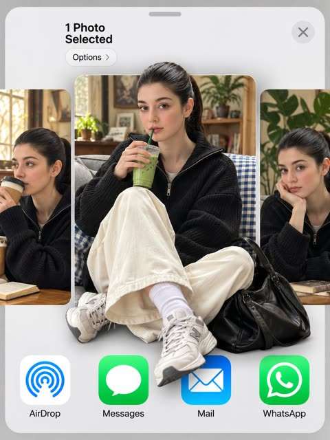
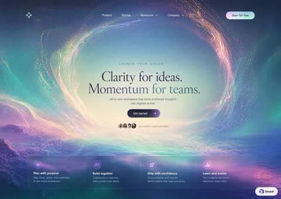
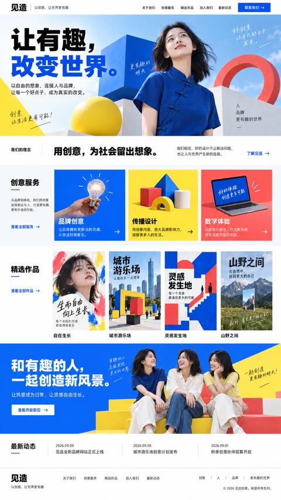
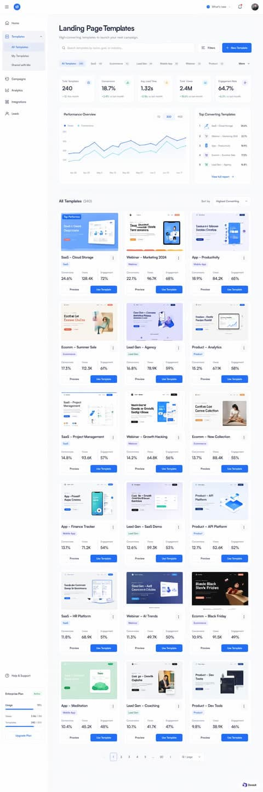
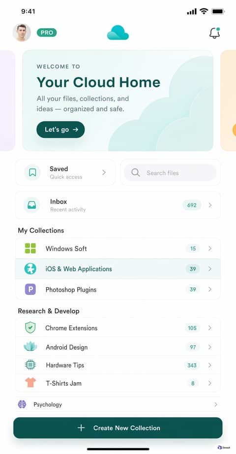
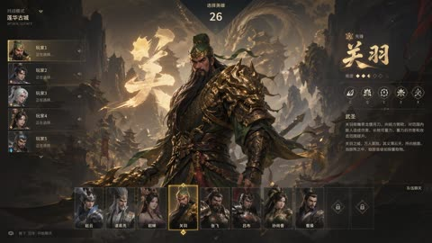
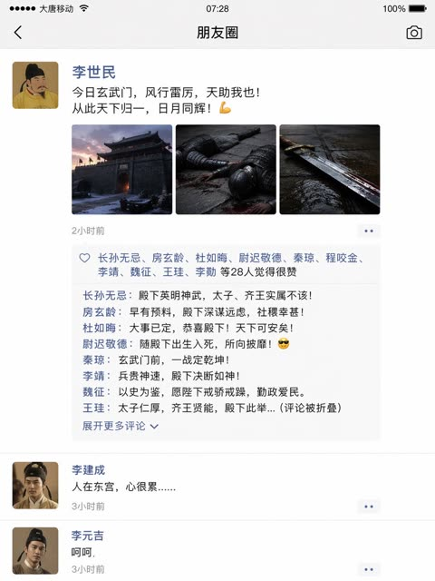

# 手机与界面截图

[返回目录](../../README_zh.md) · 全部 14 条

<a id="gpt-image-camera-roll-photos-screen"></a>
### 一名学生一整天的iPhone相册截图

<a href="https://x.com/sakisuta_/status/2098712371045052764"></a>

提示词明确指定容器是原样截取的照片App界面，模型便在一个网格里填满一整天风格各异的随手拍。提供参考人物并要求日常瞬间，使人脸在美食、朋友、书桌和天空等画面中保持一致。

GPT Image 2.5 · 上传图改图 · 出处: [@sakisuta_ on X](https://x.com/sakisuta_/status/2098712371045052764) · 2,439 赞，统计于 2026-10-28

[`camera-roll`](tags.md#tag-camera-roll) [`photos-app`](tags.md#tag-photos-app) [`screenshot`](tags.md#tag-screenshot) [`reference-image`](tags.md#tag-reference-image) [`everyday`](tags.md#tag-everyday)

<details><summary><b>提示词</b></summary>

```text
Turn one full day's worth of camera roll for the person in the reference image into a single image that captures the iPhone's Photos app screen as-is. Make it a realistic camera roll that feels like it captures casual everyday moments.
```

</details>

<a id="gpt-image-camera-roll-day"></a>
### 一张图生成任何人一天的相册

<a href="https://x.com/Mayz1169/status/2099479395283214473"></a>

同一思路，规则更严：上传图是唯一主体，只允许出现最少的 iOS 界面元素。

GPT Image 2.5 · 上传图改图 · 出处: [@Mayz1169 on X](https://x.com/Mayz1169/status/2099479395283214473) · 762 赞，统计于 2026-10-27

[`ios`](tags.md#tag-ios) [`screenshot`](tags.md#tag-screenshot) [`camera-roll`](tags.md#tag-camera-roll) [`humor`](tags.md#tag-humor)

<details><summary><b>提示词</b></summary>

```text
Use the uploaded image as the ONLY subject reference.

Create ONE vertical image that looks exactly like a screenshot of the iPhone Photos app, showing one full day of casual camera-roll photos featuring the exact subject from the uploaded reference.

SUBJECT CONSISTENCY
First identify the main subject in the uploaded image. It may be a person, anime character, pet, animal, plush toy, figurine, mascot, object, or other character.

Preserve the subject’s recognizable appearance, colors, proportions, facial features, hairstyle, clothing, accessories, markings, materials, and signature details consistently across every photo.

If the reference contains multiple views of the same subject, understand that they are different views of ONE subject, not multiple characters.

Do not redesign or replace the subject.

DAY-IN-THE-LIFE CAMERA ROLL
Imagine a believable full day for this exact subject based on its appearance, personality, style, and visual world.

Generate many different casual photos from morning to night, as if someone naturally photographed the subject throughout the day.

Automatically choose everyday situations that fit the uploaded subject, such as:
waking up, resting, eating, sitting by a window, traveling, walking outside, visiting cafés or shops, playing, working, relaxing at home, interacting with everyday objects, sunset moments, nighttime outings, and going to sleep.

The activities and environments should adapt naturally to the subject. Do not force human activities onto animals, toys, objects, or non-human characters when they would look unnatural.

Every thumbnail should show a different moment, composition, distance, pose, camera angle, lighting condition, or location.

Mix:
close-ups,
medium shots,
wide shots,
overhead photos,
back views,
detail shots,
slightly blurry movement shots,
imperfect handheld snapshots,
photos where the subject is partially cropped,
environmental photos related to the subject’s day.

The result should feel spontaneous and personal rather than like a professional photoshoot.

IPHONE PHOTOS APP LAYOUT
The FINAL IMAGE itself must look like a real full-screen iPhone Photos app screenshot.

Use a tall smartphone screenshot aspect ratio, approximately 9:19.5.

Create a dense camera-roll gallery using FOUR equal thumbnail columns, closely matching the standard iPhone Photos grid.

Include approximately 24–32 individual photo thumbnails visible on screen.

Use very thin white gaps between thumbnails.

The gallery should fill most of the screen vertically.

Include authentic iPhone Photos interface elements:
• white iOS interface background
• iPhone-style status bar at the top
• time on the upper left
• cellular/Wi-Fi/battery icons on the upper right
• simple navigation controls near the top
• four-column photo gallery
• bottom Photos app navigation bar
• Photos tab selected in blue
• other navigation icons shown in gray
• black home indicator at the very bottom

The UI must look like an actual screenshot of the Photos app, NOT a decorative frame, moodboard, contact sheet, scrapbook, poster, or generic collage.

PHOTO STYLE
Make each thumbnail feel like a genuine casual iPhone camera-roll photo.

Use natural everyday lighting, imperfect framing, realistic exposure variation, occasional motion blur, slight focus imperfections, spontaneous compositions, and believable environmental details.

Keep the same subject recognizable throughout the entire gallery while allowing natural changes in pose, expression, camera distance, and lighting.

If the uploaded reference is illustrated, animated, stylized, or 3D, preserve its original visual identity and style unless realistic photography is explicitly requested.

IMPORTANT
ONE final image only.
The entire output is ONE iPhone Photos app screenshot containing many different photos.
Exactly FOUR thumbnail columns.
Do not create a standalone collage without the iPhone interface.
Do not create multiple separate outputs.
Do not duplicate the exact same photo repeatedly.
Do not introduce unrelated characters or subjects.
Do not change the main subject’s design.
No captions, dates, labels, stickers, watermarks, or decorative text inside the photo thumbnails.
Only normal minimal iOS interface elements may appear.9:16
```

</details>

<a id="gpt-image-iphone-photos-screenshot"></a>
### 一整天的照片，做成 iPhone 相册截图

<a href="https://x.com/BubbleBrain/status/2099759367956349012"></a>

连状态栏都还原的 iOS 相册界面，里面塞满参考人物的抓拍。

GPT Image 2.5 · 上传图改图 · 出处: [@BubbleBrain on X](https://x.com/BubbleBrain/status/2099759367956349012) · 309 赞，统计于 2026-10-27

[`ios`](tags.md#tag-ios) [`screenshot`](tags.md#tag-screenshot) [`camera-roll`](tags.md#tag-camera-roll)

<details><summary><b>提示词</b></summary>

```text
Turn the girl from the reference image into a full-day iPhone Photos album screenshot that faithfully recreates the real iPhone “Photos — Library / Today” interface. Keep the top status bar (time, signal, battery), the Library title, the Today label, the photo grid layout, and the bottom tab bar: Library / For You / Albums / Search. The whole image should look like a real phone screenshot.
The girl in the reference image is the only subject in the entire album. Every photo keeps the same identity, the same face, the same hairstyle, the same skin tone, the same body proportions, and the same presence. She is a clearly adult young East Asian woman with long black hair, cool-pale skin, refined cool features, and a private, quiet aura.
The album is a full portrait camera roll. Every thumbnail shows her. The entire screen is filled with solo portraits of her. The whole set is built around this one person only.
All album content is portraits of her: waking-up selfie in bed, selfie under the covers, selfie by the pillow, bathroom-mirror selfie, elevator-mirror selfie, window-side selfie, indoor natural-light selfie, sofa selfie, bedside selfie, after-coming-home selfie, night selfie, close-up face selfie, half-body selfie, full-body mirror selfie, seated solo shot, standing solo shot, side-profile solo shot, looking-back solo shot, indoor hallway solo shot, window-side solo shot, candid bedside shot, chair solo shot, carpet solo shot, and photos taken of her by someone else.
Outfits change continuously through the day. Morning: milky-white camisole lounge top and light-gray home shorts. Late morning: white slim short-sleeve top and pale blue-gray pleated mini skirt. Noon: black thin-strap top and high-waisted denim shorts. Afternoon: light-gray knit cardigan over a white inner layer and a black mini skirt. Evening: dark-gray blazer, white thin-strap top, and black pleated mini skirt. Night: black fitted mini dress with slim silver accessories. Late night after returning home: loose white T-shirt and soft lounge shorts. Each outfit is clearly different; the clothing changes mark a clear passage of time.
Photo mix is fixed at 60% selfies and mirror selfies, 40% solo portraits taken by someone else. Every frame has her as the subject. Every thumbnail keeps real iPhone native-camera texture. Pose, camera distance, angle, expression, lighting, and clothing keep changing.
The sequence runs from morning to late night. Morning feels loose and just-woken. Late morning has clear natural light. Afternoon feels like ordinary going-out. Evening has soft city light. Night has low indoor light. Late night feels quiet and private after coming home.
The whole set is quiet, private, relaxed, and real. The album forms a dense, continuous solo-portrait look, like a full day of private portrait camera roll saved on her own phone.
```

</details>

<a id="gpt-image-claymation-social-profile-screen"></a>
### 粘土定格动画风格的社交主页界面

<a href="https://x.com/miratechtool/status/2052033236964950111"></a>

提示词先锁定软质黏土这一种材质，再列出手工纹理、圆润造型和指纹等具体触感线索，并配上定格动画式灯光和暖色粉彩。这样现有截图里的按钮、头像和图标都被重做成黏土质感。

GPT Image 2 · 上传图改图 · 出处: [@miratechtool on X](https://x.com/miratechtool/status/2052033236964950111) · 255 赞，统计于 2026-10-28

[`claymation`](tags.md#tag-claymation) [`stop-motion`](tags.md#tag-stop-motion) [`pastel`](tags.md#tag-pastel) [`style-transfer`](tags.md#tag-style-transfer) [`social-profile`](tags.md#tag-social-profile)

<details><summary><b>提示词</b></summary>

```text
Recreate the scene as a cozy claymation-style world made from soft modeling clay. Every object should have handmade textures, rounded shapes, fingerprints, and soft lighting like a stop-motion movie. Use warm pastel colors and a cute cinematic atmosphere.
```

</details>

<a id="gpt-image-ios-share-sheet-pop-out-portrait"></a>
### iOS分享面板中的3D破框人像照片

<a href="https://x.com/TheVirtualMuse/status/2109582485147517056"></a>

提示词逐项列出分享面板的界面元素，再明确指出人物哪些部位突破缩略图边框。加入人脸参考指令，并让两侧缩略图是同一人物，保证轮播中身份一致。

GPT Image 2.5 · 上传图改图 · 出处: [@TheVirtualMuse on X](https://x.com/TheVirtualMuse/status/2109582485147517056) · 51 赞，统计于 2026-10-28

[`ios-share-sheet`](tags.md#tag-ios-share-sheet) [`3d-popout`](tags.md#tag-3d-popout) [`face-reference`](tags.md#tag-face-reference) [`ui-composite`](tags.md#tag-ui-composite) [`portrait`](tags.md#tag-portrait)

<details><summary><b>提示词</b></summary>

```text
Use my uploaded photo as the face reference. 3:4 vertical. An iOS share sheet on a light grey background: top left reads "1 Photo
Selected" with an "Options >" pill below it, a round X close button top right, then a horizontal carousel of three photo thumbnails, and a
bottom row of app icons labeled "AirDrop", "Messages", "Mail", "WhatsApp". Center thumbnail: the man in reference, keeping his exact
face, hairstyle and identity, sitting cross-legged on a grey couch with a blue gingham blanket, holding an iced matcha latte with a green
straw, looking at the camera. He wears a black baseball cap with a white NY logo, thin round gold wire glasses, an oversized cream shirt
with a grey knit sweater draped over his shoulders, wide black trousers, white socks and black leather penny loafers, with a red crochet
drawstring bag at his feet. 3D pop-out effect: his cap breaks out above the thumbnail's top edge, and his loafers and the red bag spill out
over the app icons below. Side thumbnails, partially cropped: the same man sipping a takeaway coffee on the left, and resting his chin on
his hand beside a monstera plant on the right. Soft indoor daylight, realistic skin texture.
```

</details>

<a id="gpt-image-astral-vortex-portal-landing-page-ui"></a>
### 星尘漩涡入口的网站首页界面

<a href="https://github.com/stretchcloud/awesome-gpt-image-prompt-2.5/blob/main/docs/hero-backgrounds-1.md"></a>

提示词用精确色值并为每种颜色指定界面角色。以亮色入口内深色文字、外围白色控件的对比逻辑作为标志细节，再用必须与避免清单锁定字体和玻璃质感规则。

GPT Image 2.5 · 文生图 · 出处: [Devault on GitHub](https://github.com/stretchcloud/awesome-gpt-image-prompt-2.5/blob/main/docs/hero-backgrounds-1.md)

[`landing-page`](tags.md#tag-landing-page) [`dark-mode`](tags.md#tag-dark-mode) [`glassmorphism`](tags.md#tag-glassmorphism) [`hex-palette`](tags.md#tag-hex-palette) [`serif-typography`](tags.md#tag-serif-typography)

<details><summary><b>提示词</b></summary>

```text
Design a dark-mode abstract background artwork: an ethereal particle vortex framing a serene morning sky with frosted glass navigation and quiet editorial type.

LAYOUT
Vertically centered hero composition anchored by a global navbar at the top and a floating frosted dock at the bottom. The central focal zone is an unobstructed oval aperture that holds eyebrow, serif display headline, supporting paragraph, primary CTA, and social proof in tight vertical alignment. The bottom dock sits anchored above the lower edge, spanning 1160px across four balanced feature quadrants.

PALETTE (use these exact hex values)
- #15132d — Cosmic Void Indigo: Outer canvas background, edge nebulas, and deep space corners.
- #c2e5e7 — Luminous Sky Core: Illuminated center of the vortex against which the main headline rests.
- #182c38 — Deep Ocean Navy: Display headlines and primary value proposition text inside the bright portal.
- #43616d — Slate Teal Muted: Eyebrow tag and subheadline inside the central light aperture.
- #ffffff — Starlight White: Top nav links, bottom dock headings, and glowing icons.
- linear-gradient(135deg, #2b2347 0%, #462c5b 100%) — Violet Nocturne Gradient: Primary central action button ('Get started') floating below subcopy.
- linear-gradient(135deg, #f2d5e5 0%, #c4f0ea 100%) — Iridescent Dawn Gradient: Top right 'Start for free' navbar CTA button fill.

TYPOGRAPHY
Typeface Instrument Serif (or Cormorant Garamond, Fraunces, New York), weights 400. Sizes 11px caption, 12px body-sm, 14px body, 16px body-lg, 17px heading, 56px display. Tracking -0.015em. Lyrical, contemplative, and premium. The pairing of a delicate, classic serif (Instrument Serif) inside the bright clearing with crisp modern geometric grotesque (Plus Jakarta Sans) conveys visionary intelligence without sacrificing clarity. For production environments where Instrument Serif is unavailable, Cormorant Garamond or Fraunces (Regular, Normal optical size) offer identical weight and emotional warmth.

GEOMETRY & SPACING
Corner radii — cards 24px, links 4px, inputs 999px, buttons 999px. Spacing on a 8px unit, 24px gaps, 96px between sections, 1200px container, airy density.

DEPTH
Depth is created organically through atmospheric layering rather than drop shadows. The background image recedes from dense dark nebula clouds to an infinite glowing sky aperture, while UI components hover via translucent glassmorphism (8% white wash, 1px specular rim highlight, and 24px backdrop blur).

IMAGERY
Photorealistic cinematic digital illustration depicting a swirling ring of celestial stardust, auroral cyan streams, and golden planetary dust framing a calm morning cloudscape. Graphic icons and cartoonish assets are strictly off-brand; all visual richness originates from organic light trails and mist.

SIGNATURE DETAIL — the thing that makes this design itself
The luminous circular vortex portal that naturally inverses content contrast: text is dark slate inside the sunny eye of the storm, while outer interface controls remain glowing starlight white against deep space.

MUST
- Position all primary dark typography directly inside the lighter sky portal center.
- Use full pill radii (999px) for all standalone action buttons.
- Keep navigation links flat and transparent without background container pill encapsulation.
- Maintain heavy blur (20-30px) on the bottom card so cosmic clouds filter smoothly through.

AVOID
- Never place pure white text directly in the bright center sky region.
- Do not give the bottom feature dock solid, opaque backgrounds.
- Avoid square or sharp corners anywhere; everything follows soft rounded conventions.
- Do not use heavy, bold sans-serif typefaces for the central hero message.

OUTPUT
Render as a clean, pixel-crisp UI design at roughly 3424:2416. Flat vector rendering, real legible text, no browser chrome, no device mockup frame, no watermark, no lorem ipsum placeholder blocks.
```

</details>

<a id="gpt-image-bento-fraud-telemetry-website-section"></a>
### 浅色便当网格网页区块，内嵌欺诈遥测小组件

<a href="https://github.com/stretchcloud/awesome-gpt-image-prompt-2.5/blob/main/docs/bento-grids-1.md"></a>

提示词逐个象限规定版面，为每个色值指定用途，并限定字号与圆角。它还要求每个卡片都放入可读的真实数据，例如 92/100 风险分，让小型仪表盘看起来像真实软件。

GPT Image 2.5 · 文生图 · 出处: [Devault on GitHub](https://github.com/stretchcloud/awesome-gpt-image-prompt-2.5/blob/main/docs/bento-grids-1.md)

[`website-section`](tags.md#tag-website-section) [`bento-grid`](tags.md#tag-bento-grid) [`dashboard`](tags.md#tag-dashboard) [`design-system`](tags.md#tag-design-system) [`light-mode`](tags.md#tag-light-mode)

<details><summary><b>提示词</b></summary>

```text
Design a light-mode website section: crisp bento telemetry mapping machine cognition to live product operations with surgical blue precision.

LAYOUT
The grid follows an asymmetric bento rhythm anchored by a dominant 2-column top half. The upper-left quadrant hosts the display copy alongside a wide spotlight card featuring real-time fraud telemetry and pipeline nodes. The upper-right quadrant stacks an event-driven AI code block over two split metric cards, while the bottom section locks four equal-width capability columns together.

PALETTE (use these exact hex values)
- #F8FAFC — Canvas Background: Global backdrop providing subtle contrast beneath pure white card surfaces.
- #FFFFFF — Card Surface: Modular bento container fill across all feature blocks and nested dashboard components.
- #181F2C — Terminal Canvas: High-contrast background reserved exclusively for the developer code and payload preview.
- #E2E8F0 — Card Border: Hairline 1px perimeter on all cards, mini-mockups, and divider lines.
- #2563EB — Brand Blue: Hero headline emphasis, primary CTA buttons, active checklist checks, and focus elements.
- #EFF6FF — Soft Blue Tint: Background fill for uppercase category pills and active state callouts.
- #0F172A — Heading Slate: Primary headings, bento card titles, and prominent numeric metric labels.
- #64748B — Muted Slate: Supporting descriptive copy, subtitle labels, and inactive meta tags.
- #EF4444 — Risk Alert Coral: High-risk indicators, alert sparklines, and status badges.
- #0D9488 — Telemetry Teal: Observability metric sparklines and system health indicators.

TYPOGRAPHY
Typeface Inter (or Geist, SF Pro Text, Plus Jakarta Sans), weights 400/500/600/700. Sizes 11px caption, 13px body-sm, 14px body, 16px body-lg, 18px subheading, 24px heading, 42px display. Tracking -0.025em at headlines, 0.05em at caps badges. The voice is confident, technical, and frictionless, driven by Inter's dense neutral grotesque letterforms. High headline contrast is achieved by tinting the terminal half of the display phrase in electric #2563EB. The pairing with a monospace font reinforces developer-grade credibility and operational speed.

GEOMETRY & SPACING
Corner radii — cards 16px, links 4px, inputs 8px, buttons 8px. Spacing on a 4px unit, 20px gaps, 80px between sections, 1360px container, comfortable density.

DEPTH
Depth is handled strictly through surface layering rather than intense shadows. The #F8FAFC ground supports level-1 #FFFFFF cards bounded by 1px #E2E8F0 borders and an ambient shadow of `0 1px 3px rgba(15, 23, 42, 0.04)`. Nested preview cards (like the live fraud dial) sit inside recessed ground wells with matched hairline borders.

IMAGERY
There is zero photographic imagery or abstract 3D artwork. Imagery is replaced entirely by functional, scaled-down user interfaces: live risk scores, JSON event payloads, decision matrices, node-to-node connectors, and SVG sparkline charts. Everything simulates an actual operating software state.

SIGNATURE DETAIL — the thing that makes this design itself
The design's signature element is the embedded 'live telemetry micro-widget' inside every bento tile—specifically showing realistic data states like '92/100 High risk' paired with real SVG sparklines and node diagrams. Misusing this pattern occurs when designers treat the mockups as vague placeholder shapes instead of accurately scaled, readable software workflows.

MUST
- Wrap complex capabilities into tangible, high-fidelity micro-UIs rather than relying on abstract marketing illustrations.
- Use solid #2563EB selectively to draw the eye to core messages, primary buttons, and critical flow paths.
- Enforce a 1px #E2E8F0 border on all white surface cards to cleanly separate them from the #F8FAFC canvas.
- Keep icon containers at 36x36px with 8px radii using very pale tints of their respective accent colors.

AVOID
- Do not introduce 3D renderings, isometric illustrations, or generic stock photography.
- Do not use heavy drop shadows; cards should rely on thin borders and near-invisible ambient blur.
- Do not scatter brand blue across every icon; reserve it for primary hierarchy and use domain tints elsewhere.
- Do not let micro-dashboards exceed 13px font size; they must look like realistic shrunk telemetry.

OUTPUT
Render as a clean, pixel-crisp UI design at roughly 1792:1024. Flat vector rendering, real legible text, no browser chrome, no device mockup frame, no watermark, no lorem ipsum placeholder blocks.
```

</details>

<a id="gpt-image-chinese-agency-website-mockup"></a>
### 中文创意公司官网整页设计稿

<a href="https://x.com/listudio/status/2097652659788619894"></a>

提示词为每个区块指定占整页高度的百分比，并逐块给出准确的中文文案。同时固定四色配色和网格，让长页面的版式统一、文字准确。

GPT Image 2.5 · 文生图 · 出处: [@listudio on X](https://x.com/listudio/status/2097652659788619894) · 发现于 [wangrunlin/awesome-gpt-image-2-5-prompts](https://github.com/wangrunlin/awesome-gpt-image-2-5-prompts)

[`website-mockup`](tags.md#tag-website-mockup) [`chinese-text`](tags.md#tag-chinese-text) [`agency`](tags.md#tag-agency) [`long-screenshot`](tags.md#tag-long-screenshot) [`geometric-collage`](tags.md#tag-geometric-collage)

<details><summary><b>提示词</b></summary>

```text
Please use the latest GPT Image 2.5 image generation capability of the web version to directly generate images, and do not just return the prompt.

Generate a complete visual design drawing of the Chinese official website of a creative design company, a long screenshot of the desktop webpage with a frontal view and no perspective, 9:16 vertical format, with as high a resolution as possible, and a complete display from navigation to footer. White background, cobalt blue, bright yellow, coral red and light sky blue colors, narrow white space, neat grid, right-angled cards, bold bevel geometric collage. The overall look is young, lively, and has a sense of design experimentation.

There is a slim white navigation bar at the top, with the original bold Chinese character mark "见造" and the small slogan "以创意，让世界更有趣" on the left. The navigation on the right is "关于我们、创意服务、精选作品、加入我们、最新动态", and the blue "联系我们 →" button is on the far right.

The first screen occupies about 27% of the entire image. On the left side, there are two lines of "让有趣，" and "改变世界。" in very eye-catching bold cobalt-blue sans-serif type. On the lower left side are small characters "以自由的想象，连接人与品牌，让每一个好点子，成为真实的改变。". On the right side is a clearly adult 20 year old Chinese woman. Black shoulder-length hair is blown by the breeze. She has natural light makeup and real skin. She slightly raises her head and looks to the upper right. Wear a cobalt blue cotton and linen stand-up collared short-sleeved top with a simple slanted placket and a few buttons of the same color. It fits well but is not tight. The character is combined with a blue cube, yellow sphere, coral red ring, and white geometric pedestal. The background is light blue sky and bright natural daylight. The materials and cast shadows are credible.

The white concept horizontal bar at the bottom of the first screen accounts for about 8%, with the small characters "我们的理念" on the left, the bold black title "用创意，为社会留出想象。" in the middle, and the text "我们相信，好的设计不止解决问题，也让人与世界产生新的连接。" and "了解见造 →" on the right.

The service area occupies about 16%, with a narrow column title "创意服务", a brief introduction and "查看全部服务 →" on the left; three equal-width cards on the right: a blue background card with a hand-held light bulb photography as "品牌创意", a yellow background card with colorful geometric building blocks as "传播设计", and a coral red background card with an open laptop as "数字体验". Below each card are two lines of brief Chinese introduction and a right arrow.

The works area occupies about 17%, with the titles "精选作品" and "查看全部作品 →" on the left, and four columns of thumbnails of the flat works on the right, which are a 20-year-old Chinese female portrait poster decorated with colorful paints, an urban geometric installation poster, a blue, white and red editorial design, and a mountain art installation poster. The names of the four projects are "自在生长", "城市游乐场", "灵感发生地" and "山野之间" in order, and the visible text in the thumbnails are all in Chinese.

The recruitment area occupies about 18%, with the entire cobalt blue horizontal bar, the white title "和有趣的人，一起创造新风景。" on the left, the text "让热爱成为日常，让灵感自由生长。" and the white button "查看开放职位 →". On the right, three clearly adult Chinese women aged 20 sit on the yellow and coral red geometric steps and communicate naturally. They are wearing blue stand-up collar tops, off-white cotton and linen shirts, and light yellow simple knitted tops, loose trousers and clean flat shoes. They have long black hair or short shoulder-length hair, natural light makeup, youthfulness, confidence, and kindness. They are not ancient costumes, not professional suits, and have no exaggerated accessories.

About 6% below is the "最新动态" column with a white background, and the three lines of messages are "2026.09.09 见造全新品牌网站正式上线", "2026.09.08 城市游乐场创意计划发布" and "2026.09.01 秋季创意伙伴招募开启". The last approximately 8% is a concise footer, with Chinese "见造", navigation and "© 2026 见造创意。保留所有权利。", leaving a comfortable bottom margin. All interface copy is in readable and accurate Simplified Chinese, with clear levels of title and text. No Japanese, no garbled characters, no third-party logos, no watermarks, no browser borders, no device cases. Output a complete web design drawing.
```

</details>

<a id="gpt-image-cobalt-saas-template-gallery-dashboard"></a>
### 钴蓝色SaaS仪表盘与模板画廊

<a href="https://github.com/stretchcloud/awesome-gpt-image-prompt-2.5/blob/main/docs/exclusive-web-1.md"></a>

提示词按侧边栏、指标卡、图表和卡片网格的顺序固定版式，并为每个颜色指定精确色值和用途。再用一个标志性细节，即每张卡片里指标行加双按钮，让整张长页面保持一致。

GPT Image 2.5 · 文生图 · 出处: [Devault on GitHub](https://github.com/stretchcloud/awesome-gpt-image-prompt-2.5/blob/main/docs/exclusive-web-1.md)

[`dashboard`](tags.md#tag-dashboard) [`saas`](tags.md#tag-saas) [`web-ui`](tags.md#tag-web-ui) [`hex-palette`](tags.md#tag-hex-palette) [`light-mode`](tags.md#tag-light-mode)

<details><summary><b>提示词</b></summary>

```text
Design a light-mode web interface screen: crisp cobalt workspace balancing enterprise performance metrics with card-based template discovery.

LAYOUT
Structured fixed-width vertical sidebar navigation (approximately 240px wide) pinned to the left, paired with a dynamic fluid-width content canvas. The main pane begins with a global utility bar, descends into an executive header and search toolbar, flows into an analytics summary layer (5 metric cards above a split 2:1 chart and leaderboard section), and concludes with a responsive 3-column template gallery grid.

PALETTE (use these exact hex values)
- #F8F9FC — App Background: Global application page background surrounding sidebar and main content area
- #FFFFFF — Card Surface: Background for dashboard metric tiles, performance charts, and template cards
- #FFFFFF — Sidebar Surface: Vertical navigation container background separating controls from page content
- #1E6BFF — Cobalt Blue: Primary interactive color for action buttons, active navigation states, and primary trend lines
- #EBF2FE — Soft Blue Tint: Background for active pill filters, badge tags, and selected sidebar items
- #42C3EE — Cyan Accent: Secondary comparison line on charts and conversion rate badge accents
- #10B981 — Positive Green: Positive delta indicators, conversion trend percentages, and success status tags
- #0F172A — Text Primary: High-contrast headings, main metric values, and template titles
- #64748B — Text Secondary: Subheadings, axis labels, inactive navigation links, and microcopy descriptions
- #EEF2F6 — Card Border: Delicate containment line enclosing cards, input fields, and tab clusters

TYPOGRAPHY
Typeface Inter (or Plus Jakarta Sans,SF Pro Display,Roboto), weights 400/500/600/700. Sizes 11px caption, 12px body-sm, 14px body, 16px body-lg, 18px subheading, 20px heading, 24px heading-lg, 28px display. Tracking -0.02em at headings, 0 at body. Inter (or modern neo-grotesque alternatives like Plus Jakarta Sans) gives the dashboard an ultra-clean, technical precision without sacrificing readability. Tight tracking on large display metrics communicates data authority, while comfortable line heights on labels prevent eye fatigue in dense multi-metric cards. Free open-source alternatives like Inter from Google Fonts perfectly reproduce this aesthetic.

GEOMETRY & SPACING
Corner radii — cards 14px, links 6px, inputs 10px, buttons 8px. Spacing on a 8px unit, 20px gaps, 32px between sections, 1360px container, comfortable density.

DEPTH
Depth is handled predominantly through soft planar layering: a pale #F8F9FC background hosting pure white (#FFFFFF) panels bordered with crisp 1px strokes (#EEF2F6). True shadows are minimal, reserved for selected segmented tabs (0 1px 2px rgba(0,0,0,0.06)) and occasional subtle card hover states (0 8px 16px rgba(15,23,42,0.04)).

IMAGERY
Thumbnail imagery showcases scaled-down, pristine marketing landing pages with rounded hero sections, clean typography, and vibrant UI illustrations. Previews are enclosed in light containers mimicking actual viewport frames with delicate 1px borders. Never use uncurated, photographic stock art without an enclosing browser or mobile frame.

SIGNATURE DETAIL — the thing that makes this design itself
The dual-button action footer docked directly below a three-column micro-metrics summary inside each template card. This pairing of deep operational statistics with direct 'Preview' and 'Use Template' CTAs transforms standard gallery cards into actionable performance assets. Misusing it involves separating the metrics from the thumbnail or hiding the primary CTA inside a dropdown menu.

MUST
- Use solid white (#FFFFFF) for every data card against the cool #F8F9FC canvas background.
- Limit intense blue (#1E6BFF) to primary interactive buttons, active indicators, and hero line paths.
- Enclose thumbnail website screenshots in rounded 8px interior frames within template cards.
- Pair numeric labels with compact secondary metadata arranged in structured 3-column micro grids.

AVOID
- Do not use dark gray or black backgrounds for metric cards or chart panels.
- Do not drop thumbnail borders or shadows entirely, causing them to blend into the white card.
- Avoid colored backgrounds for the main canvas that stray outside cool, pale blue-tinted grays.
- Never use sharp 0px corners on input fields, buttons, or card surfaces.

OUTPUT
Render as a clean, pixel-crisp UI design at roughly 1280:3840. Flat vector rendering, real legible text, no browser chrome, no device mockup frame, no watermark, no lorem ipsum placeholder blocks.
```

</details>

<a id="gpt-image-farmers-market-app-ui"></a>
### 放在 iPhone 机身里的农夫市集 App 界面

<a href="https://developers.openai.com/api/docs/guides/image-prompting#create-an-interface-preview"></a>

把 App 当成已经上线的产品来描述：真实的模块、层级和间距，不用概念图的词，出来的界面才像能用的。预览图为 Sunburst 版本。

GPT Image 2.5 · 文生图 · 出处: [OpenAI image prompting guide](https://developers.openai.com/api/docs/guides/image-prompting#create-an-interface-preview)

[`ui`](tags.md#tag-ui) [`mobile`](tags.md#tag-mobile) [`mockup`](tags.md#tag-mockup)

<details><summary><b>提示词</b></summary>

```text
Create a realistic mobile app UI mockup for a local farmers market.
Show today’s market with a simple header, a short list of vendors with small photos and categories, a small “Today’s specials” section, and basic information for location and hours.
Design it to be practical, and easy to use. White background, subtle natural accent colors, clear typography, and minimal decoration.
It should look like a real, well-designed, beautiful app for a small local market.
Place the UI mockup in an iPhone frame.
```

</details>

<a id="gpt-image-laptop-screen-facetime-night-phone-photo"></a>
### 夜间手机拍摄的笔记本 FaceTime 通话屏幕

<a href="https://x.com/kaanakz/status/2056290465503171000"></a>

提示词先声明是手机实拍而不是截图，再列出像素网格、摩尔纹、灰尘、指纹和不均匀反光等屏幕瑕疵。窗口层叠关系和便签文字写得很具体，界面因此显得可信。

GPT Image 2 · 文生图 · 出处: [@kaanakz on X](https://x.com/kaanakz/status/2056290465503171000) · 发现于 [freestylefly/awesome-gpt-image-2](https://github.com/freestylefly/awesome-gpt-image-2)

[`laptop-screen`](tags.md#tag-laptop-screen) [`facetime`](tags.md#tag-facetime) [`macos`](tags.md#tag-macos) [`smartphone-photo`](tags.md#tag-smartphone-photo) [`night`](tags.md#tag-night)

<details><summary><b>提示词</b></summary>

```text
Create a raw smartphone photo of a laptop screen, not a screenshot. Aspect ratio 3:4, high-angle downward POV from someone standing over a desk at night. The laptop display fills most of the frame, with a narrow strip of black keyboard and trackpad visible at the bottom. Strong realism: visible RGB subpixel grid, subtle moire bands, small dust specks, faint fingerprints, uneven glass reflections, handheld phone noise, slight perspective skew, no studio polish. macOS dark mode. Background app: Apple Notes with a late-night study note titled "Design Critique" and short visible bullets: "layout", "lighting", "source links", "ship tomorrow". Foreground app: FaceTime live preview window floating lower-right, showing a fictional adult man in his 20s sitting at a cluttered desk, hoodie, tired but amused expression, warm desk lamp behind him, books and sticky notes in the room. A second small Finder window with image thumbnails is partly visible behind it. Make it feel like an accidental real phone photo of a working laptop screen. No real-person likeness, no beauty filter, no perfect UI, no screenshot, no watermark, no cartoon, no 3D render.
```

</details>

<a id="gpt-image-soft-cloud-storage-app-mint-ui"></a>
### 薄荷色云朵风个人存储手机应用首页

<a href="https://github.com/stretchcloud/awesome-gpt-image-prompt-2.5/blob/main/docs/exclusive-mobile-1.md"></a>

提示词为每个色值标明用途，并写清自上而下的布局、字体与圆角规则。MUST 与 AVOID 清单加上标志性细节，让云朵主卡风格保持一致。

GPT Image 2.5 · 文生图 · 出处: [Devault on GitHub](https://github.com/stretchcloud/awesome-gpt-image-prompt-2.5/blob/main/docs/exclusive-mobile-1.md)

[`mobile-app`](tags.md#tag-mobile-app) [`cloud-storage`](tags.md#tag-cloud-storage) [`pastel`](tags.md#tag-pastel) [`light-mode`](tags.md#tag-light-mode) [`design-system`](tags.md#tag-design-system)

<details><summary><b>提示词</b></summary>

```text
Design a light-mode mobile app interface screen: pillowy cloudscapes and organic pastel surfaces guiding calm personal storage.

LAYOUT
The mobile layout follows a top-down single-column hierarchy starting with a sticky-feel status and navigation header. Immediately beneath sits a horizontal swipeable hero card carousel showing peeking sibling cards. A two-column split row hosts quick action and search shortcuts, followed by vertical grouped collection cards separated by bold section titles.

PALETTE (use these exact hex values)
- #FFFFFF — Canvas White: Primary mobile viewport background and base level
- #F8FAFB — Surface Mist: Subtle fill for embedded search inputs and inactive surfaces
- #EEF2F3 — Border Subtle: Hairline card outlines, row dividers, and input strokes
- #0D4744 — Deep Teal: Hero display text, prominent pill CTA button, and high-emphasis labels
- #219D82 — Mint Accent: App logo highlight, active tags, and 'PRO' badge fill
- linear-gradient(135deg, #F0FAF7 0%, #E2F5EE 50%, #D8F0F3 100%) — Card Hero Gradient: Background wash for the primary welcome carousel card
- #1E2A2A — Text Charcoal: Row item headings, section titles, and primary action text
- #768B8A — Text Slate: Subtitles, placeholder text, chevron arrows, and metadata
- #EDF8F5 — Badge Mint Tint: Soft pill container fill behind counter numbers

TYPOGRAPHY
Typeface Plus Jakarta Sans (or Outfit, SF Pro Rounded, Inter), weights 400/500/600/700. Sizes 10px caption, 11px body-sm, 13px body, 14px body-lg, 15px subheading, 17px heading, 24px display. Tracking -0.01em at headlines, 0.08em at uppercase captions. The typographic tone is airy, friendly, and structured, best embodied by rounded geometric sans typefaces like Plus Jakarta Sans or SF Pro Rounded. Generous lowercase proportions paired with letterspaced micro-caps ('WELCOME TO') keep utility feeling relaxed and modern. System fonts like SF Pro with rounded attributes provide seamless zero-cost implementation.

GEOMETRY & SPACING
Corner radii — cards 24px, links 8px, inputs 18px, buttons 999px. Spacing on a 4px unit, 12px gaps, 24px between sections, 390px container, comfortable density.

DEPTH
Depth is created without harsh drop shadows. Instead, surfaces rely on 1px crisp borders (#EEF2F3) set against stark white (#FFFFFF) and delicate background pastel gradients. A very soft, diffuse ambient blur (0px 8px 24px rgba(13, 71, 68, 0.04)) is permitted strictly under active floating cards.

IMAGERY
Visual assets consist of simplified 3D-shaded cloud volumes and stylized vector pictograms. Cloud assets use clean semi-translucent overlapping curvilinear lobes in seafoam green and white. Photorealistic photography is restricted entirely to circular user profile avatars.

SIGNATURE DETAIL — the thing that makes this design itself
The mint-washed cloudscape hero card featuring an overlapping curved vector cloud silhouette paired with a deep teal pill button. This establishes the calm 'cloud sanctuary' motif immediately on launch. Misusing it means replacing the organic vector curves with generic stock photography or harsh linear gradients.

MUST
- Wrap related collection rows inside a single bordered card with 20px corner radius.
- Use pill-shaped 999px radii exclusively for action buttons, pro tags, and count badges.
- Maintain high contrast on headings by pairing Deep Teal (#0D4744) with pure white backgrounds.
- Enclose row icons inside squircle containers tinted to match the icon's primary hue.

AVOID
- Never apply harsh black (#000000) for typography; use #0D4744 or #1E2A2A instead.
- Never use sharp 90-degree corners on buttons, cards, or search inputs.
- Avoid heavy drop shadows; depth is conveyed via faint 1px borders and soft pastel fills.
- Do not make count badges bright red or amber; use the soothing mint pill #EDF8F5.

OUTPUT
Render as a clean, pixel-crisp UI design at roughly 2000:3840. Flat vector rendering, real legible text, no browser chrome, no device mockup frame, no watermark, no lorem ipsum placeholder blocks.
```

</details>

<a id="gpt-image-three-kingdoms-fps-hero-select"></a>
### 三国神话枪战游戏的关羽选角界面

<a href="https://x.com/op7418/status/2046519666047426967"></a>

提示词很短，靠点名一个知名游戏风格加上神话题材，让模型自行补全完整的选角界面。玩家列表、角色栏、技能图标和大幅书法背景都来自这一个风格参照。

GPT Image 2 · 文生图 · 出处: [@op7418 on X](https://x.com/op7418/status/2046519666047426967) · 发现于 [freestylefly/awesome-gpt-image-2](https://github.com/freestylefly/awesome-gpt-image-2)

[`game-ui`](tags.md#tag-game-ui) [`hero-select`](tags.md#tag-hero-select) [`three-kingdoms`](tags.md#tag-three-kingdoms) [`fantasy`](tags.md#tag-fantasy) [`fps`](tags.md#tag-fps)

<details><summary><b>提示词</b></summary>

```text
[中文]
模仿《无畏契约》的风格，生成一个三国神话的 FPS 游戏

[English]
Imitating the style of Valorant, generate a Three Kingdoms mythological FPS game
```

</details>

<a id="gpt-image-xuanwu-gate-wechat-moments"></a>
### 玄武门之变的微信朋友圈界面

<a href="https://x.com/Tz_2022/status/2046523491940225366"></a>

只需写明熟悉的应用界面和历史事件，模型就会补全古装头像、符合人设的文案、点赞名单和折叠评论，让界面本身讲出故事。

GPT Image 2 · 文生图 · 出处: [@Tz_2022 on X](https://x.com/Tz_2022/status/2046523491940225366) · 发现于 [freestylefly/awesome-gpt-image-2](https://github.com/freestylefly/awesome-gpt-image-2)

[`wechat-moments`](tags.md#tag-wechat-moments) [`history`](tags.md#tag-history) [`tang-dynasty`](tags.md#tag-tang-dynasty) [`social-feed`](tags.md#tag-social-feed) [`chinese-text`](tags.md#tag-chinese-text)

<details><summary><b>提示词</b></summary>

```text
[中文]
玄武门之变的朋友圈

[English]
WeChat Moments of the Xuanwu Gate Incident
```

</details>
