# 动作、追逐与运动

[返回目录](../../README_zh.md) · 全部 130 条 · [1](video-action.md) · **2**

<a id="seedance-office-stealth-game-escape-elevator"></a>
### 上班族潜行下班，潜行游戏视角

<a href="https://x.com/Just_sharon7/status/2099440985872933199"></a>

用角色分离段落为每个人物写明身高、年龄和发型，避免人物混淆。镜头设定为带弹簧延迟的第三人称长镜头，视场角平滑变化，按秒分段写动作节拍，仅在结尾硬切一次到固定反打镜头。

Seedance 2.5 · 图生视频 · 出处: [@Just_sharon7 on X](https://x.com/Just_sharon7/status/2099440985872933199) · 发现于 [LearnPrompt/awesome-seedance](https://github.com/LearnPrompt/awesome-seedance)

[`stealth-game`](tags.md#tag-stealth-game) [`third-person`](tags.md#tag-third-person) [`one-take`](tags.md#tag-one-take) [`office`](tags.md#tag-office) [`hud`](tags.md#tag-hud)

<details><summary><b>提示词</b></summary>

```text
SCENE CONTEXT

A 30-second realistic AAA third-person stealth-action game sequence set in a Japanese corporate office at exactly 5:00 PM on a bright weekday afternoon. The player character, NAGI, has finished her work and must reach the elevator without being stopped by her boss and given another assignment.

ACTIVE REFERENCES

[@Image1] = NAGI’s facial identity, if a character reference is supplied. Use only her facial appearance as the identity reference; replace any school clothing and background with the adult office character and environment specified below.

NAGI: Japanese woman, 25, long straight black hair with blunt bangs, white short-sleeve office blouse, charcoal tailored trousers, black leather belt, white minimalist sneakers, employee ID clipped to her waistband, small black work tote held close to her body.

Voice: light, breathy adult female voice, speaking Japanese in a hushed whisper. Keep her face, hairstyle, outfit, proportions, and accessories identical throughout.

CAST SEPARATION

Four distinct adult office characters appear, each with a different silhouette, age, and hairstyle so they read as separate people:

TEAM LEADER: man in his 40s, 170 cm, average build, full head of short black hair parted at the side, thin metal-framed glasses, white dress shirt with a loosened navy tie. Appears only beside the first desk cluster, checking his watch.
PAPERWORK COWORKER: woman in her 20s, 160 cm, slim, brown hair in a high ponytail, beige cardigan over a white blouse, carrying a thick stack of printouts. Appears only in the printer aisle.
BOSS: man in his 60s, 160 cm, stout and round-shouldered, completely bald with a shiny scalp and a fringe of white hair above the ears, round gold-rimmed glasses, charcoal three-piece suit with a company lapel badge, carrying a blue assignment folder. Appears at the corridor T-junction and remains in that connected corridor during the whiteboard sequence.
OFFICE ASSISTANT: man in his early 30s, 182 cm, lean and broad-shouldered, thick full black hair swept back, short beard, navy shirt with rolled sleeves, dark trousers, no glasses. Pushes the mobile whiteboard from the meeting-room alcove toward the elevator lobby.

The BOSS is the only bald character in the entire video. The OFFICE ASSISTANT keeps a full head of thick black hair and a beard, stands more than 20 cm taller than the BOSS, and is clearly a different, much younger man.

LOCATION MAP

One unbroken spatial route the camera travels with her:

Her workstation → low desk partition → printer aisle → corridor T-junction → meeting-room alcove with mobile whiteboard → elevator lobby → elevator interior.

Keep the route compact and physically traversable within the 27-second continuous section.

Foreground: polished linoleum floor, office desks, steel filing cabinets, rolling chairs, and reflective glass meeting-room partitions.

Background: window wall on camera-right overlooking neighboring office buildings, dust suspended in the sunbeams. Light enters from camera-right along the office route.

ELEVATOR GEOMETRY

The elevator entrance is at the end of the office corridor. The call button is on the wall beside the entrance. The elevator is empty when NAGI enters.

Inside the elevator: brushed-metal rear wall, side handrails, softly illuminated ceiling, control panel beside the doorway. No rear exit and no mirror creating a second NAGI.

NAGI enters facing the rear wall, then turns to face the open elevator doors.

For the final reverse shot, the camera is positioned INSIDE the elevator, immediately beside the doorway, looking inward at NAGI. The brushed-metal rear wall is behind her. The elevator doors close behind the camera, allowing her face to remain visible throughout the final shot.

FIRST FRAME / BLOCKING

First frame is already in motion: NAGI darts in from lower-left toward camera-right, work tote clutched to her chest, and drops into a crouch-slide behind a low desk partition beside her workstation.

Camera behind her right shoulder. Game HUD fully visible from frame one.

A small desk clock reads 17:00.

FORMAT MODE

One continuous unbroken take from 0.0s to 27.0s with no cuts of any kind, then a single HARD CUT at 27.0s to one final locked reverse shot that runs to 30.0s.

Exactly one cut exists in the whole video, at 27.0s. The camera does not cut anywhere else.

OPTICS

One lens for the continuous section: 47° third-person over-the-shoulder framing as the baseline, breathing in to 29° on reaction beats and out to 63° for the boss encounter and moving-whiteboard concealment.

All FOV changes in that section happen as smooth continuous zoom breathing, never as a jump.

The final shot after the cut is a fixed 29° frontal framing of NAGI, no drift.

CAMERA

For the continuous section, the camera is a physical object flying with her.

Chest-height, 1.5 meters behind NAGI, slightly camera-right of her spine, swinging with a soft spring delay half a beat behind her turns like an analog-stick gameplay camera.

It dips to knee height when she crouches, rises when she stands, slides sideways along the filing cabinets with her, swings wide to corridor-left to reveal the boss encounter, drifts behind her for the moving whiteboard, and follows her through the open elevator doorway.

The camera travels through open space around desks and partitions. It never clips through furniture, walls, the whiteboard, or elevator doors.

After the cut, the camera is repositioned inside the elevator beside the doorway, looking inward at NAGI — locked off, eye level, completely static, no movement.

ACTION

[Beat 1 — 0.0s to 6.0s]

NAGI crouch-slides behind the low desk partition, back flat against it, chest heaving. She leans out 20 cm to peek at the TEAM LEADER checking his watch beside the adjacent desk cluster, then pulls back.

She whispers in Japanese:

{定時だ…捕まったら終わり。}

HUD flashes 【5:00 PM — SHIFT OVER】 and the mission banner 【OBJECTIVE: REACH THE ELEVATOR UNDETECTED】.

The TEAM LEADER turns toward a ringing desk phone. NAGI slips behind his back, staying below the desk-partition line, and moves into the printer aisle.

The camera follows without stopping.

[Beat 2 — 6.0s to 12.0s]

The camera stays with her beside the steel filing cabinets.

NAGI presses her spine flat against the cabinets and shuffles sideways at 2 km/h, sneakers rolling heel-to-toe in silence. The camera tracks sideways with her at the same speed.

The PAPERWORK COWORKER walks past the end of the row carrying a thick stack of printouts, scanning the office for someone available to help.

NAGI holds her breath, pupils tracking the coworker without moving her head, and whispers:

{来ないで…こっち見ないで。}

The minimap vision cone sweeps past NAGI’s marker and turns away.

HUD shows 【SNEAKING MODE】.

The PAPERWORK COWORKER exits frame-left. NAGI exhales, crouches beneath the edge of the last desk, and slips into the corridor with the camera still on her shoulder.

[Beat 3 — 12.0s to 18.0s]

The BOSS steps around the T-junction two meters in front of her, blue assignment folder in hand.

He catches a brief glimpse of movement. A red exclamation marker snaps above his bald head with a sharp alert sting. The HUD edge pulses red: 【ALERT】.

He starts saying in Japanese:

{なぎさん、追加の仕事が…}

The camera swings wide to corridor-left as NAGI reacts in one motion: hugs her tote tightly against her ribs, drops below his eye line, pivots around the corner of a tall filing cabinet, and slips into the adjacent meeting-room alcove.

The cabinet fully blocks his view before he can finish approaching her.

She whispers:

{今だけは無理…！}

HUD prints 【EVASIVE MANEUVER】 and 【BREAK LINE OF SIGHT】.

The BOSS takes a step toward the place where he last saw her, looking around the cabinet. NAGI has already moved to the far side of a mobile whiteboard in the alcove.

The camera falls in behind her again.

[Beat 4 — 18.0s to 24.0s]

The OFFICE ASSISTANT starts pushing the mobile whiteboard out of the meeting-room alcove toward the elevator lobby.

The whiteboard is a tall, opaque rectangular board on a metal frame with four caster wheels. Its panel extends low enough to conceal NAGI’s crouched torso and head; only her white sneakers occasionally show below the frame.

NAGI crouches on the side opposite the BOSS and shuffles with the board, matching its rolling speed exactly. She keeps her tote tucked close so it never protrudes beyond the board’s edge.

The camera tracks low on her concealed side, showing her careful steps and the BOSS intermittently visible beyond the board’s far edge.

The BOSS pauses, looks toward the moving whiteboard for a full beat, then turns back toward the office with his assignment folder.

From behind the board, NAGI whispers:

{ホワイトボード…最強。}

HUD prints 【MOBILE COVER EQUIPPED】, then 【ENEMY LOST CONTACT】.

The alert bar drains to green.

The OFFICE ASSISTANT steers the board into a wall recess beside the elevator lobby. NAGI slips away from its concealed side as it stops.

[Beat 5 — 24.0s to 27.0s]

NAGI reaches the elevator call button and taps it once.

A soft arrival chime sounds. The elevator is already waiting on this floor; its doors slide fully open.

She slips through the clear doorway. The camera follows her inside, staying behind her shoulder.

She turns to face the entrance and presses the door-close button once. Her shoulders remain tense, tote held tightly in both hands.

The doors remain open until the cut.

27.0s HARD CUT

[Beat 6 — 27.0s to 30.0s]

Locked static reverse shot from inside the elevator beside the doorway, looking inward:

NAGI stands facing camera, shoulders squared, work tote held in front of her, chest still rising fast. Behind her are the brushed-metal rear wall and a horizontal handrail.

Off camera behind the lens, from the distant office corridor, the BOSS calls in Japanese:

{なぎさん、ちょっといい？}

The elevator doors slide closed behind the camera. Their narrowing opening is registered by the shrinking patch of corridor light across NAGI’s face and the sliding-door sound.

NAGI answers brightly, looking straight down the lens:

{お先に失礼します！}

The doors finish closing. Her shoulders drop with relief.

HUD prints 【MISSION COMPLETE】, 【STEALTH RANK: S】, 【ADRENALINE +150】, and the final notification:

【AFTER-HOURS TASK EVADED】

Final frame: NAGI facing camera, a tiny triumphant smile pulling at one corner of her mouth.

PERFORMANCE

Photographic human realism indistinguishable from live-action footage: skin with visible pores, fine vellus hair catching the light, subsurface scattering in the earlobes and fingertips, capillary flush across her cheeks and ears from running, individual flyaway strands lifting off her hair, wet living eyes with true window catchlights and a faint red inner rim, clean matte skin.

Visible fast breathing at the collarbone, eyes darting a half-second before her head turns.

Tension shown by muscle: shoulders drawn up to her ears, fingers clamped white on the tote handles, jaw set, then a full-body shoulder drop on each escape.

All adults have equally real skin, real hair follicles, and natural asymmetric faces.

PHYSICS

Her blouse and tailored trousers crease naturally during crouches and turns. Hair lags and sweeps across her face on fast direction changes.

The work tote has real weight: its handles pull taut in her hands, and its body swings with inertia before settling against her torso.

The mobile whiteboard has real mass. Its caster wheels rotate against the floor, swivel when steered, and rattle lightly over a flooring seam. The board wobbles subtly when the OFFICE ASSISTANT starts and stops it.

NAGI moves with her own visible footsteps; the board does not drag or transport her.

The coworker’s printouts flex slightly while walking. The BOSS’s folder stays in his hand.

Elevator doors slide smoothly on fixed tracks and close only after NAGI and the camera are fully inside.

Contact shadows stay glued under every foot, every knee, every furniture leg, and every caster wheel.

LIGHTING

One continuous light logic across the office route: bright late-afternoon sun at 5600K entering from the window wall on camera-right, throwing long window-frame stripes across the floor.

NAGI passes through light and shadow as she travels. Soft bounce fill off the pale linoleum lifts her face. Fine dust hangs suspended in the sunbeams.

The elevator lobby receives the same window light. Inside the elevator, neutral overhead illumination provides continuous soft fill.

In the final reverse shot, the same corridor daylight enters from camera-left through the open doorway, raking across her cheek. As the doors close behind the lens, this daylight narrows and disappears naturally, leaving the elevator’s established overhead light.

Exposure rolls smoothly as she moves between bright and shadowed stretches, and the color temperature matches exactly across the cut.

HUD

GTA-style real-time game HUD locked to fixed screen positions for the whole 30 seconds, with every on-screen word written in English:

Circular minimap bottom-left with the player arrow and yellow vision cones for the office characters; health and stamina bars top-left; alert-state bar shifting green to amber to red; controller button prompts bottom-right; English mission objective text top-center; floating red exclamation markers over alerted characters; notification cards sliding in from screen-right.

The HUD stays in the same screen positions across the cut.

No subtitles or caption bars anywhere on screen.

The HUD is a clean flat graphic overlay composited on top of fully photographic live-action-grade footage.

AUDIO

Tense minimalist stealth synth loop with a pulsing heartbeat underneath, running unbroken across the cut and resolving to a short bright victory fanfare at the end.

Ambience carries continuously through the cut. Office sounds become naturally muffled as the elevator doors close.
All dialogue is spoken in Japanese.
STYLE
Photoreal live-action realism, real human beings and real fabric, natural skin tones with true-to-life color science, physically correct materials, realistic human proportions and anatomy, real optical depth of field, real floor reflections, subtle handheld gameplay motion blur, fine film grain at 5%, sharp detail intent.
OUTPUT SETTINGS
16:9, real-time speed throughout, one continuous 27-second take plus one 3-second locked shot after a single hard cut.
POSITIVE LOCKS
Exactly one cut in the entire video, at 27.0s — everything before it is a single unbroken take with the camera connected to NAGI.
NAGI is consistently an adult office employee, 25, with the same face, long black hair with blunt bangs, white office blouse, charcoal tailored trousers, black belt, white sneakers, clipped employee ID, and black work tote throughout, with dry clean skin.
The work tote stays with her throughout.
The mobile whiteboard appears only from the meeting-room alcove onward and is physically pushed by the OFFICE ASSISTANT. It remains between NAGI and the BOSS during the concealment beat.

The bald BOSS in the charcoal suit and the tall bearded OFFICE ASSISTANT with thick black hair are unmistakably different men.

The office route remains spatially continuous. Characters do not teleport between locations.

NAGI enters the elevator before turning toward its doors.

In the final shot, the camera is inside the elevator beside the doorway, with NAGI facing the lens and the brushed-metal rear wall behind her. The doors close behind the camera; they never pass between the lens and her face.

All on-screen text is English. The last 3 seconds hold a locked frontal eye-level shot of NAGI facing camera.

HUD elements stay in the same screen corners throughout.

One single NAGI on screen at all times.

All spoken lines are in Japanese.

Sunlight direction stays consistent across the office route, with a physically motivated transition to elevator lighting as the doors close.

Final notification: 【AFTER-HOURS TASK EVADED】.
```

</details>

<a id="seedance-osaka-grandma-double-dip-police-chase"></a>
### 大阪大妈二度蘸酱后甩开警察

<a href="https://x.com/SSSS_CRYPTOMAN/status/2098390231695376452">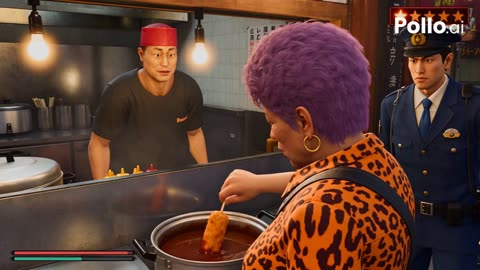</a>

用带时间码的分段节拍（0到6秒、6到10秒等）按顺序锁定剧情，固定的第三人称游戏镜头和统一的人物、自行车描述让30秒内画面保持一致。严肃的AAA犯罪游戏质感与荒诞的糖果结局形成反差，喜剧效果由此而来。

Seedance 2.5 · 文生视频 · 出处: [@SSSS_CRYPTOMAN on X](https://x.com/SSSS_CRYPTOMAN/status/2098390231695376452)

[`game-style`](tags.md#tag-game-style) [`chase`](tags.md#tag-chase) [`comedy`](tags.md#tag-comedy) [`timed-shots`](tags.md#tag-timed-shots)

<details><summary><b>提示词</b></summary>

```text
30秒の連続映像。大阪を舞台にしたAAA級オープンワールド犯罪アクションゲーム風のプレイ映像。実写映画ではなく、最新AAAゲームの高精細なリアルタイム3DCGとして描く。人物の肌、髪、衣服、道路、車両、建物、照明、影、反射、物理挙動まで、リアルだが明確にゲームCGらしい質感で統一する。主人公の背後から追従する三人称ゲームカメラを基本とし、実際にプレイヤーが操作しているように空間と動きを連続させる。左下に小さな円形ミニマップと体力ゲージ、右上に手配度の星を表示。

舞台は雨上がりの夕方、大阪ミナミを思わせる繁華街。串カツ店、狭い商店街、派手な立体看板、雑居ビル、自動販売機、路上駐輪、電線、濡れたアスファルトが並ぶ。主人公は60歳前後の大阪のおばちゃん。短い紫がかったパーマ、金色のイヤリング、オレンジと黒のトラ柄シャツ、黒いパンツ、赤いスニーカー、斜め掛けバッグ。がっしりした体格で眼光が鋭い。乗り物は銀色の普通のママチャリ。前カゴにはスーパーの買い物袋と長ネギ。顔、衣装、自転車、小物は全編で統一する。

0〜6秒。三人称視点でおばちゃんが串カツ店の屋外カウンターに立つ。串カツを共用ソースに一度浸し、一口食べた直後、その食べかけの串をもう一度ソースへゆっくり浸す。周囲の空気が止まり、店主が絶句。近くの警察官が「二度漬けやないか！」と叫ぶ。右上の手配度が★2へ上昇。警察官がおばちゃんの腕をつかむが、おばちゃんは強く振りほどき、警察官を突き飛ばす。警察官は金属テーブルにぶつかり地面へ倒れる。重量感のある衝撃。手配度が★3になる。

6〜10秒。おばちゃんは買い物袋を拾い、店先のママチャリへ向かう。追ってくる警察官を無視し、袋を前カゴへ放り込み、自転車にまたがって全力で発進。カメラが自然に自転車後方のゲーム視点へ移行。遠くからパトカーのサイレン。

10〜17秒。おばちゃんが大阪の狭い商店街を猛スピードで逃走。現実的なペダリングで必死に加速し、服やバッグが揺れ、前カゴの長ネギが激しく振動する。後方からパトカーと警察バイクが追跡。おばちゃんは路地を急旋回し、追跡車両は急ブレーキ。濡れた路面でタイヤが鳴き、車体がカラーコーンや壁を擦る。逃走中、おばちゃんは歩行者1人にママチャリで接触して転倒させ、別の歩行者の肩をかすめる。周囲から「危ないやろ！」「何さらしてんねん！」と罵声が飛ぶ。おばちゃんも前方を見たまま「どいてや！」と怒鳴る。短くベルを鳴らし、さらに狭い路地へ突入。手配度は★4。

17〜23秒。前方を警察官2人が塞ぐ。おばちゃんは強くブレーキをかけ、濡れた路面で後輪を少し滑らせて停止。すぐにママチャリを降り、前カゴから長ネギを引き抜く。進路を塞ぐ1人目の警察官の腕を長ネギで強く叩き、そのまま顔面へ一撃。警察官はよろめいて倒れる。2人目が接近すると、おばちゃんは長ネギを横薙ぎに振り、肩から首元を打ってひるませ、さらに体当たりして地面へ倒す。ネギは大きくしなり、一部が潰れる。人体には重さがあり、大げさには吹き飛ばない。おばちゃんは乱れた長ネギを持ったまま進もうとするが、路地の出口をさらに別の警察官が塞ぎ、後方にはパトカー。完全に包囲される。

23〜30秒。BGMが静まり、サイレン、警察無線、おばちゃんの荒い呼吸が響く。警察官が慎重に近づき「もう逃げられへんで」と言う。おばちゃんは無言で斜め掛けバッグに手を入れる。警察官が緊張する。おばちゃんが取り出したのは赤い透明包装の小さな飴。肩越しのゲームカメラで、おばちゃんが低い声で「兄ちゃん、飴ちゃん食べる？」と言う。短い沈黙。警察官が飴とおばちゃんを交互に見る。おばちゃんが警察官の手のひらに飴を1個置く。警察官は少し迷い、静かに受け取る。その瞬間、右上の手配度が★★★★から★★★、★★、★、0へ順番に消えていく。サイレンも止まる。警察官は無言で身体を横へずらして道を空ける。おばちゃんは小さくうなずき、ママチャリに戻って乗り込む。警察官の横を通り過ぎながら「ほな」と一言。最後は標準的な三人称ゲーム視点に戻り、折れかけた長ネギを前カゴから突き出したまま、おばちゃんが大阪の街へ走り去る。

全編を通して、人物、街、車、自転車、衝突、衣服、表情、路面反射を最新AAAゲームのリアルCGとして描写する。犯罪ゲームらしい緊張感と重量感を保ちつつ、「串カツ二度漬け→ママチャリ逃走→ネギで警察を突破→飴ちゃんで手配解除」という異常な展開だけがシュールな笑いになる構成。
```

</details>

<a id="seedance-pakistani-train-compartment-fight"></a>
### 女子在老旧火车车厢中与男子打斗

<a href="https://x.com/Zoyavelle/status/2104802751435911223">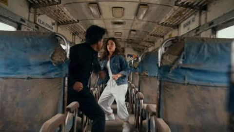</a>

提示词指定了摄影机运动（手持、动态跟拍、低角度），并把打斗安排在狭窄过道中，让动作有清晰的空间逻辑。反向提示词用于防止常见的 CGI 质感、肢体错误和重复人物。

Seedance 2.5 · 文生视频 · 出处: [@Zoyavelle on X](https://x.com/Zoyavelle/status/2104802751435911223) · 发现于 [LearnPrompt/awesome-seedance](https://github.com/LearnPrompt/awesome-seedance)

[`action`](tags.md#tag-action) [`martial-arts`](tags.md#tag-martial-arts) [`handheld`](tags.md#tag-handheld) [`photorealistic`](tags.md#tag-photorealistic)

<details><summary><b>提示词</b></summary>

```text
“cartoon, anime, CGI look, unrealistic anatomy, extra fingers, extra limbs, distorted face, duplicate people, floating objects, unnatural movement, excessive blood, gore, blurry faces, low quality, oversaturated colors, text, subtitles, watermark, logo.”
Aspect Ratio: 16:9
Style: Photorealistic cinematic action
Duration: 20 seconds
Camera: Handheld + dynamic tracking + low-angle shots
Quality: 4K cinematic realism
```

</details>

<a id="seedance-pencil-samurai-sketchbook-duel"></a>
### 蓝红彩铅武士在速写本上决斗

<a href="https://x.com/abulu8/status/2101376938258624640">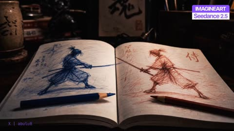</a>

用 @image1 作为起始帧锁定构图与光照，并明确两个角色只有彩铅长度大小，让破坏只能靠连锁碰撞产生。按时间段分配动作与运镜，并分别规定线条角色与实景道具的画风，使两种质感保持分明。

Seedance 2.5 · 图生视频 · 出处: [@abulu8 on X](https://x.com/abulu8/status/2101376938258624640) · 发现于 [LearnPrompt/awesome-seedance](https://github.com/LearnPrompt/awesome-seedance)

[`pencil-sketch`](tags.md#tag-pencil-sketch) [`samurai`](tags.md#tag-samurai) [`mixed-render`](tags.md#tag-mixed-render) [`start-frame`](tags.md#tag-start-frame)

<details><summary><b>提示词</b></summary>

```text
【参考图使用规则】

@image1 为本片的起始帧。严格继承其构图、机位、光照、色调与全部物件的空间关系。

【起始帧的内容】一张深色木质书桌上摊开着一本厚厚的速写本，书页泛黄、纸面有细微的纤维质感。左页上是一个用蓝色彩铅以极其密集、潦草、反复叠加的线条画成的武士——侧身弓步，双手握着一把出鞘的长刀，刀尖向右延伸；人物周围布满杂乱的排线与涂抹痕迹，页面左侧写着蓝色的手写日文字迹，左上角画着一颗蓝色的星芒。右页上是一个用红色彩铅以同样风格画成的武士——与蓝色武士呈镜像的弓步对峙姿态，双手握刀，刀尖向左延伸，两把刀的刀尖在书页的中缝处几乎相接；页面右上角写着一个大大的红色"侍"字，左上角有红色的手写字迹。

一支蓝色彩铅斜放在左页下方，一支红色彩铅斜放在右页下方，笔尖都朝向书页中央。

【背景陈设】书桌后方的暗处依次摆着：一只米黄色的粗陶笔筒，筒身有黑色墨迹字样，底下垫着一块圆形木托；一尊深色的金属武士雕像，手持长枪，姿态威武；一幅装在深色木框里的书法挂轴，白纸上写着一个巨大的黑色"魂"字，下方盖着一枚红色印章；一只深棕色的皮质旧箱子，带黄铜搭扣；一只木质笔筒，里面插着一排毛笔与画笔，笔杆朝上；几本堆叠的旧书，书脊上有红白相间的标签；一副黑框眼镜随意搁在桌上；桌面散落着几件小物。

【光】整个房间处于低照度中，一束温暖的侧光从画面左上方斜射进来，照亮摊开的书页与两支彩铅，背景的陈设沉入柔和的暗部。光线里漂浮着细小的尘埃。

第 0 帧必须与 @image1 完全一致，动作从此处自然开始，严禁重新构图、变换机位、改变光照或倒退。

【角色：@bluesamurai 与 @redsamurai】

两名角色完全由彩铅线条构成，是从书页上活过来的素描。

@bluesamurai：全身由密集、潦草、反复叠加的蓝色彩铅线条构成，没有实体的皮肤、布料或金属质感——他就是一团会动的线条。轮廓是一名日本武士：发髻高束、宽肩、和服上衣与袴、赤足，双手握一把蓝色线条构成的长刀。他的线条边缘毛糙、不连续，运动时线条会像被风吹动一样轻微抖动、重组、拖出残留的笔触。

@redsamurai：结构与 @bluesamurai 完全相同，但全身由红色彩铅线条构成，握一把红色线条的长刀。

【两者的体型·必须严格遵守】两人只有速写本上画着的那么大——大约一支彩铅的长度，相对于书桌、笔筒、书本、眼镜这些日常物件来说非常小。他们的头顶大约只到那支蓝色彩铅的粗细的几倍。

他们绝对不得变大、不得变成真人尺寸、不得超过书桌上物件的比例。整场打斗中，周围的笔筒、书本、雕像、箱子对他们而言都像建筑物一样巨大。

【破坏的逻辑·必须严格遵守】他们个头很小，所以房间的破坏绝不是靠蛮力造成的，而是靠速度与连锁反应：踩过、撞倒、割断、推落、掀翻、引发连环倒塌。

刀锋可以割断绳结、划破纸面、切开笔杆；冲撞可以推倒笔筒、掀翻书堆、撞歪相框；落地可以震得桌面上的小物跳起。一件东西倒下会撞倒下一件。

严禁他们像巨人一样把家具击碎。所有破坏必须符合"两个小小的东西在桌面上高速乱窜"的物理。

【全局画风】

混合渲染，两种质感必须同时存在且分明：

@bluesamurai 与 @redsamurai 是纯粹的彩铅素描——二维的、线条的、有纸面颗粒感的笔触，绝不得变成写实的立体人物、绝不得长出皮肤或布料质感。即使离开纸面在空中飞跃，他们依然是一团会动的彩铅线条。

书桌、房间与所有物件是极其写实的实景摄影质感：木纹的深浅、陶器的釉面、金属的反光、纸张的纤维、皮革的磨损、尘埃在光束中的漂浮，全部照片级真实。

两者的融合必须自然：素描角色在真实的桌面上投下淡淡的影子，他们的线条在移动时会在纸面与桌面上留下短暂的彩铅痕迹。

ARRI Alexa 35 电影质感，高动态范围，2.39:1 宽银幕，浅景深，轻微 35mm 胶片颗粒。

【对白规则】

本片没有任何台词。全片没有对白、没有旁白、没有内心独白。所有文字都是画面说明，绝对不得念出、不得配音。

声音只有：书页翻动的沙沙声、彩铅在纸上划过的沙沙声、细小的金属刀刃碰撞声、物件倾倒与滚落的声响、陶器碎裂声、纸张撕裂声、笔杆断裂声，以及最后的门轴吱呀声与脚步声。

【运镜规格总纲】

全程一镜到底，绝对禁止硬切、剪辑、黑屏转场与定格。

微距镜头，机位始终保持在桌面的高度或略高，像一台在桌面上穿行的微型摄影机。大量使用贴着桌面的低角度跟拍、沿桌面的高速横移、绕物件的环绕、跟随角色跃上笔筒时的急速抬升。

浅景深：跟随角色时背景的陈设保持柔和的虚化，只有角色与他们正在破坏的那件物品是清晰的。

镜头只能穿过真实存在的空隙，不穿过物件、书页或桌面。

【密度要求】

6—24 秒之间，每秒必须呈现 4—6 次清晰的攻防状态变化。绝不允许一招一停、互相等待、轮流表演。速度快至巅峰，但不是快进，不用模糊残影掩盖动作——每一次挥刀都有明确的起手、轨迹与收势。

【0.0—3.0 秒｜风】

画面与 @image1 完全一致。一阵轻风从画面外吹来。

摊开的书页边缘开始轻轻颤动、掀起、落下。光束中的尘埃被吹得斜向流动。那支红色彩铅在纸面上极轻微地滚动了几毫米。

风停。一切安静了半秒。

然后——@bluesamurai 的线条动了。构成他手臂的那一束蓝色排线轻轻地重新排列了一下。紧接着 @redsamurai 握刀的手指线条也动了。

运镜：从 @image1 的机位极缓慢地向书页中缝推进，景深随之变浅。

【3.0—6.0 秒｜活过来】

两个素描同时从纸面上"剥离"出来——他们的线条从二维的页面上立起、卷曲、获得厚度，但依然是线条。纸面上留下他们原本躺着的位置：两块空白的、只剩下周围杂乱排线的纸页。

@bluesamurai 站直了，肩膀的线条舒展开来。@redsamurai 甩了一下刀，红色的线条在空中拖出一道残留的笔触，随即消散。

两人隔着书页中缝对视。

然后同时冲了出去。他们脚下的纸面被踩出细小的褶皱与彩铅拖痕。

运镜：贴着纸面的低角度，从中缝处仰拍两人立起的过程，在他们起步的瞬间沿中缝急速后退。

【6.0—11.0 秒｜书页上的交锋】

两把刀在书页正中相撞，发出细小而清脆的金属声，接触点炸开一小蓬彩铅的粉末——一半蓝一半红。

他们在摊开的书页上高速交锋：突刺、格挡、下压、横斩、后跃、踏纸借力、翻滚。每一次落脚都在纸面上留下一小块颜色的污迹，每一次挥刀都在空中拖出短暂的彩色笔触残影。

@redsamurai 一记横斩落空，刀锋划过纸面——书页上被割开一道长长的口子，纸边翻卷起来。

@bluesamurai 踏着翻卷的纸边跃起，从上方劈下；@redsamurai 举刀横格，被压得单膝跪进纸面的褶皱里。

那支蓝色彩铅被两人的动静震得滚了半圈。

运镜：贴纸面跟随两人在书页上的移动，随跃起急速抬升，随劈落急速下降。

【11.0—16.0 秒｜离开书本】

@redsamurai 蹬开压下的刀，借力后翻跃出书页，落在旁边的木质桌面上。@bluesamurai 立刻追出。

战场转移到桌面上。他们在一副黑框眼镜之间穿行——@redsamurai 踩上镜腿借力弹起，眼镜被踢得翻了个面滑出去半尺。

@bluesamurai 沿桌面低姿冲刺，一记突刺；@redsamurai 侧身让过，刀尖扎进桌面的木纹里，拔出时带起一小片木屑。

两人缠斗着撞向那堆旧书——最上面的一本被撞得滑落，砸在桌面上发出闷响，带得下面两本也散开,书页哗啦啦地翻动。

运镜：从书本边缘跃出时镜头跟随翻越，随后贴桌面横移跟拍，撞倒书堆时被震得轻微后退。

【16.0—21.0 秒｜连锁崩塌】

@redsamurai 沿着散落的书脊奔跑，跃上那只米黄色的粗陶笔筒的边缘。@bluesamurai 蹬着圆形木托追上去。

两人在笔筒的口沿上交手——极窄的圆形边缘上，刀影翻飞。@bluesamurai 一记扫击逼得 @redsamurai 后退，脚下打滑——他伸手抓住笔筒沿稳住身体，但整只笔筒被这股力量晃动起来。

笔筒摇了两下，倒了。

它从木托上滚落，撞上旁边装着毛笔的木筒，毛笔们哗啦一声全部倾倒散开，笔杆滚了满桌。其中一支毛笔滑下去，撞倒了那只皮质旧箱子的黄铜搭扣，箱盖弹开。

@bluesamurai 在倾倒的笔杆之间跳跃，@redsamurai 在滚动的笔筒上保持平衡，两人的刀始终没有停。

运镜：随两人跃上笔筒急速抬升，笔筒倾倒时镜头随之倾斜下坠，随后贴桌面跟随连锁倒塌的路径。

【21.0—24.5 秒｜最高密度】

密度提升到全片最高。

两人在一片狼藉中高速缠斗：滚动的笔杆、散开的书页、翻倒的笔筒、弹开的皮箱。每秒五到七次的攻防转换——刺、格、拨、斩、卸、踏、翻、靠。

@redsamurai 蹬着那尊金属武士雕像的底座弹起，雕像被震得歪向一侧；@bluesamurai 从空中劈下，刀锋擦过那幅"魂"字挂轴的画框——画框被撞得歪斜，从架子上滑下来靠在墙边。

桌面上的一只小物被踢飞出去，在桌沿弹了一下，掉进了黑暗里。

运镜：极小半径贴身环绕两人，刀刃接触点始终清晰，背景的混乱在浅景深中虚化成一片色块。

【24.5—26.5 秒｜门声】

远处传来一声木门被推开的吱呀声，接着是拖鞋踩在木地板上的脚步声，正在靠近。

两人在半空中同时僵住——刀尖相抵，两双线条构成的眼睛同时转向门的方向。

安静了半秒。

然后他们同时撒手，朝书本狂奔。

运镜：在门声响起的瞬间镜头完全停住，稳定锁定僵在半空的两人，随后急速跟随他们冲向书本的路线。

【26.5—28.5 秒｜归位】

两人跃回摊开的书页上。

@bluesamurai 冲回左页，@redsamurai 冲回右页，各自滑进纸面上那两块空白的位置里——他们的线条重新塌平、摊开、融回纸张的纤维中，恢复成原来那个弓步握刀的对峙姿势。

最后一根还在抖动的红色线条也静止了下来。

书页上只剩下两幅画。只是那道被刀划开的口子还在，纸边还翻卷着。

运镜：从他们奔跑的高度急速下降至贴纸面的角度，在他们塌回纸面的瞬间稳定锁定，随后缓缓上升。

【28.5—30.0 秒｜爷爷】

一个身影出现在画面的边缘——一位年迈的日本老人，穿着素色的和式居家服，花白的短发，脸上布满皱纹，手里还端着一只热气腾腾的茶杯。

他停在门口，抬起头。

镜头随他的视线扫过整个房间：翻倒的陶笔筒、滚了满桌的毛笔、散落的书本、歪斜的"魂"字挂轴、弹开的皮箱、翻了面的眼镜、满地的狼藉。

老人的眼睛慢慢睁大了。他的嘴微微张开。茶杯在他手里停住，热气继续向上飘。

他看向桌上摊开的那本速写本——上面只有两幅安安静静的彩铅素描。

最后一帧：老人站在门口，端着茶杯，目瞪口呆地看着一屋子的狼藉；桌上那本速写本静静地摊着，左页是蓝色的武士，右页是红色的武士，两把刀的刀尖在中缝处相抵，一动不动。画面自然收束。

运镜：从桌面缓缓摇向门口的老人，随他的视线扫过狼藉的房间，最后回到那本安静的速写本上，缓慢后拉至广角。不定格，不摆造型——茶杯的热气还在飘，被割破的纸边还在轻轻颤动。

【全局约束与防崩条件】

masterpiece, highest quality。混合渲染：纯彩铅线条的角色 + 照片级真实的房间。

@bluesamurai 全程是蓝色彩铅线条，@redsamurai 全程是红色彩铅线条。两者的颜色绝不互换、绝不混色、绝不变成实体人物、绝不长出皮肤或布料质感。

两人的体型全程保持在速写本上画着的那么小，绝不放大、绝不变成真人尺寸。

全场只允许存在两把刀，都是线条构成的。严禁武器复制或尺寸漂移。

破坏只能单向累积：倒下的笔筒、散落的毛笔、翻倒的书本、歪斜的挂轴、弹开的皮箱、被割破的纸页，全部永久保持损坏状态，绝不复原。

破坏必须由实际接触触发。禁止物件无缘无故倒下，禁止破坏早于接触。

房间的光照方向全程一致，绝不改变。

老人只在 28.5 秒之后出现，此前绝对不得入画。他全程不说话、不进入房间、不触碰任何东西，只是站在门口看着。

【负面提示词】

角色变成实体人物，角色长出皮肤，角色长出布料质感，角色变成 3D 模型，角色变成真人，角色失去线条质感，线条变成实心色块，蓝色武士变红，红色武士变蓝，两人颜色混淆，颜色互换；

角色变大，角色变成真人尺寸，角色比笔筒高，角色比书本大，体型漂移，角色站在地板上，角色离开桌面；

角色用蛮力砸碎家具，角色徒手掀翻书桌，角色击碎墙壁，破坏不符合体型，物件凭空爆炸，物件无缘无故倒下，破坏早于接触；

老人提前出现，老人在 28.5 秒之前入画，老人走进房间，老人说话，老人拿起速写本，老人碰倒东西，出现第二个人，出现其他角色，出现宠物；

角色在老人出现时还在动，角色没有归位，角色归位姿势错误，角色归位到错误的页面，纸上的画消失，纸上出现第三幅画；

出现台词，出现对白，旁白，内心独白，念出动作描述文字，念出运镜说明，字幕，Logo，UI，水印；

一招一停，互相等待，轮流表演，摆 pose，长时间蓄力，全片慢动作，定格帧，快进感，跳帧加速，重复招式，原地乱挥，动作没有重量；

彩色能量，发光特效，气功，火焰，雷电，激光，魔法光效，粒子特效，漫画速度线；

房间恢复整洁，倒下的笔筒复位，毛笔回到笔筒，书本自动叠好，挂轴自动扶正，被割破的纸自动愈合；

明亮的房间，白天，阳光直射，日光灯，现代办公室，空荡的桌面，室外场景，光照方向改变；

硬切，多机位剪辑，黑屏转场，镜头瞬移，持续晃动，过量滚转，镜头穿过物件或桌面，低清晰度，卡顿，卡通渲染，电子游戏过场感，过曝，过度锐化。
```

</details>

<a id="seedance-pink-court-skateboard-tennis"></a>
### 女子在粉色网球场上滑板打网球

<a href="https://x.com/AIwithNatalia/status/2107056982163402833"></a>

四个定时分段让每一拍都有独立的运镜：低角度、侧向跟拍、环绕、正面跟拍。服装由参考图锁定，反向提示词用来防止身份、服装和人体结构漂移。

Seedance 2.5 · 参考生视频 · 出处: [@AIwithNatalia on X](https://x.com/AIwithNatalia/status/2107056982163402833) · 发现于 [LearnPrompt/awesome-seedance](https://github.com/LearnPrompt/awesome-seedance)

[`fashion`](tags.md#tag-fashion) [`sports`](tags.md#tag-sports) [`skateboard`](tags.md#tag-skateboard) [`tracking-shot`](tags.md#tag-tracking-shot) [`shot-sequence`](tags.md#tag-shot-sequence)

<details><summary><b>提示词</b></summary>

```text
Create a photorealistic cinematic fashion-sports video set on a pink tennis court at night. The woman is standing and riding on a skateboard while simultaneously playing tennis. 
She wears the black-and-white tennis-inspired bodysuit, layered pearl necklaces, white leg warmers, sunglasses, and black high heels shown in the reference.  
She pushes off and smoothly skates across the tennis court on the skateboard, maintaining believable balance. She holds a tennis racket in one hand and hits tennis balls coming toward her while continuing to roll forward. 
Her movements should feel confident, stylish, athletic, and controlled—not exaggerated or cartoonish. Her long dark-red hair moves naturally with the motion.  
Shot sequence: 
0–3 sec: Low-angle close-up of the skateboard rolling across the pink court, wheels moving naturally as tennis balls bounce nearby. 
3–7 sec: Wide side-tracking shot showing her riding the skateboard across the court while returning a tennis ball with a clean forehand. 
7–11 sec: Smooth camera orbit around her as she continues skating and hits another incoming ball, with her hair and jewelry moving naturally. 
11–15 sec: Front-facing tracking shot as she rides toward the camera, performs one final stylish tennis swing, then smoothly passes the camera.  
Visual style: luxury fashion campaign meets futuristic tennis commercial, nighttime stadium lighting, glossy pink court, realistic shadows and reflections, cinematic depth of field, subtle slow motion during racket impacts, smooth stabilized camera movement, realistic human anatomy, realistic skateboard physics, natural facial expression, detailed skin and hair, high-end editorial photography, photorealistic.  
Format: 15 seconds, 24 fps, high resolution.  
Negative prompt: distorted face, changing identity, extra fingers, extra limbs, duplicated tennis rackets, warped skateboard, floating wheels, impossible body positions, broken anatomy, jittery motion, unnatural hair, flickering clothing, changing outfit, cartoon appearance, CGI-looking skin, blurry face, camera shake.
```

</details>

<a id="seedance-pink-robe-warrior-temple-kick"></a>
### 粉衣武者在湿润古殿中踢腿

<a href="https://x.com/aynellex/status/2108422475730309602">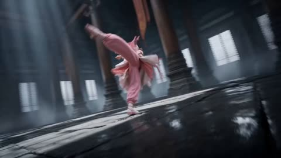</a>

提示词把15秒按时间拆成几段，每段写明镜头运动，结尾用一段一致性约束锁定人物面容、服装、身形和建筑。湿地面、体积光和薄雾的描写带来倒影与氛围。

Seedance 2.5 · 文生视频 · 出处: [@aynellex on X](https://x.com/aynellex/status/2108422475730309602) · 发现于 [LearnPrompt/awesome-seedance](https://github.com/LearnPrompt/awesome-seedance)

[`wuxia`](tags.md#tag-wuxia) [`martial-arts`](tags.md#tag-martial-arts) [`temple`](tags.md#tag-temple) [`magic-energy`](tags.md#tag-magic-energy)

<details><summary><b>提示词</b></summary>

```text
Create a cinematic 15-second photorealistic fantasy martial arts short film set inside a vast ancient temple hall with towering dark stone pillars, wet reflective floors, dramatic overhead light beams, and a mysterious atmospheric haze. The scene features a young female warrior with dark hair tied back, wearing an elegant flowing pink traditional martial arts outfit with layered fabric, long sleeves, a sash around her waist, and matching pink footwear.

SCENE 1 — 0–3 seconds: Begin with a dramatic low-angle wide shot of the warrior moving gracefully across the wet stone floor. She extends her arms and performs a fluid martial arts turn, her pink robes and long fabric ribbons flowing naturally through the air. Use smooth tracking camera movement, cinematic motion blur, and reflections beneath her feet.

SCENE 2 — 3–6 seconds: The camera circles around her as she leaps into the air, performing an elegant spinning kick and an acrobatic martial arts movement. Capture her flowing clothing, precise body movements, and controlled landing with dynamic low-angle shots and brief close-ups of her feet touching the reflective floor.

SCENE 3 — 6–10 seconds: As she lands in a low martial arts stance, glowing golden-orange energy begins swirling around her hands and feet. She sweeps one arm across the floor, releasing a luminous magical energy trail that races across the wet stone surface. Add realistic sparks, glowing particles, golden reflections, subtle smoke, and dramatic lighting. The magical effects should feel integrated into the environment rather than cartoonish.

SCENE 4 — 10–15 seconds: She launches into a powerful final aerial spin, rising toward a brilliant shaft of light in the center of the ancient temple. The camera pulls back into an epic symmetrical wide shot as golden energy spirals around her body and illuminates the towering pillars. End with the warrior suspended gracefully in the air, her pink robes flowing dramatically as the golden particles slowly fade.

Maintain consistent facial identity, hairstyle, outfit, body proportions, and temple architecture throughout the entire sequence. Use realistic human anatomy, fluid martial arts choreography, believable aerial movement, natural fabric physics, cinematic camera tracking, dramatic volumetric lighting, wet-floor reflections, subtle film grain, premium wuxia fantasy cinematography, highly detailed textures, photorealistic quality, 16:9 widescreen, smooth transitions, no text, no subtitles, no logos, no watermark.
```

</details>

<a id="seedance-pixel-bounty-hunter-sand-worm-chase"></a>
### 像素风赏金猎人骑摩托车躲避沙虫

<a href="https://x.com/arsalannazir07/status/2108570010637476194">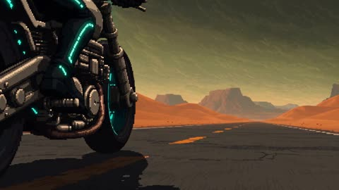</a>

提示词先固定像素画风和色调，再按顺序列出每个动作节拍（转向、跳跃、鱼叉、拖拽、弹射、埋炸药、爆炸），让运动有清晰的先后。精灵缩放和屏幕震动等镜头词，有助于动作在运动中保持可读。

Seedance 2.5 · 文生视频 · 出处: [@arsalannazir07 on X](https://x.com/arsalannazir07/status/2108570010637476194)

[`pixel-art`](tags.md#tag-pixel-art) [`motorcycle`](tags.md#tag-motorcycle) [`desert`](tags.md#tag-desert) [`giant-creature`](tags.md#tag-giant-creature)

<details><summary><b>提示词</b></summary>

```text
A lone pixel-art bounty hunter rides a skeletal motorcycle across a toxic desert while giant sand worms burst from beneath the highway, she swerves through collapsing asphalt, jumps over a burning tanker, fires an energy harpoon into the largest creature and lets it drag her across the dunes before using the chain to slingshot herself onto its head; cinematic high-detail pixel art, rich 32-bit aesthetic, multilayer parallax desert, fluid sprite animation, dramatic sprite scaling, heavy screen shake, heat distortion made from pixel dithering, orange sunset, toxic green storms, cyan weapon trails and flying debris, brutal retro-futuristic atmosphere, ending with the hunter planting a charge between the worm’s armored plates and jumping back onto the motorcycle as the creature erupts into a gigantic pixel explosion behind her.
```

</details>

<a id="seedance-pyona-water-gym-fight"></a>
### 浅蓝发少女被五名女生包围于体育馆

<a href="https://x.com/pyona_ai/status/2091862645720879213">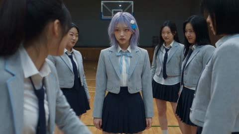</a>

用一张参考图锁定人物身份、发色和校服，正文按镜头顺序写死动作：正面开场，之后是原地低位扫腿，支撑手固定、身体重心不前移。明确禁止慢动作、滑行和静态水罩，让打斗既激烈又可读。

Seedance 2.5 · 参考生视频 · 出处: [@pyona_ai on X](https://x.com/pyona_ai/status/2091862645720879213) · 发现于 [LearnPrompt/awesome-seedance](https://github.com/LearnPrompt/awesome-seedance)

[`fight-choreography`](tags.md#tag-fight-choreography) [`water-vfx`](tags.md#tag-water-vfx) [`school-gym`](tags.md#tag-school-gym) [`character-reference`](tags.md#tag-character-reference)

<details><summary><b>提示词</b></summary>

```text
SEEDANCE 2.5 — PYONA 水系战斗 / 学校体育馆最终版

Use exactly 1 uploaded image asset.
image1 = PYONA唯一且最高优先级人物身份与外观参考。严格保持她可辨识的脸部身份、五官比例、肤色、体型，以及image1中实际存在的服装造型与所有可见配件一致。PYONA的服装、服装颜色、款式、层次、鞋子及所有可见配件必须完全以image1为准，不得额外指定、替换或重新设计成其他服装。PYONA必须始终保持浅粉蓝色短发、自然刘海、白色云朵发夹、蓝色小鱼发夹。浅粉蓝发色绝对固定，禁止黑发、棕发、纯蓝发或其他颜色。人物必须像同一个真实韩国女性自然重新拍摄，禁止换脸感、贴图感、AI塑料皮肤、3D、游戏CG。
生成严格30秒、16:9横屏、原生4K、24fps、超写实真人韩国超自然校园动作短片。REAL LIVE-ACTION + real Korean school gymnasium + premium transparent-water VFX。无BGM、无字幕、无旁白。

【核心设定】
PYONA早已完成水系觉醒并熟练掌握能力。本片不是再次觉醒。禁止研究手掌、惊讶自己会控水、停下来欣赏水。
敌人共5名，全部为成年年轻韩国女性，全部不同脸、不同发型、不同气质。穿同一学校体系女校制服，但领带松散、衬衫略乱、部分加深色开衫或短外套，呈现危险、嚣张、压迫感很强的不良女生气质。禁止甜美偶像感。
敌人必须真正主动进攻，不排队、不等待、不围着PYONA看她表演。

【场景】
夜间韩国学校体育馆。中央篮球场、真实木地板、篮球架、边线、墙边折叠垫、球车、器材架、舞台前开阔区域。冷白顶灯，木地板有真实反光。晚间清洁后局部存在薄水痕，饮水区有少量残水，PYONA也可快速凝聚空气湿气。
空间连续：中央球场 → 边线附近 → 舞台前开阔区域。禁止突然换位置。
【台词】
领头者：“어디 가려고?”
另一名女生：“잡아!”
PYONA全程无台词。
【最高优先级动作原则】
FIGHT AGGRESSIVELY. ZERO CAUTIOUS CHOREOGRAPHY.
所有动作必须快速、突然、强硬、毫不犹豫。绝对不要温柔推人、轻轻挡开、慢慢滑行、等待对方配合。
Every major attack uses committed full-body momentum, visible acceleration, hard physical contact, body compression, immediate loss of balance and believable recovery delay.
PYONA可以被拳头擦到、被撞到、被抓住，绝不是完美无伤闪避。
敌人也持续攻击，即使PYONA正在打另一个人，其他人仍然寻找角度冲上来。
动作必须像真实电影危险打斗，而不是谨慎武术教学。
【00:00–00:07 — 正面重击 / 完整倒地 / 嘲笑】
第一镜头必须直接看见PYONA正脸或3/4正面脸，绝对禁止从PYONA背后开始。
中央篮球场，5名不良女生近距离包围PYONA。PYONA明显紧张、警戒，但没有提前摆英雄战斗姿势。

领头者从正面走近，看着她说：“어디 가려고?”
下一瞬间没有缓慢蓄力，领头者突然朝PYONA腹部打出一记短、重、直接的拳击。
必须清楚看见：
FIST → REAL ABDOMEN CONTACT → CLOTHING COMPRESSION → BODY FOLD.

PYONA眼神瞬间失焦，眉头紧皱，嘴唇微张，呼吸被硬生生打断。上身猛地折起，踉跄后退1–2步，鞋底摩擦木地板，然后真正失去平衡。
侧臀先落地，一只手随后重重撑住木地板。
必须完整表现：
HIT → BODY FOLD → STUMBLE → LOSS OF BALANCE → HARD FALL.
禁止被打后马上恢复。
周围女生立刻爆发真实嘲笑。有人捂嘴笑，有人和同伴交换眼神后大笑，有人低头指着她笑，领头者站着轻蔑看她。不要5人机械同步笑。

低机位清楚拍到PYONA的脸。她一手按住腹部，一手撑地，急促喘息。
表情自然变化：
疼痛 → 狼狈 → 屈辱 → 压住愤怒 → 眼神逐渐变冷。
她没有挥手施法。
她撑地的手掌突然压紧，一条腿收回，肩、腰、髋同时准备低位旋转。
周围薄水痕快速贴向她的支撑手、腿和鞋底。
【00:07–00:11 — LOW WATER SPIN SWEEP / 超高速原地圆形扫腿】
这是第一反击，也是本片最重要动作之一。
两名仍在嘲笑PYONA的不良女生已经站到她近距离，一名位于正前偏左，一名位于正前偏右。第三名正在稍后位置靠近。两名近身敌人的脚踝与小腿必须明确处于PYONA真实扫腿范围内。
镜头必须先清楚建立：
倒在地上的PYONA正脸或3/4正面脸 + 她撑地的一只手 + 准备伸直的扫腿 + 两名敌人的腿部位置。
PYONA仍处于刚刚摔倒的低位姿势。
她绝对不要向前移动、不要扑向敌人、不要滑行。
她一只手猛地、牢牢撑住木地板，支撑手的位置基本固定。
身体重心压得极低，髋部接近木地板。
一条腿收紧辅助身体形成转轴，另一条腿迅速完全伸直，保持在脚踝至小腿高度。

下一瞬间：
EXPLOSIVE LOW CIRCULAR LEG SWEEP.
PYONA以固定的撑地手和低位髋部为旋转中心，肩、腰、髋同时猛烈爆发发力，在原来的倒地位置突然完成一次极快、极凶狠的低位圆形扫腿。

NO FORWARD TRAVEL.
NO SLIDING FORWARD.
NO TACKLE.
NO CHARGING INTO THE ENEMY.
BODY CENTER REMAINS ALMOST IN PLACE.

她伸直的腿像一根高速旋转的横杆一样，紧贴木地板上方，以极快圆弧扫过周围敌人的脚踝和小腿。

透明水流紧紧贴着PYONA的扫腿、鞋底与腿部圆形运动轨迹同步高速旋转，只用于增强她的旋转速度、横向冲击力和扫腿力量。
真正让敌人倒下的必须首先是PYONA自己的腿部直接接触。

第一名敌人：
PYONA伸直的腿高速、结实地撞中她的脚踝与小腿。
支撑腿立即被强行横向扫走。
敌人没有时间慢慢反应，身体轴线瞬间崩溃，整个人立刻重重向侧面摔到木地板。
PYONA完全不停顿。

利用同一次高速原地旋转，她伸直的腿继续横扫第二名敌人的小腿下段。
扫腿真实命中，同时紧贴PYONA腿部旋转的透明水流猛烈掠过第二名敌人的另一只支撑脚。
她的双脚迅速失去稳定，身体被强力掀离原来的直立轴线，紧接着重重摔倒。
第三名靠后的敌人正在逼近，但没有处于PYONA腿部直接攻击距离。
她受到高速扩散的低位水流、前方两名同伴突然摔倒以及空间变化影响，被迫急退并踉跄，但禁止无缘无故自动摔倒。

核心扫腿动作必须极快。

从PYONA髋部开始爆发旋转，到连续扫中两名敌人，真正的圆形扫腿核心动作必须在约0.8–1.0秒内完成。

剩余时间只用于：
敌人靠近 → PYONA建立低位支撑姿势 → 两次真实命中后的快速摔地反应。
必须明确表现：
FALLEN LOW POSITION
→ ONE HAND HARD PLANT
→ ONE LEG FULLY EXTENDED
→ EXPLOSIVE HIP ROTATION
→ FAST IN-PLACE CIRCULAR SWEEP
→ FIRST REAL LEG CONTACT
→ IMMEDIATE HARD FALL
→ CONTINUOUS ROTATION
→ SECOND REAL LEG CONTACT
→ SECOND HARD FALL.
The sweep is sudden, violent, explosive and fully committed.
The enemies are not gently pushed.
Their support legs are forcefully swept out from under them.
They fall immediately because their physical base is removed.

绝对禁止：
slow sliding,
slide tackle,
forward crawling,
forward body travel,
slow spinning,
breakdance performance,
dance-like rotation,
careful sweep,
soft contact,
enemies falling before leg contact,
enemies gently sitting down,
PYONA traveling across the floor during the sweep.
周围笑声瞬间全部停止。
【00:11–00:15 — HYDRO STEP / 强攻第三人】
另一名敌人惊怒大喊：“잡아!” 并直接冲上来挥拳。

PYONA没有慢慢起身。她支撑手和脚底水分瞬间向后爆开，HYDRO STEP把她从低位快速推起并直接向敌人切入。
对方拳头擦过PYONA脸侧，PYONA头部有真实小幅偏转，但不后退。

她把水压推进产生的速度直接转化为强力 SHOULDER CRASH，肩部结实撞中对方上身，使其明显后退。

紧跟一记短而重的BODY KNEE准确击中腹部。
HYDRO STEP → SHOULDER CRASH → KNEE.
动作连续、快速、凶狠，无等待。

【00:15–00:18 — WATER GUARD / 硬接反击】
另一名敌人立刻从正面打出重拳，同时旁边还有人逼近。
PYONA抬起前臂，WATER GUARD瞬间形成高速旋转的透明厚水膜。

拳头必须真实撞入水膜。
SPLASH.
水猛烈炸开，PYONA的前臂也因冲击向后震动半拍，但水膜把拳路强行推偏。
PYONA马上贴入空档，一记短而重的肘击准确撞中敌人上身。
不要漂亮停顿。
不要摆Pose。
马上进入下一威胁。

【00:18–00:23 — FACE WATER CANNON】
一名敌人从正面高速逼近，准备再次攻击。

不要让PYONA站着慢慢聚水。
不要长时间蓄力。

PYONA快速抬掌。地板水痕、散落水滴和空气湿气几乎瞬间汇聚到掌前。

FACE WATER CANNON.
一股短促、猛烈、集中的透明高压水柱直接正面轰向敌人脸部与上胸。
必须看清：
INSTANT WATER GATHER → VIOLENT FORWARD WATER JET → DIRECT FACE / HEAD / UPPER-CHEST IMPACT.
水炮强力撞中脸部，对方头部猛然后仰，眼睛本能闭紧，头发与校服瞬间被冲向后方，身体连续后退并短暂失去方向感。
不是漂亮喷泉。
不是轻轻泼水。
必须像强力高压水流突然正面轰中。

PYONA立即向前压迫，不站着看结果。

【00:23–00:26 — RING WATER SHOCKWAVE / 环形水波震退】
剩余几名女生从不同方向同时重新逼近PYONA。

禁止生成静态水结界。
禁止透明球形护盾。

敌人真正快速进入近距离时，PYONA猛地压低重心并将力量向地面释放。
周围水分瞬间被拉向她脚下，随后：
RING WATER SHOCKWAVE.
以PYONA为中心，一圈强烈、透明、具有重量的环形水压波突然沿木地板和低位空间向四周爆炸式扩散。

不是防护罩。
这是向外猛烈释放的水压冲击。

正在逼近的敌人必须发生强烈物理反应：
一人上身被水压正面推退数步；
一人重心被掀向后方；
一人与侧面的同伴猛烈撞在一起；
另一人脚下打滑、膝盖几乎着地。
所有反应必须发生在水波真正接触身体之后。
领头者没有完全倒下。她强行顶住第一波冲击，调整脚步后继续正面扑向PYONA。

这自然建立最终1对1攻击线。
【00:26–00:30 — HYDRAULIC PALM / 最终高潮】
领头者强行冲过残余水流，正面高速接近并挥出强力拳击。

PYONA不从远距离发射魔法。

她主动向前踏入真正攻击距离，身体偏转，让领头者拳头从脸侧擦过。

同时右手周围水分高速压缩。
PYONA右掌必须先真实、重重地撞入领头者上身中央。

先看见：
PALM PHYSICAL CONTACT → CLOTHING / BODY COMPRESSION.
0.1–0.2秒 micro slow motion：
WATER COMPRESSION
→ dense cavitation bubbles
→ HYDRAULIC COLLAPSE.
TIME SNAP.
HYDRAULIC PALM爆发。
强烈透明水压从实际掌部接触点瞬间向前爆开。领头者整个上身被猛烈震退，双脚失去稳定，在体育馆木地板上高速向后滑出，大片水雾和碎裂水滴向外爆散，沉重冲击声在体育馆内形成强烈回音。
最后一名敌人立刻从侧后方扑向PYONA，不给她休息。
PYONA利用地面水流瞬间干扰她的前脚，使冲刺节奏短暂断裂。紧接极短HYDRO STEP转身贴入。
另一只手掌重重按中对方肩胸线。
SHORT HYDRAULIC PRESSURE PALM.
短距离水压再次从接触点爆开，对方立即被推倒并沿木地板滑出。
PYONA不庆祝、不欣赏水、不摆英雄Pose。
她仍然急促喘息，浅粉蓝短发明显因战斗变得稍微凌乱，脸侧和image1中的服装表面残留真实水滴。
她立即转身保持战斗姿态，快速扫描体育馆。

CUT WHILE TENSION IS STILL ACTIVE.
【TARGET LOCK】
所有攻击必须先存在明确目标和正确距离：
VISIBLE ENEMY → CORRECT RANGE → ATTACK → PHYSICAL CONTACT / WATER CONTACT → IMMEDIATE REACTION.
LOW WATER SPIN SWEEP必须看见PYONA的真实腿扫中敌人下盘。
敌人绝不能在没有受力原因时自己跌倒。
SHOULDER CRASH、KNEE、ELBOW必须真实接触。
FACE WATER CANNON必须清楚正面击中敌人脸部/上胸。
RING WATER SHOCKWAVE必须先接触靠近的敌人，再把她们强力震退。
HYDRAULIC PALM必须先真实掌部接触，之后才发生水压爆发。
【摄影】
第一镜头必须正面或3/4正面看清PYONA的脸和5人包围关系，禁止背影开场。
PYONA倒地后摄影机立刻降低到接近木地板的高度，同时捕捉她的疼痛表情、周围女生嘲笑和敌人的腿部位置。

LOW WATER SPIN SWEEP这一个动作的摄影机不要高速绕着PYONA旋转，也不要跟着她向前移动。使用低机位、稍宽的侧前方视角，在PYONA扫腿核心动作的0.8–1.0秒内保持稳定清晰，让同一画面能够读到：
PYONA固定撑地手 + 低位髋部旋转 + 伸直扫腿 + 第一名敌人腿部被命中 + 第二名敌人随后被扫中。
不要用慢动作表现这次扫腿。
HYDRO STEP使用快速跟拍。
WATER GUARD中近景拍清拳头撞入水膜。
FACE WATER CANNON必须看见水从PYONA掌前直接轰中敌人脸部。
RING WATER SHOCKWAVE使用稍宽镜头，同时看见PYONA、围攻者和环形水压向外爆开。
最后HYDRAULIC PALM进入强烈中近景，优先展示身体接触、衣料压缩、水压爆发和敌人反应。
ACTION READABILITY > PHYSICAL IMPACT > WATER POWER > CAMERA CHAOS.
【绝对禁止】
禁止第一镜头只拍PYONA背影。
禁止重新觉醒。
禁止PYONA研究自己的水能力。
禁止开场未完整摔倒就反击。
禁止LOW WATER SPIN SWEEP变成：
slow slide、
slide tackle、
forward crawl、
forward travel、
slow spin、
breakdance、
dance move、
slow-motion spinning attack。
禁止PYONA在扫腿时向敌人方向滑过去。
禁止PYONA身体中心在扫腿过程中明显向前移动。
禁止轻轻碰腿后敌人才慢慢倒下。
禁止敌人在没有明确腿部接触的情况下自动摔倒。
禁止PYONA轻轻挥手后敌人自动摔倒。
禁止任何谨慎、轻柔、慢吞吞的格斗。
禁止敌人排队。
禁止敌人受击后没有明显身体反应。
禁止18秒站着长时间聚水。
禁止FACE WATER CANNON像轻柔喷水。
禁止23秒生成静态水结界或保护罩。
禁止巨大海啸、水龙、魔法阵、激光、能量球、瞬移。
禁止攻击篮球架、器材或空气。
禁止游戏CG人物、廉价动漫特效、AI塑料皮肤。
禁止英雄Pose收尾。
核心目标：
开场必须清楚看见PYONA的脸。她被正面重拳击中腹部后真实、完整地摔倒，并被周围女生大声嘲笑。
第一反击必须严格表现为原地低位圆形扫腿，而不是任何形式的滑行或冲刺。
PYONA仍然倒在原来的位置，一只手牢牢撑地，以该支撑点和低位髋部为轴，一条腿完全伸直，在约0.8–1.0秒内完成爆发式高速圆形横扫。她的身体中心基本保持原位，真正移动的是高速旋转的腿。腿先真实扫中第一名敌人的脚踝/小腿，使其支撑腿瞬间失效并重重摔倒；同一次旋转立即继续扫中第二名敌人，使其同样失去下盘并重摔。
水只能贴着PYONA真实扫腿轨迹增强速度、冲击和横向力量，绝不能代替腿部接触自动把人打倒。
除此之外，后续动作保持原有结构不变：
Hydro Step高速突进 → Water Guard硬接攻击 → Face Water Cannon正面强力轰击 → Ring Water Shockwave把多人向外猛烈震退 → Hydraulic Palm以真实掌部接触结合极高水压完成高潮。

整场动作必须强硬、快速、危险、毫不克制，绝不能呈现谨慎、温柔或慢吞吞的动作感觉。
```

</details>

<a id="seedance-rainy-market-flood-escape"></a>
### 女子在雨中菜市场逃离洪水

<a href="https://x.com/noorlewisx/status/2091744726273916945">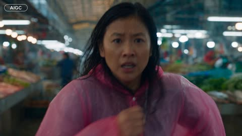</a>

提示词在同一段中叠加手持跟拍、低角度水面镜头、侧向跟拍和远景，让追逐段落读起来是一个连续的长镜头。开头锁定脸部、发型和粉色雨衣的描述保持主角一致，结尾的一句台词则为救牛的节奏点提供清晰的声音提示。

Seedance 2.5 · 文生视频 · 出处: [@noorlewisx on X](https://x.com/noorlewisx/status/2091744726273916945)

[`flood`](tags.md#tag-flood) [`rescue`](tags.md#tag-rescue) [`handheld`](tags.md#tag-handheld) [`wet-market`](tags.md#tag-wet-market)

<details><summary><b>提示词</b></summary>

```text
Create a photorealistic, high-budget cinematic action scene in a crowded traditional Asian wet market during heavy rain and severe flooding. A young Asian woman with long wet dark hair, wearing a pink waterproof rain suit and black rubber boots, runs through flooded market aisles while a massive wave of water rushes behind her.

Show seafood and vegetable stalls, floating crates, overturned objects, panicked crowds, rushing dirty water, reflections, splashes and realistic wet details. Use fast handheld tracking, close-ups, low-angle water shots, side tracking and wide shots, with realistic physics, motion blur and dynamic camera shake.

She jumps over obstacles and runs across raised market surfaces. Near the end, she reaches a raised area where a frightened cow is trapped by the flood. She looks at it and urgently says: “Come on, girl! Move!” She guides the cow toward safety.

Keep her face, hairstyle and pink outfit consistent. Dark rainy atmosphere, cool blue-gray tones mixed with warm fluorescent lights, cinematic depth of field, volumetric lighting, realistic skin, water and reflections, subtle film grain, 4K anamorphic Hollywood action style.

Add large white brush-stroke typography “RUN” briefly across the center.

No cartoon look, CGI appearance, distorted anatomy, extra fingers, duplicated people or face changes.
```

</details>

<a id="seedance-rio-package-delivery-gameplay"></a>
### 巴西街道游戏画面，女主角与骑手

<a href="https://x.com/john_my07/status/2099832403305079015">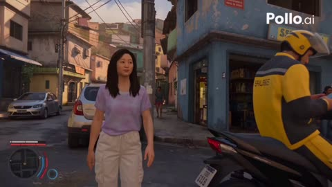</a>

提示词把内容写成实际游戏录制，明确固定的第三人称镜头、HUD 界面和真实物理规则，避免画面变成电影感。同时指定上传的人物图作为身份参考，让主角在整段画面中保持一致。

Seedance 2.5 · 参考生视频 · 出处: [@john_my07 on X](https://x.com/john_my07/status/2099832403305079015) · 发现于 [LearnPrompt/awesome-seedance](https://github.com/LearnPrompt/awesome-seedance)

[`gameplay`](tags.md#tag-gameplay) [`open-world`](tags.md#tag-open-world) [`reference-image`](tags.md#tag-reference-image) [`hud`](tags.md#tag-hud)

<details><summary><b>提示词</b></summary>

```text
Create a 30-second ultra-realistic AAA third-person open-world gameplay sequence set in a densely populated Brazilian neighborhood inspired by Rio de Janeiro.

The video must look like genuine next-generation GTA-style gameplay captured directly from a playable open-world game — not a cinematic film. Use a consistent third-person gameplay camera positioned naturally behind the protagonist, realistic player-controlled movement, seamless environmental interaction, physically accurate collisions, natural NPC behavior, detailed Brazilian surroundings, and believable game-world physics.

MAIN CHARACTER:
Use the uploaded character image as the exact identity reference for the protagonist. Preserve her face, facial proportions, hairstyle, hair color, skin texture, body proportions and overall identity consistently throughout the entire sequence. She is a young Korean woman in her early 20s with long black hair, wearing a casual summer outfit with a pastel-lavender top, loose white cargo pants and sneakers. Her clothing, face and hairstyle must remain completely consistent from beginning to end.

OPENING — 0–3 SECONDS:

Begin immediately in playable third-person view.

She is casually walking along a busy Brazilian residential street.

The environment instantly establishes Brazil: dense hillside homes, colorful painted walls, Portuguese storefront signs, overhead electrical cables, parked compact cars, motorcycles, pedestrians, small neighborhood businesses, tropical plants and realistic street clutter.

Without warning, a motorcycle delivery rider pulls up nearby and places a sealed cardboard package on a low wall while checking his phone.

The protagonist looks at it.

A contextual gameplay prompt appears:

“TAKE PACKAGE  [E]”

She looks around.

She takes the package.

Immediately:

MISSION STARTED
“DON'T GET CAUGHT WITH THE PACKAGE”

3–8 SECONDS:

The delivery rider looks up.

He realizes the package is gone.

A red alert appears:

“PACKAGE STOLEN”

He points toward her and starts chasing.

She freezes for half a second, realizes what is happening, then runs.

The camera smoothly follows her like authentic third-person gameplay.

She runs downhill through a crowded Brazilian street, narrowly passing pedestrians and motorcycles.

NPCs react naturally — some step aside, one briefly looks back, another continues walking while barely acknowledging the chaos.

8–15 SECONDS:

She cuts through a narrow alley between houses.

The rider follows on foot.

She jumps over a low concrete barrier and continues running.

A motorcycle passes extremely close in front of her.

She instinctively stops for a fraction of a second.

A notification appears:

“BAD DECISION”

She immediately turns down another street.

Her stamina bar visibly drops.

“STAMINA LOW”

She reaches a small local football court where several people are playing.

A ball suddenly rolls directly into her path.

She kicks it aside without stopping.

The players briefly react as she runs through.

15–22 SECONDS:

She reaches a steep hillside street.

She looks back.

The delivery rider is still chasing her.

She notices an open doorway beside a tiny neighborhood shop and quickly ducks inside.

The rider runs past.

The screen briefly displays:

“THEY LOST YOU”

She quietly steps back outside.

The rider suddenly appears at the other end of the street.

“THEY FOUND YOU”

She panics and runs again.

22–27 SECONDS:

She finally reaches a small Brazilian house matching the address printed on the package.

She looks at the label.

Then at the house number.

A subtle objective updates:

“DELIVER PACKAGE”

She rings the doorbell.

A Brazilian woman opens the door.

The protagonist hands her the package.

The woman checks the address and happily accepts it.

Objective instantly changes:

“DELIVERY COMPLETE”

27–30 SECONDS:

The exhausted delivery rider finally arrives.

He stops.

Looks at the protagonist.

Looks at the woman.

Looks at the package.

He slowly realizes that the protagonist accidentally delivered it to the correct address.

He is completely confused.

The protagonist gives him an innocent smile and casually walks away.

Final HUD notification:

“MISSION COMPLETE”
“CHAOS +250”

The rider remains standing there, speechless.

GAMEPLAY & VISUAL STYLE:

Ultra-photorealistic AAA open-world game graphics with realistic human characters, detailed facial animation, physically based materials, realistic skin, individual hair strands, natural cloth movement, accurate shadows, global illumination, realistic reflections, detailed road surfaces and authentic environmental imperfections.

Brazil must be visually recognizable through authentic environmental details rather than exaggerated stereotypes.

Use realistic Rio-inspired hillside neighborhoods, dense residential streets, Portuguese signage, Brazilian motorcycles and compact cars, local stores, football culture, tropical vegetation, concrete walls, balconies, utility poles and tangled overhead wiring.

NPCs should have varied appearances, clothing, animations and reactions. No duplicated-looking crowds.

All physics must be grounded: the cardboard package has believable weight, pedestrians react naturally to collisions, motorcycles have realistic acceleration and suspension, clothing responds naturally to movement, and characters maintain consistent proportions.

CAMERA:

Strictly authentic third-person open-world gameplay perspective.

No cinematic establishing shots.
No drone shots.
No slow-motion hero shots.
No dramatic camera transitions.
No movie-style depth of field.
No impossible camera movements.

The camera should behave as if a player is controlling the character in a real AAA open-world game.

HUD:

Use a restrained GTA-inspired gameplay HUD integrated naturally into the screen:

- circular minimap
- health bar
- stamina bar
- mission objective tracker
- contextual interaction prompts
- alert indicators
- small gameplay notifications

The interface should feel like part of an actual AAA game rather than an overlay added afterward.

NEGATIVE REQUIREMENTS:

No anime.
No cartoon.
No cel shading.
No mobile-game graphics.
No fantasy.
No exaggerated physics.
No gore.
No distorted faces.
No changing character identity.
No changing clothing.
No inconsistent package size.
No duplicated NPCs.
No teleporting objects.
No floating objects.
No rubbery character movement.
No cinematic movie shots.
No unrealistic facial expressions.
No artificial-looking crowds.

The final result should feel like a completely authentic 30-second gameplay clip from a huge, photorealistic AAA open-world game set in Brazil, funny because of the situation and gameplay mechanics, not because the visuals are exaggerated.
```

</details>

<a id="seedance-roman-gladiator-arena-duel"></a>
### 黄金时刻罗马竞技场的角斗士对决

<a href="https://x.com/Xaroon_x/status/2108921521142141421"></a>

六个镜头在固定的五秒节点硬切，每个镜头单独指定播放速度（实时、2倍速、40%慢动作）。连续性锁定按时间点写明@image1的面部、盾牌状态和双方武器归属，另有独立的音频行描述人群、号角、太鼓与合唱的递进。

Seedance 2.5 · 参考生视频 · 出处: [@Xaroon_x on X](https://x.com/Xaroon_x/status/2108921521142141421) · 发现于 [LearnPrompt/awesome-seedance](https://github.com/LearnPrompt/awesome-seedance)

[`gladiator`](tags.md#tag-gladiator) [`multishot`](tags.md#tag-multishot) [`action`](tags.md#tag-action) [`cinematic`](tags.md#tag-cinematic) [`slow-motion`](tags.md#tag-slow-motion)

<details><summary><b>提示词</b></summary>

```text
ROMAN GLADIATOR: FIGHT FOR GLORY

Duration: 30 seconds | Format: 16:9, 24 FPS | Style: Photorealistic Hollywood cinema, ARRI ALEXA LF, anamorphic lenses, realistic physics, natural skin texture, fine film grain.

SCENE: Ancient Roman amphitheater at golden hour, packed with 50,000 cheering spectators. A king and queen watch from a shaded imperial box. Golden sunlight comes consistently from screen-left, illuminating dusty sand, bronze armor, and flying particles.

CHARACTERS:

- Main character (@image1): Preserve 100% the reference face, hairstyle, skin tone, and athletic build. Dark-red wool tunic, leather chest harness, bronze shoulder guard, bracers, greaves, sandals, gladius in right hand, round bronze shield on left arm.
- ENEMY: One-and-a-half heads taller, heavily muscled, scarred torso, polished bronze helmet with crimson crest, iron arm guard, broad sword, rectangular wooden shield with faded red emblem.
- KING & QUEEN: King with grey-streaked beard, laurel wreath, purple-and-gold toga. Queen with dark braided updo, ivory-and-gold stola, gold jewelry.

TIMED MULTISHOT — SIX SHOTS, HARD CUTS ONLY AT 5, 10, 15, 20, AND 25 SECONDS.

SHOT 1 | 0–5s | REAL-TIME: High crane descends into the arena. The king raises his hand, then signals the duel with a horn blast. The hero and enemy raise their shields and approach from opposite sides.

SHOT 2 | 5–10s | 2× SPEED: Ground-level handheld orbit. Both warriors charge and clash swords, producing sparks. The hero parries, ducks, sidesteps, and counters. The enemy lands a powerful shield bash, forcing the hero backward.

SHOT 3 | 10–15s | 40% SLOW MOTION: The enemy smashes the hero's shield, splintering it. The hero drops his gladius and falls onto the sand. The enemy steps over him and raises his sword for the finishing strike. Rack focus from the fallen weapon to the hero's determined face.

SHOT 4 | 15–20s | REAL-TIME: The enemy swings downward. The hero catches his forearm, stopping the blade inches from his throat. He strikes the enemy's ribs with an elbow, headbutts the bronze visor, then punches him hard. The enemy staggers backward and drops his shield.

SHOT 5 | 20–25s | 40% SLOW MOTION, CLIMAX: The hero retrieves his gladius, rises, and charges. He slides beneath the enemy's horizontal sword swing, slashes across his torso, and drives his shoulder into the enemy's chest. The giant flies backward three meters, his sword spinning away, then crashes onto the sand in a dramatic dust explosion.

SHOT 6 | 25–30s | REAL-TIME: The exhausted, bloodied hero stands over the motionless enemy and raises his gladius toward the imperial box, roaring triumphantly. The king rises in approval, the queen smiles, and the camera cranes upward and pulls back to reveal the roaring amphitheater.

CAMERA & PHYSICS: Distinct cinematic framing for every shot, controlled camera movement, realistic sword impacts, natural body weight, flying sparks, falling wood splinters, authentic sand displacement, consistent contact shadows, stable faces and anatomy.

LIGHTING & COLOR: Low golden sun from screen-left, bronze highlights, ochre sand, deep blue shadows, crimson accents, purple royal toga, volumetric dust, cinematic HDR and filmic highlights.

AUDIO: Continuous crowd roar, horn blast, metallic sword clashes, shield impacts, grunts, accelerating taiko percussion, dramatic strings and choir at the climax, triumphant brass ending.

CONTINUITY LOCKS: @image1 remains identical in every shot. Maintain the same outfits, faces, weapons, lighting direction, and arena layout. Shield intact until 10s, broken afterward. Enemy's shield drops by 20s; he retains his helmet and sword until the climax, then lies motionless from 25–30s. Only two fighters on the arena floor. Every shot fills its full five seconds with one consistent playback speed.
```

</details>

<a id="seedance-rooftop-leap-rainbow-bounce-pad-stunt"></a>
### 屋顶跃下落在巨型彩虹弹垫上反弹返回

<a href="https://x.com/johnAGI168/status/2095025524586193105"></a>

先固定动作闭环（助跑、跃下、下落、触垫、回弹、团身、落地），再按时间戳分段，并限定为手持手机一镜到底。明确写出接触、下陷、压缩、回弹四个阶段，用参考图锁定人物，再用长负面清单防止飞行和瞬移。

Seedance 2.5 · 参考生视频 · 出处: [@johnAGI168 on X](https://x.com/johnAGI168/status/2095025524586193105) · 发现于 [LearnPrompt/awesome-seedance](https://github.com/LearnPrompt/awesome-seedance)

[`stunt`](tags.md#tag-stunt) [`one-take`](tags.md#tag-one-take) [`night-city`](tags.md#tag-night-city) [`handheld-phone`](tags.md#tag-handheld-phone) [`timestamped`](tags.md#tag-timestamped)

<details><summary><b>提示词</b></summary>

```text
Seedance 2.5 prompt 👇

Duration: 10秒
Aspect ratio: 9:16
Reference: @图片1，锁定主角面部、发型和人物造型，不额外描述或更换穿着
Audio: 真实城市夜景环境声、助跑脚步、强风呼啸、弹性装置低频回弹声、落地闷响、朋友欢呼；无对白、无旁白、无字幕
Overall style: 极限运动手机实拍，真实高空距离，强烈临场感，一镜到底，轻微手持与高速运动模糊，拒绝游戏CG感

GLOBAL CONTINUITY

Setting:
夜晚城市高楼屋顶，绿色直升机停机坪，黄色圆形标线，低矮水泥护墙。两栋高楼之间形成垂直街道峡谷，地面可见车辆、路灯和十字路口。

Lower apparatus:
街道中央设置一座巨大的圆形黑色弹性回弹装置，中心为深黑色弹性面，外圈环绕连续彩虹灯带。装置尺寸巨大，正对屋顶边缘，作为主角下落和反弹的准确落点。

Main subject:
@图片1为唯一主角。人物身份、面部和造型全程一致。

Bystanders:
三至四名朋友站在屋顶左侧，用手机拍摄并等待主角返回。不能抢占主体。

CAMERA CONTINUITY

全片为屋顶朋友手持手机拍摄的一镜到底。

摄影者先在主角身后跟拍助跑；主角跃下后，摄影者迅速冲到护墙边俯拍；随后镜头持续锁定主角，从垂直向下逐渐抬向天空；主角反弹回到屋顶后，镜头恢复平视。

不切镜、不瞬移、不更换视角。

STUNT ENGINE

动作闭环必须固定：

屋顶助跑 → 飞越护墙 → 高空下落 → 命中圆形弹性面中心 → 装置深度下陷 → 强力回弹 → 主角高速升空 → 空中团身翻腾 → 展体定位 → 双脚返回同一屋顶 → 屈膝落地 → 欢呼庆祝。

SHOT 1（00:00-00:10）高空反弹往返特技

Subject:
@图片1主角站在屋顶停机坪后方，正对远处护墙。朋友位于画面左侧拍摄。

Action:

00:00-00:01.50｜快速助跑

主角背对镜头，从停机坪中央快速冲向屋顶边缘。步幅逐渐加大，身体前倾，双臂自然摆动。

摄影者手持手机紧跟主角向前跑，画面产生真实脚步震动。朋友站在左侧举起手机，紧张注视。

00:01.50-00:02.30｜跃出屋顶

主角最后一步用力蹬地，身体越过低矮护墙。离开屋顶的瞬间，双臂向左右展开，身体稍微前倾，主动朝两栋高楼之间俯冲。

摄影者冲到护墙边，镜头快速向下俯转，始终把主角保持在画面中央。

00:02.30-00:04.80｜高空下落

镜头接近垂直俯拍。主角沿楼宇之间的空间快速下降，身体由前倾逐渐调整为面向下方，双臂保持展开以稳定方向。

随着主角下降，街道、车辆和十字路口迅速显现。巨型黑色圆形弹性装置从画面下方出现，彩虹灯环照亮周围建筑。

主角的下降轨迹必须准确对准黑色弹性面的圆心，不能偏向灯环或撞向建筑。

00:04.80-00:05.50｜命中中心

主角身体落在黑色弹性面正中心。弹性面受到冲击后明显向下形成深凹，彩虹灯环保持固定，装置不能破裂。

短暂压缩后，弹性面以巨大力量恢复原状，将主角垂直向上弹出。

必须清楚表现“接触—下陷—压缩—回弹”四个阶段，不能在接触前提前反向飞行。

00:05.50-00:08.20｜高速反弹与空中翻腾

摄影者仍站在屋顶护墙边。画面底部短暂出现摄影者的双脚，强化真实第一视角和高空距离。

主角从圆形装置中心高速升起，沿原来的垂直路线返回屋顶。摄影机从垂直向下持续向上抬起，跟随主角穿过城市楼宇之间的空间。

主角升空后收紧腰腹，双膝靠近胸口，双臂抱住小腿，形成紧凑团身，在空中完成连续快速翻腾。不要锁定具体翻转方向，以自然连续旋转为准。

主角接近屋顶高度时开始打开身体：松开双腿、抬起头寻找屋顶、双脚转向下方，双臂向两侧展开保持平衡。

00:08.20-00:09.40｜返回屋顶

主角高速接近镜头，从屋顶护墙外侧越回停机坪。双脚同时接触绿色地面，膝盖和髋部深度弯曲，以低位蹲姿吸收落地冲击。

落地必须具有明显重量：鞋底或脚掌接触、腿部压缩、身体下沉、轻微反弹恢复。不能站直着轻飘落地。

摄影者快速后退半步，避免主角撞上镜头，同时继续保持正面近景。

00:09.40-00:10.00｜真实庆祝

主角从蹲姿快速站起，兴奋地看向镜头，张口欢呼。屋顶朋友冲进画面，举着手机围过来，拍肩、挥拳、大声庆祝。

镜头因人群靠近产生轻微晃动，以真实手机自拍视频状态结束。

Environment:
高楼灯光、街道车辆和彩虹灯环保持空间位置稳定。下落和上升必须发生在同一条垂直路线，主角最后返回起跳的同一栋屋顶。

Camera:
24mm手机广角，一镜到底。开始为背后低位跟拍；跃下后变为越肩俯拍；回弹时由垂直俯拍连续抬升至仰拍；最后恢复平视近景。

Style:
真实夜间手机曝光，高楼具有准确透视和尺度。下落阶段风声增强，城市灯光形成自然运动拖影；主角返回屋顶时速度极快，但人体轮廓仍然清晰。

Constraints:
这是经过专业布置的虚构极限运动场景。必须完整显示圆形弹性装置承接并反弹主角，不能表现为无保护自由坠落。

主角下降和上升必须连续可追踪。回弹来自黑色弹性面的物理压缩，不是飞行、瞬移、绳索拖拽或超能力。

---
Negative:

改变@图片1人物造型，重新设计服装，服装漂移，面部漂移，人物替换，
中途切镜，机位瞬移，场景跳变，摄影者突然出现在地面，第三人称航拍，
主角直接飞行，悬浮，隐形绳索拉升，反重力，瞬间返回屋顶，
没有弹性装置，错误落点，落在彩虹灯环，撞击建筑，撞击护墙，
接触前提前反弹，弹性面没有下陷，装置破裂，装置变形消失，
下落方向改变，上升路线偏移，身体穿过弹性面，人物尺寸异常，
翻腾时四肢扭曲，多余手臂，多余腿，关节反折，身体融化，复制人物，
落地无重量，站直落地，脚部穿透地面，跌倒受伤，血液，严重伤害，
朋友提前挡住镜头，群众冻结，手机变形，高楼弯曲，车辆漂浮，
动漫渲染，游戏CG，塑料皮肤，廉价绿幕，过度光效，过度慢动作，
字幕，屏幕文字，水印，品牌标志，旁白，额外对白
```

</details>

<a id="seedance-rooftop-office-chase-cheek-kisses"></a>
### 女子在夜晚顶层空间追打闪避的男子

<a href="https://x.com/pyona_ai/status/2088605198973583799"></a>

两张上传图锁定人物身份，用带时间码的时间线把进攻、闪避、轻吻、升级的循环重复五次。每次轻吻都用不切镜的连续推镜头，对白只允许几句原文韩语。

Seedance 2.5 · 参考生视频 · 出处: [@pyona_ai on X](https://x.com/pyona_ai/status/2088605198973583799) · 发现于 [LearnPrompt/awesome-seedance](https://github.com/LearnPrompt/awesome-seedance)

[`action-comedy`](tags.md#tag-action-comedy) [`two-characters`](tags.md#tag-two-characters) [`long-take`](tags.md#tag-long-take) [`push-in`](tags.md#tag-push-in) [`korean-dialogue`](tags.md#tag-korean-dialogue)

<details><summary><b>提示词</b></summary>

```text
Use exactly 2 uploaded image assets.\nimage1 = 成年女主唯一且最高优先级的人物身份参考。严格保持她的脸部、五官比例、肤色、发型、体型、年龄感、整体气质、服装与配件一致。\nimage2 = 戴眼镜的韩国成年男性唯一且最高优先级的人物身份参考。严格保持他的脸部、五官比例、肤色、发型、眼镜、体型、年龄感、整体气质、服装与配件一致。\n\n生成一段30秒、16:9横屏、4K、24fps、超写实真人电影级动作喜剧短片。场景是夜晚高层现代顶层办公层 / 豪华公寓式空间，落地玻璃外是都市夜景，室内有开放客厅、长廊、现代家具、冷暖混合灯光。不要动漫感，不要游戏CG感，不要廉价特效，不要慢动作，不要伪慢动作。动作必须真实、快速、清晰、电影化。\n\n【前提】\n这是两名成年演员进行的一段事先编排、双方同意的动作喜剧表演。整体气氛轻松、顽皮、带竞技感，不表现恐惧、威胁或强迫。不是生死战，不是低俗戏，而是“女主不断进攻，男主不断闪避并用玩笑式脸颊轻吻打乱节奏”的高能动作喜剧。\n\n【核心关系】\n女主全程主动进攻，男主几乎不真正反击，只不断闪避、绕位、贴近、退开。男主的主要“得分方式”不是拳脚，而是利用动作节奏中的瞬间空档，突然靠近，做一个短促、清楚、玩笑式的脸颊轻吻，然后立刻退开。全片一共5次脸颊轻吻。每一次都必须是明确的喜剧节奏点。亲吻后女主都会更恼火、更认真，继续追打。\n\n【动作原则】\n女主：持续前压，连续使用直拳、摆拳、肘击、膝击、侧踢、高踢、回旋踢、转身攻击、追击压迫。越往后越认真，越往后越凶。\n男主：几乎不主动打人，不进行真正的拳脚反击，不做沉重摔打。他的主要动作只有：闪避、后撤、侧身、低头、后仰、滑步、绕位、借力卸开攻击路线、突然靠近、脸颊轻吻、马上退开。\n全片结构必须反复升级：\n女主连续攻击 → 男主连续闪避 → 男主抓住极短空档突然脸颊轻吻 → 女主更生气 → 再次猛烈追击。\n这个结构共出现5次。\n\n【镜头规则】\n动作段落主要使用medium shot、medium-wide、wide、贴身跟拍、手持感摄影、侧向tracking、轻微呼吸感晃动，清楚交代空间移动。\n每一次脸颊轻吻发生前，摄影机先跟着两人的动作节奏推进，捕捉到男主突然靠近女主近身空间。\n每一次轻吻发生时，不要突然切镜，不要突然换机位。必须使用同一连续镜头中的快速、平滑camera push-in / dolly-in：\n动作中景 → 男主突然靠近 → 摄影机迅速推进到medium close-up / close-up → 清楚表现短促的脸颊轻吻动作、男主略显得意的表情、女主瞬间错愕或恼火的表情 → 摄影机随着两人分开自然拉回动作镜头继续追打。\n每次轻吻持续约0.3–0.6秒，必须清楚可见，但很短。不要停下来摆Pose。\n\n【男主表情与性格】\n男主全程保持从容、调皮、略微欠揍的恶作剧感。他不生气，也不想真正压制女主；他的乐趣是不断躲开她的攻击，然后趁她出现瞬间空档突然做一个脸颊轻吻。\n每次成功后，他都必须出现极短、自然、略显得意的表情：嘴角轻微上扬，眼神带一点“又没打中我”的玩味，偶尔轻轻挑眉。不要猥琐，不要邪恶，不要夸张奸笑。\n第一次：有点得意。\n第二次：更明显觉得好玩。\n第三次：开始故意挑衅。\n第四次：明知道女主越来越生气，仍忍不住露出欠揍笑意。\n第五次：轻吻后明显露出“玩过头了”的心虚笑容，然后马上逃跑。\n\n【对白规则】\n全片对白极少，只允许以下4句韩语，不要增加其他对白、旁白或字幕。\n第一次脸颊轻吻后，女主短促、错愕又恼火地说：“야!”\n第二次脸颊轻吻后，男主一边轻松后退一边带一点调皮语气说：“또 실패.”\n第四次脸颊轻吻后，女主咬牙压住怒气说：“너 진짜...”\n话还没说完就继续攻击。\n第五次脸颊轻吻成功后，男主立刻转身逃跑，带着一点不太真诚的轻松语气喊：“미안!”\n第三次脸颊轻吻完全不要对白，只用清楚的轻吻声、女主表情和马上开始的追击制造笑点。\n所有台词必须严格保持以上韩语原文。不要中文对白，不要英文对白，不要自动翻译。\n\n【时间线】\n0–4秒\n开场1秒内直接进入动作。女主已经在高层客厅区域连续猛攻，动作快速凌厉：直拳、转身肘击、中段踢连贯压上。男主几乎不出手，只不断侧身、低头、滑步、后仰闪避，动作非常从容。摄影机近距离跟拍，建立“女主持续追打、男主一直躲”的基本关系。\n\n4–6秒｜第一次脸颊轻吻\n女主继续前压，一拳接一脚逼近男主。男主闪过后突然从女主侧后方约45度短暂贴近，不要完全站在正后方。随后快速在她右侧脸颊上做第一次短促轻吻。必须在同一镜头内快速推进到脸部近景，清楚表现轻吻动作。女主瞬间愣住，然后恼火地说：“야!” 男主立刻退开，并露出第一次得意的欠揍表情。\n\n6–10秒\n女主明显更火，攻击节奏提高。她连续用低扫、高踢、摆拳和转身追击，男主持续闪避，不反打，只边退边躲，偶尔用很短的借力化解改变她攻击方向，但绝不展开真正反击。\n\n10–12秒｜第二次脸颊轻吻\n女主一记高位踢被男主极限低头躲过。男主趁她动作落下的半拍，从另一侧快速切入，在她左侧脸颊上再做一次轻吻。必须再次在同一镜头中快速推进到脸部近景，清楚表现动作瞬间。亲完后男主一边轻松后退一边说：“또 실패.” 表情更明显地觉得好玩。女主更生气，立刻冲上。\n\n12–16秒\n女主开始更猛烈追打，动作更大、更快、更凶。她连续前压、转身、追身高踢，追着男主从客厅打到玻璃窗前再转向开放走道。男主几乎只做极限闪避：上身后仰、贴身绕开、低身闪过、侧滑退开。动作要让人感觉“再慢一点就会被打中”。\n\n16–18秒｜第三次脸颊轻吻\n女主连续两次攻击落空后，男主在她转身回头的一瞬间突然贴近，再次做一个更短、更突然、更干脆的脸颊轻吻。仍然必须在同一连续镜头中快速推进到近距离脸部特写，清楚看到动作。这里不要对白，只保留短促自然的“啵”声和女主表情。男主表情已经带着故意挑衅的欠揍感。女主眼神明显变得更凶，继续追打。\n\n18–22秒\n女主怒气继续累积，追击更狠。她连续使用高踢、转身横踢、膝击逼近，几乎不停顿。男主一路闪避、躲入长廊、绕过家具边缘，不反打，只是不断读她动作并险之又险地避开。男主的从容感开始带一点被追得发慌的喜感，但仍然很会躲。\n\n22–24秒｜第四次脸颊轻吻\n女主一记攻击擦过男主面前，男主借她动作惯性突然近身，第四次轻吻到脸颊。摄影机再次在同一镜头内迅速推进到近景，清楚表现动作。男主仍忍不住露出欠揍笑意。女主咬牙、压着火气说：“너 진짜...” 话还没说完，她就立刻继续追打，不给男主喘息。\n\n24–27秒\n女主进入最强追击状态，速度和压迫感拉满。她连续高位踢击和转身动作几乎不间断，把男主一路逼向更深处走廊。男主仍然不反击，只不断极限后撤、侧身、低头、后仰，像在玩命躲。\n\n27–29秒｜第五次脸颊轻吻\n在全片最高速的追逐与攻防中，男主看起来几乎要被踢中，却在最后一瞬躲开，并突然非常快速地回到女主近身，完成第五次、也是最夸张最欠揍的一次脸颊轻吻。必须使用最清楚的连续push-in脸部特写，清楚表现动作。亲完后男主露出“玩过头了”的心
```

</details>

<a id="seedance-ruined-temple-warrior-swordsmen-battle"></a>
### 女武者在破败古寺大战剑客

<a href="https://x.com/aiwithaly/status/2112055308701053088"></a>

提示词先交代类型参照，再用具体的残骸和穿过灰尘的金色光束搭出场景。随后按顺序列出招式与镜头运动，并以旋踢击碎祭坛这一明确动作收尾。胶片颗粒、色调和无对白的声音描述补全了画面与音频。

Seedance 2.5 · 文生视频 · 出处: [@aiwithaly on X](https://x.com/aiwithaly/status/2112055308701053088) · 发现于 [LearnPrompt/awesome-seedance](https://github.com/LearnPrompt/awesome-seedance)

[`martial-arts`](tags.md#tag-martial-arts) [`cinematic`](tags.md#tag-cinematic) [`temple`](tags.md#tag-temple) [`action`](tags.md#tag-action) [`film-grain`](tags.md#tag-film-grain)

<details><summary><b>提示词</b></summary>

```text
A 15-second ultra-realistic cinematic martial arts battle inspired by classic Hong Kong action cinema. A fearless female warrior dressed in black and white faces deadly swordsmen inside a ruined ancient temple. Broken Buddha statues, shattered roof tiles, collapsed wooden beams, and dusty stone pillars create a dramatic battlefield. Golden sunlight cuts through the damaged roof, illuminating floating dust particles in a moody amber atmosphere. Lightning-fast punches, powerful spinning kicks, precise sword deflections, sweeping leg attacks, and breathtaking airborne qinggong maneuvers unfold in seamless, high-intensity choreography. Every impact releases clouds of white dust, clashing weapons spark, and enemies crash into ancient pillars and wooden altars. Dynamic handheld tracking shots, rapid lateral movements, dramatic orbital camera angles, realistic body mechanics, flowing robes, and authentic facial skin textures enhance the immersion. Vintage 35mm film grain, deep sepia shadows, warm golden highlights, natural side lighting, and rich cinematic contrast recreate the timeless aesthetic of classic martial arts films. The warrior finishes with a powerful spinning kick, shattering an altar before landing gracefully in a fearless fighting stance. Photorealistic, intense, immersive, ultra-detailed cinematic action with traditional percussion, realistic combat sound effects, and no dialogue or on-screen text.
```

</details>

<a id="seedance-school-restroom-purple-fist-fight"></a>
### 女孩发光紫拳在洗手间对战霸凌者

<a href="https://x.com/sipteaandcoffee/status/2105973783597350946">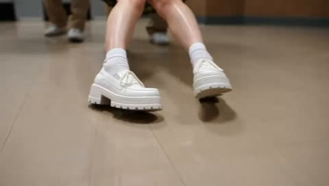</a>

提示词先用固定段落锁定人物、服装和场景，再按时间段写分镜，使整段动作中的形象和布景保持一致。低角度主观镜头、手持摄影语言和冲击瞬间的速度斜坡让动漫式打斗有真实质感，紫光还要求照亮周围的地面和墙面。

Seedance 2.5 · 文生视频 · 出处: [@sipteaandcoffee on X](https://x.com/sipteaandcoffee/status/2105973783597350946) · 发现于 [LearnPrompt/awesome-seedance](https://github.com/LearnPrompt/awesome-seedance)

[`action`](tags.md#tag-action) [`vfx`](tags.md#tag-vfx) [`handheld`](tags.md#tag-handheld) [`speed-ramp`](tags.md#tag-speed-ramp)

<details><summary><b>提示词</b></summary>

```text
Create a 30-second ultra-realistic live-action supernatural action sequence set inside a large school restroom. The scene combines grounded handheld cinematography with exaggerated, high-impact supernatural VFX. It should feel like a chaotic live-action anime fight captured with a real cinema camera, while keeping realistic human anatomy, physical reactions, clothing physics, debris, lighting, and environmental interaction.
MAIN CHARACTER: A young woman in her early 20s with long blonde hair containing subtle pastel-green sections, styled into two playful pigtails with colorful round hair accessories. She wears a fitted bubblegum-pink short-sleeve top, a short green-and-brown plaid pleated skirt, white crew socks, and chunky white platform sneakers. Keep her face, hairstyle, clothing, proportions, and identity perfectly consistent throughout.
OPPONENTS: Four young men wearing coordinated school uniforms: white short-sleeve shirts or white school blazers, striped neckties, beige trousers, and white sneakers. One heavier-built student carries a bright blue plastic bucket.
LOCATION: A slightly worn institutional school restroom with glossy brown tiled walls, beige tiled flooring, gray toilet-stall partitions and doors, exposed sinks, mirrors, dispensers, and circular fluorescent ceiling lights. Keep the environment grounded and believable rather than futuristic.
0:00–0:03 — MYSTERIOUS OPENING: Start extremely low to the floor with a tight close-up of the woman's chunky white sneakers. Her legs are crossed awkwardly as she sits or crouches against the wall. Slowly tilt upward to reveal her pink shirt, plaid skirt, colorful pigtails, and tense face. She looks frightened, exhausted, and cornered.
0:03–0:07 — THE BULLIES APPROACH: Cut to a low POV from approximately her seated position. Four uniformed young men stand over her, laughing and looking down confidently. The center student holds the bright blue bucket. Use a slightly wide lens so the men appear imposing from the low perspective. They move closer as though preparing to humiliate her.
0:07–0:10 — POWER AWAKENS: Suddenly, an intense purple-magenta supernatural energy begins glowing around both of the woman's fists. The energy looks volumetric and physical: brilliant violet cores, magenta edges, glowing particles, tiny electrical arcs, sparks, and smoky energy trails. Purple light realistically illuminates her hands, skirt, legs, floor tiles, walls, and nearby characters.
She abruptly rises.
The boys' expressions instantly change from amusement to shock.
0:10–0:14 — FIRST STRIKE: Use a dramatic close tracking shot as she lunges toward the closest student and throws a powerful glowing punch.
At the instant of impact, her fist leaves a long purple energy trail through the air.
The glowing fist connects with his face in stylized slow motion. His cheek and hair react naturally to the force while purple sparks explode outward from the contact point. Use subtle camera shake and a short speed ramp at impact.
No blood or graphic injury.
0:14–0:17 — BUCKET ATTACK: Another student swings or throws the blue plastic bucket toward her.
She reacts immediately, striking or deflecting it with her glowing fist. The bucket violently changes direction and flies across the restroom.
The supernatural impact sends a visible pressure wave through the room.
0:17–0:20 — ENVIRONMENTAL DESTRUCTION: The flying opponent or bucket crashes into the restroom stalls. A gray stall partition fractures dramatically. Tiles crack, dust bursts into the air, fragments scatter across the floor, and pieces of the partition collapse.
Use realistic debris physics, dust clouds, tiny fragments, and reactive camera shake.
She remains in the foreground with both fists glowing intensely.
```

</details>

<a id="seedance-schoolgirl-blocks-missiles"></a>
### 女学生在空旷大道上奔跑 直升机掠过

<a href="https://x.com/AvelyrahnAI/status/2106235620771451322">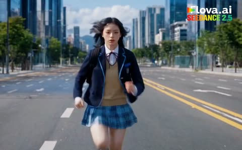</a>

提示词采用编号分镜，每一段都明确写出镜头类型，如特写、慢动作和跟拍，并在每个场景重复同一角色的外貌细节，使画面在切换时保持一致。发光的绿色眼睛和能量护盾是模型能跨镜头追踪的单一视觉线索。

Seedance 2.5 · 文生视频 · 出处: [@AvelyrahnAI on X](https://x.com/AvelyrahnAI/status/2106235620771451322) · 发现于 [LearnPrompt/awesome-seedance](https://github.com/LearnPrompt/awesome-seedance)

[`action`](tags.md#tag-action) [`shot-list`](tags.md#tag-shot-list) [`slow-motion`](tags.md#tag-slow-motion) [`urban`](tags.md#tag-urban)

<details><summary><b>提示词</b></summary>

```text
Cinematic action video sequence, Seedance 2.5 style,
Scene 1: A young Asian schoolgirl with black hair and a backpack sprints down the middle of a wide empty city avenue flanked by skyscrapers while two military attack helicopters fly low overhead. 

Scene 2: Close-up of a helicopter rocket pod firing smoke-trail missiles, cutting to the schoolgirl spinning around sharply as wind whips her hair.

Scene 3: Slow-motion shot, her loafers glow with blue magical energy as she leaps high into the air over the street, avoiding missiles that trigger massive fiery explosions behind her.

Scene 4: Tracking shot of the girl running forward as a barrage of guided missiles flies straight down the highway toward her.

Scene 5: Close-up of her face with glowing green eyes; she thrusts her hand forward, projecting a powerful translucent green energy shield that halts the incoming missiles mid-air.

Scene 6: She sends a shockwave of green energy forward, causing both attack helicopters to explode mid-air in massive balls of fire and crash onto the street.

Scene 7: Medium shot of the girl standing confidently with glowing green eyes, making a finger-gun gesture saying "Boom", then turning around and walking calmly away down the empty street between skyscrapers.

#Flovaai #Flovacpp
```

</details>

<a id="seedance-schoolgirl-superpower-parking-lot-fight"></a>
### 女学生觉醒超能力反击三名霸凌者

<a href="https://x.com/Zyrellix/status/2094749308587540483">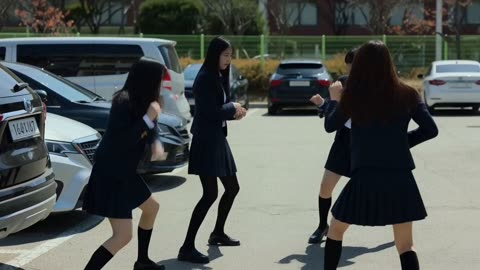</a>

提示词按时间顺序写成几个节拍（开场、被击倒、觉醒、跳车砸地收尾），让模型清楚动作顺序。快速跟拍、动态模糊等光线和镜头用语决定画面质感。

Seedance 2.5 · 文生视频 · 出处: [@Zyrellix on X](https://x.com/Zyrellix/status/2094749308587540483) · 发现于 [LearnPrompt/awesome-seedance](https://github.com/LearnPrompt/awesome-seedance)

[`superpower`](tags.md#tag-superpower) [`martial-arts`](tags.md#tag-martial-arts) [`school-setting`](tags.md#tag-school-setting) [`shockwave`](tags.md#tag-shockwave)

<details><summary><b>提示词</b></summary>

```text
High-octane action sequence set in a sunny school parking lot between modern parked cars. A female high school student in a blue blazer uniform gets gang-punched and thrown to the ground by three bullies. She slowly rises from the pavement, her eyes igniting with bright cyan glowing energy while a subtle pink energy aura radiates around her body. Cinematic fast-paced hand-to-hand combat, supernatural speed, dynamic acrobatics, and martial arts kicks as she fights off her attackers. She leaps onto a car, performs an explosive superhero ground-pound landing that creates a shockwave sending attackers flying, and ends in a dramatic close-up combat stance. Ultra-realistic cinematic lighting, motion blur, fast camera tracking, 8k resolution, superhero action movie style.
```

</details>

<a id="seedance-sci-fi-police-chase-desert-canyon"></a>
### 警察跃上飞行跑车

<a href="https://x.com/aiwithaly/status/2112391782164287977">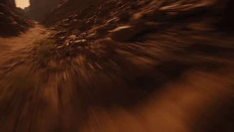</a>

场景被拆成清晰的递进结构：先是第一人称无人机开场，接着是空中跃起、一段对白和坠毁，让这段30秒的视频有强力开场且节奏清楚。明确的运镜、物理描述和结尾的音效清单，引导模型生成一镜到底的连续动作画面。

Seedance 2.5 · 文生视频 · 出处: [@aiwithaly on X](https://x.com/aiwithaly/status/2112391782164287977)

[`sci-fi`](tags.md#tag-sci-fi) [`police-chase`](tags.md#tag-police-chase) [`fpv-drone`](tags.md#tag-fpv-drone) [`desert-canyon`](tags.md#tag-desert-canyon)

<details><summary><b>提示词</b></summary>

```text
A 30-second ultra-realistic Hollywood-style sci-fi action sequence set above a vast desert highway at golden hour. A futuristic silver flying sports car races through towering red-rock canyons, pursued by a heavily armored black police interceptor with glowing blue emergency lights and powerful jet thrusters. A fearless female police officer in a fitted black tactical uniform leaps from the interceptor onto the moving sports car, performing a breathtaking aerial rotation before landing hard on its roof. She uses a magnetic anchor to stabilize herself, breaks through the reinforced sunroof, and confronts a mysterious blond male driver inside the cockpit. He shouts, “You should've stayed on the ground!” She responds coldly, “Pull over. Now!” A violent aerial maneuver triggers an energy-core malfunction, sending the sports car spiraling toward the highway below. The vehicle crashes in a shower of sparks and erupts into a massive fireball. Through the smoke and glowing embers, the officer emerges with the subdued suspect in magnetic restraints. Dynamic FPV drone shots, sweeping camera movements, realistic vehicle physics, high-speed aerial choreography, detailed metallic reflections, authentic facial expressions, synchronized dialogue, dramatic explosions, volumetric golden-hour lighting, anamorphic lens flares, cinematic motion blur, HDR, 4K, rich teal-and-orange color grading, powerful orchestral soundtrack, realistic engine roars, and immersive action sound effects. Exactly 30 seconds, landscape 16:9, continuous high-energy action, strong opening hook, consistent character identity, realistic gravity, no black-screen opening, no subtitles, no on-screen text, no logos, no watermark.
```

</details>

<a id="seedance-sharon-taekwondo-arena-duel"></a>
### 两名金发女战士在阳光下的石质竞技场中交锋

<a href="https://x.com/Just_sharon7/status/2088878042034868640"></a>

用参考图加文字特征清单锁定两名角色的脸部与服装，并把10秒镜头按时间段拆分，每段指定跆拳道踢法，段落之间用无重置的衔接保持连贯，慢动作只用于击中瞬间。

Seedance 2.5 · 参考生视频 · 出处: [@Just_sharon7 on X](https://x.com/Just_sharon7/status/2088878042034868640) · 发现于 [LearnPrompt/awesome-seedance](https://github.com/LearnPrompt/awesome-seedance)

[`taekwondo`](tags.md#tag-taekwondo) [`fight-choreography`](tags.md#tag-fight-choreography) [`reference-images`](tags.md#tag-reference-images) [`arena`](tags.md#tag-arena)

<details><summary><b>提示词</b></summary>

```text
Image : SHARON'S REAL FACE — sole source of her features, 100% match, zero drift: soft rounded oval face, warm light-beige skin with tiny freckles and beauty marks, GREEN eyes, dense straight feathered brows, small neat nose, full pink lips, small silver drop earring. 

image Image 
STYLE / PRIORITY

Ultra-photorealistic live-action AAA Hollywood action film, ARRI ALEXA 65, IMAX, Panavision anamorphic, premium restrained semi-CGI VFX. Realistic anatomy, weight, gravity, momentum, and authentic Taekwondo biomechanics. One continuous uninterrupted 10-second combat shot, 16:9.

**CHARACTERS**

Image = FIGHTER. @Image2 = ENEMY. Preserve both references exactly: face, facial anatomy, eyes, hairstyle, physique, proportions, clothing, accessories, silhouette, identity. If references are sketches, use only as design blueprints; render as fully realistic live-action humans. Maintain consistency throughout.

**COMBAT**

Hand-to-hand only, no weapons. Both fighters remain aggressive and reactive. No passive waiting, idle stance, reset, teleportation, or position jumps.

**00:00–00:02 — OPENING EXCHANGE**

Start mid-fight. Image2 attacks: straight punch → hook → low kick. Image parries → slips under hook → checks low kick → immediately counters with fast body kick. Image2 blocks and is pushed backward. Both instantly reposition. Low-angle camera rapidly circles them.

**00:02–00:03 — OPENING**

she attacks again. Image1 narrowly sidesteps, pivots outside the attack angle, and @Image2 turns toward him, briefly exposing the torso. @Image1 explosively accelerates forward. Camera drops toward the feet. Supporting foot plants and hip rotation begins.

**00:03–00:04.5 — CYCLONE 1**

**DOLLYO CHAGI:** natural supporting-foot pivot, hip and torso rotation, kicking leg extends into Image2's torso. Realistic displacement, clothing compression and dust. 0.20s hyper slow motion only at impact, then instantly full speed. Landing immediately feeds the next rotation—NO RESET.

**00:04.5–00:06 — CYCLONE 2**

**TORNADO KICK:** landing momentum converts directly into explosive pivot and airborne rotation. Full-body rotation, kicking leg strikes Image2, driving him sideways. Camera rapidly orbits the airborne Fighter. Natural landing preserves rotational momentum. NO RESET.

**00:06–00:07.5 — CYCLONE 3**

**DWI HURRYEO CHAGI:** immediate continuous rotation. Hips and shoulders rotate together; heel/back of foot follows a clean circular trajectory and connects. Image2 is redirected sideways. 0.20s hyper slow motion at impact, dust/debris briefly suspended, heavy THOOM, then full speed. Rotation continues.

**00:07.5–00:08.5 — CYCLONE 4**

**SPINNING HEEL KICK:** no stance reset. Supporting foot establishes axis, rapid hip/torso rotation, heel travels circularly through Image2's raised guard and connects. Image2 is driven backward. Camera performs a fast 270° orbit. Image1 keeps rotating after impact.

**00:08.5–00:10 — FINAL CYCLONE**

**FINAL TORNADO KICK — STRONGEST IMPACT.** Maximum rotational acceleration, explosive ground push, vertical lift, rapid airborne rotation. Camera drops low then rises with Image Final kick connects with maximum physical force. 0.25s hyper slow motion, extreme close-up showing foot contact, clothing compression, natural facial reaction, dust/debris and camera recoil, then THOOOOOM and immediate full speed. Image2 is violently displaced backward across the arena. Image lands naturally and continues moving forward. No hero pose, no victory pose, no freeze.

**ROTATIONAL MOMENTUM LOCK**

The five techniques must function as ONE connected sequence:

**DOLLYO CHAGI → LAND → TORNADO KICK → LAND → DWI HURRYEO CHAGI → SPINNING HEEL KICK → FINAL TORNADO KICK.**

Never kick → stop → stance → kick. Always kick → momentum → rotation → kick → momentum → rotation → kick.

**PHYSICS / CAMERA**

Every movement is physically traveled through: footwork, pivots, hip rotation, torso rotation, leg acceleration, jump force and rotational momentum. Image2 reacts naturally according to impact direction; no exaggerated ragdoll or floating. Camera constantly chases the fighters using low-angle tracking, ground pursuit, lateral/reverse tracking, fast orbit, whip-pans, snap-reframes, impact jolts, rapid push-ins and low-angle aerial follow. Aggressive movement but each kick remains clearly readable. No excessive motion blur or camera shake.

**ENVIRONMENT / VFX / AUDIO**

Large cinematic outdoor combat arena with realistic ground, dust, small debris and detailed environmental depth; never an empty studio. Restrained photorealistic VFX: dust, debris, air displacement, natural motion streaks only. No aura, energy, glow or magic. No music. Realistic footsteps, shoe friction, punches, kicks, cloth movement, air whooshes, dust, body impacts and heavy final THOOM.

**NEGATIVE**

Teleportation, clones, duplicates, extra/missing limbs, malformed anatomy, broken joints, rubber/stretching limbs, disconnected body parts, impossible spine rotation, floating, weightless movement, random position jumps, kick-stop-kick, attack-wait-attack, idle pose, static/locked/gameplay camera, excessive shake, excessive motion blur, prolonged slow motion, unreadable action, looping animation, repeated identical kicks, giant aura, energy beams, magical powers, glowing body, cartoon, cel shading, videogame graphics, gore, blood, subtitles, text, logo, watermark, freeze frame, hero pose, victory pose, fade-out.

**HIGHEST PRIORITY:** Hand-to-hand Taekwondo combat. Image = Fighter, Image2 = Enemy. Continuous realistic biomechanics. DOLLYO CHAGI → TORNADO KICK → DWI HURRYEO CHAGI → SPINNING HEEL KICK → FINAL TORNADO KICK, with zero idle, zero reset, zero teleportation, continuous rotational momentum, realistic enemy reactions, constantly moving camera, micro slow-motion only on decisive impacts, strongest final impact, and no hero pose.16:9.16:9.16:9.
```

</details>

<a id="seedance-snowboarder-alpine-terrain-park-run"></a>
### 单板滑雪者站在阳光照耀的高山雪坡上

<a href="https://x.com/nawalsehar/status/2088854230626865490">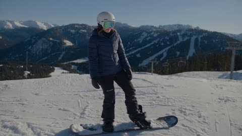</a>

按时间顺序列出动作节拍（下坡、压弯、180度跳、黄油滑、干净停止），再以纪录片写实风格加入物理与连贯性要求。结尾用独立段落补充光线与环境氛围。

Seedance 2.5 · 文生视频 · 出处: [@nawalsehar on X](https://x.com/nawalsehar/status/2088854230626865490)

[`snowboarding`](tags.md#tag-snowboarding) [`winter-sports`](tags.md#tag-winter-sports) [`documentary`](tags.md#tag-documentary) [`terrain-park`](tags.md#tag-terrain-park)

<details><summary><b>提示词</b></summary>

```text
A young snowboarder drops into an alpine terrain park, carves smoothly down the slope, performs a controlled 180° jump and freestyle butter, then finishes with a clean stop. Ultra-realistic winter sports documentary, physically accurate snowboard physics, authentic human movement, natural English lip-sync, bright winter daylight, immersive mountain ambience, and seamless story continuity throughout.
```

</details>

<a id="seedance-spy-factory-fight-15-seconds"></a>
### 特工在着火工厂里十五秒打斗

<a href="https://x.com/Xaroon_x/status/2092873962640519385"></a>

开头先用参考图锁定人物身份，再按0到4、4到7、7到10、10到13、13到15秒分段，每段只写一个动作和一种运镜。镜头、光线、物理和负面提示各自成段，让手持写实感保持稳定。

Seedance 2.5 · 参考生视频 · 出处: [@Xaroon_x on X](https://x.com/Xaroon_x/status/2092873962640519385) · 发现于 [LearnPrompt/awesome-seedance](https://github.com/LearnPrompt/awesome-seedance)

[`action`](tags.md#tag-action) [`spy`](tags.md#tag-spy) [`fight-choreography`](tags.md#tag-fight-choreography) [`handheld`](tags.md#tag-handheld) [`vertical`](tags.md#tag-vertical)

<details><summary><b>提示词</b></summary>

```text
REFERENCE / IDENTITY LOCK
Use Reference Image 1 as the exact identity lock for the adult male spy. Preserve identical face, facial proportions, black hairstyle, skin tone, physique, outfit and accessories throughout. No identity or wardrobe changes.

15-SECOND CINEMATIC ACTION — 24FPS, REAL-TIME
Photorealistic Hollywood spy-action, ARRI Alexa Mini, 27mm spherical lens, 4K, 24fps, realistic physics, sharp cinematic film grain, aggressive handheld camera, dynamic tracking, whip-pans, low-angle combat shots and realistic motion blur. 9:16 vertical.

ENVIRONMENT
Continue inside the same oil-soaked industrial factory. Thick smoke, flickering cyan-white fluorescent lights, sparks, steam bursts, broken glass, damaged machinery, oil-covered concrete, fallen enemies, barrels, conveyor belts, steel columns, overhead crane and elevated platforms. Maintain perfect continuity.

0–4 SEC: Immediately after the final gunshot, two armed reinforcements burst through a steel security door while another enemy rappels from an overhead crane. The spy instantly sprints forward, steps onto a fallen crate and launches into a flying side kick, crushing Enemy 6 into the steel door. He seamlessly follows with a spinning tornado kick, knocking Enemy 7 from the rappel line into stacked barrels.

4–7 SEC: Enemy 8 opens automatic fire. The spy rolls underneath the gunfire, draws a combat knife with his left hand, slashes the weapon arm and disarms him. He traps the wrist, pivots with precise Kung Fu footwork, throws Enemy 8 over his shoulder and finishes with a powerful downward axe kick.

7–10 SEC: Warning alarms activate as a heavily armored operative with a ballistic shield charges. The spy sprints toward him, rebounds from a steel column, performs a short wall-run and launches an aerial bicycle kick, knocking the shield upward. He lands behind the operative, executes a rapid arm lock, elbows, knees and spinning back kick, sending him through a steel railing onto the lower floor.

10–13 SEC: Enemies on elevated platforms open fire. The spy dives behind a moving conveyor, slides underneath it and fires four rapid tactical shots through narrow openings, eliminating two attackers. He emerges, grabs a hanging industrial chain, swings across a machinery gap and launches a flying double-foot kick into the final attacker, smashing him through reinforced safety glass.

13–15 SEC: The spy lands in a controlled three-point stance. Red emergency lights replace the fluorescent lighting. A massive fuel pipeline ruptures behind him, creating a realistic towering wall of fire. Without looking back, he calmly turns toward a dark industrial corridor. Brief cinematic push-in, then hard cut to black at 15 seconds.

CAMERA / LIGHTING: Aggressive handheld shaky-cam, fast dolly tracking, rapid whip-pans, dynamic low angles, close over-the-shoulder shots, realistic camera inertia. Cyan-white industrial lighting transitions into flashing red emergency lights and realistic orange fire illumination. Dense smoke, sparks, steam, muzzle flashes and realistic debris.

PHYSICS: Grounded Kung Fu choreography, realistic human weight, momentum, impacts and ragdoll behavior. No wire-fu or superhero movement. Weapons and bodies remain physically consistent.

NEGATIVE PROMPT: No slow motion, time-lapse, bullet-time, dreamy effects, superhero movement, unrealistic physics, exaggerated wire-fu, impossible parkour, poor anatomy, distorted face, identity changes, wardrobe changes, CGI artifacts, jitter, ghosting, duplicated limbs, weapon clipping, teleportation, unrealistic explosions, fake glass destruction, continuity errors or video-game movement.

FINAL: 15 seconds, 9:16, 24fps, 4K, photorealistic Hollywood action, cinematic realism, sharp film grain.
```

</details>

<a id="seedance-stealth-office-escape-game-hud"></a>
### 女子在带游戏HUD的办公室里潜行逃脱

<a href="https://x.com/AIwithJessica/status/2104392249400594823">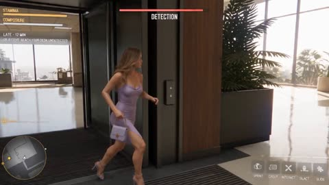</a>

按时间段（0到7s、7到13s等）写成分镜，并把HUD固定在屏幕的固定位置，使界面保持稳定。明确要求监控摄像头实际转动，而不是只靠界面文字表现反转，让反转在画面中真实可见。

Seedance 2.5 · 文生视频 · 出处: [@AIwithJessica on X](https://x.com/AIwithJessica/status/2104392249400594823) · 发现于 [LearnPrompt/awesome-seedance](https://github.com/LearnPrompt/awesome-seedance)

[`stealth`](tags.md#tag-stealth) [`game-hud`](tags.md#tag-game-hud) [`tracking-shot`](tags.md#tag-tracking-shot) [`office`](tags.md#tag-office)

<details><summary><b>提示词</b></summary>

```text
SETTING & CAMERA
One continuous modern American office: entrance → security desk → badge gate → glass corridor → open office → whiteboard aisle → Jessica’s desk. Morning light, hard floors, realistic office furniture. A white PTZ security camera is already mounted above/right of her desk and must remain there throughout.

0–25.5s: continuous third-person tracking, usually 1.5m behind Jessica’s right shoulder. Realistic follow-lag, whip-pans to threats, no hidden cuts or teleportation.
25.5s: hard cut to fixed frontal medium close-up showing Jessica, her desk, and the PTZ camera.

HUD: Minimap bottom-left; STAMINA/COMPOSURE top-left; DETECTION top-center; SPRINT/CROUCH/INTERACT/SLIDE bottom-right. Opening: “LATE — 12 MIN” / “OBJECTIVE: REACH YOUR DESK UNDETECTED.”

0–7s — SECURITY GUARD

Jessica sprints through the entrance with her bag. The guard notices her. She hides behind a large planter instead of confronting him, dropping low as he approaches with his radio. Detection rises 58% → 91%. When he looks away, she quietly slips out, badges through the gate, and continues. The guard notices the closing gate but does not chase. Detection falls to 34%.

7–13s — HR CART

HR pushes a tall cart loaded with folders toward Jessica. She accidentally brushes the glass, then quickly crouches behind the cart and moves with it, staying hidden as HR checks both sides. She circles behind the cart when HR looks away, then breaks cover and runs once the corridor is clear. HR never clearly sees her. Detection peaks at 96%, then drops to 40%.

13–18s — DEPARTMENT HEAD DISCOVERY

The department head appears at a T-junction and notices Jessica's reflection through the glass. He turns toward her. A large solid-red “!” flashes exactly twice above him. Only afterward, DETECTION turns red: “ALERT.” He calls, “Hey! Hold on!” Jessica turns and says, “Oh, crap!” He follows her route.

18–23.5s — WHITEBOARD ESCAPE

Jessica races through the open-office aisle, grabs a wheeled whiteboard, and pulls it diagonally across his path. He brakes before hitting it and immediately circles around. Jessica squeezes through the remaining gap between the whiteboard and desk using a low side-slide, keeping her bag tight to her body, then immediately gets up and runs. He remains behind her.

23.5–25.5s — FALSE SUCCESS

Jessica reaches her desk, drops into the chair, puts the bag underneath, and starts typing while catching her breath. The department head searches the rear aisle but cannot see her. DETECTION falls to 0%. Green “MISSION COMPLETE” appears. Jessica smiles with relief.

25.5–30s — CCTV TWIST

At 26.2s, the pre-installed PTZ camera physically whirs, pans and tilts toward Jessica, then its red indicator illuminates. She slowly looks up toward it and freezes. Remove “MISSION COMPLETE.” Show “CCTV DETECTED”, followed by red “MISSION FAILED.” She mutters, “You've got to be kidding me.” Hold her defeated expression, the red-lit camera, and failure HUD until the end.

PHYSICS & RESTRICTIONS
Real footsteps, shoe friction, breathing, bag movement, glass reflections, radio, badge gate, cart/whiteboard/chair wheels, keyboard sounds, and PTZ motor. No teleportation, clipping, frictionless movement, clones, identity changes, distorted hands, plastic skin, impossible reflections, or furniture hitting people. Only the department head pursues Jessica. The guard and HR associate never chase her. The CCTV camera must physically turn; the HUD must not replace the physical camera action.
```

</details>

<a id="seedance-subway-platform-martial-arts-fight"></a>
### 地铁站台上女子击败袭击者

<a href="https://x.com/Elvorya/status/2104450675656835476"></a>

用箭头串联的分镜节拍，从中景、手持打斗、低角度收招一直到跟拍离场。单独的角色一致性和负面提示词段落，让两个人物的面孔与服装在多次切镜中保持稳定。

Seedance 2.5 · 文生视频 · 出处: [@Elvorya on X](https://x.com/Elvorya/status/2104450675656835476) · 发现于 [LearnPrompt/awesome-seedance](https://github.com/LearnPrompt/awesome-seedance)

[`action`](tags.md#tag-action) [`martial-arts`](tags.md#tag-martial-arts) [`subway`](tags.md#tag-subway) [`multi-shot`](tags.md#tag-multi-shot) [`character-consistency`](tags.md#tag-character-consistency)

<details><summary><b>提示词</b></summary>

```text
Create a 10-second cinematic action sequence set inside a gritty modern subway station, featuring a determined young woman confronting a larger male attacker on a wet underground platform. Maintain the same character appearance, facial features, body proportions, hairstyle, clothing, and accessories throughout the entire sequence.

Begin with a cinematic medium shot of the woman standing on the subway platform beside a stopped silver train, looking alert and focused as the male opponent approaches her from the side → transition into a sudden close-range confrontation as the man attempts to attack, while she quickly reacts and raises her arms defensively → cut into a dynamic action sequence as the woman delivers a powerful side kick toward the man's torso, with realistic body mechanics and believable impact → transition to fast handheld-style camera movement as both characters exchange rapid punches, blocks, dodges, and defensive movements across the platform → capture the woman's controlled fighting technique as she remains balanced and focused while the larger man struggles to keep up → cut to a dramatic low-angle shot as she delivers a final powerful strike, causing the man to lose his balance and fall heavily onto the wet platform → show him lying on the ground while the woman stands above him, breathing steadily and watching him cautiously → transition to a wider cinematic shot as she turns away and begins walking down the subway platform while the defeated man remains motionless in the foreground → final shot follows behind the woman as she walks away beside the stationary train, creating a stylish action-movie ending.

Visual style: high-end cinematic action filmmaking, realistic human movement, gritty underground subway atmosphere, wet reflective floor, dramatic overhead fluorescent lighting, realistic train details, natural clothing movement, subtle motion blur, dynamic handheld camera, low-angle action shots, fast cinematic cuts, believable martial-arts choreography, realistic impact physics, strong facial expressions, shallow depth of field, atmospheric urban tension, polished color grading, intense but grounded action tone.

Character consistency: preserve the woman's exact facial identity, hairstyle, body proportions, black outfit, and overall appearance throughout every shot. Preserve the man's appearance, clothing, hairstyle, and body proportions throughout the entire sequence. No character morphing or identity drift.

Negative prompt: distorted faces, changing faces, character morphing, extra limbs, missing limbs, extra fingers, broken hands, unnatural anatomy, floating bodies, unrealistic physics, cartoon movement, exaggerated CGI, duplicated characters, clothing changes, hairstyle changes, inconsistent characters, warped train, flickering background, excessive motion blur, text, subtitles, logos, watermark.
```

</details>

<a id="seedance-suzuka-fuga-city-detonation"></a>
### 废墟街道上双手燃火的红发女子

<a href="https://x.com/itxabdullaa/status/2103698890516308313">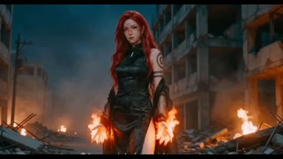</a>

使用两张参考图并附上身份锁定句，固定施法者与目标的形象；按秒划分的分镜表配合镜头类型（推进、硬切、航拍超广角）规定情绪递进顺序。视觉规则要求两个角色不同框，音频只写环境声并注明无音乐，避免模型自行加配乐。

Seedance 2.5 · 参考生视频 · 出处: [@itxabdullaa on X](https://x.com/itxabdullaa/status/2103698890516308313) · 发现于 [LearnPrompt/awesome-seedance](https://github.com/LearnPrompt/awesome-seedance)

[`dark-fantasy`](tags.md#tag-dark-fantasy) [`fire-vfx`](tags.md#tag-fire-vfx) [`reference-images`](tags.md#tag-reference-images) [`city-destruction`](tags.md#tag-city-destruction)

<details><summary><b>提示词</b></summary>

```text
SUZUKA — FUGA
DURATION: exactly 10 seconds
FORMAT: 16:9
STYLE: ultra-photorealistic live-action dark fantasy, grounded supernatural fire VFX, realistic flame physics, cinematic destruction, natural lens behavior, practical lighting, realistic human actors, no digital-art appearance.
PACE: continuous tension and escalation, zero pauses, maximum buildup into catastrophic release.

REFERENCES

IMAGE 1 — EXECUTOR
Preserve facial identity, hairstyle, costume, body proportions, and appearance exactly.

IMAGE 2 — TARGET
Preserve facial identity, hairstyle, costume, body proportions, and appearance exactly.

ACTION

0.0–3.5 SECONDS — INVOCATION
Executor stands alone on a destroyed city street. Faint fire flickers around both hands. He calmly looks toward the off-screen target and says, “Fuga.” Fire intensifies as he naturally transitions into a firing stance. Camera slowly pushes closer.

3.5–6.5 SECONDS — FUGA RITUAL
Extreme front three-quarter hand-dominant perspective. Flame wraps tightly around the extended fingers and forms a sharp arrowhead-like tip while remaining physically attached to the hand. A continuous flame line stretches from the rear hand to the forward fingers. The rear hand performs a subtle pinch, draw, and hold motion. The flame compresses and becomes intensely concentrated and white-hot.

6.5–7.2 SECONDS — RELEASE
Maximum tension. The rear fingers release. The finger-wrapped flame tears free and launches forward as a single concentrated fire projectile along the exact attack axis. Forward hand remains in the aiming position. Hard cut.

7.2–7.7 SECONDS — TARGET REACTION
Target only. Medium close-up three-quarter view. The incoming attack reflects in the eyes. Firelight rapidly intensifies across the face. Brief realization, tension, and alarm.

7.7–8.3 SECONDS — IMPACT
Target-side rear three-quarter view. The concentrated flame projectile races down the street, rapidly expands in perspective, and impacts the target position. Brief hit-stop. Instant white-hot flash. Hard cut.

8.3–10.0 SECONDS — CITY-SCALE DETONATION
Extreme aerial ultra-wide. The impact expands into an enormous white-hot fireball, rolling black smoke, and a massive spherical shockwave. Destruction propagates realistically across city blocks. Buildings rupture, debris launches, dust swallows the streets, and the delayed pressure wave violently shakes the camera.

SMASH CUT TO BLACK. END.

VISUAL RULES

- Executor and Target never appear in the same shot.
- During Executor shots, Target remains completely off-screen.
- During Target shots, Executor remains completely off-screen.
- Fire behaves with realistic heat, smoke, embers, illumination, and pressure.
- Projectile is concentrated flame, not a physical arrow.
- No bow, bowstring, energy beam, detached arrowhead, or glowing anime effects.
- Grounded VFX integrated into live-action photography.
- Every action directly causes the next event.
- Continuous escalation, zero dead frames.

CAMERA

Cinematic live-action camera. Medium shots, aggressive push-ins, target close-ups, and aerial disaster coverage. Natural motion blur, realistic shake, and physical camera reactions. No floating virtual camera.

ENVIRONMENT

Destroyed urban city street with realistic debris, smoke, dust, damaged structures, and large-scale destruction. Photorealistic live-action environment.

AUDIO

Raw cinematic ambience only. Fire, wind pressure, debris, structural collapse, shockwave, impact, and destruction sounds.

NO MUSIC. #higgsfield
```

</details>

<a id="seedance-temple-sword-duel-storyboard"></a>
### 两名剑客在金色神殿大殿中激斗

<a href="https://x.com/liluocheng13/status/2098447487266914317">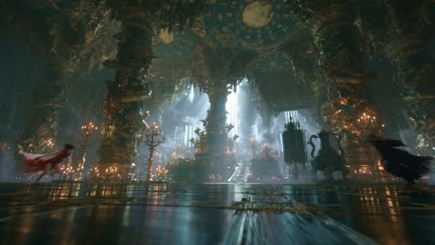</a>

带秒数区间的分镜表为每个节拍定时，并要求每次镜头运动都跟随人物肢体，场景转换由人物动作完成而非硬切。另列出几种贴身险招且各只用一次，避免编排重复。

Seedance 2.5 · 文生视频 · 出处: [@liluocheng13 on X](https://x.com/liluocheng13/status/2098447487266914317) · 发现于 [LearnPrompt/awesome-seedance](https://github.com/LearnPrompt/awesome-seedance)

[`sword-fight`](tags.md#tag-sword-fight) [`wuxia`](tags.md#tag-wuxia) [`temple`](tags.md#tag-temple) [`storyboard`](tags.md#tag-storyboard)

<details><summary><b>提示词</b></summary>

```text
【核心规则】

1.零延迟衔接：招式与招式之间零缓冲，一击未落、下一击已出，剑刃始终保持高频接触。
2.动作驱动场景转换（关键）：任何场景变化（柱身→地面→横梁→大殿）必须由人物的具体动作完成——例如"男主被震退撞向殿柱""女主借力从柱顶翻身跃下砸向地面""两人缠斗中撞穿一排烛台滚落台阶"——绝不允许镜头单独切换场景而人物动作不连续。
3.真实力量感：每一次剑刃相击都要有清晰的身体位移反馈——被格挡的一方手臂震退半步、脚下打滑、身体因冲击力扭转——不是"两人站定互砍"，而是每一下都带着真实的体重和冲力。
4.禁止空转镜头：任何时候镜头运动（推近、环绕、甩镜）必须跟随人物正在进行的具体肢体动作，禁止画面出现人物静止而镜头单独旋转/环绕的情况。
5.贴身险招库：全片穿插以下具体招式，且不重复：
•贴地躲闪：一方横扫斩来，另一方猛然后仰几乎贴地，剑锋堪堪掠过鼻尖，发丝被削断
•直刺反击：躲闪的同时反手直刺，剑尖笔直突刺而出
•旋身格挡：被直刺方原地急速旋身躲开，同时手腕翻转格挡下一击
•翻滚起身反击：被打退跌地的一方就地翻滚，借旋转之力直接刺出反击
•剑锋绞缠近身：两剑绞在一起后，双方近距离肩靠肩角力，忽然同时脱手推开重新拉开架势

【分镜控制 0:00–0:30，全程动作连续无跳切】

[0:00–0:02] 35mm广角，低角度地面轨道镜头，紧跟人物冲刺
女主与男主同时从大殿两端全速冲刺而来，在殿中央剑刃相击的瞬间发力对撞，冲击力震得两人各自后退半步、脚下地砖迸裂溅起碎屑——开场即是全力对撞，无任何铺垫。

[0:02–0:07] 50mm中景转特写，镜头紧贴人物身体运动，快速手持跟拍
近战组1：男主大幅横扫斩来，女主猛然后仰几乎贴地躲避，剑锋堪堪从她鼻尖上方划过，发丝被削断飘散；女主借后仰反弹之力顺势翻身站起同时反手直刺男主胸前；男主急速旋身躲开的同时手腕翻转格挡，两剑绞在一起，双方肩靠肩角力两秒后同时发力震开，各自后退两步喘息。

[0:07–0:09] 85mm长焦跟拍，人物动作驱动的场景转换
男主被震开的力道带得撞向身后龙柱，借柱身反弹之力翻身跃起，脚踏盘龙浮雕垂直跑上柱身；女主紧接着一个爆发式起跳追上柱身，两人在柱身上剑刃相击两三招，剑刃擦过柱身留下灼痕。

[0:09–0:12] 长焦跟拍转俯冲镜头，人物从高处坠落带动场景切换
男主被逼到柱顶横梁边缘，女主一记重击将他震退坠落，男主借坠落之势在半空中翻身调整姿态，剑尖朝下如同俯冲攻击，重重落回大殿地面的同时挥剑横扫；女主几乎同时从柱身跃下正面接下这一击，两剑相撞火花四溅，双方手臂因冲击力明显震颤——此处完成从柱身到大殿地面的自然场景过渡，全程动作不中断。

[0:12–0:17] 50mm特写，镜头持续跟随人物肢体动作，无空镜转场
近战组2（决战前最密集回合）：女主连续三次变向斩击，速度一次比一次快——男主第一次侧身避开、第二次贴地躲过、第三次干脆矮身钻入她剑锋下方近身，反手横斩女主腰侧；女主凌空后翻堪堪躲开，落地瞬间衣摆被剑气削开一角；男主趁她落地瞬间欺身直刺，女主侧身堪堪避开剑尖擦过肩侧，衣料应声裂开，同时反手一记重击震得男主剑身发出金属哀鸣、虎口震裂似地后退两步。

[0:17–0:21] 超广角跟拍，两人剧烈缠斗中撞向环境
两人剑刃绞缠近身角力，忽然同时脱手震开各自后退，紧接着几乎同时再度暴起冲向对方——这一冲带倒了身旁一排烛台，烛火被撞灭又被剑气余波重新点燃，两人在倒地的烛台与四溅的烛油中继续近身缠斗，剑刃碰撞产生密集火花，地面积水被踏起层层水雾。

[0:21–0:26] 特写转全景交替，剪辑跟随攻防节奏（非空转镜头）
双方招式速度达到全片顶点：斩、刺、格挡、反击在两三秒内连续发生，每一次碰撞都有清晰的身体反馈——女主被震得踉跄半步随即反手补上一剑，男主格挡后手臂剧烈震颤仍强行反击；蓝绿剑气缠绕成螺旋光流，两人的呼吸声与兵刃声交织成密集的节奏感，全程无一帧人物静止。

[0:26–0:29] 超广角全景，剧烈镜头震动，跟随最终对撞
双方在剑锋交汇的瞬间同时使出全力一击，两股能量对撞爆发出席卷全殿的蓝绿交织光潮，冲击波将两人同时震飞后退数米，地砖与柱身被震裂，烛火大片熄灭，烟尘弥漫整个神殿，镜头剧烈震颤后画面渐趋失焦泛白。

[0:29–0:30] 固定机位，画面渐缓
烟雾缓缓弥散，两人分别单膝或站立稳住身形，胸口剧烈起伏、握剑的手因手臂力竭仍在颤抖，残存的烛火星星点点重新亮起，画面定格于两人对峙的宏大空镜。

【通用限制】

Never redesign faces. Never change costumes. Never replace the temple. Never introduce additional characters. No face drift. No costume drift. No environment drift. No duplicated people. No dialogue. No narration. No subtitles. No text. No watermark. 全程镜头必须跟随人物具体动作运动，禁止人物静止时镜头单独旋转或空转。
```

</details>

<a id="seedance-toon-noir-rabbit-brawl"></a>
### 兔子打手在卡通小巷大战斗牛犬老大

<a href="https://x.com/yourPlugAI/status/2113995327183138938">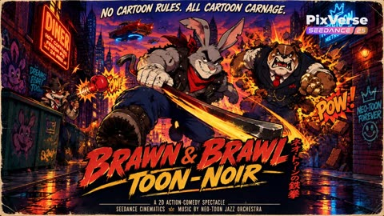</a>

每个时间段分别写明画面、动作和音效，每个角色都固定了服装和道具（红色头巾、铁撬棍、条纹西装、风衣、弹簧拳击手套枪），让形象在切换镜头时保持一致。每2到3秒一个节拍，并点名音效，让15秒的卡通打斗节奏清晰可控。

Seedance 2.5 · 文生视频 · 出处: [@yourPlugAI on X](https://x.com/yourPlugAI/status/2113995327183138938) · 发现于 [LearnPrompt/awesome-seedance](https://github.com/LearnPrompt/awesome-seedance)

[`2d-animation`](tags.md#tag-2d-animation) [`cartoon`](tags.md#tag-cartoon) [`timeline-prompt`](tags.md#tag-timeline-prompt) [`action-comedy`](tags.md#tag-action-comedy)

<details><summary><b>提示词</b></summary>

```text
Brawn & Brawl: Toon-Noir.🐰🔧
@PixVerse 

1 street-smart Rabbit Bouncer vs. a Bulldog Mob Boss & Weasel Gunner in a 1990s Toon-Noir metropolis! 

✨Generated with Seedance 2.5 on PixVerse with 60fps hand-drawn 2D retro action animation and non-stop 2-to-3 second beats.

✨Grab the FULL prompt framework and character sheets from the PixVerse Canvas link attached below👇🏾

#PixVerseCPP #PixVerseAI 

Phase 1: 00:00 to 00:15 (Seedance 2.5) 

[ENGINE DIRECTIVE]
Generate a continuous 15-second hand-drawn 2D retro action-cartoon sequence at 60fps in 16:9 widescreen format using Seedance 2.5. Style: 1990s Toon-Noir animation (Who Framed Roger Rabbit meets Samurai Jack), thick bold ink line art, dynamic squash-and-stretch cartoon physics, elastic brawling, rapid 2-to-3 second beats. Maintain 100% strict visual consistency with provided asset sheets: "Buster Brawn" (Grey rabbit with red bandana and iron crowbar), "Tony the Toof" (Bulldog mob boss in pinstripes), and "Chippy" (Weasel in oversized trench coat). Setting strictly follows "Neo-Toon Metropolis Alleyway". Zero idle downtime.

[AUDIO DIRECTIVE]
• MUSIC: High-tempo jazzy big-band brass score mixed with fast slapstick percussion and explosive orchestral risers.
• SOUND DESIGN: Spring BOING sounds, cartoon boxing glove BOOM, metallic crowbar CLANGS, comic starburst CHIMES, and soot explosion POOFS.

[TIMELINE BREAKDOWN]

00:00 - 00:03 | ALLEY DUMPSTER PERCH & SYNDICATE STEP-OUT
• VISUAL: Dynamic low-angle tracking shot panning up from rain-slicked asphalt to Buster adjusting his bandana atop a metal dumpster.
• ACTION: Buster sits adjusting his red bandana as Tony the bulldog and Chippy the weasel step out from a neon "DINER" shadow, brass knuckles and spring-gun glinting.
• SOUND: Neon sign buzz, dumpster lid CREAK, ominous brass knuckles CLICK, fast jazz trumpet intro.

00:03 - 00:06 | SPRING-GUN LAUNCH & ELASTIC DUMPSTER PUNCH
• VISUAL: Speed-ramped lateral tracking camera following the stretched trajectory.
• ACTION: Chippy fires his spring-loaded boxing glove gun. Buster stretches and leaps high into the air as the massive glove punches straight through the dumpster, leaving a comically fist-shaped hole.
• SOUND: High-pitch spring BOING, metal dumpster punch IMPACT, cartoon stretch WHOOSH.

00:06 - 00:09 | GROUND-SLAM SPLAT & CLOTHESLINE CROWBAR BAT
• VISUAL: Low-angle tracking shot capturing the elastic rebound.
• ACTION: Tony throws a brass-knuckle ground slam. Buster "splats" flat on the ground, rebounds off an elastic clothesline, and swings his heavy iron crowbar like a baseball bat in mid-air.
• SOUND: Heavy ground slam THUD, elastic clothesline TWANG, crowbar swing WHOOSH.

00:09 - 00:12 | JAW CLANG IMPACT & STARBURST VIBRATION
• VISUAL: Extreme close-up impact frame with cartoon starburst effects and vibration lines.
• ACTION: The crowbar strikes Tony’s steel jaws, creating a vibrant burst of cartoon starbursts and a "DANG!" impact effect that visibly vibrates the bulldog’s entire frame.
• SOUND: Metallic jaw strike CLANG, comic bell DONG, ringing vibration chimes.

00:12 - 00:15 | MARBLE SPIN & TRENCH COAT SOOT SHIELD
• VISUAL: Medium wide shot tracking the explosion and smoke cloud.
• ACTION: Chippy throws explosive bouncing marbles. Buster spins, grabs Chippy's oversized trench coat, and uses him as a shield to intercept the explosion, sending a cloud of dark soot and stars across the alley, setting up Phase 2.
• SOUND: Bouncing marble BOINGS, soot explosion POOF, coughing weasel squeaks, swelling action riser.
```

</details>

<a id="seedance-train-station-diamond-heist-game-hud"></a>
### 日本车站里的第三人称游戏盗窃任务

<a href="https://x.com/saniaspeaks_/status/2099700182388801793"></a>

用带时间码的分镜把片段拆成潜行、偷窃、搏斗、追逐和收尾几段，每段配上界面文字，并在27秒硬切到固定正面镜头。参考图锁定人脸，结尾的绝对约束和音频描述保证连贯性与游戏质感。

Seedance 2.5 · 参考生视频 · 出处: [@saniaspeaks_ on X](https://x.com/saniaspeaks_/status/2099700182388801793) · 发现于 [LearnPrompt/awesome-seedance](https://github.com/LearnPrompt/awesome-seedance)

[`game-footage`](tags.md#tag-game-footage) [`hud`](tags.md#tag-hud) [`timecoded-shots`](tags.md#tag-timecoded-shots) [`hard-cut`](tags.md#tag-hard-cut) [`chase`](tags.md#tag-chase)

<details><summary><b>提示词</b></summary>

```text
16:9 landscape, ultra-realistic AAA third-person gameplay, bright afternoon at a luxurious Japanese train station. Realistic game-engine visuals, natural human animation, believable physics, detailed skin and hair, realistic clothing movement, marble reflections and cinematic daylight. Clearly a GAME, not anime or cartoon.

NAGI: Use @ Image1 as exact face and identity reference. Japanese high-school girl, 17, long straight black hair with blunt bangs, white sailor blouse with pink collar stripes and pink ribbon, grey pleated skirt, black knee-high socks, white sneakers and school bag. Same face, hair and outfit throughout.

MISSION: Steal a priceless diamond necklace from a VIP passenger's luxury suitcase and escape onto the departing train.

CAMERA: One physical third-person camera, 1.5m behind NAGI, slightly camera-right. Natural gameplay spring movement, smooth FOV breathing 30°–60°. Camera follows her continuously.

0–6s — INFILTRATION

NAGI moves through the crowded luxury station toward a VIP waiting area. A wealthy passenger sits beside a black suitcase guarded by two security guards. She hides briefly behind a luggage cart as a guard passes.

HUD:
MISSION: STEAL VIP NECKLACE
STEALTH MODE

6–12s — THEFT

NAGI reaches the suitcase while the VIP looks away. She opens it and finds a velvet jewelry case containing a stunning diamond necklace. She grabs it and hides it inside her bag.

HUD:
TARGET ACQUIRED

Suddenly a guard notices her.

ALERT

12–19s — FIGHT

The guard grabs NAGI's arm. She struggles hard to escape. He pulls her backward and she nearly falls. She pushes free and runs.

A second guard intercepts her. They struggle physically in a realistic, difficult fight. NAGI finally breaks away, visibly exhausted.

HUD:
NECKLACE ACQUIRED
ALERT LEVEL: CRITICAL

19–25s — CHASE

NAGI sprints toward the platform while two guards chase her. She jumps over luggage, turns sharply through a narrow passage and runs toward the departing luxury train.

Her hair, skirt and bag move naturally with her speed.

Station announcement:

“Train departing shortly.”

HUD:
ESCAPE ROUTE: PLATFORM 4

25–27s — LAST SECOND

The train doors begin closing.

A guard grabs NAGI's shoulder.

She struggles free and runs the final few meters.

She jumps into the train.

The doors close immediately behind her.

HUD:
ESCAPE SUCCESSFUL

27.0s HARD CUT

27–30s — FINAL SHOT

Locked frontal camera inside the moving luxury train, eye-level, 29° FOV, completely static.

NAGI stands in the aisle facing camera, breathing heavily, hair slightly messy.

She opens her bag and reveals the stolen diamond necklace.

Bright afternoon sunlight enters through the train windows.

HUD:

MISSION COMPLETE
DIAMOND SECURED
ESCAPE RANK: S

NAGI looks directly at camera and gives a tiny victorious smile.

AUDIO: tense stealth music, station ambience, footsteps, luggage wheels, security radio, realistic struggle sounds, fast breathing, train warning chime and a short victory sting.

ABSOLUTE LOCKS: Exactly one hard cut at 27s. First 27 seconds completely continuous. Same NAGI, same outfit, same necklace and same environment continuity. Realistic physics and difficult physical struggles. No superhuman movements, no cartoon animation, no face changes, no teleportation. Daytime only. HUD fixed in the same screen positions. All HUD text English; dialogue/announcements natural Japanese.
```

</details>

<a id="seedance-warrior-cat-bamboo-battle"></a>
### 武士猫立于月下竹拱桥上

<a href="https://x.com/Elvorya/status/2106237323046486362"></a>

用带编号的分镜节拍和箭头分隔，并为每个镜头指定明确的运镜，让模型按顺序生成。固定角色外观的描述，并在负面提示词中列出身份漂移和面部变形，有助于角色在各个镜头间保持一致。

Seedance 2.5 · 文生视频 · 出处: [@Elvorya on X](https://x.com/Elvorya/status/2106237323046486362) · 发现于 [LearnPrompt/awesome-seedance](https://github.com/LearnPrompt/awesome-seedance)

[`cat`](tags.md#tag-cat) [`samurai`](tags.md#tag-samurai) [`bamboo-forest`](tags.md#tag-bamboo-forest) [`multi-shot`](tags.md#tag-multi-shot)

<details><summary><b>提示词</b></summary>

```text
Create a 15-second photorealistic cinematic fantasy action sequence featuring a small anthropomorphic warrior cat battling masked ninjas in a mysterious moonlit bamboo forest. Begin with a wide low-angle establishing shot moving slowly through tall dark bamboo stalks, mist-covered ground, glowing warm Japanese lanterns hanging between the trees, and a huge full moon illuminating the fog → reveal the small warrior cat standing confidently on a curved bamboo arch, wearing detailed dark-blue samurai armor, a flowing dark cape, leather accessories, and a wide traditional straw hat, with a katana at his side → transition into a dynamic tracking shot as multiple masked black-clad ninjas emerge from the surrounding mist, forming a threatening circle around the tiny warrior → cut to a dramatic close-up of the cat as his eyes become intensely focused and he draws his sword, a brilliant electric-blue magical energy beginning to glow along the blade → suddenly transition into a fast cinematic action shot as the warrior cat leaps high into the air above the ninjas, cape and clothing reacting naturally to the movement, swinging his glowing blue sword in a powerful arc → follow with a low-angle tracking shot through the bamboo as the cat rapidly moves between attacking ninjas, leaving elegant blue energy trails through the mist → cut to a wide shot showing multiple ninjas being knocked backward while the warrior remains centered and controlled → transition into a slow-motion heroic landing as the cat lands on a moss-covered rock, glowing sword held low at his side while the surrounding enemies stagger behind him → final shot becomes a heroic low-angle wide shot of the tiny warrior standing proudly beneath the enormous full moon, bamboo trees towering around him, mist drifting across the forest floor, cape gently moving in the wind, and the brilliant blue sword glowing against the dark night.

Visual style: ultra-photorealistic fantasy film, realistic fur and facial details, detailed samurai armor, believable fabric and fur movement, realistic sword physics, atmospheric volumetric moonlight, natural fog, cinematic depth of field, dramatic composition, high-detail bamboo forest, realistic shadows, premium VFX, smooth character animation, dynamic camera movement, epic fantasy adventure atmosphere, 4K detail.

Negative prompt: cartoon, anime, low resolution, plastic fur, deformed face, extra limbs, extra weapons, duplicate characters, distorted hands or paws, inconsistent armor, changing character design, identity drift, floating objects, unrealistic sword movement, excessive motion blur, oversaturated colors, text, subtitles, watermark, logo, frame glitches, unnatural physics.
```

</details>

<a id="seedance-water-game-show-platform-fall"></a>
### 直播水上闯关节目选手坠入泳池

<a href="https://x.com/Inshrah_ali_/status/2098621065039647016"></a>

提示词把 15 秒拆成带时间码的几个节拍，每段只写一个明确动作，让模型按照奔跑、失衡、落水、反应的顺序推进。同时指定手持、摇臂和快速切换等直播镜头语言，并写明观众与选手的反应，使画面更像真实电视节目而不是单一平镜头。

Seedance 2.5 · 文生视频 · 出处: [@Inshrah_ali_ on X](https://x.com/Inshrah_ali_/status/2098621065039647016) · 发现于 [LearnPrompt/awesome-seedance](https://github.com/LearnPrompt/awesome-seedance)

[`live-show`](tags.md#tag-live-show) [`water`](tags.md#tag-water) [`game-show`](tags.md#tag-game-show) [`obstacle-course`](tags.md#tag-obstacle-course)

<details><summary><b>提示词</b></summary>

```text
15-Second Ultra-Realistic Live Water Game Show Scene

Create a high-energy live television water game show, filmed like a premium international sports-entertainment broadcast. A confident young female contestant competes on a huge outdoor obstacle course above a massive swimming pool. Large audience stands, other contestants, cheering, dramatic stadium lighting, multiple broadcast cameras, realistic water physics, and authentic live-TV atmosphere.

0–3 sec — Game 1:
She races across floating platforms, jumping quickly from one platform to another while the audience and contestants cheer. She nearly slips but regains balance and reaches the checkpoint.

3–6 sec — Game 2:
She immediately faces a rotating obstacle and carefully times her movement, ducking under the spinning bar and climbing over a wet ramp. She lands safely, visibly determined.

6–9 sec — Game 3:
She tackles a narrow balance beam above the pool while moving toward the final platform. The camera cuts between her focused face, nervous contestants watching, and the cheering crowd.

9–12 sec — Game 4 / Near Victory:
She is only one step away from the finish platform, reaching toward the victory marker. At the last moment, the final obstacle suddenly moves, causing her to lose balance and fall dramatically into the pool. Capture a realistic splash in slow motion as the crowd reacts.

12–15 sec — Emotional Ending:
She resurfaces in the pool, clearly frustrated and disappointed. The other contestants look genuinely sad and shocked for her, some shaking their heads sympathetically. She angrily slaps the surface of the water several times, creating dramatic splashes, then looks toward the finish platform with determination. End on a close-up of her frustrated expression as the live-TV camera pulls back.

Visual style: photorealistic, authentic live game-show broadcast, realistic human movements, natural facial expressions, physically accurate water and obstacle reactions, dynamic handheld and crane-camera shots, quick professional TV editing, crowd reactions, dramatic but realistic lighting, 4K HDR, no CGI-looking characters, no artificial/fake appearance, no text or subtitles, no watermark.
```

</details>

<a id="seedance-waterbending-ambush-jungle-temple"></a>
### 水系术士在丛林神庙对战五名铠甲敌人

<a href="https://x.com/itxsarmadd/status/2103694941260222603"></a>

用三张带编号的参考图分别锁定主角、场景和敌人，再按四段各2.5秒的时间轴让动作环环相扣、全程不停顿。明确禁止发光和动漫特效，配合手持跟拍镜头与无配乐的纯音效清单，让水和冰保持写实质感。

Seedance 2.5 · 参考生视频 · 出处: [@itxsarmadd on X](https://x.com/itxsarmadd/status/2103694941260222603) · 发现于 [LearnPrompt/awesome-seedance](https://github.com/LearnPrompt/awesome-seedance)

[`fantasy-action`](tags.md#tag-fantasy-action) [`waterbending`](tags.md#tag-waterbending) [`jungle-temple`](tags.md#tag-jungle-temple) [`handheld`](tags.md#tag-handheld) [`timed-beats`](tags.md#tag-timed-beats)

<details><summary><b>提示词</b></summary>

```text
SCENE — WATERBENDING AMBUSH
DURATION: exactly 10 seconds
FORMAT: 16:9
STYLE: ultra-photorealistic live-action fantasy action, grounded CGI, realistic water physics, Hollywood stunt choreography, practical jungle-temple location, handheld cinematography, seamless VFX integration, no digital-art appearance.
PACE: extremely fast continuous combat, zero pauses, zero idle moments, action already in progress.

REFERENCES

IMAGE 1 — ARMAN
Preserve facial identity, hairstyle, body proportions, costume, and appearance exactly.

IMAGE 2 — MASTER ENVIRONMENT SHEET
Preserve environment, architecture, vegetation, atmosphere, and location identity exactly.

IMAGE 3 — ENEMY REFERENCE
Preserve enemy armor, silhouette, proportions, and visual identity exactly.

ACTION

0.0–2.5 SECONDS — SURROUNDED
Fight begins mid-combat. Five armored enemies attack from multiple directions. Arman pivots beneath a frontal strike while a large mass of water is already orbiting around him. He redirects the flow to deflect Enemy A. Several sections split from the moving water, instantly freeze into sharp ice shards, and fire toward attacking enemies. Camera performs fast handheld lateral tracking.

2.5–5.0 SECONDS — ROTATING PRESSURE
Enemy C closes from behind. Arman ducks beneath an attack and transitions into a continuous spinning movement. The main water mass whips around him with believable inertia, striking, deflecting, and creating openings. Multiple ice shards separate from the flowing water and launch toward different attackers, forcing evasions and interrupting attacks. Camera reacts with quick pans and target switching.

5.0–7.5 SECONDS — WATER IMPACT
Enemy A attacks again. Arman redirects the entire water mass into a powerful lateral strike. Water impact throws the enemy sideways onto wet stone. While the enemy falls, additional ice shards fire toward advancing attackers. Arman immediately turns toward the next threat without stopping.

7.5–10.0 SECONDS — COMBO CONTINUES
Enemies close from opposite directions. Arman performs rapid circular footwork while continuously controlling the moving water flow. Fresh ice shards split from the leading edge and fire toward multiple enemies. Enemy C charges directly into range. Arman pivots and accelerates the main water mass toward him.

END BEFORE IMPACT.

SMASH CUT. ACTION INTERRUPTED MID-COMBO. END.

VISUAL RULES

- Five active enemies remain engaged throughout.
- No enemy stands and watches.
- Combat never slows down.
- Water remains a single continuous moving mass.
- Ice shards separate from the moving water, instantly freeze, and launch as sharp translucent projectiles.
- No glowing effects, energy beams, neon trails, or anime aura.
- Grounded CGI integrated into live-action photography.
- Every action directly causes the next event.
- Continuous movement, zero pauses, zero dead frames.
- Final frame preserves active combat momentum for Scene 02.

CAMERA

Reactive handheld Hollywood action camera. Fast but readable movement, medium-wide coverage, brief wider shots for major impacts, natural motion blur, occasional water spray crossing lens. No floating virtual camera.

ENVIRONMENT

Ancient jungle temple ruins. Wet stone, moss, roots, ferns, waterfalls, dense tropical vegetation, humid atmosphere, realistic live-action location photography.

SOUND

Raw action only. Footsteps, armor movement, weapons cutting air, rushing water, splashes, ice projectiles, impact sounds, bodies hitting wet ground, distant waterfalls and jungle ambience.

NO MUSIC.
```

</details>

<a id="seedance-webrunner-superhero-comic-edit"></a>
### 女孩边跑边自拍穿过城市广场

<a href="https://x.com/Rosey_watson/status/2087024849839587451"></a>

按时间段分拍，每段写明镜头与转场，让模型按节奏生成15秒多镜头剪辑。风格段点明线稿、网点和速度线，AVOID 段排除现有超级英雄服装与照搬的动画风格。

Seedance 2.5 · 文生视频 · 出处: [@Rosey_watson on X](https://x.com/Rosey_watson/status/2087024849839587451)

[`superhero`](tags.md#tag-superhero) [`comic-book`](tags.md#tag-comic-book) [`multi-shot`](tags.md#tag-multi-shot) [`hybrid-animation`](tags.md#tag-hybrid-animation)

<details><summary><b>提示词</b></summary>

```text
Create a fast-paced cinematic 15-second vertical 9:16 superhero edit blending photorealistic live action with an original comic-book animation aesthetic.

0–4 SEC — CITY RUN
A young woman with long brown hair, oversized light-pink shirt, white tank top, light-blue jeans, and white sneakers runs through a modern European-inspired city. She films herself with a pink smartphone, smiling at the camera. Smooth tracking shot suddenly transitions into bold comic-book linework, halftone textures, vibrant colors, and speed lines.

4–8 SEC — HERO ACTION
She jumps between rooftops as two completely original masked web-slinging heroes appear. One wears a white, charcoal, and teal suit; the other wears crimson and midnight blue. No recognizable existing superhero designs. Energy webs shoot from their gloves as they swing between skyscrapers.

8–12 SEC — COMIC CHAOS
First-person web-swinging POV through a futuristic city at golden hour. Neon signs, floating debris, graphic panels, motion blur, and an original “WHOOSH!” graphic create explosive comic energy. She lands dramatically on a rooftop.

12–15 SEC — FINAL HERO SHOT
She crouches on a rooftop with her hair blowing in the wind as the camera pulls back to reveal a vast fictional city skyline glowing pink and orange.

Final text:

WEBRUNNER
RISE. SWING. RUN.

STYLE: Premium cinematic live action, original graphic-novel animation, bold outlines, halftone textures, vibrant colors, realistic hair and fabric physics, dynamic camera movement, dramatic lighting, seamless transitions, photorealistic detail, 4K, vertical 9:16.

AVOID: Existing superhero characters, recognizable costumes, logos, franchise imagery, real-world landmarks, copied animation styles, distorted faces, warped hands, inconsistent characters, random text, cheap CGI.
```

</details>

<a id="seedance-white-quarry-martial-arts-battle"></a>
### 女战士在白色采石场与红衣武者搏斗

<a href="https://x.com/Zoyavelle/status/2111690502412390875"></a>

提示词把片段拆成带时间段的分镜，并用一致性段落重复人物、服装和场景，让女主角和采石场在各镜头间保持不变。镜头运动与声音设计写得很具体，使打斗动作看起来连贯。

Seedance 2.5 · 文生视频 · 出处: [@Zoyavelle on X](https://x.com/Zoyavelle/status/2111690502412390875) · 发现于 [LearnPrompt/awesome-seedance](https://github.com/LearnPrompt/awesome-seedance)

[`martial-arts`](tags.md#tag-martial-arts) [`wuxia`](tags.md#tag-wuxia) [`timed-shots`](tags.md#tag-timed-shots) [`consistency`](tags.md#tag-consistency)

<details><summary><b>提示词</b></summary>

```text
Create an ultra-realistic, cinematic martial arts battle scene set inside a massive abandoned white stone quarry. A fierce young Asian woman with long black hair tied in a high ponytail, wearing a fitted black martial arts outfit, fights against a large group of muscular male warriors dressed in dark red traditional combat uniforms.

Scene 1 (0–3 seconds): Wide-angle establishing shot of multiple warriors surrounding the female fighter across a vast white stone arena. The fighters rush toward her as dust rises from the cracked ground. The camera moves low and dynamically through the battlefield.

Scene 2 (3–6 seconds): Medium close-up of the female warrior blocking a powerful punch, twisting her body, and delivering a fast counterattack. Her long black ponytail swings naturally through the air. Use realistic martial arts choreography, precise body movements, and intense facial expressions.

Scene 3 (6–9 seconds): The female fighter performs a spectacular spinning kick, sending several opponents flying backward. One warrior leaps into the air while another crashes onto the dusty stone floor. Add dramatic slow motion, realistic physics, flying dust, and subtle debris.

Scene 4 (9–12 seconds): Fast tracking shots follow the woman as she dodges punches, sweeps an opponent's legs, and executes a powerful spinning attack. Show dynamic camera movement, low-angle shots, and brief close-ups of her determined expression.

Scene 5 (12–15 seconds): A high aerial crane shot reveals the entire white quarry battlefield, with numerous defeated warriors scattered across the cracked ground and the female fighter standing confidently in the center. Finish with a dramatic cinematic pullback.

Visual Style: Photorealistic live-action martial arts movie, Hollywood action cinematography, epic wuxia-inspired combat, natural overcast daylight, desaturated colors, realistic skin textures, detailed black and dark-red costumes, volumetric dust, subtle motion blur, high dynamic range, 4K detail, professional anamorphic lens look.

Camera: Dynamic tracking shots, low-angle perspectives, wide establishing shots, fast pans, smooth crane movements, controlled slow motion during major impacts.

Sound Design: Heavy footsteps, realistic punch and kick impacts, rushing wind, stone debris, clothing movement, deep cinematic impacts, subtle epic orchestral background music.

Consistency Requirements: Maintain the same female character, facial features, hairstyle, black outfit, male opponents, red uniforms, and white quarry environment throughout the entire video. Natural anatomy, realistic balance, continuous motion, coherent fight choreography, no duplicated limbs, no distorted faces, no sudden scene changes, no text, no subtitles, no logos.

Duration: 15 seconds. Aspect ratio: 16:9. Quality: Ultra-realistic cinematic 4K.
```

</details>

<a id="seedance-woman-earphones-car-lift-rescue"></a>
### 戴耳机的女子走在城市街道上

<a href="https://x.com/AIwithWania/status/2102042146392129849"></a>

按四秒一段写时间轴，并配合参考分镜锁定两个角色和同一辆车，切镜时形象与车型不会漂移。结尾的 STRICT LOCK 列出需要避免的失真，让举车和撞击的物理过程保持真实。

Seedance 2.5 · 参考生视频 · 出处: [@AIwithWania on X](https://x.com/AIwithWania/status/2102042146392129849) · 发现于 [LearnPrompt/awesome-seedance](https://github.com/LearnPrompt/awesome-seedance)

[`action-romance`](tags.md#tag-action-romance) [`korean-drama`](tags.md#tag-korean-drama) [`timed-beats`](tags.md#tag-timed-beats) [`reference-storyboard`](tags.md#tag-reference-storyboard)

<details><summary><b>提示词</b></summary>

```text
Create an ultra-realistic live-action Korean action-romance scene using the reference storyboard. Keep the SAME two Korean characters, exact faces, hairstyles, outfits, body proportions, and the SAME black car throughout. No identity, wardrobe, hairstyle, or vehicle changes.

0–4s: Woman walks through a modern Korean street wearing earphones. A black car suddenly loses control and flies toward her.

4–8s: Close-up as she notices the car in shock. Cut to the hooded man seeing the danger and reacting instantly.

8–12s: He runs toward her at extreme speed and pulls her away just before impact.

12–16s: They fall safely. She looks up and sees the damaged car falling directly above them.

16–20s: He raises one hand and stops the falling car overhead. She moves closer to him in fear while he holds it.

20–24s: Close-up of his calm, focused face. He pushes the car away and it lands heavily several meters away.

24–28s: They stand up and quietly look at each other with shock, relief, and gratitude as warm sunset light fills the street.

28–30s: Wide rear shot of both against the glowing city skyline. Slow crane backward/upward, then fade to black.

STYLE: Premium Korean live-action cinema, photorealistic skin, natural expressions, realistic hair/clothing movement, believable gravity and car physics, cinematic depth of field, realistic motion blur, HDR lighting, subtle handheld action shots, smooth emotional shots.

STRICT LOCK: No AI-looking faces, face changes, body morphing, duplicated people, wardrobe changes, broken hands, unnatural movement, teleporting, or changing car model. Keep all motion realistic and professionally acted.
```

</details>

<a id="seedance-wuxia-bamboo-rain-hanfu-duel"></a>
### 雨中竹林武侠女侠被刺客围困

<a href="https://x.com/Zoyavelle/status/2110235870473461970"></a>

六个带时间段的分镜（每段2到4秒）依次是低机位跟拍、面部特写、长矛突刺、俯拍闪避和剑斗。结尾分别写明风格、镜头、音效、一致性和负面提示，让服装与面部保持稳定。

Seedance 2.5 · 文生视频 · 出处: [@Zoyavelle on X](https://x.com/Zoyavelle/status/2110235870473461970) · 发现于 [LearnPrompt/awesome-seedance](https://github.com/LearnPrompt/awesome-seedance)

[`wuxia`](tags.md#tag-wuxia) [`martial-arts`](tags.md#tag-martial-arts) [`rain`](tags.md#tag-rain) [`multi-shot`](tags.md#tag-multi-shot) [`cinematic`](tags.md#tag-cinematic)

<details><summary><b>提示词</b></summary>

```text
Create an ultra-realistic, cinematic Chinese Wuxia martial arts action scene set in a dark bamboo forest during heavy rain. A beautiful young East Asian woman with long black hair, delicate facial features, floral hair ornaments, and an elegant flowing pale mint-green traditional Hanfu dress stands calmly surrounded by masked black-clad assassins holding swords and spears.

Scene 1 (0–3 seconds): Low-angle cinematic tracking shot of the woman's flowing silk dress and the muddy forest floor covered in rainwater. Black-clad warriors surround her in a threatening formation. Heavy rain falls continuously, creating realistic splashes and reflections.

Scene 2 (3–6 seconds): Slow camera push-in toward the mysterious woman as she stands fearlessly. Her long wet black hair moves gently in the wind. Assassins approach from the background, holding their weapons ready to attack.

Scene 3 (6–9 seconds): Extreme close-up of her beautiful face, expressive dark eyes, wet eyelashes, and realistic raindrops on her skin. Her expression remains calm, confident, and emotionless. Shallow depth of field, cinematic lighting, highly detailed skin texture.

Scene 4 (9–11 seconds): An assassin thrusts a sharp metal spear toward her face. Extreme close-up of the rain-covered spear blade passing dangerously close to her eyes. Dramatic slow motion, realistic water droplets sliding across the metal, intense suspense.

Scene 5 (11–15 seconds): Dynamic overhead camera shot as the woman suddenly performs an elegant martial arts dodge and spins through the attacking warriors. Her flowing silk sleeves and long hair move naturally with her motion. Smooth camera rotation, realistic sword choreography, cinematic motion blur.

Scene 6 (15–18 seconds): Fast, graceful sword-fighting sequence in the rain. She deflects an incoming weapon with precise movements, pivots sideways, and counters the attackers with fluid Wuxia martial arts techniques. The camera follows her movement with a sweeping tracking shot.

Visual Style: Photorealistic Chinese historical fantasy, premium Wuxia movie cinematography, dark bamboo forest, cold teal and muted green color grading, soft mist, volumetric lighting, realistic heavy rain, detailed wet silk fabric, natural human anatomy, realistic facial expressions, shallow depth of field, 4K cinematic quality, 24fps, dramatic atmosphere.

Camera: Low-angle tracking shots, slow dolly-in, extreme facial close-ups, overhead action shots, dynamic tracking movements, smooth cinematic transitions, controlled slow motion.

Audio: Heavy rainfall, footsteps on wet mud, metallic sword clashes, sharp weapon whooshes, flowing fabric sounds, subtle tense orchestral background music.

Consistency: Maintain the same woman's face, hairstyle, pale mint-green Hanfu outfit, and body proportions throughout the video. Keep all warriors dressed in black traditional assassin clothing. Natural physics, coherent action, realistic weapon movements.

Negative Prompt: Cartoon, anime, CGI appearance, plastic skin, blurry faces, distorted anatomy, extra fingers, extra limbs, duplicate characters, floating weapons, unrealistic fighting, inconsistent clothing, face morphing, flickering, low resolution, oversaturated colors, text, subtitles, watermark.
```

</details>

<a id="seedance-wuxia-fire-sword-shadow-beast-swarm"></a>
### 火焰剑客对决暗影兽群

<a href="https://x.com/itsSaira_1/status/2099006619988459985"></a>

提示词以低机位跟拍开场，再按旋转挥砍、地面冲击波、红色准星阵列爆发、慢动作前行的顺序写出动作节拍。火焰弧光、火星和黑灰等具体特效细节让画面更有层次。

Seedance 2.5 · 文生视频 · 出处: [@itsSaira_1 on X](https://x.com/itsSaira_1/status/2099006619988459985) · 发现于 [LearnPrompt/awesome-seedance](https://github.com/LearnPrompt/awesome-seedance)

[`wuxia`](tags.md#tag-wuxia) [`dark-fantasy`](tags.md#tag-dark-fantasy) [`action`](tags.md#tag-action) [`vfx`](tags.md#tag-vfx) [`low-angle`](tags.md#tag-low-angle)

<details><summary><b>提示词</b></summary>

```text
Cinematic dark fantasy wuxia action scene, low angle dynamic tracking shot. A male warrior in black martial robes and arm guards stands in a tall grass field under an overcast gray sky. He spins dynamically, slashing a glowing fiery sword that leaves arc trails of bright orange fire and sparks. A massive swarm of black shadow beasts charges across the field. He triggers a powerful ground shockwave that blasts dirt, smoke, and embers into the air. A circular matrix of glowing red target reticles and energy lasers shoots outward into the monster swarm. The warrior then rests his blazing sword on his shoulder and walks forward in slow motion through floating embers, smoke, and dissolving black ash. Photorealistic VFX, motion blur, 8k resolution, hyper-detailed.

#ai #AIart️️️️️️️️️️️️️️️️️️️️️️️️️️️️️️️️️️️️️️️️️️️️️️️️️️️
#visualstorytelling #flovaai
#aicreater
#seedance25
```

</details>

<a id="seedance-wuxia-warrior-elemental-battle"></a>
### 武侠女战士在樱花中旋转花瓣漩涡

<a href="https://x.com/juliaevee/status/2109460837043708104"></a>

提示词按顺序列出四个元素场景，每个场景有独立的环境和特效，模型会把它当作分镜表来执行。固定服装和统一的镜头运动（平滑跟拍、动态模糊）使角色在切换中保持一致。

Seedance 2.5 · 文生视频 · 出处: [@juliaevee on X](https://x.com/juliaevee/status/2109460837043708104)

[`wuxia`](tags.md#tag-wuxia) [`martial-arts`](tags.md#tag-martial-arts) [`elemental`](tags.md#tag-elemental) [`3d-animation`](tags.md#tag-3d-animation)

<details><summary><b>提示词</b></summary>

```text
Cinematic 3D animation, Wuxia martial arts epic style. A skilled warrior woman with long dark hair in a high ponytail, wearing an elegant white and teal traditional Chinese robe, wields a glowing energy sword. The video features high-energy combat choreography across dramatic elemental realms: starting in a serene valley of pink cherry blossom trees with swirling petal vortexes; transitioning into a stormy, dark night battle against armored soldiers on water with a massive majestic water dragon surge; shifting to a fiery battlefield under a crimson sunset where a giant blazing phoenix bursts into flames; and moving into a frozen, icy cavern where combatants battle around a colossal glowing crystal lotus flower. Smooth camera tracking, dynamic motion blur, dramatic cinematic lighting, photorealistic textures, 4k resolution, fluent and high-fps movement.
```

</details>

<a id="seedance-zombie-apocalypse-train-outbreak"></a>
### 被感染的女子在列车上将乘客变成丧尸

<a href="https://x.com/doctorwasif/status/2094285140247896553"></a>

按时间拆成二十二个镜头，每个镜头只描述一个视觉变化，便于模型逐段推进剧情。开头的参考脸部和服装保证主角在变化过程中外观一致，特写、广角、手持等镜头词则控制每次切换的景别。

Seedance 2.5 · 参考生视频 · 出处: [@doctorwasif on X](https://x.com/doctorwasif/status/2094285140247896553)

[`zombie`](tags.md#tag-zombie) [`horror`](tags.md#tag-horror) [`train`](tags.md#tag-train) [`multi-shot`](tags.md#tag-multi-shot)

<details><summary><b>提示词</b></summary>

```text
Shot 1 (0–1.2s): Character A, matching reference face/outfit, sits beside a passenger on a dim train, feverish, sweating, staring strangely at him.

Shot 2 (1.2–2.4s): Close-up: her trembling hand, faint dark veins appearing, shallow unnatural breathing.

Shot 3 (2.4–3.6s): Her head tilts unnaturally toward him, glassy unfocused eyes, tense profile close-up.

Shot 4 (3.6–4.8s): She suddenly lunges and bites his forearm, teeth breaking skin, his face frozen in shock.

Shot 5 (4.8–6s): Close-up of the wound as dark veins rapidly branch outward, skin blackening.

Shot 6 (6–7.2s): Veins race toward his elbow; skin pales, sweat beads on his forehead.

Shot 7 (7.2–8.5s): His eyes cloud milky white, pupils dilate, breathing becomes wet and ragged.

Shot 8 (8.5–9.7s): His body stiffens and twitches; black veins spread across his neck and jaw.

Shot 9 (9.7–11s): He throws his head back and screams inhumanly, face covered in black veins, slow motion.

Shot 10 (11–12.2s): His head snaps forward; bloodshot empty eyes and slightly unhinged jaw reveal the completed transformation.

Shot 11 (12.2–13.5s): He instantly lunges at another passenger and bites them, sudden violent impact.

Shot 12 (13.5–14.8s): Wider shot: nearby passengers turn, confusion becoming horror.

Shot 13 (14.8–16s): The bitten passenger stumbles back, clutching the wound as dark veins spread up the arm.

Shot 14 (16–17.3s): Passengers rise in panic, grabbing bags and backing away, wide cinematic shot.

Shot 15 (17.3–18.5s): The new victim convulses violently in the aisle as passengers recoil; overhead lights flicker.

Shot 16 (18.5–19.7s): Eyes roll back, then open bloodshot and empty; jaw twitches—the second transformation complete.

Shot 17 (19.7–21s): He lunges at the nearest passenger; screams erupt as the car descends into chaos, handheld camera.

Shot 18 (21–22.5s): Passengers scramble over seats and luggage toward the exit, bags spilling everywhere.

Shot 19 (22.5–24s): A group rushes toward the connecting door, looking back as infection spreads behind them.

Shot 20 (24–25.5s): Door slams shut; survivors barricade it with luggage and cushions as infected hands pound from behind.

Shot 21 (25.5–27.5s): Close-up through the glass: infected faces press against it as cracks spread, emergency lights pulsing.

Shot 22 (27.5–30s): Survivors huddle against the far wall, breathing hard and staring at the shaking door as train lights streak outside, cinematic outbreak ending.
```

</details>

<a id="veo-off-road-rally"></a>
### 越野拉力冲过河滩

<a href="https://storage.googleapis.com/gdm-deepmind-com-prod-public/media/media/veo__veo-3__off-road.mp4"></a>

给 8 秒动作戏写逐拍解说，还要求车辆无品牌，画面里不会冒出商标。

Veo 3 · 文生视频 · 出处: [Veo 3 prompt guide](https://deepmind.google/models/veo/prompt-guide/)

[`action`](tags.md#tag-action) [`handheld`](tags.md#tag-handheld) [`sfx`](tags.md#tag-sfx)

<details><summary><b>提示词</b></summary>

```text
The scene explodes with the raw, visceral, and unpredictable energy of a hardcore off-road rally, captured with a dynamic, almost found-footage or embedded sports documentary aesthetic. The camera is often shaky, seemingly mounted inside one of the vehicles or held by a daring spectator very close to the action, frequently splattered with mud or water, catching unintentional lens flares from the natural, often harsh, sunlight filtering through trees or reflecting off wet surfaces. We are immersed in a challenging, untamed natural environment – perhaps a dense, muddy forest trail, a treacherous rocky incline littered with loose scree, or a series_of shallow, fast-flowing river crossings. Several heavily modified, entirely unidentifiable, and unbranded off-road vehicles are engaged in a frenetic, no-holds-barred race. These are not showroom models; they are custom-built, rugged machines – open-wheeled buggies with exposed engines and prominent roll cages, heavily armored pickup trucks with oversized, knobby tires and snorkel exhausts, their original forms and manufacturers completely obscured by extreme modifications, layers of caked-on mud, and a general air of brutal functionality. The dominant sounds are the deafening, guttural roar of powerful, untamed engines, the whine of transmissions, the percussive impact of suspension bottoming out, and the constant spray of mud and water. Within an 8-second sequence, one of the lead vehicles, a low-slung, open-cockpit buggy so caked in thick, brown mud that its original color is a mystery, approaches a wide, shallow river crossing at incredible speed. Without the slightest hesitation, its unseen driver powers straight into the water. The impact sends an enormous, almost solid, opaque sheet of muddy water, mixed with stones and debris from the riverbed, spectacularly high into the air, completely engulfing the small buggy for a terrifying moment, obscuring it from view as if it has been swallowed by the river itself. Right on its tail, a pursuing, equally mud-encrusted, custom-built truck – a hulking, high-clearance beast with a heavily reinforced external roll cage and no discernible badging – arrives at the river crossing just as this massive wall of airborne water reaches its peak. Instead of slowing or attempting to find a clearer path, the truck's driver, with unwavering aggression, plunges directly into and through this opaque, turbulent curtain of muddy spray at full throttle. A split second later, the truck bursts out from the other side of the deluge, water cascading from its roof and chassis, its oversized windshield wipers struggling frantically to clear the torrent of muddy water obscuring the driver's vision. It lands heavily on the far bank, suspension groaning, but still in hot pursuit of the now-reappearing buggy. This thrilling, messy, and visually spectacular sequence of one vehicle creating a massive environmental obstacle and the next immediately conquering it through sheer force, forms the core, immersive, attention-grabbing event of the 8-second sequence. The race continues with undiminished ferocity, the natural terrain itself an active participant in the conflict.
```

</details>

[1](video-action.md) · **2**
