# 动作、追逐与运动

[返回目录](../../README_zh.md) · 全部 233 条 · [1](video-action.md) · **2** · [3](video-action-3.md)

<a id="kling-jaguar-chase-waterfall-pool"></a>
### 背包客被美洲豹追逐跳入瀑布池

<a href="https://x.com/PixVerse/status/2115760864238469589">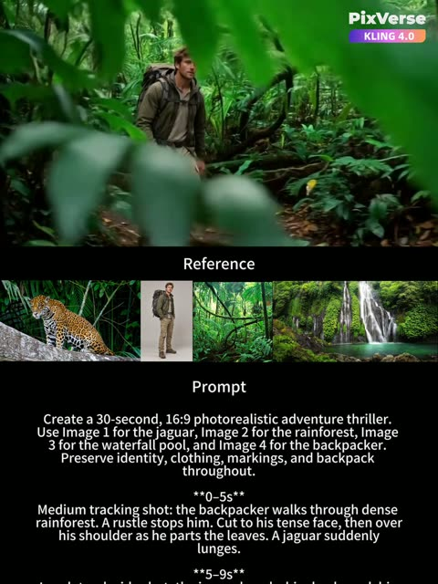</a>

提示词按时间段写出分镜，每一段都指定景别，相当于为模型提供一份30秒的剪辑方案。四张参考图各自绑定角色，并点名锁定人物身份、服装和背包，使角色在多次切镜中保持一致。

Kling 4.0 · 参考生视频 · 出处: [@PixVerse on X](https://x.com/PixVerse/status/2115760864238469589) · 38 赞，统计于 2026-10-29

[`multi-shot`](tags.md#tag-multi-shot) [`reference-images`](tags.md#tag-reference-images) [`chase`](tags.md#tag-chase) [`jaguar`](tags.md#tag-jaguar)

<details><summary><b>提示词</b></summary>

```text
Create a 30-second, 16:9 photorealistic adventure thriller. Use Image 1 for the jaguar, Image 2 for the rainforest, Image 3 for the waterfall pool, and Image 4 for the backpacker. Preserve identity, clothing, markings, and backpack throughout.

**0–5s**
Medium tracking shot: the backpacker walks through dense rainforest. A rustle stops him. Cut to his tense face, then over his shoulder as he parts the leaves. A jaguar suddenly lunges.

**5–9s**
Low lateral wide shot: the jaguar knocks him backward, his backpack striking the muddy ground. Leaves scatter. He shields his head, rolls aside, and scrambles upright while the jaguar turns. Realistic impact, no blood.

**9–15s**
Ground-level tracking captures pounding boots and flying mud. Cut wider: he races screen-right, the jaguar close behind. He stumbles over a root, braces against a trunk, and keeps running, backpack bouncing against secured straps.

**15–19s**
Close-up: gasping, he spots an opening. Cut aerial-wide to reveal the trail ending at a rocky bank beside the waterfall pool. The jaguar follows him toward a ledge one meter above the water.

**19–22s**
Lateral wide shot: trapped, he glances back and jumps. Show takeoff through feet-first entry continuously. His backpack remains attached. Water erupts; the jaguar brakes at the edge.

**22–26s**
Water-level medium shot: he surfaces and swims away with strenuous strokes, the backpack dragging through the water. He looks back at the jaguar watching from shore.

**26–30s**
His wet shoulders fill the foreground. Beyond him, the jaguar pauses, turns, and disappears into the forest. He keeps paddling as the waterfall roars.

Natural filtered light, cinematic contrast, varied framing, readable handheld movement, hard cuts, normal speed. Maintain chase direction and geography. Preserve mud after falling and wet clothing after immersion. No dialogue or text. Emphasize foliage, impacts, running, gasping, and rushing water.
```

</details>

<a id="h3-chun-li-cammy-rain-kick-clash"></a>
### 春丽与卡米在雨中交锋踢击

<a href="https://x.com/ou_zhen599/status/2096262846963396954">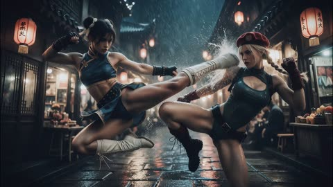</a>

参考图锁定开场构图，提示词写明空中踢击已在进行，因此动作直接延续而不重置。分时段镜头加上禁止定格、悬停和夸张飞行的明确要求，让打斗贴合物理规律。

MiniMax H3 · 图生视频 · 出处: [@ou_zhen599 on X](https://x.com/ou_zhen599/status/2096262846963396954) · 36 赞，统计于 2026-10-29

[`street-fighter`](tags.md#tag-street-fighter) [`chun-li`](tags.md#tag-chun-li) [`cammy`](tags.md#tag-cammy) [`rain`](tags.md#tag-rain)

<details><summary><b>提示词</b></summary>

```text
For the target video, at 0.00 seconds into the target video, <Picture 1> (from [Shot 1]) is fully referenced.

integrated_multimodal_description: [Shot 1] Photoreal live-action rainy alley confrontation between adult Chun-Li and Cammy. Preserve the exact opening composition, identities, hairstyles, costumes, proportions, wet East Asian alley, lanterns, puddles, rainfall, and light positions from <Picture 1>. Continue the airborne kick collision already in progress with no freeze, reset, or new wind-up. Contact shakes rain from skin and fabric; puddle splashes happen only on landing. Follow collision, recoil, and landing. Chun-Li (S1) lands stable, bends her knees, restores torso alignment, exhales sharply, and watches Cammy’s shoulder line. Cammy (S2) lands lower, slides briefly, regains support, and stays pitched forward. [Shot 2] At 00:01.400, the camera cuts to a matched advancing three-quarter view after landing. Cammy wipes rain and a trace of blood from her lip once, looks up, and drives in low. Chun-Li reads shoulder and hip initiation, makes a short evasive adjustment, intercepts with one compact kick, retracts, and adds one short pressing kick that shifts Cammy half a step off line. Show planted support, contact, recoil, and recovery. [Shot 3] At 00:03.800, the camera cuts to a lateral close two-shot on Cammy’s recovery. Cammy presses back into close range without resetting. Chun-Li redirects the entry and takes the centerline. Their faces draw near during the brief check. Chun-Li meets Cammy’s eyes. Cammy glances down and aside for one instant, catches breath, tightens her jaw, and attacks again. Chun-Li’s movements grow shorter and more precise while Cammy’s shoulders tighten and breathing fragments. [Shot 4] At 00:06.500, the camera cuts along Cammy’s renewed forward commitment. She gives half a step, lunges again too early, and places weight too far forward. Chun-Li intercepts the entry, sets her support foot, rotates through her hips, and lands one decisive kick to Cammy’s torso. The camera makes one short controlled whip with the turn, then settles before impact. Cammy recoils diagonally, skids through a puddle, loses support, braces with a forearm, and falls onto hip and side in shallow water. No hovering, no exaggerated flight. Chun-Li retracts, plants, and does not pursue. [Shot 5] At 00:09.800, the camera cuts on Cammy’s hand planting on the wet ground. Cammy raises her upper body with a small shoulder load tremor and keeps a defiant lifted chin. Chun-Li approaches with one or two measured steps, then lowers in a controlled squat until both women’s eyes are level. Cammy checks Chun-Li’s hands, then looks into her eyes. Chun-Li does not touch her. Before 00:12.000, settle into a lateral close two-shot with both eyes and Chun-Li’s mouth readable. [Shot 6] At 00:12.000, the camera cuts seamlessly on the completed squat into the settled close two-shot and holds this angle to the end. Chun-Li (S1), in a mature calm female voice, says: <d>[English] You would rather hate me than tell the truth.</d> Deliver the line evenly, with slight extra weight on “hate me” and a firm landing on “truth,” finishing by about 00:14.500. Cammy (S2) keeps eye contact, takes one audible inward breath as if to answer, parts her lips slightly, but says nothing. Chun-Li adds nothing. Rain continues along eyelashes, cheeks, and jaws; both breathing and tiny balance adjustments remain visible until 15.00 seconds. End on unresolved proximity with no freeze, fade, or reconciliation. Treat all six shots as one continuous confrontation, not separate rounds. No action-showcase fighting, no round reset, no routine reverse coverage, no arbitrary cuts, no showy orbiting, no uncontrolled shake, no blank expressions, no glassy eyes, no exaggerated lip sync, no weightless kicks, no unsupported aerial combos, no extra dialogue, no subtitles, no watermarks, no identity drift, no malformed bodies or hands.

overall_soundscape: Two distinct female vocal identities only: Chun-Li mature and steady, Cammy younger and tighter, expressed only through breath and impact exhalations. Heavy rain, splashing steps, wet fabric friction, short solid body impacts, close breathing, and distant alley ambience remain continuous. Lower the environment slightly before the line while keeping rain audible, then retain Cammy’s unanswered inhale and nearby rainfall after it.

non_diegetic_music: N/A
```

</details>

<a id="h3-swordswoman-kinetic-typography-title"></a>
### 动漫女剑客与动态字体片头

<a href="https://x.com/opener_ai/status/2085159317578330229">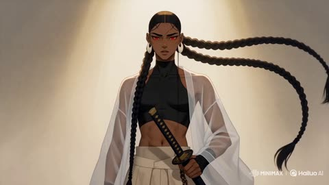</a>

用编号分镜和时间段描述每个镜头，并配合角色参考图锁定外观，使3D字样穿插在动作中时人物依然一致。明确要求忽略参考图的版式和标签，避免这些元素出现在视频里。

MiniMax H3 · 参考生视频 · 出处: [@opener_ai on X](https://x.com/opener_ai/status/2085159317578330229) · 36 赞，统计于 2026-10-29 · 发现于 [SkyNotSilent/awesome-MiniMax-H3-cases](https://github.com/SkyNotSilent/awesome-MiniMax-H3-cases)

[`anime`](tags.md#tag-anime) [`martial-arts`](tags.md#tag-martial-arts) [`kinetic-typography`](tags.md#tag-kinetic-typography) [`identity-reference`](tags.md#tag-identity-reference)

<details><summary><b>提示词</b></summary>

```text
[1] FORMAT
15-second 16:9 stylized anime action title sequence — martial-arts choreography fused with 3D kinetic typography. Painterly 2D anime illustration look with cel-shaded volumes and subtle paper grain, matching the source artwork's rendering.

[2] ASSETS
Use Image 1 as a strict identity reference for the female duelist KAELAN — read only the character artwork itself for her face, hair, wardrobe, weapon, and color palette. Ignore the sheet's layout, panels, printed labels, handwriting, silhouette thumbnails, and background parchment; none of them may appear in the video.

[3] IDENTITY
Preserve exactly: deep brown skin with warm highlights; luminous crimson-red eyes with a sharp black liner shape; jet-black hair pulled into a tight scalp-wrapped part that splits into two very long thick braids falling past the hips, moving like weighted whips; large white crescent hoop earrings on both ears; black high-neck sleeveless crop top exposing a toned midriff; a sheer white long-sleeved kimono robe worn open, translucent and lightly billowing; cream wide-leg hakama trousers with a single black diamond patch on the left thigh; black wrapped fingerless gloves with lattice cord across the back of the hand; white cloth-wrapped platform sandals; a well-worn katana with a dark blue-grey blade and a black diamond-wrapped hilt. Her expression stays calm and unblinking, never comic.

[4] BEATS
Shot 1 — [0–3 seconds] Kaelan stands centered in a void of warm off-white light, katana point-down, braids settling. She exhales; a slow iai draw begins. → Hard cut.
Shot 2 — [3–6 seconds] Mid-draw. The blade clears the saya and a clean arc of light follows the edge. The 3D extruded word "HAILUO" flies in from screen left along the blade's arc, its letter faces catching the same light, passing BEHIND her shoulder and IN FRONT of her trailing braid before exiting right. → Whip-pan cut.
Shot 3 — [6–9 seconds] Full-body kata combination: descending cut, pivot, rising horizontal sweep. Her sheer robe and both braids trail one frame behind her body. The word "MINIMAX" rotates up from the floor plane in thick extruded 3D, standing taller than her, and she cuts through the gap between its letters — the letterforms hold solid, do not shatter. → Hard cut.
Shot 4 — [9–12.5 seconds] Low-angle crouch landing, sword arm extended back, dust ring pushing outward. "H3" slams in from depth as a massive chromed 3D glyph directly behind her, scaling down to lock, with her silhouette reading cleanly against it. → Flash cut on the impact frame.
Shot 5 — [12.5–15 seconds] She rises into the neutral standing pose, katana returning to point-down. The full lockup "HAILUO MiniMax H3" assembles from the three pieces on a single horizontal baseline at lower third, settles, and holds perfectly still through the final frame.

[5] CAMERA
Anamorphic-feel 35mm for wides, 50mm for the mid shots.
```

</details>

<a id="h3-hotdog-dash-skateboard-selection"></a>
### 滑板选择界面，中间热狗滑板被选中

<a href="https://x.com/0xbisc/status/2084626773015417323"></a>

提示词把 15 秒的片段按时间段拆开，逐段规定每个界面元素的状态，让选择、滑动和确认的切换保持清楚可读。两张参考图分别锁定角色和菜单布局，音效也按时间段逐一写明。

MiniMax H3 · 参考生视频 · 出处: [@0xbisc on X](https://x.com/0xbisc/status/2084626773015417323) · 35 赞，统计于 2026-10-29 · 发现于 [SkyNotSilent/awesome-MiniMax-H3-cases](https://github.com/SkyNotSilent/awesome-MiniMax-H3-cases)

[`game-ui`](tags.md#tag-game-ui) [`skateboard`](tags.md#tag-skateboard) [`reference-images`](tags.md#tag-reference-images) [`timed-beats`](tags.md#tag-timed-beats)

<details><summary><b>提示词</b></summary>

```text
Use Image 1 as the main character role. Use Image 2 as the layout of the game selection interface.
[0–2 seconds] Display the complete skateboard selection interface from the front. NOVA is in the selected and active state, the four ports at the bottom emit green light. HOTDOG and SHARK are in the unselected state, completely stationary.
[2–4 seconds] The player presses the right selection key. SHARK ROCKET RIDER slides from the right preview slot into the middle selected module, NOVA JET GLIDER simultaneously slides from the middle into the left preview slot, HOTDOG DASH moves to the right preview slot. As soon as NOVA leaves the middle selected module, the green light immediately turns off and stops. After SHARK enters the middle, orange flames appear at the tail. The skateboard name, attribute bars, and SELECTED label update synchronously.
[4–6.5 seconds] The player switches the selection again. HOTDOG DASH moves horizontally from the side preview slot to the middle selected module, SHARK ROCKET RIDER simultaneously slides into the other side slot, NOVA moves to the remaining side slot. As soon as SHARK loses the selected state, the orange flame immediately turns off. After HOTDOG becomes the selected item, facing the camera, it barks twice accurately, then turns around in place once.
[6.5–8 seconds] The bottom CONFIRM button is clicked by the player. The button compresses downwards and bounces back, the right arrow extends forward. HOTDOG DASH becomes the final confirmed selection. The two unselected skateboards on the left and right continue to stay in the fixed preview slots, completely stationary.
[8–10 seconds] The middle fixed selected module expands towards the depth of the screen. The light-colored display area inside the central card naturally transforms into the World Plaza. The complete world has been fully loaded, with no texture popping, placeholder models, or unfinished buildings. At the same time, the UI displays as the in-game HUD.
[10–12 seconds] The camera enters the third-person game perspective, with HOTDOG DASH located under the protagonist’s feet. During normal gliding and preparation actions, both feet of the protagonist are standing on HOTDOG DASH. The game HUD appears at this time: mini-map in the top right corner, speed and health status in the bottom left corner, action and combo slots in the bottom right corner, mission route markers and interactive prompts appear ahead.
[12–15 seconds] The protagonist enters the world riding the running HOTDOG DASH, passing pedestrians, stairs, slopes, railings, and multiple explorable routes. HOTDOG jumps before a low slope, completes a rotation action in the air, and upon landing, the protagonist’s feet are still standing on HOTDOG DASH, the combo count and TRICK prompt briefly increase in the HUD. Subsequently, lean to bypass street obstacles, then perform a small directional jump, and then continue sliding forward.
Sound Design: Use pure instrumental music mixed with electronic arcade sounds, no vocals. UI switching corresponds to crisp key press sounds, card slot sliding sounds, sticker slapping sounds, and attribute bar update sounds. When SHARK is selected, ignition and propulsion sounds appear, and stop immediately when losing selection. When HOTDOG is selected, two barks are played accurately, and light footsteps are added when spinning around. After entering the world, add city ambient sounds, wind sounds, running footsteps, shoe friction sounds when pedaling to accelerate, and jump and landing feedback sounds.
```

</details>

<a id="wan-father-chases-train-station"></a>
### 父亲穿过车站追赶登上列车的儿子

<a href="https://x.com/AiwithBloodline/status/2098989311278678061">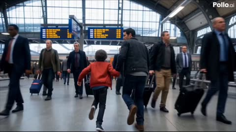</a>

固定的角色设定块和分时段剧情表，让男孩的红夹克与父亲的深色外套在各个镜头中保持一致。每段都写明镜头运动和声音提示，并附上台词与口型同步要求，为模型提供逐镜头的清晰指令。

Wan 3.0 · 文生视频 · 出处: [@AiwithBloodline on X](https://x.com/AiwithBloodline/status/2098989311278678061) · 34 赞，统计于 2026-10-29

[`chase`](tags.md#tag-chase) [`train-station`](tags.md#tag-train-station) [`father-son`](tags.md#tag-father-son) [`multi-shot`](tags.md#tag-multi-shot)

<details><summary><b>提示词</b></summary>

```text
30-second feature-film-quality 3D animation, ultra-realistic cinematic style, premium live-action commercial aesthetic, realistic human characters, physically accurate environments, intense action, emotional storytelling, natural facial expressions, realistic skin and hair, physically based rendering, cinematic lighting, HDR, realistic reflections, dramatic depth of field, dynamic camera movement, realistic motion blur, 4K UHD, 60fps.
MAIN CHARACTER
Energetic 10-year-old boy, messy curly dark brown hair, expressive brown eyes, red jacket, black jeans, white sneakers, realistic child proportions, consistent appearance throughout the entire video.
SECONDARY CHARACTER
His father, early 30s, short dark hair, casual dark jacket, jeans, realistic appearance, expressive face.
ENVIRONMENT
Large modern railway station during rush hour.
Crowded platforms, arriving train, electronic signs, commuters, luggage, realistic station architecture, natural afternoon lighting.
Everything must look completely real, like a high-budget live-action movie.
STORY — EXACTLY 30 SECONDS
0–4 SECONDS:
The boy and his father hurry through a crowded railway station.
The father holds the boy’s hand.
Father:
“Come on! We’re going to miss it!”
Boy:
“I’m coming!”
A train arrives.
The doors open.
4–8 SECONDS:
The crowd suddenly moves forward.
The boy’s hand slips out of his father’s.
The boy accidentally gets pushed inside the train.
The father remains outside.
Father:
“WAIT!”
The train doors begin closing.
Boy:
“DAD!”
The doors close.
The train begins moving.
8–13 SECONDS:
The boy runs through the train looking for his father.
He looks through the window.
His father runs alongside the moving train on the platform.
Father:
“STAY RIGHT THERE!”
Boy:
“DAD, I’M HERE!”
The train accelerates.
13–18 SECONDS:
The father immediately turns and sprints toward the station exit.
He grabs his phone.
Father:
“Platform three! Stop the next train!”
Cut rapidly between the father running through the station and the boy looking anxiously through the train window.
Boy:
“Where are you going?”
Father:
“Just stay calm!”
18–23 SECONDS:
The train begins slowing toward the next platform.
The boy spots his father running down the platform ahead.
Boy:
“DAD!”
The father reaches the exact carriage door.
The train stops.
The doors open.
The boy jumps out.
His father catches him immediately.
23–27 SECONDS:
The father kneels and hugs him tightly.
Father:
“Are you okay?”
Boy:
“Yeah…”
Beat.
Boy:
“But you run really fast.”
The father laughs in relief.
Father:
“Apparently.”
27–30 SECONDS:
They walk away together holding hands.
The camera slowly pulls backward as the train departs behind them.
The boy looks up at his father.
Boy:
“Next time, don’t let go.”
Father smiles.
Father:
“Deal.”
CUT TO BLACK.
CAMERA
Fast handheld tracking shots during the separation.
Close-up of hands separating.
Extreme close-up of closing train doors.
Dynamic tracking shot alongside the moving train.
Rapid cuts between father and son.
Low-angle running shots.
Close-up emotional reunion.
Slow cinematic pull-back for the ending.
VOICE
Natural American English.
Realistic child voice.
Natural adult male voice.
Fast, emotional dialogue.
Authentic breathing and reactions.
Perfect lip synchronization.
No theatrical or robotic delivery.
SOUND
Busy station ambience.
Train brakes.
Train doors closing.
Footsteps.
Crowd movement.
Train acceleration.
Phone call.
Dramatic orchestral score building throughout the chase.
Music drops during the reunion.
Warm emotional music during the final dialogue.
NEGATIVE PROMPT
fantasy, supernatural, superhero abilities, impossible physics, train collision, derailment, person falling onto tracks, injury, death, dangerous stunts, boy on railway tracks, exaggerated action, cartoon appearance, plastic skin, robotic expressions, bad anatomy, extra fingers.
```

</details>

<a id="h3-jungle-river-ambush-explorer"></a>
### 探险者在丛林河流中遭遇看不见的袭击

<a href="https://x.com/ou_zhen599/status/2100517439398437322">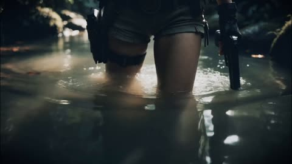</a>

按时间轴逐段写分镜，每段标注一个情绪阶段，让表演在镜头切换中保持连贯。看不见的袭击者通过水花、断叶和涟漪来暗示，声音只保留环境声和武器声。

MiniMax H3 · 图生视频 · 出处: [@ou_zhen599 on X](https://x.com/ou_zhen599/status/2100517439398437322) · 31 赞，统计于 2026-10-29

[`jungle`](tags.md#tag-jungle) [`action-thriller`](tags.md#tag-action-thriller) [`camera-tracking`](tags.md#tag-camera-tracking) [`diegetic-sound`](tags.md#tag-diegetic-sound)

<details><summary><b>提示词</b></summary>

```text
For the target video, at 0.00 seconds into the target video, <Picture 1> (from [Shot 1]) is fully referenced.

integrated_multimodal_description: [Shot 1] A 15-second, 16:9, cinematic realistic adventure-thriller image-to-video sequence set entirely inside the same tropical jungle shallow-river corridor and adjacent canopy depth shown in <Picture 1>. Preserve the exact same Lara-like adult female explorer throughout: same face, wet high ponytail with loose strands stuck to the face and neck, dark cropped tank top, shorts, tactical belt, and body proportions. She carries a long gun in the first half, loses it only after the second hit, and ends standing with only one pistol. She remains in continuous motion throughout; all emotion is attached to stepping, searching, aiming, side-slipping, retreating, falling into water, pushing up, and standing. The emotional arc is calm control -> slight alertness -> instinctive reaction to sudden attack -> pressure from missing information -> pain suppression after the second hit -> wounded defiance. Lighting is warm natural backlight through the canopy with cool green jungle bounce and river reflection. No beauty fill, no extra people, no visible enemy, no monsters, no subtitles, no watermark, no plastic water, no exaggerated blood, no floating cloth, no face drift, and no hand errors. [Shot 2] At 00:00-00:03, begin with the first action-based sensual close-up from an extremely low camera almost touching the water, tracking forward with her. Start on the wet lower abdomen, collarbone, shoulder strap, upper chest contour, and the subtle rise and fall of controlled breathing, then smoothly tilt up to her face without stopping. She advances very slowly through the shallow river with the long gun in hand, each step producing real water resistance, ankle flow, small ripples, and glittering reflections. Her first emotional stage is controlled calm: lips slightly parted but keeping the breath quiet, gaze sharp and fixed forward, pupils steady, brows only lightly drawn inward, nostrils barely moving, and jaw controlled. Wet strands stick to forehead and neck, with delayed movement in the tips. Warm backlight through leaves breaks into intermittent highlights on shoulders, neck, collarbone, upper chest, and wet skin, while mist and fine particles catch the light behind her. She says quietly, <d>[English] Easy... keep moving.</d> [Shot 3] At 00:03-00:06, shift into a shoulder-side medium-close follow without stopping her movement. She continues searching while moving: first looking forward, then quickly left, then right, then up into the canopy. The camera makes a slight half-arc around her shoulder and side face while keeping her slightly right of frame. Her second emotional stage is fine alertness: eye movement speed increases, pupils tighten, the brow center gathers more than before, the right upper eyelid lowers slightly, the jawline begins to lock, and breathing becomes shallower and shorter. She says in a low warning tone, <d>[English] Show yourself.</d> Broken sunlight flickers across her face and rifle, leaves above rub lightly, and humid air carries fine mist. [Shot 4] At 00:06-00:10, the first attack comes without a visible attacker. Hard cut to a medium shot from her left-front. Something fast and unseen slices across her near side; the water ahead-left explodes open as if cut by a high-speed projectile, with a clear origin point, spray arc, heavy droplets, falloff, and after-ripples. A broad leaf nearby is sharply split with a visible torn edge, and branches behind her sway with delayed motion to create false directional information. She instinctively side-slips half a step back to the right, shoulders snapping tight, and whips the long gun up, but she still cannot locate the source. She never stands still to fire. While retreating through the water, she fires probing short bursts: two quick shots down the forward channel, then a pivoted sweep toward the left brush, then one short burst up into the canopy. Every backward step carries weight against water resistance and kicks up heavy splashes; muzzle flashes are brief; shell casings eject and fall under gravity; mist is disturbed by the shots; there is no visible hit, no body, no falling enemy. Her third and fourth emotional stages combine here: the gaze is no longer just searching but strained by incomplete information; brow tension deepens, pupils tighten further, nostrils flare clearly, lips shift from slightly open to short urgent inhalations, and the jaw muscles pulse under the turns and shots. Hair lags behind side-slips and turns, clothing clings and pulls under abrupt stops and backward steps. [Shot 5] At 00:10-00:12, compress into a medium-close shot with a small forward push that gives her one brief moment to recalculate. She stops firing, lowers her body, and prepares to move again. In the instant she drops her weight, the second attack lands more precisely into her shoulder or upper arm. The cloth tears open, a tiny short-lived blood mist bursts and is immediately swallowed by the damp air, her upper torso twists violently, and the long gun flies from her hands with real inertia, slamming into a shallow-water rock gap behind-left, partially sliding into the stones with a heavy splash and spreading ripples. Her whole body loses balance and crashes back-left into the water. Her fifth emotional stage is sudden pain breaking through control but still restrained: her eyes open wider for half a beat, brow bones lift then drive back down, pupils contract, nostrils flare wide, the mouth loses control for an instant and then bites down again instead of becoming a scream. She lets out one short pain-broken sound, <d>[English] Ah—!</d> Keep the action heavy, real, and continuous, with no exaggerated slow motion. [Shot 6] At 00:12-00:15, stay at water level and move with her through the entire recovery from impact to standing. This is the second and most important sensual close-up, fully tied to survival action. She falls half into the water, instantly clamps her left hand over the wound, fingers tightening hard, while the right hand searches through murky shallow water and retrieves her pistol. She first pushes her torso up sideways, then rises to one knee, then grits through the final stand with clear weight transfer, delay, and effort; she does not spring up. When fully upright she has only one pistol. Her left shoulder hangs slightly lower, and her right hand holds the pistol low, pointed into the jungle depth ahead. Her sixth emotional stage is wounded defiance: the eye corners are faintly reddened by pain, the brow center is compressed not just in alertness but in sheer refusal to fall, the upper lids sit slightly heavier but the gaze is even more nailed forward, nostrils tremble, breathing becomes pain-shaken, lips pale and tighten, teeth lock, the mouth corners pull in faintly, and the jaw and neck tendons stand out. She says in a low hoarse line squeezed through pain, <d>[English] I’m still here.</d> Wet hair sticks to face and neck, then falls with delayed motion as she rises. Backlight catches the hair edges, collarbone line, shoulder contour, the hand pressing the wound, and the metal edge of the pistol. Blood is diluted by the river into thin red streaks across skin and cloth. Small droplets roll down jaw, collarbone, and shoulder. End on her wounded but standing, holding only the pistol, staring into the unseen jungle threat without cutting to black.

overall_soundscape: Use only diegetic environmental and weapon sound. Maintain shallow water flow, insects, distant leaf friction, humid forest air, and the soft acoustic space of the river corridor throughout. Emphasize close controlled breathing, boots and calves pushing through shallow water, delicate surface ripples, cloth friction, and her low line <d>[English] Easy... keep moving.</d> Then bring forward shifting gaze and body orientation through subtle gear movement, shallow water disturbance, leaf rub above, fine mist, and her low warning line <d>[English] Show yourself.</d> Feature the first unseen attack as a sharp fast water-splitting impact, sliced leaf tear, delayed branch shake, backward steps through water, short rifle bursts, damp forest gunshot reverb, shell casings landing, scattered spray, and fast breathing. Isolate the second hit with cloth tear, tiny blood burst, body impact into water, rifle thrown loose, rifle striking shallow rocks and water with a heavier layer than body splash, then expanding ripples and the broken pain sound <d>[English] Ah—!</d> Finish with water slosh around her recovery, the hand pressing the wound, the pistol found in shallow water, painful breath, cloth drag, droplets falling, and her low hoarse line <d>[English] I’m still here.</d> After the line, let the environment feel almost dead-quiet except for water, insects, leaf friction, and her pain-muted breathing, preserving the pressure of an unseen attacker.

non_diegetic_music: No non-diegetic music.
```

</details>

<a id="h3-sword-immortals-moonlit-city-duel"></a>
### 双剑仙在月下仙城对战魔修

<a href="https://x.com/Stellakjbk/status/2086021869040263455">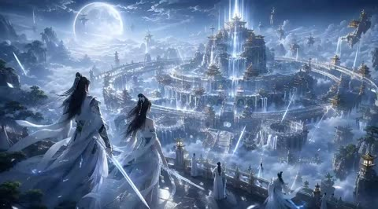</a>

提示词开头写明时长和画幅，再用参考图锁定月下仙城的场景、月光与配色，保证画面风格稳定。打斗按顺序拆成节拍，并写明低机位、环绕、慢动作等镜头运动，末尾列出原生立体声音效，给模型一份清晰的分镜。

MiniMax H3 · 参考生视频 · 出处: [@Stellakjbk on X](https://x.com/Stellakjbk/status/2086021869040263455) · 31 赞，统计于 2026-10-29 · 发现于 [SkyNotSilent/awesome-MiniMax-H3-cases](https://github.com/SkyNotSilent/awesome-MiniMax-H3-cases)

[`xianxia`](tags.md#tag-xianxia) [`sword-fight`](tags.md#tag-sword-fight) [`reference-image`](tags.md#tag-reference-image) [`game-cg`](tags.md#tag-game-cg)

<details><summary><b>提示词</b></summary>

```text
5秒，4:3，顶级东方仙侠3A游戏CG，电影级高端宣传片，严格参考图1的月下仙城场景与美术气质：巨大明月、云海天宫、环形仙城、悬浮仙山、瀑布、白玉仙桥、金顶楼阁、冷蓝月光。整体画面必须唯美、恢弘、神圣、危险、酷炫，像大厂正式游戏开场CG，不像普通AI视频。

双主角设定：男剑仙，黑色长发，白蓝战袍，冰蓝雷光长剑，英俊冷峻，强大沉稳；女剑仙，黑色长发，白青仙裙，月白灵剑与月华法术，清冷绝美，高贵飘逸。反派为黑金重甲魔修，手持黑色巨剑，周身暗红黑色魔气，压迫感极强。人物脸和服装全程稳定统一，保持高级游戏角色建模质感。

开场镜头从巨大明月前高速穿越云海与浮空仙山，俯冲进入宏伟仙城，来到白玉高台，男女主背对镜头立于高台边缘，衣袍长发飞扬，英雄感极强。远处天空突然裂开暗红色空间裂缝，魔修高速坠落，轰然落地，引发碎石、冲击波和魔气爆发。

男剑仙瞬间拔剑冲出，与魔修在仙桥中央高速对撞，剑刃碰撞爆发蓝红双色能量冲击、空间波纹、火星与剑气。近战动作凌厉、清晰、有重量感，包含高速斩击、格挡、反击、短暂慢动作碰撞特写，镜头低机位跟拍与高速环绕，极具电影感。

随后女剑仙御剑升空，展开巨大蓝白仙阵，发动“万剑齐发”，数百柄发光飞剑如流星暴雨般射向魔修，夜空被剑光点亮。魔修爆发黑红魔气，凝聚巨大的魔龙反击，空中连续爆炸。男剑仙御剑穿梭爆炸火光与云海，一剑斩裂魔龙，空战场面华丽震撼。

最后魔修释放百米高的黑红魔神法相，遮蔽天空。男女主并肩悬空，男剑仙开启覆盖半个天空的金蓝剑阵，女剑仙召唤巨大的白蓝月华莲华法相，二人联手凝聚数百米长的金蓝神剑，与魔神巨剑正面碰撞。碰撞瞬间进入超级慢动作，蓝色雷电、金色符文、白色月华、红色魔焰与空间裂痕同时凝固，随后爆发毁天灭地的大爆炸，形成巨大的环形云洞与能量冲击波。

结尾爆炸光芒散去，巨大明月重现，男女主并肩立于悬空巨剑之上俯瞰整座仙城，周围灵剑环绕，远处天宫亮起金蓝光柱，镜头缓慢拉远，形成极强的高级游戏主视觉结尾，并预留后期添加Logo空间。

镜头要求：超广角航拍、俯冲推进、低机位英雄视角、高速跟拍、环绕镜头、御剑追踪、短暂升格慢动作、终极碰撞震动、史诗级拉远收尾。镜头必须流畅稳定，不乱晃，不跳轴。

视觉要求：特效炫丽但高级干净，不能廉价光污染。强调冰蓝雷电剑气、金色仙纹、月华粒子、飞剑阵、空间裂缝、黑红魔焰、魔龙、巨大法相、神剑、冲击波、体积云、瀑布水雾、发光碎片。人物主体始终清晰，画面精致通透，PBR材质，真实布料与长发动效，电影级光影与空间层次。

音效：原生立体声。包含高空风声、远处钟鸣、低沉鼓点、剑刃碰撞、破风声、雷电炸裂、万剑掠空、魔龙低吼、终极爆炸低频冲击。无对白，无字幕，无水印，无乱码。
```

</details>

<a id="h3-spirit-fox-bridge-escape"></a>
### 少女抱着灵狐逃离坍塌石桥

<a href="https://x.com/HBCoop_/status/2083553619413209379">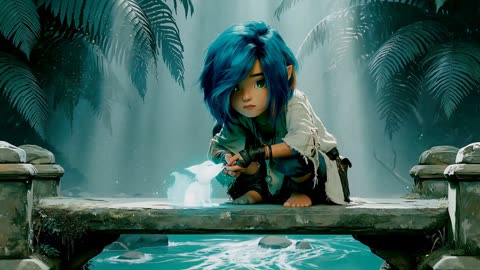</a>

按时间段把15秒视频拆成起因、追逐和落地三段，每个动作都有明确的物理因果。参考图锁定角色造型，并明确禁止瞬移和换装，保证路线连贯。

MiniMax H3 · 参考生视频 · 出处: [@HBCoop_ on X](https://x.com/HBCoop_/status/2083553619413209379) · 28 赞，统计于 2026-10-29 · 发现于 [SkyNotSilent/awesome-MiniMax-H3-cases](https://github.com/SkyNotSilent/awesome-MiniMax-H3-cases)

[`fantasy`](tags.md#tag-fantasy) [`spirit-fox`](tags.md#tag-spirit-fox) [`camera-tracking`](tags.md#tag-camera-tracking) [`character-reference`](tags.md#tag-character-reference)

<details><summary><b>提示词</b></summary>

```text
Use the reference @ image for the exact character design, clothing, proportions, blue hair, pointed ears and glowing cyan spirit fox. Preserve the cinematic stylized 3D look, saturated teal jungle palette, soft volumetric light and detailed natural textures. No dialogue; environmental sound only.

0–4 seconds: Begin close to the reference composition on the ancient stone bridge. The girl kneels beside the small glowing spirit fox as ripples begin moving backward across the stream below. She notices the unnatural movement and looks over her shoulder. A massive moss-covered stone serpent suddenly erupts from beneath the bridge, lifting one side of the platform. The stone tilts physically under her weight. She loses balance, catches herself with one hand and quickly pulls the spirit fox against her chest as cracks spread beneath her knees.

4–10 seconds: The bridge collapses progressively behind her. She rises naturally from the crouch and sprints barefoot across the tilting stone slabs, carrying the fox securely with one arm. Each footfall dislodges moss and small fragments; broken slabs fall with believable weight and strike the water below, producing delayed splashes. The camera tracks closely beside her at waist height. The serpent sweeps its heavy stone tail across her path. She drops into a fast knee slide beneath it; her torn cloak and blue hair trail behind with clear inertia. Still moving forward, she catches a hanging vine with her free hand. Her momentum pulls the vine taut and swings her outward across the widening gap while the camera arcs alongside her.

10–15 seconds: At the highest point of the swing, the vine begins tearing from the temple ceiling. She releases before it snaps, travels forward in a natural gravity-driven arc and lands hard on the opposite platform. She absorbs the impact through her feet and one hand, then rolls once across her shoulder while protecting the fox against her chest. The camera drops and rolls partially with her, then stabilizes behind her as she rises into a defensive crouch. The spirit fox leaps from her arms and lands in front of her, its cyan light intensifying as the serpent crashes into the broken bridge behind them, sending water, dust and stone fragments through the backlight.

Maintain one continuous route and clear cause-and-effect motion. No teleporting, floating, sudden directional changes, extra characters, costume changes or transformation of the girl. Keep the fox small throughout; only its light becomes brighter in the final moment.
```

</details>

<a id="h3-forge-city-chain-warrior-music-video"></a>
### 持链武者在熔炉城中出击

<a href="https://x.com/GlitterPixely/status/2086599324125872626">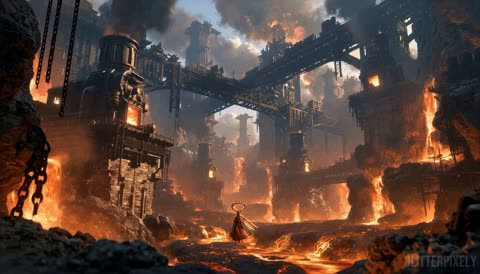</a>

两张参考图分别锁定角色与熔炉城市，原始配乐整段复用，每次切镜、字幕状态和特效都对齐固定的音频节点。开场先用空镜头带出角色名，人物再出场。

MiniMax H3 · 参考生视频 · 出处: [@GlitterPixely on X](https://x.com/GlitterPixely/status/2086599324125872626) · 27 赞，统计于 2026-10-29 · 发现于 [SkyNotSilent/awesome-MiniMax-H3-cases](https://github.com/SkyNotSilent/awesome-MiniMax-H3-cases)

[`reference-images`](tags.md#tag-reference-images) [`audio-reuse`](tags.md#tag-audio-reuse) [`music-video`](tags.md#tag-music-video) [`anime-action`](tags.md#tag-anime-action) [`beat-sync`](tags.md#tag-beat-sync)

<details><summary><b>提示词</b></summary>

```text
subject_definitions:
<Subject 1> is ENRA VAEL, the woman from < 📷Image1 >: the same sharp face, dark wispy bangs, long braid threaded through copper rings, spiked hair ornaments, severe expression, layered red robes, tattered soot-black panels, high metal collar, dark shoulder armor, red lamellar plates, ropes, beads, and weathered fittings. Her left arm alone remains blackened and lava-cracked and holds the fire-wreathed bladed weapon; her normal right hand holds the heavy chain and attached bronze vessel-like weight. The burning double metal ring remains a separate floating halo behind her.

<Subject 2> is the colossal forge city from < 📷Image2 >: one black-basalt shelf beside a lower-center lava river, a cylindrical furnace tower left, layered bridges overhead, a lavafall and furnace opening right, distant towers in gray smoke, hanging chains, heat haze, and embers.

< 📷Audio1 > is the 15.00-second stereo music track used continuously and as the exact editorial-timing source.
summary:
[reference generation + audio reuse] Nine beat-matched angles present <Subject 1> inside <Subject 2> as a high-impact character music video. The empty opening shot reveals the exact name "ENRA VAEL" before the character appears; a furnace-light scan, ring-aperture transition, solarized accent, six-segment fire sigil, escalating heat rings, and posterized charge build toward the 00:14.120 iron-sun detonation.

retention_analysis:

<Subject 1> (appears in [Shot 2], [Shot 3], [Shot 4], [Shot 5], [Shot 6], [Shot 7], [Shot 8], [Shot 9]): fully_preserved - face, proportions, braid, hair ornaments, asymmetrical arms, wardrobe, armor, handed props, weighted chain, floating double ring, and expression remain consistent beneath every effect.
<Subject 2> (appears in [Shot 1], [Shot 2], [Shot 3], [Shot 4], [Shot 5], [Shot 6], [Shot 7], [Shot 8], [Shot 9]): fully_preserved - connected geography, landmarks, materials, smoke, lava, and orange-charcoal lighting persist while viewpoint and temporary transition treatments change.
< 📷Audio1 >: partially_copy - the full musical layer is copied in its original order and timing; only restrained diegetic chain, cloth, fire, title-weld, and impact sounds are mixed beneath it.

detailed_description:

AAA anime action-RPG music video; effects alter only environment and end by 00:13.770.
[Shot 1] Empty extreme-wide of <Subject 2>; no character, halo, or weapon. At 00:00.120 an ember seam opens. At 00:00.240, the complete exact uppercase "ENRA VAEL" appears simultaneously, centered, black iron with a thin white-hot rim, maximum 42% frame width. It holds through 00:01.120, collapses, and is gone by 00:01.350. No text crosses the next cut. <Audio 1> starts at 00:00.000.

[Shot 2] At 00:01.430, a left-front full-body angle pedestals up as she drags the chain weight. From 00:01.880 to 00:02.650, a furnace-light scan travels boots-to-face, revealing robe, armor, chain, and ornaments with afterglow.
[Shot 3] At 00:02.840, a near-static right-front three-quarter hero card keeps her face, halo, and weapon unobstructed. No text is visible.

[Shot 4] At 00:04.470, a close-up frames her face inside the unattached ring. Molten arm pulses at 00:04.940; right hand closes on chain at 00:05.410. The ring turns front-on at 00:05.870 and expands; its black center fills frame from 00:06.170 to 00:06.300 without covering her face.
[Shot 5] At 00:06.340, the ring aperture opens on the drop to a ground-level full-body angle. She yanks the weighted chain; ring spins independently, weapon traces a molten circle, and furnaces flash. One black-red solarized frame hits, then normal color returns.
[Shot 6] At 00:08.240, overhead, she pivots as fire engraves a six-segment solar sigil. Segments lock at 00:08.710, 00:09.180, and 00:09.650; it flashes at 00:09.800, then lifts as ribbons into the ring by 00:10.090.
[Shot 7] At 00:10.090, a weapon-side view tracks blade, cracked arm, and face. Pulses send one, two, then three heat rings through the background at 00:10.580, 00:11.040, and 00:11.480; her geometry stays stable.

[Shot 8] At 00:11.950, a low medium-wide pushes in fast. She pulls chain taut, raises weapon at 00:12.440, turns it down at 00:12.900, and compresses an iron sun at 00:13.360. That accent briefly posterizes her charcoal-red with a white rim, then restores detail.

[Shot 9] At 00:13.770, prior effects gone, a frontal ultra-wide catches her downward strike. At 00:14.120, weapon meets basalt and chain snaps taut: the iron sun erupts behind her into corona, lava shockwave, fire plume, furnace flares, and bowed smoke. A second shell hits at 00:14.560; a final flare at 00:14.910 frames her intact silhouette. Camera pulls back and shakes only on primary impact. End centered, weapon planted, chain weighted. Render exact "ENRA VAEL" once during the empty opening only; no reversed letters, extra glyphs, subtitles, logos, extra characters, costume changes, duplicate limbs, extra weapons, or fire across her face.
overall_soundscape:

Lava roar, furnace resonance, wind, metal fittings, cloth, and chain clinks sit beneath the music. Add a restrained metal-weld sizzle at 00:00.240, a chain snap and ring whoosh at 00:06.340, then a metal strike, concussive blast, pressure rush, and ember hiss at 00:14.120 without overpowering < 📷Audio1 >.
non_diegetic_music:
Directly reuse the 00:00.000-00:15.000 musical layer of < 📷Audio1 > unchanged. Preserve its sparse opening, 00:06.340 drop, approximately 128-BPM pulse, 00:13.770 ignition, 00:14.120 detonation, 00:14.560 secondary burst, 00:14.910 flare, and hard ending; every cut, title state, and VFX change lands on the stated transient, with no replacement score.
```

</details>

<a id="h3-warrior-witch-chamber-ghost-battle"></a>
### 战士走进布满尸体的女巫密室

<a href="https://x.com/HeyZoyaKhan/status/2085575259533783077">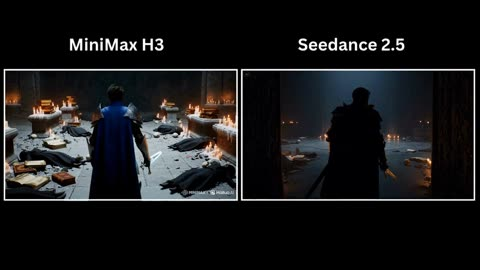</a>

提示词按节拍拆分为入场、鬼影出现、近身战斗、高潮和收尾，让模型有清晰的镜头顺序。跟随镜头从背后拍摄，末尾的风格段统一了光线和写实质感。

MiniMax H3 · 文生视频 · 出处: [@HeyZoyaKhan on X](https://x.com/HeyZoyaKhan/status/2085575259533783077) · 22 赞，统计于 2026-10-29 · 发现于 [SkyNotSilent/awesome-MiniMax-H3-cases](https://github.com/SkyNotSilent/awesome-MiniMax-H3-cases)

[`dark-fantasy`](tags.md#tag-dark-fantasy) [`sword-fight`](tags.md#tag-sword-fight) [`tracking-shot`](tags.md#tag-tracking-shot) [`creature`](tags.md#tag-creature)

<details><summary><b>提示词</b></summary>

```text
A young heroic warrior wearing beautifully crafted silver armor, a dark blue cape, and carrying an ancient enchanted longsword slowly enters an abandoned underground witch chamber. The room is filled with broken ritual circles, ancient books, shattered altars, skulls, scattered candles, and dozens of lifeless witch bodies lying across the cold stone floor. The atmosphere is eerily silent.

The camera slowly follows behind him as he carefully scans every corner, gripping his sword tightly and remaining fully alert.

Suddenly, the ancient stone walls begin to tremble.

A horrifying ghost emerges from the darkness. It has a grotesque deformed face, glowing crimson eyes, an unnaturally long body, and dozens of skeletal arms extending in every direction. Instead of wielding weapons, the ghost attacks using its razor-sharp claws and multiple arms, striking from impossible angles with incredible speed.

An intense close-quarters battle begins.

The warrior skillfully dodges the ghost's relentless claw attacks, parries with his enchanted sword, and cuts through several skeletal arms as they lunge toward him. The ghost continuously regenerates new arms, making the fight increasingly desperate.

The battle reaches its climax as the ghost charges forward with all of its arms at once. The warrior times the attack perfectly, leaps into the air, and delivers a single breathtaking spinning sword strike that cleanly severs the ghost's head.

The head falls to the stone floor as the ghost's body freezes in place, cracks with glowing purple energy, and disintegrates into countless glowing magical particles that fade into the air. The chamber becomes completely silent once again.

Style

Ultra-cinematic dark fantasy, realistic sword choreography, terrifying creature animation, expressive facial reactions, dramatic lighting, highly detailed gothic environment, dynamic camera movement, AAA fantasy film quality, Unreal Engine realism, IMAX composition, ultra-detailed textures

#MiniMaxH3
```

</details>

<a id="h3-first-person-magnetic-orb-quarry"></a>
### 双手握住磁力球，披甲守卫冲来

<a href="https://x.com/KrevixAi/status/2085759071047565341">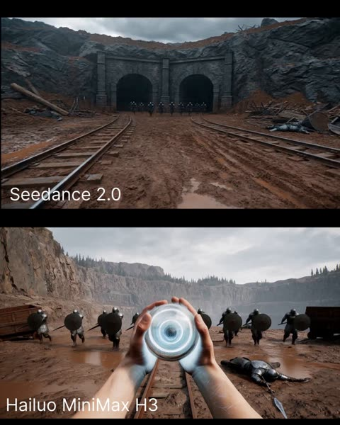</a>

将镜头锁定为第一人称且不出现面部，让手和前臂成为唯一的角色锚点。明确磁力球在被捏碎前已经存在，为之后的磁力脉冲提供清晰的起始状态。

MiniMax H3 · 文生视频 · 出处: [@KrevixAi on X](https://x.com/KrevixAi/status/2085759071047565341) · 19 赞，统计于 2026-10-29 · 发现于 [SkyNotSilent/awesome-MiniMax-H3-cases](https://github.com/SkyNotSilent/awesome-MiniMax-H3-cases)

[`first-person`](tags.md#tag-first-person) [`dark-fantasy`](tags.md#tag-dark-fantasy) [`magic-orb`](tags.md#tag-magic-orb) [`combat`](tags.md#tag-combat)

<details><summary><b>提示词</b></summary>

```text
Strict first-person POV, male hero, face never visible. Visible only the hero’s hands, fingers, and forearms when needed for casting, dodging balance, and the final magnetic strike. Broad male hands, pronounced knuckles, short nails, pale or cool-toned skin, dark gray or black sleeves, thin geometric magic lines glowing cold white with a faint blue tint across the skin and wrists. The hands move with force, precision, and short controlled gestures, never soft or decorative. One continuous shot, no cuts, vertical cinematic dark fantasy, realistic body-driven camera motion, professional action cinematography with physical momentum and readable combat beats.

In a vast abandoned stone quarry under a gray overcast sky, high rock walls, two dark mine tunnel arches in the background, old metal rails cutting through wet red-brown mud, overturned mine carts, scattered stones, chains, broken timber, iron scrap, discarded armor, and bodies of fallen guards. The space feels cold, damp, heavy, and dusty, with a steel-gray, dirty brown, graphite, and cold white palette. A squad of dark armored quarry guards charges first across the rails and muddy ground, helmets closed, carrying short spears, shields, and hammers. Behind them, emerging from the shadow of the mine arch, comes the boss: a giant one-eyed heavy warrior, 4 to 5 meters tall, rough gray-pink skin, one large round eye in the center of the face, partial metal armor and leather straps across the chest, a massive shoulder plate on one side, thick legs, immense weight, and a huge heavy battle axe carried with brutal momentum.

The hero briefly raises one hand holding a smooth semi-transparent magnetic orb, tennis-ball sized, silver-white with a pale blue core, a dense metallic vortex inside, thin rings of light rotating around it. The orb already exists when first shown and does not appear from nowhere. As the smaller guards rush in, the hero crushes the orb. A cold magnetic pulse flashes through both forearms and into the ground. Weapons rip out of the charging soldiers’ hands, shields twist sideways, bolts, chains, rail spikes, loose armor plates, and metal fragments shudder and begin lifting from the quarry floor. Some smaller enemies are violently disarmed and thrown off balance immediately.

The boss accelerates forward through the chaos and swings the giant axe in a heavy horizontal attack. The hero performs a fast professional sidestep and body lean at the last instant; the blade tears across the foreground with dangerous proximity, kicking mud and dust past the camera. The boss recovers with heavy inertia, plants a foot, and launches a second brutal overhead strike. The hero ducks and slips under it in a sharp Hollywood-style evasive motion, the axe crashing into the ground and rails with a shower of dirt, sparks, and metal shock. The camera reacts like a real head-and-torso dodge: fast lateral movement, recoil, breath, then immediate refocus on the boss.

Now the magnetic field fully takes hold. The hero spreads both hands outward. Metal rises from every direction in a controlled field, not chaotic: torn rails, chains, bolts, iron rings, armor plates, mine cart fragments, shield metal. The pieces lift, align, and begin orbiting the giant in three clear rotating bands: a lower ring around the knees, a middle ring around the waist and abdomen, and a top ring around the chest and shoulders. The boss tries to wrench the axe free and charge again, but the orbit tightens around him. Tight center framing, with strong tracking drift and a low-angle hold to emphasize mass and danger.

The hero then sharply pulls both hands inward. All three magnetic rings slam tighter at once. Chains snap taut, rails bend into crushing arcs, armor plates collide and lock, metal fragments hammer into the boss’s torso and arms. The giant loses balance, staggers, and is forced down, the axe slipping and dropping into the mud. The metal cocoon constricts harder with brutal industrial weight and magnetic pressure, locking his body in place. Dust rises in waves, small rocks skitter, chains strain, and the one eye flares with panic and rage.

The hero thrusts both hands forward for the finisher. A narrow concentrated magnetic impulse forms between the palms, not fire, but a dense electromagnetic strike with a bright white core and pale blue edges. Brief micro push-in to the center of the boss’s chest. The pulse hits. Every piece of metal bound around the giant clamps inward simultaneously with one final crushing lock. The boss drops fully to his knees, torso compressed under chained rails and armored fragments, while a deep metallic shock ripples through the quarry and a wave of dust spreads across the ground.

End on the giant kneeling and trapped in a brutal iron cocoon, chains stretched tight, rails embedded across the torso, the fallen axe half-buried in mud, drifting dust, and a few small metal fragments still hovering and spinning before they finally drop.

Lighting: cold gray cloud light, faint wet reflections on stone, mud, and rails, cold silver-white illumination from the orb and the hero’s magic lines, sharp cold highlights on airborne metal during orbit, and a final white-blue flash from the magnetic impulse. Cinematic dark fantasy, anamorphic look, subtle film grain, shallow depth of field on hands and nearby metal, strong physical inertia, realistic heavy enemy movement, rails resisting as they tear from the ground, chains tightening with believable tension, mud displacement, rolling debris, and controlled magnetic motion that feels like a field, not random telekinesis. Sound design: low wind in the quarry, distant metal groans, armor rattle from the charging guards, tight compression sound as the orb is crushed, deep low-frequency magnetic hum, metal shrieking free from the ground, heavy boss footsteps, axe whooshes with real mass, impact crashes into mud and rails, chain strain, rail collisions, a sharp electromagnetic finisher, then a massive iron-lock resonance and fading dust-heavy rumble.

No third-person view, no visible hero face, no constant hands in frame, no random floating metal chaos, no weak enemy scale, no weightless boss, no fire magic look, no glowing fantasy laser beam, no cartoon physics, no soft combat, no low-detail quarry, no tiny axe, no silly enemy behavior, no zombie movement.

#AIVideoComparison #seedance2 #MiniMax #MiniMaxH3 #Hailuo
```

</details>

<a id="h3-rifle-woman-rusted-ship-deck"></a>
### 持枪女子坐在生锈货船甲板上

<a href="https://x.com/ou_zhen599/status/2098800452586598897">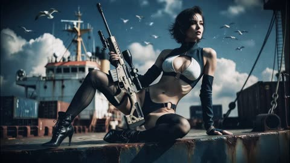</a>

带时间码的分镜把坐姿、起身、推进、瞄准和放下枪串成一条连续动作线，开头先锁定人物、场景和光线。每段都单独写镜头运动与声音提示，让 15 秒片段保持连贯，声音也有自己的时间线。

MiniMax H3 · 图生视频 · 出处: [@ou_zhen599 on X](https://x.com/ou_zhen599/status/2098800452586598897) · 18 赞，统计于 2026-10-29 · 发现于 [SkyNotSilent/awesome-MiniMax-H3-cases](https://github.com/SkyNotSilent/awesome-MiniMax-H3-cases)

[`timestamped-shots`](tags.md#tag-timestamped-shots) [`character-lock`](tags.md#tag-character-lock) [`sound-design`](tags.md#tag-sound-design) [`post-war`](tags.md#tag-post-war)

<details><summary><b>提示词</b></summary>

```text
For the target video, at 0.00 seconds into the target video, <Picture 1> (from [Shot 1]) is fully referenced.

integrated_multimodal_description: [Shot 1] A 15-second, 16:9, cinematic photorealistic image-to-video extension based on <Picture 1>. Preserve the exact same adult female character throughout: same facial structure, short hairstyle, outfit construction, body proportions, mature age impression, weapon, cargo-ship deck environment, and period texture. The whole sequence stays inside one connected ship space only: the weathered cargo deck, the container-side passage, and the visible wheelhouse zone. No harbor wide shot, no new location, no unrelated crowd. The tone is dangerous post-war allure with realism, restraint, sea wind, rust, salt mist, gulls, cold daylight, and small warm practical lights. She never poses; she stays in motion through one chain: angled sitting, rising, lifting the gun, advancing, edging along cover, stopping, aiming, confirming, lowering the gun, and looking back. Sensuality comes only from control, shoulder-neck line, breathing shifts, eye pressure, mouth tension, and her fingers on the weapon. At 00:00.000-00:02.500, she sits at an angle against the rusted ship edge. One leg extends naturally, one hand holds the rim, the other rests loosely on the gun. The camera starts low on the high-heeled ankle boots and leg line, glides past the hand on the rim, then rises to her side face and lip line. She looks only toward the sea. Her upper lids are slightly lowered, gaze stable but alive, blink rate low, breathing shallow, lips slightly parted, mouth corners neutral. Wind lifts the short front strands and hair near the ear. [Shot 2] At 00:02.500, she rises with one hand pushing off the deck while the other lifts the gun, the stock brushing the outer thigh. The camera stays close and rises with her, bringing out collarbone, shoulder line, side neck, jawline, and outer eye corner. The rise is controlled, as if fatigue remains but discipline is stronger. Her expression shifts: eyelids lift slightly, eyes move from distance to lock, the brow center gathers for a moment, lips close, the mouth line firms, and the jaw tightens lightly. A small swallow moves in the throat. In a very low soft voice, almost inside the breath, she says: <d>[English] Easy...</d> [Shot 3] At 00:04.800, a harsh cold reflection flashes from the distant container-side passage and a muted metallic hit follows. She turns immediately and advances with the gun. She does not run; she moves in a pressured fast walk with stable center of gravity, precise steps, and the gun carried low beside the thigh. The camera follows from side-rear as rusted deck textures, cables, and container edges drift behind her. Her face sharpens here: eyes lock forward, eye movement range decreases, focus intensifies, the outer eyes tighten, the brow center presses slightly, breathing shortens and quiets, lips stay closed, and the jawline hardens. [Shot 4] At 00:07.800, she skims along the container edge, stops hard, turns back through the shoulder, and raises the gun. First show the readable medium-close action, then tighten quickly into the most intimate close-up of the short. She leans into the sight line. The camera catches lashes, eye tail, side nose line, mouth corner, and the near-metal intimacy of her breath against the weapon. Her eyes do not widen; they narrow slightly, upper lid pressing down in concentration. The lower lid gathers a little, lips remain closed, one mouth corner holds a tiny natural tension, and the nostrils widen once then settle. The weapon raise is fast, sight alignment steady, and the trigger finger rests along the outside edge rather than firing. [Shot 5] At 00:10.300, as she turns past the obstruction, the gun is aimed not at an enemy but at two surviving crew members welding the deck. Welding sparks scatter, electric flicker pulses, a warm wheelhouse light turns on, and a strip of white cloth near the railing flutters in the wind. Let her subjective line of sight reveal the reversal first, then give a very short half-profile reaction. Her eyes stay guarded for half a beat, then clearly release: tension around the eyes falls slightly, upper lids lift back a little, the brow center opens, lips unseal as if a silent breath leaves, and the jawline softens from combat hardness. This is not cheerful relief, only post-threat decompression. [Shot 6] At 00:12.800, she slowly lowers the gun and lets her fingers loosen and slide along the gun body. The camera comes from behind her shoulder in a half-orbit to her side front, with warm light grazing her face. She looks back toward the sea and gives a very restrained slight smile, no teeth, only one side of the mouth lifting a little. For the first time her eyes hold softness and belonging. She says quietly: <d>[English] We’re home.</d> The line must not sound sweet or slogan-like; “We’re” is light, “home” lands lower and firmer. Her brow center is relaxed now, some fatigue remains at the eye corners, there is the slightest moisture without tears, blinking slows a little, and the mouth corner lifts then controls itself again. End mature, steady, tender, and still carrying the after-heat of war.

overall_soundscape: The soundscape is led by environment throughout: sea wind, gulls, light ship-metal creaks, heels on deck, distant electric crackle, welding sparks, low mechanical hum, and a final low ship horn. Emphasize wind, metal resonance, gulls, and her shallow breathing in the opening; hand on deck, cloth movement, gun lift, swallow, and the soft breath-close line <d>[English] Easy...</d> during the rise. Then bring in the muted metal hit, close footfalls on steel, weapon handling, cloth friction, and reduced breath as she advances. Tighten the sound field around breath and metal near the weapon during aiming, then reveal the welding reality through spark hiss, low electrical buzz, warm light switching on, white cloth in the wind, and deck machinery hum. Her final line <d>[English] We’re home.</d> should be low, close, tired, and steady, followed by wind, gulls, machinery, and the distant low horn.

non_diegetic_music: Use only a very light tension bed. Keep it minimal, cool, and modern, never epic or sentimental. Support the first half with low suspended texture, tighten slightly when the reflection and metal sound trigger her advance, thin it during the aiming close-up so breath and steel dominate, then ease the tension on the welding reveal without becoming warm or triumphant. Let the final line carry only a faint brief emotional release.
```

</details>

<a id="h3-rider-night-city-motorcycle-chase"></a>
### 夜间城市车流中骑摩托车疾驰的骑手

<a href="https://x.com/HBCoop_/status/2083282581450375367">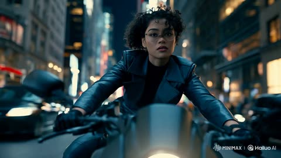</a>

用参考首帧和具体外形细节锁定骑手，再用按秒分段的镜头表和音乐节奏指令控制每次机位变化。同一行进方向的约束和明确的负面列表让追逐画面保持清晰可读。

MiniMax H3 · 图生视频 · 出处: [@HBCoop_ on X](https://x.com/HBCoop_/status/2083282581450375367) · 16 赞，统计于 2026-10-29 · 发现于 [SkyNotSilent/awesome-MiniMax-H3-cases](https://github.com/SkyNotSilent/awesome-MiniMax-H3-cases)

[`motorcycle`](tags.md#tag-motorcycle) [`night-city`](tags.md#tag-night-city) [`audio-sync`](tags.md#tag-audio-sync) [`camera-tracking`](tags.md#tag-camera-tracking)

<details><summary><b>提示词</b></summary>

```text
Use @ image1 as the opening frame and exact visual reference. Preserve the rider’s face, short curly hair, round glasses, black leather jacket, gloves, motorcycle, and realistic nighttime city environment throughout.

Use @ audio1 as the soundtrack. Synchronize the motorcycle’s acceleration, camera movement, passing lights, and edits precisely to the music’s rhythm and rising intensity. No dialogue or additional music.

0–3s: Begin in the frontal composition of @ image1. A stabilized tracking camera moves backward directly ahead of the motorcycle as the rider speeds through traffic. Her expression is alert and focused; wind moves her curls and jacket naturally.

3–6s: On a strong musical beat, shift smoothly into a low front three-quarter tracking angle beside the front wheel. The motorcycle leans gently around a moving car without changing direction abruptly. Streetlights streak across the wet pavement.

6–10s: Transition into a fast side-tracking shot. The rider accelerates through a narrow opening between two lanes while maintaining believable balance, speed, and forward momentum. Background traffic and illuminated buildings create controlled motion blur.

10–13s: The camera arcs from her side toward the rear as she clears the traffic. Red emergency lights begin flashing across the surrounding buildings and reflect naturally in her glasses and leather jacket.

13–15s: A fire truck crosses the intersection behind her as she races into an open stretch of road. Finish with the camera pulling wider and rising slightly, revealing the motorcycle speeding deeper into the city on the final musical accent.

Cinematic live-action realism, physically accurate motorcycle movement, energetic but readable action, natural motion blur, shallow depth of field, cool blue-black city palette with warm streetlights and red emergency-light accents. Maintain one continuous direction of travel. No collisions, teleporting, sudden direction reversals, distorted hands, changing wardrobe, altered motorcycle design, facial drift, extra limbs, text, logos, or slow motion.
```

</details>

<a id="kling-baseball-bat-logo"></a>
### 挥棒全程，球棒上的字保持清晰

<a href="https://static-54.klingai-cdn-aws.com/kling-blog/presigned_url/50fdd9a7-e3d7-4d62-8715-edaa9b3003bc_文字_棒球.mp4"></a>

一句话把镜头钉在运动物体的字上，用来快速测文字稳定性。

Kling 3.0 · 图生视频 · 出处: [Kling VIDEO 3.0 user guide](https://app.klingai.com/global/quickstart/klingai-video-3-model-user-guide)

[`text-render`](tags.md#tag-text-render) [`sports`](tags.md#tag-sports)

<details><summary><b>提示词</b></summary>

```text
The camera remains fixed on the word "KLING" emblazoned on the baseball bat as the player swings and hits the ball.
```

</details>

输入素材: [1](https://static-3.klingai-cdn-aws.com/kling-blog/file_by_url/a8527e3967d0a358562fddac74c2c9e13c98135619da9af77ea326fe756fb0ff.png)

<a id="kling-snowmobile-six-shots"></a>
### 雪地摩托，六个镜头

<a href="https://static-14.klingai-cdn-aws.com/kling-blog/presigned_url/fbf5a59b-e1c0-45ee-9ec8-13726d3d3887_kling_20260202_作品_镜头_1_2s_后远_4947_0.mp4">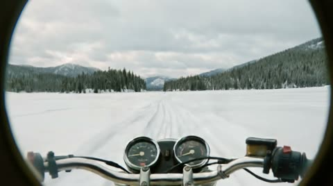</a>

六个镜头只写角度和运镜，环境只在最后一个镜头写一次。

Kling 3.0 · 图生视频 · 出处: [Kling VIDEO 3.0 user guide](https://app.klingai.com/global/quickstart/klingai-video-3-model-user-guide)

[`multi-shot`](tags.md#tag-multi-shot) [`camera-move`](tags.md#tag-camera-move) [`action`](tags.md#tag-action)

<details><summary><b>提示词</b></summary>

```text
Shot 1, Low-angle rear wide shot, tracking behind the rider as they move forward. Shot 2, Low-angle side close-up, a detailed shot of the motorcycle wheel. Shot 3, First-person POV from the rider, with the handlebars and instrument panel visible ahead. Shot 4, Frontal medium shot, tracking backward in front of the motorcycle, the rider’s helmet facing the camera. Shot 5, Side-on eye-level tracking shot with slight lateral movement. Shot 6, High-angle wide shot with a gentle downward tilt. The camera rises as the snowmobile rides deeper into the snowfield, leaving winding tracks carved into the pristine white snow, with snow-covered forests scattered on both sides.
```

</details>

输入素材: [1](https://static-29.klingai-cdn-aws.com/kling-blog/file_by_url/ef7ccbdcafe3af9d5fbbe492976b10793b302cc4ecab0778734b129dc7db9570.png)

<a id="kling4-fight-choreography-from-reference-video"></a>
### 借一段打斗的动作编排，换成自己的角色

<a href="https://static-17.klingai-cdn-aws.com/kling-blog/presigned_url/ed604ee7-c243-4375-9dc7-38c5964d81e2_1-2.mp4">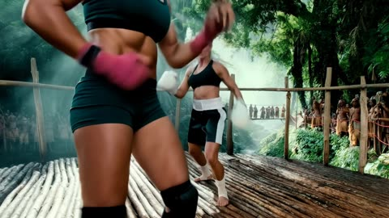</a>

两句话，每份素材一个任务：视频管招式和节奏，两张图管角色长相。

Kling 4.0 · 参考生视频 · 出处: [Kling 4.0 user guide](https://kling.ai/quickstart/kling-4-model-user-guide)

[`fight-scene`](tags.md#tag-fight-scene) [`motion-reference`](tags.md#tag-motion-reference) [`multi-reference`](tags.md#tag-multi-reference) [`character-reference`](tags.md#tag-character-reference)

<details><summary><b>提示词</b></summary>

```text
Use @Video 1 as the reference for the fight choreography and attack timing. Use @Image 1 and @Image 2 as the references for the character designs.
```

</details>

输入素材: [1](https://static--45.klingai-cdn-aws.com/kling-blog/file_by_url/9603ebbdfda76122fdbef0275af4dbad96108fcbb7e46bad56e621feba73c892.png) · [2](https://static-10.klingai-cdn-aws.com/kling-blog/file_by_url/ef4f3b49db4eab2d135518404005e67da24472f824e27b2ddf1c86c2699d9217.png) · [3](https://static--34.klingai-cdn-aws.com/kling-blog/presigned_url/bd79f738-8bdf-4cf8-b02a-be0fad27c733_1-2-1.mp4)

<a id="kling4-office-chair-cliff-jump"></a>
### 照拍一段悬崖跳伞特技，坐骑换成办公椅

<a href="https://static--89.klingai-cdn-aws.com/kling-blog/presigned_url/6277f31b-5c85-4c24-9974-d5254c0fa23c_1-1.mp4">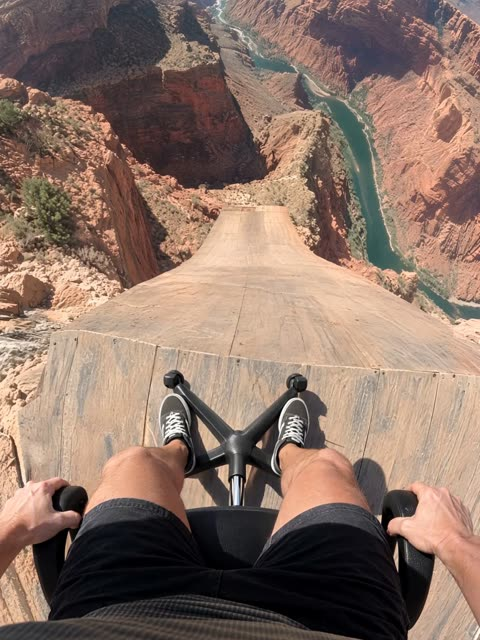</a>

首帧来自图，镜头和剪辑来自视频。逐个列出自行车出现的时刻，保证每一处都换成椅子。

Kling 4.0 · 参考生视频 · 出处: [Kling 4.0 user guide](https://kling.ai/quickstart/kling-4-model-user-guide)

[`motion-reference`](tags.md#tag-motion-reference) [`pov`](tags.md#tag-pov) [`comedy`](tags.md#tag-comedy) [`object-swap`](tags.md#tag-object-swap) [`action`](tags.md#tag-action)

<details><summary><b>提示词</b></summary>

```text
@Image1 is the first frame.  @Video1 is the reference for camera, motion, timing and cuts. Recreate @Video1 shot-for-shot and cut-for-cut, but starting from @Image1: the rider is SITTING in a black office swivel chair instead of standing on a bike. Same chest-mounted GoPro fisheye POV, same ramp, canyon, river, orange parachute with white ring, airboat and cheering crew; same three jump-cuts and audio as video. Wherever the video shows the bike — under the rider on the ramp, shoved away at the cliff, tumbling below in free-fall, and the tiny silhouette during the parachute opening — show the office chair (mesh backrest, padded seat, chrome column, five-spoke base, casters). Before the launch, the rider stays seated exactly as in @Image1: thighs and knees at the bottom of frame, sneakers on the star base, hands on the armrests. No bicycle, handlebar, tyres or pedals anywhere.
```

</details>

输入素材: [1](https://static--11.klingai-cdn-aws.com/kling-blog/file_by_url/a587a7581557e29314065a81c742d18edb842696f595a220c4bd757d9c7a8c83.png) · [2](https://static-96.klingai-cdn-aws.com/kling-blog/presigned_url/bdac1b40-c32d-4f3a-b565-40d258f1d78b_1-1-1.mp4)

<a id="kling4-skater-stair-jump-tracking"></a>
### 低机位一镜跟拍滑手跳台阶

<a href="https://x.com/minchoi/status/2111471588256207357">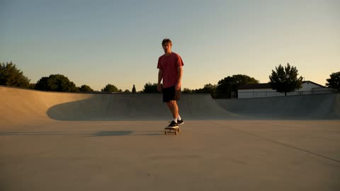</a>

纯文字，30 秒按 6 秒一拍写。测大动作和落地物理，同时保持脸和衣服不变。

Kling 4.0 · 文生视频 · 出处: [@minchoi on X](https://x.com/minchoi/status/2111471588256207357)

[`sports`](tags.md#tag-sports) [`tracking-shot`](tags.md#tag-tracking-shot) [`long-take`](tags.md#tag-long-take) [`physics`](tags.md#tag-physics) [`timed-beats`](tags.md#tag-timed-beats)

<details><summary><b>提示词</b></summary>

```text
30-second continuous low tracking shot of a skateboarder in a concrete park at golden hour. Large dynamic motion, realistic weight and physics.[Skater]: young man, early 20s, faded red T-shirt, black shorts, short hair. Consistent face and outfit.0–6s: He rides toward camera, pushes once, centers his weight. Camera tracks low beside the board.6–12s: He approaches a set of stairs. Knees bend, weight shifts back. Board rises on the tail.12–18s: He clears the stairs. Wheels leave the ground. Cloth and hair react to the motion. He lands with knees absorbing impact.18–24s: He rolls out, slight speed check, then carves hard left. Camera stays locked low and follows.24–30s: Final wide as he rides away into the warm light, board still under him.Natural late-afternoon sun, long shadows, realistic dust and board sound. No slow motion unless specified. Preserve exact clothing and face.
```

</details>

<a id="kling4-ski-film-seven-shots"></a>
### 用一张角色设定图做七个镜头的滑雪片

<a href="https://x.com/minchoi/status/2111471581461426236">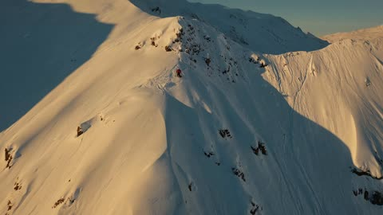</a>

一条雪坡剪成滑雪片，服装由角色参考图锁定，声音写得很细，从雪板刮雪到远处乌鸦。

Kling 4.0 · 参考生视频 · 出处: [@minchoi on X](https://x.com/minchoi/status/2111471581461426236)

[`sports`](tags.md#tag-sports) [`multi-shot`](tags.md#tag-multi-shot) [`character-reference`](tags.md#tag-character-reference) [`sound-design`](tags.md#tag-sound-design) [`golden-hour`](tags.md#tag-golden-hour)

<details><summary><b>提示词</b></summary>

```text
A 30-second, seven-shot ski film edit of Kai <Character reference> skiing one steep, untracked mountain face at golden hour, cut together from several real cameras: a drone, a helmet-mounted action camera, an action camera on a pole, a camera planted in the snow, a chase skier and a long lens across the valley. Photoreal action-sports look, real speed, hard cuts on the action, no slow motion. Kai: athletic man in his 20s, red insulated ski jacket, black ski pants, black gloves, white helmet, mirrored orange goggles, black poles, twin-tip skis. Same outfit and gear in every shot, exactly as in the character sheet. Same mountain face, same powder, and the low sun always on his left as he skis down, throwing long blue shadows across the snow. Shot 1 (0-4s), drone: high aerial view of a sunlit ridge and the whole golden face below it. Kai, small in frame, drops in off the ridge and carves his first big turn, a plume of powder behind him. The drone pushes forward and tilts down to follow. Hard cut. Shot 2 (4-8s), helmet cam: first-person view from an action camera on his helmet, ultra-wide with curved edges. His ski tips and pole baskets at the bottom of the frame, snow rushing underneath, the horizon tilting hard left and right with each carve, powder spraying across the lens. Hard cut. Shot 3 (8-12s), pole cam: an action camera on a short pole held out in his left hand, ultra-wide, pointing back at him. His goggles and helmet fill one side of the frame, his body leaning into a turn, the mountain and sky swinging behind him, snow flecks stuck to the lens. He lets out a wordless shout into the wind. Hard cut. Shot 4 (12-17s), planted cam: a camera set low in the snow just below a wind-lip, pointing up at the sky. Kai launches off the lip and flies straight over the lens, skis crossing the low sun, snow raining down onto the camera, then he lands out of frame behind it. Hard cut. Shot 5 (17-21s), chase skier: a camera on a handheld stabiliser, skiing a few metres behind him at the same speed. He drops into a tuck and straight-lines the fall line, spray from his tails hitting the lens, the slope streaking past. Hard cut. Shot 6 (21-25s), long lens: a telephoto shot from across the valley, slightly shaky, compressing the slope. Kai lays a huge carve and throws a wall of powder backlit gold by the sun. Hard cut. Shot 7 (25-30s), low static camera at the bottom of the run: he skis straight at the lens and skids a hard hockey stop right in front of it, a sheet of snow blasting the camera. As it clears, he pushes his goggles up onto his helmet, breathing hard and laughing. Look: every action-camera shot ultra-wide and crisp with curved edges, small lens flares and snow on the lens; the drone and long-lens shots clean and natural. Warm low sun, long blue shadows, glittering ice crystals in the spray, natural colour, real motion blur. Sound, in stereo, loud and up front like real action-camera audio, never quiet: constant wind roaring and buffeting the camera mics, gusting harder as he picks up speed; the crunch of snow under his skis as he drops in; friends whooping and yelling "Go!" from the ridge at the start; the hiss, scrape and chatter of his edges biting the snow on every carve; poles planting with a crisp crunch; powder spraying off his tails with a soft roar; his hard breathing, and a grunt on the landing; a loud whoosh and the clack of skis as he flies over the planted camera, then the thud of the landing; distant ravens calling across the valley; the ripping sheet of snow blasting the lens on the hockey stop, then his panting laugh and his friends cheering from up the slope. A driving instrumental track with punchy drums sits low underneath, cut on the beat, never covering the natural sound. No subtitles.
```

</details>

<a id="kling4-spy-chase-tearaway-suit-to-banquet"></a>
### 飞车追逐后撕掉外衣，直接走进晚宴

<a href="https://static--59.klingai-cdn-aws.com/kling-blog/presigned_url/f671c2ce-6245-44f4-851a-ed927d4949da_1-1-1.mp4">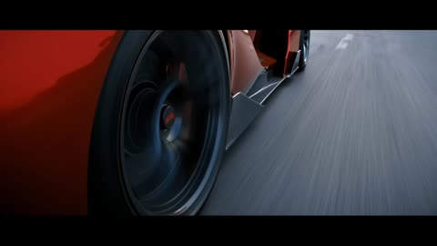</a>

十五秒精确到秒，还写了多数提示词不会写的服装细节：战术外衣带撕裂缝，里面已经穿好礼服，所以换装在镜头里完成。

Kling 4.0 · 参考生视频 · 出处: [Kling 4.0 user guide](https://kling.ai/quickstart/kling-4-model-user-guide)

[`action`](tags.md#tag-action) [`chase`](tags.md#tag-chase) [`handheld`](tags.md#tag-handheld) [`outfit-change`](tags.md#tag-outfit-change) [`timed-shots`](tags.md#tag-timed-shots) [`reference-images`](tags.md#tag-reference-images)

<details><summary><b>提示词</b></summary>

```text
【Overall Style】
15 seconds, realistic live-action cinematic quality. A coastal city street at dusk connects to a staged banquet scene.
Natural handheld cinematography with noticeable vertical movement from footsteps, subtle irregular shake, and framing corrections. Whip pans follow vehicle and character movements, producing brief motion blur before settling back on the target. Movement is intense during the car chase and running sequences, then gradually slows during the banquet sequence.
Characters have slight perspiration, loose strands of hair, and natural clothing wrinkles. Road surfaces, clothing, and equipment show realistic signs of use. Natural colors create visual contrast between the red sports car, flames, and the warm tones of the banquet.
【Characters and Vehicles】
Male Actor:
Around 30 years old, with short dark hair, light stubble, and a lean, athletic build.
While driving and rolling on the ground, he wears a complete spy-action outfit:
A fitted dark charcoal-gray tactical top with a closed neckline;
Matching tactical trousers;
Black leather ankle boots.
The outer costume has tear-away seams designed for quick changes on set. The top opens along the center front and both sides, while the trousers open along the outer seams of both legs.
A white shirt, black bow tie, and dark navy dress trousers are already worn underneath the outer costume.
When the outer costume remains intact, he clearly appears in the dark tactical outfit.
Two additional crew members help him put on the suit jacket later.
The hems of the navy dress trousers cover the shafts of the black ankle boots.
The actor's face, hairstyle, and physique must remain consistent throughout.
Sports Car:
An original red concept sports car with a low, rounded wedge-shaped body, a short front end, a curved cockpit, and wide rear wheel arches.
The front features a continuous horizontal white light bar. The rear has three small circular taillights on each side.
The center of the hood is uninterrupted, smooth red paint. The dark gray wheels have plain metal center caps.
The center of the steering wheel has a solid black leather surface.
The driver's side window is open. The car's overall shape and lighting design must remain consistent across all shots.
Motorcycle Camera Operator:
Wearing dark workwear and a protective helmet, he stands alone on both stunt footpegs of a dark blue sport motorcycle, with his hips higher than the seat. He holds a camera on his shoulder with both hands, leaving the handlebars unoccupied.
He controls the motorcycle using his legs and center of gravity, compensating for bumps with his upper body. The camera is aimed at the sports car's driver.
During the reveal, his full standing posture, both feet, the motorcycle, and the camera must all be clearly visible.
Director:
In his forties, with some gray hair and naturally textured facial features.
He wears a worn-in, short dark brown jacket over a beige crew-neck T-shirt, paired with dark straight-leg trousers.
He holds a digital stopwatch, actively turning his body and gaze to follow the filming action.
A script supervisor, camera assistants, and lighting crew stand nearby. People and equipment in the foreground, beside him, and in the distance create layered depth.
Wardrobe Crew:
Six crew members in ordinary on-set workwear.
The first four, two on the left and two on the right, pull open and remove the outer tactical costume.
The remaining two unfold and help him put on the dark navy suit jacket.
Each person performs a clearly defined action. After removing a garment, the corresponding crew member holds it in their hands.
Female Companion:
Wearing a champagne-gold evening gown and holding her own champagne flute. She stands a few steps inside the banquet entrance.
Waiter:
Standing to one side of the entrance, holding a tray of champagne flutes for the male actor to pick one up as he passes.
【Shots and Actions】
00:00–00:03 | Five Rapid Cuts During the Car Chase
Tire close-up: The rear tire grips the road as the red sports car accelerates.
Foot close-up: The actor's black leather boot presses down on the accelerator.
Eye close-up: The actor quickly assesses the traffic ahead, his face vibrating with the movement of the car.
Hand close-up: Both hands turn the steering wheel decisively.
Slightly wider side shot: The sports car squeezes past an adjacent vehicle, rapidly closing the gap before pulling away again.
The first four shots are brief and punchy. Let the final shot run slightly longer to clearly establish the car weaving through traffic.
00:03–00:09 | Pull Out of the Car, Reveal the Camera Operator, Whip Pan to the Director
Film the driver from near the passenger seat.
The camera moves through the open driver's side window, fully exits the car, and continues pulling outward.
Establish a wide exterior side view:
The red sports car and dark blue motorcycle travel side by side. The camera operator is fully visible from head to toe, standing alone with the camera on his shoulder, aimed directly at the driver.
The sports car steers around a vehicle ahead. The motorcycle leans into the turn in sync, then returns to parallel alignment.
The camera naturally bobs with the speed and road bumps.
As the vehicles pass the director's working area, the camera whips toward the roadside.
A camera assistant's shoulder briefly sweeps through the foreground before the camera settles into an oblique medium close-up of the director.
The director leans forward, his gaze tracking the sports car.
A script supervisor takes notes beside him, while lighting crew and equipment in the distance create a deep, layered production-set background.
He gestures forward and shouts:
“Stay with it! Keep going!”
The entire line must be delivered while the director is on screen.
00:09–00:12 | Sports Car Explosion
Cut to a wider tracking shot alongside the sports car.
A missile with a visible flaming trail enters from the rear left and clearly strikes the rear of the car.
A flash erupts at the point of impact, followed immediately by an explosion at the rear of the vehicle. Flames, black smoke, and debris expand outward.
The car body is thrown upward while continuing its momentum toward the right.
The handheld camera jolts briefly from the impact.
00:12–00:14 | The Actor Rolls into Frame from the Left
Cut to the ground near the adjacent film set.
Wearing the complete dark tactical outfit, the actor rolls close to the ground into frame from the left, moving toward the center.
Burning flames and rising smoke remain visible in the rear left.
Orange light sweeps across his left shoulder, the side of his face, and the ground.
He finishes in a heroic kneeling pose, with one knee on the ground and one hand braced against the ground. His entire body remains visible, and his clothes are covered in dust.
The camera briefly dips with his landing, then readjusts to find the actor.
00:14–00:15 | Facial Close-Up Leading into the Run
Cut to the actor's face.
He exhales, with sweat and dust visible on his face and flickering firelight on his left side.
He raises his eyes and locks his gaze on something ahead. His shoulders lift, and his body begins to launch into a run.
The handheld camera makes small natural movements and quickly rises with him as he gets up, transitioning into the running sequence.
```

</details>

输入素材: [1](https://static-50.klingai-cdn-aws.com/kling-blog/file_by_url/718638a1415f12a8a259928d829f6b96678acf35f7ed493643ddd9acd835b832.png)

<a id="kling4-street-escape-side-tracking"></a>
### 二十秒横向跟拍，女人拖着大包在街上逃

<a href="https://static-60.klingai-cdn-aws.com/kling-blog/presigned_url/a9525d30-1b22-4f61-a7ca-7478eb835d24_1-3.mp4">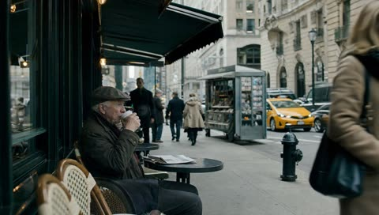</a>

一个横移长镜头。前景出租车和行人不断扫过，12 秒左右一群人完全挡住她，她借机消失。

Kling 4.0 · 首尾帧 · 出处: [Kling 4.0 user guide](https://kling.ai/quickstart/kling-4-model-user-guide)

[`long-take`](tags.md#tag-long-take) [`tracking-shot`](tags.md#tag-tracking-shot) [`chase`](tags.md#tag-chase) [`keyframes`](tags.md#tag-keyframes) [`film-look`](tags.md#tag-film-look)

<details><summary><b>提示词</b></summary>

```text
Generate a 20-second, horizontal 16:9 realistic cinematic street escape video. The entire video must be one continuous lateral side-tracking long take, filmed in a single shot with no cuts, no angle changes, and no scene changes. The scene takes place on a busy Manhattan-style street. Use a cool-toned, low-saturation film look, shallow depth of field, and realistic handheld shoulder-rig or gimbal camera movement. The street features outdoor restaurant seating, yellow taxis, parked vehicles, newspaper stands, fire hydrants, construction scaffolding, storefront windows, white steam rising from subway ventilation grates, pedestrians, and dense crowds in the distance. Foreground objects continuously sweep rapidly across the frame, creating natural occlusions and a convincing sense of street depth. The camera remains parallel to the street, moving laterally to the left while following a young woman running. She carries a large, overstuffed travel bag that is visibly heavy. As she runs, the bag swings with a delayed motion and thuds heavily against the side of her leg, causing her body to tilt slightly off balance. She looks tense and exhausted, breathing rapidly and occasionally glancing back over her shoulder, but no pursuers should appear anywhere in the frame.
0–5s: Establishing shot of a calm street. The camera initially frames an outdoor restaurant seating area. A passerby is lifting a cup of coffee, with round metal tables, wicker chairs, awnings, and pedestrians nearby. Realistic street ambience dominates the audio: traffic, voices, footsteps, and distant horns. The camera moves slowly to the left, keeping the scene calm. A blurred figure of the female protagonist gradually appears at the far right edge of the frame, rushing in at high speed.
5–12s: The woman rushes into frame, and the camera catches up with her. She bursts in from the right, and the camera rapidly accelerates laterally to the left as if her movement is pulling it along, catching up with her. The focus shifts from the street scenery to her face, with slight overshooting and refocusing allowed during the transition. She runs at full speed, mouth open as she gasps for air, brows tightly furrowed, jaw clenched. She looks back over her shoulder twice, with the second glance more pronounced, revealing fear and exhaustion. She carries the heavy, oversized travel bag, which swings with a delay in response to each arm movement and thuds heavily against her leg, throwing her body slightly off balance. She brushes past outdoor seating and runs over subway ventilation grates, stirring up white steam. Pedestrians and street objects in the foreground sweep rapidly across the frame.
12–15s: Occlusion and losing sight of her. A yellow taxi or a group of pedestrians quickly passes between the camera and the woman, completely obscuring the frame for approximately half a second to one second. When the obstruction clears, the woman is no longer at the center of the frame. The camera continues moving laterally but noticeably slows down and briefly loses focus, as if the camera operator is searching for her. The camera sweeps past a lamppost, pedestrians from behind, a newspaper stand, parked vehicles, and reflections in storefront windows.
15–21s: Finding the woman again. The camera continues searching along the sidewalk. Focus briefly shifts back and forth between foreground pedestrians, storefront reflections, and street objects before reacquiring the woman's back and profile farther away. She is still running to the left, but she is more exhausted than before. The camera accelerates again to catch up with her, pulling focus from the foreground pedestrians back to her body and face. Her pace begins to slow, her breathing becomes heavier, her strides shorten, and the travel bag feels increasingly burdensome. She briefly switches the bag to her other hand, then immediately switches it back, gripping the handle tightly as the weight pulls her body increasingly off balance.
21–30s: Running into the crowd and gradually disappearing. The camera reacquires a full-body side view of the woman. She runs past construction scaffolding, while green safety netting and metal poles sweep rapidly across the foreground one by one. Her running reflection briefly appears in storefront glass. Sweat is visible on her face, and her expression shifts from panic to exhausted determination. Finally, she rushes into the dense crowd at the entrance to a pedestrian street, using her shoulder to push past people blocking her way. Her figure is repeatedly obscured by foreground pedestrians, leaving only intermittent glimpses of her profile, jacket, and heavy travel bag. The camera continues moving slowly to the left, struggling to keep her in frame but gradually falling behind. The final shot remains on the flowing crowd, with only her back and a corner of the travel bag visible before they disappear between people.
Audio: No dialogue, no voice-over, and no background music. The soundscape should consist primarily of realistic street ambience: traffic, voices, footsteps, and distant horns. When the camera catches up with the woman, her rapid breathing, footsteps, and the sound of the travel bag thudding against her leg should dominate the center of the soundscape. During occlusion, the whoosh of a passing taxi or the footsteps of the crowd should overpower everything else. When the camera loses sight of her, her breathing should become more distant. After she is found again, her breathing should grow louder and closer. Toward the end, the footsteps and voices of the crowd should gradually swallow her sounds.
Visual style: Realistic cinematic street-chase atmosphere, cool-toned, low-saturation film color grading, detailed shadows, soft highlights, and fine film grain. Shallow depth of field, with foreground and background naturally blurring during movement. Focus should exhibit slight overshooting, refocusing, and brief moments of defocus, resembling manual focus adjustments by a real camera operator. Camera movement should have the authentic feel of a handheld shoulder rig or gimbal, with subtle vertical bobbing, lateral sway, and the inertia of acceleration and deceleration, but no violent shaking.
Negative Constraints: No cuts, no jump cuts, no white flashes, no dissolves, no slow motion, no speed changes, no subtitles, no watermarks, no UI, and no background music. No pursuers, no three men in suits, and no additional clearly identifiable antagonist characters. No mechanical, rail-mounted camera movement. No sliding character motion; the running must convey realistic footfalls and physical weight. Do not make the travel bag appear weightless. Do not make the woman run gracefully or calmly. No body intersections or clipping, no merging of people in the crowd, and no sudden changes of street, character, clothing, or camera angle.
```

</details>

输入素材: [1](https://static-73.klingai-cdn-aws.com/kling-blog/file_by_url/8cacca42bc6f30b6b7005d79689b1514c8aa39570c940406880e1cf7299d3f3f.png) · [2](https://static-18.klingai-cdn-aws.com/kling-blog/file_by_url/981929584e94d954726e341a62ff98315c2bee8aea21d711002dc3f5c4509d72.png)

<a id="omni-skateboard-motion-fx"></a>
### 给真人滑板加卡通动效

<a href="https://storage.googleapis.com/gdm-deepmind-com-prod-public/media/FfbFqJ8qhY_ZWZyz/gemini-omni__prompt-guide__skateboard.webm">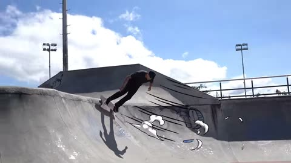</a>

`keeping everything the same` 先锁住原片，改动只叠加特效。

Gemini Omni Flash · 视频编辑 · 出处: [Gemini Omni prompt guide](https://deepmind.google/models/gemini-omni/prompt-guide/)

[`vfx`](tags.md#tag-vfx) [`mixed-media`](tags.md#tag-mixed-media)

<details><summary><b>提示词</b></summary>

```text
Edit this keeping everything the same. Add animated motion effects coming out of the skateboard.
```

</details>

<a id="seedance-anime-girl-longboarding-coastal-road"></a>
### 动漫少女在海岸山路上滑板下坡

<a href="https://x.com/TaliaAariz/status/2111049256140230768"></a>

用具体的服装、发型和护具细节固定角色外观，使多个镜头之间人物保持一致；随后按顺序写明跟拍、低角度追踪、高空广角和侧面特写等机位，让片段读起来像一段连贯的追逐剪辑。开头就写明竖版 9:16，为整组镜头定下画幅。

Seedance 2.5 · 文生视频 · 出处: [@TaliaAariz on X](https://x.com/TaliaAariz/status/2111049256140230768)

[`anime`](tags.md#tag-anime) [`skateboarding`](tags.md#tag-skateboarding) [`camera-tracking`](tags.md#tag-camera-tracking) [`vertical-video`](tags.md#tag-vertical-video)

<details><summary><b>提示词</b></summary>

```text
A cinematic 3D anime-style scene of a young woman skateboarding down a winding mountain road overlooking a breathtaking turquoise ocean, surrounded by lush green hills, coastal villages, and towering white clouds in a brilliant blue sky. She wears a white cropped T-shirt, ripped blue jeans, blue sneakers, and protective wrist guards, with her long black ponytail flowing dramatically in the wind. She crouches low on her skateboard, confidently carving through sharp road bends as the camera follows her from behind, then transitions into dynamic side-tracking close-ups highlighting her focused expression, fast-moving wheels, and realistic body movements. The camera alternates between low-angle tracking shots, wide aerial-style views of the spectacular coastline, and smooth cinematic chase shots, creating a thrilling sense of speed and freedom. Sunlight glistens across the ocean, natural lens flares illuminate the scene, and motion blur emphasizes the skateboard's speed while maintaining crisp character details. Ultra-detailed 3D animation, vibrant colors, realistic shadows, fluid motion, cinematic lighting, high-quality rendering, immersive depth, smooth camera transitions, vertical 9:16 composition, 4K quality.
```

</details>

<a id="seedance-anime-ink-martial-arts-sequence"></a>
### 女子在灰白废墟中施展水墨武术

<a href="https://x.com/Goodmanprotocol/status/2107164974078722307">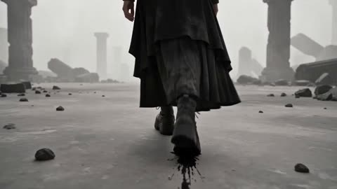</a>

将30秒拆成带时间码的分段，每段只写一个镜头运动和一个特效，并在每段重复固定的人物描述与黑白灰配色，使各镜头风格保持一致。限定克制的深金色点缀，让墨迹特效始终统一为同一种风格。

Seedance 2.5 · 文生视频 · 出处: [@Goodmanprotocol on X](https://x.com/Goodmanprotocol/status/2107164974078722307)

[`ink-painting`](tags.md#tag-ink-painting) [`martial-arts`](tags.md#tag-martial-arts) [`fpv-camera`](tags.md#tag-fpv-camera) [`multi-shot`](tags.md#tag-multi-shot)

<details><summary><b>提示词</b></summary>

```text
30-second ultra-realistic cinematic anime action sequence. One consistent female protagonist: messy black-gray short hair, gray/off-white technical jacket, dark layered long skirt, chunky platform shoes, slender slightly androgynous build, calm and emotionless. Vast empty gray-white stone landscape, pale mist, broken pillars and debris.

0–5s — INK STEP
Ultra-low rear tracking shot. She calmly walks forward. As her foot touches the ground, black ink spreads across the stone with thin dark-gold cracks. She suddenly accelerates, transforming into a fast flying black-and-white brushstroke as the camera races behind her.

5–10s — WATER MIRROR
She stops instantly. Her hair and clothes continue moving from inertia. She raises one hand and thin transparent water layers appear around her like floating glass. She closes her fingers; the layers collapse inward and crush a distant stone pillar into fragments.

10–15s — INK PALM
She makes one small forward palm movement. Black ink and dark-gold energy compress into a tiny core, then explode into a huge pressure wave of ink, mist, water and debris. The camera flies backward through the impact.

15–20s — INK LOTUS
She rises into the air. Black ink and water droplets orbit around her as a giant Chinese ink lotus forms around her body. The petals open with powerful spatial shockwaves, lifting stones and dust into the air.

20–25s — FIVE ELEMENTS
She suddenly disappears. Extreme FPV pursuit through the landscape: water becomes flowing ink streams, wood becomes white brushstrokes, fire becomes golden ink, metal becomes geometric dark-gold fractures, and earth becomes floating stone fragments. Everything remains in one elegant Chinese ink-painting style.

25–30s — FINAL IMPACT
She dives toward the ground and stops just above it. Everything freezes. She calmly points downward. A massive black, white and dark-gold circular shockwave erupts, transforming the entire landscape into a living Chinese ink painting. The energy reverses and disappears. She lands and simply continues walking forward, leaving one thin black ink trail behind her.

STYLE: ultra-realistic cinematic anime, realistic human proportions, physically believable movement, aggressive FPV camera, dynamic motion blur, Chinese ink brushwork integrated into reality, monochrome gray-white palette with black ink and restrained dark-gold accents, dramatic lighting, 4K, no weapons, no text, no subtitles, no logos, no watermark.
```

</details>

<a id="seedance-apocalyptic-warrior-sphynx-cat-transformation"></a>
### 战士与斯芬克斯猫坠落至废墟屋顶

<a href="https://x.com/AvelyrahnAI/status/2104086835081416893">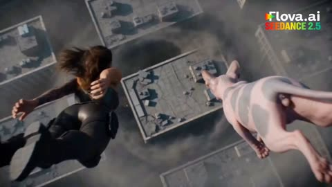</a>

提示词把动作拆成按顺序的节拍（坠落、落地、护甲合拢、变身、冲锋），让模型一次只跟随一个动作。橙色能量线、无毛斯芬克斯猫和龙卷风背景等具体画面元素，固定了整体风格。

Seedance 2.5 · 文生视频 · 出处: [@AvelyrahnAI on X](https://x.com/AvelyrahnAI/status/2104086835081416893)

[`apocalyptic`](tags.md#tag-apocalyptic) [`armor-transformation`](tags.md#tag-armor-transformation) [`sphynx-cat`](tags.md#tag-sphynx-cat) [`action-scene`](tags.md#tag-action-scene)

<details><summary><b>提示词</b></summary>

```text
Cinematic 4K shot, a fierce female warrior with long hair and tactical leather gear falling from the sky alongside a hairless Sphynx cat onto a cracked, ruined concrete rooftop in an apocalyptic city with a massive tornado spinning in the background. The warrior lands on one knee, summons glowing golden energy in her palm, and strikes the ground. Intricate sci-fi nano-armor plates instantly snap and wrap around her arms and body, glowing with bright orange energy lines. The small Sphynx cat suddenly transforms into a massive, terrifying horned cybernetic beast. The armored female warrior and the monstrous beast charge forward together, unleashing power against the chaos.
```

</details>

<a id="seedance-armored-bike-highway-chase"></a>
### 英雄骑装甲摩托穿越燃烧的末日高速公路

<a href="https://x.com/itsSaira_1/status/2104789066562547945">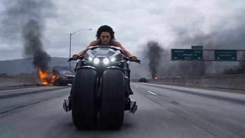</a>

带时间码的分镜清单，每一段都写明构图和运镜，让模型按顺序完成剪辑。开头固定了人物和摩托的外形描述，各个镜头之间设计保持一致。

Seedance 2.5 · 文生视频 · 出处: [@itsSaira_1 on X](https://x.com/itsSaira_1/status/2104789066562547945) · 发现于 [LearnPrompt/awesome-seedance](https://github.com/LearnPrompt/awesome-seedance)

[`sci-fi`](tags.md#tag-sci-fi) [`action`](tags.md#tag-action) [`motorcycle`](tags.md#tag-motorcycle) [`multi-shot`](tags.md#tag-multi-shot)

<details><summary><b>提示词</b></summary>

```text
CINEMATIC SHORT FILM, 46 sec, 16:9, photorealistic Hollywood sci-fi action, dystopian highway apocalypse. Cold steel-grey sky, burning orange explosions, volumetric god rays, anamorphic lens, film grain. HERO: muscular woman, curly dark hair, olive tank top, black jeans and boots, fierce expression. BIKE: matte-black futuristic armored motorcycle, twin fat front wheels, white glowing headlights, mounted cannon.

1 (0-2s): Low-angle front tracking, hero races toward camera on a wrecked highway, burning car and black smoke behind.
2 (2-4s): Side-front tracking, bike leans through a curve under an overpass, headlights flaring.
3 (5-6s): Extreme close-up of the bike's armored cannon and engine, her hand on the handlebar, motion blur.
4 (7-9s): Tight close-up of her face low over the bike, intense eyes, wind-blown curls, shallow depth of field.
5 (10-11s): Wide low-angle, giant black alien warship over the highway fires an orange beam, ground explosion.
6 (12-14s): Huge fireball erupts, hero's tiny silhouette speeds away, yellow car blurs past.
7 (15-16s): Side close-up, hero crouched on the bike, engulfed in orange fire and smoke.
8 (17-18s): Ground-level shot of rusted abandoned cars, open doors, a boot flies through the frame.
9 (19-21s): Blonde woman in black leather jacket aims a heavy sci-fi rifle at camera, burning wreckage behind.
10 (22-23s): Frontal tracking, hero bursts out from under a dark overpass, smoke columns behind.
11 (24-26s): Driver POV down the highway, collapsed overpass and debris ahead, lone black car in the lane.
12 (27-28s): Wide side shot, bike launches off a broken concrete slab, front wheel high.
13 (29-33s): Slow-motion low-angle, hero and bike airborne against dramatic clouds and god rays, red taillight glowing.
14 (34-36s): Close-up, rear wheel hits a broken slab and explodes in a fireball, sparks and debris, slow motion.
15 (37-38s): Wide ground-level, debris-covered highway, overturned burning car, tiny hero falling through the sky.
16 (39-42s): Hero lands and skids into a low crouch, one knee and hand down, fire behind her.
17 (43-46s): Medium close-up, she rises, fierce eyes, wall of orange fire exploding behind her, freeze on hero pose.

MOTION: fast tracking, whip pans, slow-motion airborne beat, handheld shake on explosions, realistic physics, consistent character and bike design.

NEGATIVE PROMPT: cartoon, anime, CGI look, plastic skin, deformed face, bad hands, extra limbs, extra wheels, changing bike design, inconsistent character, blurry, low resolution, flicker, morphing, warped anatomy, text, subtitles, watermark, logo, oversaturated, duplicate characters, unnatural motion

#AIVideo #AIArt #AIFilm #CinematicAI #SciFi #ActionScene #Midjourney #GenerativeAI
```

</details>

<a id="seedance-armored-soldier-drone-factory-battle"></a>
### 装甲士兵在废弃工厂与无人机交战

<a href="https://x.com/itsSaira_1/status/2104432266235851168">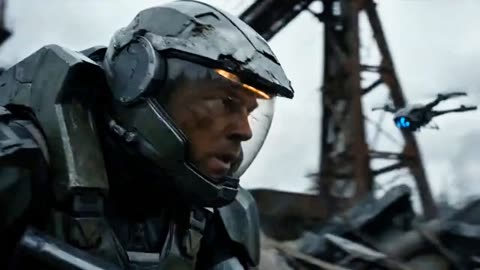</a>

按时间段列出的分镜，每个节拍都标明镜头运动，再配合参考图和每个镜头都重复的角色一致性要求，让同一名士兵的脸和装甲在多次切换中保持不变。色调和负面提示词让画面保持粗粝的电影质感。

Seedance 2.5 · 参考生视频 · 出处: [@itsSaira_1 on X](https://x.com/itsSaira_1/status/2104432266235851168) · 发现于 [LearnPrompt/awesome-seedance](https://github.com/LearnPrompt/awesome-seedance)

[`sci-fi`](tags.md#tag-sci-fi) [`war`](tags.md#tag-war) [`reference-image`](tags.md#tag-reference-image) [`shot-list`](tags.md#tag-shot-list)

<details><summary><b>提示词</b></summary>

```text
Ultra-realistic cinematic sci-fi war film, 15 seconds, 16:9, 60fps, handheld camera, desaturated gray-blue color grade, overcast sky, film grain. Keep the character from the reference image identical in every shot: same face, same weathered gray-green armor with clear visor helmet and glowing amber visor trim. Location: ruined industrial wasteland, rusted factory towers, smoking chimneys, scrap piles, small fires, puddles. Enemies: small hovering quad-drones with glowing blue eyes, one with a red eye.

0-2s: Close-up of the soldier's face behind the visor, tense, dirt on face, drones flying behind him. Camera slowly pushes in.
2-4s: Tight shot, he ducks and turns fast, armor shoulder fills the frame, red-eyed drone above.
4-6s: Low wide shot, he crouches behind a concrete barrier, explosion and smoke in the background, blue light glowing on his wrist.
6-8s: Side shot, he rises and fires a plasma rifle at a drone, sparks burst from the drone.
8-10s: Wide shot, a hit drone flips and spins away through the air, he stands in firing stance, more drones circling.
10-12s: Medium shot, he swings his arm with a glowing blue wrist gauntlet, then a close-up of the blue energy charging in his fist, face determined.
12-13s: Wide shot, blue energy dome shield erupts around him at the barrier, drones fly around.
13-15s: Camera slowly pulls back to a huge wide shot, tiny soldier in the center of the wrecked factory field, smoke and flames, drones in the sky.

Negative prompt: face change, different character, armor change, cartoon, anime, CGI look, plastic skin, blur, low quality, distorted hands, extra limbs, deformed helmet, flicker, warping, text, watermark, logo, subtitles, oversaturated colors, bright daylight, morphing, inconsistent lighting

#AIVideo #SciFi #CinematicAI #AIArt #FutureWar #Cinematic #AIFilm
```

</details>

<a id="seedance-asphalt-rescue-superbike-chase"></a>
### 摩托车手在高速公路上追截绑架SUV

<a href="https://x.com/Xaroon_x/status/2115374004529664166">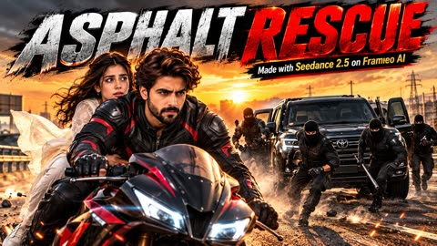</a>

用编号的 @image 参考图锁定角色与车辆，并加入连续性说明，再把30秒影片拆成带时间码的分镜，每段都写明镜头、声音与撞击节奏。逐段的音效提示让配乐和打斗冲击与动作同步。

Seedance 2.5 · 参考生视频 · 出处: [@Xaroon_x on X](https://x.com/Xaroon_x/status/2115374004529664166) · 发现于 [LearnPrompt/awesome-seedance](https://github.com/LearnPrompt/awesome-seedance)

[`motorcycle`](tags.md#tag-motorcycle) [`car-chase`](tags.md#tag-car-chase) [`martial-arts`](tags.md#tag-martial-arts) [`cinematic`](tags.md#tag-cinematic)

<details><summary><b>提示词</b></summary>

```text
ASPHALT RESCUE — 30-SECOND CINEMATIC ACTION FILM

FORMAT: 30 seconds, 16:9, photorealistic Hollywood action, 60fps where supported. Golden-hour lighting, realistic physics, natural motion blur, tire smoke, cinematic camera movement.

CHARACTER LOCK:
@image1 = Hero. Preserve exact face, hairstyle, beard, body, and outfit. He rides a black-and-red superbike; no helmet unless shown in reference.
@image2 = Four masked male kidnappers in black tactical clothing, each with a distinct build.
@image3 = Kidnapped woman in a light-colored outfit.
@image4 = Golden-hour highway, exit ramp, and empty industrial road.
Vehicle: Same black armored SUV throughout. No identity drift, clones, or costume changes.

TIMELINE:

00:00–00:05 — ABDUCTION & CHASE
Aerial 24mm shot: black SUV speeds through busy highway traffic. The bound woman pounds on the rear window. Low tracking shot reveals @image1 accelerating toward the SUV on his superbike. Engines roar, horns blare, percussion builds.

00:05–00:10 — HIGHWAY DANGER
Side tracking shot: hero narrowly threads between two trucks in controlled slow motion. The SUV brakes suddenly. Hero performs a controlled stoppie, swerves past it, and ducks as a masked attacker swings a metal pipe. Tire screeches and metal clangs.

00:10–00:15 — ESCAPE & HEROIC BLOCK
SUV exits onto an empty industrial road. Hero follows, lands a short controlled shoulder jump, overtakes the SUV, and performs a sliding 180-degree stop across its path. Dust and tire smoke rise. SUV stops just short of the bike. Music drops nearly silent at impact.

00:15–00:22 — MARTIAL ARTS SHOWDOWN
Four masked men exit and surround the hero. In readable, continuous choreography, he counters the first with a Muay Thai knee and elbow, traps the second with Wing Chun hand techniques, then delivers a spinning heel kick that sends the third into a concrete barrier. Handheld tracking, brief slow motion, synchronized impact sounds.

00:22–00:27 — FINAL TAKEDOWN & RESCUE
The largest attacker charges. Hero executes a Judo hip throw onto the SUV hood, visibly denting it. All four attackers remain down. Hero opens the rear door, gently removes the woman's gag, cuts her bindings, and helps her out. Music shifts to warm emotional strings.

00:27–00:30 — SUNSET ESCAPE
Extreme wide shot: the woman sits behind the hero on the superbike, holding his waist. They ride down the empty industrial road toward the orange sunset. The damaged black SUV and defeated attackers remain behind.

AUDIO: Original 140 BPM action score, deep synth bass, taiko percussion, distorted brass, superbike engine, SUV V8, tire screeches, fight impacts, breathing, then a heroic orchestral finish exactly at 00:30.

CONTINUITY: Left-to-right chase direction, consistent vehicle damage, outfits, identities, lighting, and spatial positions. Clear action beats, realistic movement, no unnecessary cuts.
```

</details>

<a id="seedance-bankai-ice-freeze-god-speed"></a>
### 剑士直面工业场地中的巨大黑袍身影

<a href="https://x.com/itxsarmadd/status/2104896303625105834">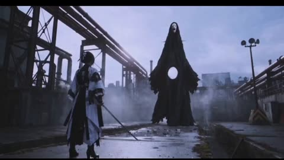</a>

连续性锁定和 Bankai 锁定条款固定了角色、场景和巨人的体型，并把特效限制为真实的冰晶物理过程，不出现光束或魔法。每个场景都按顺序写成动作节拍并给出末帧状态，使两段之间的衔接有明确依据。

Seedance 2.5 · 文生视频 · 出处: [@itxsarmadd on X](https://x.com/itxsarmadd/status/2104896303625105834) · 发现于 [LearnPrompt/awesome-seedance](https://github.com/LearnPrompt/awesome-seedance)

[`ice-effects`](tags.md#tag-ice-effects) [`samurai`](tags.md#tag-samurai) [`continuity-lock`](tags.md#tag-continuity-lock) [`giant-creature`](tags.md#tag-giant-creature)

<details><summary><b>提示词</b></summary>

```text
Duration: 20s (2×10s)
Format: 16:9 | 24fps
Style: Ultra-photorealistic live-action Japanese supernatural action, premium Hollywood cinematography, grounded realism, physically believable ice effects, cinematic blue-hour atmosphere.

CONTINUITY LOCK

- Fusia = exact same identity throughout.
- Fully manifested Bankai from Scene 1 onward.
- Same abandoned hydroelectric maintenance station.
- Same Fusia–Boncoz spatial axis.
- Direct continuity between both scenes.
- Boncoz remains colossal (3–4× human height).

BANKAI LOCK

- Hakka no Togame = environmental temperature collapse.
- No beams, projectiles, energy waves, teleportation, or magical auras.
- Ice spreads physically through water, concrete, metal, moss, and machinery.
- Real crystalline material behavior only.

SCENE 1 — ENVIRONMENTAL FREEZE

Fusia faces Boncoz across the abandoned maintenance yard and calmly declares, "Bankai... Hakka no Togame." Temperature rapidly collapses. Water crystallizes, puddles freeze, pipes and machinery gather frost, and ice spreads naturally through connected surfaces. A ground-level freezing front races across the yard toward Boncoz. The colossal creature struggles as thick crystalline ice climbs over his feet, legs, torso, shoulders, and arms. Final frame: Boncoz remains standing, fully encased in ice except for his exposed head, while Fusia stands composed in fully manifested Bankai.

SCENE 2 — GOD SPEED FINISHING SLASH

Continue directly from Scene 1. Fusia locks eyes on Boncoz, tightens her grip on the crystalline katana, and drops into a launch stance. God Speed activates through one explosive acceleration burst, carrying her instantly across the battlefield. Upon reaching Boncoz, time shifts into cinematic slow motion as she delivers a full-body finishing slash through the frozen giant. Massive fractures erupt through the existing ice shell and spread across his colossal body. Fusia finishes in a low stance as cracks multiply. The fracture network reaches Boncoz's exposed head, freezing it completely. A final catastrophic fracture tears through the entire frozen structure and Boncoz explodes into countless crystalline ice shards while Fusia remains motionless amid the falling debris.

AUDIO

No music. Cold wind, dripping water, ice crystallization, cracking frost, Boncoz's struggle, God Speed acceleration, impact shockwave, ice fracture, and shattering debris.

NEGATIVE

anime, cartoon, game graphics, glossy CGI, plastic skin, AI faces, energy beams, magical projectiles, teleportation, shrinking scale, repeated freezing, frozen poses, daylight, dead frames, unnecessary pauses.
```

</details>

<a id="seedance-batman-batmobile-anime-sequence"></a>
### 戴兜帽的黑客边吃披萨边看雨中城市

<a href="https://x.com/Kashberg_0/status/2087734863311081770">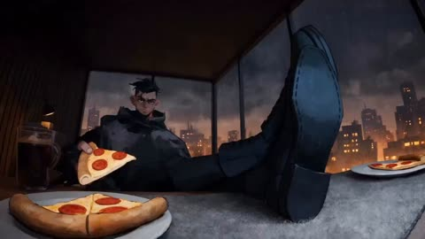</a>

每 48 帧一个时间戳、24 fps 的 JSON 时间线让每个镜头有明确的时刻，模型会按顺序从黑客房间过渡到蝙蝠车追逐。每个节拍只写一个主体和一个动作，画面更易读。

Seedance 2.5 · 文生视频 · 出处: [@Kashberg_0 on X](https://x.com/Kashberg_0/status/2087734863311081770)

[`anime`](tags.md#tag-anime) [`batman`](tags.md#tag-batman) [`batmobile`](tags.md#tag-batmobile) [`timeline`](tags.md#tag-timeline)

<details><summary><b>提示词</b></summary>

```text
{
  "video_generation_payload": {
    "resolution": "4K",
    "fps": 24,
    "base_style": "Cinematic anime, masterpiece",
    "sequence": [
      {
        "frame": 0,
        "prompt": "Hacker in black hoodie eating pizza at desk in dark room."
      },
      {
        "frame": 48,
        "prompt": "Boots on desk, monitor displaying red anime face."
      },
      {
        "frame": 96,
        "prompt": "Hands typing on keyboard, surveillance monitors behind."
      },
      {
        "frame": 144,
        "prompt": "Yellow roses on desk, armored suit in illuminated closet."
      },
      {
        "frame": 192,
        "prompt": "Close-up tactical black armor, armored fist clenching."
      },
      {
        "frame": 240,
        "prompt": "Batman cowl with glowing white eyes."
      },
      {
        "frame": 288,
        "prompt": "Batman approaches jet-powered Batmobile in wet bunker."
      },
      {
        "frame": 336,
        "prompt": "Cockpit interior, hands on throttle, boot on gas pedal."
      },
      {
        "frame": 384,
        "prompt": "Batmobile jet engines ignite, launching from tunnel."
      },
      {
        "frame": 432,
        "prompt": "Batmobile drifting through rain-slicked neon city."
      },
      {
        "frame": 480,
        "prompt": "Batman diving straight down a towering skyscraper."
      },
      {
        "frame": 528,
        "prompt": "Batman leaping across rainy city rooftops."
      },
      {
        "frame": 576,
        "prompt": "Batman standing on gargoyle overlooking glowing city."
      }
    ]
  }
}
```

</details>

<a id="seedance-bearded-warrior-frozen-temple-boss"></a>
### 严寒古庙中跪地的胡须战士

<a href="https://x.com/Xaroon_x/status/2098778827283394729">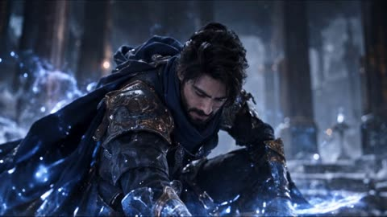</a>

每张参考图只负责一件事：图1锁定主角的面容与服装，图2锁定第二个角色，图3只提供镜头角度、构图和动作编排。把身份锁定写成一组禁止项的清单，能防止各镜头之间脸部与盔甲逐渐漂移。

Seedance 2.5 · 参考生视频 · 出处: [@Xaroon_x on X](https://x.com/Xaroon_x/status/2098778827283394729) · 发现于 [LearnPrompt/awesome-seedance](https://github.com/LearnPrompt/awesome-seedance)

[`dark-fantasy`](tags.md#tag-dark-fantasy) [`soulslike`](tags.md#tag-soulslike) [`reference-images`](tags.md#tag-reference-images) [`boss-fight`](tags.md#tag-boss-fight)

<details><summary><b>提示词</b></summary>

```text
AAA PRE-RENDERED GAME CINEMATIC | DARK FANTASY WUXIA | SOULSLIKE BOSS FIGHT | ULTRA-PHOTOREALISTIC CGI | SEEDANCE OPTIMIZED

REFERENCE PRIORITY — STRICT:

REFERENCE IMAGE 1 = MAIN CHARACTER: MALE TIDE REAVER

Use Reference Image 1 as the absolute and permanent identity reference for the main character, Male Tide Reaver.

Preserve his exact same face throughout the entire video with NO FACE CHANGE.

Maintain:

exact facial identity,

exact facial structure,

same eyes,

same eyebrows,

same nose,

same beard,

same hairstyle,

same hair length and shape,

same masculine features,

same skin tone,

same body proportions.

His identity must remain perfectly consistent in every shot, camera angle, action pose, slow-motion shot and close-up.

NO identity drift.

NO face replacement.

NO face morphing.

NO gender change.

NO hairstyle change.

REFERENCE IMAGE 2 = GATOTKACA CYBER-RONIN ASSASSIN

Use Reference Image 2 as the absolute and permanent identity reference for Gatotkaca Cyber-Ronin Assassin.

Preserve his exact same:

armor,

helmet,

flaming horns,

mask,

facial structure,

body proportions,

silhouette,

accessories,

materials,

colors,

robes,

weapon design,

giant ancient sword.

No armor change.

No weapon change.

No horn change.

No identity drift.

REFERENCE IMAGE 3 = CINEMATIC STORYBOARD REFERENCE

Use Reference Image 3 exclusively as the storyboard, cinematic composition, shot design, camera angle, framing, pacing, action staging and visual sequence reference.

Follow the cinematic structure and shot progression of Reference Image 3.

IMPORTANT:

Reference Image 3 controls ONLY:

camera angles,

cinematic composition,

shot framing,

character positioning,

action choreography,

movement direction,

scene progression,

pacing,

slow-motion moments,

environmental destruction continuity.

Do NOT copy the character identities from Reference Image 3.

The characters must always remain:

Reference Image 1 = Male Tide Reaver.

Reference Image 2 = Gatotkaca Cyber-Ronin Assassin.

CHARACTER COSTUME RULE — STRICT:

Male Tide Reaver must wear the exact same armor, clothing, outfit layers, cloak, accessories, materials, colors and overall silhouette shown in Reference Image 1.

Gatotkaca must wear the exact same armor, clothing, robes, helmet, horns, accessories, materials, colors and overall silhouette shown in Reference Image 2.

DO NOT change their clothing to match different characters from the storyboard.

Instead:

Keep Reference Image 1 and Reference Image 2 character identities and costumes exactly the same while recreating the cinematic poses, camera shots and action choreography from Reference Image 3.

STYLE:

AAA dark fantasy cinematic realism.

Sekiro × Ghost of Tsushima × Black Myth Wukong × Final Fantasy XVI CGI cinematic.

Ultra-photorealistic pre-rendered game cinematic.

No anime.

No cel shading.

No gameplay.

No HUD.

No UI.

No subtitles.

No text.

No logos.

ENVIRONMENT:

A colossal ancient Japanese mountain temple interior during winter.

The entire battle takes place indoors.

Massive wooden pillars.

Ancient stone flooring.

Weathered beams.

Large ceremonial lanterns.

Colossal guardian statues.

Tattered banners.

Open temple architecture revealing a raging snowstorm outside.

Cold moonlight pours through openings.

Snow continuously drifts into the temple.

Floor contains snow accumulation, ice patches, water puddles, cracked stone and battle debris.

Every footprint remains visible.
```

</details>

<a id="seedance-black-sedan-golden-hour-highway-chase"></a>
### 金色时刻高速公路上的黑色轿车追逐

<a href="https://x.com/Xaroon_x/status/2107838928992489968">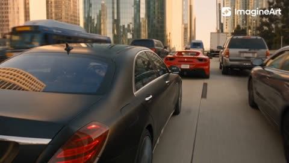</a>

按时间段列出每个节拍的镜头、焦段、运镜和慢动作指令，让模型按顺序逐段执行。@image1 参考图锁定主角的脸和服装，统一的风格段保证所有镜头的画面一致。

Seedance 2.5 · 参考生视频 · 出处: [@Xaroon_x on X](https://x.com/Xaroon_x/status/2107838928992489968)

[`car-chase`](tags.md#tag-car-chase) [`shot-list`](tags.md#tag-shot-list) [`reference-image`](tags.md#tag-reference-image) [`slow-motion`](tags.md#tag-slow-motion)

<details><summary><b>提示词</b></summary>

```text
30 seconds | 16:9 | image1 = Main Character

STYLE:** Hollywood blockbuster action. Photorealistic live-action, anamorphic ARRI ALEXA LF look, real stunt photography, natural motion blur, light film grain. Golden-hour sun from camera-left throughout. Slow motion only at the two crashes.

**CHARACTERS:** Hero = exact character from @image1 (same face, hair, build, clothing in every shot). His car: black modern Mercedes sports sedan. Chasers: red sports coupe and matte-grey SUV. Black rifle on the passenger seat.

**LOCATION:** Packed city road with buses, trucks and overpasses, opening onto a long highway at golden hour.

**00:00–00:03** Low rear-quarter chase shot, 28mm, fast tracking. The Mercedes weaves at high speed through dense traffic, overtaking cars, buses and trucks. The red coupe and grey SUV are both clearly visible behind it, also overtaking through traffic. Hero faintly visible through the rear windshield.

**00:03–00:05** Close-up, 85mm, handheld push-in. @image1 hero grips the wheel, jaw tense, eyes flick to the mirror.

**00:05–00:08** Low front-quarter tracking, 28mm. The Mercedes slips through a gap between a bus and a box truck by inches, then whip pan.

**00:08–00:11** Side-profile tracking, 35mm. The Mercedes launches off a raised ramp, goes airborne and lands in a shower of sparks, cones scattering.

**00:11–00:14** SLOW MOTION, low rear three-quarter, 35mm, slow orbit. The hero swerves clear and the red coupe clips a truck, spins and rolls once. The whole crash stays fully in frame, clear and sharp, with glass and debris glittering in the sun. Rack focus from the Mercedes to the wreck.

**00:14–00:16** Extreme close-up, 100mm macro. His eyes in the mirror, the grey SUV small in the reflection. Smash cut.

**00:16–00:18** Wide crane-style rise, 24mm. The Mercedes bursts onto an open highway, the SUV closing in.

**00:18–00:20** Interior insert, 35mm. He steers with his left hand and grabs the rifle from the passenger seat with his right.

**00:20–00:23** Over-the-shoulder, 50mm Steadicam. He leans out of the window and aims at the SUV's front tire, with a single muzzle flash.

**00:23–00:26** SLOW MOTION, low side angle, 35mm. The tire bursts and the SUV flips and rolls across the highway in sparks and dust, fully visible. Mercedes sharp in the foreground.

**00:26–00:28** Close-up, 85mm, slow push-in. @image1 hero gives a slow, confident victory smile and a small nod.
```

</details>

<a id="seedance-blonde-mock-martial-arts-police-room"></a>
### 金发女子在警察训练室搞笑武打

<a href="https://x.com/sipteaandcoffee/status/2107512973292138801">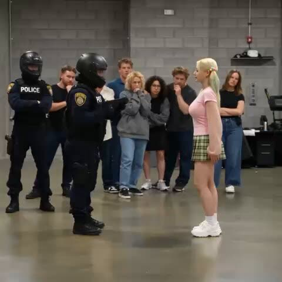</a>

固定的广角镜头和明确的17秒时长让喜剧节奏清晰，群众与警员的反应为每个动作提供回应。要求动作符合物理规律，避免滑稽打斗变成飘浮的编排。

Seedance 2.5 · 文生视频 · 出处: [@sipteaandcoffee on X](https://x.com/sipteaandcoffee/status/2107512973292138801) · 发现于 [LearnPrompt/awesome-seedance](https://github.com/LearnPrompt/awesome-seedance)

[`comedy`](tags.md#tag-comedy) [`martial-arts`](tags.md#tag-martial-arts) [`police`](tags.md#tag-police) [`static-camera`](tags.md#tag-static-camera)

<details><summary><b>提示词</b></summary>

```text
Create a realistic 17-second funny action video inside a police training room. A young blonde woman in a pink fitted top, green plaid mini skirt, and white sneakers confidently faces several police officers in black tactical uniforms while a group of young people watches in the background. She suddenly performs exaggerated martial-arts moves, playful punches, dodges, spins, and dramatic defensive gestures as the officers react and attempt to restrain her. Keep the action fast, comedic, energetic, and physically believable. Static wide camera, realistic indoor lighting, natural crowd reactions, consistent characters, smooth motion, photorealistic live-action style.
```

</details>

<a id="seedance-blonde-student-hallway-energy-fight"></a>
### 金发学生被同学围在学校走廊里

<a href="https://x.com/AiwithElisia/status/2092119695201837059">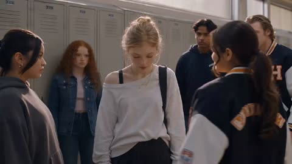</a>

提示词把30秒内容拆成几个段落（写实开场、能量升级、动作戏、安静收尾），每段配独立的镜头语言：开场用手持跟拍保证真实感，慢动作只用于最强的攻击。结尾重复列出禁止文字、标志和畸形肢体的约束，稳定写实画面。

Seedance 2.5 · 文生视频 · 出处: [@AiwithElisia on X](https://x.com/AiwithElisia/status/2092119695201837059) · 发现于 [LearnPrompt/awesome-seedance](https://github.com/LearnPrompt/awesome-seedance)

[`cinematic`](tags.md#tag-cinematic) [`handheld-camera`](tags.md#tag-handheld-camera) [`superhero-action`](tags.md#tag-superhero-action) [`slow-motion`](tags.md#tag-slow-motion)

<details><summary><b>提示词</b></summary>

```text
Create a cinematic, photorealistic 30-second live-action video set inside a modern American high school hallway lined with beige lockers. A beautiful young blonde female student with tied-back blonde hair, wearing a loose white long-sleeve top, black mini skirt, black backpack and casual shoes, walks through the crowded hallway while several students around her watch and interact with her.

Start with a natural medium shot of the girl walking between other students. Use realistic handheld camera movement, shallow depth of field, soft cinematic lighting, natural skin texture, realistic facial expressions and authentic high-school atmosphere.

As she continues walking, tension suddenly builds. A female student in a dark varsity-style jacket approaches her. The blonde girl raises her hand and mysterious pink-red energy begins glowing around her hands. Small luminous particles and sparks appear in the air. The energy gradually becomes stronger, creating a supernatural aura around her body.

Transition smoothly into an intense superhero-style action sequence in the same school corridor. The blonde girl suddenly moves with extraordinary speed and power, dodging an attacking male student and striking him with glowing pink-red energy. Show dynamic martial-arts-inspired movements, fast footwork, powerful kicks and punches, with energy trails following her movements.

Use cinematic slow motion for the strongest attacks, followed by fast-paced cuts. Show students reacting and moving away in fear as the fight continues down the hallway. The glowing pink-red energy should illuminate the lockers, floor and characters realistically, with subtle volumetric light, sparks, smoke and motion blur.

Include a dramatic moment where the girl performs a powerful spinning kick while surrounded by bright pink-red energy, sending the opponent backward. Keep the choreography physically believable and visually grounded, avoiding cartoonish effects.

Near the end, the hallway becomes quiet. The glowing energy disappears and the girl calmly continues walking toward the camera as if nothing happened. End with a close-up/medium close-up of her face with a confident, serious expression.

Visual style: photorealistic Hollywood superhero movie, cinematic color grading, realistic teenage/high-school environment, detailed faces, natural skin, realistic clothing and hair physics, realistic lighting, subtle film grain, shallow depth of field, professional cinematography, dynamic camera movement, high-detail VFX, realistic particle effects, 4K cinematic quality.

Camera: handheld tracking shots, medium shots, close-ups, low-angle action shots, smooth whip-pans, controlled motion blur, occasional slow motion during attacks.

Aspect ratio: 16:9.
Duration: approximately 30 seconds.
No text, no subtitles, no logos, no watermark, no distorted faces, no extra fingers, no unnatural anatomy.
```

</details>

<a id="seedance-blue-hair-katana-duel-glass-hall"></a>
### 蓝发持刀少女在玻璃大厅中的对决

<a href="https://x.com/AvelyrahnAI/status/2093540453261946900">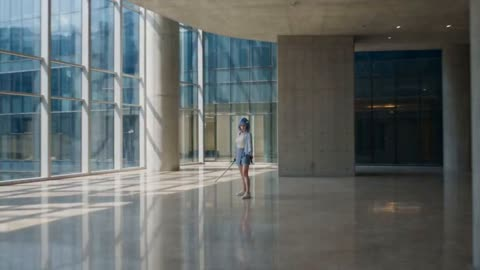</a>

提示词先锁定单一场景和跟拍镜头，再逐一写明两名对手的外形与武器，让打斗调度清晰可读。子弹时间、木屑、烟雾、体积光等效果叠加，支撑起一镜到底的长动作段落。

Seedance 2.5 · 文生视频 · 出处: [@AvelyrahnAI on X](https://x.com/AvelyrahnAI/status/2093540453261946900) · 发现于 [LearnPrompt/awesome-seedance](https://github.com/LearnPrompt/awesome-seedance)

[`action`](tags.md#tag-action) [`anime-inspired`](tags.md#tag-anime-inspired) [`tracking-shot`](tags.md#tag-tracking-shot) [`bullet-time`](tags.md#tag-bullet-time) [`long-take`](tags.md#tag-long-take)

<details><summary><b>提示词</b></summary>

```text
Cinematic action sequence, dynamic tracking shot in a modern glass-and-concrete architectural hall. A stylish anime-inspired girl with vibrant light-blue bob hair and cute blue/white hair clips wields a handgun and a katana, engaging in intense hand-to-hand combat against a nimble blonde rival armed with dual daggers. High-speed bullet-time perspective, dramatic close-ups, flying wood splinters, dynamic smoke effects, volumetric lighting, photorealistic skin texture, dramatic cinematic framing, 8k resolution, highly detailed martial arts choreography.
```

</details>

<a id="seedance-blue-hair-warehouse-martial-artist"></a>
### 蓝发女武者在昏暗仓库登场

<a href="https://x.com/MissDelulu9/status/2114222496769864105">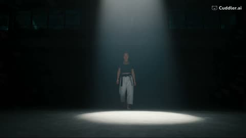</a>

用按秒分段的时间表控制节奏，每次踢击写明慢动作，之后切回正常速度。开头就固定服装和场景，让人物在整段打斗镜头中保持一致。

Seedance 2.5 · 文生视频 · 出处: [@MissDelulu9 on X](https://x.com/MissDelulu9/status/2114222496769864105) · 发现于 [LearnPrompt/awesome-seedance](https://github.com/LearnPrompt/awesome-seedance)

[`martial-arts`](tags.md#tag-martial-arts) [`taekwondo`](tags.md#tag-taekwondo) [`slow-motion`](tags.md#tag-slow-motion) [`action-sequence`](tags.md#tag-action-sequence)

<details><summary><b>提示词</b></summary>

```text
Create a 30-sec thrilling martial arts action sequence. 

A adult female martial artist with long, silky dark-blue hair, mesmerizing eyes, beautiful facial features, natural glowing skin, and an athletic physique. She wears a stylish fitted black sports top, white Taekwondo pants, and a black belt, barefoot, inside a dark industrial warehouse.

0–5s: She makes a stunning cinematic entrance, confidently walking forward as her long blue hair flows dramatically. She adjusts her black belt and takes a powerful fighting stance. Full-body shot, dramatic lighting.

5–10s: Several male fighters enter from different sides, surround her, and suddenly charge toward her. She remains calm and fearless.

10–20s: Intense Taekwondo combat begins. She blocks punches, dodges attacks, and delivers powerful high roundhouse kicks. Every kick impact features spectacular slow motion, flowing hair, realistic reactions, and dramatic dust bursts. Return to fast speed between strikes.

20–27s: More fighters attack together. She performs breathtaking jumping spin kicks and a perfect 360-degree aerial roundhouse kick. The camera rotates around her as the opponents fall backward in dramatic slow motion.

27–30s: She lands gracefully in a powerful fighting pose among the defeated opponents. Her blue hair flows as dust fills the air. Finish with a gorgeous close-up of her confident face and fierce eyes.
```

</details>

<a id="seedance-bodyguard-blocks-grab-suv"></a>
### 保镖挡开抓手并护送女高管上车

<a href="https://x.com/nawalsehar/status/2089583619484639598"></a>

提示词按顺序写成动作节拍，包含站位、一句定时台词和出口时刻，让模型清楚事件先后与人物走位。加上单镜头连续跟拍，并明确列出环境声（脚步、车门、引擎），使画面连贯、真实。

Seedance 2.5 · 文生视频 · 出处: [@nawalsehar on X](https://x.com/nawalsehar/status/2089583619484639598) · 发现于 [LearnPrompt/awesome-seedance](https://github.com/LearnPrompt/awesome-seedance)

[`action`](tags.md#tag-action) [`bodyguard`](tags.md#tag-bodyguard) [`gimbal-tracking`](tags.md#tag-gimbal-tracking) [`urban`](tags.md#tag-urban)

<details><summary><b>提示词</b></summary>

```text
A Western female executive in her early 30s exits a modern office building carrying a laptop bag while a professional Western male bodyguard in his mid-30s, wearing a fitted dark business suit, discreet earpiece, leather shoes, and sunglasses, escorts her toward a black executive SUV in a busy business district. The bodyguard maintains a protective position slightly behind and to her left, calmly scanning the surroundings while pedestrians and traffic move naturally around them. As they approach the SUV, the client smiles and says, "Thanks for today." Before she reaches the vehicle, an unknown man suddenly approaches and attempts to grab her arm. The bodyguard immediately steps between them, shields the client with his body, extends one arm to guide her backward, and uses a controlled wrist redirection and forearm block to stop the approach without unnecessary force. The client moves safely behind him toward the SUV while he maintains a balanced defensive stance and keeps visual awareness of both people. He then opens the rear passenger door, allows the client to enter safely, checks the surroundings, closes the door, and calmly maintains distance from the approaching individual. The SUV starts smoothly and drives away as the bodyguard enters the front passenger seat. Ultra-realistic Hollywood action thriller, photorealistic modern city environment, authentic executive protection tactics, realistic defensive martial arts, physically accurate human biomechanics, natural walking and reaction movements, realistic body positioning and weight transfer, natural facial expressions and breathing, accurate vehicle physics, continuous gimbal tracking shot, smooth cinematic camera movement, natural daytime lighting, authentic city traffic and pedestrian ambience, realistic footsteps, vehicle doors, clothing movement, and engine sounds, no narration, non-graphic action, seamless continuous storytelling, consistent characters and environment throughout, no weapons, blood, injuries, exaggerated impacts, superhero movements, CGI appearance, plastic skin, text overlays, logos, watermarks, or abrupt transitions.
```

</details>

<a id="seedance-cafeteria-emerald-power-fight"></a>
### 女孩在学校食堂召唤绿色能量

<a href="https://x.com/Strength04_X/status/2096147092188311749">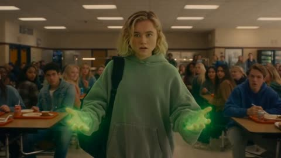</a>

提示词写成分镜清单，依次是手持跟拍走过餐厅、逐个节拍的能量觉醒，以及每个节拍都配有独立镜头运动的打斗。固定的服装与场景细节让人物在多个镜头之间保持一致。

Seedance 2.5 · 文生视频 · 出处: [@Strength04_X on X](https://x.com/Strength04_X/status/2096147092188311749) · 发现于 [LearnPrompt/awesome-seedance](https://github.com/LearnPrompt/awesome-seedance)

[`superhero`](tags.md#tag-superhero) [`school-cafeteria`](tags.md#tag-school-cafeteria) [`energy-powers`](tags.md#tag-energy-powers) [`handheld-camera`](tags.md#tag-handheld-camera)

<details><summary><b>提示词</b></summary>

```text
Create a cinematic, photorealistic 30-second live-action video set inside a modern American high school cafeteria during lunch. A beautiful young female student with shoulder-length blonde hair, wearing a loose gray hoodie, dark jeans, white sneakers and a black backpack, walks between crowded tables while students eat, talk and interact around her.

Start with a natural medium shot of the girl walking through the busy cafeteria. Use realistic handheld camera movement, shallow depth of field, warm cinematic lighting, natural skin texture, realistic facial expressions and authentic high-school atmosphere.

As she reaches the center of the cafeteria, a male student suddenly knocks a tray from her hands. She looks down for a moment before slowly raising her palms. A mysterious emerald-green energy begins glowing around her fingers. Tiny particles and sparks rise from the floor as a supernatural aura develops around her body.

Transition smoothly into an intense superhero-style action sequence. The male student charges toward her, but she quickly sidesteps and moves behind him with extraordinary speed. She performs a series of precise martial-arts-inspired strikes, powerful kicks and rapid defensive movements while green energy follows her hands and feet.

Use cinematic slow motion during the strongest impact, followed by rapid handheld cuts. Students quickly leave their tables and move toward the cafeteria walls. Chairs slide across the floor while trays and cups fall naturally. Emerald light reflects realistically across tables, windows and characters, with subtle volumetric lighting, dust, sparks and motion blur.

Include a dramatic moment where the girl performs a powerful flying kick surrounded by bright emerald energy, sending the opponent backward into an empty row of tables.

Near the end, silence returns to the cafeteria. The glowing energy fades away and she calmly picks up her backpack and walks toward the doors. End with a medium close-up of her face with a calm, confident expression.

Visual style: photorealistic Hollywood superhero movie, cinematic color grading, realistic teenage/high-school environment, detailed faces, natural skin, realistic clothing and hair physics, realistic lighting, subtle film grain, shallow depth of field, professional cinematography, dynamic camera movement, high-detail VFX, realistic particle effects, 4K cinematic quality.

Camera: handheld tracking shots, medium shots, close-ups, low-angle action shots, smooth whip-pans, controlled motion blur, occasional slow motion during attacks.

Aspect ratio: 16:9.
Duration: approximately 30 seconds.
No text, no subtitles, no logos, no watermark, no distorted faces, no extra fingers, no unnatural anatomy.
```

</details>

<a id="seedance-circus-elephant-trampoline-flip"></a>
### 杂技演员被大象抛起后落在马背上

<a href="https://x.com/sipteaandcoffee/status/2107060987157524524">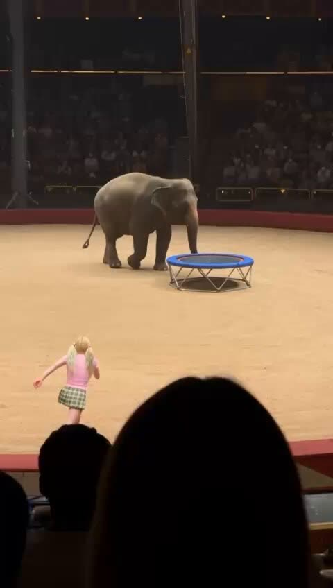</a>

提示词以观众手机单机拍摄的口吻设定画面，并按时间段写清每一阶段的动作与镜头运动，使特技看起来像一个连续镜头。明确要求不剪切，并描述屈膝缓冲等身体细节，让动作的重量感更可信。

Seedance 2.5 · 文生视频 · 出处: [@sipteaandcoffee on X](https://x.com/sipteaandcoffee/status/2107060987157524524) · 发现于 [LearnPrompt/awesome-seedance](https://github.com/LearnPrompt/awesome-seedance)

[`circus`](tags.md#tag-circus) [`elephant`](tags.md#tag-elephant) [`stunt`](tags.md#tag-stunt) [`handheld`](tags.md#tag-handheld)

<details><summary><b>提示词</b></summary>

```text
Create a 15-second ultra-realistic vertical 9:16 circus performance video, filmed casually by an audience member from the seating area of a large traditional indoor circus arena.

The video should feel like a **real viral phone recording of an unbelievable live stunt**, not a polished commercial or cinematic production.

### SETTING

Inside a huge traditional circus tent with a circular **light-tan sand performance ring**, dark audience seating packed with spectators, red barriers around the arena, tall structural poles, and a dark striped circus canopy overhead.

Warm practical circus lights illuminate the center of the ring while the audience remains comparatively dark.

The bottom foreground occasionally contains **dark silhouettes of spectators’ heads and raised phones**, making it obvious that the footage is being recorded from the audience.

In the center of the arena is a **small circular trampoline with a bright blue padded rim and silver metal legs**.

### CHARACTERS

**Female Acrobat:**  
A young blonde female circus performer with an athletic build. She wears a fitted **light-pink short-sleeve top, short green plaid performance skirt, white socks and white athletic shoes**. Her blonde hair moves naturally during the flips.

**Elephant:**  
A large realistic adult gray elephant with natural wrinkled skin, heavy body movement, large ears and a long expressive trunk.

**Horse:**  
A realistic dark-brown circus horse with a black mane and tail, walking calmly around the ring.

### 0:00–0:03 — ELEPHANT LAUNCH

Begin from the audience viewpoint.

The elephant stands beside the small blue trampoline.

The blonde acrobat runs toward the elephant and trampoline.

The elephant lowers and then powerfully raises its trunk, **launching the acrobat upward into the air**.

She immediately begins rotating backward.

The action must look spectacular but physically coherent, with believable momentum and body weight.

### 0:03–0:07 — MASSIVE AERIAL FLIPS

The camera operator quickly tilts the phone upward to follow her.

The woman flies extraordinarily high above the circus ring while performing **multiple tight backward somersaults**.

Her knees tuck toward her chest, arms control her rotation, skirt and hair react naturally to the movement, and her body maintains realistic anatomy.

The elephant remains visible far below beside the trampoline, emphasizing the incredible height.

Allow slight handheld camera shake as the person filming struggles to keep her centered.

### 0:07–0:10 — HORSE ENTERS

While she continues flipping through the air, a **dark-brown horse calmly enters beneath her** and walks across the circus ring.

The acrobat gradually opens her body from the tucked rotation and prepares for landing.

The camera pans and tilts downward with her trajectory.

### 0:10–0:12 — PERFECT LANDING

She completes the final rotation and lands **upright with both feet directly on the horse’s back** while the horse continues moving forward.

The landing is surprisingly smooth.

Her knees bend naturally to absorb the impact before she straightens her body and regains perfect balance.

No cuts during the stunt.

### 0:12–0:15 — TRIUMPHANT FINISH

Standing confidently on the moving horse, she raises **both arms wide in a victorious circus pose**.

The horse continues calmly walking around the arena.

The elephant can still be seen moving in the background.

Audience members react enthusiastically, with silhouettes and phones appearing along the bottom of the frame.

Near the final moment, the performer gives a small respectful bow while remaining balanced on the horse.

### CAMERA STYLE

Single continuous audience phone recording.

Vertical **9:16 framing**.

Camera position stays within the spectator seating rather than entering the circus ring.
```

</details>

<a id="seedance-coastal-crime-game-livestream-facecam"></a>
### 带主播小窗的海滨犯罪游戏直播

<a href="https://x.com/QAiStudio/status/2099363620325048805">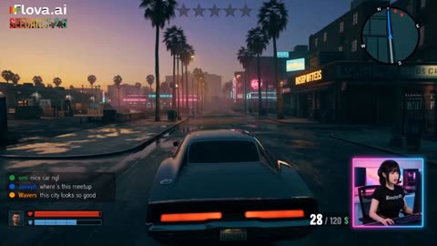</a>

固定HUD加参考图锁定的右下角主播小窗，配合英文聊天栏和按秒分段的节拍表，每个时间段只写一个动作和一次HUD变化。末尾的严格规则限定角色数量、武器和结局，让30秒开场加15秒续写的长镜头保持一致。

Seedance 2.5 · 参考生视频 · 出处: [@QAiStudio on X](https://x.com/QAiStudio/status/2099363620325048805) · 发现于 [LearnPrompt/awesome-seedance](https://github.com/LearnPrompt/awesome-seedance)

[`gameplay`](tags.md#tag-gameplay) [`livestream`](tags.md#tag-livestream) [`hud`](tags.md#tag-hud) [`long-take`](tags.md#tag-long-take) [`photorealistic`](tags.md#tag-photorealistic)

<details><summary><b>提示词</b></summary>

```text
Photorealistic fictional open-world coastal crime-action gameplay livestream, 16:9, one continuous 45-second take split into a 30-second opening plus a seamless 15-second continuation. Fixed full-screen game HUD throughout: bottom-right square pink-blue neon facecam of HANEUL only, matching the supplied reference image exactly; fixed HUD, English-only scrolling live chat on the left, Korean streamer speech only with no subtitles, third-person chase camera, no cuts, no transitions, no scene changes, no duplicate characters.

0–8s: Player drives a dark muscle car through a neon coastal city at dusk toward a GPS destination; HANEUL is calm and focused in facecam, with engine, city ambience, faint radio, and keyboard/mouse sounds.

8–15s: At a warehouse, exactly two dark-red-jacket gang enemies emerge from cover, draw pistols, and ambush the player. The player dives behind a car, is visibly grazed, health drops, and wanted level rises to two stars. HANEUL reacts in shocked Korean.

15–24s: Intense reckless firefight. Player uses one compact SMG; enemies use pistols only. A flanking enemy shatters a nearby car window, bullets dent the car and pop a tire, ammo falls from 38/120 toward 24/120, wanted level reaches three stars, and distant police cruisers appear only in the background.

24–30s: Player fires five deliberate SMG shots with visible sequential hit reactions; both enemies fall only after being hit. Ammo drops exactly from 24/120 to 14/120. HANEUL remains wide-eyed and tense; police sirens close in.

30–38s: With both enemies down, the player limps into the damaged muscle car with a shredded tire. Two police cruisers pursue in the background as the car lurches forward on its rim. Health remains critically low and flashing red; wanted level stays at three stars.

38–45s: Player scrapes through a narrow alley, knocks off both mirrors, and reaches a side street where traffic briefly blocks the police. The wanted level remains flashing at three stars, police lights remain visible in the rearview, and the ending stays unresolved.

Strict rules: HANEUL appears only in the bottom-right fixed facecam; exactly one player and two gang enemies; no extra armed characters; no full-screen facecam; no subtitles; English-only HUD/chat text; no weapon swaps; no gore; no victory, clean escape, black screen, or end card.
#flovacpp #flovaai
```

</details>

<a id="seedance-concert-outbreak-short-film"></a>
### 夜间演唱会人群面向舞台，洋红色灯光下

<a href="https://x.com/auqibhabib/status/2108459477649543194">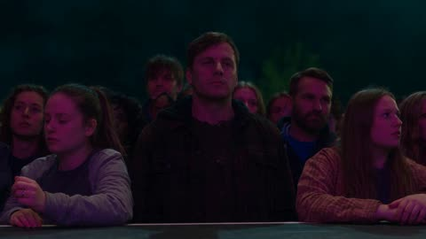</a>

每秒是一个带时间码的镜头节拍，并用 CHARACTER LOCK 锁定吉他手的形象。镜头、调色和声音规则集中写在开头，不必逐镜重复，模型就能同时拿到节奏和音效提示。

Seedance 2.5 · 文生视频 · 出处: [@auqibhabib on X](https://x.com/auqibhabib/status/2108459477649543194) · 发现于 [LearnPrompt/awesome-seedance](https://github.com/LearnPrompt/awesome-seedance)

[`horror`](tags.md#tag-horror) [`multi-shot`](tags.md#tag-multi-shot) [`concert`](tags.md#tag-concert) [`sound-design`](tags.md#tag-sound-design)

<details><summary><b>提示词</b></summary>

```text
Cinematic horror-action short film set at an outdoor music concert at night, opens with an instant hook, grounded realistic style, maximum dynamic camera work. Setting: a concert stage with lights and speakers, a large crowd of attendees facing the stage, a live band performing. CHARACTER LOCK: the main character is a guitarist on stage, mid-20s, leather jacket, consistent in every shot. Muted concert-lighting color grading with colorful stage lights cutting through darkness, natural diegetic sound throughout, tension score entering immediately.
>
> **[0-1s]** Hard cut: a man in the crowd suddenly collapses, convulsing hard near the front barrier.
>
> **[1-2s]** Nearby fans back away in confusion as his skin pales and veins darken rapidly.
>
> **[2-3s]** He rises fast, lunging at the person beside him, pulling her down into the crowd.
>
> **[3-4s]** Screaming erupts near the stage, the crowd pushing back in a wave of panic.
>
> **[4-5s]** She convulses hard, rising seconds later alongside him, both turning toward the crowd.
>
> **[5-6s]** The guitarist on stage stops playing, staring down in alarm as the chaos spreads below.
>
> **[6-7s]** More people fall and rise infected, the front section of the crowd dissolving into chaos.
>
> **[7-8s]** Security guards rush in, trying to hold a line, but the infected break through fast.
>
> **[8-9s]** One infected climbs onto the stage, lunging toward the drummer.
>
> **[9-10s]** The guitarist grabs a stage prop knife used in their performance, gripping it tightly.
>
> **[10-11s]** He steps in, driving the infected back with a firm strike, giving the drummer room to escape.
>
> **[11-12s]** A second infected climbs up from the side, lunging toward the guitarist.
>
> **[12-13s]** He pivots fast, deflecting its grab and countering with a sharp strike.
>
> **[13-14s]** It staggers back off the stage edge, falling into the crowd below.
>
> **[14-15s]** SLOW MOTION insert: a third infected lunges at him from the opposite side.
>
> **[15-16s]** He spins, striking it down with a decisive motion, clearing the stage.
>
> **[16-17s]** Wide shot: security finally regains ground, pushing the remaining infected back from the stage area.
>
> **[17-18s]** The guitarist helps the rest of the band off the stage through a side exit.
>
> **[18-19s]** Fans stream out through the venue's main gates, security guiding them to safety.
>
> **[19-21s]** Wide shot: the stage now empty except for scattered equipment, lights still flashing colorfully overhead.
>
> **[21-23s]** The guitarist checks on his bandmates backstage, all accounted for and safe.
>
> **[23-25s]** He sets the prop knife down, hands trembling slightly, catching his breath.
>
> **[25-27s]** Security personnel secure the venue perimeter, confirming the area is clear.
>
> **[27-29s]** The band stands together backstage, exchanging exhausted but relieved glances.
>
> **[29-30s]** Final shot: the guitarist looks out at the now-empty stage through a gap in the curtain, stage lights still glowing. Cut to black.
>
> Natural diegetic sound throughout — convulsing, screaming, music cutting out, crowd noise, heavy breathing — layered with a tense instrumental score building through the chaos and easing into relief at the end. No text overlay, no watermark. Maximum dynamic camera variety — close-ups, wide shots, tracking shots, slow motion reserved for the final stage encounter. Realistic shake only during physical impacts, colorful concert stage lighting against darkness. @SocialSight
```

</details>

<a id="seedance-convenience-store-number-four"></a>
### 便利店外女子用借力化解三人围堵

<a href="https://x.com/aiwithaly/status/2106981702677451248">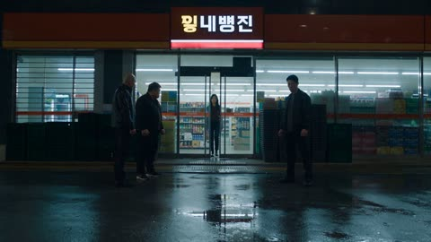</a>

提示词把30秒拆成按顺序排列的段落，每句台词和每个动作各占一句。动量、惯性、杠杆等物理词加上很长的负面清单，并限定只有环境声和撞击声，让打斗保持写实。

Seedance 2.5 · 文生视频 · 出处: [@aiwithaly on X](https://x.com/aiwithaly/status/2106981702677451248) · 发现于 [LearnPrompt/awesome-seedance](https://github.com/LearnPrompt/awesome-seedance)

[`action-thriller`](tags.md#tag-action-thriller) [`dialogue`](tags.md#tag-dialogue) [`choreography`](tags.md#tag-choreography) [`night`](tags.md#tag-night) [`korean`](tags.md#tag-korean)

<details><summary><b>提示词</b></summary>

```text
Create an exactly 30-second, 16:9, 24fps hyper-realistic Korean live-action action thriller with dry dark comedy. Nighttime outside a modern Korean convenience store, wet pavement reflecting storefront lights.

PYONA exits carrying a small paper bag. Three intimidating adult men surround her. The leader says, “You have three choices: give us your phone, apologize, or fight.”

PYONA calmly studies the gap between them and says, “I'll take number four.” She walks through the opening and adds, “You leave.” The leader's smile disappears.

He grabs her forearm. She looks at his hand and says, “That was the wrong answer.” When he pulls her, she steps toward him, rotates with his force and redirects his momentum into the convenience-store door.

A second man charges with a punch. PYONA sidesteps and redirects him into the first man. A third attacks from behind; she steps aside and redirects him into stacked plastic crates, which collapse from the collision.

The three men freeze. The leader asks, “Who are you?” PYONA calmly replies, “I already told you.” She picks up her bag, walks past them, then looks back and says, “Number four.”

Cut to black.

Use grounded physical choreography: realistic weight, momentum, inertia, friction, leverage, balance and collision reactions. PYONA wins through timing and redirection, never superhuman strength.

Controlled cinematic camera with consistent screen direction and clear full-body framing during physical actions. Natural nighttime ambience and realistic impact sounds only. No music or narration.

Negative prompt: supernatural strength, flying bodies, wire-fu, invisible force, impossible throws, premature falls, teleportation, duplicate characters, appearance drift, costume changes, location changes, excessive camera shake, exaggerated slow motion, cartoon physics, blood, gore, weapons, broken bones, head impacts, logos, watermark.
```

</details>

<a id="seedance-courtyard-halter-axe-fight"></a>
### 穿波点吊带的女子击退持斧男子

<a href="https://x.com/Just_sharon7/status/2105196278217150537">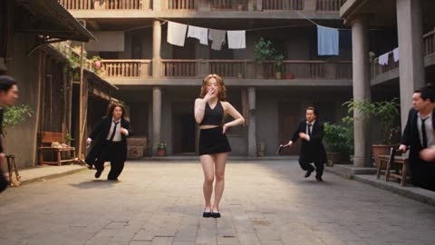</a>

用明确的镜头清单（远景建立、环绕跟拍、低角度脚部特写）规划剪辑节奏。开头就固定画面风格、镜头光晕和院落布局，让整段镜头的场景保持一致。

Seedance 2.5 · 文生视频 · 出处: [@Just_sharon7 on X](https://x.com/Just_sharon7/status/2105196278217150537) · 发现于 [LearnPrompt/awesome-seedance](https://github.com/LearnPrompt/awesome-seedance)

[`martial-arts`](tags.md#tag-martial-arts) [`slow-motion`](tags.md#tag-slow-motion) [`music-video`](tags.md#tag-music-video)

<details><summary><b>提示词</b></summary>

```text
Cinematic 30-second music-video sequence, widescreen 16:9, photorealistic film look with slight anamorphic flare and warm dusty color grade.

A sunlit old East Asian courtyard apartment block: weathered grey concrete and wood buildings, wooden second-floor balconies, laundry hanging on lines across the sky, potted plants, stone-paved ground, wooden benches, corrugated roofs.

Center: a beautiful young East Asian woman, mid-20s, long wavy auburn-blonde hair with small black ribbon bows, peach makeup, hoop earrings, layered silver necklaces. She wears a black polka-dot halter crop top, tight black mini skirt, and black jeweled thong sandals. She stands casually in the middle of the courtyard smoking a cigarette, one hand on her hip, completely unbothered.

Four to five men in black suits (white shirts, black ties, some in long black coats) charge her from all sides, leaping through the air while swinging wooden-handled hatchets/axes. Dynamic slow-motion jumps, coats flying, motion blur.

She barely moves at first, exhales smoke, then unleashes precise, elegant martial-arts kicks. Men fly backward and slam onto the stone ground, lying scattered and defeated. Close-up of her jeweled sandals stepping forward. Extreme close-up of her face as an axe blade passes just in front of her lips; she looks bored and pretty.

One remaining man charges; she high-kicks him so hard he flips backward over the hanging laundry lines into the sky. She turns, poses with hands on hips among the fallen bodies, flicks ash, then adjusts her top straps while looking at camera with cool confidence.

Camera: wide establishing shot, circling tracking shots, low-angle foot close-up, slow-motion mid-air action, handheld energy mixed with locked-off beauty shots. Natural daylight, soft courtyard shadows, cinematic shallow depth of field.

Mood: stylish, effortless, slightly surreal, high-fashion action, “she doesn’t even try.” Subtle song lyric energy: “Can you do it?”
```

</details>

<a id="seedance-crimson-flashpoint-armored-hero-rain-fight"></a>
### 霓虹雨夜中装甲英雄大战蒙面人

<a href="https://x.com/Xaroon_x/status/2110248837432439129">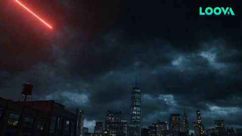</a>

提示词把 48 秒拆成十二个 4 秒镜头，每个镜头只写一种运镜和一个动作节点。场景、主角、敌人、音频、连贯性和负面词各自独立成块，并用参考图锁定主角形象，保证身份和盔甲前后一致。

Seedance 2.5 · 参考生视频 · 出处: [@Xaroon_x on X](https://x.com/Xaroon_x/status/2110248837432439129) · 发现于 [LearnPrompt/awesome-seedance](https://github.com/LearnPrompt/awesome-seedance)

[`superhero`](tags.md#tag-superhero) [`action`](tags.md#tag-action) [`multi-shot`](tags.md#tag-multi-shot) [`rain`](tags.md#tag-rain) [`cinematic`](tags.md#tag-cinematic)

<details><summary><b>提示词</b></summary>

```text
CRIMSON FLASHPOINT — 48 seconds, 16:9, 12 shots × 4 seconds. Photorealistic Hollywood superhero action film, ARRI ALEXA 65, anamorphic look, subtle film grain.

LOCATION: Rain-soaked neon downtown intersection at night, glass skyscrapers, abstract cyan/magenta/amber signs, reflective wet asphalt, steam grates, parked cars, dark alley on the right. Heavy rain throughout; crimson is the dominant accent.

HERO (@image1): Preserve identical face, hair, beard, skin tone, age, and build in every shot. Original outfit before transformation; afterward, matte-black articulated armor with glowing crimson seams across ribs, arms, legs, and spine, segmented chest plate with a faint red core, fingerless armored gloves. No helmet or cape; face fully visible.

ENEMIES: Exactly three masked men in black tactical jackets, cargo pants, grey gloves, and matte-black full-face masks. Man 1 is tall and lean with a steel baton; Man 2 is broad with a crowbar; Man 3 has a medium build and baton. No dialogue.

SHOT 01 (00–04): Extreme-wide low-angle skyline under storm clouds. A bright crimson streak cuts diagonally through the sky, illuminating rain and glass towers.

SHOT 02 (04–08): Fast overhead tracking follows the falling streak toward street level. A faint human silhouette appears inside the light as crimson reflections sweep across the road.

SHOT 03 (08–12): Hero lands in a one-knee, one-fist crouch in his original outfit. Water explodes outward; red energy threads crawl across his arms and torso.

SHOT 04 (12–16): Smooth 360° orbit as crimson energy assembles the black armor panel by panel. The chest plate locks into place and red seams ignite.

SHOT 05 (16–20): 85mm close-up. Rain beads on his face and armor; a red spark flickers in his eyes as he looks forward with controlled determination.

SHOT 06 (20–24): Low side-tracking shot. Fully armored hero sprints down the wet street at superhuman speed, spraying water and leaving a thin crimson trail.

SHOT 07 (24–28): Over-the-shoulder shot. Three masked men emerge from the right-side alley, spreading out with weapons ready. Hero skids to a defensive stop.

SHOT 08 (28–32): Hero dashes forward as a crimson blur and strikes Man 1, launching him backward. Rain and water burst outward in slow motion.

SHOT 09 (32–36): Man 2 swings his crowbar. Hero ducks, spins, and lands one strike, sending him sliding through a puddle toward a parked car.

SHOT 10 (36–40): Man 3 lunges with his baton. Hero dodges inches away and delivers a powerful palm strike, blasting him backward through an explosive ring of water. Bright crimson flash at impact.

SHOT 11 (40–44): Wide low-angle pull-back. Hero stands calmly between all three fallen attackers as rain pours over his armor and crimson seams gradually dim.

SHOT 12 (44–48): Extreme close-up of the hero lifting his head with quiet confidence. A tiny red spark crosses his eyes before the image cuts to black.

AUDIO: Original cinematic orchestral-synth score, heavy rain, electrical crackle, realistic impacts, water splashes, accelerating percussion, and a powerful musical peak at Shot 10. No dialogue.

CONTINUITY: Maintain exact hero identity, armor design, enemy count, location layout, lighting, and screen direction across all shots. Realistic physics, consistent rain, natural motion blur, controlled speed ramps, clean cuts, and stable camera movement.

NEGATIVE: Cartoon, artificial CGI appearance, plastic skin, face changes, inconsistent armor, extra characters, duplicate bodies, extra fingers, deformed hands, cape, helmet, yellow accents, lightning-bolt emblem, blood, gore, impossible physics, random camera movement, jitter, flicker, readable text, logos, or watermark.
```

</details>

<a id="seedance-cyberpunk-infiltration-sequence"></a>
### 兜帽特工俯瞰雨中霓虹都市

<a href="https://x.com/AIwithWania/status/2104539047213576643">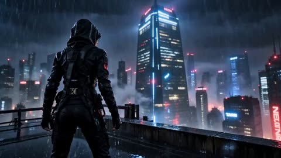</a>

将 28 秒画面拆成带时间码的分镜，每段只有一个动作和一个运镜，模型得到的是分镜表而不是模糊的整体场景。开头的连贯性要求加上独立的风格、镜头和质量段落，让角色、服装和环境在各段中保持一致，并统一禁止字幕和水印。

Seedance 2.5 · 文生视频 · 出处: [@AIwithWania on X](https://x.com/AIwithWania/status/2104539047213576643) · 发现于 [LearnPrompt/awesome-seedance](https://github.com/LearnPrompt/awesome-seedance)

[`cyberpunk`](tags.md#tag-cyberpunk) [`neon`](tags.md#tag-neon) [`rain`](tags.md#tag-rain) [`multi-shot`](tags.md#tag-multi-shot)

<details><summary><b>提示词</b></summary>

```text
-

Create  ultra-cinematic cyberpunk tactical infiltration sequence, shot like a high-budget futuristic action film. Photorealistic humans, realistic anatomy and movement, detailed tactical gear, neon cyan/crimson lighting, volumetric rain, wet reflections, atmospheric fog, realistic physics, anamorphic cinematography, shallow depth of field, dynamic camera movement, seamless transitions. Maintain identical characters, costumes and environment throughout.

00:00–00:03 — A vast futuristic metropolis at night, heavy rain and neon skyscrapers disappearing into mist. A female operative in a sleek wet black tactical suit and hood surveys the city. Extreme close-up of her eyes reflecting neon lights. Her male teammate checks a rugged holographic tactical tablet.

00:03–00:07 — The team attaches to a futuristic drone-deployed rappelling cable and descends a massive glass skyscraper. Dynamic aerial and low-angle tracking shots, rain streaking across reflective glass. They land silently on a balcony.

00:07–00:11 — The squad moves through an exterior glass corridor protected by horizontal red laser grids. One operative hacks a futuristic glass door using a compact electronic device. Blue electrical pulses travel through the lock; security shuts down. They enter silently.

00:11–00:16 — A massive research chamber reveals a glowing blue-white spherical energy core suspended inside a red laser lattice. The female lead scans it with her holographic tablet. Technical data and energy readings appear. Slow cinematic orbit around the core and team.

00:16–00:20 — A futuristic elevator descends into the secure facility. Red emergency lighting pulses. Doors open to reveal the three-person squad in black tactical gear. Low-angle hero shot as they step out in synchronized formation.

00:20–00:24 — The female operative extracts the brilliant blue energy core from its holographic containment field. Blue light illuminates her face and armor. She locks it inside a sophisticated metallic energy case with a mechanical click.

00:24–00:28 — Alarms erupt. Red lights flash as the squad sprints through a glass corridor and leaps from the skyscraper. Mechanical bat-like glider wings deploy from their tactical suits with realistic articulated movement. They transition from freefall into controlled flight above the neon metropolis. Camera pulls far back as the squad disappears into the storm carrying the glowing energy core.

STYLE: Photorealistic cyberpunk noir, Hollywood sci-fi action, practical-looking tactical equipment, realistic rain and water physics, wet metallic surfaces, volumetric fog, cinematic lens flares, subtle film grain, HDR, dramatic contrast, physically accurate shadows, realistic faces, hands and fabric.

CAMERA: Anamorphic lenses, wide establishing shots, extreme close-ups, low-angle hero shots, aerial tracking, handheld pursuit, smooth crane movements, dramatic push-ins, natural motion blur.

QUALITY: Ultra-detailed 4K, coherent character continuity, seamless transitions, realistic physics and anatomy. No glitches, subtitles, logos, text or watermark.

Created with Seedance 2.5.
```

</details>

<a id="seedance-cyberpunk-mecha-vs-alien-monster-battle"></a>
### 机甲在赛博朋克废墟中大战异形怪兽

<a href="https://x.com/laviniavelle/status/2109504064186982604">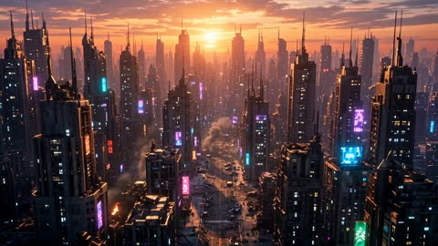</a>

提示词先交代场景与时间，再用鲜明的颜色和发光细节分别描绘两个对手。动词按顺序排出动作节拍：落地、烟中现身、闪避、斩击。结尾用画质与镜头一句收束，要求快节奏运镜。

Seedance 2.5 · 文生视频 · 出处: [@laviniavelle on X](https://x.com/laviniavelle/status/2109504064186982604) · 发现于 [LearnPrompt/awesome-seedance](https://github.com/LearnPrompt/awesome-seedance)

[`cyberpunk`](tags.md#tag-cyberpunk) [`mecha`](tags.md#tag-mecha) [`monster`](tags.md#tag-monster) [`action`](tags.md#tag-action) [`sci-fi`](tags.md#tag-sci-fi)

<details><summary><b>提示词</b></summary>

```text
Cinematic action sequence in a futuristic, dystopian cyberpunk city at sunset, with towering skyscrapers, glowing neon signs, and a ruined street covered in rubble and abandoned cars. A powerful, heavily armored blue and silver mecha robot with glowing blue energy blades on its arms lands heavily on the cracked asphalt, creating a cloud of dust. A massive, ferocious alien monster with red glowing eyes and spiked armor emerges from the smoke, roaring. The mecha engages in a dynamic, high-speed battle with the creature, dodging attacks, slashing with its energy swords, and sparking with electric energy. Epic movie quality, detailed textures, dramatic lighting, and fast-paced camera movement.
```

</details>

<a id="seedance-cyborg-leaps-from-movie-screen"></a>
### 女子在影院观看屏幕中的废墟赛博格

<a href="https://x.com/AvelyrahnAI/status/2105158267437548020">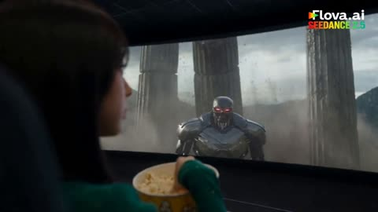</a>

用三个明确的节拍组织提示：影院中的固定镜头、反派从屏幕跃出、画面碎裂切换到古迹废墟，让模型有清晰的先后顺序可循。具体的镜头运动、特效描述和人物外观，有助于在切换前后保持主体与风格稳定。

Seedance 2.5 · 文生视频 · 出处: [@AvelyrahnAI on X](https://x.com/AvelyrahnAI/status/2105158267437548020)

[`scene-transition`](tags.md#tag-scene-transition) [`cyborg`](tags.md#tag-cyborg) [`dynamic-camera`](tags.md#tag-dynamic-camera) [`theater`](tags.md#tag-theater)

<details><summary><b>提示词</b></summary>

```text
Cinematic 4K action sequence in a dark movie theater. A young Asian woman with long black hair and a green long-sleeve top is eating popcorn, watching a sci-fi blockbuster on screen. Suddenly, a robotic cyborg villain with glowing red eyes leaps out of the movie screen into the theater. The environment instantly shatters and transitions into an epic ancient ruin courtyard with stone columns under a stormy sky. Dynamic camera movement tracking intense hand-to-hand combat between the woman wielding swirling green magical energy and the metallic cyborg casting purple spell circles. High-budget Hollywood blockbuster aesthetics, dramatic lighting, particle effects, slow-motion impacts, and hyper-realistic textures.
```

</details>

<a id="seedance-dark-fantasy-colossus-bell-tower"></a>
### 雨中悬崖上的哥特废墟修道院与绳桥

<a href="https://x.com/Xaroon_x/status/2111403509333602431">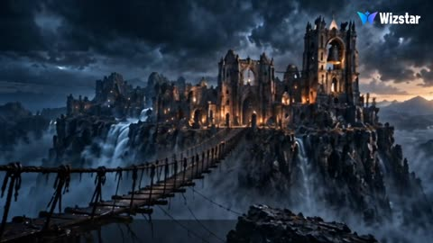</a>

按时间码逐段列出镜头，给模型清晰的分镜结构；用 @image1 锁定主角并明确要求保持面部与服装一致，减少跨镜头漂移。00:22 的青铜钟声等具体音效节点把声音与动作对齐。

Seedance 2.5 · 参考生视频 · 出处: [@Xaroon_x on X](https://x.com/Xaroon_x/status/2111403509333602431)

[`dark-fantasy`](tags.md#tag-dark-fantasy) [`monster`](tags.md#tag-monster) [`timeline`](tags.md#tag-timeline) [`reference-lock`](tags.md#tag-reference-lock)

<details><summary><b>提示词</b></summary>

```text
THE BELL OF ASHFALL

ENGINE DIRECTIVE: Create an exactly 30-second, 16:9 photorealistic live-action dark-fantasy film, targeting 60fps where supported. Hollywood-level VFX, realistic textures, storm lighting, volumetric rain, natural motion blur, and cinematic camera movement.

HERO LOCK: @image1 is the only hero. Preserve his exact face, hairstyle, facial hair, skin tone, age, body, outfit, accessories, and weapon in every shot. No identity drift, clones, or costume changes. Keep his face recognizable.

ANTAGONIST: A 15-meter horned Cinder Colossus with black basalt skin, glowing ember-orange cracks, amber eyes, and a damaged left shoulder.

LOCATION: Ruined gothic Ashfall Monastery above a bottomless gorge, with a collapsing rope bridge, flooded courtyard, broken statues, and a timber bell tower containing a massive bronze bell.

TIMELINE:

00:00–00:05 | STORM BRIDGE
Aerial 24mm shot reveals the storm-lashed monastery. Ground-level tracking follows the hero sprinting across a swaying rope bridge. Planks snap behind him as lightning illuminates the gorge.

00:05–00:10 | THE COLOSSUS
The bridge collapses. The hero leaps, catches a hanging rope, and climbs to the cliff. The Colossus rises from the abyss, roars, and slams its enormous hand beside him.

00:10–00:15 | COURTYARD CHASE
The hero races through shin-deep water as the giant destroys statues and arches. He slides beneath a crushing fist, and a stone column shatters. He reaches the bell tower.

00:15–00:20 | THE BELL TOWER
The hero climbs unstable timber scaffolding. The Colossus punches through the tower wall, cracking beams. The hero cuts the bell's restraining rope, sending the massive bronze bell swinging outward.

00:20–00:25 | THE STRIKE
The hero jumps onto a beam as the bell swings through the breach and slams into the Colossus's chest at 00:22. Slow-motion impact, expanding shockwave, airborne rain, and glowing cracks spreading across its body.

00:25–00:30 | DAWN OF ASH
At 00:26, the Colossus explodes into stone fragments and ash, falling into the gorge. Storm clouds part as golden dawn illuminates the victorious hero. End with a cinematic close-up, drifting ash, and the humming bell.

AUDIO: Dark orchestral strings, distant choir, pounding war drums, thunder, rain, creaking wood, crushing stone, and monstrous roars. At 00:22, a powerful bronze gong triggers near-silence and a lingering resonance. Finish with hopeful choir, warm strings, and fading wind.

CONTINUITY: Grounded, readable action; progressive destruction; consistent screen direction; no extra characters, text, or logos.
```

</details>

<a id="seedance-elderly-cyclist-clears-road-game-hud"></a>
### 老年男子骑车清理道路的游戏画面

<a href="https://x.com/RizwanAly07/status/2099432042509606931">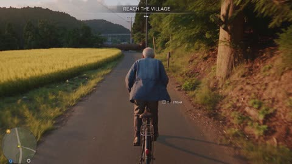</a>

将角色、自行车、倒树和路障锁定为固定对象，并把每个手柄提示和HUD文字按每3秒一个节拍排列，让每个动作都像玩家操作。明确的第三人称镜头和禁止电影化构图，使画面更接近实时游戏而非电影镜头。

Seedance 2.5 · 文生视频 · 出处: [@RizwanAly07 on X](https://x.com/RizwanAly07/status/2099432042509606931)

[`open-world`](tags.md#tag-open-world) [`game-hud`](tags.md#tag-game-hud) [`gameplay`](tags.md#tag-gameplay) [`bicycle`](tags.md#tag-bicycle)

<details><summary><b>提示词</b></summary>

```text
Create a 30-second vertical 9:16 video that looks like authentic gameplay from a modern ultra-realistic AAA open-world game — NOT a cinematic movie.

CHARACTER LOCK: One realistic 70-year-old Japanese man with grey hair, aged face, slightly bent posture, faded blue railway/work jacket, dark trousers and black shoes. Keep identical face, body, clothing and age throughout.

ENVIRONMENT: Beautiful rural Japanese mountain village with a narrow asphalt road, traditional houses, rice fields, dense greenery, utility poles, mountains and a distant railway. Late-afternoon natural lighting. One continuous environment.

CAMERA/HUD: Third-person gameplay camera behind the character, consistent distance, responsive to player movement. Original realistic game HUD with minimap, health/stamina and contextual controller prompts. No GTA branding/UI.

0–3s: Man rides a bicycle toward a yellow waypoint. HUD: “REACH THE VILLAGE” + L3 STEER.

3–6s: Fallen tree blocks the road. Player brakes. L2 BRAKE. Objective changes: “CLEAR THE ROAD”.

6–9s: △ DISMOUNT. He gets off and looks toward the obstacle. R3 LOOK.

9–12s: L3 MOVE + R2 SPRINT. He approaches the fallen tree with believable elderly movement.

12–15s: □ INTERACT → ← → PUSH. He physically pushes the heavy tree aside. Realistic friction and weight; no disappearing objects.

15–18s: A metal road barrier is revealed. □ INTERACT. Message: “PATH STILL BLOCKED”.

18–21s: Player opens the barrier. It swings naturally and a waiting vehicle becomes visible.

21–24s: R3 LOOK. He returns to the bicycle. △ MOUNT.

24–27s: R2 PEDAL. He cycles through the cleared road. Waypoint turns green. Objective: “ROAD CLEARED”.

27–30s: Continue riding toward the village. HUD notification: “MISSION COMPLETE — ROAD CLEARED”. End during active gameplay, no cinematic ending.

GAMEPLAY FEEL: Every action must feel player-controlled. Fast pacing with an interactive moment every 2–3 seconds. Prompts appear only when usable. Realistic bicycle physics, braking, wheel rotation, elderly movement, tree weight, barrier movement, shadows and ground contact.

STRICT CONSISTENCY: One man, one bicycle, one tree, one barrier. No duplicates, morphing, teleportation, object popping, floating/sliding, face deformation, outfit changes, environment changes, lighting/weather changes or camera teleportation.

Ultra-realistic game-engine rendering, 24fps, high detail, realistic NPC/environment behavior, no anime, no cartoon, no fantasy, no movie cinematography.
```

</details>

<a id="seedance-fire-fist-purple-dress"></a>
### 紫裙女子拳握火焰直冲镜头

<a href="https://x.com/Zyrellix/status/2108498562199753052">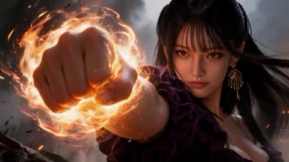</a>

提示词按顺序写出各个镜头：低角度追踪、特写、全景，模型就能依次跟随。服饰和发型细节写得具体，再加上暖橙主光、冷灰天空、体积烟雾和变形宽银幕光斑，统一了电影质感。

Seedance 2.5 · 文生视频 · 出处: [@Zyrellix on X](https://x.com/Zyrellix/status/2108498562199753052) · 发现于 [LearnPrompt/awesome-seedance](https://github.com/LearnPrompt/awesome-seedance)

[`fire`](tags.md#tag-fire) [`fantasy`](tags.md#tag-fantasy) [`fight`](tags.md#tag-fight) [`anamorphic`](tags.md#tag-anamorphic)

<details><summary><b>提示词</b></summary>

```text
Cinematic fantasy fight, East Asian woman, long black hair with blunt bangs, gold chandelier earrings, deep-purple off-shoulder ruffled velvet dress. She thrusts a clenched fist straight at the camera, the fist wrapped in a roaring orange fireball with sparks and heat distortion. Fast low tracking shot as a streak of flame tears across scorched ground past broken wooden tank traps and barbed wire under a smoke-filled sky. She spins into a combat stance, both fists glowing, a ring of fire whipping around her as her hair lashes sideways. She launches into the air above a burning soldier, then floats at the center of radial beams of fire exploding outward like a sunburst. A massive firestorm wall rises behind her as she hovers, fists lit. Close-ups of her intense, calm face against swirling flames, then a wide shot of her standing alone in a ruined field of debris, small fires, and drifting ash, one hand still burning. Volumetric smoke, ember particles, warm orange key light against a cool gray sky, shallow depth of field on close-ups, anamorphic flares, 24fps, photoreal, high detail.
```

</details>

<a id="seedance-frost-fist-rain-alley-fight"></a>
### 雨夜小巷中女战士挥出覆霜拳头

<a href="https://x.com/AvelyrahnAI/status/2104427974955053532">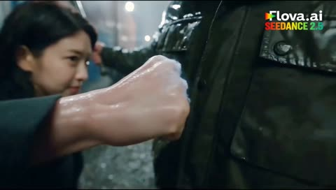</a>

提示词依次用逗号分段描述地点、角色、战斗特效、灯光和风格，让模型只需守住一个清晰的场景。火焰爆炸与冰霜拳头形成对比，打斗的视觉反差在画面中很突出。

Seedance 2.5 · 文生视频 · 出处: [@AvelyrahnAI on X](https://x.com/AvelyrahnAI/status/2104427974955053532) · 发现于 [LearnPrompt/awesome-seedance](https://github.com/LearnPrompt/awesome-seedance)

[`night-rain`](tags.md#tag-night-rain) [`frost-fire`](tags.md#tag-frost-fire) [`fight-choreography`](tags.md#tag-fight-choreography)

<details><summary><b>提示词</b></summary>

```text
Epic action movie sequence, dark rainy night in a narrow alleyway lined with stacked cargo containers, a fierce female fighter in a sleek black suit battling waves of aggressive opponents, high-impact combat with fiery explosions and freezing frost punches, cinematic lighting, dramatic smoke, fast-paced choreography, hyper-realistic, 4k

#Flovaai #Flovacpp
```

</details>

<a id="seedance-game-hud-hospital-mission"></a>
### 外科医生穿过医院，画面带游戏HUD

<a href="https://x.com/saniaspeaks_/status/2100429151719075851">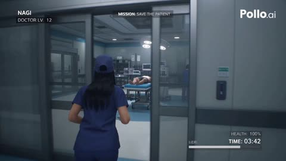</a>

整段任务按时间码拆成多个分段，每段配有对应的HUD文字，并且只在27秒处设一次硬切，使片子呈现游戏实录的结构。在角色参考图之外重复服装和发型描述（蓝色手术服、帽子、长直黑发），让每个分段中的人物保持一致。

Seedance 2.5 · 参考生视频 · 出处: [@saniaspeaks_ on X](https://x.com/saniaspeaks_/status/2100429151719075851) · 发现于 [LearnPrompt/awesome-seedance](https://github.com/LearnPrompt/awesome-seedance)

[`game-hud`](tags.md#tag-game-hud) [`hospital`](tags.md#tag-hospital) [`third person`](tags.md#tag-thirdperson) [`character-reference`](tags.md#tag-character-reference)

<details><summary><b>提示词</b></summary>

```text
Create a 30-second ultra-realistic AAA third-person medical action game mission set inside a modern Japanese hospital, with the feel of premium GTA-style gameplay.
NAGI: Use the exact same NAGI identity and face from @ Image1 throughout. Young Japanese female surgeon with long straight black hair, blunt bangs, blue surgical scrubs, cap, mask, gloves, and hospital shoes. Perfect character consistency.

GAMEPLAY: One continuous playable third-person over-the-shoulder take from 0–27 seconds. Natural running, turning, grabbing equipment, opening doors, interacting with machines, and performing procedures. No montage or random cuts. One hard cut only at 27 seconds.

HUD throughout:
TOP LEFT: NAGI / DOCTOR LV. 12
TOP CENTER: MISSION: SAVE THE PATIENT
BOTTOM RIGHT: HEALTH: 100% / TIME: 03:42

0–4s — CHECK VITALS
NAGI rushes into the emergency room, checks the unconscious patient's unstable monitor, and connects the monitoring equipment.
HUD: OBJECTIVE 1/5 — CHECK PATIENT VITALS → OBJECTIVE COMPLETE

4–8s — STABILIZE
She connects an IV and adjusts the patient's oxygen support. The monitor becomes slightly more stable.
HUD: OBJECTIVE 2/5 — STABILIZE PATIENT → OBJECTIVE COMPLETE

8–12s — COLLECT TOOLS
NAGI runs to the preparation area, opens a medical cabinet, grabs a sterile surgical tray, receives another instrument from a nurse, and rushes back.
HUD: OBJECTIVE 3/5 — COLLECT SURGICAL TOOLS → OBJECTIVE COMPLETE

12–17s — SURGERY
She enters the operating room, positions herself beside the patient, surgical lights activate, and she performs the critical procedure with controlled, non-graphic movements.
HUD: OBJECTIVE 4/5 — COMPLETE CRITICAL PROCEDURE

17–22s — COMPLICATION
The monitor suddenly alarms and vital signs drop. NAGI immediately checks the monitor, adjusts support equipment, signals the team, and continues the procedure.
HUD: WARNING — PATIENT UNSTABLE → STABILIZE PATIENT

22–27s — SAVE PATIENT
NAGI completes the final step. The monitor becomes steady, the alarm stops, and the team relaxes.
HUD: OBJECTIVE 5/5 COMPLETE → PATIENT STABLE → SURGERY SUCCESSFUL → MISSION COMPLETE

27–30s — FINAL SHOT
One hard cut to a locked frontal gameplay-style shot outside the operating room. NAGI walks out exhausted but relieved and removes her mask while a nurse follows. Through the glass, the team monitors the patient.

Final HUD: MISSION COMPLETE / PATIENT SAVED / RANK: S

VISUAL STYLE: Photorealistic AAA game-engine graphics, realistic Japanese hospital, detailed medical equipment, natural character physics, realistic lighting, reflections, shadows, cloth and glove movement, subtle camera shake. No anime, cartoon, fantasy, superhero effects, or gore.

AUDIO: Hospital ambience, footsteps, monitor beeps, equipment sounds, emergency alarm, Japanese nurse/NAGI dialogue, and tense AAA game music building toward the mission completion.
```

</details>

<a id="seedance-garage-walk-night-action"></a>
### 女子走过夜间地下停车场

<a href="https://x.com/AiwithElisia/status/2089580979560337437">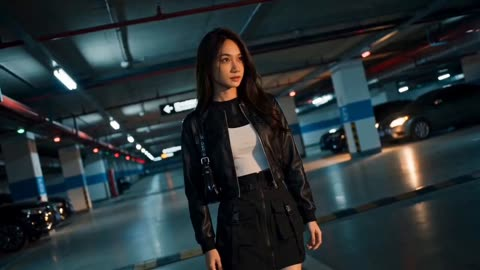</a>

开头先用明确的服装清单和带灯光描述的地点设定画面，再把每种运镜写成独立分句，便于模型安排镜头顺序。文末直接要求人物面部、发型与服装保持一致，并用否定清单排除常见瑕疵。

Seedance 2.5 · 文生视频 · 出处: [@AiwithElisia on X](https://x.com/AiwithElisia/status/2089580979560337437) · 发现于 [LearnPrompt/awesome-seedance](https://github.com/LearnPrompt/awesome-seedance)

[`martial-arts`](tags.md#tag-martial-arts) [`night`](tags.md#tag-night) [`parking-garage`](tags.md#tag-parking-garage) [`cinematic`](tags.md#tag-cinematic)

<details><summary><b>提示词</b></summary>

```text
Create a cinematic, ultra-realistic action movie scene inside a large underground parking garage at night. A beautiful young woman with long dark brown hair, wearing a black leather jacket, fitted white crop top, black mini skirt, black tights and black ankle boots, walks confidently through the parking area. Several aggressive male attackers suddenly approach her from different directions.

She immediately fights them with fast, powerful martial-arts movements. Show realistic hand-to-hand combat, punches, blocks, dodges, kicks and throws. Include a close-up of her punching a male attacker in the face, his head reacting naturally to the impact, followed by dynamic wide shots of her fighting multiple attackers simultaneously.

Use parked black and silver cars, concrete pillars, underground parking signs, wet reflective floor and cinematic practical lighting in the background. Add dramatic blue and warm orange lighting, realistic shadows, subtle atmospheric haze and reflections on the cars.

Camera style: cinematic Hollywood action film, dynamic handheld camera, smooth tracking shots, low-angle shots, wide establishing shots, medium shots and dramatic close-ups. Add realistic motion blur during fast movements, natural hair movement, realistic clothing physics and convincing fight choreography.

The woman should remain visually consistent throughout the entire video, with the same face, hairstyle, outfit and body proportions. The attackers should also remain realistic and consistent.

Ultra-realistic human skin, detailed facial expressions, physically accurate movement, realistic anatomy, high-detail environment, cinematic depth of field, professional color grading, dramatic atmosphere, 4K, photorealistic, 24fps, anamorphic cinematic look.

No text, no subtitles, no watermark, no distorted faces, no extra fingers, no duplicated people, no unnatural body movements.
```

</details>

<a id="seedance-giant-snake-fantasy-western-chase"></a>
### 巨蛇从镜头前掠过废墟小镇

<a href="https://x.com/itxsarmadd/status/2100432617912893711">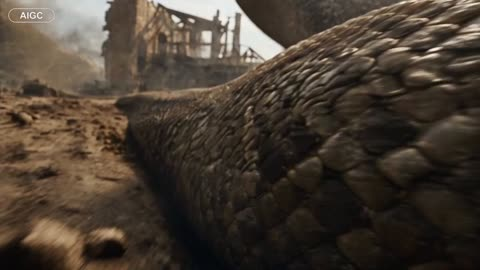</a>

提示词中原样重复一段可复用的角色设定，使人物面部、服装和体型在各镜头间保持一致。按秒划分的分镜配合低机位、跟拍和云台运镜控制节奏，台词与声音提示则定义音频。

Seedance 2.5 · 文生视频 · 出处: [@itxsarmadd on X](https://x.com/itxsarmadd/status/2100432617912893711) · 发现于 [LearnPrompt/awesome-seedance](https://github.com/LearnPrompt/awesome-seedance)

[`giant-snake`](tags.md#tag-giant-snake) [`low-angle`](tags.md#tag-low-angle) [`character-lock`](tags.md#tag-character-lock) [`timed-shots`](tags.md#tag-timed-shots) [`dialogue-audio`](tags.md#tag-dialogue-audio)

<details><summary><b>提示词</b></summary>

```text
PAET 1- Create a 30-second ultra-photorealistic cinematic live-action fantasy-western sequence.

DO NOT USE AN UPLOADED REFERENCE VIDEO.

==================================================
CHARACTERS — IDENTICAL THROUGHOUT
==================================================

GIANT SNAKE:
Enormous prehistoric snake, massive muscular body and broad head, rough brown/tan/dark-olive scales, pale beige face, amber eyes with vertical pupils, realistic teeth, wet gums/saliva. Worn dark-brown/black cowboy hat.

GREEN REPTILIAN GUNSLINGER:
Small green frog/reptile humanoid, textured green skin, large bulging eyes, brown cowboy hat, rugged brown western clothing, dark-metal revolver.

DRAGON RIDER:
Rugged brown/tan clothing and protective headgear.

DRAGON:
Large dark-scaled dragon, horns/spikes, muscular body, reddish-brown/orange leathery wings. Additional dragons may appear.

Keep all characters, costumes, colors, faces, proportions and textures consistent.

==================================================
ENVIRONMENT
==================================================

Gritty western/medieval fantasy town: aged stone, dark timber, towers, rooftops, dust, smoke and debris. Bright cloudy daylight, cinematic sunlight, volumetric haze, realistic shadows and depth of field.

==================================================
SHOT SEQUENCE
==================================================

0–3s: Low-angle close-up of giant snake body rushing past camera.

3–6s: Green reptilian gunslinger on snake's back; huge snake head enters frame.

6–9s: Snake approaches the character. Tense close composition.

9–12s: Snake coils through town, pushing dust and debris.

12–15s: Snake moves through dark wooden/stone interior.

15–18s: Camera tilts toward old buildings and a swinging glass lantern.

18–22s: Bright hazy exterior with strong sunlight, dust and smoke.

22–26s: Extreme close-up of snake beneath cowboy hat; amber eye and slightly open mouth visible.

26–28s: Snake lunges toward camera; revolver becomes prominent.

28–30s: Extreme close-up of snake face with revolver in foreground.

END with snake face close to camera and revolver visible. No fade, title or black screen.

==================================================
CAMERA / AUDIO
==================================================

Energetic cinematic pacing. Low angles, tracking shots, close-ups, controlled handheld/gimbal movement, realistic optics, depth of field and motion blur.

English dialogue:
“What the hell is that?”
“Stay on him.”
“Keep moving!”
“Don’t let it see us.”
“Get ready.”

Add realistic snake movement, growls, breathing, wind, dust, wood creaks and weapon sounds. Add synchronized English subtitles.

==================================================
QUALITY
==================================================

Maximum Seedance 2.5 quality. Ultra-photorealistic live action, realistic materials, lighting and physics.

NO cartoon, anime, game graphics, plastic CGI, morphing, flickering, character changes, costume/hat changes, eye-color changes, scale changes, duplicates, extra limbs, distorted faces or unnatural physics.
```

</details>

<a id="seedance-golden-hour-lot-fight-sequence"></a>
### 黄金时刻停车场里的两人格斗

<a href="https://x.com/Elvorya/status/2101147922251579718"></a>

提示词用箭头串起各个镜头，每个镜头只写一个机位和一个动作节点，从过肩开场到飞踢、倒地，再到自拍式收尾。末尾的长串画面风格词和负面提示词让画面保持写实、人物前后一致。

Seedance 2.5 · 文生视频 · 出处: [@Elvorya on X](https://x.com/Elvorya/status/2101147922251579718) · 发现于 [LearnPrompt/awesome-seedance](https://github.com/LearnPrompt/awesome-seedance)

[`action`](tags.md#tag-action) [`fight-scene`](tags.md#tag-fight-scene) [`golden-hour`](tags.md#tag-golden-hour) [`photorealistic`](tags.md#tag-photorealistic) [`multi-shot`](tags.md#tag-multi-shot)

<details><summary><b>提示词</b></summary>

```text
Create a 15-second photorealistic cinematic action sequence featuring a stylish blonde woman in a black blazer, white fitted top, and black pants, fighting another blonde woman in an industrial urban parking/loading area during golden-hour sunset.

Begin with a dynamic over-the-shoulder shot of the main woman standing in an empty concrete industrial lot as another woman approaches rapidly in the background → cut into an extreme close-up side angle as the opponent throws a powerful punch toward her face, with the camera moving alongside the action and her blonde hair flowing dramatically in the wind → transition into a wide low-angle shot showing the main woman reacting and engaging in hand-to-hand combat → she performs a fast evasive movement and powerful spinning kick while the opponent attacks → cut to a low-angle tracking shot as both women exchange rapid punches and defensive movements beside a large industrial roller door and stacked cardboard boxes → show the main woman delivering a dramatic flying kick, captured with cinematic motion blur → transition into a wider shot as the opponent falls hard onto the concrete ground → the main woman slowly walks toward the camera while the fallen opponent remains in the background → final shot becomes an intimate handheld close-up/selfie-style shot of the main woman looking directly toward the camera, touching her hair/forehead with one hand and giving a calm, confident expression.

Visual style: photorealistic Hollywood action cinematography, realistic human anatomy, believable martial-arts choreography, natural facial expressions, realistic skin texture, detailed blonde hair movement, black-and-white fitted clothing, industrial warehouse exterior, concrete pavement, warm golden-hour sunlight, long shadows, dramatic backlighting, subtle lens flare, shallow depth of field, cinematic motion blur, dynamic handheld camera, low-angle action shots, smooth rapid transitions, realistic physics, energetic pacing, high-detail 4K cinematic look, cohesive character appearance throughout.

Negative prompt: animation, cartoon, anime, CGI appearance, unrealistic physics, distorted faces, extra fingers, malformed hands, duplicated people, warped limbs, floating objects, excessive motion blur, unnatural poses, gore, blood, subtitles, text, logos, watermark.
```

</details>

<a id="seedance-golden-knight-cathedral-demon-battle"></a>
### 金甲骑士在残破教堂中对抗恶魔

<a href="https://x.com/itsSaira_1/status/2111672000200724504"></a>

把31秒拆成带时间码的分镜,每段写明景别、运镜和动作,镜头顺序因此固定。结尾的风格段和长负面清单锁定建筑、盔甲和盾牌徽记,保持跨镜头一致。

Seedance 2.5 · 文生视频 · 出处: [@itsSaira_1 on X](https://x.com/itsSaira_1/status/2111672000200724504) · 发现于 [LearnPrompt/awesome-seedance](https://github.com/LearnPrompt/awesome-seedance)

[`dark-fantasy`](tags.md#tag-dark-fantasy) [`timed-shots`](tags.md#tag-timed-shots) [`cinematic`](tags.md#tag-cinematic) [`action`](tags.md#tag-action) [`negative-prompt`](tags.md#tag-negative-prompt)

<details><summary><b>提示词</b></summary>

```text
0–3s | Opening shot: Low-angle wide close-up of a wounded woman lying on a cracked stone floor inside a ruined Gothic cathedral. Dark horned monsters and twisting tentacles loom in the background. Slow cinematic camera movement.

3–5s | Rising movement: The woman pushes herself up from the floor, raising one arm as a bright white magical blade of light forms in her hand. Medium shot, smooth upward camera movement.

5–7s | Magical activation: She kneels and grips the vertical white energy blade touching the floor. A brilliant golden circular rune spreads beneath her, illuminating the stone floor. Low wide shot.

7–10s | Cathedral reveal: Camera tilts sharply upward, revealing towering broken Gothic arches, a shattered roof, moonlit clouds and dark creatures silhouetted above. Transition to the golden-armored warrior emerging through red smoke.

10–12s | Helmet close-up: Tight frontal close-up of a fully enclosed dark metal knight helmet, narrow black eye slit, engraved steel plates. Slow camera push-in.

12–15s | Golden knight reveal: Cut to a heroic low-angle shot of a knight wearing ornate gold-and-silver armor, carrying a large shield with a glowing golden sun emblem and a heavy war hammer. He stands inside the ruined cathedral.

15–18s | First magical attack: The knight raises his shield and releases an intense white-gold energy blast. Bright light fills the frame. Camera tracks the blast, with sparks and magical particles.

18–20s | Energy impact: The white magical blast expands into a brilliant screen-filling flash. Strong bloom, fast cinematic transition, brief motion blur.

20–23s | Demon confrontation: Wide side view of the golden knight standing firm while a huge reddish-black horned demon lunges toward him. Long claws and dark tendrils extend toward the knight. The wounded woman remains visible in the background.

23–25s | Demon attack: The demon sweeps its claws forward. A bright golden energy projectile travels across the cathedral between the creature and the knight. Dynamic lateral camera movement.

25–27s | Magical shield: The knight raises his shield as a large circular white magical barrier with intricate glowing runes forms in front of him. The demon attacks the barrier, creating rippling light and sparks.

27–31s | Final wide shot: Camera pulls back to show the entire ruined cathedral. The golden knight stands in the centre of a glowing golden rune circle, shield raised and hammer in hand. The demon recoils on the left, while the wounded woman remains on the floor behind him beside the vertical white energy blade. Smoke, floating embers, blue moonlight and golden illumination. Hold the final composition.

VISUAL STYLE: Photorealistic dark fantasy film, 16:9 widescreen, cinematic lighting, realistic armor and stone textures, cold blue shadows, warm golden highlights, volumetric smoke, dramatic contrast, consistent architecture, smooth camera movements, exact shot order and timing.

NEGATIVE PROMPT: Different shot order, altered camera angles, random cuts, changed framing, different cathedral, different character positions, inconsistent armor, changing shield emblem, extra characters, duplicated limbs, deformed anatomy, cartoon, anime, low quality, excessive blur, shaky camera, camera flip, 180-degree rotation, unnatural movement, floating weapons, text, subtitles, watermark, logos.

#AI #AIart #VisualArt
```

</details>

<a id="seedance-gothic-warrior-angel-cathedral-battle"></a>
### 哥特教堂中的女战士化身有翼天使

<a href="https://x.com/laviniavelle/status/2110227233294139529"></a>

提示词先用宽景静态镜头建立教堂空间，再用跪地插剑这一具体动作触发变身，让转场有明确的因果。开头就写明月光、彩色玻璃和地面蓝色符文等光源，使金蓝能量爆发时的配色保持统一。

Seedance 2.5 · 文生视频 · 出处: [@laviniavelle on X](https://x.com/laviniavelle/status/2110227233294139529) · 发现于 [LearnPrompt/awesome-seedance](https://github.com/LearnPrompt/awesome-seedance)

[`gothic`](tags.md#tag-gothic) [`fantasy`](tags.md#tag-fantasy) [`angel`](tags.md#tag-angel) [`vfx`](tags.md#tag-vfx)

<details><summary><b>提示词</b></summary>

```text
A dark gothic cathedral interior with stained glass windows and moonlight shining through, a dark-haired female warrior in a black gown holding a sword standing in the center as demonic creatures emerge from the shadows, magical blue runes glowing on the stone floor, the warrior kneels and drives her sword into the ground unleashing a powerful burst of blue and golden energy, transforming into a magnificent warrior angel with glowing white wings and golden divine armor, fighting off multiple demon monsters with a glowing sword and floating golden swords, defeating a massive winged demon boss in an epic battle, cinematic fantasy action style, highly detailed visual effects.
```

</details>

<a id="seedance-green-robed-swordswoman-inn-brawl"></a>
### 女侠饮酒后酒馆激战群卫

<a href="https://x.com/laviniavelle/status/2098987614581997681"></a>

提示词按时间顺序写成几个节拍，从饮酒、抛壶到打斗，最后以慢动作收尾，让模型有清楚的动作走向。光线指定为穿过窗格的体积逆光，为打斗营造氛围。

Seedance 2.5 · 文生视频 · 出处: [@laviniavelle on X](https://x.com/laviniavelle/status/2098987614581997681) · 发现于 [LearnPrompt/awesome-seedance](https://github.com/LearnPrompt/awesome-seedance)

[`wuxia`](tags.md#tag-wuxia) [`martial-arts`](tags.md#tag-martial-arts) [`hanfu`](tags.md#tag-hanfu) [`slow-motion`](tags.md#tag-slow-motion)

<details><summary><b>提示词</b></summary>

```text
Cinematic 8k hyper-realistic action sequence dark atmospheric ancient East Asian wooden inn an elegant female martial artist in flowy pale green and white traditional Hanfu robes takes a quick sip from a black wine jug before throwing it into the air fast-paced Wuxia fight combat, wooden tables shattering into splinters, atmospheric dust and misty fog dramatic volumetric backlight streaming through wooden window slats rapid dynamic low angle camera movement whip pans fluid acrobatics dodging and striking multiple guards in red and black armor ends in slow motion as she stands victorious among fallen opponents, moody lantern-lit atmosphere, 9:16 aspect ratio, ultra-detailed, photorealistic, 4k.
```

</details>

<a id="seedance-gta-delivery-chase-hud"></a>
### 女子走在日本街道上，画面叠加游戏界面

<a href="https://x.com/AIwithSynthia/status/2098615400141619289"></a>

上传的图片作为角色参考，锁定发型和服装，提示词按顺序写明每个剧情节拍。明确列出HUD元素，并排除动漫、电影镜头和卡通渲染，让画面保持写实的游戏实录质感。

Seedance 2.5 · 参考生视频 · 出处: [@AIwithSynthia on X](https://x.com/AIwithSynthia/status/2098615400141619289) · 发现于 [LearnPrompt/awesome-seedance](https://github.com/LearnPrompt/awesome-seedance)

[`gta-style`](tags.md#tag-gta-style) [`open-world`](tags.md#tag-open-world) [`game-hud`](tags.md#tag-game-hud) [`chase`](tags.md#tag-chase)

<details><summary><b>提示词</b></summary>

```text
GTA-style chaos, but the mission makes absolutely no sense. 😂

Created with Seedance 2.5 on @itsPolloAI 

Create a 30-second realistic AAA third-person open-world game sequence in a lively local Japanese neighborhood. Use the uploaded image as the exact character reference: a young Korean woman in her early 20s with long black hair, pastel-lavender top, white cargo pants and sneakers. Keep her appearance consistent.

She notices a delivery cyclist carrying a cardboard package, grabs the package, and runs. The cyclist chases her through the streets. She hides behind a parked kei truck, sneaks out, then accidentally crashes into another delivery worker, sending boxes everywhere. She ignores a “RETURN PACKAGE” prompt and runs again. She crosses a pedestrian bridge, briefly leaves the package beside a bench, grabs it when the cyclist arrives, and continues escaping.

She eventually reaches the address printed on the package and realizes she has accidentally delivered it to the correct recipient. The recipient happily takes it while the exhausted cyclist arrives and looks completely confused. She gives him an innocent smile and walks away.

Use authentic third-person gameplay graphics, realistic 3D characters, detailed village/neighborhood environment, believable physics and NPC reactions. Include a GTA-style HUD with minimap, health/stamina bars, controller prompts, mission objectives, alert markers and notifications such as “PACKAGE STOLEN,” “THEY FOUND YOU,” “BAD DECISION,” “DELIVERY COMPLETE,” “MISSION COMPLETE,” and “CHAOS +150.”

No anime, cartoon, cel-shading, mobile-game graphics, cinematic movie shots, distorted characters, inconsistent objects, gore or unrealistic physics.
```

</details>

<a id="seedance-gym-static-martial-arts-vs-five-bullies"></a>
### 女高中生在体育馆以静电武术击退五名霸凌者

<a href="https://x.com/doctorwasif/status/2091388398153994395"></a>

三十秒单镜头按三到五秒分段写清台词与动作，每段都有极短的撞击慢动作再切回实时。规则段把特效限定为由接触产生的白蓝静电，并要求镜头跟不上她的加速，所以画面真实且动作清楚。

Seedance 2.5 · 文生视频 · 出处: [@doctorwasif on X](https://x.com/doctorwasif/status/2091388398153994395) · 发现于 [LearnPrompt/awesome-seedance](https://github.com/LearnPrompt/awesome-seedance)

[`martial-arts`](tags.md#tag-martial-arts) [`photorealistic`](tags.md#tag-photorealistic) [`one-take`](tags.md#tag-one-take) [`handheld`](tags.md#tag-handheld) [`korean-dialogue`](tags.md#tag-korean-dialogue)

<details><summary><b>提示词</b></summary>

```text
30s | 16:9 | one continuous generation | ultra-photorealistic live-action AAA martial-arts VFX

SO-YEON is the exact same real human throughout, 160cm small frame, messy black hair, black hoodie/sweats/Converse, natural pores/eyes/hair/biomechanics. Never CGI/digital double. Empty Korean high-school gym, late afternoon, sunbeams/dust, bleachers, scoreboard, basketballs, badminton rackets. 5 unarmed delinquent male classmates in dark untidy uniforms. Korean dialogue, no BGM/subtitles; only diegetic ambience, voices, impacts, static hiss.

00–03: So-Yeon cowers by bleachers, surrounded. Leader smacks her head: “어쭈? 이 년 봐라? 많이 컸다?” She glares coldly through bangs, then fear returns: “아…! 미안…”

03–06: He swings again.

06–09: 0.3s micro-slow-mo: awakened body autonomously slips fist → Silat parry → pivot → body punch. THUMP + sharp white-blue static flash. Hair rises, dust scatters. Snap back to real-time; leader crashes/slides away.

09–12: She stares at trembling hand, tiny static crawling between fingers, terrified/disbelieving. “저 년이?!” Four rush simultaneously.

12–17: Extreme physical dash: PARRY → wrist redirect → elbow → low sweep; side-kick second attacker. 0.2s impact slow-mo with branching static flash, hair/uniform fibers rising, papers/shuttlecocks scattering. Snap back; never stops.

17–22: Two attack together. Diagonal dash → duck hook → redirect momentum → high roundhouse. Static arc-flash at impact; hair stands up, shuttlecocks fly, scoreboard flickers.

22–27: Final attacker from behind. Maximum real-body acceleration; camera lags/overshoots, violent whip-pan reacquires. Evade → parry → redirect → jab → body punch → low kick → spinning Taekwondo back kick. 0.25s slow-mo: dense branching static at heel impact, uniform puffs, dust/paper pulled inward then blasted outward.

27–30: Violent physical discharge: KRA-KRACKLE! Static-white ring races across floor; dust/paper explode outward, fluorescent lights flicker, basketball rolls off cart. Enemy slides far away. Flash hits lens: flare/interference/dust, then rapid stabilization. So-Yeon lands, sees fading sparks on her hands, half fear/half wonder, exhales, straightens and walks calmly through dust, hair falling over eyes. Never looks back. CUT.

COMBAT: Awakened So-Yeon fights completely unarmed, calm/precise/extremely fast, fluid Taekwondo × Karate × Pencak Silat: punch → kick → evade → parry → redirect → dash → counter → sweep → palm/elbow → angle change. No reset poses; momentum continuously flows. Bullies attack simultaneously, never take turns.

STATIC BLOOM RULE: White-blue friction discharge ONLY. Real-time → physical dash burst → 0.15–0.35s impact slow-mo → snap back. Sparks crawl along skin/hair/hoodie; hair/threads lift; filaments jump between fingers/joints; dust follows slipstream. No teleportation, aura, projectile, beam, plasma, fireball, petals, or magic. Every discharge must originate from visible physical contact and extreme velocity. Impact → charge build → branching arc → dust/paper scatter. Static never causes the initial impact.

CAMERA: close, kinetic handheld pursuit, tracking, low angles, OTS/facial inserts, rapid focus shifts, whip-pans; follows but cannot perfectly anticipate acceleration. Shake only from real impacts/discharges. Action readability > chaos.
```

</details>

<a id="seedance-han-river-handbag-chase"></a>
### 首尔汉江边抢包追逐喜剧

<a href="https://x.com/doctorwasif/status/2118221865273659429"></a>

用带时间段的六段节拍表给模型一份可执行的镜头清单，并锁定服装和地点，让人物在切镜后保持一致。音效逐项写明，包括韩语台词，有助于口型同步和声音层次。

Seedance 2.5 · 文生视频 · 出处: [@doctorwasif on X](https://x.com/doctorwasif/status/2118221865273659429) · 发现于 [LearnPrompt/awesome-seedance](https://github.com/LearnPrompt/awesome-seedance)

[`comedy`](tags.md#tag-comedy) [`chase`](tags.md#tag-chase) [`korean`](tags.md#tag-korean) [`outdoor`](tags.md#tag-outdoor)

<details><summary><b>提示词</b></summary>

```text
Ultra-realistic live-action Korean revenge-comedy along Seoul’s Han River at golden hour. Handheld cinematic camera, warm sunset, authentic park ambience, realistic physics, fast-paced slapstick action, expressive reactions.

**Characters:** Lee Ji-won Korean woman in her 20s, high ponytail, mint-green windbreaker, black cycling shorts, sneakers, riding a city bicycle. Shin Tae-oh — Korean man in his 20s, black cap, grey hoodie, riding an electric scooter. Korean grandmother wearing a purple visor.

**30-SECOND ACTION:**
0–3s: Grandmother sits on a bench with her brown handbag. Tae-oh snatches it and speeds away on his scooter.
3–6s: She cries out. Ji-won hears her, shouts “저기요!”, and starts chasing on her bicycle.
6–12s: Tae-oh weaves through joggers, laughing. Ji-won catches up, follows him across grass, and launches off a small ramp, landing with a hard bounce.
12–18s: Tae-oh scatters a family's picnic snacks. Ji-won hops over the blanket, shouting “거기 서!”, then grabs the handbag strap beside his scooter. A brief, chaotic tug-of-war makes the scooter wobble.
18–25s: Ji-won yanks the bag free. Tae-oh loses control, spins off the path, flies over the handlebars, and crashes into a large circular fountain with a huge splash. Pigeons scatter.
25–30s: Ji-won returns the bag to the grandmother and asks, “다 괜찮으세요, 할머니?” The grandmother smiles and pats her hand. Behind them, the drenched Tae-oh sits in the fountain beside his floating cap as amused joggers and families clap and film.

**Audio:** Natural Korean-only dialogue, perfectly lip-synced, wind, bicycle chains, scooter motor, footsteps, startled gasps, water splash, pigeons, traffic, and applause.

**Requirements:** Consistent character identities, faces, outfits, and location throughout. Clearly show the theft, ramp jump, picnic leap, tug-of-war, scooter spin-out, and fountain crash. Believable momentum and water physics. Photorealistic skin, natural movement, non-gory slapstick. No logos, brands, subtitles, text overlays, cartoon effects, or watermark.
```

</details>

<a id="seedance-hannya-warrior-ink-tiger-dragons"></a>
### 般若面具武者挥笔化出墨虎与游龙

<a href="https://x.com/ai_anelia/status/2117601946894995461"></a>

以水墨画与写实流体物理作为明确的视觉参照，让墨点像真实墨汁而不是卡通特效。按顺序描述墨迹先化为墨虎、再化为游龙，为镜头提供清晰的变形路径。

Seedance 2.5 · 文生视频 · 出处: [@ai_anelia on X](https://x.com/ai_anelia/status/2117601946894995461) · 发现于 [LearnPrompt/awesome-seedance](https://github.com/LearnPrompt/awesome-seedance)

[`ink-painting`](tags.md#tag-ink-painting) [`martial-arts`](tags.md#tag-martial-arts) [`hannya-mask`](tags.md#tag-hannya-mask) [`monochrome`](tags.md#tag-monochrome)

<details><summary><b>提示词</b></summary>

```text
Cinematic 3D animation, action scene. A warrior wearing a traditional Japanese Hannya demon mask and white long hair, dressed in black flowing robes, wields a giant calligraphy brush like a staff inside a minimalist white minimalist studio. The warrior performs fluid, acrobatic martial arts movements, painting sweeping, dynamic splashes of black ink in the air that instantly materialize into living, roaring creatures: first a fierce black ink tiger, followed by majestic Chinese dragons swirling around the space. High-contrast monochrome aesthetic, sumi-e brushstroke effects blending with realistic fluid physics, dramatic cinematic lighting, 4k resolution, masterpiece.
```

</details>

<a id="seedance-helicopter-news-dirt-bike-pursuit"></a>
### 直升机新闻镜头拍摄的越野摩托追逐

<a href="https://x.com/CharaspowerAI/status/2111517673276240251"></a>

全程锁定单一直升机视角，并刻意写入抖动变焦、压缩伪影、热浪和迟到的摇镜，让画面像未经修饰的新闻素材。六个带时间码的段落逐步升级动作，旋翼声、电台杂音和结尾的记者台词构成声音层。

Seedance 2.5 · 文生视频 · 出处: [@CharaspowerAI on X](https://x.com/CharaspowerAI/status/2111517673276240251) · 发现于 [LearnPrompt/awesome-seedance](https://github.com/LearnPrompt/awesome-seedance)

[`aerial`](tags.md#tag-aerial) [`news-footage`](tags.md#tag-news-footage) [`motocross`](tags.md#tag-motocross) [`handheld-realism`](tags.md#tag-handheld-realism) [`timed-beats`](tags.md#tag-timed-beats)

<details><summary><b>提示词</b></summary>

```text
Ultra-realistic viral helicopter pursuit footage, raw local-news style, filmed entirely from one helicopter in bright Los Angeles daylight. Long-lens aerial camera, unstable vibration, abrupt zooms, compression artifacts, heat haze, autofocus breathing, imperfect framing, rotor thump, distant radio chatter, harsh California sun, no cinematic polish, believable amateur-news realism.

Main subject: one motocross rider on a dirt bike, full helmet and motocross gear, highly skilled, aggressive but controlled riding. Keep the same rider and same bike throughout.

Los Angeles daytime: palm-lined boulevard, parking lots, freeway ramps, concrete flood channel, industrial blocks, overpasses, service roads and distant skyline.

0-5s: Immediate viral hook The helicopter camera is already searching frantically when the rider suddenly blasts into frame between moving cars. Operator snaps into a shaky zoom. The rider jumps a curb, cuts across a parking lot and nearly disappears behind palm trees.

5-10s: Chaotic tracking He rejoins a boulevard, threads through traffic, then veers up a sloped driveway and launches over a low divider. Camera over-zooms, loses him for half a second, then catches him landing cleanly.

10-15s: Escalation The rider enters a concrete flood channel. Huge aerial reveal. He accelerates along the channel floor while the helicopter banks hard overhead. Dust trails behind the bike. Quick zoom on spinning rear wheel and suspension.

15-20s: Viral stunt beat He rides up the angled concrete wall, holds a dramatic high line for a moment, then drops back down smoothly. Camera shakes violently trying to follow. Rotor vibration and radio chatter intensify.

20-25s: Big surprise The rider exits through a service ramp, crosses beneath an overpass, then unexpectedly appears on a parallel industrial road. The operator pans late and barely recovers him. He hits a natural rise and gets long airtime in full daylight.

25-30s: Iconic ending He lands, accelerates toward another overpass and vanishes into shadow underneath. The helicopter overshoots, circles, zooms wildly across multiple roads, but he is gone. Reporter voice, stunned: “We just lost him.” Hold on shaky wide aerial of Los Angeles. Hard cut.

One continuous helicopter perspective, strong amateur-news authenticity, same rider throughout, realistic motocross physics, believable Los Angeles geography, harsh daylight, imperfect tracking, viral unpredictability, readable stunts, no crash, no gore, no readable text, no logos.

#DreaminaCPP  @dreamina_ai
```

</details>

<a id="seedance-holographic-arena-sword-duel"></a>
### 青色全息柱廊竞技场中的孤身战士

<a href="https://x.com/Zyrellix/status/2099736869437313431"></a>

每个时间段都写明一个镜头和运镜，例如低角度、特写或俯拍升降镜，让提示词像分镜表一样可执行。两位角色都给出固定的视觉标记，如发色、头盔、服装和武器光效，便于模型在切换镜头时保持形象一致。

Seedance 2.5 · 文生视频 · 出处: [@Zyrellix on X](https://x.com/Zyrellix/status/2099736869437313431) · 发现于 [LearnPrompt/awesome-seedance](https://github.com/LearnPrompt/awesome-seedance)

[`anime`](tags.md#tag-anime) [`sword-fight`](tags.md#tag-sword-fight) [`arena`](tags.md#tag-arena) [`timed-shots`](tags.md#tag-timed-shots)

<details><summary><b>提示词</b></summary>

```text
Cinematic high-end 3D anime action, 30 seconds, 24fps, ultra sharp, no watermark, no logo, no text overlay.Two fighters in a vast teal holographic arena: glowing grid floor, fog, tall white marble pillars, a single vertical cyan light beam in the center.Girl: silver-lavender hair with a pink bow, fierce cute face, white tech sports outfit with a small cat graphic and teal trim, white cyber boots with pink/cyan lights. She dual-wields a massive white greatsword with glowing cyan circuit lines.Opponent: fox-eared white-and-gold cracked helmet with one glowing red eye, long black-and-white hair, green varsity jacket over a white crop top, brown plaid mini skirt, white mechanical legs, jet thrusters on the boots. She fights with a flaming gold katana.

0–4s: low-angle start. Girl charges across the wet teal grid, sword huge in foreground, cyan foot trails. They clash — cyan blade vs gold fire katana, sparks and orange embers.

4–8s: close-up lock. Blades grind, helmet visor cracks, cyan targeting grid flashes across both faces. Girl snarls. Opponent jet-jumps overhead, spinning with a flaming slash.

8–14s: they leap onto two facing marble pillars, then sprint and kick off the same giant white pillar mid-air. Speed-line camera. They land on one cube platform and trade brutal punches and sword hits, motion blur, sparks.

14–20s: both drop and sprint low toward camera, blades dragging the floor, a bright spark line between them. Smash cut to mid-air chase around the cyan beam — girl running with the long sword, opponent flipping above with the katana.

20–25s: brief monochrome flash, then they race side by side through rain-streak motion. High kick from the girl hits the helmet in a gold-white burst. Wide shot: both stand on opposite glowing rings, weapons raised, gold sparkles falling.

25–30s ENDING (same as original): overhead crane shot as they dash into the center. Floor cracks like glass. Extreme close clash — cyan vs gold, shards flying, visor splitting. White-out flash. Arena explodes outward: marble cubes, teal glass, smoke and a huge gold-white blast filling the frame. No logo. Hold the explosion.
```

</details>

<a id="seedance-icy-rooftop-ice-magic-battle"></a>
### 棒棒糖少女在冰冷夜晚的天台对峙

<a href="https://x.com/laviniavelle/status/2096437174942204277"></a>

提示词先固定角色外观和道具（淡紫短发、灰色西装、蓝色领结、棒棒糖），再用快速跟拍镜头和冰霜特效描述动作，最后给出帧率和分辨率要求。

Seedance 2.5 · 文生视频 · 出处: [@laviniavelle on X](https://x.com/laviniavelle/status/2096437174942204277) · 发现于 [LearnPrompt/awesome-seedance](https://github.com/LearnPrompt/awesome-seedance)

[`ice-magic`](tags.md#tag-ice-magic) [`rooftop`](tags.md#tag-rooftop) [`night`](tags.md#tag-night) [`fight-choreography`](tags.md#tag-fight-choreography)

<details><summary><b>提示词</b></summary>

```text
Cinematic high-action sequence set on an icy school rooftop at night. A cool anime style female student with light pastel purple short hair, a gray blazer with a blue bow, and a lollipop in her mouth effortlessly dodges attacks using magical ice powers Fast paced camera tracking dynamic fight choreography freezing water mid-air shattering ice structures dramatic rooftop lighting against a dark cityscape sharp ice particle VFX ultra-realistic 8k resolution, 60fps cinematic look.
```

</details>

<a id="seedance-infected-highway-bus-takedown"></a>
### 日本高速巴士上的感染者袭击

<a href="https://x.com/auqibhabib/status/2102265619416768799"></a>

每个时间段都标注了时间码和镜头指令，如硬切、特写或慢动作，给模型一份清晰的分镜表。车厢、服装和声音设计在开头与结尾重复描述，使整段视频中的巴士、制服和配乐保持一致。

Seedance 2.5 · 文生视频 · 出处: [@auqibhabib on X](https://x.com/auqibhabib/status/2102265619416768799) · 发现于 [LearnPrompt/awesome-seedance](https://github.com/LearnPrompt/awesome-seedance)

[`horror`](tags.md#tag-horror) [`action`](tags.md#tag-action) [`timed-shots`](tags.md#tag-timed-shots) [`sound-design`](tags.md#tag-sound-design)

<details><summary><b>提示词</b></summary>

```text
Cinematic horror-action short film set aboard a Japanese highway bus during the day, opens with an immediate strong hook, maximum dynamic camera work, grounded practical-effects style. Bus interior filled with passengers in every seat, a conductor in a gray uniform with a money pouch at his waist, a driver focused on the road ahead. Muted authentic color grading, natural diegetic sound throughout, tension score entering immediately.
>
> **[0-1s]** Hard cut: a woman mid-row suddenly jolts violently in her seat, gasping sharply.
>
> **[1-2s]** Close-up: her veins turn a deep red, spreading rapidly up her neck and across her face.
>
> **[2-3s]** Her eyes snap open, now fully red — she lunges instantly, biting into her seatmate's shoulder.
>
> **[3-4s]** He cries out, nearby passengers recoiling in shock, seats creaking as people scramble back.
>
> **[4-5s]** The bitten man convulses hard, veins spreading fast across his own neck and arms.
>
> **[5-6s]** He rises seconds later, eyes red, joining her, both turning toward the passengers around them.
>
> **[6-7s]** Panic spreads through the bus, passengers screaming, climbing over seats to get away.
>
> **[7-8s]** The conductor spots the chaos from the front, shouting urgently in Japanese: "バスを止めて!" ("Stop the bus!")
>
> **[8-9s]** The driver slams the brakes hard, the bus lurching to a stop on the highway shoulder.
>
> **[9-10s]** The conductor grabs a metal tire iron from beneath his seat, moving fast down the aisle.
>
> **[10-11s]** The driver grabs a heavy steel wheel wrench, following close behind him.
>
> **[11-12s]** They reach the folding door, wrenching it open, ushering panicked passengers out fast.
>
> **[12-13s]** Passengers pour out onto the highway shoulder, some stumbling, others sprinting clear.
>
> **[13-14s]** The two infected push through the fleeing crowd, lunging toward the nearest passenger outside.
>
> **[14-15s]** The conductor swings the tire iron hard, striking the first infected across the shoulder, sending it stumbling.
>
> **[15-16s]** The driver swings the wrench into the second infected, knocking it back against the bus.
>
> **[16-17s]** SLOW MOTION insert: the first infected lunges again, conductor sidestepping and striking it down with a solid blow.
>
> **[17-18s]** It collapses onto the gravel shoulder, motionless.
>
> **[18-19s]** The second infected recovers, charging the driver; he braces and swings the wrench in a wide arc.
>
> **[19-20s]** The impact connects hard, sending it sprawling against the guardrail.
>
> **[20-21s]** It tries to rise again; the conductor rushes over, delivering one final strike alongside the driver.
>
> **[21-22s]** It goes still, both men breathing hard, weapons still raised.
>
> **[22-24s]** Wide shot: passengers huddled together on the highway shoulder, shaken but safe, cars slowing on the opposite lane.
>
> **[24-26s]** The conductor lowers the tire iron, scanning the group to confirm everyone's accounted for.
>
> **[26-28s]** The driver checks the two motionless infected on the ground, cautious but confirming they're down.
>
> **[28-30s]** Final shot: the conductor and driver exchange an exhausted nod, passengers slowly regrouping behind them under the open sky. Cut to black.

Natural diegetic sound throughout — gasping, screaming, bus brakes screeching, metal impacts, heavy breathing, distant highway traffic — layered with a tense instrumental score building through the chaos and easing into relief at the end. No text overlay, no watermark. Maximum dynamic camera variety — close-ups, wide shots, tracking shots, slow motion reserved only for the final takedown blows. Realistic shake only during physical impacts, natural daylight highway color grading. 

Made with seedance 2.5 on @SocialSight
```

</details>

<a id="seedance-infected-night-train-livestream"></a>
### 夜班列车感染者直播实录

<a href="https://x.com/doctorwasif/status/2098639106712784933"></a>

用参考图锁定主角，并把整段设定为手机直播视角，让鱼眼畸变、电量与时间戳叠层和掉帧故障感共同营造实拍录像质感。按秒划分的分段节拍为模型提供清晰的转场点，结尾以一次故障画面定格收束。

Seedance 2.5 · 参考生视频 · 出处: [@doctorwasif on X](https://x.com/doctorwasif/status/2098639106712784933) · 发现于 [LearnPrompt/awesome-seedance](https://github.com/LearnPrompt/awesome-seedance)

[`horror`](tags.md#tag-horror) [`found-footage`](tags.md#tag-found-footage) [`livestream`](tags.md#tag-livestream) [`zombie`](tags.md#tag-zombie)

<details><summary><b>提示词</b></summary>

```text
0–4s: Character A, matching the reference image, livestreams herself on a dark night train. Handheld fisheye distortion, shaky framing, timestamp/battery/signal icons visible. She casually pans across passengers before noticing one coughing violently.

4–8s: She whip-pans toward him—pale, sweating, visibly sick. Lights flicker and blackout. Her phone flashlight snaps on, revealing him convulsing. Glitching, dropped frames, exposure shifts, and nervous breathing intensify the found-footage feel.

8–13s: Flashlight reveals bloodshot eyes and dark veins spreading across his neck. He suddenly lunges at another passenger. The camera whips away, cracks/glitches, drops to the floor, then catches the newly bitten passenger convulsing and turning with clouded eyes before lunging again.

13–18s: Chaos erupts. Passengers scramble through the train. @Character A runs down the aisle and escapes through the connecting door with survivors. They barricade it as infected hands claw through the gap and pounding shakes the door.

18–24s: Phone battery drops dangerously low. She briefly films her terrified, sweaty face, then turns back to the violently shaking door. Survivors huddle together under the phone's harsh flashlight while impacts continue.

24–30s: The pounding suddenly stops. Eerie silence. She slowly films the exhausted survivors. The timestamp keeps ticking, signal drops to zero, and the livestream freezes on her frightened face with a final glitch—raw, unresolved found-footage ending.
```

</details>

<a id="seedance-iron-elbows-yaowarat-alley-fight"></a>
### 泰拳选手雨夜曼谷小巷击退三名持械伏击者

<a href="https://x.com/yourPlugAI/status/2112760259886407861"></a>

每个时间段都同时写明镜头、动作和声音，把节奏与音效提示放在同一段里。固定的角色设定与场景名称，使整场打斗中人物形象保持一致。

Seedance 2.5 · 参考生视频 · 出处: [@yourPlugAI on X](https://x.com/yourPlugAI/status/2112760259886407861) · 发现于 [LearnPrompt/awesome-seedance](https://github.com/LearnPrompt/awesome-seedance)

[`muay-thai`](tags.md#tag-muay-thai) [`martial-arts`](tags.md#tag-martial-arts) [`timeline-prompt`](tags.md#tag-timeline-prompt) [`sound-design`](tags.md#tag-sound-design)

<details><summary><b>提示词</b></summary>

```text
Iron Elbows Of Yaowarat (ศอกเหล็กแห่งเยาวราช.) 🇹🇭⚡
@PixVerse 

Cornered in a cramped, neon-lit alleyway in Bangkok Chinatown, underdog fighter Kham relies on traditional Muay Boran and lethal street Muay Thai to defend himself against three armed syndicate enforcers.

Through bone-shattering elbow strikes, mid-air double-knee pipe blocks, and a legendary Hanuman flying knee strike, Kham clears the alley in a non-stop 30-second martial arts gauntlet. 

✨Generated by Seedance 2.5 on PixVerse AI 

✨Grab the exact character sheets and FULL video prompt from the Pixverse Canvas link attached below

#PixVerseCPP #PixVerseAI #Seedance25 

Phase 1: 00:00 to 00:15 (Seedance 2.5)

[ENGINE DIRECTIVE]
Generate a continuous 15-second hyper-realistic live-action martial arts sequence using Seedance 2.5 at 60fps ultra-realism in 16:9 widescreen format. Maintain 100% strict visual consistency with provided asset sheets: "Kham" (Thai fighter in kard chuek hand wraps, prajied armbands, dark Muay Thai shorts) and "Syndicate Enforcers" (Somchai with steel pipe, Twins with short machetes). Setting strictly follows "Rain-Soaked Yaowarat Alleyway Night Market". Style: Visceral Ong-Bak Muay Boran action cinema, rapid 2-to-3 second beats, bone-crunching elbow leverage, wet neon reflections, high-velocity water splash physics.

[AUDIO DIRECTIVE]
• MUSIC: Driving fast-paced Thai percussion blended with heavy industrial synth bass and aggressive action risers.
• SOUND DESIGN: Heavy tropical rain, machete wind swooshes, elbow-to-bone impact thuds, shattering wooden food carts, and steel pipe clangs.

[TIMELINE BREAKDOWN]

00:00 - 00:03 | NEON STANCE & MACHETE AMBUSH
• VISUAL: Low-angle tracking shot panning up from neon-lit puddles to Kham's low Muay Boran stance.
• ACTION: Heavy rain pours off Kham's cloth hand-wraps under a flickering red noodle sign. Somchai and the Twin Strikers step out from the shadows with steel pipe and machetes drawn.
• SOUND: Heavy downpour, flickering neon buzz, steel pipe drag ON asphalt, fast drum pulse.

00:03 - 00:06 | WRIST PARRY & COLLARBONE DOWNWARD ELBOW
• VISUAL: Close-quarters dynamic camera tracking Kham's forearm parry.
• ACTION: First Twin rushes with a diagonal machete slash. Kham steps inside the guard, parries the wrist with his cloth-wrapped forearm, and delivers a brutal horizontal downward elbow directly to the collarbone.
• SOUND: Machete WHOOSH, forearm parry CLACK, bone-crunching elbow THUD.

00:06 - 00:09 | PLUM CLINCH & UPWARD RIB KNEE
• VISUAL: Low-angle impact camera tracking the water displacement.
• ACTION: Second Twin lunges with a thrust. Kham duck-drifts under the blade, grabs the attacker's neck in a tight plum clinch, and drives a crushing upward knee strike to the ribs, sending neon-lit water blasting off their clothes.
• SOUND: Water slide hiss, clinch leather friction, heavy knee impact CRUNCH, water spray explosion.

00:09 - 00:12 | FOOD CART VAULT & DOUBLE-KNEE PIPE BLOCK
• VISUAL: 0.8-second time-dilation tracking shot orbiting Kham's aerial vault.
• ACTION: Somchai swings his heavy steel pipe. In hyper-slow motion, Kham vaults off an overturned wooden food cart, executing a mid-air double-knee block that catches the pipe between his shins.
• SOUND: Time-dilation sub-bass DROP, heavy pipe WHOOSH, shin-on-pipe CLANG, wood splintering.

00:12 - 00:15 | SPINNING BACK-ELBOW & CRATE SKID
• VISUAL: Wide impact tracking camera capturing Somchai staggring into the background.
• ACTION: Landing on wet asphalt, Kham uses his momentum to deliver a spinning back-elbow to Somchai's jaw, sending sparks and rainwater flying as the giant staggers back into plastic crates, setting up Phase 2.
• SOUND: High-speed spin WHOOSH, jaw impact BOOM, plastic crates crashing, surging music riser.
```

</details>

<a id="seedance-japanese-school-horror-sequence"></a>
### 老师在安静的教室里板书

<a href="https://x.com/SadiaMalik182/status/2102278921161208273"></a>

提示词按镜头所见的顺序逐段写出剧情，最后用一段统一的风格说明固定画面质感、手持摄影和仅有环境音的声音设计。明确禁止血腥、动画风、字幕和配乐，让恐怖段落保持写实、干净。

Seedance 2.5 · 文生视频 · 出处: [@SadiaMalik182 on X](https://x.com/SadiaMalik182/status/2102278921161208273) · 发现于 [LearnPrompt/awesome-seedance](https://github.com/LearnPrompt/awesome-seedance)

[`horror`](tags.md#tag-horror) [`japanese-school`](tags.md#tag-japanese-school) [`handheld camera`](tags.md#tag-handheldcamera) [`diegetic-sound`](tags.md#tag-diegetic-sound)

<details><summary><b>提示词</b></summary>

```text
Create an ultra-realistic Japanese high-school horror-action sequence following a female teacher during an ordinary afternoon class. The classroom is calm when the lights suddenly flicker and every student's phone receives the same emergency alert at exactly the same moment. The teacher looks outside and notices the school courtyard completely empty.

A loud crash comes from the science laboratory next door. The teacher tells everyone to stay inside and carefully opens the classroom door. The hallway appears empty, but a trail of spilled chemical liquid leads toward the staircase. Suddenly, a student who had been quietly sitting at the back of the classroom collapses and begins behaving strangely, revealing that something has already happened inside the school.

The emergency alarm starts ringing. Several infected students suddenly rush from the staircase toward the classroom. The teacher quickly pushes the desks against the doorway while students work together to block the entrance with chairs and cabinets. One student notices an emergency exit sign and leads the group toward a second corridor.

They move through the dark school hallway while hearing footsteps approaching from behind. The teacher turns off the hallway lights, and everyone hides silently inside an empty classroom as the infected pass by outside.

They finally reach the rooftop and push the door open, expecting to find help. Instead, they see dozens of infected figures standing motionless across the school courtyard below.

The teacher slowly closes the rooftop door and turns toward her students.

Then a quiet voice whispers from behind them:

“Sensei... someone is already here.”

She slowly turns around.

Cut to black.

Photorealistic live-action Japanese horror-thriller, realistic Japanese high-school environment, authentic student uniforms, natural facial expressions, practical-effects horror, realistic physics, handheld cinematic camera, dynamic tracking shots, dramatic close-ups, realistic lighting, emergency lights, atmospheric dust, natural character movement, authentic reactions, escalating tension, diegetic sound only, no music, no narration, suspense-focused horror, no excessive gore, no graphic injuries, no animation, no anime, no cartoon, no artificial CGI look, no distorted anatomy, no subtitles, no random text, no watermark

#WaveSpeedAI #AIVideo #Horror #AIStory
```

</details>

<a id="seedance-jason-zara-nyc-street-showdown"></a>
### 曼哈顿夜晚街头人群围成圈观看对决

<a href="https://x.com/ZaraIrahh/status/2119659069829189987"></a>

用 @image1 与 @image2 的参考图锁定两人的脸、发型和服装，并按 00:00 至 00:30 的时间段依次写明动作、镜头运动和慢放加速，让整段 30 秒的节奏有据可依。反向提示词专门限制身份漂移和换装。

Seedance 2.5 · 参考生视频 · 出处: [@ZaraIrahh on X](https://x.com/ZaraIrahh/status/2119659069829189987) · 发现于 [LearnPrompt/awesome-seedance](https://github.com/LearnPrompt/awesome-seedance)

[`street-fight`](tags.md#tag-street-fight) [`new-york`](tags.md#tag-new-york) [`character-reference`](tags.md#tag-character-reference) [`multi-shot`](tags.md#tag-multi-shot)

<details><summary><b>提示词</b></summary>

```text
JASON VS ZARA — THE NEW YORK STREET SHOWDOWN
DURATION: EXACTLY 30 SECONDS
ASPECT RATIO: 16:9 WIDESCREEN
STYLE: Ultra-photorealistic live-action Hollywood action blockbuster, brutal realistic martial arts, cinematic nighttime street fight.

CHARACTER IDENTITY LOCK

JASON —  @image1 
Preserve his exact facial identity, hairstyle, physique, skin tone, and tattoos.

NEW OUTFIT:

- Charcoal-black tailored three-piece suit.
- Fitted black dress shirt.
- Dark crimson tie.
- Black polished leather shoes.
- Luxury metallic wristwatch.
- Tattooed arms visible.

A tall, intimidating, muscular, mature mafia boss.

ZARA —  @image2 
Preserve her exact facial identity, hairstyle, physique, and skin tone.

NEW OUTFIT:

- Fitted black leather biker jacket.
- Deep red crop top.
- Black tactical cargo pants.
- Black combat boots.
- Long dark-brown hair.

A beautiful, athletic, confident, fearless young woman.

Never exchange identities or change their appearances and outfits throughout the video.

ENVIRONMENT — NEW YORK CITY

A crowded Manhattan street at nighttime.

Authentic New York atmosphere featuring:

- Towering illuminated skyscrapers.
- Times Square-style giant LED billboards.
- Yellow New York taxis.
- American street signs and traffic lights.
- Subway entrance and street-level storefronts.
- Wet asphalt reflecting colorful neon lights.
- Pedestrians walking along crowded sidewalks.
- Street vendors and realistic urban architecture.

A large crowd surrounds Jason and Zara. People record the fight on smartphones, shout, gasp, and move backward in shock.

Authentic New York traffic, distant sirens, footsteps, conversations, and city ambience.

ACTION SEQUENCE — EXACTLY 30 SECONDS

00:00–00:04 | THE CONFRONTATION

Wide cinematic establishing shot of a crowded Manhattan street.

Jason adjusts his charcoal-black suit sleeve and confronts Zara.

Camera pushes between pedestrians into an intense low-angle two-shot.

JASON, deep intimidating English male voice:

"Give up, sweetheart. You don't stand a chance."

ZARA, confident English female voice:

"An old man like you? Never!"

00:04–00:09 | FIRST IMPACT

Jason launches a powerful right-hand punch.

Zara narrowly dodges, counters with a fast body punch, and delivers a spinning kick.

Jason blocks with his forearm but gets pushed backward.

Dynamic 90-degree overhead shot reveals their footwork and the crowd forming a circle.

00:09–00:14 | SAVAGE CLOSE COMBAT

Jason grabs Zara's arm.

Zara escapes his grip, ducks beneath his next punch, and delivers two body strikes followed by a powerful kick to his abdomen.

Jason stumbles backward into a metal street barrier.

Descending 360-degree camera orbit, extreme facial close-ups, and brief realistic smartphone POV.

00:14–00:19 | JASON'S RAGE

Jason regains his balance, wipes his mouth, and charges furiously.

JASON, explosive English male voice:

"Damn you! TAKE THIS!"

He unleashes heavy punches. Zara blocks, parries, and dodges.

Ground-level high-speed tracking, vertical 3D orbit, and a brief 360-degree slow-motion near-miss punch.

00:19–00:25 | THE FINAL COMBINATION

Zara steps inside Jason's attack range.

She delivers:

1. A precise elbow strike to his torso.
2. A rapid pivot.
3. A low sweeping kick.
4. A powerful spinning kick to his upper body.

Jason loses his balance and crashes onto the wet Manhattan pavement.

Dramatic diagonal camera dive follows the finishing kick.

The crowd gasps and records the moment.

00:25–00:30 | ZARA'S VICTORY

Jason lies defeated on the pavement.

Zara stands over him, breathing heavily.

Camera slowly cranes upward and pushes into her face.

ZARA, sarcastic and confident English female voice:

"Is that all you've got, old geezer?"

Zara gives him a dismissive look, turns away, and walks confidently through the shocked crowd.

Jason remains defeated in the background.

End exactly at 00:30 with a decisive cinematic cut to black.

CAMERA AND EDITING

Use sophisticated Hollywood action cinematography:

- 90-degree overhead shots.
- Descending 360-degree helix orbit.
- Compressed telephoto skyscraper shots.
- Bystander smartphone POV.
- Brief CCTV surveillance perspective.
- Storefront reflection shots.
- Ground-level footwork tracking.
- Vertical 3D orbit.
- Opposing aerial spiral.
- Diagonal dive following the finishing kick.
- Dramatic crane ascent.

Speed ramping:

- 40% slow motion during near-miss punches.
- 200% acceleration during rapid combinations.
- Natural speed for heavy impacts.
- Immediate return to real-time motion.

Maintain realistic fighting physics, screen direction, and spatial continuity.

AUDIO

All dialogue must be in natural English.

Jason: deep, mature, slightly raspy male voice with controlled intimidation that turns into explosive anger.

Zara: confident, sharp, natural young adult female voice with sarcastic delivery.

Perfect English lip synchronization.

Include realistic punches, kicks, clothing friction, breathing, shoes scraping against wet asphalt, crowd reactions, New York traffic, and distant sirens.

No Japanese speech or Japanese voiceover.

VISUAL QUALITY

Ultra-photorealistic live-action cinematography, authentic human anatomy, realistic martial arts, natural skin texture, visible pores, realistic hair physics, accurate fabric simulation, wet pavement reflections, cinematic nighttime lighting, and natural motion blur.

STRICT NEGATIVE PROMPT

No animation, cartoons, video game appearance, fantasy powers, supernatural effects, wire-fu, floating bodies, impossible acrobatics, distorted anatomy, extra fingers, duplicated characters, face morphing, identity drift, wardrobe changes, original outfits, incorrect tattoos, character swapping, teleportation, disappearing pedestrians, frozen crowd, unnatural expressions, flickering, jitter, ghosting, visual glitches, Japanese dialogue, Japanese voiceover, subtitles, watermarks, or audio distortion.

FINAL REQUIREMENT

One coherent, spectacular, exactly 30-second, 16:9 photorealistic Hollywood action sequence.

JASON ( @image1 ) must fight ZARA ( @image2 ) on a realistic nighttime New York City street.

Both characters must maintain their exact reference identities and new outfits.

All dialogue must be in English.

Jason must visibly lose. Zara must clearly win.

End precisely at 00:30 with a cinematic cut to black.
```

</details>

<a id="seedance-joseon-witch-night-bazaar-fight"></a>
### 女巫穿过朝鲜王朝夜市的灯笼街道

<a href="https://x.com/soulful__ai/status/2116805070599880923"></a>

提示词把30秒的打斗拆成五个定时镜头，每段都有明确的动作节拍、运镜和物理结果，因此动作清晰可读。固定人物外观与色调的约束，加上剑停在身前几寸等物理限制，让隔空操控的特效保持写实。

Seedance 2.5 · 文生视频 · 出处: [@soulful__ai on X](https://x.com/soulful__ai/status/2116805070599880923) · 发现于 [LearnPrompt/awesome-seedance](https://github.com/LearnPrompt/awesome-seedance)

[`historical-fantasy`](tags.md#tag-historical-fantasy) [`martial-arts`](tags.md#tag-martial-arts) [`joseon`](tags.md#tag-joseon) [`night-market`](tags.md#tag-night-market)

<details><summary><b>提示词</b></summary>

```text
Create an ultra-realistic, cinematic Korean historical fantasy action sequence set in the Joseon Dynasty. The location is an atmospheric traditional Korean night bazaar, filled with wooden hanok storefronts, fabric-covered market stalls, hanging paper lanterns, wooden signboards, and wet stone pathways.

The main character is a mysterious young Korean witch wearing an elegant flowing black Joseon-era hanbok with subtle silver embroidery, long black hair, and delicate traditional accessories. Her appearance, facial features, hairstyle, and clothing must remain perfectly consistent throughout the entire video.

Her personality is calm, mysterious, confident, and intimidating. Her fighting style combines graceful Korean martial arts with supernatural witchcraft.

Use cinematic live-action realism, detailed fabric physics, realistic human movement, natural facial expressions, dramatic lantern lighting, atmospheric smoke, and sophisticated action cinematography. The fight must feel physically grounded, with clear choreography and believable impacts.

SHOT 1 — THE STRANGER (0–6 SECONDS)

A wide cinematic establishing shot of a busy Joseon-era night bazaar. Merchants are closing their wooden shops while customers walk between traditional market stalls. Warm paper lanterns illuminate the narrow streets.

The camera smoothly tracks backward as the mysterious witch walks toward it through the crowded market. Her long black hair and flowing sleeves move naturally with her steps. People instinctively move aside as she passes.

Suddenly, five armed men wearing dark traditional Joseon clothing step into her path. Their leader approaches her aggressively.

SHOT 2 — THE CONFRONTATION (6–11 SECONDS)

Medium cinematic shot. The leader grabs the witch's wrist and orders her to kneel. She slowly turns her head toward him, completely unafraid.

She calmly says in natural Korean-accented English:

"You should have let me pass."

The man angrily draws his traditional Korean sword and swings toward her. Without changing her facial expression, she catches his attacking wrist with one hand, stopping the sword inches from her body.

Use a dramatic close-up followed by a quick camera movement revealing the other four men drawing their weapons.

SHOT 3 — THE WITCH AWAKENS (11–20 SECONDS)

Her eyes briefly illuminate with a deep crimson glow. A subtle wave of dark supernatural energy moves through the air.

She releases the man's wrist, pivots gracefully, and sends him crashing into a wooden market stall.

Two other attackers rush toward her from opposite directions. She ducks beneath the first sword, spins, and delivers a powerful kick to the second attacker.

She extends her hand toward another attacker. A burst of invisible telekinetic force lifts him off his feet and throws him backward into stacked wooden crates.

Use dynamic tracking shots, controlled handheld camera movement, and brief slow motion only at the most impactful moments. Every attack must be clearly visible and physically believable.

SHOT 4 — THE FINISHING MOVE (20–26 SECONDS)

The two remaining men charge toward her simultaneously with their swords raised.

The witch stops walking and slowly raises one hand.

Both swords are violently pulled from their hands and suspended in the air through supernatural telekinesis.

She closes her fingers into a fist. The weapons fly away and embed themselves into nearby wooden pillars.

With one final controlled gesture, a powerful invisible shockwave throws both men backward onto the wet stone street.

Lanterns swing violently, market fabrics flutter, and dust rises through the warm light.

SHOT 5 — THE MYSTERY (26–30 SECONDS)

The market becomes silent.

The witch stands completely composed among the fallen attackers. She gently adjusts her sleeve, turns around, and continues walking down the lantern-lit street.

A terrified elderly merchant watches her disappear into the darkness and quietly whispers:

"What... are you?"

End with a cinematic rear tracking shot of the witch disappearing into the misty night bazaar.

STRICT GENERATION REQUIREMENTS

Maintain consistent witch identity, face, hairstyle, and black hanbok throughout.

Authentic Joseon Dynasty Korean architecture, clothing, weapons, and marketplace.

Realistic Korean historical drama aesthetic, not anime or video game graphics.

Fast, fluid, visually readable martial arts choreography.

Natural body mechanics, realistic collisions, and convincing physical impacts.

Magic should look sophisticated, dark, and cinematic rather than exaggerated.

No modern objects, buildings, accessories, or weapons.

No random extra characters joining the fight.

No unnecessary cuts, teleportation, or sudden character transformations.

No characters looking directly into the camera.

No subtitles, captions, logos, watermarks, or text overlays.

Maintain cinematic lighting and a consistent color grade throughout.

FINAL RESULT: A visually stunning 30-second Korean historical dark-fantasy action sequence that feels like a high-budget scene from a Joseon-era supernatural K-drama.
```

</details>

<a id="seedance-katen-kyokotsu-bankai-thread-web"></a>
### 森林剑斗转入卍解白丝大网

<a href="https://x.com/itxabdullaa/status/2102609881677107243"></a>

两张参考图锁定两名角色的外观，按时间段拆分的分镜表让每个动作直接引发下一个事件，十秒内的节奏层层递进。禁止发光气场并要求水、布料和花瓣遵循真实物理，使画面保持实拍质感。

Seedance 2.5 · 参考生视频 · 出处: [@itxabdullaa on X](https://x.com/itxabdullaa/status/2102609881677107243) · 发现于 [LearnPrompt/awesome-seedance](https://github.com/LearnPrompt/awesome-seedance)

[`sword-fight`](tags.md#tag-sword-fight) [`fantasy-action`](tags.md#tag-fantasy-action) [`live-action`](tags.md#tag-live-action) [`timed-beats`](tags.md#tag-timed-beats)

<details><summary><b>提示词</b></summary>

```text
SCENE — KATEN KYŌKOTSU: KARAMATSU SHINJŪ
DURATION: exactly 10 seconds
FORMAT: 16:9
STYLE: ultra-photorealistic live-action cinematic fantasy action, grounded CGI, desaturated palette, high-contrast lighting, realistic anatomy and physics, dark supernatural atmosphere, cinematic Japanese tragedy, practical environmental interaction, no digital-art appearance.
PACE: extremely fast continuous escalation, zero pause, zero dead frame.

REFERENCES
IMAGE 1 — PAKSHUN
Preserve facial identity, hairstyle, costume, proportions, and appearance exactly.

IMAGE 2 — OPPONENT
Preserve facial identity, hairstyle, costume, proportions, and appearance exactly.

ACTION

0.0–2.0 SECONDS — BANKAI
Tight rear three-quarter shot. Opponent charges. Pakshun lowers his sword and says: 「卍解……花天狂骨枯松心中。」
A violent pressure wave tears across the ground. Dust, leaves, debris, and hundreds of dark petals rise. The environment rapidly desaturates into black, grey, and pale tones. Camera performs a fast 360° orbit as Opponent closes in.

2.0–4.0 SECONDS — SHARED WOUND
Opponent attacks. Pakshun pivots and cuts across his torso. An identical wound instantly appears on Pakshun. A thin crimson thread connects both wounds as Opponent retreats. The ground cracks beneath it and black water erupts upward.

4.0–6.5 SECONDS — THE DROWNED STAGE
A massive wave floods the battlefield. Camera dives underwater seamlessly. Both characters struggle violently against the current, with realistic movement of soaked clothing, hair, debris, and petals. Pakshun plants his feet and pulls one hand back. The entire current suddenly freezes in turbulent suspension.

6.5–8.5 SECONDS — WHITE THREADS
Pakshun rises through the suspended water. Countless thin white threads spread behind him into a huge web. Opponent tries to escape, but threads catch his wrist, arms, torso, and legs, tightening and dragging him toward the center. Pakshun advances. Camera rapidly pulls back to reveal the full structure.

8.5–10.0 SECONDS — HAKKA NO TOGAME
Pakshun grips one primary thread and pulls once. Every thread becomes violently taut. Water erupts outward and dark petals explode across the frame. Pakshun makes a minimal sword-draw motion. One sharp white cutting line tears across the composition.

SMASH CUT TO BLACK. One sharp sword-slash sound. END.

VISUAL RULES

- Both characters remain active throughout.
- No teleportation, transformations, NPC behavior, or static posing.
- No glowing anime aura or excessive energy beams.
- All water, debris, fabric, hair, petals, and threads obey believable physics.
- Grounded CGI integrated into live-action photography.
- Every action directly causes the next event.
- Continuous movement, zero pauses, zero dead frames.
- No unnecessary movement or ending hero pose. #ImagineArt
```

</details>

<a id="seedance-king-kong-rooftop-girl-rescue"></a>
### 废墟楼顶巨猿温柔抱起红衣女孩

<a href="https://x.com/Aiwithmaha/status/2119275576846594139"></a>

用分段的情节句列出镜头顺序，结尾指定慢速拉远镜头到金色落日，让片子有明确收尾。要求全程角色外形一致，用来抑制长片中的人物漂移。

Seedance 2.5 · 文生视频 · 出处: [@Aiwithmaha on X](https://x.com/Aiwithmaha/status/2119275576846594139) · 发现于 [LearnPrompt/awesome-seedance](https://github.com/LearnPrompt/awesome-seedance)

[`king-kong`](tags.md#tag-king-kong) [`giant-creature`](tags.md#tag-giant-creature) [`golden-hour`](tags.md#tag-golden-hour) [`emotional-story`](tags.md#tag-emotional-story)

<details><summary><b>提示词</b></summary>

```text
Create an ultra-realistic 30-second cinematic Hollywood-style action and emotional story. A giant powerful King Kong stands on the rooftop of a tall skyscraper in a destroyed city, surrounded by smoke, fire, and flying helicopters. A little girl wearing a beautiful red dress stands fearlessly near him, and King Kong gently protects her with his massive hands. Suddenly, a gigantic futuristic combat robot appears and approaches them aggressively. King Kong turns around and prepares to fight the robot while keeping the little girl safe. After an intense battle, King Kong defeats the robot and returns to the little girl. She gently hugs his huge chest, and King Kong carefully holds her in his arms. The camera slowly zooms out, revealing a breathtaking golden sunset over the city skyline, with warm sunlight, cinematic lighting, emotional background music, realistic movements, detailed facial expressions, and stunning Hollywood-level visual effects. Maintain consistent character appearance throughout the entire 30-second video, vertical 9:16 format, ultra-realistic 4K quality.
```

</details>

<a id="seedance-kitsune-warehouse-brawl"></a>
### 狐耳女学生在仓库中对战佣兵

<a href="https://x.com/laviniavelle/status/2094609588142379101"></a>

提示词先固定角色外形（发型、耳朵、尾巴、校服），再描述场景、动作节拍和镜头语言；写明低角度、切镜、动态模糊以及 Unreal Engine 5 渲染目标，使画面更接近写实的 CGI 动作场面。

Seedance 2.5 · 文生视频 · 出处: [@laviniavelle on X](https://x.com/laviniavelle/status/2094609588142379101) · 发现于 [LearnPrompt/awesome-seedance](https://github.com/LearnPrompt/awesome-seedance)

[`kitsune`](tags.md#tag-kitsune) [`martial-arts`](tags.md#tag-martial-arts) [`warehouse`](tags.md#tag-warehouse) [`live-action-anime`](tags.md#tag-live-action-anime)

<details><summary><b>提示词</b></summary>

```text
Live-action anime-style hybrid fox girl Kitsune Gumiho warrior with long blonde pigtails realistic fox ears, claws, and nine large, bushy, light orange and white fluffy tails She is wearing a modern Japanese school uniform with a white short sleeved collared shirt, dark green pleated skirt, red tie tactical shoulder straps, fingerless gloves, and high top sneakers Dynamic fast-paced martial arts fight sequence inside a gritty, dimly lit industrial warehouse filled with concrete pillars, wooden pallets, and volumetric skylight beams. She dodges strikes and spin kicks against heavily armored mercenary thugs and a giant muscular brute boss, using her tails for balance and sweeping attacks Cinematic camera angles dynamic action cuts low-angle shots, motion blur during combat, realistic textures, photorealistic CGI action scene Unreal Engine 5 render 8k resolution.
```

</details>

<a id="seedance-korean-cafe-chair-takedown"></a>
### 韩国咖啡馆里女子慢慢喝冰咖啡

<a href="https://x.com/nawalsehar/status/2106975147806576802"></a>

提示词把每个动作拆成具体的身体接触和物理反应，例如抓住手腕、沙发被压缩，使模型有清晰的动作编排，而不是模糊的打斗描述。锁定咖啡馆布局和画面方向，并明确列出允许的环境音效，使30秒内的场景和声音保持一致。

Seedance 2.5 · 文生视频 · 出处: [@nawalsehar on X](https://x.com/nawalsehar/status/2106975147806576802) · 发现于 [LearnPrompt/awesome-seedance](https://github.com/LearnPrompt/awesome-seedance)

[`korean`](tags.md#tag-korean) [`cafe`](tags.md#tag-cafe) [`action-comedy`](tags.md#tag-action-comedy)

<details><summary><b>提示词</b></summary>

```text
Create an exactly 30-second, 16:9, 24fps hyper-realistic Korean live-action action-comedy scene inside one modern café. All characters are adults. Keep the café layout, screen direction, tables, chair and sofa consistent.

PYONA sits calmly when an arrogant man approaches and says, “야, 비켜.” He kicks her chair, making it jerk sideways and causing her to fall realistically. He smirks, convinced he has won.

PYONA slowly rises, looks at him and says, “너 지금 뭐 한 거야?” He reaches for her. She catches his wrist, redirects his momentum and sends him stumbling into an empty table. He throws a desperate punch; she ducks, strikes his midsection, grabs his jacket and redirects him into the table again.

He panics and charges. PYONA sidesteps at the last second, redirects his momentum and sends him stumbling backward into the soft sofa. The sofa compresses naturally as he crashes into it.

A stunned silence follows. Customers stare. PYONA calmly returns to her table, fixes the chair, sits down and takes another sip. She glances toward the sofa. The terrified man sinks lower into the cushions. Cut to black.

Grounded physical choreography throughout: clear contact, realistic weight, momentum, friction, balance and furniture reactions. Cinematic handheld camera with clear impact framing and consistent spatial direction.

Natural café ambience only: footsteps, chair scraping, impacts, rattling cups, clothing movement, breathing and customer reactions. No music, narration or cartoon sound effects.

Negative prompt: duplicated characters, changing faces, impossible physics, premature falls, invisible strikes, floating bodies, teleportation, excessive camera shake, excessive slow motion, blood, gore, broken bones, head impacts, supernatural force, subtitles, captions, logos, watermark.
```

</details>

<a id="seedance-korean-classroom-gunfight-red-scarf"></a>
### 红围巾女主的韩式教室枪战

<a href="https://x.com/Noor_ul_ain43/status/2104793144743108833"></a>

60秒脚本拆成六个带时间段的场景，每段都列出特写、低角度、甩镜和慢动作等镜头。固定的服装描述、单一场景和冷蓝绿调色让角色与画面在多次剪切中保持一致。

Seedance 2.5 · 文生视频 · 出处: [@Noor_ul_ain43 on X](https://x.com/Noor_ul_ain43/status/2104793144743108833) · 发现于 [LearnPrompt/awesome-seedance](https://github.com/LearnPrompt/awesome-seedance)

[`action`](tags.md#tag-action) [`gunfight`](tags.md#tag-gunfight) [`martial-arts`](tags.md#tag-martial-arts) [`cinematic`](tags.md#tag-cinematic) [`multi-shot`](tags.md#tag-multi-shot)

<details><summary><b>提示词</b></summary>

```text
Create a 60-second ultra-realistic cinematic Korean action-thriller scene featuring a young woman with straight black hair, a sharp, confident expression, and a distinctive outfit: a black oversized jacket, light-colored top, black pants, and a bright red scarf. She is inside a dimly lit classroom, facing an armed opponent. The scene combines intense gunfight choreography, acrobatic martial arts, dramatic close-ups, and stylish action-film cinematography.

SCENE 1 — THE INTRODUCTION (0–6 seconds)

Open with a medium close-up of the young woman standing motionless in a dark classroom. She looks directly ahead with a calm, intimidating expression. Her black hair frames her face, and her red scarf contrasts with her dark clothing.

Cut to an extreme close-up of her face as she slightly tilts her head and purses her lips, maintaining a cool, fearless attitude. Insert a brief close-up of a handgun resting on a nearby desk to establish the danger.

SCENE 2 — THE ATTACK BEGINS (6–12 seconds)

Cut to a wider classroom shot. An armed opponent suddenly approaches. The woman immediately lowers her body, shifts her weight, and prepares to evade.

Use a fast tracking shot as she moves forward, followed by a sudden camera cut to her opponent. The choreography should feel fast, fluid, and physically convincing, with realistic body mechanics and clear spatial continuity.

SCENE 3 — ACROBATIC FIGHT (12–22 seconds)

The woman launches into an explosive sequence of martial arts movements. She ducks beneath an attack, pivots, performs a high spinning kick, and uses rapid changes of direction to avoid her opponent.

Capture the action with a combination of low-angle shots, wide shots, and close tracking movements. Her jacket and red scarf move naturally with her momentum.

Show brief flashes of gunfire and bright muzzle flashes illuminating the dark classroom. The camera alternates between the woman's controlled movements and the opponent's reactions.

SCENE 4 — THE GUNFIGHT (22–36 seconds)

Escalate the confrontation with rapid exchanges of gunfire. The woman takes cover, changes position, and uses the classroom desks as obstacles.

Include dramatic low-angle shots of her moving across the room, quick close-ups of her focused eyes, and brief shots of the muzzle flashes lighting the windows and furniture.

At one point, use a dramatic ground-level perspective as she stands over the camera's viewpoint, holding her weapon with a determined expression.

Cut to a close-up of her hands holding a firearm, then return to a wider shot showing her movement through the classroom.

SCENE 5 — THE FINAL EXCHANGE (36–48 seconds)

The action becomes more intense. The woman moves sideways while maintaining awareness of her opponent. Show a fast sequence of evasive movements, sharp turns, and acrobatic kicks.

Use dynamic handheld cinematography, short whip pans, and occasional slow motion at the most dramatic moments. Include realistic motion blur without losing the clarity of the choreography.

The opponent attempts to regain control, but she continues moving confidently through the classroom.

SCENE 6 — THE CINEMATIC FINISH (48–60 seconds)

Slow the pacing briefly. Show the woman standing with a confident, almost playful expression. Her hair is slightly disheveled, and her red scarf hangs loosely around her neck.

Cut to a wide shot of the classroom as the confrontation resumes. The woman and her opponent exchange a final sequence of rapid movements, with one last dramatic dodge and counterattack.

End with a close-up of her face as she looks toward the camera with a subtle, confident expression. Finish with a final cinematic action shot and a sharp cut to black.

CINEMATOGRAPHY AND VISUAL STYLE

- Photorealistic Korean action-film cinematography.
- Cool blue-green color grading, dark shadows, and muted classroom colors.

IMPORTANT CONSISTENCY INSTRUCTIONS
```

</details>

<a id="seedance-korean-explorer-ruins-gameplay"></a>
### 探险者穿过爬满常春藤的废墟拱门

<a href="https://x.com/SimplyAnnisa/status/2101180666205577408"></a>

用固定的角色设定段（脸、服装、道具）作为一致性锚点，并把流程写成带编号的段落，HUD 文字用引号给出原文，让每一步玩法清晰可读。结尾的负面约束禁止运镜扫动、慢动作和镜头光晕，使画面像真实玩家录制的游戏画面。

Seedance 2.5 · 文生视频 · 出处: [@SimplyAnnisa on X](https://x.com/SimplyAnnisa/status/2101180666205577408) · 发现于 [LearnPrompt/awesome-seedance](https://github.com/LearnPrompt/awesome-seedance)

[`gameplay`](tags.md#tag-gameplay) [`ue5`](tags.md#tag-ue5) [`character-consistency`](tags.md#tag-character-consistency) [`boss-fight`](tags.md#tag-boss-fight) [`hud`](tags.md#tag-hud)

<details><summary><b>提示词</b></summary>

```text
Create a 30-second photorealistic AAA third-person action-adventure gameplay video, 16:9, resembling real playable Unreal Engine 5 footage, not a cinematic trailer.

PROTAGONIST — STRICT CONSISTENCY:
Young Korean female explorer, mid-20s, natural oval Korean face, dark almond eyes, long dark hair in a low ponytail, athletic realistic build. Same face and body throughout. She wears a burgundy-red sleeveless utility jacket, charcoal long-sleeve shirt, olive cargo pants, rugged boots, climbing gloves, tactical backpack, rope/carbiners, silver magnetic bracelet on right wrist, and curved blade at right hip. Realistic dirt, cloth, hair, and physics.

CAMERA & STYLE:
Normal third-person player-controlled camera behind/slightly above her. Natural movement, realistic animation, shadows, materials, physics, lighting, and environmental interaction. No cinematic camera sweeps, slow motion, excessive DOF, lens flare, title cards, logos, subtitles, or watermark.

GAMEPLAY SEQUENCE

1. Abandoned Settlement
She enters a ruined island settlement with overgrown stone buildings, broken walkways, boats, cliffs, and a distant watchtower. HUD: “Investigate the Abandoned Settlement.”

2. Traversal
She climbs platforms and ledges, runs across a beam, jumps a gap, and reaches the watchtower route. Show stamina usage. HUD: “Reach the Abandoned Watchtower.”

3. Hidden Mechanism
She discovers a cracked stone wall, activates an ancient mechanism, and opens a hidden underground entrance. Interaction prompt: “Investigate.”

4. Ancient Lift Puzzle
In a huge underground chamber, she uses her magnetic bracelet to move metal counterweights onto the correct tracks. Ancient conduits activate and the stone lift starts moving. HUD: “Restore the Ancient Lift.”

5. Boss Fight
The lift reaches a temple chamber where a massive stone-and-bronze guardian awakens. She draws her curved blade and fights. HUD: “Defeat the Ruin Sentinel.” Enemy health bar and lock-on indicator appear.

6. Weak Point Mechanic
Guardian attacks → she dodges → uses the magnetic bracelet to pull off damaged armor → glowing weak point exposed → she strikes it with her blade → boss health decreases. Clearly show DODGE → MAGNET → WEAK POINT → ATTACK gameplay.

7. Flood Escape
Ancient pipes rupture and water floods the chamber. HUD: “Escape the Flooded Chamber.” She runs, jumps broken floors, avoids falling debris, climbs a wall, and reaches the surface.

8. New Mission
She reaches a rocky overlook above the ruined island. A mysterious ancient sky temple is visible beyond the mountains. HUD: “Mission Complete: Reach the Surface.” Then: “Investigate the Sky Temple.” She walks toward the new objective, clearly transitioning into the next playable mission.

FINAL REQUIREMENTS:
Same woman, outfit, face, hairstyle, equipment, environment, and visual quality throughout. Prioritize playable gameplay readability over cinematic beauty. Photorealistic UE5 quality, realistic physics and animation, functional minimal HUD, no gore, no dialogue captions, no logos, no watermark.
```

</details>

<a id="seedance-korean-subway-door-glass-punch-comedy"></a>
### 韩国地铁女生砸碎车门玻璃

<a href="https://x.com/AIwithkhan/status/2097168171367338428"></a>

提示词先声明上传图片是精确参考来锁定脸、发型和服装,再用一串简短的剧情节拍从没赶上地铁推进到全车厢大笑。DV质感、只有地铁环境音不放音乐,再加上覆盖人物漂移、玻璃复原和血腥的长负面清单,让物理效果和角色保持稳定。

Seedance 2.5 · 参考生视频 · 出处: [@AIwithkhan on X](https://x.com/AIwithkhan/status/2097168171367338428) · 发现于 [LearnPrompt/awesome-seedance](https://github.com/LearnPrompt/awesome-seedance)

[`subway`](tags.md#tag-subway) [`action-comedy`](tags.md#tag-action-comedy) [`korean`](tags.md#tag-korean) [`dv-look`](tags.md#tag-dv-look) [`character-consistency`](tags.md#tag-character-consistency)

<details><summary><b>提示词</b></summary>

```text
Create a 30-second, 1080p ultra-realistic Korean subway action-comedy scene using the uploaded images as exact visual references; keep characters, faces, hair, outfits and environment consistent.
Young Korean woman, early 20s, long straight black hair, green cropped long-sleeve top, loose blue jeans, silver jewelry; confident and expressive.
Young Korean man, short black hair, gray button-up shirt, dark trousers and white sneakers; playful, then shocked and embarrassed.
She rushes down the subway stairs toward a waiting train, but the doors close just as she reaches them.
The man inside sees her through the glass and laughs at her; she stares at him angrily and says, “Are you seriously laughing?”
He laughs again, so she suddenly punches the glass beside the door, cracking and breaking the safety glass realistically with no injury or gore.
She reaches through the broken opening, grabs his shirt and pulls him safely out onto the platform; he lands awkwardly on the floor in shock.
She calmly climbs through the same broken opening into the train, straightens her clothes and walks inside as stunned passengers watch.
The man remains sitting outside, looking confused and humiliated while passengers stare at him through the windows.
One passenger starts laughing, then everyone bursts into laughter while the man looks around helplessly.
She looks at him through the window, gives a tiny satisfied smile, then casually turns away.
Ultra-realistic Korean subway lighting, gritty DV-inspired look, natural motion blur, realistic physics, handheld imperfections, authentic reactions and ambient subway audio; no music.
No gore, blood, serious injuries, identity drift, outfit changes, duplicated people, teleportation, regenerating glass, distorted hands, CGI look, subtitles, captions, text, logos or watermark.
```

</details>

<a id="seedance-korean-subway-glass-punch-revenge-comedy"></a>
### 韩国地铁门玻璃一拳复仇喜剧

<a href="https://x.com/AIwithSynthia/status/2098988104418050349"></a>

上传参考图锁定人物脸部和服装，动作按关门到最后一笑的顺序逐拍写清。DV 手持质感加无音乐的环境声，再配一长串负面清单，防止人物漂移和血腥画面。

Seedance 2.5 · 参考生视频 · 出处: [@AIwithSynthia on X](https://x.com/AIwithSynthia/status/2098988104418050349) · 发现于 [LearnPrompt/awesome-seedance](https://github.com/LearnPrompt/awesome-seedance)

[`subway`](tags.md#tag-subway) [`action-comedy`](tags.md#tag-action-comedy) [`dv-handheld`](tags.md#tag-dv-handheld) [`korean`](tags.md#tag-korean) [`reference-images`](tags.md#tag-reference-images)

<details><summary><b>提示词</b></summary>

```text
Create a 30-second, 1080p ultra-realistic Korean subway action-comedy scene using the uploaded images as exact visual references; keep characters, faces, hair, outfits and environment consistent.
Young Korean woman, early 20s, long straight black hair, fitted pastel-blue cropped top, loose pajama-style pants, simple silver jewelry; confident, expressive and slightly mischievous.
Young Korean man, short black hair, gray button-up shirt, dark trousers and white sneakers; playful at first, then shocked and embarrassed.
She rushes down the subway stairs toward a waiting train, but the doors close just as she reaches them.
The man inside sees her through the glass and laughs at her; she stares at him angrily and says, “Are you seriously laughing?”
He laughs again, so she suddenly punches the glass beside the door, cracking and breaking the safety glass realistically with no injury or gore.
She reaches through the broken opening, grabs his shirt and pulls him safely out onto the platform; he lands awkwardly on the floor in shock.
She calmly climbs through the same broken opening into the train, straightens her pastel top and pajama pants, and walks inside as stunned passengers watch.
The man remains sitting outside, looking confused and humiliated while passengers stare at him through the windows.
One passenger starts laughing, then everyone bursts into laughter while the man looks around helplessly.
She looks at him through the window, gives a tiny satisfied smile, then casually turns away.
Ultra-realistic Korean subway lighting, gritty DV-inspired look, natural motion blur, realistic physics, handheld imperfections, authentic reactions and ambient subway audio; no music.
No gore, blood, serious injuries, identity drift, outfit changes, duplicated people, teleportation, regenerating glass, distorted hands, CGI look, subtitles, captions, text, logos or watermark.
```

</details>

<a id="seedance-korean-zombie-elevator-escape"></a>
### 韩国女子在公寓电梯中躲避丧尸

<a href="https://x.com/QAiStudio/status/2117256134616818159"></a>

用带秒数的十段编号时间轴和固定场景清单保证空间连续，参考图锁定主角的脸和服装。音效单独列出，让恐怖氛围成为生成内容的一部分。

Seedance 2.5 · 参考生视频 · 出处: [@QAiStudio on X](https://x.com/QAiStudio/status/2117256134616818159) · 发现于 [LearnPrompt/awesome-seedance](https://github.com/LearnPrompt/awesome-seedance)

[`zombie`](tags.md#tag-zombie) [`horror`](tags.md#tag-horror) [`korean`](tags.md#tag-korean) [`chase`](tags.md#tag-chase)

<details><summary><b>提示词</b></summary>

```text
Create a 30-second ultra-photorealistic Korean zombie survival thriller, cinematic live-action style.

CHARACTER CONSISTENCY: Young adult Korean woman, identical face, hairstyle, outfit, and body proportions to the reference image throughout. Expression evolves from terrified to desperate, determined, then shaken relief.

ZOMBIES: Aggressive, realistic human-like zombies with pale dirty skin, sunken eyes, damaged faces, messy hair, and torn everyday clothing. Practical horror makeup, no excessive gore.

LOCATION: One consistent dim Korean apartment tower: concrete stairwell, narrow numbered-door corridor, flickering greenish fluorescent lights, metal elevator with glowing floor indicator, CLOSE DOOR button, and pulsing red emergency light.

30-SECOND SEQUENCE (10 SHOTS):

1. 0–3s: Close-up, woman sprints down stairs as zombie hands reach from above.
2. 3–6s: She bursts into corridor, shoves an attacking zombie into the wall.
3. 6–9s: Rear tracking shot as she races toward the elevator, zombies emerging behind her.
4. 9–12s: She repeatedly presses elevator call button; horde approaches.
5. 12–15s: Doors open; she dives inside as zombies charge.
6. 15–18s: Extreme close-up, repeatedly jams CLOSE DOOR button as doors begin shutting.
7. 18–21s: Zombie arms force through the gap; she kicks them away.
8. 21–24s: Doors slam shut; she trembles as zombies pound outside.
9. 24–27s: Elevator descends; she collapses against the wall, gasping.
10. 27–30s: Lobby doors open, revealing motionless shadowy figures. One slowly turns its head. Extreme close-up of her terrified eyes. CUT TO BLACK.

CINEMATOGRAPHY: Handheld chase tracking, dynamic wide shots, extreme close-ups, low-angle elevator struggle, realistic movement, natural motion blur, cinematic green-gray lighting, practical VFX, consistent spatial continuity.

AUDIO: Heavy breathing, rapid footsteps, zombie snarls, fluorescent buzz, elevator chime, metallic scraping, pounding doors, elevator hum, rising horror drone. No narration.

NEGATIVE: No location changes, rooftop, outdoor scenes, phones, weapons, superhero powers, fantasy effects, extra limbs, duplicated heroine, identity or outfit changes, cartoon/anime, excessive gore, subtitles, random text, or watermark.

OUTPUT: One coherent, suspenseful, photorealistic 30-second Korean zombie-thriller sequence with seamless character and environment consistency.
```

</details>

<a id="seedance-kuala-lumpur-earthquake-survival-run-storyboard"></a>
### 吉隆坡地震逃生奔跑分镜

<a href="https://x.com/Xaroon_x/status/2097267405399396457"></a>

两张参考图分别锁定人物形象和分镜版式。十二个带时间码的分镜串成一次连续奔跑，并用禁止瞬移的核心规则保证动作衔接。镜头清单排除无人机和不可能的旋转，让追逐保持贴地写实。

Seedance 2.5 · 参考生视频 · 出处: [@Xaroon_x on X](https://x.com/Xaroon_x/status/2097267405399396457) · 发现于 [LearnPrompt/awesome-seedance](https://github.com/LearnPrompt/awesome-seedance)

[`storyboard`](tags.md#tag-storyboard) [`disaster-action`](tags.md#tag-disaster-action) [`continuous-shot`](tags.md#tag-continuous-shot) [`character-reference`](tags.md#tag-character-reference) [`handheld-tracking`](tags.md#tag-handheld-tracking)

<details><summary><b>提示词</b></summary>

```text
TITLE: THE SURVIVAL RUN

Create a single-page, premium Hollywood disaster-action storyboard in 16:9 widescreen format with 12 cinematic panels covering one continuous 30-second survival sequence.

REFERENCE IMAGE 1 (Image1):
Use as the EXACT main character reference. Maintain the same facial identity, hairstyle, beard, body proportions, black shirt, black pants and overall appearance consistently in every panel. No character, face, hairstyle or clothing changes. Dust and debris may gradually appear as the disaster progresses.

REFERENCE IMAGE 2 (Image2):
Use as the EXACT storyboard design and layout reference. Match its premium cinematic panel arrangement, numbering, timecodes, black caption strips, typography hierarchy, borders and professional Hollywood storyboard presentation.

STYLE:
Photorealistic live-action Hollywood disaster film, ARRI Alexa 35, anamorphic cinematic lens, realistic Kuala Lumpur, Malaysia, practical stunt realism, believable destruction physics, handheld tracking, cinematic lighting, motion blur, dust, shattered glass, sparks and realistic debris.

CORE RULE:
ONE CONTINUOUS SURVIVAL SHOT. Every movement must logically connect. No teleportation or unexplained location changes. The same man constantly runs, stumbles, recovers, jumps, slides and changes direction while the collapsing city becomes the antagonist.

STORYBOARD PANELS:

1. 00:00–00:03 — EARTHQUAKE
Low-angle behind his feet as he runs through Kuala Lumpur. The ground shakes, buildings tremble, glass explodes and concrete crashes behind him. He looks back and accelerates.

2. 00:03–00:06 — COLLAPSE
Front tracking shot. A building façade collapses behind him. He changes direction and jumps over a metal barrier as debris destroys his original path.

3. 00:06–00:09 — CAR IMPACT
At an intersection, vehicles slide toward him. He dives at the last second, a car passes overhead, he rolls, recovers and keeps running.

4. 00:09–00:12 — ROAD CRACK
A huge fissure tears across the road. He runs onto a damaged car as a springboard and leaps across collapsing pavement.

5. 00:12–00:15 — FALLING GLASS
Side tracking shot. High-rise windows explode above him. Glass rains down as he shields his face and ducks beneath a falling sign.

6. 00:15–00:18 — COLLAPSE
A building collapses ahead. He spots a narrow gap, drops low and slides beneath falling debris, then emerges dusty and runs.

7. 00:18–00:21 — VEHICLE CHAOS
A bus crashes into cars. A spinning vehicle approaches. He jumps onto its hood, springs over the roof and lands on the opposite sidewalk.

8. 00:21–00:24 — ELEVATED ROAD FAILURE
An elevated road collapses ahead. He performs a desperate full-body gap jump, lands hard, rolls, recovers and runs.

9. 00:24–00:27 — DEBRIS CHASE
Heavy dust reduces visibility. Falling streetlights and concrete force sudden direction changes. He stumbles against a wall and pushes forward.

10. 00:27–00:30 — FINAL COLLAPSE
Camera faces him as he runs toward it. Massive buildings collapse behind him. He jumps a concrete barrier as a gigantic slab crashes down.

11. FINAL SHOT — STILL RUNNING
He emerges through a huge dust cloud, exhausted and covered in debris but clearly recognizable as Reference Image 1, still running toward camera.

12. CUT TO BLACK
Black screen with:
“THE SURVIVAL RUN”
“SOME DISASTERS YOU CAN’T OUTRUN”

CAMERA:
Low tracking, front pursuit, side tracking, shoulder-mounted chase, whip-pans and ground-level movement. Camera always follows his momentum. No drones, floating cameras or impossible rotations.
```

</details>

<a id="seedance-mahjong-parlor-martial-arts-brawl"></a>
### 地下麻将馆里的格斗打斗场面

<a href="https://x.com/ElsaSofia__AI/status/2114538463605498112"></a>

十二个带秒数区间的分镜把20秒动作拆成清晰节拍，从第一次出手到最后推近特写。开头固定场景、主角和打手的描述块来保持画面统一，结尾的声音设计在最后特写处收成近乎寂静。

Seedance 2.5 · 文生视频 · 出处: [@ElsaSofia__AI on X](https://x.com/ElsaSofia__AI/status/2114538463605498112) · 发现于 [LearnPrompt/awesome-seedance](https://github.com/LearnPrompt/awesome-seedance)

[`martial-arts`](tags.md#tag-martial-arts) [`action`](tags.md#tag-action) [`crime-thriller`](tags.md#tag-crime-thriller) [`multi-shot`](tags.md#tag-multi-shot) [`handheld`](tags.md#tag-handheld)

<details><summary><b>提示词</b></summary>

```text
A gritty, cinematic, photorealistic 20-second urban martial-arts action scene in 16:9, in the style of a 1990s Hong Kong / Korean crime-thriller. Handheld camera with sharp whip pans, rapid cuts, shaky close-ups, motion blur and flying debris. Color grade: cold blue-grey haze, desaturated teal and brown tones, deep shadows, a faint film grain, thick cigarette smoke drifting through the air, flat fluorescent tube lighting and a few warm amber lamps.

SETTING: A run-down underground mahjong parlor in an old building: stained concrete floor littered with broken glass and mahjong tiles, scuffed wood-paneled walls with framed pictures, green-felt mahjong tables with white tiles, green glass soju bottles, wooden chairs, a brown leather sofa, an old CRT television on a wooden stand glowing white static, ceiling fluorescent tubes, smoke and dust in the air.

HERO: A young woman with brown shoulder-length wavy hair in a loose, messy ponytail with bangs, wearing a black turtleneck, a worn black leather jacket and black trousers. Fierce, calm, cold expression. She fights with precise, powerful strikes, kicks and throws, using chairs and bottles.

THUGS: A gang of men in black leather jackets and dark clothes. The first is a heavyset, bearded man with short black hair, a big grin and a metal dog-tag chain around his neck.

Shot 1 (0–2s): Medium close-up. The big bearded thug grins and reaches out his hand toward her face to touch her chin. She stands with her back partly to the camera, head turned toward him. His face goes from a leer to alarm as she hits back.
Shot 2 (2–3s): The thug is flung backward with his arms flailing above his head, falling toward a mahjong table in the background.
Shot 3 (3–4s): He crashes into the green felt mahjong table, a bottle and white mahjong tiles exploding into the air around him.
Shot 4 (4–5s): Close-up: the woman turns to the camera, face cold and focused, hair strands in front of her face. Behind her another thug grins and swings a wooden chair at her.
Shot 5 (5–6.5s): She ducks under the chair, which smashes against a wall in a burst of splinters. Fast whip pan to a thug thrown against the wall, then a low shot of his legs kicking and another man sliding across the floor.
Shot 6 (6.5–8s): Wide shot: an old CRT TV in the background, a thug runs in and she sweeps him down; he slams across the edge of a mahjong table with tiles scattering. A thug crawls on the floor.
Shot 7 (8–9s): A grinning thug lunges at her with a green bottle. She dodges, grabs his arm and smashes the bottle, glass spraying; close-up of her fist and the bottle breaking in a spray of liquid.
Shot 8 (9–11s): Rapid close-quarters fight: she punches a thug in the face, spins, and he is knocked backward; a thug lounges on a brown leather sofa, stunned, as another body passes the lens; she turns and kicks.
Shot 9 (11–15s): Chaotic brawl in the smoke: multiple thugs rushing in, handheld shaky camera, her ponytail whipping, punches and elbows landing, a man yelling in rage, then a low-angle shot of black trouser legs mid-kick. One thug grabs her by the shoulders; she throws him over her hip.
Shot 10 (15–16s): Low shot across the floor: a defeated thug lies on the glass-strewn floor, tiles and green bottles around him, her black trouser legs step past the camera.
Shot 11 (16–18s): Wide static shot: the woman stands in the center of the wrecked parlor, legs apart, chest heaving, rubbing her arm, her head lowered, bodies of the thugs sprawled on the floor and chairs, broken chairs, bottles, the old TV flickering white.
Shot 12 (18–20.5s): She slowly raises her head and walks toward the camera; the camera pushes in slowly from a medium shot to a tight close-up of her face, wet hair strands across her forehead, breathing hard, staring straight into the lens with a cold, defiant look.

Audio: heavy thuds, bone-crunching punches, glass shattering, wood splintering, mahjong tiles scattering, men yelling and groaning, a low tense drone with a pounding drum beat that cuts to near silence on the final close-up with only her heavy breathing and the hiss of the TV static.
```

</details>

<a id="seedance-mall-zombie-armor-transformation"></a>
### 商场购物女孩变身机甲战士对抗僵尸

<a href="https://x.com/aiwithaayat/status/2117468811712700511"></a>

按 5 秒一段列出六个分镜，每段配独立镜头运动，并明确写出变身后不再保留毛衣和裙子，让服装切换成为段落之间最明显的变化。反复描述同一张脸和发型来锁定角色一致性。

Seedance 2.5 · 文生视频 · 出处: [@aiwithaayat on X](https://x.com/aiwithaayat/status/2117468811712700511) · 发现于 [LearnPrompt/awesome-seedance](https://github.com/LearnPrompt/awesome-seedance)

[`zombie-apocalypse`](tags.md#tag-zombie-apocalypse) [`transformation`](tags.md#tag-transformation) [`multi-scene`](tags.md#tag-multi-scene) [`consistent-character`](tags.md#tag-consistent-character)

<details><summary><b>提示词</b></summary>

```text
Create a 30-second ultra-realistic cinematic zombie apocalypse action video in 9:16 vertical format, set inside a modern luxury shopping mall. Feature a beautiful young Korean woman with long black hair, a consistent face, and realistic body proportions throughout the entire video.

Scene 1 (0–5 seconds): Shopping in the mall

The girl is shopping inside a luxurious clothing store in a modern shopping mall. She wears a cream-colored knit sweater, a short black skirt, black shoes, and carries a beautiful black quilted luxury shoulder bag with a gold chain. She picks up clothes from the racks and places them into her shopping cart. Show elegant mall lighting, glass storefronts, and realistic shopping activity. Use smooth cinematic camera movement.

Scene 2 (5–10 seconds): Zombie invasion

Suddenly, a large group of terrifying zombies enters the mall through the main entrance. They have pale faces, messy hair, torn clothes, and frightening expressions. Shoppers begin running away in panic. The girl turns around and sees zombies approaching from the direction she needs to escape. Her expression changes from calm to shocked and frightened. Use a dramatic camera push-in and intense background atmosphere.

Scene 3 (10–15 seconds): Trapped and desperate

The girl runs through the mall, trying to escape the zombies. Every corridor and entrance she approaches is blocked by more zombies. She stops in the middle of the mall, breathing heavily, surrounded by approaching zombies. Her luxury bag remains on her shoulder. Blue electric sparks begin appearing around her hands and body.

Scene 4 (15–20 seconds): Powerful transformation

A bright flash of blue lightning surrounds her entire body. Her cream sweater, black skirt, and luxury shopping bag transform into a futuristic black armored warrior outfit. She now wears sleek black metallic body armor with silver details, armored shoulder plates, a fitted black combat suit, black gloves, and heavy black combat boots. Her long black hair flows dramatically in the electric wind. Her eyes glow electric blue. Show energy traveling across her armor, with powerful blue lightning bolts surrounding her body. The transformation must be dramatic, seamless, and visually spectacular.

Scene 5 (20–25 seconds): Epic zombie battle

The transformed warrior girl raises both hands and releases powerful blue electric energy. Lightning bolts strike the approaching zombies, sending them flying backward. She performs fast martial arts moves, dodges zombie attacks, and defeats multiple zombies using her superpowers. Show intense action, dynamic camera angles, realistic motion, and glowing blue electricity illuminating the mall. Keep the action cinematic without graphic gore.

Scene 6 (25–30 seconds): Victorious ending

The girl stands confidently in the center of the mall wearing her futuristic black armored warrior outfit. Defeated zombies lie scattered in the background. Blue electric energy continues flowing around her arms and armor. Her long black hair moves gently in the air. She looks toward the camera with a fearless expression as the camera slowly moves closer. End with a dramatic cinematic hero shot.

Visual style: Ultra-realistic cinematic quality, 4K detail, realistic Korean facial features, consistent character identity, dramatic lighting, realistic physics, smooth transitions, powerful blue lightning effects, detailed black futuristic armor, high-quality action choreography, vertical 9:16 composition.

Important: Keep the girl's face, hairstyle, and body proportions consistent throughout every scene. The transformation must clearly change her outfit from casual shopping clothes into futuristic black combat armor. Do not keep the cream sweater or black skirt after transformation.
```

</details>

<a id="seedance-manhattan-octopus-pink-lightning-fight"></a>
### 粉色闪电少女在曼哈顿与巨型章鱼激战

<a href="https://x.com/itsSaira_1/status/2107349100698259868"></a>

提示词用具体城市、阴天光线和手持低角度镜头锁定写实质感，再把打斗拆成拳击、跃上、击飞、反击等有先后顺序的动作节拍，让模型有清晰的镜头可循。音效也按时间写成人声、碰撞和电流噼啪声的顺序，使声音与动作同步。

Seedance 2.5 · 文生视频 · 出处: [@itsSaira_1 on X](https://x.com/itsSaira_1/status/2107349100698259868) · 发现于 [LearnPrompt/awesome-seedance](https://github.com/LearnPrompt/awesome-seedance)

[`monster-fight`](tags.md#tag-monster-fight) [`superhero`](tags.md#tag-superhero) [`manhattan`](tags.md#tag-manhattan) [`lightning`](tags.md#tag-lightning)

<details><summary><b>提示词</b></summary>

```text
cartoon, anime, plastic skin, blurry, warped face, extra limbs, bad hands, morphing identity, text, watermark, deformed octopus, mushy tentacles, broken cars, sunshine, static camera, gore

#AIart️️️️️️️️️️️️️️️️️️️️️️️️️️️️️️️️️️️️️️️️️️️️️️️️️️️ #Ai #Aivideo #visualart
```

</details>

<a id="seedance-masked-gunmen-hostage-opening"></a>
### 蒙面劫匪在写字楼门口劫持女子

<a href="https://x.com/itsSaira_1/status/2101911598889857028"></a>

带秒数范围的分镜段落让模型按顺序安排六个镜头的节奏，开场段落交代持枪挟持的对峙场面。单独的负面提示词可以避免卡通和三维风格，让画面保持写实质感。

Seedance 2.5 · 文生视频 · 出处: [@itsSaira_1 on X](https://x.com/itsSaira_1/status/2101911598889857028) · 发现于 [LearnPrompt/awesome-seedance](https://github.com/LearnPrompt/awesome-seedance)

[`hostage`](tags.md#tag-hostage) [`superhero`](tags.md#tag-superhero) [`action`](tags.md#tag-action) [`vfx`](tags.md#tag-vfx) [`slow-motion`](tags.md#tag-slow-motion)

<details><summary><b>提示词</b></summary>

```text
Cinematic, photorealistic, 4k resolution, superhero action scene, glowing red eyes VFX, pink glowing energy trails, super-speed motion blur, slow-motion impact shots, highly detailed urban daylight street setting.

[SCENE-BY-SCENE BREAKDOWN]

SCENE 1 (0:00 - 0:01) - The Hostage Situation:
Daytime outside a modern corporate building. Three masked criminals in tactical gear hold a woman in a beige coat hostage, aiming a handgun directly at her head. Cops and a police car with drawn weapons are visible in the background.

SCENE 2 (0:01 - 0:02) - The Hero's Awakening:
Close-up shot of a young blonde girl wearing a casual white off-the-shoulder sweater, black pleated mini-skirt, and backpack. Deadpan expression as her eyes suddenly illuminate with intense, glowing red light VFX.

SCENE 3 (0:03 - 0:07) - Super-Speed Strike:
The blonde girl dashes forward with supernatural speed, leaving bright pink glowing energy trails and sparks behind her feet. She punches a criminal in a blur, sending his gun flying high into the air in slow motion while the hostage looks shocked.

SCENE 4 (0:08 - 0:24) - Martial Arts Combat:
Fast-paced martial arts choreography mixed with slow-motion impacts. The girl performs a high flying roundhouse kick into a criminal's chest, creating a shockwave of glowing pink lightning VFX and floating magical petals. She fluidly takes down the remaining criminals with rapid super-speed kicks.

SCENE 5 (0:25 - 0:27) - The Rescue:
The girl kneels on the sidewalk beside the unconscious hostage as pink energy arcs around her arm. She then effortlessly carries the woman in her arms in a bridal style toward a police car and hands her to stunned police officers.

SCENE 6 (0:28 - 0:31) - The Super-Speed Exit:
Wide street shot. Cops inspect unconscious criminals lying on the pavement. The girl instantly zips out of the frame using super-speed, leaving behind a fading trail of pink lightning and a gust of wind.

[NEGATIVE PROMPT]
Cartoon, 3d render, animation, anime, painting, illustration, low quality, low resolution, blurry, distorted faces, mutated hands, bad anatomy, missing limbs, extra limbs, poorly drawn weapons, text, watermarks, logo.

​#VisualStorytelling #AIVideo #VFX
#AIart️️️️️️️️️️️️️️️️️️️️️️️️️️️️️️️️️️️️️️️️️️️️️️️️️️️ #AI @Flovaai @Flovaai_Japan 
@PixVerse @itsPolloAI
```

</details>

<a id="seedance-metal-car-garbage-truck-chase"></a>
### 金属汽车在追逐中变形为脏污垃圾车

<a href="https://x.com/Xaroon_x/status/2099012948232483096"></a>

每个镜头都写明运镜和声音线索（近景特写、拉远、警笛、火花），让模型清楚知道剪辑顺序。参考图只用于一个角色，负面提示排除多余人物，从而保持人物身份稳定。

Seedance 2.5 · 参考生视频 · 出处: [@Xaroon_x on X](https://x.com/Xaroon_x/status/2099012948232483096) · 发现于 [LearnPrompt/awesome-seedance](https://github.com/LearnPrompt/awesome-seedance)

[`transformation`](tags.md#tag-transformation) [`police-chase`](tags.md#tag-police-chase) [`reference-character`](tags.md#tag-reference-character)

<details><summary><b>提示词</b></summary>

```text
Create a hyper-realistic cinematic action sequence on a bright urban road in daytime. Clean streets, light traffic, realistic buildings, natural daylight.

IMPORTANT: Use Reference Image 1 ONLY for the male character. Preserve his exact face, eyes, nose, lips, jawline, hairstyle and skin tone throughout. No face morphing or identity drift.

Open with a tight close-up of a sleek angular metallic futuristic vehicle speeding forward. Sudden gunfire erupts from off-screen; NO SHOOTERS are visible. Bullets hit the body and ricochet with sharp sparks.

Camera rapidly pulls back to reveal the full vehicle. Police sirens grow louder.

WITHOUT slowing down, the vehicle begins a realistic mechanical transformation while moving. Metallic panels slide, split, fold and reconfigure. Smooth surfaces become dirty, dented, scratched, rusted and uneven. The aerodynamic body becomes rough and boxy. No magic or teleportation. Within seconds it transforms into a grimy dumpster-style garbage truck blending naturally into the street.

The truck hard-brakes and performs a sharp 180-degree skid turn. Tires screech; dust kicks up. It settles into roadside parking.

CUT TO: Police vehicles rush past at high speed with sirens and lights, completely missing the disguised truck.

In the foreground, the SAME MALE CHARACTER FROM REFERENCE IMAGE 1 casually loads garbage into the truck. Dress him as a garbage-truck worker while keeping his exact identity and face. He pauses, watches the police pass, turns toward camera and gives a subtle confident wink.

Camera gently pushes in. Sirens fade into city ambience.

FINAL: Hold after the wink, then smoothly FADE TO BLACK. On the fully black screen, centered clean white text slowly fades in: “Wizstar AI”. Hold, then end.

STYLE: Photorealistic, premium Hollywood action, realistic VFX, natural physics.

NEGATIVE: No shooters, extra characters, identity change, face distortion, cartoon/anime, random cuts, subtitles, watermark, logos.
```

</details>

<a id="seedance-miniature-athlete-supermarket-adventure"></a>
### 迷你女运动员与超市购物车巨型车轮

<a href="https://x.com/AIwithkhan/status/2111657888733442529"></a>

在开头用一句话锁定人物的脸、发型、服装和身体比例，并写明约1:5的缩放比例，让迷你人物在各个镜头中保持一致。微距浅景深的镜头语言加上结尾的镜头后拉，把人物与巨大超市的尺度反差呈现出来。

Seedance 2.5 · 文生视频 · 出处: [@AIwithkhan on X](https://x.com/AIwithkhan/status/2111657888733442529) · 发现于 [LearnPrompt/awesome-seedance](https://github.com/LearnPrompt/awesome-seedance)

[`miniature`](tags.md#tag-miniature) [`supermarket`](tags.md#tag-supermarket) [`macro-photography`](tags.md#tag-macro-photography)

<details><summary><b>提示词</b></summary>

```text
Create a 30-second photorealistic live-action miniature adventure featuring one athletic miniature woman at approximately 1- 5 scale inside a modern supermarket. She wears a fitted red athletic top, black cargo shorts and white sneakers. Maintain her exact face, hairstyle, outfit, body proportions and scale throughout.

She climbs the metal frame of a giant shopping cart, leaps onto a towering cereal box and slides down its cardboard surface. Suddenly, enormous oranges roll toward her like an avalanche. She sprints across the counter, jumps onto a rolling orange and leaps onto a giant banana bunch. She then races across a moving checkout conveyor belt as a massive milk carton tips over, sending milk flowing across the surface. She escapes on a floating plastic produce tray, grabs a shopping bag and swings onto a rolling shopping cart. Dodging bouncing vegetables and falling snack packets, she leaps onto a towering stack of shopping bags and stands triumphantly as the camera pulls backward, revealing her tiny size in the enormous supermarket.

STYLE: Cinematic macro photography, ultra-shallow depth of field, dynamic handheld tracking, dramatic low angles, realistic fabric and liquid physics, detailed grocery textures, natural supermarket lighting, strong foreground parallax, believable human movement and premium viral commercial aesthetics.

SFX: Shopping cart wheels, footsteps, packaging crinkles, rolling fruit, conveyor motor, milk splashing, groceries tumbling and metal impacts. No music or narration.

NEGATIVE: Cartoon, anime, toy-like appearance, plastic skin, duplicated character, face or outfit changes, inconsistent scale, floating objects, impossible physics, teleportation, distorted anatomy, excessive motion blur, subtitles, logos, watermark.
```

</details>

<a id="seedance-minimarket-martial-arts-duel"></a>
### 便利店外女子飞踢男子

<a href="https://x.com/Zoyavelle/status/2109502196824084591"></a>

逐件写明两人的服装，让角色在各个镜头中保持一致。手持镜头、低角度拍摄和撞上混凝土墙的瞬间让打斗更有真实的物理感，结尾的无字幕要求则保持画面干净。

Seedance 2.5 · 文生视频 · 出处: [@Zoyavelle on X](https://x.com/Zoyavelle/status/2109502196824084591) · 发现于 [LearnPrompt/awesome-seedance](https://github.com/LearnPrompt/awesome-seedance)

[`martial-arts`](tags.md#tag-martial-arts) [`fight-scene`](tags.md#tag-fight-scene) [`street`](tags.md#tag-street) [`vertical`](tags.md#tag-vertical)

<details><summary><b>提示词</b></summary>

```text
Create an ultra-realistic cinematic martial arts fight scene outside a modern Minimarket convenience store on a sunny day. A young East Asian woman with long black hair, wearing a white cropped jacket, a red top, loose dark gray jeans, and white sneakers, fights a young East Asian man with messy black hair, wearing a black tactical jacket, a dark green shirt, black cargo pants, and black combat boots. The fight features fast martial arts combinations, powerful high kicks, spinning kicks, acrobatic jumps, dodges, blocks, and realistic counterattacks. The woman demonstrates impressive fighting skills, knocking the man off balance and sending him crashing against a concrete wall. Bright blue sky, fluffy white clouds, green trees, colorful convenience store signage, wet reflective pavement, yellow road markings, realistic shadows, dynamic handheld camera movements, low-angle action shots, wide shots, close-up facial expressions, natural motion blur, dramatic impact moments, physically believable body movements, detailed clothing textures, realistic human anatomy, photorealistic skin, cinematic color grading, 4K resolution, vertical 9:16 aspect ratio, high-end action movie cinematography. No subtitles, no watermarks, no on-screen text.
```

</details>

<a id="seedance-misty-mountain-parkour-fight"></a>
### 苔藓石阶与竹竿，置身薄雾之中

<a href="https://x.com/Chaemate_/status/2113558308514922850"></a>

用 @image 参考图锁定主角外观，并为六段定时镜头各自指定运镜和视场角，硬切时保持运动方向一致。每次击中都写明敌人的反应，让长串对手的动作在画面中清晰可读。

Seedance 2.5 · 参考生视频 · 出处: [@Chaemate_ on X](https://x.com/Chaemate_/status/2113558308514922850)

[`parkour`](tags.md#tag-parkour) [`martial-arts`](tags.md#tag-martial-arts) [`multi-shot`](tags.md#tag-multi-shot) [`reference-lock`](tags.md#tag-reference-lock)

<details><summary><b>提示词</b></summary>

```text
16:9 widescreen, cinematic live-action, 15 seconds, high-momentum parkour fight in a continuous-feeling sequence. Hard cuts only between shots, no dissolves, morphs or transitions; motion and direction match across every cut. No dialogue; only natural footsteps, fabric, splashes and impact sounds.

PROTAGONIST: @image 1 (facial identity, hair, rose-pink streaks, long side braid, plum shirt and cream cargo trousers locked to the reference throughout). Her movement is sharp, decisive and fluid. She dominates the entire fight and takes down ten masked attackers in a rapid chain.

OPPONENTS: Ten masked "Ashen Guard" fighters in charcoal hooded rain coats and slate face wraps, armed with bamboo staffs and short batons. They close in from above, from the sides and from behind. Every one is hit cleanly and reacts visibly: knocked back, off-balance, or thrown into a wall, rack or railing before leaving frame. The next attacker steps in immediately.

SETTING: An abandoned terraced tea plantation on a steep misty mountainside just after rain. Mossy stone terrace walls, narrow wet stone staircases, a shallow water-filled irrigation channel running down the slope, a collapsed wooden footbridge with a gap, rusted tea-drying racks, leaning bamboo scaffolding and a thin waterfall at the cliff edge. Low golden sun cuts in from the side through light haze. Palette: moss green, wet slate grey, warm amber, deep plum. Kicked-up water spray, mud flecks, torn tea leaves and mist react to every impact. Realistic natural lighting only.

SHOT 1 (0-2.5s) Low-angle, ground level, FOV 35 degrees. She bursts up from the bottom of the stone terrace, launches off a step and drives a flying front kick into attacker 1's chest, throwing him back into a stone wall. She lands and slides sideways under attacker 2's staff swing, then snaps a rising elbow to his chin; he drops flat into the wet tea bushes.

SHOT 2 (2.5-5s) Tracking from the side, FOV 40 degrees. She plants her foot on the mossy terrace wall, runs three steps up it and delivers a diagonal kick to attacker 3, who loses balance and tumbles down the staircase. Without pause she uses a leaning bamboo pole to spring into the air and drives a knee into attacker 4, who collapses onto the stones.

SHOT 3 (5-7.5s) Camera glides close to the ground and sweeps upward, FOV 30 degrees. She sprints downhill in a low crouch under hanging bamboo and ropes, spins into a sweeping kick that sends attacker 5 crashing into a rusted tea rack. Hand-plant roll, then a flying kick into attacker 6, who skids backward into the edge of the terrace wall.

SHOT 4 (7.5-10s) Camera orbits her, FOV 32 degrees. She slides on her knees through the shallow irrigation channel, throwing up a wide sheet of water, and pops up at the collapsed footbridge. She vaults the gap and twists mid-air to ram her shoulder into attacker 7, sending him to the terrace below. She lands, catches a bamboo pole thrown by attacker 8, plants it and pole-vaults, driving both feet into attackers 8 and 9, who fly in opposite directions.

SHOT 5 (10-12.5s) Camera pushes forward as if chasing, then pulls back fast, FOV 38 degrees. She runs along the leaning bamboo scaffolding, then back-flips over attacker 10's sneak attack from behind. Mid-air she twists and lands a back kick between his shoulder blades, sending him rolling forward down the slope.

SHOT 6 (12.5-15s) Camera drops to a low wide angle, FOV 30 degrees, then locks front-on at eye level. She lands and slides through a puddle in a low crouch, water spraying around her, then rises into a sharp ready stance. Her braid and the hem of her shirt are still swinging from the speed. The sequence ends sharply on this strong, still pose, final frame in crisp focus.

CAMERA: Momentum-driven tracking that follows her center of gravity (jumps, wall-runs, pole vault, kicks) rather than sitting static. Reactive impact cinematography: a sharp small shake on every hit, the camera briefly following a thrown opponent, then snapping back to her. Natural motion blur on fast moves.

PACING: Speed builds through the explosive moments. Her actions are clear and decisive; enemy reactions are fast and heavy. No slow motion, no pauses, no posed moments, no wasted movement.

VISUAL QUALITY: Ultra-high definition, cinema grade, realistic skin, fabric and water physics, live-action photographic look.

POSITIVE LOCKS: Pink streaks stay a soft rose tone, braid stays on her right shoulder, plum shirt and cream cargo trousers unchanged, boots and gloves unchanged, exactly ten attackers in charcoal coats and slate face wraps.

CONSTRAINTS: At least ten enemies, all hit. No empty kicks; every strike connects. No repeated moves. No fantasy light effects, no neon colors, no neon glow, no cartoon or CGI-style look, no distorted limbs, no clipping or objects passing through each other, no stuttering motion, no extra people, no text or watermarks.
```

</details>

<a id="seedance-mma-cage-hollywood-fight-30s"></a>
### 拥挤竞技场钢笼中的两名MMA格斗选手

<a href="https://x.com/Xaroon_x/status/2107412153577935128"></a>

提示词用参考图锁定主角身份，并把30秒打斗拆成带时间码的分段，每段写明镜头焦距、运镜和速度。音效也逐段对应动作节拍，观众声浪、钟声和管弦乐在出拳瞬间同步落点。

Seedance 2.5 · 参考生视频 · 出处: [@Xaroon_x on X](https://x.com/Xaroon_x/status/2107412153577935128) · 发现于 [LearnPrompt/awesome-seedance](https://github.com/LearnPrompt/awesome-seedance)

[`mma`](tags.md#tag-mma) [`fight-scene`](tags.md#tag-fight-scene) [`slow-motion`](tags.md#tag-slow-motion) [`sound-design`](tags.md#tag-sound-design)

<details><summary><b>提示词</b></summary>

```text
Duration: 30 seconds | Aspect Ratio: 16:9 | Style: Ultra-photorealistic live-action Hollywood MMA action.

HERO: Use image1 as the exact hero identity. Preserve his face, facial structure, hairstyle, physique and proportions consistently in every shot. He wears black MMA shorts with a red waistband, black fingerless MMA gloves, bare feet and wrist tape. His skin becomes naturally sweaty during the fight.

RIVAL: Tall, heavily muscular bald fighter with a short dark beard, tribal tattoo covering the left shoulder/upper arm, white-and-royal-blue MMA shorts, blue gloves and bare feet. After Shot 03, maintain a small realistic cut above his right eyebrow.

LOCATION: Packed night arena, eight-sided steel cage, overhead rig lights through haze, cool blue cinematic palette with warm skin highlights, realistic crowd, sweat and atmospheric depth. Referee wears a white shirt and black trousers and remains mostly at frame edges.

SEQUENCE:
00:00–02 High-angle 24mm wide, bell rings, both fighters leave corners, slow crane descent.
02–04 35mm Steadicam arc, fighters circle; rival throws a probing jab.
04–06 FAST 50mm handheld, hero slips and lands jab-cross, opening a small cut on rival's right eyebrow.
06–08 FAST 40mm OTS, rival throws hook-cross-hook; hero blocks and parries.
08–10 SLOW-MO 85mm close-up, heavy hook snaps hero's head, sweat sprays; speed ramp as he hits cage.
10–12 40mm handheld, hero pinned against fence, rival flurries; rack focus to hero's determined eyes.
12–14 FAST 28mm tracking, hero slips hook, lands liver shot and spins away.
14–16 SLOW-MO 85mm, hero's uppercut lifts rival's chin, sweat suspended in rim light.
16–18 FAST 35mm, rival throws wild cross; hero ducks and lands three-punch combo.
18–20 65mm slow orbit, both exhausted fighters trade heavy close-range punches.
20–22 FAST 28mm push-in, hero unleashes four-punch barrage, driving rival to fence.
22–24 EXTREME SLOW-MO 100mm profile, hero slips overhand and lands decisive right cross to jaw; brief silence, then massive impact.
24–27 Ground-level 24mm wide, rival collapses, referee waves off fight, hero steps back.
27–30 35mm low-angle Steadicam push-in, hero raises gloves in exhausted relief; crane pull-up reveals roaring arena, cut to black.

SOUND: Crowd roar, bell, breathing, canvas footsteps, realistic glove impacts. Low drone, cello, taiko and strings build toward knockout, brief silence at impact, then orchestral hit and emotional piano/strings finale.

QUALITY: Realistic physics, anatomy, sweat, skin texture, cinematic motion blur and subtle film grain. No cartoon, CGI look, plastic skin, face changes, wardrobe changes, duplicated fighters, extra limbs/fingers, deformed hands, warped faces, impossible punches, jitter, flicker, oversaturation, text, watermark or logos.
```

</details>

<a id="seedance-monster-chase-jelly-gun-paris"></a>
### 橙裙女子在巴黎街头逃离怪物

<a href="https://x.com/BlairHayesAi/status/2117905062303604976"></a>

开头的全局规则定下画面风格：手持老式摄像机、VHS 颗粒感与低饱和色。分时段的镜头表让每个镜头都有独立机位，三张参考图分别锁定女主角、武器和果冻南瓜生物，保证切镜后形象一致。

Seedance 2.5 · 参考生视频 · 出处: [@BlairHayesAi on X](https://x.com/BlairHayesAi/status/2117905062303604976) · 发现于 [LearnPrompt/awesome-seedance](https://github.com/LearnPrompt/awesome-seedance)

[`halloween`](tags.md#tag-halloween) [`monster-chase`](tags.md#tag-monster-chase) [`handheld-camera`](tags.md#tag-handheld-camera) [`transformation`](tags.md#tag-transformation)

<details><summary><b>提示词</b></summary>

```text
GLOBAL RULES: photorealistic monster chase in classical downtown Europe. Vintage handheld camcorder, muted colors, low saturation, VHS grain, gritty cinematic realism. 

A young Korean woman <<<image_1>>> escapes monsters using a transformation gun <<<image_2>>> . Every monster has a completely unique appearance, silhouette, anatomy, size, texture, and movement. Extreme high-speed action, aggressive handheld tracking, fisheye angles, whip pans, snap zooms, speed ramps, heavy motion blur, speed streaks, subtle afterimages, and rapid cuts. 

Different camera angle for every cut. The gun fires invisible projectiles with NO light, beams, or muzzle flashes, only violent recoil and gray muzzle smoke. 

Targets INSTANTLY transform on impact (under 0.5 seconds) into adorable, crystal-clear, translucent jack-o'-lantern jelly <<<image_3>>> versions of themselves in diverse vibrant colors—ruby red, emerald green, sapphire blue, amber yellow, violet, and pink. Each jack-o'-lantern jelly creature retains its original silhouette and distinctive features, with glossy gelatin surfaces, realistic light refraction, visible internal transparency, soft elastic wobbling. 

Realistic bouncing and jiggling, never floating like balloons. No slow morphing, opaque jelly, cartoon rendering, subtitles, or logos.

0–2s: Aerial quarter wide shot. Unique monsters chase her through Paris traffic.

2–5s: Frontal quarter tracking. She sprints toward camera, monsters closing in at extreme speed.

5–6.5s: Extreme left quarter close-up. She glances back and draws her gun. Snap zoom.

6.5–10s: Over-the-shoulder. She spins, fires, instantly turning a horned monster into a transparent ruby-red jack-o'-lantern  jelly <<<image_3>>> creature.

10–14.5s: Ground-level fisheye. She slides beneath two attacking monsters, fires twice, instantly transforming them into translucent emerald-green and sapphire-blue jack-o'-lantern jelly <<<image_3>>> creatures.

14.5–16s: Dutch angle. A woman <<<image_1>>> performs aerial acrobatics and shoots a gun, and the monsters turn into jelly while floating in the air.

16–20s: Side tracking. She leaps over a barrier, shoots a dumpster, instantly turning it into a giant transparent amber jack-o'-lantern jelly <<<image_3>>> Monsters crash into its elastic surface.

20–22s: Extreme low angle. A colossal, uniquely shaped monster towers over Paris.

22–27s: rear quarter hero shot. She fires to A colossal, uniquely shaped monster with massive recoil and smoke. 

The giant instantly transforms into an enormous, crystal-clear violet jelly monster, turns into a giant jack-o'-lantern jelly <<<image_3>>>. 

27–30 seconds: A medium close-up, upper-body shot from the front. A woman takes a jack-o'-lantern jelly <<<image_3>>> candy from a bag <<<image_4>>> and eats it. 

The handheld camera slowly moves toward her face, capturing the contrast between the chaotic streets of Seoul—overrun by monsters—and her own remarkably calm reaction.
```

</details>

<a id="seedance-mountain-bike-two-racer-start"></a>
### 两名山地车手在山地起跑坡道就位

<a href="https://x.com/nawalsehar/status/2094294374381441152"></a>

提示词把人物固定为两名车手，并明确性别分工，再按起跑、超越、冲线的顺序写清时间线，使两人在整段视频中保持一致。长焦冲线、慢动作跳跃以及轮胎和链条声等镜头与声音线索，为模型提供了具体的镜头语言和音效目标。

Seedance 2.5 · 文生视频 · 出处: [@nawalsehar on X](https://x.com/nawalsehar/status/2094294374381441152) · 发现于 [LearnPrompt/awesome-seedance](https://github.com/LearnPrompt/awesome-seedance)

[`mountain-biking`](tags.md#tag-mountain-biking) [`sports`](tags.md#tag-sports) [`race`](tags.md#tag-race)

<details><summary><b>提示词</b></summary>

```text
Ultra-photorealistic cinematic vertical video of an Olympic-level mountain-bike final featuring exactly two elite racers, one female and one male, competing head-to-head on a steep, technical downhill MTB course. Both riders launch together at full speed, aggressively navigating rugged rocks, exposed roots, loose gravel, steep drops, jumps, and muddy corners.

The female racer takes an early lead, attacking technical sections with precise body positioning and controlled braking. The male racer closes the gap through a deep muddy corner, spraying dirt and water as both riders push their suspension and tires to the limit. They emerge side-by-side into the final section, sprinting aggressively toward the finish line.

Final sequence: dramatic telephoto shot as both riders accelerate at maximum effort, handlebars nearly aligned, with the female racer crossing the finish line just a fraction of a wheel ahead of the male racer.

Premium Olympic sports cinematography, dynamic low tracking shots, fast side angles, close-up wheel and suspension shots, slow-motion jump footage, realistic telephoto finish shot, natural motion blur, subtle camera vibration, authentic race-day atmosphere, realistic tire traction, suspension compression, braking, cornering, jump physics, dirt displacement, body movement, and human biomechanics.

Bright natural daylight, realistic shadows, detailed mud and gravel textures, cinematic depth of field, crisp photorealistic details, high-energy professional sports-film aesthetic, authentic mountain-bike race audio, intense tire and chain sounds, 30-second duration.

No CGI appearance, no extra racers, no spectators blocking the riders, no impossible jumps, no teleportation, no floating bikes, no unrealistic physics, no distorted anatomy, no changing riders or equipment, no excessive camera shake, no text, no logos, no watermark.
```

</details>

<a id="seedance-mountain-biker-rooted-forest-trail"></a>
### 女骑手骑车穿过林间树根小径

<a href="https://x.com/aiwithaly/status/2092111337686262077"></a>

将骑手、车辆、路线和光线设为全程固定不变，并具体描述刹车、轮胎抓地和避震动作，让物理规律驱动画面运动。电影感跟拍镜头加上林间环境声和车辆声，增强真实感。

Seedance 2.5 · 文生视频 · 出处: [@aiwithaly on X](https://x.com/aiwithaly/status/2092111337686262077) · 发现于 [LearnPrompt/awesome-seedance](https://github.com/LearnPrompt/awesome-seedance)

[`mountain-biking`](tags.md#tag-mountain-biking) [`tracking-shot`](tags.md#tag-tracking-shot) [`outdoor`](tags.md#tag-outdoor) [`physics`](tags.md#tag-physics)

<details><summary><b>提示词</b></summary>

```text
Ultra-photorealistic 30-second 16:9 mountain-bike action video. Same female rider, bike, clothing, trail, and daylight throughout. Show her starting on a mountain ridge, accelerating naturally downhill, navigating roots, rocks, gravel, and tight corners with realistic braking, balance, tire traction, and suspension movement. Finish as she exits the forest and stops at a scenic valley viewpoint. Cinematic tracking shots, realistic outdoor physics, natural forest ambience, bike sounds, wind, and breathing. No dialogue, CGI look, impossible jumps, teleportation, distorted anatomy, text, logos, or watermark.
```

</details>

<a id="seedance-natalia-frozen-lake-sword-duel"></a>
### 女刺客在冰湖上劈开法师的蓝色能量

<a href="https://x.com/AIwithNatalia/status/2116887713563787586"></a>

用角色参考图锁定服装与外貌，再用带时间码的分镜表为每个节拍指定运镜（跟拍、特写、慢动作）。韩语台词同时附上英文含义，让口型与语气的要求更明确。

Seedance 2.5 · 参考生视频 · 出处: [@AIwithNatalia on X](https://x.com/AIwithNatalia/status/2116887713563787586) · 发现于 [LearnPrompt/awesome-seedance](https://github.com/LearnPrompt/awesome-seedance)

[`korean-historical`](tags.md#tag-korean-historical) [`sword-fight`](tags.md#tag-sword-fight) [`frozen-lake`](tags.md#tag-frozen-lake) [`multi-shot`](tags.md#tag-multi-shot)

<details><summary><b>提示词</b></summary>

```text
Title: NATALIA — THE SHADOW ASSASSIN

FORMAT: 16:9 landscape, 1920×1080, 30 seconds, ultra-realistic cinematic Korean historical fantasy drama.

CHARACTER CONSISTENCY: Use the provided Natalia character reference as the exact visual identity. Preserve her facial features, face shape, natural hair color, skin tone, and overall appearance. Keep her approved hairstyle, makeup, dark Joseon-inspired assassin outfit, sword, and accessories exactly consistent throughout every shot. Do not redesign her.

SETTING: A vast frozen lake surrounded by snow-covered mountains and dark pine forests. Thick winter mist drifts across the ice. A group of powerful royal mages in traditional dark Korean robes surrounds Natalia. Their robes move in the freezing wind. The atmosphere is tense, mysterious, and dangerous, with subtle blue magical energy glowing around their hands.

SHOT 1 — THE SURROUNDED ASSASSIN (0–5 seconds)

Wide cinematic establishing shot. Natalia stands alone in the center of the frozen lake, her back partially turned toward the camera. Six royal mages slowly form a circle around her, their robes flowing in the wind. One mage steps forward, raising his hand as blue magical energy gathers around his fingers.

Male Mage, in Korean:
"네가 바로 나탈리아인가? 그림자 암살자?"

Meaning: “So, you're Natalia? The Shadow Assassin?”

SHOT 2 — THE NAME (5–10 seconds)

Slow cinematic push-in toward Natalia's face. She slowly turns her head toward the mage. Her expression remains completely calm, almost amused. A few strands of hair move across her face in the icy wind. She looks directly at him with a cold, confident gaze.

Natalia, in Korean, with a quiet, mocking smile:
"내가 가는 곳마다 목이 땅에 떨어지지. 아름다운 이름이지 않나? 나탈리아."

Meaning: “Wherever I go, heads fall to the ground. A beautiful name, isn't it? Natalia.”

She subtly places one hand on the handle of her sword.

SHOT 3 — THE FIRST ATTACK (10–15 seconds)

Without warning, one mage launches a powerful blue magical strike toward her. Natalia instantly draws her sword. In a rapid, elegant movement, she cuts through the incoming energy and slides across the frozen surface. The magical blast explodes behind her, sending ice fragments and snow into the air.

Use a dynamic tracking camera that follows her movement. Keep the action clear and physically believable.

SHOT 4 — THE FIGHT (15–23 seconds)

A fast, beautifully choreographed sword fight begins. Two mages attack from opposite directions. Natalia ducks beneath the first strike, spins gracefully, blocks the second with her sword, and disarms one opponent with a precise movement. She pivots and strikes the ice, sending a sharp wave of blue energy across the frozen surface.

Use a combination of fast tracking shots, dramatic close-ups, and brief slow-motion moments at the most impactful movements. Her fighting style should feel graceful, precise, effortless, and deadly — never clumsy or exaggerated.

SHOT 5 — THE FINAL MOMENT (23–30 seconds)

The remaining mages gather their energy for one powerful combined attack. Natalia stands still for a brief moment, sword lowered beside her. Blue magical energy begins glowing faintly along the blade.

As the mages launch their attack, she suddenly rushes forward with extraordinary speed. A sweeping sword movement cuts through the magical energy, creating a powerful burst of blue light, flying ice, and swirling snow.

Final shot: Natalia stands in the middle of the frozen lake, her sword held calmly at her side. The defeated mages lie scattered in the distance. She slowly looks toward the camera's direction without directly staring into the lens. Cut to black.

VISUAL AND CINEMATIC DIRECTION

High-budget Korean historical fantasy K-drama aesthetic.

Photorealistic faces, natural skin texture, realistic fabric and hair movement.

Beautifully choreographed sword combat with clear movements and believable physical contact.

Deep winter atmosphere, frozen lake reflections, drifting mist, snow particles, and subtle blue magic.

Dramatic cinematic lighting with cool blue-grey tones and controlled contrast.

Fluid camera movement, elegant slow motion, dynamic tracking shots, and impactful close-ups.

Natural Korean dialogue with accurate lip synchronization.

Preserve Natalia's exact character identity and costume in every shot.

No modern objects, guns, modern clothing, random costume changes, extra characters, or unnecessary transitions.

No exaggerated anime-style effects or cartoon visuals.

IMPORTANT: The scene should feel like an expensive Korean fantasy drama opening sequence. Natalia must appear calm and terrifyingly skilled, as though fighting several powerful mages is barely an inconvenience to her.
```

</details>

<a id="seedance-neon-breach-cyberpunk-rooftop-chase"></a>
### 霓虹都市天际线上的屋顶追逐

<a href="https://x.com/Xaroon_x/status/2112430298973503726"></a>

将 30 秒动作拆成五段带时间码的节拍，每段配有独立的镜头运动，并用 @image1 锁定唯一主角，使其面部和服装在各镜头中保持一致。00:27 的音乐切点提示与空间连续性说明，让声音和天桥布局在整段中保持统一。

Seedance 2.5 · 参考生视频 · 出处: [@Xaroon_x on X](https://x.com/Xaroon_x/status/2112430298973503726)

[`cyberpunk`](tags.md#tag-cyberpunk) [`action`](tags.md#tag-action) [`parkour`](tags.md#tag-parkour) [`drones`](tags.md#tag-drones) [`reference-lock`](tags.md#tag-reference-lock)

<details><summary><b>提示词</b></summary>

```text
NEON BREACH

[ENGINE DIRECTIVE]
Genre: Cyberpunk action thriller. Duration: exactly 30 seconds. Aspect ratio: 16:9. Target: 60fps where supported. Style: photorealistic Hollywood cinema, heavy rain, neon reflections, volumetric lighting, realistic motion blur and skin texture.

HERO LOCK: @image1 is the only hero. Preserve his exact face, hairstyle, facial hair, skin tone, age, body proportions, outfit and accessories in every shot. No clones, costume changes, new weapons or invented powers.

LOCATION: Halcyon Stack, a rain-soaked futuristic megacity with two 40-story towers connected by a glass skybridge, rooftop machinery, steel gantries and abstract neon signs. Maintain spatial continuity.

ENEMIES: Three red-scanner hunter drones using ramming and taser darts, plus a 3-meter armored enforcer with matte-black plating, hydraulic limbs and a dim blue visor.

CAMERA: Motivated low tracking, lateral pursuit, tactical high angles, over-the-shoulder shots, controlled slow-motion orbit and vertical descending tracking. Natural motion blur. Hero generally travels left to right.

[AUDIO]
Original pulsing synth bass, industrial percussion, rising tense strings, heavy rain, distant sirens, drone rotors, hydraulic servos, glass shattering, steel groans and cable snaps. Music cuts at 00:27, leaving rain and a soft sustained synth pad.

[TIMELINE]

00:00–00:05 | THE HUNT
Wide aerial view of neon towers in heavy rain. Camera drops behind @image1 sprinting across a rooftop. Three drones rise and lock on at 00:03. He vaults a ventilation unit.

00:05–00:10 | DRONE ALLEY
He slides beneath a diving drone, sending it crashing into a wall. He leaps, grabs a second drone and swings it into the third. Both crash through a billboard frame in sparks. He keeps running.

00:10–00:15 | THE ENFORCER
A massive armored enforcer smashes through a rooftop door. The hero pivots and races onto a transparent glass skybridge, with the city far below. The machine charges after him.

00:15–00:20 | GLASS FLOOR
The hero ducks a hydraulic punch, shattering the glass floor. Cracks spread beneath the enforcer. In a controlled slow-motion 180-degree orbit, the hero leaps across a 6-meter gap and grabs a swaying steel gantry.

00:20–00:25 | CABLE DROP
The enforcer lands heavily on the gantry. The hero grabs a maintenance cable and swings down the tower. Bolts shear, metal bends and the gantry collapses. He kicks off the glass facade and lands on a lower rooftop.

00:25–00:30 | FINAL IMAGE
The enforcer falls through neon-lit rain and impacts the street at 00:27. Silence follows. The hero rises at the rooftop edge and looks back at the shattered skybridge. Camera slowly pulls away, revealing the immense glowing city.

END: Quiet, powerful cinematic composition. No text or logos.
```

</details>

<a id="seedance-neon-street-martial-arts-fight"></a>
### 霓虹街头女子击倒男子的格斗场面

<a href="https://x.com/codewithhajra/status/2110290053670814031"></a>

按时间段（0到2秒、2到5秒等）拆分动作，把打斗编排成有先后顺序的步骤，模型可以逐步执行。前文写明两位角色的外貌细节，结尾再统一规定画幅、时长和一致性要求，让人物面容与服装在镜头切换中保持稳定。

Seedance 2.5 · 文生视频 · 出处: [@codewithhajra on X](https://x.com/codewithhajra/status/2110290053670814031) · 发现于 [LearnPrompt/awesome-seedance](https://github.com/LearnPrompt/awesome-seedance)

[`fight-scene`](tags.md#tag-fight-scene) [`martial-arts`](tags.md#tag-martial-arts) [`neon-street`](tags.md#tag-neon-street) [`timed-beats`](tags.md#tag-timed-beats)

<details><summary><b>提示词</b></summary>

```text
Create an ultra-realistic, live-action cinematic fight scene featuring two 20-year-old adults. The girl is exceptionally pretty, with long, glossy dark-brown hair, beautiful expressive eyes, delicate facial features, a charming smile, and a confident, fearless attitude. She wears a stylish black fitted jacket, a cute top, blue jeans, and black boots. The boy is a handsome 20-year-old man with an athletic build, messy dark hair, and a cocky expression.

0–2 seconds: On a neon-lit city street at night, the boy arrogantly blocks her path and suddenly tries to grab her arm. She pulls away instantly, giving him a deadly serious look.

2–5 seconds: He throws a punch. She smoothly dodges, grabs his arm, spins around, and delivers a powerful kick to his stomach, making him stumble backward in shock.

5–8 seconds: Furious, he charges at her again. She ducks his attack, sweeps his legs, and delivers a perfectly timed spinning kick that sends him crashing onto the pavement.

8–10 seconds: She casually fixes her beautiful hair, looks down at him with a cheeky smirk, and says, “Big mistake, buddy.” She turns and walks away confidently while he lies stunned on the ground.

Visual style: Photorealistic live-action, beautiful natural facial details, realistic skin texture, expressive eyes, detailed hair movement, professional martial arts choreography, fast dynamic camera tracking, dramatic cinematic lighting, realistic physics, authentic impact sounds, consistent character appearances, no gore, no supernatural effects, no cartoon visuals. Vertical 9:16 format, exactly 10 seconds.
```

</details>

<a id="seedance-night-market-pursuit-alley-escape"></a>
### 黄昏人群中的女子穿行夜市街道

<a href="https://x.com/aiwithaly/status/2100462425308901480"></a>

提示词按顺序列出各个动作节拍，并指定手持特写、低角度跟拍和结尾的固定镜头，便于模型在镜头之间连贯切换。音频只限现场声源，使追逐场景更加真实可信。

Seedance 2.5 · 文生视频 · 出处: [@aiwithaly on X](https://x.com/aiwithaly/status/2100462425308901480) · 发现于 [LearnPrompt/awesome-seedance](https://github.com/LearnPrompt/awesome-seedance)

[`urban-chase`](tags.md#tag-urban-chase) [`night-market`](tags.md#tag-night-market) [`handheld`](tags.md#tag-handheld) [`photorealistic`](tags.md#tag-photorealistic)

<details><summary><b>提示词</b></summary>

```text
Create a 30-second ultra-photorealistic live-action urban chase thriller set in a crowded evening street market. A young woman realizes a stranger is following her, accelerates into a run, weaves naturally through pedestrians and food stalls, ducks behind a market stall, then suddenly changes direction and disappears into a narrow alley just before the follower arrives.

Show realistic human biomechanics, acceleration, momentum, friction, center-of-mass shifts, crowd reactions, fabric and bag physics, realistic object interaction, and natural environmental movement. Use handheld close-ups, over-the-shoulder shots, low running angles, side tracking, a hidden perspective behind the stall, and a tight alley shot with realistic camera inertia and autofocus.

Use only diegetic sound: footsteps, breathing, crowd chatter, vendors, bicycles, fabric movement, traffic, and echoing alley footsteps. Natural mixed market lighting, realistic shadows, reflections, depth of field, and motion blur. End on a locked-off shot of the empty alley as her footsteps fade away.

No CGI, animation, superhero movement, impossible parkour, teleportation, unrealistic crowd behavior, distorted anatomy, floating objects, weapons, gore, text, logos, or watermark.
```

</details>

<a id="seedance-night-rain-loading-door-escape"></a>
### 女子在昏暗工业走廊中奔跑

<a href="https://x.com/nawalsehar/status/2100082784018821414"></a>

提示词写明了物理因果（摩擦、背包惯性、重心转移），并给出固定镜头清单（手持、低机位、门特写、静态全景），让模型有清晰的节拍表。声音只限现场声源，让音频与画面保持一致。

Seedance 2.5 · 文生视频 · 出处: [@nawalsehar on X](https://x.com/nawalsehar/status/2100082784018821414) · 发现于 [LearnPrompt/awesome-seedance](https://github.com/LearnPrompt/awesome-seedance)

[`action-thriller`](tags.md#tag-action-thriller) [`handheld`](tags.md#tag-handheld) [`night-rain`](tags.md#tag-night-rain) [`diegetic-sound`](tags.md#tag-diegetic-sound)

<details><summary><b>提示词</b></summary>

```text
Create a 30-second ultra-photorealistic live-action action-thriller at night during heavy rain. A young woman trapped inside an old industrial building discovers a partially open mechanical loading door and times her escape as two pursuers close in. She slides beneath the heavy door, struggles with realistic friction and backpack movement, rolls onto the rain-soaked pavement, and escapes into a dark service lane.

Show realistic human biomechanics, inertia, momentum, gravity, friction, center-of-mass shifts, realistic loading-door mechanics, backpack physics, rain and water dynamics, wet-surface traction, vehicle spray, and physically accurate material interactions. Use handheld chase cinematography, low floor-level shots during the escape, close-ups of the mechanical door, exterior tracking shots, and a final static wide shot. Camera movement should have natural operator inertia and subtle handheld shake.

Use only diegetic sound: heavy rain, breathing, footsteps, metal mechanisms, water splashes, distant traffic, echoes, and thunder. Natural nighttime lighting with realistic wet reflections, shadows, depth of field, and motion blur. End with the woman hidden behind a concrete wall as the pursuers run past, followed by an empty rain-soaked street and a cut to black.

No CGI, animation, superhero abilities, impossible parkour, teleportation, weightless objects, exaggerated slow motion, unrealistic physics, distorted anatomy, duplicate characters, text, logos, or watermark.
```

</details>

<a id="seedance-nova-pulse-zenith-ren"></a>
### Ren 在红月下斩退两只机械石像鬼

<a href="https://x.com/yourPlugAI/status/2113564718187037043"></a>

参考素材表锁定主角与机械兽的造型，时间分段列表则为每一段分别给出画面、动作和声音，逐镜控制节奏、运镜与音效。以 Arcane 和 Guilty Gear Strive 的赛璐璐渲染作为风格参照。

Seedance 2.5 · 参考生视频 · 出处: [@yourPlugAI on X](https://x.com/yourPlugAI/status/2113564718187037043) · 发现于 [LearnPrompt/awesome-seedance](https://github.com/LearnPrompt/awesome-seedance)

[`anime`](tags.md#tag-anime) [`cyberpunk`](tags.md#tag-cyberpunk) [`timeline-prompt`](tags.md#tag-timeline-prompt) [`cell-shading`](tags.md#tag-cell-shading)

<details><summary><b>提示词</b></summary>

```text
Nova Pulse: Zenith (ノヴァ・パルス：頂上) ⚡🔴
@PixVerse 

High above a neon-glowing cyberpunk city under a massive crimson moon, 3D anime hero Ren unleashes high-speed Cyber-Kenjutsu against two mechanical Cyber-Gargoyles. Non-stop 30-second 3D anime gauntlet. 

✨Generated with Seedance 2.5 on PixVerse AI featuring Arcane and Guilty Gear Strive-level 3D cell-shaded animation. 

#PixVerseCPP #PixVerseAI #Seedance25

✨Seedance 2.5 - 30s Master Video Prompt (character sheets attached below)

[ENGINE DIRECTIVE]
Generate a continuous 30-second hyper-kinetic 3D anime action sequence at 60fps in 16:9 widescreen format. Style: High-end Arcane and Guilty Gear Strive 3D cell-shaded anime animation, glossy textures, intense particle effects, high-frame-rate impact pauses. Maintain 100% strict visual consistency with provided asset sheets: "Ren" (White-haired anime hero in neon blue circuit coat with plasma greatsword) and "Cyber-Gargoyles" (Mechanical beast-warriors). Setting strictly follows "Shattered Anti-Gravity Floating Courtyard". Rapid 2-to-3 second action beats, zero-gravity combat physics, directional camera whip-pans.

[AUDIO DIRECTIVE]
• MUSIC: Fast-paced cyberpunk metal synth hybrid with heavy guitar riffs, intense electronic risers, and booming sub-bass impacts.
• SOUND DESIGN: Humming plasma blade hum, laser cannon blasts, whipping energy chain sizzles, shattering stone impacts, and anti-gravity wind roars.

[TIMELINE BREAKDOWN]

00:00 - 00:03 | ZERO-G STANCE & CRIMSON MOON LOCK
• VISUAL: Low-angle tracking camera panning up from floating stone debris to Ren's ready Kenjutsu stance.
• ACTION: Ren stands on a hovering stone tile against the giant crimson moon, his Greatsword humming with cyan energy as two Cyber-Gargoyles hover menacingly above him.
• SOUND: Plasma blade hum, atmospheric anti-gravity drone, mechanical growls, explosive synth intro.

00:03 - 00:06 | AIR-STEPPING & PLASMA BLAST DEFLECTION
• VISUAL: High-speed upward tracking camera following Ren's aerial movement.
• ACTION: Cannon-beast fires three high-velocity energy projectiles. Ren air-steps upward through zero-g, deflecting all three shots with his Greatsword into floating rubble, causing explosive cyan particle bursts.
• SOUND: Cannon FIRING blasts, metallic blade energy deflect CLANGS, explosive rubble SHATTER.

00:06 - 00:09 | PLASMA-CHAIN TRAP & 360-DEGREE SPIN
• VISUAL: Dynamic orbital tracking camera capturing the mid-air spin.
• ACTION: Whip-beast snaps dual plasma-chain whips from above. Ren executes a 360-degree mid-air spin, wrapping the energy chains tightly around his Greatsword blade to halt the momentum cold.
• SOUND: Whip crack SIZZLE, metallic chain binding CLACK, energy tension hum.

00:09 - 00:12 | BOOT PARTICLE BURST & DIAGONAL ARMOR SLICE
• VISUAL: 0.8-second time-dilation close-up on Ren's boots before launching into a fast tracking slash.
• ACTION: In hyper-slow motion, Ren channels a blue particle burst into his boots, launching off the trapped chain to deliver a flying diagonal slash that severs the whip-beast's shoulder armor.
• SOUND: Time-dilation sub-bass DROP, particle boot BURST, high-voltage plasma slash WHOOSH, armor severing CRUNCH.

00:12 - 00:15 | CIRCULAR GRAVITY WAVE & DEBRIS FREEZE
• VISUAL: Wide impact tracking camera capturing the expanding energy ripple.
• ACTION: Ren lands on a hovering pillar and plants his sword, unleashing a circular cyan gravity wave that freezes surrounding floating debris in place.
• SOUND: Sword floor plant THUD, massive gravity shockwave BOOM, crystalline debris freeze chime. 

00:15 - 00:18 | OVERDRIVE IGNITION & BEAM CHARGE
VISUAL: Close-up camera zooming into Ren's face as his coat circuits ignite.
ACTION: Seamless transition: Cannon-beast charges its main red beam weapon. Ren closes his eyes for a split second as glowing neon blue circuit lines pulse wildly across his dark coat.
SOUND: High-voltage beam charge WHINE, coat circuit power-up HUM, fast drum roll.

00:18 - 00:21 | OVERDRIVE DASH & STAR-SHAPED ENERGY GRID
VISUAL: High-speed multi-angle speed-ramped camera tracking rapid teleportations.
ACTION: Ren executes an Overdrive Dash, blurring through six rapid directional teleport-slashes that slice through both opponents, leaving a glowing cyan star-shaped energy grid in mid-air.
SOUND: Rapid teleport WHOOSH-WHOOSH-WHOOSH, high-frequency energy grid SLICE chimes.

00:21 - 00:24 | 3D ANIME IMPACT PAUSE & BLADE SHEATH
VISUAL: Time-dilation 3D anime impact pause as camera slowly orbits behind Ren.
ACTION: Time freezes into a dramatic anime impact pause: Ren stands behind both enemies calmly sheathing his plasma blade, as glowing cyan slash-lines expand dangerously across the beasts' armor.
SOUND: Sub-bass time-freeze DROP, metallic sword sheath CLICK, crackling energy tension.

00:24 - 00:27 | MASSIVE SHOCKWAVE EXPLOSION & DEACTIVATION
VISUAL: Wide dramatic tracking camera capturing the explosive collapse.
ACTION: A massive cyan energy shockwave erupts, blasting both Cyber-Gargoyles backward onto a lower floating platform, completely disarmed and deactivated with smoking armor.
SOUND: Explosive energy shockwave BOOM, heavy armor platform crash THUD, power-down whine.

00:27 - 00:30 | BLADE FLICK & VICTORIOUS SKYLINE ORBIT
VISUAL: Hero center-framed 360-degree orbital camera settling on Ren against the cyberpunk city.
ACTION: Ren flicks his Greatsword downward, clearing the remaining plasma trail, as the floating debris gently settles and the camera orbits his victorious stance above the glowing neon metropolis below. CUT TO BLACK at 00:30.
SOUND: Sword energy flick WHOOSH, settling debris rustle, quiet wind chime, total silence.
```

</details>

[1](video-action.md) · **2** · [3](video-action-3.md)
