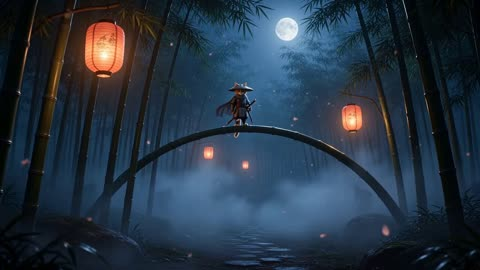
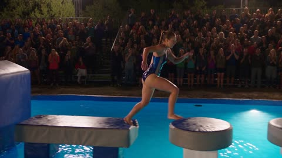
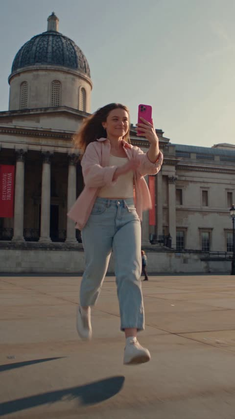
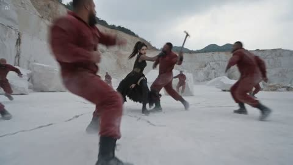
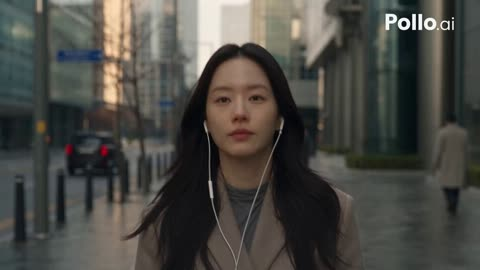
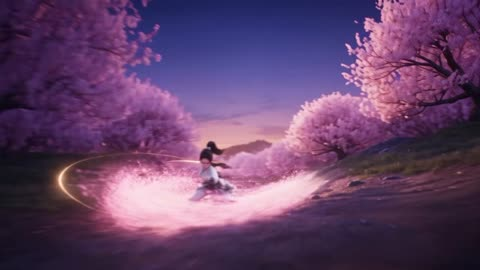
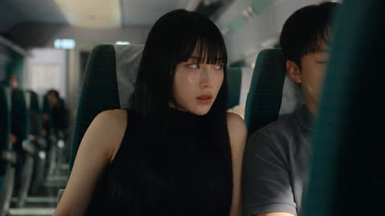

# 动作、追逐与运动

[返回目录](../../README_zh.md) · 全部 171 条 · [1](video-action.md) · [2](video-action-2.md) · **3**

<a id="seedance-train-station-diamond-heist-game-hud"></a>
### 日本车站里的第三人称游戏盗窃任务

<a href="https://x.com/saniaspeaks_/status/2099700182388801793"></a>

用带时间码的分镜把片段拆成潜行、偷窃、搏斗、追逐和收尾几段，每段配上界面文字，并在27秒硬切到固定正面镜头。参考图锁定人脸，结尾的绝对约束和音频描述保证连贯性与游戏质感。

Seedance 2.5 · 参考生视频 · 出处: [@saniaspeaks_ on X](https://x.com/saniaspeaks_/status/2099700182388801793) · 发现于 [LearnPrompt/awesome-seedance](https://github.com/LearnPrompt/awesome-seedance)

[`game-footage`](tags.md#tag-game-footage) [`hud`](tags.md#tag-hud) [`timecoded-shots`](tags.md#tag-timecoded-shots) [`hard-cut`](tags.md#tag-hard-cut) [`chase`](tags.md#tag-chase)

<details><summary><b>提示词</b></summary>

```text
16:9 landscape, ultra-realistic AAA third-person gameplay, bright afternoon at a luxurious Japanese train station. Realistic game-engine visuals, natural human animation, believable physics, detailed skin and hair, realistic clothing movement, marble reflections and cinematic daylight. Clearly a GAME, not anime or cartoon.

NAGI: Use @ Image1 as exact face and identity reference. Japanese high-school girl, 17, long straight black hair with blunt bangs, white sailor blouse with pink collar stripes and pink ribbon, grey pleated skirt, black knee-high socks, white sneakers and school bag. Same face, hair and outfit throughout.

MISSION: Steal a priceless diamond necklace from a VIP passenger's luxury suitcase and escape onto the departing train.

CAMERA: One physical third-person camera, 1.5m behind NAGI, slightly camera-right. Natural gameplay spring movement, smooth FOV breathing 30°–60°. Camera follows her continuously.

0–6s — INFILTRATION

NAGI moves through the crowded luxury station toward a VIP waiting area. A wealthy passenger sits beside a black suitcase guarded by two security guards. She hides briefly behind a luggage cart as a guard passes.

HUD:
MISSION: STEAL VIP NECKLACE
STEALTH MODE

6–12s — THEFT

NAGI reaches the suitcase while the VIP looks away. She opens it and finds a velvet jewelry case containing a stunning diamond necklace. She grabs it and hides it inside her bag.

HUD:
TARGET ACQUIRED

Suddenly a guard notices her.

ALERT

12–19s — FIGHT

The guard grabs NAGI's arm. She struggles hard to escape. He pulls her backward and she nearly falls. She pushes free and runs.

A second guard intercepts her. They struggle physically in a realistic, difficult fight. NAGI finally breaks away, visibly exhausted.

HUD:
NECKLACE ACQUIRED
ALERT LEVEL: CRITICAL

19–25s — CHASE

NAGI sprints toward the platform while two guards chase her. She jumps over luggage, turns sharply through a narrow passage and runs toward the departing luxury train.

Her hair, skirt and bag move naturally with her speed.

Station announcement:

“Train departing shortly.”

HUD:
ESCAPE ROUTE: PLATFORM 4

25–27s — LAST SECOND

The train doors begin closing.

A guard grabs NAGI's shoulder.

She struggles free and runs the final few meters.

She jumps into the train.

The doors close immediately behind her.

HUD:
ESCAPE SUCCESSFUL

27.0s HARD CUT

27–30s — FINAL SHOT

Locked frontal camera inside the moving luxury train, eye-level, 29° FOV, completely static.

NAGI stands in the aisle facing camera, breathing heavily, hair slightly messy.

She opens her bag and reveals the stolen diamond necklace.

Bright afternoon sunlight enters through the train windows.

HUD:

MISSION COMPLETE
DIAMOND SECURED
ESCAPE RANK: S

NAGI looks directly at camera and gives a tiny victorious smile.

AUDIO: tense stealth music, station ambience, footsteps, luggage wheels, security radio, realistic struggle sounds, fast breathing, train warning chime and a short victory sting.

ABSOLUTE LOCKS: Exactly one hard cut at 27s. First 27 seconds completely continuous. Same NAGI, same outfit, same necklace and same environment continuity. Realistic physics and difficult physical struggles. No superhuman movements, no cartoon animation, no face changes, no teleportation. Daytime only. HUD fixed in the same screen positions. All HUD text English; dialogue/announcements natural Japanese.
```

</details>

<a id="seedance-warrior-cat-bamboo-battle"></a>
### 武士猫立于月下竹拱桥上

<a href="https://x.com/Elvorya/status/2106237323046486362"></a>

用带编号的分镜节拍和箭头分隔，并为每个镜头指定明确的运镜，让模型按顺序生成。固定角色外观的描述，并在负面提示词中列出身份漂移和面部变形，有助于角色在各个镜头间保持一致。

Seedance 2.5 · 文生视频 · 出处: [@Elvorya on X](https://x.com/Elvorya/status/2106237323046486362) · 发现于 [LearnPrompt/awesome-seedance](https://github.com/LearnPrompt/awesome-seedance)

[`cat`](tags.md#tag-cat) [`samurai`](tags.md#tag-samurai) [`bamboo-forest`](tags.md#tag-bamboo-forest) [`multi-shot`](tags.md#tag-multi-shot)

<details><summary><b>提示词</b></summary>

```text
Create a 15-second photorealistic cinematic fantasy action sequence featuring a small anthropomorphic warrior cat battling masked ninjas in a mysterious moonlit bamboo forest. Begin with a wide low-angle establishing shot moving slowly through tall dark bamboo stalks, mist-covered ground, glowing warm Japanese lanterns hanging between the trees, and a huge full moon illuminating the fog → reveal the small warrior cat standing confidently on a curved bamboo arch, wearing detailed dark-blue samurai armor, a flowing dark cape, leather accessories, and a wide traditional straw hat, with a katana at his side → transition into a dynamic tracking shot as multiple masked black-clad ninjas emerge from the surrounding mist, forming a threatening circle around the tiny warrior → cut to a dramatic close-up of the cat as his eyes become intensely focused and he draws his sword, a brilliant electric-blue magical energy beginning to glow along the blade → suddenly transition into a fast cinematic action shot as the warrior cat leaps high into the air above the ninjas, cape and clothing reacting naturally to the movement, swinging his glowing blue sword in a powerful arc → follow with a low-angle tracking shot through the bamboo as the cat rapidly moves between attacking ninjas, leaving elegant blue energy trails through the mist → cut to a wide shot showing multiple ninjas being knocked backward while the warrior remains centered and controlled → transition into a slow-motion heroic landing as the cat lands on a moss-covered rock, glowing sword held low at his side while the surrounding enemies stagger behind him → final shot becomes a heroic low-angle wide shot of the tiny warrior standing proudly beneath the enormous full moon, bamboo trees towering around him, mist drifting across the forest floor, cape gently moving in the wind, and the brilliant blue sword glowing against the dark night.

Visual style: ultra-photorealistic fantasy film, realistic fur and facial details, detailed samurai armor, believable fabric and fur movement, realistic sword physics, atmospheric volumetric moonlight, natural fog, cinematic depth of field, dramatic composition, high-detail bamboo forest, realistic shadows, premium VFX, smooth character animation, dynamic camera movement, epic fantasy adventure atmosphere, 4K detail.

Negative prompt: cartoon, anime, low resolution, plastic fur, deformed face, extra limbs, extra weapons, duplicate characters, distorted hands or paws, inconsistent armor, changing character design, identity drift, floating objects, unrealistic sword movement, excessive motion blur, oversaturated colors, text, subtitles, watermark, logo, frame glitches, unnatural physics.
```

</details>

<a id="seedance-water-game-show-platform-fall"></a>
### 直播水上闯关节目选手坠入泳池

<a href="https://x.com/Inshrah_ali_/status/2098621065039647016"></a>

提示词把 15 秒拆成带时间码的几个节拍，每段只写一个明确动作，让模型按照奔跑、失衡、落水、反应的顺序推进。同时指定手持、摇臂和快速切换等直播镜头语言，并写明观众与选手的反应，使画面更像真实电视节目而不是单一平镜头。

Seedance 2.5 · 文生视频 · 出处: [@Inshrah_ali_ on X](https://x.com/Inshrah_ali_/status/2098621065039647016) · 发现于 [LearnPrompt/awesome-seedance](https://github.com/LearnPrompt/awesome-seedance)

[`live-show`](tags.md#tag-live-show) [`water`](tags.md#tag-water) [`game-show`](tags.md#tag-game-show) [`obstacle-course`](tags.md#tag-obstacle-course)

<details><summary><b>提示词</b></summary>

```text
15-Second Ultra-Realistic Live Water Game Show Scene

Create a high-energy live television water game show, filmed like a premium international sports-entertainment broadcast. A confident young female contestant competes on a huge outdoor obstacle course above a massive swimming pool. Large audience stands, other contestants, cheering, dramatic stadium lighting, multiple broadcast cameras, realistic water physics, and authentic live-TV atmosphere.

0–3 sec — Game 1:
She races across floating platforms, jumping quickly from one platform to another while the audience and contestants cheer. She nearly slips but regains balance and reaches the checkpoint.

3–6 sec — Game 2:
She immediately faces a rotating obstacle and carefully times her movement, ducking under the spinning bar and climbing over a wet ramp. She lands safely, visibly determined.

6–9 sec — Game 3:
She tackles a narrow balance beam above the pool while moving toward the final platform. The camera cuts between her focused face, nervous contestants watching, and the cheering crowd.

9–12 sec — Game 4 / Near Victory:
She is only one step away from the finish platform, reaching toward the victory marker. At the last moment, the final obstacle suddenly moves, causing her to lose balance and fall dramatically into the pool. Capture a realistic splash in slow motion as the crowd reacts.

12–15 sec — Emotional Ending:
She resurfaces in the pool, clearly frustrated and disappointed. The other contestants look genuinely sad and shocked for her, some shaking their heads sympathetically. She angrily slaps the surface of the water several times, creating dramatic splashes, then looks toward the finish platform with determination. End on a close-up of her frustrated expression as the live-TV camera pulls back.

Visual style: photorealistic, authentic live game-show broadcast, realistic human movements, natural facial expressions, physically accurate water and obstacle reactions, dynamic handheld and crane-camera shots, quick professional TV editing, crowd reactions, dramatic but realistic lighting, 4K HDR, no CGI-looking characters, no artificial/fake appearance, no text or subtitles, no watermark.
```

</details>

<a id="seedance-waterbending-ambush-jungle-temple"></a>
### 水系术士在丛林神庙对战五名铠甲敌人

<a href="https://x.com/itxsarmadd/status/2103694941260222603"></a>

用三张带编号的参考图分别锁定主角、场景和敌人，再按四段各2.5秒的时间轴让动作环环相扣、全程不停顿。明确禁止发光和动漫特效，配合手持跟拍镜头与无配乐的纯音效清单，让水和冰保持写实质感。

Seedance 2.5 · 参考生视频 · 出处: [@itxsarmadd on X](https://x.com/itxsarmadd/status/2103694941260222603) · 发现于 [LearnPrompt/awesome-seedance](https://github.com/LearnPrompt/awesome-seedance)

[`fantasy-action`](tags.md#tag-fantasy-action) [`waterbending`](tags.md#tag-waterbending) [`jungle-temple`](tags.md#tag-jungle-temple) [`handheld`](tags.md#tag-handheld) [`timed-beats`](tags.md#tag-timed-beats)

<details><summary><b>提示词</b></summary>

```text
SCENE — WATERBENDING AMBUSH
DURATION: exactly 10 seconds
FORMAT: 16:9
STYLE: ultra-photorealistic live-action fantasy action, grounded CGI, realistic water physics, Hollywood stunt choreography, practical jungle-temple location, handheld cinematography, seamless VFX integration, no digital-art appearance.
PACE: extremely fast continuous combat, zero pauses, zero idle moments, action already in progress.

REFERENCES

IMAGE 1 — ARMAN
Preserve facial identity, hairstyle, body proportions, costume, and appearance exactly.

IMAGE 2 — MASTER ENVIRONMENT SHEET
Preserve environment, architecture, vegetation, atmosphere, and location identity exactly.

IMAGE 3 — ENEMY REFERENCE
Preserve enemy armor, silhouette, proportions, and visual identity exactly.

ACTION

0.0–2.5 SECONDS — SURROUNDED
Fight begins mid-combat. Five armored enemies attack from multiple directions. Arman pivots beneath a frontal strike while a large mass of water is already orbiting around him. He redirects the flow to deflect Enemy A. Several sections split from the moving water, instantly freeze into sharp ice shards, and fire toward attacking enemies. Camera performs fast handheld lateral tracking.

2.5–5.0 SECONDS — ROTATING PRESSURE
Enemy C closes from behind. Arman ducks beneath an attack and transitions into a continuous spinning movement. The main water mass whips around him with believable inertia, striking, deflecting, and creating openings. Multiple ice shards separate from the flowing water and launch toward different attackers, forcing evasions and interrupting attacks. Camera reacts with quick pans and target switching.

5.0–7.5 SECONDS — WATER IMPACT
Enemy A attacks again. Arman redirects the entire water mass into a powerful lateral strike. Water impact throws the enemy sideways onto wet stone. While the enemy falls, additional ice shards fire toward advancing attackers. Arman immediately turns toward the next threat without stopping.

7.5–10.0 SECONDS — COMBO CONTINUES
Enemies close from opposite directions. Arman performs rapid circular footwork while continuously controlling the moving water flow. Fresh ice shards split from the leading edge and fire toward multiple enemies. Enemy C charges directly into range. Arman pivots and accelerates the main water mass toward him.

END BEFORE IMPACT.

SMASH CUT. ACTION INTERRUPTED MID-COMBO. END.

VISUAL RULES

- Five active enemies remain engaged throughout.
- No enemy stands and watches.
- Combat never slows down.
- Water remains a single continuous moving mass.
- Ice shards separate from the moving water, instantly freeze, and launch as sharp translucent projectiles.
- No glowing effects, energy beams, neon trails, or anime aura.
- Grounded CGI integrated into live-action photography.
- Every action directly causes the next event.
- Continuous movement, zero pauses, zero dead frames.
- Final frame preserves active combat momentum for Scene 02.

CAMERA

Reactive handheld Hollywood action camera. Fast but readable movement, medium-wide coverage, brief wider shots for major impacts, natural motion blur, occasional water spray crossing lens. No floating virtual camera.

ENVIRONMENT

Ancient jungle temple ruins. Wet stone, moss, roots, ferns, waterfalls, dense tropical vegetation, humid atmosphere, realistic live-action location photography.

SOUND

Raw action only. Footsteps, armor movement, weapons cutting air, rushing water, splashes, ice projectiles, impact sounds, bodies hitting wet ground, distant waterfalls and jungle ambience.

NO MUSIC.
```

</details>

<a id="seedance-webrunner-superhero-comic-edit"></a>
### 女孩边跑边自拍穿过城市广场

<a href="https://x.com/Rosey_watson/status/2087024849839587451"></a>

按时间段分拍，每段写明镜头与转场，让模型按节奏生成15秒多镜头剪辑。风格段点明线稿、网点和速度线，AVOID 段排除现有超级英雄服装与照搬的动画风格。

Seedance 2.5 · 文生视频 · 出处: [@Rosey_watson on X](https://x.com/Rosey_watson/status/2087024849839587451)

[`superhero`](tags.md#tag-superhero) [`comic-book`](tags.md#tag-comic-book) [`multi-shot`](tags.md#tag-multi-shot) [`hybrid-animation`](tags.md#tag-hybrid-animation)

<details><summary><b>提示词</b></summary>

```text
Create a fast-paced cinematic 15-second vertical 9:16 superhero edit blending photorealistic live action with an original comic-book animation aesthetic.

0–4 SEC — CITY RUN
A young woman with long brown hair, oversized light-pink shirt, white tank top, light-blue jeans, and white sneakers runs through a modern European-inspired city. She films herself with a pink smartphone, smiling at the camera. Smooth tracking shot suddenly transitions into bold comic-book linework, halftone textures, vibrant colors, and speed lines.

4–8 SEC — HERO ACTION
She jumps between rooftops as two completely original masked web-slinging heroes appear. One wears a white, charcoal, and teal suit; the other wears crimson and midnight blue. No recognizable existing superhero designs. Energy webs shoot from their gloves as they swing between skyscrapers.

8–12 SEC — COMIC CHAOS
First-person web-swinging POV through a futuristic city at golden hour. Neon signs, floating debris, graphic panels, motion blur, and an original “WHOOSH!” graphic create explosive comic energy. She lands dramatically on a rooftop.

12–15 SEC — FINAL HERO SHOT
She crouches on a rooftop with her hair blowing in the wind as the camera pulls back to reveal a vast fictional city skyline glowing pink and orange.

Final text:

WEBRUNNER
RISE. SWING. RUN.

STYLE: Premium cinematic live action, original graphic-novel animation, bold outlines, halftone textures, vibrant colors, realistic hair and fabric physics, dynamic camera movement, dramatic lighting, seamless transitions, photorealistic detail, 4K, vertical 9:16.

AVOID: Existing superhero characters, recognizable costumes, logos, franchise imagery, real-world landmarks, copied animation styles, distorted faces, warped hands, inconsistent characters, random text, cheap CGI.
```

</details>

<a id="seedance-white-quarry-martial-arts-battle"></a>
### 女战士在白色采石场与红衣武者搏斗

<a href="https://x.com/Zoyavelle/status/2111690502412390875"></a>

提示词把片段拆成带时间段的分镜，并用一致性段落重复人物、服装和场景，让女主角和采石场在各镜头间保持不变。镜头运动与声音设计写得很具体，使打斗动作看起来连贯。

Seedance 2.5 · 文生视频 · 出处: [@Zoyavelle on X](https://x.com/Zoyavelle/status/2111690502412390875) · 发现于 [LearnPrompt/awesome-seedance](https://github.com/LearnPrompt/awesome-seedance)

[`martial-arts`](tags.md#tag-martial-arts) [`wuxia`](tags.md#tag-wuxia) [`timed-shots`](tags.md#tag-timed-shots) [`consistency`](tags.md#tag-consistency)

<details><summary><b>提示词</b></summary>

```text
Create an ultra-realistic, cinematic martial arts battle scene set inside a massive abandoned white stone quarry. A fierce young Asian woman with long black hair tied in a high ponytail, wearing a fitted black martial arts outfit, fights against a large group of muscular male warriors dressed in dark red traditional combat uniforms.

Scene 1 (0–3 seconds): Wide-angle establishing shot of multiple warriors surrounding the female fighter across a vast white stone arena. The fighters rush toward her as dust rises from the cracked ground. The camera moves low and dynamically through the battlefield.

Scene 2 (3–6 seconds): Medium close-up of the female warrior blocking a powerful punch, twisting her body, and delivering a fast counterattack. Her long black ponytail swings naturally through the air. Use realistic martial arts choreography, precise body movements, and intense facial expressions.

Scene 3 (6–9 seconds): The female fighter performs a spectacular spinning kick, sending several opponents flying backward. One warrior leaps into the air while another crashes onto the dusty stone floor. Add dramatic slow motion, realistic physics, flying dust, and subtle debris.

Scene 4 (9–12 seconds): Fast tracking shots follow the woman as she dodges punches, sweeps an opponent's legs, and executes a powerful spinning attack. Show dynamic camera movement, low-angle shots, and brief close-ups of her determined expression.

Scene 5 (12–15 seconds): A high aerial crane shot reveals the entire white quarry battlefield, with numerous defeated warriors scattered across the cracked ground and the female fighter standing confidently in the center. Finish with a dramatic cinematic pullback.

Visual Style: Photorealistic live-action martial arts movie, Hollywood action cinematography, epic wuxia-inspired combat, natural overcast daylight, desaturated colors, realistic skin textures, detailed black and dark-red costumes, volumetric dust, subtle motion blur, high dynamic range, 4K detail, professional anamorphic lens look.

Camera: Dynamic tracking shots, low-angle perspectives, wide establishing shots, fast pans, smooth crane movements, controlled slow motion during major impacts.

Sound Design: Heavy footsteps, realistic punch and kick impacts, rushing wind, stone debris, clothing movement, deep cinematic impacts, subtle epic orchestral background music.

Consistency Requirements: Maintain the same female character, facial features, hairstyle, black outfit, male opponents, red uniforms, and white quarry environment throughout the entire video. Natural anatomy, realistic balance, continuous motion, coherent fight choreography, no duplicated limbs, no distorted faces, no sudden scene changes, no text, no subtitles, no logos.

Duration: 15 seconds. Aspect ratio: 16:9. Quality: Ultra-realistic cinematic 4K.
```

</details>

<a id="seedance-woman-earphones-car-lift-rescue"></a>
### 戴耳机的女子走在城市街道上

<a href="https://x.com/AIwithWania/status/2102042146392129849"></a>

按四秒一段写时间轴，并配合参考分镜锁定两个角色和同一辆车，切镜时形象与车型不会漂移。结尾的 STRICT LOCK 列出需要避免的失真，让举车和撞击的物理过程保持真实。

Seedance 2.5 · 参考生视频 · 出处: [@AIwithWania on X](https://x.com/AIwithWania/status/2102042146392129849) · 发现于 [LearnPrompt/awesome-seedance](https://github.com/LearnPrompt/awesome-seedance)

[`action-romance`](tags.md#tag-action-romance) [`korean-drama`](tags.md#tag-korean-drama) [`timed-beats`](tags.md#tag-timed-beats) [`reference-storyboard`](tags.md#tag-reference-storyboard)

<details><summary><b>提示词</b></summary>

```text
Create an ultra-realistic live-action Korean action-romance scene using the reference storyboard. Keep the SAME two Korean characters, exact faces, hairstyles, outfits, body proportions, and the SAME black car throughout. No identity, wardrobe, hairstyle, or vehicle changes.

0–4s: Woman walks through a modern Korean street wearing earphones. A black car suddenly loses control and flies toward her.

4–8s: Close-up as she notices the car in shock. Cut to the hooded man seeing the danger and reacting instantly.

8–12s: He runs toward her at extreme speed and pulls her away just before impact.

12–16s: They fall safely. She looks up and sees the damaged car falling directly above them.

16–20s: He raises one hand and stops the falling car overhead. She moves closer to him in fear while he holds it.

20–24s: Close-up of his calm, focused face. He pushes the car away and it lands heavily several meters away.

24–28s: They stand up and quietly look at each other with shock, relief, and gratitude as warm sunset light fills the street.

28–30s: Wide rear shot of both against the glowing city skyline. Slow crane backward/upward, then fade to black.

STYLE: Premium Korean live-action cinema, photorealistic skin, natural expressions, realistic hair/clothing movement, believable gravity and car physics, cinematic depth of field, realistic motion blur, HDR lighting, subtle handheld action shots, smooth emotional shots.

STRICT LOCK: No AI-looking faces, face changes, body morphing, duplicated people, wardrobe changes, broken hands, unnatural movement, teleporting, or changing car model. Keep all motion realistic and professionally acted.
```

</details>

<a id="seedance-wuxia-bamboo-rain-hanfu-duel"></a>
### 雨中竹林武侠女侠被刺客围困

<a href="https://x.com/Zoyavelle/status/2110235870473461970"></a>

六个带时间段的分镜（每段2到4秒）依次是低机位跟拍、面部特写、长矛突刺、俯拍闪避和剑斗。结尾分别写明风格、镜头、音效、一致性和负面提示，让服装与面部保持稳定。

Seedance 2.5 · 文生视频 · 出处: [@Zoyavelle on X](https://x.com/Zoyavelle/status/2110235870473461970) · 发现于 [LearnPrompt/awesome-seedance](https://github.com/LearnPrompt/awesome-seedance)

[`wuxia`](tags.md#tag-wuxia) [`martial-arts`](tags.md#tag-martial-arts) [`rain`](tags.md#tag-rain) [`multi-shot`](tags.md#tag-multi-shot) [`cinematic`](tags.md#tag-cinematic)

<details><summary><b>提示词</b></summary>

```text
Create an ultra-realistic, cinematic Chinese Wuxia martial arts action scene set in a dark bamboo forest during heavy rain. A beautiful young East Asian woman with long black hair, delicate facial features, floral hair ornaments, and an elegant flowing pale mint-green traditional Hanfu dress stands calmly surrounded by masked black-clad assassins holding swords and spears.

Scene 1 (0–3 seconds): Low-angle cinematic tracking shot of the woman's flowing silk dress and the muddy forest floor covered in rainwater. Black-clad warriors surround her in a threatening formation. Heavy rain falls continuously, creating realistic splashes and reflections.

Scene 2 (3–6 seconds): Slow camera push-in toward the mysterious woman as she stands fearlessly. Her long wet black hair moves gently in the wind. Assassins approach from the background, holding their weapons ready to attack.

Scene 3 (6–9 seconds): Extreme close-up of her beautiful face, expressive dark eyes, wet eyelashes, and realistic raindrops on her skin. Her expression remains calm, confident, and emotionless. Shallow depth of field, cinematic lighting, highly detailed skin texture.

Scene 4 (9–11 seconds): An assassin thrusts a sharp metal spear toward her face. Extreme close-up of the rain-covered spear blade passing dangerously close to her eyes. Dramatic slow motion, realistic water droplets sliding across the metal, intense suspense.

Scene 5 (11–15 seconds): Dynamic overhead camera shot as the woman suddenly performs an elegant martial arts dodge and spins through the attacking warriors. Her flowing silk sleeves and long hair move naturally with her motion. Smooth camera rotation, realistic sword choreography, cinematic motion blur.

Scene 6 (15–18 seconds): Fast, graceful sword-fighting sequence in the rain. She deflects an incoming weapon with precise movements, pivots sideways, and counters the attackers with fluid Wuxia martial arts techniques. The camera follows her movement with a sweeping tracking shot.

Visual Style: Photorealistic Chinese historical fantasy, premium Wuxia movie cinematography, dark bamboo forest, cold teal and muted green color grading, soft mist, volumetric lighting, realistic heavy rain, detailed wet silk fabric, natural human anatomy, realistic facial expressions, shallow depth of field, 4K cinematic quality, 24fps, dramatic atmosphere.

Camera: Low-angle tracking shots, slow dolly-in, extreme facial close-ups, overhead action shots, dynamic tracking movements, smooth cinematic transitions, controlled slow motion.

Audio: Heavy rainfall, footsteps on wet mud, metallic sword clashes, sharp weapon whooshes, flowing fabric sounds, subtle tense orchestral background music.

Consistency: Maintain the same woman's face, hairstyle, pale mint-green Hanfu outfit, and body proportions throughout the video. Keep all warriors dressed in black traditional assassin clothing. Natural physics, coherent action, realistic weapon movements.

Negative Prompt: Cartoon, anime, CGI appearance, plastic skin, blurry faces, distorted anatomy, extra fingers, extra limbs, duplicate characters, floating weapons, unrealistic fighting, inconsistent clothing, face morphing, flickering, low resolution, oversaturated colors, text, subtitles, watermark.
```

</details>

<a id="seedance-wuxia-fire-sword-shadow-beast-swarm"></a>
### 火焰剑客对决暗影兽群

<a href="https://x.com/itsSaira_1/status/2099006619988459985"></a>

提示词以低机位跟拍开场，再按旋转挥砍、地面冲击波、红色准星阵列爆发、慢动作前行的顺序写出动作节拍。火焰弧光、火星和黑灰等具体特效细节让画面更有层次。

Seedance 2.5 · 文生视频 · 出处: [@itsSaira_1 on X](https://x.com/itsSaira_1/status/2099006619988459985) · 发现于 [LearnPrompt/awesome-seedance](https://github.com/LearnPrompt/awesome-seedance)

[`wuxia`](tags.md#tag-wuxia) [`dark-fantasy`](tags.md#tag-dark-fantasy) [`action`](tags.md#tag-action) [`vfx`](tags.md#tag-vfx) [`low-angle`](tags.md#tag-low-angle)

<details><summary><b>提示词</b></summary>

```text
Cinematic dark fantasy wuxia action scene, low angle dynamic tracking shot. A male warrior in black martial robes and arm guards stands in a tall grass field under an overcast gray sky. He spins dynamically, slashing a glowing fiery sword that leaves arc trails of bright orange fire and sparks. A massive swarm of black shadow beasts charges across the field. He triggers a powerful ground shockwave that blasts dirt, smoke, and embers into the air. A circular matrix of glowing red target reticles and energy lasers shoots outward into the monster swarm. The warrior then rests his blazing sword on his shoulder and walks forward in slow motion through floating embers, smoke, and dissolving black ash. Photorealistic VFX, motion blur, 8k resolution, hyper-detailed.

#ai #AIart️️️️️️️️️️️️️️️️️️️️️️️️️️️️️️️️️️️️️️️️️️️️️️️️️️️
#visualstorytelling #flovaai
#aicreater
#seedance25
```

</details>

<a id="seedance-wuxia-warrior-elemental-battle"></a>
### 武侠女战士在樱花中旋转花瓣漩涡

<a href="https://x.com/juliaevee/status/2109460837043708104"></a>

提示词按顺序列出四个元素场景，每个场景有独立的环境和特效，模型会把它当作分镜表来执行。固定服装和统一的镜头运动（平滑跟拍、动态模糊）使角色在切换中保持一致。

Seedance 2.5 · 文生视频 · 出处: [@juliaevee on X](https://x.com/juliaevee/status/2109460837043708104)

[`wuxia`](tags.md#tag-wuxia) [`martial-arts`](tags.md#tag-martial-arts) [`elemental`](tags.md#tag-elemental) [`3d-animation`](tags.md#tag-3d-animation)

<details><summary><b>提示词</b></summary>

```text
Cinematic 3D animation, Wuxia martial arts epic style. A skilled warrior woman with long dark hair in a high ponytail, wearing an elegant white and teal traditional Chinese robe, wields a glowing energy sword. The video features high-energy combat choreography across dramatic elemental realms: starting in a serene valley of pink cherry blossom trees with swirling petal vortexes; transitioning into a stormy, dark night battle against armored soldiers on water with a massive majestic water dragon surge; shifting to a fiery battlefield under a crimson sunset where a giant blazing phoenix bursts into flames; and moving into a frozen, icy cavern where combatants battle around a colossal glowing crystal lotus flower. Smooth camera tracking, dynamic motion blur, dramatic cinematic lighting, photorealistic textures, 4k resolution, fluent and high-fps movement.
```

</details>

<a id="seedance-zombie-apocalypse-train-outbreak"></a>
### 被感染的女子在列车上将乘客变成丧尸

<a href="https://x.com/doctorwasif/status/2094285140247896553"></a>

按时间拆成二十二个镜头，每个镜头只描述一个视觉变化，便于模型逐段推进剧情。开头的参考脸部和服装保证主角在变化过程中外观一致，特写、广角、手持等镜头词则控制每次切换的景别。

Seedance 2.5 · 参考生视频 · 出处: [@doctorwasif on X](https://x.com/doctorwasif/status/2094285140247896553)

[`zombie`](tags.md#tag-zombie) [`horror`](tags.md#tag-horror) [`train`](tags.md#tag-train) [`multi-shot`](tags.md#tag-multi-shot)

<details><summary><b>提示词</b></summary>

```text
Shot 1 (0–1.2s): Character A, matching reference face/outfit, sits beside a passenger on a dim train, feverish, sweating, staring strangely at him.

Shot 2 (1.2–2.4s): Close-up: her trembling hand, faint dark veins appearing, shallow unnatural breathing.

Shot 3 (2.4–3.6s): Her head tilts unnaturally toward him, glassy unfocused eyes, tense profile close-up.

Shot 4 (3.6–4.8s): She suddenly lunges and bites his forearm, teeth breaking skin, his face frozen in shock.

Shot 5 (4.8–6s): Close-up of the wound as dark veins rapidly branch outward, skin blackening.

Shot 6 (6–7.2s): Veins race toward his elbow; skin pales, sweat beads on his forehead.

Shot 7 (7.2–8.5s): His eyes cloud milky white, pupils dilate, breathing becomes wet and ragged.

Shot 8 (8.5–9.7s): His body stiffens and twitches; black veins spread across his neck and jaw.

Shot 9 (9.7–11s): He throws his head back and screams inhumanly, face covered in black veins, slow motion.

Shot 10 (11–12.2s): His head snaps forward; bloodshot empty eyes and slightly unhinged jaw reveal the completed transformation.

Shot 11 (12.2–13.5s): He instantly lunges at another passenger and bites them, sudden violent impact.

Shot 12 (13.5–14.8s): Wider shot: nearby passengers turn, confusion becoming horror.

Shot 13 (14.8–16s): The bitten passenger stumbles back, clutching the wound as dark veins spread up the arm.

Shot 14 (16–17.3s): Passengers rise in panic, grabbing bags and backing away, wide cinematic shot.

Shot 15 (17.3–18.5s): The new victim convulses violently in the aisle as passengers recoil; overhead lights flicker.

Shot 16 (18.5–19.7s): Eyes roll back, then open bloodshot and empty; jaw twitches—the second transformation complete.

Shot 17 (19.7–21s): He lunges at the nearest passenger; screams erupt as the car descends into chaos, handheld camera.

Shot 18 (21–22.5s): Passengers scramble over seats and luggage toward the exit, bags spilling everywhere.

Shot 19 (22.5–24s): A group rushes toward the connecting door, looking back as infection spreads behind them.

Shot 20 (24–25.5s): Door slams shut; survivors barricade it with luggage and cushions as infected hands pound from behind.

Shot 21 (25.5–27.5s): Close-up through the glass: infected faces press against it as cracks spread, emergency lights pulsing.

Shot 22 (27.5–30s): Survivors huddle against the far wall, breathing hard and staring at the shaking door as train lights streak outside, cinematic outbreak ending.
```

</details>

<a id="veo-off-road-rally"></a>
### 越野拉力冲过河滩

<a href="https://storage.googleapis.com/gdm-deepmind-com-prod-public/media/media/veo__veo-3__off-road.mp4"></a>

给 8 秒动作戏写逐拍解说，还要求车辆无品牌，画面里不会冒出商标。

Veo 3 · 文生视频 · 出处: [Veo 3 prompt guide](https://deepmind.google/models/veo/prompt-guide/)

[`action`](tags.md#tag-action) [`handheld`](tags.md#tag-handheld) [`sfx`](tags.md#tag-sfx)

<details><summary><b>提示词</b></summary>

```text
The scene explodes with the raw, visceral, and unpredictable energy of a hardcore off-road rally, captured with a dynamic, almost found-footage or embedded sports documentary aesthetic. The camera is often shaky, seemingly mounted inside one of the vehicles or held by a daring spectator very close to the action, frequently splattered with mud or water, catching unintentional lens flares from the natural, often harsh, sunlight filtering through trees or reflecting off wet surfaces. We are immersed in a challenging, untamed natural environment – perhaps a dense, muddy forest trail, a treacherous rocky incline littered with loose scree, or a series_of shallow, fast-flowing river crossings. Several heavily modified, entirely unidentifiable, and unbranded off-road vehicles are engaged in a frenetic, no-holds-barred race. These are not showroom models; they are custom-built, rugged machines – open-wheeled buggies with exposed engines and prominent roll cages, heavily armored pickup trucks with oversized, knobby tires and snorkel exhausts, their original forms and manufacturers completely obscured by extreme modifications, layers of caked-on mud, and a general air of brutal functionality. The dominant sounds are the deafening, guttural roar of powerful, untamed engines, the whine of transmissions, the percussive impact of suspension bottoming out, and the constant spray of mud and water. Within an 8-second sequence, one of the lead vehicles, a low-slung, open-cockpit buggy so caked in thick, brown mud that its original color is a mystery, approaches a wide, shallow river crossing at incredible speed. Without the slightest hesitation, its unseen driver powers straight into the water. The impact sends an enormous, almost solid, opaque sheet of muddy water, mixed with stones and debris from the riverbed, spectacularly high into the air, completely engulfing the small buggy for a terrifying moment, obscuring it from view as if it has been swallowed by the river itself. Right on its tail, a pursuing, equally mud-encrusted, custom-built truck – a hulking, high-clearance beast with a heavily reinforced external roll cage and no discernible badging – arrives at the river crossing just as this massive wall of airborne water reaches its peak. Instead of slowing or attempting to find a clearer path, the truck's driver, with unwavering aggression, plunges directly into and through this opaque, turbulent curtain of muddy spray at full throttle. A split second later, the truck bursts out from the other side of the deluge, water cascading from its roof and chassis, its oversized windshield wipers struggling frantically to clear the torrent of muddy water obscuring the driver's vision. It lands heavily on the far bank, suspension groaning, but still in hot pursuit of the now-reappearing buggy. This thrilling, messy, and visually spectacular sequence of one vehicle creating a massive environmental obstacle and the next immediately conquering it through sheer force, forms the core, immersive, attention-grabbing event of the 8-second sequence. The race continues with undiminished ferocity, the natural terrain itself an active participant in the conflict.
```

</details>

[1](video-action.md) · [2](video-action-2.md) · **3**
