# 动作、追逐与运动

[返回目录](../../README_zh.md) · 全部 65 条

<a id="seedance-seoul-subway-revenge"></a>
### 首尔地铁站复仇喜剧

<a href="https://x.com/AIwithSynthia/status/2108760866422415701"></a>

第一行先定镜头语言（手持、荧光灯、实时），再按节拍写笑点，结尾点明哪些画面必须拍清楚。

Seedance 2.5 · 文生视频 · 出处: [@AIwithSynthia on X](https://x.com/AIwithSynthia/status/2108760866422415701) · 10,056 赞，统计于 2026-10-27

[`action`](tags.md#tag-action) [`comedy`](tags.md#tag-comedy) [`handheld`](tags.md#tag-handheld) [`subtitles`](tags.md#tag-subtitles)

<details><summary><b>提示词</b></summary>

```text
Create a live-action cinematic revenge-comedy video set in a Seoul subway station. Use realistic handheld camera movement, cold fluorescent lighting, teal-green accents, and real-time action.

A Korean woman in her 20s with a black bob, sunglasses on her head, a fitted crop top, high-waisted blue jeans, black boots, and a brown shoulder bag descends the subway stairs holding a takeaway coffee. A Korean man with messy dark hair and blonde tips, wearing a dark-green bomber jacket, suddenly hits her from behind and laughs as she stumbles against the handrail. Furious, she chases him onto the platform as he boards a train and mocks her through the closing glass doors.

She punches the glass, creating a dramatic crack and opening. As she confronts him, her coffee cup slips from her hand, falls to the platform, and spills visibly across the floor. She grabs his jacket, forcefully throws him through the air, and sends him crashing into a large metal rubbish bin. The bin rattles and wobbles as he lands inside, looking terrified and humiliated.

She leans toward him and says, "Don't mess around." She then calmly walks away while he remains stuck in the bin.

Maintain identical faces, hairstyles, outfits, and location throughout. Include realistic physics, expressive reactions, cinematic close-ups, subway ambience, and clear white subtitles. Keep the action non-gory, the coffee spill visible, and the final dustbin landing unmistakable.
```

</details>

<a id="kling-basketball-backflip-dunk-court"></a>
### 篮球运动员在室外球场后空翻扣篮

<a href="https://x.com/higgsfield_ai/status/2019083976682684558"></a>

提示词把一个动作拆成四个编号镜头（运球、起跳、空中翻转、扣篮），每个镜头都写明景别和机位。低机位加上翻转时的慢动作特写，让 Kling 的物理模拟每一步都有明确的画面目标。

Kling 3.0 · 文生视频 · 出处: [@higgsfield_ai on X](https://x.com/higgsfield_ai/status/2019083976682684558) · 2,533 赞，统计于 2026-10-27

[`multi-shot`](tags.md#tag-multi-shot) [`sports`](tags.md#tag-sports) [`basketball`](tags.md#tag-basketball) [`low-angle`](tags.md#tag-low-angle) [`physics`](tags.md#tag-physics)

<details><summary><b>提示词</b></summary>

```text
Shot 1: A side profile, medium shot of a muscular African American man in athletic wear, intensely dribbling a basketball on an outdoor concrete court towards a hoop against a high white wall under a bright blue sky.
Shot 2: A dynamic, low-angle wide shot showing the man jumping remarkably high into the air, performing a backflip while holding the basketball, with the white wall and sky in the background.
Shot 3: A close-up, slow-motion shot of the man mid-air and upside down during his flip, showing his focused expression and the basketball held firmly in his hands against the sky.
Shot 4: A dramatic, low-angle shot focusing on the basketball hoop as the man, still upside down from his acrobatic jump, powerfully dunks the ball into the net.
```

</details>

<a id="kling-night-courtyard-katana-six-shots"></a>
### 夜晚庭院中女子挥刀斩断木人桩

<a href="https://x.com/higgsfield_ai/status/2019104313302569185"></a>

六个编号镜头各自写明景别和运镜，从嘴部微距到全景动作再到收尾人像，节奏清晰。每个镜头都点明机位和物理效果，比如飞溅的木屑和灰尘，让冲击瞬间有据可依。

Kling 3.0 · 文生视频 · 出处: [@higgsfield_ai on X](https://x.com/higgsfield_ai/status/2019104313302569185) · 2,473 赞，统计于 2026-10-27

[`multi-shot`](tags.md#tag-multi-shot) [`action`](tags.md#tag-action) [`katana`](tags.md#tag-katana) [`macro`](tags.md#tag-macro) [`night`](tags.md#tag-night)

<details><summary><b>提示词</b></summary>

```text
Shot 1: An extreme close-up of a young woman's mouth, her teeth clenched on a wooden toothpick, creating a tense and gritty atmosphere.
Shot 2: A medium shot of the woman in a traditional Japanese-style courtyard at night, illuminated by soft lanterns. She is dressed in a white tank top and dark trousers, holding a katana in a defensive stance with a determined look on her face.
Shot 3: A dynamic, low-angle action shot of the woman jumping high into the air, raising her katana to strike a wooden training dummy that resembles a samurai in armor.
Shot 4: A close-up, high-speed impact shot showing the woman’s katana slicing through the wooden dummy, sending wood splinters and dust flying into the air.
Shot 5: A fast-paced tracking shot of the woman landing gracefully and immediately striking another wooden structure, demonstrating her speed and precision.
Shot 6: A final medium close-up of the woman’s face as she finishes her move. She is slightly breathless, her hair disheveled, with a sharp, focused gaze directed off-camera.
```

</details>

<a id="seedance-anime-rooftop-brawl-kinetic-fight"></a>
### 两名动漫格斗者在天台激烈缠斗

<a href="https://x.com/aimikoda/status/2111824828009193814"></a>

先用角色参考块锁定两人的服装，再用风格与能量段落定下赛璐珞着色、冲击帧和持续运动的镜头。四个分镜各有独立的运镜路径和连续出招，没有停顿，并用禁止项排除慢动作和定格。

Seedance 2.5 · 参考生视频 · 出处: [@aimikoda on X](https://x.com/aimikoda/status/2111824828009193814) · 1,962 赞，统计于 2026-10-27

[`anime`](tags.md#tag-anime) [`fight-scene`](tags.md#tag-fight-scene) [`multi-shot`](tags.md#tag-multi-shot) [`camera-movement`](tags.md#tag-camera-movement) [`character-reference`](tags.md#tag-character-reference)

<details><summary><b>提示词</b></summary>

```text
References:
@[char1 ref]: Mina. Long black hair, green striped crop top, baggy orange cargo pants with black graffiti, white sneakers, black fingerless boxing gloves on both hands, chain bracelet.
@[char2 ref]: Rue. Long pink hair, black crop top, black cargo shorts with chains and tags, bare knuckles with silver rings, skin visible on both hands, chunky lime sneakers, dog tag necklace.

Visual style: High-sakuga flat-color 2D anime, bold linework, hard cel shading, flat blue and teal backgrounds that flash hot pink or orange on impact, speed smears, impact frames, deep foreshortening.

Energy: Within every shot the camera keeps moving: it spirals around crossing limbs, dives under kicks, skims the floor, and whips between faces, often following a fist or a sole within inches of the lens. Every movement flows straight into the next strike, block, or counter. Every landed hit plays as sakuga impact: a two-frame impact frame, then the struck body whips away in a long smear, elastic recoil, immediate re-entry into her own attack. Heads snap, torsos fold, feet leave the ground, bodies skid across concrete. Each impact throws a color flash, dust, flying hair and cloth, and radiating speed lines.

Avoid: No subtitles. No slow motion, no idle posing, no pauses between actions, no freeze frames, no held two-shots.

Mina and Rue trade one relentless brawl on an empty concrete rooftop with a chain-link fence at the back and a steel vent box at center right. Mina starts screen left, Rue screen right. Whenever they close, one body is nearer the camera and the other clearly behind it with air between. No dialogue; hits, shoe scuffs, chain rattle, wind. Shot list: 4 shots, about 30 seconds, every shot packed edge to edge with exchanges.

Scene 1: 连续时间，天台。
Shot 1: 大全景起，地面高度，低角度；镜头从水泥地面猛然升起，穿过两名已经腾空扑向对方的格斗者之间，然后贴着Mina的拳套甩进中景，并绕着两人交错的手臂急速环绕。Mina的右勾拳与Rue抬起的膝盖在半空撞上，冲击帧，两人同时被震成拖影向后飞开，滑步落地的瞬间已经再次扑上；Mina左直拳，Rue下潜躲过并打出上勾拳，Mina用前臂接住，前臂被顶上自己的下巴，头向后一甩成拖影，她借着仰头的势头打出一记一二连击，第二拳砸开Rue的防守，冲击帧，Rue的头横向甩出，粉发拉成一道弧，她踉跄一步就从踉跄里踢出正蹬，踢中Mina的拳套，把Mina推得双脚在地上滑出一道痕。快速细节切：Rue眯起的眼睛，Mina收紧的拳套，狗牌甩动，然后镜头钻到Rue旋踢的下方。Rue的脚跟掠过Mina低下的头顶，Mina从内侧起身的身体勾拳把Rue整个人折弯在拳套上，冲击帧，Rue的双脚离地，她顺着折弯的势头甩出肘击，Mina双拳套挡住，拳套却被顶进自己的脸，她向后踉跄两步，Rue追上来一记戴戒指的直拳擦着镜头砸过，Mina侧滑，把一记短右拳埋进Rue的肋部，冲击帧，Rue半边身体塌陷成拖影，双脚在地面打滑，她就从打滑里顶出一膝，砸在拳套上，把Mina的胳膊震到自己胸口。

Shot 2: 跟拍起，位于Rue身后腰部高度；镜头随她冲向铁丝网，沿着网向上扫，在她蹬离时翻转，然后落到地面高度，贴着天台地面疾驰穿过两人相撞的缝隙。Rue推开Mina的胸口转身冲向铁丝网，在网上蹬两步，蹬离，后空翻越过从下方冲进来的Mina，落下的膝盖砸中Mina的肩膀，冲击帧，Mina被砸成一个拖影般的前滚翻，从翻滚里起身时顺势扫向Rue落地的那条腿，Rue跳过扫踢，撑手后空翻，落地时Mina的直拳已经到了，Rue格挡，格挡把她自己的手臂震开，Mina的第二拳穿过空档擦中她的太阳穴，冲击帧，Rue半转过身，粉发横扫镜头。快速细节切：荧光绿鞋底填满镜头，橙色工装布料猛甩，铁丝网剧烈震颤，然后镜头贴地。两人再次相撞：Mina低身滑过Rue的飞跃拳，两人在另一侧旋转成背对背，同一瞬间各踢出一记后蹬，鞋底对撞，冲击帧，两人都被踢得向前扑倒撑地，撑起后同时转身甩出旋转背拳，拳套撞上指节，粉色闪光，两人的头各自甩向一侧成拖影，Rue先回过身勾住Mina的腿，Mina跳脱的同时抡出过顶拳，擦过Rue的太阳穴，把她打得转了半圈，Rue转完这半圈的势头直接变成一记反手肘，砸在Mina的肩上，Mina的肩膀被压得一沉。

Shot 3: 高角度俯冲起；镜头向通风箱俯冲，压低绕到箱侧，然后在两张脸之间左右急甩，每一拳都跟着拳头从一张脸甩到另一张脸。Mina，戴黑拳套，跃上通风箱，膝盖朝下砸落；Rue，赤手戴戒指，侧步闪开，一记侧踢踹进箱体，箱体轰然凹陷；Mina从压扁的边缘跃起打出飞身直拳，Rue后仰躲过，扫掉Mina的支撑手臂，Mina侧手翻落地的同时勾拳打中Rue的下颌，冲击帧，Rue的头甩过去，整个人被带得转了半圈，脚步踉跄，又从踉跄里反扑一记直拳，震得Mina的下巴一晃。快速细节切：弯折的金属，断裂的电缆冒着火花，拳套在箱顶打滑，然后镜头切进两张脸之间。隔着废墟的近身对轰：刺拳，格挡，直拳，侧闪，没有一拳停在半路；Rue的膝盖顶进Mina垂下的拳套，把她推退一步；Mina的头槌砸在Rue的眉骨上，冲击帧，Rue的头向后甩成拖影，她的身体先于意识反击，戴戒指的勾拳打在Mina的拳套上；Mina的反击肘撞上Rue的脸颊，冲击帧，粉发炸开，Rue踉跄两步，膝盖一软又撑住，从撑住的那一下里直拳回敬，打得Mina的头偏过去，Mina的头偏到一半就已经转回来，两人同时下蹲。

Shot 4: 高角度大全景起，倾斜成荷兰角；镜头在两人跃起时螺旋下降，在最高点从两人之间穿过，再翻到两人侧面，并在两人上升时继续旋转。两人同时向上爆发，拳头在前，Mina的黑拳套与Rue戴戒指的拳头冲向画面中央同一点，头发向后飞扬成拖影，速度线向中心汇聚，拳头进入触及范围的瞬间背景炸成全屏亮粉色；拳头仍在逼近，头发仍在甩动，镜头仍在旋转，画面在此切断。
```

</details>

<a id="seedance-desert-warrior-reaper-fight"></a>
### 面具战士在沙漠尘暴中对决持镰死神

<a href="https://x.com/techhalla/status/2090568539325317401">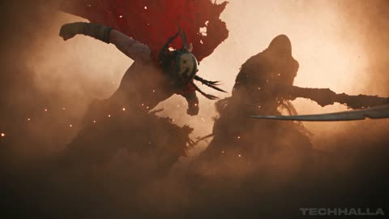</a>

用两张图分别锁定死神和战士的角色设定图，再按 0 到 30 秒分段，每段写明镜头运动和具体动作节拍。开头的统一风格段落（变形宽银幕镜头、烟尘、粒子物理）让各镜头画面保持一致。

Seedance 2.5 · 参考生视频 · 出处: [@techhalla on X](https://x.com/techhalla/status/2090568539325317401) · 882 赞，统计于 2026-10-27

[`action`](tags.md#tag-action) [`fight-scene`](tags.md#tag-fight-scene) [`multi-shot`](tags.md#tag-multi-shot) [`character-consistency`](tags.md#tag-character-consistency) [`desert`](tags.md#tag-desert)

<details><summary><b>提示词</b></summary>

```text
I've used 2 image refs as the only reference for this one (both made on MJ), along with this prompt:

Hyper-kinetic desert combat spectacle, extreme high-intensity CGI action, thick volumetric cinematic haze and golden-hour dust storms, aggressive anamorphic 35mm lens with heavy motion blur, relentless handheld tracking and whip pans, deep shadows, heat distortion, ultra-realistic particle systems.

Use the first provided image as exact reference for the ethereal dark reaper silhouette, flowing tattered robes, skull-scythe and arid desert environment. Use the second multi-view character sheet as exact appearance lock for the muscular tribal warrior (mask, red cape, yellow tattered bone-adorned skirt, dreadlocks, scarred body, barefoot).

0-4s: [Extreme Wide Crash-In] Instant violent collision. Warrior explodes forward through dense dust cloud, red cape whipping. Reaper swings massive scythe in wide horizontal arc. Impact detonates shockwave of sand and embers. No pause.

4-8s: [Dynamic Low Tracking] Rapid exchange. Warrior ducks under scythe, delivers spinning elbow to reaper’s ribs, then upward knee. Reaper phases partially, reforms mid-strike, counters with spectral claw rake across warrior’s chest. Fabric and ash particles explode outward.

8-13s: [Orbiting Medium + Dutch Angle] Acrobatic mid-air clash. Warrior vaults off scythe shaft, red cape fully extended, lands dual-fist hammer blow to reaper’s hood. Reaper retaliates with vertical scythe slam that cracks the ground; warrior rolls, rises into spinning back-kick that shreds more robe into black ribbons.

13-18s: [Handheld Close Combat Frenzy] Brutal ground scramble. Warrior grapples the scythe pole, headbutts the mask, then rips free and unleashes three distinct strikes: upward palm, horizontal elbow, downward axe-kick. Reaper absorbs then unleashes tendril-whip of shadow that lashes warrior’s back, drawing blood and dust.

18-23s: [Slow-Motion Impact Montage] Escalating power. Warrior catches scythe mid-swing, twists, drives knee into reaper’s midsection twice, then spinning heel kick that sends the figure airborne. Reaper crashes down in explosion of ash and sand, robes half-dissolved. Warrior advances without mercy.

23-28s: [Wide to Tight Push-In] Finishing sequence. Warrior seizes the collapsing reaper by the remaining hood, delivers a savage rising uppercut followed by a final two-handed overhead smash. Reaper’s entire form shatters into swirling black ash and ember particles that scatter across the desert floor. Warrior stands over the dissipating cloud, breathing hard.

28-30s: [Hard Cut Reverse Extreme Close-Up] Blurred warrior fills foreground, chest heaving, sweat and dust streaking his mask, mouth open in ragged breath. Sharp deep background: the dark figure slowly reconstitutes from residual ash, scythe reforming in hand, rising and stalking forward with predatory stillness.

Photorealistic, ultra-detailed fabric physics and particle simulation, perfect motion blur, volumetric haze at maximum density, coherent anatomy and proportions, stable character consistency, cinematic color grade, movie-level VFX polish.

Hope you like it! 🫡
```

</details>

<a id="seedance-painted-flame-karate-kata-void"></a>
### 蓝色虚空中的彩绘火焰空手道套路

<a href="https://x.com/aimikoda/status/2110119492076404869">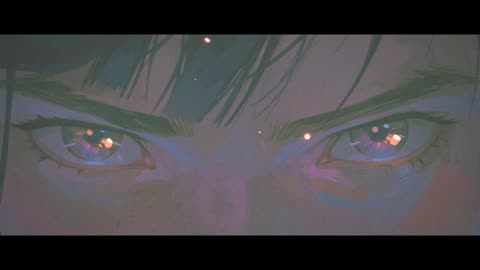</a>

两张带标签的参考图分别锁定面部身份与身体、服装、特效，十六个分镜各写明时间段、机位和招式。音效对齐剪点，排除清单避免出现光滑的CG火焰，保住手绘质感。

Seedance 2.5 · 参考生视频 · 出处: [@aimikoda on X](https://x.com/aimikoda/status/2110119492076404869) · 802 赞，统计于 2026-10-27

[`martial-arts`](tags.md#tag-martial-arts) [`painterly`](tags.md#tag-painterly) [`multi-shot`](tags.md#tag-multi-shot) [`vertical`](tags.md#tag-vertical) [`sound-design`](tags.md#tag-sound-design)

<details><summary><b>提示词</b></summary>

```text
References:
@[ref1]: The martial artist's face. Identity, dark tousled hair, eyes, and the look of the painted flame around her open hand.
@[ref2]: Her body, costume, setting, and effects. Pale pink short-sleeve top, red wrist wraps and red sash, dark loose trousers, her low kneeling stance, the misty blue void with its dark floor, the looping pink ribbon arcs, and the spark burst.

Visual style: Painterly digital illustration in motion: thick, loose brushstrokes and palette-knife texture, deep blue-teal shadows and haze, figures built from broad painted planes. Every effect is painted, not rendered: flame-like ribbons of orange, hot pink, and violet with white-hot cores, exactly as in @[ref1] and @[ref2].

Avoid: No subtitles. No background music. No clean 3D particle fire, glossy CG effects, or lens-flare glare. No weapons or opponents.

A solo karate kata in a misty blue void, where painted flame grows with every strike and ends in an explosive palm strike into the floor. Vertical 9:16 frame, real-time speed except one brief speed ramp at the final impact. She performs toward screen right, faces screen left after her turn, and faces the lens for the finale; the camera stays on the same side of her line. The flame starts in her right hand; after the first punch it ignites on whichever limb strikes, and each technique leaves its own shape. Warm colors stay on the effects; the setting stays blue-teal. Crackling flame, sharp whooshes, foot stamps, cloth snaps, breath, one kiai, and heavy impact thuds land on the cuts.

Scene 1: Continuous, the misty blue void, its dark floor dusted pale blue.
Shot 1 (0-2s): [Extreme close-up on her eyes, slow push in] Stillness. A single ember drifts across her face as she breathes in. Cut on a sharp inhale.
Shot 2 (2-4s): [Close-up on her right hand, low angle, quick push toward the lens] Her open right hand thrusts at the lens in teisho-uchi, fingers spread as in @[ref1]. Painted flame ignites in the palm and curls up her forearm. Cut as the flame flares.

Scene 2: Continuous, the first form.
Shot 3 (4-6s): [Low wide, fast lateral track] She steps into zenkutsu-dachi and drives a right oi-zuki toward screen right; the flame stretches behind her fist in one long straight ribbon. Cut as the punch locks out.
Shot 4 (6-7s): [Tight side view at waist height] A left gyaku-zuki snaps out past the retracting right fist, and the flame catches on her left fist too. Cut as it locks out.
Shot 5 (7-9s): [Medium, camera whipping around to face her] Her right mae-geri kicks straight at the lens, flame fanning off the foot in a short burst. Cut as the kick retracts.
Shot 6 (9-10s): [Ground level, close on her feet] The kicking foot stamps down, throwing a ring of pale blue dust and orange sparks. Cut as she pivots.
Shot 7 (10-13s): [Orbiting camera with a whip pan] She turns 180 degrees through a right, then left shuto-uke, and her burning hands wrap her in looping pink ribbon arcs as in @[ref2]. She now faces screen left. Cut as the arcs close.

Scene 3: Continuous, the pause and the escalation.
Shot 8 (13-15s): [Low frontal medium, locked] She sinks into kiba-dachi, both fists drawn to her hips. The flames shrink into tight glowing cores in her fists and the dust settles; only her breath is heard. Cut on a sharp exhale.
Shot 9 (15-16s): [Snap zoom into her face] Her kiai rings out, flame reflected in her eyes, hair whipping. Cut at the peak of the shout.
Shot 10 (16-18s): [Low wide] She explodes into ushiro-mawashi-geri, the burning heel drawing one full ring of fire around her. Cut as the ring closes.
Shot 11 (18-19s): [Close tracking on her right fist] An uraken-uchi snaps through the frame toward screen left, its trail cracking like a whip. Cut on the snap.
Shot 12 (19-20s): [Medium from behind her shoulder] Her right empi-uchi drives toward screen left, a short burst flaring off the elbow. Cut as the elbow locks.
Shot 13 (20-22s): [Low angle, camera rising] She crouches and launches into nidan-geri, a spiral of flame climbing around her through both kicks. Cut at the apex.

Scene 4: Continuous, the finale.
Shot 14 (22-24s): [High angle, camera diving down with her] She descends from the apex, turning to face the lens, and drops onto one knee, right palm driving toward the floor. Cut just before contact.
Shot 15 (24-25s): [Ground-level close-up] Her right teisho-uchi hits the floor: a white-hot core flashes and erupts into orange sparks, pink paint flecks, and lifted blue dust, as in @[ref2], with a brief speed ramp at contact. Cut at the peak of the burst.
Shot 16 (25-30s): [Low frontal wide, slow push in to medium] She holds the low kneeling stance from @[ref2] as the burst's ribbons settle into drifting embers and fade. She raises her eyes to the lens and holds.
```

</details>

<a id="veo-golf-ball-tracking-storm-cliff"></a>
### 暴雨海崖高尔夫球手与追球镜头

<a href="https://x.com/Dheepanratnam/status/2032810971140420073"></a>

提示词按时间顺序分成挥杆、镜头锁定球、逼近果岭、杯口特写几个段落。它直接写明追踪规则，球保持清晰居中而背景拉成动态模糊，并加入击球脆响和风声等声音提示。

Veo 3.1 · 文生视频 · 出处: [@Dheepanratnam on X](https://x.com/Dheepanratnam/status/2032810971140420073) · 666 赞，统计于 2026-10-27

[`sports`](tags.md#tag-sports) [`tracking-shot`](tags.md#tag-tracking-shot) [`storm`](tags.md#tag-storm) [`physics`](tags.md#tag-physics) [`ball-pov`](tags.md#tag-ball-pov)

<details><summary><b>提示词</b></summary>

```text
video 1 - veo3.1
video 2 - Sora 2

"A dramatic sports sequence begins on a lush, windswept coastal cliff during a violent rainstorm. A golfer in bright yellow rain gear stands on the tee box, gripping a driver. His stance is planted firmly, eyes locked on a distant green across a churning ocean cove.

As he swings, the clubhead connects with a resounding crack, launching the dimpled white ball into the stormy sky. The camera immediately accelerates and locks onto the golf ball mid-flight.

The camera tracks directly behind the spinning sphere, maintaining perfect alignment as it cuts through the driving rain. The ocean waves and dark clouds become a streaking motion blur while the ball remains sharp and centered.

The howling wind roars as the projectile travels straight and true. The manicured green grows rapidly larger. In the final seconds, the camera closes in tightly as the ball strikes the turf. End on an extreme close-up of the ball ripping through the wet grass, throwing up a spray of dirt before dropping perfectly into the cup."
```

</details>

<a id="kling-paper-bag-locked-tracking"></a>
### 低机位锁定牛皮纸袋的跟拍镜头

<a href="https://x.com/higgsfield_ai/status/2019304424297177558"></a>

提示词指定单一锚点物体，并明确写出镜头与其刚性锁定，主体始终居中而背景飞速掠过。摆臂、指节发白、纸张震颤等具体动作与质感细节，把人物运动与镜头表现联系起来。

Kling 3.0 · 文生视频 · 出处: [@higgsfield_ai on X](https://x.com/higgsfield_ai/status/2019304424297177558) · 554 赞，统计于 2026-10-27

[`tracking-shot`](tags.md#tag-tracking-shot) [`locked-camera`](tags.md#tag-locked-camera) [`low-angle`](tags.md#tag-low-angle) [`wide-angle`](tags.md#tag-wide-angle) [`action`](tags.md#tag-action)

<details><summary><b>提示词</b></summary>

```text
Low-angle wide-angle tracking shot focused on a crumpled brown paper bag held tightly in a man’s hand. The camera is rigidly locked to the bag with precise tracking — the bag stays centered and stable while the world rushes past. The man is running away from someone, sprinting forward; his arm pumps hard, aggressive vertical and lateral motion transferred directly to the bag. Strong grip, whitening knuckles, paper creasing and vibrating from speed.
```

</details>

<a id="seedance-anime-rooftop-four-shot-brawl"></a>
### 两名女性的四镜头动漫天台格斗

<a href="https://www.reddit.com/r/Seedance_AI/comments/1x97lk3/seedance_25_anime_fight_prompt_a_fourshot_rooftop">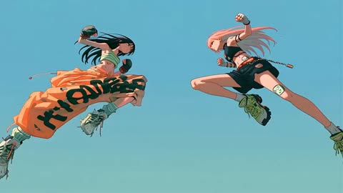</a>

先用角色参考块锁定两位格斗者的服装与手部配饰，再把30秒拆成四个带时间码的镜头。每个镜头只给一种运镜和一串出招、后撤、反击，音频一行点明撞击声、鞋底摩擦、锁链和风声。

Seedance 2.5 · 文生视频 · 出处: [u/Fresh-Resolution182 on Reddit](https://www.reddit.com/r/Seedance_AI/comments/1x97lk3/seedance_25_anime_fight_prompt_a_fourshot_rooftop) · 530 赞，统计于 2026-10-28

[`anime`](tags.md#tag-anime) [`fight-scene`](tags.md#tag-fight-scene) [`multi-shot`](tags.md#tag-multi-shot) [`camera-movement`](tags.md#tag-camera-movement) [`cel-shading`](tags.md#tag-cel-shading)

<details><summary><b>提示词</b></summary>

```text
Create a 30-second, four-shot 2D anime fight between two adult women. Bold outlines, flat colors, hard cel shading, deep foreshortening, speed smears, and brief two-frame impact drawings. Blue-teal backgrounds flash pink or orange on contact.

Character references

Mina: long black hair, green striped crop top, orange graffiti cargo pants, white sneakers, black fingerless boxing gloves, chain bracelet.

Rue: long pink hair, black crop top, black cargo shorts with chains, bare hands with silver rings, lime sneakers, dog tags.

Keep their identities, outfits, and hand accessories distinct throughout.

Location: empty concrete rooftop, rear chain-link fence, steel vent at center-right. Mina begins left, Rue right. Maintain readable spacing, depth, and movement.

0–8s — Opening exchange
Rise from floor level between their opening attacks, then orbit around crossing arms. Mina throws a hook; Rue blocks and counters. A straight punch breaks the guard, followed by a push kick that sends Mina sliding into her next approach.

8–16s — Fence rebound
Track Rue toward the fence. She rebounds over Mina, who rolls through the landing attack and answers with a sweep. Drop the camera low as both recover, turn, and exchange kicks.

16–24s — Vent-box clash
Dive toward the vent as Mina attacks from above. Rue evades and dents the metal with a kick. Continue around the damaged vent through a compact sequence of strikes, blocks, and counters.

24–30s — Final collision
Both launch upward. Spiral downward, pass between them, and rotate to a side view as their fists converge. The background flashes hot pink. Cut just before contact, with both fighters and camera still moving.

Use continuous camera movement within each shot. Every impact has direction, recoil, and recovery. No slow motion, extended holds, idle poses, dialogue, subtitles, or gore. Audio: impacts, shoe scuffs, rattling chains, and rooftop wind.
```

</details>

<a id="seedance-kitchen-fight"></a>
### 餐厅后厨一打三

<a href="https://x.com/Alina_with_Ai/status/2113816556140675163"></a>

10 秒打戏，开头定死调色和机位，结尾列音效，不要配乐。

Seedance 2.5 · 文生视频 · 出处: [@Alina_with_Ai on X](https://x.com/Alina_with_Ai/status/2113816556140675163) · 514 赞，统计于 2026-10-27

[`action`](tags.md#tag-action) [`martial-arts`](tags.md#tag-martial-arts) [`sfx`](tags.md#tag-sfx)

<details><summary><b>提示词</b></summary>

```text
Cinematic live-action martial arts fight, 10 seconds, wide 16:9, handheld camera with fast whip-pans and slight shake, gritty high-contrast grade with warm brown tile floor and cool steel tones, motion blur on strikes, realistic physics.

Setting: a busy professional restaurant kitchen. Brown quarry-tile floor with black rubber mats, stainless steel prep tables, a rolling rack of fresh vegetables (carrots, greens, red tomatoes), copper pots hanging from a ceiling rail that swing with every impact, gas range and hood, steel refrigerators, wooden produce crates stacked against a white-tiled back wall. In the far background, chefs in white uniforms keep working.

Characters: a young woman with dark hair tied back, grey button-up work shirt with sleeves pushed up and black pants and black boots. She fights 3 men in grey shirts and black aprons (one bearded, one heavyset, one Asian man with short hair), all trying to attack her, one wielding a kitchen knife.

0-1s: She dodges a swinging punch from the bearded man, then blocks the heavyset man's arm with a crossed-arm block, copper pots swaying above.
1-2s: She drops into a low lunge and kicks, sending the man flipping backward over the stainless prep table, legs in the air.
2-3s: She spins toward the next man by the cutting board with vegetables, camera whip-pans with motion blur.
3-4s: She throws a high side kick that knocks a knife aside as a man raises it overhead, third man stepping in behind.
4-5s: Camera cuts wider: she lands a spinning back kick, a man crashes to the floor, wooden crates and papers on the wall behind.
5-6s: She leaps high in the air in a flying kick pose against the white wall, whole body visible.
6-7s: She lands in a ready stance, focused and breathing hard, two men lying defeated on the floor behind the crates, spilled apples on the ground, a knife visible in the background.
7-8s: A man in a grey shirt charges, she counters with a sharp fist strike.
8-10s: Tight shot over her shoulder, a man with a knife lunges at her from the right, copper pots overhead, she steps in to meet him.

Sound: impact thuds, fabric whooshes, shoes squeaking on tile, clattering pots and crates, kitchen ambience, no music.
```

</details>

<a id="kling-hotel-corridor-neon-fight"></a>
### 红色霓虹酒店走廊里的打斗戏

<a href="https://x.com/higgsfield_ai/status/2019272810838061122"></a>

提示词先定地点和光线，再按顺序写出动作节拍：防御姿态、右侧入场、格挡、擒抱、膝击、推向墙面。结尾一句镜头指令要求稳定跟拍，贴着动作走。

Kling 3.0 · 文生视频 · 出处: [@higgsfield_ai on X](https://x.com/higgsfield_ai/status/2019272810838061122) · 445 赞，统计于 2026-10-27

[`action`](tags.md#tag-action) [`fight-scene`](tags.md#tag-fight-scene) [`neon`](tags.md#tag-neon) [`tracking-shot`](tags.md#tag-tracking-shot) [`multi-character`](tags.md#tag-multi-character)

<details><summary><b>提示词</b></summary>

```text
A gritty, cinematic fight scene in a modern, dimly lit hotel corridor with grey concrete walls and dark wooden doors. The scene is illuminated by glowing red vertical neon lights.

A man in a white dress shirt and black trousers is in a defensive stance over a person lying on the floor. Suddenly, an attacker enters from the right, swinging a wooden baseball bat. The man in the white shirt quickly blocks the strike, grabs the attacker, and delivers a powerful knee strike to the midsection before pushing him back against the wall. The camera follows the movement with a steady, high-tension tracking motion.
```

</details>

<a id="kling4-tactical-shooter-gameplay"></a>
### 以假乱真的 5v5 战术射击游戏实录

<a href="https://x.com/higgsfield_ai/status/2110905436371370009"></a>

按屏幕录像来写：HUD、准星、PC 游戏光照和枪声设计。让模型拍游戏画面，不拍电影。

Kling 4.0 · 文生视频 · 出处: [@higgsfield_ai on X](https://x.com/higgsfield_ai/status/2110905436371370009) · 260 赞，统计于 2026-10-28

[`gameplay`](tags.md#tag-gameplay) [`pov`](tags.md#tag-pov) [`hud`](tags.md#tag-hud) [`action`](tags.md#tag-action) [`sound-design`](tags.md#tag-sound-design)

<details><summary><b>提示词</b></summary>

```text
15-second horizontal 16:9 1080p first-person gameplay recording of a competitive 5v5 tactical shooter in team elimination mode, captured straight from a PC screen. Modern next-gen competitive shooter graphics: bright, clean, readable daylight, crisp PBR materials, high frame rate, sharp image. Pure first-person view: the player's hands in purple tactical gloves hold an original assault rifle with a flashy custom skin of hot-pink and teal graffiti patterns, positioned in the lower right of the frame. Clean screen with the HUD turned off: the only on-screen element is a small green crosshair in the center. There is no minimap, no kill feed, no health, ammo or money counters, no timer and no banners. Snappy competitive movement with quick peeks, crouching, strafing and precise flicks. The whole video is one continuous round with no cinematic cuts.

Setting: a sunny Asian harbor market district at midday, an original competitive map. There are narrow alleys between stacked, faded red, blue and yellow shipping containers, sun-bleached concrete, stalls with colorful canvas tarps and hanging paper lanterns, food carts, wooden crates and fish barrels, metal stairs and catwalks, corrugated metal walls, an open harbor basin of deep blue-green water with moored wooden fishing boats and floating pontoons, cranes on the docks in the background, and colorful painted shop signs made of abstract shapes, not letters. Bright high sun, clear blue sky with a few clouds, hard crisp shadows, seagulls in the distance and sunlight glittering on the water.

[00:00–00:02] The player strafes out from behind a shipping container, flicks onto an enemy soldier at the alley entrance and drops him with a short burst. The enemy ragdolls onto the concrete.
[00:02–00:04] He sprints along the containers, wide-swings around a stack of crates and drops an enemy hiding behind them with a quick two-shot tap.
[00:04–00:06] He jiggle-peeks the corner of a market stall and lands a clean headshot on an enemy on the catwalk.
[00:06–00:08] He hops down from the pier onto a floating wooden pontoon at the edge of the harbor basin and casually reloads with a fast magazine swap while moving along the planks.
[00:08–00:10] He advances along the pontoons between moored wooden fishing boats and taps an enemy standing on a boat deck. The body ragdolls off the deck and drops into the water with a splash.
[00:10–00:11] He throws a smoke grenade ahead onto the dock. It bounces across the wooden planks, then pops, and thick grey smoke spreads over the pier in the sunlight.
[00:11–00:13] Two enemies push out of the smoke along the dock. He sprays and taps them down; bullet impacts kick up wood splinters from the planks and small splashes in the water. Both enemies ragdoll onto the dock.
[00:13–00:15] The round is won. Standing alone on the pontoon in the middle of the harbor, he glances down at the sunlit water lapping against the boards, then looks back up and inspects his rifle with a stylish flip animation.

Style: authentic competitive esports gameplay footage that looks like a real ranked match caught on stream, with confident, clean play. Readable action, stable first-person camera with natural view bob and recoil, sharp, high detail, bright saturated daylight colors. No real-world text, no words, no brand logos, no watermark, no IP characters or maps.

Audio: competitive shooter sound design, with punchy rifle bursts with echo off the containers, shell casings clinking on concrete and wood, footsteps on concrete and hollow wooden planks, bullet impacts on wood and metal with small water splashes, a smoke grenade hiss, a crisp magazine reload, seagulls, lapping water against the boats, distant harbor horns and a short round-win sting at the end. No dialogue.
```

</details>

<a id="h3-drunken-master-motion-poster"></a>
### 醉拳电影海报变成动态海报

<a href="https://x.com/MonetizationDon/status/2087183007874453795"></a>

提示词开头先锁定上传海报的画面、字体和版式，结尾明确禁止重新设计、新增文字和字形变形。动态按氛围层、人物小动作、标题特效、镜头推进再拉回定格的顺序拆开写。

MiniMax H3 · 图生视频 · 出处: [@MonetizationDon on X](https://x.com/MonetizationDon/status/2087183007874453795) · 225 赞，统计于 2026-10-28 · 发现于 [SkyNotSilent/awesome-MiniMax-H3-cases](https://github.com/SkyNotSilent/awesome-MiniMax-H3-cases)

[`motion-poster`](tags.md#tag-motion-poster) [`martial-arts`](tags.md#tag-martial-arts) [`typography`](tags.md#tag-typography) [`poster-animation`](tags.md#tag-poster-animation) [`cinematic`](tags.md#tag-cinematic)

<details><summary><b>提示词</b></summary>

```text
Animate the uploaded CHUNG LEE movie poster as a 10-second cinematic martial-arts motion poster while preserving the original artwork, characters, typography, composition and layout.

Bring the static poster to life with rich cinematic colors — crimson red, golden yellow, fiery orange, electric blue, emerald green and magenta. Animate the lanterns, drifting smoke, flying dust, sparks, debris and the surrounding crowd.

Give CHUNG LEE subtle drunken-master movement: shifting shoulders, flowing hair, a confident expression and a casual lift of the gourd with liquid splashing in slow motion.

Then make “CHUNG LEE” the ultimate visual flex — dramatic brush-stroke reveals, golden particles, energy trails and a powerful 3D pop-out effect that makes the title feel like it is breaking out of the poster.

Add glowing red energy around the Chinese characters, dynamic martial-arts impacts, moving background fighters, cinematic camera movement and bursts of colorful light.

Finish with a dramatic push toward the CHUNG LEE title, then pull back to reveal the complete poster before locking into the final frame.

No redesign. No new text. No distorted typography. Preserve the original poster — just make it move.

Animation made with Minimax H3
```

</details>

<a id="h3-warrior-woman-trex-jungle-temple-battle"></a>
### 女战士在丛林遗迹中大战霸王龙

<a href="https://x.com/Lianaalane/status/2085625652829708458"></a>

14秒时间轴把战斗拆成带时间码的镜头段落，每段指定景别与运镜：远景建立、英雄特写、低角度现身、手持闪避、慢动作挥剑和360度环绕跳跃。统一的风格块（ARRI Alexa 35、变形镜头、体积光）保持画面一致，并明确要求无血腥内容。

MiniMax H3 · 文生视频 · 出处: [@Lianaalane on X](https://x.com/Lianaalane/status/2085625652829708458) · 206 赞，统计于 2026-10-28 · 发现于 [SkyNotSilent/awesome-MiniMax-H3-cases](https://github.com/SkyNotSilent/awesome-MiniMax-H3-cases)

[`action`](tags.md#tag-action) [`fantasy`](tags.md#tag-fantasy) [`dinosaur`](tags.md#tag-dinosaur) [`multi-shot`](tags.md#tag-multi-shot) [`cinematic`](tags.md#tag-cinematic)

<details><summary><b>提示词</b></summary>

```text
Create a 14-second ultra-realistic Hollywood-style action fantasy film scene featuring a brave young female warrior battling a massive realistic Tyrannosaurus Rex inside an ancient jungle filled with ruined temples, giant trees, mist, mud, rain, smoke, and dramatic sunlight.

Visual Style: Premium Hollywood blockbuster, photorealistic, cinematic, epic scale, realistic human anatomy, realistic dinosaur skin and movement, dramatic lighting, detailed environment, natural physics, intense facial expressions, high-end VFX, ARRI Alexa 35 look, anamorphic lens, shallow depth of field, HDR, subtle film grain, 4K cinematic quality, dynamic camera movement, realistic motion blur.

0–2 seconds — Establishing Shot:
Wide cinematic shot of an ancient jungle temple in the middle of a mysterious rainforest. The female warrior stands alone in the ruins, holding a large sword in one hand. Her clothes are rugged fantasy-warrior clothing, slightly wet from the rain. Mist moves through the trees while birds fly in the distant sky. Slow camera push-in toward her.

2–3 seconds — Hero Close-Up:
Cut to a dramatic close-up of the girl's face. Her hair is slightly wet and moving in the wind. She looks determined and fearless. Small scratches and dirt are visible on her face. She slowly raises her sword and prepares for battle.

3–4 seconds — Dinosaur Reveal:
Suddenly, a massive realistic T-Rex emerges from behind the jungle trees and roars aggressively. Its enormous jaws open, sharp teeth visible, water and mud splashing around its feet. Low-angle camera makes the dinosaur look huge and terrifying.

4–6 seconds — First Attack:
The dinosaur charges toward the girl at full speed. She runs toward the side and performs a fast dodge at the last second. The dinosaur crashes through trees and debris behind her. Use handheld camera movement, fast tracking, realistic impact and flying dust.

6–8 seconds — Sword Counterattack:
The girl quickly turns around and attacks with her sword. Show a dramatic slow-motion moment as she swings the sword toward the dinosaur. The dinosaur moves its head aggressively while roaring. Strong cinematic camera movement follows the sword.

8–10 seconds — Epic Jump:
The dinosaur attacks again. The girl jumps onto a large fallen tree and then leaps into the air above the dinosaur. Her hair and clothing move naturally in slow motion. Camera rotates around her as she raises the sword for the final strike.

10–12 seconds — Final Strike:
She lands a powerful cinematic sword strike against the dinosaur's armored hide. Create a dramatic impact with dust, rainwater, debris and strong camera shake. Keep the action non-gory and suitable for a blockbuster fantasy film.

12–13.5 seconds — Dinosaur Falls Back:
The dinosaur loses balance and falls backward into the muddy ground with a huge impact. Water, dust and leaves fly into the air. The girl lands safely and stands ready, breathing heavily.

13.5–14 seconds — Hero Ending:
Slow cinematic push-in toward the girl. She lowers the sword slightly and looks directly toward the camera with a powerful, fearless expression. Behind her, the defeated dinosaur lies in the misty jungle. Golden sunlight breaks through the clouds, creating an epic silhouette and emotional Hollywood-style ending.
Camera & Cinematography:
Wide establishing shots, low-angle dinosaur shots, close-up facial shots, handheld action camera, tracking shots, 360-degree movement during the jump, dramatic slow motion during key action moments, shallow depth of field for close-ups, realistic motion blur, cinematic composition.
Lighting & Atmosphere:
Dark stormy jungle atmosphere mixed with warm golden sunlight, volumetric light rays, wet surfaces, realistic rain, mist, smoke, flying leaves, dust and water particles.
```

</details>

<a id="h3-warehouse-final-fight-rain-debris"></a>
### 雨中废弃仓库里的最后一战

<a href="https://x.com/aiwithaly/status/2085585698699243802"></a>

场景单一、一人对三敌，动作弧线清晰，从闪避反击到最后对峙。运镜（手持、低角度跟拍、慢动作）加上镜头与胶片参照（ARRI Alexa 35、变形镜头、颗粒）定下画面质感。结尾的否定词避免出现文字和标志。

MiniMax H3 · 文生视频 · 出处: [@aiwithaly on X](https://x.com/aiwithaly/status/2085585698699243802) · 202 赞，统计于 2026-10-28 · 发现于 [SkyNotSilent/awesome-MiniMax-H3-cases](https://github.com/SkyNotSilent/awesome-MiniMax-H3-cases)

[`action`](tags.md#tag-action) [`martial-arts`](tags.md#tag-martial-arts) [`warehouse`](tags.md#tag-warehouse) [`cinematic`](tags.md#tag-cinematic) [`slow-motion`](tags.md#tag-slow-motion)

<details><summary><b>提示词</b></summary>

```text
A cinematic 15-second ultra-realistic Hollywood action sequence featuring a skilled fighter facing his final battle inside an abandoned industrial warehouse. Surrounded by three aggressive opponents, he uses precise martial arts movements to dodge attacks, counter strikes, and overcome every challenge with determination. Dust fills the air as sunlight breaks through shattered windows, creating a dramatic battlefield atmosphere. The scene builds toward a tense final confrontation as the fighter stands alone among smoke, rainwater, and debris. Dynamic handheld camera work, low-angle tracking shots, slow-motion action moments, realistic choreography, intense facial expressions, physically accurate movement, dramatic lighting, ARRI Alexa 35 aesthetic, anamorphic lens look, HDR, subtle film grain, premium Hollywood action style, 4K cinematic quality, no text, no logos.
```

</details>

<a id="wan-photo-editor-chase-comedy"></a>
### 修图工具变成实物的街头追逐

<a href="https://x.com/johnAGI168/status/2106723741602546165"></a>

光标、选框、变换框作为实物出现在街上，有投影有遮挡；长长的禁止项防止画面卡通化。

Wan 3.0 · 文生视频 · 出处: [@johnAGI168 on X](https://x.com/johnAGI168/status/2106723741602546165) · 189 赞，统计于 2026-10-27

[`comedy`](tags.md#tag-comedy) [`vfx`](tags.md#tag-vfx) [`chase`](tags.md#tag-chase) [`multi-shot`](tags.md#tag-multi-shot)

<details><summary><b>提示词</b></summary>

```text
Duration：30秒

Aspect ratio：16:9横屏

Overall style：电影实拍质感的都市白天喜剧。真人演员，真实街道，手持跟拍的能量感。图像编辑软件的工具和界面元素以实物形态出现在真实街道上，包括光标、虚线选框、变换框、白色方形把手和灰白透明格子，它们有透视、有遮挡，地面上有淡淡的投影。所有编辑都瞬间完成，干净利落，滑稽无害。动作物理动量连续，严禁静止发呆，严禁塑料CG感。

SUBJECT / 角色与道具绑定：

图片1 命名为【Iaro】，容貌、发型、服装、配饰全部以参考图为准，全片保持一致；

（@只在此处声明一次，正文严禁再出现@）

道具【光标】：巨型电脑光标，带细黑描边的白色哑光实物，常态高约1.2米，悬浮在离地1到1.8米之间，地面上有淡灰色投影。光标有三种形态，切换时"啪"地瞬间变形：

- 箭头形态：经典左上指向的白色箭头；

- 油漆桶形态：白色倾斜的小桶图标，桶口朝下；

- 橡皮擦形态：白色长方体橡皮块，长约1米。

每次"点击"时，光标整体向前点约10厘米，伴随清脆的咔哒声。性格固执又狡猾。

路人与动物：

【遛狗姑娘】年轻女性，浅蓝色卫衣，手牵红色狗绳；

【小白】白色小型卷毛狗，常态肩高约25厘米，被放大后肩高约1.5米，性格欢快，见到会动的东西就想追。

ENVIRONMENT / 空间轴线：

现代城市商业街，晴朗白天。自然阳光从画面右上方45度照下，色温约5600K，阴影清晰柔和。人行道上有木质长椅、路边停着一辆白色厢式货车，有一面红砖墙，街角有一条两侧是砖墙、尽头被墙堵死的窄巷。追逐方向全片统一：Iaro始终从画面右侧往左侧逃，光标始终从画面右侧追来。所有招牌、车身、墙面上都没有任何文字、数字或Logo。

AUDIO / 声音位置，严格按时间（全片无台词，无人声）：

① 0.0s起：城市环境声（远处车流、鸟鸣、路人脚步），原创轻快放克配乐（贝斯加军鼓，无人声），低电平进入；

② 1.2s–2.4s：四声连续的"啵、啵、啵、啵"，冰淇淋球被复制出来；

③ 4.0s"咔哒"；5.6s第二声"咔哒"，长椅被复制，"咚"一声落地；6.2s四个冰淇淋球摔在地上，"啪嗒"；

④ 9.4s"咔哒"，接一声弹性拉伸的"啵——"；10.2s巨犬欢快地低沉吠叫"汪！"；

⑤ 13.2s油漆倾泻的"哗——"；16.2s橡皮摩擦的"擦擦擦"；

⑥ 19.0s光标放大，低频上扬"呜——"；20.0s巨犬吠叫，接着"嗷呜"一口，然后是撕咬玩具的"吱吱"声；

⑦ 23.5s甩水声"噗噜噜"；

⑧ 25.5s配乐戛然而止，只剩环境声；25.8s"咔哒"；26.0s爆炸头弹开，"嘭"的一声；26.8s拍头时头发的弹簧声"啵嘤"；

⑨ 28.0s–30.0s安静，光标晃动时两声俏皮的电子音"嘀嘀"，巨犬尾巴拍地"啪、啪、啪"。

--------------------------------------------------------------------------------

SHOT 1（0.0s–3.5s）｜【冰淇淋复制】

Subject：Iaro，光标

Action：Iaro坐在木质长椅中间，右手握一支单球香草冰淇淋甜筒，正伸舌头要舔。0.6s，箭头光标从画面右侧滑入，停在冰淇淋上方30厘米处。1.0s，一个小号虚线选框框住冰淇淋球。1.2s起，"咔哒"四连击，每0.3秒在顶上复制出一个完全一样的冰淇淋球，摞成5个球、约40厘米高的冰淇淋塔，微微摇晃。2.6s，Iaro眼睛睁大，嘴张开，抬头看光标，咧嘴笑，对光标点了点头。

Environment：长椅背后是人行道和店铺，有零星路人走过。

Camera：35mm，平视中景，Iaro在画面左三分之一处，光标在右三分之一处。1.2s起镜头轻微上摇，跟住长高的冰淇淋塔。

Style：冰淇淋表面有真实的奶油质感和阳光高光，球与球接触处轻微压扁。

Performance：从准备舔，到发愣，再到惊喜，要一气呵成。

Constraints：禁止冰淇淋球悬空分离，每个球必须压在下一个上面。禁止光标碰到Iaro。

SHOT 2（3.5s–7.5s）｜【目标换成Iaro】

Subject：Iaro，光标

Action：3.5s，光标慢慢把箭头转向Iaro。4.0s"咔哒"，一个黑白虚线矩形选框"啪"地合拢，把坐着的Iaro连同身下的长椅一起框住，虚线沿边缘流动。4.3s，Iaro的笑容收住，眼睛往下瞟虚线，再瞟回光标。4.8s，Iaro保持右手举着冰淇淋塔不动，屁股贴着椅面向画面左侧一点点平移，左脚先落地，身体侧滑出选框。选框留在原地。5.6s第二声"咔哒"：选框里的长椅被复制，一张一模一样的长椅"咚"地出现在原长椅右边，紧挨着。5.8s，落地震动让冰淇淋塔剧烈摇晃。6.2s，上面4个球依次滑落，"啪嗒"砸在人行道上，只剩最底下1个。6.6s，Iaro低头看剩下的1个球，再抬头看光标，嘴角下拉。7.0s，Iaro转身向画面左侧起跑，右脚蹬地，身体前倾。

Environment：两张长椅紧挨着并排，掉落的冰淇淋在地上摊开。

Camera：35mm，平视中景，与SHOT 1同轴线。7.0s镜头向左甩，跟住起跑。

Style：选框虚线约3厘米粗，在人身上和长椅上投下极淡的虚线影子。

Performance：侧滑时动作慢而小心，像怕吵醒什么，和后面的爆发起跑形成反差。

Constraints：长椅复制必须在5.6s瞬间完成，不得渐变。Iaro的外观不得发生任何变化。

SHOT 3（7.5s–12.0s）｜【小白变巨犬】

Subject：Iaro，光标，遛狗姑娘，小白

Action：Iaro在人行道上全速向画面左侧冲刺，双臂大幅摆动，光标在Iaro右后方2米处追赶。8.4s，前方遛狗姑娘牵着小白迎面走来。8.8s，Iaro右脚起跳，双膝收起，从小白头顶跃过，左脚先落地，继续跑。9.0s，光标的选框套向Iaro，Iaro已经跳过去，选框落在小白身上。9.4s"咔哒"：小白身上出现带8个白色方形把手的变换框，四角的把手同时向外拉，小白在0.5秒内被等比放大到肩高1.5米，像一匹小马。狗绳仍握在遛狗姑娘手里，姑娘的手臂被一下拉到头顶。10.2s，巨犬欢快地"汪"一声，尾巴猛摇，脑袋跟着光标转来转去，眼睛死死盯着光标，前爪在地上跃跃欲试。11.0s，Iaro边跑边回头，看到巨犬，瞪大眼睛，又回头看第二眼。

Environment：路人纷纷后退给巨犬让出空间，巨犬的卷毛逐根清晰，在阳光下发亮。

Camera：24mm，横移跟拍，机位在Iaro右侧3米处，与Iaro同速向左平移，腰部高度，轻微手持颠簸。

Style：放大后的狗毛质感真实，脚掌接地有重量感。

Performance：巨犬全程开心，不凶，像看见一个大号玩具球。

Constraints：禁止狗变形或变丑，只能等比放大。禁止遛狗姑娘摔倒。禁止Iaro碰到小白。

SHOT 4（12.0s–15.0s）｜【油漆桶：货车染紫】

Subject：Iaro，光标

Action：12.0s，Iaro冲到一辆停在路边的白色厢式货车旁，后背和双手掌心紧贴车身侧面，憋住呼吸，屏息躲藏。12.6s，光标"啪"地变成油漆桶形态，悬停在货车车尾上方。13.0s"咔哒"，桶口点在车尾，鲜艳的亮紫色从点击处向车头方向扩散，像水波一样漫过白色车身，0.6秒内覆盖整辆车。13.3s，Iaro瞥见紫色从右侧涌来，在紫色到达后背前0.2秒，双手一推车身，向画面左侧弹开半米。13.8s，整辆货车变成纯亮紫色，Iaro站在旁边，低头看自己的双手，确认没被染色，长出一口气，继续跑。

Environment：紫色只停在车身漆面上，车窗、轮胎、车灯都保持原样。

Camera：35mm，平视中景，侧面拍货车和Iaro，货车占画面右三分之二，Iaro在画面左侧边缘。

Style：紫色漆面在阳光下有真实的车漆反光。

Performance：贴车躲藏时双眼圆睁，嘴唇紧抿。

Constraints：Iaro身上不得沾到任何紫色。禁止油漆液体溅出车身之外，变色只发生在车身表面。

SHOT 5（15.0s–18.0s）｜【橡皮擦：墙上擦出透明格子】

Subject：Iaro，光标

Action：Iaro沿红砖墙向画面左侧奔跑。15.5s，光标"啪"地变成橡皮擦形态，从Iaro右后方追上来，在头部高度从右向左横扫过来。15.9s，Iaro双膝一弯，上身前折，向下滑铲，橡皮擦从Iaro头顶上方擦过，扫在砖墙上。16.2s，"擦擦擦"三下来回摩擦，砖墙被擦掉一块约1米见方的区域。缺口里不是墙洞，而是一块平整的灰白相间的棋盘格透明背景图案，边缘干净。16.8s，Iaro从滑铲中站起，停下回头，把脸凑近那块棋盘格，用右手食指轻戳一下，指尖碰到的是一个平面，Iaro的眉毛挑起。17.4s，橡皮擦又扫过来，Iaro转身拔腿就跑。

Environment：棋盘格每格约5厘米，灰白两色，平铺在墙面上，周围砖块完好。

Camera：35mm，跟拍转为静止中景。16.8s镜头轻推，Iaro的侧脸和棋盘格同时在画面里。

Style：棋盘格像墙面的一部分，同样被阳光照亮，有砖墙一致的透视。

Performance：戳棋盘格时的好奇和怀疑，是这段的笑点。

Constraints：禁止橡皮擦碰到Iaro。棋盘格禁止发光，禁止出现文字或数字。

SHOT 6（18.0s–22.5s）｜【死胡同：巨犬救场】

Subject：Iaro，光标，小白

Action：18.0s，Iaro拐进窄巷，跑到尽头，被墙堵住，转身背贴墙面，双手摊在墙上。18.5s，光标变回箭头形态，飘到巷口，周身出现变换框，从1.2米膨胀到3米高，堵住整个巷口。19.4s，光标拖出一个虚线矩形选框，框住整条巷子和Iaro。Iaro闭上眼，脸扭向一边。20.0s，巨犬从光标身后的巷口跃起，前爪腾空，一口咬住光标的尾端，叼在嘴里，落地后左右猛甩脑袋，像甩玩具一样。光标的变换框和选框同时闪两下消失，光标在狗嘴里缩回1.2米，被甩得左右乱晃。21.0s，巨犬叼着光标趴下，前爪按住，开心地啃咬，尾巴拍地。21.5s，Iaro睁开一只眼，再睁开另一只，背贴着墙慢慢滑坐到地上，喘着气笑出来。

Environment：窄巷两侧是红砖墙，地面有一些积水，巨犬落地时溅起水花。

Camera：18.0s–19.4s，24mm低机位，从Iaro身后、贴近墙角处拍出去，光标在巷口逆光。20.0s切35mm侧面中景，拍巨犬跃起叼住光标的完整动作弧线。

Style：光标在狗嘴里被咬出真实的压痕，有弹性。

Performance：巨犬全程是玩耍，不是攻击。

Constraints：禁止狗撕碎光标。禁止Iaro在本镜头被选中编辑。禁止出现文字。

SHOT 7（22.5s–25.5s）｜【以为结束了】

Subject：Iaro，光标，小白

Action：22.5s，Iaro站起来，拍了拍裤子，走到巨犬面前，伸手挠它的下巴，脸上是得意的笑。23.0s，巨犬张嘴吐舌头哈气，光标从嘴里滑出，湿漉漉、皱巴巴地掉在地上。23.5s，光标晃晃悠悠浮起，飘到Iaro后脑后方1米处，像狗一样抖身，"噗噜噜"甩出一圈水珠，皱褶瞬间恢复平整。Iaro背对着光标，正在摸狗，毫无察觉。

Environment：甩出的水珠在阳光下闪亮，落在地上。

Camera：35mm，平视中景，Iaro和巨犬在画面左侧，光标在画面右侧Iaro的身后升起，镜头静止。

Style：浅景深，Iaro和光标都清晰。

Performance：Iaro完全放松，甚至有点得意，和下一镜形成反差。

Constraints：Iaro不得回头。光标抖水时不得碰到Iaro。

SHOT 8（25.5s–28.0s）｜【红色爆炸头】

Subject：Iaro，光标

Action：25.8s"咔哒"，一个虚线矩形选框"啪"地合拢，只框住Iaro的头部。26.0s，无论Iaro原本是什么发型，都在0.4秒内"嘭"地膨胀成一个巨大的鲜红色爆炸头：直径约60厘米，正圆形，由紧密的小卷组成，整颗都是同一种正红色，比Iaro的肩膀还宽。26.4s，选框消失。26.6s，Iaro整个人僵住，手还停在狗下巴上。Iaro的右手慢慢抬起来，拍了一下头顶，爆炸头像弹簧一样上下弹了两下。

Environment：爆炸头的边缘在阳光下透出红色的光晕。

Camera：35mm，从Iaro侧后方的中景开始，26.0s起缓慢推近，让爆炸头的体积和形状一目了然。

Style：发卷逐根清晰，有真实的蓬松度和弹性，绝不能是一块头套或一颗毛球。

Performance：从僵住到拍头，脸上没有表情，只有手在动。

Constraints：发型变化只能发生在26.0s–26.4s之间。只有发型改变，Iaro的脸、服装、配饰必须与参考图完全一致。爆炸头禁止出现红色以外的颜色。

SHOT 9（28.0s–30.0s）｜【"真的假的？"】

Subject：Iaro，光标，小白

Action：28.0s，Iaro慢慢转身，用0.8秒转过来面向光标，爆炸头随转身轻微颤动。28.8s，Iaro停住，面无表情地瞪着光标，眉毛压低，嘴角下拉，长长地从鼻子呼出一口气。29.0s，光标在画面右侧左右轻快地摇摆两下，一副无辜的样子。29.3s，画面左下角，巨犬的眼睛盯住了这颗又圆又弹的红色爆炸头，脑袋一歪，尾巴越摇越快，前爪压低身体，摆出扑球前的预备姿势。29.6s，Iaro的眼珠慢慢斜向巨犬。30.0s定格。

Environment：巷子里的阳光打在爆炸头上，背景微虚。

Camera：50mm近景，Iaro在画面中央，胸部以上加爆炸头完整入画，光标在右侧边缘，巨犬的脑袋从左下角入画。镜头静止。

Style：喜剧节奏靠最后的停顿和眼神来出效果。

Performance："真的假的？"只靠表情：先是无语，再是警惕，绝不开口。

Constraints：禁止Iaro说话或张口。巨犬禁止真的扑上去，停在预备姿势。禁止出现字幕或文字。

--------------------------------------------------------------------------------

NEGATIVE / 全片负面约束：

禁止任何文字、字母、数字、Logo、水印、字幕，禁止软件界面的文字菜单和工具栏。禁止对白和人声。禁止开场静止发呆。禁止Iaro的脸、服装、配饰偏离参考图或在镜头间漂移（只有SHOT 8的发型变化例外）。禁止假发套感的头发、塑料皮肤、浮肿卧蚕、CG蜡像脸。禁止变形带有恐怖、血腥或伤害感，巨犬禁止凶狠。禁止光标穿过人体，光标漂浮时必须有投影。禁止追逐方向反转。禁止物体悬空。禁止画面卡通化，所有编辑元素都必须像实物一样嵌在真实光线里。
```

</details>

<a id="wan-shadow-puppet-battle"></a>
### 皮影戏台上，一把剪刀对阵百名刺客

<a href="https://x.com/FellMentKE/status/2092617578338504970"></a>

先写风格块（CG、光照、渲染术语），再写打斗，最后两条禁令：不要配乐，不要字幕。

Wan 3.0 · 文生视频 · 出处: [@FellMentKE on X](https://x.com/FellMentKE/status/2092617578338504970) · 184 赞，统计于 2026-10-27

[`action`](tags.md#tag-action) [`martial-arts`](tags.md#tag-martial-arts) [`cg`](tags.md#tag-cg)

<details><summary><b>提示词</b></summary>

```text
Style
Hyper-realistic CG cinematography with detailed facial features, realistic skin and hair, cinematic lighting, soft shadows, physically accurate reflections, SSS, global illumination, RTX ray tracing, 4K HDR quality, and realistic cloth and rigid-body physics.

Scene

An ancient theater stage illuminated by flickering candlelight, surrounded by translucent shadow-puppet screens and hundreds of faceless wooden assassins.

The female hero, based on Image 2, wears a dark-red opera costume with copper bells and oversized flowing sleeves. She remains elegant, cold, and completely composed throughout the battle.

Shot 1 — 0–3s

Low-angle FPV fly-through

The camera moves beneath the theater stage as hundreds of wooden puppet assassins close in.

The heroine calmly draws a tiny pair of black iron scissors from her sleeve, holding them delicately between her fingertips.

Shot 2 — 3–5s

Extreme close-up

She gently blows cold air onto the scissors, creating visible white mist.

The tiny scissors rapidly expand into enormous black iron shears.

She says:

“The performance is over. Time to take the final bow.”

Shot 3 — 5–9s

Rapid 180-degree orbit

She launches into an elegant, theatrical combat sequence inspired by shadow puppetry.

Each movement of the giant shears releases razor-sharp black energy blades that slice through the wooden assassins like paper puppets.

Shot 4 — 9–13s

Fast tracking shot

She moves between the wooden pillars, using the environment to propel herself forward.

The giant shears crack the floor and pillars while wood splinters and debris fill the air.

Her flowing sleeves, hair, and copper bells react naturally to every movement.

Shot 5 — 13–15s

Low-angle wide shot · Dutch-angle dolly-in

She lands and rests the giant shears on her shoulder.

Behind her, the motionless assassins stand covered in precise cuts.

With a small flick of her wrist, the entire theater cracks apart and collapses.

Smoke, fire, and black ash fill the background as the image freezes on her cold, confident expression and fades to black.

Audio

Diegetic and action sounds only: wooden boards, copper bells, cold wind, breath, metallic transformation, weapon impacts, energy whooshes, splintering wood, and collapsing debris.

No background music. No subtitles.
```

</details>

<a id="wan-web-swing-heroine-taxi-crash"></a>
### 蒙面女侠蛛丝摆荡撞上出租车

<a href="https://x.com/ariaxawan/status/2112176287750259004"></a>

五个两秒分镜用硬切衔接，每镜指定独立机位，并锁定街谷布局与左到右的运动方向，动作保持连贯。音效写到具体秒数，配合140 BPM配乐，并要求恰好在撞击瞬间收尾。

Wan 3.0 · 文生视频 · 出处: [@ariaxawan on X](https://x.com/ariaxawan/status/2112176287750259004) · 183 赞，统计于 2026-10-28

[`action`](tags.md#tag-action) [`cinematic`](tags.md#tag-cinematic) [`multi-shot`](tags.md#tag-multi-shot) [`anamorphic`](tags.md#tag-anamorphic) [`audio-timing`](tags.md#tag-audio-timing)

<details><summary><b>提示词</b></summary>

```text
10-second cinematic action sequence, composed for an ultra-wide 2.39:1 anamorphic cinema frame throughout, crop nothing from a different shape. No title card, intro, establishing shot, fade-in, text, subtitles, dialogue, or speech. Open mid-swing and end exactly at impact, with no aftermath or resolution. Five consecutive 2-second sections, hard cuts on motion, no gaps or overlaps. Original adult woman, athletic slim build, fair skin, black high ponytail, fitted matte charcoal bodysuit with electric-teal side and shoulder panels, dark half-mask over nose and above with mouth and chin visible, fingerless black gloves, compact silver-and-teal wrist launchers, grey grip boots. Not an existing character, no emblem, no red or blue costume. A taut, pale white-silver silk web-line connects wrist launcher to anchor, supports her weight. Yellow sedan taxi, black blank roof sign. Dense downtown street canyon between two glass-and-concrete towers, orange dusk reflections, rooftop gantries, tanks and antennae, traffic far below. Keep the same canyon and spatial geography in all shots. Fixed low golden sun from screen-left, soft sky fill, white-gold rim from far facade, warm street lamps, gold highlights, teal-blue shadows, natural skin, mild grain, spherical lens, subtle vignette, sun flare only. Handheld shake throughout, rising at impact, maintain focus and coherent screen direction left-to-right. Shot 1 (0–2s): side-tracking medium-wide view, she is already airborne with line taut, swings smoothly downward through the lowest point, legs tucked, body nearly horizontal, ponytail streaming. Shot 2 (2–4s): low street-level wide-angle looking up, she rises past camera, releases at the apex, performs one fast forward rotation and fires a second line toward the far tower's billboard gantry. Shot 3 (4–6s): close follow from behind, line catches and pulls tight, she swings into the glass facade, boots scrape along it with tiny reflected sparks, then pushes off and turns to face the street. Shot 4 (6–8s): controlled orbit around her, she swings down the tower, line frays against a ledge and snaps, she releases into a head-first dive. Shot 5 (8–10s): compressed side-tracking descent, she fires a final line toward a streetlamp, swings low across the junction as the yellow taxi crosses her path, she twists, but her left shoulder and hip strike the taxi roof edge exactly at 10.0s. Show the roof denting and side window spider-cracking, ponytail whipping forward, car lurching sideways, everyone remains uninjured, no blood or gore. End on the instant of impact, all still moving. Physics-led pendulum motion, believable momentum and anatomy, no impossible body bends. Audio: sharp web-launch thwips at 0.0s, 3.4s, 8.6s, taut-line hum, rising wind rush, cloth flutter, glass scrape, line snap, distant traffic and horns, taxi horn, tire screech, sharp metal-and-glass impact. Fast orchestral score with driving drums and pulsing synth bass at 140 BPM, already playing at 0.0s, open-air sound with short glass-canyon echo. Hard cut audio at 10.0s. No voice.
```

</details>

<a id="h3-warrior-woman-giant-monster-ruined-city-battle"></a>
### 女战士在废墟都市对决巨型怪兽

<a href="https://x.com/RuzainaMeer/status/2085240792067784843"></a>

提示词按一条连续的节拍写成：对峙、冲锋、闪避、跃起、反击、胜利。运镜提示（慢动作、面部特写）和结尾的光影与写实风格句，让 15 秒单段成片结构完整。

MiniMax H3 · 文生视频 · 出处: [@RuzainaMeer on X](https://x.com/RuzainaMeer/status/2085240792067784843) · 179 赞，统计于 2026-10-28 · 发现于 [SkyNotSilent/awesome-MiniMax-H3-cases](https://github.com/SkyNotSilent/awesome-MiniMax-H3-cases)

[`action`](tags.md#tag-action) [`monster`](tags.md#tag-monster) [`cinematic`](tags.md#tag-cinematic) [`sci-fi`](tags.md#tag-sci-fi) [`slow-motion`](tags.md#tag-slow-motion)

<details><summary><b>提示词</b></summary>

```text
A powerful warrior woman stands alone in a destroyed futuristic city at night, facing a massive towering monster covered in dark armor and glowing cracks. The monster roars and charges toward her, shaking the ground with every step. She dodges its attacks with incredible speed, leaps through the air, and strikes with a glowing energy weapon. Intense hand-to-hand combat, flying debris, explosions, dramatic slow motion shots, cinematic camera movements, close-up of her determined face. The battle reaches its peak as she unleashes her final powerful attack, defeating the giant monster and standing victorious as the city burns behind her. Epic Hollywood action movie style, ultra-realistic, dramatic lighting, dynamic camera angles, high detail, cinematic quality.
```

</details>

<a id="wan-temple-kung-fu"></a>
### 黄昏寺院庭院的功夫对决

<a href="https://x.com/LudovicCreator/status/2091103231753457853"></a>

用方括号分节（`[PROJECT TYPE]`、`[Global Setting]` 等），结尾列出打戏必须呈现的要点。

Wan 3.0 · 文生视频 · 出处: [@LudovicCreator on X](https://x.com/LudovicCreator/status/2091103231753457853) · 114 赞，统计于 2026-10-27

[`martial-arts`](tags.md#tag-martial-arts) [`action`](tags.md#tag-action) [`structured-prompt`](tags.md#tag-structured-prompt)

<details><summary><b>提示词</b></summary>

```text
[PROJECT TYPE] Text-to-video. 30-second cinematic action sequence. Intense kung
fu battle.

[Global Setting] Traditional Chinese temple courtyard at dusk. Stone ground, red
lanterns, ancient pillars. Dramatic atmospheric lighting. Gritty realistic combat
cinematography.

[Character 1  Master Martial Artist] Age 35-40, lean muscular build, traditional
black kung fu gi, intense focused eyes, weathered face. Precise controlled
movements. Absolute master of combat.

[Character 2  Multiple Opponents] 3-4 trained fighters in red/dark gi attacking
simultaneously. Skilled but facing a master. Brutal choreography.

[Scene Description]

[Opening, 0–3s] Wide shot of temple courtyard. Master stands alone, perfectly
still, centered. Opponents circle him from all angles. Tension building. Rain
begins falling. The master's breathing is calm and controlled. Opponents tense,
ready. Silence before the storm.

[First Exchange, 3–9s] FIRST OPPONENT ATTACKS  fast combination of kicks and
punches. Master sidesteps with minimal movement, pure efficiency. Counter-strike
master's hand snaps out HARD, opponent staggers backward violently. Second
opponent presses in from different angle. Master blocks incoming kick with
explosive impact (sparks from boot contact on stone). Sweeping kick from master
opponent flies backward, crashes into pillar. HARD impacts, no mercy. Fast-cut
action, realistic combat sounds.

[Escalation, 9–18s] Multiple opponents attack SIMULTANEOUSLY now  coordinated
assault. Master becomes ABSOLUTE WARRIOR. Rapid-fire strikes and blocks. Every
movement is purpose-driven and brutal. One opponent launches spinning kick  master
catches the leg mid-spin and THROWS them across the courtyard (hard slam on
ground). Another attacks  master's palm strike connects with chest , opponent
drops gasping. Third opponent attempts combo master weaves through each strike
with minimal energy expenditure, then delivers devastating elbow strike to the
face. Blood. Gritty realistic impacts. Master is untouched, breathing controlled.
Opponents are outmatched completely.

[SLOW-MOTION PEAK, 18–24s] Final standing opponent makes last desperate attempt
launching powerful overhead strike. Time slows to 40% speed. Master's hand rises
in perfect defensive position. Slow-motion shows the IMPACT  the sound echoes,
slow and resonant. Master's muscles tense absorbing the strike. Master's face
shows absolute concentration. Then master's OTHER hand moves in slow-motion
palm strike aimed at opponent's chest in devastating counter. Slow-motion shows
the movement trajectory, the focus, the power building. Impact happens in slow
opponent's body recoils violently. Return to normal speed.

[Final Moment, 24–30s] Last opponent flies backward, crashes hard against stone
wall, crumples to ground. All opponents are down. Master stands in center of
courtyard, completely untouched, breathing steady. Rain falling on his face. His
expression is calm but intense. He takes one slow controlled breath. Stone ground
is marked with impact points. Red lanterns flicker in wind. Master's presence is
absolute and undeniable. Final frame: master looking directly forward, absolute
confidence and skill.

[Audio] Rain falling. Tense atmospheric buildup. Master's controlled breathing.
Opponent footsteps and positioning. HARD impact sounds (realistic, meaty, brutal
— not cartoonish). Bone-on-bone cracks. Heavy breathing from opponents. Master's
breathing calm throughout. During slow-motion: all sounds deepen and stretch
(impact becomes resonant). Final moment: just rain and master's steady breathing.

[Visual Style]
— Cinematic realistic martial arts
— Dynamic camera angles (tracking, close-ups, wide shots)
— Slow-motion on key impacts
— Rain and atmospheric lighting
— Blood and gritty realism
— Precise choreography showing skill
— Temple setting cinematic framing
— Master dominates completely

[Tone] Serious, brutal, masterful. This is a display of absolute martial skill.
Respect for the combat but no mercy. Dark and gritty. The master is unstoppable.

[Consistency]
— One master throughout (untouched, calm)
— Multiple opponents (becoming increasingly desperate)
— Temple courtyard location
— Rain constant
— Action escalates then peaks
— Master's superiority clear
— Realistic brutal combat
```

</details>

<a id="h3-morning-selfie-vlog-goddess-transformation-monster-fight"></a>
### 自拍Vlog女孩变身女神大战怪兽

<a href="https://x.com/joshesye/status/2084852295607484730"></a>

按秒拆分脚本，依次写自拍开场、怪兽出现、变身、打斗和变回普通女孩。用编号参考图锁定人脸、战甲和街景，并用必须看清和结尾保留两秒的硬性要求避免变身与收尾被一闪而过。

MiniMax H3 · 参考生视频 · 出处: [@joshesye on X](https://x.com/joshesye/status/2084852295607484730) · 110 赞，统计于 2026-10-28 · 发现于 [SkyNotSilent/awesome-MiniMax-H3-cases](https://github.com/SkyNotSilent/awesome-MiniMax-H3-cases)

[`reference-images`](tags.md#tag-reference-images) [`action-vlog`](tags.md#tag-action-vlog) [`transformation`](tags.md#tag-transformation) [`chinese-dialogue`](tags.md#tag-chinese-dialogue) [`cinematic-realism`](tags.md#tag-cinematic-realism)

<details><summary><b>提示词</b></summary>

```text
生成一段 15 秒、写实电影质感的动作 Vlog 视频。主角是一位 24 岁左右的中国女孩

图片1 ，黑色自然长发，清晰可辨的东方面容，五官真实自然，穿着浅色针织上衣和深色半裙。地点是现代中国一线城市清晨街道

图片3 ，小区门口外有包子铺、便利店、公交站牌、共享单车、梧桐树、人行道、中文店招和来往行人。视频开头像手机自拍 Vlog，手持镜头轻微晃动，真实生活感。

0–2 秒：现实女孩图片1 从中国城市小区门口走出来，举着手机自拍，微笑看向镜头。背景是清晨街道、包子铺、便利店、公交站牌和中文店招。镜头是手机前置自拍视角，轻微手持晃动，环境声有早高峰人声、车辆声、早餐店蒸汽声。

2–4 秒：她身后街口突然传来沉重撞击声，一只高大的黑色怪兽从公交站旁冲出，撞翻共享单车，路人惊慌逃散。女孩猛地回头，笑容消失，眼神变冷。镜头快速转向她身后，怪兽清晰出现在画面中央，身形巨大，皮肤粗糙，低吼，脚步震动地面。

4–7 秒：女孩站定，镜头切到中近景，重点拍她完整变身
图片4 。她抬手挡在身前，金色和青色神力从手腕、肩膀、发梢涌出，普通针织上衣被光纹覆盖，逐层变化成中国神话女神战甲
图片2 。战甲有青铜金属纹理、云纹、羽状肩甲和发光腰带，长发被气流扬起，额间浮现金色神印。必须看清从现实女孩变成神话女神的过程，不要一闪而过。她低声说一句中文：“别再往前了。”

7–9 秒：怪兽扑向她。镜头切到低角度广角，女神向前冲刺，脚下地面裂出金色光纹。她侧身躲开怪兽爪击，右手凝聚青金色长刃，反手斩中怪兽手臂，火花和黑色鳞片飞溅。动作要清楚，人物和怪兽都在画面中央，不要只拍光效。

9–11 秒：连续近身打斗。镜头跟随女神绕到怪兽侧面，她跃起踢中怪兽胸口，怪兽后退撞到公交站牌。女神落地后双手结印，身后短暂浮现中国神话女神虚影，云纹神环展开。怪兽再次扑来，她用神力护盾正面挡住冲撞，冲击波吹动路边树叶和中文店招。

11–13 秒：女神抓住怪兽破绽，向前一步，掌心爆发青金色能量，将怪兽击退到街道中央。怪兽倒地低吼，烟尘散开，路人远远停下脚步。镜头轻微晃动，像手机真实拍到这一幕。女神站在街道中央，战甲发光，背后是现代中国城市街景。

13–15 秒：重点保留 2 秒现实女孩状态。女神身上的青金色神光慢慢收回，战甲一层层消散，重新变回最开始那个现实中国女孩图片1 ，浅色针织上衣和深色半裙恢复原样，额间神印消失，长发自然落下。她站在街边，轻轻喘气，看了一眼倒地的怪兽，又转头看向手机镜头，露出一点尴尬又淡定的表情，像什么都没发生一样，小声说一句中文：“上班要迟到了。” 最后画面停留在现实女孩的脸和普通穿搭上，至少保留 2 秒。

全程保持同一个中国女孩的脸，不要变成欧美面孔，不要变成二次元，不要卡通风。最后必须从神话女神明确变回现实女孩，并且现实女孩状态保留完整 2 秒。

打斗部分集中在 7–13 秒，必须有闪避、斩击、踢击、格挡、反击和击退怪兽，不要只用发光和烟雾代替打斗。

全程无字幕、无背景音乐，仅保留城市环境声、怪兽低吼、能量音效、打斗撞击声和人物中文对白。

画面保持写实电影质感，中国城市环境真实，有中文招牌和中国街景细节。
```

</details>

<a id="kling-rainy-alley-armored-vehicle-chase"></a>
### 雨夜小巷中蓄须英雄奔逃爆炸装甲车

<a href="https://x.com/iamrealsnow/status/2104788524310688210"></a>

提示词把七秒拆成带时间戳的分镜,每段指定镜头运动:倒退跟拍、滑铲翻滚、快速摇镜、推向面部。结尾罗列动作与光影关键词,并用禁止慢动作和静态镜头等否定项保持节奏凌厉。

Kling 3.0 · 文生视频 · 出处: [@iamrealsnow on X](https://x.com/iamrealsnow/status/2104788524310688210) · 89 赞，统计于 2026-10-28

[`action`](tags.md#tag-action) [`rain`](tags.md#tag-rain) [`night`](tags.md#tag-night) [`handheld`](tags.md#tag-handheld) [`timed-shots`](tags.md#tag-timed-shots)

<details><summary><b>提示词</b></summary>

```text
A rugged bearded action hero sprints through a rain-soaked industrial alley at night as a massive armored vehicle explodes behind him. 0–2 sec: handheld low-angle tracking shot racing backward in front of him, rain and sparks flying through the lens, intense facial expression, coat whipping violently in the wind. 2–4 sec: he suddenly slides beneath a burst of gunfire, rolls across the wet concrete, grabs a metal pipe and uses it to knock an attacking enemy off balance. 4–6 sec: explosive close-quarters fight — one brutal punch, spinning elbow, rapid camera whip-pan, shattered glass and sparks filling the frame. 6–7 sec: he rises into a powerful hero stance as the burning vehicle erupts behind him, camera rapidly pushes toward his face, rain dripping from his beard.

Fast choreography, continuous physical momentum, realistic body mechanics, dynamic handheld camera, aggressive camera movement, dramatic lighting, volumetric smoke, flying debris, realistic rain, cinematic motion blur, sharp facial detail, natural cloth physics, high contrast, premium action-film cinematography. No slow motion, no static shots, no unnecessary cuts, no text, no logos.
```

</details>

<a id="h3-obsidian-ronin-valkyrie-liquid-mirror-duel"></a>
### 装甲浪人与女武神在液态黑曜石镜面对决

<a href="https://x.com/itxsarmadd/status/2106698801604186579"></a>

把15秒打斗按每3秒切成五段，每段只写一个明确动作，画面里的烟雾文字直接给出原文。开头用约束句禁止静止姿势、硬切和瞬移，再用一条物理规则（镜面如液态玻璃）统一涟漪、裂纹与倒影的表现。

MiniMax H3 · 文生视频 · 出处: [@itxsarmadd on X](https://x.com/itxsarmadd/status/2106698801604186579) · 88 赞，统计于 2026-10-28 · 发现于 [SkyNotSilent/awesome-MiniMax-H3-cases](https://github.com/SkyNotSilent/awesome-MiniMax-H3-cases)

[`dark-fantasy`](tags.md#tag-dark-fantasy) [`sword-fight`](tags.md#tag-sword-fight) [`timeline-prompt`](tags.md#tag-timeline-prompt) [`kinetic-typography`](tags.md#tag-kinetic-typography) [`black-and-white`](tags.md#tag-black-and-white)

<details><summary><b>提示词</b></summary>

```text
MINIMAX H3 — 15-SECOND CINEMATIC FIGHT
“BLACK MIRROR: FINAL REFLECTION”
16:9 widescreen, premium dark-fantasy fashion-action.

Obsidian Ronin vs Inkshade Valkyrie inside a gigantic floating liquid-black obsidian mirror surrounded by an endless white void. Preserve exact established character designs, faces, hair, armor, weapons, proportions and silhouettes. No redesigns.

Constant movement. No idle poses, hard cuts, teleportation, freeze frames, blood or gore.

The mirror behaves like liquid glass: every sword strike creates ripples, cracks and independent reflections that briefly attack before snapping back.

0–3s: Mirror forms from liquid black glass. Ronin emerges with a katana strike as Valkyrie attacks from the opposite reflection. Blades collide, creating a huge circular ripple.

3–6s: Ronin's heavy cut meets Valkyrie's agile twin-blade counter. Reflections attack from opposite directions. Black cracks race across the mirror. Smoke briefly forms “REAL OR REFLECTION?”

6–9s: Mirror tilts vertical. Both fighters sprint across its surface, exchanging rapid sword strikes. The glass bends around them like liquid.

9–12s: Mirror explodes into floating black fragments. Fighters leap between reflections, destroying them. Fragments align into a giant blade shape. Smoke forms “BREAK THE IMAGE”, then shatters.

12–15s: Final charge. Ronin's massive diagonal katana strike collides with Valkyrie's spinning twin-blade cross attack. The entire mirror shatters into thousands of black particles. Silence. Final smoke typography: “ONLY ONE REMAINS.”

Elegant black-and-white luxury aesthetic, glossy reflections, silver highlights, charcoal smoke, cinematic motion blur, precise camera orbiting, low mirror tracking, rotating blade shots and dramatic final push.

15s | 16:9 | continuous action | premium cinematic dark fantasy | exact character consistency
```

</details>

<a id="h3-arctic-base-fps-gameplay"></a>
### 第一人称北极军事基地射击游戏画面

<a href="https://x.com/LudovicCreator/status/2084338573210157293"></a>

提示词分成镜头、光线、镜头运动三段，并写出玩家行为：扫视、找掩体、短点射、继续推进。后坐力、枪身晃动、呼出的白气等具体细节让一张游戏静帧动起来像真实实机画面。

MiniMax H3 · 图生视频 · 出处: [@LudovicCreator on X](https://x.com/LudovicCreator/status/2084338573210157293) · 69 赞，统计于 2026-10-28 · 发现于 [SkyNotSilent/awesome-MiniMax-H3-cases](https://github.com/SkyNotSilent/awesome-MiniMax-H3-cases)

[`fps`](tags.md#tag-fps) [`game-footage`](tags.md#tag-game-footage) [`arctic`](tags.md#tag-arctic) [`first-person`](tags.md#tag-first-person) [`photorealistic`](tags.md#tag-photorealistic)

<details><summary><b>提示词</b></summary>

```text
Camera: First-person, eye level, handheld gameplay. Simulate a player operating a modern military FPS while holding a frost-covered assault rifle and cautiously advancing through a remote Arctic military installation. Move forward across an icy service road between snowbanks, radar stations and frozen cargo containers, periodically scanning rooftops, watchtowers and mountain ridgelines. Sweep the reticle naturally across possible threats, briefly stop behind cover to fire several controlled bursts toward a distant enemy near the radar dome, then continue advancing deeper into the frozen base like authentic player-controlled gameplay.

Lighting: Cold Arctic daylight with soft overcast skies and pale winter sunlight reflecting across ice and snow. Blend crisp blue ambient light with warm floodlights from the base, vehicle headlights, subtle smoke drifting from generators, blowing snow, frozen breath, and atmospheric ice particles. Maintain ultra-photorealistic AAA rendering with highly detailed weapon materials, realistic snow deformation, wet ice reflections, volumetric fog, and cinematic environmental depth.

Camera movement: Natural player-controlled movement with subtle handheld sway while walking across uneven frozen terrain. Perform small tactical checks left and right, briefly aim down the central lane, add realistic recoil and muzzle flash while firing short bursts, then smoothly recover and continue pushing forward. Include slight weapon bobbing, responsive aim corrections, natural acceleration and deceleration, and authentic FPS movement throughout, preserving the immersive feel of high-end modern military gameplay.
2/2
```

</details>

<a id="h3-parking-garage-fault-line-martial-arts"></a>
### 地下停车场格斗与地面裂纹

<a href="https://x.com/chatgptpaglu/status/2104518897424548018"></a>

固定的开头参数、人物锁定和禁用光效魔法的限制,让超自然力量只表现为真实的地面裂纹。四个计时段落配上韩语台词和0.2秒微慢动作,再用写实锁定和手持镜头说明保持纪实感。

MiniMax H3 · 文生视频 · 出处: [@chatgptpaglu on X](https://x.com/chatgptpaglu/status/2104518897424548018) · 69 赞，统计于 2026-10-28 · 发现于 [SkyNotSilent/awesome-MiniMax-H3-cases](https://github.com/SkyNotSilent/awesome-MiniMax-H3-cases)

[`martial-arts`](tags.md#tag-martial-arts) [`photorealistic`](tags.md#tag-photorealistic) [`dialogue`](tags.md#tag-dialogue) [`one-take`](tags.md#tag-one-take) [`action`](tags.md#tag-action)

<details><summary><b>提示词</b></summary>

```text
15 sec | 16:9 | One continuous generation | Korean dialogue | No BGM | No subtitles

STYLE:
Ultra-photorealistic live-action AAA supernatural martial arts. Real actors, real environment, grounded physical VFX.

CHARACTER LOCK:
SO-YEON, 160cm, messy black hair, black hoodie, sweatpants, Converse. Natural skin texture, sweat, pores, micro-expressions. Same actress throughout. One human only.

LOCATION:
Nighttime underground parking garage. Wet concrete, fluorescent lights, concrete pillars, scooters, shopping carts, puddles, exposed pipes.

SOUND:
Korean dialogue, footsteps, breathing, impacts, metal rattling, fluorescent hum. No music.

COMBAT:
Unarmed Sanda + Muay Thai clinch + Silat. Continuous flow: evade → redirect → knee → elbow → sweep → pivot → throw. Six attackers engage simultaneously. Two bystanders react naturally.

FAULT-LINE PHYSICS:
Heavy foot plants and slams create realistic cracks from the exact impact point. Visible vibration, dust, debris movement. No glow, aura, particles, energy waves, speed trails, or magic.

00:00–03:00 — CORNERED
Six men surround So-Yeon beside a scooter. One grabs her hoodie. A delivery worker warns, "도망가요!" Terrified, So-Yeon whispers, "그만해..." The leader swings. She instinctively ducks.

03:00–07:00 — FIRST IMPACT
She catches his wrist, pivots, and knees his stomach. Her sneaker plants hard. A thin crack shoots across the wet concrete. The leader crashes into a shopping cart and knocks into two others. Everyone freezes. A thug shouts, "뭐야, 저년!" The remaining men rush her.

07:00–11:00 — CHAOS
She slips a punch and elbows one attacker into a pillar. Redirects another into a puddle. Sweeps a third to the ground. 0.2-second micro slow motion: cracks spread, water ripples, dust falls. Immediate speed return. Bystanders pull each other behind a parked car.

11:00–15:00 — THE LAST MAN
The final attacker grabs her from behind. She becomes completely still. Her foot plants hard. Concrete cracks sharply. She redirects and throws him onto a parking line. Dense fractures spread. The delivery worker cautiously asks, "괜찮아요?" She nods, still frightened, and walks away across the cracked concrete. Fluorescent lights flicker from the vibration.

CAMERA:
Close handheld pursuit, reactive movement, occasional wider shots during group combat. Low angles for impacts and fractures, natural focus hunting, slight operator mistakes. No impossible moves or heroic posing.

REALISM LOCK:
Attackers hesitate, collide, and react naturally. Bystanders panic and move. So-Yeon looks confused by her strength. Every piece of damage has a visible physical cause. No supernatural visual effects.
```

</details>

<a id="h3-hover-bike-race-mountain-pass-anime"></a>
### 山路双人悬浮摩托竞速

<a href="https://x.com/yourPlugAI/status/2086528067019698388"></a>

用实体锁定限定只有两名车手和两辆车，并分别描述涂装来保持一致。分段的镜头与动作时间表覆盖全部15秒，并从给定首帧开始生成。

MiniMax H3 · 图生视频 · 出处: [@yourPlugAI on X](https://x.com/yourPlugAI/status/2086528067019698388) · 50 赞，统计于 2026-10-28 · 发现于 [SkyNotSilent/awesome-MiniMax-H3-cases](https://github.com/SkyNotSilent/awesome-MiniMax-H3-cases)

[`anime`](tags.md#tag-anime) [`racing`](tags.md#tag-racing) [`sci-fi`](tags.md#tag-sci-fi) [`action`](tags.md#tag-action) [`entity-lock`](tags.md#tag-entity-lock)

<details><summary><b>提示词</b></summary>

```text
Cinematic Anime Video Scene

Generate a 15-second horizontal 16:9 original high-speed hover-bike racing anime video from the provided first frame.

CRITICAL ENTITY LOCK:
There must be exactly 2 racers and 2 bikes in the entire video: RENJI on VALKYRIE-01 (cyan/black drift bike) and ELENA on AERO-X (crimson/white draft bike).
Do not add extra racers, drone support vehicles, spectators, or traffic.
Maintain total visual consistency for both bikes, helmet visors, suit patterns, repulsor spark colors, and bike liveries throughout the sequence.

Entity identity:
VALKYRIE-01: Matte-black and cyan angular hover-bike, exposed repulsor pads, lateral drift brakes, blue plasma exhaust trails, ridden by Renji (cyan trim suit).
AERO-X: Pearl-white and neon-crimson aerodynamic hover-bike, enclosed canopy, crimson energy draft aura, white-hot central booster, ridden by Elena (crimson/gold visor suit).

Video style:
High-budget modern sports anime, sakuga-level velocity animation, crisp line art, vibrant neon lighting contrast, high-speed camera tracking, hyper-realistic friction and energy particle effects. Set on a wet downhill mountain pass at dawn.

Camera and pacing:
Continuous forward velocity, zero slow-motion interruptions:
0.0s - 3.0s: High-speed rear-tracking shot diving into the first downhill hairpin curve; instant drift initiation.
3.0s - 7.5s: Tight side-parallel tracking shot as bikes navigate rock debris and trade positions through S-curves.
7.5s - 11.5s: Close camera lock on the draft-slingshot maneuver; high-energy particle displacement as booster ignition occurs.
11.5s - 15.0s: Low-angle front-facing camera lock on the final sprint to the finish line bridge, ending on a hyper-speed photo-finish freeze.

Action timing:
0.0s - 1.5s:
Sequence begins at speed. VALKYRIE-01 leads downhill; AERO-X locks onto its rear bumper. Anti-gravity repulsors spray road water and blue sparks into the frame.

1.5s - 4.0s:
First sharp hairpin. VALKYRIE-01 deploys lateral drift airbrakes with a burst of blue thruster fire, sliding sideways at 300 km/h. AERO-X stays glued inside its slipstream aura.

4.0s - 7.0s:
Mountain debris hazard. VALKYRIE-01 hops over a boulder using a repulsor burst. AERO-X ducks under it, scraping the neon magenta guardrail in a cloud of friction sparks.

7.0s - 10.0s:
S-Curve exchange. Bikes lean side-by-side; their repulsor fields collide, creating a bright electrical shockwave. ELENA pulls the overdrive lever; AERO-X's rear fins extend.

10.0s - 13.0s:
Slingshot maneuver. AERO-X bursts out of VALKYRIE-01's draft, igniting its central white plasma booster. Both bikes roar down the final straightaway side-by-side.

13.0s - 15.0s:
Final sprint toward the finish light gate. Water sprays violently behind them. Both nose cones cross the finish line simultaneously in a flash of light. Final freeze frame.

Motion quality:
Fluid 2D animation, extreme speed-line integration, stable bike geometry, flawless vehicle reflection rendering, zero limb or body clipping, high-frame-rate kinetic realism.

Environment:
Wet mountain pass asphalt, sheer cliff walls, neon cyan and magenta guardrail lights, early dawn sky with pink/purple clouds, water spray, floating spark particles.

Final output:
15 seconds, horizontal 16:9, original high-budget sports racing anime, exactly 2 racers, relentless kinetic pacing, dynamic cinematography, no subtitles, no watermarks, no logos.
```

</details>

<a id="kling-baseball-bat-logo"></a>
### 挥棒全程，球棒上的字保持清晰

<a href="https://static-54.klingai-cdn-aws.com/kling-blog/presigned_url/50fdd9a7-e3d7-4d62-8715-edaa9b3003bc_文字_棒球.mp4"></a>

一句话把镜头钉在运动物体的字上，用来快速测文字稳定性。

Kling 3.0 · 图生视频 · 出处: [Kling VIDEO 3.0 user guide](https://app.klingai.com/global/quickstart/klingai-video-3-model-user-guide)

[`text-render`](tags.md#tag-text-render) [`sports`](tags.md#tag-sports)

<details><summary><b>提示词</b></summary>

```text
The camera remains fixed on the word "KLING" emblazoned on the baseball bat as the player swings and hits the ball.
```

</details>

输入素材: [1](https://static-3.klingai-cdn-aws.com/kling-blog/file_by_url/a8527e3967d0a358562fddac74c2c9e13c98135619da9af77ea326fe756fb0ff.png)

<a id="kling-snowmobile-six-shots"></a>
### 雪地摩托，六个镜头

<a href="https://static-14.klingai-cdn-aws.com/kling-blog/presigned_url/fbf5a59b-e1c0-45ee-9ec8-13726d3d3887_kling_20260202_作品_镜头_1_2s_后远_4947_0.mp4"></a>

六个镜头只写角度和运镜，环境只在最后一个镜头写一次。

Kling 3.0 · 图生视频 · 出处: [Kling VIDEO 3.0 user guide](https://app.klingai.com/global/quickstart/klingai-video-3-model-user-guide)

[`multi-shot`](tags.md#tag-multi-shot) [`camera-move`](tags.md#tag-camera-move) [`action`](tags.md#tag-action)

<details><summary><b>提示词</b></summary>

```text
Shot 1, Low-angle rear wide shot, tracking behind the rider as they move forward. Shot 2, Low-angle side close-up, a detailed shot of the motorcycle wheel. Shot 3, First-person POV from the rider, with the handlebars and instrument panel visible ahead. Shot 4, Frontal medium shot, tracking backward in front of the motorcycle, the rider’s helmet facing the camera. Shot 5, Side-on eye-level tracking shot with slight lateral movement. Shot 6, High-angle wide shot with a gentle downward tilt. The camera rises as the snowmobile rides deeper into the snowfield, leaving winding tracks carved into the pristine white snow, with snow-covered forests scattered on both sides.
```

</details>

输入素材: [1](https://static-29.klingai-cdn-aws.com/kling-blog/file_by_url/ef7ccbdcafe3af9d5fbbe492976b10793b302cc4ecab0778734b129dc7db9570.png)

<a id="kling4-fight-choreography-from-reference-video"></a>
### 借一段打斗的动作编排，换成自己的角色

<a href="https://static-17.klingai-cdn-aws.com/kling-blog/presigned_url/ed604ee7-c243-4375-9dc7-38c5964d81e2_1-2.mp4">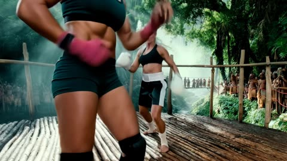</a>

两句话，每份素材一个任务：视频管招式和节奏，两张图管角色长相。

Kling 4.0 · 参考生视频 · 出处: [Kling 4.0 user guide](https://kling.ai/quickstart/kling-4-model-user-guide)

[`fight-scene`](tags.md#tag-fight-scene) [`motion-reference`](tags.md#tag-motion-reference) [`multi-reference`](tags.md#tag-multi-reference) [`character-reference`](tags.md#tag-character-reference)

<details><summary><b>提示词</b></summary>

```text
Use @Video 1 as the reference for the fight choreography and attack timing. Use @Image 1 and @Image 2 as the references for the character designs.
```

</details>

输入素材: [1](https://static--45.klingai-cdn-aws.com/kling-blog/file_by_url/9603ebbdfda76122fdbef0275af4dbad96108fcbb7e46bad56e621feba73c892.png) · [2](https://static-10.klingai-cdn-aws.com/kling-blog/file_by_url/ef4f3b49db4eab2d135518404005e67da24472f824e27b2ddf1c86c2699d9217.png) · [3](https://static--34.klingai-cdn-aws.com/kling-blog/presigned_url/bd79f738-8bdf-4cf8-b02a-be0fad27c733_1-2-1.mp4)

<a id="kling4-office-chair-cliff-jump"></a>
### 照拍一段悬崖跳伞特技，坐骑换成办公椅

<a href="https://static--89.klingai-cdn-aws.com/kling-blog/presigned_url/6277f31b-5c85-4c24-9974-d5254c0fa23c_1-1.mp4">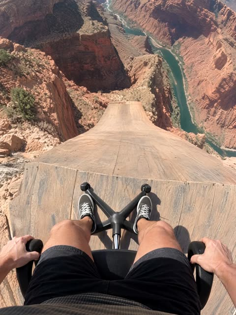</a>

首帧来自图，镜头和剪辑来自视频。逐个列出自行车出现的时刻，保证每一处都换成椅子。

Kling 4.0 · 参考生视频 · 出处: [Kling 4.0 user guide](https://kling.ai/quickstart/kling-4-model-user-guide)

[`motion-reference`](tags.md#tag-motion-reference) [`pov`](tags.md#tag-pov) [`comedy`](tags.md#tag-comedy) [`object-swap`](tags.md#tag-object-swap) [`action`](tags.md#tag-action)

<details><summary><b>提示词</b></summary>

```text
@Image1 is the first frame.  @Video1 is the reference for camera, motion, timing and cuts. Recreate @Video1 shot-for-shot and cut-for-cut, but starting from @Image1: the rider is SITTING in a black office swivel chair instead of standing on a bike. Same chest-mounted GoPro fisheye POV, same ramp, canyon, river, orange parachute with white ring, airboat and cheering crew; same three jump-cuts and audio as video. Wherever the video shows the bike — under the rider on the ramp, shoved away at the cliff, tumbling below in free-fall, and the tiny silhouette during the parachute opening — show the office chair (mesh backrest, padded seat, chrome column, five-spoke base, casters). Before the launch, the rider stays seated exactly as in @Image1: thighs and knees at the bottom of frame, sneakers on the star base, hands on the armrests. No bicycle, handlebar, tyres or pedals anywhere.
```

</details>

输入素材: [1](https://static--11.klingai-cdn-aws.com/kling-blog/file_by_url/a587a7581557e29314065a81c742d18edb842696f595a220c4bd757d9c7a8c83.png) · [2](https://static-96.klingai-cdn-aws.com/kling-blog/presigned_url/bdac1b40-c32d-4f3a-b565-40d258f1d78b_1-1-1.mp4)

<a id="kling4-skater-stair-jump-tracking"></a>
### 低机位一镜跟拍滑手跳台阶

<a href="https://x.com/minchoi/status/2111471588256207357">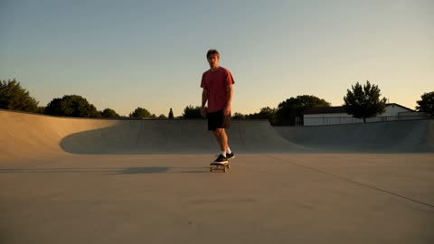</a>

纯文字，30 秒按 6 秒一拍写。测大动作和落地物理，同时保持脸和衣服不变。

Kling 4.0 · 文生视频 · 出处: [@minchoi on X](https://x.com/minchoi/status/2111471588256207357)

[`sports`](tags.md#tag-sports) [`tracking-shot`](tags.md#tag-tracking-shot) [`long-take`](tags.md#tag-long-take) [`physics`](tags.md#tag-physics) [`timed-beats`](tags.md#tag-timed-beats)

<details><summary><b>提示词</b></summary>

```text
30-second continuous low tracking shot of a skateboarder in a concrete park at golden hour. Large dynamic motion, realistic weight and physics.[Skater]: young man, early 20s, faded red T-shirt, black shorts, short hair. Consistent face and outfit.0–6s: He rides toward camera, pushes once, centers his weight. Camera tracks low beside the board.6–12s: He approaches a set of stairs. Knees bend, weight shifts back. Board rises on the tail.12–18s: He clears the stairs. Wheels leave the ground. Cloth and hair react to the motion. He lands with knees absorbing impact.18–24s: He rolls out, slight speed check, then carves hard left. Camera stays locked low and follows.24–30s: Final wide as he rides away into the warm light, board still under him.Natural late-afternoon sun, long shadows, realistic dust and board sound. No slow motion unless specified. Preserve exact clothing and face.
```

</details>

<a id="kling4-ski-film-seven-shots"></a>
### 用一张角色设定图做七个镜头的滑雪片

<a href="https://x.com/minchoi/status/2111471581461426236">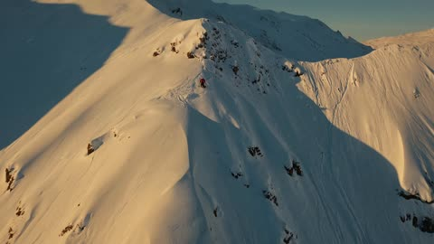</a>

一条雪坡剪成滑雪片，服装由角色参考图锁定，声音写得很细，从雪板刮雪到远处乌鸦。

Kling 4.0 · 参考生视频 · 出处: [@minchoi on X](https://x.com/minchoi/status/2111471581461426236)

[`sports`](tags.md#tag-sports) [`multi-shot`](tags.md#tag-multi-shot) [`character-reference`](tags.md#tag-character-reference) [`sound-design`](tags.md#tag-sound-design) [`golden-hour`](tags.md#tag-golden-hour)

<details><summary><b>提示词</b></summary>

```text
A 30-second, seven-shot ski film edit of Kai <Character reference> skiing one steep, untracked mountain face at golden hour, cut together from several real cameras: a drone, a helmet-mounted action camera, an action camera on a pole, a camera planted in the snow, a chase skier and a long lens across the valley. Photoreal action-sports look, real speed, hard cuts on the action, no slow motion. Kai: athletic man in his 20s, red insulated ski jacket, black ski pants, black gloves, white helmet, mirrored orange goggles, black poles, twin-tip skis. Same outfit and gear in every shot, exactly as in the character sheet. Same mountain face, same powder, and the low sun always on his left as he skis down, throwing long blue shadows across the snow. Shot 1 (0-4s), drone: high aerial view of a sunlit ridge and the whole golden face below it. Kai, small in frame, drops in off the ridge and carves his first big turn, a plume of powder behind him. The drone pushes forward and tilts down to follow. Hard cut. Shot 2 (4-8s), helmet cam: first-person view from an action camera on his helmet, ultra-wide with curved edges. His ski tips and pole baskets at the bottom of the frame, snow rushing underneath, the horizon tilting hard left and right with each carve, powder spraying across the lens. Hard cut. Shot 3 (8-12s), pole cam: an action camera on a short pole held out in his left hand, ultra-wide, pointing back at him. His goggles and helmet fill one side of the frame, his body leaning into a turn, the mountain and sky swinging behind him, snow flecks stuck to the lens. He lets out a wordless shout into the wind. Hard cut. Shot 4 (12-17s), planted cam: a camera set low in the snow just below a wind-lip, pointing up at the sky. Kai launches off the lip and flies straight over the lens, skis crossing the low sun, snow raining down onto the camera, then he lands out of frame behind it. Hard cut. Shot 5 (17-21s), chase skier: a camera on a handheld stabiliser, skiing a few metres behind him at the same speed. He drops into a tuck and straight-lines the fall line, spray from his tails hitting the lens, the slope streaking past. Hard cut. Shot 6 (21-25s), long lens: a telephoto shot from across the valley, slightly shaky, compressing the slope. Kai lays a huge carve and throws a wall of powder backlit gold by the sun. Hard cut. Shot 7 (25-30s), low static camera at the bottom of the run: he skis straight at the lens and skids a hard hockey stop right in front of it, a sheet of snow blasting the camera. As it clears, he pushes his goggles up onto his helmet, breathing hard and laughing. Look: every action-camera shot ultra-wide and crisp with curved edges, small lens flares and snow on the lens; the drone and long-lens shots clean and natural. Warm low sun, long blue shadows, glittering ice crystals in the spray, natural colour, real motion blur. Sound, in stereo, loud and up front like real action-camera audio, never quiet: constant wind roaring and buffeting the camera mics, gusting harder as he picks up speed; the crunch of snow under his skis as he drops in; friends whooping and yelling "Go!" from the ridge at the start; the hiss, scrape and chatter of his edges biting the snow on every carve; poles planting with a crisp crunch; powder spraying off his tails with a soft roar; his hard breathing, and a grunt on the landing; a loud whoosh and the clack of skis as he flies over the planted camera, then the thud of the landing; distant ravens calling across the valley; the ripping sheet of snow blasting the lens on the hockey stop, then his panting laugh and his friends cheering from up the slope. A driving instrumental track with punchy drums sits low underneath, cut on the beat, never covering the natural sound. No subtitles.
```

</details>

<a id="kling4-spy-chase-tearaway-suit-to-banquet"></a>
### 飞车追逐后撕掉外衣，直接走进晚宴

<a href="https://static--59.klingai-cdn-aws.com/kling-blog/presigned_url/f671c2ce-6245-44f4-851a-ed927d4949da_1-1-1.mp4">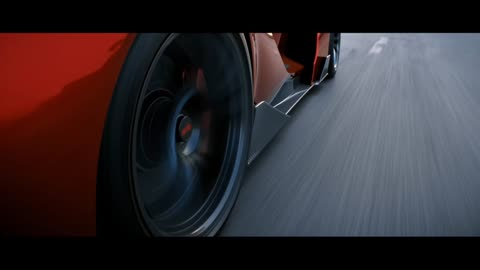</a>

十五秒精确到秒，还写了多数提示词不会写的服装细节：战术外衣带撕裂缝，里面已经穿好礼服，所以换装在镜头里完成。

Kling 4.0 · 参考生视频 · 出处: [Kling 4.0 user guide](https://kling.ai/quickstart/kling-4-model-user-guide)

[`action`](tags.md#tag-action) [`chase`](tags.md#tag-chase) [`handheld`](tags.md#tag-handheld) [`outfit-change`](tags.md#tag-outfit-change) [`timed-shots`](tags.md#tag-timed-shots) [`reference-images`](tags.md#tag-reference-images)

<details><summary><b>提示词</b></summary>

```text
【Overall Style】
15 seconds, realistic live-action cinematic quality. A coastal city street at dusk connects to a staged banquet scene.
Natural handheld cinematography with noticeable vertical movement from footsteps, subtle irregular shake, and framing corrections. Whip pans follow vehicle and character movements, producing brief motion blur before settling back on the target. Movement is intense during the car chase and running sequences, then gradually slows during the banquet sequence.
Characters have slight perspiration, loose strands of hair, and natural clothing wrinkles. Road surfaces, clothing, and equipment show realistic signs of use. Natural colors create visual contrast between the red sports car, flames, and the warm tones of the banquet.
【Characters and Vehicles】
Male Actor:
Around 30 years old, with short dark hair, light stubble, and a lean, athletic build.
While driving and rolling on the ground, he wears a complete spy-action outfit:
A fitted dark charcoal-gray tactical top with a closed neckline;
Matching tactical trousers;
Black leather ankle boots.
The outer costume has tear-away seams designed for quick changes on set. The top opens along the center front and both sides, while the trousers open along the outer seams of both legs.
A white shirt, black bow tie, and dark navy dress trousers are already worn underneath the outer costume.
When the outer costume remains intact, he clearly appears in the dark tactical outfit.
Two additional crew members help him put on the suit jacket later.
The hems of the navy dress trousers cover the shafts of the black ankle boots.
The actor's face, hairstyle, and physique must remain consistent throughout.
Sports Car:
An original red concept sports car with a low, rounded wedge-shaped body, a short front end, a curved cockpit, and wide rear wheel arches.
The front features a continuous horizontal white light bar. The rear has three small circular taillights on each side.
The center of the hood is uninterrupted, smooth red paint. The dark gray wheels have plain metal center caps.
The center of the steering wheel has a solid black leather surface.
The driver's side window is open. The car's overall shape and lighting design must remain consistent across all shots.
Motorcycle Camera Operator:
Wearing dark workwear and a protective helmet, he stands alone on both stunt footpegs of a dark blue sport motorcycle, with his hips higher than the seat. He holds a camera on his shoulder with both hands, leaving the handlebars unoccupied.
He controls the motorcycle using his legs and center of gravity, compensating for bumps with his upper body. The camera is aimed at the sports car's driver.
During the reveal, his full standing posture, both feet, the motorcycle, and the camera must all be clearly visible.
Director:
In his forties, with some gray hair and naturally textured facial features.
He wears a worn-in, short dark brown jacket over a beige crew-neck T-shirt, paired with dark straight-leg trousers.
He holds a digital stopwatch, actively turning his body and gaze to follow the filming action.
A script supervisor, camera assistants, and lighting crew stand nearby. People and equipment in the foreground, beside him, and in the distance create layered depth.
Wardrobe Crew:
Six crew members in ordinary on-set workwear.
The first four, two on the left and two on the right, pull open and remove the outer tactical costume.
The remaining two unfold and help him put on the dark navy suit jacket.
Each person performs a clearly defined action. After removing a garment, the corresponding crew member holds it in their hands.
Female Companion:
Wearing a champagne-gold evening gown and holding her own champagne flute. She stands a few steps inside the banquet entrance.
Waiter:
Standing to one side of the entrance, holding a tray of champagne flutes for the male actor to pick one up as he passes.
【Shots and Actions】
00:00–00:03 | Five Rapid Cuts During the Car Chase
Tire close-up: The rear tire grips the road as the red sports car accelerates.
Foot close-up: The actor's black leather boot presses down on the accelerator.
Eye close-up: The actor quickly assesses the traffic ahead, his face vibrating with the movement of the car.
Hand close-up: Both hands turn the steering wheel decisively.
Slightly wider side shot: The sports car squeezes past an adjacent vehicle, rapidly closing the gap before pulling away again.
The first four shots are brief and punchy. Let the final shot run slightly longer to clearly establish the car weaving through traffic.
00:03–00:09 | Pull Out of the Car, Reveal the Camera Operator, Whip Pan to the Director
Film the driver from near the passenger seat.
The camera moves through the open driver's side window, fully exits the car, and continues pulling outward.
Establish a wide exterior side view:
The red sports car and dark blue motorcycle travel side by side. The camera operator is fully visible from head to toe, standing alone with the camera on his shoulder, aimed directly at the driver.
The sports car steers around a vehicle ahead. The motorcycle leans into the turn in sync, then returns to parallel alignment.
The camera naturally bobs with the speed and road bumps.
As the vehicles pass the director's working area, the camera whips toward the roadside.
A camera assistant's shoulder briefly sweeps through the foreground before the camera settles into an oblique medium close-up of the director.
The director leans forward, his gaze tracking the sports car.
A script supervisor takes notes beside him, while lighting crew and equipment in the distance create a deep, layered production-set background.
He gestures forward and shouts:
“Stay with it! Keep going!”
The entire line must be delivered while the director is on screen.
00:09–00:12 | Sports Car Explosion
Cut to a wider tracking shot alongside the sports car.
A missile with a visible flaming trail enters from the rear left and clearly strikes the rear of the car.
A flash erupts at the point of impact, followed immediately by an explosion at the rear of the vehicle. Flames, black smoke, and debris expand outward.
The car body is thrown upward while continuing its momentum toward the right.
The handheld camera jolts briefly from the impact.
00:12–00:14 | The Actor Rolls into Frame from the Left
Cut to the ground near the adjacent film set.
Wearing the complete dark tactical outfit, the actor rolls close to the ground into frame from the left, moving toward the center.
Burning flames and rising smoke remain visible in the rear left.
Orange light sweeps across his left shoulder, the side of his face, and the ground.
He finishes in a heroic kneeling pose, with one knee on the ground and one hand braced against the ground. His entire body remains visible, and his clothes are covered in dust.
The camera briefly dips with his landing, then readjusts to find the actor.
00:14–00:15 | Facial Close-Up Leading into the Run
Cut to the actor's face.
He exhales, with sweat and dust visible on his face and flickering firelight on his left side.
He raises his eyes and locks his gaze on something ahead. His shoulders lift, and his body begins to launch into a run.
The handheld camera makes small natural movements and quickly rises with him as he gets up, transitioning into the running sequence.
```

</details>

输入素材: [1](https://static-50.klingai-cdn-aws.com/kling-blog/file_by_url/718638a1415f12a8a259928d829f6b96678acf35f7ed493643ddd9acd835b832.png)

<a id="kling4-street-escape-side-tracking"></a>
### 二十秒横向跟拍，女人拖着大包在街上逃

<a href="https://static-60.klingai-cdn-aws.com/kling-blog/presigned_url/a9525d30-1b22-4f61-a7ca-7478eb835d24_1-3.mp4">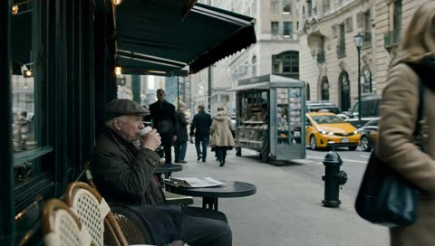</a>

一个横移长镜头。前景出租车和行人不断扫过，12 秒左右一群人完全挡住她，她借机消失。

Kling 4.0 · 首尾帧 · 出处: [Kling 4.0 user guide](https://kling.ai/quickstart/kling-4-model-user-guide)

[`long-take`](tags.md#tag-long-take) [`tracking-shot`](tags.md#tag-tracking-shot) [`chase`](tags.md#tag-chase) [`keyframes`](tags.md#tag-keyframes) [`film-look`](tags.md#tag-film-look)

<details><summary><b>提示词</b></summary>

```text
Generate a 20-second, horizontal 16:9 realistic cinematic street escape video. The entire video must be one continuous lateral side-tracking long take, filmed in a single shot with no cuts, no angle changes, and no scene changes. The scene takes place on a busy Manhattan-style street. Use a cool-toned, low-saturation film look, shallow depth of field, and realistic handheld shoulder-rig or gimbal camera movement. The street features outdoor restaurant seating, yellow taxis, parked vehicles, newspaper stands, fire hydrants, construction scaffolding, storefront windows, white steam rising from subway ventilation grates, pedestrians, and dense crowds in the distance. Foreground objects continuously sweep rapidly across the frame, creating natural occlusions and a convincing sense of street depth. The camera remains parallel to the street, moving laterally to the left while following a young woman running. She carries a large, overstuffed travel bag that is visibly heavy. As she runs, the bag swings with a delayed motion and thuds heavily against the side of her leg, causing her body to tilt slightly off balance. She looks tense and exhausted, breathing rapidly and occasionally glancing back over her shoulder, but no pursuers should appear anywhere in the frame.
0–5s: Establishing shot of a calm street. The camera initially frames an outdoor restaurant seating area. A passerby is lifting a cup of coffee, with round metal tables, wicker chairs, awnings, and pedestrians nearby. Realistic street ambience dominates the audio: traffic, voices, footsteps, and distant horns. The camera moves slowly to the left, keeping the scene calm. A blurred figure of the female protagonist gradually appears at the far right edge of the frame, rushing in at high speed.
5–12s: The woman rushes into frame, and the camera catches up with her. She bursts in from the right, and the camera rapidly accelerates laterally to the left as if her movement is pulling it along, catching up with her. The focus shifts from the street scenery to her face, with slight overshooting and refocusing allowed during the transition. She runs at full speed, mouth open as she gasps for air, brows tightly furrowed, jaw clenched. She looks back over her shoulder twice, with the second glance more pronounced, revealing fear and exhaustion. She carries the heavy, oversized travel bag, which swings with a delay in response to each arm movement and thuds heavily against her leg, throwing her body slightly off balance. She brushes past outdoor seating and runs over subway ventilation grates, stirring up white steam. Pedestrians and street objects in the foreground sweep rapidly across the frame.
12–15s: Occlusion and losing sight of her. A yellow taxi or a group of pedestrians quickly passes between the camera and the woman, completely obscuring the frame for approximately half a second to one second. When the obstruction clears, the woman is no longer at the center of the frame. The camera continues moving laterally but noticeably slows down and briefly loses focus, as if the camera operator is searching for her. The camera sweeps past a lamppost, pedestrians from behind, a newspaper stand, parked vehicles, and reflections in storefront windows.
15–21s: Finding the woman again. The camera continues searching along the sidewalk. Focus briefly shifts back and forth between foreground pedestrians, storefront reflections, and street objects before reacquiring the woman's back and profile farther away. She is still running to the left, but she is more exhausted than before. The camera accelerates again to catch up with her, pulling focus from the foreground pedestrians back to her body and face. Her pace begins to slow, her breathing becomes heavier, her strides shorten, and the travel bag feels increasingly burdensome. She briefly switches the bag to her other hand, then immediately switches it back, gripping the handle tightly as the weight pulls her body increasingly off balance.
21–30s: Running into the crowd and gradually disappearing. The camera reacquires a full-body side view of the woman. She runs past construction scaffolding, while green safety netting and metal poles sweep rapidly across the foreground one by one. Her running reflection briefly appears in storefront glass. Sweat is visible on her face, and her expression shifts from panic to exhausted determination. Finally, she rushes into the dense crowd at the entrance to a pedestrian street, using her shoulder to push past people blocking her way. Her figure is repeatedly obscured by foreground pedestrians, leaving only intermittent glimpses of her profile, jacket, and heavy travel bag. The camera continues moving slowly to the left, struggling to keep her in frame but gradually falling behind. The final shot remains on the flowing crowd, with only her back and a corner of the travel bag visible before they disappear between people.
Audio: No dialogue, no voice-over, and no background music. The soundscape should consist primarily of realistic street ambience: traffic, voices, footsteps, and distant horns. When the camera catches up with the woman, her rapid breathing, footsteps, and the sound of the travel bag thudding against her leg should dominate the center of the soundscape. During occlusion, the whoosh of a passing taxi or the footsteps of the crowd should overpower everything else. When the camera loses sight of her, her breathing should become more distant. After she is found again, her breathing should grow louder and closer. Toward the end, the footsteps and voices of the crowd should gradually swallow her sounds.
Visual style: Realistic cinematic street-chase atmosphere, cool-toned, low-saturation film color grading, detailed shadows, soft highlights, and fine film grain. Shallow depth of field, with foreground and background naturally blurring during movement. Focus should exhibit slight overshooting, refocusing, and brief moments of defocus, resembling manual focus adjustments by a real camera operator. Camera movement should have the authentic feel of a handheld shoulder rig or gimbal, with subtle vertical bobbing, lateral sway, and the inertia of acceleration and deceleration, but no violent shaking.
Negative Constraints: No cuts, no jump cuts, no white flashes, no dissolves, no slow motion, no speed changes, no subtitles, no watermarks, no UI, and no background music. No pursuers, no three men in suits, and no additional clearly identifiable antagonist characters. No mechanical, rail-mounted camera movement. No sliding character motion; the running must convey realistic footfalls and physical weight. Do not make the travel bag appear weightless. Do not make the woman run gracefully or calmly. No body intersections or clipping, no merging of people in the crowd, and no sudden changes of street, character, clothing, or camera angle.
```

</details>

输入素材: [1](https://static-73.klingai-cdn-aws.com/kling-blog/file_by_url/8cacca42bc6f30b6b7005d79689b1514c8aa39570c940406880e1cf7299d3f3f.png) · [2](https://static-18.klingai-cdn-aws.com/kling-blog/file_by_url/981929584e94d954726e341a62ff98315c2bee8aea21d711002dc3f5c4509d72.png)

<a id="omni-skateboard-motion-fx"></a>
### 给真人滑板加卡通动效

<a href="https://storage.googleapis.com/gdm-deepmind-com-prod-public/media/FfbFqJ8qhY_ZWZyz/gemini-omni__prompt-guide__skateboard.webm"></a>

`keeping everything the same` 先锁住原片，改动只叠加特效。

Gemini Omni Flash · 视频编辑 · 出处: [Gemini Omni prompt guide](https://deepmind.google/models/gemini-omni/prompt-guide/)

[`vfx`](tags.md#tag-vfx) [`mixed-media`](tags.md#tag-mixed-media)

<details><summary><b>提示词</b></summary>

```text
Edit this keeping everything the same. Add animated motion effects coming out of the skateboard.
```

</details>

<a id="seedance-blonde-student-hallway-energy-fight"></a>
### 金发学生被同学围在学校走廊里

<a href="https://x.com/AiwithElisia/status/2092119695201837059">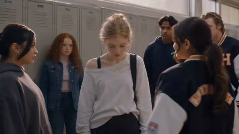</a>

提示词把30秒内容拆成几个段落（写实开场、能量升级、动作戏、安静收尾），每段配独立的镜头语言：开场用手持跟拍保证真实感，慢动作只用于最强的攻击。结尾重复列出禁止文字、标志和畸形肢体的约束，稳定写实画面。

Seedance 2.5 · 文生视频 · 出处: [@AiwithElisia on X](https://x.com/AiwithElisia/status/2092119695201837059) · 发现于 [LearnPrompt/awesome-seedance](https://github.com/LearnPrompt/awesome-seedance)

[`cinematic`](tags.md#tag-cinematic) [`handheld-camera`](tags.md#tag-handheld-camera) [`superhero-action`](tags.md#tag-superhero-action) [`slow-motion`](tags.md#tag-slow-motion)

<details><summary><b>提示词</b></summary>

```text
Create a cinematic, photorealistic 30-second live-action video set inside a modern American high school hallway lined with beige lockers. A beautiful young blonde female student with tied-back blonde hair, wearing a loose white long-sleeve top, black mini skirt, black backpack and casual shoes, walks through the crowded hallway while several students around her watch and interact with her.

Start with a natural medium shot of the girl walking between other students. Use realistic handheld camera movement, shallow depth of field, soft cinematic lighting, natural skin texture, realistic facial expressions and authentic high-school atmosphere.

As she continues walking, tension suddenly builds. A female student in a dark varsity-style jacket approaches her. The blonde girl raises her hand and mysterious pink-red energy begins glowing around her hands. Small luminous particles and sparks appear in the air. The energy gradually becomes stronger, creating a supernatural aura around her body.

Transition smoothly into an intense superhero-style action sequence in the same school corridor. The blonde girl suddenly moves with extraordinary speed and power, dodging an attacking male student and striking him with glowing pink-red energy. Show dynamic martial-arts-inspired movements, fast footwork, powerful kicks and punches, with energy trails following her movements.

Use cinematic slow motion for the strongest attacks, followed by fast-paced cuts. Show students reacting and moving away in fear as the fight continues down the hallway. The glowing pink-red energy should illuminate the lockers, floor and characters realistically, with subtle volumetric light, sparks, smoke and motion blur.

Include a dramatic moment where the girl performs a powerful spinning kick while surrounded by bright pink-red energy, sending the opponent backward. Keep the choreography physically believable and visually grounded, avoiding cartoonish effects.

Near the end, the hallway becomes quiet. The glowing energy disappears and the girl calmly continues walking toward the camera as if nothing happened. End with a close-up/medium close-up of her face with a confident, serious expression.

Visual style: photorealistic Hollywood superhero movie, cinematic color grading, realistic teenage/high-school environment, detailed faces, natural skin, realistic clothing and hair physics, realistic lighting, subtle film grain, shallow depth of field, professional cinematography, dynamic camera movement, high-detail VFX, realistic particle effects, 4K cinematic quality.

Camera: handheld tracking shots, medium shots, close-ups, low-angle action shots, smooth whip-pans, controlled motion blur, occasional slow motion during attacks.

Aspect ratio: 16:9.
Duration: approximately 30 seconds.
No text, no subtitles, no logos, no watermark, no distorted faces, no extra fingers, no unnatural anatomy.
```

</details>

<a id="seedance-blue-hair-katana-duel-glass-hall"></a>
### 蓝发持刀少女在玻璃大厅中的对决

<a href="https://x.com/AvelyrahnAI/status/2093540453261946900">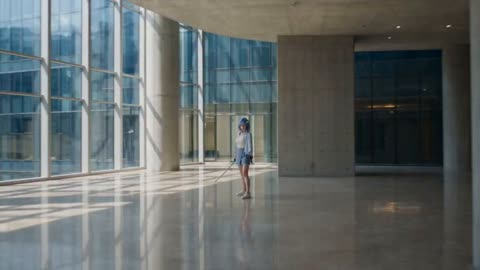</a>

提示词先锁定单一场景和跟拍镜头，再逐一写明两名对手的外形与武器，让打斗调度清晰可读。子弹时间、木屑、烟雾、体积光等效果叠加，支撑起一镜到底的长动作段落。

Seedance 2.5 · 文生视频 · 出处: [@AvelyrahnAI on X](https://x.com/AvelyrahnAI/status/2093540453261946900) · 发现于 [LearnPrompt/awesome-seedance](https://github.com/LearnPrompt/awesome-seedance)

[`action`](tags.md#tag-action) [`anime-inspired`](tags.md#tag-anime-inspired) [`tracking-shot`](tags.md#tag-tracking-shot) [`bullet-time`](tags.md#tag-bullet-time) [`long-take`](tags.md#tag-long-take)

<details><summary><b>提示词</b></summary>

```text
Cinematic action sequence, dynamic tracking shot in a modern glass-and-concrete architectural hall. A stylish anime-inspired girl with vibrant light-blue bob hair and cute blue/white hair clips wields a handgun and a katana, engaging in intense hand-to-hand combat against a nimble blonde rival armed with dual daggers. High-speed bullet-time perspective, dramatic close-ups, flying wood splinters, dynamic smoke effects, volumetric lighting, photorealistic skin texture, dramatic cinematic framing, 8k resolution, highly detailed martial arts choreography.
```

</details>

<a id="seedance-coastal-crime-game-livestream-facecam"></a>
### 带主播小窗的海滨犯罪游戏直播

<a href="https://x.com/QAiStudio/status/2099363620325048805">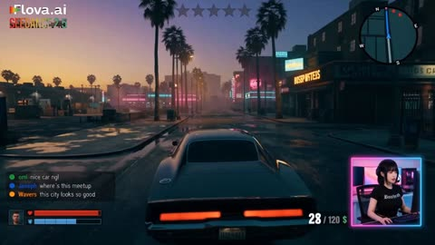</a>

固定HUD加参考图锁定的右下角主播小窗，配合英文聊天栏和按秒分段的节拍表，每个时间段只写一个动作和一次HUD变化。末尾的严格规则限定角色数量、武器和结局，让30秒开场加15秒续写的长镜头保持一致。

Seedance 2.5 · 参考生视频 · 出处: [@QAiStudio on X](https://x.com/QAiStudio/status/2099363620325048805) · 发现于 [LearnPrompt/awesome-seedance](https://github.com/LearnPrompt/awesome-seedance)

[`gameplay`](tags.md#tag-gameplay) [`livestream`](tags.md#tag-livestream) [`hud`](tags.md#tag-hud) [`long-take`](tags.md#tag-long-take) [`photorealistic`](tags.md#tag-photorealistic)

<details><summary><b>提示词</b></summary>

```text
Photorealistic fictional open-world coastal crime-action gameplay livestream, 16:9, one continuous 45-second take split into a 30-second opening plus a seamless 15-second continuation. Fixed full-screen game HUD throughout: bottom-right square pink-blue neon facecam of HANEUL only, matching the supplied reference image exactly; fixed HUD, English-only scrolling live chat on the left, Korean streamer speech only with no subtitles, third-person chase camera, no cuts, no transitions, no scene changes, no duplicate characters.

0–8s: Player drives a dark muscle car through a neon coastal city at dusk toward a GPS destination; HANEUL is calm and focused in facecam, with engine, city ambience, faint radio, and keyboard/mouse sounds.

8–15s: At a warehouse, exactly two dark-red-jacket gang enemies emerge from cover, draw pistols, and ambush the player. The player dives behind a car, is visibly grazed, health drops, and wanted level rises to two stars. HANEUL reacts in shocked Korean.

15–24s: Intense reckless firefight. Player uses one compact SMG; enemies use pistols only. A flanking enemy shatters a nearby car window, bullets dent the car and pop a tire, ammo falls from 38/120 toward 24/120, wanted level reaches three stars, and distant police cruisers appear only in the background.

24–30s: Player fires five deliberate SMG shots with visible sequential hit reactions; both enemies fall only after being hit. Ammo drops exactly from 24/120 to 14/120. HANEUL remains wide-eyed and tense; police sirens close in.

30–38s: With both enemies down, the player limps into the damaged muscle car with a shredded tire. Two police cruisers pursue in the background as the car lurches forward on its rim. Health remains critically low and flashing red; wanted level stays at three stars.

38–45s: Player scrapes through a narrow alley, knocks off both mirrors, and reaches a side street where traffic briefly blocks the police. The wanted level remains flashing at three stars, police lights remain visible in the rearview, and the ending stays unresolved.

Strict rules: HANEUL appears only in the bottom-right fixed facecam; exactly one player and two gang enemies; no extra armed characters; no full-screen facecam; no subtitles; English-only HUD/chat text; no weapon swaps; no gore; no victory, clean escape, black screen, or end card.
#flovacpp #flovaai
```

</details>

<a id="seedance-convenience-store-number-four"></a>
### 便利店外女子用借力化解三人围堵

<a href="https://x.com/aiwithaly/status/2106981702677451248">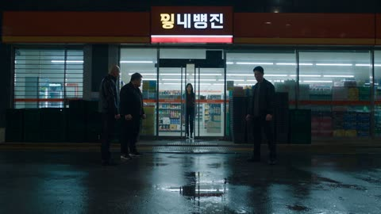</a>

提示词把30秒拆成按顺序排列的段落，每句台词和每个动作各占一句。动量、惯性、杠杆等物理词加上很长的负面清单，并限定只有环境声和撞击声，让打斗保持写实。

Seedance 2.5 · 文生视频 · 出处: [@aiwithaly on X](https://x.com/aiwithaly/status/2106981702677451248) · 发现于 [LearnPrompt/awesome-seedance](https://github.com/LearnPrompt/awesome-seedance)

[`action-thriller`](tags.md#tag-action-thriller) [`dialogue`](tags.md#tag-dialogue) [`choreography`](tags.md#tag-choreography) [`night`](tags.md#tag-night) [`korean`](tags.md#tag-korean)

<details><summary><b>提示词</b></summary>

```text
Create an exactly 30-second, 16:9, 24fps hyper-realistic Korean live-action action thriller with dry dark comedy. Nighttime outside a modern Korean convenience store, wet pavement reflecting storefront lights.

PYONA exits carrying a small paper bag. Three intimidating adult men surround her. The leader says, “You have three choices: give us your phone, apologize, or fight.”

PYONA calmly studies the gap between them and says, “I'll take number four.” She walks through the opening and adds, “You leave.” The leader's smile disappears.

He grabs her forearm. She looks at his hand and says, “That was the wrong answer.” When he pulls her, she steps toward him, rotates with his force and redirects his momentum into the convenience-store door.

A second man charges with a punch. PYONA sidesteps and redirects him into the first man. A third attacks from behind; she steps aside and redirects him into stacked plastic crates, which collapse from the collision.

The three men freeze. The leader asks, “Who are you?” PYONA calmly replies, “I already told you.” She picks up her bag, walks past them, then looks back and says, “Number four.”

Cut to black.

Use grounded physical choreography: realistic weight, momentum, inertia, friction, leverage, balance and collision reactions. PYONA wins through timing and redirection, never superhuman strength.

Controlled cinematic camera with consistent screen direction and clear full-body framing during physical actions. Natural nighttime ambience and realistic impact sounds only. No music or narration.

Negative prompt: supernatural strength, flying bodies, wire-fu, invisible force, impossible throws, premature falls, teleportation, duplicate characters, appearance drift, costume changes, location changes, excessive camera shake, exaggerated slow motion, cartoon physics, blood, gore, weapons, broken bones, head impacts, logos, watermark.
```

</details>

<a id="seedance-crimson-flashpoint-armored-hero-rain-fight"></a>
### 霓虹雨夜中装甲英雄大战蒙面人

<a href="https://x.com/Xaroon_x/status/2110248837432439129">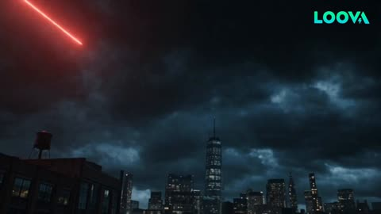</a>

提示词把 48 秒拆成十二个 4 秒镜头，每个镜头只写一种运镜和一个动作节点。场景、主角、敌人、音频、连贯性和负面词各自独立成块，并用参考图锁定主角形象，保证身份和盔甲前后一致。

Seedance 2.5 · 参考生视频 · 出处: [@Xaroon_x on X](https://x.com/Xaroon_x/status/2110248837432439129) · 发现于 [LearnPrompt/awesome-seedance](https://github.com/LearnPrompt/awesome-seedance)

[`superhero`](tags.md#tag-superhero) [`action`](tags.md#tag-action) [`multi-shot`](tags.md#tag-multi-shot) [`rain`](tags.md#tag-rain) [`cinematic`](tags.md#tag-cinematic)

<details><summary><b>提示词</b></summary>

```text
CRIMSON FLASHPOINT — 48 seconds, 16:9, 12 shots × 4 seconds. Photorealistic Hollywood superhero action film, ARRI ALEXA 65, anamorphic look, subtle film grain.

LOCATION: Rain-soaked neon downtown intersection at night, glass skyscrapers, abstract cyan/magenta/amber signs, reflective wet asphalt, steam grates, parked cars, dark alley on the right. Heavy rain throughout; crimson is the dominant accent.

HERO (@image1): Preserve identical face, hair, beard, skin tone, age, and build in every shot. Original outfit before transformation; afterward, matte-black articulated armor with glowing crimson seams across ribs, arms, legs, and spine, segmented chest plate with a faint red core, fingerless armored gloves. No helmet or cape; face fully visible.

ENEMIES: Exactly three masked men in black tactical jackets, cargo pants, grey gloves, and matte-black full-face masks. Man 1 is tall and lean with a steel baton; Man 2 is broad with a crowbar; Man 3 has a medium build and baton. No dialogue.

SHOT 01 (00–04): Extreme-wide low-angle skyline under storm clouds. A bright crimson streak cuts diagonally through the sky, illuminating rain and glass towers.

SHOT 02 (04–08): Fast overhead tracking follows the falling streak toward street level. A faint human silhouette appears inside the light as crimson reflections sweep across the road.

SHOT 03 (08–12): Hero lands in a one-knee, one-fist crouch in his original outfit. Water explodes outward; red energy threads crawl across his arms and torso.

SHOT 04 (12–16): Smooth 360° orbit as crimson energy assembles the black armor panel by panel. The chest plate locks into place and red seams ignite.

SHOT 05 (16–20): 85mm close-up. Rain beads on his face and armor; a red spark flickers in his eyes as he looks forward with controlled determination.

SHOT 06 (20–24): Low side-tracking shot. Fully armored hero sprints down the wet street at superhuman speed, spraying water and leaving a thin crimson trail.

SHOT 07 (24–28): Over-the-shoulder shot. Three masked men emerge from the right-side alley, spreading out with weapons ready. Hero skids to a defensive stop.

SHOT 08 (28–32): Hero dashes forward as a crimson blur and strikes Man 1, launching him backward. Rain and water burst outward in slow motion.

SHOT 09 (32–36): Man 2 swings his crowbar. Hero ducks, spins, and lands one strike, sending him sliding through a puddle toward a parked car.

SHOT 10 (36–40): Man 3 lunges with his baton. Hero dodges inches away and delivers a powerful palm strike, blasting him backward through an explosive ring of water. Bright crimson flash at impact.

SHOT 11 (40–44): Wide low-angle pull-back. Hero stands calmly between all three fallen attackers as rain pours over his armor and crimson seams gradually dim.

SHOT 12 (44–48): Extreme close-up of the hero lifting his head with quiet confidence. A tiny red spark crosses his eyes before the image cuts to black.

AUDIO: Original cinematic orchestral-synth score, heavy rain, electrical crackle, realistic impacts, water splashes, accelerating percussion, and a powerful musical peak at Shot 10. No dialogue.

CONTINUITY: Maintain exact hero identity, armor design, enemy count, location layout, lighting, and screen direction across all shots. Realistic physics, consistent rain, natural motion blur, controlled speed ramps, clean cuts, and stable camera movement.

NEGATIVE: Cartoon, artificial CGI appearance, plastic skin, face changes, inconsistent armor, extra characters, duplicate bodies, extra fingers, deformed hands, cape, helmet, yellow accents, lightning-bolt emblem, blood, gore, impossible physics, random camera movement, jitter, flicker, readable text, logos, or watermark.
```

</details>

<a id="seedance-cyberpunk-mecha-vs-alien-monster-battle"></a>
### 机甲在赛博朋克废墟中大战异形怪兽

<a href="https://x.com/laviniavelle/status/2109504064186982604">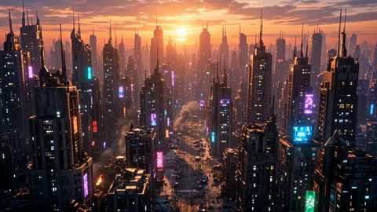</a>

提示词先交代场景与时间，再用鲜明的颜色和发光细节分别描绘两个对手。动词按顺序排出动作节拍：落地、烟中现身、闪避、斩击。结尾用画质与镜头一句收束，要求快节奏运镜。

Seedance 2.5 · 文生视频 · 出处: [@laviniavelle on X](https://x.com/laviniavelle/status/2109504064186982604) · 发现于 [LearnPrompt/awesome-seedance](https://github.com/LearnPrompt/awesome-seedance)

[`cyberpunk`](tags.md#tag-cyberpunk) [`mecha`](tags.md#tag-mecha) [`monster`](tags.md#tag-monster) [`action`](tags.md#tag-action) [`sci-fi`](tags.md#tag-sci-fi)

<details><summary><b>提示词</b></summary>

```text
Cinematic action sequence in a futuristic, dystopian cyberpunk city at sunset, with towering skyscrapers, glowing neon signs, and a ruined street covered in rubble and abandoned cars. A powerful, heavily armored blue and silver mecha robot with glowing blue energy blades on its arms lands heavily on the cracked asphalt, creating a cloud of dust. A massive, ferocious alien monster with red glowing eyes and spiked armor emerges from the smoke, roaring. The mecha engages in a dynamic, high-speed battle with the creature, dodging attacks, slashing with its energy swords, and sparking with electric energy. Epic movie quality, detailed textures, dramatic lighting, and fast-paced camera movement.
```

</details>

<a id="seedance-golden-hour-lot-fight-sequence"></a>
### 黄金时刻停车场里的两人格斗

<a href="https://x.com/Elvorya/status/2101147922251579718">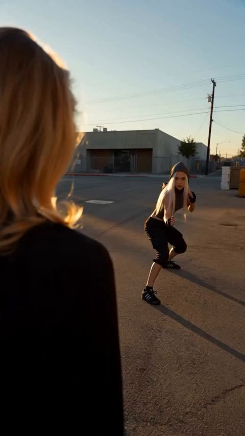</a>

提示词用箭头串起各个镜头，每个镜头只写一个机位和一个动作节点，从过肩开场到飞踢、倒地，再到自拍式收尾。末尾的长串画面风格词和负面提示词让画面保持写实、人物前后一致。

Seedance 2.5 · 文生视频 · 出处: [@Elvorya on X](https://x.com/Elvorya/status/2101147922251579718) · 发现于 [LearnPrompt/awesome-seedance](https://github.com/LearnPrompt/awesome-seedance)

[`action`](tags.md#tag-action) [`fight-scene`](tags.md#tag-fight-scene) [`golden-hour`](tags.md#tag-golden-hour) [`photorealistic`](tags.md#tag-photorealistic) [`multi-shot`](tags.md#tag-multi-shot)

<details><summary><b>提示词</b></summary>

```text
Create a 15-second photorealistic cinematic action sequence featuring a stylish blonde woman in a black blazer, white fitted top, and black pants, fighting another blonde woman in an industrial urban parking/loading area during golden-hour sunset.

Begin with a dynamic over-the-shoulder shot of the main woman standing in an empty concrete industrial lot as another woman approaches rapidly in the background → cut into an extreme close-up side angle as the opponent throws a powerful punch toward her face, with the camera moving alongside the action and her blonde hair flowing dramatically in the wind → transition into a wide low-angle shot showing the main woman reacting and engaging in hand-to-hand combat → she performs a fast evasive movement and powerful spinning kick while the opponent attacks → cut to a low-angle tracking shot as both women exchange rapid punches and defensive movements beside a large industrial roller door and stacked cardboard boxes → show the main woman delivering a dramatic flying kick, captured with cinematic motion blur → transition into a wider shot as the opponent falls hard onto the concrete ground → the main woman slowly walks toward the camera while the fallen opponent remains in the background → final shot becomes an intimate handheld close-up/selfie-style shot of the main woman looking directly toward the camera, touching her hair/forehead with one hand and giving a calm, confident expression.

Visual style: photorealistic Hollywood action cinematography, realistic human anatomy, believable martial-arts choreography, natural facial expressions, realistic skin texture, detailed blonde hair movement, black-and-white fitted clothing, industrial warehouse exterior, concrete pavement, warm golden-hour sunlight, long shadows, dramatic backlighting, subtle lens flare, shallow depth of field, cinematic motion blur, dynamic handheld camera, low-angle action shots, smooth rapid transitions, realistic physics, energetic pacing, high-detail 4K cinematic look, cohesive character appearance throughout.

Negative prompt: animation, cartoon, anime, CGI appearance, unrealistic physics, distorted faces, extra fingers, malformed hands, duplicated people, warped limbs, floating objects, excessive motion blur, unnatural poses, gore, blood, subtitles, text, logos, watermark.
```

</details>

<a id="seedance-golden-knight-cathedral-demon-battle"></a>
### 金甲骑士在残破教堂中对抗恶魔

<a href="https://x.com/itsSaira_1/status/2111672000200724504">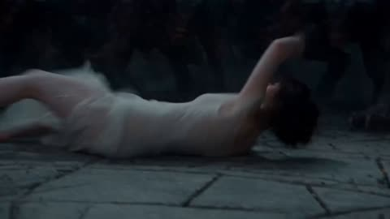</a>

把31秒拆成带时间码的分镜,每段写明景别、运镜和动作,镜头顺序因此固定。结尾的风格段和长负面清单锁定建筑、盔甲和盾牌徽记,保持跨镜头一致。

Seedance 2.5 · 文生视频 · 出处: [@itsSaira_1 on X](https://x.com/itsSaira_1/status/2111672000200724504) · 发现于 [LearnPrompt/awesome-seedance](https://github.com/LearnPrompt/awesome-seedance)

[`dark-fantasy`](tags.md#tag-dark-fantasy) [`timed-shots`](tags.md#tag-timed-shots) [`cinematic`](tags.md#tag-cinematic) [`action`](tags.md#tag-action) [`negative-prompt`](tags.md#tag-negative-prompt)

<details><summary><b>提示词</b></summary>

```text
0–3s | Opening shot: Low-angle wide close-up of a wounded woman lying on a cracked stone floor inside a ruined Gothic cathedral. Dark horned monsters and twisting tentacles loom in the background. Slow cinematic camera movement.

3–5s | Rising movement: The woman pushes herself up from the floor, raising one arm as a bright white magical blade of light forms in her hand. Medium shot, smooth upward camera movement.

5–7s | Magical activation: She kneels and grips the vertical white energy blade touching the floor. A brilliant golden circular rune spreads beneath her, illuminating the stone floor. Low wide shot.

7–10s | Cathedral reveal: Camera tilts sharply upward, revealing towering broken Gothic arches, a shattered roof, moonlit clouds and dark creatures silhouetted above. Transition to the golden-armored warrior emerging through red smoke.

10–12s | Helmet close-up: Tight frontal close-up of a fully enclosed dark metal knight helmet, narrow black eye slit, engraved steel plates. Slow camera push-in.

12–15s | Golden knight reveal: Cut to a heroic low-angle shot of a knight wearing ornate gold-and-silver armor, carrying a large shield with a glowing golden sun emblem and a heavy war hammer. He stands inside the ruined cathedral.

15–18s | First magical attack: The knight raises his shield and releases an intense white-gold energy blast. Bright light fills the frame. Camera tracks the blast, with sparks and magical particles.

18–20s | Energy impact: The white magical blast expands into a brilliant screen-filling flash. Strong bloom, fast cinematic transition, brief motion blur.

20–23s | Demon confrontation: Wide side view of the golden knight standing firm while a huge reddish-black horned demon lunges toward him. Long claws and dark tendrils extend toward the knight. The wounded woman remains visible in the background.

23–25s | Demon attack: The demon sweeps its claws forward. A bright golden energy projectile travels across the cathedral between the creature and the knight. Dynamic lateral camera movement.

25–27s | Magical shield: The knight raises his shield as a large circular white magical barrier with intricate glowing runes forms in front of him. The demon attacks the barrier, creating rippling light and sparks.

27–31s | Final wide shot: Camera pulls back to show the entire ruined cathedral. The golden knight stands in the centre of a glowing golden rune circle, shield raised and hammer in hand. The demon recoils on the left, while the wounded woman remains on the floor behind him beside the vertical white energy blade. Smoke, floating embers, blue moonlight and golden illumination. Hold the final composition.

VISUAL STYLE: Photorealistic dark fantasy film, 16:9 widescreen, cinematic lighting, realistic armor and stone textures, cold blue shadows, warm golden highlights, volumetric smoke, dramatic contrast, consistent architecture, smooth camera movements, exact shot order and timing.

NEGATIVE PROMPT: Different shot order, altered camera angles, random cuts, changed framing, different cathedral, different character positions, inconsistent armor, changing shield emblem, extra characters, duplicated limbs, deformed anatomy, cartoon, anime, low quality, excessive blur, shaky camera, camera flip, 180-degree rotation, unnatural movement, floating weapons, text, subtitles, watermark, logos.

#AI #AIart #VisualArt
```

</details>

<a id="seedance-gym-static-martial-arts-vs-five-bullies"></a>
### 女高中生在体育馆以静电武术击退五名霸凌者

<a href="https://x.com/doctorwasif/status/2091388398153994395">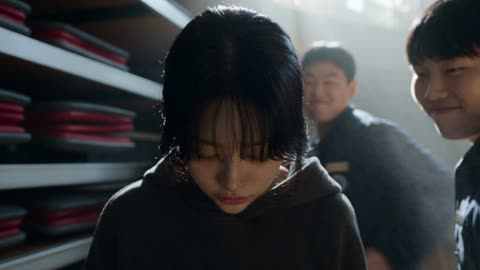</a>

三十秒单镜头按三到五秒分段写清台词与动作，每段都有极短的撞击慢动作再切回实时。规则段把特效限定为由接触产生的白蓝静电，并要求镜头跟不上她的加速，所以画面真实且动作清楚。

Seedance 2.5 · 文生视频 · 出处: [@doctorwasif on X](https://x.com/doctorwasif/status/2091388398153994395) · 发现于 [LearnPrompt/awesome-seedance](https://github.com/LearnPrompt/awesome-seedance)

[`martial-arts`](tags.md#tag-martial-arts) [`photorealistic`](tags.md#tag-photorealistic) [`one-take`](tags.md#tag-one-take) [`handheld`](tags.md#tag-handheld) [`korean-dialogue`](tags.md#tag-korean-dialogue)

<details><summary><b>提示词</b></summary>

```text
30s | 16:9 | one continuous generation | ultra-photorealistic live-action AAA martial-arts VFX

SO-YEON is the exact same real human throughout, 160cm small frame, messy black hair, black hoodie/sweats/Converse, natural pores/eyes/hair/biomechanics. Never CGI/digital double. Empty Korean high-school gym, late afternoon, sunbeams/dust, bleachers, scoreboard, basketballs, badminton rackets. 5 unarmed delinquent male classmates in dark untidy uniforms. Korean dialogue, no BGM/subtitles; only diegetic ambience, voices, impacts, static hiss.

00–03: So-Yeon cowers by bleachers, surrounded. Leader smacks her head: “어쭈? 이 년 봐라? 많이 컸다?” She glares coldly through bangs, then fear returns: “아…! 미안…”

03–06: He swings again.

06–09: 0.3s micro-slow-mo: awakened body autonomously slips fist → Silat parry → pivot → body punch. THUMP + sharp white-blue static flash. Hair rises, dust scatters. Snap back to real-time; leader crashes/slides away.

09–12: She stares at trembling hand, tiny static crawling between fingers, terrified/disbelieving. “저 년이?!” Four rush simultaneously.

12–17: Extreme physical dash: PARRY → wrist redirect → elbow → low sweep; side-kick second attacker. 0.2s impact slow-mo with branching static flash, hair/uniform fibers rising, papers/shuttlecocks scattering. Snap back; never stops.

17–22: Two attack together. Diagonal dash → duck hook → redirect momentum → high roundhouse. Static arc-flash at impact; hair stands up, shuttlecocks fly, scoreboard flickers.

22–27: Final attacker from behind. Maximum real-body acceleration; camera lags/overshoots, violent whip-pan reacquires. Evade → parry → redirect → jab → body punch → low kick → spinning Taekwondo back kick. 0.25s slow-mo: dense branching static at heel impact, uniform puffs, dust/paper pulled inward then blasted outward.

27–30: Violent physical discharge: KRA-KRACKLE! Static-white ring races across floor; dust/paper explode outward, fluorescent lights flicker, basketball rolls off cart. Enemy slides far away. Flash hits lens: flare/interference/dust, then rapid stabilization. So-Yeon lands, sees fading sparks on her hands, half fear/half wonder, exhales, straightens and walks calmly through dust, hair falling over eyes. Never looks back. CUT.

COMBAT: Awakened So-Yeon fights completely unarmed, calm/precise/extremely fast, fluid Taekwondo × Karate × Pencak Silat: punch → kick → evade → parry → redirect → dash → counter → sweep → palm/elbow → angle change. No reset poses; momentum continuously flows. Bullies attack simultaneously, never take turns.

STATIC BLOOM RULE: White-blue friction discharge ONLY. Real-time → physical dash burst → 0.15–0.35s impact slow-mo → snap back. Sparks crawl along skin/hair/hoodie; hair/threads lift; filaments jump between fingers/joints; dust follows slipstream. No teleportation, aura, projectile, beam, plasma, fireball, petals, or magic. Every discharge must originate from visible physical contact and extreme velocity. Impact → charge build → branching arc → dust/paper scatter. Static never causes the initial impact.

CAMERA: close, kinetic handheld pursuit, tracking, low angles, OTS/facial inserts, rapid focus shifts, whip-pans; follows but cannot perfectly anticipate acceleration. Shake only from real impacts/discharges. Action readability > chaos.
```

</details>

<a id="seedance-helicopter-news-dirt-bike-pursuit"></a>
### 直升机新闻镜头拍摄的越野摩托追逐

<a href="https://x.com/CharaspowerAI/status/2111517673276240251"></a>

全程锁定单一直升机视角，并刻意写入抖动变焦、压缩伪影、热浪和迟到的摇镜，让画面像未经修饰的新闻素材。六个带时间码的段落逐步升级动作，旋翼声、电台杂音和结尾的记者台词构成声音层。

Seedance 2.5 · 文生视频 · 出处: [@CharaspowerAI on X](https://x.com/CharaspowerAI/status/2111517673276240251) · 发现于 [LearnPrompt/awesome-seedance](https://github.com/LearnPrompt/awesome-seedance)

[`aerial`](tags.md#tag-aerial) [`news-footage`](tags.md#tag-news-footage) [`motocross`](tags.md#tag-motocross) [`handheld-realism`](tags.md#tag-handheld-realism) [`timed-beats`](tags.md#tag-timed-beats)

<details><summary><b>提示词</b></summary>

```text
Ultra-realistic viral helicopter pursuit footage, raw local-news style, filmed entirely from one helicopter in bright Los Angeles daylight. Long-lens aerial camera, unstable vibration, abrupt zooms, compression artifacts, heat haze, autofocus breathing, imperfect framing, rotor thump, distant radio chatter, harsh California sun, no cinematic polish, believable amateur-news realism.

Main subject: one motocross rider on a dirt bike, full helmet and motocross gear, highly skilled, aggressive but controlled riding. Keep the same rider and same bike throughout.

Los Angeles daytime: palm-lined boulevard, parking lots, freeway ramps, concrete flood channel, industrial blocks, overpasses, service roads and distant skyline.

0-5s: Immediate viral hook The helicopter camera is already searching frantically when the rider suddenly blasts into frame between moving cars. Operator snaps into a shaky zoom. The rider jumps a curb, cuts across a parking lot and nearly disappears behind palm trees.

5-10s: Chaotic tracking He rejoins a boulevard, threads through traffic, then veers up a sloped driveway and launches over a low divider. Camera over-zooms, loses him for half a second, then catches him landing cleanly.

10-15s: Escalation The rider enters a concrete flood channel. Huge aerial reveal. He accelerates along the channel floor while the helicopter banks hard overhead. Dust trails behind the bike. Quick zoom on spinning rear wheel and suspension.

15-20s: Viral stunt beat He rides up the angled concrete wall, holds a dramatic high line for a moment, then drops back down smoothly. Camera shakes violently trying to follow. Rotor vibration and radio chatter intensify.

20-25s: Big surprise The rider exits through a service ramp, crosses beneath an overpass, then unexpectedly appears on a parallel industrial road. The operator pans late and barely recovers him. He hits a natural rise and gets long airtime in full daylight.

25-30s: Iconic ending He lands, accelerates toward another overpass and vanishes into shadow underneath. The helicopter overshoots, circles, zooms wildly across multiple roads, but he is gone. Reporter voice, stunned: “We just lost him.” Hold on shaky wide aerial of Los Angeles. Hard cut.

One continuous helicopter perspective, strong amateur-news authenticity, same rider throughout, realistic motocross physics, believable Los Angeles geography, harsh daylight, imperfect tracking, viral unpredictability, readable stunts, no crash, no gore, no readable text, no logos.

#DreaminaCPP  @dreamina_ai
```

</details>

<a id="seedance-katen-kyokotsu-bankai-thread-web"></a>
### 森林剑斗转入卍解白丝大网

<a href="https://x.com/itxabdullaa/status/2102609881677107243"></a>

两张参考图锁定两名角色的外观，按时间段拆分的分镜表让每个动作直接引发下一个事件，十秒内的节奏层层递进。禁止发光气场并要求水、布料和花瓣遵循真实物理，使画面保持实拍质感。

Seedance 2.5 · 参考生视频 · 出处: [@itxabdullaa on X](https://x.com/itxabdullaa/status/2102609881677107243) · 发现于 [LearnPrompt/awesome-seedance](https://github.com/LearnPrompt/awesome-seedance)

[`sword-fight`](tags.md#tag-sword-fight) [`fantasy-action`](tags.md#tag-fantasy-action) [`live-action`](tags.md#tag-live-action) [`timed-beats`](tags.md#tag-timed-beats)

<details><summary><b>提示词</b></summary>

```text
SCENE — KATEN KYŌKOTSU: KARAMATSU SHINJŪ
DURATION: exactly 10 seconds
FORMAT: 16:9
STYLE: ultra-photorealistic live-action cinematic fantasy action, grounded CGI, desaturated palette, high-contrast lighting, realistic anatomy and physics, dark supernatural atmosphere, cinematic Japanese tragedy, practical environmental interaction, no digital-art appearance.
PACE: extremely fast continuous escalation, zero pause, zero dead frame.

REFERENCES
IMAGE 1 — PAKSHUN
Preserve facial identity, hairstyle, costume, proportions, and appearance exactly.

IMAGE 2 — OPPONENT
Preserve facial identity, hairstyle, costume, proportions, and appearance exactly.

ACTION

0.0–2.0 SECONDS — BANKAI
Tight rear three-quarter shot. Opponent charges. Pakshun lowers his sword and says: 「卍解……花天狂骨枯松心中。」
A violent pressure wave tears across the ground. Dust, leaves, debris, and hundreds of dark petals rise. The environment rapidly desaturates into black, grey, and pale tones. Camera performs a fast 360° orbit as Opponent closes in.

2.0–4.0 SECONDS — SHARED WOUND
Opponent attacks. Pakshun pivots and cuts across his torso. An identical wound instantly appears on Pakshun. A thin crimson thread connects both wounds as Opponent retreats. The ground cracks beneath it and black water erupts upward.

4.0–6.5 SECONDS — THE DROWNED STAGE
A massive wave floods the battlefield. Camera dives underwater seamlessly. Both characters struggle violently against the current, with realistic movement of soaked clothing, hair, debris, and petals. Pakshun plants his feet and pulls one hand back. The entire current suddenly freezes in turbulent suspension.

6.5–8.5 SECONDS — WHITE THREADS
Pakshun rises through the suspended water. Countless thin white threads spread behind him into a huge web. Opponent tries to escape, but threads catch his wrist, arms, torso, and legs, tightening and dragging him toward the center. Pakshun advances. Camera rapidly pulls back to reveal the full structure.

8.5–10.0 SECONDS — HAKKA NO TOGAME
Pakshun grips one primary thread and pulls once. Every thread becomes violently taut. Water erupts outward and dark petals explode across the frame. Pakshun makes a minimal sword-draw motion. One sharp white cutting line tears across the composition.

SMASH CUT TO BLACK. One sharp sword-slash sound. END.

VISUAL RULES

- Both characters remain active throughout.
- No teleportation, transformations, NPC behavior, or static posing.
- No glowing anime aura or excessive energy beams.
- All water, debris, fabric, hair, petals, and threads obey believable physics.
- Grounded CGI integrated into live-action photography.
- Every action directly causes the next event.
- Continuous movement, zero pauses, zero dead frames.
- No unnecessary movement or ending hero pose. #ImagineArt
```

</details>

<a id="seedance-korean-classroom-gunfight-red-scarf"></a>
### 红围巾女主的韩式教室枪战

<a href="https://x.com/Noor_ul_ain43/status/2104793144743108833"></a>

60秒脚本拆成六个带时间段的场景，每段都列出特写、低角度、甩镜和慢动作等镜头。固定的服装描述、单一场景和冷蓝绿调色让角色与画面在多次剪切中保持一致。

Seedance 2.5 · 文生视频 · 出处: [@Noor_ul_ain43 on X](https://x.com/Noor_ul_ain43/status/2104793144743108833) · 发现于 [LearnPrompt/awesome-seedance](https://github.com/LearnPrompt/awesome-seedance)

[`action`](tags.md#tag-action) [`gunfight`](tags.md#tag-gunfight) [`martial-arts`](tags.md#tag-martial-arts) [`cinematic`](tags.md#tag-cinematic) [`multi-shot`](tags.md#tag-multi-shot)

<details><summary><b>提示词</b></summary>

```text
Create a 60-second ultra-realistic cinematic Korean action-thriller scene featuring a young woman with straight black hair, a sharp, confident expression, and a distinctive outfit: a black oversized jacket, light-colored top, black pants, and a bright red scarf. She is inside a dimly lit classroom, facing an armed opponent. The scene combines intense gunfight choreography, acrobatic martial arts, dramatic close-ups, and stylish action-film cinematography.

SCENE 1 — THE INTRODUCTION (0–6 seconds)

Open with a medium close-up of the young woman standing motionless in a dark classroom. She looks directly ahead with a calm, intimidating expression. Her black hair frames her face, and her red scarf contrasts with her dark clothing.

Cut to an extreme close-up of her face as she slightly tilts her head and purses her lips, maintaining a cool, fearless attitude. Insert a brief close-up of a handgun resting on a nearby desk to establish the danger.

SCENE 2 — THE ATTACK BEGINS (6–12 seconds)

Cut to a wider classroom shot. An armed opponent suddenly approaches. The woman immediately lowers her body, shifts her weight, and prepares to evade.

Use a fast tracking shot as she moves forward, followed by a sudden camera cut to her opponent. The choreography should feel fast, fluid, and physically convincing, with realistic body mechanics and clear spatial continuity.

SCENE 3 — ACROBATIC FIGHT (12–22 seconds)

The woman launches into an explosive sequence of martial arts movements. She ducks beneath an attack, pivots, performs a high spinning kick, and uses rapid changes of direction to avoid her opponent.

Capture the action with a combination of low-angle shots, wide shots, and close tracking movements. Her jacket and red scarf move naturally with her momentum.

Show brief flashes of gunfire and bright muzzle flashes illuminating the dark classroom. The camera alternates between the woman's controlled movements and the opponent's reactions.

SCENE 4 — THE GUNFIGHT (22–36 seconds)

Escalate the confrontation with rapid exchanges of gunfire. The woman takes cover, changes position, and uses the classroom desks as obstacles.

Include dramatic low-angle shots of her moving across the room, quick close-ups of her focused eyes, and brief shots of the muzzle flashes lighting the windows and furniture.

At one point, use a dramatic ground-level perspective as she stands over the camera's viewpoint, holding her weapon with a determined expression.

Cut to a close-up of her hands holding a firearm, then return to a wider shot showing her movement through the classroom.

SCENE 5 — THE FINAL EXCHANGE (36–48 seconds)

The action becomes more intense. The woman moves sideways while maintaining awareness of her opponent. Show a fast sequence of evasive movements, sharp turns, and acrobatic kicks.

Use dynamic handheld cinematography, short whip pans, and occasional slow motion at the most dramatic moments. Include realistic motion blur without losing the clarity of the choreography.

The opponent attempts to regain control, but she continues moving confidently through the classroom.

SCENE 6 — THE CINEMATIC FINISH (48–60 seconds)

Slow the pacing briefly. Show the woman standing with a confident, almost playful expression. Her hair is slightly disheveled, and her red scarf hangs loosely around her neck.

Cut to a wide shot of the classroom as the confrontation resumes. The woman and her opponent exchange a final sequence of rapid movements, with one last dramatic dodge and counterattack.

End with a close-up of her face as she looks toward the camera with a subtle, confident expression. Finish with a final cinematic action shot and a sharp cut to black.

CINEMATOGRAPHY AND VISUAL STYLE

- Photorealistic Korean action-film cinematography.
- Cool blue-green color grading, dark shadows, and muted classroom colors.

IMPORTANT CONSISTENCY INSTRUCTIONS
```

</details>

<a id="seedance-korean-subway-door-glass-punch-comedy"></a>
### 韩国地铁女生砸碎车门玻璃

<a href="https://x.com/AIwithkhan/status/2097168171367338428"></a>

提示词先声明上传图片是精确参考来锁定脸、发型和服装,再用一串简短的剧情节拍从没赶上地铁推进到全车厢大笑。DV质感、只有地铁环境音不放音乐,再加上覆盖人物漂移、玻璃复原和血腥的长负面清单,让物理效果和角色保持稳定。

Seedance 2.5 · 参考生视频 · 出处: [@AIwithkhan on X](https://x.com/AIwithkhan/status/2097168171367338428) · 发现于 [LearnPrompt/awesome-seedance](https://github.com/LearnPrompt/awesome-seedance)

[`subway`](tags.md#tag-subway) [`action-comedy`](tags.md#tag-action-comedy) [`korean`](tags.md#tag-korean) [`dv-look`](tags.md#tag-dv-look) [`character-consistency`](tags.md#tag-character-consistency)

<details><summary><b>提示词</b></summary>

```text
Create a 30-second, 1080p ultra-realistic Korean subway action-comedy scene using the uploaded images as exact visual references; keep characters, faces, hair, outfits and environment consistent.
Young Korean woman, early 20s, long straight black hair, green cropped long-sleeve top, loose blue jeans, silver jewelry; confident and expressive.
Young Korean man, short black hair, gray button-up shirt, dark trousers and white sneakers; playful, then shocked and embarrassed.
She rushes down the subway stairs toward a waiting train, but the doors close just as she reaches them.
The man inside sees her through the glass and laughs at her; she stares at him angrily and says, “Are you seriously laughing?”
He laughs again, so she suddenly punches the glass beside the door, cracking and breaking the safety glass realistically with no injury or gore.
She reaches through the broken opening, grabs his shirt and pulls him safely out onto the platform; he lands awkwardly on the floor in shock.
She calmly climbs through the same broken opening into the train, straightens her clothes and walks inside as stunned passengers watch.
The man remains sitting outside, looking confused and humiliated while passengers stare at him through the windows.
One passenger starts laughing, then everyone bursts into laughter while the man looks around helplessly.
She looks at him through the window, gives a tiny satisfied smile, then casually turns away.
Ultra-realistic Korean subway lighting, gritty DV-inspired look, natural motion blur, realistic physics, handheld imperfections, authentic reactions and ambient subway audio; no music.
No gore, blood, serious injuries, identity drift, outfit changes, duplicated people, teleportation, regenerating glass, distorted hands, CGI look, subtitles, captions, text, logos or watermark.
```

</details>

<a id="seedance-korean-subway-glass-punch-revenge-comedy"></a>
### 韩国地铁门玻璃一拳复仇喜剧

<a href="https://x.com/AIwithSynthia/status/2098988104418050349"></a>

上传参考图锁定人物脸部和服装，动作按关门到最后一笑的顺序逐拍写清。DV 手持质感加无音乐的环境声，再配一长串负面清单，防止人物漂移和血腥画面。

Seedance 2.5 · 参考生视频 · 出处: [@AIwithSynthia on X](https://x.com/AIwithSynthia/status/2098988104418050349) · 发现于 [LearnPrompt/awesome-seedance](https://github.com/LearnPrompt/awesome-seedance)

[`subway`](tags.md#tag-subway) [`action-comedy`](tags.md#tag-action-comedy) [`dv-handheld`](tags.md#tag-dv-handheld) [`korean`](tags.md#tag-korean) [`reference-images`](tags.md#tag-reference-images)

<details><summary><b>提示词</b></summary>

```text
Create a 30-second, 1080p ultra-realistic Korean subway action-comedy scene using the uploaded images as exact visual references; keep characters, faces, hair, outfits and environment consistent.
Young Korean woman, early 20s, long straight black hair, fitted pastel-blue cropped top, loose pajama-style pants, simple silver jewelry; confident, expressive and slightly mischievous.
Young Korean man, short black hair, gray button-up shirt, dark trousers and white sneakers; playful at first, then shocked and embarrassed.
She rushes down the subway stairs toward a waiting train, but the doors close just as she reaches them.
The man inside sees her through the glass and laughs at her; she stares at him angrily and says, “Are you seriously laughing?”
He laughs again, so she suddenly punches the glass beside the door, cracking and breaking the safety glass realistically with no injury or gore.
She reaches through the broken opening, grabs his shirt and pulls him safely out onto the platform; he lands awkwardly on the floor in shock.
She calmly climbs through the same broken opening into the train, straightens her pastel top and pajama pants, and walks inside as stunned passengers watch.
The man remains sitting outside, looking confused and humiliated while passengers stare at him through the windows.
One passenger starts laughing, then everyone bursts into laughter while the man looks around helplessly.
She looks at him through the window, gives a tiny satisfied smile, then casually turns away.
Ultra-realistic Korean subway lighting, gritty DV-inspired look, natural motion blur, realistic physics, handheld imperfections, authentic reactions and ambient subway audio; no music.
No gore, blood, serious injuries, identity drift, outfit changes, duplicated people, teleportation, regenerating glass, distorted hands, CGI look, subtitles, captions, text, logos or watermark.
```

</details>

<a id="seedance-kuala-lumpur-earthquake-survival-run-storyboard"></a>
### 吉隆坡地震逃生奔跑分镜

<a href="https://x.com/Xaroon_x/status/2097267405399396457"></a>

两张参考图分别锁定人物形象和分镜版式。十二个带时间码的分镜串成一次连续奔跑，并用禁止瞬移的核心规则保证动作衔接。镜头清单排除无人机和不可能的旋转，让追逐保持贴地写实。

Seedance 2.5 · 参考生视频 · 出处: [@Xaroon_x on X](https://x.com/Xaroon_x/status/2097267405399396457) · 发现于 [LearnPrompt/awesome-seedance](https://github.com/LearnPrompt/awesome-seedance)

[`storyboard`](tags.md#tag-storyboard) [`disaster-action`](tags.md#tag-disaster-action) [`continuous-shot`](tags.md#tag-continuous-shot) [`character-reference`](tags.md#tag-character-reference) [`handheld-tracking`](tags.md#tag-handheld-tracking)

<details><summary><b>提示词</b></summary>

```text
TITLE: THE SURVIVAL RUN

Create a single-page, premium Hollywood disaster-action storyboard in 16:9 widescreen format with 12 cinematic panels covering one continuous 30-second survival sequence.

REFERENCE IMAGE 1 (Image1):
Use as the EXACT main character reference. Maintain the same facial identity, hairstyle, beard, body proportions, black shirt, black pants and overall appearance consistently in every panel. No character, face, hairstyle or clothing changes. Dust and debris may gradually appear as the disaster progresses.

REFERENCE IMAGE 2 (Image2):
Use as the EXACT storyboard design and layout reference. Match its premium cinematic panel arrangement, numbering, timecodes, black caption strips, typography hierarchy, borders and professional Hollywood storyboard presentation.

STYLE:
Photorealistic live-action Hollywood disaster film, ARRI Alexa 35, anamorphic cinematic lens, realistic Kuala Lumpur, Malaysia, practical stunt realism, believable destruction physics, handheld tracking, cinematic lighting, motion blur, dust, shattered glass, sparks and realistic debris.

CORE RULE:
ONE CONTINUOUS SURVIVAL SHOT. Every movement must logically connect. No teleportation or unexplained location changes. The same man constantly runs, stumbles, recovers, jumps, slides and changes direction while the collapsing city becomes the antagonist.

STORYBOARD PANELS:

1. 00:00–00:03 — EARTHQUAKE
Low-angle behind his feet as he runs through Kuala Lumpur. The ground shakes, buildings tremble, glass explodes and concrete crashes behind him. He looks back and accelerates.

2. 00:03–00:06 — COLLAPSE
Front tracking shot. A building façade collapses behind him. He changes direction and jumps over a metal barrier as debris destroys his original path.

3. 00:06–00:09 — CAR IMPACT
At an intersection, vehicles slide toward him. He dives at the last second, a car passes overhead, he rolls, recovers and keeps running.

4. 00:09–00:12 — ROAD CRACK
A huge fissure tears across the road. He runs onto a damaged car as a springboard and leaps across collapsing pavement.

5. 00:12–00:15 — FALLING GLASS
Side tracking shot. High-rise windows explode above him. Glass rains down as he shields his face and ducks beneath a falling sign.

6. 00:15–00:18 — COLLAPSE
A building collapses ahead. He spots a narrow gap, drops low and slides beneath falling debris, then emerges dusty and runs.

7. 00:18–00:21 — VEHICLE CHAOS
A bus crashes into cars. A spinning vehicle approaches. He jumps onto its hood, springs over the roof and lands on the opposite sidewalk.

8. 00:21–00:24 — ELEVATED ROAD FAILURE
An elevated road collapses ahead. He performs a desperate full-body gap jump, lands hard, rolls, recovers and runs.

9. 00:24–00:27 — DEBRIS CHASE
Heavy dust reduces visibility. Falling streetlights and concrete force sudden direction changes. He stumbles against a wall and pushes forward.

10. 00:27–00:30 — FINAL COLLAPSE
Camera faces him as he runs toward it. Massive buildings collapse behind him. He jumps a concrete barrier as a gigantic slab crashes down.

11. FINAL SHOT — STILL RUNNING
He emerges through a huge dust cloud, exhausted and covered in debris but clearly recognizable as Reference Image 1, still running toward camera.

12. CUT TO BLACK
Black screen with:
“THE SURVIVAL RUN”
“SOME DISASTERS YOU CAN’T OUTRUN”

CAMERA:
Low tracking, front pursuit, side tracking, shoulder-mounted chase, whip-pans and ground-level movement. Camera always follows his momentum. No drones, floating cameras or impossible rotations.
```

</details>

<a id="seedance-mahjong-parlor-martial-arts-brawl"></a>
### 地下麻将馆里的格斗打斗场面

<a href="https://x.com/ElsaSofia__AI/status/2114538463605498112"></a>

十二个带秒数区间的分镜把20秒动作拆成清晰节拍，从第一次出手到最后推近特写。开头固定场景、主角和打手的描述块来保持画面统一，结尾的声音设计在最后特写处收成近乎寂静。

Seedance 2.5 · 文生视频 · 出处: [@ElsaSofia__AI on X](https://x.com/ElsaSofia__AI/status/2114538463605498112) · 发现于 [LearnPrompt/awesome-seedance](https://github.com/LearnPrompt/awesome-seedance)

[`martial-arts`](tags.md#tag-martial-arts) [`action`](tags.md#tag-action) [`crime-thriller`](tags.md#tag-crime-thriller) [`multi-shot`](tags.md#tag-multi-shot) [`handheld`](tags.md#tag-handheld)

<details><summary><b>提示词</b></summary>

```text
A gritty, cinematic, photorealistic 20-second urban martial-arts action scene in 16:9, in the style of a 1990s Hong Kong / Korean crime-thriller. Handheld camera with sharp whip pans, rapid cuts, shaky close-ups, motion blur and flying debris. Color grade: cold blue-grey haze, desaturated teal and brown tones, deep shadows, a faint film grain, thick cigarette smoke drifting through the air, flat fluorescent tube lighting and a few warm amber lamps.

SETTING: A run-down underground mahjong parlor in an old building: stained concrete floor littered with broken glass and mahjong tiles, scuffed wood-paneled walls with framed pictures, green-felt mahjong tables with white tiles, green glass soju bottles, wooden chairs, a brown leather sofa, an old CRT television on a wooden stand glowing white static, ceiling fluorescent tubes, smoke and dust in the air.

HERO: A young woman with brown shoulder-length wavy hair in a loose, messy ponytail with bangs, wearing a black turtleneck, a worn black leather jacket and black trousers. Fierce, calm, cold expression. She fights with precise, powerful strikes, kicks and throws, using chairs and bottles.

THUGS: A gang of men in black leather jackets and dark clothes. The first is a heavyset, bearded man with short black hair, a big grin and a metal dog-tag chain around his neck.

Shot 1 (0–2s): Medium close-up. The big bearded thug grins and reaches out his hand toward her face to touch her chin. She stands with her back partly to the camera, head turned toward him. His face goes from a leer to alarm as she hits back.
Shot 2 (2–3s): The thug is flung backward with his arms flailing above his head, falling toward a mahjong table in the background.
Shot 3 (3–4s): He crashes into the green felt mahjong table, a bottle and white mahjong tiles exploding into the air around him.
Shot 4 (4–5s): Close-up: the woman turns to the camera, face cold and focused, hair strands in front of her face. Behind her another thug grins and swings a wooden chair at her.
Shot 5 (5–6.5s): She ducks under the chair, which smashes against a wall in a burst of splinters. Fast whip pan to a thug thrown against the wall, then a low shot of his legs kicking and another man sliding across the floor.
Shot 6 (6.5–8s): Wide shot: an old CRT TV in the background, a thug runs in and she sweeps him down; he slams across the edge of a mahjong table with tiles scattering. A thug crawls on the floor.
Shot 7 (8–9s): A grinning thug lunges at her with a green bottle. She dodges, grabs his arm and smashes the bottle, glass spraying; close-up of her fist and the bottle breaking in a spray of liquid.
Shot 8 (9–11s): Rapid close-quarters fight: she punches a thug in the face, spins, and he is knocked backward; a thug lounges on a brown leather sofa, stunned, as another body passes the lens; she turns and kicks.
Shot 9 (11–15s): Chaotic brawl in the smoke: multiple thugs rushing in, handheld shaky camera, her ponytail whipping, punches and elbows landing, a man yelling in rage, then a low-angle shot of black trouser legs mid-kick. One thug grabs her by the shoulders; she throws him over her hip.
Shot 10 (15–16s): Low shot across the floor: a defeated thug lies on the glass-strewn floor, tiles and green bottles around him, her black trouser legs step past the camera.
Shot 11 (16–18s): Wide static shot: the woman stands in the center of the wrecked parlor, legs apart, chest heaving, rubbing her arm, her head lowered, bodies of the thugs sprawled on the floor and chairs, broken chairs, bottles, the old TV flickering white.
Shot 12 (18–20.5s): She slowly raises her head and walks toward the camera; the camera pushes in slowly from a medium shot to a tight close-up of her face, wet hair strands across her forehead, breathing hard, staring straight into the lens with a cold, defiant look.

Audio: heavy thuds, bone-crunching punches, glass shattering, wood splintering, mahjong tiles scattering, men yelling and groaning, a low tense drone with a pounding drum beat that cuts to near silence on the final close-up with only her heavy breathing and the hiss of the TV static.
```

</details>

<a id="seedance-office-stealth-game-escape-elevator"></a>
### 上班族潜行下班，潜行游戏视角

<a href="https://x.com/Just_sharon7/status/2099440985872933199"></a>

用角色分离段落为每个人物写明身高、年龄和发型，避免人物混淆。镜头设定为带弹簧延迟的第三人称长镜头，视场角平滑变化，按秒分段写动作节拍，仅在结尾硬切一次到固定反打镜头。

Seedance 2.5 · 图生视频 · 出处: [@Just_sharon7 on X](https://x.com/Just_sharon7/status/2099440985872933199) · 发现于 [LearnPrompt/awesome-seedance](https://github.com/LearnPrompt/awesome-seedance)

[`stealth-game`](tags.md#tag-stealth-game) [`third-person`](tags.md#tag-third-person) [`one-take`](tags.md#tag-one-take) [`office`](tags.md#tag-office) [`hud`](tags.md#tag-hud)

<details><summary><b>提示词</b></summary>

```text
SCENE CONTEXT

A 30-second realistic AAA third-person stealth-action game sequence set in a Japanese corporate office at exactly 5:00 PM on a bright weekday afternoon. The player character, NAGI, has finished her work and must reach the elevator without being stopped by her boss and given another assignment.

ACTIVE REFERENCES

[@Image1] = NAGI’s facial identity, if a character reference is supplied. Use only her facial appearance as the identity reference; replace any school clothing and background with the adult office character and environment specified below.

NAGI: Japanese woman, 25, long straight black hair with blunt bangs, white short-sleeve office blouse, charcoal tailored trousers, black leather belt, white minimalist sneakers, employee ID clipped to her waistband, small black work tote held close to her body.

Voice: light, breathy adult female voice, speaking Japanese in a hushed whisper. Keep her face, hairstyle, outfit, proportions, and accessories identical throughout.

CAST SEPARATION

Four distinct adult office characters appear, each with a different silhouette, age, and hairstyle so they read as separate people:

TEAM LEADER: man in his 40s, 170 cm, average build, full head of short black hair parted at the side, thin metal-framed glasses, white dress shirt with a loosened navy tie. Appears only beside the first desk cluster, checking his watch.
PAPERWORK COWORKER: woman in her 20s, 160 cm, slim, brown hair in a high ponytail, beige cardigan over a white blouse, carrying a thick stack of printouts. Appears only in the printer aisle.
BOSS: man in his 60s, 160 cm, stout and round-shouldered, completely bald with a shiny scalp and a fringe of white hair above the ears, round gold-rimmed glasses, charcoal three-piece suit with a company lapel badge, carrying a blue assignment folder. Appears at the corridor T-junction and remains in that connected corridor during the whiteboard sequence.
OFFICE ASSISTANT: man in his early 30s, 182 cm, lean and broad-shouldered, thick full black hair swept back, short beard, navy shirt with rolled sleeves, dark trousers, no glasses. Pushes the mobile whiteboard from the meeting-room alcove toward the elevator lobby.

The BOSS is the only bald character in the entire video. The OFFICE ASSISTANT keeps a full head of thick black hair and a beard, stands more than 20 cm taller than the BOSS, and is clearly a different, much younger man.

LOCATION MAP

One unbroken spatial route the camera travels with her:

Her workstation → low desk partition → printer aisle → corridor T-junction → meeting-room alcove with mobile whiteboard → elevator lobby → elevator interior.

Keep the route compact and physically traversable within the 27-second continuous section.

Foreground: polished linoleum floor, office desks, steel filing cabinets, rolling chairs, and reflective glass meeting-room partitions.

Background: window wall on camera-right overlooking neighboring office buildings, dust suspended in the sunbeams. Light enters from camera-right along the office route.

ELEVATOR GEOMETRY

The elevator entrance is at the end of the office corridor. The call button is on the wall beside the entrance. The elevator is empty when NAGI enters.

Inside the elevator: brushed-metal rear wall, side handrails, softly illuminated ceiling, control panel beside the doorway. No rear exit and no mirror creating a second NAGI.

NAGI enters facing the rear wall, then turns to face the open elevator doors.

For the final reverse shot, the camera is positioned INSIDE the elevator, immediately beside the doorway, looking inward at NAGI. The brushed-metal rear wall is behind her. The elevator doors close behind the camera, allowing her face to remain visible throughout the final shot.

FIRST FRAME / BLOCKING

First frame is already in motion: NAGI darts in from lower-left toward camera-right, work tote clutched to her chest, and drops into a crouch-slide behind a low desk partition beside her workstation.

Camera behind her right shoulder. Game HUD fully visible from frame one.

A small desk clock reads 17:00.

FORMAT MODE

One continuous unbroken take from 0.0s to 27.0s with no cuts of any kind, then a single HARD CUT at 27.0s to one final locked reverse shot that runs to 30.0s.

Exactly one cut exists in the whole video, at 27.0s. The camera does not cut anywhere else.

OPTICS

One lens for the continuous section: 47° third-person over-the-shoulder framing as the baseline, breathing in to 29° on reaction beats and out to 63° for the boss encounter and moving-whiteboard concealment.

All FOV changes in that section happen as smooth continuous zoom breathing, never as a jump.

The final shot after the cut is a fixed 29° frontal framing of NAGI, no drift.

CAMERA

For the continuous section, the camera is a physical object flying with her.

Chest-height, 1.5 meters behind NAGI, slightly camera-right of her spine, swinging with a soft spring delay half a beat behind her turns like an analog-stick gameplay camera.

It dips to knee height when she crouches, rises when she stands, slides sideways along the filing cabinets with her, swings wide to corridor-left to reveal the boss encounter, drifts behind her for the moving whiteboard, and follows her through the open elevator doorway.

The camera travels through open space around desks and partitions. It never clips through furniture, walls, the whiteboard, or elevator doors.

After the cut, the camera is repositioned inside the elevator beside the doorway, looking inward at NAGI — locked off, eye level, completely static, no movement.

ACTION

[Beat 1 — 0.0s to 6.0s]

NAGI crouch-slides behind the low desk partition, back flat against it, chest heaving. She leans out 20 cm to peek at the TEAM LEADER checking his watch beside the adjacent desk cluster, then pulls back.

She whispers in Japanese:

{定時だ…捕まったら終わり。}

HUD flashes 【5:00 PM — SHIFT OVER】 and the mission banner 【OBJECTIVE: REACH THE ELEVATOR UNDETECTED】.

The TEAM LEADER turns toward a ringing desk phone. NAGI slips behind his back, staying below the desk-partition line, and moves into the printer aisle.

The camera follows without stopping.

[Beat 2 — 6.0s to 12.0s]

The camera stays with her beside the steel filing cabinets.

NAGI presses her spine flat against the cabinets and shuffles sideways at 2 km/h, sneakers rolling heel-to-toe in silence. The camera tracks sideways with her at the same speed.

The PAPERWORK COWORKER walks past the end of the row carrying a thick stack of printouts, scanning the office for someone available to help.

NAGI holds her breath, pupils tracking the coworker without moving her head, and whispers:

{来ないで…こっち見ないで。}

The minimap vision cone sweeps past NAGI’s marker and turns away.

HUD shows 【SNEAKING MODE】.

The PAPERWORK COWORKER exits frame-left. NAGI exhales, crouches beneath the edge of the last desk, and slips into the corridor with the camera still on her shoulder.

[Beat 3 — 12.0s to 18.0s]

The BOSS steps around the T-junction two meters in front of her, blue assignment folder in hand.

He catches a brief glimpse of movement. A red exclamation marker snaps above his bald head with a sharp alert sting. The HUD edge pulses red: 【ALERT】.

He starts saying in Japanese:

{なぎさん、追加の仕事が…}

The camera swings wide to corridor-left as NAGI reacts in one motion: hugs her tote tightly against her ribs, drops below his eye line, pivots around the corner of a tall filing cabinet, and slips into the adjacent meeting-room alcove.

The cabinet fully blocks his view before he can finish approaching her.

She whispers:

{今だけは無理…！}

HUD prints 【EVASIVE MANEUVER】 and 【BREAK LINE OF SIGHT】.

The BOSS takes a step toward the place where he last saw her, looking around the cabinet. NAGI has already moved to the far side of a mobile whiteboard in the alcove.

The camera falls in behind her again.

[Beat 4 — 18.0s to 24.0s]

The OFFICE ASSISTANT starts pushing the mobile whiteboard out of the meeting-room alcove toward the elevator lobby.

The whiteboard is a tall, opaque rectangular board on a metal frame with four caster wheels. Its panel extends low enough to conceal NAGI’s crouched torso and head; only her white sneakers occasionally show below the frame.

NAGI crouches on the side opposite the BOSS and shuffles with the board, matching its rolling speed exactly. She keeps her tote tucked close so it never protrudes beyond the board’s edge.

The camera tracks low on her concealed side, showing her careful steps and the BOSS intermittently visible beyond the board’s far edge.

The BOSS pauses, looks toward the moving whiteboard for a full beat, then turns back toward the office with his assignment folder.

From behind the board, NAGI whispers:

{ホワイトボード…最強。}

HUD prints 【MOBILE COVER EQUIPPED】, then 【ENEMY LOST CONTACT】.

The alert bar drains to green.

The OFFICE ASSISTANT steers the board into a wall recess beside the elevator lobby. NAGI slips away from its concealed side as it stops.

[Beat 5 — 24.0s to 27.0s]

NAGI reaches the elevator call button and taps it once.

A soft arrival chime sounds. The elevator is already waiting on this floor; its doors slide fully open.

She slips through the clear doorway. The camera follows her inside, staying behind her shoulder.

She turns to face the entrance and presses the door-close button once. Her shoulders remain tense, tote held tightly in both hands.

The doors remain open until the cut.

27.0s HARD CUT

[Beat 6 — 27.0s to 30.0s]

Locked static reverse shot from inside the elevator beside the doorway, looking inward:

NAGI stands facing camera, shoulders squared, work tote held in front of her, chest still rising fast. Behind her are the brushed-metal rear wall and a horizontal handrail.

Off camera behind the lens, from the distant office corridor, the BOSS calls in Japanese:

{なぎさん、ちょっといい？}

The elevator doors slide closed behind the camera. Their narrowing opening is registered by the shrinking patch of corridor light across NAGI’s face and the sliding-door sound.

NAGI answers brightly, looking straight down the lens:

{お先に失礼します！}

The doors finish closing. Her shoulders drop with relief.

HUD prints 【MISSION COMPLETE】, 【STEALTH RANK: S】, 【ADRENALINE +150】, and the final notification:

【AFTER-HOURS TASK EVADED】

Final frame: NAGI facing camera, a tiny triumphant smile pulling at one corner of her mouth.

PERFORMANCE

Photographic human realism indistinguishable from live-action footage: skin with visible pores, fine vellus hair catching the light, subsurface scattering in the earlobes and fingertips, capillary flush across her cheeks and ears from running, individual flyaway strands lifting off her hair, wet living eyes with true window catchlights and a faint red inner rim, clean matte skin.

Visible fast breathing at the collarbone, eyes darting a half-second before her head turns.

Tension shown by muscle: shoulders drawn up to her ears, fingers clamped white on the tote handles, jaw set, then a full-body shoulder drop on each escape.

All adults have equally real skin, real hair follicles, and natural asymmetric faces.

PHYSICS

Her blouse and tailored trousers crease naturally during crouches and turns. Hair lags and sweeps across her face on fast direction changes.

The work tote has real weight: its handles pull taut in her hands, and its body swings with inertia before settling against her torso.

The mobile whiteboard has real mass. Its caster wheels rotate against the floor, swivel when steered, and rattle lightly over a flooring seam. The board wobbles subtly when the OFFICE ASSISTANT starts and stops it.

NAGI moves with her own visible footsteps; the board does not drag or transport her.

The coworker’s printouts flex slightly while walking. The BOSS’s folder stays in his hand.

Elevator doors slide smoothly on fixed tracks and close only after NAGI and the camera are fully inside.

Contact shadows stay glued under every foot, every knee, every furniture leg, and every caster wheel.

LIGHTING

One continuous light logic across the office route: bright late-afternoon sun at 5600K entering from the window wall on camera-right, throwing long window-frame stripes across the floor.

NAGI passes through light and shadow as she travels. Soft bounce fill off the pale linoleum lifts her face. Fine dust hangs suspended in the sunbeams.

The elevator lobby receives the same window light. Inside the elevator, neutral overhead illumination provides continuous soft fill.

In the final reverse shot, the same corridor daylight enters from camera-left through the open doorway, raking across her cheek. As the doors close behind the lens, this daylight narrows and disappears naturally, leaving the elevator’s established overhead light.

Exposure rolls smoothly as she moves between bright and shadowed stretches, and the color temperature matches exactly across the cut.

HUD

GTA-style real-time game HUD locked to fixed screen positions for the whole 30 seconds, with every on-screen word written in English:

Circular minimap bottom-left with the player arrow and yellow vision cones for the office characters; health and stamina bars top-left; alert-state bar shifting green to amber to red; controller button prompts bottom-right; English mission objective text top-center; floating red exclamation markers over alerted characters; notification cards sliding in from screen-right.

The HUD stays in the same screen positions across the cut.

No subtitles or caption bars anywhere on screen.

The HUD is a clean flat graphic overlay composited on top of fully photographic live-action-grade footage.

AUDIO

Tense minimalist stealth synth loop with a pulsing heartbeat underneath, running unbroken across the cut and resolving to a short bright victory fanfare at the end.

Ambience carries continuously through the cut. Office sounds become naturally muffled as the elevator doors close.
All dialogue is spoken in Japanese.
STYLE
Photoreal live-action realism, real human beings and real fabric, natural skin tones with true-to-life color science, physically correct materials, realistic human proportions and anatomy, real optical depth of field, real floor reflections, subtle handheld gameplay motion blur, fine film grain at 5%, sharp detail intent.
OUTPUT SETTINGS
16:9, real-time speed throughout, one continuous 27-second take plus one 3-second locked shot after a single hard cut.
POSITIVE LOCKS
Exactly one cut in the entire video, at 27.0s — everything before it is a single unbroken take with the camera connected to NAGI.
NAGI is consistently an adult office employee, 25, with the same face, long black hair with blunt bangs, white office blouse, charcoal tailored trousers, black belt, white sneakers, clipped employee ID, and black work tote throughout, with dry clean skin.
The work tote stays with her throughout.
The mobile whiteboard appears only from the meeting-room alcove onward and is physically pushed by the OFFICE ASSISTANT. It remains between NAGI and the BOSS during the concealment beat.

The bald BOSS in the charcoal suit and the tall bearded OFFICE ASSISTANT with thick black hair are unmistakably different men.

The office route remains spatially continuous. Characters do not teleport between locations.

NAGI enters the elevator before turning toward its doors.

In the final shot, the camera is inside the elevator beside the doorway, with NAGI facing the lens and the brushed-metal rear wall behind her. The doors close behind the camera; they never pass between the lens and her face.

All on-screen text is English. The last 3 seconds hold a locked frontal eye-level shot of NAGI facing camera.

HUD elements stay in the same screen corners throughout.

One single NAGI on screen at all times.

All spoken lines are in Japanese.

Sunlight direction stays consistent across the office route, with a physically motivated transition to elevator lighting as the doors close.

Final notification: 【AFTER-HOURS TASK EVADED】.
```

</details>

<a id="seedance-pink-court-skateboard-tennis"></a>
### 女子在粉色网球场上滑板打网球

<a href="https://x.com/AIwithNatalia/status/2107056982163402833"></a>

四个定时分段让每一拍都有独立的运镜：低角度、侧向跟拍、环绕、正面跟拍。服装由参考图锁定，反向提示词用来防止身份、服装和人体结构漂移。

Seedance 2.5 · 参考生视频 · 出处: [@AIwithNatalia on X](https://x.com/AIwithNatalia/status/2107056982163402833) · 发现于 [LearnPrompt/awesome-seedance](https://github.com/LearnPrompt/awesome-seedance)

[`fashion`](tags.md#tag-fashion) [`sports`](tags.md#tag-sports) [`skateboard`](tags.md#tag-skateboard) [`tracking-shot`](tags.md#tag-tracking-shot) [`shot-sequence`](tags.md#tag-shot-sequence)

<details><summary><b>提示词</b></summary>

```text
Create a photorealistic cinematic fashion-sports video set on a pink tennis court at night. The woman is standing and riding on a skateboard while simultaneously playing tennis. 
She wears the black-and-white tennis-inspired bodysuit, layered pearl necklaces, white leg warmers, sunglasses, and black high heels shown in the reference.  
She pushes off and smoothly skates across the tennis court on the skateboard, maintaining believable balance. She holds a tennis racket in one hand and hits tennis balls coming toward her while continuing to roll forward. 
Her movements should feel confident, stylish, athletic, and controlled—not exaggerated or cartoonish. Her long dark-red hair moves naturally with the motion.  
Shot sequence: 
0–3 sec: Low-angle close-up of the skateboard rolling across the pink court, wheels moving naturally as tennis balls bounce nearby. 
3–7 sec: Wide side-tracking shot showing her riding the skateboard across the court while returning a tennis ball with a clean forehand. 
7–11 sec: Smooth camera orbit around her as she continues skating and hits another incoming ball, with her hair and jewelry moving naturally. 
11–15 sec: Front-facing tracking shot as she rides toward the camera, performs one final stylish tennis swing, then smoothly passes the camera.  
Visual style: luxury fashion campaign meets futuristic tennis commercial, nighttime stadium lighting, glossy pink court, realistic shadows and reflections, cinematic depth of field, subtle slow motion during racket impacts, smooth stabilized camera movement, realistic human anatomy, realistic skateboard physics, natural facial expression, detailed skin and hair, high-end editorial photography, photorealistic.  
Format: 15 seconds, 24 fps, high resolution.  
Negative prompt: distorted face, changing identity, extra fingers, extra limbs, duplicated tennis rackets, warped skateboard, floating wheels, impossible body positions, broken anatomy, jittery motion, unnatural hair, flickering clothing, changing outfit, cartoon appearance, CGI-looking skin, blurry face, camera shake.
```

</details>

<a id="seedance-roman-gladiator-arena-duel"></a>
### 黄金时刻罗马竞技场的角斗士对决

<a href="https://x.com/Xaroon_x/status/2108921521142141421"></a>

六个镜头在固定的五秒节点硬切，每个镜头单独指定播放速度（实时、2倍速、40%慢动作）。连续性锁定按时间点写明@image1的面部、盾牌状态和双方武器归属，另有独立的音频行描述人群、号角、太鼓与合唱的递进。

Seedance 2.5 · 参考生视频 · 出处: [@Xaroon_x on X](https://x.com/Xaroon_x/status/2108921521142141421) · 发现于 [LearnPrompt/awesome-seedance](https://github.com/LearnPrompt/awesome-seedance)

[`gladiator`](tags.md#tag-gladiator) [`multishot`](tags.md#tag-multishot) [`action`](tags.md#tag-action) [`cinematic`](tags.md#tag-cinematic) [`slow-motion`](tags.md#tag-slow-motion)

<details><summary><b>提示词</b></summary>

```text
ROMAN GLADIATOR: FIGHT FOR GLORY

Duration: 30 seconds | Format: 16:9, 24 FPS | Style: Photorealistic Hollywood cinema, ARRI ALEXA LF, anamorphic lenses, realistic physics, natural skin texture, fine film grain.

SCENE: Ancient Roman amphitheater at golden hour, packed with 50,000 cheering spectators. A king and queen watch from a shaded imperial box. Golden sunlight comes consistently from screen-left, illuminating dusty sand, bronze armor, and flying particles.

CHARACTERS:

- Main character (@image1): Preserve 100% the reference face, hairstyle, skin tone, and athletic build. Dark-red wool tunic, leather chest harness, bronze shoulder guard, bracers, greaves, sandals, gladius in right hand, round bronze shield on left arm.
- ENEMY: One-and-a-half heads taller, heavily muscled, scarred torso, polished bronze helmet with crimson crest, iron arm guard, broad sword, rectangular wooden shield with faded red emblem.
- KING & QUEEN: King with grey-streaked beard, laurel wreath, purple-and-gold toga. Queen with dark braided updo, ivory-and-gold stola, gold jewelry.

TIMED MULTISHOT — SIX SHOTS, HARD CUTS ONLY AT 5, 10, 15, 20, AND 25 SECONDS.

SHOT 1 | 0–5s | REAL-TIME: High crane descends into the arena. The king raises his hand, then signals the duel with a horn blast. The hero and enemy raise their shields and approach from opposite sides.

SHOT 2 | 5–10s | 2× SPEED: Ground-level handheld orbit. Both warriors charge and clash swords, producing sparks. The hero parries, ducks, sidesteps, and counters. The enemy lands a powerful shield bash, forcing the hero backward.

SHOT 3 | 10–15s | 40% SLOW MOTION: The enemy smashes the hero's shield, splintering it. The hero drops his gladius and falls onto the sand. The enemy steps over him and raises his sword for the finishing strike. Rack focus from the fallen weapon to the hero's determined face.

SHOT 4 | 15–20s | REAL-TIME: The enemy swings downward. The hero catches his forearm, stopping the blade inches from his throat. He strikes the enemy's ribs with an elbow, headbutts the bronze visor, then punches him hard. The enemy staggers backward and drops his shield.

SHOT 5 | 20–25s | 40% SLOW MOTION, CLIMAX: The hero retrieves his gladius, rises, and charges. He slides beneath the enemy's horizontal sword swing, slashes across his torso, and drives his shoulder into the enemy's chest. The giant flies backward three meters, his sword spinning away, then crashes onto the sand in a dramatic dust explosion.

SHOT 6 | 25–30s | REAL-TIME: The exhausted, bloodied hero stands over the motionless enemy and raises his gladius toward the imperial box, roaring triumphantly. The king rises in approval, the queen smiles, and the camera cranes upward and pulls back to reveal the roaring amphitheater.

CAMERA & PHYSICS: Distinct cinematic framing for every shot, controlled camera movement, realistic sword impacts, natural body weight, flying sparks, falling wood splinters, authentic sand displacement, consistent contact shadows, stable faces and anatomy.

LIGHTING & COLOR: Low golden sun from screen-left, bronze highlights, ochre sand, deep blue shadows, crimson accents, purple royal toga, volumetric dust, cinematic HDR and filmic highlights.

AUDIO: Continuous crowd roar, horn blast, metallic sword clashes, shield impacts, grunts, accelerating taiko percussion, dramatic strings and choir at the climax, triumphant brass ending.

CONTINUITY LOCKS: @image1 remains identical in every shot. Maintain the same outfits, faces, weapons, lighting direction, and arena layout. Shield intact until 10s, broken afterward. Enemy's shield drops by 20s; he retains his helmet and sword until the climax, then lies motionless from 25–30s. Only two fighters on the arena floor. Every shot fills its full five seconds with one consistent playback speed.
```

</details>

<a id="seedance-rooftop-leap-rainbow-bounce-pad-stunt"></a>
### 屋顶跃下落在巨型彩虹弹垫上反弹返回

<a href="https://x.com/johnAGI168/status/2095025524586193105"></a>

先固定动作闭环（助跑、跃下、下落、触垫、回弹、团身、落地），再按时间戳分段，并限定为手持手机一镜到底。明确写出接触、下陷、压缩、回弹四个阶段，用参考图锁定人物，再用长负面清单防止飞行和瞬移。

Seedance 2.5 · 参考生视频 · 出处: [@johnAGI168 on X](https://x.com/johnAGI168/status/2095025524586193105) · 发现于 [LearnPrompt/awesome-seedance](https://github.com/LearnPrompt/awesome-seedance)

[`stunt`](tags.md#tag-stunt) [`one-take`](tags.md#tag-one-take) [`night-city`](tags.md#tag-night-city) [`handheld-phone`](tags.md#tag-handheld-phone) [`timestamped`](tags.md#tag-timestamped)

<details><summary><b>提示词</b></summary>

```text
Seedance 2.5 prompt 👇

Duration: 10秒
Aspect ratio: 9:16
Reference: @图片1，锁定主角面部、发型和人物造型，不额外描述或更换穿着
Audio: 真实城市夜景环境声、助跑脚步、强风呼啸、弹性装置低频回弹声、落地闷响、朋友欢呼；无对白、无旁白、无字幕
Overall style: 极限运动手机实拍，真实高空距离，强烈临场感，一镜到底，轻微手持与高速运动模糊，拒绝游戏CG感

GLOBAL CONTINUITY

Setting:
夜晚城市高楼屋顶，绿色直升机停机坪，黄色圆形标线，低矮水泥护墙。两栋高楼之间形成垂直街道峡谷，地面可见车辆、路灯和十字路口。

Lower apparatus:
街道中央设置一座巨大的圆形黑色弹性回弹装置，中心为深黑色弹性面，外圈环绕连续彩虹灯带。装置尺寸巨大，正对屋顶边缘，作为主角下落和反弹的准确落点。

Main subject:
@图片1为唯一主角。人物身份、面部和造型全程一致。

Bystanders:
三至四名朋友站在屋顶左侧，用手机拍摄并等待主角返回。不能抢占主体。

CAMERA CONTINUITY

全片为屋顶朋友手持手机拍摄的一镜到底。

摄影者先在主角身后跟拍助跑；主角跃下后，摄影者迅速冲到护墙边俯拍；随后镜头持续锁定主角，从垂直向下逐渐抬向天空；主角反弹回到屋顶后，镜头恢复平视。

不切镜、不瞬移、不更换视角。

STUNT ENGINE

动作闭环必须固定：

屋顶助跑 → 飞越护墙 → 高空下落 → 命中圆形弹性面中心 → 装置深度下陷 → 强力回弹 → 主角高速升空 → 空中团身翻腾 → 展体定位 → 双脚返回同一屋顶 → 屈膝落地 → 欢呼庆祝。

SHOT 1（00:00-00:10）高空反弹往返特技

Subject:
@图片1主角站在屋顶停机坪后方，正对远处护墙。朋友位于画面左侧拍摄。

Action:

00:00-00:01.50｜快速助跑

主角背对镜头，从停机坪中央快速冲向屋顶边缘。步幅逐渐加大，身体前倾，双臂自然摆动。

摄影者手持手机紧跟主角向前跑，画面产生真实脚步震动。朋友站在左侧举起手机，紧张注视。

00:01.50-00:02.30｜跃出屋顶

主角最后一步用力蹬地，身体越过低矮护墙。离开屋顶的瞬间，双臂向左右展开，身体稍微前倾，主动朝两栋高楼之间俯冲。

摄影者冲到护墙边，镜头快速向下俯转，始终把主角保持在画面中央。

00:02.30-00:04.80｜高空下落

镜头接近垂直俯拍。主角沿楼宇之间的空间快速下降，身体由前倾逐渐调整为面向下方，双臂保持展开以稳定方向。

随着主角下降，街道、车辆和十字路口迅速显现。巨型黑色圆形弹性装置从画面下方出现，彩虹灯环照亮周围建筑。

主角的下降轨迹必须准确对准黑色弹性面的圆心，不能偏向灯环或撞向建筑。

00:04.80-00:05.50｜命中中心

主角身体落在黑色弹性面正中心。弹性面受到冲击后明显向下形成深凹，彩虹灯环保持固定，装置不能破裂。

短暂压缩后，弹性面以巨大力量恢复原状，将主角垂直向上弹出。

必须清楚表现“接触—下陷—压缩—回弹”四个阶段，不能在接触前提前反向飞行。

00:05.50-00:08.20｜高速反弹与空中翻腾

摄影者仍站在屋顶护墙边。画面底部短暂出现摄影者的双脚，强化真实第一视角和高空距离。

主角从圆形装置中心高速升起，沿原来的垂直路线返回屋顶。摄影机从垂直向下持续向上抬起，跟随主角穿过城市楼宇之间的空间。

主角升空后收紧腰腹，双膝靠近胸口，双臂抱住小腿，形成紧凑团身，在空中完成连续快速翻腾。不要锁定具体翻转方向，以自然连续旋转为准。

主角接近屋顶高度时开始打开身体：松开双腿、抬起头寻找屋顶、双脚转向下方，双臂向两侧展开保持平衡。

00:08.20-00:09.40｜返回屋顶

主角高速接近镜头，从屋顶护墙外侧越回停机坪。双脚同时接触绿色地面，膝盖和髋部深度弯曲，以低位蹲姿吸收落地冲击。

落地必须具有明显重量：鞋底或脚掌接触、腿部压缩、身体下沉、轻微反弹恢复。不能站直着轻飘落地。

摄影者快速后退半步，避免主角撞上镜头，同时继续保持正面近景。

00:09.40-00:10.00｜真实庆祝

主角从蹲姿快速站起，兴奋地看向镜头，张口欢呼。屋顶朋友冲进画面，举着手机围过来，拍肩、挥拳、大声庆祝。

镜头因人群靠近产生轻微晃动，以真实手机自拍视频状态结束。

Environment:
高楼灯光、街道车辆和彩虹灯环保持空间位置稳定。下落和上升必须发生在同一条垂直路线，主角最后返回起跳的同一栋屋顶。

Camera:
24mm手机广角，一镜到底。开始为背后低位跟拍；跃下后变为越肩俯拍；回弹时由垂直俯拍连续抬升至仰拍；最后恢复平视近景。

Style:
真实夜间手机曝光，高楼具有准确透视和尺度。下落阶段风声增强，城市灯光形成自然运动拖影；主角返回屋顶时速度极快，但人体轮廓仍然清晰。

Constraints:
这是经过专业布置的虚构极限运动场景。必须完整显示圆形弹性装置承接并反弹主角，不能表现为无保护自由坠落。

主角下降和上升必须连续可追踪。回弹来自黑色弹性面的物理压缩，不是飞行、瞬移、绳索拖拽或超能力。

---
Negative:

改变@图片1人物造型，重新设计服装，服装漂移，面部漂移，人物替换，
中途切镜，机位瞬移，场景跳变，摄影者突然出现在地面，第三人称航拍，
主角直接飞行，悬浮，隐形绳索拉升，反重力，瞬间返回屋顶，
没有弹性装置，错误落点，落在彩虹灯环，撞击建筑，撞击护墙，
接触前提前反弹，弹性面没有下陷，装置破裂，装置变形消失，
下落方向改变，上升路线偏移，身体穿过弹性面，人物尺寸异常，
翻腾时四肢扭曲，多余手臂，多余腿，关节反折，身体融化，复制人物，
落地无重量，站直落地，脚部穿透地面，跌倒受伤，血液，严重伤害，
朋友提前挡住镜头，群众冻结，手机变形，高楼弯曲，车辆漂浮，
动漫渲染，游戏CG，塑料皮肤，廉价绿幕，过度光效，过度慢动作，
字幕，屏幕文字，水印，品牌标志，旁白，额外对白
```

</details>

<a id="seedance-rooftop-office-chase-cheek-kisses"></a>
### 女子在夜晚顶层空间追打闪避的男子

<a href="https://x.com/pyona_ai/status/2088605198973583799"></a>

两张上传图锁定人物身份，用带时间码的时间线把进攻、闪避、轻吻、升级的循环重复五次。每次轻吻都用不切镜的连续推镜头，对白只允许几句原文韩语。

Seedance 2.5 · 参考生视频 · 出处: [@pyona_ai on X](https://x.com/pyona_ai/status/2088605198973583799) · 发现于 [LearnPrompt/awesome-seedance](https://github.com/LearnPrompt/awesome-seedance)

[`action-comedy`](tags.md#tag-action-comedy) [`two-characters`](tags.md#tag-two-characters) [`long-take`](tags.md#tag-long-take) [`push-in`](tags.md#tag-push-in) [`korean-dialogue`](tags.md#tag-korean-dialogue)

<details><summary><b>提示词</b></summary>

```text
Use exactly 2 uploaded image assets.\nimage1 = 成年女主唯一且最高优先级的人物身份参考。严格保持她的脸部、五官比例、肤色、发型、体型、年龄感、整体气质、服装与配件一致。\nimage2 = 戴眼镜的韩国成年男性唯一且最高优先级的人物身份参考。严格保持他的脸部、五官比例、肤色、发型、眼镜、体型、年龄感、整体气质、服装与配件一致。\n\n生成一段30秒、16:9横屏、4K、24fps、超写实真人电影级动作喜剧短片。场景是夜晚高层现代顶层办公层 / 豪华公寓式空间，落地玻璃外是都市夜景，室内有开放客厅、长廊、现代家具、冷暖混合灯光。不要动漫感，不要游戏CG感，不要廉价特效，不要慢动作，不要伪慢动作。动作必须真实、快速、清晰、电影化。\n\n【前提】\n这是两名成年演员进行的一段事先编排、双方同意的动作喜剧表演。整体气氛轻松、顽皮、带竞技感，不表现恐惧、威胁或强迫。不是生死战，不是低俗戏，而是“女主不断进攻，男主不断闪避并用玩笑式脸颊轻吻打乱节奏”的高能动作喜剧。\n\n【核心关系】\n女主全程主动进攻，男主几乎不真正反击，只不断闪避、绕位、贴近、退开。男主的主要“得分方式”不是拳脚，而是利用动作节奏中的瞬间空档，突然靠近，做一个短促、清楚、玩笑式的脸颊轻吻，然后立刻退开。全片一共5次脸颊轻吻。每一次都必须是明确的喜剧节奏点。亲吻后女主都会更恼火、更认真，继续追打。\n\n【动作原则】\n女主：持续前压，连续使用直拳、摆拳、肘击、膝击、侧踢、高踢、回旋踢、转身攻击、追击压迫。越往后越认真，越往后越凶。\n男主：几乎不主动打人，不进行真正的拳脚反击，不做沉重摔打。他的主要动作只有：闪避、后撤、侧身、低头、后仰、滑步、绕位、借力卸开攻击路线、突然靠近、脸颊轻吻、马上退开。\n全片结构必须反复升级：\n女主连续攻击 → 男主连续闪避 → 男主抓住极短空档突然脸颊轻吻 → 女主更生气 → 再次猛烈追击。\n这个结构共出现5次。\n\n【镜头规则】\n动作段落主要使用medium shot、medium-wide、wide、贴身跟拍、手持感摄影、侧向tracking、轻微呼吸感晃动，清楚交代空间移动。\n每一次脸颊轻吻发生前，摄影机先跟着两人的动作节奏推进，捕捉到男主突然靠近女主近身空间。\n每一次轻吻发生时，不要突然切镜，不要突然换机位。必须使用同一连续镜头中的快速、平滑camera push-in / dolly-in：\n动作中景 → 男主突然靠近 → 摄影机迅速推进到medium close-up / close-up → 清楚表现短促的脸颊轻吻动作、男主略显得意的表情、女主瞬间错愕或恼火的表情 → 摄影机随着两人分开自然拉回动作镜头继续追打。\n每次轻吻持续约0.3–0.6秒，必须清楚可见，但很短。不要停下来摆Pose。\n\n【男主表情与性格】\n男主全程保持从容、调皮、略微欠揍的恶作剧感。他不生气，也不想真正压制女主；他的乐趣是不断躲开她的攻击，然后趁她出现瞬间空档突然做一个脸颊轻吻。\n每次成功后，他都必须出现极短、自然、略显得意的表情：嘴角轻微上扬，眼神带一点“又没打中我”的玩味，偶尔轻轻挑眉。不要猥琐，不要邪恶，不要夸张奸笑。\n第一次：有点得意。\n第二次：更明显觉得好玩。\n第三次：开始故意挑衅。\n第四次：明知道女主越来越生气，仍忍不住露出欠揍笑意。\n第五次：轻吻后明显露出“玩过头了”的心虚笑容，然后马上逃跑。\n\n【对白规则】\n全片对白极少，只允许以下4句韩语，不要增加其他对白、旁白或字幕。\n第一次脸颊轻吻后，女主短促、错愕又恼火地说：“야!”\n第二次脸颊轻吻后，男主一边轻松后退一边带一点调皮语气说：“또 실패.”\n第四次脸颊轻吻后，女主咬牙压住怒气说：“너 진짜...”\n话还没说完就继续攻击。\n第五次脸颊轻吻成功后，男主立刻转身逃跑，带着一点不太真诚的轻松语气喊：“미안!”\n第三次脸颊轻吻完全不要对白，只用清楚的轻吻声、女主表情和马上开始的追击制造笑点。\n所有台词必须严格保持以上韩语原文。不要中文对白，不要英文对白，不要自动翻译。\n\n【时间线】\n0–4秒\n开场1秒内直接进入动作。女主已经在高层客厅区域连续猛攻，动作快速凌厉：直拳、转身肘击、中段踢连贯压上。男主几乎不出手，只不断侧身、低头、滑步、后仰闪避，动作非常从容。摄影机近距离跟拍，建立“女主持续追打、男主一直躲”的基本关系。\n\n4–6秒｜第一次脸颊轻吻\n女主继续前压，一拳接一脚逼近男主。男主闪过后突然从女主侧后方约45度短暂贴近，不要完全站在正后方。随后快速在她右侧脸颊上做第一次短促轻吻。必须在同一镜头内快速推进到脸部近景，清楚表现轻吻动作。女主瞬间愣住，然后恼火地说：“야!” 男主立刻退开，并露出第一次得意的欠揍表情。\n\n6–10秒\n女主明显更火，攻击节奏提高。她连续用低扫、高踢、摆拳和转身追击，男主持续闪避，不反打，只边退边躲，偶尔用很短的借力化解改变她攻击方向，但绝不展开真正反击。\n\n10–12秒｜第二次脸颊轻吻\n女主一记高位踢被男主极限低头躲过。男主趁她动作落下的半拍，从另一侧快速切入，在她左侧脸颊上再做一次轻吻。必须再次在同一镜头中快速推进到脸部近景，清楚表现动作瞬间。亲完后男主一边轻松后退一边说：“또 실패.” 表情更明显地觉得好玩。女主更生气，立刻冲上。\n\n12–16秒\n女主开始更猛烈追打，动作更大、更快、更凶。她连续前压、转身、追身高踢，追着男主从客厅打到玻璃窗前再转向开放走道。男主几乎只做极限闪避：上身后仰、贴身绕开、低身闪过、侧滑退开。动作要让人感觉“再慢一点就会被打中”。\n\n16–18秒｜第三次脸颊轻吻\n女主连续两次攻击落空后，男主在她转身回头的一瞬间突然贴近，再次做一个更短、更突然、更干脆的脸颊轻吻。仍然必须在同一连续镜头中快速推进到近距离脸部特写，清楚看到动作。这里不要对白，只保留短促自然的“啵”声和女主表情。男主表情已经带着故意挑衅的欠揍感。女主眼神明显变得更凶，继续追打。\n\n18–22秒\n女主怒气继续累积，追击更狠。她连续使用高踢、转身横踢、膝击逼近，几乎不停顿。男主一路闪避、躲入长廊、绕过家具边缘，不反打，只是不断读她动作并险之又险地避开。男主的从容感开始带一点被追得发慌的喜感，但仍然很会躲。\n\n22–24秒｜第四次脸颊轻吻\n女主一记攻击擦过男主面前，男主借她动作惯性突然近身，第四次轻吻到脸颊。摄影机再次在同一镜头内迅速推进到近景，清楚表现动作。男主仍忍不住露出欠揍笑意。女主咬牙、压着火气说：“너 진짜...” 话还没说完，她就立刻继续追打，不给男主喘息。\n\n24–27秒\n女主进入最强追击状态，速度和压迫感拉满。她连续高位踢击和转身动作几乎不间断，把男主一路逼向更深处走廊。男主仍然不反击，只不断极限后撤、侧身、低头、后仰，像在玩命躲。\n\n27–29秒｜第五次脸颊轻吻\n在全片最高速的追逐与攻防中，男主看起来几乎要被踢中，却在最后一瞬躲开，并突然非常快速地回到女主近身，完成第五次、也是最夸张最欠揍的一次脸颊轻吻。必须使用最清楚的连续push-in脸部特写，清楚表现动作。亲完后男主露出“玩过头了”的心
```

</details>

<a id="seedance-ruined-temple-warrior-swordsmen-battle"></a>
### 女武者在破败古寺大战剑客

<a href="https://x.com/aiwithaly/status/2112055308701053088"></a>

提示词先交代类型参照，再用具体的残骸和穿过灰尘的金色光束搭出场景。随后按顺序列出招式与镜头运动，并以旋踢击碎祭坛这一明确动作收尾。胶片颗粒、色调和无对白的声音描述补全了画面与音频。

Seedance 2.5 · 文生视频 · 出处: [@aiwithaly on X](https://x.com/aiwithaly/status/2112055308701053088) · 发现于 [LearnPrompt/awesome-seedance](https://github.com/LearnPrompt/awesome-seedance)

[`martial-arts`](tags.md#tag-martial-arts) [`cinematic`](tags.md#tag-cinematic) [`temple`](tags.md#tag-temple) [`action`](tags.md#tag-action) [`film-grain`](tags.md#tag-film-grain)

<details><summary><b>提示词</b></summary>

```text
A 15-second ultra-realistic cinematic martial arts battle inspired by classic Hong Kong action cinema. A fearless female warrior dressed in black and white faces deadly swordsmen inside a ruined ancient temple. Broken Buddha statues, shattered roof tiles, collapsed wooden beams, and dusty stone pillars create a dramatic battlefield. Golden sunlight cuts through the damaged roof, illuminating floating dust particles in a moody amber atmosphere. Lightning-fast punches, powerful spinning kicks, precise sword deflections, sweeping leg attacks, and breathtaking airborne qinggong maneuvers unfold in seamless, high-intensity choreography. Every impact releases clouds of white dust, clashing weapons spark, and enemies crash into ancient pillars and wooden altars. Dynamic handheld tracking shots, rapid lateral movements, dramatic orbital camera angles, realistic body mechanics, flowing robes, and authentic facial skin textures enhance the immersion. Vintage 35mm film grain, deep sepia shadows, warm golden highlights, natural side lighting, and rich cinematic contrast recreate the timeless aesthetic of classic martial arts films. The warrior finishes with a powerful spinning kick, shattering an altar before landing gracefully in a fearless fighting stance. Photorealistic, intense, immersive, ultra-detailed cinematic action with traditional percussion, realistic combat sound effects, and no dialogue or on-screen text.
```

</details>

<a id="seedance-sharon-taekwondo-arena-duel"></a>
### 两名金发女战士在阳光下的石质竞技场中交锋

<a href="https://x.com/Just_sharon7/status/2088878042034868640"></a>

用参考图加文字特征清单锁定两名角色的脸部与服装，并把10秒镜头按时间段拆分，每段指定跆拳道踢法，段落之间用无重置的衔接保持连贯，慢动作只用于击中瞬间。

Seedance 2.5 · 参考生视频 · 出处: [@Just_sharon7 on X](https://x.com/Just_sharon7/status/2088878042034868640) · 发现于 [LearnPrompt/awesome-seedance](https://github.com/LearnPrompt/awesome-seedance)

[`taekwondo`](tags.md#tag-taekwondo) [`fight-choreography`](tags.md#tag-fight-choreography) [`reference-images`](tags.md#tag-reference-images) [`arena`](tags.md#tag-arena)

<details><summary><b>提示词</b></summary>

```text
Image : SHARON'S REAL FACE — sole source of her features, 100% match, zero drift: soft rounded oval face, warm light-beige skin with tiny freckles and beauty marks, GREEN eyes, dense straight feathered brows, small neat nose, full pink lips, small silver drop earring. 

image Image 
STYLE / PRIORITY

Ultra-photorealistic live-action AAA Hollywood action film, ARRI ALEXA 65, IMAX, Panavision anamorphic, premium restrained semi-CGI VFX. Realistic anatomy, weight, gravity, momentum, and authentic Taekwondo biomechanics. One continuous uninterrupted 10-second combat shot, 16:9.

**CHARACTERS**

Image = FIGHTER. @Image2 = ENEMY. Preserve both references exactly: face, facial anatomy, eyes, hairstyle, physique, proportions, clothing, accessories, silhouette, identity. If references are sketches, use only as design blueprints; render as fully realistic live-action humans. Maintain consistency throughout.

**COMBAT**

Hand-to-hand only, no weapons. Both fighters remain aggressive and reactive. No passive waiting, idle stance, reset, teleportation, or position jumps.

**00:00–00:02 — OPENING EXCHANGE**

Start mid-fight. Image2 attacks: straight punch → hook → low kick. Image parries → slips under hook → checks low kick → immediately counters with fast body kick. Image2 blocks and is pushed backward. Both instantly reposition. Low-angle camera rapidly circles them.

**00:02–00:03 — OPENING**

she attacks again. Image1 narrowly sidesteps, pivots outside the attack angle, and @Image2 turns toward him, briefly exposing the torso. @Image1 explosively accelerates forward. Camera drops toward the feet. Supporting foot plants and hip rotation begins.

**00:03–00:04.5 — CYCLONE 1**

**DOLLYO CHAGI:** natural supporting-foot pivot, hip and torso rotation, kicking leg extends into Image2's torso. Realistic displacement, clothing compression and dust. 0.20s hyper slow motion only at impact, then instantly full speed. Landing immediately feeds the next rotation—NO RESET.

**00:04.5–00:06 — CYCLONE 2**

**TORNADO KICK:** landing momentum converts directly into explosive pivot and airborne rotation. Full-body rotation, kicking leg strikes Image2, driving him sideways. Camera rapidly orbits the airborne Fighter. Natural landing preserves rotational momentum. NO RESET.

**00:06–00:07.5 — CYCLONE 3**

**DWI HURRYEO CHAGI:** immediate continuous rotation. Hips and shoulders rotate together; heel/back of foot follows a clean circular trajectory and connects. Image2 is redirected sideways. 0.20s hyper slow motion at impact, dust/debris briefly suspended, heavy THOOM, then full speed. Rotation continues.

**00:07.5–00:08.5 — CYCLONE 4**

**SPINNING HEEL KICK:** no stance reset. Supporting foot establishes axis, rapid hip/torso rotation, heel travels circularly through Image2's raised guard and connects. Image2 is driven backward. Camera performs a fast 270° orbit. Image1 keeps rotating after impact.

**00:08.5–00:10 — FINAL CYCLONE**

**FINAL TORNADO KICK — STRONGEST IMPACT.** Maximum rotational acceleration, explosive ground push, vertical lift, rapid airborne rotation. Camera drops low then rises with Image Final kick connects with maximum physical force. 0.25s hyper slow motion, extreme close-up showing foot contact, clothing compression, natural facial reaction, dust/debris and camera recoil, then THOOOOOM and immediate full speed. Image2 is violently displaced backward across the arena. Image lands naturally and continues moving forward. No hero pose, no victory pose, no freeze.

**ROTATIONAL MOMENTUM LOCK**

The five techniques must function as ONE connected sequence:

**DOLLYO CHAGI → LAND → TORNADO KICK → LAND → DWI HURRYEO CHAGI → SPINNING HEEL KICK → FINAL TORNADO KICK.**

Never kick → stop → stance → kick. Always kick → momentum → rotation → kick → momentum → rotation → kick.

**PHYSICS / CAMERA**

Every movement is physically traveled through: footwork, pivots, hip rotation, torso rotation, leg acceleration, jump force and rotational momentum. Image2 reacts naturally according to impact direction; no exaggerated ragdoll or floating. Camera constantly chases the fighters using low-angle tracking, ground pursuit, lateral/reverse tracking, fast orbit, whip-pans, snap-reframes, impact jolts, rapid push-ins and low-angle aerial follow. Aggressive movement but each kick remains clearly readable. No excessive motion blur or camera shake.

**ENVIRONMENT / VFX / AUDIO**

Large cinematic outdoor combat arena with realistic ground, dust, small debris and detailed environmental depth; never an empty studio. Restrained photorealistic VFX: dust, debris, air displacement, natural motion streaks only. No aura, energy, glow or magic. No music. Realistic footsteps, shoe friction, punches, kicks, cloth movement, air whooshes, dust, body impacts and heavy final THOOM.

**NEGATIVE**

Teleportation, clones, duplicates, extra/missing limbs, malformed anatomy, broken joints, rubber/stretching limbs, disconnected body parts, impossible spine rotation, floating, weightless movement, random position jumps, kick-stop-kick, attack-wait-attack, idle pose, static/locked/gameplay camera, excessive shake, excessive motion blur, prolonged slow motion, unreadable action, looping animation, repeated identical kicks, giant aura, energy beams, magical powers, glowing body, cartoon, cel shading, videogame graphics, gore, blood, subtitles, text, logo, watermark, freeze frame, hero pose, victory pose, fade-out.

**HIGHEST PRIORITY:** Hand-to-hand Taekwondo combat. Image = Fighter, Image2 = Enemy. Continuous realistic biomechanics. DOLLYO CHAGI → TORNADO KICK → DWI HURRYEO CHAGI → SPINNING HEEL KICK → FINAL TORNADO KICK, with zero idle, zero reset, zero teleportation, continuous rotational momentum, realistic enemy reactions, constantly moving camera, micro slow-motion only on decisive impacts, strongest final impact, and no hero pose.16:9.16:9.16:9.
```

</details>

<a id="seedance-spy-factory-fight-15-seconds"></a>
### 特工在着火工厂里十五秒打斗

<a href="https://x.com/Xaroon_x/status/2092873962640519385"></a>

开头先用参考图锁定人物身份，再按0到4、4到7、7到10、10到13、13到15秒分段，每段只写一个动作和一种运镜。镜头、光线、物理和负面提示各自成段，让手持写实感保持稳定。

Seedance 2.5 · 参考生视频 · 出处: [@Xaroon_x on X](https://x.com/Xaroon_x/status/2092873962640519385) · 发现于 [LearnPrompt/awesome-seedance](https://github.com/LearnPrompt/awesome-seedance)

[`action`](tags.md#tag-action) [`spy`](tags.md#tag-spy) [`fight-choreography`](tags.md#tag-fight-choreography) [`handheld`](tags.md#tag-handheld) [`vertical`](tags.md#tag-vertical)

<details><summary><b>提示词</b></summary>

```text
REFERENCE / IDENTITY LOCK
Use Reference Image 1 as the exact identity lock for the adult male spy. Preserve identical face, facial proportions, black hairstyle, skin tone, physique, outfit and accessories throughout. No identity or wardrobe changes.

15-SECOND CINEMATIC ACTION — 24FPS, REAL-TIME
Photorealistic Hollywood spy-action, ARRI Alexa Mini, 27mm spherical lens, 4K, 24fps, realistic physics, sharp cinematic film grain, aggressive handheld camera, dynamic tracking, whip-pans, low-angle combat shots and realistic motion blur. 9:16 vertical.

ENVIRONMENT
Continue inside the same oil-soaked industrial factory. Thick smoke, flickering cyan-white fluorescent lights, sparks, steam bursts, broken glass, damaged machinery, oil-covered concrete, fallen enemies, barrels, conveyor belts, steel columns, overhead crane and elevated platforms. Maintain perfect continuity.

0–4 SEC: Immediately after the final gunshot, two armed reinforcements burst through a steel security door while another enemy rappels from an overhead crane. The spy instantly sprints forward, steps onto a fallen crate and launches into a flying side kick, crushing Enemy 6 into the steel door. He seamlessly follows with a spinning tornado kick, knocking Enemy 7 from the rappel line into stacked barrels.

4–7 SEC: Enemy 8 opens automatic fire. The spy rolls underneath the gunfire, draws a combat knife with his left hand, slashes the weapon arm and disarms him. He traps the wrist, pivots with precise Kung Fu footwork, throws Enemy 8 over his shoulder and finishes with a powerful downward axe kick.

7–10 SEC: Warning alarms activate as a heavily armored operative with a ballistic shield charges. The spy sprints toward him, rebounds from a steel column, performs a short wall-run and launches an aerial bicycle kick, knocking the shield upward. He lands behind the operative, executes a rapid arm lock, elbows, knees and spinning back kick, sending him through a steel railing onto the lower floor.

10–13 SEC: Enemies on elevated platforms open fire. The spy dives behind a moving conveyor, slides underneath it and fires four rapid tactical shots through narrow openings, eliminating two attackers. He emerges, grabs a hanging industrial chain, swings across a machinery gap and launches a flying double-foot kick into the final attacker, smashing him through reinforced safety glass.

13–15 SEC: The spy lands in a controlled three-point stance. Red emergency lights replace the fluorescent lighting. A massive fuel pipeline ruptures behind him, creating a realistic towering wall of fire. Without looking back, he calmly turns toward a dark industrial corridor. Brief cinematic push-in, then hard cut to black at 15 seconds.

CAMERA / LIGHTING: Aggressive handheld shaky-cam, fast dolly tracking, rapid whip-pans, dynamic low angles, close over-the-shoulder shots, realistic camera inertia. Cyan-white industrial lighting transitions into flashing red emergency lights and realistic orange fire illumination. Dense smoke, sparks, steam, muzzle flashes and realistic debris.

PHYSICS: Grounded Kung Fu choreography, realistic human weight, momentum, impacts and ragdoll behavior. No wire-fu or superhero movement. Weapons and bodies remain physically consistent.

NEGATIVE PROMPT: No slow motion, time-lapse, bullet-time, dreamy effects, superhero movement, unrealistic physics, exaggerated wire-fu, impossible parkour, poor anatomy, distorted face, identity changes, wardrobe changes, CGI artifacts, jitter, ghosting, duplicated limbs, weapon clipping, teleportation, unrealistic explosions, fake glass destruction, continuity errors or video-game movement.

FINAL: 15 seconds, 9:16, 24fps, 4K, photorealistic Hollywood action, cinematic realism, sharp film grain.
```

</details>

<a id="seedance-subway-platform-martial-arts-fight"></a>
### 地铁站台上女子击败袭击者

<a href="https://x.com/Elvorya/status/2104450675656835476"></a>

用箭头串联的分镜节拍，从中景、手持打斗、低角度收招一直到跟拍离场。单独的角色一致性和负面提示词段落，让两个人物的面孔与服装在多次切镜中保持稳定。

Seedance 2.5 · 文生视频 · 出处: [@Elvorya on X](https://x.com/Elvorya/status/2104450675656835476) · 发现于 [LearnPrompt/awesome-seedance](https://github.com/LearnPrompt/awesome-seedance)

[`action`](tags.md#tag-action) [`martial-arts`](tags.md#tag-martial-arts) [`subway`](tags.md#tag-subway) [`multi-shot`](tags.md#tag-multi-shot) [`character-consistency`](tags.md#tag-character-consistency)

<details><summary><b>提示词</b></summary>

```text
Create a 10-second cinematic action sequence set inside a gritty modern subway station, featuring a determined young woman confronting a larger male attacker on a wet underground platform. Maintain the same character appearance, facial features, body proportions, hairstyle, clothing, and accessories throughout the entire sequence.

Begin with a cinematic medium shot of the woman standing on the subway platform beside a stopped silver train, looking alert and focused as the male opponent approaches her from the side → transition into a sudden close-range confrontation as the man attempts to attack, while she quickly reacts and raises her arms defensively → cut into a dynamic action sequence as the woman delivers a powerful side kick toward the man's torso, with realistic body mechanics and believable impact → transition to fast handheld-style camera movement as both characters exchange rapid punches, blocks, dodges, and defensive movements across the platform → capture the woman's controlled fighting technique as she remains balanced and focused while the larger man struggles to keep up → cut to a dramatic low-angle shot as she delivers a final powerful strike, causing the man to lose his balance and fall heavily onto the wet platform → show him lying on the ground while the woman stands above him, breathing steadily and watching him cautiously → transition to a wider cinematic shot as she turns away and begins walking down the subway platform while the defeated man remains motionless in the foreground → final shot follows behind the woman as she walks away beside the stationary train, creating a stylish action-movie ending.

Visual style: high-end cinematic action filmmaking, realistic human movement, gritty underground subway atmosphere, wet reflective floor, dramatic overhead fluorescent lighting, realistic train details, natural clothing movement, subtle motion blur, dynamic handheld camera, low-angle action shots, fast cinematic cuts, believable martial-arts choreography, realistic impact physics, strong facial expressions, shallow depth of field, atmospheric urban tension, polished color grading, intense but grounded action tone.

Character consistency: preserve the woman's exact facial identity, hairstyle, body proportions, black outfit, and overall appearance throughout every shot. Preserve the man's appearance, clothing, hairstyle, and body proportions throughout the entire sequence. No character morphing or identity drift.

Negative prompt: distorted faces, changing faces, character morphing, extra limbs, missing limbs, extra fingers, broken hands, unnatural anatomy, floating bodies, unrealistic physics, cartoon movement, exaggerated CGI, duplicated characters, clothing changes, hairstyle changes, inconsistent characters, warped train, flickering background, excessive motion blur, text, subtitles, logos, watermark.
```

</details>

<a id="seedance-train-station-diamond-heist-game-hud"></a>
### 日本车站里的第三人称游戏盗窃任务

<a href="https://x.com/saniaspeaks_/status/2099700182388801793"></a>

用带时间码的分镜把片段拆成潜行、偷窃、搏斗、追逐和收尾几段，每段配上界面文字，并在27秒硬切到固定正面镜头。参考图锁定人脸，结尾的绝对约束和音频描述保证连贯性与游戏质感。

Seedance 2.5 · 参考生视频 · 出处: [@saniaspeaks_ on X](https://x.com/saniaspeaks_/status/2099700182388801793) · 发现于 [LearnPrompt/awesome-seedance](https://github.com/LearnPrompt/awesome-seedance)

[`game-footage`](tags.md#tag-game-footage) [`hud`](tags.md#tag-hud) [`timecoded-shots`](tags.md#tag-timecoded-shots) [`hard-cut`](tags.md#tag-hard-cut) [`chase`](tags.md#tag-chase)

<details><summary><b>提示词</b></summary>

```text
16:9 landscape, ultra-realistic AAA third-person gameplay, bright afternoon at a luxurious Japanese train station. Realistic game-engine visuals, natural human animation, believable physics, detailed skin and hair, realistic clothing movement, marble reflections and cinematic daylight. Clearly a GAME, not anime or cartoon.

NAGI: Use @ Image1 as exact face and identity reference. Japanese high-school girl, 17, long straight black hair with blunt bangs, white sailor blouse with pink collar stripes and pink ribbon, grey pleated skirt, black knee-high socks, white sneakers and school bag. Same face, hair and outfit throughout.

MISSION: Steal a priceless diamond necklace from a VIP passenger's luxury suitcase and escape onto the departing train.

CAMERA: One physical third-person camera, 1.5m behind NAGI, slightly camera-right. Natural gameplay spring movement, smooth FOV breathing 30°–60°. Camera follows her continuously.

0–6s — INFILTRATION

NAGI moves through the crowded luxury station toward a VIP waiting area. A wealthy passenger sits beside a black suitcase guarded by two security guards. She hides briefly behind a luggage cart as a guard passes.

HUD:
MISSION: STEAL VIP NECKLACE
STEALTH MODE

6–12s — THEFT

NAGI reaches the suitcase while the VIP looks away. She opens it and finds a velvet jewelry case containing a stunning diamond necklace. She grabs it and hides it inside her bag.

HUD:
TARGET ACQUIRED

Suddenly a guard notices her.

ALERT

12–19s — FIGHT

The guard grabs NAGI's arm. She struggles hard to escape. He pulls her backward and she nearly falls. She pushes free and runs.

A second guard intercepts her. They struggle physically in a realistic, difficult fight. NAGI finally breaks away, visibly exhausted.

HUD:
NECKLACE ACQUIRED
ALERT LEVEL: CRITICAL

19–25s — CHASE

NAGI sprints toward the platform while two guards chase her. She jumps over luggage, turns sharply through a narrow passage and runs toward the departing luxury train.

Her hair, skirt and bag move naturally with her speed.

Station announcement:

“Train departing shortly.”

HUD:
ESCAPE ROUTE: PLATFORM 4

25–27s — LAST SECOND

The train doors begin closing.

A guard grabs NAGI's shoulder.

She struggles free and runs the final few meters.

She jumps into the train.

The doors close immediately behind her.

HUD:
ESCAPE SUCCESSFUL

27.0s HARD CUT

27–30s — FINAL SHOT

Locked frontal camera inside the moving luxury train, eye-level, 29° FOV, completely static.

NAGI stands in the aisle facing camera, breathing heavily, hair slightly messy.

She opens her bag and reveals the stolen diamond necklace.

Bright afternoon sunlight enters through the train windows.

HUD:

MISSION COMPLETE
DIAMOND SECURED
ESCAPE RANK: S

NAGI looks directly at camera and gives a tiny victorious smile.

AUDIO: tense stealth music, station ambience, footsteps, luggage wheels, security radio, realistic struggle sounds, fast breathing, train warning chime and a short victory sting.

ABSOLUTE LOCKS: Exactly one hard cut at 27s. First 27 seconds completely continuous. Same NAGI, same outfit, same necklace and same environment continuity. Realistic physics and difficult physical struggles. No superhuman movements, no cartoon animation, no face changes, no teleportation. Daytime only. HUD fixed in the same screen positions. All HUD text English; dialogue/announcements natural Japanese.
```

</details>

<a id="seedance-waterbending-ambush-jungle-temple"></a>
### 水系术士在丛林神庙对战五名铠甲敌人

<a href="https://x.com/itxsarmadd/status/2103694941260222603"></a>

用三张带编号的参考图分别锁定主角、场景和敌人，再按四段各2.5秒的时间轴让动作环环相扣、全程不停顿。明确禁止发光和动漫特效，配合手持跟拍镜头与无配乐的纯音效清单，让水和冰保持写实质感。

Seedance 2.5 · 参考生视频 · 出处: [@itxsarmadd on X](https://x.com/itxsarmadd/status/2103694941260222603) · 发现于 [LearnPrompt/awesome-seedance](https://github.com/LearnPrompt/awesome-seedance)

[`fantasy-action`](tags.md#tag-fantasy-action) [`waterbending`](tags.md#tag-waterbending) [`jungle-temple`](tags.md#tag-jungle-temple) [`handheld`](tags.md#tag-handheld) [`timed-beats`](tags.md#tag-timed-beats)

<details><summary><b>提示词</b></summary>

```text
SCENE — WATERBENDING AMBUSH
DURATION: exactly 10 seconds
FORMAT: 16:9
STYLE: ultra-photorealistic live-action fantasy action, grounded CGI, realistic water physics, Hollywood stunt choreography, practical jungle-temple location, handheld cinematography, seamless VFX integration, no digital-art appearance.
PACE: extremely fast continuous combat, zero pauses, zero idle moments, action already in progress.

REFERENCES

IMAGE 1 — ARMAN
Preserve facial identity, hairstyle, body proportions, costume, and appearance exactly.

IMAGE 2 — MASTER ENVIRONMENT SHEET
Preserve environment, architecture, vegetation, atmosphere, and location identity exactly.

IMAGE 3 — ENEMY REFERENCE
Preserve enemy armor, silhouette, proportions, and visual identity exactly.

ACTION

0.0–2.5 SECONDS — SURROUNDED
Fight begins mid-combat. Five armored enemies attack from multiple directions. Arman pivots beneath a frontal strike while a large mass of water is already orbiting around him. He redirects the flow to deflect Enemy A. Several sections split from the moving water, instantly freeze into sharp ice shards, and fire toward attacking enemies. Camera performs fast handheld lateral tracking.

2.5–5.0 SECONDS — ROTATING PRESSURE
Enemy C closes from behind. Arman ducks beneath an attack and transitions into a continuous spinning movement. The main water mass whips around him with believable inertia, striking, deflecting, and creating openings. Multiple ice shards separate from the flowing water and launch toward different attackers, forcing evasions and interrupting attacks. Camera reacts with quick pans and target switching.

5.0–7.5 SECONDS — WATER IMPACT
Enemy A attacks again. Arman redirects the entire water mass into a powerful lateral strike. Water impact throws the enemy sideways onto wet stone. While the enemy falls, additional ice shards fire toward advancing attackers. Arman immediately turns toward the next threat without stopping.

7.5–10.0 SECONDS — COMBO CONTINUES
Enemies close from opposite directions. Arman performs rapid circular footwork while continuously controlling the moving water flow. Fresh ice shards split from the leading edge and fire toward multiple enemies. Enemy C charges directly into range. Arman pivots and accelerates the main water mass toward him.

END BEFORE IMPACT.

SMASH CUT. ACTION INTERRUPTED MID-COMBO. END.

VISUAL RULES

- Five active enemies remain engaged throughout.
- No enemy stands and watches.
- Combat never slows down.
- Water remains a single continuous moving mass.
- Ice shards separate from the moving water, instantly freeze, and launch as sharp translucent projectiles.
- No glowing effects, energy beams, neon trails, or anime aura.
- Grounded CGI integrated into live-action photography.
- Every action directly causes the next event.
- Continuous movement, zero pauses, zero dead frames.
- Final frame preserves active combat momentum for Scene 02.

CAMERA

Reactive handheld Hollywood action camera. Fast but readable movement, medium-wide coverage, brief wider shots for major impacts, natural motion blur, occasional water spray crossing lens. No floating virtual camera.

ENVIRONMENT

Ancient jungle temple ruins. Wet stone, moss, roots, ferns, waterfalls, dense tropical vegetation, humid atmosphere, realistic live-action location photography.

SOUND

Raw action only. Footsteps, armor movement, weapons cutting air, rushing water, splashes, ice projectiles, impact sounds, bodies hitting wet ground, distant waterfalls and jungle ambience.

NO MUSIC.
```

</details>

<a id="seedance-wuxia-bamboo-rain-hanfu-duel"></a>
### 雨中竹林武侠女侠被刺客围困

<a href="https://x.com/Zoyavelle/status/2110235870473461970"></a>

六个带时间段的分镜（每段2到4秒）依次是低机位跟拍、面部特写、长矛突刺、俯拍闪避和剑斗。结尾分别写明风格、镜头、音效、一致性和负面提示，让服装与面部保持稳定。

Seedance 2.5 · 文生视频 · 出处: [@Zoyavelle on X](https://x.com/Zoyavelle/status/2110235870473461970) · 发现于 [LearnPrompt/awesome-seedance](https://github.com/LearnPrompt/awesome-seedance)

[`wuxia`](tags.md#tag-wuxia) [`martial-arts`](tags.md#tag-martial-arts) [`rain`](tags.md#tag-rain) [`multi-shot`](tags.md#tag-multi-shot) [`cinematic`](tags.md#tag-cinematic)

<details><summary><b>提示词</b></summary>

```text
Create an ultra-realistic, cinematic Chinese Wuxia martial arts action scene set in a dark bamboo forest during heavy rain. A beautiful young East Asian woman with long black hair, delicate facial features, floral hair ornaments, and an elegant flowing pale mint-green traditional Hanfu dress stands calmly surrounded by masked black-clad assassins holding swords and spears.

Scene 1 (0–3 seconds): Low-angle cinematic tracking shot of the woman's flowing silk dress and the muddy forest floor covered in rainwater. Black-clad warriors surround her in a threatening formation. Heavy rain falls continuously, creating realistic splashes and reflections.

Scene 2 (3–6 seconds): Slow camera push-in toward the mysterious woman as she stands fearlessly. Her long wet black hair moves gently in the wind. Assassins approach from the background, holding their weapons ready to attack.

Scene 3 (6–9 seconds): Extreme close-up of her beautiful face, expressive dark eyes, wet eyelashes, and realistic raindrops on her skin. Her expression remains calm, confident, and emotionless. Shallow depth of field, cinematic lighting, highly detailed skin texture.

Scene 4 (9–11 seconds): An assassin thrusts a sharp metal spear toward her face. Extreme close-up of the rain-covered spear blade passing dangerously close to her eyes. Dramatic slow motion, realistic water droplets sliding across the metal, intense suspense.

Scene 5 (11–15 seconds): Dynamic overhead camera shot as the woman suddenly performs an elegant martial arts dodge and spins through the attacking warriors. Her flowing silk sleeves and long hair move naturally with her motion. Smooth camera rotation, realistic sword choreography, cinematic motion blur.

Scene 6 (15–18 seconds): Fast, graceful sword-fighting sequence in the rain. She deflects an incoming weapon with precise movements, pivots sideways, and counters the attackers with fluid Wuxia martial arts techniques. The camera follows her movement with a sweeping tracking shot.

Visual Style: Photorealistic Chinese historical fantasy, premium Wuxia movie cinematography, dark bamboo forest, cold teal and muted green color grading, soft mist, volumetric lighting, realistic heavy rain, detailed wet silk fabric, natural human anatomy, realistic facial expressions, shallow depth of field, 4K cinematic quality, 24fps, dramatic atmosphere.

Camera: Low-angle tracking shots, slow dolly-in, extreme facial close-ups, overhead action shots, dynamic tracking movements, smooth cinematic transitions, controlled slow motion.

Audio: Heavy rainfall, footsteps on wet mud, metallic sword clashes, sharp weapon whooshes, flowing fabric sounds, subtle tense orchestral background music.

Consistency: Maintain the same woman's face, hairstyle, pale mint-green Hanfu outfit, and body proportions throughout the video. Keep all warriors dressed in black traditional assassin clothing. Natural physics, coherent action, realistic weapon movements.

Negative Prompt: Cartoon, anime, CGI appearance, plastic skin, blurry faces, distorted anatomy, extra fingers, extra limbs, duplicate characters, floating weapons, unrealistic fighting, inconsistent clothing, face morphing, flickering, low resolution, oversaturated colors, text, subtitles, watermark.
```

</details>

<a id="seedance-wuxia-fire-sword-shadow-beast-swarm"></a>
### 火焰剑客对决暗影兽群

<a href="https://x.com/itsSaira_1/status/2099006619988459985"></a>

提示词以低机位跟拍开场，再按旋转挥砍、地面冲击波、红色准星阵列爆发、慢动作前行的顺序写出动作节拍。火焰弧光、火星和黑灰等具体特效细节让画面更有层次。

Seedance 2.5 · 文生视频 · 出处: [@itsSaira_1 on X](https://x.com/itsSaira_1/status/2099006619988459985) · 发现于 [LearnPrompt/awesome-seedance](https://github.com/LearnPrompt/awesome-seedance)

[`wuxia`](tags.md#tag-wuxia) [`dark-fantasy`](tags.md#tag-dark-fantasy) [`action`](tags.md#tag-action) [`vfx`](tags.md#tag-vfx) [`low-angle`](tags.md#tag-low-angle)

<details><summary><b>提示词</b></summary>

```text
Cinematic dark fantasy wuxia action scene, low angle dynamic tracking shot. A male warrior in black martial robes and arm guards stands in a tall grass field under an overcast gray sky. He spins dynamically, slashing a glowing fiery sword that leaves arc trails of bright orange fire and sparks. A massive swarm of black shadow beasts charges across the field. He triggers a powerful ground shockwave that blasts dirt, smoke, and embers into the air. A circular matrix of glowing red target reticles and energy lasers shoots outward into the monster swarm. The warrior then rests his blazing sword on his shoulder and walks forward in slow motion through floating embers, smoke, and dissolving black ash. Photorealistic VFX, motion blur, 8k resolution, hyper-detailed.

#ai #AIart️️️️️️️️️️️️️️️️️️️️️️️️️️️️️️️️️️️️️️️️️️️️️️️️️️️
#visualstorytelling #flovaai
#aicreater
#seedance25
```

</details>

<a id="veo-off-road-rally"></a>
### 越野拉力冲过河滩

<a href="https://storage.googleapis.com/gdm-deepmind-com-prod-public/media/media/veo__veo-3__off-road.mp4"></a>

给 8 秒动作戏写逐拍解说，还要求车辆无品牌，画面里不会冒出商标。

Veo 3 · 文生视频 · 出处: [Veo 3 prompt guide](https://deepmind.google/models/veo/prompt-guide/)

[`action`](tags.md#tag-action) [`handheld`](tags.md#tag-handheld) [`sfx`](tags.md#tag-sfx)

<details><summary><b>提示词</b></summary>

```text
The scene explodes with the raw, visceral, and unpredictable energy of a hardcore off-road rally, captured with a dynamic, almost found-footage or embedded sports documentary aesthetic. The camera is often shaky, seemingly mounted inside one of the vehicles or held by a daring spectator very close to the action, frequently splattered with mud or water, catching unintentional lens flares from the natural, often harsh, sunlight filtering through trees or reflecting off wet surfaces. We are immersed in a challenging, untamed natural environment – perhaps a dense, muddy forest trail, a treacherous rocky incline littered with loose scree, or a series_of shallow, fast-flowing river crossings. Several heavily modified, entirely unidentifiable, and unbranded off-road vehicles are engaged in a frenetic, no-holds-barred race. These are not showroom models; they are custom-built, rugged machines – open-wheeled buggies with exposed engines and prominent roll cages, heavily armored pickup trucks with oversized, knobby tires and snorkel exhausts, their original forms and manufacturers completely obscured by extreme modifications, layers of caked-on mud, and a general air of brutal functionality. The dominant sounds are the deafening, guttural roar of powerful, untamed engines, the whine of transmissions, the percussive impact of suspension bottoming out, and the constant spray of mud and water. Within an 8-second sequence, one of the lead vehicles, a low-slung, open-cockpit buggy so caked in thick, brown mud that its original color is a mystery, approaches a wide, shallow river crossing at incredible speed. Without the slightest hesitation, its unseen driver powers straight into the water. The impact sends an enormous, almost solid, opaque sheet of muddy water, mixed with stones and debris from the riverbed, spectacularly high into the air, completely engulfing the small buggy for a terrifying moment, obscuring it from view as if it has been swallowed by the river itself. Right on its tail, a pursuing, equally mud-encrusted, custom-built truck – a hulking, high-clearance beast with a heavily reinforced external roll cage and no discernible badging – arrives at the river crossing just as this massive wall of airborne water reaches its peak. Instead of slowing or attempting to find a clearer path, the truck's driver, with unwavering aggression, plunges directly into and through this opaque, turbulent curtain of muddy spray at full throttle. A split second later, the truck bursts out from the other side of the deluge, water cascading from its roof and chassis, its oversized windshield wipers struggling frantically to clear the torrent of muddy water obscuring the driver's vision. It lands heavily on the far bank, suspension groaning, but still in hot pursuit of the now-reappearing buggy. This thrilling, messy, and visually spectacular sequence of one vehicle creating a massive environmental obstacle and the next immediately conquering it through sheer force, forms the core, immersive, attention-grabbing event of the 8-second sequence. The race continues with undiminished ferocity, the natural terrain itself an active participant in the conflict.
```

</details>
