# 电影感场景与短片

[返回目录](../../README_zh.md) · 全部 124 条 · [1](video-cinematic.md) · **2**

<a id="seedance-medieval-shame-walk"></a>
### 受辱的贵族女子穿过喧闹的中世纪人群

<a href="https://x.com/techhalla/status/2083908360118616268">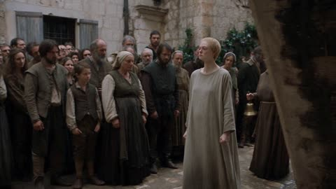</a>

时间线的每一段都写明了各自的镜头运动，跟拍与手持交替推进，铃声和持续的吟唱作为声音线索，让人群压力随节拍逐步累积。角色段落固定了服装、发型和姿态，使主角在各个镜头之间保持一致。

Seedance 2.5 · 文生视频 · 出处: [@techhalla on X](https://x.com/techhalla/status/2083908360118616268)

[`medieval`](tags.md#tag-medieval) [`period-drama`](tags.md#tag-period-drama) [`steadicam`](tags.md#tag-steadicam) [`crowd`](tags.md#tag-crowd)

<details><summary><b>提示词</b></summary>

```text
[STYLE + CAMERA + ATMOSPHERE]
Gritty high-end medieval television production look. Shot on ARRI Alexa XT with Cooke anamorphic lenses, mix of Steadicam tracking and handheld inside the crowd. Natural overcast daylight, desaturated dirty palette, visible film grain, realistic crowd physics and fabric movement. No modern polish.

[CHARACTERS]
Central figure: proud middle-aged noblewoman with roughly cropped short blonde hair, wearing a plain rough grey woolen penitential robe that fully covers her, barefoot, pale skin, rigid upright posture that slowly cracks under public condemnation. Stern middle-aged woman in plain brown religious robes walking just behind her, continuously ringing a large heavy iron handbell and chanting in a loud flat voice. Dense crowd of dirty medieval city dwellers of every age and class in period clothing packed on both sides and leaning from windows.

[LOCATION]
Narrow winding cobblestone streets of a medieval coastal city, high stone walls, arched doorways, wooden shutters, mud on the ground.

[TIMELINE]
0-6s: [Steadicam tracking medium-wide from the side] The woman in the plain robe walks steadily forward with forced dignity. The robed woman stays half a step behind ringing the bell and chanting “Shame. Shame. Shame.” Crowd begins to notice, first heads turn, early shouts of “Shame!” rise.

6-12s: [Handheld inside the pack, pushing closer] Crowd presses tighter along the path. Faces show pure contempt. Children point and call out. The woman keeps her chin high but her eyes start to glaze. Bell never stops. Chant continues: “Shame. Shame. Shame.”

12-18s: [Low tracking shot moving with her feet then tilting up to face] Bare feet slap wet cobblestones. A woman leans from a window and shouts “Shame!” The central woman’s jaw tightens, first tears form but she does not break stride. Crowd noise becomes a continuous wall of overlapping “Shame!” mixed with the bell.

18-24s: [Medium close-up handheld, slight shake] Camera stays locked on her face as the controlled mask cracks. Tears finally fall. She stares straight ahead, breathing harder. Behind her the religious woman rings harder and keeps the flat chant. The plain robe shifts with every step under the weight of the stares.

24-30s: [Pull-back Steadicam wide tracking] The full street is visible: wall of bodies on both sides, continuous shouting of “Shame! Shame! Shame!” mixed with the bell. The woman continues walking, posture still upright but now visibly broken, tears streaming, until the frame holds on her isolated figure moving through the condemnation.

[STYLE & QUALITY BOOSTERS]
Exact period production texture of a major series, coherent physics of every body and fabric movement, stable character continuity, natural motion blur, no modern digital cleanliness, no artificial enhancement.
```

</details>

<a id="seedance-noir-rooftop-heist-35-shot-timeline"></a>
### 三十五镜头的黑色电影屋顶劫案

<a href="https://x.com/doctorwasif/status/2100181300049232193"></a>

用带编号的时间轴给每个镜头单独划定秒数，把30秒拆成短而可控的节拍。参考图锁定主角的脸和服装，结尾的风格行统一霓虹黑色电影的画面、物理表现和无对白要求。

Seedance 2.5 · 参考生视频 · 出处: [@doctorwasif on X](https://x.com/doctorwasif/status/2100181300049232193) · 发现于 [LearnPrompt/awesome-seedance](https://github.com/LearnPrompt/awesome-seedance)

[`multi-shot`](tags.md#tag-multi-shot) [`noir`](tags.md#tag-noir) [`heist`](tags.md#tag-heist) [`timeline`](tags.md#tag-timeline) [`character-consistency`](tags.md#tag-character-consistency)

<details><summary><b>提示词</b></summary>

```text
35-shot, 30-second cinematic noir rooftop heist. Keep Character A’s face, outfit, and appearance identical to the reference image. Sleek tactical gear, neon-lit city, tense professional choreography, realistic cinematic lighting, sharp cuts, no dialogue.

1. 0.0–1.0s: A crouches on a rooftop ledge at night, checks wrist device, neon skyline behind.
2. 1.0–1.6s: Extreme close-up of her eyes scanning the opposite building, neon reflections.
3. 1.6–2.2s: Teammate mechanically checks a grappling-hook launcher.
4. 2.2–2.8s: Wide neon city skyline establishing shot.
5. 2.8–3.4s: Two teammates exchange a precise silent hand signal.
6. 3.4–4.0s: A fires grappling hook across the gap; cable snaps taut.
7. 4.0–4.6s: Teammate checks a countdown timer.
8. 4.6–5.4s: A launches across the gap, city lights streaking below.
9. 5.4–6.0s: She lands silently, rolls, and immediately readies herself.
10. 6.0–6.6s: Security camera pans while team freezes in shadows.
11. 6.6–7.2s: Camera passes; teammate exhales in brief relief.
12. 7.2–7.8s: Three teammates synchronize watches and countdown gestures.
13. 7.8–8.6s: Team crosses rooftop in perfect formation, silhouetted against neon.
14. 8.6–9.2s: Gloved hands bypass a keypad with a decoding device.
15. 9.2–9.8s: Access panel opens; teammate silently signals success.
16. 9.8–10.6s: Team descends through rooftop hatch into a dark maintenance corridor.
17. 10.6–11.4s: Security guard patrols below, unaware; team hides above stairwell.
18. 11.4–12.2s: A signals “wait,” tracking the guard through railing.
19. 12.2–13.0s: Guard turns away; team swiftly moves past.
20. 13.0–13.8s: Team reaches a reinforced metallic vault door.
21. 13.8–14.6s: Decoding device attaches to vault lock; numbers cycle rapidly.
22. 14.6–15.6s: Close-ups of tense faces and countdown timer.
23. 15.6–16.6s: A guards the corridor, alert and weapon-free.
24. 16.6–17.6s: Decoder numbers slow toward final combination.
25. 17.6–18.8s: Slow motion: final digit locks; vault mechanisms release.
26. 18.8–20.0s: Slow motion: massive vault door opens, dramatic light spills out.
27. 20.0–21.0s: Team exchanges a restrained, silent look of triumph.
28. 21.0–22.0s: Wide reveal of sleek high-value contents inside vault.
29. 22.0–23.0s: A checks corridor again, maintaining vigilance.
30. 23.0–24.0s: Team efficiently secures the objective.
31. 24.0–25.2s: Distant alarm begins; team instantly shifts into calm exit mode.
32. 25.2–26.4s: Team retreats through rooftop access hatch.
33. 26.4–27.6s: A briefly looks back at the building, neon reflected in her eyes.
34. 27.6–28.8s: Team rappels down the exterior toward a waiting vehicle.
35. 28.8–30.0s: Wide final shot: vehicle speeds through neon city streets as rooftop lights fade behind, cinematic noir heist ending.

Style: high-end cinematic action thriller, realistic tactical movement, neon noir, dramatic contrast, atmospheric night lighting, dynamic camera work, precise choreography, seamless continuity, realistic physics, restrained professional emotion, no dialogue.
```

</details>

<a id="seedance-okinawa-medic-smoke-battlefield"></a>
### 晨雾中的战地医护兵扫视冲绳战场

<a href="https://x.com/Diplomeme/status/2100458083831234699">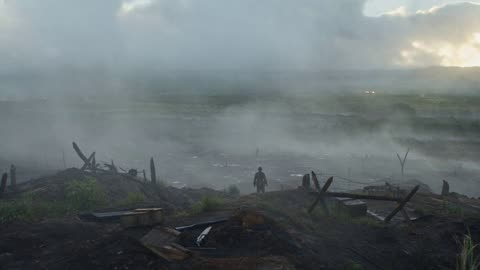</a>

按时间段逐段写明镜头焦段和动作，让30秒片段像一个完整故事，而不是单个镜头。明确的手持摄影规则（禁用无人机式运镜）加上物理与声音说明，使画面保持纪实质感。

Seedance 2.5 · 文生视频 · 出处: [@Diplomeme on X](https://x.com/Diplomeme/status/2100458083831234699) · 发现于 [LearnPrompt/awesome-seedance](https://github.com/LearnPrompt/awesome-seedance)

[`war-film`](tags.md#tag-war-film) [`historical`](tags.md#tag-historical) [`documentary`](tags.md#tag-documentary) [`multishot`](tags.md#tag-multishot)

<details><summary><b>提示词</b></summary>

```text
30 seconds | 16:9 | hyper-realistic historical war-film recreation | documentary realism | MULTISHOT

HISTORICAL DRAMATIZATION — An original cinematic reconstruction inspired by the Battle of Okinawa in 1945. The story follows a fictional U.S. Army combat medic attempting to evacuate wounded soldiers from an exposed battlefield. Do not recreate any specific scene, character, dialogue, costume design, camera composition, or sequence from any existing film.

CORE CONCEPT
A young combat medic remains behind after his unit moves forward. Instead of becoming part of the fighting, he moves through smoke, mud and artillery fire searching for wounded soldiers and bringing them toward safety. The sequence emphasizes courage, exhaustion, confusion and the physical reality of a battlefield rather than glorifying combat.

SETTING
Okinawa, Japan — spring 1945. Rugged limestone escarpment, muddy defensive positions, damaged vegetation, smoke-filled battlefield, earthworks, abandoned equipment, scattered ammunition crates, military stretchers and distant artillery. Overcast tropical sky gradually brightening toward morning.

CHARACTERS
MAIN MEDIC — Fictional American Army combat medic, mid-20s, exhausted face, short regulation haircut, olive-drab 1940s combat uniform, steel helmet, canvas medical bag, field dressings and worn boots.

WOUNDED SOLDIER 1 — Young American infantryman, exhausted and injured, period-correct uniform and equipment.

WOUNDED SOLDIER 2 — Another fictional infantryman trapped farther across the exposed ground.

BACKGROUND SOLDIERS — Period-accurate American and Japanese forces visible only as distant silhouettes through smoke. No identifiable real individuals.

STORY — MULTISHOT VISUALS

00:00–02.5 — DAWN
24mm wide establishing shot of an Okinawa battlefield covered in smoke and mist. Exhausted American soldiers move between muddy defensive positions while distant artillery flashes across the horizon. MAIN MEDIC stands alone near a damaged defensive position, scanning the battlefield.

02.5–05 — DISCOVERY
50mm handheld tracking shot as the medic hears a faint voice. He moves through smoke and discovers WOUNDED SOLDIER 1 lying behind a collapsed section of earthwork. The medic immediately kneels and checks him.

05–07.5 — FIRST AID
85mm intimate close-up of the medic applying a field dressing. His hands shake slightly from exhaustion. Mud and sweat cover his face. Distant artillery causes the ground to tremble.

07.5–10 — CARRY
35mm handheld shot. The medic pulls the wounded soldier onto his shoulders and begins moving through the mud. His boots sink into the wet ground. He struggles under the weight but continues.

10–12.5 — INCOMING FIRE
A distant artillery impact throws dirt into the air nearby. The medic instinctively drops low, shielding the wounded soldier with his body. Smoke rolls across the frame.

12.5–15 — HEAR ANOTHER VOICE
The medic looks toward a distant voice coming through the smoke. He realizes another wounded soldier is still behind him. After a brief moment of hesitation, he turns around and moves back.

15–17.5 — SECOND CASUALTY
50mm handheld movement through dense smoke. The medic reaches WOUNDED SOLDIER 2, who is trapped beside damaged equipment. The medic pulls debris away and checks his condition.

17.5–20 — IMPROVISED STRETCHER
35mm close tracking shot. The medic uses a canvas sheet and available wooden poles to construct a crude field stretcher. His movements are rushed but practical and believable.

20–22.5 — EXTRACTION
Wide 24mm shot. The medic drags the improvised stretcher across exposed muddy ground. Smoke obscures the battlefield behind him while artillery flashes intermittently in the distance.

22.5–25 — THE ESCARPMENT
The medic reaches the edge of the rocky escarpment. He lowers himself carefully and begins moving the wounded soldier toward a safer lower position.

25–27.5 — HUMAN MOMENT
85mm close-up. The wounded soldier looks up at the medic. The medic briefly reassures him with a calm expression before continuing. No heroic speech, no exaggerated emotion.

27.5–30 — FINAL REVEAL
24mm wide shot from behind the medic. He helps both wounded soldiers toward a sheltered position while the enormous Okinawa battlefield stretches behind them through smoke and morning light. The camera holds on the scale of the battlefield as the three figures become small against the landscape.

CAMERA
Large-format historical cinema camera language combined with embedded war-correspondent realism. 24mm for battlefield scale, 35mm for movement and action, 50mm for human interaction, 85mm for intimate details. Handheld shoulder-mounted movement, natural camera shake, imperfect framing, realistic focus changes, atmospheric obstruction from smoke and dust. No modern drone aesthetic, no impossible camera movement.

LIGHTING
Soft overcast Okinawa morning light, cold gray atmosphere, muted sunlight through smoke, warm distant artillery flashes, natural skin highlights and subtle atmospheric haze. No theatrical spotlighting.

PHYSICS
Realistic body weight, fatigue, mud resistance, stretcher weight, smoke movement, artillery shockwaves, falling debris, clothing movement and ground interaction. The medic struggles physically under the wounded soldier’s weight. No superhuman strength or impossible movement.

HUMAN PERFORMANCE
Exhaustion is visible in posture, breathing and movement. The medic behaves professionally but is visibly frightened and tired. Wounded soldiers respond naturally to pain and shock. Background soldiers move independently and react to distant impacts without synchronized choreography.

AUDIO
Authentic battlefield soundscape: distant artillery, rifle fire far across the battlefield, shouting, heavy breathing, boots in mud, equipment rattling, stretcher fabric stretching, wind through vegetation and debris impacts. Music is extremely restrained and secondary to environmental sound.

VISUAL CHARACTER
Photorealistic live-action historical war cinematography. Natural skin texture, authentic 1945 uniforms, weathered equipment, mud, sweat, smoke, atmospheric depth, realistic film grain and subtle highlight halation. No plastic skin, no videogame appearance, no exaggerated color grading.

COLOR GRADE
Muted olive greens, dirty browns, gray-blue atmospheric shadows, warm skin tones and restrained highlights. Slightly desaturated period-war-film palette while maintaining natural colors.

HISTORICAL REALISM
Period-correct American military equipment, clothing, medical supplies, terrain and battlefield environment. No modern weapons, vehicles, helmets, medical equipment, tactical gear or technology.

CONTINUITY
MAIN MEDIC, both wounded soldiers, uniforms, equipment, medical bag, weather and battlefield geography remain consistent across all shots. Wounds remain visually consistent without graphic gore. The sequence progresses logically from discovery → treatment → evacuation → second rescue → extraction.

FINAL QUALITY TARGET
The footage should feel like an extraordinarily realistic 1945 battlefield documentary captured by a professional war cinematographer, with the emotional intensity of a major historical film but without reproducing any existing movie scene. The realism comes from human performance, physical exhaustion, practical battlefield detail, smoke, mud, sound and environmental scale.
```

</details>

<a id="seedance-overhead-follow-cluttered-apartment"></a>
### 俯拍跟随女子穿过杂乱公寓

<a href="https://x.com/mehvishs25/status/2103675623030108474">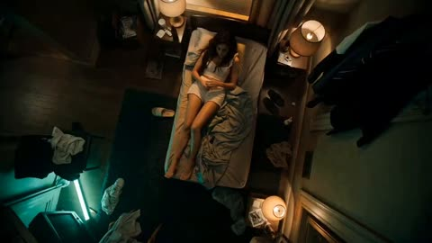</a>

俯拍镜头被描述为一个不间断的长镜头，在她穿过各个房间时始终保持画面固定。每个动作段落都重申镜头状态（仍然居中、仍然俯视），避免视角在动作切换中漂移。

Seedance 2.5 · 参考生视频 · 出处: [@mehvishs25 on X](https://x.com/mehvishs25/status/2103675623030108474) · 发现于 [LearnPrompt/awesome-seedance](https://github.com/LearnPrompt/awesome-seedance)

[`overhead-shot`](tags.md#tag-overhead-shot) [`long-take`](tags.md#tag-long-take) [`neon-lighting`](tags.md#tag-neon-lighting) [`apartment-interior`](tags.md#tag-apartment-interior)

<details><summary><b>提示词</b></summary>

```text
A tired woman in  <image1> in a loose tank top and sleep shorts, slow habitual movement. Slightly smeared eyeliner, bare feet, heavy posture, detached face.
ENVIRONMENT: A cramped cluttered apartment with an unmade mattress, scattered clothes, a narrow hallway, a damp bathroom with dim tile reflections, and a tiny kitchen crowded with dirty dishes and empty bottles. Warm practical lamps mix with sickly green neon leaking through blinds and door glass, turning the rooms into a humid late-night maze.
MOOD: Detached routine turns quietly uncanny, as if an unseen presence is floating above her and waiting for her to notice.
COLOR LOGIC: Matrix Green Look
CAMERA: POV overhead follow in a strict bird's eye view, locked directly above the top of her head at all times, perfectly centered over her body from start to finish, floating smoothly with no shake, tilt, angle drift, or side offset, passing through ceilings and door frames as one uninterrupted camera event. 24mm wide, digital clean look, locked overhead tracking package throughout.
SCENE:
She wakes on the mattress. Sits up under the lens.
Still centered under the lens, reaches to the floor. Picks up the cigarette and lighter. Places the cigarette between her lips. Lights it. Drops the lighter on the mattress. Stands up with the cigarette still with her.
Under the same overhead lock, crosses the cluttered room.
The lens tracks directly above her into the narrow hallway. Enters the bathroom.
Still pinned overhead, keeps the cigarette in her right hand. Extends that arm away from the running water. Leans on the sink. Turns on the tap with her left hand. Splashes water onto her face with her left hand.
The overhead follow carries her back out of the bathroom into the hallway. Moves along the hallway past the bathroom door. Turns into the tiny kitchen.
Still centered under the camera, keeps the cigarette with her. Reaches across the dirty dishes with her free hand. Picks up a glass from the counter.
Stops exactly under the lens. Holds the cigarette in her right hand and the glass in her left hand.
The lens stays fixed above her. Freezes. Looks right. Looks left. Takes a drag from the cigarette. Snaps her head straight up into the lens. Blows smoke toward the camera. Locks eye contact.
SFX: lighter flick, inhale, faint city hum, refrigerator buzz, soft bare footsteps, water run. Sodium amber particles, toxic green neon reflect off tile, smoke, bottles, and damp surface.
```

</details>

<a id="seedance-palace-jewel-customization-iphone"></a>
### 女子在王宫里用珍珠和钻石装饰手机

<a href="https://x.com/noorlewisx/status/2095741799402758204"></a>

提示词按镜头顺序逐段描写，开场先给手部特写，并点名银色镊子、水钻等具体道具，让每个镜头的画面内容都很明确。结尾统一的金色柔光与浅景深描述，帮助各镜头的宫殿质感保持一致。

Seedance 2.5 · 文生视频 · 出处: [@noorlewisx on X](https://x.com/noorlewisx/status/2095741799402758204)

[`fantasy`](tags.md#tag-fantasy) [`jewelry`](tags.md#tag-jewelry) [`palace`](tags.md#tag-palace) [`multi-shot`](tags.md#tag-multi-shot)

<details><summary><b>提示词</b></summary>

```text
A cinematic 20-second luxury fantasy video in an opulent gold-and-crimson palace chamber with crystal chandeliers, ornate gold furniture, red velvet chairs and warm candlelight. A stunning young woman with platinum blonde hair in elaborate jeweled braids, wearing a sparkling ice-blue beaded gown, diamond tiara, pearl drop earrings and soft pink makeup, green eyes. She customizes objects with precision tweezers, pearls and crystals.
Opening close-up: her hands placing tiny rhinestones around the camera module of a light-blue iPhone using silver tweezers. She then holds the decorated phone and smiles softly while looking at it.
She decorates a rose-gold crystal compact, holds an ornate jeweled perfume bottle toward the camera, and gazes at a small diamond-encrusted photo frame on a gold table scattered with loose pearls.
Quick shot of organized trays filled with white pearls, clear crystals, gold beads and rhinestones.
She picks up a black fountain pen, leans over a large official parchment document with a royal coat of arms, wax seal and the heading “I Victores D’Ulvenwind”, then uses a fine tool to attach pearls and diamonds along the edges and corners of the document. She signs it and proudly holds up the finished jeweled letter.
A tall, handsome man with sharp features and dark hair, wearing an elaborate dark navy velvet jacket heavily embroidered with silver thread, pearls and jewels, stands beside her, takes the document and reads it. She looks up at him from her seat. He smiles. Soft golden lighting, shallow depth of field, highly detailed, photorealistic, elegant and dreamy atmosphere.
```

</details>

<a id="seedance-paper-city-first-fold"></a>
### 纸张折叠成手工微型纸城市

<a href="https://x.com/ChillaiKalan__/status/2088866007918268515"></a>

按时间码逐镜头写明镜头焦段与运动，并用单独的连续性段落锁定建筑位置和纸张质感，使微缩城市在切换间保持一致。材质与光线规则用直白的物理描述写出，而不是堆叠风格标签。

Seedance 2.5 · 文生视频 · 出处: [@ChillaiKalan__ on X](https://x.com/ChillaiKalan__/status/2088866007918268515) · 发现于 [LearnPrompt/awesome-seedance](https://github.com/LearnPrompt/awesome-seedance)

[`paper-art`](tags.md#tag-paper-art) [`miniature`](tags.md#tag-miniature) [`macro-shot`](tags.md#tag-macro-shot) [`continuity`](tags.md#tag-continuity)

<details><summary><b>提示词</b></summary>

```text
30-SECOND CINEMATIC SHORT
Create a 30-second cinematic sequence with the visual discipline of a major feature film. The world is entirely made from paper, cardboard, ink, and delicate handcrafted materials.
00:00–00:05 — THE FIRST FOLD
Begin with an extreme macro shot of a blank sheet of textured paper.
A single fold slowly forms across its surface.
Lens: 100mm macro
Camera: Completely static
Soft daylight moves across the paper as the fold continues.
Cut precisely as the paper reaches its final shape.
00:05–00:11 — THE CITY EMERGES
Transition into a 50mm shot.
The folded paper begins forming miniature streets and architectural structures.
Buildings rise naturally from the surface through carefully constructed paper folds.
The camera slowly tracks sideways.
Tiny windows catch the light.
Nothing feels computer-generated; every surface should have believable paper fibers, folds, shadows, and imperfections.
00:11–00:17 — THE REVEAL
Move into a 35mm shot.
The camera pulls backward.
The small arrangement is revealed as an enormous handcrafted paper city stretching across a large table.
Roads connect different districts.
Bridges cross miniature rivers.
Paper trees move gently from an unseen breeze.
00:17–00:23 — MORNING
Transition into a slow overhead crane shot.
Warm sunlight gradually spreads across the paper city.
Shadows from the buildings become longer and more defined.
Tiny paper windows begin reflecting the sunlight.
The camera continues rising, revealing the geometric relationship between the streets and buildings.
00:23–00:27 — THE DETAIL
Cut to an 85mm close-up.
Focus on a tiny paper clock mounted on one building.
The clock moves forward by one minute.
Rack focus from the clock to the miniature skyline behind it.
00:27–00:30 — FINAL IMAGE
Return to an extreme wide shot.
The entire paper city sits beneath a large studio window.
The morning light completely fills the miniature world.
Camera slowly pulls backward until the city becomes a small object within the larger room.
Fade to black.
CINEMATOGRAPHY
Large-format feature-film aesthetic.
100mm macro for texture.
85mm for detail.
50mm for natural perspective.
35mm for environmental shots.
Controlled dolly and crane movements.
Realistic depth of field.
Natural focus transitions.
Soft motion blur.
Subtle lens imperfections.
No artificial camera shake.
MATERIAL DIRECTION
Every surface must visibly behave like physical paper.
Visible paper fibers.
Natural folds.
Tiny imperfections.
Soft cardboard edges.
Realistic contact shadows.
Believable paper thickness.
Natural material deformation.
LIGHTING
Soft morning daylight.
Large window as the primary source.
Natural bounce light.
Gentle shadows.
Subtle warm highlights.
No artificial neon effects.
No excessive visual effects.
CONTINUITY
The same paper city throughout the entire sequence.
Buildings maintain identical shapes and positions.
Roads remain connected.
Paper materials remain consistent.
No random transformations.
No flickering.
No duplicated structures.
No sudden environmental changes.
DIRECTOR’S NOTE
Treat this as a miniature feature film, not a visual-effects demonstration.
The camera should discover the world gradually.
Start intimate.
Reveal scale.
Return to detail.
Finish wide.
The audience should feel that they are watching a real handcrafted world photographed with a cinema camera.
Photorealistic 4K • tactile materials • feature-film cinematography • sophisticated lighting • realistic miniature photography • cinematic depth • precise camera movement • seamless visual continuity.
```

</details>

<a id="seedance-paper-miniature-moonlight-world"></a>
### 纸质微缩风景在升起的月光下变化

<a href="https://x.com/Emmma__0/status/2090659771749912711">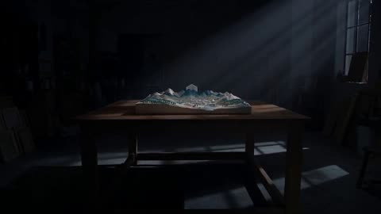</a>

按时间段逐镜指定镜头焦段（85mm 微距、50mm 跟拍、35mm 仰拍），让镜头语法清晰可控。视觉语言段要求可见纸纤维、折痕与自然瑕疵，使运动读起来像手工定格，而非数字特效。

Seedance 2.5 · 文生视频 · 出处: [@Emmma__0 on X](https://x.com/Emmma__0/status/2090659771749912711)

[`paper-craft`](tags.md#tag-paper-craft) [`miniature`](tags.md#tag-miniature) [`macro`](tags.md#tag-macro) [`moonlight`](tags.md#tag-moonlight)

<details><summary><b>提示词</b></summary>

```text
DURATION: 30 seconds
ASPECT RATIO: 16:9
STYLE: Premium handcrafted fantasy / cinematic miniature film
CAMERA: Macro cinema photography, 35mm / 50mm / 85mm
FRAME RATE: 60 fps with gentle slow motion

CONCEPT

Inside a quiet artist's studio sits a completely handmade paper landscape.

A tiny paper town rests beneath a folded paper moon.

When the moon rises, the miniature world begins changing.

The entire story is told through paper, light, shadows, and miniature movement.

---

00:00–00:05 — THE STUDIO

Begin with a wide cinematic shot of a dark artist's studio at night.

A large wooden table occupies the center.

On it sits an elaborate miniature paper landscape.

Paper mountains.

Tiny houses.

Small trees.

A winding paper river.

The room is illuminated only by soft moonlight from a nearby window.

Camera slowly pushes toward the miniature world.

---

00:05–00:09 — THE MOON

Cut to an 85mm macro shot.

A small folded paper moon rests behind the miniature mountains.

Its surface contains delicate hand-drawn patterns.

A soft light gradually appears behind it.

The moon begins rising slowly.

Its light spreads across the paper landscape.

---

00:09–00:14 — THE TOWN

Move into a 50mm tracking shot.

As moonlight reaches the miniature town, tiny paper windows begin glowing one after another.

The paper river catches the light.

Small paper trees cast long shadows.

Everything remains physically handcrafted.

Visible paper fibers.

Tiny folds.

Natural imperfections.

---

00:14–00:19 — THE TRANSFORMATION

The camera moves slowly overhead.

The paper mountains gently unfold.

They become taller.

The river extends through newly revealed valleys.

Paper bridges unfold across the landscape.

The transformation should feel like stop-motion craftsmanship rather than digital magic.

Keep every movement delicate and believable.

---

00:19–00:24 — THE SKY

Transition into a 35mm upward-looking composition.

The paper moon continues rising.

Behind it, the studio ceiling gradually disappears into a miniature paper sky.

Tiny folded stars unfold one by one.

The miniature world now appears enormous.

The boundaries between the table and the sky become impossible to distinguish.

---

00:24–00:27 — THE REVEAL

Camera slowly pulls backward.

The entire miniature landscape is now visible.

The paper moon hangs above the completed world.

A gentle paper cloud moves across the scene.

Everything is calm.

---

00:27–00:30 — FINAL IMAGE

Extreme wide shot.

Reveal that the entire miniature landscape has folded itself into a single beautiful paper artwork.

The paper moon becomes the center of the composition.

The studio is visible around it.

The moonlight slowly fades.

One tiny paper star remains illuminated.

CUT TO BLACK.

No text.

No logo.

No characters.

---

VISUAL LANGUAGE

Handcrafted miniature cinematography.

Real paper fibers.

Visible folds.

Natural cardboard edges.

Subtle imperfections.

Physical shadows.
```

</details>

<a id="seedance-parking-garage-zombie-chase-horror"></a>
### 地下停车场韩式恐怖僵尸追逐

<a href="https://x.com/AIwithSynthia/status/2113840061104206005"></a>

提示词把 30 秒切成六个带时间码的段落，每段只写一个明确动作，剧情从玩笑升级到追逐再到断电。结尾的 STYLE 行用手持抖动、闪烁灯光和乳白色眼睛锁定画面风格，再用简短的排除清单避免过度血腥、字幕和卡通感。

Seedance 2.5 · 文生视频 · 出处: [@AIwithSynthia on X](https://x.com/AIwithSynthia/status/2113840061104206005) · 发现于 [LearnPrompt/awesome-seedance](https://github.com/LearnPrompt/awesome-seedance)

[`horror`](tags.md#tag-horror) [`zombie`](tags.md#tag-zombie) [`timed-shots`](tags.md#tag-timed-shots) [`handheld`](tags.md#tag-handheld) [`photorealistic`](tags.md#tag-photorealistic)

<details><summary><b>提示词</b></summary>

```text
0–3s: A young Korean woman in a fitted blue crop top and white shorts walks through an underground parking garage, jokingly waving at the security guard.

3–6s: Her smile freezes, her eyes turn completely white, and dark veins appear across her face. She coughs, revealing blood around her lips.

6–9s: She tilts her head unnaturally, laughs hysterically, and suddenly slams her bloody palm against the security booth glass.

9–13s: The terrified guard runs away as she chases him between parked cars, moving with frightening speed.

13–18s: A resident exits the elevator, mistakes the situation for a prank, then screams as the zombie suddenly charges at him.

18–24s: Emergency sprinklers activate. Soaked and twitching, the zombie crawls beneath a closing metal shutter while the survivors watch in horror.

24–30s: Everyone races toward the exit. The zombie smashes against the glass door, revealing her white eyes and blood-smeared grin before the lights suddenly go out.

STYLE: Photorealistic Korean horror, creepy laughter, milky-white eyes, realistic blood smears, sudden jerky movements, flickering lights, handheld camera shake, dark humor, cinematic 4K. No cartoon, anime, excessive gore, subtitles, or watermark.
```

</details>

<a id="seedance-pirate-chef-parrot-galley-asmr"></a>
### 海盗厨师与偷食鹦鹉的船厨闹剧

<a href="https://x.com/Goodmanprotocol/status/2099186117769822462">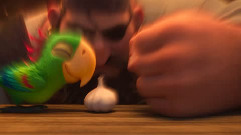</a>

六个带时间码的段落，每段都把一个视觉笑点和明确的声音提示（如滋滋声、叮当声、唱片刮擦声）配在一起，让 ASMR 的节奏清楚可控。结尾用船舱全景配上海浪、木船吱嘎声和一声手风琴，干净收尾。

Seedance 2.5 · 文生视频 · 出处: [@Goodmanprotocol on X](https://x.com/Goodmanprotocol/status/2099186117769822462)

[`asmr`](tags.md#tag-asmr) [`slapstick`](tags.md#tag-slapstick) [`pixar-style`](tags.md#tag-pixar-style) [`timed-beats`](tags.md#tag-timed-beats)

<details><summary><b>提示词</b></summary>

```text
Create a 30-second Pixar-quality 3D animated ASMR comedy short aboard a warm, lantern-lit pirate ship galley.

STYLE: Premium cinematic 3D animation, expressive characters, polished feature-film quality, warm amber lighting, realistic food textures, cinematic depth of field, playful slapstick humor, gentle ship movement and crisp immersive food ASMR.

Characters: A large, burly, bearded pirate chef wearing a worn apron, and a mischievous bright-green parrot constantly trying to steal ingredients. Keep both characters visually consistent throughout.

0–4s

Extreme close-up of the parrot stealing a garlic bulb. The pirate's hand suddenly slams beside it. They freeze and stare at each other. Brief record-scratch silence. The pirate flicks the parrot away; it spins through the air and lands on a pot rack pretending nothing happened.

4–8s

The pirate rapidly chops garlic with crisp ASMR. The parrot tiptoes toward a tomato. Garlic hits hot oil with a huge sizzle, startling the parrot and sending it tumbling off the rack. Metal cups clang.

8–14s

Fast cinematic cooking montage: tomatoes sizzling, herbs being torn, olive oil pouring in golden slow motion, sauce bubbling and the pirate confidently stirring the skillet. Layer detailed chopping, sizzling, pouring and bubbling ASMR.

14–19s

The parrot spots the food and secretly tries to drag the skillet away. Its tiny body strains comically across the wooden floor. The pirate slowly turns around and stares. The parrot freezes while still holding the handle, then innocently whistles and lets go.

19–24s

The pirate finishes cooking with a dramatic skillet toss. Steam rises as the glossy dish is plated. The parrot watches hungrily, trying to look innocent.

24–30s

Instead of scolding the parrot, the pirate prepares a tiny plate of sauce and bread and slides it across the table. The parrot happily bounces and eats beside him. They exchange a satisfied look as the ship gently sways.

End with a wide cinematic shot of the cozy galley glowing under amber lanterns, subtle ocean sounds and wooden ship creaks, with one soft playful accordion note fading out.

No dialogue, no subtitles, no text. Maintain strong character consistency, natural physics, smooth animation, cinematic framing and detailed food ASMR throughout.
```

</details>

<a id="seedance-plum-tree-prince-comedy"></a>
### 女子摇动梅树,接住掉下来的王子

<a href="https://x.com/Chaemate_/status/2105611129867395458"></a>

身份锁和环境锁绑定两张参考图,让两位角色与神社庭院在五个定时分镜里保持一致。情绪曲线、明确的声音设计和负面提示词共同控制喜剧节奏与慢动作花瓣雨。

Seedance 2.5 · 参考生视频 · 出处: [@Chaemate_ on X](https://x.com/Chaemate_/status/2105611129867395458) · 发现于 [LearnPrompt/awesome-seedance](https://github.com/LearnPrompt/awesome-seedance)

[`reference-images`](tags.md#tag-reference-images) [`identity-lock`](tags.md#tag-identity-lock) [`shot-breakdown`](tags.md#tag-shot-breakdown) [`romantic-comedy`](tags.md#tag-romantic-comedy) [`japanese-fantasy`](tags.md#tag-japanese-fantasy)

<details><summary><b>提示词</b></summary>

```text
TITLE: "What Falls from the Plum Tree?"
DURATION: 15 seconds | ASPECT RATIO: 16:9
GENRE: Romantic Japanese Fantasy Comedy
STYLE: Ultra-realistic premium Japanese drama, cinematic film quality

IDENTITY LOCK:
The woman @image1 must keep the exact same face, face shape, skin tone, hairstyle, height, body proportions, and wardrobe in every shot. The man @image2 must keep his exact face, hairstyle, and outfit as in the reference. No changes in any frame.

ENVIRONMENT LOCK:
An elegant Edo-era Japanese shrine courtyard with traditional wooden architecture, tiled rooftops, stone lanterns, and a raked gravel garden in the background. A giant ancient plum (ume) tree with dense white and pink blossoms. Its thick main branch extends horizontally above the woman's head. Soft spring daylight.

SHOT BREAKDOWN:

0.0–4.0s | Medium shot
The woman stands beneath the huge horizontal branch. Blossom petals drift in the breeze. She looks up curiously, then raises both hands and shakes the branch. The branch trembles and a shower of petals falls. A lacquered cosmetic box tumbles down through the blossoms and she catches it with both hands. Close-up of her face as she peeks inside. Flat, unimpressed expression. She tosses it casually out of frame.

4.0–7.5s | Medium shot
Her curiosity grows. She shakes the branch harder and petals pour down like rain. A scatter of gold koban coins and a few silk pouches fall. She catches one pouch, raises a single eyebrow, looks bored, and tosses it away.

7.5–10.5s | Slow motion
Determined now, she grips the branch with both hands and shakes with all her strength. The branch shudders, a heavy blossom storm rains down, and the man @image2 suddenly drops from the branch. She gasps, spreads her arms, and catches him just before he hits the ground. Petals swirl around them.

10.5–13.0s | Close-up, 50mm
She looks at his face. Her eyes sparkle and a wide, delighted smile appears. He gives a charming, slightly embarrassed smile and looks back at her.

13.0–15.0s | Medium-wide shot
They turn to the camera together and make small heart shapes with their hands, laughing happily. They turn to each other, laugh, and walk out of frame side by side while petals keep falling behind them. Fade out on the falling blossoms.

EMOTION ARC:
Curious → Bored → More curious → Surprised → Smitten → Happy.

SOUND:
Soft spring breeze, rustling blossoms, creaking wood, light thud of the box, jingle of coins, warm playful Japanese rom-com music (koto, light shamisen, soft piano), cheerful laughter, fading footsteps.

CAMERA & VISUALS:
ARRI Alexa 35 look, 35mm and 50mm cinematic lenses, smooth gimbal movement, slow-motion petal shower, natural spring lighting, realistic skin pores, physically accurate shadows, HDR, subtle film grain, soft pastel color grading.

NEGATIVE PROMPT:
cartoon, anime, CGI look, low quality, blurry face, extra fingers, warped hands, duplicate objects, duplicate people, distorted body, floating objects, unrealistic physics, unnatural falling motion, overexposed lighting, oversaturated colors, AI artifacts, camera shake, abrupt cuts, warped architecture, deformed eyes

#Seedance25 #AIVideo #AIFilmmaking #AIart️️️️️️️️️️️️️️️️️️️️️️️️️️️️️️️️️️️️️️️️️️️️️️️️️️️
```

</details>

<a id="seedance-rainy-school-first-love-two-shots"></a>
### 雨中放学初恋短片两个连续镜头

<a href="https://x.com/Caden_Flux/status/2089154775829074074"></a>

提示词把60秒拆成两个连续镜头，每个节拍都写明时间码、运镜和台词。镜头之间用雨伞做匹配剪辑衔接，并用角色设定图和连续性规则锁定人物的脸和服装。

Seedance 2.5 · 参考生视频 · 出处: [@Caden_Flux on X](https://x.com/Caden_Flux/status/2089154775829074074) · 发现于 [LearnPrompt/awesome-seedance](https://github.com/LearnPrompt/awesome-seedance)

[`romance`](tags.md#tag-romance) [`school`](tags.md#tag-school) [`rain`](tags.md#tag-rain) [`dialogue`](tags.md#tag-dialogue) [`long-take`](tags.md#tag-long-take)

<details><summary><b>提示词</b></summary>

```text
Create a 60-second cinematic high-school first-love story using SEEDANCE 2.5.

IMPORTANT:
Generate the video as EXACTLY TWO CONTINUOUS SHOTS:
SHOT 1 = 0–30 seconds
SHOT 2 = 30–60 seconds
The two shots must connect seamlessly and feel like ONE continuous short film, not two unrelated clips.
FORMAT:
16:9 widescreen
Cinematic photorealism
Premium coming-of-age romance film
Fast-paced but emotionally natural
Smooth transitions and motivated camera movement
Realistic teenage body proportions and expressions
Natural English dialogue only
No subtitles unless dialogue is naturally spoken
No text overlays
No character redesign
CHARACTER CONSISTENCY — EXTREMELY IMPORTANT:
Use the provided character reference sheets for BOTH characters.

BOY:
Preserve exact face, hairstyle, clothing, body proportions, accessories and identity from the character sheet.

GIRL:
Preserve exact face, hairstyle, clothing, body proportions, accessories and identity from the character sheet.
Their faces, hairstyles and outfits must remain IDENTICAL throughout both shots.
The boy and girl are both 17–18-year-old high-school students. Keep the romance completely innocent, wholesome and age-appropriate.
VISUAL LANGUAGE:
Warm nostalgic coming-of-age movie aesthetic, realistic school environment, natural skin texture, subtle film grain, cinematic depth of field, soft lens bloom, realistic physics, natural hair movement, expressive eyes, believable teenage body language.
Use a dynamic combination of:
wide establishing shots,
medium tracking shots,
over-the-shoulder shots,
close-ups,
handheld intimate moments,
smooth push-ins,
whip-pan transitions,
shallow-focus inserts,
and brief slow-motion accents.
Avoid excessive slow motion. The pacing should feel energetic and modern.
━━━━━━━━━━━━━━━━━━━━
SHOT 1 — 0:00–0:30
“THE ROUTINE”
━━━━━━━━━━━━━━━━━━━━
0:00–0:03
OPEN on a cinematic wide shot of a lively high-school hallway immediately after the final bell.
Students rush past the camera.
The boy exits his classroom with his backpack over one shoulder.
He looks across the hallway.

The girl is already there.
Their eyes meet.

She gives him a tiny smile.
He smiles back.

CAMERA:
Fast lateral tracking shot through the crowd, then smoothly pushes toward the boy as he notices her.
0:03–0:07
She walks toward him.

He casually falls into step beside her.

GIRL:
“You're late.”

BOY:
“By two minutes.”
She laughs.

They continue walking.
CAMERA:
Smooth backward tracking shot in front of them as students pass naturally around them.
0:07–0:11
QUICK MONTAGE.
They sit together in class.
She steals one of his fries during lunch.
He looks offended.
She laughs.
He secretly smiles.
CUT TO:
Their notebooks side by side.
She draws a tiny smiley face in the margin of his notebook.

He notices.

CAMERA:
Fast close-up inserts and match cuts, keeping the rhythm playful and energetic.
0:11–0:15
They leave school together.
Golden afternoon light floods the corridor.
He holds the door open for her.

She playfully bumps his shoulder as she walks past.
He laughs.

CAMERA:
Low-angle tracking shot transitioning into a warm side-profile shot.

0:15–0:20
Outside school.

They walk down the sidewalk.

She talks animatedly while he listens.

A light breeze moves her hair.

He looks at her for a moment longer than he should.

She catches him staring.

GIRL:
“What?”
BOY:
“Nothing.”

She smiles knowingly.
CAMERA:
Over-the-shoulder close-up from behind her, revealing his shy smile.

0:20–0:25
The sky suddenly darkens.

First drops of rain hit the pavement.
She looks upward.

BOY:
“Uh-oh.”
She laughs and quickly pulls her cardigan closer.

The boy opens his small umbrella.

CAMERA:
Quick tilt from the darkening sky down to them.

0:25–0:30
They squeeze underneath the tiny umbrella together.
Their shoulders bump.

They laugh.
The camera slowly circles around them as they begin walking through the rain.

The boy looks at her.

She looks back.

A brief quiet moment.

MATCH CUT:
Camera passes behind the umbrella fabric.

Use the movement of the umbrella to create a seamless transition into SHOT 2.

━━━━━━━━━━━━━━━━━━━━
SHOT 2 — 0:30–1:00
“FIVE MORE MINUTES”
━━━━━━━━━━━━━━━━━━━━
IMPORTANT:
SHOT 2 begins from the EXACT SAME MOMENT as Shot 1 ends.

Same characters.
Same clothing.
Same umbrella.
Same rainy street.
Same lighting.
Same environment.

No visual reset.

0:30–0:35
Continue the walking shot.
They move through the rain beneath the tiny umbrella.

Their hands accidentally touch.
Both notice.

Neither pulls away immediately.

CAMERA:
Slow subtle push-in toward their hands, then rack focus to their faces.

0:35–0:40
They reach the girl's house.

She steps out from beneath the umbrella.

She turns toward him.
GIRL:
“See you tomorrow?”

BOY:
“Yeah.”
She starts walking toward her front door.

The boy watches her.

She takes a few steps.

0:40–0:44
He suddenly gathers courage.

BOY:
“Hey!”

She turns around.

CAMERA:
Quick handheld push toward the boy as he runs a few steps back toward her.
0:44–0:49
He smiles nervously.

BOY:
“Can I have five more minutes?”
She looks at him, amused.

GIRL:
“You already had an hour.”

He laughs.
BOY:
“I know.”

A small pause.
She smiles.

GIRL:
“Okay. Five more minutes.”

0:49–0:54
She steps back underneath the umbrella.

They begin walking together again.
The rain becomes softer.

The street lights begin glowing as evening approaches.

CAMERA:
Wide cinematic tracking shot from the front, slowly moving backward as they walk toward camera.

0:54–0:58
QUICK NOSTALGIC MONTAGE:
Their sneakers splashing through puddles.

Their hands almost touching.
Her laughing.

His nervous smile.

The tiny umbrella tilting as they walk closer together.

A final glance between them.

Use rhythmic match cuts synced to the emotional music.

0:58–1:00
FINAL WIDE SHOT.

The camera pulls slowly upward and backward.

The two teenagers walk away together beneath the tiny umbrella, becoming smaller against the glowing evening street.
The rain sparkles under the streetlights.

They continue talking and laughing as they disappear farther down the road.

FADE OUT.
FINAL EMOTIONAL FEELING:
First love.
Youth.
Nervous butterflies.
The feeling of not wanting the day to end.
Do NOT make the ending sad.
Do NOT introduce a breakup.
Do NOT introduce a twist.
Do NOT introduce additional characters who become romantically relevant.
The entire story should feel like one precious memory from the beginning of a first love.

━━━━━━━━━━━━━━━━━━━━
CAMERA & MOTION REQUIREMENTS
━━━━━━━━━━━━━━━━━━━━
Keep camera movement fluid and cinematic throughout.

Use motivated transitions rather than random cuts.
Mix fast-paced montage editing with slower intimate close-ups.
Prioritize:
• smooth tracking shots
• natural handheld movement
• cinematic push-ins
• over-the-shoulder compositions
• expressive close-ups
• realistic rack focus
• wide environmental shots
• subtle slow-motion only for emotional beats
Maintain realistic physics for:
rain,
umbrella movement,
hair,
clothing,
walking,
running,
hand gestures,
and interactions with the environment.
━━━━━━━━━━━━━━━━━━━━
AUDIO & DIALOGUE
━━━━━━━━━━━━━━━━━━━━
Natural English dialogue only.

Dialogue should sound spontaneous and age-appropriate.

Ambient sound:
school hallway chatter,
footsteps,
distant laughter,
birds,
city ambience,
rain,
umbrella fabric,
wet pavement.
Music:
soft modern coming-of-age instrumental soundtrack that gradually builds from playful and light to warm and emotional.

Music must never overpower dialogue.

━━━━━━━━━━━━━━━━━━━━
NEGATIVE PROMPT
━━━━━━━━━━━━━━━━━━━━

No character identity changes.
No face changes.
No hairstyle changes.
No outfit changes.
No age changes.
No adult appearance.
No sexualized content.
No exaggerated body proportions.
No random wardrobe changes.
No duplicated characters.
No extra limbs or fingers.
No distorted hands.
No unnatural walking.
No floating objects.
No impossible rain physics.
No inconsistent umbrella.
No teleporting.
No location jumps that break continuity.
No random camera cuts.
No excessive slow motion.
No cartoon appearance.
No anime style.
No plastic skin.
No overprocessed faces.
No text overlays.
No subtitles.
No logos.
No watermark.
No visual glitches.
No abrupt ending.

FINAL REQUIREMENT:
SEEDANCE 2.5 MUST PRIORITIZE CHARACTER CONSISTENCY, FACIAL IDENTITY, TEMPORAL CONTINUITY, NATURAL MOTION AND SEAMLESS TRANSITION BETWEEN THE TWO 30-SECOND SHOTS.

The final result should look like a polished 60-second scene from a premium cinematic coming-of-age romance film.
```

</details>

<a id="seedance-red-coat-grey-hooded-crowd-pullback"></a>
### 红色大衣女子立于灰色兜帽人群前

<a href="https://x.com/xIrissy/status/2100511965840109644">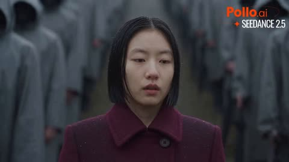</a>

用一个饱和色与灰度人群形成对比，让画面有即时的焦点。提示词让镜头逐渐拉远，直到人物缩小为混凝土空间中的一抹红色，为整段视频定下清晰的空间走向。

Seedance 2.5 · 文生视频 · 出处: [@xIrissy on X](https://x.com/xIrissy/status/2100511965840109644)

[`color-contrast`](tags.md#tag-color-contrast) [`camera-pull-back`](tags.md#tag-camera-pull-back) [`monochrome-crowd`](tags.md#tag-monochrome-crowd)

<details><summary><b>提示词</b></summary>

```text
One of a thousand, and the only one in colour. A single crimson coat walks the stairs while a sea of grey hoods holds its breath, then the umbrellas open in a wave. The camera keeps pulling back until she’s just a red thread in a concrete cathedral.
```

</details>

<a id="seedance-riverside-boat-physics-demo"></a>
### 女子在金色时刻踏上木船

<a href="https://x.com/Lianaalane/status/2090372863631225290">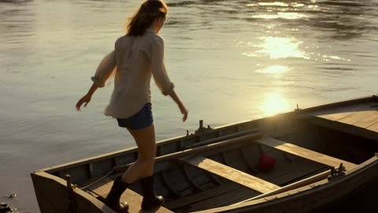</a>

提示词把15秒拆成按秒计时的分段，每段写明一个物理事件（行走、推船、落球、抛球、溅水）及其因果。同时要求质量、尺度和位置在整段视频中保持一致，避免物体漂移或穿模。

Seedance 2.5 · 文生视频 · 出处: [@Lianaalane on X](https://x.com/Lianaalane/status/2090372863631225290)

[`physics`](tags.md#tag-physics) [`timed-beats`](tags.md#tag-timed-beats) [`golden-hour`](tags.md#tag-golden-hour) [`river`](tags.md#tag-river)

<details><summary><b>提示词</b></summary>

```text
Create an ultra-realistic cinematic 15-second vertical 9:16 video demonstrating real-world physics through one continuous, believable sequence. Scene: a young woman walks along a riverside carrying a small ball and approaches a wooden boat floating near the shore during golden hour. From 0–3 seconds, she walks naturally toward the boat; her footsteps demonstrate gravity, weight, friction, balance, inertia, and realistic acceleration and deceleration. Loose hair and clothing react naturally to wind and air resistance. From 3–6 seconds, she gently pushes the boat into the water and steps inside. The boat moves backward as a realistic reaction to her push, demonstrating Newton’s third law and conservation of momentum. Her body shifts slightly because of inertia as the boat accelerates, while friction and water drag gradually reduce the boat’s motion. From 6–9 seconds, she drops the ball inside the boat; gravity causes it to fall with realistic acceleration, bounce once according to its elasticity and collision physics, and settle because of friction. From 9–12 seconds, she throws the ball forward; the ball follows a realistic curved trajectory under gravity and air resistance while the moving boat continues forward because of momentum. The ball lands on the water, creating a realistic splash, ripples, displacement, surface tension, buoyancy, and fluid-dynamic interaction. From 12–15 seconds, the boat continues gliding naturally, creating a realistic wake behind it as water resistance and drag gradually reduce its speed. Throughout the entire video, accurately simulate Newton’s three laws, gravity, inertia, momentum, conservation of momentum, conservation of energy, friction, acceleration, deceleration, collision forces, elasticity, mass, weight, air resistance, drag, buoyancy, pressure, surface tension, fluid dynamics, displacement, and realistic cause-and-effect interactions. Every movement must have believable physical consequences and correct timing. Objects must maintain consistent mass, scale, position, texture, and physical properties from frame to frame. Use realistic water reflections, shadows, wind movement, natural motion blur, physically accurate lighting, photorealistic materials, cinematic depth of field, smooth camera movement, and professional film quality. No impossible movement, no floating objects, no teleportation, no sudden unexplained acceleration, no object clipping, no distorted anatomy, no duplicated objects, and no violation of realistic physics. Total duration exactly 15 seconds.
```

</details>

<a id="seedance-schoolgirl-missing-key-mission"></a>
### 女学生在晨光教室里翻找课桌抽屉

<a href="https://x.com/Strength04_X/status/2099715492630122925">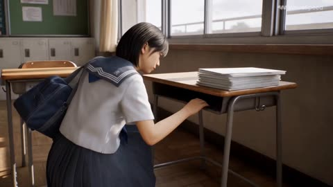</a>

按时间段（0到5秒、5到10秒等）分段描述动作，让30秒有清晰的节奏；用一条镜头规则并规定26秒前不切镜，保证跟拍连续。把人物外观和钥匙设计单独锁定，可防止整段视频中人物与道具走样。

Seedance 2.5 · 文生视频 · 出处: [@Strength04_X on X](https://x.com/Strength04_X/status/2099715492630122925) · 发现于 [LearnPrompt/awesome-seedance](https://github.com/LearnPrompt/awesome-seedance)

[`timed-beats`](tags.md#tag-timed-beats) [`single-take`](tags.md#tag-single-take) [`identity-lock`](tags.md#tag-identity-lock) [`japanese-school`](tags.md#tag-japanese-school)

<details><summary><b>提示词</b></summary>

```text
A missing key, a schoolgirl, and a full-on gameplay mission

Made with Seedance 2.5 on @wavespeed_ai 

Prompt - 30-Second Photorealistic AAA Gameplay

Create exactly 30 seconds of photorealistic 4K AAA third-person gameplay inside a realistic Japanese high school on a bright weekday morning. The sequence should feel like a spontaneous story mission with believable movement, natural NPC behavior, realistic physics, and uninterrupted environmental continuity.

CHARACTER:
20-year-old Japanese schoolgirl with medium-length straight black hair, subtle side bangs, natural youthful facial features, white short-sleeve school blouse, navy ribbon, dark grey pleated skirt, black knee-high socks, white indoor sneakers, and a dark blue shoulder school bag. Maintain identical face, hair, body proportions, clothing, footwear, and accessories from beginning to end.

OBJECT:
A small red classroom key attached to a simple wooden key tag. The key is fully physical, metallic, reflective, and consistently sized throughout the sequence.

0–5s — THE MISSING KEY

Inside an emptying classroom, she searches through a desk drawer and realizes the classroom key is missing. She notices the red key tag underneath a stack of worksheets near the window. She reaches for it, but a sudden gust from the open window pushes the worksheets across the desk and the key drops onto the floor.

HUD: FIND THE CLASSROOM KEY

5–10s — DOWN THE CORRIDOR

She picks up the key and leaves the classroom. A school announcement begins playing through the hallway speakers. She walks toward the main office while checking the key tag against a handwritten classroom number.

Students move naturally around her, some entering classrooms, others carrying books and sports bags.

10–15s — WRONG TURN

She reaches an intersection and realizes she has taken the wrong corridor. She stops beside a wall map of the school and studies it briefly.

A group of younger students rushes past carrying basketballs, causing her to step back against the wall. Once the corridor clears, she turns into a smaller connecting hallway.

15–20s — LOCKED DOOR

She reaches a shortcut door but finds it locked. She tries the handle once, then notices a stairwell beside it.

She takes the stairs down one level. Her shoes make realistic sounds against each step while sunlight flickers across the stairwell through the tall windows.

HUD: TAKE THE SHORTCUT

20–26s — LAST SECOND

She exits the stairwell and reaches the classroom wing just as a staff member begins closing a large sliding partition at the end of the corridor.

She quickly walks through the remaining opening before it closes, then reaches the classroom door.

She inserts the key into the lock, turns it naturally, opens the door, and steps inside.

HUD: ROOM UNLOCKED

26–30s — HARD CUT

Hard cut to a fixed frontal classroom shot.

She places the key on the teacher's desk, removes her school bag, and sits down at her usual seat.

The teacher enters a moment later, notices the unlocked room, and gives her a brief approving look.

She quietly opens her notebook as the morning lesson begins.

HUD: MISSION COMPLETE

CAMERA:
Use one grounded third-person camera from 0–26s positioned behind and slightly beside the girl. Maintain natural gameplay-style tracking with realistic camera inertia and subtle operator movement.

The camera must physically follow the character through classrooms, corridors, stairwell, and doorway. No floating camera, no orbiting shots, no sudden perspective changes, no impossible tracking, and no cuts during the first 26 seconds.

At exactly 26 seconds, perform one hard cut to the fixed frontal classroom angle.

AUDIO:
Natural Japanese school ambience: distant student conversations, footsteps, sliding classroom doors, papers moving, school announcements over speakers, stairway echoes, basketballs bouncing in the distance, door handles, key movement inside the lock, fabric movement, subtle breathing, and morning classroom sounds.

No dramatic music or action soundtrack.

REALISM LOCK:
Natural student behavior, realistic walking speed, accurate body mechanics, believable collisions, physically correct key movement, realistic wind interaction with paper, authentic Japanese school architecture, varied background activity, natural morning lighting, realistic shadows and reflections, detailed skin and hair, physically based materials, and cinematic AAA game rendering.

No teleporting, supernatural abilities, impossible shortcuts, parkour, combat, duplicated characters, disappearing objects, changing identity, changing outfit, changing key design, unrealistic physics, exaggerated acting, anime or cartoon style, plastic CGI appearance, floating camera, subtitles, logos, watermarks, or additional cuts.
```

</details>

<a id="seedance-schoolgirl-stands-before-tanks"></a>
### 女学生独自站在高速公路上面对坦克

<a href="https://x.com/itsSaira_1/status/2101205826895827053"></a>

全局连续性段落锁定人物、服装和环境，随后每个定时分镜都从上一镜的末帧开始，保证剪切衔接一致。负面提示词排除了倒放和消失的物体，使飞来的炮弹始终保持向前的运动方向。

Seedance 2.5 · 文生视频 · 出处: [@itsSaira_1 on X](https://x.com/itsSaira_1/status/2101205826895827053) · 发现于 [LearnPrompt/awesome-seedance](https://github.com/LearnPrompt/awesome-seedance)

[`continuity`](tags.md#tag-continuity) [`timed-scenes`](tags.md#tag-timed-scenes) [`dark-fantasy`](tags.md#tag-dark-fantasy) [`multi-shot`](tags.md#tag-multi-shot)

<details><summary><b>提示词</b></summary>

```text
GLOBAL CONTINUITY: Photorealistic cinematic 16:9. Keep the EXACT same schoolgirl, identical face, black bob haircut, navy school uniform, red ribbon, blue plaid skirt, same highway, mountains, skyline, lighting and visual style. Every scene must directly continue from the previous scene using the exact previous last frame as the next Start/Reference Frame. No changes in identity, clothing, environment, direction, scale or lighting.

SCENE 1 — 0:00–0:02.5
Girl stands exactly in the center of a huge highway, facing distant military tanks. Wide cinematic shot, mountains and city skyline behind them.

SCENE 2 — 0:02.5–0:04.5
The same tanks fire toward the girl. Powerful muzzle flashes, smoke and realistic military details. Camera moves slightly alongside the tanks.

SCENE 3 — 0:04.5–0:07
Cut to the exact same girl, standing calmly and facing the camera. Slow cinematic push-in toward her face.

SCENE 4 — 0:07–0:09.5
Multiple tank shells rapidly fly toward and around the girl. She remains completely still. Projectiles must keep their forward direction and never disappear or reverse.

SCENE 5 — 0:09.5–0:11.5
The girl's eyes glow neon green. She raises one hand and creates powerful green energy around her hand and body.

SCENE 6 — 0:11.5–0:14
A massive explosion erupts on the highway around the attacking forces. Huge fire, smoke, dust and debris.

SCENE 7 — 0:14–0:16.5
Low tracking shot of the same military tanks aggressively moving forward. Realistic tracks, armor, weight, dust and smoke.

SCENE 8 — 0:16.5–0:19
Multiple tanks suddenly rise and float above the highway under a powerful supernatural force. Same environment and daylight.

SCENE 9 — 0:19–0:21.5
The floating tanks violently explode in mid-air. Large fireballs, smoke, metal fragments and debris fall downward.

SCENE 10 — 0:21.5–0:24
A gigantic explosion completely fills the center of the highway with fire, smoke and debris. Wide cinematic shot.

SCENE 11 — 0:24–0:26
Cut back to the EXACT same girl, unchanged and unharmed, standing calmly in the center of the now-empty highway. Slow push-in.

SCENE 12 — 0:26–0:27.5
Camera moves behind the girl as she calmly walks forward down the highway. End with a wide cinematic shot of her walking toward the distant mountains.

NEGATIVE: No character change, face change, hairstyle change, outfit change, age change, background change, lighting change, weather change, duplicated character, distorted face, deformed hands, extra fingers, disappearing objects, reversed movement, U-turns, camera flips, inconsistent tanks, unrealistic physics, text, subtitles, logos, watermark, UI or continuity errors.

#Ai #darkfantisy #visaul #AIart️️️️️️️️️️️️️️️️️️️️️️️️️️️️️️️️️️️️️️️️️️️️️️️️️️️ #visualstorytelling #seedance25
@Flovaai @itsPolloAI
```

</details>

<a id="seedance-seoul-five-scene-lifestyle"></a>
### 从公寓到韩屋小巷的五段首尔场景

<a href="https://x.com/Zoyavelle/status/2101893707897381209">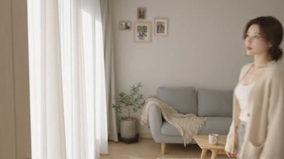</a>

编号的场景段落在每个镜头中重复同一位女主角的详细外貌描述，让她在切换中保持同一个人的样子。35mm 镜头、浅景深和逆光的黄金时段光线设定了电影质感。

Seedance 2.5 · 文生视频 · 出处: [@Zoyavelle on X](https://x.com/Zoyavelle/status/2101893707897381209) · 发现于 [LearnPrompt/awesome-seedance](https://github.com/LearnPrompt/awesome-seedance)

[`seoul`](tags.md#tag-seoul) [`lifestyle`](tags.md#tag-lifestyle) [`multi-scene`](tags.md#tag-multi-scene) [`photorealistic`](tags.md#tag-photorealistic)

<details><summary><b>提示词</b></summary>

```text
Cinematic photorealistic lifestyle video of a beautiful young Korean woman with long dark brown hair, natural makeup and delicate facial features, living an elegant everyday life in Seoul. Scene 1: she is inside a cozy modern apartment with warm beige tones, large floor-to-ceiling windows with soft white curtains, gray sofa, wooden coffee table and indoor plants. She wears a cream cardigan over a white camisole and casually walks through the room while holding a coffee mug. Scene 2: she walks alone through a quiet narrow Seoul residential street surrounded by traditional Korean and modern brick buildings, utility poles and parked cars, natural daylight, realistic urban atmosphere. Scene 3: she enters an underground subway entrance through a glass-covered stairway. Scene 4: she sits at an office desk wearing an elegant beige blazer and white blouse, working naturally on a computer beside a takeaway coffee, bright modern office with large windows. Scene 5: she walks through a beautiful traditional Korean hanok alley at golden hour, wearing a light beige/cream dress, holding a cup, warm sunlight shining directly behind her, traditional wooden houses and hanging lanterns, soft lens flare. Natural human movements, subtle expressions, realistic hair and clothing motion, cinematic composition, shallow depth of field, soft natural lighting, realistic skin texture, professional DSLR cinematography, 35mm lens, smooth camera movement, atmospheric, high detail, photorealistic, film look, 4K.
```

</details>

<a id="seedance-shower-towel-doorbell-delivery-comedy"></a>
### 男子冲出淋浴间跑去应门取快递

<a href="https://x.com/AIwithZeeshi/status/2107317166995546481"></a>

提示词把笑点拆成清晰的节拍：通知、门铃、奔跑、错过快递员、无奈表情。结尾用一串物理描述约束水、重力、湿织物和阴影，并保证角色一致和跟拍镜头平滑。

Seedance 2.5 · 文生视频 · 出处: [@AIwithZeeshi on X](https://x.com/AIwithZeeshi/status/2107317166995546481) · 发现于 [LearnPrompt/awesome-seedance](https://github.com/LearnPrompt/awesome-seedance)

[`comedy`](tags.md#tag-comedy) [`photorealistic`](tags.md#tag-photorealistic) [`tracking-shot`](tags.md#tag-tracking-shot) [`physics`](tags.md#tag-physics) [`storytelling`](tags.md#tag-storytelling)

<details><summary><b>提示词</b></summary>

```text
A young man is taking a normal shower in a modern apartment when his phone suddenly shows a delivery notification.

He hears the doorbell and quickly turns off the shower, grabs a towel, and rushes toward the entrance. His wet feet leave small realistic footprints as he carefully runs across the floor.

He finally opens the door, but the delivery driver is already walking away. The package is sitting safely on the doormat.

He looks at the package, then at the driver, completely exhausted.

Photorealistic cinematic comedy, realistic water behavior, natural human movement, believable gravity and friction, consistent character appearance, realistic wet hair and fabric, natural facial expressions, smooth camera tracking, accurate shadows, realistic apartment lighting, and physically believable interactions throughout.
```

</details>

<a id="seedance-singing-walk-hydrant-suit-morph"></a>
### 唱歌的男人走过消防栓，西装连续变换

<a href="https://x.com/techhalla/status/2094570657929363710">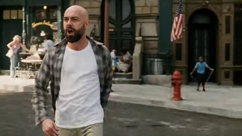</a>

参考图被锁定为首帧并写明身份保持规则，镜头全程为一条连续跟拍且不切换。分段时间节点和现场声音描述决定了各个桥段，服装变化写成一次连续变形，因此无需剪切。

Seedance 2.5 · 图生视频 · 出处: [@techhalla on X](https://x.com/techhalla/status/2094570657929363710) · 发现于 [LearnPrompt/awesome-seedance](https://github.com/LearnPrompt/awesome-seedance)

[`tracking-shot`](tags.md#tag-tracking-shot) [`reference-lock`](tags.md#tag-reference-lock) [`comedy`](tags.md#tag-comedy) [`diegetic-audio`](tags.md#tag-diegetic-audio)

<details><summary><b>提示词</b></summary>

```text
A 2000s studio-comedy film shot, 16:9, 35mm, moderate film grain, bright American daylight, tracking camera at chest height following a man along a city sidewalk. Smooth dolly/track with him, no handheld phone, no gimbal whip, no drone, no cuts. The camera stays with him the whole 30 seconds, medium-wide, the street readable behind him.

IMAGE REFERENCES

[image_ref] is the opening frame AND the identity lock: the bald man with the thick dark beard, open grey plaid flannel over a white t-shirt, mid-stride on this exact sunlit sidewalk. Keep his exact face, bald scalp, beard, body. Keep this street: Sherman Brothers shop, cafe table, stone steps and arched doorway, red fire hydrant, American flag, storefronts. Start on this composition, then the camera travels with him down the block. Do not redesign his face.

He sings out loud, diegetic, the lyrics "I've got the power" in a loud off-key enthusiastic voice, the whole walk. No extra score under it. Street air, footsteps, then the gags.

TIMELINE

0-4s: [Tracking medium-wide, opening on image_1] He is already walking, already singing, mouth wide, chest out, a little strut. The camera slides with him. Daylight, grain. He is having the time of his life.

4-8s: [Tracking, he twists his torso toward the hydrant without stopping] He points two fingers at the red fire hydrant on the sidewalk. The hydrant cap blows and three hard jets of water blast out in different directions, high, violent, real water physics, mist in the sun. He keeps walking and singing, does not look back for long. Camera stays on him, hydrant geysers in the background.

8-13s: [Tracking, still singing] He keeps the strut. Water still arcing behind him. Pedestrians flinch at the spray. He grins, points at the sky on a lyric, never breaks stride.

13-18s: [Tracking as he passes a woman coming the other way] A woman in a knee-length dress walks toward him. As they cross, a sudden gust hits only her: the hem lifts a little, Marilyn sidewalk-vent style but modest, a brief flip then it drops. She grabs the fabric, startled. He keeps walking, still singing, a tiny glance, no contact. Camera never leaves him.

18-23s: [Tracking slows as he reaches a shop window] He stops in front of a big storefront glass, still humming. Leans in. We see him and his reflection clearly: bald head, beard, plaid, white tee. He studies himself, tilts his chin.

23-28s: [Held on him and the reflection] In the glass and on his body at the same time, the clothes change in one continuous morph: the flannel and tee become a sharp white open-collar suit, jacket, tailored trousers, a gold chain. No cut, no flash, the fabric rewrites itself. He checks the new look in the window, pleased, shoulders back.

28-30s: [Medium, still on him] He licks the tip of his index finger, taps it to his hip, and a little puff of white steam hisses off the fabric like a hot iron being quenched. He mouths the last "power," smug. Clip ends on that beat. Camera never cut.

AUDIO

His live singing of "I've got the power" the whole way, a bit pitchy, full of himself. Hydrant blast and falling water. Dress flutter. A soft whoosh on the clothes change. A tiny sizzle and steam hiss on the hip. City air, footsteps, one woman gasp. No extra music bed. No commentator. 2000s film production sound, not a phone video.

STYLE & QUALITY

Looks like a real early-2000s movie production still that started moving: 35mm grain, anamorphic-adjacent daylight, stable faces, real water, real wind on fabric, real cloth morph, real steam. Continuous take. No morphing of the face, no extra people popping in, no text, no logos, no watermark, no phone look, no CGI sheen.

The ref image is exactly the first frame. Enjoy! 😎
```

</details>

<a id="seedance-suburban-outbreak-neighbors-fight-back"></a>
### 郊区街道突发感染与邻居奋起反击

<a href="https://x.com/auqibhabib/status/2107346452494381298"></a>

30秒内每秒一个分镜节拍，从突袭到解脱，叙事弧线清晰。慢动作只留给最后的击倒，镜头晃动仅用于撞击，并在开头就写明现场音效和紧张配乐。

Seedance 2.5 · 文生视频 · 出处: [@auqibhabib on X](https://x.com/auqibhabib/status/2107346452494381298) · 发现于 [LearnPrompt/awesome-seedance](https://github.com/LearnPrompt/awesome-seedance)

[`horror`](tags.md#tag-horror) [`action`](tags.md#tag-action) [`suburban`](tags.md#tag-suburban) [`slow-motion`](tags.md#tag-slow-motion) [`diegetic-sound`](tags.md#tag-diegetic-sound)

<details><summary><b>提示词</b></summary>

```text
Cinematic horror-action short film, opens with an instant attack, no slow build, grounded practical-effects style, maximum dynamic camera work. Setting: a quiet suburban street at dusk, a small group of neighbors gathered outside their homes. Muted authentic color grading, natural diegetic sound throughout, tension score entering immediately.
>
> **[0-1s]** Hard cut: a man stumbles out from between two houses, collapsing onto the street, convulsing violently.
>
> **[1-2s]** Nearby neighbors rush toward him to help, unaware of the danger.
>
> **[2-3s]** He suddenly lunges up, grabbing the nearest person by the arm.
>
> **[3-4s]** She screams, pulling back as his grip holds firm, veins darkening rapidly across his skin.
>
> **[4-5s]** He pulls her down, the group scattering in fear and confusion.
>
> **[5-6s]** She convulses hard on the pavement, veins spreading fast across her neck.
>
> **[6-7s]** She rises seconds later, eyes clouded, joining him, both turning toward the others.
>
> **[7-8s]** Loud cries of fear erupt through the street as neighbors scramble for their homes.
>
> **[8-9s]** The two infected move fast, catching a third neighbor near his front gate.
>
> **[9-10s]** He goes down, convulsing, rising moments later as one of them.
>
> **[10-11s]** Wide shot: panic spreads further down the street, people slamming doors and windows shut.
>
> **[11-12s]** A man grabs a baseball bat from his garage, stepping out cautiously.
>
> **[12-13s]** The three infected turn toward him, moving fast across the street.
>
> **[13-14s]** He swings hard at the first, a solid impact knocking it back into a parked car.
>
> **[14-15s]** A neighbor joins him, grabbing a shovel from a nearby yard.
>
> **[15-16s]** SLOW MOTION insert: she swings it into the second infected, striking it down.
>
> **[16-17s]** The third lunges at the man with the bat; he sidesteps and strikes again.
>
> **[17-18s]** It staggers, falling against a mailbox, still trying to rise.
>
> **[18-19s]** More neighbors emerge cautiously, grabbing garden tools and makeshift weapons.
>
> **[19-20s]** They surround the remaining infected, striking together in a coordinated effort.
>
> **[20-21s]** SLOW MOTION: the final blow connects, all three collapsing motionless on the street.
>
> **[21-23s]** Wide shot: the group stands over them, breathing hard, weapons still raised.
>
> **[23-25s]** Cries of fear slowly settle into exhausted relief among the neighbors.
>
> **[25-27s]** The man with the bat lowers it slowly, scanning the quiet street for any more movement.
>
> **[27-29s]** Neighbors check on each other, some embracing, others sitting down on the curb in shock.
>
> **[29-30s]** Final shot: the street falls silent under the dusk sky, the group standing together, exhausted but safe. Cut to black.
>
> Natural diegetic sound throughout — convulsing, screaming, crying, metal impacts, heavy breathing — layered with a tense instrumental score building through the chaos and easing into relief at the end. No text overlay, no watermark. Maximum dynamic camera variety — close-ups, wide shots, tracking shots, slow motion reserved for the final takedowns. Realistic shake only during physical impacts, natural dusk color grading.

Made with seedance 2.5 on @SocialSight
```

</details>

<a id="seedance-taco-chase-food-truck-animation"></a>
### 霓虹夜色中的美食车女主厨

<a href="https://x.com/ai_anelia/status/2107655230628548720">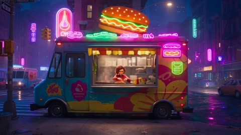</a>

提示词按风格、镜头、剧情节拍和音频分段书写，给模型一份清晰的分镜计划。明确指定手持跟拍、低角度和层层升级的喜剧情节，让画面保持节奏并且容易读懂。

Seedance 2.5 · 文生视频 · 出处: [@ai_anelia on X](https://x.com/ai_anelia/status/2107655230628548720)

[`3d-animation`](tags.md#tag-3d-animation) [`comedy`](tags.md#tag-comedy) [`food-truck`](tags.md#tag-food-truck) [`neon`](tags.md#tag-neon)

<details><summary><b>提示词</b></summary>

```text
A stylish young woman with short wavy brown hair, a red bomber jacket, black cargo pants, and white sneakers works alone at a colorful late-night food truck.

Style: Stylized cinematic 3D animation, expressive character acting, vibrant neon lighting, exaggerated physics, detailed environments, playful comedy, quirky animated-film aesthetic.

Camera: Handheld-style tracking, dramatic low angles, overhead city views, quick push-ins, wide shots, and energetic close-ups.

Story: While preparing a giant taco, a strong gust of wind sends the tortilla flying across the street. She chases it through the busy neon-lit city, dodging pedestrians and scooters, until it lands on a moving delivery van. She jumps onto the van, grabs it, and triumphantly holds it up—only for her hat to fly away.

She chases the hat through a neon alley, somehow keeping the tortilla balanced on her head. She finally returns to the food truck, places the tortilla down proudly, and looks at the camera. A tiny pigeon immediately steals it.

Audio: Lively city ambience, footsteps, traffic, comedic whooshes, playful music, food-truck sounds, and exaggerated impact effects. No dialogue.
```

</details>

<a id="seedance-teen-prank-goalpost-phones"></a>
### 恶作剧反噬，手机卡在球门横梁上

<a href="https://x.com/ZoyaAi_/status/2113486934781595986">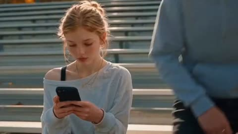</a>

开头先给出统一的光线与调色风格，再用带时间码的分镜逐段描述，结构清楚。跳切进入红烟混乱，再以仰拍球门的低角度镜头收尾，让喜剧反转有明确的画面落点。

Seedance 2.5 · 文生视频 · 出处: [@ZoyaAi_ on X](https://x.com/ZoyaAi_/status/2113486934781595986) · 发现于 [LearnPrompt/awesome-seedance](https://github.com/LearnPrompt/awesome-seedance)

[`teen-drama`](tags.md#tag-teen-drama) [`shot-list`](tags.md#tag-shot-list) [`golden-hour`](tags.md#tag-golden-hour) [`comedy`](tags.md#tag-comedy)

<details><summary><b>提示词</b></summary>

```text
Prompt 

A cinematic teen drama short film, shot in warm golden-hour autumn light on the aluminum bleachers of a high school football stadium. The overall tone is naturalistic and emotionally intimate with a sudden comedic-revenge twist. Shallow depth of field, soft bokeh from sunlight hitting metal bleacher rails, handheld documentary-style camera with gentle drift, 24fps film grain, warm orange-and-teal color grade, lens flares from low sun.

**Shot 1 (0–5s):** Close-mid shot of a teenage girl with soft blonde hair pulled into a messy bun, wearing an off-shoulder cream sweater over a black tank top. She sits on metal bleachers scrolling intently on her phone. Beside her, a teenage boy in a light blue oversized hoodie with shaggy brown hair leans in close over her shoulder, peering at the screen with mild curiosity. Soft rim lighting from the setting sun behind them, blurred silver bleacher rows in the background, a few autumn leaves scattered on the seats.

**Shot 2 (5–9s):** Sudden jump cut — a burst of red smoke or colored powder explodes into frame, enveloping a small group of three teens sitting further down the bleachers. They flinch back in surprise, hands raised defensively to shield their faces, hair and loose strands whipped by the gust of the blast. Golden sunlight scatters through the red haze creating a hazy, dreamlike, slightly chaotic visual. Quick, reactive camera shake sells the surprise.

**Shot 3 (9–14s):** Intimate close-up portrait of a different girl — wavy, sunlit flyaway hair, delicate gold hoop earrings and a thin gold necklace, wearing a white knitted top. She looks down at her phone with a quiet, pensive, slightly worried expression, warm backlight haloing her hair, skin tones glowing in the low sun. The mood shifts from chaos to a quieter, tense beat.

**Shot 4 (14–20s):** Low-angle wide shot looking straight up at a bright yellow steel goalpost crossbar cutting diagonally across a clear, deep-blue late-afternoon sky. Below it, three teenagers stand on the field looking upward with concern and frustration — one boy in a grey hoodie with a black backpack reaches up and starts climbing the vertical post, straining to reach something lodged at the top. Two girls stand nearby, one with long brown hair looking up anxiously, the other in a navy striped sweater raising both hands toward the sky in a pleading/frustrated gesture. Their phones are visibly stuck on top of the crossbar. Blurred autumn-orange treeline and stadium floodlight tower visible at the edges of frame.

**Overall mood/theme:** "Messing with Amelia" backfires — a lighthearted teen revenge-prank narrative where the antagonist group's phones end up stranded on the stadium goalpost, and they're now desperately trying to climb up and fetch them. Comedic-ironic, youthful, slightly cinematic-trailer energy. Aspect ratio 1080x608, widescreen cinematic crop, subtle ambient wind/rustle sound design implied, no dialogue — purely visual storytelling with expressive reactions.
```

</details>

<a id="seedance-train-zombie-outbreak-horror"></a>
### 女子在火车上咳嗽，乘客担忧注视

<a href="https://x.com/doctorwasif/status/2093550743945105687">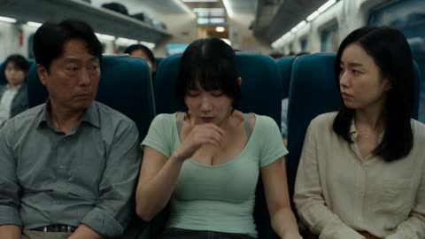</a>

带时间码的分镜表，每个时段都写明镜头或光线，控制30秒内的节奏。一张 @ 参考图锁定所有镜头中的人脸和服装。

Seedance 2.5 · 参考生视频 · 出处: [@doctorwasif on X](https://x.com/doctorwasif/status/2093550743945105687)

[`zombie`](tags.md#tag-zombie) [`horror`](tags.md#tag-horror) [`train`](tags.md#tag-train) [`reference-image`](tags.md#tag-reference-image)

<details><summary><b>提示词</b></summary>

```text
0–1.2s: @ (Image) matching reference face/outfit, sits on a train, pale, sweating, coughing weakly. Passengers glance over, concerned. Cinematic outbreak-horror realism.

1.2–2.4s: Her breathing turns ragged; dark veins appear on her neck, eyes become glassy. Close-up, tense lighting.

2.4–3.6s: She collapses and convulses as passengers rush to help. Handheld camera.

3.6–4.8s: She suddenly snaps upright, bloodshot feral eyes, guttural snarl. Extreme close-up horror reveal.

4.8–6s: She violently bites a helper’s forearm. Shock and panic. Slow-motion impact.

6–7.2s: He stumbles back clutching the bloody bite. Passengers panic.

7.2–8.5s: Dark veins rapidly spread from the wound up his arm and neck. Visceral transformation close-up.

8.5–10s: He collapses, convulses, then rises as a zombie, eyes bloodshot and empty.

10–12.5s: He lunges at another passenger. Screams erupt; the carriage descends into chaos.

12.5–15.5s: Multiple passengers turn rapidly, spreading the infection through the car. Survivors flee toward the connecting door.

15.5–18.5s: Survivors barricade the door with luggage and seat cushions as infected passengers claw and pound against it.

18.5–21.5s: The door violently shudders; infected faces press against the glass. Cracks spread as panic intensifies.

21.5–24.5s: Families retreat as the glass shatters and infected arms break through, grabbing at survivors.

24.5–27.5s: Survivors race toward the front, dragging luggage behind them as a zombie horde crashes through the barricade.

27.5–30s: Survivors slam the next door shut and stare in horror as the infected horde pounds against the glass. Dim flickering lights, heavy breathing, cinematic outbreak ending.
```

</details>

<a id="seedance-universe-to-humanity-documentary"></a>
### 发光的宇宙爆发，粒子向外放射拖出光痕

<a href="https://x.com/RuzainaMeer/status/2096837494000308685"></a>

提示词把整段从宇宙到人类的历程写成一个连续镜头，用时间和尺度之间的转场串起各个阶段，结尾是从地球拉远到银河的镜头回拉。光照、HDR 和真实物理作为风格约束，排除项（无文字、无旁白、无霓虹）保持画面干净。

Seedance 2.5 · 文生视频 · 出处: [@RuzainaMeer on X](https://x.com/RuzainaMeer/status/2096837494000308685) · 发现于 [LearnPrompt/awesome-seedance](https://github.com/LearnPrompt/awesome-seedance)

[`documentary`](tags.md#tag-documentary) [`cosmos`](tags.md#tag-cosmos) [`evolution`](tags.md#tag-evolution) [`long-take`](tags.md#tag-long-take)

<details><summary><b>提示词</b></summary>

```text
Create a 30-second ultra-photorealistic cinematic documentary showing the evolution of the universe and life on Earth in one seamless journey.

Begin with the Big Bang and the expansion of space, then show matter forming, the first stars, galaxies, supernovae, and the birth of the Solar System and Earth. Transition to volcanic early Earth, cooling oceans, primitive single-celled life, complex marine organisms, life moving onto land, prehistoric forests, dinosaurs, early mammals, primates, hominins, and finally modern Homo sapiens.

End with a modern human looking toward the horizon as the camera rapidly pulls back from Earth to the Moon, Solar System, and Milky Way, connecting humanity to the universe.

Use continuous cinematic camera movement, seamless transitions through time and scale, realistic physics, scientifically inspired environments, natural motion, detailed animal anatomy, realistic lighting, HDR, and premium documentary cinematography.

16:9, ultra-realistic, photorealistic, emotionally powerful, scientifically grounded. No text, labels, narration, fantasy, cyberpunk, neon, or futuristic elements.
```

</details>

<a id="seedance-vampire-romance-castle-teaser"></a>
### 三十秒哥特吸血鬼古堡爱情预告片

<a href="https://x.com/ZaraIrahh/status/2094363532636590322"></a>

两张参考图分别锁定主角和古堡场景，六个各五秒的分镜写明台词与动作。景别、固定色板、音效清单以及亲吻前切黑的收尾，共同撑起张力和悬念。

Seedance 2.5 · 参考生视频 · 出处: [@ZaraIrahh on X](https://x.com/ZaraIrahh/status/2094363532636590322) · 发现于 [LearnPrompt/awesome-seedance](https://github.com/LearnPrompt/awesome-seedance)

[`vampire`](tags.md#tag-vampire) [`romance`](tags.md#tag-romance) [`short-drama`](tags.md#tag-short-drama) [`cinematic`](tags.md#tag-cinematic) [`dialogue`](tags.md#tag-dialogue)

<details><summary><b>提示词</b></summary>

```text
Create a 30-second, 16:9 premium live-action vampire-romance teaser for an international short-drama audience. Use Image 1 for the two leads' appearance and Image 2 for the castle environment. Preserve both identities consistently throughout every shot with ultra-realistic live-action cinematography, cinematic lighting, natural skin texture, and emotionally expressive performances.

Story: A curious young woman accidentally wanders into the forbidden wing of a forgotten castle, where she awakens an ancient vampire noble from centuries of sleep. The instant he sees her, he senses the bloodline of an ancient war flowing through her veins. Instead of killing her, he becomes dangerously fascinated. His obsession grows immediately into a possessive desire to keep her close. She is frightened by his overwhelming presence but refuses to surrender completely, meeting his dominance with quiet courage.

Style: Premium ReelShort / DramaBox vampire romance. Darkly romantic, emotionally intense, fate-bound, mysterious, elegant, and seductive without becoming explicit. Build escalating romantic tension through eye contact, silence between lines, restrained emotion, and powerful chemistry. The pacing should feel like the opening episode of a viral international drama with a shocking cliffhanger ending. No gore, no cheap horror, no Halloween costumes, no monsters, and no modern streetwear.

The castle is illuminated only by moonlight filtering through towering stained-glass windows, flickering candlelight, fireplaces, drifting mist, ancient chandeliers, marble floors, velvet curtains, towering bookshelves, gothic arches, carved stone walls, and floating dust particles. Rich black, crimson, silver, and deep blue dominate the color palette.

Shoot entirely for TikTok, ReelShort, and DramaBox. Prioritize medium close-ups, close-ups, extreme close-ups, slow push-ins, over-the-shoulder shots, dramatic eye contact, trembling hands, subtle breathing, and intimate framing. Every shot should maximize emotional tension between the leads.

Scene 1 (0–5s)
The young woman cautiously walks through the abandoned castle corridor holding an antique candle. The flame flickers violently as if something unseen is watching her.

Woman (whispering):
"I shouldn't be here..."

A distant male voice echoes through the darkness.

Vampire (O.S., whisper):
"...You finally came."

Scene 2 (5–10s)
An enormous stone coffin slowly opens. The vampire noble rises with quiet elegance, his crimson eyes fixed only on her. She freezes in fear.

Woman:
"Who... who are you?"

Vampire (calmly):
"The one fate refused to bury."

Scene 3 (10–15s)
He slowly approaches until only inches separate them. He gently lifts her chin without hurting her, studying her face as though recognizing someone long forgotten.

Vampire:
"Your blood remembers a war the world has forgotten."

Woman:
"I don't know what you're talking about."

Scene 4 (15–20s)
She steps backward, refusing to surrender despite her fear. He blocks her escape with effortless confidence.

Woman:
"I'm not afraid of you."

Vampire (soft smile):
"You should be."

Scene 5 (20–25s)
He leans closer, eyes locked with hers. Their breathing becomes the only sound. His expression shifts from curiosity to obsession.

Vampire:
"I searched centuries for you..."

Woman (barely whispering):
"Why me?"

Vampire:
"Because you belong to my destiny."

Scene 6 (25–30s)
The castle doors slam shut by themselves. Candle flames extinguish one by one. He gently reaches for her hand while she hesitates, torn between fear and an irresistible pull.

Vampire:
"You may fight fate..."

(He slowly intertwines his fingers with hers.)

Vampire:
"...but you'll never escape me."

Final shot: Extreme close-up of their locked eyes as orchestral music swells. Smash cut to black before they kiss.

Editing should feel premium and fast-paced with cinematic hard cuts, dramatic push-ins, elegant slow motion, realistic sound design, orchestral strings, deep piano notes, distant thunder, candle crackles, footsteps, soft breathing, fabric movement, and subtle heartbeats. The final frame ends on a cliffhanger that leaves the audience desperate for Episode 2.
```

</details>

<a id="seedance-vintage-4x4-desert-sunset-music-video"></a>
### 黄昏时分扬起沙尘的老式越野车

<a href="https://x.com/ZaraIrahh/status/2095736444245479557">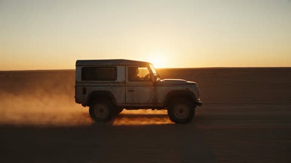</a>

提示词把视频拆分为带硬切的分镜，并将风格、音频与负面提示分别列出。开头一句将人物身份锁定到上传图片，使其在多次切镜中保持一致。

Seedance 2.5 · 参考生视频 · 出处: [@ZaraIrahh on X](https://x.com/ZaraIrahh/status/2095736444245479557)

[`desert`](tags.md#tag-desert) [`golden-hour`](tags.md#tag-golden-hour) [`music-video`](tags.md#tag-music-video) [`identity-lock`](tags.md#tag-identity-lock)

<details><summary><b>提示词</b></summary>

```text
Create a photorealistic cinematic adventure music video following a young traveler on an unforgettable journey through the desert at night and sunrise. Use the uploaded image as the exact identity reference and maintain the same face, hair, skin tone and proportions throughout. Keep the character visually consistent in every shot.

The video begins at golden hour with the traveler driving an old vintage 4x4 across a vast desert highway, wearing a black oversized jacket, white T-shirt and dark jeans. Show close-ups of hands on the steering wheel, sunlight passing across the windshield, dust rising behind the vehicle and wide cinematic shots of endless sand dunes.

Hard cut to night. The traveler sets up a small campsite beneath a massive star-filled sky. Show a glowing campfire, boots walking across the sand, sparks floating upward and the traveler sitting beside the fire while looking toward the stars.

Cut to a dramatic desert canyon at first light. The traveler hikes through towering red-rock formations, climbs over rocky terrain and pauses at a high viewpoint overlooking the landscape.

Hard cut to a sand-dune sequence. The traveler runs down a steep dune, laughs naturally, spins in the wind and watches a distant 4x4 drive across the horizon. Capture realistic wind movement in the clothing and hair.

Cut to a remote desert road during sunrise. The traveler stands beside the vehicle as the first sunlight illuminates the mountains. Include quick atmospheric shots of tire tracks, desert plants, dust particles, distant birds, rock formations and sunlight moving across the landscape.

The final sequence shows the traveler driving toward the sunrise on an empty road. The camera slowly pulls back into an enormous aerial-style landscape shot as the vehicle becomes tiny against the desert.

End with a bold cinematic white title reading “WANDER” over the final sunrise shot.

Style: Premium cinematic adventure music video, photorealistic live-action, 35mm/50mm cinematic lens look, subtle film grain, natural skin texture, realistic hair and fabric movement, handheld camera mixed with smooth tracking shots, dramatic golden-hour lighting, deep blue night tones, realistic firelight, atmospheric dust, natural motion blur, realistic depth of field, 24fps, hard cuts only.

Audio: Energetic cinematic electronic music with atmospheric percussion, deep bass and subtle acoustic textures. Mix naturally with engine sounds, desert wind, footsteps, fire crackling and environmental ambience. No dialogue.

Negative: No CGI look, plastic skin, identity drift, face changes, distorted anatomy, extra limbs, warped vehicles, impossible landscapes, artificial-looking fire, random text, subtitles, logos or watermark.
```

</details>

<a id="seedance-woman-night-passage-flight"></a>
### 女子独自走过昏暗灯光的大厅

<a href="https://x.com/Lianaalane/status/2100886741972640200">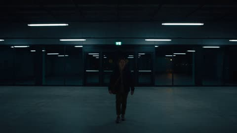</a>

将30秒片段拆分为多个镜头节拍，每个节拍写明镜头运动（远景建立、特写、背后跟拍、低机位），让模型按顺序执行。红色应急灯被写成逐渐出现的变化，使紧张感层层递进，而不是突然亮起。

Seedance 2.5 · 文生视频 · 出处: [@Lianaalane on X](https://x.com/Lianaalane/status/2100886741972640200) · 发现于 [LearnPrompt/awesome-seedance](https://github.com/LearnPrompt/awesome-seedance)

[`thriller`](tags.md#tag-thriller) [`night`](tags.md#tag-night) [`tracking-shot`](tags.md#tag-tracking-shot) [`camera-moves`](tags.md#tag-camera-moves) [`lighting`](tags.md#tag-lighting)

<details><summary><b>提示词</b></summary>

```text
Created a video, 30 seconds, in a dark cinematic thriller style, featuring a young woman walking alone toward a large modern building at night. She slowly looks around with a worried and alert expression as the camera moves from a wide establishing shot into a close-up angle of her face. Suddenly, she turns and starts running toward a narrow underground concrete passage, carrying a shoulder bag while her footsteps echo through the empty corridor. Use smooth tracking shots, handheld movement, realistic body motion, overhead industrial lights, deep shadows, and subtle blue-green cinematic tones. As she runs deeper inside, red emergency lighting gradually appears and creates a tense atmosphere. The camera follows closely from behind and shifts between wide, side, and low-angle shots to increase suspense. Near the end, she reaches a heavy door, pushes it open, and rushes outside into the dark night. Keep the visuals photorealistic, cinematic, atmospheric, and emotionally intense, with natural lighting, realistic textures, smooth motion, and no on-screen text or watermark.
```

</details>

<a id="seedance-young-woman-countryside-bike-ride-summer"></a>
### 少女骑车穿过雏菊田野

<a href="https://x.com/Zyrellix/status/2104061053898228130"></a>

开头固定人物、服装和场景，之后按镜头逐段描述各自的运镜与光线，使同一人物贯穿整段序列。结尾的情绪段统一了所有镜头的光线与调色。

Seedance 2.5 · 文生视频 · 出处: [@Zyrellix on X](https://x.com/Zyrellix/status/2104061053898228130) · 发现于 [LearnPrompt/awesome-seedance](https://github.com/LearnPrompt/awesome-seedance)

[`multi-shot`](tags.md#tag-multi-shot) [`golden-hour`](tags.md#tag-golden-hour) [`slow-living`](tags.md#tag-slow-living) [`japanese-countryside`](tags.md#tag-japanese-countryside)

<details><summary><b>提示词</b></summary>

```text
Cinematic 30-second video, photorealistic, 4K, shallow depth of field. A beautiful young East Asian woman with long flowing black hair, wearing a cream off-shoulder knitted sweater, denim shorts, and white sneakers. She rides a silver city bicycle with a wicker basket full of yellow, purple and white wildflowers along a dirt path through a vast field of white daisies and rolling green hills under a bright blue sky with fluffy clouds. Hair blowing in the wind, gentle smile.
Cut to her lying on her back in the grass under a tree with dappled sunlight, holding an open book, peaceful expression, eyes half-closed.
Then close-up of her hands gently dipping into a clear pebble-bottomed stream.
She walks away from camera pushing the bicycle along the path beside the stream.
Golden hour: she sits on the grass by the river with the bicycle parked behind her, looking toward the sunset reflecting on the water.
Drone shot pulls back revealing her small figure sitting beside a winding river through lush green fields and rice paddies, village houses in the distance, warm sunset light.
Final shot: silhouette of the woman sitting by a calm lake watching a vivid orange sunset, sky glowing with warm colors.
Mood: peaceful, nostalgic, slow-living Japanese countryside summer, dreamy and serene. Soft natural lighting, gentle camera movements, filmic color grading.
```

</details>

<a id="seedance-zombie-express-sleeper-train"></a>
### 丧尸列车卧铺车厢感染扩散

<a href="https://x.com/doctorwasif/status/2095373753983369666"></a>

编号分镜并标注每个镜头的精确时间段，为 30 秒内容提供节拍表，每个镜头都写明景别和速度，如特写或慢动作。image_1 参考图锁定面部与服装，手持镜头与全景镜头把画面从一次咬伤扩展到整节车厢。

Seedance 2.5 · 参考生视频 · 出处: [@doctorwasif on X](https://x.com/doctorwasif/status/2095373753983369666) · 发现于 [LearnPrompt/awesome-seedance](https://github.com/LearnPrompt/awesome-seedance)

[`horror`](tags.md#tag-horror) [`multi-shot`](tags.md#tag-multi-shot) [`handheld-camera`](tags.md#tag-handheld-camera) [`slow-motion`](tags.md#tag-slow-motion)

<details><summary><b>提示词</b></summary>

```text
Shot 1 (0.0–1.2s): <<<image_1>>>, face and outfit matching reference, lying in upper bunk of a dim sleeper cabin, feverish and sweating, eyes fluttering open, curtain half-drawn.
Shot 2 (1.2–2.2s): Close-up of her hand gripping the bunk edge, dark veins emerging beneath the skin, shallow breathing, blue nightlight.
Shot 3 (2.2–3.3s): Her eyes cloud milky white as her head stiffly tilts toward the bunk edge, eerie stillness.
Shot 4 (3.3–4.3s): Dark blood drips from her lips onto the curtain below, extreme close-up, slow motion.
Shot 5 (4.3–5.3s): A sleeping passenger stirs as another blood drop lands on his forehead.
Shot 6 (5.3–6.3s): Wide view of the stacked bunks, her silhouette slowly leaning over the edge above the sleeping passenger.
Shot 7 (6.3–7.5s): She drops silently onto the lower bunk, straddling him; curtain sways as her feral bloodshot eyes fill the frame.
Shot 8 (7.5–8.7s): She bites deeply into his neck; his eyes snap open in shock and pain, slow-motion impact.
Shot 9 (8.7–9.8s): Close-up of the wound as dark veins rapidly branch across his skin.
Shot 10 (9.8–10.8s): His body convulses violently, curtain thrashing as the cabin light flickers.
Shot 11 (10.8–11.8s): His eyes turn milky white, jaw twitching as dark veins spread across his face.
Shot 12 (11.8–12.8s): He throws his head back with an inhuman scream, ripping the curtain open.
Shot 13 (12.8–13.8s): A nearby passenger wakes and cautiously peers from his bunk into the corridor.
Shot 14 (13.8–14.8s): The infected passenger suddenly lunges into the corridor and attacks him.
Shot 15 (14.8–15.8s): Chaos erupts; curtains rip open as passengers wake to screams, handheld frantic camera.
Shot 16 (15.8–16.8s): A newly bitten passenger convulses against the wall as dark veins spread, others retreat in panic.
Shot 17 (16.8–17.8s): The infected turns and lunges at nearby passengers, spreading chaos through the narrow corridor.
Shot 18 (17.8–18.8s): Passengers scramble over each other to escape, luggage and curtains tumbling around them.
Shot 19 (18.8–19.8s): A conductor grabs a fire extinguisher, bracing himself as infected rush toward him.
Shot 20 (19.8–21.0s): He blasts an infected passenger with white extinguisher foam, filling the corridor as it recoils.
Shot 21 (21.0–22.5s): Survivors rush to the connecting door and slam it shut as infected hands claw through.
Shot 22 (22.5–24.0s): They wedge luggage and a fold-down seat against the door, breathing hard as pounding continues.
Shot 23 (24.0–25.5s): Close-up of infected faces pressing against the door window, cracks spreading across the glass.
Shot 24 (25.5–27.0s): A survivor pulls two children close, shielding them as the pounding grows louder.
Shot 25 (27.0–28.5s): Wide shot of survivors huddled in the next car, sealed door shuddering behind them under red emergency lights.
Shot 26 (28.5–30.0s): Exterior wide shot of the train speeding through the night, sleeper windows flickering with chaos inside, ominous ending.
```

</details>

<a id="seedance-zombie-train-pomeranian-window"></a>
### 女子抱着博美犬坐在列车上，窗外丧尸混乱

<a href="https://x.com/john_my07/status/2110365712560902198"></a>

固定一个侧面取景和连续的列车视角，人物与小狗的位置不变，再用按时间排列的情绪节拍逐步推进危险，让恐惧来自表演而不是镜头切换。明确手持晃动、阴天日光和真人电影调色，画面更接近实拍，而不是光滑的 CGI。

Seedance 2.5 · 文生视频 · 出处: [@john_my07 on X](https://x.com/john_my07/status/2110365712560902198) · 发现于 [LearnPrompt/awesome-seedance](https://github.com/LearnPrompt/awesome-seedance)

[`zombie`](tags.md#tag-zombie) [`horror`](tags.md#tag-horror) [`train`](tags.md#tag-train) [`pet-dog`](tags.md#tag-pet-dog)

<details><summary><b>提示词</b></summary>

```text
Create a 30-second, 1080p ultra-realistic live-action zombie apocalypse video, filmed like a scene from a real horror movie.

Camera and composition: Use the same side-angle framing throughout: a wide panoramic train window fills the left two-thirds of the frame, while a young adult East Asian woman sits on a luxurious cream-colored bed on the right, holding a tiny, fluffy cream-colored Pomeranian puppy. Her face must remain clearly visible in a natural three-quarter profile. Warm cabin lights contrast with the cold, grey city outside.

Action: The train moves through a city descending into zombie chaos. The girl initially relaxes with her puppy, then notices terrified crowds running outside. She gradually sits up, turns toward the window, widens her eyes in genuine fear, and instinctively hugs her puppy closer. Her expression and posture change naturally as the danger approaches. The puppy moves naturally in her arms, looks toward the window, shifts its paws, turns its head, and briefly nestles against her.

Outside, show realistic infected people chasing commuters through a railway station, crowds fleeing between cars, a bloodied zombie stumbling past the window, and an infected person briefly running alongside the moving train. In the final moments, the train crosses an urban bridge as a huge crowd of zombies floods the streets below. The girl watches in alarm while protecting her puppy.

Realism: Photorealistic human skin, natural facial expressions, believable dog anatomy and behavior, realistic zombie makeup, authentic city details, accurate window reflections, natural train movement, overcast daylight, subtle handheld camera motion, and cinematic live-action color grading.

Keep both the girl and puppy visible while giving the outside chaos equal visual importance. One continuous moving-train perspective, with no random camera changes. No static posing, frozen expressions, cartoonish zombies, glossy CGI, exaggerated acting, or artificial-looking AI visuals.
```

</details>

[1](video-cinematic.md) · **2**
