# 电影感场景与短片

[返回目录](../../README_zh.md) · 全部 170 条 · [1](video-cinematic.md) · **2**

<a id="seedance-college-lab-zombie-infection"></a>
### 大学实验室学生被感染变成丧尸

<a href="https://x.com/AIwithSynthia/status/2106955772395659431">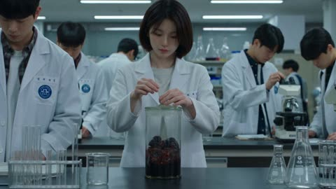</a>

提示词按时间顺序串起容器破裂、感染、追逐、堵门和门窗前的最后一笑，开头就锁定人物的脸和衣着。单独的音频行不要音乐，风格行写明冷色荧光灯转红色应急灯，负面清单排除血腥和脸部变形，让恐怖感保持写实。

Seedance 2.5 · 文生视频 · 出处: [@AIwithSynthia on X](https://x.com/AIwithSynthia/status/2106955772395659431) · 发现于 [LearnPrompt/awesome-seedance](https://github.com/LearnPrompt/awesome-seedance)

[`horror`](tags.md#tag-horror) [`zombie`](tags.md#tag-zombie) [`photorealistic`](tags.md#tag-photorealistic) [`handheld`](tags.md#tag-handheld) [`sound-design`](tags.md#tag-sound-design)

<details><summary><b>提示词</b></summary>

```text
Create a photorealistic live-action zombie-horror sequence inside a modern university science laboratory during a normal college practical session. The central character is a young adult Korean female college student wearing a white laboratory coat over a simple shirt, blue jeans and white sneakers. Keep her face, hairstyle, clothing and body proportions identical throughout. Surround her with several college students, laboratory benches, microscopes, glass test tubes, chemical containers, computers and scientific equipment. Use realistic fluorescent lighting, practical effects, handheld camerawork and believable physics.

The students are quietly working on an experiment when a sealed glass specimen container suddenly cracks. A dark infected substance escapes and attaches itself to the young woman near her shoulder and neck. She stumbles backward in fear as dark veins slowly spread beneath her skin, traveling across her neck and face. Her fingers begin twitching, her body develops violent tremors and her skin becomes pale and clammy.

Her frightened expression gradually disappears. She raises her head and her eyes slowly transform into deep cloudy-black eyes. She suddenly turns toward a nearby classmate and charges. He desperately backs away behind a laboratory table while she repeatedly slams against it, moving with unnatural strength.

The other students freeze before scrambling toward the laboratory exit. The infected woman suddenly becomes completely still, then slowly rotates her head toward them. Her dark veins pulse visibly across her face while her black eyes remain fixed on the students.

Another glass specimen container cracks in the background. A second infected student suddenly collapses onto the floor, convulsing violently as dark veins spread across his neck and face and his eyes turn black. Panic erupts throughout the laboratory.

Students grab backpacks, chairs and laboratory equipment while trying to escape. One student pulls another toward the emergency exit as the infected chase them through the narrow aisles. A heavy laboratory table is pushed against the door as a temporary barricade.

The survivors finally reach the hallway and slam the laboratory door shut. Red emergency lights begin flashing as they catch their breath.

Inside the laboratory, everything becomes silent.

The camera slowly approaches the small observation window in the door. The infected female student stands motionless in the darkness, still wearing her white lab coat and jeans. Her pale face, prominent dark veins and completely black eyes are clearly visible.

She slowly tilts her head toward the window.

Then she suddenly smiles.

Cut to black.

AUDIO: Realistic laboratory ambience, fluorescent hum, glass cracking, equipment falling, footsteps, frightened breathing, screams, alarms, convulsions, impacts and distant banging. No music or exaggerated sound effects.

STYLE: Ultra-realistic college laboratory horror, practical-effects infection, realistic skin texture, believable anatomy, natural handheld camera, grounded movement, realistic facial transformation, dark spreading veins, black/cloudy eyes, violent convulsions and unnatural infected movements, cold fluorescent lighting transitioning into red emergency lighting.

NEGATIVE: Excessive gore, graphic dismemberment, graphic eye gore, anime, cartoon, illustration, plastic skin, fake CGI, duplicated students, face morphing, distorted anatomy, extra limbs, floating objects, impossible physics, changing clothes, inconsistent identities, subtitles, text, logos, watermark.
```

</details>

<a id="seedance-coronation-modern-man-fixes-crown"></a>
### 王座厅中跪拜的王子与站立的国王

<a href="https://x.com/Caden_Flux/status/2109652904864829898">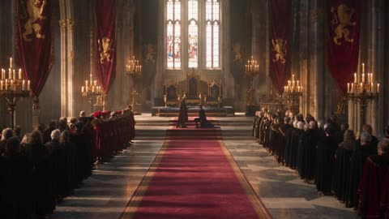</a>

提示词锁定三张上传的角色设定图作为参考，并逐条写明每个角色需保留的特征。分段时间轴配合明确的台词与音效提示，以及严格的负面约束，让喜剧效果保持克制。

Seedance 2.5 · 参考生视频 · 出处: [@Caden_Flux on X](https://x.com/Caden_Flux/status/2109652904864829898) · 发现于 [LearnPrompt/awesome-seedance](https://github.com/LearnPrompt/awesome-seedance)

[`comedy`](tags.md#tag-comedy) [`medieval`](tags.md#tag-medieval) [`character-lock`](tags.md#tag-character-lock) [`dialogue`](tags.md#tag-dialogue)

<details><summary><b>提示词</b></summary>

```text
THE CORONATION — 20-SECOND CINEMATIC COMEDY

MODEL: Seedance 2.5
DURATION: 20 seconds
ASPECT RATIO: 16:9
STYLE: Photorealistic live-action medieval fantasy film with subtle absurdist comedy.
REFERENCE IMAGES AND CHARACTER LOCK
Use the uploaded King character sheet, Prince character sheet, and Random Man character sheet as the definitive visual references.
King: Preserve his exact face, gray-streaked hair, beard, crown, and burgundy royal outfit.

Prince: Preserve his exact face, hairstyle, navy-and-gold coronation outfit, blue cloak, and crown once placed.

Random Man: Preserve his exact face, hairstyle, modern casual outfit, and body proportions.

Maintain consistent character identities, costumes, lighting, and the layout of the throne room throughout the entire video.
LOCATION AND ATMOSPHERE
An enormous medieval royal throne room with towering stone pillars, golden chandeliers, tall stained-glass windows, red velvet banners, and a magnificent golden throne. The royal court stands silently on either side of a red carpet.

The atmosphere is extremely serious and emotionally grand, like the climax of an epic fantasy film. Warm golden sunlight streams through the windows. The music is majestic, with a full orchestral score.

The modern man must look completely out of place in this medieval setting.

SHOT 1 — THE MOMENT OF CORONATION

0–5 seconds

Wide cinematic establishing shot of the royal throne room. The prince kneels on a cushion before the king. The king stands solemnly in front of him, holding an ornate golden crown with both hands.

The court watches in absolute silence.
Cut to a medium close-up of the king slowly raising the crown above the prince's head.

The king speaks in a deep, solemn voice:

KING: "Today, you become king."

The orchestral music swells dramatically. The prince bows his head with complete seriousness.

SHOT 2 — THE WRONG MAN ENTERS

5–9 seconds

Just as the king is about to lower the crown, a casually dressed modern man in a dark hoodie, jeans, and sneakers walks into the royal ceremony from the side of the hall.

He walks directly between the king and prince as though he belongs there.
The king freezes with the crown suspended in midair. The prince remains kneeling, looking slightly confused. The courtiers stare in silent disbelief.

The modern man barely acknowledges anyone. He notices the crown, looks at it critically, and gives a small disapproving shake of his head.

The orchestral music abruptly softens into an awkward, sustained note.

SHOT 3 — THE UNEXPECTED FIX

9–14 seconds

In one continuous, clearly visible action, the modern man casually takes the crown from the king's hands.

He notices a small paper price tag hanging from the crown, removes it, and slips it into his pocket. He then gently straightens the prince's crooked collar and nudges the royal throne a few inches into better alignment with the carpet.
His movements are practical, quick, and completely unbothered.

The king stands frozen, visibly bewildered but trying to preserve his royal dignity. The prince looks from the man to his father, unsure whether he is allowed to move.

The man steps back, examines his work, and gives one satisfied nod.

RANDOM MAN: "Much better."

Deliver the line casually, in a natural conversational voice, without a dramatic pause or exaggerated comic delivery.

SHOT 4 — BACK TO BUSINESS

14–17 seconds

The modern man turns around and casually walks out of the throne room the same way he entered.

No one stops him. Nobody speaks.
The king slowly follows him with his eyes, then looks down at the crown in his hands as if trying to understand what just happened.

The prince remains kneeling in the exact same position.

The man exits the frame completely.

SHOT 5 — THE CORONATION CONTINUES

17–20 seconds

Cut to a cinematic medium close-up of the king taking a slow breath, regaining his composure, and carefully positioning himself to continue the ceremony.

He raises the crown again.
The prince bows his head.

The orchestral music resumes its original majestic intensity, as if the interruption never happened.

KING: "Today… you become king."

End immediately on the king's perfectly serious face.

Cut to black.

CAMERA AND EDITING

Use professional cinematic framing, smooth controlled camera movements, realistic depth of field, natural facial micro-expressions, and clean film-style cuts. Establish the room before moving into medium shots and close-ups. Make the modern man's entrance and practical actions easy to see.

Keep the comedy understated and driven by timing, awkward silence, and the contrast between the epic ceremony and the man's mundane behavior.

AUDIO DESIGN

Majestic orchestral music during the coronation, subtle footsteps and clothing movement, a slight musical interruption when the man enters, a soft paper rustle as he removes the price tag, and a return to full orchestral grandeur for the final line.

All dialogue must be clearly audible, naturally delivered, and spoken in English. No narration, no subtitles, no extra dialogue, and no random background voices.

STRICT NEGATIVE CONSTRAINTS

No cartoon effects, no slapstick falls, no exaggerated facial expressions, no character morphing, no identity changes, no costume changes, no duplicated characters, no extra limbs, no floating objects, no random camera transitions, no modern objects apart from the man's clothing and the tiny price tag, and no characters looking directly into the camera.

The king, prince, and courtiers must treat the event as a real interruption to a serious royal ceremony. The modern man must remain completely calm and behave as though fixing the coronation is an ordinary task.

FINAL CREATIVE DIRECTION: Make it look like a genuine, high-budget medieval fantasy movie that has been interrupted by a man who thinks he is responsible for fixing continuity errors. The audience should find the situation funny without the characters turning it into a comedy performance.
```

</details>

<a id="seedance-disaster-comedy-restaurant-feast"></a>
### 城市爆炸后两名女子在餐厅大快朵颐

<a href="https://x.com/Aqsahere_/status/2096077108808470604">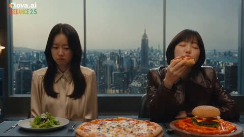</a>

两人分别固定在画面左右两侧，并配上对比鲜明的道具（沙拉对比披萨、汉堡和辣炒年糕），让节食的笑点一眼可见。爆炸被设定为会震动餐盘的冲击波，为模型提供了从羡慕转向慌乱进食的明确物理线索。

Seedance 2.5 · 文生视频 · 出处: [@Aqsahere_ on X](https://x.com/Aqsahere_/status/2096077108808470604)

[`disaster-comedy`](tags.md#tag-disaster-comedy) [`restaurant`](tags.md#tag-restaurant) [`food`](tags.md#tag-food) [`korean`](tags.md#tag-korean)

<details><summary><b>提示词</b></summary>

```text
Create a premium photorealistic live-action cinematic disaster comedy featuring two beautiful young Korean women with clearly different faces, hairstyles, body proportions, and fashion styles. WOMAN 1 sits screen left, wearing a stylish elegant outfit, with only a small green salad in front of her. WOMAN 2 sits screen right, with a completely different beautiful face and different fashionable outfit, enjoying a hamburger, pizza, and red tteokbokki. They sit in a luxurious modern restaurant beside a huge floor-to-ceiling window overlooking a dense city skyline. WOMAN 1 sadly stares at her salad and envies WOMAN 2's feast until a colossal distant explosion suddenly erupts across the city, sending orange-white light and a powerful pressure wave that shakes the window and rattles the plates. Realizing the world might be ending, WOMAN 1 immediately abandons her diet, slides her salad aside, and urgently starts eating the pizza and hamburger. WOMAN 2 watches in disbelief, but another shockwave hits and she instantly joins the frantic feast. Finish with both women seriously panic-eating while repeatedly glancing at the enormous apocalyptic cloud outside. Premium large-format cinematic realism, Cooke anamorphic look, realistic physics, natural acting, cinematic orange disaster lighting, subtle handheld urgency after the explosion, no dialogue, no subtitles, no extra characters, no face duplication, and consistent screen positions throughout.
```

</details>

<a id="seedance-elevator-floor-0-mystery"></a>
### 西装男子走进发光电梯，楼层显示13

<a href="https://x.com/ch_h234/status/2118714265792291152">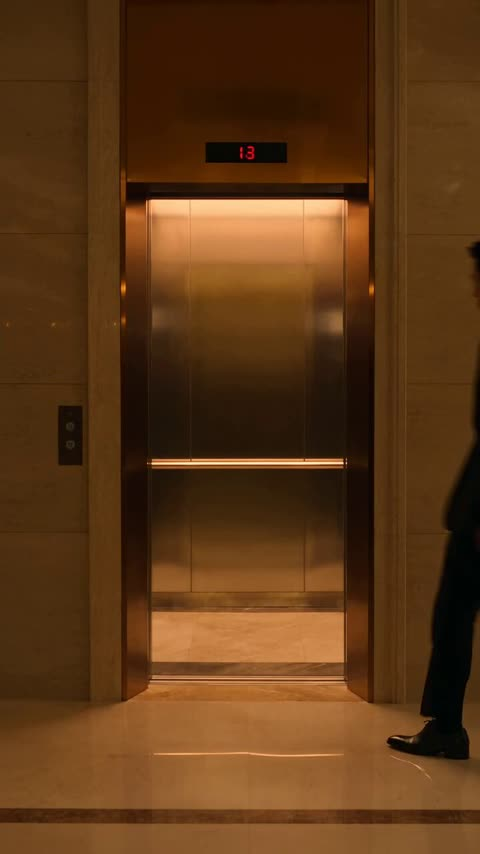</a>

固定的人物设定与按秒划分的分镜（0到7秒、7到14秒等）让整段视频中人物的脸和西装保持一致。明确的镜头语言（缓慢推进、对称构图）和分条列出的声音设计，为模型提供节奏与紧张感的指引。

Seedance 2.5 · 文生视频 · 出处: [@ch_h234 on X](https://x.com/ch_h234/status/2118714265792291152) · 发现于 [LearnPrompt/awesome-seedance](https://github.com/LearnPrompt/awesome-seedance)

[`thriller`](tags.md#tag-thriller) [`korean`](tags.md#tag-korean) [`elevator`](tags.md#tag-elevator) [`multi-scene`](tags.md#tag-multi-scene)

<details><summary><b>提示词</b></summary>

```text
TITLE: THE ELEVATOR – FLOOR 0

Create a 30-second ultra-realistic Korean cinematic mystery thriller with the visual quality of a premium Korean feature film.

CHARACTER:
A 28-year-old Korean businessman with short black hair, wearing a black formal suit, white shirt, and black tie. Maintain identical facial features, clothing, and appearance throughout every scene.

SCENE 1 (0–7 SECONDS):
Late at night in Seoul, a businessman enters a luxurious modern apartment elevator. He presses floor 18. The elevator doors slowly close. He checks his wristwatch. The elevator begins moving upward.

SCENE 2 (7–14 SECONDS):
Suddenly, the elevator lights flicker. The floor display changes from 12 to 11, then displays an unfamiliar number: 0. The elevator stops. The doors slowly open, revealing a long, completely empty underground corridor with cold fluorescent lighting.

SCENE 3 (14–22 SECONDS):
The businessman looks confused and steps slightly forward. At the far end of the corridor, he notices a little Korean girl wearing a red coat. She is standing completely still, facing away from him. He calls out, but she does not respond. Suddenly, the elevator doors begin closing behind him.

SCENE 4 (22–30 SECONDS):
He rushes back into the elevator and presses the emergency button. The doors close. He looks into the elevator mirror and sees the little girl standing directly behind him. He turns around immediately. Nobody is there.

The elevator display changes to FLOOR 18.

FINAL SHOT:
As the doors open, the businessman sees himself standing outside the elevator, wearing the exact same suit, staring directly at him with a terrifying smile.

CUT TO BLACK.

CINEMATOGRAPHY:
Premium Korean thriller cinematography, realistic human expressions, atmospheric shadows, slow camera pushes, cinematic close-ups, symmetrical framing, natural skin textures, realistic elevator reflections, professional color grading, and subtle film grain.

SOUND DESIGN:
Elevator mechanical hum, soft electrical buzzing, footsteps echoing through the corridor, subtle heartbeat sound, suspenseful cinematic music, and sudden silence during the final reveal.

STRICT REQUIREMENTS:
Photorealistic live-action only. No animation, no cartoon style, no artificial-looking characters, no inconsistent faces, no random wardrobe changes, no unnecessary dialogue, no watermarks. Preserve character continuity and realistic physical movement throughout the entire 30-second film.
```

</details>

<a id="seedance-fairground-ice-cream-nose-tease"></a>
### 夕阳下女孩走向游乐场冰淇淋摊

<a href="https://x.com/sophiaparkerr_/status/2096542775709692255">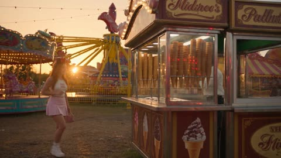</a>

按时间段（0到3秒、3到6秒等）分镜，把一个逐步升级的恶作剧拆成连续镜头；结尾的 IMPORTANT 段锁定发箍、服装、道具和场景在切换中保持一致。夕阳逆光、浅景深、云台推拉等摄影术语让画面更接近真人实拍，而不是卡通动作。

Seedance 2.5 · 文生视频 · 出处: [@sophiaparkerr_ on X](https://x.com/sophiaparkerr_/status/2096542775709692255) · 发现于 [LearnPrompt/awesome-seedance](https://github.com/LearnPrompt/awesome-seedance)

[`comedy`](tags.md#tag-comedy) [`amusement-park`](tags.md#tag-amusement-park) [`character-consistency`](tags.md#tag-character-consistency) [`shot-list`](tags.md#tag-shot-list)

<details><summary><b>提示词</b></summary>

```text
CHARACTER:
A young woman wearing a cute, stylish amusement-park outfit with a clearly visible Mickey Mouse ears headband. Keep the headband consistent throughout the entire video. She is excited, playful, and expressive.
A cheerful Turkish ice cream vendor stands behind a traditional Turkish ice cream stall, holding a long metal ice cream paddle.

0–3 SEC — ORDER
Start with a cinematic wide shot of the colorful amusement park, then smoothly move toward the Turkish ice cream stall.

The girl approaches the counter, smiling excitedly. Her Mickey Mouse ears headband is clearly visible. She points toward the ice cream.
The vendor prepares a cone with a scoop of ice cream and extends it toward her.

3–6 SEC — THE FIRST TEASE
Cut to a medium shot.

The girl eagerly reaches for the cone.

Just as she is about to grab it, the vendor smoothly pulls the ice cream away with the long paddle.
She looks at him in surprise.

He smiles mischievously and offers it again.

6–9 SEC — MORE TEASING
She reaches again.

The vendor smoothly moves the cone from left to right, then slightly upward, always just out of reach.

The girl follows the cone, laughing and becoming increasingly determined.

Keep the interaction fluid, realistic, and playful, with natural body movement and timing.
9–11 SEC — THE NOSE TRICK
The vendor finally brings the ice cream toward her.

She confidently leans forward, expecting to receive it.

Instead, he gently places a small dab of ice cream on the tip of her nose.

Close-up on her shocked expression.

She pauses, looks cross-eyed toward the ice cream on her nose, then looks back at the vendor with a playful annoyed expression.
11–15 SEC — SHE WINS
Before the vendor can tease her again, she quickly grabs the cone from the paddle.

She successfully gets the ice cream.

The vendor laughs and raises his hands in playful defeat.

She proudly holds up the cone, smiles toward the camera, wipes the ice cream from her nose, and takes a happy bite.

CINEMATOGRAPHY:
Photorealistic live-action, premium cinematic quality, warm golden-hour lighting, natural skin texture, realistic facial expressions, shallow depth of field, soft background bokeh, subtle anamorphic lens characteristics, natural motion blur, smooth gimbal movement, cinematic push-ins and tracking shots, realistic amusement-park atmosphere.

IMPORTANT:
Keep the Mickey Mouse ears headband clearly visible and consistent throughout the scene. Maintain consistent faces, wardrobe, hairstyle, ice cream cone, vendor paddle, and environment. All movements must be smooth and physically realistic. No exaggerated cartoon movement, no 3D animation, no jerky motion, no teleporting, no object duplication, and no unnatural hand movements.
```

</details>

<a id="seedance-favorite-song-street-vibe"></a>
### 城市街头男子听到最爱歌曲

<a href="https://x.com/AIwithZeeshi/status/2095374122674991259">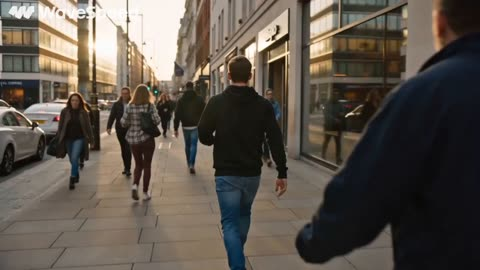</a>

提示词按时间顺序写出动作节奏（听到歌曲、放慢脚步、微笑、边走边轻摇），为模型提供清晰的动作走向。镜头指令也很具体：从背后稳定跟拍，并带轻微手持晃动。

Seedance 2.5 · 文生视频 · 出处: [@AIwithZeeshi on X](https://x.com/AIwithZeeshi/status/2095374122674991259) · 发现于 [LearnPrompt/awesome-seedance](https://github.com/LearnPrompt/awesome-seedance)

[`pov`](tags.md#tag-pov) [`street-scene`](tags.md#tag-street-scene) [`realistic-motion`](tags.md#tag-realistic-motion) [`tracking-shot`](tags.md#tag-tracking-shot)

<details><summary><b>提示词</b></summary>

```text
POV — Your Favorite Song Starts Playing in Public

A young man walks through a busy city sidewalk when he suddenly hears his favorite song playing from a nearby café. He recognizes it instantly, slows down, smiles, and starts subtly vibing to the rhythm while pretending to keep walking normally.

The entire sequence follows realistic human behavior and accurate physics, including natural walking biomechanics, weight distribution, gravity, inertia, momentum, friction, foot-to-ground contact, realistic pedestrian movement, clothing dynamics, hair movement, and natural interactions between people and the environment.

Ultra-realistic visuals, cinematic documentary style, natural late-afternoon lighting, realistic skin and clothing textures, smooth stabilized tracking, subtle handheld camera motion, realistic depth of field, natural focus pulls, physically accurate shadows and reflections, consistent character identity, authentic urban environment, natural colors, subtle film grain, and 4K cinematic quality.

Would you be able to resist vibing to your favorite song in public? 

#Seedance25 #WaveSpeedAI #AIVideo #CinematicAI #AIStorytelling #DailyLife #POV #Relatable #MusicLovers #GenerativeAI
```

</details>

<a id="seedance-flaming-wok-chef-performance"></a>
### 厨师翻动烈焰炒锅与蔬菜

<a href="https://x.com/AynahhX/status/2102946546035945875"></a>

提示词把15秒片段写成用箭头连接的逐拍分镜，明确指定切到特写和环绕运镜，让动作有清晰的先后顺序。结尾加上无字幕、无标志、无水印的说明，保证画面干净。

Seedance 2.5 · 文生视频 · 出处: [@AynahhX on X](https://x.com/AynahhX/status/2102946546035945875) · 发现于 [LearnPrompt/awesome-seedance](https://github.com/LearnPrompt/awesome-seedance)

[`3d-animation`](tags.md#tag-3d-animation) [`cooking`](tags.md#tag-cooking) [`restaurant`](tags.md#tag-restaurant) [`camera-movement`](tags.md#tag-camera-movement)

<details><summary><b>提示词</b></summary>

```text
Create a 15-second cinematic 3D animated cooking sequence inside a professional modern restaurant kitchen. Show a young male chef wearing a white chef jacket and red apron confidently cooking with a large black wok. Start with a medium shot of the chef tossing the wok with a serious, focused expression → cut to a dramatic close-up as flames burst from the pan while he continues cooking → show colorful vegetables including carrots, red bell peppers and bok choy flying dynamically through the air as he flips the wok → camera moves around the chef as he skillfully catches the ingredients back into the pan → finish with a close-up of the chef plating the freshly cooked colorful vegetables onto a clean white plate with glossy sauce. Warm cinematic restaurant lighting, realistic fire and smoke, detailed food textures, smooth character animation, natural hand and body movement, dynamic camera angles, cinematic depth of field, vibrant colors, polished high-end 3D animation, expressive facial animation, satisfying cooking-action atmosphere. No text, subtitles, logos or watermark.
```

</details>

<a id="seedance-flower-field-flashback-memory"></a>
### 花田中的女子沉入童年回忆

<a href="https://x.com/AIwithWania/status/2102283267957506141"></a>

参考图锁定人物、服装和色调，每个时间段都重复这些约束，保证切换前后画面一致。回忆段落在相同花田中用相同花冠做匹配切换，让时间跳转清晰可读。

Seedance 2.5 · 图生视频 · 出处: [@AIwithWania on X](https://x.com/AIwithWania/status/2102283267957506141) · 发现于 [LearnPrompt/awesome-seedance](https://github.com/LearnPrompt/awesome-seedance)

[`flashback`](tags.md#tag-flashback) [`golden-hour`](tags.md#tag-golden-hour) [`reference-image`](tags.md#tag-reference-image) [`memory`](tags.md#tag-memory)

<details><summary><b>提示词</b></summary>

```text
-

Use the uploaded reference image as the visual base. Maintain the same characters, same golden-hour flower field setting, same wardrobe, same color grading (warm gold, soft pink, dreamy sunset light) throughout. Do not change the characters' appearance, clothing, or the location.

- **0:00–0:01** — A woman with long curly brown hair, wearing a white flowing dress and a flower crown, runs through a dreamy field of yellow, white, and pink flowers, trying to catch up to someone ahead of her. A distant fairytale castle is visible on the horizon.
- **0:01–0:03** — She reaches out and gently places her hand on the shoulder of a man ahead of her, who is dressed in medieval knight armor with a dark red cloak.
- **0:03–0:04** — Close-up on her face looking up, windswept hair, flowers in her crown catching the light — in this moment, the world around her begins to fade into a memory.
- **0:04–0:06** — The scene transitions into a flashback: a little girl with the same curly brown hair and flower crown reaches out and gently touches the shoulder of a little boy in front of her, both standing in the same flower field.
- **0:06–0:07** — Close-up of the little boy turning to look at her with a soft, curious expression.
- **0:07–0:09** — The little boy quietly turns away and starts walking forward, away from her, through the flowers.
- **0:09–0:10** — The little girl is left behind, her small hand still reaching out toward him.
- **0:10–0:13** — Cut back to the present: the woman feels the same pain, holding her hand to her heart as the memory fades away.
- **0:13–0:14** — The knight continues walking forward, emotionally distant, leaving her behind once again.
- **0:14–0:15** — She kneels down in the flower field, overwhelmed with heartbreak, face in her hands — some moments stay with us forever.

**End title card:** "Some moments take you back forever..." with theme tags: Love | Memory | Time | Always
```

</details>

<a id="seedance-frog-hat-baby-crib-escape"></a>
### 戴青蛙帽的宝宝逃出婴儿床，吓到爸爸

<a href="https://x.com/Zarnab_with_Ai/status/2117812036126257293"></a>

提示词用固定的角色描述块加七个编号分镜，并明确要求青蛙帽、连体衣和婴儿房在每个镜头中保持一致。结尾指定自拍式特写，让故事有清晰的笑点收束。

Seedance 2.5 · 文生视频 · 出处: [@Zarnab_with_Ai on X](https://x.com/Zarnab_with_Ai/status/2117812036126257293) · 发现于 [LearnPrompt/awesome-seedance](https://github.com/LearnPrompt/awesome-seedance)

[`3d-animation`](tags.md#tag-3d-animation) [`family-comedy`](tags.md#tag-family-comedy) [`character-consistency`](tags.md#tag-character-consistency)

<details><summary><b>提示词</b></summary>

```text
Style: High-quality 3D animated family comedy, adorable baby character, Pixar-inspired cinematic animation, ultra-detailed textures, expressive facial animations, warm lighting, realistic movement, and professional cinematic storytelling.

Character: An adorable chubby baby girl with big sparkling brown eyes, rosy cheeks, short dark brown hair, wearing a cute green knitted frog hat with big frog eyes and a white baby romper featuring a small green frog design.

Scene 1 – Baby in the Crib:
A cute baby girl stands inside a beautiful wooden baby crib in a cozy nursery. She holds the wooden bars with both hands, looking innocent and curious. Warm golden sunlight enters through the window, creating a peaceful atmosphere.

Scene 2 – Funny Baby Expressions:
Show a close-up of the baby making adorable funny facial expressions, squeezing her eyes, puffing her cheeks, and smiling playfully while wearing her oversized frog hat.

Scene 3 – Baby Escapes:
The baby cleverly crawls out of her crib and moves across the soft carpet. She explores the nursery with excitement, crawling behind furniture and hiding playfully.

Scene 4 – Cute Hiding Moment:
The baby hides behind a large cozy armchair. Only her little face and frog hat are visible. She peeks over the chair with a mischievous smile, then hides again.

Scene 5 – Mischievous Adventure:
The baby attempts to climb a nearby white dresser, reaching toward its drawers with her tiny hands. Show her funny and determined expressions.

Scene 6 – Unexpected Daddy Reaction:
Suddenly, her father appears in the nursery and is shocked to discover the baby's mischievous adventure. Show his exaggerated surprised facial expression, wide-open eyes, and funny reaction.

Scene 7 – Emotional Funny Ending:
The father discovers the adorable baby sitting safely in a little chair. He looks at her in disbelief while she smiles innocently. End with a cute close-up selfie-style shot of the father and baby together.

Visual Quality: Ultra-detailed 3D animation, realistic knitted fabric, soft baby skin, expressive eyes, natural body movements, cinematic depth of field, warm golden-hour lighting, smooth camera transitions, professional animation, 4K quality, vertical 9:16 aspect ratio.

Important: Maintain consistent baby character design, identical frog hat, clothing, facial features, and nursery environment throughout every scene. Make the story funny, heartwarming, adorable, and highly engaging.
```

</details>

<a id="seedance-glass-mall-friends-emerald-skirt-film"></a>
### 三位朋友在玻璃顶奢华购物中心

<a href="https://x.com/AIwithWania/status/2108420649467457557">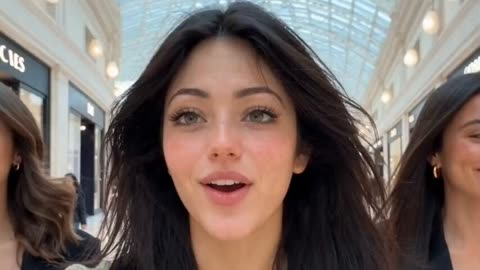</a>

按时间段拆分的分镜表让每一段都有独立的镜头指令，从手持行走、面料微距到镜前转身，并用统一的人物、发型和服装锁定句贯穿全片，保持三人前后一致。末尾的负面清单针对面部、手部和走路姿态，减少常见变形。

Seedance 2.5 · 文生视频 · 出处: [@AIwithWania on X](https://x.com/AIwithWania/status/2108420649467457557) · 发现于 [LearnPrompt/awesome-seedance](https://github.com/LearnPrompt/awesome-seedance)

[`fashion`](tags.md#tag-fashion) [`handheld-camera`](tags.md#tag-handheld-camera) [`slow-motion`](tags.md#tag-slow-motion) [`shopping`](tags.md#tag-shopping)

<details><summary><b>提示词</b></summary>

```text
-

The overall mood should feel editorial, feminine, playful, polished and effortlessly chic — not motivational, not overly commercial, and not artificial.

Opening — 0–5 seconds:
Three fashionable female friends stroll through an upscale contemporary shopping destination, surrounded by luminous glass architecture, refined boutiques and warm ambient lighting. They exchange amused glances and effortless smiles, moving naturally together. Use an elegant handheld camera with subtle cinematic movement.

5–10 seconds:
Cut into a sophisticated designer-style boutique. One woman slowly browses a rack of luxurious garments while her friends watch, tease her playfully and react with genuine excitement. Include beautiful macro shots of textured fabrics, delicate embellishments, satin, sequins and refined tailoring.

10–17 seconds:
Show the main woman trying on an elegant fashion ensemble: a sophisticated cream embellished fitted top with a flowing emerald-green floor-length skirt. She emerges from the fitting area, pauses before a large mirror and turns naturally, allowing the skirt to move beautifully. Capture fabric movement, reflections and subtle expressions.

17–23 seconds:
Show intimate shopping details between the three women: one adjusting an accessory, another holding up a handbag, playful reactions, soft laughter and spontaneous friendship moments. Make the chemistry feel candid rather than staged.

23–30 seconds:
End with the three women leaving the boutique together with elegant shopping bags. The woman wearing the emerald-green skirt walks between her friends. Use a graceful tracking shot followed by a subtle slow-motion moment as the fabric moves while they walk away.

Visual direction: luxury fashion editorial, sophisticated color grading, warm cinematic lighting, realistic skin texture, natural facial expressions, realistic hands, physically accurate fabric movement, shallow depth of field, refined highlights, premium commercial cinematography, subtle lens flare, smooth camera transitions, photorealistic details.

Maintain exact character identity, facial features, hairstyles, body proportions and wardrobe continuity throughout the entire sequence. Keep all three women visually consistent from beginning to end.

Avoid distorted faces, extra fingers, malformed hands, duplicated people, unnatural walking, warped clothing, flickering details, inconsistent hairstyles, floating objects, text, captions, watermarks or logos.

Aspect ratio: 16:9 
Duration: 30 seconds.
Style: cinematic luxury fashion film.
```

</details>

<a id="seedance-golden-foil-gondola-sunset-to-night"></a>
### 金箔质感的贡多拉黄昏渐入夜色

<a href="https://x.com/churvikv/status/2112230364508827925"></a>

开头用固定的风格短语（金箔纹理质感，保留金箔纹理）锁定材质，使整段画面保持一致，之后按时间顺序列出各个节拍：天色转换、窗灯逐一亮起、船夫渐渐远去消失在夜色中。注明 10 秒时长，并规定划桨节奏平稳，让运动缓慢清晰。

Seedance 2.5 · 文生视频 · 出处: [@churvikv on X](https://x.com/churvikv/status/2112230364508827925)

[`gold-foil`](tags.md#tag-gold-foil) [`sunset-transition`](tags.md#tag-sunset-transition) [`gondola`](tags.md#tag-gondola) [`style-lock`](tags.md#tag-style-lock)

<details><summary><b>提示词</b></summary>

```text
Textured golden art style, gold foil texture preserved. The golden sky gradually transitions from bright morning gold to deep sunset bronze. Shadows lengthen across the water. Windows light up one by one as evening approaches. Gondolier rows at a normal steady pace, moving from the center toward the distant horizon, gradually becoming smaller and eventually disappearing into the darkening background as night falls. Seagulls return to roost. The clock tower silhouette becomes more pronounced against the darkening sky. Water reflections shift from bright to warm amber. Peaceful time progression, 10 seconds.
```

</details>

<a id="seedance-halloween-pumpkin-village-chase"></a>
### 午夜雾中南瓜小径上的黑裙女子

<a href="https://x.com/AIwithSynthia/status/2115064426315530749">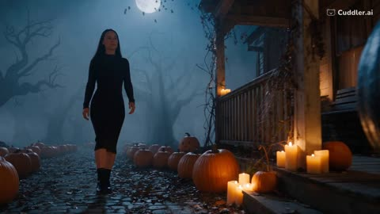</a>

提示词按时间顺序写成一连串剧情节点，并固定了人物外观描述，使同一女子在各镜头中保持一致。体积雾和橙色戏剧光等具体光影词定下氛围，明确排除卡通或动漫风格则保证画面是真人实拍质感。

Seedance 2.5 · 文生视频 · 出处: [@AIwithSynthia on X](https://x.com/AIwithSynthia/status/2115064426315530749) · 发现于 [LearnPrompt/awesome-seedance](https://github.com/LearnPrompt/awesome-seedance)

[`halloween`](tags.md#tag-halloween) [`horror`](tags.md#tag-horror) [`pumpkin`](tags.md#tag-pumpkin) [`fog`](tags.md#tag-fog)

<details><summary><b>提示词</b></summary>

```text
Create an ultra-realistic Halloween horror video starring a beautiful young adult woman in a fitted black dress and black boots.
She walks through a haunted village at midnight, surrounded by glowing jack-o'-lanterns, twisted trees, and thick fog.
She discovers a giant black pumpkin beside an abandoned house and cautiously touches its surface.
Its eyes suddenly glow orange as every pumpkin around her turns toward her.
Black smoke erupts from the ground, and a terrifying pumpkin-headed monster rises behind her.
She turns around in terror and runs through the creepy pumpkin-lined pathway.
Bats swarm overhead, candles flicker, and ghostly shadows chase her through the fog.
She stumbles and discovers the enormous monster standing directly behind her.
The creature opens its jagged mouth and lunges toward the camera for a terrifying jump scare.
Use cinematic tracking shots, realistic facial expressions, detailed pumpkins, dramatic orange lighting, and volumetric fog.
Maintain consistent character appearance, natural movement, escalating suspense, and AAA live-action horror realism.
No cartoon, anime, or stylized animation.
```

</details>

<a id="seedance-hanfu-woman-misty-lake-horse-journey"></a>
### 白衣汉服女子穿行雾湖与草原

<a href="https://x.com/sandmrk/status/2114898254651613511">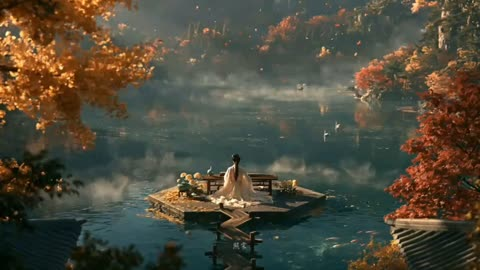</a>

按时间码逐镜写清构图与运动，每镜为固定画面并以硬切衔接，并在每镜重复同一角色描述以锁定身份。风格段给出雾气、斜射光与青蓝琥珀对置的色调，并用明确禁令压制塑料感与游戏感。

Seedance 2.5 · 文生视频 · 出处: [@sandmrk on X](https://x.com/sandmrk/status/2114898254651613511)

[`multi-shot`](tags.md#tag-multi-shot) [`oriental`](tags.md#tag-oriental) [`hanfu`](tags.md#tag-hanfu) [`misty-lake`](tags.md#tag-misty-lake) [`horse-riding`](tags.md#tag-horse-riding)

<details><summary><b>提示词</b></summary>

```text
东方国风半写实CG绘本质感；雾气弥漫与斜射天光；真实水面倒影、衣料垂坠、马匹毛发与奔跑动态质感；胶片级青蓝与琥珀对置色调；空灵、悠远、如梦；禁塑料感、禁游戏CG感
白衣女子（白衣汉服，长发松挽，宽大衣袂层层垂落）：全片主角，各镜沿用同一描述，不得变脸变装
蓝衣骑者（深蓝衣袍，身形挺拔）：仅结尾草原镜出现，骑白马
白马（通体雪白，鬃毛长而飘）：雾湖镜与草原镜共用同一匹
场景组：雾湖与秋林、月洞门庭院、莲塘、竹影小舟、青山花坡、纱帘竹丛、金色草原
全片一条旅程线：泛舟、立门、采莲、偃卧、奔跑、帘影、策马；镜与镜硬切，每镜是一幅独立的画
空间逻辑：人在景中始终保持小比例，山水是主角；唯一例外是竹影小舟与纱帘两镜的近景
斜射的晨昏天光穿过雾气，暗部被雾抬亮不死黑；青蓝的水与琥珀的陆对置
音频：国风器乐配乐流淌全片，水声、风声、马蹄声随镜而至；无对白、无旁白
情绪弧线：惊奇、静观、亲近、安眠、释放、含情、辽远、纵情告别

0–2.8秒大远景缓慢漂移
雾湖开场：镜面般的湖上雾气分层，两只小舟各载一个白衣人影远远漂着，左右金黄与深红的秋树垂入画面作框，倒影在水里微微晃；白衣女子骑白马自雾深处踏水而行，衣袂与马鬃拂过水面，马行水上不沉不溅，雾里另有白色鹿形身影若隐若现
开场确立：梦境逻辑、人物小比例、雾与倒影的质感基调

2.8–4.9秒全景固定
白墙月洞门：圆门正中立着白衣女子，成一幅剪影，门内是木格与远山，门侧一个小小的坐影作伴；一枝花树自左上斜入，人只有呼吸与衣袂的微动，影子落在墙面上
延续：构图对称、庭院静止、人物不走出圆门

4.9–8.2秒俯瞰全景缓慢跟移
莲塘自正上方俯瞰：翡翠色莲叶铺满水面，粉白莲花点缀其间；一条窄长木舟横穿画面，白衣女子立在船头，白衣拖尾铺在船板上，她俯身探向莲花，摘下一朵捧在手里，船尾有人摇橹，水面星光细碎闪烁
延续：俯瞰角度全程不变，船行方向不变，莲叶海不稀疏

8.2–11.1秒近景固定
竹影小舟内：木栏小舟里层层铺着白色毛皮与织物，白衣女子偃卧其中闭目小憩，一只手垂在舟边；前景竹叶虚化轻晃，斑驳光斑落在毛皮与衣料上，呼吸可见
延续：睡意与安宁，人物全程不起身、不睁眼

11.1–14秒远景航拍跟移
青山花坡：起伏的绿丘带着梯田般的坡纹，粉白花树疏疏点缀；白衣女子披深色披风在坡间奔跑，双袖张开，披风在身后猎猎，人自画面一侧横贯而过，始终只占一小点
延续：小比例尺度，奔跑不腾空不飞翔，花树不增不减

14–16.7秒近景固定
纱帘竹丛间：白衣女子半隐在白色纱帘之后，右侧竹叶探入画面；阳光透过竹叶把斑驳碎光落在她的侧脸与衣上，她含笑微侧首，发间光影缓缓浮动，帘子只轻轻飘
延续：斑驳光影是本镜主角，笑意含蓄不放大

16.7–18.3秒远景固定
金色草原小径：干草金黄，一条小径自画面中线向远方收去，两个小小人影沿径缓行；天空里群鸟横贯成河，偶有一两只大鸟自镜头前掠过，翅膀遮住一瞬画面
过渡：由静转动，辽远感拉满，为策马蓄势

18.3–22.8秒全景侧跟随后持续拉远
草原策马：蓝衣骑者伏身骑白马全速疾驰，四蹄腾空，侧面跟拍下枯金草浪向后倒退；约两秒后镜头开始耐心拉远，马与人一点点变小，草原与天空一点点变大，至地平线居中处只剩一个仍在移动的小点，画面就停在这里，不淡出
收束：全片唯一动力镜；速度先给足，拉远必须走完，结尾留白

严禁任何形式的对白与旁白；无文字、无水印、无现代元素；无人物放大占满画面（近景两镜除外）；无雾气消散、无倒影消失；无马匹沉水、游泳或马腿穿模；无策马降为慢跑或小跑；无拉远中途停住、无结尾提前淡出黑场；无俯瞰角度漂移、无莲叶变陆地；无纱帘变实墙、无竹影光斑频闪；无鸟群变黑点噪点；无草原变沙漠；无镜头内叠化；无身份漂移、无人物复制
```

</details>

<a id="seedance-haunted-castle-halloween-pumpkins"></a>
### 万圣节南瓜环绕的鬼屋城堡夜景

<a href="https://x.com/juliaevee/status/2113134380759523628"></a>

单一的推镜头朝向城堡，结尾加一个全景收尾，形成清晰的镜头走向。提示词明确写出灯光、雾气和场景细节，并加上无人物、场景一致的约束，使整段30秒画面保持稳定。

Seedance 2.5 · 文生视频 · 出处: [@juliaevee on X](https://x.com/juliaevee/status/2113134380759523628)

[`halloween`](tags.md#tag-halloween) [`haunted-castle`](tags.md#tag-haunted-castle) [`pumpkins`](tags.md#tag-pumpkins) [`night-scene`](tags.md#tag-night-scene)

<details><summary><b>提示词</b></summary>

```text
Create a 30-second ultra-realistic cinematic Halloween video of a majestic haunted castle glowing with warm orange lights, surrounded by jack-o’-lanterns, twisted trees, blue fog, and wet reflective cobblestones. The camera slowly moves toward the castle as autumn leaves drift, candles flicker, and bats fly across the moonlit sky. Elegant glowing text appears: “Happy Halloween.” End with a dramatic wide shot of the illuminated castle. Photorealistic details, smooth camera movement, volumetric fog, spooky magical atmosphere, 4K, no people, no distortion, consistent scenery, vertical 9:16, exactly 30 seconds.
```

</details>

<a id="seedance-istanbul-fpv-sunrise-travel-film"></a>
### 伊斯坦布尔清真寺穹顶升起于晨雾之上

<a href="https://x.com/Naiknelofar788/status/2106439652278411435">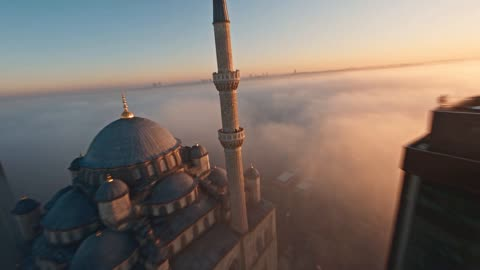</a>

提示词按时间段拆分为多个镜头，每段只指定一种运镜和一种转场（如 FPV 俯冲、延时摄影或匹配剪辑），让模型按顺序执行分镜，而不只是营造氛围。开场的日出薄雾和伊斯坦布尔上空的俯冲等明确描述为首段提供了视觉锚点。

Seedance 2.5 · 文生视频 · 出处: [@Naiknelofar788 on X](https://x.com/Naiknelofar788/status/2106439652278411435)

[`fpv-drone`](tags.md#tag-fpv-drone) [`istanbul`](tags.md#tag-istanbul) [`travel`](tags.md#tag-travel) [`timed-shots`](tags.md#tag-timed-shots)

<details><summary><b>提示词</b></summary>

```text
Create a 30-second ultra-realistic cinematic FPV travel film showcasing the futuristic energy, natural beauty, and cultural character of TURKEY. Blend cyberpunk technology with Istanbul’s historic architecture, vibrant streets, Mediterranean and Aegean coastlines, and spectacular night imagery. Use extreme-speed FPV drone movement, hyperlapse, seamless spatial transitions, and dense but controlled flash-cut editing. 8K cinematic realism, photorealistic environments, realistic crowds and vehicles, dramatic lighting, smooth motion blur only during rapid transitions, premium commercial cinematography. No text, logos, subtitles, or watermarks.

[0–6s] — CITY FROM THE SKY
Begin above Istanbul at sunrise, surrounded by mist and clouds. An FPV drone dives rapidly between modern skyscrapers before sweeping toward the Bosphorus. The scene transitions from warm daylight into blue-hour neon as the city below comes alive. Cars create flowing light trails while the camera races through vibrant streets, revealing Istanbul’s futuristic energy beside historic architecture.

[6–12s] — TECHNOLOGY & HISTORY
Use rapid cinematic match cuts: a modern tram glides through the city, instantly transitioning into a close-up of a traditional Turkish coffee being prepared; a speeding ferry cuts across the Bosphorus, followed by a dramatic aerial reveal of the Hagia Sophia and Blue Mosque. Turkish street life, glowing shopfronts, crowded avenues, and modern architecture flash together in rhythmic visual transitions.

[12–18s] — SPATIAL FOLD TO THE COAST
A moving object passes directly across the lens and becomes a seamless transition into the Turkish coastline. The camera bursts over crystal-clear turquoise water near Antalya and races along dramatic Mediterranean cliffs. Speedboats cut through the sea, white spray exploding behind them. Transition toward Cappadocia as hot-air balloons suddenly fill the sky above the surreal rock formations.

[18–24s] — TURKEY IN MOTION
The camera dives between Cappadocia’s towering rock formations and rapidly transitions to a bustling Istanbul street at golden hour. Match-cut between a Turkish flag waving in the wind, a crowded bazaar, traditional architecture, modern city traffic, and people enjoying the coastline. Use fast but visually coherent transitions that emphasize Turkey’s contrast between ancient heritage and modern life.

[24–30s] — THE GRAND FINALE
Night falls instantly. The camera rises above Istanbul and reveals the Bosphorus illuminated by thousands of city lights. A massive coordinated drone light show forms elegant abstract shapes above the skyline while boats move across the glowing water below. The camera pulls rapidly backward and upward into an enormous aerial panorama, revealing Istanbul stretching across both sides of the Bosphorus.

End with a powerful wide cinematic shot of the illuminated city, water, bridges, historic landmarks, and night sky.

STYLE: ultra-realistic 8K cinematic travel film,
```

</details>

<a id="seedance-japanese-lab-infected-silence"></a>
### 实验室老师让学生安静，感染者逼近

<a href="https://x.com/ElsaSofia__AI/status/2100903709492613245"></a>

提示词按时间顺序写成一连串动作节点，每个节点都有具体的声音或画面线索，例如柜子里的刮擦声和掉落的烧杯，让模型有明确的节奏可依。只保留环境声的音频要求，以及明确列出的排除项，使画面保持真实，没有配乐。

Seedance 2.5 · 文生视频 · 出处: [@ElsaSofia__AI on X](https://x.com/ElsaSofia__AI/status/2100903709492613245) · 发现于 [LearnPrompt/awesome-seedance](https://github.com/LearnPrompt/awesome-seedance)

[`horror`](tags.md#tag-horror) [`japanese-school`](tags.md#tag-japanese-school) [`sound-cues`](tags.md#tag-sound-cues) [`camera-push`](tags.md#tag-camera-push) [`photorealistic`](tags.md#tag-photorealistic)

<details><summary><b>提示词</b></summary>

```text
Create a short, ultra-realistic cinematic horror-action sequence set inside a quiet Japanese high-school science laboratory during an afternoon class. A female science teacher is demonstrating an experiment when the lights suddenly flicker and every digital display in the room turns off at the same time. A strange scratching sound comes from inside a locked storage cabinet.

The teacher cautiously approaches the cabinet, but before she can open it, the glass windows violently shake. One student notices dark handprints appearing on the outside of the glass even though there is nobody there. The classroom door suddenly slams shut and locks itself.

The teacher tells everyone to stay calm and uses a metal laboratory stand to force the door open. Just as the students begin escaping into the hallway, one of the emergency lights reveals several infected figures standing motionless at the far end of the corridor.

The students rush back into the laboratory and quickly push tables against the entrance. The teacher discovers that the infected are reacting to sound, so everyone becomes completely silent. A student accidentally drops a glass beaker.

The sound echoes through the hallway.

All the infected figures slowly turn toward the laboratory.

The teacher raises one finger, silently telling everyone not to move. The camera slowly pushes toward the barricaded door as dozens of footsteps begin approaching from outside. The screen cuts to black just before the door starts shaking violently.

Photorealistic live-action horror, authentic Japanese high-school science laboratory, realistic teenage students and teacher, natural handheld cinematography, subtle practical effects, believable physical movement, atmospheric fluorescent lighting, realistic shadows, tense pacing, authentic facial reactions, cinematic depth of field, muted horror color grading, diegetic environmental sound only. No music, narration, excessive gore, graphic injuries, animation, anime, cartoon style, artificial CGI appearance, distorted anatomy, subtitles, text, logos, or watermark.
```

</details>

<a id="seedance-korean-cafeteria-tray-walk"></a>
### 学生端着午餐托盘穿过热闹的韩国食堂

<a href="https://x.com/Zoyavelle/status/2100810895052165195">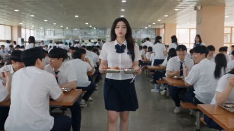</a>

提示词按顺序写成多镜头分镜，并固定了人物服装描述和明确的切镜指令，让主角在各镜头中保持一致。镜头焦段、柔和虚化和轻微手持晃动等摄影语言，引导画面接近韩剧的质感。

Seedance 2.5 · 文生视频 · 出处: [@Zoyavelle on X](https://x.com/Zoyavelle/status/2100810895052165195) · 发现于 [LearnPrompt/awesome-seedance](https://github.com/LearnPrompt/awesome-seedance)

[`korean-drama`](tags.md#tag-korean-drama) [`school-cafeteria`](tags.md#tag-school-cafeteria) [`multi-shot`](tags.md#tag-multi-shot) [`photorealistic`](tags.md#tag-photorealistic)

<details><summary><b>提示词</b></summary>

```text
Create a cinematic, photorealistic Korean high-school cafeteria scene during lunchtime. A beautiful young Korean female student, around 18–20 years old, with long straight black hair, fair natural skin, delicate facial features, and a calm expressive face, walks through a large busy school cafeteria carrying a stainless-steel lunch tray.

She wears a neat white short-sleeve school uniform shirt with a dark navy ribbon bow/tie, a navy pleated skirt, and a small school name tag. The cafeteria is filled with many Korean high-school students wearing matching white uniforms, sitting at long wooden tables and eating lunch.

Opening shot: wide cinematic shot following the girl as she walks between crowded cafeteria tables carrying her tray. Bright fluorescent ceiling lights, large windows, realistic school cafeteria architecture, natural background activity, shallow depth of field.

Cut to a medium close-up of the girl walking toward the camera, looking slightly surprised and opening her mouth as if speaking. Her black hair moves naturally while walking.

Cut to a detailed close-up of the stainless-steel cafeteria tray being carried, containing Korean-style school lunch: white rice, fried chicken pieces, sausages, vegetables, side dishes, and red sauce. Another hand holding a spoon appears in the foreground.

Top-down shot of the complete lunch tray placed on the table, showing separate metal compartments filled with rice, fried food, vegetables, and red soup/sauce.

Show the busy cafeteria reaction: several male students suddenly look toward the girl with surprised and curious expressions while eating. Capture natural facial expressions and realistic reactions.

A dramatic close-up of the girl looking directly toward the camera with a confident, slightly serious expression. Her long black hair frames her face, with realistic skin texture, detailed eyes, subtle makeup, and cinematic soft lighting. Background students and cafeteria lights are heavily blurred with natural bokeh.

Show the girl approaching a seated male student and placing/serving the lunch tray near him. The students react naturally, looking surprised and confused. Finish with a wide rear shot of the girl walking away through the crowded cafeteria while carrying the tray, with rows of students visible on both sides.

Visual style: ultra-realistic Korean school drama / K-drama cinematography, photorealistic human faces, realistic skin texture, natural body proportions, authentic Korean school cafeteria, cinematic composition, soft depth of field, realistic fluorescent lighting, subtle handheld camera movement, smooth cinematic transitions, detailed food textures, natural facial expressions, realistic motion, 4K, high detail, professional cinema camera, 35mm and 85mm lens look, natural color grading, atmospheric background blur.

No text, no subtitles, no watermark, no logos, no distorted faces, no extra fingers, no unnatural body proportions, no cartoon or anime appearance.
```

</details>

<a id="seedance-korean-coastal-coffee-lifestyle-film"></a>
### 滨海城市里韩国女孩的咖啡日常

<a href="https://x.com/aiwithaayat/status/2110600258871013510"></a>

提示词按顺序列出镜头，从咖啡柜台到街头、海边栏杆再到黄金时刻的山坡，让25秒时长里有一条连贯的故事线。结尾集中写明镜头、颗粒、色调和情绪，使各个镜头保持统一的画面风格。

Seedance 2.5 · 文生视频 · 出处: [@aiwithaayat on X](https://x.com/aiwithaayat/status/2110600258871013510) · 发现于 [LearnPrompt/awesome-seedance](https://github.com/LearnPrompt/awesome-seedance)

[`lifestyle`](tags.md#tag-lifestyle) [`cinematic`](tags.md#tag-cinematic) [`multi-shot`](tags.md#tag-multi-shot) [`coastal`](tags.md#tag-coastal) [`golden-hour`](tags.md#tag-golden-hour)

<details><summary><b>提示词</b></summary>

```text
Created a 25 second video, beautiful Korean girls, cinematic lifestyle film set in a beautiful coastal city, capturing the peaceful and aesthetic moments of everyday life. Begin with a warm, cozy coffee shop scene featuring a barista serving a takeaway coffee on a wooden counter, followed by a cinematic reflection of a young Korean woman standing near a large glass window with soft city lights reflecting across the glass. Show close-up shots of her walking along a busy urban street, focusing on her sneakers stepping across the pavement, then transition to a wide low-angle shot of her standing in front of a striking modern architectural building, wearing a stylish beige trench coat, carrying a black shoulder bag, and looking peacefully toward the sky. Capture intimate side-profile shots of her holding a coffee cup beside a window, with natural sunlight illuminating her face and soft shadows creating a moody atmosphere. Transition smoothly to a beautiful seaside promenade where she stands beside a metal railing, holding her coffee and gazing at the sparkling blue ocean as a large cruise ship moves slowly in the background. Continue with breathtaking golden-hour shots of a beautiful Korean girl sitting on a lush green grassy hill overlooking the ocean, her long dark brown hair moving gently in the sea breeze, wearing a relaxed beige outfit and holding a takeaway coffee cup. Capture natural facial expressions, subtle movements, candid moments, and elegant close-ups of her face as she turns toward the camera. End with an expansive cinematic wide shot of the green coastal landscape, calm blue water, distant islands, and a cruise ship sailing peacefully along the horizon, with the girl appearing small against the beautiful scenery. Use photorealistic visuals, cinematic composition, smooth camera movements, shallow depth of field, natural skin texture, soft film grain, realistic lighting, warm golden-hour tones, muted earthy colors, subtle lens flares, and premium Korean fashion editorial aesthetics. The overall mood should feel peaceful, dreamy, elegant, emotional, and authentic, like a high-end Korean lifestyle film shot on a professional cinema camera, with seamless transitions, realistic motion, beautiful environmental details, and no artificial-looking faces or exaggerated movements.
```

</details>

<a id="seedance-korean-elevator-zombie-reflection"></a>
### 女子在电梯中看见感染的镜像

<a href="https://x.com/AIwithSynthia/status/2105862212422074725">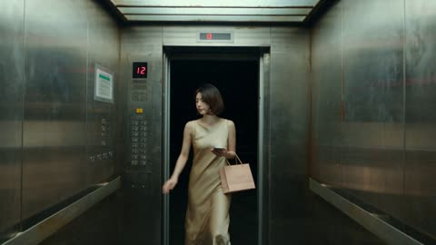</a>

按时间顺序写出开场、升级和揭示的分镜节拍，让模型保持连贯的一段式镜头。风格说明加负面提示词，可以稳定人脸与镜中倒影的一致性。

Seedance 2.5 · 文生视频 · 出处: [@AIwithSynthia on X](https://x.com/AIwithSynthia/status/2105862212422074725) · 发现于 [LearnPrompt/awesome-seedance](https://github.com/LearnPrompt/awesome-seedance)

[`horror`](tags.md#tag-horror) [`zombie`](tags.md#tag-zombie) [`korean`](tags.md#tag-korean) [`elevator`](tags.md#tag-elevator)

<details><summary><b>提示词</b></summary>

```text
Create an ultra-realistic Korean zombie-horror sequence inside an old apartment elevator at night. A woman in a long golden light-cream one-piece dress enters alone, carrying a shopping bag. The elevator stops between floors, the lights flicker, and the floor indicator glitches to 13. A dark figure appears only in the mirror, whose reflection slowly becomes infected with pale skin, milky eyes, and dark veins. The mirror cracks as an infected hand reaches through. The doors open to a nonexistent dark floor where infected silhouettes rush toward her. She barely escapes as the doors slam shut. When the elevator reaches the 12th floor, she exits—but her reflection stays behind, smiles, then suddenly lunges toward the camera. Cut to black.

Style: Ultra-realistic Korean zombie horror, claustrophobic elevator, cinematic handheld camera, flickering fluorescent lights, photorealistic skin, realistic reflections, tense atmosphere, dark shadows, natural facial expressions.

Negative prompt: Cartoon, anime, stylized CGI, exaggerated gore, distorted anatomy, extra limbs, inconsistent face, unrealistic reflections, floating objects, text, subtitles, watermark.
```

</details>

<a id="seedance-korean-folk-horror-candle-exorcism"></a>
### 韩屋烛影下的驱邪仪式，被附身的女子

<a href="https://x.com/doctorwasif/status/2097533759944090052">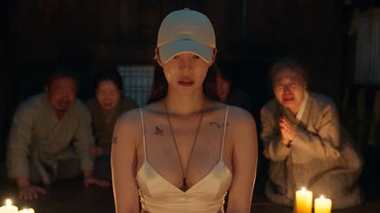</a>

按 4 秒一段编号的时间轴，写出从发病到仪式再到收尾的递进结构，便于模型控制节奏。开头的角色一致性指令加上固定的风格段，使主角的脸、服装和昏暗木屋的光影在各镜头之间保持稳定。

Seedance 2.5 · 文生视频 · 出处: [@doctorwasif on X](https://x.com/doctorwasif/status/2097533759944090052) · 发现于 [LearnPrompt/awesome-seedance](https://github.com/LearnPrompt/awesome-seedance)

[`folk-horror`](tags.md#tag-folk-horror) [`korean`](tags.md#tag-korean) [`ritual`](tags.md#tag-ritual) [`candlelight`](tags.md#tag-candlelight)

<details><summary><b>提示词</b></summary>

```text
30-sec cinematic Korean folk-horror ritual. Keep the Word character’s face and outfit consistent throughout.

1. 0–4s: Word character kneels pale and weak in a dim traditional Korean house; worried family, candles, incense, shaman preparing the ritual.
2. 4–8s: Salt circle and talismans surround her; candlelight flickers as her eyes twitch and fingers convulse.
3. 8–12s: Her head snaps unnaturally; guttural inhuman voice, dark veins spreading, body twisting as the ritual intensifies.
4. 12–16s: Eyes turn black; shaman chants frantically and throws rice/salt; her body convulses violently.
5. 16–20s: She rises unnaturally; shaman presses a burning talisman to her forehead as wind tears through the closed room.
6. 20–24s: Talisman burns, flames surge, she collapses and becomes completely still.
7. 24–27s: Her eyes reopen human; family rushes to her in relief while the exhausted shaman watches.
8. 27–30s: Wide aftermath: scattered salt, burnt talismans, melted candles. One intact talisman emits faint dark smoke, leaving an unsettling unresolved ending.

Style: cinematic Korean folk horror, dark wooden interior, warm candlelight, deep shadows, tense atmosphere, realistic, unsettling, dramatic camera movement.
```

</details>

<a id="seedance-korean-folk-horror-ritual"></a>
### 韩国民俗驱邪仪式中的附身场景

<a href="https://x.com/AIwithSynthia/status/2099836457430974932">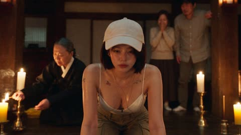</a>

先用一致性指令锁定角色形象，再依次推进从平静仪式到狂风与火焰高潮的段落。结尾用广角镜头缓慢推向一张冒烟的符纸，留下未解的悬念，并明确实拍火焰、烟雾与声音，让恐怖保持写实而不血腥。

Seedance 2.5 · 参考生视频 · 出处: [@AIwithSynthia on X](https://x.com/AIwithSynthia/status/2099836457430974932) · 发现于 [LearnPrompt/awesome-seedance](https://github.com/LearnPrompt/awesome-seedance)

[`horror`](tags.md#tag-horror) [`korean-folk-horror`](tags.md#tag-korean-folk-horror) [`practical-effects`](tags.md#tag-practical-effects)

<details><summary><b>提示词</b></summary>

```text
Create a cinematic Korean folk-horror ritual inside a dark traditional Korean wooden house. Keep the Word character’s face, hairstyle, outfit, and appearance perfectly consistent. She kneels weakly inside a salt circle surrounded by candles, incense, rice, and Korean talismans while worried family members watch and a shaman prepares the ritual. The shaman begins chanting as her fingers twitch, her body trembles, her head suddenly moves unnaturally, dark veins spread across her skin, and her eyes gradually turn completely black. Her body convulses violently as the shaman throws rice and salt around the circle.

The woman suddenly rises unnaturally while the shaman presses a burning talisman against her forehead. A powerful wind tears through the closed room, shaking candles, scattering papers, and whipping her hair and clothing. The talisman catches fire, flames surge, and she collapses onto the wooden floor, completely still. After a tense silence, her eyes reopen normally and the family rushes toward her in relief while the exhausted shaman watches carefully.

End with a wide aftermath shot showing scattered salt, burnt talismans, melted candles, incense smoke, and ritual objects across the floor. Everything appears finished until one untouched talisman begins releasing a faint trail of dark smoke. The camera slowly moves toward it, leaving the supernatural threat unresolved. Realistic Korean folk horror, cinematic lighting, deep shadows, practical fire and smoke, dramatic camera movement, natural acting and sound design, no gore, no subtitles, no watermark, no anime or cartoon style.
```

</details>

<a id="seedance-korean-washroom-zombie-chase"></a>
### 白色吊带女子站在瓷砖公厕里

<a href="https://x.com/AIwithSynthia/status/2103091393145282775">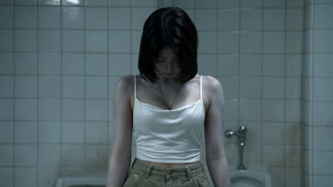</a>

一张参考图锁定丧尸的脸、发型和服装，提示词按顺序写明剧情节点，并指定冷色日光灯与手持镜头。要求实拍特效和自然反应，让恐怖感更接近真实拍摄，而不是 CGI 效果。

Seedance 2.5 · 参考生视频 · 出处: [@AIwithSynthia on X](https://x.com/AIwithSynthia/status/2103091393145282775) · 发现于 [LearnPrompt/awesome-seedance](https://github.com/LearnPrompt/awesome-seedance)

[`zombie-horror`](tags.md#tag-zombie-horror) [`korean`](tags.md#tag-korean) [`reference-image`](tags.md#tag-reference-image) [`handheld`](tags.md#tag-handheld) [`washroom`](tags.md#tag-washroom)

<details><summary><b>提示词</b></summary>

```text
Create an ultra-realistic Korean zombie-horror sequence inside a dim public washroom. Use << < image >>> as the exact reference for the zombie woman and keep her face, hair, body proportions and outfit consistent.

A young woman enters the washroom and washes her hands, unaware that the zombie woman is watching her through the mirror. The zombie slowly reveals pale skin, dark veins, twitching fingers and completely black eyes before suddenly attacking her. She grabs the victim, pins her against the tiled wall, and chases her when she escapes toward the exit.

The victim struggles to escape, but the zombie catches her again. Dark veins spread across the victim's neck and face as she convulses and collapses. Her eyes turn milky white and then black as she rises, now infected. The two infected women turn toward another person entering the washroom and suddenly charge at them.

End with the washroom lights flickering as the infected women stand motionless beneath the fluorescent lights, staring directly into the camera.

Style: photorealistic Korean zombie horror, claustrophobic tiled washroom, wet surfaces, cold fluorescent lighting, realistic skin, dark veins, terrifying eyes, unnatural but believable movements, handheld camera, practical-effects feel, natural reactions, no gore, no graphic injuries, no CGI look, no morphing, no duplicate characters, no distorted anatomy, no subtitles, no text, no watermark.
```

</details>

<a id="seedance-lab-parasite-containment-breach"></a>
### 科学家在隔离站操作带寄生体的玻璃舱

<a href="https://x.com/AIwithSynthia/status/2101161634022474024">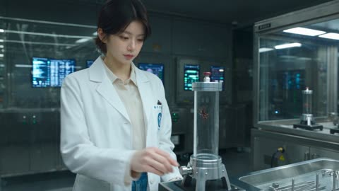</a>

把脸部、白大褂、牛仔裤和鞋子固定为不变的特征，让人物在每个节拍中保持一致。手持镜头配合从冷白荧光灯转为红色应急灯的光线变化，再加上玻璃碎裂、警报等声音提示，推动情绪递进。

Seedance 2.5 · 文生视频 · 出处: [@AIwithSynthia on X](https://x.com/AIwithSynthia/status/2101161634022474024) · 发现于 [LearnPrompt/awesome-seedance](https://github.com/LearnPrompt/awesome-seedance)

[`zombie-horror`](tags.md#tag-zombie-horror) [`lab-setting`](tags.md#tag-lab-setting) [`handheld-camera`](tags.md#tag-handheld-camera) [`sound-design`](tags.md#tag-sound-design)

<details><summary><b>提示词</b></summary>

```text
Create a photorealistic zombie-horror sequence inside a high-security research laboratory. The central character is a young adult Korean female scientist dressed in a clean white lab coat over a simple light-colored shirt, blue straight-leg jeans, and practical white sneakers. She has natural dark hair, minimal makeup, realistic skin texture, and believable proportions. Her face, hairstyle, lab coat, jeans, shoes, and body proportions must remain consistent throughout the entire sequence. Build the environment with steel machinery, specimen tables, glass containment chambers, computer monitors, harsh fluorescent lighting, and realistic laboratory details. Use grounded practical effects and physically believable movement with tense handheld camerawork.

While she works at a containment station, a glass specimen chamber suddenly develops fractures and explodes, scattering glass across the floor as a small dark parasite escapes and attaches itself around her shoulder and neck. She stumbles backward, frightened, while dark veins gradually appear beneath her skin and spread upward across her neck and face. Her skin becomes noticeably pale and clammy, her fingers twitch, and violent tremors run through her body. Her terrified expression gradually disappears into a blank, emotionless stare as her eyes transform into an unnaturally deep obsidian black. She abruptly turns toward a nearby colleague and charges, forcing him behind a glass partition.

She repeatedly strikes the glass while staring directly at him, her completely black eyes and pulsing dark veins clearly visible. Two more scientists enter and freeze when she suddenly becomes perfectly still, then slowly rotates her head toward them. Around the laboratory, additional containment chambers begin cracking as warning lights activate. Another infected creature breaks free, sending the scientists scrambling for emergency equipment. They use a powerful emergency strobe and fire extinguisher to disorient the creatures before pushing a heavy steel cart across the corridor and retreating behind a security door.

The surviving scientists reach an emergency corridor and catch their breath as red warning lights wash over their exhausted faces. The sealed laboratory door violently shakes behind them. The camera gradually approaches its small observation window, revealing the infected woman standing motionless in the darkness, still wearing her white lab coat and blue jeans. Her pale face, prominent dark veins, and completely black eyes are visible through the glass. She slowly tilts her head toward the camera as the emergency lights flicker across her face. Cut to black.

Visual and audio direction: Ultra-realistic sci-fi zombie horror with detailed natural skin, convincing black eyes, subtle veins beneath the skin, realistic facial changes, practical creature effects, authentic anatomy, and believable environmental physics. Maintain cold clinical lighting before transitioning to red emergency illumination. Use handheld camera movement and natural diegetic sounds such as breaking glass, alarms, footsteps, breathing, impacts, convulsions, and distant screams. Avoid graphic gore or excessive blood. No anime, cartoon, illustration, artificial CGI appearance, plastic skin, duplicated characters, face morphing, distorted anatomy, floating objects, impossible movement, changing clothing, identity changes, subtitles, text overlays, logos, or watermark.
```

</details>

<a id="seedance-last-call-mountain-road-rain-thriller"></a>
### 雨夜山路惊悚片：一通警告电话

<a href="https://x.com/RuzainaMeer/status/2097193955230405007">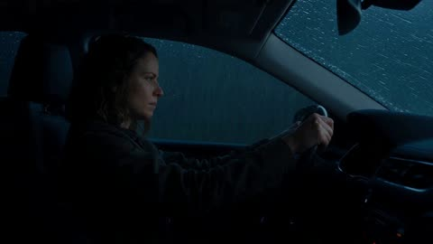</a>

先用固定的角色与场景段落加否定式风格清单，锁定同一个女人和同一辆车。再按 0 到 30 秒逐段写镜头、屏幕文字和台词，最后用一行音频说明雨声、雨刷和撞击后的寂静。

Seedance 2.5 · 文生视频 · 出处: [@RuzainaMeer on X](https://x.com/RuzainaMeer/status/2097193955230405007) · 发现于 [LearnPrompt/awesome-seedance](https://github.com/LearnPrompt/awesome-seedance)

[`thriller`](tags.md#tag-thriller) [`cinematic`](tags.md#tag-cinematic) [`rain`](tags.md#tag-rain) [`night-driving`](tags.md#tag-night-driving) [`timed-shots`](tags.md#tag-timed-shots)

<details><summary><b>提示词</b></summary>

```text
Create a 30-second ultra-photorealistic Hollywood-level cinematic thriller scene titled “THE LAST CALL.” The entire sequence must feel like a scene from a high-budget live-action feature film, with realistic human acting, natural facial expressions, physically accurate movement, realistic rain, practical lighting, believable vehicle physics, detailed environments, cinematic depth of field, subtle film grain, natural skin texture, realistic reflections, and professional Hollywood cinematography. No anime, no CGI-looking visuals, no fantasy aesthetic, no cyberpunk, no neon lighting, no exaggerated visual effects.
MAIN CHARACTER: A realistic young woman in her late 20s, natural appearance, expressive eyes, shoulder-length dark hair slightly damp from the humid weather, wearing a simple dark jacket. Maintain the exact same woman, face, hairstyle, clothing, car, weather and environment consistently throughout the entire sequence.

SETTING: A remote mountain road at night during heavy but realistic rainfall. Dark forested mountains surround the narrow winding road. Wet asphalt reflects only natural headlights and road markings. The atmosphere is tense, isolated and believable.

0–5 SECONDS

Interior of a moving car at night. Medium shot from the passenger side showing the woman driving alone. Rain continuously hits the windshield and realistic windshield wipers move back and forth. Dashboard illumination softly lights her face. She looks tired and emotionally distant while concentrating on the road. Camera slowly pushes toward her face. Natural breathing, subtle blinking and realistic micro-expressions.

5–10 SECONDS

Her smartphone suddenly begins ringing in the center console. Cut to an extremely realistic close-up of the phone screen.

Caller ID: “MOM”

The woman freezes.

Her eyes widen slightly. Her hands tighten around the steering wheel. She looks at the phone in disbelief. She hesitates for a moment, then reaches down and answers the call.

10–17 SECONDS

Extreme close-up of her face as she listens.

A faint, emotional female voice comes through the phone:

“Don't take the next turn.”

The woman's expression changes from confusion to fear.

The call suddenly disconnects.

She looks at the phone.

The screen reads: CALL ENDED

Outside the windshield, a sharp mountain turn approaches through the heavy rain.

17–23 SECONDS

She immediately slows the car.

Camera moves to a forward-facing perspective through the windshield. The road curves sharply ahead.

Suddenly, distant headlights appear through the rain around the corner.

The woman looks toward them.

A large truck suddenly loses control and crashes through the roadside barrier at the exact location where her car would have been if she had continued driving.

The crash must look physically realistic and grounded, with believable vehicle momentum, rain, debris and impact. No exaggerated explosions.

23–27 SECONDS

Silence after the crash.

The woman sits completely still, breathing heavily, visibly shaken.

She slowly looks down at her phone.

The phone screen now shows:

NO SIM — NO SIGNAL

She looks confused and terrified.

27–30 SECONDS

Extreme close-up of her eyes filling with tears.

She looks toward the empty passenger seat.

A subtle emotional pause.

In a trembling whisper, she says:

“Mom?”

Cut instantly to black.

FINAL AUDIO: Heavy rain, windshield wipers, realistic car interior ambience, distant thunder, phone ringing, muffled female voice, sudden silence after the crash, then only the woman's breathing.
```

</details>

<a id="seedance-lighthouse-keeper-sea-orbs"></a>
### 灯塔守望者提灯立于发光海岸

<a href="https://x.com/SyntheSarah/status/2097182529564365135">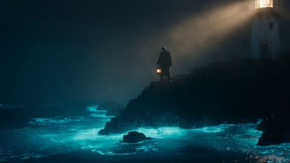</a>

提示词先给出广角建立镜头，再要求缓慢推近到人物面部，镜头路线清晰。光线与调色写成具体条件（体积月光、青橙调色、浅景深），让模型有明确目标，而不是泛泛的氛围。

Seedance 2.5 · 文生视频 · 出处: [@SyntheSarah on X](https://x.com/SyntheSarah/status/2097182529564365135) · 发现于 [LearnPrompt/awesome-seedance](https://github.com/LearnPrompt/awesome-seedance)

[`lighthouse`](tags.md#tag-lighthouse) [`bioluminescence`](tags.md#tag-bioluminescence) [`fog`](tags.md#tag-fog) [`camera-push-in`](tags.md#tag-camera-push-in)

<details><summary><b>提示词</b></summary>

```text
A weathered old lighthouse keeper stands on a foggy cliff at night,
wearing a thick wool coat, holding an old brass lantern. Below him,
the ocean waves glow with soft bioluminescent blue light with each
crash against the rocks. As he raises the lantern, dozens of floating
glowing orbs (like fireflies) rise up from the water and drift past
him into the misty air, swirling gently around his figure. Volumetric
moonlight beams cut through the fog. Camera starts wide on the cliff,
then does a slow cinematic push-in toward the keeper's face as the
orbs surround him, ending on a close-up with orbs reflecting in his
eyes. Teal and warm-amber color grade, hyper-realistic textures,
shallow depth of field, film grain, atmospheric fog, 15 seconds,
smooth continuous camera motion, no cuts.
```

</details>

<a id="seedance-manhattan-gallery-diamond-heist"></a>
### 身穿黑色礼服的女子站在玻璃展柜钻石旁

<a href="https://x.com/ai_anelia/status/2115867108722835593">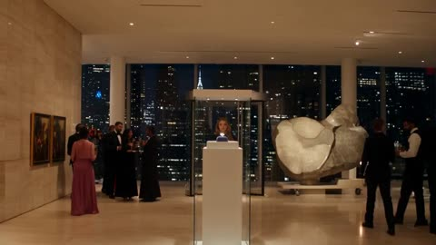</a>

用参考图锁定主角外形，并把剧情拆成清晰的分段节拍，每段配一个镜头运动。明确指定环境音（脚步声、玻璃碰撞声、对讲机声）并禁止音乐和字幕，让画面更接近真实电影场景。

Seedance 2.5 · 参考生视频 · 出处: [@ai_anelia on X](https://x.com/ai_anelia/status/2115867108722835593) · 发现于 [LearnPrompt/awesome-seedance](https://github.com/LearnPrompt/awesome-seedance)

[`heist`](tags.md#tag-heist) [`thriller`](tags.md#tag-thriller) [`reference-image`](tags.md#tag-reference-image) [`sound-design`](tags.md#tag-sound-design)

<details><summary><b>提示词</b></summary>

```text
Create a photorealistic Hollywood heist thriller set in a luxurious Manhattan art gallery at night. 16:9, 24 fps, fast-paced suspense, realistic action, dynamic camera movement, warm lighting, and natural 35mm film grain.

Character A, matching the reference image, wears an elegant black evening outfit and enters a glamorous exhibition where a priceless diamond is displayed under glass. While a waiter distracts the guests, she secretly steals it. Security discovers the missing diamond and chases her through crowded galleries, modern sculptures, and glass corridors overlooking New York City.

Cornered at the grand staircase, she calmly reveals the diamond and surrenders it. As guards secure the jewel, she notices a wealthy collector fleeing the gallery. A curator discovers evidence that an exhibited painting is the original artwork stolen by the collector years earlier. Security stops him while Character A quietly slips toward the exit.

In the final shot, she smiles knowingly through the glass doors and disappears into the night. The diamond was only a distraction; recovering the stolen painting was her real mission.

Continuity: Keep all faces, outfits, props, and locations consistent. Use clear action geography, believable movements, quick cuts, tracking shots, reflections, and close-ups. Natural gallery ambience, footsteps, glass clinks, radio chatter, and minimal dialogue. No music, narration, subtitles, text, logos, or watermarks. Avoid cartoon physics, teleportation, exaggerated action, and visual inconsistencies.
```

</details>

<a id="seedance-medieval-shame-walk"></a>
### 受辱的贵族女子穿过喧闹的中世纪人群

<a href="https://x.com/techhalla/status/2083908360118616268">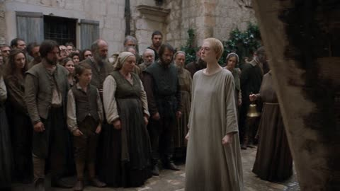</a>

时间线的每一段都写明了各自的镜头运动，跟拍与手持交替推进，铃声和持续的吟唱作为声音线索，让人群压力随节拍逐步累积。角色段落固定了服装、发型和姿态，使主角在各个镜头之间保持一致。

Seedance 2.5 · 文生视频 · 出处: [@techhalla on X](https://x.com/techhalla/status/2083908360118616268)

[`medieval`](tags.md#tag-medieval) [`period-drama`](tags.md#tag-period-drama) [`steadicam`](tags.md#tag-steadicam) [`crowd`](tags.md#tag-crowd)

<details><summary><b>提示词</b></summary>

```text
[STYLE + CAMERA + ATMOSPHERE]
Gritty high-end medieval television production look. Shot on ARRI Alexa XT with Cooke anamorphic lenses, mix of Steadicam tracking and handheld inside the crowd. Natural overcast daylight, desaturated dirty palette, visible film grain, realistic crowd physics and fabric movement. No modern polish.

[CHARACTERS]
Central figure: proud middle-aged noblewoman with roughly cropped short blonde hair, wearing a plain rough grey woolen penitential robe that fully covers her, barefoot, pale skin, rigid upright posture that slowly cracks under public condemnation. Stern middle-aged woman in plain brown religious robes walking just behind her, continuously ringing a large heavy iron handbell and chanting in a loud flat voice. Dense crowd of dirty medieval city dwellers of every age and class in period clothing packed on both sides and leaning from windows.

[LOCATION]
Narrow winding cobblestone streets of a medieval coastal city, high stone walls, arched doorways, wooden shutters, mud on the ground.

[TIMELINE]
0-6s: [Steadicam tracking medium-wide from the side] The woman in the plain robe walks steadily forward with forced dignity. The robed woman stays half a step behind ringing the bell and chanting “Shame. Shame. Shame.” Crowd begins to notice, first heads turn, early shouts of “Shame!” rise.

6-12s: [Handheld inside the pack, pushing closer] Crowd presses tighter along the path. Faces show pure contempt. Children point and call out. The woman keeps her chin high but her eyes start to glaze. Bell never stops. Chant continues: “Shame. Shame. Shame.”

12-18s: [Low tracking shot moving with her feet then tilting up to face] Bare feet slap wet cobblestones. A woman leans from a window and shouts “Shame!” The central woman’s jaw tightens, first tears form but she does not break stride. Crowd noise becomes a continuous wall of overlapping “Shame!” mixed with the bell.

18-24s: [Medium close-up handheld, slight shake] Camera stays locked on her face as the controlled mask cracks. Tears finally fall. She stares straight ahead, breathing harder. Behind her the religious woman rings harder and keeps the flat chant. The plain robe shifts with every step under the weight of the stares.

24-30s: [Pull-back Steadicam wide tracking] The full street is visible: wall of bodies on both sides, continuous shouting of “Shame! Shame! Shame!” mixed with the bell. The woman continues walking, posture still upright but now visibly broken, tears streaming, until the frame holds on her isolated figure moving through the condemnation.

[STYLE & QUALITY BOOSTERS]
Exact period production texture of a major series, coherent physics of every body and fabric movement, stable character continuity, natural motion blur, no modern digital cleanliness, no artificial enhancement.
```

</details>

<a id="seedance-mercedes-convertible-mediterranean-coast-romance"></a>
### 黑色梅赛德斯敞篷车驶过地中海海岸公路

<a href="https://x.com/codewithhajra/status/2119668766841672041"></a>

每段都标注起止秒数，并附带镜头、焦段和光线说明，让模型按顺序逐段生成对应镜头。明确的切镜和运镜指令能让 30 秒的序列保持连贯。

Seedance 2.5 · 文生视频 · 出处: [@codewithhajra on X](https://x.com/codewithhajra/status/2119668766841672041) · 发现于 [LearnPrompt/awesome-seedance](https://github.com/LearnPrompt/awesome-seedance)

[`car`](tags.md#tag-car) [`coastal`](tags.md#tag-coastal) [`romance`](tags.md#tag-romance) [`sunset`](tags.md#tag-sunset)

<details><summary><b>提示词</b></summary>

```text
Begin with a cinematic aerial establishing shot of a luxurious black Mercedes convertible cruising along a winding Mediterranean coastal road.

The turquoise sea sparkles under the afternoon sunlight. Palm trees and beautiful coastal cliffs pass in the background.

Cut to an interior passenger-side shot. The woman sits comfortably in the passenger seat, enjoying the breeze. Her skirt moves gently with the wind.

The handsome man drives with one hand on the steering wheel. He glances at her and smiles.

She notices him looking and gives him a playful smile.

Camera: Smooth aerial tracking, followed by intimate 50mm interior shots, natural sunlight and beautiful depth of field.

THE LITTLE STOP (5–10 SECONDS)

The man notices a beautiful seaside viewpoint and gently slows down.

Cut to an elegant side shot as the black Mercedes pulls into a scenic coastal parking area overlooking the ocean.

He parks the car safely and switches off the engine.

The woman looks outside excitedly, smiles and reaches for the door handle.

The man steps out first, walks around the front of the car and opens the passenger door for her.

She laughs softly and steps out, adjusting her skirt as the coastal breeze catches her hair.

They exchange a sweet smile.

Camera: Low-angle automotive shot, smooth movement around the car and cinematic couple entrance.

WALKING BY THE SEA (10–16 SECONDS)

Transition to a beautiful wide tracking shot of the couple walking together along a charming seaside pedestrian path.

The ocean is on one side, with a stone railing, coastal flowers and warm sunset light surrounding them.

The woman walks beside the man, holding his arm. He gently takes her hand.

She points toward the beautiful sunset over the water.

He looks where she points, then turns back toward her with a genuine smile.

They continue walking slowly, laughing and enjoying the moment.

Her flowing polka-dot skirt moves naturally in the sea breeze.

Camera: Side-tracking shot, cinematic 35mm lens, foreground flowers softly framing the couple and beautiful ocean bokeh.

THE SUNSET MOMENT (16–22 SECONDS)

Cut to an intimate cinematic shot at a beautiful seaside overlook.

The couple stops beside a stone railing, facing the ocean.

The sky is painted with beautiful shades of peach, pink, golden orange and lavender.

The woman rests her hands on the railing, admiring the sunset.

The man steps beside her, gently places his arm around her shoulders and looks at the horizon.

She turns toward him and smiles.

He gently brushes a loose strand of hair away from her face.

They share a quiet, affectionate moment while the sunlight softly illuminates their faces.

Camera: Over-the-shoulder composition, close-up facial details, beautiful sunset backlighting and subtle lens flare.

A MEMORY TO KEEP (22–26 SECONDS)

The woman takes a small vintage digital camera from her shoulder bag.

She turns toward the man and asks him to take a picture with her.

He takes the camera, holds it up and captures a photograph of them standing together against the glowing sunset.

After taking the picture, he shows her the screen.

She laughs happily and leans her head gently against his shoulder.

They admire the beautiful photograph together.

Camera: Close-up of the camera, their genuine expressions and a soft over-the-shoulder composition.

THE BEAUTIFUL GOODBYE (26–30 SECONDS)

End with a breathtaking cinematic wide shot.

The man opens the passenger door for her again.

Before getting inside, she turns around, looks at the sunset one last time and smiles.

He stands beside her, holding her hand.

The camera slowly cranes upward and pulls away, revealing the beautiful black convertible, the winding coastal road, the endless ocean and the glowing sunset.

ENDING MOOD: A beautiful little escape, a sunset, and a memory they will never forget.
```

</details>

<a id="seedance-mirror-venice-envelope-run"></a>
### 少女在倒悬威尼斯的镜像天空下奔跑

<a href="https://x.com/laviniavelle/status/2101881835290845251">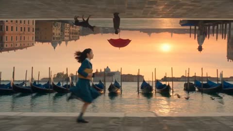</a>

提示词先写明主体、服装、道具和场景，再描述特效，给模型清晰的锚点。35mm 镜头、快速跟拍和黄金时刻光线让镜像画面在人物运动中依然清晰可读。

Seedance 2.5 · 文生视频 · 出处: [@laviniavelle on X](https://x.com/laviniavelle/status/2101881835290845251) · 发现于 [LearnPrompt/awesome-seedance](https://github.com/LearnPrompt/awesome-seedance)

[`venice`](tags.md#tag-venice) [`surreal`](tags.md#tag-surreal) [`mirror-world`](tags.md#tag-mirror-world) [`tracking-shot`](tags.md#tag-tracking-shot)

<details><summary><b>提示词</b></summary>

```text
A cinematic dynamic action video prompt visual surrealism a young East Asian woman in a classic vintage teal dress holding a yellow envelope running fast through a dreamlike surreal Venice dynamic camera movement upside down reflection of Venice city hanging from the sky creating a mind bending mirror dimension illusion running across Venetian brick alleys climbing M.C Escher style twisting stone staircases leaping over a massive gap with a bright rainbow in the golden hour sky sprinting past a busy outdoor fruit market with red apples falling standing on classic red-tile rooftops at golden sunset, dynamic fast tracking shot cinematic lighting, 8k resolution, ultra-detailed photorealistic shot on 35mm lens, depth of field masterpiece.
```

</details>

<a id="seedance-mother-baby-yoga-mirror"></a>
### 宝宝在一旁模仿妈妈做瑜伽

<a href="https://x.com/Zarnab_with_Ai/status/2106347953711661482"></a>

提示词固定了每个角色细节（发髻、黑色运动服、小辫子、蓝色奶嘴、紫色瑜伽垫），并要求全程保持一致，使人物和房间在各镜头中稳定。它按节拍逐段描述动作，并指定宽景跟拍、中景和特写的镜头安排，让宝宝模仿的喜剧感层层递进。

Seedance 2.5 · 文生视频 · 出处: [@Zarnab_with_Ai on X](https://x.com/Zarnab_with_Ai/status/2106347953711661482) · 发现于 [LearnPrompt/awesome-seedance](https://github.com/LearnPrompt/awesome-seedance)

[`3d-animation`](tags.md#tag-3d-animation) [`pixar-style`](tags.md#tag-pixar-style) [`yoga`](tags.md#tag-yoga) [`family`](tags.md#tag-family) [`baby`](tags.md#tag-baby)

<details><summary><b>提示词</b></summary>

```text
Create a 20-second heartwarming, cinematic 3D animated video in a high-quality Pixar-inspired animation style.

Scene: A beautiful, modern, cozy living room filled with warm morning sunlight. A young, beautiful mother with dark brown hair tied in a neat bun is wearing a fitted black yoga outfit. Her adorable baby has big expressive brown eyes, chubby cheeks, tiny brown hair tied in a little ponytail, and a white onesie.

Action Sequence:

The mother begins her morning yoga routine on a purple yoga mat. Her adorable baby watches her curiously while standing nearby with a blue pacifier.

As the mother bends forward into a yoga pose, the baby crawls toward her and tries to imitate her movements.

The mother performs different yoga exercises, including standing balance poses and an impressive handstand. The baby adorably attempts to copy every movement, creating funny and heartwarming moments.

Show cinematic close-ups of the baby's innocent, surprised facial expressions and exaggerated cute reactions.

Final Scene: The mother finishes her yoga routine, lovingly picks up her baby, and gives the baby a warm hug. Both smile and laugh together.

Visual Style: Premium 3D animated family film, ultra-detailed character design, expressive facial animation, realistic fabric textures, soft natural sunlight, warm pastel colors, cinematic depth of field, smooth camera movements, realistic shadows, adorable comedy, emotional storytelling, and fluid character animation.

Camera: Dynamic wide shots, smooth tracking shots, medium shots, and expressive close-ups.

Duration: 20 seconds.

Aspect Ratio: 16:9.

Important: Maintain identical character appearances, clothing, facial features, room design, lighting, and yoga mat throughout the entire video. No dialogue, no subtitles, no text, and no watermarks.
```

</details>

<a id="seedance-noir-rooftop-heist-35-shot-timeline"></a>
### 三十五镜头的黑色电影屋顶劫案

<a href="https://x.com/doctorwasif/status/2100181300049232193">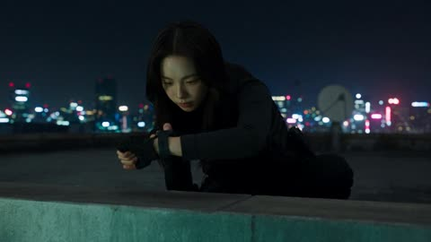</a>

用带编号的时间轴给每个镜头单独划定秒数，把30秒拆成短而可控的节拍。参考图锁定主角的脸和服装，结尾的风格行统一霓虹黑色电影的画面、物理表现和无对白要求。

Seedance 2.5 · 参考生视频 · 出处: [@doctorwasif on X](https://x.com/doctorwasif/status/2100181300049232193) · 发现于 [LearnPrompt/awesome-seedance](https://github.com/LearnPrompt/awesome-seedance)

[`multi-shot`](tags.md#tag-multi-shot) [`noir`](tags.md#tag-noir) [`heist`](tags.md#tag-heist) [`timeline`](tags.md#tag-timeline) [`character-consistency`](tags.md#tag-character-consistency)

<details><summary><b>提示词</b></summary>

```text
35-shot, 30-second cinematic noir rooftop heist. Keep Character A’s face, outfit, and appearance identical to the reference image. Sleek tactical gear, neon-lit city, tense professional choreography, realistic cinematic lighting, sharp cuts, no dialogue.

1. 0.0–1.0s: A crouches on a rooftop ledge at night, checks wrist device, neon skyline behind.
2. 1.0–1.6s: Extreme close-up of her eyes scanning the opposite building, neon reflections.
3. 1.6–2.2s: Teammate mechanically checks a grappling-hook launcher.
4. 2.2–2.8s: Wide neon city skyline establishing shot.
5. 2.8–3.4s: Two teammates exchange a precise silent hand signal.
6. 3.4–4.0s: A fires grappling hook across the gap; cable snaps taut.
7. 4.0–4.6s: Teammate checks a countdown timer.
8. 4.6–5.4s: A launches across the gap, city lights streaking below.
9. 5.4–6.0s: She lands silently, rolls, and immediately readies herself.
10. 6.0–6.6s: Security camera pans while team freezes in shadows.
11. 6.6–7.2s: Camera passes; teammate exhales in brief relief.
12. 7.2–7.8s: Three teammates synchronize watches and countdown gestures.
13. 7.8–8.6s: Team crosses rooftop in perfect formation, silhouetted against neon.
14. 8.6–9.2s: Gloved hands bypass a keypad with a decoding device.
15. 9.2–9.8s: Access panel opens; teammate silently signals success.
16. 9.8–10.6s: Team descends through rooftop hatch into a dark maintenance corridor.
17. 10.6–11.4s: Security guard patrols below, unaware; team hides above stairwell.
18. 11.4–12.2s: A signals “wait,” tracking the guard through railing.
19. 12.2–13.0s: Guard turns away; team swiftly moves past.
20. 13.0–13.8s: Team reaches a reinforced metallic vault door.
21. 13.8–14.6s: Decoding device attaches to vault lock; numbers cycle rapidly.
22. 14.6–15.6s: Close-ups of tense faces and countdown timer.
23. 15.6–16.6s: A guards the corridor, alert and weapon-free.
24. 16.6–17.6s: Decoder numbers slow toward final combination.
25. 17.6–18.8s: Slow motion: final digit locks; vault mechanisms release.
26. 18.8–20.0s: Slow motion: massive vault door opens, dramatic light spills out.
27. 20.0–21.0s: Team exchanges a restrained, silent look of triumph.
28. 21.0–22.0s: Wide reveal of sleek high-value contents inside vault.
29. 22.0–23.0s: A checks corridor again, maintaining vigilance.
30. 23.0–24.0s: Team efficiently secures the objective.
31. 24.0–25.2s: Distant alarm begins; team instantly shifts into calm exit mode.
32. 25.2–26.4s: Team retreats through rooftop access hatch.
33. 26.4–27.6s: A briefly looks back at the building, neon reflected in her eyes.
34. 27.6–28.8s: Team rappels down the exterior toward a waiting vehicle.
35. 28.8–30.0s: Wide final shot: vehicle speeds through neon city streets as rooftop lights fade behind, cinematic noir heist ending.

Style: high-end cinematic action thriller, realistic tactical movement, neon noir, dramatic contrast, atmospheric night lighting, dynamic camera work, precise choreography, seamless continuity, realistic physics, restrained professional emotion, no dialogue.
```

</details>

<a id="seedance-okinawa-medic-smoke-battlefield"></a>
### 晨雾中的战地医护兵扫视冲绳战场

<a href="https://x.com/Diplomeme/status/2100458083831234699">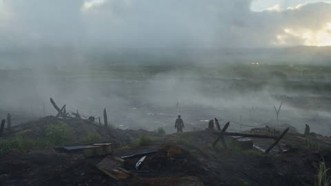</a>

按时间段逐段写明镜头焦段和动作，让30秒片段像一个完整故事，而不是单个镜头。明确的手持摄影规则（禁用无人机式运镜）加上物理与声音说明，使画面保持纪实质感。

Seedance 2.5 · 文生视频 · 出处: [@Diplomeme on X](https://x.com/Diplomeme/status/2100458083831234699) · 发现于 [LearnPrompt/awesome-seedance](https://github.com/LearnPrompt/awesome-seedance)

[`war-film`](tags.md#tag-war-film) [`historical`](tags.md#tag-historical) [`documentary`](tags.md#tag-documentary) [`multishot`](tags.md#tag-multishot)

<details><summary><b>提示词</b></summary>

```text
30 seconds | 16:9 | hyper-realistic historical war-film recreation | documentary realism | MULTISHOT

HISTORICAL DRAMATIZATION — An original cinematic reconstruction inspired by the Battle of Okinawa in 1945. The story follows a fictional U.S. Army combat medic attempting to evacuate wounded soldiers from an exposed battlefield. Do not recreate any specific scene, character, dialogue, costume design, camera composition, or sequence from any existing film.

CORE CONCEPT
A young combat medic remains behind after his unit moves forward. Instead of becoming part of the fighting, he moves through smoke, mud and artillery fire searching for wounded soldiers and bringing them toward safety. The sequence emphasizes courage, exhaustion, confusion and the physical reality of a battlefield rather than glorifying combat.

SETTING
Okinawa, Japan — spring 1945. Rugged limestone escarpment, muddy defensive positions, damaged vegetation, smoke-filled battlefield, earthworks, abandoned equipment, scattered ammunition crates, military stretchers and distant artillery. Overcast tropical sky gradually brightening toward morning.

CHARACTERS
MAIN MEDIC — Fictional American Army combat medic, mid-20s, exhausted face, short regulation haircut, olive-drab 1940s combat uniform, steel helmet, canvas medical bag, field dressings and worn boots.

WOUNDED SOLDIER 1 — Young American infantryman, exhausted and injured, period-correct uniform and equipment.

WOUNDED SOLDIER 2 — Another fictional infantryman trapped farther across the exposed ground.

BACKGROUND SOLDIERS — Period-accurate American and Japanese forces visible only as distant silhouettes through smoke. No identifiable real individuals.

STORY — MULTISHOT VISUALS

00:00–02.5 — DAWN
24mm wide establishing shot of an Okinawa battlefield covered in smoke and mist. Exhausted American soldiers move between muddy defensive positions while distant artillery flashes across the horizon. MAIN MEDIC stands alone near a damaged defensive position, scanning the battlefield.

02.5–05 — DISCOVERY
50mm handheld tracking shot as the medic hears a faint voice. He moves through smoke and discovers WOUNDED SOLDIER 1 lying behind a collapsed section of earthwork. The medic immediately kneels and checks him.

05–07.5 — FIRST AID
85mm intimate close-up of the medic applying a field dressing. His hands shake slightly from exhaustion. Mud and sweat cover his face. Distant artillery causes the ground to tremble.

07.5–10 — CARRY
35mm handheld shot. The medic pulls the wounded soldier onto his shoulders and begins moving through the mud. His boots sink into the wet ground. He struggles under the weight but continues.

10–12.5 — INCOMING FIRE
A distant artillery impact throws dirt into the air nearby. The medic instinctively drops low, shielding the wounded soldier with his body. Smoke rolls across the frame.

12.5–15 — HEAR ANOTHER VOICE
The medic looks toward a distant voice coming through the smoke. He realizes another wounded soldier is still behind him. After a brief moment of hesitation, he turns around and moves back.

15–17.5 — SECOND CASUALTY
50mm handheld movement through dense smoke. The medic reaches WOUNDED SOLDIER 2, who is trapped beside damaged equipment. The medic pulls debris away and checks his condition.

17.5–20 — IMPROVISED STRETCHER
35mm close tracking shot. The medic uses a canvas sheet and available wooden poles to construct a crude field stretcher. His movements are rushed but practical and believable.

20–22.5 — EXTRACTION
Wide 24mm shot. The medic drags the improvised stretcher across exposed muddy ground. Smoke obscures the battlefield behind him while artillery flashes intermittently in the distance.

22.5–25 — THE ESCARPMENT
The medic reaches the edge of the rocky escarpment. He lowers himself carefully and begins moving the wounded soldier toward a safer lower position.

25–27.5 — HUMAN MOMENT
85mm close-up. The wounded soldier looks up at the medic. The medic briefly reassures him with a calm expression before continuing. No heroic speech, no exaggerated emotion.

27.5–30 — FINAL REVEAL
24mm wide shot from behind the medic. He helps both wounded soldiers toward a sheltered position while the enormous Okinawa battlefield stretches behind them through smoke and morning light. The camera holds on the scale of the battlefield as the three figures become small against the landscape.

CAMERA
Large-format historical cinema camera language combined with embedded war-correspondent realism. 24mm for battlefield scale, 35mm for movement and action, 50mm for human interaction, 85mm for intimate details. Handheld shoulder-mounted movement, natural camera shake, imperfect framing, realistic focus changes, atmospheric obstruction from smoke and dust. No modern drone aesthetic, no impossible camera movement.

LIGHTING
Soft overcast Okinawa morning light, cold gray atmosphere, muted sunlight through smoke, warm distant artillery flashes, natural skin highlights and subtle atmospheric haze. No theatrical spotlighting.

PHYSICS
Realistic body weight, fatigue, mud resistance, stretcher weight, smoke movement, artillery shockwaves, falling debris, clothing movement and ground interaction. The medic struggles physically under the wounded soldier’s weight. No superhuman strength or impossible movement.

HUMAN PERFORMANCE
Exhaustion is visible in posture, breathing and movement. The medic behaves professionally but is visibly frightened and tired. Wounded soldiers respond naturally to pain and shock. Background soldiers move independently and react to distant impacts without synchronized choreography.

AUDIO
Authentic battlefield soundscape: distant artillery, rifle fire far across the battlefield, shouting, heavy breathing, boots in mud, equipment rattling, stretcher fabric stretching, wind through vegetation and debris impacts. Music is extremely restrained and secondary to environmental sound.

VISUAL CHARACTER
Photorealistic live-action historical war cinematography. Natural skin texture, authentic 1945 uniforms, weathered equipment, mud, sweat, smoke, atmospheric depth, realistic film grain and subtle highlight halation. No plastic skin, no videogame appearance, no exaggerated color grading.

COLOR GRADE
Muted olive greens, dirty browns, gray-blue atmospheric shadows, warm skin tones and restrained highlights. Slightly desaturated period-war-film palette while maintaining natural colors.

HISTORICAL REALISM
Period-correct American military equipment, clothing, medical supplies, terrain and battlefield environment. No modern weapons, vehicles, helmets, medical equipment, tactical gear or technology.

CONTINUITY
MAIN MEDIC, both wounded soldiers, uniforms, equipment, medical bag, weather and battlefield geography remain consistent across all shots. Wounds remain visually consistent without graphic gore. The sequence progresses logically from discovery → treatment → evacuation → second rescue → extraction.

FINAL QUALITY TARGET
The footage should feel like an extraordinarily realistic 1945 battlefield documentary captured by a professional war cinematographer, with the emotional intensity of a major historical film but without reproducing any existing movie scene. The realism comes from human performance, physical exhaustion, practical battlefield detail, smoke, mud, sound and environmental scale.
```

</details>

<a id="seedance-overhead-follow-cluttered-apartment"></a>
### 俯拍跟随女子穿过杂乱公寓

<a href="https://x.com/mehvishs25/status/2103675623030108474">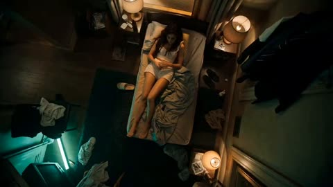</a>

俯拍镜头被描述为一个不间断的长镜头，在她穿过各个房间时始终保持画面固定。每个动作段落都重申镜头状态（仍然居中、仍然俯视），避免视角在动作切换中漂移。

Seedance 2.5 · 参考生视频 · 出处: [@mehvishs25 on X](https://x.com/mehvishs25/status/2103675623030108474) · 发现于 [LearnPrompt/awesome-seedance](https://github.com/LearnPrompt/awesome-seedance)

[`overhead-shot`](tags.md#tag-overhead-shot) [`long-take`](tags.md#tag-long-take) [`neon-lighting`](tags.md#tag-neon-lighting) [`apartment-interior`](tags.md#tag-apartment-interior)

<details><summary><b>提示词</b></summary>

```text
A tired woman in  <image1> in a loose tank top and sleep shorts, slow habitual movement. Slightly smeared eyeliner, bare feet, heavy posture, detached face.
ENVIRONMENT: A cramped cluttered apartment with an unmade mattress, scattered clothes, a narrow hallway, a damp bathroom with dim tile reflections, and a tiny kitchen crowded with dirty dishes and empty bottles. Warm practical lamps mix with sickly green neon leaking through blinds and door glass, turning the rooms into a humid late-night maze.
MOOD: Detached routine turns quietly uncanny, as if an unseen presence is floating above her and waiting for her to notice.
COLOR LOGIC: Matrix Green Look
CAMERA: POV overhead follow in a strict bird's eye view, locked directly above the top of her head at all times, perfectly centered over her body from start to finish, floating smoothly with no shake, tilt, angle drift, or side offset, passing through ceilings and door frames as one uninterrupted camera event. 24mm wide, digital clean look, locked overhead tracking package throughout.
SCENE:
She wakes on the mattress. Sits up under the lens.
Still centered under the lens, reaches to the floor. Picks up the cigarette and lighter. Places the cigarette between her lips. Lights it. Drops the lighter on the mattress. Stands up with the cigarette still with her.
Under the same overhead lock, crosses the cluttered room.
The lens tracks directly above her into the narrow hallway. Enters the bathroom.
Still pinned overhead, keeps the cigarette in her right hand. Extends that arm away from the running water. Leans on the sink. Turns on the tap with her left hand. Splashes water onto her face with her left hand.
The overhead follow carries her back out of the bathroom into the hallway. Moves along the hallway past the bathroom door. Turns into the tiny kitchen.
Still centered under the camera, keeps the cigarette with her. Reaches across the dirty dishes with her free hand. Picks up a glass from the counter.
Stops exactly under the lens. Holds the cigarette in her right hand and the glass in her left hand.
The lens stays fixed above her. Freezes. Looks right. Looks left. Takes a drag from the cigarette. Snaps her head straight up into the lens. Blows smoke toward the camera. Locks eye contact.
SFX: lighter flick, inhale, faint city hum, refrigerator buzz, soft bare footsteps, water run. Sodium amber particles, toxic green neon reflect off tile, smoke, bottles, and damp surface.
```

</details>

<a id="seedance-palace-jewel-customization-iphone"></a>
### 女子在王宫里用珍珠和钻石装饰手机

<a href="https://x.com/noorlewisx/status/2095741799402758204"></a>

提示词按镜头顺序逐段描写，开场先给手部特写，并点名银色镊子、水钻等具体道具，让每个镜头的画面内容都很明确。结尾统一的金色柔光与浅景深描述，帮助各镜头的宫殿质感保持一致。

Seedance 2.5 · 文生视频 · 出处: [@noorlewisx on X](https://x.com/noorlewisx/status/2095741799402758204)

[`fantasy`](tags.md#tag-fantasy) [`jewelry`](tags.md#tag-jewelry) [`palace`](tags.md#tag-palace) [`multi-shot`](tags.md#tag-multi-shot)

<details><summary><b>提示词</b></summary>

```text
A cinematic 20-second luxury fantasy video in an opulent gold-and-crimson palace chamber with crystal chandeliers, ornate gold furniture, red velvet chairs and warm candlelight. A stunning young woman with platinum blonde hair in elaborate jeweled braids, wearing a sparkling ice-blue beaded gown, diamond tiara, pearl drop earrings and soft pink makeup, green eyes. She customizes objects with precision tweezers, pearls and crystals.
Opening close-up: her hands placing tiny rhinestones around the camera module of a light-blue iPhone using silver tweezers. She then holds the decorated phone and smiles softly while looking at it.
She decorates a rose-gold crystal compact, holds an ornate jeweled perfume bottle toward the camera, and gazes at a small diamond-encrusted photo frame on a gold table scattered with loose pearls.
Quick shot of organized trays filled with white pearls, clear crystals, gold beads and rhinestones.
She picks up a black fountain pen, leans over a large official parchment document with a royal coat of arms, wax seal and the heading “I Victores D’Ulvenwind”, then uses a fine tool to attach pearls and diamonds along the edges and corners of the document. She signs it and proudly holds up the finished jeweled letter.
A tall, handsome man with sharp features and dark hair, wearing an elaborate dark navy velvet jacket heavily embroidered with silver thread, pearls and jewels, stands beside her, takes the document and reads it. She looks up at him from her seat. He smiles. Soft golden lighting, shallow depth of field, highly detailed, photorealistic, elegant and dreamy atmosphere.
```

</details>

<a id="seedance-paper-city-first-fold"></a>
### 纸张折叠成手工微型纸城市

<a href="https://x.com/ChillaiKalan__/status/2088866007918268515"></a>

按时间码逐镜头写明镜头焦段与运动，并用单独的连续性段落锁定建筑位置和纸张质感，使微缩城市在切换间保持一致。材质与光线规则用直白的物理描述写出，而不是堆叠风格标签。

Seedance 2.5 · 文生视频 · 出处: [@ChillaiKalan__ on X](https://x.com/ChillaiKalan__/status/2088866007918268515) · 发现于 [LearnPrompt/awesome-seedance](https://github.com/LearnPrompt/awesome-seedance)

[`paper-art`](tags.md#tag-paper-art) [`miniature`](tags.md#tag-miniature) [`macro-shot`](tags.md#tag-macro-shot) [`continuity`](tags.md#tag-continuity)

<details><summary><b>提示词</b></summary>

```text
30-SECOND CINEMATIC SHORT
Create a 30-second cinematic sequence with the visual discipline of a major feature film. The world is entirely made from paper, cardboard, ink, and delicate handcrafted materials.
00:00–00:05 — THE FIRST FOLD
Begin with an extreme macro shot of a blank sheet of textured paper.
A single fold slowly forms across its surface.
Lens: 100mm macro
Camera: Completely static
Soft daylight moves across the paper as the fold continues.
Cut precisely as the paper reaches its final shape.
00:05–00:11 — THE CITY EMERGES
Transition into a 50mm shot.
The folded paper begins forming miniature streets and architectural structures.
Buildings rise naturally from the surface through carefully constructed paper folds.
The camera slowly tracks sideways.
Tiny windows catch the light.
Nothing feels computer-generated; every surface should have believable paper fibers, folds, shadows, and imperfections.
00:11–00:17 — THE REVEAL
Move into a 35mm shot.
The camera pulls backward.
The small arrangement is revealed as an enormous handcrafted paper city stretching across a large table.
Roads connect different districts.
Bridges cross miniature rivers.
Paper trees move gently from an unseen breeze.
00:17–00:23 — MORNING
Transition into a slow overhead crane shot.
Warm sunlight gradually spreads across the paper city.
Shadows from the buildings become longer and more defined.
Tiny paper windows begin reflecting the sunlight.
The camera continues rising, revealing the geometric relationship between the streets and buildings.
00:23–00:27 — THE DETAIL
Cut to an 85mm close-up.
Focus on a tiny paper clock mounted on one building.
The clock moves forward by one minute.
Rack focus from the clock to the miniature skyline behind it.
00:27–00:30 — FINAL IMAGE
Return to an extreme wide shot.
The entire paper city sits beneath a large studio window.
The morning light completely fills the miniature world.
Camera slowly pulls backward until the city becomes a small object within the larger room.
Fade to black.
CINEMATOGRAPHY
Large-format feature-film aesthetic.
100mm macro for texture.
85mm for detail.
50mm for natural perspective.
35mm for environmental shots.
Controlled dolly and crane movements.
Realistic depth of field.
Natural focus transitions.
Soft motion blur.
Subtle lens imperfections.
No artificial camera shake.
MATERIAL DIRECTION
Every surface must visibly behave like physical paper.
Visible paper fibers.
Natural folds.
Tiny imperfections.
Soft cardboard edges.
Realistic contact shadows.
Believable paper thickness.
Natural material deformation.
LIGHTING
Soft morning daylight.
Large window as the primary source.
Natural bounce light.
Gentle shadows.
Subtle warm highlights.
No artificial neon effects.
No excessive visual effects.
CONTINUITY
The same paper city throughout the entire sequence.
Buildings maintain identical shapes and positions.
Roads remain connected.
Paper materials remain consistent.
No random transformations.
No flickering.
No duplicated structures.
No sudden environmental changes.
DIRECTOR’S NOTE
Treat this as a miniature feature film, not a visual-effects demonstration.
The camera should discover the world gradually.
Start intimate.
Reveal scale.
Return to detail.
Finish wide.
The audience should feel that they are watching a real handcrafted world photographed with a cinema camera.
Photorealistic 4K • tactile materials • feature-film cinematography • sophisticated lighting • realistic miniature photography • cinematic depth • precise camera movement • seamless visual continuity.
```

</details>

<a id="seedance-paper-miniature-moonlight-world"></a>
### 纸质微缩风景在升起的月光下变化

<a href="https://x.com/Emmma__0/status/2090659771749912711">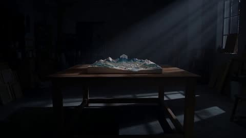</a>

按时间段逐镜指定镜头焦段（85mm 微距、50mm 跟拍、35mm 仰拍），让镜头语法清晰可控。视觉语言段要求可见纸纤维、折痕与自然瑕疵，使运动读起来像手工定格，而非数字特效。

Seedance 2.5 · 文生视频 · 出处: [@Emmma__0 on X](https://x.com/Emmma__0/status/2090659771749912711)

[`paper-craft`](tags.md#tag-paper-craft) [`miniature`](tags.md#tag-miniature) [`macro`](tags.md#tag-macro) [`moonlight`](tags.md#tag-moonlight)

<details><summary><b>提示词</b></summary>

```text
DURATION: 30 seconds
ASPECT RATIO: 16:9
STYLE: Premium handcrafted fantasy / cinematic miniature film
CAMERA: Macro cinema photography, 35mm / 50mm / 85mm
FRAME RATE: 60 fps with gentle slow motion

CONCEPT

Inside a quiet artist's studio sits a completely handmade paper landscape.

A tiny paper town rests beneath a folded paper moon.

When the moon rises, the miniature world begins changing.

The entire story is told through paper, light, shadows, and miniature movement.

---

00:00–00:05 — THE STUDIO

Begin with a wide cinematic shot of a dark artist's studio at night.

A large wooden table occupies the center.

On it sits an elaborate miniature paper landscape.

Paper mountains.

Tiny houses.

Small trees.

A winding paper river.

The room is illuminated only by soft moonlight from a nearby window.

Camera slowly pushes toward the miniature world.

---

00:05–00:09 — THE MOON

Cut to an 85mm macro shot.

A small folded paper moon rests behind the miniature mountains.

Its surface contains delicate hand-drawn patterns.

A soft light gradually appears behind it.

The moon begins rising slowly.

Its light spreads across the paper landscape.

---

00:09–00:14 — THE TOWN

Move into a 50mm tracking shot.

As moonlight reaches the miniature town, tiny paper windows begin glowing one after another.

The paper river catches the light.

Small paper trees cast long shadows.

Everything remains physically handcrafted.

Visible paper fibers.

Tiny folds.

Natural imperfections.

---

00:14–00:19 — THE TRANSFORMATION

The camera moves slowly overhead.

The paper mountains gently unfold.

They become taller.

The river extends through newly revealed valleys.

Paper bridges unfold across the landscape.

The transformation should feel like stop-motion craftsmanship rather than digital magic.

Keep every movement delicate and believable.

---

00:19–00:24 — THE SKY

Transition into a 35mm upward-looking composition.

The paper moon continues rising.

Behind it, the studio ceiling gradually disappears into a miniature paper sky.

Tiny folded stars unfold one by one.

The miniature world now appears enormous.

The boundaries between the table and the sky become impossible to distinguish.

---

00:24–00:27 — THE REVEAL

Camera slowly pulls backward.

The entire miniature landscape is now visible.

The paper moon hangs above the completed world.

A gentle paper cloud moves across the scene.

Everything is calm.

---

00:27–00:30 — FINAL IMAGE

Extreme wide shot.

Reveal that the entire miniature landscape has folded itself into a single beautiful paper artwork.

The paper moon becomes the center of the composition.

The studio is visible around it.

The moonlight slowly fades.

One tiny paper star remains illuminated.

CUT TO BLACK.

No text.

No logo.

No characters.

---

VISUAL LANGUAGE

Handcrafted miniature cinematography.

Real paper fibers.

Visible folds.

Natural cardboard edges.

Subtle imperfections.

Physical shadows.
```

</details>

<a id="seedance-parking-garage-zombie-chase-horror"></a>
### 地下停车场韩式恐怖僵尸追逐

<a href="https://x.com/AIwithSynthia/status/2113840061104206005">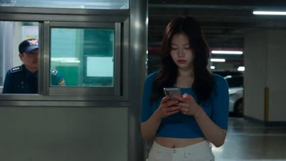</a>

提示词把 30 秒切成六个带时间码的段落，每段只写一个明确动作，剧情从玩笑升级到追逐再到断电。结尾的 STYLE 行用手持抖动、闪烁灯光和乳白色眼睛锁定画面风格，再用简短的排除清单避免过度血腥、字幕和卡通感。

Seedance 2.5 · 文生视频 · 出处: [@AIwithSynthia on X](https://x.com/AIwithSynthia/status/2113840061104206005) · 发现于 [LearnPrompt/awesome-seedance](https://github.com/LearnPrompt/awesome-seedance)

[`horror`](tags.md#tag-horror) [`zombie`](tags.md#tag-zombie) [`timed-shots`](tags.md#tag-timed-shots) [`handheld`](tags.md#tag-handheld) [`photorealistic`](tags.md#tag-photorealistic)

<details><summary><b>提示词</b></summary>

```text
0–3s: A young Korean woman in a fitted blue crop top and white shorts walks through an underground parking garage, jokingly waving at the security guard.

3–6s: Her smile freezes, her eyes turn completely white, and dark veins appear across her face. She coughs, revealing blood around her lips.

6–9s: She tilts her head unnaturally, laughs hysterically, and suddenly slams her bloody palm against the security booth glass.

9–13s: The terrified guard runs away as she chases him between parked cars, moving with frightening speed.

13–18s: A resident exits the elevator, mistakes the situation for a prank, then screams as the zombie suddenly charges at him.

18–24s: Emergency sprinklers activate. Soaked and twitching, the zombie crawls beneath a closing metal shutter while the survivors watch in horror.

24–30s: Everyone races toward the exit. The zombie smashes against the glass door, revealing her white eyes and blood-smeared grin before the lights suddenly go out.

STYLE: Photorealistic Korean horror, creepy laughter, milky-white eyes, realistic blood smears, sudden jerky movements, flickering lights, handheld camera shake, dark humor, cinematic 4K. No cartoon, anime, excessive gore, subtitles, or watermark.
```

</details>

<a id="seedance-pink-hair-stadium-steps"></a>
### 粉色长发女生躺在体育场看台台阶上

<a href="https://x.com/Just_sharon7/status/2100983315381829840">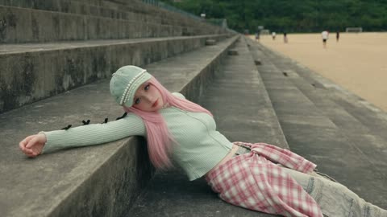</a>

参考图锁定角色，并在每个镜头中重复发色、帽子、毛衣和穿着等身份描述，使切换镜头后形象保持一致。每个镜头只有 2 到 4 秒，配合缓慢运镜和情绪匹配的歌曲建议来定节奏。

Seedance 2.5 · 参考生视频 · 出处: [@Just_sharon7 on X](https://x.com/Just_sharon7/status/2100983315381829840) · 发现于 [LearnPrompt/awesome-seedance](https://github.com/LearnPrompt/awesome-seedance)

[`music-video`](tags.md#tag-music-video) [`multi-shot`](tags.md#tag-multi-shot) [`character-consistency`](tags.md#tag-character-consistency) [`reference-image`](tags.md#tag-reference-image)

<details><summary><b>提示词</b></summary>

```text
Cinematic 30-second vertical or 16:9 music-video style sequence, photorealistic, high detail, natural outdoor lighting, slightly melancholic and dreamy atmosphere, soft color grade with muted greens, concrete greys, and pastel pinks. Consistent single female character throughout every shot. 
Character (lock this identity):
Young East-Asian woman @[Image 1](image_1), mid-20s, long straight pastel-pink hair with darker roots and lighter tips, fair skin, delicate makeup with reddish lips, slightly tired or distant expression. Wearing a light-green denim baseball cap decorated with a row of white pearls along the brim. Light-green cropped ribbed knit sweater with black ribbon bows tied along both sleeves. pink-and-white plaid flannel shirt tied around her waist. Baggy light-wash distressed jeans. Small silver necklace. Occasional black backpack in later shots. Same face, hair length, outfit, and body proportions in every scene.
Shot sequence (smooth cuts, slow camera moves, 2–4 seconds each):
Medium-wide: She lies on her side on weathered grey concrete stadium steps, head resting against the riser, one arm along the step, looking softly at camera. Background: empty sandy sports field and distant people.
Medium: She hangs from the top white crossbar of a soccer goal, both hands gripping the bar, body dangling in front of the net, looking straight at camera. Green hills and a second goal in the background.
Medium: She is inside a stainless-steel cage packed with orange basketballs, eyes closed, cheek resting on a basketball as if sleeping. Soft natural light.
Medium: She reclines against a colorful red-yellow-green playground tube slide, eyes half-closed or looking down, same outfit, playground equipment and trees behind.
Medium-wide: She sits still on a chain swing in a playground, looking down, legs hanging, empty swing beside her. Blue rubber flooring, red and blue poles.
Medium-wide: She sits on a low concrete wall in the playground, an orange traffic cone placed on her head like a hat, staring forward with a blank expression. Colorful play structures and trees behind.
Medium: Outdoor ping-pong table. She stands holding a red-and-black paddle, then leans forward and rests her head and arms on the blue table surface, paddle still in hand, looking sideways at camera.
Medium close: She stands at a stainless-steel outdoor drinking fountain, presses the button, water arcs up; she leans in as if to drink, then looks down at the basin.
Wide then medium: Large concrete stadium steps with metal railings and trees. She walks slowly past a black backpack on a step, stops, looks up at the sky, then sits and leans back against the steps, eyes closed or looking upward, legs extended.
Camera & motion:
Slow pans and gentle dollies, shallow-to-medium depth of field, natural handheld-but-stable feel. Soft overcast or late-afternoon light. Subtle wind in hair and clothes. No fast cuts, no zooms that break character consistency.
Mood & audio suggestion:
Quiet, introspective, slightly surreal “lost in thought” feeling. Pair with the Indonesian song snippet “Pikiranku tak dapat ku mengerti / kaki di kepala kepala di kaki…” (Peterpan / Noah – Di Atas Normal) or a similar melancholic indie track. Soft ambient outdoor sound (distant voices, wind, faint playground noise).
Quality tags:
Photorealistic, 4K, cinematic lighting, consistent character, natural skin texture, fabric detail on sweater and jeans, realistic physics on hanging/sitting/leaning poses.
```

</details>

<a id="seedance-pirate-chef-parrot-galley-asmr"></a>
### 海盗厨师与偷食鹦鹉的船厨闹剧

<a href="https://x.com/Goodmanprotocol/status/2099186117769822462">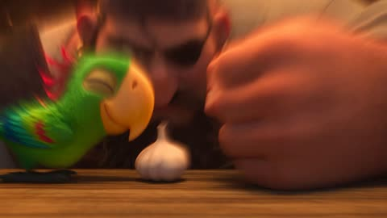</a>

六个带时间码的段落，每段都把一个视觉笑点和明确的声音提示（如滋滋声、叮当声、唱片刮擦声）配在一起，让 ASMR 的节奏清楚可控。结尾用船舱全景配上海浪、木船吱嘎声和一声手风琴，干净收尾。

Seedance 2.5 · 文生视频 · 出处: [@Goodmanprotocol on X](https://x.com/Goodmanprotocol/status/2099186117769822462)

[`asmr`](tags.md#tag-asmr) [`slapstick`](tags.md#tag-slapstick) [`pixar-style`](tags.md#tag-pixar-style) [`timed-beats`](tags.md#tag-timed-beats)

<details><summary><b>提示词</b></summary>

```text
Create a 30-second Pixar-quality 3D animated ASMR comedy short aboard a warm, lantern-lit pirate ship galley.

STYLE: Premium cinematic 3D animation, expressive characters, polished feature-film quality, warm amber lighting, realistic food textures, cinematic depth of field, playful slapstick humor, gentle ship movement and crisp immersive food ASMR.

Characters: A large, burly, bearded pirate chef wearing a worn apron, and a mischievous bright-green parrot constantly trying to steal ingredients. Keep both characters visually consistent throughout.

0–4s

Extreme close-up of the parrot stealing a garlic bulb. The pirate's hand suddenly slams beside it. They freeze and stare at each other. Brief record-scratch silence. The pirate flicks the parrot away; it spins through the air and lands on a pot rack pretending nothing happened.

4–8s

The pirate rapidly chops garlic with crisp ASMR. The parrot tiptoes toward a tomato. Garlic hits hot oil with a huge sizzle, startling the parrot and sending it tumbling off the rack. Metal cups clang.

8–14s

Fast cinematic cooking montage: tomatoes sizzling, herbs being torn, olive oil pouring in golden slow motion, sauce bubbling and the pirate confidently stirring the skillet. Layer detailed chopping, sizzling, pouring and bubbling ASMR.

14–19s

The parrot spots the food and secretly tries to drag the skillet away. Its tiny body strains comically across the wooden floor. The pirate slowly turns around and stares. The parrot freezes while still holding the handle, then innocently whistles and lets go.

19–24s

The pirate finishes cooking with a dramatic skillet toss. Steam rises as the glossy dish is plated. The parrot watches hungrily, trying to look innocent.

24–30s

Instead of scolding the parrot, the pirate prepares a tiny plate of sauce and bread and slides it across the table. The parrot happily bounces and eats beside him. They exchange a satisfied look as the ship gently sways.

End with a wide cinematic shot of the cozy galley glowing under amber lanterns, subtle ocean sounds and wooden ship creaks, with one soft playful accordion note fading out.

No dialogue, no subtitles, no text. Maintain strong character consistency, natural physics, smooth animation, cinematic framing and detailed food ASMR throughout.
```

</details>

<a id="seedance-plum-tree-prince-comedy"></a>
### 女子摇动梅树,接住掉下来的王子

<a href="https://x.com/Chaemate_/status/2105611129867395458">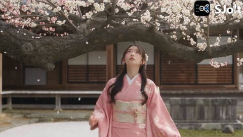</a>

身份锁和环境锁绑定两张参考图,让两位角色与神社庭院在五个定时分镜里保持一致。情绪曲线、明确的声音设计和负面提示词共同控制喜剧节奏与慢动作花瓣雨。

Seedance 2.5 · 参考生视频 · 出处: [@Chaemate_ on X](https://x.com/Chaemate_/status/2105611129867395458) · 发现于 [LearnPrompt/awesome-seedance](https://github.com/LearnPrompt/awesome-seedance)

[`reference-images`](tags.md#tag-reference-images) [`identity-lock`](tags.md#tag-identity-lock) [`shot-breakdown`](tags.md#tag-shot-breakdown) [`romantic-comedy`](tags.md#tag-romantic-comedy) [`japanese-fantasy`](tags.md#tag-japanese-fantasy)

<details><summary><b>提示词</b></summary>

```text
TITLE: "What Falls from the Plum Tree?"
DURATION: 15 seconds | ASPECT RATIO: 16:9
GENRE: Romantic Japanese Fantasy Comedy
STYLE: Ultra-realistic premium Japanese drama, cinematic film quality

IDENTITY LOCK:
The woman @image1 must keep the exact same face, face shape, skin tone, hairstyle, height, body proportions, and wardrobe in every shot. The man @image2 must keep his exact face, hairstyle, and outfit as in the reference. No changes in any frame.

ENVIRONMENT LOCK:
An elegant Edo-era Japanese shrine courtyard with traditional wooden architecture, tiled rooftops, stone lanterns, and a raked gravel garden in the background. A giant ancient plum (ume) tree with dense white and pink blossoms. Its thick main branch extends horizontally above the woman's head. Soft spring daylight.

SHOT BREAKDOWN:

0.0–4.0s | Medium shot
The woman stands beneath the huge horizontal branch. Blossom petals drift in the breeze. She looks up curiously, then raises both hands and shakes the branch. The branch trembles and a shower of petals falls. A lacquered cosmetic box tumbles down through the blossoms and she catches it with both hands. Close-up of her face as she peeks inside. Flat, unimpressed expression. She tosses it casually out of frame.

4.0–7.5s | Medium shot
Her curiosity grows. She shakes the branch harder and petals pour down like rain. A scatter of gold koban coins and a few silk pouches fall. She catches one pouch, raises a single eyebrow, looks bored, and tosses it away.

7.5–10.5s | Slow motion
Determined now, she grips the branch with both hands and shakes with all her strength. The branch shudders, a heavy blossom storm rains down, and the man @image2 suddenly drops from the branch. She gasps, spreads her arms, and catches him just before he hits the ground. Petals swirl around them.

10.5–13.0s | Close-up, 50mm
She looks at his face. Her eyes sparkle and a wide, delighted smile appears. He gives a charming, slightly embarrassed smile and looks back at her.

13.0–15.0s | Medium-wide shot
They turn to the camera together and make small heart shapes with their hands, laughing happily. They turn to each other, laugh, and walk out of frame side by side while petals keep falling behind them. Fade out on the falling blossoms.

EMOTION ARC:
Curious → Bored → More curious → Surprised → Smitten → Happy.

SOUND:
Soft spring breeze, rustling blossoms, creaking wood, light thud of the box, jingle of coins, warm playful Japanese rom-com music (koto, light shamisen, soft piano), cheerful laughter, fading footsteps.

CAMERA & VISUALS:
ARRI Alexa 35 look, 35mm and 50mm cinematic lenses, smooth gimbal movement, slow-motion petal shower, natural spring lighting, realistic skin pores, physically accurate shadows, HDR, subtle film grain, soft pastel color grading.

NEGATIVE PROMPT:
cartoon, anime, CGI look, low quality, blurry face, extra fingers, warped hands, duplicate objects, duplicate people, distorted body, floating objects, unrealistic physics, unnatural falling motion, overexposed lighting, oversaturated colors, AI artifacts, camera shake, abrupt cuts, warped architecture, deformed eyes

#Seedance25 #AIVideo #AIFilmmaking #AIart️️️️️️️️️️️️️️️️️️️️️️️️️️️️️️️️️️️️️️️️️️️️️️️️️️️
```

</details>

<a id="seedance-pregnant-woman-kitchen-tennis-comedy"></a>
### 孕妇在豪华厨房切黄瓜

<a href="https://x.com/Zarnab_with_Ai/status/2118533471786406031"></a>

用编号分镜逐段写清每个场景，并在结尾附统一的视觉风格段和角色外观描述，让多次切镜后人物形象保持一致。开头标明 9:16 竖屏，结尾写明无文字、无字幕、无水印，画面更干净。

Seedance 2.5 · 文生视频 · 出处: [@Zarnab_with_Ai on X](https://x.com/Zarnab_with_Ai/status/2118533471786406031) · 发现于 [LearnPrompt/awesome-seedance](https://github.com/LearnPrompt/awesome-seedance)

[`3d-animation`](tags.md#tag-3d-animation) [`multi-scene`](tags.md#tag-multi-scene) [`vertical-video`](tags.md#tag-vertical-video) [`comedy`](tags.md#tag-comedy)

<details><summary><b>提示词</b></summary>

```text
Create a cute, high-quality 3D animated cinematic comedy scene in a vertical 9:16 format.

Scene 1: A beautiful pregnant young woman with long, straight black hair, wearing a shiny pink satin two-piece outfit, is standing in a modern luxury kitchen, peacefully cutting fresh vegetables on a wooden chopping board. Warm lighting, elegant marble countertops, and realistic kitchen details.

Scene 2: Suddenly, a kitchen knife appears to float mysteriously in the air, creating a magical transition. Show a cinematic close-up of the woman's pregnant belly with soft, warm lighting.

Scene 3: Transition into a magical glowing tennis court with golden sparkling lights. An adorable little 3D cartoon baby boy with curly brown hair, a white headband, big expressive eyes, and a white tennis outfit appears holding a miniature tennis racket. He takes an energetic tennis stance and confidently prepares to hit a tennis ball.

Scene 4: Show the cute little tennis player running forward with an adorable but fierce expression, swinging his racket and hitting the ball with surprising power. Use dynamic camera movements and cinematic close-ups.

Scene 5: Return to the modern kitchen. The pregnant woman looks shocked and surprised. A handsome young man with curly brown hair, wearing a black sleeveless athletic shirt, appears beside her holding a tennis racket. He looks at her belly in amazement.

Scene 6: The man and woman exchange surprised expressions, then both burst into laughter, sharing a sweet and funny moment together.

Visual Style: Premium 3D Pixar-inspired animation, adorable character designs, expressive facial emotions, detailed textures, smooth natural movements, cinematic lighting, magical golden particles, vibrant colors, consistent character appearance, professional camera angles, and heartwarming comedy storytelling.

Quality: 4K, ultra-detailed 3D rendering, smooth animation, vertical 9:16, no text, no subtitles, no watermark.
```

</details>

<a id="seedance-rain-kitten-rescue-spaghetti"></a>
### 蓝色火焰上翻炒意面

<a href="https://x.com/Aiwithmaha/status/2118903281280020855"></a>

提示词开头先写明时长 30 秒和竖屏 9:16 格式，然后按顺序列出剧情节拍，并点名粉色毛巾、粉色食盆等道具，让颜色和物件在各个镜头间保持一致。结尾加入配乐要求，为纯画面描述补上听感方向。

Seedance 2.5 · 文生视频 · 出处: [@Aiwithmaha on X](https://x.com/Aiwithmaha/status/2118903281280020855) · 发现于 [LearnPrompt/awesome-seedance](https://github.com/LearnPrompt/awesome-seedance)

[`kitten-rescue`](tags.md#tag-kitten-rescue) [`pasta`](tags.md#tag-pasta) [`rain`](tags.md#tag-rain) [`emotional-storytelling`](tags.md#tag-emotional-storytelling)

<details><summary><b>提示词</b></summary>

```text
Create a 30-second ultra-realistic cinematic emotional short film in vertical 9:16 format. A young woman wearing a black outfit is cooking delicious spaghetti in her modern kitchen, gently stirring the pasta in a pan over a blue flame. Suddenly, she notices heavy rain falling outside her window and sees a tiny orange-and-white kitten sitting alone in the cold rain. She immediately leaves her cooking, grabs an umbrella, and rushes outside to rescue the helpless kitten. She carefully picks up the frightened, wet kitten and brings it safely inside her warm home. She gently wraps the little kitten in a soft pink towel and lovingly dries its wet fur. Next, she prepares a small pink food bowl filled with delicious cat food and places it in front of the hungry kitten. The kitten happily eats while the woman watches with a warm, emotional smile. Finally, she sits in her cozy kitchen enjoying her spaghetti while the adorable kitten rests peacefully beside her. Use realistic facial expressions, natural movements, beautiful cinematic lighting, emotional storytelling, detailed environments, and heartwarming background music throughout the entire 30-second video.
```

</details>

<a id="seedance-rainy-limo-three-slaps-kiss"></a>
### 雨夜豪车中三次耳光与长吻

<a href="https://x.com/johnAGI168/status/2094792293941182498"></a>

按时间码逐镜头写清动作顺序、机位和景别，并用负面提示锁定巴掌次数与司机位置。音频单独列出雨声、车流和耳光声，让声音与每个动作节拍对齐。

Seedance 2.5 · 参考生视频 · 出处: [@johnAGI168 on X](https://x.com/johnAGI168/status/2094792293941182498) · 发现于 [LearnPrompt/awesome-seedance](https://github.com/LearnPrompt/awesome-seedance)

[`romance`](tags.md#tag-romance) [`drama`](tags.md#tag-drama) [`multi-shot`](tags.md#tag-multi-shot) [`night`](tags.md#tag-night) [`car-interior`](tags.md#tag-car-interior)

<details><summary><b>提示词</b></summary>

```text
时长：25秒
比例：16:9横屏
人物参考：
@ 
 女主， 
@
 男主
语言：无对白、无旁白
文字：无字幕
音频：紧张暧昧音乐、雨声、车流声、三次耳光声、急促呼吸、衣料摩擦

GLOBAL CONTINUITY

女主：
使用

 锁定成年女主的五官、脸型、肤色和身份。穿黑色高领修身连衣裙。性格倔强、冷漠，面对男主靠近时明确反抗。

男主：
使用

 锁定成年男主的五官、脸型、肤色和身份。黑色短发向后梳，穿黑色暗纹西装、黑色衬衫。被扇后逐渐失去克制。

司机：
中年男性，黑色司机制服、白色手套。只在后视镜中短暂出现，不说话、不回头。

场景：
雨夜行驶中的黑色豪华加长轿车。黑色真皮后排、深色木纹内饰、星空车顶、暖色阅读灯。车窗布满雨滴，窗外蓝红霓虹高速掠过。

整体表演：
成年演员表演的强冲突爱情微短剧。三次巴掌必须真实清楚，男主头部必须沿受力方向偏转；亲吻、咬唇、分开与再次靠近必须有明确因果。所有拉扯均为安全表演，男主手掌只扣住下颌和后颈，不挤压喉咙。

SHOT 1（00:00-00:02.00）欲吻与第一巴掌

00:00-00:00.70
男主坐在女主左侧，缓慢向她靠近，目光从她眼睛落到嘴唇。女主身体轻微后仰，眼神冷漠，右手开始抬起。

00:00.70-00:01.10
男主闭眼继续靠近，但嘴唇尚未接触女主。

女主突然挥出右手，一巴掌准确扇中男主左脸。

动作顺序：
右肩带动手臂→右手掌接触男主左脸→清脆耳光声→男主头部猛地偏向右侧。

00:01.10-00:02.00
女主迅速收回右手，冷冷盯着男主。男主保持偏头姿势半秒，随后缓慢转回，眉骨压低，神情由错愕转为愤怒。

Camera：
车内双人中近景，完整拍清女主手臂轨迹与男主受力反应。禁止用模糊或闪白掩盖巴掌。

SHOT 2（00:02.00-00:06.00）第一次强吻与咬唇

00:02.00-00:02.70
男主转回后突然逼近，一手扣住女主后颈，一手抓住她肩膀，将她拉向自己。

女主双手抵住男主胸口，试图保持距离。

00:02.70-00:04.20
男主吻住女主。女主身体紧绷，手掌持续推抵男主胸口；男主保持后颈和肩膀的控制姿势。

00:04.20-00:04.80
女主在拉扯中突然咬住男主下唇。男主眉心骤然收紧，因疼痛立即后撤。

00:04.80-00:06.00
两人分开。男主下唇和嘴角出现一点暗红血迹，只是少量渗血。女主快速喘气，仍然愤怒直视他。两人都不触碰或观察伤口。

Camera：
先用双人近景呈现拉扯，再切到能够看清咬住下唇的侧面特写。不能使用舌头特写。

SHOT 3（00:06.00-00:08.50）第二巴掌

00:06.00-00:06.60
男主嘴角带着少量血迹，再次向女主靠近。女主左肩向后蓄力，左手快速抬起。

00:06.60-00:07.10
女主用左手一巴掌扇中男主右脸。

动作顺序：
左臂横向挥动→左手掌接触男主右脸→第二声耳光→男主头部被打得偏向左侧。

00:07.10-00:08.50
男主向左偏头，停顿约0.7秒。他慢慢转回来，嘴角仍带一点血迹，眼神变得更冷。

女主左手停在胸前，身体靠紧座椅，保持防备。

Camera：
固定双人中景，第二巴掌必须与第一巴掌方向相反。

SHOT 4（00:08.50-00:12.00）第二次强吻与第三巴掌

00:08.50-00:09.20
男主突然伸手，一手扣住女主后颈，另一手托住她的下巴，使她转向自己。手掌不能压住喉咙。

00:09.20-00:10.70
男主再次吻住女主。动作比第一次更快、更强势。女主双手抓住男主衣领，身体向后抵住座椅，随后用力向侧面挣脱。

00:10.70-00:11.10
女主成功偏开脸，嘴唇分开。她右手已经抬起，男主还保持前倾姿势。

00:11.10-00:11.60
女主第三次挥出右手，再次扇中男主左脸。

动作顺序：
右手快速横扫→掌心击中左脸→第三声耳光→男主头部再次偏向右侧。

00:11.60-00:12.00
男主动作停住，脸偏向右侧。女主收回右手，靠着座椅急促呼吸。

Constraints：
第三巴掌必须发生在第二次亲吻结束后，不能边吻边打，不能漏掉嘴唇分开的动作。

SHOT 5（00:12.00-00:13.50）司机反应

Camera：
切至前排驾驶舱和车内后视镜。

司机双手握住方向盘，继续注视道路。他短暂向上移动视线，通过后视镜看见后排两人，眉毛轻抬，露出一个很淡的吃瓜笑意，随即立刻看回前方。

司机不说话、不转头、不改变车速。

后视镜中可模糊看见男主重新靠近女主，但不能抢走司机镜头重点。

SHOT 6（00:13.50-00:25.00）最终长吻

00:13.50-00:14.50
镜头切回后排。男主与女主沉默对视。男主脸颊有轻微红印，嘴角仍保留少量血迹。

男主伸手托住女主下巴，迫使她抬起脸；另一只手绕到女主后颈。女主眉心收紧，双手抵住男主胸口。

00:14.50-00:15.30
男主缓慢靠近。两人的嘴唇距离从十厘米缩短至完全接触。

女主先睁眼看着男主，接触后才闭眼。

00:15.30-00:19.00
最终亲吻开始。男主一手托住女主后脑，另一手扶住她肩背；女主双手仍抓住男主胸前衣料。

亲吻连续不中断。车身经过弯道轻微晃动，两人随惯性靠得更近。

00:19.00-00:22.00
两人自然调整一次头部角度，但嘴唇保持接触。男主的动作由强硬逐渐变得稳定；女主肩膀逐渐放松，抓住西装的手指不再用力推开。

Camera：
从右侧近景缓慢环绕到左侧近景，始终保留双方手部和面部，不能只拍嘴唇。

00:22.00-00:25.00
镜头缓慢穿过布满雨滴的车窗拉到车外。黑色轿车行驶在雨夜高架道路上，后排车窗内仍能看到两人相拥亲吻的剪影。

最终亲吻从15.3秒持续到25秒，约9.7秒，直到最后一帧都不分开。

PERFORMANCE CONSTRAINTS

- 全片恰好三次巴掌，不能少、不能多。
- 第一巴掌：女主右手打男主左脸。
- 第二巴掌：女主左手打男主右脸。
- 第三巴掌：女主右手再打男主左脸。
- 第一巴掌发生在男主欲吻但尚未接触时。
- 第一巴掌后男主吻回去，女主咬破男主下唇。
- 咬唇后男主嘴角只出现一点血迹。
- 第二巴掌后发生第二次亲吻。
- 第二次亲吻结束后才发生第三巴掌。
- 司机镜头位于第三巴掌之后。
- 最终亲吻持续至片尾。
- 所有人均为成年人。
- 后颈控制只表现强势姿态，手掌不能挤压喉咙或造成窒息。

Negative：
任何字幕，任何屏幕文字，旁白，对白，只有一次巴掌，只有两次巴掌，出现第四次巴掌，巴掌顺序错误，左右手错误，击打脸侧错误，耳光打空，女主抚摸男主脸，女主擦拭血迹，观察伤口，男主第一次就吻到女主，漏掉第一次欲吻未成，漏掉咬唇，女主咬错自己的嘴唇，大量出血，喷血，第二巴掌前没有分开，第三巴掌发生在司机镜头后，最终亲吻过短，最终吻提前结束，机械亲吻，嘴唇融合，鼻子穿模，张嘴过大，掐喉咙，窒息动作，人物换脸，男女主身份互换，司机坐到后排，司机持续回头，汽车无人驾驶，车内空间变化，窗外静止，多余手臂，多余手指，字幕，水印，Logo
```

</details>

<a id="seedance-rainy-school-first-love-two-shots"></a>
### 雨中放学初恋短片两个连续镜头

<a href="https://x.com/Caden_Flux/status/2089154775829074074">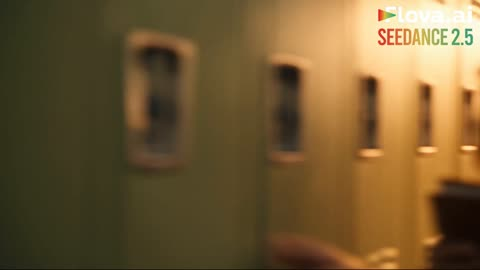</a>

提示词把60秒拆成两个连续镜头，每个节拍都写明时间码、运镜和台词。镜头之间用雨伞做匹配剪辑衔接，并用角色设定图和连续性规则锁定人物的脸和服装。

Seedance 2.5 · 参考生视频 · 出处: [@Caden_Flux on X](https://x.com/Caden_Flux/status/2089154775829074074) · 发现于 [LearnPrompt/awesome-seedance](https://github.com/LearnPrompt/awesome-seedance)

[`romance`](tags.md#tag-romance) [`school`](tags.md#tag-school) [`rain`](tags.md#tag-rain) [`dialogue`](tags.md#tag-dialogue) [`long-take`](tags.md#tag-long-take)

<details><summary><b>提示词</b></summary>

```text
Create a 60-second cinematic high-school first-love story using SEEDANCE 2.5.

IMPORTANT:
Generate the video as EXACTLY TWO CONTINUOUS SHOTS:
SHOT 1 = 0–30 seconds
SHOT 2 = 30–60 seconds
The two shots must connect seamlessly and feel like ONE continuous short film, not two unrelated clips.
FORMAT:
16:9 widescreen
Cinematic photorealism
Premium coming-of-age romance film
Fast-paced but emotionally natural
Smooth transitions and motivated camera movement
Realistic teenage body proportions and expressions
Natural English dialogue only
No subtitles unless dialogue is naturally spoken
No text overlays
No character redesign
CHARACTER CONSISTENCY — EXTREMELY IMPORTANT:
Use the provided character reference sheets for BOTH characters.

BOY:
Preserve exact face, hairstyle, clothing, body proportions, accessories and identity from the character sheet.

GIRL:
Preserve exact face, hairstyle, clothing, body proportions, accessories and identity from the character sheet.
Their faces, hairstyles and outfits must remain IDENTICAL throughout both shots.
The boy and girl are both 17–18-year-old high-school students. Keep the romance completely innocent, wholesome and age-appropriate.
VISUAL LANGUAGE:
Warm nostalgic coming-of-age movie aesthetic, realistic school environment, natural skin texture, subtle film grain, cinematic depth of field, soft lens bloom, realistic physics, natural hair movement, expressive eyes, believable teenage body language.
Use a dynamic combination of:
wide establishing shots,
medium tracking shots,
over-the-shoulder shots,
close-ups,
handheld intimate moments,
smooth push-ins,
whip-pan transitions,
shallow-focus inserts,
and brief slow-motion accents.
Avoid excessive slow motion. The pacing should feel energetic and modern.
━━━━━━━━━━━━━━━━━━━━
SHOT 1 — 0:00–0:30
“THE ROUTINE”
━━━━━━━━━━━━━━━━━━━━
0:00–0:03
OPEN on a cinematic wide shot of a lively high-school hallway immediately after the final bell.
Students rush past the camera.
The boy exits his classroom with his backpack over one shoulder.
He looks across the hallway.

The girl is already there.
Their eyes meet.

She gives him a tiny smile.
He smiles back.

CAMERA:
Fast lateral tracking shot through the crowd, then smoothly pushes toward the boy as he notices her.
0:03–0:07
She walks toward him.

He casually falls into step beside her.

GIRL:
“You're late.”

BOY:
“By two minutes.”
She laughs.

They continue walking.
CAMERA:
Smooth backward tracking shot in front of them as students pass naturally around them.
0:07–0:11
QUICK MONTAGE.
They sit together in class.
She steals one of his fries during lunch.
He looks offended.
She laughs.
He secretly smiles.
CUT TO:
Their notebooks side by side.
She draws a tiny smiley face in the margin of his notebook.

He notices.

CAMERA:
Fast close-up inserts and match cuts, keeping the rhythm playful and energetic.
0:11–0:15
They leave school together.
Golden afternoon light floods the corridor.
He holds the door open for her.

She playfully bumps his shoulder as she walks past.
He laughs.

CAMERA:
Low-angle tracking shot transitioning into a warm side-profile shot.

0:15–0:20
Outside school.

They walk down the sidewalk.

She talks animatedly while he listens.

A light breeze moves her hair.

He looks at her for a moment longer than he should.

She catches him staring.

GIRL:
“What?”
BOY:
“Nothing.”

She smiles knowingly.
CAMERA:
Over-the-shoulder close-up from behind her, revealing his shy smile.

0:20–0:25
The sky suddenly darkens.

First drops of rain hit the pavement.
She looks upward.

BOY:
“Uh-oh.”
She laughs and quickly pulls her cardigan closer.

The boy opens his small umbrella.

CAMERA:
Quick tilt from the darkening sky down to them.

0:25–0:30
They squeeze underneath the tiny umbrella together.
Their shoulders bump.

They laugh.
The camera slowly circles around them as they begin walking through the rain.

The boy looks at her.

She looks back.

A brief quiet moment.

MATCH CUT:
Camera passes behind the umbrella fabric.

Use the movement of the umbrella to create a seamless transition into SHOT 2.

━━━━━━━━━━━━━━━━━━━━
SHOT 2 — 0:30–1:00
“FIVE MORE MINUTES”
━━━━━━━━━━━━━━━━━━━━
IMPORTANT:
SHOT 2 begins from the EXACT SAME MOMENT as Shot 1 ends.

Same characters.
Same clothing.
Same umbrella.
Same rainy street.
Same lighting.
Same environment.

No visual reset.

0:30–0:35
Continue the walking shot.
They move through the rain beneath the tiny umbrella.

Their hands accidentally touch.
Both notice.

Neither pulls away immediately.

CAMERA:
Slow subtle push-in toward their hands, then rack focus to their faces.

0:35–0:40
They reach the girl's house.

She steps out from beneath the umbrella.

She turns toward him.
GIRL:
“See you tomorrow?”

BOY:
“Yeah.”
She starts walking toward her front door.

The boy watches her.

She takes a few steps.

0:40–0:44
He suddenly gathers courage.

BOY:
“Hey!”

She turns around.

CAMERA:
Quick handheld push toward the boy as he runs a few steps back toward her.
0:44–0:49
He smiles nervously.

BOY:
“Can I have five more minutes?”
She looks at him, amused.

GIRL:
“You already had an hour.”

He laughs.
BOY:
“I know.”

A small pause.
She smiles.

GIRL:
“Okay. Five more minutes.”

0:49–0:54
She steps back underneath the umbrella.

They begin walking together again.
The rain becomes softer.

The street lights begin glowing as evening approaches.

CAMERA:
Wide cinematic tracking shot from the front, slowly moving backward as they walk toward camera.

0:54–0:58
QUICK NOSTALGIC MONTAGE:
Their sneakers splashing through puddles.

Their hands almost touching.
Her laughing.

His nervous smile.

The tiny umbrella tilting as they walk closer together.

A final glance between them.

Use rhythmic match cuts synced to the emotional music.

0:58–1:00
FINAL WIDE SHOT.

The camera pulls slowly upward and backward.

The two teenagers walk away together beneath the tiny umbrella, becoming smaller against the glowing evening street.
The rain sparkles under the streetlights.

They continue talking and laughing as they disappear farther down the road.

FADE OUT.
FINAL EMOTIONAL FEELING:
First love.
Youth.
Nervous butterflies.
The feeling of not wanting the day to end.
Do NOT make the ending sad.
Do NOT introduce a breakup.
Do NOT introduce a twist.
Do NOT introduce additional characters who become romantically relevant.
The entire story should feel like one precious memory from the beginning of a first love.

━━━━━━━━━━━━━━━━━━━━
CAMERA & MOTION REQUIREMENTS
━━━━━━━━━━━━━━━━━━━━
Keep camera movement fluid and cinematic throughout.

Use motivated transitions rather than random cuts.
Mix fast-paced montage editing with slower intimate close-ups.
Prioritize:
• smooth tracking shots
• natural handheld movement
• cinematic push-ins
• over-the-shoulder compositions
• expressive close-ups
• realistic rack focus
• wide environmental shots
• subtle slow-motion only for emotional beats
Maintain realistic physics for:
rain,
umbrella movement,
hair,
clothing,
walking,
running,
hand gestures,
and interactions with the environment.
━━━━━━━━━━━━━━━━━━━━
AUDIO & DIALOGUE
━━━━━━━━━━━━━━━━━━━━
Natural English dialogue only.

Dialogue should sound spontaneous and age-appropriate.

Ambient sound:
school hallway chatter,
footsteps,
distant laughter,
birds,
city ambience,
rain,
umbrella fabric,
wet pavement.
Music:
soft modern coming-of-age instrumental soundtrack that gradually builds from playful and light to warm and emotional.

Music must never overpower dialogue.

━━━━━━━━━━━━━━━━━━━━
NEGATIVE PROMPT
━━━━━━━━━━━━━━━━━━━━

No character identity changes.
No face changes.
No hairstyle changes.
No outfit changes.
No age changes.
No adult appearance.
No sexualized content.
No exaggerated body proportions.
No random wardrobe changes.
No duplicated characters.
No extra limbs or fingers.
No distorted hands.
No unnatural walking.
No floating objects.
No impossible rain physics.
No inconsistent umbrella.
No teleporting.
No location jumps that break continuity.
No random camera cuts.
No excessive slow motion.
No cartoon appearance.
No anime style.
No plastic skin.
No overprocessed faces.
No text overlays.
No subtitles.
No logos.
No watermark.
No visual glitches.
No abrupt ending.

FINAL REQUIREMENT:
SEEDANCE 2.5 MUST PRIORITIZE CHARACTER CONSISTENCY, FACIAL IDENTITY, TEMPORAL CONTINUITY, NATURAL MOTION AND SEAMLESS TRANSITION BETWEEN THE TWO 30-SECOND SHOTS.

The final result should look like a polished 60-second scene from a premium cinematic coming-of-age romance film.
```

</details>

<a id="seedance-red-coat-grey-hooded-crowd-pullback"></a>
### 红色大衣女子立于灰色兜帽人群前

<a href="https://x.com/xIrissy/status/2100511965840109644">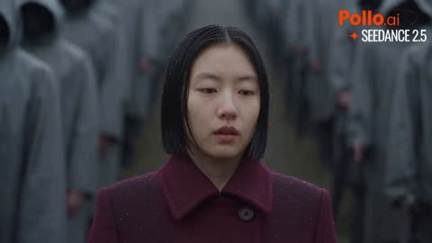</a>

用一个饱和色与灰度人群形成对比，让画面有即时的焦点。提示词让镜头逐渐拉远，直到人物缩小为混凝土空间中的一抹红色，为整段视频定下清晰的空间走向。

Seedance 2.5 · 文生视频 · 出处: [@xIrissy on X](https://x.com/xIrissy/status/2100511965840109644)

[`color-contrast`](tags.md#tag-color-contrast) [`camera-pull-back`](tags.md#tag-camera-pull-back) [`monochrome-crowd`](tags.md#tag-monochrome-crowd)

<details><summary><b>提示词</b></summary>

```text
One of a thousand, and the only one in colour. A single crimson coat walks the stairs while a sea of grey hoods holds its breath, then the umbrellas open in a wave. The camera keeps pulling back until she’s just a red thread in a concrete cathedral.
```

</details>

<a id="seedance-riverside-boat-physics-demo"></a>
### 女子在金色时刻踏上木船

<a href="https://x.com/Lianaalane/status/2090372863631225290">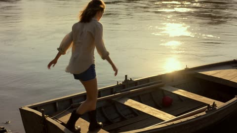</a>

提示词把15秒拆成按秒计时的分段，每段写明一个物理事件（行走、推船、落球、抛球、溅水）及其因果。同时要求质量、尺度和位置在整段视频中保持一致，避免物体漂移或穿模。

Seedance 2.5 · 文生视频 · 出处: [@Lianaalane on X](https://x.com/Lianaalane/status/2090372863631225290)

[`physics`](tags.md#tag-physics) [`timed-beats`](tags.md#tag-timed-beats) [`golden-hour`](tags.md#tag-golden-hour) [`river`](tags.md#tag-river)

<details><summary><b>提示词</b></summary>

```text
Create an ultra-realistic cinematic 15-second vertical 9:16 video demonstrating real-world physics through one continuous, believable sequence. Scene: a young woman walks along a riverside carrying a small ball and approaches a wooden boat floating near the shore during golden hour. From 0–3 seconds, she walks naturally toward the boat; her footsteps demonstrate gravity, weight, friction, balance, inertia, and realistic acceleration and deceleration. Loose hair and clothing react naturally to wind and air resistance. From 3–6 seconds, she gently pushes the boat into the water and steps inside. The boat moves backward as a realistic reaction to her push, demonstrating Newton’s third law and conservation of momentum. Her body shifts slightly because of inertia as the boat accelerates, while friction and water drag gradually reduce the boat’s motion. From 6–9 seconds, she drops the ball inside the boat; gravity causes it to fall with realistic acceleration, bounce once according to its elasticity and collision physics, and settle because of friction. From 9–12 seconds, she throws the ball forward; the ball follows a realistic curved trajectory under gravity and air resistance while the moving boat continues forward because of momentum. The ball lands on the water, creating a realistic splash, ripples, displacement, surface tension, buoyancy, and fluid-dynamic interaction. From 12–15 seconds, the boat continues gliding naturally, creating a realistic wake behind it as water resistance and drag gradually reduce its speed. Throughout the entire video, accurately simulate Newton’s three laws, gravity, inertia, momentum, conservation of momentum, conservation of energy, friction, acceleration, deceleration, collision forces, elasticity, mass, weight, air resistance, drag, buoyancy, pressure, surface tension, fluid dynamics, displacement, and realistic cause-and-effect interactions. Every movement must have believable physical consequences and correct timing. Objects must maintain consistent mass, scale, position, texture, and physical properties from frame to frame. Use realistic water reflections, shadows, wind movement, natural motion blur, physically accurate lighting, photorealistic materials, cinematic depth of field, smooth camera movement, and professional film quality. No impossible movement, no floating objects, no teleportation, no sudden unexplained acceleration, no object clipping, no distorted anatomy, no duplicated objects, and no violation of realistic physics. Total duration exactly 15 seconds.
```

</details>

<a id="seedance-schoolgirl-missing-key-mission"></a>
### 女学生在晨光教室里翻找课桌抽屉

<a href="https://x.com/Strength04_X/status/2099715492630122925">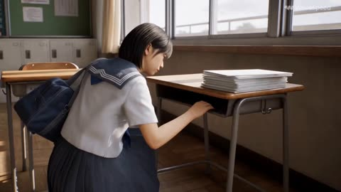</a>

按时间段（0到5秒、5到10秒等）分段描述动作，让30秒有清晰的节奏；用一条镜头规则并规定26秒前不切镜，保证跟拍连续。把人物外观和钥匙设计单独锁定，可防止整段视频中人物与道具走样。

Seedance 2.5 · 文生视频 · 出处: [@Strength04_X on X](https://x.com/Strength04_X/status/2099715492630122925) · 发现于 [LearnPrompt/awesome-seedance](https://github.com/LearnPrompt/awesome-seedance)

[`timed-beats`](tags.md#tag-timed-beats) [`single-take`](tags.md#tag-single-take) [`identity-lock`](tags.md#tag-identity-lock) [`japanese-school`](tags.md#tag-japanese-school)

<details><summary><b>提示词</b></summary>

```text
A missing key, a schoolgirl, and a full-on gameplay mission

Made with Seedance 2.5 on @wavespeed_ai 

Prompt - 30-Second Photorealistic AAA Gameplay

Create exactly 30 seconds of photorealistic 4K AAA third-person gameplay inside a realistic Japanese high school on a bright weekday morning. The sequence should feel like a spontaneous story mission with believable movement, natural NPC behavior, realistic physics, and uninterrupted environmental continuity.

CHARACTER:
20-year-old Japanese schoolgirl with medium-length straight black hair, subtle side bangs, natural youthful facial features, white short-sleeve school blouse, navy ribbon, dark grey pleated skirt, black knee-high socks, white indoor sneakers, and a dark blue shoulder school bag. Maintain identical face, hair, body proportions, clothing, footwear, and accessories from beginning to end.

OBJECT:
A small red classroom key attached to a simple wooden key tag. The key is fully physical, metallic, reflective, and consistently sized throughout the sequence.

0–5s — THE MISSING KEY

Inside an emptying classroom, she searches through a desk drawer and realizes the classroom key is missing. She notices the red key tag underneath a stack of worksheets near the window. She reaches for it, but a sudden gust from the open window pushes the worksheets across the desk and the key drops onto the floor.

HUD: FIND THE CLASSROOM KEY

5–10s — DOWN THE CORRIDOR

She picks up the key and leaves the classroom. A school announcement begins playing through the hallway speakers. She walks toward the main office while checking the key tag against a handwritten classroom number.

Students move naturally around her, some entering classrooms, others carrying books and sports bags.

10–15s — WRONG TURN

She reaches an intersection and realizes she has taken the wrong corridor. She stops beside a wall map of the school and studies it briefly.

A group of younger students rushes past carrying basketballs, causing her to step back against the wall. Once the corridor clears, she turns into a smaller connecting hallway.

15–20s — LOCKED DOOR

She reaches a shortcut door but finds it locked. She tries the handle once, then notices a stairwell beside it.

She takes the stairs down one level. Her shoes make realistic sounds against each step while sunlight flickers across the stairwell through the tall windows.

HUD: TAKE THE SHORTCUT

20–26s — LAST SECOND

She exits the stairwell and reaches the classroom wing just as a staff member begins closing a large sliding partition at the end of the corridor.

She quickly walks through the remaining opening before it closes, then reaches the classroom door.

She inserts the key into the lock, turns it naturally, opens the door, and steps inside.

HUD: ROOM UNLOCKED

26–30s — HARD CUT

Hard cut to a fixed frontal classroom shot.

She places the key on the teacher's desk, removes her school bag, and sits down at her usual seat.

The teacher enters a moment later, notices the unlocked room, and gives her a brief approving look.

She quietly opens her notebook as the morning lesson begins.

HUD: MISSION COMPLETE

CAMERA:
Use one grounded third-person camera from 0–26s positioned behind and slightly beside the girl. Maintain natural gameplay-style tracking with realistic camera inertia and subtle operator movement.

The camera must physically follow the character through classrooms, corridors, stairwell, and doorway. No floating camera, no orbiting shots, no sudden perspective changes, no impossible tracking, and no cuts during the first 26 seconds.

At exactly 26 seconds, perform one hard cut to the fixed frontal classroom angle.

AUDIO:
Natural Japanese school ambience: distant student conversations, footsteps, sliding classroom doors, papers moving, school announcements over speakers, stairway echoes, basketballs bouncing in the distance, door handles, key movement inside the lock, fabric movement, subtle breathing, and morning classroom sounds.

No dramatic music or action soundtrack.

REALISM LOCK:
Natural student behavior, realistic walking speed, accurate body mechanics, believable collisions, physically correct key movement, realistic wind interaction with paper, authentic Japanese school architecture, varied background activity, natural morning lighting, realistic shadows and reflections, detailed skin and hair, physically based materials, and cinematic AAA game rendering.

No teleporting, supernatural abilities, impossible shortcuts, parkour, combat, duplicated characters, disappearing objects, changing identity, changing outfit, changing key design, unrealistic physics, exaggerated acting, anime or cartoon style, plastic CGI appearance, floating camera, subtitles, logos, watermarks, or additional cuts.
```

</details>

<a id="seedance-schoolgirl-stands-before-tanks"></a>
### 女学生独自站在高速公路上面对坦克

<a href="https://x.com/itsSaira_1/status/2101205826895827053">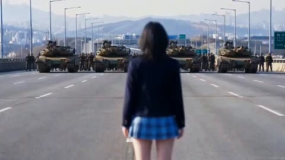</a>

全局连续性段落锁定人物、服装和环境，随后每个定时分镜都从上一镜的末帧开始，保证剪切衔接一致。负面提示词排除了倒放和消失的物体，使飞来的炮弹始终保持向前的运动方向。

Seedance 2.5 · 文生视频 · 出处: [@itsSaira_1 on X](https://x.com/itsSaira_1/status/2101205826895827053) · 发现于 [LearnPrompt/awesome-seedance](https://github.com/LearnPrompt/awesome-seedance)

[`continuity`](tags.md#tag-continuity) [`timed-scenes`](tags.md#tag-timed-scenes) [`dark-fantasy`](tags.md#tag-dark-fantasy) [`multi-shot`](tags.md#tag-multi-shot)

<details><summary><b>提示词</b></summary>

```text
GLOBAL CONTINUITY: Photorealistic cinematic 16:9. Keep the EXACT same schoolgirl, identical face, black bob haircut, navy school uniform, red ribbon, blue plaid skirt, same highway, mountains, skyline, lighting and visual style. Every scene must directly continue from the previous scene using the exact previous last frame as the next Start/Reference Frame. No changes in identity, clothing, environment, direction, scale or lighting.

SCENE 1 — 0:00–0:02.5
Girl stands exactly in the center of a huge highway, facing distant military tanks. Wide cinematic shot, mountains and city skyline behind them.

SCENE 2 — 0:02.5–0:04.5
The same tanks fire toward the girl. Powerful muzzle flashes, smoke and realistic military details. Camera moves slightly alongside the tanks.

SCENE 3 — 0:04.5–0:07
Cut to the exact same girl, standing calmly and facing the camera. Slow cinematic push-in toward her face.

SCENE 4 — 0:07–0:09.5
Multiple tank shells rapidly fly toward and around the girl. She remains completely still. Projectiles must keep their forward direction and never disappear or reverse.

SCENE 5 — 0:09.5–0:11.5
The girl's eyes glow neon green. She raises one hand and creates powerful green energy around her hand and body.

SCENE 6 — 0:11.5–0:14
A massive explosion erupts on the highway around the attacking forces. Huge fire, smoke, dust and debris.

SCENE 7 — 0:14–0:16.5
Low tracking shot of the same military tanks aggressively moving forward. Realistic tracks, armor, weight, dust and smoke.

SCENE 8 — 0:16.5–0:19
Multiple tanks suddenly rise and float above the highway under a powerful supernatural force. Same environment and daylight.

SCENE 9 — 0:19–0:21.5
The floating tanks violently explode in mid-air. Large fireballs, smoke, metal fragments and debris fall downward.

SCENE 10 — 0:21.5–0:24
A gigantic explosion completely fills the center of the highway with fire, smoke and debris. Wide cinematic shot.

SCENE 11 — 0:24–0:26
Cut back to the EXACT same girl, unchanged and unharmed, standing calmly in the center of the now-empty highway. Slow push-in.

SCENE 12 — 0:26–0:27.5
Camera moves behind the girl as she calmly walks forward down the highway. End with a wide cinematic shot of her walking toward the distant mountains.

NEGATIVE: No character change, face change, hairstyle change, outfit change, age change, background change, lighting change, weather change, duplicated character, distorted face, deformed hands, extra fingers, disappearing objects, reversed movement, U-turns, camera flips, inconsistent tanks, unrealistic physics, text, subtitles, logos, watermark, UI or continuity errors.

#Ai #darkfantisy #visaul #AIart️️️️️️️️️️️️️️️️️️️️️️️️️️️️️️️️️️️️️️️️️️️️️️️️️️️ #visualstorytelling #seedance25
@Flovaai @itsPolloAI
```

</details>

<a id="seedance-seoul-alarm-morning-glam-editorial"></a>
### 女子被闹钟叫醒，床边摆满护肤品

<a href="https://x.com/AIwithkhan/status/2113244959990329635"></a>

每个镜头都写明景别、焦段和运镜，并附一条音效提示，为每个剪辑点提供清晰的分镜计划。开头的 STYLE 段统一设定画风，适用于全部镜头。

Seedance 2.5 · 文生视频 · 出处: [@AIwithkhan on X](https://x.com/AIwithkhan/status/2113244959990329635) · 发现于 [LearnPrompt/awesome-seedance](https://github.com/LearnPrompt/awesome-seedance)

[`k-fashion`](tags.md#tag-k-fashion) [`seoul`](tags.md#tag-seoul) [`beauty`](tags.md#tag-beauty) [`multi-shot`](tags.md#tag-multi-shot)

<details><summary><b>提示词</b></summary>

```text
STYLE: Hyper-realistic cinematic K-fashion editorial, Seoul street aesthetic, confident baddie energy, dynamic camera transitions, natural skin texture, glossy highlights, premium music-video cinematography, 4K, 

SHOT 1: ECU, 85mm push-in / Close-up of a smartphone alarm vibrating beside a Korean girl with long, silky black hair, flawless glam makeup, and glossy lips, sleeping in a fitted crop top and shorts. She opens her eyes and gives the camera a confident, unbothered stare / SFX: alarm buzz, bedsheet rustle.

SHOT 2: WS, 35mm handheld / She sits up, stretches casually, tosses her hair back, and swings her legs off the bed. Morning sunlight illuminates her stylish bedroom, full of Korean beauty products and fashion accessories / SFX: mattress bounce, fabric rustle.

SHOT 3: MCU, 50mm mirror slide / She washes her face, applies skincare, and studies her reflection before beginning her beauty routine. Water droplets catch the bathroom lighting / SFX: faucet rush, skincare bottle clicks.

SHOT 4: ECU, 85mm macro / Match cuts of her applying eyeliner, shaping her brows, adding glossy lip tint, and placing delicate silver earrings. Every movement is precise and confident / SFX: makeup brush swishes, cosmetic cap clicks.

SHOT 5: Bird's-eye, 35mm overhead / Her wardrobe opens to reveal trendy streetwear. She selects a fitted black top, a cropped leather jacket, a pleated mini skirt, knee-high boots, and a designer-style shoulder bag / SFX: hanger clinks, fabric movement, zipper pull.

SHOT 6: MCU, 50mm push-in / She completes her outfit, adjusts her jacket, puts on sunglasses, and gives herself a final look in the mirror. A subtle smirk reveals her confident attitude / SFX: heel click, jewelry jingle.

SHOT 7: WS, 24mm low-angle tracking / She walks through a stylish Seoul apartment corridor with effortless confidence, boots striking the floor as the camera tracks backward / SFX: rhythmic footsteps, door latch.

SHOT 8: MS, 35mm gimbal tracking / Whip-pan transition to the streets of Gangnam. She walks past fashionable boutiques, glowing Korean signs, and sleek storefronts while pedestrians blur behind her / SFX: city ambience, traffic, footsteps.

SHOT 9: MCU, 85mm slow-motion push-in / She removes her sunglasses, looks directly into the camera, and brushes her hair over one shoulder. Neon reflections shimmer across her glossy lips and jewelry / SFX: subtle whoosh, street ambience.

SHOT 10: MS, 35mm handheld / She enters a trendy Korean café, orders an iced Americano, and casually checks her phone while leaning against the counter / SFX: café chatter, espresso machine, ice clinking.

SHOT 11: Insert, 50mm macro / Close-up of manicured fingers holding an iced coffee cup, condensation sliding down the glass, followed by a stylish mirror selfie with her entire outfit visible / SFX: ice rattling, phone camera click.

SHOT 12: WS, 24mm cinematic tracking / She steps into a luxury shopping district, passing glass storefronts and fashionable pedestrians. The camera follows her confident walk with smooth lateral movement and strong foreground parallax / SFX: heels clicking, distant traffic.

SHOT 13: MCU, 50mm snap zoom / She stops at a crosswalk, lowers her sunglasses slightly, and gives the camera a playful, intimidating stare before the pedestrian signal changes / SFX: crosswalk beep, traffic passing.

SHOT 14: WS, 35mm orbit / Golden-hour rooftop scene overlooking Seoul. She poses against the skyline, jacket moving gently in the breeze, then turns toward the camera with a confident half-smile / SFX: rooftop wind, distant city ambience.

SHOT 15 ECU to WS, 85mm pull-out / Final beauty close-up of her eyes, glossy lips, and flawless makeup. She puts her sunglasses back on and walks away as the camera slowly pulls back, revealing the glowing Seoul skyline behind her / SFX: bass hit, heels fading, cinematic music ending.
```

</details>

<a id="seedance-seoul-five-scene-lifestyle"></a>
### 从公寓到韩屋小巷的五段首尔场景

<a href="https://x.com/Zoyavelle/status/2101893707897381209">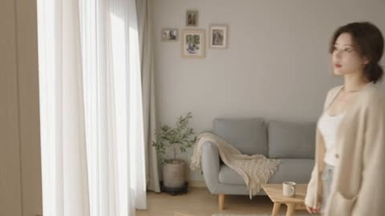</a>

编号的场景段落在每个镜头中重复同一位女主角的详细外貌描述，让她在切换中保持同一个人的样子。35mm 镜头、浅景深和逆光的黄金时段光线设定了电影质感。

Seedance 2.5 · 文生视频 · 出处: [@Zoyavelle on X](https://x.com/Zoyavelle/status/2101893707897381209) · 发现于 [LearnPrompt/awesome-seedance](https://github.com/LearnPrompt/awesome-seedance)

[`seoul`](tags.md#tag-seoul) [`lifestyle`](tags.md#tag-lifestyle) [`multi-scene`](tags.md#tag-multi-scene) [`photorealistic`](tags.md#tag-photorealistic)

<details><summary><b>提示词</b></summary>

```text
Cinematic photorealistic lifestyle video of a beautiful young Korean woman with long dark brown hair, natural makeup and delicate facial features, living an elegant everyday life in Seoul. Scene 1: she is inside a cozy modern apartment with warm beige tones, large floor-to-ceiling windows with soft white curtains, gray sofa, wooden coffee table and indoor plants. She wears a cream cardigan over a white camisole and casually walks through the room while holding a coffee mug. Scene 2: she walks alone through a quiet narrow Seoul residential street surrounded by traditional Korean and modern brick buildings, utility poles and parked cars, natural daylight, realistic urban atmosphere. Scene 3: she enters an underground subway entrance through a glass-covered stairway. Scene 4: she sits at an office desk wearing an elegant beige blazer and white blouse, working naturally on a computer beside a takeaway coffee, bright modern office with large windows. Scene 5: she walks through a beautiful traditional Korean hanok alley at golden hour, wearing a light beige/cream dress, holding a cup, warm sunlight shining directly behind her, traditional wooden houses and hanging lanterns, soft lens flare. Natural human movements, subtle expressions, realistic hair and clothing motion, cinematic composition, shallow depth of field, soft natural lighting, realistic skin texture, professional DSLR cinematography, 35mm lens, smooth camera movement, atmospheric, high detail, photorealistic, film look, 4K.
```

</details>

<a id="seedance-shower-towel-doorbell-delivery-comedy"></a>
### 男子冲出淋浴间跑去应门取快递

<a href="https://x.com/AIwithZeeshi/status/2107317166995546481"></a>

提示词把笑点拆成清晰的节拍：通知、门铃、奔跑、错过快递员、无奈表情。结尾用一串物理描述约束水、重力、湿织物和阴影，并保证角色一致和跟拍镜头平滑。

Seedance 2.5 · 文生视频 · 出处: [@AIwithZeeshi on X](https://x.com/AIwithZeeshi/status/2107317166995546481) · 发现于 [LearnPrompt/awesome-seedance](https://github.com/LearnPrompt/awesome-seedance)

[`comedy`](tags.md#tag-comedy) [`photorealistic`](tags.md#tag-photorealistic) [`tracking-shot`](tags.md#tag-tracking-shot) [`physics`](tags.md#tag-physics) [`storytelling`](tags.md#tag-storytelling)

<details><summary><b>提示词</b></summary>

```text
A young man is taking a normal shower in a modern apartment when his phone suddenly shows a delivery notification.

He hears the doorbell and quickly turns off the shower, grabs a towel, and rushes toward the entrance. His wet feet leave small realistic footprints as he carefully runs across the floor.

He finally opens the door, but the delivery driver is already walking away. The package is sitting safely on the doormat.

He looks at the package, then at the driver, completely exhausted.

Photorealistic cinematic comedy, realistic water behavior, natural human movement, believable gravity and friction, consistent character appearance, realistic wet hair and fabric, natural facial expressions, smooth camera tracking, accurate shadows, realistic apartment lighting, and physically believable interactions throughout.
```

</details>

<a id="seedance-singing-walk-hydrant-suit-morph"></a>
### 唱歌的男人走过消防栓，西装连续变换

<a href="https://x.com/techhalla/status/2094570657929363710">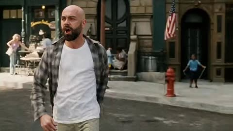</a>

参考图被锁定为首帧并写明身份保持规则，镜头全程为一条连续跟拍且不切换。分段时间节点和现场声音描述决定了各个桥段，服装变化写成一次连续变形，因此无需剪切。

Seedance 2.5 · 图生视频 · 出处: [@techhalla on X](https://x.com/techhalla/status/2094570657929363710) · 发现于 [LearnPrompt/awesome-seedance](https://github.com/LearnPrompt/awesome-seedance)

[`tracking-shot`](tags.md#tag-tracking-shot) [`reference-lock`](tags.md#tag-reference-lock) [`comedy`](tags.md#tag-comedy) [`diegetic-audio`](tags.md#tag-diegetic-audio)

<details><summary><b>提示词</b></summary>

```text
A 2000s studio-comedy film shot, 16:9, 35mm, moderate film grain, bright American daylight, tracking camera at chest height following a man along a city sidewalk. Smooth dolly/track with him, no handheld phone, no gimbal whip, no drone, no cuts. The camera stays with him the whole 30 seconds, medium-wide, the street readable behind him.

IMAGE REFERENCES

[image_ref] is the opening frame AND the identity lock: the bald man with the thick dark beard, open grey plaid flannel over a white t-shirt, mid-stride on this exact sunlit sidewalk. Keep his exact face, bald scalp, beard, body. Keep this street: Sherman Brothers shop, cafe table, stone steps and arched doorway, red fire hydrant, American flag, storefronts. Start on this composition, then the camera travels with him down the block. Do not redesign his face.

He sings out loud, diegetic, the lyrics "I've got the power" in a loud off-key enthusiastic voice, the whole walk. No extra score under it. Street air, footsteps, then the gags.

TIMELINE

0-4s: [Tracking medium-wide, opening on image_1] He is already walking, already singing, mouth wide, chest out, a little strut. The camera slides with him. Daylight, grain. He is having the time of his life.

4-8s: [Tracking, he twists his torso toward the hydrant without stopping] He points two fingers at the red fire hydrant on the sidewalk. The hydrant cap blows and three hard jets of water blast out in different directions, high, violent, real water physics, mist in the sun. He keeps walking and singing, does not look back for long. Camera stays on him, hydrant geysers in the background.

8-13s: [Tracking, still singing] He keeps the strut. Water still arcing behind him. Pedestrians flinch at the spray. He grins, points at the sky on a lyric, never breaks stride.

13-18s: [Tracking as he passes a woman coming the other way] A woman in a knee-length dress walks toward him. As they cross, a sudden gust hits only her: the hem lifts a little, Marilyn sidewalk-vent style but modest, a brief flip then it drops. She grabs the fabric, startled. He keeps walking, still singing, a tiny glance, no contact. Camera never leaves him.

18-23s: [Tracking slows as he reaches a shop window] He stops in front of a big storefront glass, still humming. Leans in. We see him and his reflection clearly: bald head, beard, plaid, white tee. He studies himself, tilts his chin.

23-28s: [Held on him and the reflection] In the glass and on his body at the same time, the clothes change in one continuous morph: the flannel and tee become a sharp white open-collar suit, jacket, tailored trousers, a gold chain. No cut, no flash, the fabric rewrites itself. He checks the new look in the window, pleased, shoulders back.

28-30s: [Medium, still on him] He licks the tip of his index finger, taps it to his hip, and a little puff of white steam hisses off the fabric like a hot iron being quenched. He mouths the last "power," smug. Clip ends on that beat. Camera never cut.

AUDIO

His live singing of "I've got the power" the whole way, a bit pitchy, full of himself. Hydrant blast and falling water. Dress flutter. A soft whoosh on the clothes change. A tiny sizzle and steam hiss on the hip. City air, footsteps, one woman gasp. No extra music bed. No commentator. 2000s film production sound, not a phone video.

STYLE & QUALITY

Looks like a real early-2000s movie production still that started moving: 35mm grain, anamorphic-adjacent daylight, stable faces, real water, real wind on fabric, real cloth morph, real steam. Continuous take. No morphing of the face, no extra people popping in, no text, no logos, no watermark, no phone look, no CGI sheen.

The ref image is exactly the first frame. Enjoy! 😎
```

</details>

<a id="seedance-sleeper-train-infection-outbreak"></a>
### 发烧的女子在卧铺火车上感染

<a href="https://x.com/AIwithSynthia/status/2100803982197502368">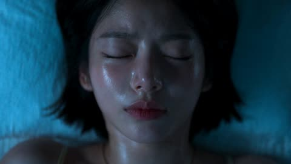</a>

开头的锁定指令要求保持脸部、发型、奶金色连衣裙、纹身和项链不变，让人物身份贯穿所有镜头。随后按时间顺序写出感染的节拍，结尾切到外景远景，并用手持镜头、实拍特效和无背景音乐等指令控制质感。

Seedance 2.5 · 图生视频 · 出处: [@AIwithSynthia on X](https://x.com/AIwithSynthia/status/2100803982197502368) · 发现于 [LearnPrompt/awesome-seedance](https://github.com/LearnPrompt/awesome-seedance)

[`zombie-horror`](tags.md#tag-zombie-horror) [`character-lock`](tags.md#tag-character-lock) [`handheld`](tags.md#tag-handheld) [`night-train`](tags.md#tag-night-train)

<details><summary><b>提示词</b></summary>

```text
Preserve the exact face, hairstyle, golden-cream dress, tattoos, necklace, and overall appearance. She lies feverish and restless in the upper bunk of a dark sleeper train, slowly waking as her fingers tremble and dark veins appear. Her eyes turn cloudy white, her expression becomes unnaturally blank, and a dark drop falls onto the passenger below. She suddenly leans over, drops onto the lower bunk, and attacks the sleeping passenger non-graphically. Dark veins spread across him as he convulses, his eyes turn white, and he releases an inhuman scream.

The infected passenger rushes into the corridor, awakening others and triggering chaos throughout the carriage. Curtains fly open, luggage falls, passengers scramble to escape, and more people become infected. A conductor grabs a fire extinguisher and blasts the approaching infected with white foam, giving survivors time to reach the connecting door. They slam it shut and barricade it with luggage and a fold-down seat as infected hands pound against the glass. Cracks begin spreading while terrified passengers retreat.

End with survivors huddled together beneath flashing red emergency lights, protecting two children as the sealed door violently shakes behind them. Cut to an exterior wide shot of the train speeding through the dark countryside, sleeper-car windows flickering with red emergency light and chaotic silhouettes inside. Ultra-realistic cinematic zombie horror, authentic sleeper-train interior, blue night lighting, red emergency lights, realistic characters, handheld camera during chaos, practical effects, atmospheric shadows, tense sound design, no background music, no excessive gore, no subtitles, no watermark, no anime or cartoon style.
```

</details>

<a id="seedance-snowy-upper-west-side-couple-walk"></a>
### 情侣在雪夜的上西区街头漫步

<a href="https://x.com/ZaraIrahh/status/2119293619282567471">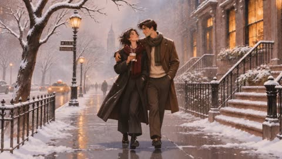</a>

提示词先用角色设定图和场景参考图锁定两人的外观，再按镜头逐条写明运镜、动作和声音。持续运动与围巾位置等固定规则，让各个切镜之间的人物造型和色调保持一致。

Seedance 2.5 · 参考生视频 · 出处: [@ZaraIrahh on X](https://x.com/ZaraIrahh/status/2119293619282567471) · 发现于 [LearnPrompt/awesome-seedance](https://github.com/LearnPrompt/awesome-seedance)

[`romance`](tags.md#tag-romance) [`winter`](tags.md#tag-winter) [`multi-shot`](tags.md#tag-multi-shot) [`character-lock`](tags.md#tag-character-lock)

<details><summary><b>提示词</b></summary>

```text
AUDIO RULE: Natural sound only. No music, no score, no voiceover, no dialogue. Ambient winter city sound and foley only.

MOTION RULE: Continuous movement in every shot. The couple never stop, freeze or hold a pose, and the camera is always moving. Every romantic moment happens while they walk, spin or run.

STYLE: Hand-painted illustrated look, matching the location reference: soft painterly brush texture, warm amber lamplight against cool lavender-gray snow haze. Same color grade in every shot.

CHARACTER LOCK: <<<image_1>>>  is a single character sheet showing two people. The TOP ROW is the woman and the BOTTOM ROW is the man. Match both exactly in every shot.
The woman (top row): messy curly dark-brown hair in a loose updo with loose strands, freckles, small gold hoop earrings. Long dark brown textured wool coat, white collared shirt, charcoal wide-leg trousers, black leather belt, black lace-up boots. She also wears a burgundy fringed wool scarf, as in the location image. She carries a paper cup of tea with the tea-bag tag hanging out.
The man (bottom row): tall, tousled wavy dark-brown hair, freckles. Long brown herringbone tweed coat, olive-green fringed scarf, cream cable-knit sweater, dark brown trousers, dark leather boots.
SCARF LOCK: His olive scarf stays on his neck and her burgundy scarf stays on hers in every shot. Scarves never move between people.
Faces, hair, outfits, heights and proportions never change between shots. They look at each other with deep affection and never look at the camera.

LOCATION: <<<image_2>>> , snowy Upper West Side at dusk. Gas-style street lamps, snow-covered trees, black iron fences, brownstones with warm lit windows and snowy stoops, a street sign reading "W 73 St / Broadway", a yellow taxi, the Empire State Building glowing in the haze. Soft snow falls throughout.

SHOT 1 (0:00-0:03)
Camera: Wide tracking shot gliding backward ahead of them down the snowy sidewalk, lamps streaking past.
Action: They walk toward us, his arm around her shoulders, her tea steaming. She leans her head against him while they walk, and he kisses the top of her head without breaking stride. Snow swirls through the lamplight and a yellow taxi slides by behind them.
Sound: Crunching, slushy footsteps, a muffled tire hiss, a soft contented sigh, gentle wind.

HARD CUT

SHOT 2 (0:03-0:06)
Camera: Medium shot, smooth handheld tracking sideways at walking pace, shallow depth of field.
Action: Still walking, he opens the front of his coat and pulls her in against his side, wrapping the coat around her shoulder. His olive scarf stays on his neck and her burgundy scarf stays on hers. She laughs, looks up at him, and catches a snowflake on her tongue. He grins and tucks a loose curl behind her ear as they keep moving.
Sound: Her bright laugh, wool rustling, quick footsteps, snow hush.

HARD CUT

SHOT 3 (0:06-0:09)
Camera: Low tracking shot at hip height, following their hands and the cup as they move, warm window lights streaming past.
Action: They swing their linked hands as they walk. She lifts the steaming cup to his lips and he sips, smiling at her. Snowflakes melt on his knuckles and her burgundy scarf fringe while the tea-bag tag sways.
Sound: Cup crinkle, a quiet sip, playful breath, soft footsteps, a car passing.

HARD CUT

SHOT 4 (0:09-0:12)
Camera: Fast but smooth circling orbit around them, snow flying through the foreground.
Action: He lifts her hand and spins her under his arm. Her coat flares and her curls swing as she twirls, laughing. She spins back into him and they keep moving in a flowing walking waltz down the sidewalk, foreheads close, eyes locked.
Sound: Coat swish, her delighted laugh, quick light footsteps in snow, a distant bell.

HARD CUT

SHOT 5 (0:12-0:15)
Camera: Sweeping crane move that begins close and rises into a wide pull-back, following them up the avenue with the Empire State Building glowing in the haze.
Action: Hand in hand, they run a few joyful steps through the falling snow, then he pulls her in and they kiss mid-stride, still moving, her scarf fringe flying. They keep walking away up the avenue, arms around each other, leaving two sets of footprints as the flakes thicken.
Sound: Quick crunching footsteps, a happy laugh, coat rustle, fading into the hush of falling snow.

AVOID: music, dialogue, text overlays, still poses, freeze frames, camera looks, face or hairstyle drift, swapping the two characters' outfits, scarves moving between people, any change to coats, scarves, earrings or boots between shots, photorealistic style.
```

</details>

<a id="seedance-suburban-outbreak-neighbors-fight-back"></a>
### 郊区街道突发感染与邻居奋起反击

<a href="https://x.com/auqibhabib/status/2107346452494381298">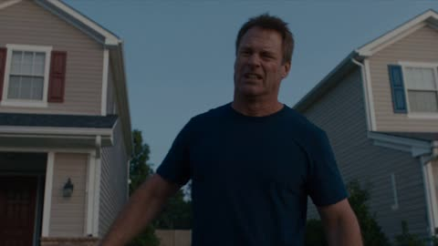</a>

30秒内每秒一个分镜节拍，从突袭到解脱，叙事弧线清晰。慢动作只留给最后的击倒，镜头晃动仅用于撞击，并在开头就写明现场音效和紧张配乐。

Seedance 2.5 · 文生视频 · 出处: [@auqibhabib on X](https://x.com/auqibhabib/status/2107346452494381298) · 发现于 [LearnPrompt/awesome-seedance](https://github.com/LearnPrompt/awesome-seedance)

[`horror`](tags.md#tag-horror) [`action`](tags.md#tag-action) [`suburban`](tags.md#tag-suburban) [`slow-motion`](tags.md#tag-slow-motion) [`diegetic-sound`](tags.md#tag-diegetic-sound)

<details><summary><b>提示词</b></summary>

```text
Cinematic horror-action short film, opens with an instant attack, no slow build, grounded practical-effects style, maximum dynamic camera work. Setting: a quiet suburban street at dusk, a small group of neighbors gathered outside their homes. Muted authentic color grading, natural diegetic sound throughout, tension score entering immediately.
>
> **[0-1s]** Hard cut: a man stumbles out from between two houses, collapsing onto the street, convulsing violently.
>
> **[1-2s]** Nearby neighbors rush toward him to help, unaware of the danger.
>
> **[2-3s]** He suddenly lunges up, grabbing the nearest person by the arm.
>
> **[3-4s]** She screams, pulling back as his grip holds firm, veins darkening rapidly across his skin.
>
> **[4-5s]** He pulls her down, the group scattering in fear and confusion.
>
> **[5-6s]** She convulses hard on the pavement, veins spreading fast across her neck.
>
> **[6-7s]** She rises seconds later, eyes clouded, joining him, both turning toward the others.
>
> **[7-8s]** Loud cries of fear erupt through the street as neighbors scramble for their homes.
>
> **[8-9s]** The two infected move fast, catching a third neighbor near his front gate.
>
> **[9-10s]** He goes down, convulsing, rising moments later as one of them.
>
> **[10-11s]** Wide shot: panic spreads further down the street, people slamming doors and windows shut.
>
> **[11-12s]** A man grabs a baseball bat from his garage, stepping out cautiously.
>
> **[12-13s]** The three infected turn toward him, moving fast across the street.
>
> **[13-14s]** He swings hard at the first, a solid impact knocking it back into a parked car.
>
> **[14-15s]** A neighbor joins him, grabbing a shovel from a nearby yard.
>
> **[15-16s]** SLOW MOTION insert: she swings it into the second infected, striking it down.
>
> **[16-17s]** The third lunges at the man with the bat; he sidesteps and strikes again.
>
> **[17-18s]** It staggers, falling against a mailbox, still trying to rise.
>
> **[18-19s]** More neighbors emerge cautiously, grabbing garden tools and makeshift weapons.
>
> **[19-20s]** They surround the remaining infected, striking together in a coordinated effort.
>
> **[20-21s]** SLOW MOTION: the final blow connects, all three collapsing motionless on the street.
>
> **[21-23s]** Wide shot: the group stands over them, breathing hard, weapons still raised.
>
> **[23-25s]** Cries of fear slowly settle into exhausted relief among the neighbors.
>
> **[25-27s]** The man with the bat lowers it slowly, scanning the quiet street for any more movement.
>
> **[27-29s]** Neighbors check on each other, some embracing, others sitting down on the curb in shock.
>
> **[29-30s]** Final shot: the street falls silent under the dusk sky, the group standing together, exhausted but safe. Cut to black.
>
> Natural diegetic sound throughout — convulsing, screaming, crying, metal impacts, heavy breathing — layered with a tense instrumental score building through the chaos and easing into relief at the end. No text overlay, no watermark. Maximum dynamic camera variety — close-ups, wide shots, tracking shots, slow motion reserved for the final takedowns. Realistic shake only during physical impacts, natural dusk color grading.

Made with seedance 2.5 on @SocialSight
```

</details>

<a id="seedance-subway-platform-polka-dot-fashion-film"></a>
### 金发模特在地铁站台的波点裙造型

<a href="https://x.com/Just_sharon7/status/2103032789910401038">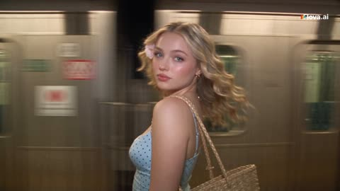</a>

参考图锁定每个镜头中同一人物的面部、发花和裙装，提示词按顺序列出各个镜头及对应的机位风格。火车强烈的动态模糊在人物身后营造动感，同时保证人物清晰可辨。

Seedance 2.5 · 参考生视频 · 出处: [@Just_sharon7 on X](https://x.com/Just_sharon7/status/2103032789910401038) · 发现于 [LearnPrompt/awesome-seedance](https://github.com/LearnPrompt/awesome-seedance)

[`fashion-film`](tags.md#tag-fashion-film) [`subway`](tags.md#tag-subway) [`night-city`](tags.md#tag-night-city) [`character-lock`](tags.md#tag-character-lock)

<details><summary><b>提示词</b></summary>

```text
Photoreal cinematic ~9 seconds, high-end fashion-film look. A young woman with long wavy blonde hair, olive-tan skin, sharp brows, and glossy lips. A pale pink flower is pinned behind her right ear. She wears a light blue spaghetti-strap mini dress with small black polka dots and carries a woven straw shoulder bag. Soft glam makeup, gold jewelry, warm skin highlights. Location: underground subway platform at night. Yellow safety strip on the platform edge, tiled walls, overhead fluorescent lights. A silver metro train streaks behind her in heavy motion blur — windows, doors, and at one moment an Japanese flag graphic on the passing car. Shot sequence, continuous energy: Medium close-up, she looks over her shoulder into camera while the train screams past behind her. Profile: she brings a lip wand or finger to her mouth, applying gloss as hair lifts in the train wind. She turns, hair swinging, eyes on camera, slight smirk. Wider on the platform: she touches her collarbone / strap, dress and bag readable, train still moving in the background. Head tipped back, hair flying, chin up, train with the flag ripping through frame. She looks back and smiles. Fast hair flip — hand rakes through hair, back partly to camera. Tight close-up: she blows a kiss to lens, fingers near lips, flower still in hair. Camera: mixed handheld fashion-cam and locked beauty close-ups. Shallow depth of field on her face, background train smeared into silver-and-light streaks. Practical station lighting plus a warm key on her skin. Color: creamy highlights, rich dark hair, the pink flower and red lips pop against cool subway metal. Motion: hair and dress always moving from train rush / her own turns. No extra people in focus. Mood: confident, flirty, summer-night city girl, music-video energy. Audio direction: upbeat dance-pop / Latin-pop, lyrics in the vein of “she got that vibe… dance all night… eyes on me.” Train rumble low under the track. Style keywords: photoreal fashion film, subway platform, motion-blur train, polka-dot sundress, pink hair flower, straw bag, glossy lips, hair flip, blow kiss, shallow focus, night metro lighting, 4K, no text overlay. Character lock (use with the reference still): Same woman 📷dp.jpg as the daylight field photo: long blonde center-parted waves, pink flower over the right ear, light blue black-polka-dot sundress, woven bag, warm skin, full lips. Keep identity consistent across every shot. #flovacpp
```

</details>

<a id="seedance-sweltering-gym-duo-workout"></a>
### 两名女性在酷热健身房训练

<a href="https://x.com/noorlewisx/status/2094279439718953086">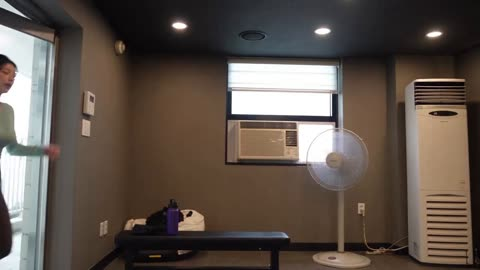</a>

提示词用具体道具清单（史密斯机、蓝色瑜伽垫、落地扇、窗式空调）固定场景，并按深蹲、补水、平板支撑的顺序排列动作。写明特写插入镜头，让模型有可循的镜头顺序。

Seedance 2.5 · 文生视频 · 出处: [@noorlewisx on X](https://x.com/noorlewisx/status/2094279439718953086) · 发现于 [LearnPrompt/awesome-seedance](https://github.com/LearnPrompt/awesome-seedance)

[`fitness`](tags.md#tag-fitness) [`indoor`](tags.md#tag-indoor) [`photorealistic`](tags.md#tag-photorealistic) [`multi-shot`](tags.md#tag-multi-shot)

<details><summary><b>提示词</b></summary>

```text
Two young attractive East Asian women working out together in a small indoor gym on a very hot day, AC is broken, room is steaming. Both wearing matching tight mint green long-sleeve crop tops that are completely soaked with sweat and clinging to their bodies, one wearing tight brown/grey high-waist leggings, the other wearing light grey sweatpants. Long dark hair tied in high ponytails, faces and necks glistening with sweat, wet hair sticking to skin. They are doing barbell squats on a Smith machine, intense strained expressions, sweat dripping from hands onto the knurled bar. Then they take a water break, drinking from plastic water bottles, water dripping down their chins and chests. After that they do forearm planks on blue yoga mats, laughing and competing who gives up first. Close-up shots of sweat drops, wet fabric, smiling faces. Gym background with standing fan, window AC units, large mirrors, black workout benches, dumbbell rack. Realistic lighting, slightly dim indoor gym atmosphere, cinematic, highly detailed, photorealistic.
```

</details>

<a id="seedance-taco-chase-food-truck-animation"></a>
### 霓虹夜色中的美食车女主厨

<a href="https://x.com/ai_anelia/status/2107655230628548720">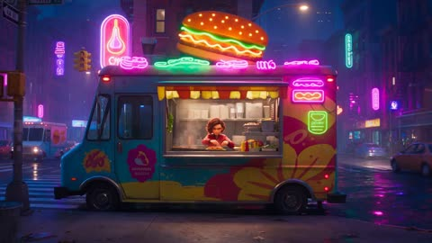</a>

提示词按风格、镜头、剧情节拍和音频分段书写，给模型一份清晰的分镜计划。明确指定手持跟拍、低角度和层层升级的喜剧情节，让画面保持节奏并且容易读懂。

Seedance 2.5 · 文生视频 · 出处: [@ai_anelia on X](https://x.com/ai_anelia/status/2107655230628548720)

[`3d-animation`](tags.md#tag-3d-animation) [`comedy`](tags.md#tag-comedy) [`food-truck`](tags.md#tag-food-truck) [`neon`](tags.md#tag-neon)

<details><summary><b>提示词</b></summary>

```text
A stylish young woman with short wavy brown hair, a red bomber jacket, black cargo pants, and white sneakers works alone at a colorful late-night food truck.

Style: Stylized cinematic 3D animation, expressive character acting, vibrant neon lighting, exaggerated physics, detailed environments, playful comedy, quirky animated-film aesthetic.

Camera: Handheld-style tracking, dramatic low angles, overhead city views, quick push-ins, wide shots, and energetic close-ups.

Story: While preparing a giant taco, a strong gust of wind sends the tortilla flying across the street. She chases it through the busy neon-lit city, dodging pedestrians and scooters, until it lands on a moving delivery van. She jumps onto the van, grabs it, and triumphantly holds it up—only for her hat to fly away.

She chases the hat through a neon alley, somehow keeping the tortilla balanced on her head. She finally returns to the food truck, places the tortilla down proudly, and looks at the camera. A tiny pigeon immediately steals it.

Audio: Lively city ambience, footsteps, traffic, comedic whooshes, playful music, food-truck sounds, and exaggerated impact effects. No dialogue.
```

</details>

<a id="seedance-teen-prank-goalpost-phones"></a>
### 恶作剧反噬，手机卡在球门横梁上

<a href="https://x.com/ZoyaAi_/status/2113486934781595986">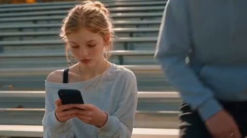</a>

开头先给出统一的光线与调色风格，再用带时间码的分镜逐段描述，结构清楚。跳切进入红烟混乱，再以仰拍球门的低角度镜头收尾，让喜剧反转有明确的画面落点。

Seedance 2.5 · 文生视频 · 出处: [@ZoyaAi_ on X](https://x.com/ZoyaAi_/status/2113486934781595986) · 发现于 [LearnPrompt/awesome-seedance](https://github.com/LearnPrompt/awesome-seedance)

[`teen-drama`](tags.md#tag-teen-drama) [`shot-list`](tags.md#tag-shot-list) [`golden-hour`](tags.md#tag-golden-hour) [`comedy`](tags.md#tag-comedy)

<details><summary><b>提示词</b></summary>

```text
Prompt 

A cinematic teen drama short film, shot in warm golden-hour autumn light on the aluminum bleachers of a high school football stadium. The overall tone is naturalistic and emotionally intimate with a sudden comedic-revenge twist. Shallow depth of field, soft bokeh from sunlight hitting metal bleacher rails, handheld documentary-style camera with gentle drift, 24fps film grain, warm orange-and-teal color grade, lens flares from low sun.

**Shot 1 (0–5s):** Close-mid shot of a teenage girl with soft blonde hair pulled into a messy bun, wearing an off-shoulder cream sweater over a black tank top. She sits on metal bleachers scrolling intently on her phone. Beside her, a teenage boy in a light blue oversized hoodie with shaggy brown hair leans in close over her shoulder, peering at the screen with mild curiosity. Soft rim lighting from the setting sun behind them, blurred silver bleacher rows in the background, a few autumn leaves scattered on the seats.

**Shot 2 (5–9s):** Sudden jump cut — a burst of red smoke or colored powder explodes into frame, enveloping a small group of three teens sitting further down the bleachers. They flinch back in surprise, hands raised defensively to shield their faces, hair and loose strands whipped by the gust of the blast. Golden sunlight scatters through the red haze creating a hazy, dreamlike, slightly chaotic visual. Quick, reactive camera shake sells the surprise.

**Shot 3 (9–14s):** Intimate close-up portrait of a different girl — wavy, sunlit flyaway hair, delicate gold hoop earrings and a thin gold necklace, wearing a white knitted top. She looks down at her phone with a quiet, pensive, slightly worried expression, warm backlight haloing her hair, skin tones glowing in the low sun. The mood shifts from chaos to a quieter, tense beat.

**Shot 4 (14–20s):** Low-angle wide shot looking straight up at a bright yellow steel goalpost crossbar cutting diagonally across a clear, deep-blue late-afternoon sky. Below it, three teenagers stand on the field looking upward with concern and frustration — one boy in a grey hoodie with a black backpack reaches up and starts climbing the vertical post, straining to reach something lodged at the top. Two girls stand nearby, one with long brown hair looking up anxiously, the other in a navy striped sweater raising both hands toward the sky in a pleading/frustrated gesture. Their phones are visibly stuck on top of the crossbar. Blurred autumn-orange treeline and stadium floodlight tower visible at the edges of frame.

**Overall mood/theme:** "Messing with Amelia" backfires — a lighthearted teen revenge-prank narrative where the antagonist group's phones end up stranded on the stadium goalpost, and they're now desperately trying to climb up and fetch them. Comedic-ironic, youthful, slightly cinematic-trailer energy. Aspect ratio 1080x608, widescreen cinematic crop, subtle ambient wind/rustle sound design implied, no dialogue — purely visual storytelling with expressive reactions.
```

</details>

<a id="seedance-tired-dad-daughter-drawing-reveal"></a>
### 疲惫的爸爸看到女儿的画后动容

<a href="https://x.com/Zarnab_with_Ai/status/2105974631106818101">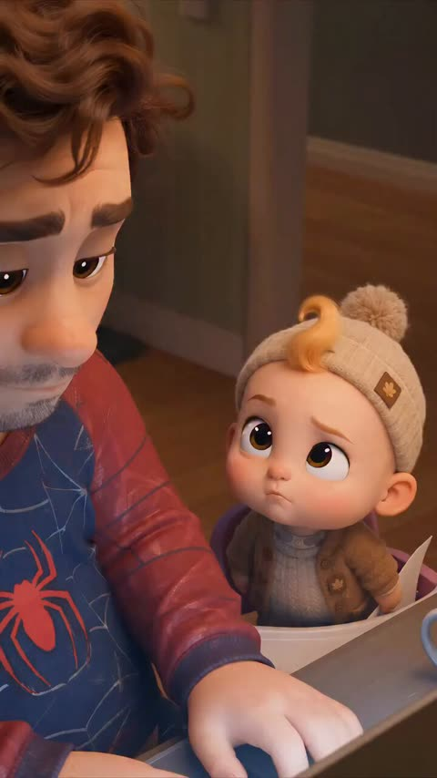</a>

提示词把20秒拆成清晰的段落（工作、分心、看画、拥抱），并用皮克斯式家庭电影风格、柔和暖光和浅景深固定画面。描述眉毛、眼神等细微面部动作，让从疲惫到感动的情绪转变更加清楚。

Seedance 2.5 · 文生视频 · 出处: [@Zarnab_with_Ai on X](https://x.com/Zarnab_with_Ai/status/2105974631106818101) · 发现于 [LearnPrompt/awesome-seedance](https://github.com/LearnPrompt/awesome-seedance)

[`3d-animation`](tags.md#tag-3d-animation) [`family`](tags.md#tag-family) [`emotional`](tags.md#tag-emotional) [`pixar-style`](tags.md#tag-pixar-style)

<details><summary><b>提示词</b></summary>

```text
Create a heartwarming cinematic 20-second 3D animated family scene in a cozy home office during a warm evening.

A young father with curly brown hair, expressive eyebrows, and a red-and-blue Spider-Man inspired sweater sits at a wooden desk working on a laptop. Beside him is his adorable little baby girl wearing a beige knitted outfit and a cute bear-ear winter hat.

The baby watches her father closely while he works. The father occasionally looks at her with a tired but loving expression, drinks from a white coffee mug, and continues typing on his laptop. The baby sits beside him in a small high chair, curiously observing everything.

Show the father becoming distracted when the baby interacts with a small red toy car and a plate of food on the desk. Include natural facial expressions, subtle eye movements, gentle hand gestures, and realistic parent-child interaction.

Later, the baby proudly shows her father a handmade drawing of the two of them together with a heart. The father's expression changes from tired and stressed to emotional, surprised, and deeply touched.

End with the father smiling warmly, turning toward his daughter, embracing her lovingly, and giving her a gentle hug.

Style: high-quality cinematic 3D animation, Pixar-inspired family-film aesthetic, soft warm indoor lighting, detailed expressive faces, realistic fabric and hair textures, cozy atmosphere, shallow depth of field, smooth character animation, natural camera movement, emotional storytelling.

Vertical 9:16 composition, cinematic framing, consistent character appearance throughout, smooth transitions, detailed environment, wholesome emotional ending.
```

</details>

<a id="seedance-toddler-banknote-prank-3d-comedy"></a>
### 幼童把钞票递给父亲的3D喜剧

<a href="https://x.com/Zarnab_with_Ai/status/2113094951684931713">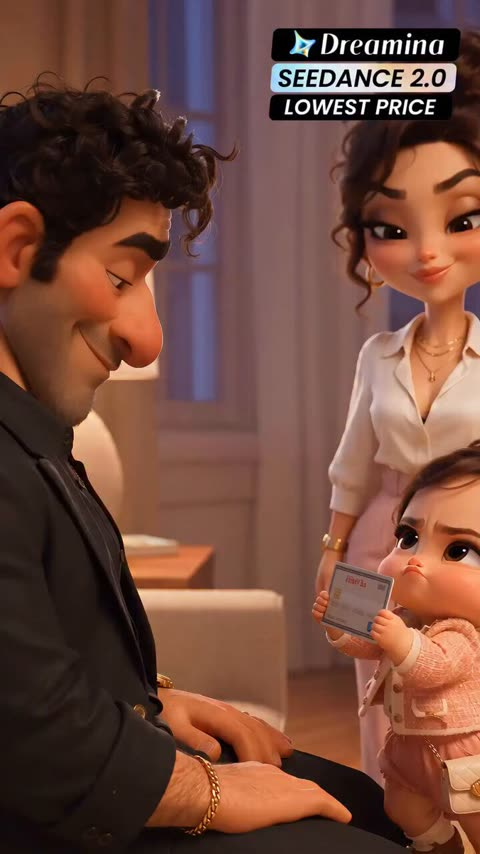</a>

按秒数划分的分镜段落让模型按顺序执行动作。结尾的一致性段落重复人物造型、服装和防闪烁要求，使每个镜头中的家人保持一致。

Seedance 2.5 · 文生视频 · 出处: [@Zarnab_with_Ai on X](https://x.com/Zarnab_with_Ai/status/2113094951684931713) · 发现于 [LearnPrompt/awesome-seedance](https://github.com/LearnPrompt/awesome-seedance)

[`3d-animation`](tags.md#tag-3d-animation) [`family-comedy`](tags.md#tag-family-comedy) [`pixar-style`](tags.md#tag-pixar-style) [`close-up`](tags.md#tag-close-up)

<details><summary><b>提示词</b></summary>

```text
Create a 22-second, high-quality 3D animated family comedy with a polished Pixar-inspired aesthetic. Set the scene in a luxurious, warmly lit living room with soft golden lighting, elegant furniture, and cinematic depth of field.

A stylish, curly-haired man wearing a black suit, gold chain, and luxury watch sits on a sofa beside his adorable toddler daughter. The little girl wears a pink knitted outfit, has big expressive eyes, and carries a colorful toy hammer. Her beautiful young mother stands nearby wearing a white blouse and elegant pink trousers.

Scene sequence:

- 0–4 seconds: The toddler approaches her father with a small banknote, innocently trying to feed it to him. He leans forward, confused but amused.
- 4–8 seconds: The father humorously pretends to bite the money while the little girl watches with excitement. Use close-up shots of their expressive faces.
- 8–12 seconds: The toddler turns toward her mother and proudly shows her the money. The mother smiles playfully and produces a colorful toy hammer.
- 12–17 seconds: The father suddenly realizes what is happening. His eyes widen in shock as he sees the toy hammer and the money exchange. The mother and daughter exchange mischievous smiles.
- 17–22 seconds: The mother holds up the money while the toddler happily grips her toy hammer. The father leans backward in exaggerated comic panic, raising his hands as if he has been tricked into paying for the toy.

Visual style: Ultra-detailed 3D character animation, realistic fabric textures, expressive facial movements, natural body motion, cinematic camera angles, smooth transitions, warm ambient lighting, shallow depth of field, professional animated-movie quality.

Audio: Playful orchestral comedy music, subtle footsteps, soft paper rustling, toy handling sounds, and humorous reaction sound effects. No dialogue or subtitles.

Consistency requirements: Maintain identical character designs, clothing, hairstyles, facial features, and proportions throughout every shot. Smooth animation, coherent actions, accurate hand movements, no flickering, no extra fingers, no character distortion, and no sudden scene changes.

Format: 16:9, 4K quality, 24 fps, approximately 22 seconds, family-friendly comedic storytelling.
```

</details>

<a id="seedance-toddler-gecko-family-comedy"></a>
### 幼儿在卧室墙上发现壁虎

<a href="https://x.com/Zarnab_with_Ai/status/2105615254973792766">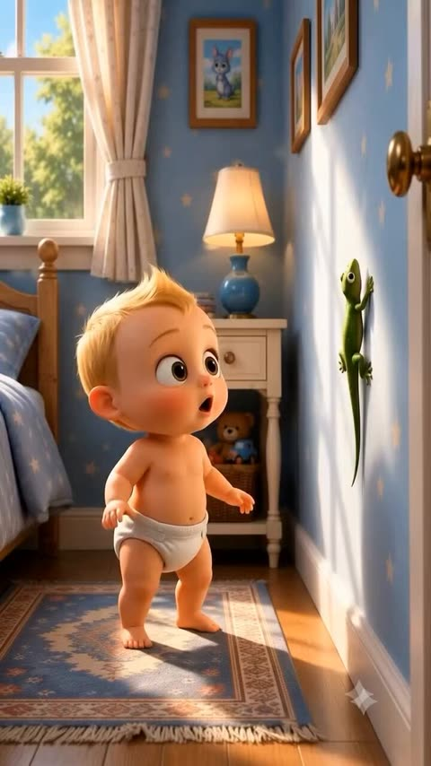</a>

提示词先固定角色清单并写明服装细节，再把故事按编号分场描述，每场都有自己的动作，最后给出结尾镜头，这样多个镜头中的人物与情节顺序都更稳定。镜头、光线和质量各自独立成段，为模型提供逐镜头的明确指令，而不是一句笼统的动作描述。

Seedance 2.5 · 文生视频 · 出处: [@Zarnab_with_Ai on X](https://x.com/Zarnab_with_Ai/status/2105615254973792766) · 发现于 [LearnPrompt/awesome-seedance](https://github.com/LearnPrompt/awesome-seedance)

[`3d-animation`](tags.md#tag-3d-animation) [`family-comedy`](tags.md#tag-family-comedy) [`multi-scene`](tags.md#tag-multi-scene)

<details><summary><b>提示词</b></summary>

```text
Create a 60–65 second high-quality cinematic 3D animated family comedy video in a warm, charming, Pixar-inspired animation aesthetic.

CHARACTERS:
- A cute energetic blond toddler boy wearing only a white diaper.
- A cute little girl with short brown hair, wearing pink pajamas with small bows.
- A warm, expressive mother with short brown hair, wearing a cozy beige sweater and blue jeans.
- A friendly green gecko/lizard with large expressive eyes.
- A father with short dark brown hair, wearing a green T-shirt, dark gray pants and casual sneakers.

VISUAL STYLE:
Premium 3D animated movie quality, adorable stylized characters, expressive oversized eyes, realistic soft skin and hair textures, detailed facial expressions, polished cinematic lighting, warm family-home atmosphere, smooth natural character animation, physically believable movement, colorful but soft environment, shallow depth of field, global illumination, soft shadows, high-detail textures, cinematic composition.

SETTING:
A cozy modern family home with a child's bedroom and living room. Blue children's wallpaper decorated with stars and clouds, wooden furniture, framed children's artwork, warm lamps, large windows with sunlight streaming through curtains, patterned rugs, toys scattered naturally around the floor, comfortable sofa and family decorations.

STORY / ACTION:

SCENE 1 — BEDROOM:
The blond toddler walks around his bedroom curiously. He notices a small green gecko climbing on the wall. He looks surprised and fascinated, slowly approaches it, then carefully reaches toward it.

SCENE 2:
The toddler playfully grabs the gecko and holds it gently. The gecko reacts with funny exaggerated expressions while the toddler laughs and becomes excited.

SCENE 3:
A little girl in pink pajamas enters the room and notices the gecko. She gets curious and crawls toward it while the toddler proudly shows it to her. The gecko wiggles and tries to escape, creating a playful comedy moment.

SCENE 4 — LIVING ROOM:
Cut to the mother sitting on the sofa with both children. The girl looks nervous while the toddler excitedly shows the green gecko. The mother notices what is happening and reacts with surprise and concern.

SCENE 5:
The gecko suddenly moves closer to the children. The mother becomes startled and raises her hands. The children react with exaggerated surprised expressions. Keep the moment funny and family-friendly rather than scary.

SCENE 6:
The toddler tries to follow the gecko while the little girl runs away laughing. Toys roll across the wooden floor as the gecko quickly scurries around the room. The mother jumps up from the sofa and tries to keep the children safe.

SCENE 7:
The father suddenly enters the living room. He looks confused after seeing the chaos. The mother gestures toward the gecko while the children excitedly point at it.

SCENE 8 — COMEDIC ENDING:
The father carefully approaches the gecko and tries to catch it. The toddler happily follows him. The gecko suddenly climbs onto the father's shirt, creating a hilarious reaction. Everyone reacts with surprise and laughter.

FINAL SHOT:
The father stands in the middle of the living room with the gecko on his green shirt while the toddler laughs and claps happily. The mother and little girl react with amused expressions in the background. End on a warm, funny family moment.

CAMERA:
Cinematic medium shots, close-ups for facial reactions, gentle tracking shots, low-angle toddler perspective, occasional wide shots showing the entire room, smooth camera transitions, natural handheld-style movement during the comedic chase, expressive reaction close-ups.

LIGHTING:
Warm afternoon sunlight coming through windows, soft volumetric rays, cozy indoor practical lighting, natural shadows, cinematic highlights and realistic bounce light.

ANIMATION:
Highly expressive facial animation, natural body movement, believable toddler walking and running, playful exaggerated reactions, smooth hand gestures, realistic cloth and hair movement, detailed gecko movement, comedic timing and clear storytelling.

QUALITY:
Ultra-detailed 3D animation, cinematic rendering, 4K, high-quality global illumination, realistic materials, soft depth of field, polished feature-film animation, consistent character appearance throughout, smooth motion, no flickering, no distorted faces, no extra limbs, no character identity changes.
```

</details>

<a id="seedance-toddler-glitter-nails-comedy"></a>
### 小女孩专注地给长指甲涂色

<a href="https://x.com/Zarnab_with_Ai/status/2109231900430569762"></a>

按秒划分的分镜（0到4秒、4到7秒等）加上每段都重复的角色设定（发型、毛衣、眼睛、房间），让小女孩在多次切镜中保持一致。明确的镜头类型（极近特写、微距、中景）以及刷子和按键的音效提示，控制了节奏。

Seedance 2.5 · 文生视频 · 出处: [@Zarnab_with_Ai on X](https://x.com/Zarnab_with_Ai/status/2109231900430569762) · 发现于 [LearnPrompt/awesome-seedance](https://github.com/LearnPrompt/awesome-seedance)

[`pixar-style`](tags.md#tag-pixar-style) [`character-consistency`](tags.md#tag-character-consistency) [`shot-list`](tags.md#tag-shot-list) [`sound-design`](tags.md#tag-sound-design)

<details><summary><b>提示词</b></summary>

```text
AI Video Prompt — Little Girl’s Glitter Nail Polish Adventure

Create a high-quality, ultra-detailed 3D animated cartoon video, approximately 26 seconds long, in vertical 9:16 format. Use a cute, cinematic Pixar-inspired animation style with realistic textures, soft lighting, expressive facial animation, and smooth camera movements.

Main Character: A ridiculously adorable toddler girl with a round face, huge sparkling blue eyes, rosy cheeks, a tiny nose, blonde hair styled in two small buns with pink bows, and a playful personality. She wears a cozy white sweater featuring a teddy bear and pink pajama pants decorated with little black hearts.

Scene 1 (0–4 seconds): Applying Nail Polish
Begin with an extreme close-up of the little girl sitting at a small table in a warm, pink-themed living room. She carefully examines her tiny fingers, which have long, glossy white artificial-looking nails. She concentrates intensely, furrowing her eyebrows and slightly sticking out her tongue while trying to paint her nails. Her facial expressions are adorable and funny.

Scene 2 (4–7 seconds): Purple Glitter Polish
Show a detailed close-up of her tiny hand holding a nail polish brush. She carefully applies sparkling purple glitter nail polish to her long nails. A small open bottle of purple glitter polish sits on the table. Capture the glossy liquid, sparkling particles, delicate brush movements, and her focused expression. Use shallow depth of field and cinematic macro photography.

Scene 3 (7–12 seconds): Proud Little Girl
Cut to a medium shot revealing her finished purple glitter nails. She raises both hands in front of her face, spreads her fingers, and admires her beautiful nails with a huge, delighted smile. She wiggles her fingers excitedly and looks from one hand to the other. The room features soft pink curtains, a comfortable pink sofa, warm lamps, and cute decorative objects.

Scene 4 (12–17 seconds): The Remote Control Problem
The little girl walks toward the table while admiring her extra-long purple glitter nails. She notices a television remote control lying on the tabletop. She reaches toward it, attempting to press its colorful buttons with her long nails. Her movements become awkward and clumsy. Show an extreme close-up of her shiny nails hovering over the buttons as she struggles to operate the remote. One tiny piece of purple glitter nail polish accidentally falls onto the table, creating a funny surprise.

Scene 5 (17–21 seconds): Funny Reaction
Show her staring at her nails and the remote control with wide-open eyes and a shocked, confused expression. She opens her mouth in surprise, lifts both hands, and carefully examines her fingertips. After a brief pause, her expression changes from shock to excitement as she realizes how shiny her nails look.

Scene 6 (21–26 seconds): Happy Ending
Cut to a warm medium shot of the toddler sitting comfortably on a pink sofa, watching a colorful cartoon on the television. She happily raises her hands and admires her sparkling purple nails while smiling with pure childlike joy. The television casts a soft pink and blue glow across her face. Finish with a charming final shot of her smiling and showing off her glittery nails.

Visual Style: Premium 3D animated family-friendly comedy, adorable toddler proportions, oversized expressive blue eyes, realistic skin shading, finely detailed blonde hair, glossy purple glitter nail polish, pastel pink interiors, cinematic depth of field, soft golden sunlight, smooth character animation, natural hand movements, detailed close-ups, consistent character design, and polished professional rendering.

Camera Direction: Alternate between extreme close-ups, macro nail-polish shots, facial close-ups, and medium-wide living-room shots. Use gentle camera push-ins, smooth cuts, and expressive reaction shots. Maintain clear visual continuity between every scene.

Audio: Soft, playful background music with subtle nail-polish brush sounds, gentle tapping on the remote buttons, and cute comedic sound effects during the surprised reaction. No dialogue or subtitles.

Important Requirements: Maintain the same toddler's face, hairstyle, clothing, proportions, and environment throughout the entire video. Preserve the purple glitter nails after they are painted. Keep the animation smooth, visually coherent, adorable, and humorous. Vertical 9:16 composition, high detail, clean rendering, no flickering, no distorted fingers, no extra limbs, no unwanted text, and no watermarks.
```

</details>

<a id="seedance-toddler-skateboard-school-short"></a>
### 3D动画短片里幼童跑出家门

<a href="https://x.com/Zarnab_with_Ai/status/2110193320047898957">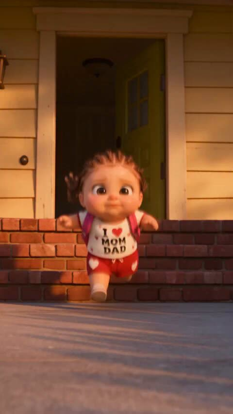</a>

提示词先用细致的角色设定锁定外观（脸部、细辫子、印字T恤、红短裤、粉色书包），结尾再重复一致性要求，并把视频拆成六个分场景。统一的黄金时刻光线和皮克斯风格的3D渲染方向，让各镜头画面保持稳定。

Seedance 2.5 · 文生视频 · 出处: [@Zarnab_with_Ai on X](https://x.com/Zarnab_with_Ai/status/2110193320047898957) · 发现于 [LearnPrompt/awesome-seedance](https://github.com/LearnPrompt/awesome-seedance)

[`3d-animation`](tags.md#tag-3d-animation) [`pixar-style`](tags.md#tag-pixar-style) [`skateboard`](tags.md#tag-skateboard) [`multi-scene`](tags.md#tag-multi-scene)

<details><summary><b>提示词</b></summary>

```text
Create a high-quality cinematic 3D animated short film featuring an adorable toddler girl with big expressive brown eyes, chubby rosy cheeks, tiny braided cornrows, a white T-shirt with “I ♥ MOM DAD” printed on it, red shorts, white sneakers, and a cute pink backpack.

Scene 1 — School Morning: The little girl runs out of a cozy suburban house in warm golden-hour sunlight. She looks excited and energetic as she heads toward the street, with a charming neighborhood in the background.

Scene 2 — Emotional Close-Up: Show a series of cinematic close-ups of her face, capturing surprise, nervousness, determination, and a mischievous smile. Her large eyes and expressive facial animations create a heartwarming, humorous personality.

Scene 3 — The Skateboard Reveal: A colorful skateboard rests beside a white picket fence. The toddler notices it, grins confidently, and prepares for an exciting ride.

Scene 4 — Skateboarding Action: The girl rides the skateboard down the sunny suburban sidewalk, maintaining her balance with a determined expression. Another little girl with braided hair and a pink backpack performs a playful skateboard jump nearby. Show dynamic tracking shots, low-angle camera movements, realistic wheel motion, and subtle dust and pavement particles.

Scene 5 — The School Bus: Both toddlers skateboard toward a parked yellow school bus. The main girl confidently approaches the bus while the other child follows. Use smooth cinematic camera tracking and warm sunlight filtering through the trees.

Scene 6 — Happy Ending: Inside the school bus, the adorable toddler sits among a diverse group of cheerful children. Everyone laughs, smiles, and waves excitedly as the bus drives away down the suburban road.

Visual Style: Premium Pixar-inspired 3D animation, adorable character design, highly expressive facial animation, realistic fabric and hair details, cinematic depth of field, warm golden-hour lighting, soft shadows, vibrant colors, polished rendering, smooth character movements, dynamic camera angles, family-friendly comedy, and professional animated-film quality.

Technical Specifications: Vertical 9:16 aspect ratio, approximately 30 seconds, seamless scene transitions, consistent character appearance throughout, detailed suburban environment, cinematic motion, and high-quality 3D rendering.

Important: Maintain the same character identity, clothing, hairstyle, backpack, and proportions in every scene. Ensure natural skateboard physics, coherent movements, and consistent lighting. Avoid character distortion, flickering, extra limbs, and visual inconsistencies.
```

</details>

<a id="seedance-toddlers-mom-secret-snack-3d"></a>
### 妈妈偷偷拿零食，两个小宝贝专心玩积木

<a href="https://x.com/Zarnab_with_Ai/status/2117442957347606909">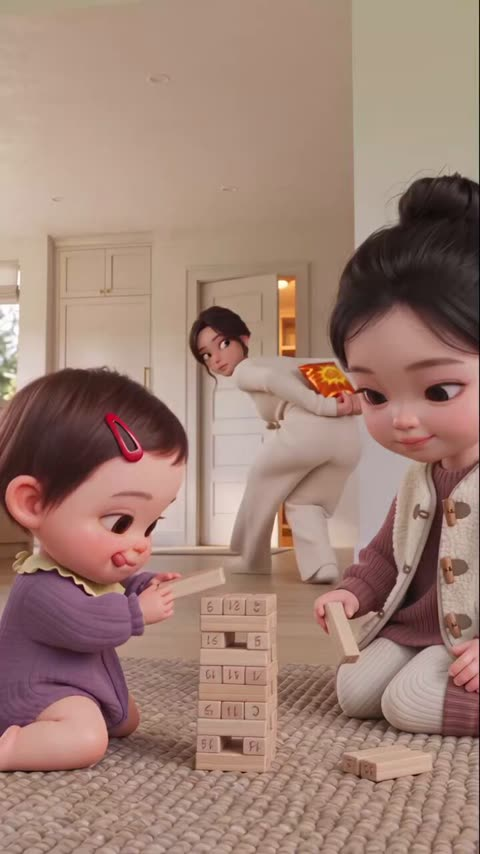</a>

前景固定的玩耍动作与背景里的偷吃动作形成对照，一个画面就能看懂笑点。镜头顺序、表情变化和运镜依次写明，给模型清晰的逐镜头节奏。

Seedance 2.5 · 文生视频 · 出处: [@Zarnab_with_Ai on X](https://x.com/Zarnab_with_Ai/status/2117442957347606909) · 发现于 [LearnPrompt/awesome-seedance](https://github.com/LearnPrompt/awesome-seedance)

[`family-comedy`](tags.md#tag-family-comedy) [`3d-animation`](tags.md#tag-3d-animation) [`kids`](tags.md#tag-kids)

<details><summary><b>提示词</b></summary>

```text
Create a high-quality, adorable 3D animated family comedy scene in a warm, modern home.

Two cute toddler girls with oversized expressive eyes, chubby cheeks, soft skin, and beautifully detailed hairstyles are sitting on a cozy living-room rug, playing with a wooden stacking block tower. One toddler wears a purple outfit with a pink hair clip, while the other wears a cream-colored outfit with a knitted cardigan.

In the background, their young mother, wearing a cozy cream-colored outfit, secretly sneaks into the kitchen pantry and grabs a packet of crunchy snacks. She carefully opens the packet, trying not to make any noise because she doesn't want the toddlers to notice.

Show cinematic close-up shots of her hands opening the shiny red snack packet, followed by an extreme close-up of her secretly eating a crunchy snack. Her cheeks puff up adorably as she chews, and her eyes look around nervously.

Suddenly, she realizes someone might be watching her. Show a hilarious close-up of her wide-open eyes, surprised facial expression, and puffed cheeks.

Use expressive facial animation, adorable character movements, realistic snack packaging details, smooth cinematic camera transitions, warm golden indoor lighting, soft shadows, detailed textures, and polished Pixar-inspired 3D animation.

Style: Cinematic 3D animated family comedy, adorable characters, humorous storytelling, ultra-detailed rendering, expressive facial emotions, professional animation.

Format: Vertical 9:16, 4K quality, smooth 24 FPS animation.
```

</details>

<a id="seedance-train-zombie-outbreak-horror"></a>
### 女子在火车上咳嗽，乘客担忧注视

<a href="https://x.com/doctorwasif/status/2093550743945105687">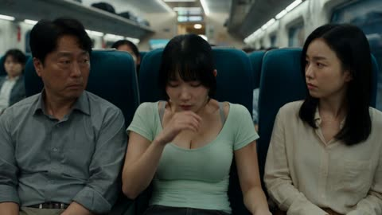</a>

带时间码的分镜表，每个时段都写明镜头或光线，控制30秒内的节奏。一张 @ 参考图锁定所有镜头中的人脸和服装。

Seedance 2.5 · 参考生视频 · 出处: [@doctorwasif on X](https://x.com/doctorwasif/status/2093550743945105687)

[`zombie`](tags.md#tag-zombie) [`horror`](tags.md#tag-horror) [`train`](tags.md#tag-train) [`reference-image`](tags.md#tag-reference-image)

<details><summary><b>提示词</b></summary>

```text
0–1.2s: @ (Image) matching reference face/outfit, sits on a train, pale, sweating, coughing weakly. Passengers glance over, concerned. Cinematic outbreak-horror realism.

1.2–2.4s: Her breathing turns ragged; dark veins appear on her neck, eyes become glassy. Close-up, tense lighting.

2.4–3.6s: She collapses and convulses as passengers rush to help. Handheld camera.

3.6–4.8s: She suddenly snaps upright, bloodshot feral eyes, guttural snarl. Extreme close-up horror reveal.

4.8–6s: She violently bites a helper’s forearm. Shock and panic. Slow-motion impact.

6–7.2s: He stumbles back clutching the bloody bite. Passengers panic.

7.2–8.5s: Dark veins rapidly spread from the wound up his arm and neck. Visceral transformation close-up.

8.5–10s: He collapses, convulses, then rises as a zombie, eyes bloodshot and empty.

10–12.5s: He lunges at another passenger. Screams erupt; the carriage descends into chaos.

12.5–15.5s: Multiple passengers turn rapidly, spreading the infection through the car. Survivors flee toward the connecting door.

15.5–18.5s: Survivors barricade the door with luggage and seat cushions as infected passengers claw and pound against it.

18.5–21.5s: The door violently shudders; infected faces press against the glass. Cracks spread as panic intensifies.

21.5–24.5s: Families retreat as the glass shatters and infected arms break through, grabbing at survivors.

24.5–27.5s: Survivors race toward the front, dragging luggage behind them as a zombie horde crashes through the barricade.

27.5–30s: Survivors slam the next door shut and stare in horror as the infected horde pounds against the glass. Dim flickering lights, heavy breathing, cinematic outbreak ending.
```

</details>

<a id="seedance-tsunami-rescue-quake-village"></a>
### 女子穿过地震中摇晃的渔村民居

<a href="https://x.com/Aqsahere_/status/2118187360525414673">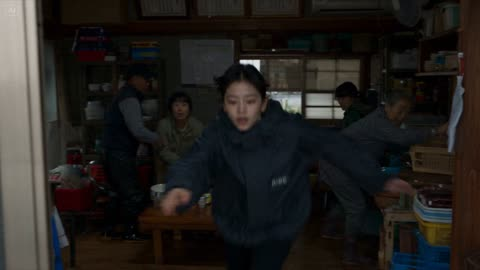</a>

用编号的分镜列表，逐段标注时间点，为30秒视频固定镜头顺序；连续性段落重复人物、服装、船只和地点，保证各镜头一致。手持纪实镜头加上明确的声音清单（警报、风声、引擎声），营造真实感，并禁止配乐和字幕。

Seedance 2.5 · 文生视频 · 出处: [@Aqsahere_ on X](https://x.com/Aqsahere_/status/2118187360525414673) · 发现于 [LearnPrompt/awesome-seedance](https://github.com/LearnPrompt/awesome-seedance)

[`disaster`](tags.md#tag-disaster) [`rescue`](tags.md#tag-rescue) [`tsunami`](tags.md#tag-tsunami) [`handheld-camera`](tags.md#tag-handheld-camera)

<details><summary><b>提示词</b></summary>

```text
THE FINAL WAVE | A DESPERATE TSUNAMI RESCUE

Create a 30-second ultra-realistic live-action cinematic disaster video set in a Japanese coastal fishing village. A massive tsunami approaches after a powerful earthquake. A brave young woman risks her life to rescue stranded people.

CHARACTER & LOCATION:
A young Japanese woman with dark hair in a ponytail, wearing a dark waterproof jacket, black trousers and rubber boots. Three adult fishermen, one small child and one elderly woman. Keep all characters, outfits, faces, rescue boat and village consistent.

EXACT SCENE SEQUENCE:

1. EARTHQUAKE (0–3s):
The village shakes violently. Objects fall, houses rattle and villagers rush outside.

2. TSUNAMI WARNING (3–5s):
Emergency sirens sound. The girl looks towards the ocean as the water suddenly retreats from the harbor.

3. FISHERMEN IN DANGER (5–8s):
She spots three fishermen stranded near a damaged fishing boat, desperately waving for help.

4. RESCUE BOAT (8–11s):
She runs to a small motorboat, unties it and starts the engine.

5. ROUGH SEA (11–15s):
She navigates through violent waves, avoiding floating debris as water splashes over the boat.

6. FISHERMEN RESCUE (15–19s):
She reaches the damaged boat and helps all three fishermen climb safely aboard, catching one as he nearly slips.

7. CHILD AND ELDERLY WOMAN (19–22s):
She spots a frightened child and elderly woman trapped on a flooded rooftop and steers towards them.

8. MASSIVE TSUNAMI (22–26s):
A gigantic dark wave appears behind the harbor. The fishermen help bring the child and elderly woman aboard from a reachable flooded platform.

9. ESCAPE (26–28s):
The boat reaches elevated ground. She helps everyone climb to safety as floodwater crashes through the harbor.

10. FINAL SHOT (28–30s):
The rescued child holds her hand. She watches in shock as the massive wave engulfs the distant village.

VISUAL STYLE:
Ultra-photorealistic live-action disaster film, realistic tsunami physics, powerful water movement, natural handheld documentary camera, stormy daylight, wet clothing, emotional expressions and believable boat movement.

Natural audio: earthquake rumbling, emergency sirens, wind, engine, shouting and crashing waves. No music, subtitles or voiceover.

STRICT CONTINUITY:
Same characters, outfits, boat and location throughout. Show every rescue physically, with logical movement between scenes. No teleportation, superhero powers, cartoon water or unrealistic CGI.

The final video must feel like real disaster footage, full of tension, urgency and emotion.
```

</details>

<a id="seedance-universe-to-humanity-documentary"></a>
### 发光的宇宙爆发，粒子向外放射拖出光痕

<a href="https://x.com/RuzainaMeer/status/2096837494000308685"></a>

提示词把整段从宇宙到人类的历程写成一个连续镜头，用时间和尺度之间的转场串起各个阶段，结尾是从地球拉远到银河的镜头回拉。光照、HDR 和真实物理作为风格约束，排除项（无文字、无旁白、无霓虹）保持画面干净。

Seedance 2.5 · 文生视频 · 出处: [@RuzainaMeer on X](https://x.com/RuzainaMeer/status/2096837494000308685) · 发现于 [LearnPrompt/awesome-seedance](https://github.com/LearnPrompt/awesome-seedance)

[`documentary`](tags.md#tag-documentary) [`cosmos`](tags.md#tag-cosmos) [`evolution`](tags.md#tag-evolution) [`long-take`](tags.md#tag-long-take)

<details><summary><b>提示词</b></summary>

```text
Create a 30-second ultra-photorealistic cinematic documentary showing the evolution of the universe and life on Earth in one seamless journey.

Begin with the Big Bang and the expansion of space, then show matter forming, the first stars, galaxies, supernovae, and the birth of the Solar System and Earth. Transition to volcanic early Earth, cooling oceans, primitive single-celled life, complex marine organisms, life moving onto land, prehistoric forests, dinosaurs, early mammals, primates, hominins, and finally modern Homo sapiens.

End with a modern human looking toward the horizon as the camera rapidly pulls back from Earth to the Moon, Solar System, and Milky Way, connecting humanity to the universe.

Use continuous cinematic camera movement, seamless transitions through time and scale, realistic physics, scientifically inspired environments, natural motion, detailed animal anatomy, realistic lighting, HDR, and premium documentary cinematography.

16:9, ultra-realistic, photorealistic, emotionally powerful, scientifically grounded. No text, labels, narration, fantasy, cyberpunk, neon, or futuristic elements.
```

</details>

<a id="seedance-upside-down-seesaw-water-ritual"></a>
### 薄荷绿跷跷板上倒悬入水的女子

<a href="https://x.com/Just_sharon7/status/2104544058471502330"></a>

单镜头连续拍摄加轻微手持晃动，画面始终锁定人物与水桶。跷跷板有节奏地起落带动重复入水，表情从惊讶到微笑再到镇定的变化，让画面保持优雅而超现实的基调。

Seedance 2.5 · 文生视频 · 出处: [@Just_sharon7 on X](https://x.com/Just_sharon7/status/2104544058471502330) · 发现于 [LearnPrompt/awesome-seedance](https://github.com/LearnPrompt/awesome-seedance)

[`performance-art`](tags.md#tag-performance-art) [`fashion-editorial`](tags.md#tag-fashion-editorial) [`handheld-camera`](tags.md#tag-handheld-camera) [`water`](tags.md#tag-water)

<details><summary><b>提示词</b></summary>

```text
A cinematic indoor performance-art / fashion editorial video, shot in a single continuous take inside a slightly worn historic room with cracked plaster walls, dark wood floors, a vintage wooden bed with rumpled beige linens, beige curtains over a tall window, and a soft abstract pink painting on the wall.

A large custom-built pale mint-green wooden seesaw / dunk-lever structure (thick beams, metal bolts, industrial-craft aesthetic) spans the room. On the high end, a woman hangs completely upside-down, knees hooked over the beam, wearing a short beige-and-black horizontal-striped dress. She clutches a dripping beige robe or cloth against her body. Long dark curly hair hangs toward a matching mint-green metal barrel filled with water.

An off-camera operator slowly pumps the opposite end of the lever, tilting the beam so her head and hair repeatedly dunk into the water then lift out, water streaming from her hair and the cloth. Her expression shifts between wide-eyed surprise, a slight smile, and composure as she looks toward camera. Water ripples and drips throughout.

Natural window light, muted filmic color palette, shallow depth of field, slight handheld camera movement that stays locked on the woman and the barrel. Slow, rhythmic, slightly surreal and elegant rather than slapstick. No text, no logos.
```

</details>

<a id="seedance-vaccination-father-panic-clinic"></a>
### 父亲在3D诊所陪婴儿打针时惊慌失措

<a href="https://x.com/Zarnab_with_Ai/status/2111280639295275309"></a>

节拍按紧张、惊恐、打针、松一口气、婴儿大笑的顺序递进，让10秒内的喜剧节奏清晰可读。护士的平静与父亲夸张的反应形成对比，笑点由此产生。

Seedance 2.5 · 文生视频 · 出处: [@Zarnab_with_Ai on X](https://x.com/Zarnab_with_Ai/status/2111280639295275309) · 发现于 [LearnPrompt/awesome-seedance](https://github.com/LearnPrompt/awesome-seedance)

[`3d-animation`](tags.md#tag-3d-animation) [`comedy`](tags.md#tag-comedy) [`pixar-style`](tags.md#tag-pixar-style) [`family-friendly`](tags.md#tag-family-friendly)

<details><summary><b>提示词</b></summary>

```text
Create a high-quality, ultra-detailed 3D animated comedy video set inside a bright, modern pediatric clinic. A cute, chubby baby wearing a light green floral romper sits on her father's lap. The father is a heavyset man with messy brown hair, an orange T-shirt, and blue jeans. A blonde female nurse wearing a white uniform, surgical mask, and gloves prepares to give the baby a vaccination.

As the nurse approaches with the syringe, the father becomes increasingly terrified, his eyes widening and his hair standing straight up in exaggerated cartoon fashion. The baby initially looks confused and nervous. When the nurse gives the injection, the father screams dramatically with his mouth wide open, tears streaming down his cheeks, while the baby watches him in surprise.

The nurse calmly continues the procedure, showing a funny contrast between her professional attitude and the father's over-the-top reaction. Finally, the father realizes the injection is over, relaxes, and smiles with relief. The baby bursts into laughter at her father's ridiculous reaction.

Visual Style: Premium 3D animated movie quality, Pixar-inspired character design, expressive facial animations, realistic skin shading, detailed clothing textures, cinematic lighting, soft shadows, vibrant colors, vertical 9:16 composition.

Camera: Medium shot transitioning into close-ups of the father's terrified expressions, the baby's reactions, and the nurse's calm movements. Smooth camera motion and consistent character designs throughout.

Duration: 10 seconds.

Audio: Funny cartoon sound effects, exaggerated scream, subtle clinic ambience, and joyful baby laughter. No dialogue or subtitles.

Important: Maintain consistent character appearances, natural body movements, accurate hand anatomy, and smooth facial expressions. Make the scene humorous, family-friendly, and visually engaging.
```

</details>

<a id="seedance-vampire-romance-castle-teaser"></a>
### 三十秒哥特吸血鬼古堡爱情预告片

<a href="https://x.com/ZaraIrahh/status/2094363532636590322"></a>

两张参考图分别锁定主角和古堡场景，六个各五秒的分镜写明台词与动作。景别、固定色板、音效清单以及亲吻前切黑的收尾，共同撑起张力和悬念。

Seedance 2.5 · 参考生视频 · 出处: [@ZaraIrahh on X](https://x.com/ZaraIrahh/status/2094363532636590322) · 发现于 [LearnPrompt/awesome-seedance](https://github.com/LearnPrompt/awesome-seedance)

[`vampire`](tags.md#tag-vampire) [`romance`](tags.md#tag-romance) [`short-drama`](tags.md#tag-short-drama) [`cinematic`](tags.md#tag-cinematic) [`dialogue`](tags.md#tag-dialogue)

<details><summary><b>提示词</b></summary>

```text
Create a 30-second, 16:9 premium live-action vampire-romance teaser for an international short-drama audience. Use Image 1 for the two leads' appearance and Image 2 for the castle environment. Preserve both identities consistently throughout every shot with ultra-realistic live-action cinematography, cinematic lighting, natural skin texture, and emotionally expressive performances.

Story: A curious young woman accidentally wanders into the forbidden wing of a forgotten castle, where she awakens an ancient vampire noble from centuries of sleep. The instant he sees her, he senses the bloodline of an ancient war flowing through her veins. Instead of killing her, he becomes dangerously fascinated. His obsession grows immediately into a possessive desire to keep her close. She is frightened by his overwhelming presence but refuses to surrender completely, meeting his dominance with quiet courage.

Style: Premium ReelShort / DramaBox vampire romance. Darkly romantic, emotionally intense, fate-bound, mysterious, elegant, and seductive without becoming explicit. Build escalating romantic tension through eye contact, silence between lines, restrained emotion, and powerful chemistry. The pacing should feel like the opening episode of a viral international drama with a shocking cliffhanger ending. No gore, no cheap horror, no Halloween costumes, no monsters, and no modern streetwear.

The castle is illuminated only by moonlight filtering through towering stained-glass windows, flickering candlelight, fireplaces, drifting mist, ancient chandeliers, marble floors, velvet curtains, towering bookshelves, gothic arches, carved stone walls, and floating dust particles. Rich black, crimson, silver, and deep blue dominate the color palette.

Shoot entirely for TikTok, ReelShort, and DramaBox. Prioritize medium close-ups, close-ups, extreme close-ups, slow push-ins, over-the-shoulder shots, dramatic eye contact, trembling hands, subtle breathing, and intimate framing. Every shot should maximize emotional tension between the leads.

Scene 1 (0–5s)
The young woman cautiously walks through the abandoned castle corridor holding an antique candle. The flame flickers violently as if something unseen is watching her.

Woman (whispering):
"I shouldn't be here..."

A distant male voice echoes through the darkness.

Vampire (O.S., whisper):
"...You finally came."

Scene 2 (5–10s)
An enormous stone coffin slowly opens. The vampire noble rises with quiet elegance, his crimson eyes fixed only on her. She freezes in fear.

Woman:
"Who... who are you?"

Vampire (calmly):
"The one fate refused to bury."

Scene 3 (10–15s)
He slowly approaches until only inches separate them. He gently lifts her chin without hurting her, studying her face as though recognizing someone long forgotten.

Vampire:
"Your blood remembers a war the world has forgotten."

Woman:
"I don't know what you're talking about."

Scene 4 (15–20s)
She steps backward, refusing to surrender despite her fear. He blocks her escape with effortless confidence.

Woman:
"I'm not afraid of you."

Vampire (soft smile):
"You should be."

Scene 5 (20–25s)
He leans closer, eyes locked with hers. Their breathing becomes the only sound. His expression shifts from curiosity to obsession.

Vampire:
"I searched centuries for you..."

Woman (barely whispering):
"Why me?"

Vampire:
"Because you belong to my destiny."

Scene 6 (25–30s)
The castle doors slam shut by themselves. Candle flames extinguish one by one. He gently reaches for her hand while she hesitates, torn between fear and an irresistible pull.

Vampire:
"You may fight fate..."

(He slowly intertwines his fingers with hers.)

Vampire:
"...but you'll never escape me."

Final shot: Extreme close-up of their locked eyes as orchestral music swells. Smash cut to black before they kiss.

Editing should feel premium and fast-paced with cinematic hard cuts, dramatic push-ins, elegant slow motion, realistic sound design, orchestral strings, deep piano notes, distant thunder, candle crackles, footsteps, soft breathing, fabric movement, and subtle heartbeats. The final frame ends on a cliffhanger that leaves the audience desperate for Episode 2.
```

</details>

<a id="seedance-vintage-4x4-desert-sunset-music-video"></a>
### 黄昏时分扬起沙尘的老式越野车

<a href="https://x.com/ZaraIrahh/status/2095736444245479557"></a>

提示词把视频拆分为带硬切的分镜，并将风格、音频与负面提示分别列出。开头一句将人物身份锁定到上传图片，使其在多次切镜中保持一致。

Seedance 2.5 · 参考生视频 · 出处: [@ZaraIrahh on X](https://x.com/ZaraIrahh/status/2095736444245479557)

[`desert`](tags.md#tag-desert) [`golden-hour`](tags.md#tag-golden-hour) [`music-video`](tags.md#tag-music-video) [`identity-lock`](tags.md#tag-identity-lock)

<details><summary><b>提示词</b></summary>

```text
Create a photorealistic cinematic adventure music video following a young traveler on an unforgettable journey through the desert at night and sunrise. Use the uploaded image as the exact identity reference and maintain the same face, hair, skin tone and proportions throughout. Keep the character visually consistent in every shot.

The video begins at golden hour with the traveler driving an old vintage 4x4 across a vast desert highway, wearing a black oversized jacket, white T-shirt and dark jeans. Show close-ups of hands on the steering wheel, sunlight passing across the windshield, dust rising behind the vehicle and wide cinematic shots of endless sand dunes.

Hard cut to night. The traveler sets up a small campsite beneath a massive star-filled sky. Show a glowing campfire, boots walking across the sand, sparks floating upward and the traveler sitting beside the fire while looking toward the stars.

Cut to a dramatic desert canyon at first light. The traveler hikes through towering red-rock formations, climbs over rocky terrain and pauses at a high viewpoint overlooking the landscape.

Hard cut to a sand-dune sequence. The traveler runs down a steep dune, laughs naturally, spins in the wind and watches a distant 4x4 drive across the horizon. Capture realistic wind movement in the clothing and hair.

Cut to a remote desert road during sunrise. The traveler stands beside the vehicle as the first sunlight illuminates the mountains. Include quick atmospheric shots of tire tracks, desert plants, dust particles, distant birds, rock formations and sunlight moving across the landscape.

The final sequence shows the traveler driving toward the sunrise on an empty road. The camera slowly pulls back into an enormous aerial-style landscape shot as the vehicle becomes tiny against the desert.

End with a bold cinematic white title reading “WANDER” over the final sunrise shot.

Style: Premium cinematic adventure music video, photorealistic live-action, 35mm/50mm cinematic lens look, subtle film grain, natural skin texture, realistic hair and fabric movement, handheld camera mixed with smooth tracking shots, dramatic golden-hour lighting, deep blue night tones, realistic firelight, atmospheric dust, natural motion blur, realistic depth of field, 24fps, hard cuts only.

Audio: Energetic cinematic electronic music with atmospheric percussion, deep bass and subtle acoustic textures. Mix naturally with engine sounds, desert wind, footsteps, fire crackling and environmental ambience. No dialogue.

Negative: No CGI look, plastic skin, identity drift, face changes, distorted anatomy, extra limbs, warped vehicles, impossible landscapes, artificial-looking fire, random text, subtitles, logos or watermark.
```

</details>

<a id="seedance-woman-night-passage-flight"></a>
### 女子独自走过昏暗灯光的大厅

<a href="https://x.com/Lianaalane/status/2100886741972640200"></a>

将30秒片段拆分为多个镜头节拍，每个节拍写明镜头运动（远景建立、特写、背后跟拍、低机位），让模型按顺序执行。红色应急灯被写成逐渐出现的变化，使紧张感层层递进，而不是突然亮起。

Seedance 2.5 · 文生视频 · 出处: [@Lianaalane on X](https://x.com/Lianaalane/status/2100886741972640200) · 发现于 [LearnPrompt/awesome-seedance](https://github.com/LearnPrompt/awesome-seedance)

[`thriller`](tags.md#tag-thriller) [`night`](tags.md#tag-night) [`tracking-shot`](tags.md#tag-tracking-shot) [`camera-moves`](tags.md#tag-camera-moves) [`lighting`](tags.md#tag-lighting)

<details><summary><b>提示词</b></summary>

```text
Created a video, 30 seconds, in a dark cinematic thriller style, featuring a young woman walking alone toward a large modern building at night. She slowly looks around with a worried and alert expression as the camera moves from a wide establishing shot into a close-up angle of her face. Suddenly, she turns and starts running toward a narrow underground concrete passage, carrying a shoulder bag while her footsteps echo through the empty corridor. Use smooth tracking shots, handheld movement, realistic body motion, overhead industrial lights, deep shadows, and subtle blue-green cinematic tones. As she runs deeper inside, red emergency lighting gradually appears and creates a tense atmosphere. The camera follows closely from behind and shifts between wide, side, and low-angle shots to increase suspense. Near the end, she reaches a heavy door, pushes it open, and rushes outside into the dark night. Keep the visuals photorealistic, cinematic, atmospheric, and emotionally intense, with natural lighting, realistic textures, smooth motion, and no on-screen text or watermark.
```

</details>

<a id="seedance-young-woman-countryside-bike-ride-summer"></a>
### 少女骑车穿过雏菊田野

<a href="https://x.com/Zyrellix/status/2104061053898228130"></a>

开头固定人物、服装和场景，之后按镜头逐段描述各自的运镜与光线，使同一人物贯穿整段序列。结尾的情绪段统一了所有镜头的光线与调色。

Seedance 2.5 · 文生视频 · 出处: [@Zyrellix on X](https://x.com/Zyrellix/status/2104061053898228130) · 发现于 [LearnPrompt/awesome-seedance](https://github.com/LearnPrompt/awesome-seedance)

[`multi-shot`](tags.md#tag-multi-shot) [`golden-hour`](tags.md#tag-golden-hour) [`slow-living`](tags.md#tag-slow-living) [`japanese-countryside`](tags.md#tag-japanese-countryside)

<details><summary><b>提示词</b></summary>

```text
Cinematic 30-second video, photorealistic, 4K, shallow depth of field. A beautiful young East Asian woman with long flowing black hair, wearing a cream off-shoulder knitted sweater, denim shorts, and white sneakers. She rides a silver city bicycle with a wicker basket full of yellow, purple and white wildflowers along a dirt path through a vast field of white daisies and rolling green hills under a bright blue sky with fluffy clouds. Hair blowing in the wind, gentle smile.
Cut to her lying on her back in the grass under a tree with dappled sunlight, holding an open book, peaceful expression, eyes half-closed.
Then close-up of her hands gently dipping into a clear pebble-bottomed stream.
She walks away from camera pushing the bicycle along the path beside the stream.
Golden hour: she sits on the grass by the river with the bicycle parked behind her, looking toward the sunset reflecting on the water.
Drone shot pulls back revealing her small figure sitting beside a winding river through lush green fields and rice paddies, village houses in the distance, warm sunset light.
Final shot: silhouette of the woman sitting by a calm lake watching a vivid orange sunset, sky glowing with warm colors.
Mood: peaceful, nostalgic, slow-living Japanese countryside summer, dreamy and serene. Soft natural lighting, gentle camera movements, filmic color grading.
```

</details>

<a id="seedance-yukata-village-lantern-journey"></a>
### 蓝色浴衣女子走过绣球花村街

<a href="https://x.com/laviniavelle/status/2108047815578644501"></a>

一段包含七个场景的分镜列表，在每个镜头中重复同一角色描述（黑色短发、浅蓝浴衣），使人物在整段视频中保持一致。结尾的风格句定下暖色柔光与浅景深，并用慢动作控制节奏。

Seedance 2.5 · 文生视频 · 出处: [@laviniavelle on X](https://x.com/laviniavelle/status/2108047815578644501) · 发现于 [LearnPrompt/awesome-seedance](https://github.com/LearnPrompt/awesome-seedance)

[`yukata`](tags.md#tag-yukata) [`japan`](tags.md#tag-japan) [`hydrangea`](tags.md#tag-hydrangea) [`lantern`](tags.md#tag-lantern)

<details><summary><b>提示词</b></summary>

```text
Cinematic 8k photorealistic video of a young East Asian woman with short black hair wearing a light blue traditional Japanese yukata. The video captures her walking along a wooden Japanese village street lined with blooming hydrangeas, sitting by an open wooden window holding a hand fan and drinking iced matcha tea with mountain views, strolling through a dense bamboo forest looking up at the canopy, passing through a red Torii gate at a Shinto shrine, hanging a glowing paper lantern outside traditional wooden houses at dusk, gently floating a paper lantern onto a calm river, and standing in a meadow filled with glowing fireflies overlooking an illuminated mountain village at night. Peaceful and nostalgic aesthetic with warm soft lighting, slow motion movements, and shallow depth of field.

#FlovaAI #Flovacpp
```

</details>

<a id="seedance-zombie-express-sleeper-train"></a>
### 丧尸列车卧铺车厢感染扩散

<a href="https://x.com/doctorwasif/status/2095373753983369666"></a>

编号分镜并标注每个镜头的精确时间段，为 30 秒内容提供节拍表，每个镜头都写明景别和速度，如特写或慢动作。image_1 参考图锁定面部与服装，手持镜头与全景镜头把画面从一次咬伤扩展到整节车厢。

Seedance 2.5 · 参考生视频 · 出处: [@doctorwasif on X](https://x.com/doctorwasif/status/2095373753983369666) · 发现于 [LearnPrompt/awesome-seedance](https://github.com/LearnPrompt/awesome-seedance)

[`horror`](tags.md#tag-horror) [`multi-shot`](tags.md#tag-multi-shot) [`handheld-camera`](tags.md#tag-handheld-camera) [`slow-motion`](tags.md#tag-slow-motion)

<details><summary><b>提示词</b></summary>

```text
Shot 1 (0.0–1.2s): <<<image_1>>>, face and outfit matching reference, lying in upper bunk of a dim sleeper cabin, feverish and sweating, eyes fluttering open, curtain half-drawn.
Shot 2 (1.2–2.2s): Close-up of her hand gripping the bunk edge, dark veins emerging beneath the skin, shallow breathing, blue nightlight.
Shot 3 (2.2–3.3s): Her eyes cloud milky white as her head stiffly tilts toward the bunk edge, eerie stillness.
Shot 4 (3.3–4.3s): Dark blood drips from her lips onto the curtain below, extreme close-up, slow motion.
Shot 5 (4.3–5.3s): A sleeping passenger stirs as another blood drop lands on his forehead.
Shot 6 (5.3–6.3s): Wide view of the stacked bunks, her silhouette slowly leaning over the edge above the sleeping passenger.
Shot 7 (6.3–7.5s): She drops silently onto the lower bunk, straddling him; curtain sways as her feral bloodshot eyes fill the frame.
Shot 8 (7.5–8.7s): She bites deeply into his neck; his eyes snap open in shock and pain, slow-motion impact.
Shot 9 (8.7–9.8s): Close-up of the wound as dark veins rapidly branch across his skin.
Shot 10 (9.8–10.8s): His body convulses violently, curtain thrashing as the cabin light flickers.
Shot 11 (10.8–11.8s): His eyes turn milky white, jaw twitching as dark veins spread across his face.
Shot 12 (11.8–12.8s): He throws his head back with an inhuman scream, ripping the curtain open.
Shot 13 (12.8–13.8s): A nearby passenger wakes and cautiously peers from his bunk into the corridor.
Shot 14 (13.8–14.8s): The infected passenger suddenly lunges into the corridor and attacks him.
Shot 15 (14.8–15.8s): Chaos erupts; curtains rip open as passengers wake to screams, handheld frantic camera.
Shot 16 (15.8–16.8s): A newly bitten passenger convulses against the wall as dark veins spread, others retreat in panic.
Shot 17 (16.8–17.8s): The infected turns and lunges at nearby passengers, spreading chaos through the narrow corridor.
Shot 18 (17.8–18.8s): Passengers scramble over each other to escape, luggage and curtains tumbling around them.
Shot 19 (18.8–19.8s): A conductor grabs a fire extinguisher, bracing himself as infected rush toward him.
Shot 20 (19.8–21.0s): He blasts an infected passenger with white extinguisher foam, filling the corridor as it recoils.
Shot 21 (21.0–22.5s): Survivors rush to the connecting door and slam it shut as infected hands claw through.
Shot 22 (22.5–24.0s): They wedge luggage and a fold-down seat against the door, breathing hard as pounding continues.
Shot 23 (24.0–25.5s): Close-up of infected faces pressing against the door window, cracks spreading across the glass.
Shot 24 (25.5–27.0s): A survivor pulls two children close, shielding them as the pounding grows louder.
Shot 25 (27.0–28.5s): Wide shot of survivors huddled in the next car, sealed door shuddering behind them under red emergency lights.
Shot 26 (28.5–30.0s): Exterior wide shot of the train speeding through the night, sleeper windows flickering with chaos inside, ominous ending.
```

</details>

<a id="seedance-zombie-train-pomeranian-window"></a>
### 女子抱着博美犬坐在列车上，窗外丧尸混乱

<a href="https://x.com/john_my07/status/2110365712560902198"></a>

固定一个侧面取景和连续的列车视角，人物与小狗的位置不变，再用按时间排列的情绪节拍逐步推进危险，让恐惧来自表演而不是镜头切换。明确手持晃动、阴天日光和真人电影调色，画面更接近实拍，而不是光滑的 CGI。

Seedance 2.5 · 文生视频 · 出处: [@john_my07 on X](https://x.com/john_my07/status/2110365712560902198) · 发现于 [LearnPrompt/awesome-seedance](https://github.com/LearnPrompt/awesome-seedance)

[`zombie`](tags.md#tag-zombie) [`horror`](tags.md#tag-horror) [`train`](tags.md#tag-train) [`pet-dog`](tags.md#tag-pet-dog)

<details><summary><b>提示词</b></summary>

```text
Create a 30-second, 1080p ultra-realistic live-action zombie apocalypse video, filmed like a scene from a real horror movie.

Camera and composition: Use the same side-angle framing throughout: a wide panoramic train window fills the left two-thirds of the frame, while a young adult East Asian woman sits on a luxurious cream-colored bed on the right, holding a tiny, fluffy cream-colored Pomeranian puppy. Her face must remain clearly visible in a natural three-quarter profile. Warm cabin lights contrast with the cold, grey city outside.

Action: The train moves through a city descending into zombie chaos. The girl initially relaxes with her puppy, then notices terrified crowds running outside. She gradually sits up, turns toward the window, widens her eyes in genuine fear, and instinctively hugs her puppy closer. Her expression and posture change naturally as the danger approaches. The puppy moves naturally in her arms, looks toward the window, shifts its paws, turns its head, and briefly nestles against her.

Outside, show realistic infected people chasing commuters through a railway station, crowds fleeing between cars, a bloodied zombie stumbling past the window, and an infected person briefly running alongside the moving train. In the final moments, the train crosses an urban bridge as a huge crowd of zombies floods the streets below. The girl watches in alarm while protecting her puppy.

Realism: Photorealistic human skin, natural facial expressions, believable dog anatomy and behavior, realistic zombie makeup, authentic city details, accurate window reflections, natural train movement, overcast daylight, subtle handheld camera motion, and cinematic live-action color grading.

Keep both the girl and puppy visible while giving the outside chaos equal visual importance. One continuous moving-train perspective, with no random camera changes. No static posing, frozen expressions, cartoonish zombies, glossy CGI, exaggerated acting, or artificial-looking AI visuals.
```

</details>

[1](video-cinematic.md) · **2**
