# 电影感场景与短片

[返回目录](../../README_zh.md) · 全部 124 条 · **1** · [2](video-cinematic-2.md)

<a id="h3-character-detail-montage"></a>
### 二十镜头角色细节蒙太奇，最后才露脸

<a href="https://x.com/aimikoda/status/2100258514132217859"></a>

按时间段列出编号分镜，每镜只用一个突然的运镜，串成三段连贯的动作爆发。前十九镜始终不拍脸，第二十镜才揭示，并用相似形状的硬切衔接，不做变形。

MiniMax H3 · 参考生视频 · 出处: [@aimikoda on X](https://x.com/aimikoda/status/2100258514132217859) · 3,281 赞，统计于 2026-10-28

[`character-reference`](tags.md#tag-character-reference) [`montage`](tags.md#tag-montage) [`hard-cuts`](tags.md#tag-hard-cuts) [`camera-moves`](tags.md#tag-camera-moves) [`studio-background`](tags.md#tag-studio-background)

<details><summary><b>提示词</b></summary>

```text
Use @[character reference] for the character's identity, anatomy, costume, colors, materials and visual style. Adapt body-region cues to its actual anatomy, replacing absent features with existing equivalents. Invent no anatomy or accessories. Select signature inserts from its most recognizable details. Rigid parts rotate; flexible materials bend or stretch.

A 15-second character-detail montage: exactly 20 shots joined by hard cuts. An empty, seamless warm-white studio background; soft directional light reveals the surfaces. Shots 1-19 are tightly cropped body details and rear angles: keep the face, eyes and facial profile entirely outside the frame, including reflections. Shot 20 is the first and only face reveal. No full-body view.

Three connected bursts: a sharp head turn with the body bracing; a coiled arm opening into a strong sweep and torso twist; one short step into a planted pivot, finishing with a sudden look into camera. Carry body state across cuts without resetting to neutral. Existing hair, clothing and attachments react naturally. Keep the character active, with clear articulation and weight shifts.

Jump between distant body regions. Mix brief visual punches with longer moving-detail reads. Use one abrupt camera move per shot except locked-camera inserts 4 and 11, where the character supplies the speed. Vary height, angle and direction. Brake moves briefly for legibility while the subject keeps moving. Local whips stay tightly cropped; changes of body region use hard cuts. Connect selected cuts through similar shapes or motion vectors, without morphing. Real-time action, no slow motion or freeze frames.

0-3s, shots 1-5. A concealed head turn triggers the first burst:
1. Extreme upper-back detail: a crash push catches its surface shifting as a sharp head turn begins entirely above the crop.
2. Fingers: a short downward snap catches them curling into a fist as the body braces.
3. Rear three-quarter shoulder detail: a tight camera arc catches the shoulder drawing back behind the turning head.
4. Locked floor-level foot detail: the grounded support foot braces, its raised heel pressing down firmly without taking a step.
5. Rear neck detail: a short upward tilt catches the nape stretching with the turn; stop below the back of the head, keeping the jaw and face excluded.

3-9s, shots 6-13. The coiled arm opens into a forceful sweep:
6. A signature upper-body detail: a fast diagonal slide catches an existing seam, joint or distinctive contour responding as the arm draws inward.
7. Elbow: a sharp lateral track catches the folding joint tightening the arm's coil.
8. Supporting knee: hard match cut from the bent elbow to the knee's similar angle; a short camera drop catches the leg compressing under the same preparation.
9. Wrist: a quick shallow orbit catches it turning outward to initiate the release.
10. Upper chest: a short punch-in catches the chest opening as the arm drives outward beyond the crop. Let this moving surface read slightly longer.
11. Locked hand detail: fingers spring open and the hand sweeps rapidly across the fixed frame. Catch one crisp, readable phase of the spread fingers before they leave the crop.
12. Upper back: a sharp sideways slide continues that screen direction as the shoulder rolls through the sweep and the torso twists.
13. A distinctive torso or waist detail: a close diagonal move catches its physical response to the twist, such as an existing fold pulling taut or an attached piece swinging. Give the material response a clear moving read.

9-13s, shots 14-19. One short step and a pivot build toward the reveal:
14. Thigh of the other leg: an abrupt low tracking move catches it driving the single short step out of the twist.
15. Advancing foot: a brief downward whip catches it landing; show clear floor contact.
16. Ankle and lower-leg detail: a fast side slide catches the landed leg accepting weight as the ankle flexes.
17. Waist: a tight orbit catches the torso rotating above the planted-foot pivot. The foot supports the turn rather than sliding across the floor.
18. Back-of-head contour: a short lateral whip catches the start of the return turn from behind. Keep only the rear contour in frame, never the facial profile.
19. A signature shoulder detail: a sharp diagonal slide catches its follow-through beneath the turning head, which stays completely above the crop. Cut at the peak of this movement.

13-15s, shot 20. First face reveal:
20. Hard cut to a frontal face close-up as the character sharply completes the turn toward the lens. An explosive short push reveals the entire face clearly for the first time and stops tightening before cropping out its features. Direct eye contact lands while hair, clothing or natural body follow-through remains alive. Keep the whole face readable through the end; finish on living motion, without a held pose or another cut.

No added props, scenery, text, graphic overlays or split screens.
```

</details>

<a id="h3-jade-sun-maya-title-sequence"></a>
### 雕刻石灰岩浮雕地图揭示剧集署名

<a href="https://x.com/HBCoop_/status/2087539373420228818"></a>

用3秒、6秒、9秒和11.5秒的时间节点把每条署名放进独立时段，并给出明确的停留指令，保证每个名字都清晰可读。明确禁止混入其他文明元素和伪造字符，音频部分同时列出该用与不该用的乐器，使画面和声音都围绕主题。

MiniMax H3 · 文生视频 · 出处: [@HBCoop_ on X](https://x.com/HBCoop_/status/2087539373420228818) · 1,032 赞，统计于 2026-10-29

[`maya`](tags.md#tag-maya) [`title-sequence`](tags.md#tag-title-sequence) [`typography`](tags.md#tag-typography) [`timed-beats`](tags.md#tag-timed-beats)

<details><summary><b>提示词</b></summary>

```text
Create a visually rich 15-second, 16:9 opening-title sequence for a historical drama titled THE JADE SUN, set within a powerful Classic Maya city-state.

The story concerns royal succession, drought, trade and political rivalry. Build the titles from historically grounded materials rather than conventional battle scenes.

VISUAL LANGUAGE
Use warm limestone, deep jungle green, polished jade, black obsidian, red mineral pigment, woven cotton and flickering firelight. Show corbelled architecture, reservoir maps, carved relief details, jade mosaics, cacao vessels and the shadow of a ceiba tree.

Do not mix Maya imagery with Aztec, Incan, Egyptian or European motifs. Do not generate decorative glyphs or invented ancient writing.

Display only the exact English credits below. Use monumental serif typography inspired by carved geometry without imitating Maya glyphs. Keep all letters correctly spelled, flat and readable.

0–3s: Sunlight travels across a limestone relief. Shallow carved lines form a map of reservoirs, raised roads and temple platforms. Red pigment fills one route and reveals:

A SERIES BY
ELENA MAR

Hold the credit clearly.

3–6s: Small pieces of polished jade slide across black cloth and lock into a circular royal ornament. The empty center opens to reveal:

STARRING
TOMAS REYES

The jade stops moving before the name appears.

6–9s: An obsidian mirror reflects firelight and the partial silhouette of a ruler wearing an authentic feathered headdress. Condensation retreats from the mirror to reveal:

CREATED BY
ISABEL CRUZ

Hold the text in the clean dark reflection.

9–11.5s: No text. A stone model of the city is gradually covered by the shadow of an approaching eclipse. Reservoir channels dry and turn from blue-green to dark red. One jade bead rolls into the remaining light.

11.5–15s: The bead becomes a brilliant green sun against black obsidian. Limestone letterforms rise around it to reveal:

THE JADE
SUN

Gold-green light moves once across the title, then everything becomes still. Hold through the end.

Audio: distant jungle atmosphere, a low wooden slit drum, clay flute breath, stone movement and one restrained conch tone during the eclipse. No generic chanting, fantasy music, orchestral trailer impacts or modern instruments.
```

</details>

<a id="h3-living-room-fpv-dives-into-tv-toast"></a>
### 客厅 FPV 镜头飞入电视中的祝酒场景

<a href="https://x.com/CharaspowerAI/status/2091223949099368797">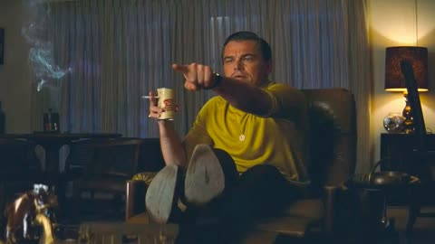</a>

整个运镜以男子指向电视的手指为引导方向，镜头顺着手势飞向屏幕。提示词按秒分段，并把电视里的画面写成只有轻微呼吸和酒杯晃动的活画面，使穿屏进入与第二张参考图的构图衔接自然。

MiniMax H3 · 首尾帧 · 出处: [@CharaspowerAI on X](https://x.com/CharaspowerAI/status/2091223949099368797) · 1,005 赞，统计于 2026-10-29

[`fpv`](tags.md#tag-fpv) [`one-take`](tags.md#tag-one-take) [`tv-portal`](tags.md#tag-tv-portal) [`reference-images`](tags.md#tag-reference-images)

<details><summary><b>提示词</b></summary>

```text
Here’s the prompt it created for this FPV sequence 👇
Use Image 1 as the exact opening frame and Image 2 as the exact destination world, creating one uninterrupted 15-second ultra-smooth cinematic FPV one-take with no cuts, no glitches, no teleportation, no jumpy motion, and no visible camera, as if an invisible stabilized micro-FPV lens is drifting naturally through a warm, lived-in living room and then physically flying into a television to emerge inside the second scene. Begin by preserving Image 1 perfectly: the man stays in the same yellow knit shirt, seated deep in the leather recliner with his boots propped up, cigarette smoke rising from his right hand, beer can still present, his left index finger urgently pointing toward the television in the direction he is already gesturing, with the same casual-but-suddenly-focused expression, the same residential living room geometry, the same pleated curtains, table lamp glow on the right, worn boot soles in the foreground, leather reflections, knit texture, and nostalgic warm low-key lighting. For the first 0–3 seconds, start almost motionless and then begin a very subtle forward FPV drift with a slight sideways arc that feels physically weighted and organic, skimming past the foreground boots and the armrest edge while the camera naturally aligns itself with the line of his pointing finger; use the gesture as the guiding vector for the whole move, letting the viewer feel the television is the true target of the composition. Between 3–7 seconds, perform a smooth curved tracking arc around the man’s pointing side, maintaining his face, hand, smoke, chair, and curtains in consistent perspective while progressively revealing the television in the room; the motion should feel like a real flying camera easing around a seated subject, not a pan or zoom, with strong parallax between the foreground boots, the midground man, and the soft curtain plane behind him. As the television becomes visible, its screen should already contain Image 2 as a living cinematic scene, not a static frame: the same blonde man in a black tuxedo jacket, white shirt, and black bowtie, with slicked-back hair, a knowing confident smile, and a champagne coupe raised toward camera, but animated with subtle, elegant human micro-motion only—soft breathing and natural chest rise, a faint head-and-shoulder shift, natural blinking and tiny eye movement, minimal facial micro-expressions that preserve the original confident smile, slight hand and finger adjustment around the glass, a gentle wrist rotation or small lift of the coupe, delicate liquid movement inside the glass caused by the motion, tiny reflections sliding across the glass surface, a subtle weight shift through the body, and barely perceptible cloth movement in the tuxedo from breathing and posture. From 7–11 seconds, gradually accelerate directly toward the television in a smooth, elegant FPV approach, keeping the man in Image 1 and the TV in a single spatial relationship, with realistic lens behavior, soft screen reflections, faint glass depth, slight perspective distortion at the screen surface, and natural falloff in depth of field as the screen grows larger and larger until it dominates the frame. The television surface must feel physically real, with subtle room reflections and believable contrast between the screen image and the surrounding bezel, and the approach must remain seamless, continuous, and stable, with no abrupt zoom, no wobble, and no transition artifacts. As the camera gets closer, the motion inside the TV should continue naturally and remain alive, with the character’s breathing, blinking, tiny gaze shifts, and champagne glass micro-movements persisting uninterrupted so the screen feels like a real moving scene rather than a frozen image. From 11–15 seconds, the camera flies through the television screen in one uninterrupted motion, crossing the glass plane invisibly so that the screen image expands to full frame and becomes the actual world of Image 2 behind it; at the exact crossing moment, perfectly match the perspective, lighting, and framing of the TV image so the transition is imperceptible, as if the television were a real window into that scene. Once inside Image 2, preserve the tuxedoed blond man exactly: his slicked-back hair shape, confident direct gaze, black bow tie, white shirt collar, champagne coupe, shallow depth of field, sparkling bokeh background, glossy highlights on glass, and opulent celebratory atmosphere, while continuing the same minimal natural motion—breathing, blinking, tiny facial changes, minute hand and glass adjustments, and subtle liquid and reflection movement—so the final image feels alive and cinematic rather than frozen. Continue a gentle deceleration after entry so the final frame settles into a composition very close to Image 2: his face sharp, the raised glass elegant in the foreground, reflective highlights crisp, background bokeh glowing softly, and the overall mood polished, cinematic, and premium. The final image should feel like a flawless Hollywood-level FPV match transition from a warm domestic interior into an opulent toast scene, with realistic parallax, physically believable motion blur, subtle smoke, rich contrast, stable facial identity, correct anatomy, consistent clothing, faithful room continuity, seamless screen-entry logic, living motion inside the TV, and a perfectly composed hero ending frame.
```

</details>

<a id="seedance-mall-zombie-outbreak"></a>
### 商场突发丧尸潮

<a href="https://x.com/auqibhabib/status/2104107269206237325"></a>

从正常营业写起，丧尸才有东西可打破；结尾落在安静的一拍，不是爆炸。

Seedance 2.5 · 文生视频 · 出处: [@auqibhabib on X](https://x.com/auqibhabib/status/2104107269206237325) · 1,002 赞，统计于 2026-10-27

[`horror`](tags.md#tag-horror) [`action`](tags.md#tag-action) [`crowd`](tags.md#tag-crowd)

<details><summary><b>提示词</b></summary>

```text
Create a photorealistic live action horror short film set inside a busy modern shopping mall during normal operating hours. The scene must feel like a real emergency captured by a human handheld camera operator, not a choreographed action movie. Prioritize realistic human behavior, believable physics, natural body movement, consistent character appearance, spatial continuity, practical effects and authentic environmental detail.

MAIN CHARACTER: A male mall security guard in his late 30s wearing a realistic dark security uniform and carrying a radio. Keep his face, clothing, body proportions and equipment identical throughout the entire video.

SURVIVORS: A small group of ordinary shoppers with realistic clothing and consistent appearances. Their faces, clothing and body proportions must remain unchanged throughout the sequence.

0–4 SECONDS:
Begin immediately in the food court with shoppers eating and walking normally. Without warning, an infected man suddenly attacks a nearby shopper. The attack is chaotic and physically messy rather than theatrical. The victim falls against a table, knocking over food and drinks. Nearby shoppers freeze for a moment because they do not understand what is happening.

4–8 SECONDS:
Several shoppers back away. One person briefly tries to help before realizing the attacker is dangerous. Chairs scrape across the floor as people retreat. The security guard hears the disturbance and runs toward the food court. His reaction is confused and concerned, not heroic.

8–12 SECONDS:
The infected attacker suddenly rushes toward another shopper. The crowd finally realizes something is seriously wrong. Panic spreads naturally. People run in different directions instead of moving together. Some hide behind storefronts while others run toward exits. Shopping bags and personal belongings fall naturally as people flee.

12–16 SECONDS:
The security guard reaches the food court and sees two infected people approaching. He grabs a nearby metal crowd-control barrier for protection. He initially backs away while watching them. One infected suddenly charges. The guard swings the barrier defensively and knocks the attacker off balance. The movement must look heavy, awkward and physically difficult, never like professional choreography.

16–20 SECONDS:
A few shoppers help each other retreat behind a storefront entrance. One person pulls an injured shopper away from the food court. Nobody performs exaggerated combat moves. The guard keeps backing toward the survivors while maintaining distance from the infected.

20–24 SECONDS:
One infected suddenly charges again. The guard sidesteps at the last moment. The infected crashes into the glass railing from its own momentum. The glass cracks realistically but does not explode into an unrealistic shower of fragments. The guard immediately moves the survivors farther away.

24–27 SECONDS:
The survivors move together toward a partially closed storefront. The guard stays behind them and keeps watching the infected. Distant screaming comes from another section of the mall, suggesting the outbreak is larger than what the camera has witnessed without showing an unnecessary crowd of zombies.

27–30 SECONDS:
The group reaches temporary safety behind the storefront. The guard slowly looks through the gap toward the food court. The mall has become eerily quiet. An escalator continues running in the background while abandoned shopping bags, overturned chairs and spilled food remain scattered across the floor. A distant infected figure briefly crosses the far end of the mall. The guard quietly raises one finger, signaling everyone to stay silent.Cut naturally to black.
```

</details>

<a id="wan-cafe-camel-coat-character-sheet"></a>
### 咖啡馆柜台前身穿驼色大衣的男人

<a href="https://x.com/ivanka_humeniuk/status/2113582628024566084"></a>

先用一张参考图生成三视图角色设定板，左侧为正面和背面全身，右侧为一张细致的头像。正面全身的脸被有意虚化，让头像成为唯一的面部参考，同时写清服装、面料和胶片质感，让角色在多个场景中保持一致。

Wan 3.0 · 参考生视频 · 出处: [@ivanka_humeniuk on X](https://x.com/ivanka_humeniuk/status/2113582628024566084) · 878 赞，统计于 2026-10-27

[`character-consistency`](tags.md#tag-character-consistency) [`reference-sheet`](tags.md#tag-reference-sheet) [`cafe`](tags.md#tag-cafe) [`film-look`](tags.md#tag-film-look) [`romance`](tags.md#tag-romance)

<details><summary><b>提示词</b></summary>

```text
Create a three-panel character reference sheet of the woman in
@image1
 in a single wide 16:9 image.
Preserve her exact facial identity, blue eyes, dark espresso-brown hair color, skin tone and natural facial
proportions from
@image1
.
The left half contains two full-body views side by side: front and back, identical in scale, with both figures
completely visible from above the bun to below the shoes. The right half contains one large
head-and-shoulders portrait, facing directly into the camera. All three views share one continuous neutral
mid-grey studio backdrop, matching soft lighting and the same warm film color treatment.
In the full-body front view, replace the facial features with a smooth, softly blurred skin-toned oval. Keep the
hairstyle and head silhouette intact. The large portrait on the right is the only detailed face reference.
Restyle her exceptionally long, thick hair into a high, generously sized, loosely sculpted bun at the crown.
Preserve the fullness of her hair, with lifted roots and soft volume around the head. Two delicate curved
tendrils fall beside her temples toward her jaw, framing the outer edges of her face. Her eyebrows, blue eyes
and cheekbones remain clearly visible. The back view shows the gathered hair and the substantial rounded
shape of the bun. The hairstyle feels elegant and practical, like a beautiful café waitress in a romantic film
from around 2000.
Dress her in a fitted ivory fine-knit top with short sleeves and a modest scoop neckline, tucked into a
high-waisted black tailored pencil skirt ending at the knees. The skirt has a small functional back vent. Over it,
she wears a short deep-burgundy cotton waist apron, extending from the waist to mid-thigh, with two discreet
rectangular front pockets. Narrow apron ties wrap around her waist and form a neat bow at the center of her
back, clearly visible in the rear view. Her shoes are simple black leather ballet flats with gently rounded toes
and low flat heels. Small plain gold stud earrings complete the outfit.
Her figure is tall and slender, with a defined narrow waist, long legs and a graceful neck. The clothing follows
her natural proportions, with realistic knit texture, tailored seams and soft cotton folds around the apron ties.
02
The same outfit, fit, hem lengths and hairstyle appear in all three views.
In the front view she stands upright, square to the camera, shoulders level, weight evenly balanced, arms
relaxed at her sides and hands empty. The back view shows the identical stance turned fully away. In the
portrait her head is upright, chin level and both eyes look directly into the lens. Her lips are gently closed with
a faint, relaxed smile. Preserve the recognizable face from
@image1
, with natural skin texture, visible pores
and fine facial hairs.
Soft frontal studio lighting keeps her features and clothing clearly readable, with gentle shading under the
chin and soft contact shadows beneath the shoes. The grey backdrop remains plain throughout the image.
The composition consists entirely of the three views and the seamless backdrop.
Maintain a glamorous late-1990s to early-2000s 35mm film publicity look: warm natural skin, creamy ivory
fabric, rich burgundy cotton, deep readable blacks, fine organic grain and restrained highlight glow. Her face,
blue eyes, hair strands and garment details remain clearly resolved. Clean presentation with uninterrupted
backdrop between the views.

📌 PROMPT 2 (Guy map):
Create a three-panel character reference sheet of the man in
@image1
 in one wide 16:9 image. Preserve his
exact face, eye color, skin tone, facial proportions and hairstyle from the reference, including the natural
swept-back waves and the loose strand near his forehead.
The left half of the image contains two full-body figures side by side: a straight-on front view and a complete
back view, identical in scale, both visible from above the hair to below the shoes. The right half contains one
large head-and-shoulders portrait looking directly into the camera, with his entire hairstyle inside the frame.
All three views share one continuous neutral mid-grey studio backdrop.
On the full-body front figure, replace the facial features with a smooth, softly blurred skin-toned oval,
retaining the head silhouette and hair. The large portrait on the right is the single detailed face reference.
He is tall, approximately 188 cm, with broad shoulders, a lean athletic build, a defined waist and long legs. His
proportions remain natural and identical across all three views.
Dress him in an elegant camel-colored wool-and-cashmere overcoat reaching just below the knees. The coat
has broad notched lapels, softly structured shoulders, a single-breasted three-button front, discreet welt
pockets and a single center-back vent. He wears it fully unbuttoned, its front panels hanging naturally to
reveal the clothing underneath. The fabric is substantial, softly brushed and richly textured, with realistic
weight and long vertical folds.
Under the overcoat, he wears a dark chocolate-brown tailored wool blazer with a two-button front, worn
unbuttoned, over a pale-blue cotton shirt with a pointed collar and the top button undone. The shirt is tucked
neatly into high-waisted charcoal-grey wool trousers with a single pleat on each side, a relaxed straight leg
and a slight break over the shoes. A dark-brown leather belt with a small brushed-metal buckle completes the
waist.
His shoes are polished dark-brown leather penny loafers with matching dark socks. A slim rectangular gold
wristwatch on a dark-brown leather strap sits on his left wrist, partly visible beneath the cuff. The styling has
04
the understated elegance of a wealthy young man in a romantic film set around 2000.
In both full-body views, he stands upright with shoulders level, weight evenly balanced and arms relaxed
slightly away from his sides so the coat silhouette remains readable. His hands are empty. The back view
shows the coat's full length, center seam, vent and natural drape.
In the large portrait, his face is strictly frontal, head upright, chin level and both eyes directed into the lens.
His lips are relaxed and closed. Preserve the exact facial structure, subtle beard shadow and natural skin
texture visible in
@image1
. The portrait includes the camel coat lapels, brown blazer and pale-blue shirt
collar.
Soft, even studio lighting keeps his face and all clothing details clearly readable, with gentle facial shading,
broad highlights on the wool and soft contact shadows beneath both pairs of shoes. The backdrop is plain and
continuous, with clean empty space separating the three views.
Maintain warm late-1990s to early-2000s 35mm film color: natural warm skin, rich camel wool, deep
chocolate tailoring, soft pale-blue cotton and readable charcoal shadows. Fine organic film grain and
restrained highlight glow give the image a tactile cinematic finish while the face, hair and garment
construction remain clearly resolved.

📌 PROMPT 3 (Cake box map):

A photorealistic pastry packaging reference sheet on a uniform medium-grey seamless studio background, horizontal 16:9 composition, divided into two equal side-by-side views. The surface beneath both boxes and the background are the same neutral grey.

On the left, a closed rectangular ivory cardboard pastry box with a fitted hinged lid, viewed from a slightly elevated three-quarter angle. Matte cardboard, subtle paper texture, clean folded edges and a plain unprinted surface.

On the right, exactly the same box at the same scale, with its hinged lid fully raised behind it. A higher three-quarter viewing angle clearly reveals the contents: six individual chocolate mousse pastries arranged in two rows of three, each on a small gold pastry board. Comfortable spacing makes every pastry’s complete silhouette visible.

Each pastry has a playful, stylized penis shape: a smooth rounded elongated form with two rounded lobes at the base, recognisable as a humorous bachelorette-party confection. All six share the same shape and size, with glossy milk-chocolate mirror glaze and a tiny touch of edible gold leaf. Smooth moulded chocolate surfaces and appetising highlights give them the appearance of carefully crafted patisserie desserts.

The box dimensions, ivory colour and construction are identical in both views. Neatly fitted ivory food-safe paper lines the interior. Both boxes are fully visible with comfortable grey space around them.

Soft studio lighting, gentle contact shadows, clear high-resolution detail and natural optical sharpness with restrained sharpening. Subtle fine film grain and softly warm highlights, consistent with late-1990s cinematic photography. The entire surrounding background remains solid neutral medium grey.

📌 PROMPT 4 (Cafe map):

Create a cinematic location reference photograph of an intimate, elegant neighbourhood café in the year 2000, shortly before closing on an autumn evening. One wide horizontal 16:9 image showing a single coherent interior, photographed at eye level from the customer side, looking diagonally toward the service counter. A natural 28mm lens perspective with straight architectural lines and clearly readable room geography.

A long service counter occupies the right half of the composition, running from the foreground toward the back wall. It has a polished dark walnut front with recessed wooden panels and a warm ivory stone countertop. The central serving section is a broad, clear, uninterrupted surface, ready for a pastry box and a conversation between a standing customer and the waitress behind the counter. This section of the counter is bare, with the stone surface fully visible.

Behind the counter is a comfortable working aisle. The rear service wall contains dark wooden shelves, neatly arranged porcelain dishes, a stainless-steel espresso machine and a small period-appropriate cash register at the far end. A wooden doorway in the back wall leads to the kitchen. A small glass pastry display stands at the far end of the counter, leaving the main serving area open.

On the left side of the room, three small dark wooden tables stand beside burgundy leather banquette seating along the wall. Each table has two bentwood chairs and a small glass sugar dispenser. Above the banquette hang framed botanical prints and warm brass wall sconces with ivory shades. The walls are painted creamy butter yellow above dark wooden wainscoting. The floor is laid with small cream and muted terracotta tiles.

At the far left, tall street-facing windows and a glazed wooden entrance door reveal a quiet city street at dusk. Soft, cool evening light enters through the windows, balanced by warm pools of light from the wall sconces and three opal-glass pendant lamps above the counter. The entrance, seating area, service counter and kitchen doorway are all clearly visible within the same spatially consistent room.

The café feels established, lovingly maintained and slightly worn: subtle patina on brass fittings, gentle wear on the leather seats, fine scratches in the wooden furniture and realistic texture in the plaster walls. The tables are neatly reset for the end of the evening. The room is unoccupied so its layout and furnishings are fully visible.

The visual atmosphere is a romantic feature film from 1999–2000, captured on 35mm film: warm amber practical lighting, creamy highlights, rich walnut brown, muted burgundy and natural shadow detail. Fine film grain, subtle halation around glowing lamps and soft highlight roll-off. Maintain enough depth of field to clearly describe the counter, seating and rear service wall. Photorealistic materials, believable proportions and an inviting, lived-in atmosphere. A clean cinematic location photograph filling the entire frame.

📌 PROMPT 5 (Animation prompt):
SCENE CONTEXT A 30-second scene in a neighbourhood café in the year 2000, near closing time. A headstrong waitress packs her handmade pastries. A wealthy customer approaches to pay, interrupts her work with questions, tastes a sample and asks her to pose as his girlfriend at dinner.  Play this as a lively romantic dramedy with friction, humour and unexpected attraction. She wants to finish her work and refuses to entertain his casual charm. He wants to keep her attention and finds himself having to earn it. Their reactions evolve naturally as they listen to each other.  ACTIVE REFERENCES
@image1
 — the waitress. Use the detailed portrait for her exact face and the full-body views for her work outfit and high loose bun.
@image2
 — the customer. Preserve his exact face, hair and clothing, including the unbuttoned camel overcoat.
@image3
 — the café architecture, counter, furnishings and dusk outside.
@image4
 — one ivory pastry box and its six chocolate novelty pastries. Preserve their shapes, chocolate glaze, gold decoration and individual gold boards. The panels show two states of the same box.  SPACE AND PROPS She stands behind the counter; he approaches on the customer side. In shared shots he is screen-left, she is screen-right. Keep the camera on the same side of their dialogue axis, maintaining matching eyelines.  The box begins open with five pastries inside. She is placing the sixth into the remaining space, holding its gold board. Beside the box is a small ivory plate with an additional matching dessert cut into two portions and a dessert fork. He samples this separate dessert; the six boxed pastries remain whole.  He carries a folded banknote in his left hand, ready to pay. His right hand is free. The central serving surface contains the box and tasting plate. Cups stay on the background shelves.  CAMERA AND EDITING 16:9, 30 seconds, real-time action. Film coverage with foreground depth, deliberate camera movement, expressive changes in shot size and motivated focus pulls. Hard cuts at the listed boundaries. Stable focal length within each shot. Let performances flow inside the shots, with natural listening and gestures overlapping speech.  0.0–3.0 SECONDS 63° FOV. A short lateral tracking shot moves along the customer side of the counter with the approaching man, revealing the waitress already at work beyond him. The polished counter creates a strong diagonal into the frame. She places the final pastry into the box. He stops opposite her, notices the contents and suppresses a laugh. She remains occupied with packing.  HARD CUT — 3.0–5.5 SECONDS 47° FOV. Low oblique view across the open box: the pastries are sharp in the foreground, his face visible beyond them. Pull focus from the chocolate shapes to his amused expression as he looks up at her. MAN: “Is this the new menu?” He is teasing, expecting an easy smile in return.  HARD CUT — 5.5–10.5 SECONDS 47° FOV. Side-on medium shot of the waitress, her face and hands visible, his coat softly framing one edge. WOMAN: “Test batch for a bachelorette party. My coworkers approved.” She answers with dry impatience while straightening the paper inside the box. She gives him a pointed look on “approved,” then slides the tasting plate toward him with a brisk, controlled gesture: he can taste it and let her finish. The plate stops within his reach. Her delivery has bite and personality; her attention moves naturally between him and her work.  HARD CUT — 10.5–14.5 SECONDS 47° FOV. Counter-height three-quarter medium shot of the man, showing his face and right hand, with the box edge in the foreground. He takes a small forkful from the cut dessert. As he tastes, his teasing manner gives way to spontaneous appreciation. He finishes the bite and lowers the fork onto the plate. She is visible at the edge of frame, briefly watching to see whether he likes it before returning to her work. The banknote remains in his left hand.  HARD CUT — 14.5–20.5 SECONDS 47° FOV. A layered two-shot looking diagonally along the counter, both faces readable. The camera makes a gentle lateral move that settles as their eyes meet. MAN: “You make these yourself?” His interest is genuine now. WOMAN: “After my shifts. I'm saving for my own bakery.” She answers firmly, with pride beneath the impatience. For a moment she engages fully because her bakery matters to her. Then she returns her attention to the box. He watches her and considers his next words.  HARD CUT — 20.5–24.0 SECONDS 29° FOV. Medium close-up of the man from beside her shoulder. A slow, restrained dolly inward makes the conversation feel more personal. MAN: “Have dinner with me tonight?” He attempts an easy invitation, but there is a real question in his eyes. Allow a short listening beat after the line.  HARD CUT — 24.0–30.0 SECONDS 29° FOV. Close-up of the waitress from his eyeline, her face in three-quarter view and his blurred shoulder at the edge. Begin with a very slight forward camera move. She looks up from her work and gives him a brief, sceptical half-smile, amused by his nerve. MAN, naturally offscreen: “With my family. As my girlfriend.” His voice hesitates briefly between the two phrases.  Stay on her throughout his clarification so the audience sees it land. Her half-smile disappears; she stops what she is doing and looks directly at him with an immediate, incredulous reaction. She lets out a short disbelieving breath and settles her right palm on the counter. The camera settles with her. Hold the final moment as she silently sizes him up, ready to challenge him. End after the hand movement is complete, on her living reaction.  ACTING Give the actors room for spontaneous conversational behaviour. She is spirited, quick and proud, with dry humour and a short tolerance for being patronised. Her annoyance changes with the conversation: she dismisses his teasing, briefly cares about his response to her baking, defends her ambition and finally reacts to the audacity of his request.  He starts charming and self-assured, adjusts when she gives him little encouragement, becomes genuinely impressed by the dessert and risks the invitation. His confidence becomes less certain as he waits for her response.  Use connected reactions, natural breaths, shifts of attention and expressive vocal rhythm. Each person listens while the other speaks. Movements arise from packing, tasting and trying to hold or end the conversation. Keep their faces recognisable and their physical behaviour grounded.  LIGHTING AND COLOUR Preserve the café's amber pendant lamps, brass sconces and cool dusk windows. Soft directional side lighting shapes their faces, with darker shadow cheeks and gentle reflected fill preserving their eyes. Photograph from the shadow side. Loose hair, camel wool and chocolate glaze catch warm highlights.  Fixed 4000K white balance. Rich walnut browns, burgundy leather, creamy practical highlights and deep textured shadows. Natural skin colour beneath the warm light. Consistent lighting across all angles.  AUDIO — FIXED CHARACTER VOICES WOMAN VOICE: Adult woman in her mid-twenties; medium pitch, warm clear mezzo speaking voice with a lightly husky lower register, neutral General American accent, natural conversational rhythm, crisp intelligible consonants and restrained expressive inflection. MAN VOICE: Adult man in his early thirties; medium-low pitch, warm resonant baritone with a subtle dry rasp, neutral General American accent, measured conversational rhythm, clear articulation and understated playful inflection.  Preserve these vocal identities. Her delivery is dry, spirited and impatient, becoming firm when discussing her bakery. His delivery moves from playful confidence to sincere curiosity and slightly hesitant persuasion.  Use the written English dialogue exactly. Clear turn-taking and accurate lip synchronisation for visible speakers. His final clarification is heard offscreen while the camera stays on her reaction.  Quiet café room tone, distant traffic, paper rustle, a soft plate scrape, the fork touching porcelain and her final palm contact. Keep dialogue clear and foregrounded.  FILM LOOK Late-1990s theatrical romantic dramedy captured on visibly textured 35mm film. Organic moving grain is clearly perceptible across midtones, skin and shadows at normal playback size. Warm halation surrounds the glowing lamps; bright reflections bloom gently. Rich film-print contrast, creamy highlight roll-off and natural optical sharpness with restrained edge enhancement. Preserve readable eyes, realistic skin and fabric detail beneath the film texture. Natural motion blur and 24 fps cinematic cadence.  CONTINUITY After packing, all six boxed pastries remain whole and in place. The separate tasting dessert retains its missing bite. The box stays open on the same section of counter. After the slide, the tasting plate and fork remain on his side. His banknote stays in his left hand. Maintain exact faces, hair, clothing, screen direction, café geometry and dusk throughout. Reference sheets guide appearance; the output is full-frame cinematic footage.
```

</details>

<a id="seedance-airport-immigration-makeup-wipe"></a>
### 机场入境卸妆喜剧十二镜头短片

<a href="https://x.com/ElsaSofia__AI/status/2107290801017704458"></a>

每一部分都重复角色设定,锁定脸部、服装和场景,12个镜头都标有精确时间戳和分镜编号。每个镜头写明景别与机位运动,结尾的特效清单和情绪曲线控制30秒实时节奏。

Seedance 2.5 · 文生视频 · 出处: [@ElsaSofia__AI on X](https://x.com/ElsaSofia__AI/status/2107290801017704458) · 740 赞，统计于 2026-10-27

[`multi-shot`](tags.md#tag-multi-shot) [`comedy`](tags.md#tag-comedy) [`close-up`](tags.md#tag-close-up) [`timestamped`](tags.md#tag-timestamped) [`character-consistency`](tags.md#tag-character-consistency)

<details><summary><b>提示词</b></summary>

```text
VIDEO PROMPT — 30 seconds total, 16:9, live-action cinematic realism, soft natural airport light, shallow depth of field, clean commercial look. Comedic drama, played straight. Keep the same faces, outfits and location in every shot. NO slow motion anywhere, everything runs in REAL TIME.

CHARACTERS (repeat in every part)
HEROINE: young Korean woman in her 20s, long wavy black hair, porcelain skin. FULL GLAM makeup at first: gold shimmer eyeshadow, long dramatic false lashes, pink blush, glossy rose lips. Wears a sheer dark-brown mesh long-sleeve top over a black bandeau, with a thin gold-chain crossbody bag strap. In the walking shot she also wears a denim mini skirt, black ankle boots, and pulls a pink rolling suitcase.
OFFICER: Korean woman in her 40s, dark hair pulled back tight, strict calm face, navy uniform jacket with a red-white-navy striped scarf.
PASSPORT: dark-blue Korean passport. The photo page shows the heroine's BARE-FACED, tired, messy-haired ID photo, with Korean text and a small blue flag icon.
LOCATION: Korean international airport immigration hall — shiny marble floor, rows of small round ceiling lights, beige columns, blue digital signs, travelers with suitcases walking in the background.

===== PART 1 (0:00-0:13) =====

SHOT 1 (00:00-00:02.2) — Counter Wide [Panel 1]
Front-facing medium-wide, eye level. The heroine stands behind the immigration counter, one hand on her hip, then takes the blue passport from her bag and places it on the counter edge. Travelers walk in the blurred background. Camera static.

SHOT 2 (00:02.2-00:04.6) — Passport POV [Panel 2]
Over-the-counter POV close-up of the officer's hands picking up the passport, turning it, then opening it to the photo page with her thumb. The bare-faced ID photo is clearly readable. Camera static, shallow depth of field.

SHOT 3 (00:04.6-00:06.6) — Suspicious Finger [Panel 3]
Medium shot over the officer's shoulder (back of her head on the right). The officer points a finger at the heroine's face and moves it up and down as if comparing. The heroine looks uneasy with a small frown. Airport counters blurred behind.

SHOT 4 (00:06.6-00:10.2) — Eyelash Peel [Panel 4]
Extreme close-up of the heroine's glam face looking straight into the camera. Her fingers pinch the false lash and she slowly peels it off, holding it between her fingertips. Camera static.

SHOT 5 (00:10.2-00:12.9) — Face-Off Two-Shot [Panel 5]
Medium close-up: the heroine's face on the left, the officer's face in sharp profile on the right, very close, staring at her. The heroine looks back with a stiff blank expression, then purses her lips.

===== PART 2 (0:13-0:22) =====

SHOT 6 (00:13.0-00:14.0) — Wipe Out [Panel 6]
Close-up, airport lights blurred into soft bokeh behind her. The heroine pouts, takes out a white wet makeup wipe, and unfolds it with both hands.

SHOT 7 (00:14.0-00:19.0) — Makeup Removal [Panel 7]
Same close-up. She presses the wipe over her eyes, then wipes her cheeks and lips with both hands, eyes closed. At the end she lowers the wipe to reveal a fresh, bare, natural face and looks calmly into the camera.

SHOT 8 (00:19.0-00:20.6) — Officer Verdict [Panel 8]
Medium close-up of the officer, blurred teal-grey wall behind her. She looks down at the passport, then up at the heroine, and breaks into a satisfied small smile.

SHOT 9 (00:20.6-00:22.0) — The Stamp [Panel 9]
Close-up of the open passport on the counter. The officer's hand brings down a black-and-red rubber stamp onto the photo page and lifts it, leaving a round red stamp mark. Camera static.

===== PART 3 (0:22-0:30) =====

SHOT 10 (00:22.0-00:25.2) — Passport Returned [Panel 10]
Back to the opening wide shot. The heroine now has full glam makeup again. The officer's hand slides the passport across the counter. She picks it up and holds it with both hands at chest height, looking down at it, then glances toward the camera.

SHOT 11 (00:25.2-00:27.0) — Walk Away
Rear tracking shot: the heroine walks away through the terminal in denim mini skirt and black boots, pulling the pink suitcase. Travelers cross in the background, blue digital signs glow. Camera follows at eye level.

SHOT 12 (00:27.0-00:30.4) — Final Pout [Panel 11-12]
Close-up: she looks back over her shoulder, then turns to face the camera. She pouts, scrunches her face and squints in cute annoyance, then returns to a flat pout. Blurred airport behind. Hold, then end.

MASTER EFFECTS INVENTORY
1. Eyelash peel close-up (Shot 4).
2. Makeup wipe transformation: glam to bare face (Shots 6-7).
3. Over-the-shoulder suspicion framing (Shots 3, 5).
4. Passport insert close-ups and stamp (Shots 2, 9).
5. Shallow depth-of-field bokeh throughout.

ENERGY ARC
Part 1 (0-13s): tension, suspicion.
Part 2 (13-22s): transformation, then relief.
Part 3 (22-30s): she walks off, final grumpy pout.
```

</details>

<a id="seedance-papercraft-boy-red-balloon-short"></a>
### 纸艺男孩循着红丝带找回气球

<a href="https://x.com/umesh_ai/status/2086049974241104085"></a>

参考图锁定折纸质感，提示词用编号的 15 个镜头列出节拍并指定音效。钢琴与钟琴只在发现和情感时刻出现，其余镜头以环境音为主，稀少的对白让 30 秒的片子保持平静。

Seedance 2.5 · 参考生视频 · 出处: [@umesh_ai on X](https://x.com/umesh_ai/status/2086049974241104085) · 631 赞，统计于 2026-10-29

[`papercraft`](tags.md#tag-papercraft) [`stop-motion`](tags.md#tag-stop-motion) [`reference-image`](tags.md#tag-reference-image) [`storyboard`](tags.md#tag-storyboard)

<details><summary><b>提示词</b></summary>

```text
Create a 30-second short film in the same handcrafted miniature papercraft style as the reference image: folded-paper characters, visible fibers, tiny imperfections, soft natural light, shallow depth of field, gentle stop-motion movement, and cozy miniature environments. Keep the pace calm, curious, and magical. Use dialogue sparingly. Let natural ambience carry most scenes, with a soft piano and glockenspiel theme appearing only during discoveries and emotional moments.  15 shots:  Morning. The boy ties his shoes beside the front door while rain taps the window.  His mother hands him a tiny paper umbrella. “Looks like rain.”  Outside, he notices a little red balloon caught in a tree.  A handwritten tag hangs from it: “Please bring me home.”  Curious piano notes begin as he frees the balloon.  He walks through a misty vegetable market, balloon floating behind him.  An old fruit seller points uphill. “I saw one like that yesterday.”  The boy cycles toward a quiet hill, following tiny red ribbons tied to fences.  He stops at a railway crossing as a miniature train slowly passes.  On the other side, a curious dog begins following him.  Rain suddenly pours. The boy and dog shelter inside an abandoned bus stop.  He notices a child’s drawing taped beneath the roof: the same red balloon.  Following the final ribbon, they reach a tiny house beside a sunflower field.  A little girl opens the gate and gasps, “You found Ruby!” The music gently returns as she hugs the balloon.  The boy rides home at sunset with the dog now sitting proudly in his bicycle basket. He laughs, “I guess you’re coming too.”
```

</details>

<a id="kling-manhattan-panic-nine-shot-sequence"></a>
### 身穿条纹睡袍的惊慌女子冲上曼哈顿街头

<a href="https://x.com/higgsfield_ai/status/2019314800409600470"></a>

每个镜头单独编号，写明景别、镜头运动和一个具体动作。穿插微距细节和情绪反差的平静画面来制造节奏，并反复写出主角的外观，让她在各镜头间保持一致。

Kling 3.0 · 文生视频 · 出处: [@higgsfield_ai on X](https://x.com/higgsfield_ai/status/2019314800409600470) · 622 赞，统计于 2026-10-27

[`multi-shot`](tags.md#tag-multi-shot) [`cinematic`](tags.md#tag-cinematic) [`handheld`](tags.md#tag-handheld) [`macro`](tags.md#tag-macro) [`city`](tags.md#tag-city)

<details><summary><b>提示词</b></summary>

```text
Shot 1: High-intensity handheld tracking shot. A young woman with disheveled blonde hair, wearing a white tank top under a vibrant red and blue vertical-striped silk robe, bursts out of a shadowy alleyway. Her face is a mask of pure panic as she stumbles onto a sun-drenched Manhattan sidewalk, the camera shaking to mirror her frantic movements.

Shot 2: Medium shot, shallow depth of field. A middle-aged businessman in a charcoal suit and navy tie stands amidst a sea of pedestrians. He checks his silver watch with a sharp, rhythmic jerk of his wrist, his brow furrowed in annoyance. The background is a blur of yellow taxis and the towering architecture of 5th Avenue.

Shot 3: Extreme macro photography. The camera focus is locked onto the tip of a silver watch hand as it clicks forward. Microscopic dust motes dance in the harsh sunlight reflecting off the brushed metal surface of the dial.

Shot 4: Low-angle medium shot. Rapid-fire motion of a street drummer’s hands hitting a series of weathered white plastic buckets. The wooden drumsticks are a blur of motion, and the camera captures the vibration of the plastic lids as the city crowd flows past in a time-lapse-like stream.

Shot 5: Low-angle medium shot. The woman in the striped robe has stopped running; she is hunched over, hands on her knees, gasping for breath. The camera remains low, making the surrounding skyscrapers feel like they are closing in on her as she looks around, disoriented.

Shot 6: Macro close-up, high contrast. A man’s stubbled face as he inhales from a cigarette. The paper crinkles and the tobacco glows a fierce, molten orange before instantly turning into a delicate, flaky grey ash that threatens to fall.

Shot 7: Extreme close-up of the woman's face, focusing on her piercing blue eyes. Her pupils are dilated, and her forehead is deeply wrinkled with anxiety. The reflection of the busy street and moving vehicles can be seen glinting in her irises.

Shot 8: Medium-wide lifestyle shot. Two young Asian women walk across a city crosswalk, bathed in warm afternoon "golden hour" light. They are laughing and talking, creating a sharp emotional contrast to the previous shots of distress.

Shot 9: Final tight close-up. The blonde woman stares directly into the lens, her expression shifting from confusion to absolute shock. She slowly brings her hand up, her fingers trembling, to cover her mouth as her eyes well up with fear.
```

</details>

<a id="h3-jesse-digging-office-crossover"></a>
### 杰西在郊外院子里挖一个深坑

<a href="https://x.com/WolfRiccardo/status/2084402067120988527">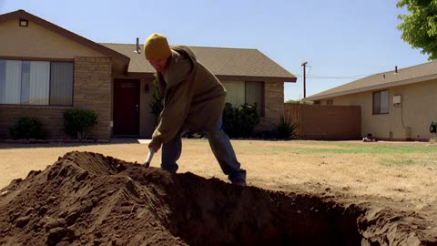</a>

每个时间段都单独写明镜头、动作和声音，让一段提示词按顺序驱动15秒的完整场景。台词放在对应时间段内并注明说话人和情绪，使对白与表情和镜头保持同步。

MiniMax H3 · 文生视频 · 出处: [@WolfRiccardo on X](https://x.com/WolfRiccardo/status/2084402067120988527) · 615 赞，统计于 2026-10-29 · 发现于 [SkyNotSilent/awesome-MiniMax-H3-cases](https://github.com/SkyNotSilent/awesome-MiniMax-H3-cases)

[`minimax-h3`](tags.md#tag-minimax-h3) [`crossover`](tags.md#tag-crossover) [`dialogue`](tags.md#tag-dialogue) [`handheld`](tags.md#tag-handheld) [`timestamped-shots`](tags.md#tag-timestamped-shots)

<details><summary><b>提示词</b></summary>

```text
The Office & Breaking Bad.
0:00–0:04 — Medium-wide handheld shot. Jesse angrily throws several shovelfuls of dirt into the deep hole. Realistic shovel impacts, scattering dirt, and heavy breathing. Dwight suddenly walks into frame, studies the hole suspiciously, and adjusts his glasses.

0:04–0:07 — Dwight looks down at Jesse with a smug, sarcastic expression and says:

“Hello, little man. Digging your own grave?”

0:07–0:11 — Jesse immediately stops digging, slowly turns toward Dwight, and tightly grips the shovel. With an angry, threatening expression, he replies:

“No, no, no… I’m digging it for you. Just like I did for Michael.”

0:11–0:15 — Dwight’s confidence instantly collapses. His face fills with horror, his eyes widen, and he begins crying and panicking dramatically. He grabs Jesse by the shoulders and screams:

“No! What did you do to Michael?! Where is he? Tell me now!”

Jesse remains completely emotionless, silently staring at Dwight while holding the shovel. The video ends abruptly on Dwight’s terrified face. 

#Flovaai #Flovacpp @Flovaai @Flovaai_Japan
```

</details>

<a id="seedance-classroom-sudden-gesture-push-in"></a>
### 课堂上同学们对突然的手势作出反应

<a href="https://www.reddit.com/r/Seedance_AI/comments/1x6t7ph/an_8second_classroom_drama_made_with_seedance_25">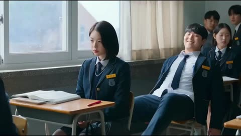</a>

用参考图锁定首帧,并写明保持人物、服装、布局和起始位置不变。随后只描写一个主动作,配合背景人物的延迟反应、一次缓慢推镜和短暂慢动作。

Seedance 2.5 · 图生视频 · 出处: [u/Independent-Date393 on Reddit](https://www.reddit.com/r/Seedance_AI/comments/1x6t7ph/an_8second_classroom_drama_made_with_seedance_25) · 558 赞，统计于 2026-10-28

[`classroom`](tags.md#tag-classroom) [`cinematic`](tags.md#tag-cinematic) [`push-in`](tags.md#tag-push-in) [`slow-motion`](tags.md#tag-slow-motion) [`reaction-shot`](tags.md#tag-reaction-shot)

<details><summary><b>提示词</b></summary>

```text
Create an 8-second cinematic video using the reference image. Preserve the characters, clothing, classroom layout, and starting positions.

A female student in a dark blue blazer suddenly extends her arm toward a male student seated on a wooden chair. He leans forward in surprise. Nearby students notice the movement and exchange nervous looks, reacting with slight delays.

Warm sunlight enters through large windows, revealing drifting dust above desks scattered with books and notebooks.

Use one slow camera push-in, natural movement, restrained facial expressions, and a brief moment of subtle slow motion during the gesture. Maintain consistent anatomy, lighting, and spatial relationships.

Realistic cinematic photography, 16:9 widescreen, 4K where supported. No text or watermark.
```

</details>

<a id="h3-1947-rural-town-wartime-vintage-film"></a>
### 1947年美国乡镇战地场景，复古胶片质感

<a href="https://x.com/RuzainaMeer/status/2087117707816714552"></a>

把15秒切成带时间码的分镜（建立镜头、紧张、交火、人情瞬间、拉远），每段都写明机位运动。环境、人物、画面风格和物理规则各自成块，再配上较长的负面提示词，稳住1940年代35mm纪录片质感，动作也不会失真。

MiniMax H3 · 文生视频 · 出处: [@RuzainaMeer on X](https://x.com/RuzainaMeer/status/2087117707816714552) · 377 赞，统计于 2026-10-28 · 发现于 [SkyNotSilent/awesome-MiniMax-H3-cases](https://github.com/SkyNotSilent/awesome-MiniMax-H3-cases)

[`historical`](tags.md#tag-historical) [`war`](tags.md#tag-war) [`documentary`](tags.md#tag-documentary) [`vintage-film`](tags.md#tag-vintage-film) [`timed-shots`](tags.md#tag-timed-shots)

<details><summary><b>提示词</b></summary>

```text
Create a 15-second ultra-photorealistic live-action war sequence set in the United States in 1947, designed to look like authentic historical footage captured on a 1940s film camera. The entire scene must feel grounded, documentary-like, raw, and physically realistic.
Environment: A rural American town in 1947 with wooden houses, old brick buildings, telephone poles, dirt roads, vintage American cars from the 1940s, wooden fences, farmland, and period-accurate street details. Overcast afternoon light, light fog, drifting smoke, dust in the air, damaged buildings, scattered debris, and a tense wartime atmosphere.
Characters: American soldiers wearing historically accurate late-1940s military uniforms, helmets, boots, and equipment. Civilians wear authentic 1940s American clothing. Natural faces, realistic skin texture, sweat, dirt, fatigue, and believable body movements.
0–3s — Establishing Shot:
Wide handheld shot of a quiet rural American street suddenly filled with smoke and confusion. Vintage 1940s vehicles are parked along the road while soldiers move quickly between wooden buildings. Civilians rush toward safer areas.
3–6s — Tension:
Camera moves through the street at shoulder height, following several soldiers as distant gunfire is heard. They immediately react and take cover behind a vintage vehicle and a brick wall. Their movements are cautious and realistic.
6–10s — Combat:
Fast handheld tracking shot as the soldiers move between cover while distant gunfire impacts the environment. Small pieces of wood, dust, and debris fall naturally from nearby impacts. Weapon recoil, movement, and body weight must be physically accurate. Keep the violence realistic and restrained.
10–13s — Human Moment:
Camera briefly focuses on a soldier helping an injured civilian move behind cover. Their breathing, facial expressions, body language, and movement should feel natural and unscripted.
13–15s — Final Shot:
Camera pulls back into a wide shot of the American town as smoke slowly moves through the street. Soldiers remain behind cover while vintage vehicles and damaged buildings fill the background. The scene ends with an authentic, tense 1940s documentary feeling.
Visual Style: Ultra-photorealistic live-action, authentic 1940s American environment, vintage 35mm film texture, subtle film grain, natural imperfections, realistic exposure, handheld documentary cinematography, muted historical color palette, realistic smoke and dust, natural shadows, accurate depth of field.
Physics: Strictly obey real-world gravity, momentum, inertia, friction, recoil, weight, collision physics, and human biomechanics. No exaggerated explosions, impossible movements, superhero behavior, or choreographed-looking combat.
Negative Prompt: modern buildings, modern cars, smartphones, modern clothing, modern weapons, futuristic technology, CGI appearance, video-game graphics, fantasy, superhero action, excessive explosions, excessive blood, gore, impossible physics, unrealistic recoil, slow-motion physics, distorted faces, extra limbs, floating objects, plastic skin, artificial-looking environments.
```

</details>

<a id="h3-tokyo-crossing-camera-angle-swap"></a>
### 同一路口的三个不同机位

<a href="https://x.com/magnific/status/2090423731055448271">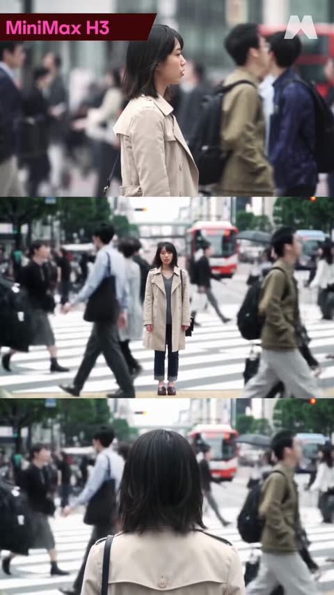</a>

源视频 [vid1] 锁定人物外观、节奏与静止状态，提示词明确不继承原机位和景别，因此只改变视角。单个机位描述槽加上“只出现一个人物”的约束，使人群和人物身份在新视角中保持一致。

MiniMax H3 · 视频编辑 · 出处: [@magnific on X](https://x.com/magnific/status/2090423731055448271) · 278 赞，统计于 2026-10-29

[`camera-angle`](tags.md#tag-camera-angle) [`pov-change`](tags.md#tag-pov-change) [`video-reference`](tags.md#tag-video-reference) [`street-scene`](tags.md#tag-street-scene)

<details><summary><b>提示词</b></summary>

```text
[vid1] defines the woman's identity. It also defines the scene: a busy Tokyo pedestrian crossing in soft overcast daylight, blurred crowds walking past in both directions, a red bus and city buildings in the background. It defines her performance and timing: she stands completely still facing forward while the crowd flows around her, her hair moving slightly in the breeze, her expression calm and steady with subtle lip movement.

Do not inherit the camera position, framing, or shot size from [vid1].

Generate the same sequence, at the same location and the same moment, seen from a different camera position:

[Add the camera description]

<City crossing ambience: footsteps, distant traffic, a crossing signal chirping>

Keep the woman's identity, hairstyle, trench coat, sweater, bag strap, posture, and stillness exactly as in [vid1]. Exactly one instance of the woman. The crowd flows around her without colliding. Do not change the time of day, weather, or location.
```

</details>

<a id="wan-1980s-girl-rushes-rooftop-party"></a>
### 身穿奶油色西装的女子阅读紧急派对便条

<a href="https://x.com/Inshrah_ali_/status/2099352294940709075"></a>

开头一次性写死人物外观与服装清单，再把30秒按时间段拆成目标、阻碍、高潮三段，让模型按顺序推进剧情。结尾的后拉镜头为模型提供明确的收尾画面。

Wan 3.0 · 文生视频 · 出处: [@Inshrah_ali_ on X](https://x.com/Inshrah_ali_/status/2099352294940709075) · 271 赞，统计于 2026-10-29

[`character-continuity`](tags.md#tag-character-continuity) [`timed-scenes`](tags.md#tag-timed-scenes) [`retro-80s`](tags.md#tag-retro-80s) [`story-arc`](tags.md#tag-story-arc)

<details><summary><b>提示词</b></summary>

```text
Create a cinematic, ultra-realistic 1980s lifestyle story about a stylish young woman who has one goal: make it to a legendary rooftop dance party before the final song begins. The entire 30-second video follows her race through the city, building anticipation until she finally reaches the party.

CHARACTER CONTINUITY

The same young woman in every scene, identical face, hairstyle, body, makeup, and clothing.

She has voluminous wavy dark-brown hair, subtle 1980s makeup, gold hoop earrings, and a confident but expressive personality.

Exact same outfit throughout: oversized cream blazer with rolled sleeves, fitted black top, high-waisted light-wash jeans, white sneakers, black shoulder bag, and sunglasses.

SCENE 1 — THE GOAL | 0–7 SEC

Morning in a vibrant 1980s city. She receives an urgent handwritten note from her best friend: “ROOFTOP PARTY — 8 PM. DON’T BE LATE!”

She looks at the clock, realizes she is running out of time, grabs her shoulder bag, puts on her sunglasses, and rushes outside.

Quick cinematic close-up of the handwritten invitation, clock, her determined expression, and her sneakers hitting the pavement.

SCENE 2 — THE RACE | 7–14 SEC

She jumps into a classic 1980s car and races through the colorful city streets.

She checks the clock on the dashboard and realizes the party is getting closer to starting. She looks worried but determined.

Fast cuts: vintage traffic, neon signs, passing storefronts, her hands on the steering wheel, wind blowing through her hair, and the city rushing past the windows.

SCENE 3 — LAST CHANCE | 14–22 SEC

She arrives near the party but discovers the elevator is broken.

She grabs her bag and runs up a long staircase, climbing several flights toward the rooftop. Her friends are already waiting above, looking toward the door.

She reaches the final staircase, exhausted, then hears the distant sound of music starting.

She smiles and pushes herself harder.

SCENE 4 — THE PAYOFF | 22–30 SEC

The rooftop doors suddenly swing open.

She arrives just as the first beat of the final song begins. Her friends cheer excitedly and pull her into the party.

City skyline glowing behind them, colorful 1980s lights, dancing crowd, balloons, vintage speakers and neon decorations.

She laughs, removes her sunglasses, and joins the dance.

FINAL SHOT: The camera pulls backward as she dances confidently with her friends against the glowing city skyline. She looks directly into the camera with a triumphant smile.

VISUAL STYLE

Authentic 1980s cinematic lifestyle aesthetic, nostalgic 35mm film texture, subtle VHS imperfections, soft halation, practical neon lighting, realistic skin and hair, period-correct cars, architecture and props, energetic music-video editing, smooth tracking shots mixed with handheld movement, dramatic close-ups, natural expressions, premium fashion-commercial quality.

CRITICAL CONTINUITY: Same woman, identical face, identical hairstyle, identical outfit and accessories in all four scenes. The story must clearly communicate goal → urgency → obstacle → achievement.

No smartphones, modern vehicles, modern clothing, modern buildings, text overlays, subtitles, logos, watermarks, or futuristic objects.
```

</details>

<a id="wan-four-gunmen-standoff"></a>
### 四个持枪男人的无声对峙

<a href="https://x.com/VictorInFocus/status/2088029679341261198"></a>

按编号节拍写，表演克制，在有人开枪前一刻切断。

Wan 3.0 · 文生视频 · 出处: [@VictorInFocus on X](https://x.com/VictorInFocus/status/2088029679341261198) · 261 赞，统计于 2026-10-27

[`thriller`](tags.md#tag-thriller) [`beats`](tags.md#tag-beats) [`tension`](tags.md#tag-tension)

<details><summary><b>提示词</b></summary>

```text
All four men are armed. Performances are restrained, dry and quietly tense, with subtle micro-expressions.

BEAT 1
Quick individual shots of each man holding his gun and staring at someone just outside frame.  Small eye movements, tightened jaws, slow blinks, controlled breathing. Each man is trying to look completely unfazed.

Cut between them, gradually suggesting they are all aiming at one another.

BEAT 2
Cut wide to reveal all four men several metres apart in a loose circle, each pointing his gun at another man in a four-way standoff.  Hold the wide shot. Wind lightly moves their suits. Nobody lowers their weapon.

The man in the cream suit glances around the circle.  CREAM SUIT, completely calm in a British accent:

“Anyone care to explain how we got here?”

A brief silence.  The older man in pink barely shifts his expression.  OLDER MAN IN PINK, dry in an American accent:

“Bad manners, mostly.”

BEAT 3
Hold on the group.  A tiny smirk. A raised eyebrow. Eyes flick between faces and guns. One man subtly adjusts his grip.

Slow, almost imperceptible push toward the group as the silence becomes uncomfortable.  Nobody fires.  Cut just as it feels like someone is about to.
```

</details>

<a id="seedance-beggar-crow-sandwich-short"></a>
### 风格化乞丐坐在石墙边的捐款盘旁

<a href="https://x.com/aimikoda/status/2084900750690279501">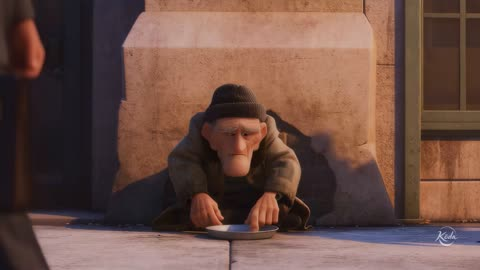</a>

按时间段编写的分镜表，加上道具、服装、光线方向和行进方向等明确的连续性规则，让同一角色和同一道具在多次切镜中保持一致。单独的音频段落定义配乐与音效，使追逐节奏跟随音乐走。

Seedance 2.5 · 文生视频 · 出处: [@aimikoda on X](https://x.com/aimikoda/status/2084900750690279501) · 243 赞，统计于 2026-10-29

[`3d-animation`](tags.md#tag-3d-animation) [`storyboard`](tags.md#tag-storyboard) [`continuity`](tags.md#tag-continuity) [`audio-cues`](tags.md#tag-audio-cues)

<details><summary><b>提示词</b></summary>

```text
Create a 30-second stylized 3D animated short with appealing rounded character design, expressive facial animation, tactile materials, warm cinematic lighting, playful physical comedy, and sincere emotion. No dialogue, subtitles, logos, or readable text.

[0–5s — The Street]
Frontal wide shot across a busy sidewalk: a weary, kind-eyed middle-aged beggar sits on the ground against an old stone wall, wearing the same patched coat and knitted cap throughout. A shallow donation plate rests in front of him. Pedestrians repeatedly cross between the camera and the beggar, briefly hiding him and emphasizing that he is overlooked. After one foreground passerby fills the frame, cut upward to a glossy black crow watching from a nearby tree branch, its head tilting with alert curiosity.
[5–12s — Kindness]
Return to the same frontal geography. A pedestrian takes the final bite from a half-eaten sandwich, pauses, and gently places the remaining half beside the beggar’s plate. Hold on the beggar’s grateful expression. The crow glides down and lands beside him. In a closer shared frame, the hungry beggar breaks off a piece of sandwich and offers it on his open palm. The crow cautiously takes it; their eyes meet, establishing trust.

[12–16s — The Theft]
A different passerby drops a paper banknote into the plate. Brief insert as it lands. The beggar’s shoulders lift, his tired face brightens, and he smiles with relief. Cut to the crow noticing this reaction. It snaps its head toward the plate, hops forward, grabs the same banknote in its beak, and launches away. The beggar freezes for one comic beat, then springs up and gives chase.
[16–25s — The Chase]
Accelerate through a clear, energetic multi-cut pursuit while preserving the crow’s route and the beggar’s direction of travel. The crow flies low between pedestrians; the beggar dodges around them, nearly collides with a fruit cart, regains balance, and keeps running. Lateral tracking through narrow streets between tall buildings; foreground bodies and street objects create fast parallax. The crow darts over the hood of a moving car at the last instant; the beggar skids past behind it as the driver brakes safely. Follow the banknote as the causal visual anchor, always secured in the crow’s beak. Alternate wide geography, close near-misses, and restrained handheld chase views. The crow finally turns into a quiet hidden courtyard and rises toward a wooden treehouse built inside a huge old tree.

[25–30s — The Gift]
The beggar follows up a rough wooden ladder and cautiously enters the small treehouse. Shift from frantic motion into stillness. Over his shoulder, reveal shelves and nests filled with many glittering found treasures: coins, paper money, rings, necklaces, brooches, watches, and polished trinkets. Warm golden shafts of light illuminate the collection. The beggar’s amazement slowly becomes an emotional smile as he realizes the crow deliberately led him here. The crow places the stolen banknote neatly on the treasure pile, turns toward him, and gives a mischievous, affectionate smile. End on a gentle two-shot of the unlikely friends beside the glowing treasure, with the crow nudging one small golden ring toward the beggar.
Keep exactly one beggar, one crow, one sandwich, one donation plate, and the same stolen banknote throughout. Preserve clothing, character proportions, prop ownership, daylight direction, travel direction, and treehouse layout. Use expressive but believable body weight, cloth movement, wingbeats, landings, foot contact, traffic motion, and object interactions.

Audio: lively city ambience, footsteps, cloth and paper rustle, soft crow calls, wingbeats, comic percussion during the theft, rapidly building orchestral rhythm through the chase, then warm strings and delicate piano for the final reveal.
```

</details>

<a id="h3-woman-white-outfit-tropical-beach-walk"></a>
### 白衣女子漫步热带海滩

<a href="https://x.com/CaliraVal/status/2104438855785136257"></a>

提示词按角色、服装、环境、光线分段，再按顺序列出五个镜头，从航拍开场到跟拍、特写、环绕侧拍直至结尾拉远，形成连贯的镜头语言。角色段重复锁定脸部和服装的一致性要求，有助于人物在切换镜头后保持不变。

MiniMax H3 · 文生视频 · 出处: [@CaliraVal on X](https://x.com/CaliraVal/status/2104438855785136257) · 219 赞，统计于 2026-10-29

[`tropical-beach`](tags.md#tag-tropical-beach) [`golden-hour`](tags.md#tag-golden-hour) [`character-consistency`](tags.md#tag-character-consistency) [`multi-scene`](tags.md#tag-multi-scene)

<details><summary><b>提示词</b></summary>

```text
Created with MiniMax H3.

Create a 15-second ultra-realistic cinematic tropical beach adventure video set in a breathtaking tropical paradise with crystal-clear turquoise water, golden sandy beaches, lush palm trees, dramatic coastal cliffs, and a beautiful ocean horizon.

CHARACTER:
A beautiful young adult Japanese woman, around 22–25 years old, with natural Japanese facial features, fair skin, expressive dark-brown eyes, long wavy black hair, subtle natural makeup, and a gentle, confident expression. Keep her face, hairstyle, body proportions, clothing, and overall identity perfectly consistent throughout the entire video.

OUTFIT:
She wears a stylish white summer outfit consisting of a lightweight white linen shirt, a cream-colored flowing maxi skirt, comfortable sandals, and a small beige shoulder bag. Her clothes and hair move naturally with the ocean breeze.

ENVIRONMENT:
A breathtaking tropical beach with crystal-clear turquoise waves, soft golden sand, lush green palm trees, distant rocky islands, dramatic coastal cliffs, and sunlight reflecting across the ocean. Gentle waves wash onto the shore, leaving realistic wet sand and reflections. The atmosphere feels peaceful, luxurious, and adventurous.

LIGHTING AND CINEMATOGRAPHY:
Warm golden-hour sunlight, soft highlights on the ocean, natural shadows, realistic skin texture, cinematic depth of field, subtle lens flare, smooth camera movement, natural motion blur, and high-end travel-film color grading.

SCENE 1 — EPIC BEACH ESTABLISHING SHOT:
Start with a breathtaking aerial wide shot of a tropical beach surrounded by lush green cliffs and turquoise water. The woman stands near the shoreline with her back toward the camera, looking out at the endless ocean. Gentle waves roll toward her feet as the camera slowly descends and moves closer.

SCENE 2 — WALKING ALONG THE SHORE:
Transition into a smooth tracking shot as she walks barefoot along the wet sandy beach. Small waves gently touch her feet, leaving realistic footprints in the sand. Her long wavy hair and flowing white shirt move naturally in the ocean breeze. The camera follows her from behind and slightly to the side.

SCENE 3 — CINEMATIC CLOSE-UP:
Cut to an intimate close-up of her face as she turns toward the camera and gives a soft, natural smile. Her hair gently moves across her face in the breeze. Warm sunlight illuminates her skin, while the turquoise ocean creates a beautifully blurred background.

SCENE 4 — OCEANFRONT MOMENT:
Move to a beautiful side-profile shot as she stands near the water, looking toward the distant islands. She gently closes her eyes and feels the ocean breeze. The camera slowly circles around her while sunlight creates a soft golden rim light around her hair.

SCENE 5 — DRAMATIC CINEMATIC ENDING:
Finish with a wide cinematic shot of the woman walking toward a scenic coastal viewpoint overlooking the vast turquoise ocean. The sun begins to set, painting the sky with soft golden, peach, and pink tones. The camera slowly pulls backward and upward, revealing the breathtaking tropical coastline. End on a peaceful, dreamy cinematic frame.

MOOD AND STYLE:
Dreamy, peaceful, adventurous, romantic, elegant, refreshing, tropical paradise, premium cinematic travel-film atmosphere.

QUALITY REQUIREMENTS:
Ultra-realistic, photorealistic, 4K cinematic quality, realistic human anatomy, consistent facial identity, natural facial expressions, realistic ocean waves, accurate water reflections, realistic wind simulation, natural lighting, detailed environment, cinematic depth of field, high dynamic range, and professional color grading. No artificial CGI appearance, no distorted anatomy, no identity changes, and no unnatural movements.
```

</details>

<a id="h3-coastal-path-golden-hour-fashion-walk"></a>
### 黄金时刻女子沿海岸小径漫步

<a href="https://x.com/CaliraVal/status/2096833346555023816"></a>

提示词按顺序写明镜头：先远景建立镜头，再横向跟拍，最后特写，运镜清晰可控。台词原文引出并要求口型同步，环境声单独列出，并明确不要背景音乐和其他人声。

MiniMax H3 · 文生视频 · 出处: [@CaliraVal on X](https://x.com/CaliraVal/status/2096833346555023816) · 189 赞，统计于 2026-10-29

[`fashion`](tags.md#tag-fashion) [`golden-hour`](tags.md#tag-golden-hour) [`lip-sync`](tags.md#tag-lip-sync) [`coastline`](tags.md#tag-coastline)

<details><summary><b>提示词</b></summary>

```text
A cinematic fashion film set on a breathtaking coastal landscape. A stylish young woman walks naturally along a rugged seaside path, surrounded by wild greenery and delicate flowers. She wears a relaxed oversized brown knit sweater with elegant ivory trousers. Behind her, crystal-blue ocean waters stretch toward a towering lush green mountain rising from the sea.

Soft golden-hour sunlight creates a warm, dreamy atmosphere. A gentle ocean breeze naturally moves her hair and sweater. Start with a wide cinematic establishing shot of the coastline, then smoothly track alongside her as she walks, transitioning into elegant close-ups of her outfit, hair, and subtle facial expressions.

Spoken Voice / Dialogue: The woman speaks naturally while walking, in a soft, calm, confident female voice. Her delivery should feel spontaneous and conversational, with realistic breathing and subtle pauses. She says:

“Sometimes, all you need is a quiet place, a little fresh air, and a moment to simply slow down and enjoy where you are.”

Her lip movements must accurately synchronize with every spoken word. Natural facial expressions, realistic mouth movement, and subtle head gestures while speaking. No exaggerated acting.

Ambient Audio: Gentle ocean waves crashing against the rocks, soft coastal wind, subtle rustling of flowers and leaves, quiet footsteps, and distant seabirds. Keep the environmental sounds natural and cinematic underneath the dialogue. No background music and no additional voices.

Photorealistic, natural skin and hair, realistic fabric movement, cinematic lighting, smooth camera movement, shallow depth of field, soft bokeh, subtle film grain, premium fashion-commercial aesthetic, atmospheric color grading, 4K cinematic quality. No text, no logos, no watermark.
```

</details>

<a id="h3-winter-woman-white-parka-snowy-peaks"></a>
### 白色羽绒服女子站在雪山之间

<a href="https://x.com/Aiwithmaha/status/2115091209505132575"></a>

提示词按顺序列出各个场景，并在结尾用一句话统一要求服装、面部和发型保持一致，使角色在多个镜头中形象稳定。明确镜头风格、9:16 竖构图和暖棕色调，定下整体画面风格。

MiniMax H3 · 文生视频 · 出处: [@Aiwithmaha on X](https://x.com/Aiwithmaha/status/2115091209505132575) · 182 赞，统计于 2026-10-29

[`winter`](tags.md#tag-winter) [`train-travel`](tags.md#tag-train-travel) [`wildlife`](tags.md#tag-wildlife) [`character-consistency`](tags.md#tag-character-consistency)

<details><summary><b>提示词</b></summary>

```text
Create a 15-second ultra-realistic cinematic winter travel video featuring a beautiful woman with long dark brown hair, wearing an elegant white winter coat with a fur-trimmed hood, a cream knitted beanie, a matching scarf, brown gloves, and winter boots. The video begins with a wide cinematic shot of the woman standing in a breathtaking snowy landscape surrounded by towering snow-covered mountains and dense pine forests, gently looking around and enjoying the peaceful winter atmosphere. A vintage dark maroon passenger train with golden details arrives at a snowy railway station, and the woman gracefully boards the train. Transition to a beautiful close-up shot of her sitting beside the train window, admiring the magnificent snowy mountains, frozen landscapes, and tall pine trees passing outside. The camera captures her natural smile, expressive eyes, and soft reflections on the glass. She then steps into the snow-covered forest and gently holds a cute white rabbit with pink ears in her gloved hands, smiling warmly at the adorable animal. In the final scene, she sits peacefully in the snow while a beautiful wild deer with elegant antlers approaches her, creating a magical and heartwarming winter wildlife moment. Use smooth cinematic camera movements, realistic snowflakes, soft natural winter lighting, detailed facial expressions, photorealistic textures, consistent character identity, and a premium warm brown cinematic color grade. Maintain the same outfit, face, and hairstyle throughout the entire 15-second video, with seamless transitions between scenes, a dreamy winter atmosphere, and a realistic 9:16 vertical composition.
```

</details>

<a id="seedance-found-footage-exclusion-zone-horror"></a>
### 空荡住宅区道路旁的生锈儿童游乐场

<a href="https://x.com/CharaspowerAI/status/2101370778184737053">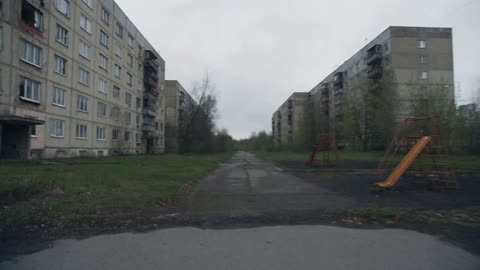</a>

自动对焦跳动、风噪、静电干扰、高光过曝等摄像机瑕疵被明确写出，每个5秒节拍只配一个动作和一句台词，用来控制惊吓节奏。不要电影感和只允许一个可见人物的约束，让画面保持纪实感，也避免模型多画出人物。

Seedance 2.5 · 文生视频 · 出处: [@CharaspowerAI on X](https://x.com/CharaspowerAI/status/2101370778184737053) · 182 赞，统计于 2026-10-29

[`found-footage`](tags.md#tag-found-footage) [`horror`](tags.md#tag-horror) [`handheld`](tags.md#tag-handheld) [`soviet-architecture`](tags.md#tag-soviet-architecture)

<details><summary><b>提示词</b></summary>

```text
Ultra-realistic amateur found-footage horror trailer, 30 seconds, shot like recovered handheld video from an abandoned exclusion-zone expedition. Consumer camcorder look, unstable handheld motion, accidental zooms, autofocus hunting, digital compression, blown highlights, microphone wind noise, breathing near camera, occasional static interference. Grey daylight, overcast sky, damp concrete, empty buildings, dead silence, oppressive realism. No cinematic polish.

Main camera operator: unseen adult filming everything. Explorer: one adult man, dark jacket, backpack, flashlight, nervous but trying to stay calm. Only one visible human character to preserve realism.

Abandoned Soviet-era apartment blocks, empty school corridor, overgrown road, rusted playground, flooded basement entrance, broken windows, distant cooling-tower silhouette. Daylight only.

0-5s: Raw arrival footage Shaky camcorder walking through an empty road surrounded by decaying buildings and tall grass. Explorer turns back toward camera. EXPLORER: “Stay close. We’re not staying long.” A faint metallic sound echoes somewhere far away.

5-10s: Interior discovery Camera enters an abandoned school hallway. Peeling walls, broken desks, dust drifting through window light. Autofocus hunts as a door at the far end appears slightly open. CAMERA OPERATOR: “Was that open before?” Explorer does not answer.

10-15s: First impossible detail They move deeper inside. A child-sized chair slowly rocks by itself near a window, almost imperceptibly. Camera zooms in too far and loses focus. Explorer whispers: “Don’t touch anything.”

15-20s: Escalation Back outside. The camera pans across ruined apartment blocks. For less than a second, a tall human-shaped silhouette is visible inside a distant upper-floor window. Operator jerks the camera back. Window is empty.

20-25s: Amateur panic A handheld radiation meter begins clicking faster while the explorer walks toward a dark stairwell entrance. He stops. EXPLORER: “No. We’re leaving.” A heavy sound comes from somewhere inside the building. Camera backs away immediately.

25-30s: Final trailer scare While moving quickly down the empty road, the operator glances back. The explorer is no longer beside the camera. Far behind, the same tall silhouette now stands motionless in the middle of the road. The operator whispers: “Alex?” Digital interference suddenly fills the image. Hard cut to black.

Authentic found-footage realism, one visible explorer only, unsettling environmental storytelling, imperfect framing, believable abandoned architecture, subtle horror, no creature close-up, no gore, no attack, no injury, no readable text, no logos.
#DreaminaCPP

@dreamina_ai
```

</details>

<a id="h3-woman-moving-train-roof-city"></a>
### 城市列车车顶上的女子

<a href="https://x.com/CaliraVal/status/2094284844792520881">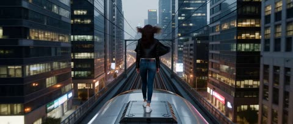</a>

提示词给出有顺序的分镜，依次为背后跟拍、低角度正面镜头、特写和航拍拉远，并在开头固定服装，让角色在切换镜头后保持一致。风、布料、运动模糊和浅景深等描述决定画面的物理质感，而不额外指定情绪。

MiniMax H3 · 文生视频 · 出处: [@CaliraVal on X](https://x.com/CaliraVal/status/2094284844792520881) · 165 赞，统计于 2026-10-29

[`urban`](tags.md#tag-urban) [`tracking-shot`](tags.md#tag-tracking-shot) [`shot-list`](tags.md#tag-shot-list) [`photorealistic`](tags.md#tag-photorealistic)

<details><summary><b>提示词</b></summary>

```text
Cinematic photorealistic video of a stylish young woman standing on the roof of a modern moving train in a futuristic metropolitan city. She has long dark wavy hair and wears a fitted black leather jacket over a simple white top, relaxed dark blue jeans, and white sneakers.

The video begins with a smooth cinematic tracking shot from behind as the train moves through the city, with tall modern skyscrapers, glowing windows, and elevated railway tracks surrounding her. The camera then moves to a low-angle front shot as she walks naturally across the train roof, her hair and jacket gently flowing in the wind.

Add a close-up as she looks toward the camera with a calm, confident expression, followed by a wide aerial shot showing the entire moving train and massive city skyline. Natural body movement, realistic wind and fabric physics, detailed urban environment, realistic reflections, cinematic lighting, shallow depth of field, smooth camera transitions, subtle motion blur, photorealistic textures, premium cinematic look, 4K, 16:9.
```

</details>

<a id="wan-steampunk-detective-montage"></a>
### 蒸汽朋克侦探，五个地点快剪

<a href="https://x.com/socialwithaayan/status/2092581849650593830"></a>

从动作中途切入，每个镜头底下都垫同一条大提琴，把快剪串成一体。

Wan 3.0 · 文生视频 · 出处: [@socialwithaayan on X](https://x.com/socialwithaayan/status/2092581849650593830) · 152 赞，统计于 2026-10-27

[`montage`](tags.md#tag-montage) [`fast-cut`](tags.md#tag-fast-cut) [`steampunk`](tags.md#tag-steampunk) [`score`](tags.md#tag-score)

<details><summary><b>提示词</b></summary>

```text
A cinematic, fast cutting steampunk detective montage in high fidelity live action, set in a fog choked industrial city at night. Open mid motion on a detective in a soot stained long coat crouched at the edge of a canal, gloved fingers pulling a cracked pocket watch from the water, gaslight smearing through the mist behind him. The camera pushes in hard on the watch face, second hand stuttering, then whip pans into a railway station where steam floods the platform and a torn ticket spins down onto wet cobbles. Cut to a low angle inside the clock tower, brass gears the size of wagon wheels turning past the lens while dust hangs in a single shaft of moonlight. Cut to the boiler room, orange furnace light raking across riveted pipes, water dripping off every surface, the detective's shoes ringing on the iron catwalk. Sudden zoom onto a brass plate bolted to a laboratory door, etched Qwen Create, condensation running down between the letters, his glove wiping it clean. Cut inside to the secret laboratory, copper coils throwing electric sparks that light one half of a face in the dark. Finish on the detective's eyes in tight close up as recognition hits, breath fogging, jaw setting.

Keep the same fog density and gaslight warmth in every shot. Colour lives in the materials: wet black stone, green oxidised copper, worn brass, deep burgundy velvet, white steam.

Handheld throughout, urgent but readable, one snap zoom per location and nothing else fancy.

Diegetic sound only, no score: clock ticking, steam venting, a far off train whistle, leather soles on cobblestone, one low cello note under it all.

Final frame holds two seconds on black, then clean white lettering fades up centre frame reading Qwen Create, and under it
http://
create.qwen.com. No other text or subtitles anywhere in the film.
```

</details>

<a id="h3-rainy-platform-train-light-profile-long-take"></a>
### 雨夜站台透明伞下的女人与驶过的列车

<a href="https://x.com/kentdhani/status/2107736392247992627"></a>

固定机位的一镜到底，用时间戳逐段排布动作，从小动作到列车进站再到克制的微笑。提示词把移动光源写成缓慢连续的渐变并明确禁止闪烁，让参考形象在脸上的光线变化中保持稳定。

MiniMax H3 · 参考生视频 · 出处: [@kentdhani on X](https://x.com/kentdhani/status/2107736392247992627) · 151 赞，统计于 2026-10-28 · 发现于 [SkyNotSilent/awesome-MiniMax-H3-cases](https://github.com/SkyNotSilent/awesome-MiniMax-H3-cases)

[`rainy-night`](tags.md#tag-rainy-night) [`long-take`](tags.md#tag-long-take) [`train-platform`](tags.md#tag-train-platform) [`moving-light`](tags.md#tag-moving-light) [`character-consistency`](tags.md#tag-character-consistency)

<details><summary><b>提示词</b></summary>

```text
A single continuous live-action long take on a Japanese elevated train platform at night in the rain. One woman waiting alone, camera locked in place at her right side, filming her right profile down the length of the platform. It runs from her small waiting fidgets, through a commuter train arriving and passing in front of her, to the train nearly stopping and a soft side-profile smile. One take, camera fixed with only slight handheld breathing, no cuts, no zoom, no push-in. Normal real-world speed throughout, no slow motion.

Shot 1 — 0.0s: Realistic cinematic, real-camera rainy-night platform, one continuous long take, medium shot from mid-thigh up, camera fixed at her right at chest height looking down the platform's depth. Right side of frame is the wet-bright yellow tactile paving, the platform edge, and two steel rails converging into the distance, with the arched glass windscreen beyond; left side is the platform interior and orange glowing shopfront boxes; cool fluorescent tubes recede overhead; red-blue-green neon bokeh at the far end; tiles wet-black and reflective. Riria stands center-slightly-left inside the yellow paving, facing the tracks, her right profile to the lens, shopfront orange rimming her back and bun. The right-side rail is empty, no train yet. She is already mid-action: tilting the umbrella back a little, looking up past its rim at the night sky beyond the canopy, reaching her right hand forward toward the track side past the umbrella rim, palm up, holding a beat to test whether it's still raining, a few drops landing in her palm.

Shot 1 continues — 1.5s: She pulls her hand back, rights the umbrella back over her head, lets out a soft breath, and shifts her weight from one foot to the other.

Shot 1 continues — 2.0s: Two small, soft cool-white headlights light up at the far end of the right-side rail. She leans her upper body slightly forward (feet not crossing the yellow paving), peering toward the far end of the tracks, body still squared to the rails. The headlights grow larger and brighter extremely gradually along the right rail, the steel, the standing water, and the platform edge lighting up bit by bit.

Shot 1 continues — 3.5s: She straightens up, steps back half a step, grips the umbrella handle again with her left hand, her gaze following the approaching train. The light keeps rising slowly and evenly — first catching the side-profile edge of her forehead, nose bridge, and lips, then washing softly onto her face. The same light also falls on the droplets on the umbrella, the rain, the wet tiles, and her coat, no hard edges, no flicker. Her skin is only softly brightened overall, still matte, no shine spot. She squints slightly and tucks her chin a little into the turtleneck.

Shot 1 continues — 5.5s: A silver stainless-steel commuter train with a green waistline reaches her along the right-side rail, wheels on the rails, body tight to the platform edge, the nose passing in front of her and exiting frame right. In the same instant a gust blows in from the depth of frame: bangs and side hairs pressed to her cheeks, coat hem, lapels, and back belt lifting, umbrella tilting about a hand's width and trembling. Her left hand steadies the umbrella, her right hand lifts to gather the blown-open coat front at her chest, still facing the tracks. The cool-white headlight glow transitions smoothly into the warm-white carriage glow over about a second, brightness roughly unchanged, only cool-to-warm. Carriages run past in front of her on the right with motion blur, the warm-white light a long steady even band on her face, coat front, and umbrella rim, no flicker. Her feet stay planted, sharp, normal speed, no slow motion.

Shot 1 continues — 7.0s to 10.0s: The train visibly decelerates, carriages resolving back into distinguishable windows, inside them only defocused warm-white light and blurred shapes, but the warm light on her stays constant. The wind eases, hems settle, hair slowly drops. Around 8.5s she releases the coat front and uses her right fingertips to tuck the strands stuck to her cheek behind her ear, revealing the pearl stud, then lets her right hand fall naturally.

Shot 1 continues — 10.0s: The train glides slowly toward a near-stop, settling on the right-side rail, the warm-white light still steady and soft on her face.

Shot 1 continues — 10.5s: Her head turns only slightly toward the lens side, feet and shoulders still toward the tracks, still a clean right profile in frame, at most the far corner of her eye and mouth just showing, never a three-quarter front or full face. Her gaze slants gently toward the lens side, not direct to camera. Framing stays mid-thigh-up medium, no push-in.

Shot 1 continues — 12.5s: The corner of her mouth slowly lifts into a soft, restrained closed-lip smile on the profile, cheekbone rising a touch, eye corner curving, never a toothy grin or a posed frozen smile. The smile holds on the profile, she blinks once and breathes out softly, a strand of hair still swaying in the leftover wind, the train completing its last short glide at walking pace with doors staying shut. The image ends while these tiny motions are still underway, never a freeze frame. Live throughout — rain keeps falling, droplets slide and pool on the umbrella, the turtleneck collar rises faintly with her breath, flyaways drift, puddle ripples shimmer, distant neon glows steady, the handheld frame breathing lightly.

All light changes are continuous, slow gradients, never blinking: no flicker, strobe, or on-off pulsing, no per-frame brightness jumps, no sudden light on or off, no hard-edge pools or stage-spotlight circles, no window-shaped light patches sweeping across her face. The windows are large and the carriage light diffuse, so what lands on her is one steady sheet of warm light. The headlights are just two softly growing points, never direct into the lens, the frame never flashes white. The same light lands on the umbrella, the rain, the wet tiles, the platform edge, and her coat at once, never only on her face. Fluorescent tubes and distant neon glow steady, never flickering. Camera exposure locked the whole time, no auto-brightening or darkening. The whole clip brightens smoothly only once, then holds steady, never bright-then-dark-then-bright. The nose passing in front of her and the gust lifting her hair and hems happen in the same instant (around 5.5s), never wind-before-train or train-already-past-before-wind.

Prohibited

No subtitles, watermark, logo, or overlay text; platform light boxes, billboards, and train destination displays appear only as defocused glowing color blocks, never any readable text. No dialogue or narration. No standing still before the train or woodenly posing before it; no flicking water off the hand. No light blinking, flickering, strobing, or on-off pulsing; no bright-then-dark-then-bright; no sudden light on or off; no headlight flaring white into the lens; no window-shaped light patches sweeping across her face; no stage-spotlight circles or hard light beams; no light landing only on her face; no exposure wavering; no flickering tubes or neon. No standing with her back to the tracks; no facing the shopfronts, platform interior, or lens; no chest toward frame left. No rail on the left side of frame; no train driving onto the platform; no train on the left or shopfront side; no train crossing the frame; no train floating or off the rails; no train passing behind her; no train between her and the lens; no train coming from behind the camera, driving off into the distance, or reversing. No push-in, pull-out, zoom, or orbit. No chest-up close-up or face close-up. No full face to lens, three-quarter front glance back, or direct eye contact. No turning the shoulders or turning around. No early smile. No skin oil, sweat, water shine, specular spots, wet reflection, or droplets on the face. No rubbery, silicone, waxwork, or plastic skin, no smoothing, no freckles vanishing. No grey studio backdrop. No triptych, split-screen, or a second Riria. No other passengers or staff on the platform. No doors opening or anyone getting off. No slow motion or slowed hair drift. No umbrella flipping inside out, flying from her hand, or the shaft crossing her face; no right hand covering her face. No features drifting into a similar-looking different person — it is this person from the reference. No toothy grin. No global amber or teal-orange filter. No CG, anime, over-sharpening, or HDR look. No freeze frame. No third hand or finger distortion.
```

</details>

<a id="h3-silver-bikini-beach-bar-walk"></a>
### 银色比基尼女子走过海滩酒吧木栈道

<a href="https://x.com/ou_zhen599/status/2096178219733102698">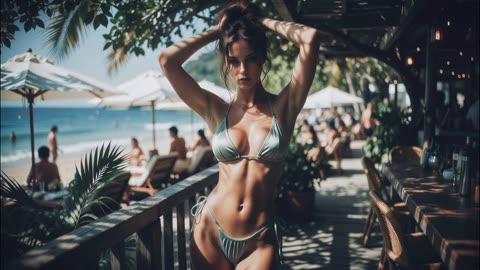</a>

参考图锁定人物、服装和场景，带时间戳的分镜段落用有动机的运镜串起六个镜头，单独的环境音与配乐描述提供声音线索。

MiniMax H3 · 图生视频 · 出处: [@ou_zhen599 on X](https://x.com/ou_zhen599/status/2096178219733102698) · 143 赞，统计于 2026-10-29

[`fashion`](tags.md#tag-fashion) [`beach`](tags.md#tag-beach) [`multi-shot`](tags.md#tag-multi-shot) [`reference-image`](tags.md#tag-reference-image) [`audio`](tags.md#tag-audio)

<details><summary><b>提示词</b></summary>

```text
For the target video, at 0.00 seconds into the target video, <Picture 1> (from [Shot 1]) is fully referenced.

integrated_multimodal_description: [Shot 1] Cinematic, ultra-realistic 16:9 beach-fashion film. The adult woman fully matches <Picture 1>: same face, hair, body proportions, silver-gray bikini, wooden boardwalk, railings, beach bar, tropical shadows, white umbrellas, sea, lounge chairs, afternoon sunlight, and refined resort atmosphere. Preserve the original composition, spatial layout, and light direction. Low-angle camera tracks backward at slow speed with slight lateral drift as she walks forward with calm assured weight transfer. Both hands lower naturally from her hair. A few loose strands move in the sea wind. Her eyes look past the camera toward the water, then briefly pass the lens edge. Tree shadows move across her shoulders, waist, arms, and the wood underfoot. [Shot 2] At 00:02.400, the camera cuts to a close side-front pass motivated by her movement. She passes the lens without stopping to pose. The camera glides with her shoulder line, waist, back contour, and legs. Hair strands, bikini straps, skin highlights, and tropical shadows shift naturally with wind and walking. She looks ahead along the boardwalk and blinks once naturally. Beach bar, railings, umbrellas, sea, and lounge chairs move in parallax behind her. [Shot 3] At 00:05.000, the camera cuts to a front-side half-arc motivated by her shoulder turn. Shoulder turns first, then waist, then face. She lifts one hand to organize windblown hair. Her eyes pause beside the lens, then slowly meet it. The eyes brighten first, then a minimal confident non-toothed smile appears. Natural breathing is visible in the collarbone, torso, and waist. [Shot 4] At 00:08.000, the camera cuts to a side-rear tracking shot along the railing, then transitions smoothly into a side-front receiving shot as she keeps walking. One hand glides lightly over the railing. Ocean reflections, umbrellas, lounge chairs, distant resort visitors, and tropical shade flow continuously behind her. When loose hair crosses one eye, she makes one small head adjustment and one natural blink. Walking mechanics stay connected through footfalls, shoulders, hips, and torso. [Shot 5] At 00:11.800, the camera cuts to a moving close medium frame under the strongest shifting tree-shadow pattern. This is a brief cover-image beat lasting under one second, never frozen. She looks below the lens, then raises her eyes toward it. One hand rests lightly near her neck or hair. The opposite shoulder opens naturally. Her mouth keeps only a minimal non-toothed curve. Hair, thin bikini straps, breathing, sea breeze, and moving shadows stay alive. She immediately resumes walking. [Shot 6] At 00:13.600, the camera cuts to a low-angle fashion view tracking backward as she takes two steps toward the open shoreline. Shoulder turns first and face returns last. Her gaze passes sunlight and ocean before landing lightly on the lens. She gives a very subtle non-toothed smile while still moving forward. Keep bright water, white umbrellas, and tropical shade behind her. End at 15.00 seconds with her still in gentle forward motion inside the resort landscape. No dialogue, no subtitles, no watermarks, no fixed camera, no prolonged frontal lock-off, no random cuts, no selfie behavior, no vulgar posing, no exaggerated flirtation, no glassy eyes, no empty stare, no mechanical blinking, no puckered lips, no rigid hair mass, no plastic skin, no anatomy distortion, no malformed hands.

overall_soundscape: Natural surf, sea wind, soft boardwalk footsteps, distant beach guests, and quiet beach-bar ambience. Leaves shift above the boardwalk and wind moves hair and fabric subtly. No dialogue.

non_diegetic_music: Refined summer fashion score with sparse hand percussion, muted bass, clean guitar accents, and light airy synth texture at a relaxed mid-tempo pulse, fading gently into the final shot.
```

</details>

<a id="seedance-muddy-hand-grave-title-sequence"></a>
### 雨夜坟前泥土中伸出一只手

<a href="https://x.com/mrdejie/status/2088600975380738462">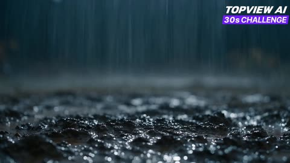</a>

按时间段分拍（0到4秒、4到8秒等）规定节奏，并给出精确的字幕文字，让字幕清晰可读。锁定冷蓝灰与血红的配色、缓慢推进的镜头，以及先静后尖叫的声音设计，为结尾的跳吓做铺垫。

Seedance 2.5 · 文生视频 · 出处: [@mrdejie on X](https://x.com/mrdejie/status/2088600975380738462) · 138 赞，统计于 2026-10-29

[`horror`](tags.md#tag-horror) [`title-sequence`](tags.md#tag-title-sequence) [`rain`](tags.md#tag-rain) [`timed-beats`](tags.md#tag-timed-beats)

<details><summary><b>提示词</b></summary>

```text
Create a visually rich 30-second, 16:9 opening-title sequence for a realistic horror thriller titled RUN, in highly realistic cinematic style.
The story follows a man seeking revenge. His disappearance was never solved, and now he returns to hunt down every person who wronged him. Dark, cold, intense, and full of quiet dread.
VISUAL LANGUAGEUltra-realistic live-action cinematic style. Heavy use of deep blacks, cold blue-grays, and blood red accents. Thick atmospheric rain and fog, harsh practical lighting, long shadows, wet muddy surfaces, and subtle blood textures. Extremely detailed skin, fabric, mud, and environmental textures. Strong sense of tension, isolation, and silence. No fantasy elements. Keep everything grounded and terrifyingly real.
Do not generate decorative glyphs or invented writing.
Display only the exact English credits below. Use clean, elegant serif typography in pale white or muted red so it remains readable against the dark backgrounds. Spelling must be exact: MRDEJE and TOPVIEW.
0–4s:Heavy rain falls on a muddy grave at night. The wet soil slowly shifts. A man’s hand, covered in thick mud and dirt, suddenly pushes up from the ground. Fingers claw outward. Soft text fades in over the scene:
DIRECTED BY MRDEJE
Hold the credit clearly as the muddy hand remains partially raised under the rain.
4–8s:The camera slowly moves through a dark, rainy forest. A dirty shovel lies abandoned on the muddy ground. In the background, a car trunk is open. Inside the trunk is a large human-shaped sack stained with blood. The sack moves very slightly, almost unnoticeably, as if someone inside is still weakly alive. The text appears in pale white:
MADE WITH SEEDANCE 2.5
Hold the text while the subtle movement of the sack continues under the rain.
8–12s:Closer shot of the open car trunk and the blood-stained sack. Soft red light reflects on the wet surfaces. The text appears:
CREATED ON TOPVIEW
Hold the reflection and text while the sack makes another extremely subtle shift.
12–15s:The camera drifts past the muddy shovel and deeper into the dark forest. In the lower center of the frame, the text appears clearly:
FOR 30s CHALLENGE
Hold this text firmly until the 15-second mark. Rain continues to fall heavily.
15–22s:A man is slowly dragging the heavy blood-stained sack across the muddy forest ground. Only his arms, hands, and upper body are visible in the frame — his face remains completely hidden. As he pulls the sack, dark red blood trails are left behind on the wet soil. The camera slowly and steadily zooms in on the sack while it is being dragged. Heavy rain continues. The text appears clearly in the frame:
SAVE YOURSELF
22–26s:The camera continues the slow zoom on the sack. More blood is smeared across the mud with every pull. The man’s muddy hands grip the sack tightly. The atmosphere becomes extremely quiet and heavy under the rain. The text appears:
AND
26–30s:The sack suddenly shifts violently. In a split second, a man in a dark hoodie lunges extremely close to the camera. His face is mostly hidden by the hoodie — only his eyes and lower face are partially visible, wide, bloodshot, and full of rage. A violent, realistic jumpscare. Immediately after the scare, the full title violently appears in the center in sharp, pale white letters:
RUN
The screen holds for a brief moment in complete stillness after the jumpscare, then ends.
Audio:Extremely minimal and quiet for most of the sequence. Heavy rain, wet mud sounds, fabric dragging, and soft strained breathing. At the jumpscare moment, a sudden sharp, loud, distorted impact sound mixed with a short, terrifying human scream. After the scare, absolute silence.
```

</details>

<a id="h3-gothic-autumn-street-fpv-castle"></a>
### FPV无人机滑行穿过哥特式秋日街道

<a href="https://x.com/churvikv/status/2094853665135677457">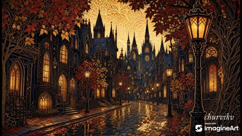</a>

提示词明确了镜头运动（FPV无人机）、清晰的路径（沿街道中央前进）和目标（远处的城堡），让运动有方向。金色曼陀罗天空和发光路灯作为光线锚点重复出现，帮助画面风格保持稳定。

MiniMax H3 · 文生视频 · 出处: [@churvikv on X](https://x.com/churvikv/status/2094853665135677457) · 136 赞，统计于 2026-10-29

[`fpv-drone`](tags.md#tag-fpv-drone) [`gothic`](tags.md#tag-gothic) [`autumn`](tags.md#tag-autumn) [`drone-shot`](tags.md#tag-drone-shot)

<details><summary><b>提示词</b></summary>

```text
dynamic FPV drone shot. The camera glides smoothly down the center of the wet cobblestone street, weaving between the glowing vintage streetlamps. Red and gold autumn leaves rush past the lens. The camera flies towards the grand gothic castle in the distance, under the glowing golden mandala sky. Immersive, fluid motion, 8k.
```

</details>

<a id="h3-drought-village-aerial-seed-story"></a>
### 干旱村庄龟裂农田的航拍全景

<a href="https://x.com/iamrealsnow/status/2088492634755178598">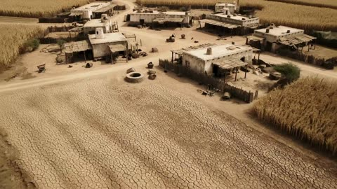</a>

按 15 秒分段列出每个镜头的时间、机位运动和声音提示，让多段故事的节奏可以逐段控制。空井、篮子和枯萎作物等具体道具支撑情绪，对白单独列出，便于模型分镜处理。

MiniMax H3 · 文生视频 · 出处: [@iamrealsnow on X](https://x.com/iamrealsnow/status/2088492634755178598) · 135 赞，统计于 2026-10-29

[`aerial`](tags.md#tag-aerial) [`drought`](tags.md#tag-drought) [`short-film`](tags.md#tag-short-film) [`storyline`](tags.md#tag-storyline)

<details><summary><b>提示词</b></summary>

```text
.

PART 1 — THE VILLAGE WITHOUT FOOD

0–15 seconds

Open with a sweeping cinematic aerial shot of a beautiful but devastated rural village during a severe drought.

The farmland surrounding the village is completely cracked and dry. Empty wells, dusty pathways, withered crops, and abandoned baskets show how long the drought has lasted.

Cut to villagers sitting outside their small homes, looking exhausted and heartbroken. A mother holds an empty grain bowl while an elderly man stares silently at the barren fields. Children sit quietly beside their families.

Show several villagers gathering in the center of the village. Their faces express desperation and hopelessness.

Camera slowly pushes toward the villagers as the wind carries dust through the settlement.

Mood: heartbreaking, quiet, desperate.

Sound: dry wind, distant crying, footsteps on dust, subtle emotional cinematic music.

Ending shot: A young villager looks toward the distant mountains and says softly:

Dialogue: “There must be food somewhere…”

Cut to black.

PART 2 — THE SEARCH

15–30 seconds

Early morning.

A small group of villagers leaves the village carrying empty baskets and cloth bags, determined to search for food.

Follow them as they travel through a dry valley, crossing cracked farmland and rocky terrain.

Show their exhaustion increasing as the journey continues. One person nearly collapses, another helps them stand.

They eventually reach a hidden green valley surrounded by large rocks and old trees.

The atmosphere suddenly changes.

The wind becomes calm.

Birds can be heard.

The villagers notice something unusual in the distance.

Camera moves behind them as they slowly approach a gigantic ancient-looking tree standing alone in the valley.

Unlike everything around it, the tree is alive and vibrant.

Its leaves gently move despite the still air.

Ending shot: One villager whispers:

Dialogue: “Look…”

Camera slowly tilts downward toward the ground beneath the tree.

⸻

PART 3 — THE MYSTERIOUS SEED

30–45 seconds

The villagers gather beneath the enormous tree.

They discover scattered wild fruits and edible plants around its roots, but there is something even more unusual.

Half-buried beneath the tree is a small mysterious seed.

It gives off a very subtle golden glow.

The camera moves into an extreme close-up of the seed.

Tiny patterns naturally shimmer across its surface.

Nobody touches it at first.

The villagers exchange confused looks.

An elderly villager carefully picks it up.

The seed glows slightly brighter in their hand.

The villagers realize that this tiny seed might be their only chance to save their village.

They place it carefully inside a small cloth pouch.

Dialogue:

Elderly villager: “Take it home.”

Cut to the group beginning their journey back.

As they walk away, briefly show the enormous tree behind them.

A single leaf falls silently to the ground.

Ending shot: Close-up of the glowing seed inside the cloth pouch as the villagers walk through the valley.

PART 4 — PLANTING HOPE

45–60 seconds

The villagers return to their drought-stricken village near sunset.

Everyone gathers around as the mysterious seed is revealed.

They walk to a small patch of cracked soil in the center of the village.

An elderly villager kneels down and carefully plants the seed.

Another villager pours the last small amount of water they have onto the soil.

Everyone watches silently.

For several seconds, nothing happens.

The villagers begin to lose hope.

Then—

A tiny crack appears in the ground.

A soft golden light emerges from beneath the soil.

The earth begins to tremble gently.

A small green shoot breaks through the cracked ground.

The villagers step backward in disbelief.

The shoot rapidly grows upward.

Roots spread beneath the soil.

A young tree forms before their eyes.

Sound: silence → low magical rumble → gentle rising orchestral music.

a freshly grown fruit.

It falls gently into their hands.
```

</details>

<a id="h3-barcelona-sagrada-familia-drone-orbit"></a>
### 黄金时刻绕圣家堂的无人机环绕飞行

<a href="https://x.com/Diplomeme/status/2083056488122380671">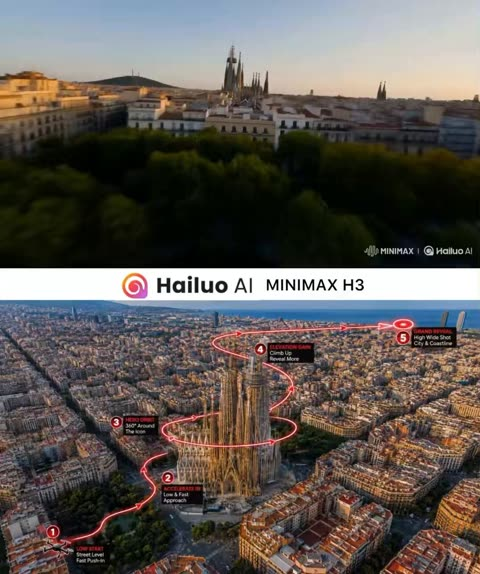</a>

参考图上画一条红色飞行路线，模型据此确定路线和地标位置；提示词按顺序写出每个动作（低空掠过、加速接近、环绕、爬升、拉远），并要求画面中不出现红线。结尾写明配乐层次（大提琴、打击乐、合唱），让音乐的高潮与环绕完成的时刻同步。

MiniMax H3 · 参考生视频 · 出处: [@Diplomeme on X](https://x.com/Diplomeme/status/2083056488122380671) · 129 赞，统计于 2026-10-29

[`drone`](tags.md#tag-drone) [`orbit`](tags.md#tag-orbit) [`reference-image`](tags.md#tag-reference-image) [`barcelona`](tags.md#tag-barcelona) [`music`](tags.md#tag-music)

<details><summary><b>提示词</b></summary>

```text
Create a cinematic realistic high-speed drone video over Barcelona, Spain at golden hour, using the reference image as the exact location and flight-path guide. The drone starts very low above the Barcelona cityscape, almost skimming above the foreground rooftops and streets, facing La Sagrada Família. It accelerates quickly forward over the urban landscape, following the drawn path from the foreground toward the cathedral while maintaining a very low altitude. The drone then performs a dramatic climbing curve as La Sagrada Família fills the frame, executes a close cinematic orbit around the cathedral’s iconic spires, and after the orbit, pulls back while gaining altitude before tilting and opening toward the Barcelona skyline, Mediterranean Sea, Eixample grid, surrounding historic rooftops, golden-hour reflections, distant coastline, and glowing Barcelona atmosphere.

The red drawn line must not appear in the video; it is only a hidden flight-path reference. Add powerful emotional cinematic music: deep cello melody, dramatic percussion rhythm, orchestral strings, subtle choir texture, epic rising percussion, and a grand heroic crescendo as the drone completes its orbit around La Sagrada Família and reaches the final panoramic reveal. No text, no subtitles, no logos, no graphic overlays.
@Image1
```

</details>

<a id="h3-sushi-counter-shrimp-nigiri-sour-reaction"></a>
### 女子在寿司吧台咬下虾握寿司

<a href="https://x.com/EndFolding79421/status/2101007280040784269"></a>

以固定首帧和分秒节拍表开场，把每一秒的表情都写明，而不是交给模型自由发挥。身份锁定加上明确的构图要求（右三分之一、荷兰角、手持晃动），让人物和画面在整段镜头中保持稳定。

MiniMax H3 · 图生视频 · 出处: [@EndFolding79421 on X](https://x.com/EndFolding79421/status/2101007280040784269) · 123 赞，统计于 2026-10-29

[`sushi`](tags.md#tag-sushi) [`reaction`](tags.md#tag-reaction) [`identity-lock`](tags.md#tag-identity-lock) [`handheld`](tags.md#tag-handheld)

<details><summary><b>提示词</b></summary>

```text
15-second cinematic single continuous handheld shot. One uninterrupted take from start to finish. No cuts, no transitions, no camera resets.

The <Picture 0> is exactly the first frame.

Scene:
A fictional original young woman in her early twenties sits at the counter of a cozy daytime sushi bistro. Preserve the exact facial identity and physical appearance of the supplied character reference throughout the entire shot. She has fair natural skin with visible freckles, bright blue eyes, and long, naturally curly copper-red hair worn loose around her shoulders. Her hair has realistic individual strands, natural volume, and soft movement. She wears soft natural makeup, muted rose lips, and a chunky polished silver collar necklace.

She wears a vivid green sheer mesh long-sleeve top falling slightly off one bare shoulder over a matching green inner top, exactly matching the starting image. No visible brands or logos.

The sushi bistro has a long polished dark-wood counter with a woven rattan runner, warm cream walls, blank decorative scrolls with no readable writing, softly glowing cabinets, and a blurred open kitchen with sushi chefs moving naturally in the background. A red orchid sits nearby. A large window fills the restaurant with bright midday daylight, with lush green trees visible outside.

In front of her is a ceramic plate with assorted sushi, a small soy sauce dish, pink pickled ginger, a napkin, and wooden chopsticks.

Composition:
Keep the woman in the RIGHT THIRD of the frame for the entire shot. Never center her.

Shoot from slightly below her eye level, across the countertop. The long counter and blurred kitchen extend through the left two-thirds of the frame.

The foreground sushi plate and woven counter runner remain slightly out of focus along the bottom edge.

Maintain a constant 10–12 degree Dutch angle throughout the entire video. Never level the horizon.

Camera movement:
Playful natural handheld cinematography. The camera operator appears to be resting their elbows near the counter, creating subtle breathing sway, tiny micro-jitters, and gentle imperfect movement.

Throughout the shot, slowly and slightly slide the camera closer along the counter toward her face.

Never become perfectly static.

Soft window light occasionally creates a subtle natural lens flare.

Action and emotion timeline:

0–1 seconds:
The action starts immediately on the very first frame.

She already has a whole shrimp nigiri held with her chopsticks: pale pink butterflied shrimp over a small rice pillow.

She quickly lifts it and puts the entire shrimp nigiri into her mouth in one bite.

No hesitation and no slow buildup.

1–4 seconds:
The sour flavor hits her INSTANTLY with exaggerated comic intensity.

Her eyes squeeze tightly shut.

Her lips pucker dramatically around her full cheeks.

Her entire face contracts from the sourness.

Her shoulders shudder.

She quickly shakes her head side to side, causing her long curly red hair to bounce, whip and sway naturally around her face and shoulders.

Her chopsticks slip from her hand and clatter onto the ceramic plate.

She lightly pounds one fist against the counter once or twice while continuing to chew.

The reaction must be immediate, expressive, and physically readable.

4–8 seconds:
The sour shock turns into genuine disgust.

Her expression suddenly becomes flatter and deeply repulsed.

She chews slower and slower.

Her nose wrinkles.

She slightly gags.

Her tongue pushes the food toward one cheek as if she cannot tolerate the taste.

She grabs the napkin and brings it toward her mouth, clearly preparing to spit the food out.

Her eyes show disappointment and betrayal.

8–11 seconds:
With the napkin touching or hovering directly in front of her lips, she suddenly freezes.

Her eyebrows jump upward.

Her eyes open wide.

Something about the flavor unexpectedly changes.

She slowly lowers the napkin about an inch.

She chews once.

Pause.

She chews a second time.

Her expression changes from disgust → confusion → suspicious curiosity.

Make this transformation clearly visible through her eyes, eyebrows, cheeks, and mouth.

11–15 seconds:
Her expression gradually explodes into pure delight.

Her eyes close softly in pleasure.

A huge genuine smile spreads across her face while she continues chewing.

Her shoulders relax completely.

She leans and melts backward slightly on the stool.

She lightly kicks her feet beneath the counter from happiness.

She makes a subtle pleased humming expression without speaking.

Still smiling, she reaches forward again with her chopsticks toward another shrimp nigiri on the plate, clearly wanting another bite.

End the shot while she happily reaches for the next piece.

Performance:
Prioritize expressive facial acting and physically readable emotion changes.

The emotional progression must be extremely clear:

instant sour shock → disgust → about to spit it out → sudden surprise → suspicious curiosity → intense pleasure

Natural blinking, eye movement, cheek movement, jaw chewing, breathing, shoulder movement, hand gestures, and realistic loose curly-hair physics.

IDENTITY LOCK: Preserve the woman's exact facial identity from the supplied character reference and starting frame throughout the entire video. Do not alter her facial structure, freckles, eye color, skin tone, age, or copper-red curly hair. Do not change her hairstyle into a ponytail or straight hair.

Visual style:
Cinematic Japanese indie slice-of-life feeling.
35mm film texture.
Shallow depth of field.
Soft natural skin texture with her freckles clearly retained.
Warm daylight mixed with a subtle teal-and-warm film color cast.
Fine soft grain.
Natural highlight rolloff.
Cozy intimate restaurant atmosphere.
Realistic human motion and realistic food interaction.

Important constraints:
One continuous 15-second shot.
No cuts.
No scene changes.
No time jumps.
No slow motion.
No freeze-frame effect.
Do not center the woman.
Maintain the Dutch angle.
No dialogue.
No captions.
No subtitles.
No readable text.
Blank scrolls and blank menus only.
No logos.
No brands.
No recognizable characters.
No mascot figurines.
No copyrighted characters.
No real people.
```

</details>

<a id="wan-red-pickup-desert-canyon-road"></a>
### 红色皮卡驶过沙漠峡谷公路

<a href="https://x.com/TaliaAariz/status/2098456434778480875">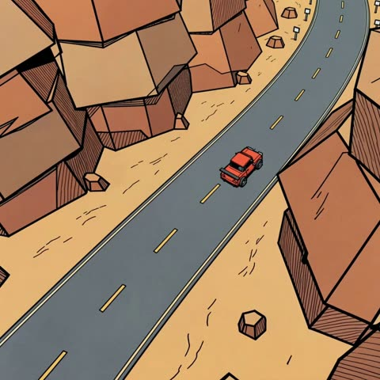</a>

提示词按顺序列出多个机位（高空俯拍、后方跟拍、前方三四分之三视角、广角俯视），让模型在同一辆车的不同角度之间切换。固定的渲染词如赛璐璐着色、车型一致和暖色调，使画风和车辆外观在各个镜头中保持稳定。

Wan 3.0 · 文生视频 · 出处: [@TaliaAariz on X](https://x.com/TaliaAariz/status/2098456434778480875) · 119 赞，统计于 2026-10-29

[`cartoon`](tags.md#tag-cartoon) [`cel shaded`](tags.md#tag-celshaded) [`desert`](tags.md#tag-desert) [`multi-angle`](tags.md#tag-multi-angle)

<details><summary><b>提示词</b></summary>

```text
A stylized 3D cartoon animation of a bright red vintage pickup truck driving smoothly along a winding mountain road through a rugged desert canyon. The camera follows the truck from multiple dynamic angles—high aerial view, rear tracking shot, front three-quarter view, and wide overhead shots—as it navigates the sharp curves. Warm orange rock formations, sandy terrain, road markings, and dramatic canyon walls surround the vehicle. Smooth vehicle motion, consistent truck design, clean cel-shaded textures, vibrant warm color palette, cinematic composition, soft natural lighting, subtle camera movement, high-detail animated environment, polished feature-film animation style, 4K.”
```

</details>

<a id="h3-1970s-afro-woman-multi-shot-story"></a>
### 暖色虚化灯光下的非裔女性特写

<a href="https://x.com/CaliraVal/status/2110604934039454000">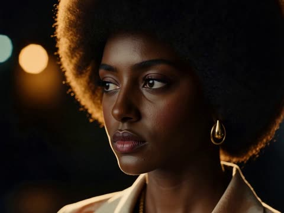</a>

每个镜头都分别写了画面提示词和运动提示词，并标明时间段，让同一种 1970 年代造型在各镜头间保持一致。每段都附带旁白和放克配乐描述，用来控制节奏与情绪。

MiniMax H3 · 图生视频 · 出处: [@CaliraVal on X](https://x.com/CaliraVal/status/2110604934039454000) · 112 赞，统计于 2026-10-29

[`multi-shot`](tags.md#tag-multi-shot) [`1970s`](tags.md#tag-1970s) [`portrait`](tags.md#tag-portrait) [`voice-over`](tags.md#tag-voice-over)

<details><summary><b>提示词</b></summary>

```text
A stylish Black woman sitting in the back seat of a vintage 1970s car, wearing sophisticated retro clothing and gold accessories. She opens a small red handbag on her lap. Classic New York City streets and vintage buildings are visible through the car window. Medium shot, eye-level camera, realistic vintage car interior, soft natural daylight, subtle background motion blur, muted retro colors, Kodak-style film grain, cinematic storytelling, photorealistic.

Video Motion Prompt:
The camera remains fixed inside the car as the woman naturally opens the red handbag. She briefly looks down at the bag with concentration, then looks forward. The car moves gently through the city, with passing buildings visible through the window.

Voice-over:
“In the 1970s, New York streets were my track. I was a young woman running.”

Audio:
Vintage funk music continues softly beneath the female narration.

---

Shot 3 (9–13s)

Image Prompt:
A confident Black woman carrying a small red handbag while walking alone through a vintage parking lot in 1970s New York. Classic vintage cars are parked in the background. Strong sunlight creates dramatic geometric shadows across the concrete ground. She wears elegant retro street fashion with an upright, determined posture. Wide shot, high-angle camera perspective, deep depth of field, warm analog film tones, high-contrast lighting, subtle film grain, authentic 1970s cinematic aesthetic, photorealistic.

Video Motion Prompt:
The woman walks steadily and confidently across the parking lot, carrying the red handbag at her side. The camera remains fixed at an elevated angle. Her hair and clothing move subtly in the breeze as sunlight casts strong geometric shadows across the scene.

Voice-over:
“Against the tide, people stared, whispered, ‘What’s she doing out here?’”

Audio:
Vintage funk music continues with subtle ambient city and parking-lot sounds.

---

Shot 4 (13–16s)

Image Prompt:
A powerful Black woman wearing a vintage gold athletic tank top, running directly toward the camera on a busy 1970s New York City street. She has a determined expression, natural athletic movement, and a strong physical presence. The background features pedestrians, classic cars, storefronts, and vintage urban architecture, softly blurred with shallow depth of field. Medium shot, eye-level camera, warm sunlight, golden highlights, cinematic 1970s film aesthetic, analog grain, rich warm colors, photorealistic.

Video Motion Prompt:
The woman runs directly toward the camera with powerful, determined strides. Her hair moves naturally with each step, and her clothing responds realistically to her movement. Background pedestrians and street activity remain softly blurred. She keeps her eyes focused forward without slowing down.

Voice-over:
“But I kept going.”

Audio:
The vintage funk rhythm becomes slightly more energetic.

---

Shot 5 (16–20s)

Image Prompt:
Two confident Black women standing side by side on an outdoor tennis court, wearing stylish 1970s-inspired floral athletic outfits and holding classic tennis rackets. They stand proudly, representing friendship, solidarity, and mutual support. Chain-link fences and large red-brick urban buildings characteristic of 1970s New York fill the background. Low-angle wide shot, strong upright posture, deep depth of field, bright natural sunlight, warm vintage film tones, subtle analog grain, rich earthy colors, authentic retro sports fashion, cinematic composition, photorealistic.

Video Motion Prompt:
Both women stand confidently side by side, subtly adjusting their posture and exchanging a brief supportive glance. A gentle breeze moves their hair and clothing naturally. They hold their tennis rackets throughout the scene as warm sunlight highlights their faces. The camera remains fixed at a low angle, emphasizing their confidence and presence.

Voice-over:
“For myself. For my sisters. For our future.”

Audio:
Vintage funk music builds toward a powerful cinematic ending.
```

</details>

<a id="h3-basalt-coast-pavilion-timelapse"></a>
### 玄武岩海岸展馆延时建造

<a href="https://x.com/GeekCatX/status/2092182771813040202">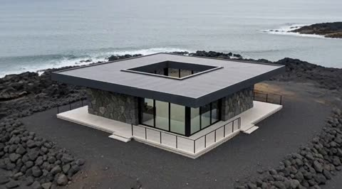</a>

五段定时分镜以硬切衔接，每段都指定机位，并列出不可变的建筑要素（屋顶开口、柱网、石墙与玻璃的位置），使施工过程中建筑形态保持一致。结尾明确写出缓慢拉远并升起的运镜且不淡出，让画面有清晰的收束。

MiniMax H3 · 文生视频 · 出处: [@GeekCatX on X](https://x.com/GeekCatX/status/2092182771813040202) · 112 赞，统计于 2026-10-29

[`architecture`](tags.md#tag-architecture) [`timelapse`](tags.md#tag-timelapse) [`coastal`](tags.md#tag-coastal) [`construction`](tags.md#tag-construction)

<details><summary><b>提示词</b></summary>

```text
Generate a hyper-realistic architectural construction time-lapse short film, approximately 10 seconds long, in 9:16 vertical screen format, with compressed time-lapse footage.

The scene is set on a rugged black basalt coastline, surrounded by gray-blue seawater, with the horizon positioned near the one-third mark from the top of the frame. Use a high three-quarter overhead shot, with the building always located in the lower-middle section of the frame.

The entire film must maintain the same compact single-story rectangular coastal pavilion: fixed aspect ratio, heavy flat cantilevered roof, with only one regular square opening in the center of the roof, supported by four dark charcoal gray steel columns at the corners, featuring black thin-framed floor-to-ceiling glass on the front and right sides, a full irregular gray basalt stone wall on the left side, a light gray concrete platform, narrow encircling walkway, and thin black metal railings. During construction, do not alter the building's number of stories, orientation, roof outline, opening position, column grid, or the relationship between the stone wall and glass walls.

0.00–1.38 seconds:
Under a cold gray overcast sky, a yellow tracked bulldozer moves back and forth rapidly within a rectangular plot surrounded by volcanic rock, with its blade continuously contacting the ground to level the soil, kicking up brief, natural dust clouds. The high-angle shot remains mostly locked, with only very slight stabilizing drift.

Hard cut.

1.38–2.71 seconds:
A concrete mixer truck pours wet concrete through a chute into the square formwork and rebar mesh, with the concrete spreading from the center outward. Workers wearing hard hats and high-visibility vests use long-handled tools to quickly level the foundation. The formwork, vehicles, and coastal environment remain stable.

Hard cut.

2.71–5.25 seconds:
On the same foundation, perform high-speed but clearly readable steel structure construction. Components are installed in the sequence of "column bases, vertical steel columns, outer ring beams, roof grid, black-framed glass, roof panels." The crane hook descends from above the frame, with steel members positioned only at reasonable structural connection points. The thick flat roof is completed piece by piece, while always preserving the central square roof opening. The sky gradually shifts from cold gray to soft warm orange, with a subtle AI-like growth-style time compression feel, but the building geometry remains hard-edged and stable.

Hard cut.

5.25–6.21 seconds:
Switch to a closer side elevation medium shot. Workers install irregular gray basalt stone blocks row by row from the bottom of the wall upward, while completing the light gray ground paving, glass doors and windows, and facade finishing. Stone material can only appear in the designated solid wall area and must not cover the glass. The shot has only slight stabilizing drift.

Hard cut.

6.21–10.04 seconds:
Switch to an exterior view of the completed building. Construction personnel and equipment quickly clear the site, with warm yellow interior lights, stone wall sconces, and small pathway lights illuminating in sequence. The camera steadily pulls back and slowly rises, gradually revealing the complete modern pavilion, black volcanic rock, nearshore waves, distant bay, and orange-pink sunset glow. The glass subtly reflects the twilight, with rough stone walls and damp rock details sharp and clear, and seawater flowing slowly. The final camera movement remains in a gentle pull-back and rise state, ending naturally without fade-out or freeze-frame.

Overall, present a hyper-realistic architectural visualization, a healing coastal atmosphere, and a controlled AI construction time-lapse texture. Materials are authentic, lighting is restrained, and spatial relationships are stable. Transitions between the five shots use only direct hard cuts, without dissolves, flash whites, or distortion transitions. No subtitles, no logos, no UI elements, no watermarks.
```

</details>

<a id="seedance-kindness-chain-city-street-story"></a>
### 街头卖唱青年与老人的温暖互动

<a href="https://x.com/mimu_ai1/status/2092302901842682213">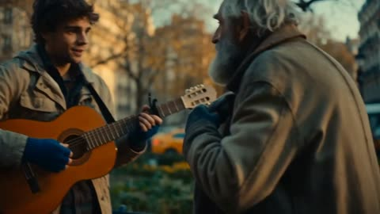</a>

每个时间段都写明一个清晰动作，结尾用手部的匹配剪辑和推近镜头把整段串起来。要求人物面部和服装保持一致，让同一人物在多个镜头中都能被认出。

Seedance 2.5 · 文生视频 · 出处: [@mimu_ai1 on X](https://x.com/mimu_ai1/status/2092302901842682213) · 96 赞，统计于 2026-10-29

[`multi-shot`](tags.md#tag-multi-shot) [`match-cut`](tags.md#tag-match-cut) [`golden-hour`](tags.md#tag-golden-hour) [`story`](tags.md#tag-story)

<details><summary><b>提示词</b></summary>

```text
"Photorealistic, cinematic, high production value, 4K, warm golden-hour light, film grain, teal-and-amber color grade, gentle handheld motion. A wordless story of a kindness passed along a city street. 0–3s: She buys a warm pastry from a street cart, then hands it to a shivering old man on a bench; she smiles and walks on. 3–6s: Tracking shot — the old man gives his scarf to a young busker with cold hands; the busker nods gratefully. 6–9s: The busker helps a lost tourist with directions and a coin; match-cut on a passed object between hands. 9–12s: The tourist steadies a mother's stroller wheel on a curb; soft slow motion on the grateful glance. 12–15s: The mother offers her umbrella to a woman caught in sudden light rain — and it is her, from the first shot; she looks up, surprised and moved, as the camera pushes into her warm smile. Camera: intimate handheld → lateral tracking → match cuts on hands → slow push-in on final reveal. Ambient city sound, soft piano score rising to the loop-back moment. Maintain narrative continuity; keep her facial features and wardrobe fully consistent. Detailed hands, natural human motion."
```

</details>

<a id="h3-woman-gas-can-walk-toward-camera"></a>
### 女子提着红色汽油桶走向镜头

<a href="https://x.com/EndFolding79421/status/2113021575591264481">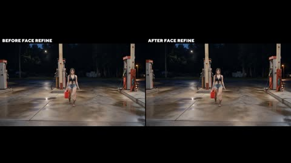</a>

subject_definitions 把每张参考图分配到一个固定用途：人脸来自肖像图，服装与体型来自角色设定图，场景来自加油站照片。镜头固定，人物从远处的全身小景逐渐走近到中景，用来检验远距离的面部细节。

MiniMax H3 · 参考生视频 · 出处: [@EndFolding79421 on X](https://x.com/EndFolding79421/status/2113021575591264481) · 91 赞，统计于 2026-10-29

[`facial-realism`](tags.md#tag-facial-realism) [`reference-images`](tags.md#tag-reference-images) [`gas-station`](tags.md#tag-gas-station) [`walking-toward-camera`](tags.md#tag-walking-toward-camera)

<details><summary><b>提示词</b></summary>

```text
r34l1sm
Facial Realism

subject_definitions:
<Subject 1> is the woman whose exact facial identity comes from the close-up portrait <Picture 1>, whose full-body appearance, hair, proportions, and clothing come from the character sheet <Picture 2>, and whose environment is the gas station in <Picture 3>.

One woman begins standing far from the camera, positioned in the middle of the gas station near the center gas pump in <Picture 3>. She is small in the frame, with her entire body visible. She walks directly toward the camera across the wet pavement, carrying a red gas can in her right hand.

The camera remains stationary, allowing her to gradually grow larger in the frame as she approaches, moving naturally from a distant full-body shot to a medium shot. Her face begins very small in the frame, providing a clear test of facial detail preservation at long distances.

Preserve the woman's exact facial identity from <Picture 1>, and her hair, body proportions, and clothing from <Picture 2>. Keep the gas station layout consistent with <Picture 3>, particularly the position of the center gas pump.

Natural walking movement, realistic hands, subtle facial expressions, and believable clothing movement.

Cinematic live-action 35mm film appearance. Practical gas station lighting, natural shadows, muted colors, subtle film grain.

Exactly ONE woman. No additional people or vehicles. No dialogue. No music. No whip-pan.
```

</details>

<a id="h3-black-gown-red-sole-boot-reveal"></a>
### 黑裙女子走过镜面地面并抬腿展示红底靴

<a href="https://x.com/TaliaAariz/status/2114425711381364940"></a>

镜头紧贴腿部和鞋履，先慢走再抬起一条腿，清楚展示鞋底。黑色反光地面倒映出靴子和长裙，无需额外描述就能体现光泽。

MiniMax H3 · 文生视频 · 出处: [@TaliaAariz on X](https://x.com/TaliaAariz/status/2114425711381364940) · 87 赞，统计于 2026-10-29

[`fashion`](tags.md#tag-fashion) [`reflective-floor`](tags.md#tag-reflective-floor) [`studio-lighting`](tags.md#tag-studio-lighting) [`product-reveal`](tags.md#tag-product-reveal)

<details><summary><b>提示词</b></summary>

```text
Cinematic high-fashion studio shot of a woman’s lower body walking and posing on a glossy black reflective floor. She wears a long, flowing black satin dress with a high side slit that reveals her leg. Focus tightly on her legs and footwear. She wears black thigh-high pointed-toe stiletto boots with extremely high heels, bright red textured soles (crocodile/snakeskin pattern), and ornate gold metallic hardware accents around the heel area. Dramatic spotlight beams cut through the dark background. She walks slowly, then lifts one leg high in an elegant pose to fully display the red sole and gold details. Strong mirror-like reflections of the dress, legs, and lights on the floor. High contrast, luxurious, sensual, sleek aesthetic, shallow depth of field, cinematic lighting, 4K, photorealistic.
```

</details>

<a id="h3-harbor-city-storm-dusk-push"></a>
### 黄昏时分航拍推进密集的海港城市

<a href="https://x.com/LudovicCreator/status/2087479235615031569">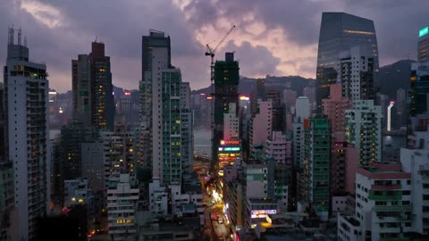</a>

一个清晰的航拍前推运镜，并把天气明确为光源，让拥挤的天际线保持成一个完整的镜头。列出招牌、脚手架、汽笛和雷声等具体感官细节，为模型提供可以锚定氛围的画面依据。

MiniMax H3 · 文生视频 · 出处: [@LudovicCreator on X](https://x.com/LudovicCreator/status/2087479235615031569) · 83 赞，统计于 2026-10-29

[`aerial`](tags.md#tag-aerial) [`city`](tags.md#tag-city) [`storm`](tags.md#tag-storm) [`dusk`](tags.md#tag-dusk)

<details><summary><b>提示词</b></summary>

```text
Aerial push toward a dense vertical harbor city as a storm front rolls in at dusk  towers packed so tightly the streets disappear into shadowed canyons, windows lighting one by one against bruised purple clouds, scaffolding rattling around an unfinished high-rise, neon restaurant signs flickering through the wind, ferries crossing a dark jade harbor under sheets of distant rain. Air charged and humid, every sign haloed by approaching weather. Density as pressure. Horns, thunder, harbor water, a city bracing but still alive

Made  in
@LumaLabsAI
```

</details>

<a id="h3-floating-night-market-lantern-reveal"></a>
### 满月下的夜间漂浮集市

<a href="https://x.com/feesyiam/status/2098436364849320190"></a>

以参考图为基础，并明确列出需要保留的元素，让模型驱动画面动起来而非重新设计场景。按时间段写出一条连续的运镜路径（低角度靠近、升起前推、环绕、拉远全景），并用反向提示词禁止切镜和晃动。

MiniMax H3 · 图生视频 · 出处: [@feesyiam on X](https://x.com/feesyiam/status/2098436364849320190) · 82 赞，统计于 2026-10-29

[`night-market`](tags.md#tag-night-market) [`lanterns`](tags.md#tag-lanterns) [`continuous-shot`](tags.md#tag-continuous-shot) [`reference-image`](tags.md#tag-reference-image)

<details><summary><b>提示词</b></summary>

```text
"Create a 15-second cinematic, photorealistic continuous-shot video based exactly on the reference image of “The Floating Night Market.”

Preserve the original architecture, floating wooden market platforms, lantern designs, vendors, customers, boats, ocean, mountains, color palette, and overall composition. Do not redesign or replace any major elements.

0–3 seconds: Begin with a slow, smooth low-angle camera movement just above the dark ocean surface, approaching the floating night market. Hundreds of warm glowing paper lanterns gently sway in the night breeze. Their golden reflections shimmer naturally across the moving water. Small waves softly move around the floating platforms.

3–7 seconds: The camera slowly rises and moves forward through the market, revealing lively activity. Vendors naturally prepare food at small wooden stalls, gently stirring steaming pots and grilling food. Thin realistic steam rises into the lantern light. Customers walk casually across narrow wooden bridges, talking and browsing. Lanterns flicker subtly and sway with the wind.

7–11 seconds: Continue the same uninterrupted camera movement with a gentle cinematic arc around the market. Small traditional boats slowly pass underneath the floating platforms. Water ripples spread behind them. Food stalls glow with warm orange and amber light while the cool blue moonlight illuminates the surrounding ocean. The huge full moon remains visible in the background behind misty mountains.

11–15 seconds: Slowly pull upward and backward into a wider cinematic reveal, showing the entire floating night market surrounded by the vast ocean. Hundreds of lanterns form a glowing trail across the water. Reflections stretch and break naturally with the waves. Mist gently drifts around the distant mountains as the moonlight creates a magical atmosphere. End on a beautiful wide establishing shot.

Visual style: ultra-photorealistic, cinematic fantasy, realistic human movement, realistic ocean and water physics, detailed wooden textures, natural lantern glow, volumetric moonlight, subtle atmospheric fog, realistic steam, shallow depth of field during close shots, cinematic 35mm photography, high dynamic range, extremely detailed, immersive scale, smooth professional camera movement.

Motion: natural human gestures, subtle wind movement, gently swaying lanterns, flowing steam, moving water, realistic boat movement, no exaggerated animation.

Camera: smooth stabilized cinematic camera, slow controlled movement, natural depth of field, gradual push-in → forward tracking → gentle arc → wide pull-back. One continuous shot with no cuts.

Negative prompt: no scene changes, no cuts, no jump cuts, no camera shake, no distorted faces, no duplicated people, no warped buildings.
```

</details>

<a id="h3-ancient-egypt-pyramid-construction-sunrise-reveal"></a>
### 尼罗河日出下的古埃及金字塔施工

<a href="https://x.com/Diplomeme/status/2084932583335624724"></a>

先用参考图锁定首帧，再按四个时间段推进，从安静的河岸一路写到升降镜头的全景揭示。镜头、光线、物理、表演和声音各有独立段落，并列出明确的避免项，让画面保持纪录片式的写实。

MiniMax H3 · 图生视频 · 出处: [@Diplomeme on X](https://x.com/Diplomeme/status/2084932583335624724) · 79 赞，统计于 2026-10-28 · 发现于 [SkyNotSilent/awesome-MiniMax-H3-cases](https://github.com/SkyNotSilent/awesome-MiniMax-H3-cases)

[`ancient-egypt`](tags.md#tag-ancient-egypt) [`historical-drama`](tags.md#tag-historical-drama) [`documentary-realism`](tags.md#tag-documentary-realism) [`timed-beats`](tags.md#tag-timed-beats) [`crane-reveal`](tags.md#tag-crane-reveal)

<details><summary><b>提示词</b></summary>

```text
15 seconds | 16:9 | live-action historical construction drama
Fictional dramatization. Documentary-style visual realism.

SETTING

Ancient Egypt along the Nile during sunrise beside the Great Pyramids.

The uploaded reference image is the exact opening frame.

Maintain the identical traveler, boats, pyramids, moon, river, shoreline, lighting and composition.

Construction activity gradually becomes visible deeper into the environment while preserving the original scene.

Warm desert atmosphere.
Morning mist.
Light dust drifting across the valley.

WORKFORCE

A master builder overseeing the day's construction.

Hundreds of Egyptian laborers, stone masons, engineers, rope teams, carpenters and transport crews gradually become active throughout the distant construction zone.

Maintain historically accurate clothing, tools, wooden machinery and consistent character identities.

Human behaviour remains disciplined, coordinated and believable.

---

STORY

00–04s — ESTABLISHING

The traveler stands silently at the riverbank exactly as shown in the reference image.

The camera slowly pushes forward from behind.

Feluccas drift naturally.

Palm trees sway gently.

Birds fly across the sunrise.

Workers begin appearing in the distant background carrying ropes, wooden beams and stone tools toward the pyramid complex.

Construction slowly awakens with the rising sun.

---

04–08s — OPERATION

The traveler picks up the clay vessel and begins walking along the shoreline.

The camera follows naturally behind him.

Across the river, dozens of workers unload massive limestone blocks from transport boats.

Oxen pull wooden sledges.

Long rope teams drag heavy stones toward enormous earthen ramps.

Wooden cranes rotate slowly as supervisors organize the workforce.

Dust rises naturally beneath hundreds of moving feet.

---

08–12s — CONSTRUCTION

The traveler reaches an elevated viewpoint overlooking the worksite.

The camera gently reveals the enormous construction operation.

Hundreds of synchronized workers pull a gigantic limestone block upward using thick ropes and wooden rollers.

Stone masons shape blocks with copper chisels.

Carpenters assemble scaffolding.

Engineers inspect alignment while foremen direct the operation with calm hand signals.

The environment feels immense, alive and historically authentic.

---

12–15s — LEGACY

The camera slowly cranes upward into a breathtaking wide reveal.

The traveler stands watching history unfold before him.

Thousands of workers continue building across the vast construction site.

Feluccas constantly arrive carrying fresh limestone.

Dust drifts through golden sunrise light.

The pyramids dominate the horizon as one final massive stone settles perfectly into position.

End with the feeling that humanity's greatest engineering achievement is being built before our eyes.

---

CAMERA

Grounded historical-documentary cinematography.

Mix:

Wide environmental establishing shots.

Medium handheld following shots.

Brief observational close-ups.

Slow cinematic dolly movement.

Natural handheld instability.

Realistic operator movement.

Gentle crane rise for the final reveal.

No impossible drone transitions.

No excessive slow motion.

---

LIGHTING

Natural sunrise illumination.

Warm golden desert light.

Soft atmospheric haze.

Realistic exposure adaptation.

Natural shadows.

Detailed limestone texture.

Physically accurate reflections across the Nile.

No artificial rim lighting.

---

PHYSICS

Real gravity.

Authentic weight of limestone blocks.

Natural rope tension.

Wooden cranes flex realistically.

Workers visibly strain under heavy loads.

Dust reacts to footsteps.

Boats move naturally with river currents.

Water responds realistically.

Wind moves robes, sails and palm leaves.

Everything follows believable engineering principles.

---

HUMAN PERFORMANCE

Restrained, believable teamwork.

Heavy breathing.

Natural communication.

Simple hand signals.

Realistic lifting mechanics.

Measured walking.

Visible physical effort.

No exaggerated cinematic acting.

---

AUDIO

Morning wind.

Flowing Nile water.

Boat hulls creaking.

Workers shouting coordinated commands.

Stone scraping.

Hammer and chisel impacts.

Heavy rope tension.

Footsteps on sand.

Distant oxen.

Natural historical ambience.

No oversized Hollywood trailer effects.

---

VISUAL CHARACTER

Photorealistic live-action footage.

Historical documentary realism.

Museum-quality reconstruction.

Natural skin texture.

Authentic linen garments.

Weathered limestone.

Subtle sensor noise.

Natural motion blur.

Avoid:

Fantasy elements.

Magic.

CGI appearance.

Oversaturated HDR.

Modern machinery.

Floating debris.

Perfect choreography.

Beauty-filter faces.

---

CONTINUITY

Maintain the exact character identity, clothing, boats, pyramids, moon, river, shoreline, architecture and lighting established in the uploaded reference image.

Construction activity should emerge naturally from the existing environment without changing the original composition.

Every action begins from the physical state established by the previous shot.

https://tinyurl.com/dhh4wvyu
```

</details>

<a id="h3-fpv-drone-jungle-cave-floating-ruins"></a>
### FPV无人机穿越丛林、水晶洞与浮空遗迹

<a href="https://x.com/magnific/status/2084963311234478503">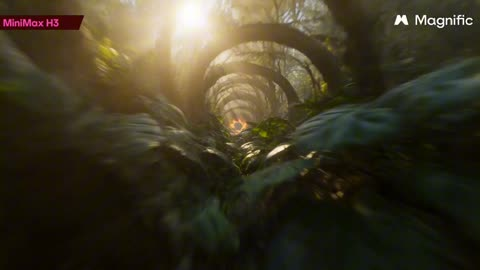</a>

提示词把整段飞行写成一个连续的前进镜头，并按顺序点名每个转场（拱门、洞穴、水晶洞、天空），让模型在没有剪辑的情况下串联场景。速度、运动模糊和真实物理的描述保持了手持FPV的临场感。

MiniMax H3 · 文生视频 · 出处: [@magnific on X](https://x.com/magnific/status/2084963311234478503) · 78 赞，统计于 2026-10-29

[`fpv-drone`](tags.md#tag-fpv-drone) [`one-shot`](tags.md#tag-one-shot) [`camera-move`](tags.md#tag-camera-move) [`motion-blur`](tags.md#tag-motion-blur) [`floating-ruins`](tags.md#tag-floating-ruins)

<details><summary><b>提示词</b></summary>

```text
"Photorealistic FPV drone shot flying forward at high speed through a dense, hyperrealistic jungle tunnel of overlapping vines and giant leaves, real volumetric golden-hour sunlight blasting through gaps in the canopy with natural lens flares and floating dust and pollen catching the light. Ahead, a glowing amber organic archway fused into the vegetation grows closer; the drone passes through it and plunges into a vast underwater-feeling cavern lit by bioluminescent coral and crystal formations, shafts of teal and cyan light piercing down through drifting particles and tiny glowing organisms, natural caustics and physically accurate light scattering.

The flight continues forward out of the coral cavern into a colossal cave of towering amethyst and quartz crystal formations, warm rim light and refracted rainbow flares cutting across the frame as the camera weaves between crystals. Finally the drone bursts out of the crystal cave into open sky, flying between colossal floating stone ruins above a real sea of clouds at golden hour, ancient weathered stone arches drifting past and sunbeams cutting through the mist.

Real-world physics, natural motion blur, hyperrealistic cinematic nature-documentary realism throughout, seamless continuous forward camera movement, 8K detail."
```

</details>

<a id="h3-snowflake-macro-frozen-kingdom-push"></a>
### 雪花微距推进变成冰封王国

<a href="https://x.com/LudovicCreator/status/2088928791741481189"></a>

用 @Image 标记两张参考图，并写明雪花的枝臂、棱面与冰湖、山脉之间的对应关系，让变形有真实的视觉呼应。全程保持同一推镜和冷蓝光线，使过渡读起来像一次连续推进而非切换。

MiniMax H3 · 参考生视频 · 出处: [@LudovicCreator on X](https://x.com/LudovicCreator/status/2088928791741481189) · 77 赞，统计于 2026-10-29

[`macro`](tags.md#tag-macro) [`snowflake`](tags.md#tag-snowflake) [`camera-push`](tags.md#tag-camera-push) [`reference-images`](tags.md#tag-reference-images)

<details><summary><b>提示词</b></summary>

```text
@Image
 1: Push steadily toward the center of the snowflake while preserving the extreme macro realism of the crystal. Move deeper into the intricate hexagonal structure, razor-sharp ice branches, delicate crystalline facets, microscopic frost, and shimmering frozen edges. Maintain the shallow depth of field, cold blue-white illumination, subtle refraction, drifting snow particles, and sparkling highlights. As the camera advances, allow the snowflake's branching geometry, frozen ridges, and crystalline valleys to increasingly dominate the frame until the ice structure begins to resemble an immense frozen landscape viewed from above.

At the exact moment when the snowflake's branching arms, crystalline ridges, hexagonal facets, and frosted textures naturally match the mountain ranges, frozen lakes, icy valleys, and radial layout of
@Image
 2, transition seamlessly into the aerial view of the frozen kingdom. Continue the same uninterrupted forward movement toward the magnificent ice citadel at the center as crystalline facets become frozen lakes, delicate frost becomes snow-covered forests, microscopic ice ridges become towering mountain chains, and the central hexagon transforms into the heart of the kingdom. Preserve the feeling that the viewer has never left the same crystalline structure—only its scale has expanded from a single snowflake to an entire frozen world.

No tearing, black frames, hard cuts, visible morphing, obvious VFX, or compositing seams. Keep the transformation completely photorealistic, elegant, and physically believable—as though the microscopic architecture of a snowflake naturally unfolds into a colossal frozen kingdom. Preserve the continuity of crystalline branches becoming mountain ridges, ice facets becoming frozen lakes, frost particles becoming drifting snowfall, and sparkling highlights becoming sunlight glinting across glaciers and ice palaces. Maintain identical cool blue lighting, atmospheric continuity, and one continuous cinematic camera push with no visible edit.

Made in
@Hailuo_AI
  Minimax H3

What two images would you rhyme?
```

</details>

<a id="h3-wuxia-bamboo-night-snow-closeup"></a>
### 雪夜竹林中披毛领长袍的女子

<a href="https://x.com/sipteaandcoffee/status/2083132770650571041"></a>

前景虚化的竹叶从林内框住人物，冷色正面主光加逆光让人脸与暗背景分离。浅景深把雪和竹林化为光斑，克制的正反打节奏让特写保持张力。

MiniMax H3 · 文生视频 · 出处: [@sipteaandcoffee on X](https://x.com/sipteaandcoffee/status/2083132770650571041) · 75 赞，统计于 2026-10-29

[`wuxia`](tags.md#tag-wuxia) [`bamboo-forest`](tags.md#tag-bamboo-forest) [`period-drama`](tags.md#tag-period-drama) [`night-snow`](tags.md#tag-night-snow)

<details><summary><b>提示词</b></summary>

```text
A 16:9 cinematic wuxia mystery set in a bamboo forest at night. Use a low-saturation palette of cold blue, ink green, charcoal, and gray. Thin mist fills the forest and fine snow drifts through the air. The mood is austere, lethal, and controlled, with the tension of a martial-arts sect investigating a case and exchanging secret intelligence.

Deep in the forest, dense vertical bamboo fills the background while cold white mist-light glows in the distance. Soft, out-of-focus leaves partially obscure the foreground, creating the sense of watching from within the grove. A cool, soft front-side key lights the actors’ faces; backlight keeps the foreground dark and the distance luminous. Use shallow depth of field so leaves, snow, and bamboo dissolve into soft bokeh.
Prioritize facial close-ups and measured shot/reverse-shot coverage. Keep the rhythm restrained but tense. Photoreal period-drama production value, cinematic lighting, and no modern elements. No subtitles, on-screen text, watermarks, modern clothing or architecture, animation styling, over-smoothed skin, bright daylight, or comic performance.
```

</details>

<a id="h3-convenience-store-mommy-voice-horror"></a>
### 深夜便利店里女孩购物，陌生男人走入

<a href="https://x.com/Diplomeme/status/2100626405214298544">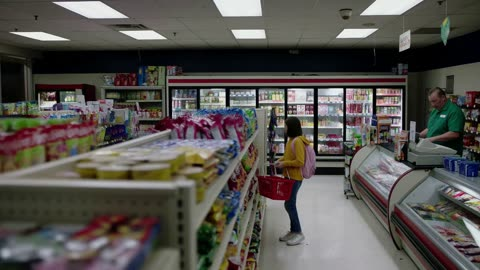</a>

每个镜头都标注时间段并只承载一个情节节拍，角色与店内布局的连续性说明让各镜头保持一致。明确限定冷白荧光灯、禁止霓虹和慢动作等光线与运镜，使画面保持写实。

MiniMax H3 · 文生视频 · 出处: [@Diplomeme on X](https://x.com/Diplomeme/status/2100626405214298544) · 70 赞，统计于 2026-10-29

[`horror`](tags.md#tag-horror) [`photorealistic`](tags.md#tag-photorealistic) [`shot-list`](tags.md#tag-shot-list) [`continuity`](tags.md#tag-continuity) [`convenience-store`](tags.md#tag-convenience-store)

<details><summary><b>提示词</b></summary>

```text
15 seconds of zombie scene with H3 Minimax.

The MiniMax H3 x Picsart Challenge is live  no theme, just your best idea. $50,000 prize pool. Closes Sep 23.
@Hailuo_AI

@Picsart


Enter:
https://
tinyurl.com/bdfp4a6p

Try it Prompt : MINIMAX H3 — “COME TO MOMMY”

15-second photorealistic live-action horror sequence, 16:9, 7 distinct shots, new shot every ~2 seconds, premium theatrical cinematography, realistic human performances, practical lighting, grounded horror, no CGI appearance.

CHARACTER CONTINUITY:
Girl: 10–12 years old, natural appearance, shoulder-length dark hair, casual clothes, small backpack.
Infected man: late 30s, messy dark hair, gray worn jacket, dark trousers, tired face.
Shopkeeper: middle-aged man, simple store uniform.
Keep identical faces, wardrobe, proportions and appearance across all shots.

SHOT 1 — NORMAL | 0–2s
Wide establishing shot inside a small neighborhood convenience store at night. The girl casually walks through a grocery aisle with a basket, choosing snacks. Shopkeeper works behind the checkout counter. Automatic glass doors visible in the background. Everything feels ordinary and safe.
35mm cinema lens, subtle lateral camera movement.
Audio: refrigerator hum, fluorescent buzz, quiet store ambience.

SHOT 2 — THE STRANGER | 2–4s
Medium shot facing the entrance. Automatic doors open and a strange man enters. He appears heavily drunk, stumbling slightly and touching the door frame for balance. He slowly looks around. Shopkeeper notices him. Girl remains visible in foreground.
Natural handheld push toward the man.
His behavior initially looks completely believable.

SHOT 3 — SOMETHING IS WRONG | 4–6s
Close-up of the man. His stumbling suddenly stops. He becomes completely motionless. His eyes slowly focus. His head makes a subtle unnatural twitch. His breathing changes. His fingers tighten. He slowly turns toward the shopkeeper.
Locked close-up with tiny natural camera movement.
The store ambience becomes unnaturally quiet.

SHOT 4 — ATTACK | 6–8s
Fast medium-wide shot. Without warning, the man violently lunges toward the checkout. The shopkeeper recoils as the attacker grabs and slams him against the counter. Products fall onto the floor. The girl sees everything, drops her basket and runs.
Handheld camera reacts naturally to the sudden violence.
Fast realistic motion blur. No gore focus.

SHOT 5 — HIDE | 8–10s
Low camera inside a grocery aisle. The girl drops behind a shelf and covers her mouth, trying not to breathe loudly. Through a narrow gap between products, she watches the store. The infected slowly walks away from the counter. A dropped snack rolls across the floor.
Camera at the girl's eye level, partially obstructed by products.
Her frightened eye remains sharply focused.

SHOT 6 — THE SEARCH | 10–12.5s
Medium shot from behind the shelf. The infected slowly enters the aisle. His footsteps approach. He looks left, then right. The girl remains completely still. He suddenly turns toward her hiding place and stops.
Very slow camera push toward the gap between products.
Keep the infected partially obscured and human-looking.

SHOT 7 — MOMMY | 12.5–15s
Extreme close-up of the girl's face. She trembles silently, covering her mouth. From the other side of the shelf, the infected speaks using her mother's voice.

INFECTED, IN HER MOTHER'S VOICE:
“Sweetheart... come out. Mommy's here.”

The girl's eyes widen. She recognizes the voice. A tear forms. She slowly presses her hand over her mouth.

VOICE:
“Come to Mommy.”

Slow push toward her terrified expression. The infected remains a blurred silhouette through the shelf.

CUT TO BLACK.

VISUAL REALISM:
Photorealistic live-action. Natural skin texture, individual hair strands, realistic child movement, believable body mechanics, natural facial expressions, accurate clothing physics, realistic product interaction, physically correct shadows and reflections, natural motion blur, realistic depth of field.

ENVIRONMENT:
Real convenience-store materials: plastic packaging, glass refrigerators, metal shelving, paper labels, cardboard boxes and polished flooring. Maintain identical store layout across every shot.

LIGHTING:
Practical cool-white fluorescent lighting. Realistic falloff, darker spaces between aisles, natural reflections on refrigerator glass and floor. No neon lighting, colored fog, fantasy glow or excessive bloom.

CAMERA:
Professional cinema camera, primarily 35mm perspective. Each shot has a clearly different composition. Natural handheld movement during action, controlled movement during tension. No random camera movement, excessive shake, artificial zoom or slow motion.

EDITING:
Hard cinematic cuts. New visual information every ~2 seconds. Every shot advances the story. Maintain perfect character and environment continuity.

AUDIO:
Automatic door chime, refrigerator hum, fluorescent buzz, footsteps, products falling, girl's breathing and distant traffic. After the attack, reduce ambience. The mother's voice must sound warm, familiar and completely believable, making the imitation disturbing.

NON-DIEGETIC MUSIC:
Minimal low-frequency horror atmosphere after the attack. No loud jump scare or trailer-style impact.

FINAL TARGET:
A premium photorealistic horror-film scene with clear storytelling:
NORMAL STORE → STRANGER ENTERS → BEHAVIOR CHANGES → ATTACK → GIRL HIDES → INFECTED SEARCHES → MOTHER'S VOICE TRAP.

No generic AI faces, plastic skin, warped hands, duplicated people, changing wardrobe, inconsistent store layout, meaningless cuts or exaggerated monster design.
```

</details>

<a id="seedance-desert-boot-canyon-reveal"></a>
### 靴子踩上裂石后拉升展现沙漠峡谷

<a href="https://x.com/aibytekat/status/2088653107832197230">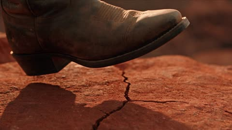</a>

用分段时间轴定义清晰的镜头顺序：靴子的极近景、快速上摇并拉远的运镜，最后是峡谷的全景揭示。每个转场处都写明摄像机动作，让切换读起来像一镜到底。

Seedance 2.5 · 文生视频 · 出处: [@aibytekat on X](https://x.com/aibytekat/status/2088653107832197230) · 70 赞，统计于 2026-10-29

[`timed-segments`](tags.md#tag-timed-segments) [`camera-move`](tags.md#tag-camera-move) [`desert`](tags.md#tag-desert) [`canyon`](tags.md#tag-canyon)

<details><summary><b>提示词</b></summary>

```text
0-10s: Extreme macro close-up. The camera is focused tight on a rugged, dirt-covered boot stepping heavily onto a cracked, red-rock surface. Slow-motion, sharp lighting, highly detailed textures.

10-20s: The camera abruptly whips upward and pulls backward rapidly, transitioning into a dynamic tracking shot.

20-30s: The shot reveals a massive, ancient desert canyon under a dramatic, cloudy sunset. The person is standing at the edge of an immense cliff. Epic cinematic scale, volumetric sunlight breaking through the clouds, breathtaking atmosphere.
```

</details>

<a id="h3-desert-highway-gas-can-walk"></a>
### 女子提着汽油桶独自走在沙漠公路上

<a href="https://x.com/EndFolding79421/status/2106734170332389540">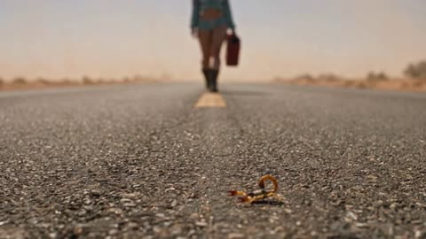</a>

按时间码分镜，前四秒不露脸，露脸后由角色参考图锁定人物外观。贴近路面的低机位和前景的蝎子增加了纵深与质感。

MiniMax H3 · 参考生视频 · 出处: [@EndFolding79421 on X](https://x.com/EndFolding79421/status/2106734170332389540) · 59 赞，统计于 2026-10-29

[`character-sheet`](tags.md#tag-character-sheet) [`shot-timing`](tags.md#tag-shot-timing) [`low-angle`](tags.md#tag-low-angle) [`road-movie`](tags.md#tag-road-movie)

<details><summary><b>提示词</b></summary>

```text
DURATION: 10 SECONDS
ASPECT RATIO: 16:9
CHARACTER REFERENCE:
Use the woman from the provided character sheet.
Preserve her exact facial identity, hairstyle, body proportions, clothing and appearance.

EXACTLY ONE woman.
No other people.
No vehicles.
No buildings.
SCENE:
A completely deserted two-lane highway cuts through a vast, brutally hot desert. Dry sand and sparse desert scrub stretch endlessly on both sides.

Harsh afternoon sunlight. Subtle heat shimmer rises from the asphalt.
The woman walks alone down the highway carrying a GAS CAN in one hand.
She has a very light, natural sheen of sweat from the heat — subtle, NOT drenched.
NO DIALOGUE.
NO MUSIC.

[00:00–00:02]

EXTREME LOW road-level shot, camera almost touching the asphalt.

A SMALL SCORPION crawls across the hot road in the foreground.

Behind it, the woman's boots enter frame and steadily approach.

The gas can swings naturally beside her leg.

DO NOT SHOW HER FACE.
[00:02–00:04]

Cut to a low side tracking shot moving alongside her.

Frame her boots, legs, hand and gas can as she walks.

Brief close detail of her hand gripping the gas-can handle.

Her upper face remains out of frame.

The empty desert highway stretches behind her.

DO NOT SHOW HER FACE YET.

[00:04–00:07]

Cut to a medium rear three-quarter tracking angle.

The camera smoothly moves around toward her front as she continues walking, finally REVEALING HER FACE.

Her expression is focused, serious and controlled — almost dangerous.

She does not look at the camera.

A few strands of hair move naturally in the hot breeze.

Subtle sweat catches the sunlight.

[00:07–00:10]

Cut to a dramatic LOW FRONTAL TRACKING SHOT.

Camera moves backward directly ahead of her while she continues walking toward it.

Gradually tighten from medium framing toward a closer view of her face.

Her eyes remain fixed somewhere far down the road.

She looks determined and dangerous, like she knows exactly where she is going.

Gas can remains visible at her side.

Heat waves distort the empty highway behind her.

END while she is STILL WALKING.

VISUAL STYLE:

Gritty cinematic road-movie photography.
Grounded live-action realism.
Sun-bleached desert colors.
Harsh natural sunlight.
Subtle 35mm-style grain.
Slightly imperfect exposure.
Natural skin texture and pores.
Realistic subtle perspiration.
Heat shimmer above asphalt.
Atmospheric desert dust.

NOT glossy.
NOT plastic AI skin.
NOT beauty-commercial lighting.
NO exaggerated orange-and-teal grading.

CRITICAL:

ONE woman only.
Same character identity throughout.
Same outfit throughout.
Same gas can throughout.
Gas can remains in the SAME HAND.
She travels in the SAME DIRECTION throughout.
No cars.
No people.
No buildings.
No civilization.
No destination revealed.
NO whip-pan.
NO dialogue.
NO music.

DO NOT SHOW HER FACE during the first 4 seconds.

Once her face is revealed, preserve her exact character-sheet facial identity.

She NEVER stops walking.
She NEVER smiles.
She NEVER looks into the camera.
```

</details>

<a id="h3-zombie-garage-flashlight-escape"></a>
### 女子手持手电在昏暗车库中奔逃

<a href="https://x.com/Just_Anika_Here/status/2107342788178407680">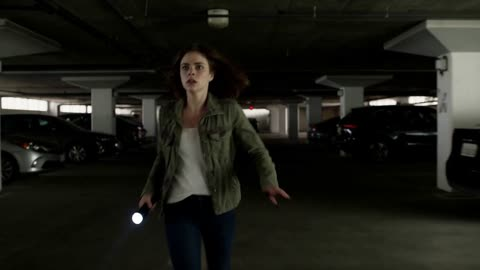</a>

每个镜头都写明时间段和单一的视觉目的，让模型有清晰的节奏可循。单独的一致性段落保证各镜头里女主角、服装和车库不变，每个节拍对应的声音提示（低音冲击、突然寂静）让配乐与画面同步。

MiniMax H3 · 文生视频 · 出处: [@Just_Anika_Here on X](https://x.com/Just_Anika_Here/status/2107342788178407680) · 49 赞，统计于 2026-10-29 · 发现于 [SkyNotSilent/awesome-MiniMax-H3-cases](https://github.com/SkyNotSilent/awesome-MiniMax-H3-cases)

[`zombie-horror`](tags.md#tag-zombie-horror) [`multi-shot`](tags.md#tag-multi-shot) [`handheld-camera`](tags.md#tag-handheld-camera) [`sound-design`](tags.md#tag-sound-design)

<details><summary><b>提示词</b></summary>

```text
Create a 15-second ultra-photorealistic live-action zombie horror movie sequence in 16:9 widescreen. Make it feel like a professionally shot theatrical horror film, with 5 connected shots, escalating tension, strong cinematic sound design and music. Realistic human movement, realistic environments, grounded physics, no comedy, no text, no subtitles, no dialogue. SHOT 1 — 0–3 sec: Night. A deserted underground parking garage. A frightened young woman walks quickly between parked cars, holding a small flashlight. The camera tracks backward in front of her. Suddenly, the flashlight beam catches a motionless person standing far behind her. Deep bass hit. SHOT 2 — 3–6 sec: Close-up of the woman's face as she stops breathing for a moment and looks behind her. The parking space is empty. The music drops almost completely silent. She slowly turns back toward the camera. SHOT 3 — 6–9 sec: A zombie suddenly appears extremely close behind her in the background — pale dirty skin, torn everyday clothing, blood around the mouth, unnatural posture. It moves toward her with a sudden violent burst. Hard music impact. SHOT 4 — 9–12 sec: She runs through the parking garage. Camera follows handheld from behind. Multiple distant zombie silhouettes suddenly emerge between the cars, blocking the exit. Emergency lights begin flashing red. SHOT 5 — 12–15 sec: She reaches the exit door and desperately pulls it open. Bright daylight floods into the dark garage. She looks relieved for half a second — then the camera moves slightly past her shoulder and reveals dozens of zombies already standing silently outside, completely blocking the exit. On the final bass hit, one zombie suddenly looks directly into the camera. CUT TO BLACK. VISUAL STYLE: ultra-photorealistic live-action theatrical zombie horror, cinematic 16:9 composition, realistic human anatomy, realistic zombie makeup and skin texture, physically believable movement, dark atmospheric lighting, practical-looking effects, subtle film grain, dramatic contrast, natural handheld camera movement, high-end horror cinematography. CONSISTENCY & QUALITY: keep the same woman, same clothing, same hairstyle and same underground parking garage throughout the sequence. Zombies must have consistent realistic anatomy. No extra limbs, extra fingers, duplicated people, warped faces, melting bodies, floating objects, cartoon appearance, video-game look, excessive gore, text, subtitles, logos or watermark. EDITING: each shot must have a clear visual purpose and connect naturally to the next. Fast pacing, no dead time. The first shot must immediately create curiosity. Build tension from mystery → realization → zombie reveal → chase → final shocking reveal.
```

</details>

<a id="h3-woman-bridge-wall-fpv-still-orbit"></a>
### 女子保持静止，FPV 镜头环绕拍摄

<a href="https://x.com/Luna_R4ze/status/2100188951252435024"></a>

提示词把起始画面设为冻结静帧，并按顺序写明每段镜头动作及时长，让模型沿着定时路径飞行，同时人物保持姿势不动。结尾要求回到与开头完全一致的构图，使片段首尾画面对齐。

MiniMax H3 · 图生视频 · 出处: [@Luna_R4ze on X](https://x.com/Luna_R4ze/status/2100188951252435024) · 40 赞，统计于 2026-10-29

[`fpv-camera`](tags.md#tag-fpv-camera) [`frozen-subject`](tags.md#tag-frozen-subject) [`orbit-shot`](tags.md#tag-orbit-shot) [`image-to-video`](tags.md#tag-image-to-video)

<details><summary><b>提示词</b></summary>

```text
Use the start frame as a frozen still. Do not change the woman, pose, dress, bridge, river, light, or colour.

The camera IS a tiny FPV camera. No drone body visible. No operators. No extra people.

Locked subject: she stays completely still the whole time, like a photograph the camera is flying through.

Camera path, in order, one move at a time:

0. Hold the start framing for 0.5s.
1. Slow push-in toward her face, stop when she is chest up three-quarter, 2s.
2. Tilt down her body: chest, waist, then legs and bare feet on the concrete wall, 2s.
3. Orbit 90 degrees around her to her right side, keeping her in the centre of frame, 2s.
4. Rise up to a high angle looking down on her, 1.5s.
5. Descend the other side (her left), still centred on her, 2s.
6. Return along the same line to the exact start framing, 2s.
7. Hold the start framing 0.5s.

Technical:
- Smooth FPV flight, no shake, no whip pans
- Always keep her the focus point
- Shallow depth, natural late-sun, same grade as the still
```

</details>

<a id="h3-plaster-studio-teal-gown-voiceover"></a>
### 身着青绿长裙的女子坐在石膏雕像间

<a href="https://x.com/TaliaAariz/status/2111479729819652111"></a>

先用大量道具细节固定场景，再按顺序给出侧脸、转向镜头、面部和手部特写等镜头节拍，让模型有清晰的动作顺序。旁白指定为意大利语画外音，用来定调，而不是画面中的台词。

MiniMax H3 · 文生视频 · 出处: [@TaliaAariz on X](https://x.com/TaliaAariz/status/2111479729819652111) · 39 赞，统计于 2026-10-29 · 发现于 [SkyNotSilent/awesome-MiniMax-H3-cases](https://github.com/SkyNotSilent/awesome-MiniMax-H3-cases)

[`fashion`](tags.md#tag-fashion) [`sculpture-studio`](tags.md#tag-sculpture-studio) [`voiceover`](tags.md#tag-voiceover) [`portrait`](tags.md#tag-portrait)

<details><summary><b>提示词</b></summary>

```text
A cinematic fashion video set in a dusty sculpture studio filled with white plaster classical busts and statues: a beautiful young woman with long dark wet-look wavy hair sits on a white pedestal in a sheer teal off-shoulder draped dress with midriff cutouts, wearing a large silver pendant and chunky dark red jewelry, slowly shifting between elegant poses—looking down in profile, turning toward the camera with a soft gaze, close-ups of her face and manicured hands touching her shoulder and cheek—while Italian voiceover gently admires her beauty and presence.
```

</details>

<a id="h3-girl-eats-jujube-canal-sunset"></a>
### 夕阳水乡里吃青枣的女孩

<a href="https://x.com/Stellakjbk/status/2096608164196254160"></a>

提示词以最高优先级锁定参考图的人脸、服装、构图和光线，再把5秒拆成分段时间轴，让笑容从眼神到嘴角逐步浮现。镜头固定、只允许轻微呼吸感，环境动态克制，画面不易漂移。

MiniMax H3 · 图生视频 · 出处: [@Stellakjbk on X](https://x.com/Stellakjbk/status/2096608164196254160) · 37 赞，统计于 2026-10-29 · 发现于 [SkyNotSilent/awesome-MiniMax-H3-cases](https://github.com/SkyNotSilent/awesome-MiniMax-H3-cases)

[`portrait`](tags.md#tag-portrait) [`golden-hour`](tags.md#tag-golden-hour) [`timeline-prompt`](tags.md#tag-timeline-prompt) [`chinese-village`](tags.md#tag-chinese-village)

<details><summary><b>提示词</b></summary>

```text
@图片1

生成一段5秒真人写实短视频，适用于 Minimax H3 全能模式。

【最高优先级】
严格保持@图片1中女生的人脸、五官、发型、妆容、肤色、服装、身材、靠树姿势、青枣、竹篮、江南水乡背景、夕阳光线、构图、焦段、景深和整体画面质感不变。

不要重新设计人物，不要换脸，不要改变服装，不要改变场景。
整个视频必须像真实摄影机随手捕捉到的一段生活瞬间：
自然、松弛、清甜、灵动、毫无表演痕迹，绝对不要AI味。

【人物状态】
女生慵懒自然地斜靠在树干旁，身体保持放松。
右手轻轻拿着一颗绿色青枣靠近嘴边。

她不是刻意面对镜头表演，而是在吃青枣时自然注意到镜头。
神态轻松，眼睛清澈明亮、有神、有真实焦点。
嘴角原本只有很轻的笑意，随后因为吃到青枣而自然地笑开。

重点：
笑容一定是“慢慢浮现”，不能突然切换。
眼睛先有笑意，嘴角随后跟着上扬。

【5秒动作时间轴】

0.00—0.70秒
保持@图片1原始姿态。
女生拿着青枣停在唇边，目光自然落在镜头附近。

她的表情非常放松，
嘴角只有一点轻轻的浅笑，
眼神明亮、柔和、有神。

身体几乎不动，
只有非常轻微的自然呼吸，
几缕头发被风轻轻吹动。

0.70—1.60秒
她自然地把青枣送到嘴边，
轻轻张嘴，小口咬下一点。

嘴唇先自然贴住青枣，
牙齿轻轻咬合，
随后手腕非常自然地把青枣稍微拿开一点。

动作不要快，
不要大口咬，
不要夸张张嘴，
不要故意做“吃东西”的表演动作。

1.60—2.50秒
她很轻地咀嚼一两下。

咀嚼幅度极小，
只是下颌和脸颊产生细微真实变化。

不要鼓腮，
不要左右嚼，
不要连续机械咀嚼，
不要像嚼口香糖。

这一过程中，
她的眼神开始出现更加明显的笑意，
像觉得青枣很清甜，心情一下变得很好。

2.50—3.70秒
她忍不住自然地笑了起来。

不是突然咧嘴大笑，
而是：

眼神先柔下来
→ 嘴角轻轻上扬
→ 苹果肌微微抬起
→ 眼睛自然弯起
→ 最后露出一点干净自然的牙齿。

笑容甜美、清新、温柔，
带一点点被镜头捕捉到之后的害羞感。

她可以非常轻微地低一下眼，
随后再抬眼看向镜头。

动作幅度必须非常小，
像真实女孩下意识的反应，
不要做成刻意撒娇或摆拍。

3.70—5.00秒
她保持轻松甜美的笑容。

手里仍然自然拿着那颗被咬过的青枣，
停在嘴边附近。

她看着镜头，
眼睛清澈、明亮、灵动，
笑意同时存在于眼睛和嘴角。

最后约0.5秒保持一个最自然、最好看的浅笑状态结束。

【表情重点】
整段视频重点放在“眼神 + 微笑”的细微变化。

眼睛必须：
有真实焦点
清澈明亮
自然灵动
带笑意
不能瞪眼
不能眼球乱转
不能空洞无神

笑容必须：
先浅后深
自然渐变
眼睛和嘴角同步
苹果肌轻微抬起
不要突然露出整排牙齿
不要大笑
不要夸张卖萌

允许一次非常自然的轻眨眼，
不要频繁眨眼。

【吃青枣真实感】
必须表现真实连续动作：

青枣靠近嘴唇
→ 嘴唇接触青枣
→ 小口咬下
→ 青枣离开嘴边
→ 轻微咀嚼
→ 自然笑起来。

嘴唇、牙齿、手指、青枣之间必须保持正确遮挡关系。

青枣始终保持真实圆润形态，
咬过之后只出现一个自然的小缺口。

禁止：
青枣突然消失
青枣变形
青枣穿过嘴唇
手指插进青枣
牙齿异常
嘴型抽动
下巴变形
机械咀嚼。

【镜头】
镜头基本固定。

严格保持@图片1原始构图和摄影距离。

不要推镜
不要拉镜
不要摇镜
不要环绕
不要突然变焦
不要AI自动追脸。

只允许极其轻微的真实摄影机呼吸感。

焦点始终稳定在女生眼睛和面部，
背景保持柔和自然虚化。

【环境】
环境动态非常克制。

树叶和柳枝只被微风轻轻带动，
远处河面有细小自然波光，
乌篷船、小桥、建筑保持稳定。

阳光保持@图片1原有的温暖金色夕阳逆光，
发丝边缘有柔和金色轮廓光，
脸部曝光稳定自然。

皮肤保持真实细腻：
有轻微毛孔和自然肤质，
白皙通透但不过度磨皮，
不要蜡像皮肤，
不要塑料质感。

【严格去AI味】
这是一个真实女孩真实吃青枣时被摄影机偶然拍到的瞬间。

所有动作都必须存在：
轻微惯性
自然停顿
细小呼吸
真实肌肉变化
自然重力感。

不要每个动作都正好卡在时间节点上，
动作之间必须有自然连续的过渡。

严格避免：
AI假笑
僵硬微笑
突然表情变化
机械眨眼
机械咀嚼
夸张嘴型
嘴唇乱动
眼神发空
瞪眼
频繁眨眼
摇头晃脑
过度撒娇
刻意卖萌
夸张害羞
身体乱动
五官漂移
脸型变化
牙齿变形
手指变形
皮肤塑料感
背景闪烁
光线跳变
任何明显AI生成痕迹。

【最终效果】
夕阳下的江南水乡，
女生安静地靠在树边，
轻轻咬了一口手里的青枣。

她一边轻轻吃着，
眼睛里的笑意慢慢浮现，
随后非常自然地甜甜笑了起来。

笑容清甜、柔和、真实，
眼睛清澈有神，
没有刻意表演，
像摄影师偶然捕捉到的一段极其自然、漂亮、舒服的5秒生活镜头。
```

</details>

<a id="h3-husband-awake-beside-sleeping-wife"></a>
### 丈夫醒着躺在熟睡妻子身旁的昏暗卧室

<a href="https://x.com/EndFolding79421/status/2109820369662087323"></a>

开头的 r34l1sm 关键词先定下写实质感，之后故事按节拍逐步展开（醒来、起身、镜前、熟睡的妻子），并给出角色年龄和房间细节。镜头机位交给模型决定，情绪主要通过内心独白传达，而不是对白。

MiniMax H3 · 文生视频 · 出处: [@EndFolding79421 on X](https://x.com/EndFolding79421/status/2109820369662087323) · 36 赞，统计于 2026-10-29

[`realism`](tags.md#tag-realism) [`drama`](tags.md#tag-drama) [`storytelling`](tags.md#tag-storytelling) [`bedroom`](tags.md#tag-bedroom)

<details><summary><b>提示词</b></summary>

```text
r34l1sm

The shrill beep of the alarm clock pierced the early morning silence, and Ted's hand moved almost reflexively to silence it. Lying in bed for a moment longer, he stared at the ceiling, the familiar cracks and patterns a testament to the years gone by.

 At 43, these mornings had become more about reflection than anticipation.

Beside him, Elisa lay still, her presence more like a memory than a reality. He watched her, noticing how even in sleep, she seemed distant. A mix of sadness and resignation settling in his chest.

He remembered the early days, the laughter and shared dreams that filled this very room. Now, it felt like living with a ghost – her body was there, but everything else about her seemed far away.

Gently, so as not to wake her, Ted slid out of bed and began his morning routine. Brush teeth, shave, shower and finally dressing in front of the mirror; each step felt rehearsed, a silent dance he had mastered over the years.

As he dressed for work, his reflection in the mirror stared back at him—a reflection of a aging man caught in the mundanity of a 9-5 job, his dreams and aspirations dulled by the repetitive grind of daily life.

He looks at the bed reflecting in the mirror, his wife of nearly 17 years, slept soundly, her back turned to him. He remembered the days when they'd wake wrapped in each other's arms laughing and flirting never getting enough of each other.

What happened to us? Ted pondered, his heart aching with a mix of longing and frustration. He missed the connection they once shared, missed the woman who used to look at him like he was the only one in the world and made him believe anything was possible.

He still loved his wife but, those days now seemed like distant memories.

Prompt 2:

r34l1sm

The first thing I noticed about Haden was the silence. Not the peaceful quiet of a lazy Sunday morning, but a hushed, almost reverent stillness that seemed to hang over the town like a shroud. It was the kind of silence that wasn’t just heard, but felt - a tangible presence that filled the streets and alleys with unspoken words and secrets. I had left the cacophony of New York, seeking solace in what I thought was a tranquil, small town. I was a private detective tired of the relentless rhythm of the city, yearning for a change of pace. But Haden, nestled in the heart of New England, was not the haven I had imagined.

The town itself was picturesque, almost deceptively so. Quaint cobblestone streets lined with old brick buildings gave it a charming, almost timeless feel. The central town square was dominated by an old clock tower, its chimes marking the passing hours with a sonorous tone that echoed through the streets. But beneath this idyllic façade lurked an undercurrent of something darker, something I would soon find myself inextricably drawn into.

I rented a modest office near the town square, a small, unassuming space above a local bakery. The sweet scent of freshly baked bread wafted up each morning, a comforting, if fleeting, respite from the complexities of my day-to-day work. My practice as a private detective had been a deliberate choice, a profession that allowed me to delve into the mysteries of human behavior while maintaining a semblance of distance. I preferred the shadows, the edges of society where secrets lived and breathed.

In those first weeks, my cases were mundane, forgettable. Haden seemed sleepy, almost lethargic in its everyday routines. The townspeople were cordial, yet there was a reservation in their greetings, a guardedness in their eyes that suggested they were accustomed to keeping outsiders at arm's length. I often found myself wandering the streets after hours, the cool New England air biting at my cheeks, observing the town and its inhabitants. There was a rhythm to Haden, a cadence that spoke of old traditions and long-held beliefs.

That all changed one brisk autumn morning when Mrs. Eleanor Whitaker walked into my office. Her appearance was unremarkable, yet there was an undeniable aura of distress about her. She was the epitome of a small-town matron, her clothes neat but modest, her hair pulled back in a tight bun. Yet her hands, clasped tightly around her purse, betrayed a nervous energy, and her eyes, darting around the room, spoke of fear.

"Mr. Thompson," she began, her voice barely more than a whisper, "I need your help."
```

</details>

<a id="wan-automated-future-six-beat-film"></a>
### 无人机与送餐机器人向储物柜投递餐食

<a href="https://x.com/amynys/status/2102744803481997372">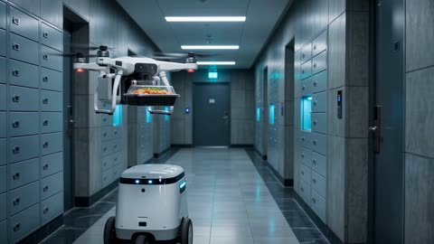</a>

六段带时间码的镜头各有明确的视觉转场，让模型按镜头顺序完成整段30秒影片。固定的青蓝色调、克制的运镜，以及禁止logo和字幕的约束，使影片风格统一、氛围安静。

Wan 3.0 · 文生视频 · 出处: [@amynys on X](https://x.com/amynys/status/2102744803481997372) · 36 赞，统计于 2026-10-29

[`automation`](tags.md#tag-automation) [`social-commentary`](tags.md#tag-social-commentary) [`near-future`](tags.md#tag-near-future) [`multi-beat`](tags.md#tag-multi-beat)

<details><summary><b>提示词</b></summary>

```text
Create a 30-second cinematic near-future social commentary film with one coherent visual language: sleek photorealistic megacity, cool cyan and steel-blue light, restrained camera movement, subtle electronic ambience, realistic human behavior, no logos, no readable brand names, no on-screen captions.

Structure the film as six connected beats with clear visual transitions and escalating unease: 0-5s, autonomous delivery drones and small sidewalk bots bring steaming meals to apartment doors while residents receive them through smart lockers; 5-10s, people summon a silent autonomous taxi from their phones, the vehicle arrives with an empty driver’s seat and smoothly carries them through neon traffic; 10-15s, anxious investors sit before transparent AI financial interfaces asking for advice, algorithmic recommendations replace human brokers, no brokers or advisors are present; 15-20s, a wide public square and office district reveal people with no jobs, automated systems operating everywhere while unemployed adults wait quietly, subdued faces and empty workplaces; 20-25s, an enormous clean factory shows robotic arms producing identical consumer products, packaging them and lining them up in immaculate rows, no human workers visible; 25-30s, pull back to a vast silent retail warehouse and storefronts filled with untouched products, no customers buying, a few people stare through glass at the abundance, the final image is still and emotionally cold. End with a slow wide shot emphasizing that automation has optimized production and convenience but removed work, human mediation, and demand.

Avoid gore, violence, comedy, or exaggerated sci-fi spectacle; make the critique feel plausible, quiet, and unsettling.
```

</details>

<a id="h3-chang-an-champion-first-person-recognition"></a>
### 人群在放榜处认出新科状元

<a href="https://x.com/eternityspring/status/2102418200503959894">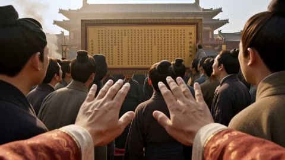</a>

分镜图被拆成九个独立全屏镜头，按时间点逐一切换，每一刻只呈现一个画面。认出状元的人从一个学子开始，反应逐人扩散而非同步，主角的手只在动作需要时入镜。

MiniMax H3 · 参考生视频 · 出处: [@eternityspring on X](https://x.com/eternityspring/status/2102418200503959894) · 33 赞，统计于 2026-10-29

[`first-person`](tags.md#tag-first-person) [`storyboard`](tags.md#tag-storyboard) [`historical-china`](tags.md#tag-historical-china) [`dialogue`](tags.md#tag-dialogue)

<details><summary><b>提示词</b></summary>

```text
subject_definitions:
<Picture 1> is the supplied revised 3-by-3 storyboard, read left to right and top to bottom, providing the progression of Shots 1-9. Each panel must become a separate FULL-SCREEN cinematic shot, one scene at a time. The image grid is only a shot list: discard the contact-sheet layout completely.
<Subject 1> is the unseen first-person protagonist, the newly acclaimed examination champion. Only his realistic hands and red brocade cuffs may appear when the action requires them; never show his face, torso, legs, reflection, or an external view of him.
<Subject 2> is the Tang-Song-inspired Chang'an setting from <Picture 1>: earth-toned period crowds, timber streets, white horse, imperial hall and golden city panorama.
<Subject 3> is a single male scholar near the left of the camera in the crowd of <Picture 1>; he alone recognizes the protagonist first.
<Subject 4> is the surrounding crowd from <Picture 1>, whose individual reactions spread gradually after hearing the first scholar.
<Subject 5> is the pair of dark-robed officials from panel 4 of <Picture 1>, carrying a gong and red announcement.

summary:
[reference generation] A 15-second cinematic first-person journey following all nine panels of <Picture 1>, with <Subject 1> experiencing recognition, congratulations, an official announcement, a white-horse procession and an imperial audience before overlooking Chang'an. The recognition starts with <Subject 3> alone and spreads naturally through <Subject 4>. Animate the nine panels as nine distinct full-screen scenes, cutting at 1.6, 3.2, 4.8, 6.4, 8.0, 9.6, 11.2 and 13.0 seconds. Each frame contains ONE scene and ONE viewpoint, with synchronized Chinese dialogue and location sounds only. No background music anywhere in the video.

retention_analysis:
<Picture 1> (Shots 1-9 narrative and individual composition): partially_preserved - remove the grid layout, all borders and simultaneous panels. Expand only the currently active scene to fill the entire video frame. Use every panel in reading order, preserving the revised empty foreground in panels 2, 3 and 8 and flat hand contact with the horizontal stone surface in panel 9. Panel 2 is the endpoint of a spreading reaction, not an instruction for everyone to react simultaneously.
<Subject 1> (POV throughout): fully_preserved - hands remain naturally lowered entirely outside the frame in Shots 2, 3 and 8. Hands appear only for motivated actions in the other shots.
<Subject 2> (Shots 1-9): fully_preserved - consistent architecture, clothing, white horse, warm golden light and photorealistic texture.
<Subject 3> (Shots 1-3): fully_preserved - the first recognizer retains his appearance and left-side position.
<Subject 4> (Shots 1-7): fully_preserved - retain period clothing and varied individuals while animating distinct, causally staggered reactions.
<Subject 5> (Shots 4-5): fully_preserved - retain uniforms, gong and red announcement.

detailed_description:
Nine distinct sequential FULL-SCREEN cinematic shots, with exactly one continuous scene occupying the entire frame at every instant. Photorealistic historical cinema, widescreen, warm golden natural lighting, soft depth of field and restrained handheld motion. Remain at the protagonist's eye level throughout; no captions, watermarks, modern objects, split screens or readable text.

[Shot 1] Follow panel 1 of <Picture 1>. <Subject 1>'s hands gently part the densely packed <Subject 4> below a golden imperial results board in <Subject 2>. The camera nudges forward between shoulders. Everyone is initially looking at the board. Near the end, only <Subject 3>, a scholar on the left, glances from the board toward the camera with dawning recognition; the others remain unaware. Cloth brushes and low indistinct murmurs accompany the movement.

[Shot 2] At 00:01.600, turn toward the left scholar, using panel 2 as the eventual composition. <Subject 3> (S1), in a surprised youthful male voice, alone announces, <d>[Chinese] 这位就是状元郎!</d> The nearest listener turns only after hearing him; another turns slightly later, then a farther face follows. Background people initially continue reading the board. The realization spreads gradually from person to person, never a synchronized snap. The protagonist's arms hang naturally down outside the frame; no foreground hands, forearms or cuffs.

[Shot 3] At 00:03.200, continue into panel 3 as individuals step closer at different speeds. An elderly man (S2) calls warmly, <d>[Chinese] 状元公!</d> A woman (S3) joins a fraction later, <d>[Chinese] 恭喜呀!</d> A man behind them (S4) adds, <d>[Chinese] 恭喜恭喜!</d> Their voices overlap slightly with distinct entrances and spatial positions. Each person independently smiles and clasps their own hands; gestures and mouths are not synchronized. The protagonist's hands remain completely out of frame.

[Shot 4] At 00:04.800, match panel 4. <Subject 5> advances with a ringing brass gong and raised red announcement. Nearby people step aside first, followed by others, opening a passage. Camera gently steadies as the officials arrive.

[Shot 5] At 00:06.400, match panel 5. Two anatomically correct hands extend from below and receive the red announcement, fingers closing around its ends with believable contact. Uneven applause and jubilant crowd sounds rise around the lens.

[Shot 6] At 00:08.000, match panel 6. Both hands grip the white horse's saddle. The eye-level viewpoint lifts smoothly through mounting, then tips forward toward the horse's ears and street. Keep the protagonist's torso, lap and legs outside the frame throughout. Leather creaks and the horse exhales.

[Shot 7] At 00:09.600, match panel 7. Glide forward between cheering spectators on the white horse, hands loosely holding reins below its ears. Petals drift across warm sunlight. Gentle vertical movement follows the walking hoofbeats.

[Shot 8] At 00:11.200, match panel 8. Walk empty-handed down the imperial hall's clear central aisle toward the distant emperor. Red columns, golden carved surfaces and ministers frame the slow approach. Both arms remain naturally lowered entirely outside the image; no foreground hands, scroll, tray or gift. Footsteps reverberate softly.

[Shot 9] At 00:13.000, match panel 9. Overlook Chang'an from the tower. Both hands rest naturally flat on the broad horizontal stone step-like ledge, palms and relaxed fingers visibly contacting the stone. Keep this contact through the ending while the lens slowly widens toward the expansive golden skyline; hands never float or lift. Wind brushes the sleeves until the final frame at 00:15.000.

overall_soundscape:
Spatially varied street murmurs, individually timed Chinese congratulations, uneven applause, brass gong resonance, cloth and saddle sounds, walking hooves, restrained hall echoes and elevated city wind. The first clear voice belongs solely to the discovering scholar; other voices enter only after hearing him. No narrator or synchronized choral crowd delivery. Use only diegetic speech and real location sounds. The officials' gong is a single on-screen sound effect, never a musical rhythm. No instrumental bed, melodic drone, singing, humming, soundtrack, or background music.

non_diegetic_music:
N/A. Absolutely no background music, no score, no instruments, no musical intro, transition or ending. Preserve only dialogue and diegetic environmental sounds throughout all 15 seconds.
```

</details>

<a id="h3-ink-after-dark-eyes-emerge"></a>
### 黑暗中浮现一双米色眼睛

<a href="https://x.com/opener_ai/status/2087042643369099381">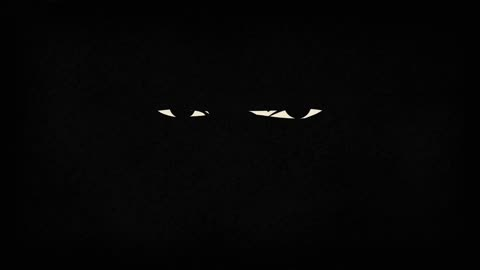</a>

用秒数标注的分段节拍和固定的三色限制，让模型有明确的镜头顺序。开场先用一条光带扫过眼睛，把揭示留到纸张撕裂的转场，让黑暗画面变成图形化的过渡。

MiniMax H3 · 文生视频 · 出处: [@opener_ai on X](https://x.com/opener_ai/status/2087042643369099381) · 28 赞，统计于 2026-10-29 · 发现于 [SkyNotSilent/awesome-MiniMax-H3-cases](https://github.com/SkyNotSilent/awesome-MiniMax-H3-cases)

[`title-sequence`](tags.md#tag-title-sequence) [`noir`](tags.md#tag-noir) [`paper-wipe`](tags.md#tag-paper-wipe) [`retro-print`](tags.md#tag-retro-print)

<details><summary><b>提示词</b></summary>

```text
[FORMAT]
Create a 15-second, 16:9 retro graphic opening-title sequence titled "INK AFTER DARK".
A stylish 1960s pulp-noir animation about a mysterious night writer. Bold, minimal, elegant, slightly dangerous, with dry visual wit.

[IDENTITY]
Keep one female writer visually consistent throughout: sharp angular bob haircut, narrow almond-shaped eyes, long black turtleneck, high-waisted trousers, slim silhouette, black leather gloves, calm expression, upright self-assured posture, and hard graphic highlights along one side of her face.
Use flat hand-inked 2D illustration with rough screen-print texture, imperfect paper grain, and slightly uneven ink edges.

[BEATS]
[0–3 seconds] Extreme close-up of the writer's face emerging from near-total black. A narrow cream-colored strip of light slides across her eyes. The frame abruptly opens sideways like torn paper, revealing her full silhouette walking across a burnt-red background while loose sheets of paper trail behind her like a long ribbon.

[3–6 seconds] The paper ribbon sweeps across frame and becomes a graphic wipe. Reveal her in profile at a desk. She strikes one typewriter key. On impact, the screen fractures into three bold rectangular panels: her gloved fingers, the metal typebar snapping forward, and a giant black ink letter striking paper.

[6–9 seconds] Rapid rhythmic close-ups: spinning typewriter ribbon spool, carriage return lever snapping sideways, black ink spreading through rough paper fibers. Thin cream lines cut diagonally across the screen and reorganize the images into an asymmetric editorial collage.

[9–12 seconds] Pull wide. The writer stands alone beside an enormous abstract typewriter rendered as a black geometric silhouette. She pulls one endless page upward. The rising page becomes a full-frame cream vertical wipe while scattered black letters tumble downward like physical debris.

[12–15 seconds] The letters rapidly assemble into the exact title "INK AFTER DARK" centered large on a burnt-red paper field. The writer's small black silhouette crosses beneath the title and exits frame. The title appears through sharp letter-by-letter mechanical impacts over 0.5 seconds, holds completely still through the ending. No bouncing, spinning, stretching, or fly-in typography.

[CAMERA]
Use aggressive graphic changes in scale: extreme facial close-up → full-body silhouette → macro mechanical inserts → monumental wide composition.
Camera movement should feel designed rather than realistic: fast lateral pushes, sudden graphic crops, one rapid pull-out, and precise locked compositions. Avoid conventional cinematic orbit shots.

[LIGHT]
Limited palette only: burnt red, aged cream, deep black, with tiny muted silver highlights on typewriter metal.
Hard noir side-lighting translated into flat graphic shapes. Rough vintage print stock, subtle paper scratches, coarse ink grain, slight registration offsets, and occasional frame jitter.

[EDIT]
Fast editorial rhythm with hard cuts, paper wipes, diagonal panel slices, oversized object masks, and split-screen recompositions.
Transitions must be motivated by paper, ink, typewriter mechanisms, or moving silhouettes. No soft dissolves.
Make every shot feel newly composed rather than simply zooming into the previous image.

[AUDIO]
Audio: dry typewriter key strikes, paper slides, ribbon-spool clicks, carriage-return snaps, faint room hum, and one heavy mechanical impact when the final title locks.
BGM: an original 15-second cue, 65% noir suspense and 35% cool jazz. Upright bass, brushed snare, muted vibraphone, sparse low piano, and short clipped brass accents. Begin almost empty, introduce bass at 3 seconds, rhythmic percussion at 6 seconds, a brief brass accent at 10 seconds, then freeze the final 2 seconds on one bass note and the mechanical title hit. Do not imitate an existing melody.

[NEGATIVE]
No subtitles, extra on-screen text, watermarks, platform logos, or stickers.
Do not introduce Chinese text, garbled characters, misspellings, or additional title variations. Render "INK AFTER DARK" once only.
No 3D CGI, photorealism, anime styling, glossy modern motion graphics, neon cyberpunk aesthetics, or smooth vector-clean surfaces.
Never a slideshow. Maintain active graphic motion, physical visual transitions, and continuously evolving compositions.
```

</details>

<a id="h3-rainy-night-tearful-woman-frozen-time"></a>
### 雨夜街头落泪的女子

<a href="https://x.com/bmx_ai13/status/2090562269382062197">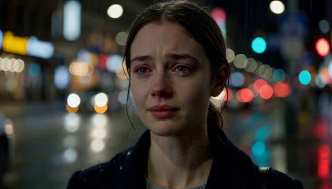</a>

提示词按时间段分镜（0到3秒、3到7秒、7到10秒），并单独列出镜头与视觉风格，让镜头顺序明确。时间静止被描述为雨滴、发丝和灯光的物理悬停，配合缓慢环绕运镜，使效果真实可读。

MiniMax H3 · 文生视频 · 出处: [@bmx_ai13 on X](https://x.com/bmx_ai13/status/2090562269382062197) · 28 赞，统计于 2026-10-29

[`rain`](tags.md#tag-rain) [`night-street`](tags.md#tag-night-street) [`bokeh`](tags.md#tag-bokeh) [`frozen-time`](tags.md#tag-frozen-time)

<details><summary><b>提示词</b></summary>

```text
MiniMax Hailuo H3 Prompt: Create a 10 second cinematic emotional scene centered on a young woman standing alone on a city street at night. Light rain falls around her. Soft streetlights glow through the darkness, while blurred car lights create beautiful bokeh in the background. The atmosphere feels intimate, lonely, and deeply emotional. Use natural acting, realistic facial expressions, subtle breathing, and gentle body movement.

Character : A young woman in her early twenties wearing a simple coat. She is heartbroken and struggling to hold back tears. Her pain should be clearly visible through her watery eyes, trembling lips, controlled breathing, and exhausted expression.

0–3 seconds: Begin with an intimate close up of her face. She looks forward with watery eyes, desperately trying not to cry. Her breathing is slightly unsteady. One tear slowly forms and rolls down her cheek.

3–7 seconds: Suddenly, time freezes completely. Raindrops stop in mid air. Cars and their lights freeze in the background. Loose strands of her hair, the edge of her scarf, and tiny water droplets remain suspended naturally in the air.

The woman remains almost completely still while the camera continues moving. Slowly orbit around her face in a smooth cinematic motion. During the orbit, she gently closes her eyes as if the emotional weight has become too much. Her expression reveals deep sadness, heartbreak, loneliness, and emotional exhaustion.

7–10 seconds: The camera slowly moves closer into an even tighter emotional close up. She opens her eyes. Another tear falls naturally down her cheek. Time gently begins moving again. Suspended raindrops continue falling, distant cars resume moving, and the city quietly returns to life. She gives a very faint, broken smile, as if she has finally accepted the pain even though it still hurts.

Camera: Begin with an intimate facial close up. Use a slow cinematic orbit around her during the frozen time moment. Finish with an extremely tight emotional close up focused on her eyes and expression.

Visual Style: Ultra cinematic realism with soft night lighting, shallow depth of field, beautiful background bokeh, wet street reflections, realistic rain, subtle handheld camera movement, natural skin texture, believable tear physics, detailed facial emotion, restrained acting, and strong visual storytelling.

The frozen time effect should feel elegant, realistic, and emotionally meaningful rather than supernatural or exaggerated.
```

</details>

<a id="wan-ghost-carousel-focus-shift"></a>
### 焦点从女子移向雾中旋转木马

<a href="https://x.com/ai_artworkgen/status/2114100423426818378">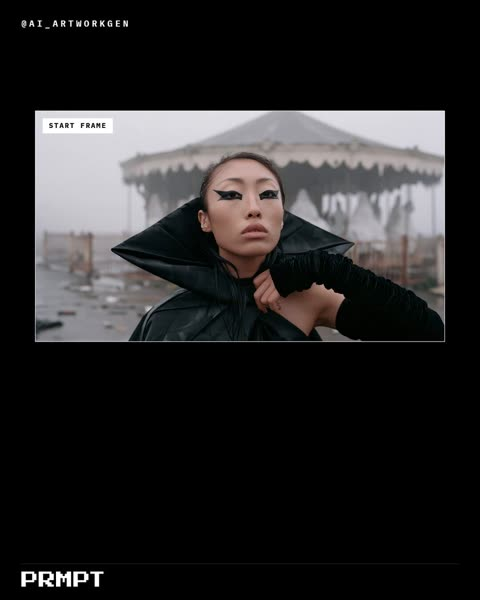</a>

按时间段（0到2秒、2到4秒、4到5秒）编排焦点从人物转到雾中木马再转回人物，固定机位和浅景深让画面保持稳定。提示词写明雾气、薄雾和暖色灯光，使光线与首帧保持一致。

Wan 3.0 · 图生视频 · 出处: [@ai_artworkgen on X](https://x.com/ai_artworkgen/status/2114100423426818378) · 28 赞，统计于 2026-10-29

[`focus-pull`](tags.md#tag-focus-pull) [`timed-beats`](tags.md#tag-timed-beats) [`locked-off-camera`](tags.md#tag-locked-off-camera) [`fog`](tags.md#tag-fog)

<details><summary><b>提示词</b></summary>

```text
My pick of the six, the carousel waking up in the fog. Ghost Carousel Focus Shift (Kling 4.0):

0-2s: hold on her face as she stares past the lens. 2-4s: focus pulls off her and onto the carousel behind her, which shudders and slowly begins to turn in the fog, its canopy bulbs flickering on one by one. 4-5s: focus snaps back to her as she turns her head toward the sound, eyes wide. Locked-off camera, shallow depth, cool mist, faint warm bulb glow.
```

</details>

<a id="h3-bar-hostess-checkered-bullet-tip"></a>
### 酒吧女郎穿过格子地板，推倒桌上的子弹

<a href="https://x.com/ou_zhen599/status/2099157567327080504">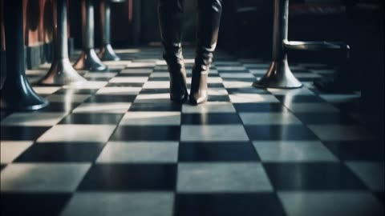</a>

提示词锁定同一酒吧场景和参考图，让女主角在六个分镜中保持相同的脸和服装。前半段先不露脸，并把每个镜头运动与玻璃、金属等声音线索对齐，制造紧张感。

MiniMax H3 · 图生视频 · 出处: [@ou_zhen599 on X](https://x.com/ou_zhen599/status/2099157567327080504) · 26 赞，统计于 2026-10-29 · 发现于 [SkyNotSilent/awesome-MiniMax-H3-cases](https://github.com/SkyNotSilent/awesome-MiniMax-H3-cases)

[`multi-shot`](tags.md#tag-multi-shot) [`noir`](tags.md#tag-noir) [`bar-scene`](tags.md#tag-bar-scene) [`sound-design`](tags.md#tag-sound-design)

<details><summary><b>提示词</b></summary>

```text
For the target video, at 0.00 seconds into the target video, <Picture 1> (from [Shot 1]) is fully referenced.

integrated_multimodal_description: [Shot 1] A 15-second, 16:9, cinematic photoreal image-to-video short set entirely inside the same vintage American bar interior. Preserve the exact same adult woman throughout: same face, proportions, hairstyle, makeup, dress, body, and realistic texture. The whole narrative stays in one continuous bar space only: black-and-white checker floor, red leather stools, metal counter edges, condensation on glass, warm hanging practicals, cool window edge light, faint red EXIT sign near the doorway, and a light haze of smoke and steam. No exterior, no extra people, no spatial jump, no identity drift. She is a mature retro bar hostess aura: powerful, sensual, elegant, dangerous, never vulgar, never static. The hidden story is that she seems to welcome a late guest, but is actually waiting to judge someone already marked. The camera follows one smooth line: low glide inward, rising follow, gentle half-orbit, drop to the table to find the prop, lift back to the face, lateral follow as she closes in, dangerous hand close-up, then a slight push-in ending. Lighting stays physically sourced: warm tungsten practicals and table reflections with cool window contour light. At 00:00.000-00:02.600, the camera glides low over checker tiles, stool legs, red leather, faint steam, and warm reflections. She walks in from behind the bar. Her boots enter first, steps slow and precise. Her right hand hooks a glass of amber liquor from the counter in one natural motion. Do not reveal the full face yet; show jawline, underside of the lip line, half a side face, and body rhythm through hips and waist. Her first layer is calm allure: relaxed brow peaks, outer eye corners slightly lowered, gaze not yet locking the camera, mouth corners lifted only faintly, breathing calm, chin slightly raised. The camera rises naturally with her. [Shot 2] At 00:02.600, the camera travels up from the wrist holding the glass into the key sensual close-up. Red lips, breath, collarbone, side face, outer eye, fingertips, and glass rim must read as beautiful, restrained, and dangerous. While walking, she brings the glass near her lips without drinking, letting the rim pass just in front of her mouth. Here the first micro-shift appears: her gaze hooks toward the camera direction but not into direct eye contact, sweeping lightly from the eye corner and withdrawing. Upper eyelids lower slightly. Lips part only a little. Breath exits softly through the nose. She says quietly in English: <d>[English] Took you long enough.</d> The voice is low, soft, slow, like a warm greeting with a hidden needle. The gentle half-orbit flows into placing the glass down. [Shot 3] At 00:05.100, she reaches the table and sets the glass down lightly. The camera follows the hand to the tabletop and discovers, in the same motion, a single upright bullet standing beside the glass. The bullet must feel native to the table arrangement. Do not force a facial reaction. Let her body shift slightly away while attention rests on the glass and bullet. The hostess softness still lingers but begins withdrawing. Her fingertips stay against the glass for half a beat longer, then leave slightly slower than before, deliberately allowing the danger to be seen. The bullet tip catches a thin cool highlight while the liquor remains warmly lit. [Shot 4] At 00:07.000, the camera rises from the table and bullet back to her face. She has already turned half her body and now stands between the table and a bar stool, with the doorway and blurred red EXIT sign behind. She looks briefly toward the door, then circles one stool and steps slowly closer. This is the key facial reversal: the shallow smile does not vanish first; the eyes cool first while the mouth keeps its curve. The brow center gathers slightly, softness at the eye corners tightens, upper lids lower a little, pupils become more concentrated, jawline tucks slightly more, breathing shallows, and the smile now reads as control rather than invitation. The camera moves laterally and slowly pushes in, keeping her as the active force. [Shot 5] At 00:10.200, cut naturally from her passing motion into a dangerous hand close-up. Her fingertips brush along the table edge and, with exquisite restraint, she gently tips the upright bullet over. It rolls half a turn and stops. The action feels practiced, casual, sensual, and colder than a gunshot. Her face can drift through soft focus in the background. She does not flick it; she nudges it with the pad and edge of the finger. Shoulder relaxed, wrist fluid, action continuous with the walk. The brass surface carries a moving highlight streak over the warm tabletop reflection. [Shot 6] At 00:12.800, the camera lifts from the bullet to a frontal close shot. She has stepped close and stopped, her face dominating frame while the background dissolves into warm lamps and blurred red EXIT color. She tilts her head by the smallest amount and lowers her chin slightly, finally looking directly into the camera. This is the judgment state. The flirtation is gone. Her eyes are steady and direct, never wide. The brow center compresses only slightly. The lips relax and close softly, with one corner holding the faintest cold smile. Breath is contained. Throat and jaw remain composed. She says in English: <d>[English] Tonight, you pay.</d> “Tonight” lands lightly; “you pay” drops lower, calm and judicial, never shouted. In the last half-second, the camera pushes in only slightly more and stops, letting the pressure come from distance rather than effects, with no black screen or transition.

overall_soundscape: Keep the sound intimate and spatially close: heels on tile, soft steam hiss, glass touching metal, leather and fabric friction, low bar hum, faint ventilation, and light room air. Bring breath, glass-rim movement, and lip-near glass tension forward under <d>[English] Took you long enough.</d>; make the glass touching the table the first rhythm point, then the bullet tip-over and half-roll the second. In the ending, reduce everything slightly so <d>[English] Tonight, you pay.</d> sits close and dry while low bar hum, tiny glass resonance, ventilation, and controlled breath remain underneath.

non_diegetic_music: Use minimal score. A very low elegant noir-like tension bed may sit beneath the space, but it must never dominate heels, glass, breath, or the bullet. Let the first half feel warmer and more seductive, cool it gradually through the middle, and support the final line only with a faint low pressure note, avoiding melodrama or any trailer-style punch.
```

</details>

<a id="h3-tin-can-goldfish-reveal"></a>
### 金色食品罐放在编织厨房垫上

<a href="https://x.com/GlennHasABeard/status/2108935549553656006"></a>

固定机位保持在地面高度，画面里只有一个物体，反转效果直接落在罐子上。提示词把罐内内容写成具体的前提，让模型只需要呈现一个清楚的画面。

MiniMax H3 · 文生视频 · 出处: [@GlennHasABeard on X](https://x.com/GlennHasABeard/status/2108935549553656006) · 26 赞，统计于 2026-10-29

[`product-reveal`](tags.md#tag-product-reveal) [`locked-camera`](tags.md#tag-locked-camera) [`surprise-twist`](tags.md#tag-surprise-twist)

<details><summary><b>提示词</b></summary>

```text
Minimax H3, open weights, generated locally. Dinner is served. Dinner has other plans.

Prompt: "inside is not food but clear water with one tiny goldfish swimming in it"

Duration: 15s. Camera: locked, floor height. Rendered locally in ComfyUI, then Topaz to 4K.

The model keeps peeling the lid from the wrong end, away from the ring pull. The goldfish does not seem to mind, so the best take stays.
```

</details>

<a id="h3-bakso-vendor-javanese-market"></a>
### 肉丸小贩端着汤碗穿过爪哇市场

<a href="https://x.com/junwatu/status/2084840152715911311">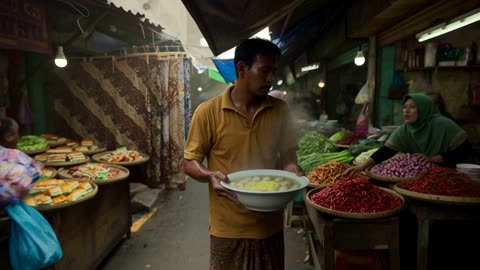</a>

手持长镜头一镜到底，并按顺序列出沿途障碍，让模型有清晰的运动路线。加入真实的市场细节和停电瞬间作为节奏点，并明确要求纪实质感，使场景保持真实。

MiniMax H3 · 文生视频 · 出处: [@junwatu on X](https://x.com/junwatu/status/2084840152715911311) · 25 赞，统计于 2026-10-29 · 发现于 [SkyNotSilent/awesome-MiniMax-H3-cases](https://github.com/SkyNotSilent/awesome-MiniMax-H3-cases)

[`street-market`](tags.md#tag-street-market) [`handheld`](tags.md#tag-handheld) [`one-take`](tags.md#tag-one-take) [`documentary-realism`](tags.md#tag-documentary-realism)

<details><summary><b>提示词</b></summary>

```text
Traditional Javanese market in Yogyakarta, early morning, present day, ultra-realistic handheld one-take. A bakso vendor hurries through impossibly narrow, crowded market aisles carrying a large steaming bowl of freshly prepared bakso. Shoppers and vendors step aside to let him pass. He weaves between vegetable stalls overflowing with chilies, shallots, and leafy greens, ducks beneath low-hanging tarps, squeezes past batik merchants and baskets of traditional snacks, and carefully avoids children running through the market. The market feels dense, humid, noisy, and full of life. He passes porters carrying heavy sacks on their shoulders, women bargaining in Javanese, and motorcycles slowly pushing through the narrow lane. He finally reaches a tiny food stall at the back of the market and serves the steaming bowl just as the power briefly flickers, leaving the market dim for a moment before the bustle continues. Oppressive realism, natural morning light mixed with fluorescent bulbs, worn concrete floors, damp walls, wooden stalls, hanging plastic signs, Javanese conversations, vendors calling out prices, clattering bowls, footsteps echoing through the covered market, immersive cinematic pacing. No cyberpunk, no stylization, documentary-like realism.
```

</details>

<a id="h3-breath-clears-frost-window"></a>
### 呼气在霜花窗上融出一圈透明圆

<a href="https://x.com/GlennHasABeard/status/2102162002210648203">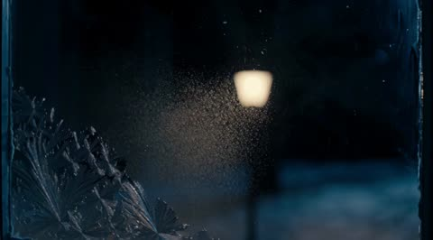</a>

只给一个起因和一个可见的结果：画外一口热气让霜花融化成手掌大小的圆。固定的微距机位加上按时间写明的声音脚本（噼啪声、呼气、水滴），把镜头和节奏都锁住。

MiniMax H3 · 文生视频 · 出处: [@GlennHasABeard on X](https://x.com/GlennHasABeard/status/2102162002210648203) · 22 赞，统计于 2026-10-29 · 发现于 [SkyNotSilent/awesome-MiniMax-H3-cases](https://github.com/SkyNotSilent/awesome-MiniMax-H3-cases)

[`frost`](tags.md#tag-frost) [`macro`](tags.md#tag-macro) [`window`](tags.md#tag-window) [`breath`](tags.md#tag-breath) [`locked-camera`](tags.md#tag-locked-camera)

<details><summary><b>提示词</b></summary>

```text
a warm breath from just off-screen fogs the center of the pane and the frost there melts back into a clear circle the size of a hand
```

</details>

<a id="h3-neon-hacker-boots-audio-intro"></a>
### 红色点缀战靴走过暗色霓虹空间

<a href="https://x.com/Nokosu_kansoku/status/2086700416654594554">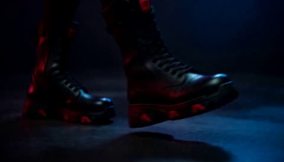</a>

分别提供脸部、体型和音频三个参考，锁定角色形象并让剪辑节奏跟随音乐。提示词按每3秒分段指定镜头运动与光线，并禁止分身、文字和分屏，使角色在15秒内保持一致。

MiniMax H3 · 参考生视频 · 出处: [@Nokosu_kansoku on X](https://x.com/Nokosu_kansoku/status/2086700416654594554) · 22 赞，统计于 2026-10-29 · 发现于 [SkyNotSilent/awesome-MiniMax-H3-cases](https://github.com/SkyNotSilent/awesome-MiniMax-H3-cases)

[`cyberpunk`](tags.md#tag-cyberpunk) [`character-intro`](tags.md#tag-character-intro) [`audio-reference`](tags.md#tag-audio-reference) [`neon`](tags.md#tag-neon)

<details><summary><b>提示词</b></summary>

```text
@[face ref] をNEONの顔、ピンクのボブヘア、黒い丸眼鏡の厳密な参照として使用します。
@[body ref] をNEONの体格、黒と赤のサイバーパンク衣装、装備、ブーツの厳密な参照として使用します。
@[audio ref] は映像のリズム、カットの強弱、主要な音楽アクセントの参照として使用します。

15秒のハイエンドなサイバーパンク・キャラクター紹介映像。
主役はNEONただ一人。
クールで知的、危険な雰囲気。動作は自信に満ち、抑制されている。

構成：

0–3秒：IDENTITY REVEAL
暗いネオン照明の空間。
ブーツ、赤いジャケットのディテール、眼鏡越しの目元を短いバーストカットで見せる。
最後に顔のクローズアップ。
カットを@[audio ref] の最初の強いアクセントに合わせる。

3–6秒：NEON ALLEY
雨に濡れた未来都市の路地。
NEONがゆっくりカメラ方向へ歩く。
ローアングル、横方向のトラッキング、濡れた路面に映る赤いネオン。
人物の動きよりもカメラワークを強調。

6–9秒：TECH UNDERGROUND
赤い警告灯が点滅する地下施設。
肩越しのショット、手袋と装備のクローズアップ、短いオービットショット。
NEONは静かに周囲を観察する。

9–12秒：MEGACITY ROOFTOP
巨大な未来都市を見下ろす夜の屋上。
風でピンクの髪とジャケットがわずかに揺れる。
ワイドショットからローアングルのヒーローフレームへ切り替える。

12–15秒：FINAL HERO REVEAL
赤とマゼンタの逆光。
カメラがNEONの周囲を短く回り込み、正面のミディアムクローズアップで止まる。
NEONが眼鏡越しにカメラを見る。
最後の音楽アクセントで力強い静止ヒーローフレーム。

編集：
合計12〜15ショット。
主要カットを@[audio ref] の強拍に合わせる。
環境変更は音楽フレーズの変化に合わせる。
細かい半拍すべてにカットを入れず、強いアクセントを優先する。

一貫性：
同じ顔、同じ髪型、同じ眼鏡、同じ体格、同じ衣装を全編で維持。
衣装の黒・赤・ゴールドの配色と装備位置を維持。
キャラクターは常に一人だけ。

禁止：
複数のNEON、分身、衣装変更、髪型変更、眼鏡の消失、
顔や身体のモーフィング、過剰なアクション、文字、ロゴ、字幕、UI、
キャラクターシート風レイアウト、分割画面、白背景。
-------------------------------------------------------
```

</details>

<a id="h3-velvet-nap-golden-seam-stroke"></a>
### 手指拂过绿色天鹅绒，露出金色光缝

<a href="https://x.com/GlennHasABeard/status/2103613782467457079"></a>

描述绒毛在手指后方翻转形成深色带，让划过的痕迹清晰可见，金色细缝沿着这条暗带出现，光看起来是被揭开而不是后期叠加。固定机位放在胸部高度，画面里只有手和织物在动。

MiniMax H3 · 文生视频 · 出处: [@GlennHasABeard on X](https://x.com/GlennHasABeard/status/2103613782467457079) · 19 赞，统计于 2026-10-29 · 发现于 [SkyNotSilent/awesome-MiniMax-H3-cases](https://github.com/SkyNotSilent/awesome-MiniMax-H3-cases)

[`velvet`](tags.md#tag-velvet) [`texture`](tags.md#tag-texture) [`macro`](tags.md#tag-macro) [`locked-camera`](tags.md#tag-locked-camera)

<details><summary><b>提示词</b></summary>

```text
the nap flipping dark in a band behind the fingers with a soft brushed hush, and along that dark band a fine seam of warm golden light opens
```

</details>

<a id="h3-lucy-night-walk-home"></a>
### 女子深夜独自走回家

<a href="https://x.com/EndFolding79421/status/2109791105671700721">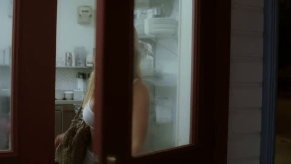</a>

提示词只写一段连贯的故事而不加镜头指令，让模型从事件本身推断景别、节奏和动作。参考图锁定露西的外貌，触发词 r34l1sm 配合 0.6 强度的写实 LoRA 让皮肤和夜间光线更接近真实。

MiniMax H3 · 参考生视频 · 出处: [@EndFolding79421 on X](https://x.com/EndFolding79421/status/2109791105671700721) · 18 赞，统计于 2026-10-29 · 发现于 [SkyNotSilent/awesome-MiniMax-H3-cases](https://github.com/SkyNotSilent/awesome-MiniMax-H3-cases)

[`story-prompt`](tags.md#tag-story-prompt) [`reference-image`](tags.md#tag-reference-image) [`night-street`](tags.md#tag-night-street) [`realism-lora`](tags.md#tag-realism-lora)

<details><summary><b>提示词</b></summary>

```text
r34l1sm 

use the woman in  <Picture 1> is lucy. 

Lucy stepped out of the small diner where she worked, the doorbell jingling softly behind her. The night air was cool and crisp, a welcome change from the stuffy warmth inside. She took a deep breath, feeling the slight chill of the evening settle on her skin. The street was quiet, only the distant hum of traffic breaking the silence.

Her shift had been long and exhausting, filled with the clatter of dishes and the constant chatter of customers. Now, the quiet seemed almost surreal, a stark contrast to the noise and chaos she had just left behind. Lucy adjusted her bag on her shoulder, glancing around as she began her walk home.

The dim streetlights cast long shadows across the pavement, their flickering bulbs adding an eerie quality to the otherwise peaceful night. Lucy's footsteps echoed softly, a rhythmic accompaniment to her thoughts. She felt a strange mix of relief and unease; relief that her shift was over, and unease that she had to walk home alone at this hour.

She tried to shake off the feeling, telling herself it was just her imagination. But as she walked, the sensation of being watched grew stronger. Lucy's eyes darted to the darkened alleyways and the shadowy corners of the street, half-expecting to see someone lurking there. Each time, there was nothing but the oppressive darkness.

Her thoughts wandered to the events of the day, the usual frustrations of work blending with snippets of conversations she'd had with her coworkers. She thought of Megan, her closest friend at the diner, and their plans to go out together on the weekend. The thought brought a small smile to her lips, momentarily easing her tension.

But the feeling of being watched persisted. Lucy quickened her pace, her heartbeat matching the rapid rhythm of her footsteps. She turned down a quieter street, the buildings looming tall and silent on either side. The oppressive silence pressed in on her, amplifying every sound, every rustle of leaves, every distant car horn.

A sudden noise behind her made Lucy stop in her tracks. She spun around, eyes wide, searching the shadows for the source. The street was empty, the only movement the gentle sway of a tree branch in the breeze. She stood there for a moment, heart pounding, before forcing herself to turn back and keep walking.

"It's just your imagination," she muttered under her breath, trying to steady her nerves. But the cold knot of fear in her stomach told her otherwise.

 Link to Workflow : 
https://
youtube.com/watch?v=DOFpyB
Wg--8&t=51s
…
```

</details>

<a id="h3-red-coat-armor-rainy-alley"></a>
### 雨夜小巷中的红大衣与铠甲英雄

<a href="https://x.com/underwoodxie96/status/2101994498515734813">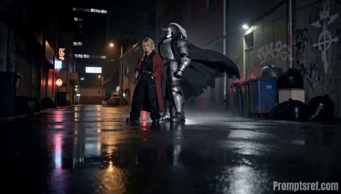</a>

参考图锁定两个角色的外观，分段镜头表为每个时间段指定景别、机位和运镜。音效和剪辑节奏写进提示词，让动作跟随鼓点，结尾定格时留出标题空间。

MiniMax H3 · 参考生视频 · 出处: [@underwoodxie96 on X](https://x.com/underwoodxie96/status/2101994498515734813) · 17 赞，统计于 2026-10-29 · 发现于 [SkyNotSilent/awesome-MiniMax-H3-cases](https://github.com/SkyNotSilent/awesome-MiniMax-H3-cases)

[`dark-fantasy`](tags.md#tag-dark-fantasy) [`fashion-editorial`](tags.md#tag-fashion-editorial) [`rain-night`](tags.md#tag-rain-night) [`shot-list`](tags.md#tag-shot-list)

<details><summary><b>提示词</b></summary>

```text
@ Image 1: Lock the two characters’ facial features, hairstyles, outfits, armor, props, height proportions, and overall dark-fantasy appearance. The character in the long red coat and the fully armored character must remain visually consistent throughout the entire sequence. Do not alter their armor structure, braids, facial features, costume details, or clothing colors.

Use the rainy nighttime urban alley from the reference image as the primary setting. Create a stylish multi-pose fashion editorial sequence with the energy of a cinematic dark-fantasy trailer — cool, dynamic, highly polished, and grounded in realistic live-action photography.

0–3s | Wide Shot | Low-Angle Eye-Level | 24mm | Slow Push-In
Both characters stand in the middle of a wet alley at night. Neon signs and streetlights reflect across the rain-soaked pavement. The red-coated character stands slightly turned to the side, while the armored character stands tall behind him. His cape moves naturally in the wind. Establish a powerful, imposing presence from the opening shot.
3–6s | Medium Close-Up | Eye-Level, Front-Side Angle | 50mm | Lateral Tracking Shot
The red-coated character performs the first solo fashion pose. He turns his body slightly toward the camera, placing one hand inside his trouser pocket while allowing the mechanical arm to hang naturally at his side. He raises his gaze directly toward the camera with a cold, composed expression. Keep his face sharp and clearly visible throughout the camera movement.
6–9s | Medium Shot | Low-Angle | 35mm | Orbiting Camera
The armored character takes one step forward and raises one hand to adjust the cape over his shoulder. He then slightly lowers his head while looking directly into the camera. The metal armor reflects cool white light, while the chains and cape respond naturally to his movement with convincing weight and physical realism.
9–12s | Two-Shot, Medium Framing | Slightly Low Front Angle | 50mm | Pull Back
The two characters stand back-to-back in a coordinated combat-inspired pose. The red-coated character turns sideways and clenches one fist, while the armored character extends one arm toward the opposite side. Rainwater runs naturally across the armor and coat hems. Strong backlighting creates dramatic rim light around both silhouettes.
12–15s | Two-Shot, Wide to Medium | Low Angle | 35mm | Slow Push-In + Final Freeze
Both characters turn toward the camera at the same time. The red-coated character slightly raises his chin, while the armored character tightens his gauntleted fist. Their cape and long coat move naturally in the wind. End on a powerful, poster-like hero composition and hold the final frame clean, leaving enough negative space for a title or logo to be added in post-production.
The overall visual style combines professional high-fashion photography with a dark-fantasy cinematic trailer aesthetic. Use cool blue ambient lighting accented by subtle red reflections, wet rain-soaked pavement, physically realistic metallic reflections, natural fabric movement, slight lens breathing, crisp skin and material details, and cinematic 24fps motion blur.

The editing rhythm should follow a strong, driving drum beat. Transitions between poses should be connected through short, sharp, intentional character movements rather than abrupt jump cuts.
Sound design: deep electronic percussion, distant nighttime city ambience, steady rainfall, subtle metallic chain sounds, and heavy armored footsteps. At the final hero freeze-frame, briefly pause or drop the music to emphasize the characters’ final pose.
```

</details>

<a id="h3-night-street-two-faces-sharp"></a>
### 夜街近景中两张脸同时清晰

<a href="https://x.com/Tomw852/status/2107679859422195837">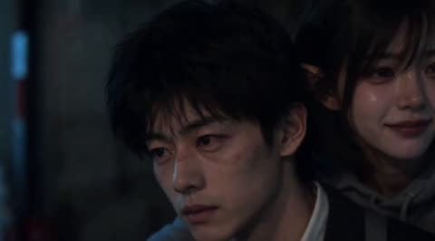</a>

三张参考图分别锁定两人的脸、背负姿势和夜间色调，提示词要求整段镜头两张脸始终同样清晰，不做焦点切换。日语台词被写成环境中的自然收录，街道声音始终保留在台词下方，使对白听起来像在现场录下。

MiniMax H3 · 参考生视频 · 出处: [@Tomw852 on X](https://x.com/Tomw852/status/2107679859422195837) · 16 赞，统计于 2026-10-29 · 发现于 [SkyNotSilent/awesome-MiniMax-H3-cases](https://github.com/SkyNotSilent/awesome-MiniMax-H3-cases)

[`reference-images`](tags.md#tag-reference-images) [`facial-close-up`](tags.md#tag-facial-close-up) [`japanese-dialogue`](tags.md#tag-japanese-dialogue) [`night-street`](tags.md#tag-night-street)

<details><summary><b>提示词</b></summary>

```text
r34l1sm
subject_definitions:
<Subject 1> is the adult man from ​@Image1​, preserving his facial identity, tousled short black hair, natural skin texture, white shirt, dark plaid waistcoat, and suspenders.
<Subject 2> is the adult elf woman from ​@Image2​, preserving her facial identity, short dark bob with bangs, pointed ears, and oversized gray hoodie. Her expression is relaxed, affectionate, and quietly happy.
​@Image3​ provides the intimate piggyback pose and teal-and-amber nighttime lighting. Use it for pose and atmosphere, giving the woman a warmer, more contented expression.

summary:
[reference generation] A fifteen-second affectionate love story in one continuous 16:9 two-person facial close-up. <Subject 1> slowly carries <Subject 2> through a quiet nighttime street. She softly asks to stay like this a little longer. He responds silently with a small smile and slower footsteps. Both faces remain simultaneously sharp. Her Japanese dialogue sounds naturally recorded within the street, with audible distance and environmental space.

retention_analysis:
<Subject 1> (appears in [Shot 1]): fully_preserved — retain his facial identity, hairstyle, and clothing.
<Subject 2> (appears in [Shot 1]): fully_preserved — retain her facial identity, hairstyle, pointed ears, and hoodie. Her performance conveys comfort and affection.
​@Image3​ ([Shot 1] pose and atmosphere): partially_preserved — retain the piggyback relationship and nighttime palette; adapt the framing into a horizontal facial close-up with greater depth of field and a quietly happy female expression.

detailed_description:
Live-action cinematic realism, 16:9 landscape, fifteen seconds. A 35mm cinema lens, fine film grain, soft highlight halation, warm natural skin tones, and cool teal nighttime surroundings. Use moderately deep depth of field with enough soft, motivated street lighting to render both faces clearly.

[Shot 1] One uninterrupted take. A tight two-person facial close-up from slightly ahead and to the couple's left. <Subject 1>'s complete face occupies the lower-left center; <Subject 2>'s complete face appears above his right shoulder in the upper-right center. Include small portions of his collar and her gray sleeves. Her pointed ear remains visible through her short hair. Maintain a comfortable camera distance and natural facial proportions.

Both faces remain simultaneously in sharp focus throughout the entire shot. Clearly resolve both characters' eyes, eyelashes, lips, and skin texture. Use sufficient depth of field to cover the distance between their faces and their gentle walking movements. The woman is as sharply focused as the man, including when she rests against his shoulder. Prioritize equal facial clarity over strong background blur. The street is gently softened, with recognizable shapes. No selective focus on the man, rack focus, or focus hunting.

He carries her slowly along the street. The camera retreats at their pace, maintaining a nearly constant distance and the same facial framing. Its movement has a small, smooth breathing sway and gentle vertical drift motivated by careful footsteps. Fixed focal length, continuous perspective, no cuts, orbit, zoom, or abrupt reframing.

During the opening seconds, he watches the path ahead with a relaxed expression. She rests comfortably against him, her brow smooth and her lips carrying a faint, natural smile. She briefly looks toward his cheek, then lowers her gaze toward his collar. Her expression conveys affection and ease, with no sorrow, tearful eyes, trembling lips, or worried brows. Neither looks into the camera.

Near the middle, <Subject 2> (S1) turns her mouth slightly toward his ear and speaks naturally in a warm, gently smiling Japanese voice: <d>[Japanese] もう少し、このままで。</d>

Hear her sentence from the camera's position, approximately one to two meters away. Her voice is modest in volume, slightly softened by distance, and blended with the surrounding street. Turning toward his ear makes it subtly less direct to the listener. Keep the words intelligible without making the voice unnaturally prominent. Avoid exaggerated whispering, amplified mouth sounds, and studio-isolated vocal clarity.

He remains silent. After a brief listening pause, his cheek lifts into a small smile and he slows his next steps. She notices, her smile warms slightly, and she gently rests her cheek against his shoulder. Her lips remain closed after the line. Keep both faces sharp as a warm streetlight passes softly across them.

Hold their comfortable closeness through the remaining seconds, with natural blinking and gentle walking motion. End while they are still moving together. No subtitles, narration, or additional dialogue.

overall_soundscape:
A continuous, spatially coherent nighttime street recording heard from the camera's perspective. Footsteps and subtle clothing rustles occupy the nearby space. A low storefront ventilation hum comes from one side. Distant traffic sits farther away; a passing car gradually approaches, moves across the stereo field, and recedes without obscuring the dialogue.

The woman's voice belongs within this same acoustic environment. Keep street ambience continuously audible beneath her sentence, without muting it or dramatically lowering it when she speaks. Include faint, short reflections from nearby shopfront glass and building surfaces while retaining an open-air sound. No long reverberation, obvious echo, or indoor acoustic character.

Breathing remains subtle at the camera's distance. Preserve one consistent listening perspective for dialogue, footsteps, clothing, and environmental sounds. Use natural vocal dynamics without heavy compression or artificial vocal enhancement. Maintain uninterrupted ambience before, during, and after the sentence. The man remains silent.

non_diegetic_music:
N/A. Let the location sound, pauses, and quiet footsteps carry the tenderness.
```

</details>

<a id="kling-moonlit-garden-run"></a>
### 绿裙女子奔过月下花园，15 秒

<a href="https://static--79.klingai-cdn-aws.com/kling-blog/presigned_url/3f219e9a-5e38-46ed-af01-9831ebce2f2a_kling_20260203_作品_超广角中远景横向跟拍_4556_0.mp4"></a>

15 秒连续镜头，按导演段落写：镜头、稳定器高度、调色，再按顺序写动作。

Kling 3.0 · 图生视频 · 出处: [Kling VIDEO 3.0 user guide](https://app.klingai.com/global/quickstart/klingai-video-3-model-user-guide)

[`long-take`](tags.md#tag-long-take) [`film-look`](tags.md#tag-film-look) [`camera-move`](tags.md#tag-camera-move)

<details><summary><b>提示词</b></summary>

```text
Opening with an ultra-wide-angle medium-long shot tracking horizontally, the stabilizer moves low to the ground, with a highly contrasting romantic cinematic tone of cold blue night and silvery white starry sky, exuding a strong poetic realism and classical epic temperament. The protagonist is a young woman in a dark green long dress, running with all her might on the garden lawn illuminated by moonlight; her skirt billows in the wind forming surging dynamic curves, she clutches a small white flower in her right hand and lifts the hem of her dress with her left, breathing rapidly yet with a firm gaze. At the 4th second, the camera accelerates forward with her, and multiple men and women in old-era ball gowns break into the frame one after another from the left and right sides in the background, running alongside her—some try to approach, some turn back to shout, yet none truly touch her, implying pursuit and escape. At the 8th second, the camera gradually zooms in to a medium shot, pans to track forward in front of the protagonist and lifts slightly; she glances back briefly at a young male character behind her, their gazes meet for a split second, emotions erupt mid-run, and the woman and man join hands to run together. At the 12th second, the music and movement reach a climax; the camera moves forward close to her side face and fluttering hair, she releases the white flower and tosses it into the air, the flower drifting down in slow motion as the crowd behind brushes past it. In the final 3 seconds, the camera keeps moving forward, the woman and man break through the crowd and dash toward the starry sky at the end of the garden, their figures gradually taking over the center of the frame. The overall atmosphere is fiery, romantic and resolute, a burst of narrative about fate, choice and freedom.
```

</details>

输入素材: [1](https://static--91.klingai-cdn-aws.com/kling-blog/file_by_url/21ef15bece0400c220dd7db92c388544a486345d867b33673fec8ba66b1ee2c6.png)

<a id="kling-office-long-take"></a>
### 一镜到底，跟拍女人从电梯走到工位

<a href="https://static--46.klingai-cdn-aws.com/kling-blog/presigned_url/cf695909-2395-4433-a0b1-caeb28df578d_kling_20260201_作品_平稳跟拍长镜头一镜到_3635_0.mp4"></a>

首帧加绑定的人物主体。提示词写清机位怎么跟：她走就跟，她停就停。

Kling 3.0 · 图生视频 · 出处: [Kling VIDEO 3.0 user guide](https://app.klingai.com/global/quickstart/klingai-video-3-model-user-guide)

[`long-take`](tags.md#tag-long-take) [`character-consistency`](tags.md#tag-character-consistency) [`tracking-shot`](tags.md#tag-tracking-shot)

<details><summary><b>提示词</b></summary>

```text
Authentic workplace texture, one continuous long take without any cuts. The camera follows the professional woman steadily in a medium shot throughout, moving in sync with her: the camera tracks her as she walks and freezes instantly when she pauses, with natural and smooth movements and fluid camera work. The woman walks forward out of the elevator, and the elevator doors close slowly and naturally behind her; she steps into the office area, takes off her sunglasses by hand, tucks them into her commuter bag casually, and nods politely to colleagues passing by; she pauses briefly, the camera freezes in sync, she hangs her commuter bag on the coat rack in the office area, then takes off her outer coat and hangs it on the same rack; after hanging up her clothes, she walks forward again, the camera tracks her in sync; a young man in a formal shirt walks towards her, hands her a document and a signature pen, she pauses, the camera freezes in sync, takes them and signs the document; after signing, she walks forward again, the camera tracks her in sync; finally, she walks to her desk, sits down by the chair, reaches out to pick up a cup of tea on the desk, and sips it with her head down, her movements relaxed and natural.
```

</details>

输入素材: [1](https://static-44.klingai-cdn-aws.com/kling-blog/file_by_url/f810ae350b11c0469938a2dc73724c09618b56830d84f506027187df168c830e.png)

<a id="kling-orbit-to-smile"></a>
### 镜头绕到正面，她抬头微笑

<a href="https://static-36.klingai-cdn-aws.com/kling-blog/presigned_url/53d2490e-3ad9-4d84-b74f-bc0b1fcc4151_kling_20260204_作品_镜头逐渐环绕至女孩的_4266_2.mp4"></a>

同一句提示词跑两遍，一遍绑定主体，一遍只用首帧，页面上两版并排，能直接比脸的一致性。

Kling 3.0 · 图生视频 · 出处: [Kling VIDEO 3.0 user guide](https://app.klingai.com/global/quickstart/klingai-video-3-model-user-guide)

[`character-consistency`](tags.md#tag-character-consistency) [`orbit`](tags.md#tag-orbit) [`image-to-video`](tags.md#tag-image-to-video)

<details><summary><b>提示词</b></summary>

```text
The camera gradually moves around to the front of the girl, who then lifts her head and smiles warmly at the camera, as if seeing an old friend after many years.
```

</details>

输入素材: [1](https://static--64.klingai-cdn-aws.com/kling-blog/file_by_url/445147e8acb2e81e4c06a4a819081baeacbdbcf1824946cf1cd9b5a2f0c4e0f5.png)

<a id="kling-truck-driver-four-shots"></a>
### 卡车司机，四个手持镜头

<a href="https://static-94.klingai-cdn-aws.com/kling-blog/presigned_url/b77930c4-755d-4035-ba98-842446609ea8_Dave_multi.mp4"></a>

可灵创作伙伴 Dave Clark 的自定义多镜头。每个镜头都重复 `cinematic handheld`，切镜后质感不跳。

Kling 3.0 · 图生视频 · 出处: [Kling VIDEO 3.0 user guide](https://app.klingai.com/global/quickstart/klingai-video-3-model-user-guide)

[`multi-shot`](tags.md#tag-multi-shot) [`handheld`](tags.md#tag-handheld) [`film-look`](tags.md#tag-film-look)

<details><summary><b>提示词</b></summary>

```text
shot 1, profile shot of black man driving a truck, cinematic handheld. Shot 2, frontal macro shot of black man driving a truck, cinematic handheld. Shot 3, macro shot of hands on the steering wheel, cinematic handheld. Shot 4, macro shot of a weathered picture of a young black child laying on the passenger side seat, cinematic handheld.
```

</details>

输入素材: [1](https://static--56.klingai-cdn-aws.com/kling-blog/file/0c5b8af23bea126e21beac535408c4cf6020f44cc773e2985ab1c32c42756216.jpg)

<a id="kling4-blacksmith-forges-greatsword"></a>
### 铁匠把铁块打成巨剑，从首帧到尾帧

<a href="https://static--34.klingai-cdn-aws.com/kling-blog/presigned_url/e8b7cc55-4cb6-4a0c-b175-e22d1f378f5f_1-2.mp4"></a>

首帧是桌上的铁块，尾帧是放回原处的成剑，中间六个镜头压缩锻造过程。

Kling 4.0 · 首尾帧 · 出处: [Kling 4.0 user guide](https://kling.ai/quickstart/kling-4-model-user-guide)

[`keyframes`](tags.md#tag-keyframes) [`craft`](tags.md#tag-craft) [`multi-shot`](tags.md#tag-multi-shot) [`structured-prompt`](tags.md#tag-structured-prompt) [`time-lapse`](tags.md#tag-time-lapse)

<details><summary><b>提示词</b></summary>

```text
SCENE CONTEXT EXACT 1 CHARACTER — NO DUPLICATES. Interior, a worn blacksmith workshop, daytime. The same blacksmith removes the raw material, works it into a greatsword, and returns the completed sword to the original table.15 seconds, six shots. Manufacturing time is compressed through editorial cuts; individual actions retain natural weight and speed.
ACTIVE REFERENCES: @Image1: exact first-frame anchor. Preserve all five iron blocks, their arrangement, the tabletop, background tools, perspective, and lighting. This image is the starting state of an active pickup shot.@Image2: exact final-frame anchor and finished-sword design. Preserve the blade silhouette, central fuller, angular curved crossguard, spiral metal grip, faceted pommel, diagonal placement, perspective, and background. This composition is reached through a visible physical placement.
LOCATION MAP: The worktable fills the foreground. The tool bucket stands behind its left-center edge, the rod rack occupies the rear right, and the anvil stands at the right. The blacksmith works from the left side of the table in both endpoint shots. The camera stays on the original viewer-facing side of the table. During blade-working inserts, the tang points screen-left and the tip points screen-right. The final sword position runs from the upper-left pommel to the lower-right tip.
FIRST FRAME AND SPATIAL BLOCKING: At 0.0 seconds, the frame exactly matches the raw-material reference, with five iron blocks and no hands visible. The same blacksmith immediately reaches in from the left edge. Both gloved hands approach the largest central block from opposite ends, preparing a supported two-handed lift. The blacksmith wears soot-gray sleeves, brown leather gloves, and a narrow dark strap around the right cuff. These details remain identical throughout every shot.
FORMAT MODE: 15 seconds total, six shots.Hard cuts at 3.0, 5.0, 8.0, 10.0, and 11.0 seconds. Cuts compress the omitted manufacturing work and bench clearing. The opening pickup and closing placement each play as continuous physical actions.No fades, dissolves, or object-morph transitions.
OPTICS: Shots 1 and 6: reference-matched elevated three-quarter framing, approximately 63° diagonal field of view and approximately 1.8 meters from the tabletop center. Exact endpoint framing takes priority over estimated optical measurements. Shots 2–5: 40° diagonal field of view, approximately 0.8 meters from the working contact point. Focus follows the hands and metal contact; the workshop background remains softly readable. Each shot holds one fixed field of view.
CAMERA: A real camera operator holds the camera from the viewer-facing side of the workspace. All shots use handheld SETTLE: visible breathing sway, slight roll, and small delayed corrections. The opening camera holds its position while the iron block leaves the frame. The closing camera holds the empty tabletop composition while the sword enters, then settles into the exact final reference. The blacksmith is the only visible worker; the camera operator remains outside the image.
ACTION TIMING: 0.0–3.0s — TAKE THE IRON. Start on the exact first reference; during 0.0–0.6s, the blacksmith’s matching gloved hands enter from screen-left and grip opposite ends of the largest central block. During 0.6–1.5s, the wrists brace and both hands lift the block clear of the tabletop, exposing the patch of table beneath it. During 1.5–3.0s, the blacksmith carries the supported block out through screen-left; the other four blocks remain resting on the table through the cut.3.0–5.0s — HEAT THE STOCK. Hard cut forward in time to one thick billet already glowing orange among forge coals. The same gray sleeves, brown gloves, and right-cuff strap appear at screen-left as the blacksmith holds long tongs around the billet. A short controlled pull draws the billet toward the forge mouth, with heat shimmer rising above its scaled surface.5.0–8.0s — FORGE THE BLADE. Hard cut forward to an elongated orange-hot blade blank supported on the anvil, tang left and emerging tip right. The same blacksmith braces the tang with left-hand tongs and delivers three deliberate right-hand hammer strikes along the blade flat. Each strike produces local compression, wrist recoil, and a brief scatter of dark scale.8.0–10.0s — FINISH THE METAL. Hard cut forward to a cooled blade with its fuller already formed, held by the same gloved hands against an abrasive wheel. The blacksmith makes one controlled finishing pass along the bevel. A narrow stream of sparks falls from the actual contact point as a brighter strip of metal appears.10.0–11.0s — COMPLETE THE HILT. Hard cut forward to the nearly finished sword supported on a separate assembly bench, its crossguard and spiral metal grip already fitted. The same blacksmith’s left hand braces the grip while the right hand gives the faceted pommel its final tightening turn. The completed sword now has the exact construction and finish required for the final image.11.0–15.0s — PLACE THE FINISHED SWORD.Hard cut to the original worktable, now completely clear; show its empty surface for 0.4 seconds before the same gloved hands carry the completed sword in from screen-left, one hand around the grip and the other supporting the blade flat near its balance point. From 11.4–13.8s, the blacksmith lowers the entire rigid sword diagonally, hilt toward upper-left and tip toward lower-right, easing it onto the tabletop and sliding the supporting hand free as its weight transfers to the table. From 13.8–15.0s, both hands release and withdraw through screen-left; the sword remains motionless in the exact final-reference position as the camera settles onto the final frame.
PHYSICS: The raw block retains its shape and mass throughout the pickup. Both hands support it continuously; the forearms tense and the lift accelerates slowly under its weight. The anvil supports the hot blade during forging. Large changes of shape occur across editorial time jumps. The completed sword remains rigid during carrying and placement. The blade-supporting hand has visible clearance to slide free as the sword settles; the hand never passes through the blade or tabletop. Metal contact produces a short scrape and a low, heavy clink, followed by stillness. The same blacksmith clears the remaining raw stock during omitted time before the final shot.
LIGHTING: The original table shots use soft daylight from upper camera-left, matching both references. Retain dark detail in the iron and protect the silver blade highlights. The forge insert uses orange coal glow from below-left as its dominant source. Return to the original neutral daylight before the sword enters the final tabletop shot.
AUDIO: Quiet workshop air and distant furnace draft form the ambient bed. Opening: leather creaks, a brief iron scrape, and a restrained exertion breath as the heavy block rises.Middle: forge crackle, tong contact, three synchronized hammer impacts, abrasive scraping, and a short fitting sound.Ending: sleeve movement, glove friction against metal, a weighted sword-to-table clink, then quiet workshop ambience. The blacksmith speaks no dialogue.SFX only, no music, no score, no song, no soundtrack.
CHARACTER ACTING: One consistent blacksmith performs every visible action. Soot-gray sleeves, brown leather gloves, and the dark right-cuff strap remain unchanged. Hands work deliberately: brace before lifting, maintain firm tool contact, and reduce speed before lowering the finished sword. The physical rhythm shifts from effort during the raw-block pickup to careful control during the final placement. The face and torso remain outside the crop.
STYLE: Grounded workshop documentary with tactile iron, worn tools, and convincing manual labor.Soft old-photograph texture, restrained grain, and natural motion blur; no digital sharpening. Charcoal metal and muted brown surfaces dominate, with silver highlights and localized forge orange. The first and last frames preserve the supplied images’ appearance.
QUALITY: Maintain consistent hands, gloves, sleeve details, metal geometry, and contact shadows. The lifted block reveals the tabletop underneath it. The closing shot visibly establishes the empty tabletop before the sword enters. Keep the full final sword readable, including its tip, guard, grip, and pommel. Avoid duplicate limbs, flickering geometry, and intersecting solid surfaces.
POSITIVE CONSTRAINTS: The first frame contains exactly five iron blocks. The largest central block physically leaves the table in the same blacksmith’s two hands. The final shot begins with an empty table. The completed sword enters while visibly supported by that same blacksmith, contacts the tabletop, and remains after both hands withdraw. The last frame matches the finished-sword reference exactly. The opening pickup and final placement each remain continuous, with visible hand-object contact. Exactly one finished sword is present.No text overlays, subtitles, or music.
```

</details>

输入素材: [1](https://static-84.klingai-cdn-aws.com/kling-blog/file_by_url/19ce60e842cb8fb4c613ed685c77e1c4d4cf027c6e827611fe944122945eccf1.png) · [2](https://static--59.klingai-cdn-aws.com/kling-blog/file_by_url/0b1daaccfe88e3810a5249fa9b1b81d8270e3a89ba88adda865ec5cfe0fa6ae1.png)

<a id="kling4-edit-recast-three-shop-workers"></a>
### 改视频：给走出便利店的三个人换演员

<a href="https://static--59.klingai-cdn-aws.com/kling-blog/presigned_url/9c6d3aaf-422d-46ed-be7d-aff4e26957e1_1-3.mp4">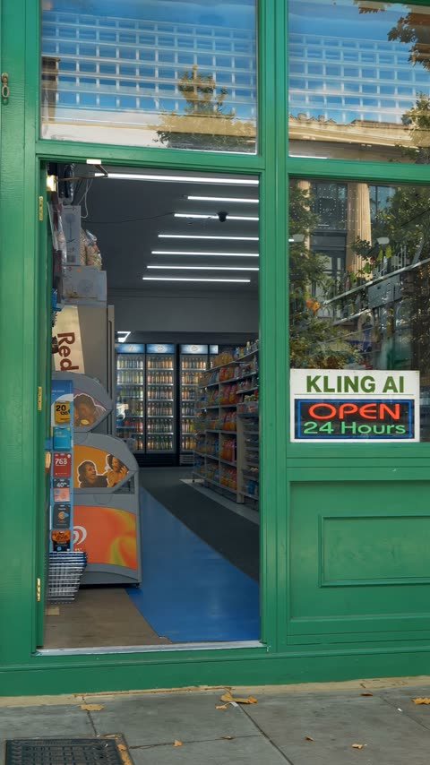</a>

用三张照片给三个人换演员，每人的衣着逐条列出防止串人，最后列出所有必须保持不变的东西。

Kling 4.0 · 视频编辑 · 出处: [Kling 4.0 user guide](https://kling.ai/quickstart/kling-4-model-user-guide)

[`video-edit`](tags.md#tag-video-edit) [`character-swap`](tags.md#tag-character-swap) [`multi-reference`](tags.md#tag-multi-reference) [`character-consistency`](tags.md#tag-character-consistency)

<details><summary><b>提示词</b></summary>

```text
Edit @Video1. Replace the three people who walk out of the convenience store one after another with the following characters: First character: use the identity, face, dark curly hair, white sun hat, white short-sleeved shirt with a black-and-white striped inner top, green apron, loose light gray jeans, and dark sneakers of the man in @Image1. Second character: use the identity, short light blonde hair, red sweatshirt, green apron, white knee-high socks, and red shoes of the woman in @Image2. Third character: use the identity, short light blonde hair, white chef hat, black-framed glasses, blue-green-and-black patterned knit outfit, green apron, white shoes, and the same off-white plush sheep held in his arms as the man in @Image3. The order in which the three characters appear, their movements from inside the store to the doorway, their pauses to pose, and their approach toward the camera and exit through the foreground should follow the actions and camera timing of @Video1: the first character slightly lifts the brim of his sun hat before approaching the camera; the second character naturally adjusts her apron and gives a slight wave at the doorway before approaching the camera; the third character holds the plush sheep, adjusts his glasses, then approaches the camera and slightly raises the plush sheep as he gets closer. Fix a clear, stable, readable sign with the exact uppercase text `KLING AI OPEN 24 hours` in the middle of the convenience store's right-side glass window. The text must remain correctly spelled, undistorted, and free of flickering throughout the video. Keep the sign fixed to the inside of the glass window without obstructing any characters. Keep everything else unchanged: preserve the green convenience store doorframe, doorway composition, interior shelves, fluorescent lights, glass reflections, daylight, camera position, walking direction, duration, pacing, and aspect ratio of @Video1. Do not add any characters, change the store structure or camera movement, or introduce subtitles, logos, watermarks, or extra text.
```

</details>

输入素材: [1](https://static--29.klingai-cdn-aws.com/kling-blog/file_by_url/b543db1d109219975a68d1221b2c2527ee57423b5e310d2d3c6c0777f0e6cee1.png) · [2](https://static--21.klingai-cdn-aws.com/kling-blog/file_by_url/1a46d27b44af66db489c3493198babfbd51d8cfee16801fdff9f631f199c779a.png) · [3](https://static-45.klingai-cdn-aws.com/kling-blog/file_by_url/215c8a0540de5d336ff1c4d56794041bb2fca70f2a03afc7940473ea7a42d0bf.png) · [4](https://static-2.klingai-cdn-aws.com/kling-blog/presigned_url/2a3d6487-b5c8-409a-9030-11f7ebcd8d57_1-3-1.mp4)

<a id="kling4-edit-remove-foreground-person"></a>
### 改视频：去掉前景里的人

<a href="https://static-60.klingai-cdn-aws.com/kling-blog/presigned_url/13c66fc3-b663-4e6e-b50c-208bbd080a5c_1-4.mp4">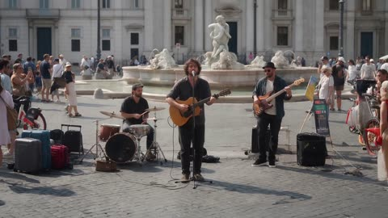</a>

一段话做物体移除：删什么、留什么，再要求把被挡住的部分补出来。

Kling 4.0 · 视频编辑 · 出处: [Kling 4.0 user guide](https://kling.ai/quickstart/kling-4-model-user-guide)

[`video-edit`](tags.md#tag-video-edit) [`object-removal`](tags.md#tag-object-removal) [`inpainting`](tags.md#tag-inpainting)

<details><summary><b>提示词</b></summary>

```text
Edit @Video 1 to remove the foreground person. Keep everything else unchanged, including the background, other subjects, camera movement, lighting, composition, and video duration. Seamlessly reconstruct the areas previously obscured by the person, ensuring natural, consistent details with no visible artifacts.
```

</details>

输入素材: [1](https://static--19.klingai-cdn-aws.com/kling-blog/presigned_url/968b27e4-43a2-4757-b744-074878d87095_1-4-1.mp4)

<a id="omni-shoes-tilt-up"></a>
### 从鞋子起幅，上摇，再拉开

<a href="https://storage.googleapis.com/gdm-deepmind-com-prod-public/media/FfbFqJ8qhY_ZWZyz/gemini-omni__prompt-guide__boots.webm"></a>

一行里按发生顺序串起三个运镜。

Gemini Omni Flash · 视频编辑 · 出处: [Gemini Omni prompt guide](https://deepmind.google/models/gemini-omni/prompt-guide/)

[`camera-move`](tags.md#tag-camera-move) [`multi-turn-edit`](tags.md#tag-multi-turn-edit)

<details><summary><b>提示词</b></summary>

```text
Change the camera angle, a close-up on his shoes, quickly tilting up to medium shot, then widening.
```

</details>

<a id="omni-storyboard-to-video"></a>
### 给一张分镜图，直接出片

<a href="https://storage.googleapis.com/deepmind-media/DeepMind.com/Models/gemini-omni/prompt-guide/gemini_omni__prompt-guide__storyboard.webm"></a>

剧情全在分镜图里，文字只交代阅读顺序、总时长和基调。

Gemini Omni Flash · 参考生视频 · 出处: [Gemini Omni prompt guide](https://deepmind.google/models/gemini-omni/prompt-guide/)

[`storyboard`](tags.md#tag-storyboard) [`multi-shot`](tags.md#tag-multi-shot)

<details><summary><b>提示词</b></summary>

```text
Show me in this story. Follow the story exactly in order starting top left. Entire story in 10 seconds. Cinematic
```

</details>

输入素材: [1](https://storage.googleapis.com/deepmind-media/DeepMind.com/Models/gemini-omni/prompt-guide/gemini-omni__reference-anything-storyboard-ingredient-01.webp) · [2](https://storage.googleapis.com/deepmind-media/DeepMind.com/Models/gemini-omni/prompt-guide/gemini-omni__reference-anything-storyboard-ingredient-02.webp)

<a id="seedance-3d-toddler-bob-dressing-room-comedy"></a>
### 卧室里留着短发的动画幼童

<a href="https://x.com/Elvorya/status/2109822507826266502">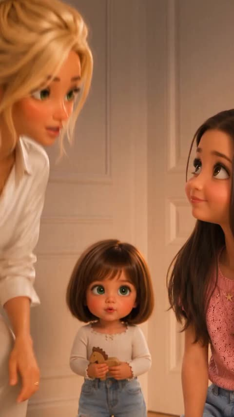</a>

七个带时间点的场景段落，每段都写明镜头类型（跟拍、极近景）和一个情绪动作，让30秒的故事按顺序读懂。每段都重复角色的发型、眼睛和服装，再加一段独立的风格与规格说明，使幼童在切换镜头后保持一致。

Seedance 2.5 · 文生视频 · 出处: [@Elvorya on X](https://x.com/Elvorya/status/2109822507826266502)

[`3d-animation`](tags.md#tag-3d-animation) [`family-comedy`](tags.md#tag-family-comedy) [`toddler`](tags.md#tag-toddler) [`multi-scene`](tags.md#tag-multi-scene)

<details><summary><b>提示词</b></summary>

```text
Create a 30-second cinematic, ultra-detailed 3D animated family comedy set inside a luxurious, warm-toned bedroom and dressing room. Feature an adorable toddler girl with a short brown bob haircut, enormous expressive green eyes, rosy cheeks, a white long-sleeve top, and light blue jeans. Two older girls help her get ready, while a blonde woman watches nearby.

Scene 1 (0–4s): The toddler stands in the elegant bedroom as the blonde woman bends down beside her and an older girl in a pink top smiles warmly. Show a close-up of the older girl's playful expression as she looks at the toddler.

Scene 2 (4–8s):The toddler happily walks toward the dressing area, her tiny steps full of confidence. She turns toward the camera with a mischievous smile. Use smooth tracking shots and warm sunlight spilling through the open doorway.

Scene 3 (8–12s): Inside the dressing room, the toddler discovers beautiful purple dresses hanging on a clothing rack. She looks up at them with sparkling eyes while the older girl watches her excitement. Capture their playful interaction with natural facial expressions.

Scene 4 (12–16s): The older girl gently brushes the toddler's short brown hair with a pink hairbrush. Suddenly, the toddler makes an exaggerated grumpy face, furrows her eyebrows, and looks deeply offended by the brushing. Use a comedic close-up to emphasize her stubborn expression.

Scene 5 (16–21s): Extreme close-up of the toddler's adorable pout, glossy oversized green eyes, rosy cheeks, and tiny frown. Her annoyed expression slowly changes into surprise, then a huge delighted smile. She raises both hands beside her face, showing her excitement in an irresistibly cute moment.

Scene 6 (21–26s): The toddler stands in front of a large oval vanity mirror, admiring herself. She touches her hair, smiles proudly at her reflection, and performs a tiny happy pose. The older girl appears behind her, smiling at the transformation.

Scene 7 (26–30s): Wide cinematic shot of the elegant bedroom. Clothes and dresses are scattered across the floor after the getting-ready session. The toddler confidently marches forward while the blonde woman watches from the doorway. End with the toddler's proud little smile, leaving a funny impression that she has completely taken over the room.

Visual style: High-end 3D animated family-film aesthetic, adorable doll-like character design, expressive facial animation, detailed hair strands, realistic fabric textures, soft golden-hour lighting, warm beige interiors, natural shadows, polished cinematic rendering, shallow depth of field, smooth camera movements, consistent character designs, believable toddler movements, playful comedy, and heartwarming storytelling.

Technical specifications: Vertical 9:16, 30 seconds, 24 FPS, cinematic composition, smooth transitions, consistent character appearance across every scene
```

</details>

<a id="seedance-beach-rescue-playful-seawater-spit"></a>
### 海滩急救以顽皮喷水收尾

<a href="https://x.com/Harry_thingss/status/2104579594695409840"></a>

把15秒拆成三个定时段落，每段都有景别、运镜和情绪转折，从惊慌到释然再到大笑。固定的角色描述、从手到脸的变焦、声音清单和负面提示共同稳住人物、服装和基调。

Seedance 2.5 · 文生视频 · 出处: [@Harry_thingss on X](https://x.com/Harry_thingss/status/2104579594695409840) · 发现于 [LearnPrompt/awesome-seedance](https://github.com/LearnPrompt/awesome-seedance)

[`beach`](tags.md#tag-beach) [`emotional-drama`](tags.md#tag-emotional-drama) [`timeline-prompt`](tags.md#tag-timeline-prompt) [`handheld`](tags.md#tag-handheld) [`golden-hour`](tags.md#tag-golden-hour)

<details><summary><b>提示词</b></summary>

```text
PHOTOREALISTIC CINEMATIC VIDEO, 15 sec, 16:9, 35mm lens, shallow depth of field, warm golden-hour light, high-end film look.

CHARACTERS (identical in every frame): Woman, mid-20s, curvy Indian/Latina, wavy shoulder-length brown hair (soaked, on sand), soft makeup, wet olive-green sleeveless bodycon midi dress, gold chain necklace, hoop earrings, watch on left wrist, small floral tattoo on right forearm. Realistic skin, water droplets, sand grains. Boyfriend: early-30s, athletic, wet white t-shirt, dark shorts, short wet hair.

LOCATION: Quiet beach, wet sand, foaming waves behind, side sunlight with rim light on wet hair and skin, light sea breeze.

0-5s: Wide-to-medium shot, slow push-in at sand level. She lies on her back, eyes closed. He drops to his knees, urgently tilts her head and performs rescue-style chest compressions, realistic and non-graphic. Worried, panicked face; water drips from his hair. A wave washes near her feet.

5-10s: Close-up, slight handheld push-in on her hand and face. Her fingers twitch, hand curls, eyelids flutter, chest rises with a breath. He notices, freezes, panic turns to deep relief. Rack focus from her hand to his face.

10-15s: Medium close-up at sand level, both in frame. Still lying down, she opens her eyes, smiles mischievously, and playfully spits a small burst of seawater at his face. Droplets arc slowly, catching sunlight. He recoils, blinks, then laughs in shock. She looks relieved and amused. End on a warm two-shot.

CAMERA: smooth, slight handheld, slow push-ins, no sudden cuts.
AUDIO: waves, seagulls, wind, her small cough, soft laughter, light emotional score.
NEGATIVE: no blood, no gore, no distortion, no extra fingers, no face morphing, no outfit or jewelry change, no text, no watermark, no cartoon or plastic skin.
```

</details>

<a id="seedance-bicycle-courier-city-sequence"></a>
### 自行车快递员穿行市中心车流

<a href="https://x.com/Elvorya/status/2102622012351131832">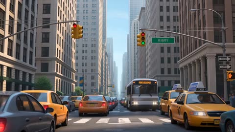</a>

提示词按编号写成分镜，每个镜头都点明机位和运动方式。快递员的头盔、外套、裤子、背包和自行车在每个镜头中重复描述，以保持角色一致，车轮转动和路面摩擦等物理细节写明，使运动更真实。

Seedance 2.5 · 文生视频 · 出处: [@Elvorya on X](https://x.com/Elvorya/status/2102622012351131832) · 发现于 [LearnPrompt/awesome-seedance](https://github.com/LearnPrompt/awesome-seedance)

[`character-consistency`](tags.md#tag-character-consistency) [`tracking-shot`](tags.md#tag-tracking-shot) [`urban`](tags.md#tag-urban) [`multi-shot`](tags.md#tag-multi-shot)

<details><summary><b>提示词</b></summary>

```text
Create a 15-second photorealistic cinematic animated urban adventure sequence following a young bicycle courier navigating a busy modern city during a fast-paced delivery run.

Begin with a low-angle street-level establishing shot of a dense downtown avenue surrounded by towering skyscrapers, yellow taxis, city buses, cars, traffic lights, pedestrians, street signs, and realistic urban details → smoothly reveal the young male courier riding directly toward the camera through traffic, wearing a black bicycle helmet, orange short-sleeve delivery jacket, dark pants, gloves, and a large red insulated delivery backpack, maintaining the exact same character design, face, clothing, bicycle, and proportions throughout every shot → transition into a dynamic rear tracking shot as he weaves carefully between moving vehicles, with realistic wheel rotation, body balance, road friction, suspension movement, and subtle handheld camera motion → cut to a dramatic side-angle shot as traffic rushes past him while he accelerates through the intersection, creating natural cinematic motion blur → transition into a wider urban shot as he approaches the sidewalk and smoothly lifts the front wheel, riding up toward the curb while pedestrians react naturally → follow with a dynamic low-angle tracking shot as he rides along the busy sidewalk, passing pedestrians, street furniture, storefronts, and city infrastructure with believable depth and scale → cut to a dramatic elevated angle as he crosses back toward the street and continues the delivery route through the dense downtown environment → transition into a fast cinematic side-tracking shot showing the courier cycling confidently beneath massive skyscrapers while vehicles move around him → final shot becomes a heroic wide-angle cinematic frame with the courier riding across the foreground beneath towering city buildings, warm afternoon sunlight reflecting between skyscrapers, long realistic shadows, atmospheric depth, and the city continuing to move naturally behind him.

Visual style: photorealistic high-end animated-film cinematography, cinematic urban adventure, realistic character animation, expressive but natural facial expressions, believable human anatomy, physically accurate bicycle movement, realistic road interaction, detailed vehicles, natural pedestrian behavior, dynamic camera choreography, smooth tracking shots, low-angle perspective, subtle motion blur, shallow depth of field, realistic reflections, volumetric sunlight, atmospheric city haze, detailed skyscraper architecture, cinematic depth, natural shadows, polished lighting, strong sense of scale, immersive downtown atmosphere, energetic pacing, seamless shot transitions, premium feature-film quality.

Character consistency: same young courier throughout the entire sequence, identical face, hairstyle, helmet, orange jacket, dark pants, red delivery backpack, bicycle design, body proportions, and accessories in every shot. Maintain perfect continuity between scenes.

Negative prompt: no subtitles, no text, no logos, no watermark, no distorted face, no identity changes, no extra fingers, no malformed hands, no duplicated people, no duplicate bicycle, no inconsistent clothing, no changing backpack, no warped wheels, no floating bicycle, no broken physics, no impossible vehicle movement, no disappearing pedestrians, no flickering, no jitter, no teleportation, no rubbery animation, no unnatural body movement, no deformed anatomy, no flat lighting, no cheap CGI, no low-detail buildings, no blurry character, no random objects, no camera glitches, no frame tearing.
```

</details>

<a id="seedance-blonde-girl-pouts-cheek-poke"></a>
### 金发女孩被戳脸后撒娇委屈

<a href="https://x.com/Chengzilhy/status/2091477403239596328"></a>

按秒切分的分镜表让眼神先动、头部稍后跟随，形成偷看的小动作。参考图加上需要保持的特征清单（脸型、空气刘海、发夹、妆容）让同一角色贯穿每个镜头节拍。

Seedance 2.5 · 参考生视频 · 出处: [@Chengzilhy on X](https://x.com/Chengzilhy/status/2091477403239596328) · 发现于 [LearnPrompt/awesome-seedance](https://github.com/LearnPrompt/awesome-seedance)

[`portrait`](tags.md#tag-portrait) [`character-consistency`](tags.md#tag-character-consistency) [`timed-beats`](tags.md#tag-timed-beats) [`micro-expression`](tags.md#tag-micro-expression)

<details><summary><b>提示词</b></summary>

```text
参考上传图片中的同一位成年女性角色，保持脸型、五官、浅金色长发、空气刘海、深蓝色花朵发夹、妆容与整体造型一致。

生成一段 8 秒、9:16 竖屏、固定机位、一镜到底的正面超近景人物视频。

整体表演：软萌、调皮、可爱、娇俏，带一点自然撒娇和假装委屈感。
重点表现眼神、嘴唇、眉毛、脸颊和轻微头部跟随产生的真实微表情。
0–1.5 秒

女主正视镜头，神态柔和可爱，嘴唇自然微张后轻轻合拢。
伴随呼吸，头部和下巴产生极小幅自然移动。

1.5–3.7 秒
眼睛先慢慢向画面左侧移动，偷偷侧瞄旁边。
头部稍晚才向同方向轻微跟随，移动幅度明显小于眼神，形成调皮、偷偷观察的感觉。

3.7–4.6 秒

自然完成一次双眼眨眼。
视线重新回到镜头，头部同时轻轻回正，恢复软萌自然的表情。
4.6–5.2 秒

眼睛先向下看，下巴随后轻微降低。
一只手从画面右下方自然进入，食指缓慢靠近画面右侧脸颊。
女主观察手指，嘴唇开始轻轻向前收拢。

5.2–6.6 秒
食指轻轻按压脸颊，脸颊产生真实柔软的轻微凹陷。
接触瞬间女主双眼短暂眯起，头部顺着触碰产生极轻微的受力让位和侧倾。

随后重新睁眼看向镜头：

眉头轻轻收拢 + 下唇微微鼓起 + 嘴角轻微向下
形成调皮可爱、撒娇式的假装委屈表情。
6.6–8 秒

食指离开脸颊，脸颊自然回弹，头部轻轻回正。

委屈表情连续释放：
嘴唇放松 → 眉头舒展 → 自然快速眨一次双眼。

最后重新正视镜头，嘴唇轻轻微张，恢复甜甜、软萌、略带调皮感的自然表情。
```

</details>

<a id="seedance-cafe-heartbreak-rainy-evening"></a>
### 雨夜咖啡馆里撞见男友出轨的女孩

<a href="https://x.com/AIwithSynthia/status/2096439253970395531">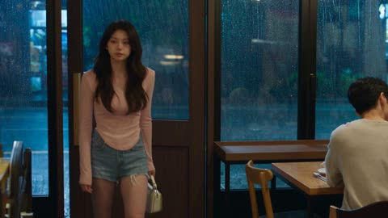</a>

提示词先锁定人物长相和服装，再按动作节拍逐条写场景，并列出从困惑到平静接受的情绪递进。对眼泪连贯性的明确约束、发现时逐渐推近的手持镜头，以及不加配乐的音效清单，让哭戏克制而可信。

Seedance 2.5 · 文生视频 · 出处: [@AIwithSynthia on X](https://x.com/AIwithSynthia/status/2096439253970395531) · 发现于 [LearnPrompt/awesome-seedance](https://github.com/LearnPrompt/awesome-seedance)

[`emotional-drama`](tags.md#tag-emotional-drama) [`live-action`](tags.md#tag-live-action) [`cafe`](tags.md#tag-cafe) [`dialogue`](tags.md#tag-dialogue) [`handheld`](tags.md#tag-handheld)

<details><summary><b>提示词</b></summary>

```text
Create a 30-second, 1080p ultra-realistic emotional live-action scene about a young woman discovering her boyfriend kissing another woman inside a quiet café. Focus entirely on authentic human emotion, natural crying, subtle facial expressions and believable body language. No melodrama or exaggerated acting.
MAIN CHARACTER
Young Korean woman in her early 20s, naturally beautiful, realistic skin texture, minimal makeup, long black hair loosely styled, wearing a fitted pastel-pink top, casual denim shorts and simple sneakers.
Maintain the exact same face, hairstyle, outfit, body proportions and appearance throughout the entire scene.
LOCATION
A cozy modern café on a rainy evening. Warm interior lighting, large windows covered with rain droplets, wooden tables, soft background chatter, cups and plates, a few customers quietly talking.
SCENE
She enters the café carrying a small handbag, casually looking around for her boyfriend.
She suddenly notices him sitting at a table near the window.
He is kissing another young woman.
She immediately stops walking.
Her expression changes from confusion to disbelief.
She slowly lowers her handbag.
She stares at them silently for a few seconds, struggling to process what she is seeing.
Her eyes begin to fill with tears.
Show realistic tears naturally forming along her lower eyelids, then slowly rolling down her cheeks. No exaggerated crying.
She takes a shaky breath.
She walks toward their table.
Her boyfriend notices her.
His expression immediately changes to shock.
The other woman turns around and becomes uncomfortable.
The girlfriend looks directly at him with trembling eyes and quietly says:
“How could you do this to me?”
Her voice cracks naturally.
She wipes one tear from her cheek, but more tears continue falling.
Her boyfriend stands up and tries to explain.
She shakes her head and takes a small step backward.
She says through tears:
“I trusted you.”
She looks at him for one final moment.
Her expression shows heartbreak, disappointment and disbelief rather than anger.
She turns around and walks toward the café door while quietly crying.
Her boyfriend takes one step after her but stops.
She reaches the door, pauses briefly, wipes her face and leaves.
The camera remains inside the café as the door closes behind her.
CAMERA / VISUAL STYLE
Handheld cinematic camera with subtle natural movement. Start with a medium shot following her into the café, then slowly move closer when she notices the couple.
Use realistic close-ups of her eyes, trembling lips, tears and subtle facial reactions.
Natural shallow depth of field, realistic skin pores, authentic reflections in the café windows, soft rainy evening light, natural motion blur, 24fps, photorealistic live-action.
Do not make her crying look beautiful or glamorous. It should look spontaneous, uncomfortable and emotionally real.
AUDIO
Rain against the café windows, quiet conversations, cups being placed on tables, distant café ambience, footsteps and subtle breathing.
No background music.
No narration.
Dialogue should sound natural with slight pauses, trembling voice and emotional breathing.
EMOTIONAL DIRECTION
The emotion should build gradually:
confusion → realization → shock → disbelief → tears → confrontation → heartbreak → quiet acceptance.
Avoid screaming, physical aggression or exaggerated dramatic gestures.
CONTINUITY / REALISM
Keep tears physically consistent once they appear. Tears should remain visible on her cheeks and naturally accumulate as she continues crying.
Maintain consistent clothing, hairstyle, jewelry and facial identity.
No sudden emotional changes, no disappearing tears, no duplicated people, no changing café layout, no unnatural body movements.
NEGATIVE: plastic skin, fake tears, exaggerated crying, cartoon expressions, melodramatic acting, screaming, physical violence, distorted faces, extra fingers, identity drift, outfit changes, CGI
```

</details>

<a id="seedance-chef-levitating-food-kitchen"></a>
### 厨师端着牛排餐盘穿过忙碌厨房

<a href="https://x.com/noorlewisx/status/2088108029522911384"></a>

提示词按节拍编排：先固定人物和餐盘，再给出一个明确的慢动作效果，最后回到餐盘并由另一角色说一句台词。点明慢动作和轻柔落回让运动更易读，结尾的风格词统一画面质感。

Seedance 2.5 · 文生视频 · 出处: [@noorlewisx on X](https://x.com/noorlewisx/status/2088108029522911384)

[`kitchen`](tags.md#tag-kitchen) [`slow-motion`](tags.md#tag-slow-motion) [`food`](tags.md#tag-food) [`dialogue`](tags.md#tag-dialogue)

<details><summary><b>提示词</b></summary>

```text
A young female chef in a white double-breasted chef’s coat stands in the middle of a busy professional kitchen, holding a large white plate with medium-rare steak, roasted potatoes, yellow sauce, and microgreens. Suddenly the food slowly levitates and floats in mid-air above the plate in dramatic slow motion while she looks shocked. The pieces gently land back perfectly on the plate. She then presents the dish to a stern older male head chef behind the pass who inspects it and says “It’s a go.” Cinematic lighting, steam, open flames, copper pans, highly detailed, realistic, film still style.
```

</details>

<a id="seedance-clay-mug-kitchen-cupboard"></a>
### 陶杯在橱柜深处等待被选中

<a href="https://x.com/Dheepanratnam/status/2083869167791305173">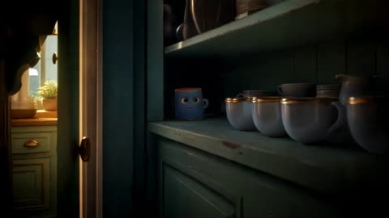</a>

提示词给场景设定了清晰的故事对比（橱柜深处的手工陶杯与每天被用的瓷杯）和情绪基调（温暖、有趣、安静动人），让模型在没有对白的情况下也有明确的情绪走向。明确的 2.35:1 画幅与 30 秒时长固定了单镜头的构图和节奏。

Seedance 2.5 · 文生视频 · 出处: [@Dheepanratnam on X](https://x.com/Dheepanratnam/status/2083869167791305173)

[`3d-animation`](tags.md#tag-3d-animation) [`clay`](tags.md#tag-clay) [`storytelling`](tags.md#tag-storytelling) [`kitchen`](tags.md#tag-kitchen)

<details><summary><b>提示词</b></summary>

```text
[SCENE] A 30-second stylised 3D animated short. A handmade clay mug at the back of a kitchen cupboard waits to be chosen, while the perfect porcelain cups at the front are used every day. Warm, funny, quietly moving. 2.35:1.
```

</details>

<a id="seedance-college-lab-zombie-infection"></a>
### 大学实验室学生被感染变成丧尸

<a href="https://x.com/AIwithSynthia/status/2106955772395659431">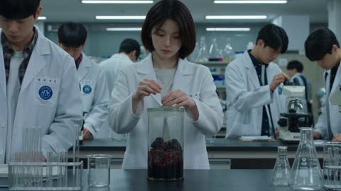</a>

提示词按时间顺序串起容器破裂、感染、追逐、堵门和门窗前的最后一笑，开头就锁定人物的脸和衣着。单独的音频行不要音乐，风格行写明冷色荧光灯转红色应急灯，负面清单排除血腥和脸部变形，让恐怖感保持写实。

Seedance 2.5 · 文生视频 · 出处: [@AIwithSynthia on X](https://x.com/AIwithSynthia/status/2106955772395659431) · 发现于 [LearnPrompt/awesome-seedance](https://github.com/LearnPrompt/awesome-seedance)

[`horror`](tags.md#tag-horror) [`zombie`](tags.md#tag-zombie) [`photorealistic`](tags.md#tag-photorealistic) [`handheld`](tags.md#tag-handheld) [`sound-design`](tags.md#tag-sound-design)

<details><summary><b>提示词</b></summary>

```text
Create a photorealistic live-action zombie-horror sequence inside a modern university science laboratory during a normal college practical session. The central character is a young adult Korean female college student wearing a white laboratory coat over a simple shirt, blue jeans and white sneakers. Keep her face, hairstyle, clothing and body proportions identical throughout. Surround her with several college students, laboratory benches, microscopes, glass test tubes, chemical containers, computers and scientific equipment. Use realistic fluorescent lighting, practical effects, handheld camerawork and believable physics.

The students are quietly working on an experiment when a sealed glass specimen container suddenly cracks. A dark infected substance escapes and attaches itself to the young woman near her shoulder and neck. She stumbles backward in fear as dark veins slowly spread beneath her skin, traveling across her neck and face. Her fingers begin twitching, her body develops violent tremors and her skin becomes pale and clammy.

Her frightened expression gradually disappears. She raises her head and her eyes slowly transform into deep cloudy-black eyes. She suddenly turns toward a nearby classmate and charges. He desperately backs away behind a laboratory table while she repeatedly slams against it, moving with unnatural strength.

The other students freeze before scrambling toward the laboratory exit. The infected woman suddenly becomes completely still, then slowly rotates her head toward them. Her dark veins pulse visibly across her face while her black eyes remain fixed on the students.

Another glass specimen container cracks in the background. A second infected student suddenly collapses onto the floor, convulsing violently as dark veins spread across his neck and face and his eyes turn black. Panic erupts throughout the laboratory.

Students grab backpacks, chairs and laboratory equipment while trying to escape. One student pulls another toward the emergency exit as the infected chase them through the narrow aisles. A heavy laboratory table is pushed against the door as a temporary barricade.

The survivors finally reach the hallway and slam the laboratory door shut. Red emergency lights begin flashing as they catch their breath.

Inside the laboratory, everything becomes silent.

The camera slowly approaches the small observation window in the door. The infected female student stands motionless in the darkness, still wearing her white lab coat and jeans. Her pale face, prominent dark veins and completely black eyes are clearly visible.

She slowly tilts her head toward the window.

Then she suddenly smiles.

Cut to black.

AUDIO: Realistic laboratory ambience, fluorescent hum, glass cracking, equipment falling, footsteps, frightened breathing, screams, alarms, convulsions, impacts and distant banging. No music or exaggerated sound effects.

STYLE: Ultra-realistic college laboratory horror, practical-effects infection, realistic skin texture, believable anatomy, natural handheld camera, grounded movement, realistic facial transformation, dark spreading veins, black/cloudy eyes, violent convulsions and unnatural infected movements, cold fluorescent lighting transitioning into red emergency lighting.

NEGATIVE: Excessive gore, graphic dismemberment, graphic eye gore, anime, cartoon, illustration, plastic skin, fake CGI, duplicated students, face morphing, distorted anatomy, extra limbs, floating objects, impossible physics, changing clothes, inconsistent identities, subtitles, text, logos, watermark.
```

</details>

<a id="seedance-coronation-modern-man-fixes-crown"></a>
### 王座厅中跪拜的王子与站立的国王

<a href="https://x.com/Caden_Flux/status/2109652904864829898">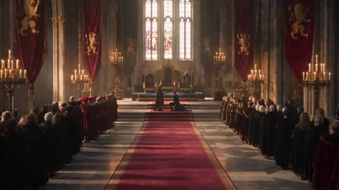</a>

提示词锁定三张上传的角色设定图作为参考，并逐条写明每个角色需保留的特征。分段时间轴配合明确的台词与音效提示，以及严格的负面约束，让喜剧效果保持克制。

Seedance 2.5 · 参考生视频 · 出处: [@Caden_Flux on X](https://x.com/Caden_Flux/status/2109652904864829898) · 发现于 [LearnPrompt/awesome-seedance](https://github.com/LearnPrompt/awesome-seedance)

[`comedy`](tags.md#tag-comedy) [`medieval`](tags.md#tag-medieval) [`character-lock`](tags.md#tag-character-lock) [`dialogue`](tags.md#tag-dialogue)

<details><summary><b>提示词</b></summary>

```text
THE CORONATION — 20-SECOND CINEMATIC COMEDY

MODEL: Seedance 2.5
DURATION: 20 seconds
ASPECT RATIO: 16:9
STYLE: Photorealistic live-action medieval fantasy film with subtle absurdist comedy.
REFERENCE IMAGES AND CHARACTER LOCK
Use the uploaded King character sheet, Prince character sheet, and Random Man character sheet as the definitive visual references.
King: Preserve his exact face, gray-streaked hair, beard, crown, and burgundy royal outfit.

Prince: Preserve his exact face, hairstyle, navy-and-gold coronation outfit, blue cloak, and crown once placed.

Random Man: Preserve his exact face, hairstyle, modern casual outfit, and body proportions.

Maintain consistent character identities, costumes, lighting, and the layout of the throne room throughout the entire video.
LOCATION AND ATMOSPHERE
An enormous medieval royal throne room with towering stone pillars, golden chandeliers, tall stained-glass windows, red velvet banners, and a magnificent golden throne. The royal court stands silently on either side of a red carpet.

The atmosphere is extremely serious and emotionally grand, like the climax of an epic fantasy film. Warm golden sunlight streams through the windows. The music is majestic, with a full orchestral score.

The modern man must look completely out of place in this medieval setting.

SHOT 1 — THE MOMENT OF CORONATION

0–5 seconds

Wide cinematic establishing shot of the royal throne room. The prince kneels on a cushion before the king. The king stands solemnly in front of him, holding an ornate golden crown with both hands.

The court watches in absolute silence.
Cut to a medium close-up of the king slowly raising the crown above the prince's head.

The king speaks in a deep, solemn voice:

KING: "Today, you become king."

The orchestral music swells dramatically. The prince bows his head with complete seriousness.

SHOT 2 — THE WRONG MAN ENTERS

5–9 seconds

Just as the king is about to lower the crown, a casually dressed modern man in a dark hoodie, jeans, and sneakers walks into the royal ceremony from the side of the hall.

He walks directly between the king and prince as though he belongs there.
The king freezes with the crown suspended in midair. The prince remains kneeling, looking slightly confused. The courtiers stare in silent disbelief.

The modern man barely acknowledges anyone. He notices the crown, looks at it critically, and gives a small disapproving shake of his head.

The orchestral music abruptly softens into an awkward, sustained note.

SHOT 3 — THE UNEXPECTED FIX

9–14 seconds

In one continuous, clearly visible action, the modern man casually takes the crown from the king's hands.

He notices a small paper price tag hanging from the crown, removes it, and slips it into his pocket. He then gently straightens the prince's crooked collar and nudges the royal throne a few inches into better alignment with the carpet.
His movements are practical, quick, and completely unbothered.

The king stands frozen, visibly bewildered but trying to preserve his royal dignity. The prince looks from the man to his father, unsure whether he is allowed to move.

The man steps back, examines his work, and gives one satisfied nod.

RANDOM MAN: "Much better."

Deliver the line casually, in a natural conversational voice, without a dramatic pause or exaggerated comic delivery.

SHOT 4 — BACK TO BUSINESS

14–17 seconds

The modern man turns around and casually walks out of the throne room the same way he entered.

No one stops him. Nobody speaks.
The king slowly follows him with his eyes, then looks down at the crown in his hands as if trying to understand what just happened.

The prince remains kneeling in the exact same position.

The man exits the frame completely.

SHOT 5 — THE CORONATION CONTINUES

17–20 seconds

Cut to a cinematic medium close-up of the king taking a slow breath, regaining his composure, and carefully positioning himself to continue the ceremony.

He raises the crown again.
The prince bows his head.

The orchestral music resumes its original majestic intensity, as if the interruption never happened.

KING: "Today… you become king."

End immediately on the king's perfectly serious face.

Cut to black.

CAMERA AND EDITING

Use professional cinematic framing, smooth controlled camera movements, realistic depth of field, natural facial micro-expressions, and clean film-style cuts. Establish the room before moving into medium shots and close-ups. Make the modern man's entrance and practical actions easy to see.

Keep the comedy understated and driven by timing, awkward silence, and the contrast between the epic ceremony and the man's mundane behavior.

AUDIO DESIGN

Majestic orchestral music during the coronation, subtle footsteps and clothing movement, a slight musical interruption when the man enters, a soft paper rustle as he removes the price tag, and a return to full orchestral grandeur for the final line.

All dialogue must be clearly audible, naturally delivered, and spoken in English. No narration, no subtitles, no extra dialogue, and no random background voices.

STRICT NEGATIVE CONSTRAINTS

No cartoon effects, no slapstick falls, no exaggerated facial expressions, no character morphing, no identity changes, no costume changes, no duplicated characters, no extra limbs, no floating objects, no random camera transitions, no modern objects apart from the man's clothing and the tiny price tag, and no characters looking directly into the camera.

The king, prince, and courtiers must treat the event as a real interruption to a serious royal ceremony. The modern man must remain completely calm and behave as though fixing the coronation is an ordinary task.

FINAL CREATIVE DIRECTION: Make it look like a genuine, high-budget medieval fantasy movie that has been interrupted by a man who thinks he is responsible for fixing continuity errors. The audience should find the situation funny without the characters turning it into a comedy performance.
```

</details>

<a id="seedance-disaster-comedy-restaurant-feast"></a>
### 城市爆炸后两名女子在餐厅大快朵颐

<a href="https://x.com/Aqsahere_/status/2096077108808470604">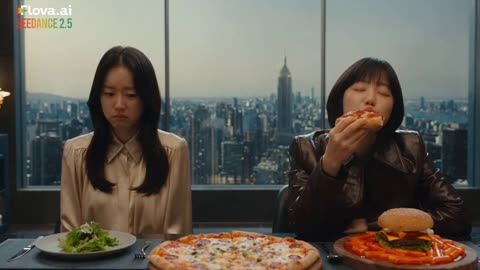</a>

两人分别固定在画面左右两侧，并配上对比鲜明的道具（沙拉对比披萨、汉堡和辣炒年糕），让节食的笑点一眼可见。爆炸被设定为会震动餐盘的冲击波，为模型提供了从羡慕转向慌乱进食的明确物理线索。

Seedance 2.5 · 文生视频 · 出处: [@Aqsahere_ on X](https://x.com/Aqsahere_/status/2096077108808470604)

[`disaster-comedy`](tags.md#tag-disaster-comedy) [`restaurant`](tags.md#tag-restaurant) [`food`](tags.md#tag-food) [`korean`](tags.md#tag-korean)

<details><summary><b>提示词</b></summary>

```text
Create a premium photorealistic live-action cinematic disaster comedy featuring two beautiful young Korean women with clearly different faces, hairstyles, body proportions, and fashion styles. WOMAN 1 sits screen left, wearing a stylish elegant outfit, with only a small green salad in front of her. WOMAN 2 sits screen right, with a completely different beautiful face and different fashionable outfit, enjoying a hamburger, pizza, and red tteokbokki. They sit in a luxurious modern restaurant beside a huge floor-to-ceiling window overlooking a dense city skyline. WOMAN 1 sadly stares at her salad and envies WOMAN 2's feast until a colossal distant explosion suddenly erupts across the city, sending orange-white light and a powerful pressure wave that shakes the window and rattles the plates. Realizing the world might be ending, WOMAN 1 immediately abandons her diet, slides her salad aside, and urgently starts eating the pizza and hamburger. WOMAN 2 watches in disbelief, but another shockwave hits and she instantly joins the frantic feast. Finish with both women seriously panic-eating while repeatedly glancing at the enormous apocalyptic cloud outside. Premium large-format cinematic realism, Cooke anamorphic look, realistic physics, natural acting, cinematic orange disaster lighting, subtle handheld urgency after the explosion, no dialogue, no subtitles, no extra characters, no face duplication, and consistent screen positions throughout.
```

</details>

<a id="seedance-fairground-ice-cream-nose-tease"></a>
### 夕阳下女孩走向游乐场冰淇淋摊

<a href="https://x.com/sophiaparkerr_/status/2096542775709692255">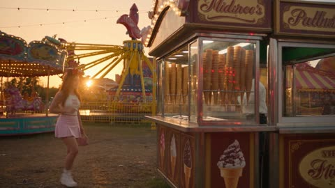</a>

按时间段（0到3秒、3到6秒等）分镜，把一个逐步升级的恶作剧拆成连续镜头；结尾的 IMPORTANT 段锁定发箍、服装、道具和场景在切换中保持一致。夕阳逆光、浅景深、云台推拉等摄影术语让画面更接近真人实拍，而不是卡通动作。

Seedance 2.5 · 文生视频 · 出处: [@sophiaparkerr_ on X](https://x.com/sophiaparkerr_/status/2096542775709692255) · 发现于 [LearnPrompt/awesome-seedance](https://github.com/LearnPrompt/awesome-seedance)

[`comedy`](tags.md#tag-comedy) [`amusement-park`](tags.md#tag-amusement-park) [`character-consistency`](tags.md#tag-character-consistency) [`shot-list`](tags.md#tag-shot-list)

<details><summary><b>提示词</b></summary>

```text
CHARACTER:
A young woman wearing a cute, stylish amusement-park outfit with a clearly visible Mickey Mouse ears headband. Keep the headband consistent throughout the entire video. She is excited, playful, and expressive.
A cheerful Turkish ice cream vendor stands behind a traditional Turkish ice cream stall, holding a long metal ice cream paddle.

0–3 SEC — ORDER
Start with a cinematic wide shot of the colorful amusement park, then smoothly move toward the Turkish ice cream stall.

The girl approaches the counter, smiling excitedly. Her Mickey Mouse ears headband is clearly visible. She points toward the ice cream.
The vendor prepares a cone with a scoop of ice cream and extends it toward her.

3–6 SEC — THE FIRST TEASE
Cut to a medium shot.

The girl eagerly reaches for the cone.

Just as she is about to grab it, the vendor smoothly pulls the ice cream away with the long paddle.
She looks at him in surprise.

He smiles mischievously and offers it again.

6–9 SEC — MORE TEASING
She reaches again.

The vendor smoothly moves the cone from left to right, then slightly upward, always just out of reach.

The girl follows the cone, laughing and becoming increasingly determined.

Keep the interaction fluid, realistic, and playful, with natural body movement and timing.
9–11 SEC — THE NOSE TRICK
The vendor finally brings the ice cream toward her.

She confidently leans forward, expecting to receive it.

Instead, he gently places a small dab of ice cream on the tip of her nose.

Close-up on her shocked expression.

She pauses, looks cross-eyed toward the ice cream on her nose, then looks back at the vendor with a playful annoyed expression.
11–15 SEC — SHE WINS
Before the vendor can tease her again, she quickly grabs the cone from the paddle.

She successfully gets the ice cream.

The vendor laughs and raises his hands in playful defeat.

She proudly holds up the cone, smiles toward the camera, wipes the ice cream from her nose, and takes a happy bite.

CINEMATOGRAPHY:
Photorealistic live-action, premium cinematic quality, warm golden-hour lighting, natural skin texture, realistic facial expressions, shallow depth of field, soft background bokeh, subtle anamorphic lens characteristics, natural motion blur, smooth gimbal movement, cinematic push-ins and tracking shots, realistic amusement-park atmosphere.

IMPORTANT:
Keep the Mickey Mouse ears headband clearly visible and consistent throughout the scene. Maintain consistent faces, wardrobe, hairstyle, ice cream cone, vendor paddle, and environment. All movements must be smooth and physically realistic. No exaggerated cartoon movement, no 3D animation, no jerky motion, no teleporting, no object duplication, and no unnatural hand movements.
```

</details>

<a id="seedance-favorite-song-street-vibe"></a>
### 城市街头男子听到最爱歌曲

<a href="https://x.com/AIwithZeeshi/status/2095374122674991259">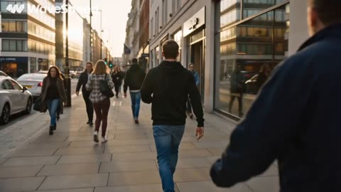</a>

提示词按时间顺序写出动作节奏（听到歌曲、放慢脚步、微笑、边走边轻摇），为模型提供清晰的动作走向。镜头指令也很具体：从背后稳定跟拍，并带轻微手持晃动。

Seedance 2.5 · 文生视频 · 出处: [@AIwithZeeshi on X](https://x.com/AIwithZeeshi/status/2095374122674991259) · 发现于 [LearnPrompt/awesome-seedance](https://github.com/LearnPrompt/awesome-seedance)

[`pov`](tags.md#tag-pov) [`street-scene`](tags.md#tag-street-scene) [`realistic-motion`](tags.md#tag-realistic-motion) [`tracking-shot`](tags.md#tag-tracking-shot)

<details><summary><b>提示词</b></summary>

```text
POV — Your Favorite Song Starts Playing in Public

A young man walks through a busy city sidewalk when he suddenly hears his favorite song playing from a nearby café. He recognizes it instantly, slows down, smiles, and starts subtly vibing to the rhythm while pretending to keep walking normally.

The entire sequence follows realistic human behavior and accurate physics, including natural walking biomechanics, weight distribution, gravity, inertia, momentum, friction, foot-to-ground contact, realistic pedestrian movement, clothing dynamics, hair movement, and natural interactions between people and the environment.

Ultra-realistic visuals, cinematic documentary style, natural late-afternoon lighting, realistic skin and clothing textures, smooth stabilized tracking, subtle handheld camera motion, realistic depth of field, natural focus pulls, physically accurate shadows and reflections, consistent character identity, authentic urban environment, natural colors, subtle film grain, and 4K cinematic quality.

Would you be able to resist vibing to your favorite song in public? 

#Seedance25 #WaveSpeedAI #AIVideo #CinematicAI #AIStorytelling #DailyLife #POV #Relatable #MusicLovers #GenerativeAI
```

</details>

<a id="seedance-flaming-wok-chef-performance"></a>
### 厨师翻动烈焰炒锅与蔬菜

<a href="https://x.com/AynahhX/status/2102946546035945875"></a>

提示词把15秒片段写成用箭头连接的逐拍分镜，明确指定切到特写和环绕运镜，让动作有清晰的先后顺序。结尾加上无字幕、无标志、无水印的说明，保证画面干净。

Seedance 2.5 · 文生视频 · 出处: [@AynahhX on X](https://x.com/AynahhX/status/2102946546035945875) · 发现于 [LearnPrompt/awesome-seedance](https://github.com/LearnPrompt/awesome-seedance)

[`3d-animation`](tags.md#tag-3d-animation) [`cooking`](tags.md#tag-cooking) [`restaurant`](tags.md#tag-restaurant) [`camera-movement`](tags.md#tag-camera-movement)

<details><summary><b>提示词</b></summary>

```text
Create a 15-second cinematic 3D animated cooking sequence inside a professional modern restaurant kitchen. Show a young male chef wearing a white chef jacket and red apron confidently cooking with a large black wok. Start with a medium shot of the chef tossing the wok with a serious, focused expression → cut to a dramatic close-up as flames burst from the pan while he continues cooking → show colorful vegetables including carrots, red bell peppers and bok choy flying dynamically through the air as he flips the wok → camera moves around the chef as he skillfully catches the ingredients back into the pan → finish with a close-up of the chef plating the freshly cooked colorful vegetables onto a clean white plate with glossy sauce. Warm cinematic restaurant lighting, realistic fire and smoke, detailed food textures, smooth character animation, natural hand and body movement, dynamic camera angles, cinematic depth of field, vibrant colors, polished high-end 3D animation, expressive facial animation, satisfying cooking-action atmosphere. No text, subtitles, logos or watermark.
```

</details>

<a id="seedance-flower-field-flashback-memory"></a>
### 花田中的女子沉入童年回忆

<a href="https://x.com/AIwithWania/status/2102283267957506141"></a>

参考图锁定人物、服装和色调，每个时间段都重复这些约束，保证切换前后画面一致。回忆段落在相同花田中用相同花冠做匹配切换，让时间跳转清晰可读。

Seedance 2.5 · 图生视频 · 出处: [@AIwithWania on X](https://x.com/AIwithWania/status/2102283267957506141) · 发现于 [LearnPrompt/awesome-seedance](https://github.com/LearnPrompt/awesome-seedance)

[`flashback`](tags.md#tag-flashback) [`golden-hour`](tags.md#tag-golden-hour) [`reference-image`](tags.md#tag-reference-image) [`memory`](tags.md#tag-memory)

<details><summary><b>提示词</b></summary>

```text
-

Use the uploaded reference image as the visual base. Maintain the same characters, same golden-hour flower field setting, same wardrobe, same color grading (warm gold, soft pink, dreamy sunset light) throughout. Do not change the characters' appearance, clothing, or the location.

- **0:00–0:01** — A woman with long curly brown hair, wearing a white flowing dress and a flower crown, runs through a dreamy field of yellow, white, and pink flowers, trying to catch up to someone ahead of her. A distant fairytale castle is visible on the horizon.
- **0:01–0:03** — She reaches out and gently places her hand on the shoulder of a man ahead of her, who is dressed in medieval knight armor with a dark red cloak.
- **0:03–0:04** — Close-up on her face looking up, windswept hair, flowers in her crown catching the light — in this moment, the world around her begins to fade into a memory.
- **0:04–0:06** — The scene transitions into a flashback: a little girl with the same curly brown hair and flower crown reaches out and gently touches the shoulder of a little boy in front of her, both standing in the same flower field.
- **0:06–0:07** — Close-up of the little boy turning to look at her with a soft, curious expression.
- **0:07–0:09** — The little boy quietly turns away and starts walking forward, away from her, through the flowers.
- **0:09–0:10** — The little girl is left behind, her small hand still reaching out toward him.
- **0:10–0:13** — Cut back to the present: the woman feels the same pain, holding her hand to her heart as the memory fades away.
- **0:13–0:14** — The knight continues walking forward, emotionally distant, leaving her behind once again.
- **0:14–0:15** — She kneels down in the flower field, overwhelmed with heartbreak, face in her hands — some moments stay with us forever.

**End title card:** "Some moments take you back forever..." with theme tags: Love | Memory | Time | Always
```

</details>

<a id="seedance-glass-mall-friends-emerald-skirt-film"></a>
### 三位朋友在玻璃顶奢华购物中心

<a href="https://x.com/AIwithWania/status/2108420649467457557"></a>

按时间段拆分的分镜表让每一段都有独立的镜头指令，从手持行走、面料微距到镜前转身，并用统一的人物、发型和服装锁定句贯穿全片，保持三人前后一致。末尾的负面清单针对面部、手部和走路姿态，减少常见变形。

Seedance 2.5 · 文生视频 · 出处: [@AIwithWania on X](https://x.com/AIwithWania/status/2108420649467457557) · 发现于 [LearnPrompt/awesome-seedance](https://github.com/LearnPrompt/awesome-seedance)

[`fashion`](tags.md#tag-fashion) [`handheld-camera`](tags.md#tag-handheld-camera) [`slow-motion`](tags.md#tag-slow-motion) [`shopping`](tags.md#tag-shopping)

<details><summary><b>提示词</b></summary>

```text
-

The overall mood should feel editorial, feminine, playful, polished and effortlessly chic — not motivational, not overly commercial, and not artificial.

Opening — 0–5 seconds:
Three fashionable female friends stroll through an upscale contemporary shopping destination, surrounded by luminous glass architecture, refined boutiques and warm ambient lighting. They exchange amused glances and effortless smiles, moving naturally together. Use an elegant handheld camera with subtle cinematic movement.

5–10 seconds:
Cut into a sophisticated designer-style boutique. One woman slowly browses a rack of luxurious garments while her friends watch, tease her playfully and react with genuine excitement. Include beautiful macro shots of textured fabrics, delicate embellishments, satin, sequins and refined tailoring.

10–17 seconds:
Show the main woman trying on an elegant fashion ensemble: a sophisticated cream embellished fitted top with a flowing emerald-green floor-length skirt. She emerges from the fitting area, pauses before a large mirror and turns naturally, allowing the skirt to move beautifully. Capture fabric movement, reflections and subtle expressions.

17–23 seconds:
Show intimate shopping details between the three women: one adjusting an accessory, another holding up a handbag, playful reactions, soft laughter and spontaneous friendship moments. Make the chemistry feel candid rather than staged.

23–30 seconds:
End with the three women leaving the boutique together with elegant shopping bags. The woman wearing the emerald-green skirt walks between her friends. Use a graceful tracking shot followed by a subtle slow-motion moment as the fabric moves while they walk away.

Visual direction: luxury fashion editorial, sophisticated color grading, warm cinematic lighting, realistic skin texture, natural facial expressions, realistic hands, physically accurate fabric movement, shallow depth of field, refined highlights, premium commercial cinematography, subtle lens flare, smooth camera transitions, photorealistic details.

Maintain exact character identity, facial features, hairstyles, body proportions and wardrobe continuity throughout the entire sequence. Keep all three women visually consistent from beginning to end.

Avoid distorted faces, extra fingers, malformed hands, duplicated people, unnatural walking, warped clothing, flickering details, inconsistent hairstyles, floating objects, text, captions, watermarks or logos.

Aspect ratio: 16:9 
Duration: 30 seconds.
Style: cinematic luxury fashion film.
```

</details>

<a id="seedance-golden-foil-gondola-sunset-to-night"></a>
### 金箔质感的贡多拉黄昏渐入夜色

<a href="https://x.com/churvikv/status/2112230364508827925"></a>

开头用固定的风格短语（金箔纹理质感，保留金箔纹理）锁定材质，使整段画面保持一致，之后按时间顺序列出各个节拍：天色转换、窗灯逐一亮起、船夫渐渐远去消失在夜色中。注明 10 秒时长，并规定划桨节奏平稳，让运动缓慢清晰。

Seedance 2.5 · 文生视频 · 出处: [@churvikv on X](https://x.com/churvikv/status/2112230364508827925)

[`gold-foil`](tags.md#tag-gold-foil) [`sunset-transition`](tags.md#tag-sunset-transition) [`gondola`](tags.md#tag-gondola) [`style-lock`](tags.md#tag-style-lock)

<details><summary><b>提示词</b></summary>

```text
Textured golden art style, gold foil texture preserved. The golden sky gradually transitions from bright morning gold to deep sunset bronze. Shadows lengthen across the water. Windows light up one by one as evening approaches. Gondolier rows at a normal steady pace, moving from the center toward the distant horizon, gradually becoming smaller and eventually disappearing into the darkening background as night falls. Seagulls return to roost. The clock tower silhouette becomes more pronounced against the darkening sky. Water reflections shift from bright to warm amber. Peaceful time progression, 10 seconds.
```

</details>

<a id="seedance-hanfu-woman-misty-lake-horse-journey"></a>
### 白衣汉服女子穿行雾湖与草原

<a href="https://x.com/sandmrk/status/2114898254651613511">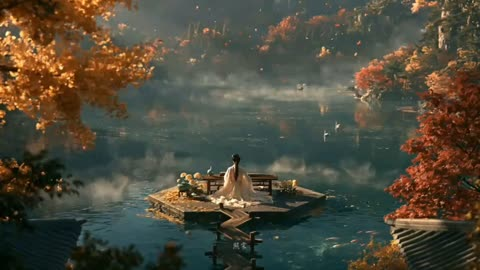</a>

按时间码逐镜写清构图与运动，每镜为固定画面并以硬切衔接，并在每镜重复同一角色描述以锁定身份。风格段给出雾气、斜射光与青蓝琥珀对置的色调，并用明确禁令压制塑料感与游戏感。

Seedance 2.5 · 文生视频 · 出处: [@sandmrk on X](https://x.com/sandmrk/status/2114898254651613511)

[`multi-shot`](tags.md#tag-multi-shot) [`oriental`](tags.md#tag-oriental) [`hanfu`](tags.md#tag-hanfu) [`misty-lake`](tags.md#tag-misty-lake) [`horse-riding`](tags.md#tag-horse-riding)

<details><summary><b>提示词</b></summary>

```text
东方国风半写实CG绘本质感；雾气弥漫与斜射天光；真实水面倒影、衣料垂坠、马匹毛发与奔跑动态质感；胶片级青蓝与琥珀对置色调；空灵、悠远、如梦；禁塑料感、禁游戏CG感
白衣女子（白衣汉服，长发松挽，宽大衣袂层层垂落）：全片主角，各镜沿用同一描述，不得变脸变装
蓝衣骑者（深蓝衣袍，身形挺拔）：仅结尾草原镜出现，骑白马
白马（通体雪白，鬃毛长而飘）：雾湖镜与草原镜共用同一匹
场景组：雾湖与秋林、月洞门庭院、莲塘、竹影小舟、青山花坡、纱帘竹丛、金色草原
全片一条旅程线：泛舟、立门、采莲、偃卧、奔跑、帘影、策马；镜与镜硬切，每镜是一幅独立的画
空间逻辑：人在景中始终保持小比例，山水是主角；唯一例外是竹影小舟与纱帘两镜的近景
斜射的晨昏天光穿过雾气，暗部被雾抬亮不死黑；青蓝的水与琥珀的陆对置
音频：国风器乐配乐流淌全片，水声、风声、马蹄声随镜而至；无对白、无旁白
情绪弧线：惊奇、静观、亲近、安眠、释放、含情、辽远、纵情告别

0–2.8秒大远景缓慢漂移
雾湖开场：镜面般的湖上雾气分层，两只小舟各载一个白衣人影远远漂着，左右金黄与深红的秋树垂入画面作框，倒影在水里微微晃；白衣女子骑白马自雾深处踏水而行，衣袂与马鬃拂过水面，马行水上不沉不溅，雾里另有白色鹿形身影若隐若现
开场确立：梦境逻辑、人物小比例、雾与倒影的质感基调

2.8–4.9秒全景固定
白墙月洞门：圆门正中立着白衣女子，成一幅剪影，门内是木格与远山，门侧一个小小的坐影作伴；一枝花树自左上斜入，人只有呼吸与衣袂的微动，影子落在墙面上
延续：构图对称、庭院静止、人物不走出圆门

4.9–8.2秒俯瞰全景缓慢跟移
莲塘自正上方俯瞰：翡翠色莲叶铺满水面，粉白莲花点缀其间；一条窄长木舟横穿画面，白衣女子立在船头，白衣拖尾铺在船板上，她俯身探向莲花，摘下一朵捧在手里，船尾有人摇橹，水面星光细碎闪烁
延续：俯瞰角度全程不变，船行方向不变，莲叶海不稀疏

8.2–11.1秒近景固定
竹影小舟内：木栏小舟里层层铺着白色毛皮与织物，白衣女子偃卧其中闭目小憩，一只手垂在舟边；前景竹叶虚化轻晃，斑驳光斑落在毛皮与衣料上，呼吸可见
延续：睡意与安宁，人物全程不起身、不睁眼

11.1–14秒远景航拍跟移
青山花坡：起伏的绿丘带着梯田般的坡纹，粉白花树疏疏点缀；白衣女子披深色披风在坡间奔跑，双袖张开，披风在身后猎猎，人自画面一侧横贯而过，始终只占一小点
延续：小比例尺度，奔跑不腾空不飞翔，花树不增不减

14–16.7秒近景固定
纱帘竹丛间：白衣女子半隐在白色纱帘之后，右侧竹叶探入画面；阳光透过竹叶把斑驳碎光落在她的侧脸与衣上，她含笑微侧首，发间光影缓缓浮动，帘子只轻轻飘
延续：斑驳光影是本镜主角，笑意含蓄不放大

16.7–18.3秒远景固定
金色草原小径：干草金黄，一条小径自画面中线向远方收去，两个小小人影沿径缓行；天空里群鸟横贯成河，偶有一两只大鸟自镜头前掠过，翅膀遮住一瞬画面
过渡：由静转动，辽远感拉满，为策马蓄势

18.3–22.8秒全景侧跟随后持续拉远
草原策马：蓝衣骑者伏身骑白马全速疾驰，四蹄腾空，侧面跟拍下枯金草浪向后倒退；约两秒后镜头开始耐心拉远，马与人一点点变小，草原与天空一点点变大，至地平线居中处只剩一个仍在移动的小点，画面就停在这里，不淡出
收束：全片唯一动力镜；速度先给足，拉远必须走完，结尾留白

严禁任何形式的对白与旁白；无文字、无水印、无现代元素；无人物放大占满画面（近景两镜除外）；无雾气消散、无倒影消失；无马匹沉水、游泳或马腿穿模；无策马降为慢跑或小跑；无拉远中途停住、无结尾提前淡出黑场；无俯瞰角度漂移、无莲叶变陆地；无纱帘变实墙、无竹影光斑频闪；无鸟群变黑点噪点；无草原变沙漠；无镜头内叠化；无身份漂移、无人物复制
```

</details>

<a id="seedance-haunted-castle-halloween-pumpkins"></a>
### 万圣节南瓜环绕的鬼屋城堡夜景

<a href="https://x.com/juliaevee/status/2113134380759523628"></a>

单一的推镜头朝向城堡，结尾加一个全景收尾，形成清晰的镜头走向。提示词明确写出灯光、雾气和场景细节，并加上无人物、场景一致的约束，使整段30秒画面保持稳定。

Seedance 2.5 · 文生视频 · 出处: [@juliaevee on X](https://x.com/juliaevee/status/2113134380759523628)

[`halloween`](tags.md#tag-halloween) [`haunted-castle`](tags.md#tag-haunted-castle) [`pumpkins`](tags.md#tag-pumpkins) [`night-scene`](tags.md#tag-night-scene)

<details><summary><b>提示词</b></summary>

```text
Create a 30-second ultra-realistic cinematic Halloween video of a majestic haunted castle glowing with warm orange lights, surrounded by jack-o’-lanterns, twisted trees, blue fog, and wet reflective cobblestones. The camera slowly moves toward the castle as autumn leaves drift, candles flicker, and bats fly across the moonlit sky. Elegant glowing text appears: “Happy Halloween.” End with a dramatic wide shot of the illuminated castle. Photorealistic details, smooth camera movement, volumetric fog, spooky magical atmosphere, 4K, no people, no distortion, consistent scenery, vertical 9:16, exactly 30 seconds.
```

</details>

<a id="seedance-istanbul-fpv-sunrise-travel-film"></a>
### 伊斯坦布尔清真寺穹顶升起于晨雾之上

<a href="https://x.com/Naiknelofar788/status/2106439652278411435">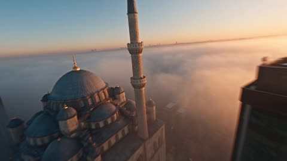</a>

提示词按时间段拆分为多个镜头，每段只指定一种运镜和一种转场（如 FPV 俯冲、延时摄影或匹配剪辑），让模型按顺序执行分镜，而不只是营造氛围。开场的日出薄雾和伊斯坦布尔上空的俯冲等明确描述为首段提供了视觉锚点。

Seedance 2.5 · 文生视频 · 出处: [@Naiknelofar788 on X](https://x.com/Naiknelofar788/status/2106439652278411435)

[`fpv-drone`](tags.md#tag-fpv-drone) [`istanbul`](tags.md#tag-istanbul) [`travel`](tags.md#tag-travel) [`timed-shots`](tags.md#tag-timed-shots)

<details><summary><b>提示词</b></summary>

```text
Create a 30-second ultra-realistic cinematic FPV travel film showcasing the futuristic energy, natural beauty, and cultural character of TURKEY. Blend cyberpunk technology with Istanbul’s historic architecture, vibrant streets, Mediterranean and Aegean coastlines, and spectacular night imagery. Use extreme-speed FPV drone movement, hyperlapse, seamless spatial transitions, and dense but controlled flash-cut editing. 8K cinematic realism, photorealistic environments, realistic crowds and vehicles, dramatic lighting, smooth motion blur only during rapid transitions, premium commercial cinematography. No text, logos, subtitles, or watermarks.

[0–6s] — CITY FROM THE SKY
Begin above Istanbul at sunrise, surrounded by mist and clouds. An FPV drone dives rapidly between modern skyscrapers before sweeping toward the Bosphorus. The scene transitions from warm daylight into blue-hour neon as the city below comes alive. Cars create flowing light trails while the camera races through vibrant streets, revealing Istanbul’s futuristic energy beside historic architecture.

[6–12s] — TECHNOLOGY & HISTORY
Use rapid cinematic match cuts: a modern tram glides through the city, instantly transitioning into a close-up of a traditional Turkish coffee being prepared; a speeding ferry cuts across the Bosphorus, followed by a dramatic aerial reveal of the Hagia Sophia and Blue Mosque. Turkish street life, glowing shopfronts, crowded avenues, and modern architecture flash together in rhythmic visual transitions.

[12–18s] — SPATIAL FOLD TO THE COAST
A moving object passes directly across the lens and becomes a seamless transition into the Turkish coastline. The camera bursts over crystal-clear turquoise water near Antalya and races along dramatic Mediterranean cliffs. Speedboats cut through the sea, white spray exploding behind them. Transition toward Cappadocia as hot-air balloons suddenly fill the sky above the surreal rock formations.

[18–24s] — TURKEY IN MOTION
The camera dives between Cappadocia’s towering rock formations and rapidly transitions to a bustling Istanbul street at golden hour. Match-cut between a Turkish flag waving in the wind, a crowded bazaar, traditional architecture, modern city traffic, and people enjoying the coastline. Use fast but visually coherent transitions that emphasize Turkey’s contrast between ancient heritage and modern life.

[24–30s] — THE GRAND FINALE
Night falls instantly. The camera rises above Istanbul and reveals the Bosphorus illuminated by thousands of city lights. A massive coordinated drone light show forms elegant abstract shapes above the skyline while boats move across the glowing water below. The camera pulls rapidly backward and upward into an enormous aerial panorama, revealing Istanbul stretching across both sides of the Bosphorus.

End with a powerful wide cinematic shot of the illuminated city, water, bridges, historic landmarks, and night sky.

STYLE: ultra-realistic 8K cinematic travel film,
```

</details>

<a id="seedance-japanese-lab-infected-silence"></a>
### 实验室老师让学生安静，感染者逼近

<a href="https://x.com/ElsaSofia__AI/status/2100903709492613245"></a>

提示词按时间顺序写成一连串动作节点，每个节点都有具体的声音或画面线索，例如柜子里的刮擦声和掉落的烧杯，让模型有明确的节奏可依。只保留环境声的音频要求，以及明确列出的排除项，使画面保持真实，没有配乐。

Seedance 2.5 · 文生视频 · 出处: [@ElsaSofia__AI on X](https://x.com/ElsaSofia__AI/status/2100903709492613245) · 发现于 [LearnPrompt/awesome-seedance](https://github.com/LearnPrompt/awesome-seedance)

[`horror`](tags.md#tag-horror) [`japanese-school`](tags.md#tag-japanese-school) [`sound-cues`](tags.md#tag-sound-cues) [`camera-push`](tags.md#tag-camera-push) [`photorealistic`](tags.md#tag-photorealistic)

<details><summary><b>提示词</b></summary>

```text
Create a short, ultra-realistic cinematic horror-action sequence set inside a quiet Japanese high-school science laboratory during an afternoon class. A female science teacher is demonstrating an experiment when the lights suddenly flicker and every digital display in the room turns off at the same time. A strange scratching sound comes from inside a locked storage cabinet.

The teacher cautiously approaches the cabinet, but before she can open it, the glass windows violently shake. One student notices dark handprints appearing on the outside of the glass even though there is nobody there. The classroom door suddenly slams shut and locks itself.

The teacher tells everyone to stay calm and uses a metal laboratory stand to force the door open. Just as the students begin escaping into the hallway, one of the emergency lights reveals several infected figures standing motionless at the far end of the corridor.

The students rush back into the laboratory and quickly push tables against the entrance. The teacher discovers that the infected are reacting to sound, so everyone becomes completely silent. A student accidentally drops a glass beaker.

The sound echoes through the hallway.

All the infected figures slowly turn toward the laboratory.

The teacher raises one finger, silently telling everyone not to move. The camera slowly pushes toward the barricaded door as dozens of footsteps begin approaching from outside. The screen cuts to black just before the door starts shaking violently.

Photorealistic live-action horror, authentic Japanese high-school science laboratory, realistic teenage students and teacher, natural handheld cinematography, subtle practical effects, believable physical movement, atmospheric fluorescent lighting, realistic shadows, tense pacing, authentic facial reactions, cinematic depth of field, muted horror color grading, diegetic environmental sound only. No music, narration, excessive gore, graphic injuries, animation, anime, cartoon style, artificial CGI appearance, distorted anatomy, subtitles, text, logos, or watermark.
```

</details>

<a id="seedance-korean-cafeteria-tray-walk"></a>
### 学生端着午餐托盘穿过热闹的韩国食堂

<a href="https://x.com/Zoyavelle/status/2100810895052165195">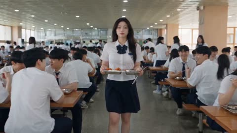</a>

提示词按顺序写成多镜头分镜，并固定了人物服装描述和明确的切镜指令，让主角在各镜头中保持一致。镜头焦段、柔和虚化和轻微手持晃动等摄影语言，引导画面接近韩剧的质感。

Seedance 2.5 · 文生视频 · 出处: [@Zoyavelle on X](https://x.com/Zoyavelle/status/2100810895052165195) · 发现于 [LearnPrompt/awesome-seedance](https://github.com/LearnPrompt/awesome-seedance)

[`korean-drama`](tags.md#tag-korean-drama) [`school-cafeteria`](tags.md#tag-school-cafeteria) [`multi-shot`](tags.md#tag-multi-shot) [`photorealistic`](tags.md#tag-photorealistic)

<details><summary><b>提示词</b></summary>

```text
Create a cinematic, photorealistic Korean high-school cafeteria scene during lunchtime. A beautiful young Korean female student, around 18–20 years old, with long straight black hair, fair natural skin, delicate facial features, and a calm expressive face, walks through a large busy school cafeteria carrying a stainless-steel lunch tray.

She wears a neat white short-sleeve school uniform shirt with a dark navy ribbon bow/tie, a navy pleated skirt, and a small school name tag. The cafeteria is filled with many Korean high-school students wearing matching white uniforms, sitting at long wooden tables and eating lunch.

Opening shot: wide cinematic shot following the girl as she walks between crowded cafeteria tables carrying her tray. Bright fluorescent ceiling lights, large windows, realistic school cafeteria architecture, natural background activity, shallow depth of field.

Cut to a medium close-up of the girl walking toward the camera, looking slightly surprised and opening her mouth as if speaking. Her black hair moves naturally while walking.

Cut to a detailed close-up of the stainless-steel cafeteria tray being carried, containing Korean-style school lunch: white rice, fried chicken pieces, sausages, vegetables, side dishes, and red sauce. Another hand holding a spoon appears in the foreground.

Top-down shot of the complete lunch tray placed on the table, showing separate metal compartments filled with rice, fried food, vegetables, and red soup/sauce.

Show the busy cafeteria reaction: several male students suddenly look toward the girl with surprised and curious expressions while eating. Capture natural facial expressions and realistic reactions.

A dramatic close-up of the girl looking directly toward the camera with a confident, slightly serious expression. Her long black hair frames her face, with realistic skin texture, detailed eyes, subtle makeup, and cinematic soft lighting. Background students and cafeteria lights are heavily blurred with natural bokeh.

Show the girl approaching a seated male student and placing/serving the lunch tray near him. The students react naturally, looking surprised and confused. Finish with a wide rear shot of the girl walking away through the crowded cafeteria while carrying the tray, with rows of students visible on both sides.

Visual style: ultra-realistic Korean school drama / K-drama cinematography, photorealistic human faces, realistic skin texture, natural body proportions, authentic Korean school cafeteria, cinematic composition, soft depth of field, realistic fluorescent lighting, subtle handheld camera movement, smooth cinematic transitions, detailed food textures, natural facial expressions, realistic motion, 4K, high detail, professional cinema camera, 35mm and 85mm lens look, natural color grading, atmospheric background blur.

No text, no subtitles, no watermark, no logos, no distorted faces, no extra fingers, no unnatural body proportions, no cartoon or anime appearance.
```

</details>

<a id="seedance-korean-coastal-coffee-lifestyle-film"></a>
### 滨海城市里韩国女孩的咖啡日常

<a href="https://x.com/aiwithaayat/status/2110600258871013510"></a>

提示词按顺序列出镜头，从咖啡柜台到街头、海边栏杆再到黄金时刻的山坡，让25秒时长里有一条连贯的故事线。结尾集中写明镜头、颗粒、色调和情绪，使各个镜头保持统一的画面风格。

Seedance 2.5 · 文生视频 · 出处: [@aiwithaayat on X](https://x.com/aiwithaayat/status/2110600258871013510) · 发现于 [LearnPrompt/awesome-seedance](https://github.com/LearnPrompt/awesome-seedance)

[`lifestyle`](tags.md#tag-lifestyle) [`cinematic`](tags.md#tag-cinematic) [`multi-shot`](tags.md#tag-multi-shot) [`coastal`](tags.md#tag-coastal) [`golden-hour`](tags.md#tag-golden-hour)

<details><summary><b>提示词</b></summary>

```text
Created a 25 second video, beautiful Korean girls, cinematic lifestyle film set in a beautiful coastal city, capturing the peaceful and aesthetic moments of everyday life. Begin with a warm, cozy coffee shop scene featuring a barista serving a takeaway coffee on a wooden counter, followed by a cinematic reflection of a young Korean woman standing near a large glass window with soft city lights reflecting across the glass. Show close-up shots of her walking along a busy urban street, focusing on her sneakers stepping across the pavement, then transition to a wide low-angle shot of her standing in front of a striking modern architectural building, wearing a stylish beige trench coat, carrying a black shoulder bag, and looking peacefully toward the sky. Capture intimate side-profile shots of her holding a coffee cup beside a window, with natural sunlight illuminating her face and soft shadows creating a moody atmosphere. Transition smoothly to a beautiful seaside promenade where she stands beside a metal railing, holding her coffee and gazing at the sparkling blue ocean as a large cruise ship moves slowly in the background. Continue with breathtaking golden-hour shots of a beautiful Korean girl sitting on a lush green grassy hill overlooking the ocean, her long dark brown hair moving gently in the sea breeze, wearing a relaxed beige outfit and holding a takeaway coffee cup. Capture natural facial expressions, subtle movements, candid moments, and elegant close-ups of her face as she turns toward the camera. End with an expansive cinematic wide shot of the green coastal landscape, calm blue water, distant islands, and a cruise ship sailing peacefully along the horizon, with the girl appearing small against the beautiful scenery. Use photorealistic visuals, cinematic composition, smooth camera movements, shallow depth of field, natural skin texture, soft film grain, realistic lighting, warm golden-hour tones, muted earthy colors, subtle lens flares, and premium Korean fashion editorial aesthetics. The overall mood should feel peaceful, dreamy, elegant, emotional, and authentic, like a high-end Korean lifestyle film shot on a professional cinema camera, with seamless transitions, realistic motion, beautiful environmental details, and no artificial-looking faces or exaggerated movements.
```

</details>

<a id="seedance-last-call-mountain-road-rain-thriller"></a>
### 雨夜山路惊悚片：一通警告电话

<a href="https://x.com/RuzainaMeer/status/2097193955230405007"></a>

先用固定的角色与场景段落加否定式风格清单，锁定同一个女人和同一辆车。再按 0 到 30 秒逐段写镜头、屏幕文字和台词，最后用一行音频说明雨声、雨刷和撞击后的寂静。

Seedance 2.5 · 文生视频 · 出处: [@RuzainaMeer on X](https://x.com/RuzainaMeer/status/2097193955230405007) · 发现于 [LearnPrompt/awesome-seedance](https://github.com/LearnPrompt/awesome-seedance)

[`thriller`](tags.md#tag-thriller) [`cinematic`](tags.md#tag-cinematic) [`rain`](tags.md#tag-rain) [`night-driving`](tags.md#tag-night-driving) [`timed-shots`](tags.md#tag-timed-shots)

<details><summary><b>提示词</b></summary>

```text
Create a 30-second ultra-photorealistic Hollywood-level cinematic thriller scene titled “THE LAST CALL.” The entire sequence must feel like a scene from a high-budget live-action feature film, with realistic human acting, natural facial expressions, physically accurate movement, realistic rain, practical lighting, believable vehicle physics, detailed environments, cinematic depth of field, subtle film grain, natural skin texture, realistic reflections, and professional Hollywood cinematography. No anime, no CGI-looking visuals, no fantasy aesthetic, no cyberpunk, no neon lighting, no exaggerated visual effects.
MAIN CHARACTER: A realistic young woman in her late 20s, natural appearance, expressive eyes, shoulder-length dark hair slightly damp from the humid weather, wearing a simple dark jacket. Maintain the exact same woman, face, hairstyle, clothing, car, weather and environment consistently throughout the entire sequence.

SETTING: A remote mountain road at night during heavy but realistic rainfall. Dark forested mountains surround the narrow winding road. Wet asphalt reflects only natural headlights and road markings. The atmosphere is tense, isolated and believable.

0–5 SECONDS

Interior of a moving car at night. Medium shot from the passenger side showing the woman driving alone. Rain continuously hits the windshield and realistic windshield wipers move back and forth. Dashboard illumination softly lights her face. She looks tired and emotionally distant while concentrating on the road. Camera slowly pushes toward her face. Natural breathing, subtle blinking and realistic micro-expressions.

5–10 SECONDS

Her smartphone suddenly begins ringing in the center console. Cut to an extremely realistic close-up of the phone screen.

Caller ID: “MOM”

The woman freezes.

Her eyes widen slightly. Her hands tighten around the steering wheel. She looks at the phone in disbelief. She hesitates for a moment, then reaches down and answers the call.

10–17 SECONDS

Extreme close-up of her face as she listens.

A faint, emotional female voice comes through the phone:

“Don't take the next turn.”

The woman's expression changes from confusion to fear.

The call suddenly disconnects.

She looks at the phone.

The screen reads: CALL ENDED

Outside the windshield, a sharp mountain turn approaches through the heavy rain.

17–23 SECONDS

She immediately slows the car.

Camera moves to a forward-facing perspective through the windshield. The road curves sharply ahead.

Suddenly, distant headlights appear through the rain around the corner.

The woman looks toward them.

A large truck suddenly loses control and crashes through the roadside barrier at the exact location where her car would have been if she had continued driving.

The crash must look physically realistic and grounded, with believable vehicle momentum, rain, debris and impact. No exaggerated explosions.

23–27 SECONDS

Silence after the crash.

The woman sits completely still, breathing heavily, visibly shaken.

She slowly looks down at her phone.

The phone screen now shows:

NO SIM — NO SIGNAL

She looks confused and terrified.

27–30 SECONDS

Extreme close-up of her eyes filling with tears.

She looks toward the empty passenger seat.

A subtle emotional pause.

In a trembling whisper, she says:

“Mom?”

Cut instantly to black.

FINAL AUDIO: Heavy rain, windshield wipers, realistic car interior ambience, distant thunder, phone ringing, muffled female voice, sudden silence after the crash, then only the woman's breathing.
```

</details>

<a id="seedance-lighthouse-keeper-sea-orbs"></a>
### 灯塔守望者提灯立于发光海岸

<a href="https://x.com/SyntheSarah/status/2097182529564365135">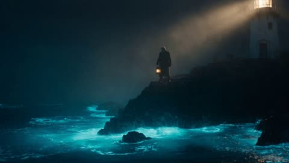</a>

提示词先给出广角建立镜头，再要求缓慢推近到人物面部，镜头路线清晰。光线与调色写成具体条件（体积月光、青橙调色、浅景深），让模型有明确目标，而不是泛泛的氛围。

Seedance 2.5 · 文生视频 · 出处: [@SyntheSarah on X](https://x.com/SyntheSarah/status/2097182529564365135) · 发现于 [LearnPrompt/awesome-seedance](https://github.com/LearnPrompt/awesome-seedance)

[`lighthouse`](tags.md#tag-lighthouse) [`bioluminescence`](tags.md#tag-bioluminescence) [`fog`](tags.md#tag-fog) [`camera-push-in`](tags.md#tag-camera-push-in)

<details><summary><b>提示词</b></summary>

```text
A weathered old lighthouse keeper stands on a foggy cliff at night,
wearing a thick wool coat, holding an old brass lantern. Below him,
the ocean waves glow with soft bioluminescent blue light with each
crash against the rocks. As he raises the lantern, dozens of floating
glowing orbs (like fireflies) rise up from the water and drift past
him into the misty air, swirling gently around his figure. Volumetric
moonlight beams cut through the fog. Camera starts wide on the cliff,
then does a slow cinematic push-in toward the keeper's face as the
orbs surround him, ending on a close-up with orbs reflecting in his
eyes. Teal and warm-amber color grade, hyper-realistic textures,
shallow depth of field, film grain, atmospheric fog, 15 seconds,
smooth continuous camera motion, no cuts.
```

</details>

**1** · [2](video-cinematic-2.md)
