# 广告与产品

[返回目录](../../README_zh.md) · 全部 136 条 · [1](video-commercial.md) · **2**

<a id="seedance-automated-fries-factory-potato-conveyor"></a>
### 工人将土豆倾倒到工厂传送带上

<a href="https://x.com/aiwithaly/status/2091031033986634183">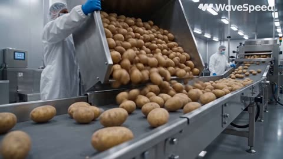</a>

提示词按从进料到装箱的工序顺序逐段描述，让画面沿着生产流程展开。明确列出传送带电机、油炸气泡等声音细节，并用反向约束排除变形、漂浮物和水印，让工厂画面真实干净。

Seedance 2.5 · 文生视频 · 出处: [@aiwithaly on X](https://x.com/aiwithaly/status/2091031033986634183)

[`food-factory`](tags.md#tag-food-factory) [`industrial`](tags.md#tag-industrial) [`documentary`](tags.md#tag-documentary) [`conveyor`](tags.md#tag-conveyor)

<details><summary><b>提示词</b></summary>

```text
A modern automated French fries factory processes fresh potatoes from start to finish. Potatoes arrive on stainless-steel conveyors, pass through industrial washing and peeling machines, then enter precision cutting equipment that produces evenly sized fries. The fresh-cut fries move through blanching, hot-oil frying, draining, and cooling systems before reaching automated weighing and packaging machines. Portions are measured, sealed into food-grade bags, checked by quality-control scanners, and transferred into cartons by robotic arms. Ultra-photorealistic industrial food production documentary, realistic potato and fry physics, physically accurate machinery, continuous conveyor movement, authentic water flow, realistic frying bubbles, natural steam, accurate robotic movements, hygienic factory environment, bright industrial LED lighting, realistic stainless-steel reflections, trained workers wearing proper protective equipment, smooth documentary cinematography, authentic factory sounds including conveyor motors, flowing water, cutting machines, fryer bubbling, cooling fans, and packaging mechanisms, no narration, no music, seamless visual continuity, no CGI appearance, no floating objects, no distorted food, no machine clipping, no excessive steam, no flickering lights, no text overlays, logos, or watermarks.
```

</details>

<a id="seedance-bare-faced-makeover-swipe"></a>
### 素颜女子挥手变身华丽妆容

<a href="https://x.com/MissDelulu9/status/2108101531426083045">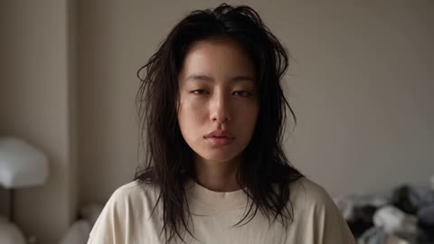</a>

用逐秒的时间轴规定镜头，硬切、白闪和快速推拉连接各段节奏。手掌划过镜头作为遮挡切点，让变身看起来像一个连续动作，而不是形变过渡。

Seedance 2.5 · 文生视频 · 出处: [@MissDelulu9 on X](https://x.com/MissDelulu9/status/2108101531426083045) · 发现于 [LearnPrompt/awesome-seedance](https://github.com/LearnPrompt/awesome-seedance)

[`makeup`](tags.md#tag-makeup) [`transformation`](tags.md#tag-transformation) [`beauty`](tags.md#tag-beauty) [`hard-cut`](tags.md#tag-hard-cut)

<details><summary><b>提示词</b></summary>

```text
Creare 10-second ultra-realistic Douyin-style makeup transformation of the same attractive young adult woman, cinematic 16:9, luxury beauty-commercial aesthetic.

0–2.5s: Bare face, messy hair, oversized T-shirt, sleepy expression in a casual room. Slow push-in. She suddenly becomes confident and makes a FAST sideways palm swipe across the lens. Camera whip-pans with her hand; palm covers frame.

2.5s: HARD CUT + WHITE FLASH + WHOOSH + SHAKE. Instant hidden transformation, no morphing. SNAP ZOOM OUT → IN.

2.5–4s: Black studio. Full glamorous Douyin makeup, styled voluminous hair, elegant fashion outfit. Strong wind blows her hair. Fast head turn + intense eye contact.

4–10s: Rapid editorial sequence: FLASH → HARD CUT → NEW POSE → CAMERA MOVE. Hair sweep, 3/4 turn, hand near jaw, low-angle pose, final hero shot. Multiple flashes and snap zooms, ending with a huge white photography flash + brief freeze.
```

</details>

<a id="seedance-bleu-de-chanel-perfume-review"></a>
### 女子在客厅展示 Bleu de Chanel 香水

<a href="https://x.com/CaliraVal/status/2097904148360630318">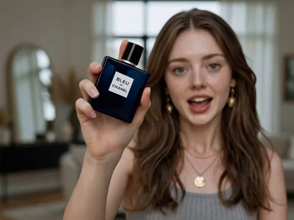</a>

提示词把画面拆成有先后顺序的动作段落（展示瓶身、喷洒手腕和颈部、闻香、开口说话），并逐字给出完整台词，口型同步因此有固定依据。明确产品名称并反复强调瓶身需保持一致，锁定品牌外观；镜头、光线和写实质感的描述则塑造高级感。

Seedance 2.5 · 文生视频 · 出处: [@CaliraVal on X](https://x.com/CaliraVal/status/2097904148360630318)

[`fragrance`](tags.md#tag-fragrance) [`product-review`](tags.md#tag-product-review) [`lip-sync`](tags.md#tag-lip-sync) [`influencer`](tags.md#tag-influencer)

<details><summary><b>提示词</b></summary>

```text
Create a realistic luxury perfume review video featuring a stylish young woman in an elegant modern setting.

She holds the Bleu de Chanel perfume bottle toward the camera, showing the bottle clearly. She then sprays a small amount on her wrist and neck, gently smells the fragrance, smiles naturally, and gives a genuine personal reaction.

She looks directly into the camera and speaks naturally in a warm, confident female English voice with perfect lip-sync:

“I’ve been trying Bleu de Chanel, and honestly, I really love it. It smells fresh, clean, sophisticated, and very elegant. It’s perfect for everyday wear, but it also feels special enough for an evening out. Definitely a fragrance I’d recommend.”

Use natural facial expressions, realistic hand gestures, accurate lip movement, and authentic influencer-style delivery. Keep her voice clear, smooth, friendly, and conversational—not robotic or overly commercial.

Use soft flattering lighting, realistic skin texture, shallow depth of field, cinematic camera movement, natural perfume spray mist, realistic reflections, and a premium lifestyle background. Keep the perfume bottle consistent and recognizable throughout.

Photorealistic, luxury fragrance commercial, authentic product review, realistic physics, smooth motion, 4K, vertical . No distorted hands, no warped bottle, no changing face, no flickering, no incorrect text.
```

</details>

<a id="seedance-blonde-model-pink-ball-gown-palace"></a>
### 金发模特身着粉色礼服在水晶吊灯下

<a href="https://x.com/Zoyavelle/status/2108783755460853994">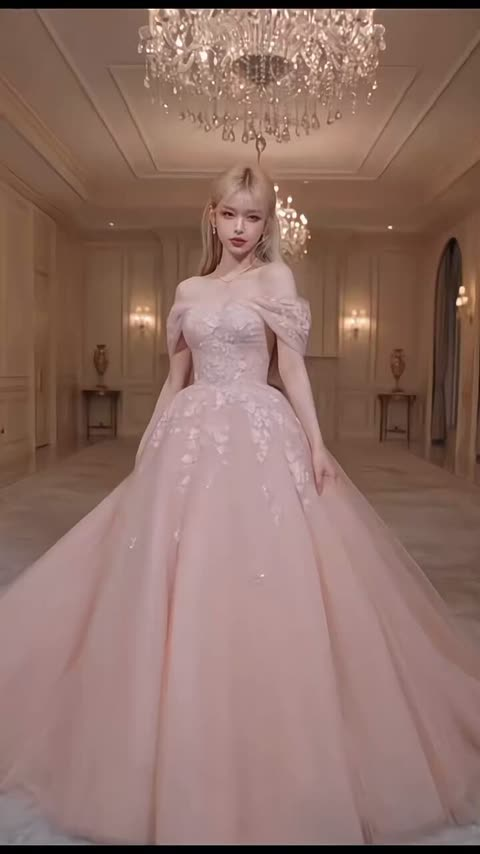</a>

提示词按顺序写明每件礼服的颜色，并固定宫殿场景与水晶吊灯照明，使每次切换都有稳定的画面落点。描述裙摆被手提起并转动，同时要求面料自然流动，使动作更真实。

Seedance 2.5 · 文生视频 · 出处: [@Zoyavelle on X](https://x.com/Zoyavelle/status/2108783755460853994) · 发现于 [LearnPrompt/awesome-seedance](https://github.com/LearnPrompt/awesome-seedance)

[`fashion`](tags.md#tag-fashion) [`ball-gown`](tags.md#tag-ball-gown) [`palace`](tags.md#tag-palace) [`runway`](tags.md#tag-runway)

<details><summary><b>提示词</b></summary>

```text
A stunning blonde fashion model gracefully walks and poses in a luxurious palace ballroom, wearing an enormous elegant princess ball gown. She gently holds both sides of her voluminous skirt and slowly turns, allowing the delicate embroidered fabric to flow naturally. The camera smoothly moves forward and captures her full body and the intricate details of the dress. Transition seamlessly between different luxurious gowns in pastel pink, icy blue, lavender, champagne gold, and black, with each dress appearing in a grand palace interior with elegant chandeliers and cinematic lighting. Realistic walking motion, natural fabric movement, graceful posing, smooth cinematic transitions, high-end couture fashion runway aesthetic, photorealistic details, stable camera, vertical 9:16 video.
```

</details>

<a id="seedance-blue-perfume-golden-beach-commercial"></a>
### 金色日落海滩上挂水珠的深蓝香水瓶

<a href="https://x.com/laviniavelle/status/2100071299968032968">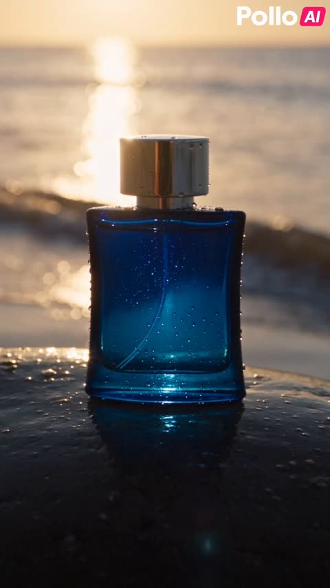</a>

提示词按顺序描述逆光产品微距镜头，再通过交叉溶解切到人物喷香的画面，靠明确的镜头顺序和镜头光晕描述控制节奏。写明写实 8K 和浅景深，使两段镜头保持一致的奢华质感。

Seedance 2.5 · 文生视频 · 出处: [@laviniavelle on X](https://x.com/laviniavelle/status/2100071299968032968) · 发现于 [LearnPrompt/awesome-seedance](https://github.com/LearnPrompt/awesome-seedance)

[`perfume`](tags.md#tag-perfume) [`luxury`](tags.md#tag-luxury) [`golden-hour`](tags.md#tag-golden-hour) [`beach-commercial`](tags.md#tag-beach-commercial)

<details><summary><b>提示词</b></summary>

```text
A cinematic photorealistic commercial shot on a golden hour beach A deep sea blue glass perfume bottle covered in micro water droplets rests on a wet rock, backlit by the setting sun glittering over gentle ocean waves Soft lens flare and warm golden reflections glimmer across the water The scene seamlessly cross dissolves to a stunning woman wearing a flowing white deep V dress standing on the sandy shore She sprays the fragrance onto her neck with her eyes closed in bliss surrounded by a fine mist catching the golden sunlight then looks directly into the camera with a gentle confident smile holding the bottle Photorealistic 8K resolution, dynamic lighting, high end luxury aesthetic shallow depth of field.
```

</details>

<a id="seedance-china-train-travel-multishot"></a>
### 旅行者在高铁车窗前望向窗外风景

<a href="https://x.com/Diplomeme/status/2099726668164444397">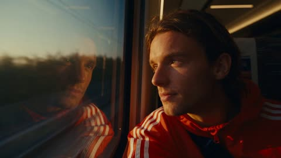</a>

提示词按时间段列出每个镜头的焦段、运镜和光源，并在开头锁定人物外观，保证多镜头之间的一致性。明确描述环境声音和自然光源，让画面更接近实拍而非生成效果。

Seedance 2.5 · 文生视频 · 出处: [@Diplomeme on X](https://x.com/Diplomeme/status/2099726668164444397) · 发现于 [LearnPrompt/awesome-seedance](https://github.com/LearnPrompt/awesome-seedance)

[`travel`](tags.md#tag-travel) [`multishot`](tags.md#tag-multishot) [`fashion`](tags.md#tag-fashion) [`music-video`](tags.md#tag-music-video) [`china`](tags.md#tag-china)

<details><summary><b>提示词</b></summary>

```text
30 seconds | 16:9 | premium travel music video / fashion travel film | 2024–2026 commercial grade | MULTISHOT

CORE CONCEPT
A young traveler experiences China through an energetic but natural sequence of movement, culture, fashion, food, architecture and landscapes. The film feels like a premium Chinese tourism campaign combined with an elite fashion travel film. The traveler is always physically present in the environment. Every location feels photographed rather than generated. Music drives the edit, but the footage retains the imperfections and spontaneity of real travel photography.

CHARACTER
ONE TRAVELER — young adult international traveler wearing a contemporary Adidas travel outfit: premium red Adidas jacket, neutral trousers, sneakers, compact crossbody bag. Natural hair, realistic skin texture, minimal accessories. Same face, clothing, hairstyle, proportions and accessories throughout the entire film. Do not invent additional Adidas branding.

SETTING
Modern and historic China: high-speed railway, Shanghai streets, traditional water-town lanes, Chengdu food streets, ancient architecture, dramatic mountain valleys, elevated viewpoints and vibrant nighttime streets. Real pedestrians, vendors, commuters, vehicles and local activity. Locations feel naturally connected through the journey.

STORY — MUSIC-DRIVEN MULTISHOT VISUALS

00:00–02.5 — CLOSE-UP HOOK
85mm close-up of the traveler beside a high-speed train window. Warm sunlight catches the face while reflections of the moving Chinese landscape slide across the glass. Traveler looks outside, then turns toward camera as the first beat begins.

02.5–05 — MOVEMENT
24mm wide shot from the platform as the traveler walks alongside the departing high-speed train. Wind moves the red jacket naturally. The train accelerates through frame. Cut precisely with the music.

05–07.5 — CITY ARRIVAL
35mm handheld follow shot as the traveler exits a busy station into a dense Chinese city street. Real pedestrians cross naturally. Electric scooters, taxis and buses move through the background. Camera operator follows slightly behind rather than perfectly framing the subject.

07.5–10 — STREET LIFE
50mm observational shot. Traveler moves through a crowded neighborhood while a food vendor prepares steaming street food nearby. Traveler briefly stops, watches the preparation and smiles naturally. Steam passes across the foreground.

10–12.5 — CULTURAL TRANSITION
24mm shot following the traveler through a traditional Chinese water-town street. Stone paths, wooden buildings, bridges and hanging signs surround them. People move naturally through the scene. Traveler crosses a small bridge as sunlight breaks through the buildings.

12.5–15 — FOOD / HUMAN MOMENT
50mm close-up. A local vendor hands the traveler a freshly prepared dish. Traveler takes a bite and reacts naturally. Shallow depth of field, warm skin tones, authentic background activity and subtle handheld movement.

15–17.5 — MOUNTAIN REVEAL
24mm deep-focus landscape. Traveler walks up a long stone staircase through dense greenery. Camera follows from behind. As the traveler reaches the top, a vast mountain valley emerges through cool atmospheric mist.

17.5–20 — FASHION MOMENT
50mm side-tracking shot in golden sunlight. Traveler walks along the mountain viewpoint. Red Adidas jacket contrasts strongly against deep green vegetation. Golden rim light catches the hair and shoulders. Natural wind moves fabric.

20–22.5 — LANDSCAPE / SCALE
24mm wide. Traveler becomes small against enormous mountains disappearing into mist. Clouds move slowly through the valley. No artificial drone aesthetic; perspective feels like a real elevated camera position.

22.5–25 — NIGHT TRANSITION
50mm handheld street shot at blue hour. Traveler enters a lively nighttime food district. Warm lanterns, cool ambient light, scooters and pedestrians create layered depth. The music increases in intensity.

25–27.5 — CITY ENERGY
35mm tracking shot as traveler walks beside a modern riverside district. Reflections ripple across the water. Modern towers illuminate behind them while boats move naturally through the frame.

27.5–30 — FINAL REVEAL
24mm wide composition from behind the traveler. They stop briefly at the riverside and look across the illuminated skyline. Camera slowly moves backward rather than flying upward. Traveler then continues walking as the music reaches its final beat.

CAMERA
35mm and 50mm for portraits and human moments, 24mm for landscapes, architecture and stairs, occasional 85mm compression on faces. Shallow DOF on close-ups, deep focus on mountain wides. Handheld and physically motivated tracking movement. Natural camera micro-movement, imperfect framing, subtle autofocus adjustment, realistic exposure adaptation and occasional foreground obstruction. No impossible camera movement, no floating drone aesthetic.

VISUAL / COLOR SETTING
Premium travel music video / fashion travel film, 2024–2026 commercial grade. Look: photoreal cinema, slight filmic grain, mild halation on highlights, teal-cyan skies, punchy crimson reds, deep forest greens, warm skin, crushed-but-not-crushed blacks.

COLOR GRADE
Cinematic teal-and-warm, greens slightly cyan, red Adidas pops hard against foliage, golden rim on faces in sun, cool mist in mountain valleys. Maintain realistic skin tones and natural environmental color. No excessive saturation or artificial HDR.

MOTION
180-degree cinematic shutter, natural motion blur on hair and fabric, 24fps. No soap-opera 60fps look. Movement should retain the subtle imperfections of real location photography.

LIGHTING
Natural daylight, soft overcast city light, warm direct sunlight, golden-hour rim light, cool mountain mist, practical lanterns and nighttime city illumination. Lighting must originate naturally from the environment.

AUDIO
Premium contemporary travel soundtrack with subtle modern Chinese-inspired textures. Music drives the transitions and rhythm. Keep authentic location sound underneath: train ambience, station announcements, footsteps, scooters, traffic, vendors, cooking sounds, crowd chatter, wind, birds, distant city noise and riverside ambience. Environmental sound should occasionally become prominent during intimate moments.

REALISM
No CGI look, no plastic skin, no beauty-filter smoothing, no extra fingers, no warped architecture, no artificial crowd synchronization, no impossible reflections, no floating objects, no exaggerated depth of field. Realistic skin pores, hair strands, fabric texture, water reflections, atmospheric perspective and human movement.

BRAND CONTROL
The only Adidas branding visible is the existing Adidas trefoil already present on the traveler’s garments. Do not invent additional logos, advertisements, storefront branding or branded products. Do not add watermarks or random UI.

EDITING
Music-synchronized commercial editing without excessive effects. Cuts are motivated by movement, reflections, steam, architectural shapes, walking direction and changes in light. Use clean match cuts and occasional speed changes only when physically believable. Avoid generic AI transitions, artificial zooms, excessive whip transitions and over-edited montage pacing.

CONTINUITY
The traveler remains identical throughout all shots. Preserve face, hairstyle, red Adidas jacket, trousers, sneakers, bag and accessories. Maintain realistic weather and lighting progression from daylight → golden hour → blue hour → night. Each location should feel like part of one continuous journey through China.

FINAL QUALITY TARGET
The final film should look like genuine footage captured by an elite travel filmmaker for a major Chinese tourism/fashion campaign—not a collection of AI-generated beauty shots. The realism comes first; the commercial polish comes from cinematography, color, music, editing and art direction.
```

</details>

<a id="seedance-chinese-spicy-sour-fish-cooking"></a>
### 厨师在木板上切整条鱼

<a href="https://x.com/Naiknelofar788/status/2105297994736394705">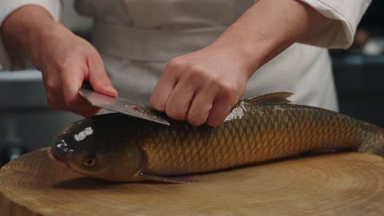</a>

按 0 到 4 秒、4 到 8 秒等时间段写成逐镜头脚本，每段都写清具体动作、声音和食材，模型能逐段执行。开头统一设定厨房光线、镜头风格和禁止字幕的要求，让各镜头画面保持一致。

Seedance 2.5 · 文生视频 · 出处: [@Naiknelofar788 on X](https://x.com/Naiknelofar788/status/2105297994736394705)

[`chinese-cuisine`](tags.md#tag-chinese-cuisine) [`food-commercial`](tags.md#tag-food-commercial) [`timed-shots`](tags.md#tag-timed-shots) [`macro`](tags.md#tag-macro)

<details><summary><b>提示词</b></summary>

```text
Create a 30-second ultra-realistic cinematic cooking video of a skilled Chinese chef preparing spicy-and-sour fish in a professional kitchen. The chef wears a clean white chef uniform. Fast, precise cooking movements, realistic food textures, authentic fire, steam and oil physics, natural human motion, cinematic food photography. No text, logos, subtitles, or watermarks.

[0–4s] — FISH PREPARATION
The chef firmly holds a fresh whole fish on a wooden cutting board. With fast, controlled knife movements, the chef removes the head and smoothly follows the spine, separating the fish into clean fillets. Realistic knife sounds and subtle moisture details.

[4–8s] — THIN SLICING
The fillet is placed flat on the board. The chef rapidly slices it into extremely thin, delicate pieces with precise wrist movements. The translucent slices fall naturally one after another, revealing detailed fish texture and moisture.

[8–11s] — SEASONING
The fish slices are transferred into a bowl and coated with spices and a light marinade. The chef quickly tosses and mixes them until every piece is evenly coated with a smooth, glossy layer.

[11–15s] — WOK AND AROMATICS
A heavy iron wok heats over a strong blue-orange flame. Oil begins to shimmer. Pickled mustard greens, pickled chilies, garlic, and spices are thrown into the wok. They immediately sizzle as the chef rapidly tosses the ingredients, filling the scene with realistic steam and aromatic heat.

[15–20s] — COOKING THE FISH
Rich stock is poured into the wok and reaches a vigorous boil. The chef carefully adds the delicate fish slices and controls the wok with quick, precise movements, keeping the fish intact. A light starch slurry is added while the wok is rotated in smooth arcs, creating a silky, glossy sauce that coats every slice.

[20–24s] — PLATING
The cooked fish is carefully transferred into a deep serving dish. White fish slices settle among golden pickled vegetables and red chilies. The glossy sauce flows naturally around the fish while steam rises from the hot dish.

[24–27s] — HOT OIL FINISH
Fresh minced garlic and dried red chilies are arranged on top. The chef pours scorching hot oil over them. A powerful, realistic sizzling reaction erupts, sending fragrant steam upward as the toppings bloom in the hot oil.

[27–30s] — FINAL HERO SHOT
The camera slowly pushes toward the finished dish. Tender white fish, golden pickled vegetables, bright red chilies, glossy sauce, fresh garlic, and swirling steam fill the frame. End on an irresistible macro close-up of the bubbling, freshly cooked spicy-and-sour fish.

Ultra-realistic food cinematography, photorealistic chef, authentic Chinese cooking technique, realistic knife handling, detailed fish texture, natural steam and fire, physically accurate oil movement, cinematic depth of field, subtle handheld camera movement, warm professional kitchen lighting, macro food details, high dynamic range, 4K, premium food commercial quality.
```

</details>

<a id="seedance-chocolate-lava-cake-commercial"></a>
### 巧克力熔岩蛋糕广告，从打蛋到勺子切开

<a href="https://x.com/AI_with_Antonio/status/2088237953772638270">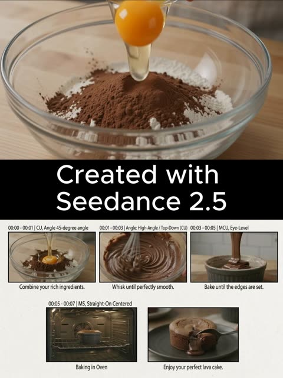</a>

每个镜头都给出时间码、景别、机位和单一动作，模型能在五个短镜头之间干净切换。同一提示词还要求输出带字幕的分镜板，可以逐镜头对照检查。

Seedance 2.5 · 文生视频 · 出处: [@AI_with_Antonio on X](https://x.com/AI_with_Antonio/status/2088237953772638270)

[`food`](tags.md#tag-food) [`commercial`](tags.md#tag-commercial) [`storyboard`](tags.md#tag-storyboard) [`timecode`](tags.md#tag-timecode)

<details><summary><b>提示词</b></summary>

```text
A photorealistic 10-second culinary commercial for a chocolate lava cake. Shot 1 (0:00–0:01): Close-up 45-degree angle of a fresh egg falling into a mound of cocoa powder and flour in a glass bowl on a wooden countertop. Shot 2 (0:01–0:03): Top-down overhead view of a metal wire whisk actively stirring velvety, glossy chocolate batter into silky concentric swirl patterns. Shot 3 (0:03–0:05): Medium close-up eye-level shot of thick chocolate batter pouring in a smooth ribbon fold into a grey ceramic ramekin dusted with cocoa. Shot 4 (0:05–0:07): Straight-on medium shot inside a modern oven, warm amber interior glow, showing the chocolate lava cake fully risen and domed on the wire rack. Shot 5 (0:07–0:10): Hero macro shot of the baked lava cake on a matte dark plate; a silver spoon breaks into the crust, releasing a flowing cascade of warm molten chocolate lava with delicate rising steam. Style: High-end commercial cinematography, natural studio lighting, ultra-realistic textures, shallow depth of field, 8k resolution, smooth transitions. A professional 5-panel commercial storyboard layout on a clean, light-grey textured background with crisp black frame borders and typography: Top Row (Left to Right): Panel 1: 00:00 - 00:01 | CU, Angle 45-degree angle — Raw egg yolk cracking into cocoa powder and flour in a glass bowl. Text: "Combine your rich ingredients." Panel 2: 00:01 - 00:03 | Angle: High-Angle / Top-Down (CU) — Whisk swirling glossy chocolate batter into concentric rings. Text: "Whisk until perfectly smooth." Panel 3: 00:03 - 00:05 | MCU, Eye-Level — Thick ribbon of chocolate batter pouring vertically into a grey ramekin. Text: "Bake until the edges are set." Bottom Row (Centered): Panel 4: 00:05 - 00:07 | MS, Straight-On Centered — Puffed cake resting on the wire rack inside a warm illuminated oven. Text: "Baking in Oven" Panel 5: 00:07 - 00:10 | Hero Angle — Silver dessert spoon breaking the cake crust, warm molten chocolate oozing outward with steam. Text: "Enjoy your perfect lava cake." Style: Clean storyboard graphic design, photorealistic culinary frame stills, sharp cinematic typography, balanced layout.
```

</details>

<a id="seedance-coffee-machine-ugc-commercial"></a>
### 穿米色毛衣的女性在温暖的厨房里走动

<a href="https://x.com/SadiaMalik182/status/2085947010293883115">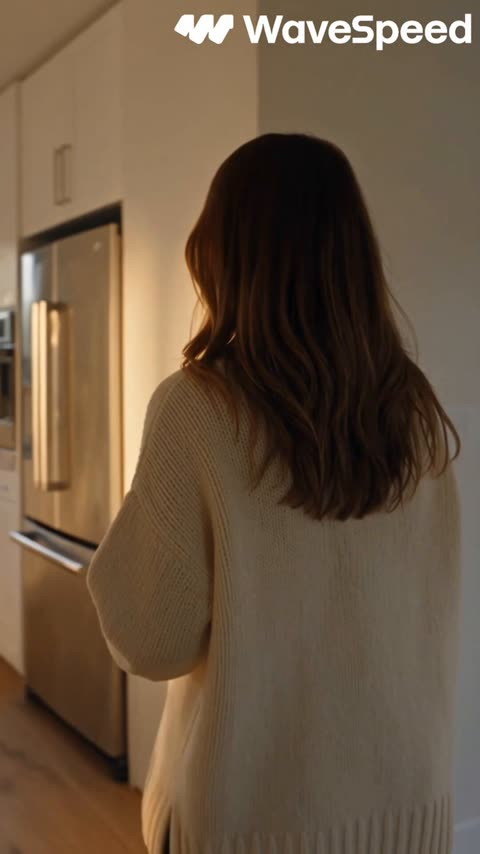</a>

提示词把 30 秒拆成带时间段的分镜，每段写明镜头运动和动作，模型得到的是分镜表而不是模糊的氛围描述。风格段落中的手持镜头、自然光和真实手部动作决定了 UGC 的真实感。

Seedance 2.5 · 文生视频 · 出处: [@SadiaMalik182 on X](https://x.com/SadiaMalik182/status/2085947010293883115)

[`ugc`](tags.md#tag-ugc) [`product-ad`](tags.md#tag-product-ad) [`coffee-machine`](tags.md#tag-coffee-machine) [`vertical`](tags.md#tag-vertical)

<details><summary><b>提示词</b></summary>

```text
Create a 30-second vertical AI UGC product commercial (9:16) for a premium coffee machine.

Style: Ultra-realistic, cinematic, social-media UGC, premium lifestyle, 4K HDR, natural lighting, smooth handheld camera, realistic human motion, luxury color grading.

Scene 1 (0–5s)
A creator walks into a modern kitchen holding a coffee mug and says, "I finally tried this coffee machine."

Scene 2 (5–10s)
Close-up shots of opening the coffee bean container, adding beans, filling water, and pressing the power button. Natural hand movements and satisfying button clicks.

Scene 3 (10–17s)
Macro shots of coffee grinding, rich crema forming, steam rising, and coffee slowly pouring into a glass cup. Beautiful golden morning sunlight.

Scene 4 (17–23s)
The creator takes the first sip, smiles naturally, and says, "This honestly tastes amazing."

Scene 5 (23–27s)
Premium product showcase with smooth orbit shots, close-ups of the controls, metallic finish, and elegant kitchen background.

Scene 6 (27–30s)
Hero shot of the coffee machine beside a fresh cup of coffee with soft cinematic lighting. End with the creator holding the cup and smiling at the camera.

Requirements:
Vertical 9:16, 30 seconds, AI UGC style, realistic creator vibe, premium product advertising, natural expressions, realistic hands, smooth camera movement, clean transitions, cinematic quality, no logos or watermarks.
```

</details>

<a id="seedance-elsa-bakery-croissant-commercial"></a>
### 红发烘焙师夜晚走进温暖的面包店

<a href="https://x.com/ElsaSofia__AI/status/2095105440392818697">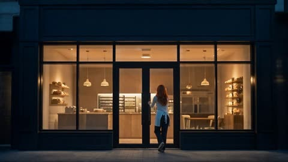</a>

同时给出角色参考图和分镜参考图并明确优先级，把15个约2秒的镜头各自绑定到一个真实动作（面粉云、擀面杖、烤箱门），让每次切换都有物理依据。每个动作还配有对应声音，使画面与音效同步。

Seedance 2.5 · 参考生视频 · 出处: [@ElsaSofia__AI on X](https://x.com/ElsaSofia__AI/status/2095105440392818697) · 发现于 [LearnPrompt/awesome-seedance](https://github.com/LearnPrompt/awesome-seedance)

[`bakery`](tags.md#tag-bakery) [`food-commercial`](tags.md#tag-food-commercial) [`reference-images`](tags.md#tag-reference-images) [`storyboard`](tags.md#tag-storyboard)

<details><summary><b>提示词</b></summary>

```text
⤵️ 

Create a premium photorealistic cinematic 30-second live-action food commercial using BOTH reference images:

@Image1 = ELSA MASTER CHARACTER REFERENCE
@Image2 = MASTER STORYBOARD

IMPORTANT REFERENCE PRIORITY:
Use @Image1 as the definitive identity reference for Elsa.
Use @Image2 as the definitive visual and chronological guide for the entire video.

Follow the 15 storyboard panels in @Image2 from beginning to end.
Do not treat the storyboard as 15 separate still images.
Recreate each panel as real cinematic live-action footage and connect every shot naturally.

DURATION:
Exactly 30 seconds.

FORMAT:
16:9 landscape.

SHOT STRUCTURE:
15 shots, approximately 2 seconds each.

==================================================
CHARACTER CONSISTENCY
==================================================

The SAME Elsa from @Image1 must appear throughout the entire video.

Preserve her exact:
facial identity,
facial proportions,
green eyes,
copper-red hair,
freckles,
skin tone,
body proportions,
age appearance,
and recognizable features.

Do not redesign her face.
Do not generate a different woman.
Do not change her identity between shots.

Keep her bakery outfit exactly consistent with @Image1:
same clothing,
same colors,
same apron,
same trousers,
same footwear.

Natural human anatomy.
Natural hands and fingers.
Realistic facial expressions.
Realistic hair movement.

==================================================
OVERALL CINEMATIC STYLE
==================================================

High-end premium food commercial.

Photorealistic live-action cinematography.

Stylish boutique bakery at night.

Warm amber tungsten lighting inside.
Cool blue nighttime light entering through large windows.

Stone preparation counters.
Natural pale wood.
Brushed stainless-steel equipment.
Dark glass windows.
Elegant professional bakery atmosphere.

Strong contrast between cool midnight exterior and warm bakery interior.

Beautiful shallow depth of field.

Natural cinematic lens characteristics.

Rich golden pastry tones.

Highly detailed realistic food textures.

Everything must feel physically real.

NO magical transformations.

==================================================
SHOT 1 — 0:00–0:02
BAKERY ENTRY / HOOK
==================================================

Recreate the first storyboard panel.

Elsa approaches the quiet bakery at night.

She enters through the glass door and looks toward the empty preparation counter.

Camera begins wide and makes a controlled cinematic push toward her.

Her expression is calm and subtly amused.

Door movement and reflections must be physically realistic.

==================================================
SHOT 2 — 0:02–0:04
INGREDIENTS
==================================================

Medium tracking shot.

Elsa reaches the stone counter.

She places flour, butter, eggs and a mixing bowl onto the work surface.

Each object has believable weight and contact.

Her movements are efficient and confident.

Keep her face and outfit consistent with @Image1.

==================================================
SHOT 3 — 0:04–0:06
FLOUR CLOUD
==================================================

Extreme macro.

Elsa opens the flour bag.

A realistic fine flour cloud rises through the warm bakery light.

Individual particles are visible.

The flour naturally drifts toward camera.

The cloud fills most of the frame and becomes the visual transition.

==================================================
SHOT 4 — 0:06–0:08
DOUGH
==================================================

Top-down cinematic shot.

Flour and liquid combine naturally.

Elsa mixes and kneads the dough with realistic hand pressure.

Show believable dough elasticity and texture.

Small amounts of flour move across the counter.

Fast but controlled movement.

==================================================
SHOT 5 — 0:08–0:10
BUTTER MACRO
==================================================

Extreme close-up.

A cold block of butter is sliced into thin pieces.

Knife movement is precise and rhythmic.

Tiny butter flakes separate naturally.

Warm highlights reflect from the knife and butter.

==================================================
SHOT 6 — 0:10–0:12
ROLLING
==================================================

Low side-angle tracking shot.

Elsa rolls the dough into a long thin sheet.

The rolling pin moves naturally across the stone surface.

Fine flour particles lift slightly with the movement.

Camera tracks with the rolling pin.

==================================================
SHOT 7 — 0:12–0:14
BUTTER LAYERS
==================================================

Overhead shot.

Butter pieces are arranged over the dough.

Elsa folds the dough over itself.

She presses it firmly with the rolling pin.

Show clear laminated layers.

The folding action should feel precise and satisfying.

==================================================
SHOT 8 — 0:14–0:16
SECOND FOLD
==================================================

Extreme macro.

The dough folds again.

Camera follows the folding motion closely.

Thin buttery layers become visible.

Use the physical fold as a natural match transition into the next action.

No magical effects.

==================================================
SHOT 9 — 0:16–0:18
CROISSANT SHAPING
==================================================

Medium overhead shot.

Elsa cuts the dough into clean triangular pieces.

She rolls each triangle from the wide end toward the tip.

Several realistic crescent-shaped croissants appear across the baking tray through fast continuous hand movements.

==================================================
SHOT 10 — 0:18–0:20
EGG WASH
==================================================

Extreme food macro.

Elsa brushes glossy egg wash across the croissants.

The surface becomes visibly shiny.

The final brush stroke travels toward the camera and briefly fills the frame.

Use the brush movement as a motivated visual transition.

==================================================
SHOT 11 — 0:20–0:22
OVEN
==================================================

Dynamic low-angle shot.

Elsa carefully slides the tray into a professional bakery oven.

Warm orange oven light illuminates her hands and the pastry.

She pushes the tray inside.

The heavy oven door closes toward camera.

Use the physical door closure as the transition.

==================================================
SHOT 12 — 0:22–0:24
GOLDEN REVEAL
==================================================

The oven door opens.

A realistic wave of hot steam escapes toward the lens.

Beautiful golden-brown croissants are revealed inside.

Elsa removes the tray carefully.

The warm golden lighting becomes more prominent.

The pastry must look freshly baked, crisp and realistic.

==================================================
SHOT 13 — 0:24–0:26
CRISPY CROISSANT
==================================================

Extreme macro food cinematography.

Elsa takes one croissant.

She gently breaks it open.

The crisp outer shell cracks naturally.

Multiple flaky laminated layers separate.

Warm steam escapes from the center.

Tiny pastry crumbs fall naturally onto the counter.

Emphasize realistic texture and satisfying physical detail.

==================================================
SHOT 14 — 0:26–0:28
FIRST BITE
==================================================

Medium close-up.

Elsa takes a bite.

She pauses.

Her expression shows quiet satisfaction.

No exaggerated reaction.

She looks directly toward the camera.

A tiny eyebrow movement adds personality.

Maintain exact Elsa identity.

==================================================
SHOT 15 — 0:28–0:30
FINAL COMEDIC PUNCHLINE
==================================================

Begin with a close-up of Elsa reaching for a coffee cup.

She confidently picks it up.

She tilts the cup.

Nothing comes out.

The cup is completely empty.

She looks down at the empty cup.

Then slowly raises her eyes toward the camera.

One eyebrow lifts slightly.

One corner of her mouth rises into a subtle amused expression.

Hold the final reaction.

End cleanly on Elsa's face.

==================================================
CAMERA LANGUAGE
==================================================

Use varied professional cinematic camera work:

wide establishing shot,
controlled push-in,
medium tracking,
extreme macro,
top-down,
low-angle tracking,
overhead,
food macro,
dynamic oven shot,
medium close-up.

Avoid repetitive framing.

Camera movement must feel physically motivated.

Use realistic depth of field.

Use natural motion blur.

Use controlled speed ramps only when physically appropriate.

==================================================
TRANSITIONS
==================================================

Use ONLY motivated physical transitions:

flour cloud,
rolling pin movement,
dough fold,
egg-wash brush,
oven-door closure,
steam reveal.

Transitions should feel seamless and professionally edited.

Do not use random digital effects.

Do not make it look like a slideshow.

==================================================
SOUND DESIGN
==================================================

Create a premium cinematic food-commercial soundscape.

Subtle rhythmic electronic music underneath.

Synchronize every physical action with sound:

glass door click,
ingredient placement,
flour burst,
dough slap,
mixing,
knife cutting butter,
rolling pin,
dough folding,
tray movement,
egg brush,
oven door,
steam hiss,
pastry crack,
crispy bite.

During the final coffee reveal:

music suddenly becomes very quiet.

Brief comedic silence when Elsa discovers the cup is empty.

End naturally.

==================================================
PHYSICS & REALISM
==================================================

Realistic flour particle simulation.

Realistic dough deformation.

Realistic butter behavior.

Realistic egg-wash movement.

Realistic pastry expansion.

Realistic oven heat.

Realistic steam.

Realistic crumbs.

Realistic hand-object interaction.

Correct object weight.

Natural shadows and contact.

No floating objects.

No impossible hand movements.

==================================================
NEGATIVE RULES
==================================================

NO face morphing.
NO identity drift.
NO different Elsa.
NO hairstyle changes.
NO wardrobe changes.
NO extra fingers.
NO deformed hands.
NO distorted anatomy.
NO duplicated objects.
NO floating ingredients.
NO magical effects.
NO cartoon appearance.
NO CGI-looking human.
NO readable text.
NO logos.
NO brand names.
NO subtitles.
NO captions.
NO watermark.

FINAL GOAL:

A coherent, photorealistic, premium 30-second cinematic food commercial starring the exact Elsa from @Image1.

The complete visual progression must follow @Image2 from the first frame to the final coffee punchline.

The result should feel professionally directed, beautifully photographed, physically believable, fast-paced but elegant, highly satisfying, and completely original.
```

</details>

<a id="seedance-fashion-editorial-lying-newspaper-montage"></a>
### 女子躺在报纸上的快节奏美妆剪辑

<a href="https://x.com/AIwithNatalia/status/2103481825096278257">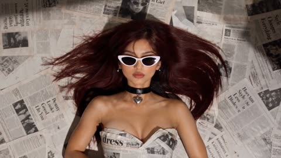</a>

参考图锁定人物身份，明确禁止移动的指令让躺姿保持不变，按时间段列出的镜头清单则驱动每0.3到1秒一次的切换。每段都绑定具体动作，剪辑读起来就是跟随时尚节拍的蒙太奇。

Seedance 2.5 · 参考生视频 · 出处: [@AIwithNatalia on X](https://x.com/AIwithNatalia/status/2103481825096278257)

[`fashion`](tags.md#tag-fashion) [`editorial`](tags.md#tag-editorial) [`speed-ramp`](tags.md#tag-speed-ramp) [`beat-sync`](tags.md#tag-beat-sync)

<details><summary><b>提示词</b></summary>

```text
Create a 15-second extremely fast-paced luxury fashion editorial video using the reference image. The woman must remain lying in the exact same pose throughout the entire video — no standing, walking, sitting up, or pose changes. Keep her exact facial features, burgundy hair, identity, and styling consistent.

The video should feel like a rapid fashion campaign, with constant visual movement and very quick cuts every 0.3–1 second, synced tightly to a punchy fashion beat.

0–2s: Start with the overhead shot of her lying among newspapers. Rapid push-in → immediate cut to her applying red lipstick.

2–4s: Ultra-fast beauty cuts:
lips → lipstick swipe → sunglasses → red nails → pearl earrings → eyes.
Each shot lasts only a fraction of a second, with quick snap zooms and whip transitions.

4–6s: Back to the full overhead composition. She adjusts her sunglasses while newspapers rapidly fly across the frame. Camera makes a quick circular move around her.

6–9s: Faster macro montage:
lipstick closing → glossy lips → sunglasses catching light → nails gripping newspaper → earrings swinging → burgundy hair moving.
Use aggressive editorial cuts, speed ramps, and flash-like transitions.

9–12s: Return to her lying pose. She casually applies lipstick again as newspapers swirl rapidly around her and red rose petals fall from above, creating layered motion around the completely still fashion pose.

12–15s: Rapid sequence of eyes → lips → sunglasses → nails → earrings, then a sudden overhead pullback revealing the entire newspaper-covered composition. Newspapers fly directly across the lens and create the final transition.

Visual style: high-fashion magazine campaign, cinematic overhead photography, dramatic hard sunlight, deep shadows, glossy beauty lighting, realistic skin and hair, rich burgundy/red accents, luxury editorial aesthetic, energetic camera movement, very fast cutting, speed ramps, whip transitions, snap zooms, motion blur, beat-synced editing.
```

</details>

<a id="seedance-fermina-skincare-splash-commercial"></a>
### 水花溅湿的瓶子转场到女子涂抹面霜

<a href="https://x.com/laviniavelle/status/2097171135033143553">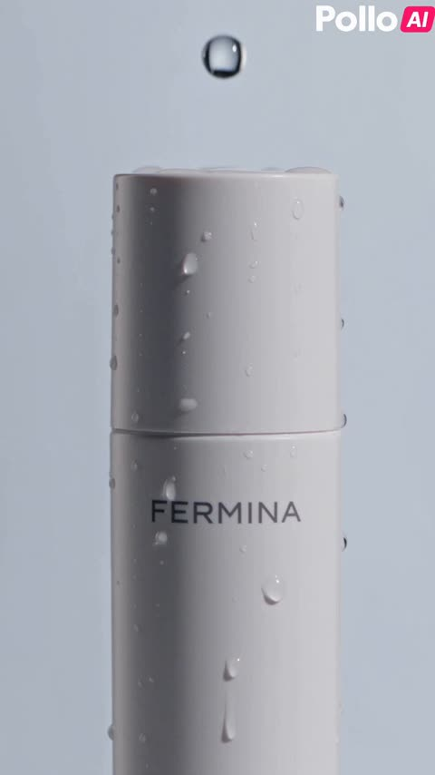</a>

开场先展示带水珠和飞溅水花的产品，再用微距匹配剪接转到涂抹面霜的画面，让瓶子和皮肤处在同一段连贯运动中。提示词还固定了竖版 9:16 画幅、暖色棚拍光和结尾定格，让广告有明确的收尾画面。

Seedance 2.5 · 文生视频 · 出处: [@laviniavelle on X](https://x.com/laviniavelle/status/2097171135033143553) · 发现于 [LearnPrompt/awesome-seedance](https://github.com/LearnPrompt/awesome-seedance)

[`skincare`](tags.md#tag-skincare) [`product-commercial`](tags.md#tag-product-commercial) [`macro`](tags.md#tag-macro)

<details><summary><b>提示词</b></summary>

```text
Cinematic skincare commercial, vertical 9:16 aspect ratio. Starts with a sleek white cosmetic bottle labeled FERMINA covered in water droplets with water splashing dynamically over the top Quick seamless macro transition to a young woman with natural glowing skin pumping cream onto her fingers then gently applying the white moisturizer onto her cheek. Close up on her smooth hydrated skin with a subtle dew effect Ends with the woman smiling softly at the camera, holding the FERMINA product bottle next to her face warm studio lighting minimal clean aesthetic, soft focus background, high-definition commercial style.

#polloai
```

</details>

<a id="seedance-fish-creative-drink-commercial"></a>
### 青绿瓷砖卡座里的女孩与奶昔

<a href="https://x.com/soulful__ai/status/2103844376120340877">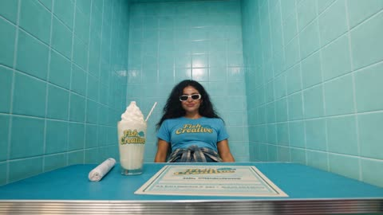</a>

先用一张参考图锁定人物、服装、店铺和品牌元素，再按 15 秒分段写清每段的运镜（推近、甩镜、拉远）和剪切节奏。明确禁止慢动作和静止镜头，让节奏从头到尾保持紧凑。

Seedance 2.5 · 图生视频 · 出处: [@soulful__ai on X](https://x.com/soulful__ai/status/2103844376120340877)

[`fast-cuts`](tags.md#tag-fast-cuts) [`whip-pan`](tags.md#tag-whip-pan) [`product-commercial`](tags.md#tag-product-commercial) [`image-reference`](tags.md#tag-image-reference)

<details><summary><b>提示词</b></summary>

```text
Create a high-energy 15-second commercial using the provided image as the exact visual reference. Keep the same girl, outfit, sunglasses, turquoise tiled booth, Fish Creative branding, and drink.

The video should feel very fast, playful, trendy, and energetic, with constant movement and quick cuts.

0–3 sec: Start with a rapid camera push-in toward the girl. She grabs the Fish Creative drink and immediately brings it toward the camera.

3–6 sec: Quick close-up of the drink → whip-pan to her face → she gives a confident playful look and takes a quick sip.

6–9 sec: Fast camera movement around her as she presents the drink with energetic hand gestures. She moves naturally and confidently, keeping the product visible.

9–12 sec: Rapid product shots: drink close-up → Fish Creative logo → whipped cream → her smiling face. Use quick snap transitions between each shot.

12–15 sec: Camera quickly pulls back. She raises the drink toward the camera in a bold advertising pose, ending with the drink prominently in the foreground.

Visual direction: extremely fast-paced, energetic commercial, dynamic handheld camera, rapid push-ins, whip pans, quick zooms, snap transitions, lively body movement, punchy timing, vibrant retro aesthetic, cinematic lighting, subtle film grain.

Important: No slow movements, no slow motion, no static shots, no long pauses. Keep the girl actively moving and interacting with the drink throughout the entire 15 seconds.
```

</details>

<a id="seedance-golden-light-to-planet-concept-ad"></a>
### 黑暗中的金色光点与玻璃水珠

<a href="https://x.com/hxhxhx0916/status/2106536299356381507">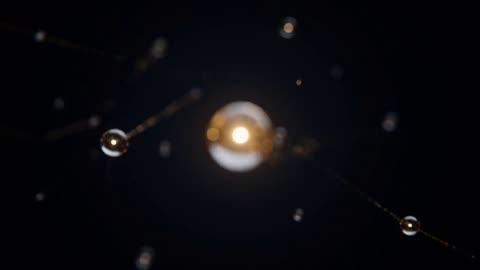</a>

提示词按时间段拆成多个镜头节拍，每段写明运镜、转场特效和声音提示，读起来是分镜脚本而不是氛围描述。品牌文字不交给模型生成，而是后期叠加，让模型不必渲染清晰的标题文字。

Seedance 2.5 · 文生视频 · 出处: [@hxhxhx0916 on X](https://x.com/hxhxhx0916/status/2106536299356381507)

[`concept-ad`](tags.md#tag-concept-ad) [`timed-shots`](tags.md#tag-timed-shots) [`transitions`](tags.md#tag-transitions) [`sound-design`](tags.md#tag-sound-design)

<details><summary><b>提示词</b></summary>

```text
Seedance 2.5｜15s 概念宣传片

基础设定：16:9 横屏，15 秒，电影质感，深黑底色，冷蓝 + 暖金配色，概念视觉，无 UI 界面、无性能参数、无功能承诺，纯艺术概念短片；音频：电子配乐，从单音缓缓铺开，结尾干净柔和低音收束，无旁白。

00:00-00:01.5 灵感点亮，焦点转移特效，黑暗空间里悬浮一颗细密玻璃质感金色光点，微距固定机位，焦点从远处散景切换到光点，光点轻轻脉动，一声清晰电子音响起 00:01.5-00:03 穿过灵感，快速推进 + 径向运动模糊 + 变速减速特效，镜头冲入金色光点，四周拉扯出蓝金色光线，前方出现明亮矩形光门，镜头沿中心轴高速前进，临近光门平滑减速，门框填满画面 00:03-00:04.5 世界展开，连续空间展开特效，穿过光门，空白大地向远方延伸，建筑沿着街道依次生长成型，雨后未来都市，广角低机位向前滑行，湿滑路面反射冷蓝光，远方天空透出暖金色光晕，建筑立面贴近画面遮挡镜头 00:04.5-00:06 看见细节，25% 慢动作特效，微距侧拍，金属蝴蝶停留在湿润绿叶上，翅膀缓缓舒展，水珠沿着叶缘缓慢坠落，清晰展现金属纹理、叶脉、水珠折射光影，水珠落在画面中心 00:06-00:08 从水滴到宇宙，连续形态变换 + 环绕运镜特效，同一画面位置，水滴平滑演变为蓝色行星，液体纹理慢慢转化为云层与海洋，镜头环绕行星缓慢转动 30 度，后方金色恒星勾勒行星轮廓，画面连续无跳切，镜头沿着行星边缘向右加速 00:08-00:09 创意加速，加速变速 + 右向甩镜 + 方向运动模糊 + 金色光轨特效，行星边缘融化为金色光轨，镜头顺着光轨向右飞驰，光轨串联三个转瞬即逝场景：沙漠、深海、云端，运动方向统一，光轨横贯画面 00:09-00:12 世界成为画面，缓慢拉远特效，镜头向后缓缓拉远，前面出现的未来城市、金属蝴蝶、蓝色行星，变成三块悬浮动态画幅，画幅内部画面持续微动，三块画幅错落悬浮在深邃黑空间，纤细金色线条串联成流畅路径，镜头慢慢静止，音乐转为宽阔长音，画幅缓缓淡出 00:12-00:15 品牌落版，淡出转场特效，纯深黑背景，居中白色主标题 Seedance 2.5，下方浅金色小字：让想象，成为画面。文字稳定不动，保持至片段结束，音乐柔和低音收尾，品牌文字后期叠加保证清晰准确
负面提示词： UI 界面，按钮，电脑屏幕，数字参数，文字水印，人物，手部操作，粗糙材质，卡通 CG，塑料质感，画面跳变，镜头抖动，过曝，杂乱色彩，字幕乱码，多余文字，变形扭曲
```

</details>

<a id="seedance-hunk-santa-diet-reveal"></a>
### 胖胖的圣诞老人在床上醒来，随后是健硕的揭晓

<a href="https://x.com/mrdejie/status/2094622082474852770"></a>

从第 8 段起用 @(参考图) 锁定健硕形象，时间跳跃时用低机位只拍靴子和双腿并遮住面部，最后靠一次缓慢上摇完成揭晓。按秒分段，并写明跳跃后不再出现胖版的硬性规则，让角色在各镜头间保持一致。

Seedance 2.5 · 参考生视频 · 出处: [@mrdejie on X](https://x.com/mrdejie/status/2094622082474852770) · 发现于 [LearnPrompt/awesome-seedance](https://github.com/LearnPrompt/awesome-seedance)

[`christmas`](tags.md#tag-christmas) [`reference-image`](tags.md#tag-reference-image) [`transformation`](tags.md#tag-transformation) [`time-skip`](tags.md#tag-time-skip)

<details><summary><b>提示词</b></summary>

```text
Photorealistic 36-second Santa diet-to-reveal video at the North Pole. Cozy Christmas cabin: wooden walls, fireplace, lights, tree, snow outside. Funny and sincere. Start as classic chubby Santa. From CUT 8 onward use @(reference image) as the exact fit muscular Santa. Never show the chubby version after the time skip. No on-screen text, no subtitles, no watermark.

0–2s: Chubby Santa wakes up in bed, sleepy, then sits up.
2–5s: At the mirror he holds his big belly, shocked.
5–8s: At a full holiday table he looks happy at the roasted chicken, then pushes it aside and eats vegetable salad with a fork.
8–11s: He jogs in the snow outside his cabin, heavy but determined.
11–13s: Shadow boxing in the yard.
13–15s: Inside, he lifts dumbbells by the Christmas tree.
15–17s: Push-ups on the rug in front of the fireplace.
17–20s: Time skip. Low camera. Only fit legs and black boots walk to the door. Face hidden.
20–22s: Same low shot. He steps outside and closes the cabin door. Face still hidden.
22–25s: Sleigh packed with gifts. Rudolph and the other reindeer see him and jaw-drop in shock.
25–28s: Slow tilt from his boots up to his face. Reveal muscular Santa, exact @(reference image).
28–33s: Fast funny bodybuilder sequence, 5 poses: double biceps, side chest, back double biceps, one-arm flex, most-muscular. Reindeer keep staring.
33–36s: He drops the pose, says "Oh, sorry." Reindeer laugh. Santa says "Let's find and reward the Nice kids."
```

</details>

<a id="seedance-influencer-serum-intro-jp"></a>
### 网红对镜头展示粉色美容液瓶

<a href="https://x.com/tanabe_fragm/status/2097515319309013359"></a>

用参考图锁定起始画面，并固定人物面容、发型、服装和瓶身，再把日语台词按7秒节奏切分，前半抬瓶一次、后半加深微笑。只保留室内环境音，并明确禁止切镜、变焦、字幕和logo，使其成为干净的单镜头口播演示。

Seedance 2.5 · 图生视频 · 出处: [@tanabe_fragm on X](https://x.com/tanabe_fragm/status/2097515319309013359)

[`beauty`](tags.md#tag-beauty) [`skincare`](tags.md#tag-skincare) [`product-demo`](tags.md#tag-product-demo) [`japanese-dialogue`](tags.md#tag-japanese-dialogue)

<details><summary><b>提示词</b></summary>

```text
7秒、縦型9:16、ワンカット。インフルエンサーが普段の投稿で、お気に入りの美容液を紹介する自然なオープニング。

【人物・商品】
参照画像を開始フレームに使用。女性の顔立ち、ブラウンのショートヘア、アイボリーのニットを維持。ピンク色の美容液ボトルを頬の横で持ち、反対の手を底に添える。ラベルはカメラに向けたまま。

【セリフ・演技】
開始直後から話し始め、約7秒かけて次のセリフを話す。

「今日は、私のお気に入りの美容液を紹介します。これ、みんなにも見てほしかったんです！」

友人に話しかけるような、明るく親しみのある声。少し軽快な会話のテンポで、長い間は入れず、短い息継ぎだけで続ける。最後の「です」が映像の終わり近くに自然に収まる。語尾を引き伸ばしたり、最後だけ早口にしたりしない。

前半の「私のお気に入りの美容液」で、両手で支えたボトルを2〜3センチだけ持ち上げる。後半の「これ、みんなにも」で微笑みを少し深める。最後までレンズに視線を向け、自然なまばたきと小さな表情の変化を添える。商品を動かす仕草は1回だけ。話し終わった後の無言のポーズは設けない。

【環境・カメラ】
参照画像と同じ明るい室内。画面左の窓から柔らかな自然光。スマートフォンを目線の高さに固定して撮影したような安定した構図。顔と商品を明瞭に見せ、肌のきめと自然なツヤを残す。

【音声・制約】
日本語のセリフと口の動きを正確に同期。本人の声を明瞭にし、静かな室内音のみ、BGMなし。
人物の顔、髪型、衣装、ボトルの形状・色・ラベルを維持。指と持ち方を自然に保つ。キャップを開けない。大げさな身振り、カット切り替え、ズーム、過剰な美肌加工、字幕、追加ロゴなし。
```

</details>

<a id="seedance-japanese-guide-bungalow-entrance-tour"></a>
### 日本女性导览员在平房门口迎客

<a href="https://x.com/tanabe_fragm/status/2096091586002399331">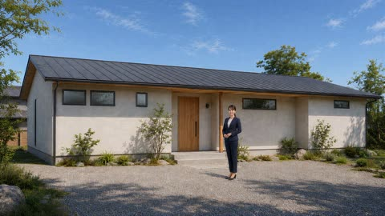</a>

编号参考图分别锁定主持人的脸、服装和每个房间的布局，带时间码的分镜表为每个镜头规定一种镜头运动、一句台词和一条字幕。镜头只做缓慢推进和短横移，场景切换靠剪辑完成而不让镜头穿墙，从而保持建筑线条挺直、人物脸部稳定。

Seedance 2.5 · 参考生视频 · 出处: [@tanabe_fragm on X](https://x.com/tanabe_fragm/status/2096091586002399331)

[`real-estate`](tags.md#tag-real-estate) [`japanese-dialogue`](tags.md#tag-japanese-dialogue) [`reference-images`](tags.md#tag-reference-images) [`property-tour`](tags.md#tag-property-tour)

<details><summary><b>提示词</b></summary>

```text
30秒、16:9横長。日本の大手不動産会社の物件紹介を思わせる、上質で落ち着いた架空の平屋住宅案内動画を制作する。実写の建築映像と自然な日本語の女性案内、控えめなBGM、読みやすい日本語テロップを組み合わせる。

【参照画像】
画像1：案内役の顔・髪型・衣装の基準。同一人物の複数ビューであり、画面に複数人を出さない。この人物資料自体は動画に映さない。
画像2：玄関前でのお迎え。
画像3：玄関収納と廊下。
画像4：LDK。
画像5：キッチンから庭への眺め。
画像6：主寝室とウォークインクローゼット。
画像7：庭側の外観。

【人物と住宅の一貫性】
案内役は画像1と同じ27歳の日本人女性。ネイビーのパンツスーツ、アイボリーのブラウス、パールのピアス、低い位置でまとめた髪。知的で親しみのある笑顔、丁寧で控えめな所作。屋外は黒いパンプス、室内はベージュのスリッパ。全編で顔、体格、衣装、声を統一する。

住宅は参照画像と同じ平屋。白い壁、明るいオーク材、落ち着いた家具、黒い窓枠。各カットの背景は対応する画像を優先し、窓、扉、家具、間取りを勝手に変更しない。

【映像の演出】
高級住宅紹介のように、自然な明るさ、柔らかな窓光、繊細な素材感、抑制された色調で仕上げる。直線が歪まない建築撮影。カメラはゆっくり前進、または短い横移動に限定する。

場所の移動は編集のカットで表現する。壁や扉を通り抜けるカメラ移動、部屋同士の変形による場面転換はしない。女性はその場で小さく身振りをする程度とし、複雑な歩行や扉の開閉は行わない。

【30秒の構成】

0.0〜4.5秒｜玄関前のお迎え
画像2を基準に、家と女性が一緒に見えるワイドショットから緩やかに近づく。
女性はカメラに微笑み、玄関へそっと手を向ける。
女性の台詞：
「木のぬくもりを感じる平屋へ、ようこそ。」
テロップ：
「木のぬくもりと暮らす平屋」

4.5〜8.5秒｜玄関収納
画像3へカット。玄関収納と廊下が分かる構図を保つ。
女性が収納へ自然に手のひらを向ける。カメラはわずかに横移動。
女性の台詞：
「玄関には、すっきり収まる収納を。」
テロップ：
「玄関収納」

8.5〜14.5秒｜LDK
画像4へカット。ダイニング、キッチン、リビングを広く見せる。
女性はカメラから室内へ視線を移し、小さな身振りで紹介する。
ゆっくりした引きの動きで空間の広がりを伝える。
女性の台詞：
「家族が集まるリビングは、明るく、開放的です。」
テロップ：
「光が広がるリビング」

14.5〜19.5秒｜キッチンと庭
画像5へカット。手前のキッチンから窓越しのウッドデッキまで見せる。
女性は庭へ手を向ける。カメラは少しだけ前進し、庭への見通しを強調する。
女性の台詞：
「キッチンからは、庭まで見渡せます。」
テロップ：
「庭へつながる開放感」

19.5〜25.0秒｜主寝室と収納
画像6へカット。女性、ベッド、開いたウォークインクローゼットを一緒に見せる。
女性が収納を紹介し、最後にカメラへ視線を戻す。
女性の台詞：
「寝室には、ウォークインクローゼットも備えています。」
テロップ：
「主寝室・ウォークインクローゼット」

25.0〜30.0秒｜庭側外観・エンディング
画像7へカット。家全体とウッドデッキを見せる、穏やかな引きのショット。
このカットは人物を追加せず、同じ女性の声をナレーションとして重ねる。
ナレーション：
「心地よい毎日を、この住まいから。」
中央下寄りのテロップ：
「心地よい毎日を、この住まいから。」
最下部に小さく：
「架空の物件紹介イメージ」
最後の約1秒は構図を落ち着かせ、音楽とともに自然に終える。

【声・BGM】
女性の声は、落ち着いた明瞭な標準日本語。自然な接客口調で、急がず、台詞間に短い余韻を残す。
女性が映る場面は台詞と口の動きを合わせる。最後のみ画面外のナレーション。
台詞は指定どおりとし、追加の説明や英語を入れない。

BGMは、柔らかなピアノと薄い弦楽器によるオリジナルのインストゥルメンタル。穏やかなテンポ、上品で温かい雰囲気。全編を通して同じ曲を流し、場面転換で曲をリセットしない。声が常に明瞭に聞こえる音量に抑え、最後に自然にフェードアウトする。歌声、強いビート、派手な効果音は不要。

【テロップ】
指定した短い日本語のみを正確に表示する。通常は画面左下の余白に、読みやすい白のゴシック体と薄い影で配置。画面端から十分な余白を取り、顔、手、紹介する設備を隠さない。
各カットにつき1つ、静かなフェードで出し入れする。台詞全文の字幕は追加しない。
最後のコピーのみ上品な明朝体を使用する。

【制約】
全体を正確に30秒に収める。
人物の入れ替わり、複製、顔の変化、不自然な指、家具との接触や貫通を避ける。
住宅の階数、窓、扉、収納、家具を増減しない。
実在企業の名称・ロゴ、価格、所在地、販売実績、検証されていない面積や性能は表示しない。
```

</details>

<a id="seedance-joltcan-dim-bedroom-energy-drink-ad"></a>
### 昏暗卧室晨起 能量饮料广告开场

<a href="https://x.com/doctorwasif/status/2099717908482207928">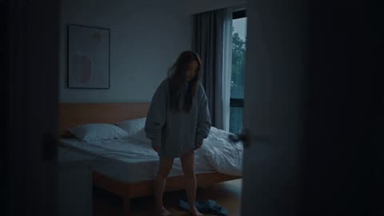</a>

提示词开场采用低饱和冷灰色调、缓慢漂移的手持运镜和近乎静音，喝下第一口时画面瞬间转为暖色高饱和，音乐与开罐和吞饮的声音节点对齐。参考图锁定人物，分镜的每一段都写明时长、机位和音频提示。

Seedance 2.5 · 参考生视频 · 出处: [@doctorwasif on X](https://x.com/doctorwasif/status/2099717908482207928) · 发现于 [LearnPrompt/awesome-seedance](https://github.com/LearnPrompt/awesome-seedance)

[`before-after`](tags.md#tag-before-after) [`energy-drink`](tags.md#tag-energy-drink) [`speed-ramp`](tags.md#tag-speed-ramp)

<details><summary><b>提示词</b></summary>

```text
CAMERA:
Cinematic handheld gimbal feel, mixed with a few locked-off tripod inserts. Camera occasionally rests on counters/surfaces for hands-free product shots. Sluggish, drifting movement in the opening beats; sharp, snappy whip-pans and speed-ramped cuts once the energy kicks in. Camera never appears on screen.
LOOK:
Opens desaturated, cool gray-blue color grade, slightly soft focus, low contrast. The moment she drinks, grade snaps to saturated, warm, high-contrast color — vivid oranges/yellows, crisp focus, subtle motion-trail flares on fast movement. Realistic skin tones, light film grain throughout.
STYLE:
Before/after transformation ad. First third deliberately slow and low-energy; middle/end fast, punchy, triumphant. Comedic payoff at the end. Minimal dialogue — one line only, near the finale — energy carried mainly by music and speed-ramping.
Character
MAYA — same woman as reference image, 20s. Long dark hair (loose/messy in opening scenes, pulled back and sleek once energized), skin transitioning from dull/tired to visibly glowing. Slim build. Oversized gray sweatshirt in groggy scenes, switching to a fitted color-block "JOLTCAN"-branded jacket or tee once energized. Sneakers throughout. Fully covered, modest fit.
DELIVERY GUY — 20s, uniform, delivery bag, casual unhurried demeanor.
Setting
Dim apartment bedroom → kitchen counter → sunny city sidewalk → apartment building entrance (finale, same building as opening).
Storyboard (30s, 9 cuts)
(~3s, wide shot, dim bedroom) Maya shuffles slowly out of bed, gray desaturated grade, movements heavy and sluggish.
Audio: Near silence — a single fading alarm-clock beep, then flat low room tone. No music.
(~2.5s, medium shot, kitchen) She drags herself to the counter, fumbles opening the fridge in slow, groggy motion.
Audio: Dull, minimal synth drone, very low volume, no rhythm — mirrors her grogginess. Faint fridge hum.
(~2.5s, macro insert) Close-up: she cracks open a JOLTCAN — the pull-tab snap is sharp and loud.
Audio: The can-crack triggers one sharp musical hit — a riser + snare crack — landing exactly on the snap sound.
(~3s, close-up, color shift) She sips; color grade snaps instantly from gray to vivid saturated color, eyes widen, posture straightens.
Audio: Upbeat electronic-pop beat starts immediately here, ~130 BPM, bright synth stab, energetic bassline kicks in on the beat.
(~3s, fast handheld, apartment) Speed-ramped shot of her whirling through getting ready — hair, jacket, grabbing her bag — quick snappy cuts.
Audio: Music at full tempo, punchy bass hits synced to her quick movements.
(~3.5s, wide fast shot, sidewalk) She power-walks/jogs down a sunny sidewalk faster than normal, confident grin, light motion-blur trails.
Audio: Music builds with a rising melodic synth hook, steady driving rhythm continues.
(~3s, quick handheld) Fast montage: she dodges a puddle, weaves around a slow pedestrian, times a street crossing perfectly.
Audio: Music hits a tight rhythmic peak — percussive, clean, energetic.
(~4s, wide shot, building entrance) She jogs up and beats the delivery guy to her own door, holding it open for him with an amused grin. She says: "Guess I'm early today."
Audio: Music briefly ducks under her line, then a light comedic synth "boing" sting plays right after she speaks.
(~3s, logo card) Freeze/blur on her grinning face; white text fades in: "Fuel your speed" above the JOLTCAN wordmark.
Audio: Music resolves into a short, punchy outro hit, clean cutoff — no fade.
```

</details>

<a id="seedance-karakoram-motorcycle-commercial"></a>
### 摩托车手在喀喇昆仑公路上的跟拍镜头

<a href="https://x.com/AI_with_Antonio/status/2088599346908365227">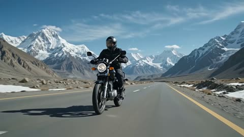</a>

提示词按顺序写出四个镜头，每个镜头都有明确的机位，让成片像剪辑而不是单一跟拍。开头锁定车手服装和车辆比例，结尾用避免事项清单再次约束，帮助车手和摩托车在切换镜头后保持一致。

Seedance 2.5 · 文生视频 · 出处: [@AI_with_Antonio on X](https://x.com/AI_with_Antonio/status/2088599346908365227)

[`motorcycle`](tags.md#tag-motorcycle) [`tracking-shot`](tags.md#tag-tracking-shot) [`mountain-road`](tags.md#tag-mountain-road) [`photorealistic`](tags.md#tag-photorealistic)

<details><summary><b>提示词</b></summary>

```text
Create a 10-second photorealistic cinematic motorcycle commercial featuring a young 24-year-old male rider with an athletic, muscular physique, riding a Suzuki GS150SE along the Karakoram Highway in northern Pakistan at approximately 100+ km/h. The rider looks confident and energetic, wearing a premium black riding jacket with the sleeves fitted around his muscular arms, dark riding pants, gloves, riding boots, and a full-face helmet. Keep his appearance, clothing, helmet, and body proportions identical throughout the entire clip. The Suzuki GS150SE should remain accurately proportioned and visually consistent, with realistic suspension movement, wheel rotation, chain movement, engine vibration, brake components, exhaust, mirrors, and authentic motorcycle details. The highway winds dramatically through enormous snow-covered Karakoram mountains, with towering icy peaks visible in the distance. Cold mountain atmosphere, patches of snow beside the road, crisp blue sky, thin clouds, distant glaciers, and realistic high-altitude lighting. Cinematic Direction: Begin with a low front three-quarter tracking shot of the GS150SE approaching at speed. Transition into a side tracking shot showing the rider enjoying the mountain scenery while maintaining control of the motorcycle. Briefly show a helmet-level POV looking down the sweeping Karakoram Highway toward massive snow-covered peaks. Use realistic aerodynamic effects: subtle airflow flowing around the rider and motorcycle, jacket fabric reacting naturally to wind, slight suspension compression over road imperfections, realistic tire contact, and controlled motion blur. Finish with a dramatic rear three-quarter tracking shot as the motorcycle disappears along the winding highway, surrounded by enormous icy mountains. Visual style: photorealistic, premium motorcycle commercial, cinematic 4K, natural mountain lighting, realistic physics, detailed motorcycle textures, dynamic tracking camera, shallow depth of field where appropriate, subtle lens flare, realistic motion blur, immersive scale, epic Himalayan/Karakoram atmosphere. Important: No distorted motorcycle parts, no extra limbs or fingers, no changing rider appearance, no duplicated motorcycle components, no unrealistic wheel geometry, no floating motorcycle, no excessive CGI effects, and no text overlays unless specifically requested. Overall feeling: freedom, adventure, power, solitude, mountain exploration, and the thrill of riding through the Karakoram.
```

</details>

<a id="seedance-kawasaki-ninja-h2r-ugc-promo"></a>
### 创作者走向停在地下车库的 Ninja H2R

<a href="https://x.com/KevinVailAI/status/2104811263381721348">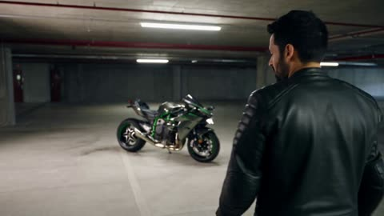</a>

按时间划分的分镜表，每段写明画面和台词，为模型提供清晰的节奏与切换结构。手持智能手机的拍摄方式，加上对 CGI 质感、塑料材质和错误骑行物理的明确排除，让成片更像真实的达人素材。

Seedance 2.5 · 文生视频 · 出处: [@KevinVailAI on X](https://x.com/KevinVailAI/status/2104811263381721348)

[`ugc`](tags.md#tag-ugc) [`motorcycle`](tags.md#tag-motorcycle) [`product-promo`](tags.md#tag-product-promo) [`dialogue`](tags.md#tag-dialogue)

<details><summary><b>提示词</b></summary>

```text
Create a 30-second ultra-realistic UGC-style promotional video featuring a Kawasaki Ninja H2R. The video should feel like authentic footage filmed by a confident motorcycle creator, while maintaining premium cinematic quality.
Scene 1, 0–5 seconds: Start with a handheld smartphone-style shot of the creator walking toward the Kawasaki Ninja H2R parked in a modern underground garage. The creator looks into the camera and says naturally, “Okay, this might be one of the wildest bikes I’ve ever seen.” Quick close-ups reveal the sharp front fairing, aerodynamic bodywork, carbon-fiber details, exposed mechanical elements, and aggressive styling.

Scene 2, 5–12 seconds: Cut to the creator sitting on the motorcycle and starting the engine. Capture the realistic engine sound, subtle vibration, dashboard lighting, and exhaust note. The creator says, “The Ninja H2R just looks absolutely insane in person.” Use natural handheld camera movement mixed with cinematic close-up shots.

Scene 3, 12–22 seconds: Show the motorcycle riding on a closed professional track. Use dynamic tracking shots from multiple realistic camera positions, including low side angles, rear follow shots, and wide track shots. Show controlled acceleration, cornering, and aerodynamic movement without reckless public-road behavior. Add realistic tire movement, suspension response, wind interaction, and natural motion blur.

Scene 4, 22–27 seconds: Return to the creator standing beside the parked bike. He looks at the camera and says, “The design, the sound, the presence… everything feels next level.”

Scene 5, 27–30 seconds: Finish with a slow cinematic reveal of the Ninja H2R from front three-quarter angle as the creator walks away. End with clean on-screen text: “Ninja H2R. Built to stand apart.”

Visual style: authentic UGC meets premium motorcycle commercial. Photorealistic live-action appearance, natural skin texture, realistic motorcycle materials, accurate proportions, physically believable movement, natural lighting, subtle handheld imperfections, realistic audio synchronization, cinematic depth of field, smooth transitions, detailed reflections, 4K quality. Avoid CGI appearance, plastic textures, distorted motorcycle geometry, unrealistic riding physics, duplicated bikes, fake-looking environments, excessive camera shake, or exaggerated effects.
```

</details>

<a id="seedance-laundry-day-voiceover-commercial"></a>
### 带温暖旁白的洗衣日广告

<a href="https://x.com/CaliraVal/status/2091386310837862772">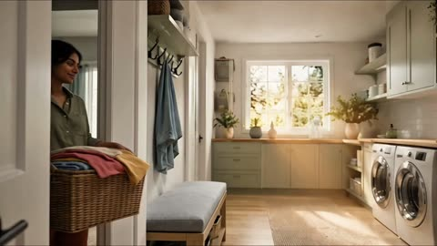</a>

把30秒拆成带时间码的分镜，每段配一句旁白，动作与解说保持同步。结尾用一段风格清单统一光线、镜头、声音，并限定无字幕无文字无标志。

Seedance 2.5 · 文生视频 · 出处: [@CaliraVal on X](https://x.com/CaliraVal/status/2091386310837862772) · 发现于 [LearnPrompt/awesome-seedance](https://github.com/LearnPrompt/awesome-seedance)

[`commercial`](tags.md#tag-commercial) [`voiceover`](tags.md#tag-voiceover) [`timed-beats`](tags.md#tag-timed-beats) [`lifestyle`](tags.md#tag-lifestyle) [`vertical`](tags.md#tag-vertical)

<details><summary><b>提示词</b></summary>

```text
Create a 30-second photorealistic cinematic laundry commercial featuring a young South Asian woman in a bright, modern home. Include a natural female voiceover throughout the video, synchronized with the actions. The voice should sound warm, friendly, clear, and conversational, with soft realistic background laundry sounds and no music overpowering the voice.

0–5 seconds: The woman walks into the laundry area carrying a basket full of dirty clothes and places it beside a modern front-loading washing machine.
Voiceover: “Laundry day starts with one simple step.”

5–10 seconds: She opens the washing machine and carefully puts the clothes inside one by one. Show realistic fabric movement and natural hand movements.
Voiceover: “I just load all my clothes into the washing machine…”

10–13 seconds: She adds liquid detergent into the detergent compartment, closes it, and shuts the washing machine door.
Voiceover: “…add my detergent…”

13–17 seconds: She presses the start button. Close-up of the washing machine starting, with the clothes visibly spinning behind the glass door.
Voiceover: “…and let the machine do the work.”

17–22 seconds: After the wash, she opens the machine and takes out the fresh, clean clothes. She gently shakes and unfolds the garments.
Voiceover: “Once they’re clean, they come out fresh and ready to dry.”

22–28 seconds: She carries the clean clothes outside to a clothesline and hangs each garment carefully using clothespins. A gentle breeze makes the clothes move naturally.
Voiceover: “Then I simply hang them outside and let the fresh air do the rest.”

28–30 seconds: Final cinematic shot of the freshly washed clothes hanging beautifully in warm sunlight while the woman smiles naturally nearby.
Voiceover: “Clean, fresh, and ready to wear.”

Warm natural daylight, realistic South Asian woman, modern home, detailed clothing textures, realistic washing machine, natural human movement, smooth cinematic camera transitions, close-up shots, subtle handheld movement, realistic fabric physics, gentle outdoor breeze, photorealistic premium commercial quality, natural female voiceover, realistic ambient sounds, clear synchronized speech, vertical 9:16, no subtitles, no text, no watermark, no logos.
```

</details>

<a id="seedance-luxury-hair-dryer-case-macro-pan"></a>
### 蓝紫色反光台面上的闭合皮革收纳盒

<a href="https://x.com/AvelyrahnAI/status/2093932080497594740">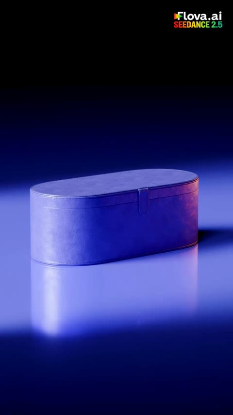</a>

将镜头拆成按时间顺序的几个节拍（合上的收纳盒、盖子打开、微距推进展示配件），让模型有清晰的时间线可循。同时写明光线、反射和景深，使整段画面的质感保持统一。

Seedance 2.5 · 文生视频 · 出处: [@AvelyrahnAI on X](https://x.com/AvelyrahnAI/status/2093932080497594740)

[`product-shot`](tags.md#tag-product-shot) [`macro-pan`](tags.md#tag-macro-pan) [`studio-lighting`](tags.md#tag-studio-lighting) [`hair-dryer`](tags.md#tag-hair-dryer)

<details><summary><b>提示词</b></summary>

```text
A sleek, high-end 3D cinematic commercial shot of a luxury blue and copper styling tool set. The sequence begins with a closed violet leather storage case resting on a glossy reflective surface under moody studio lighting. The case lid automatically lifts open to reveal a premium blue hair dryer with glowing copper accents. Smooth macro camera pan moves to showcase individual attachments—smoothing nozzles, diffuser, and styling barrels—arranging themselves neatly on the reflective surface next to the main device. Clean, minimalist luxury product presentation, hyper-realistic textures, studio soft-box reflections, cinematic depth of field, 4k resolution, smooth 60fps motion.
```

</details>

<a id="seedance-luxury-perfume-dark-reveal-macro-mist"></a>
### 黑暗中揭示的香水瓶，搭配薄雾与微距水花

<a href="https://x.com/juliaevee/status/2095745759027028252">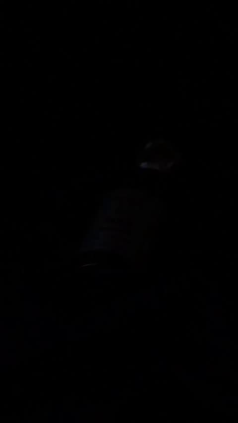</a>

从全黑开场，用边缘光逐步显出产品，再依次切换标签倾斜镜头、微距水花和慢动作手指按压喷嘴等镜头。在提示词中写明瓶身标签的完整文字，有助于锁定标签内容。

Seedance 2.5 · 文生视频 · 出处: [@juliaevee on X](https://x.com/juliaevee/status/2095745759027028252)

[`perfume`](tags.md#tag-perfume) [`product-ad`](tags.md#tag-product-ad) [`macro`](tags.md#tag-macro) [`slow-motion`](tags.md#tag-slow-motion)

<details><summary><b>提示词</b></summary>

```text
Cinematic 19-second commercial ad for a luxury perfume. The video starts in pitch darkness, slowly revealing a dark blue glass perfume bottle with a round silver metallic cap resting on dark folded leather, labeled "BLUE BY ISHQ EAU DE PARFUM 50 ML". Dynamic lighting shifts with sharp rim highlights outlining the bottle. A fine mist spray fills the air with delicate water particles illuminated by a spotlight behind the bottle. The camera transitions through dramatic angles: a close-up tilt shot of the label, macro water drops splashing dynamically around the glass base, a close-up of a finger pressing the metallic nozzle spraying a fine fragrance mist in slow motion, and a smooth rotating camera motion. High-end moody aesthetic, dramatic music beat sync, 8k resolution, ultra-realistic product commercial photography.
```

</details>

<a id="seedance-luxury-ugc-sunglasses-review"></a>
### UGC 创作者在阳光卧室里点评奢侈品太阳镜

<a href="https://x.com/AIwithSynthia/status/2086286356201066501">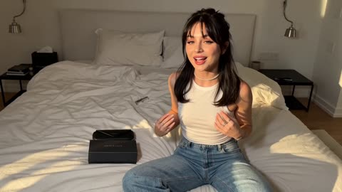</a>

用参考图锁定人物与三件商品的外观，再把每句台词与一个明确的镜头动作对应，让手持手机的真实感、微距特写和口型同步在整段视频里保持有序。按开箱、镜前试戴、特写的顺序排列节拍，能保证商品在各个镜头中前后一致。

Seedance 2.5 · 参考生视频 · 出处: [@AIwithSynthia on X](https://x.com/AIwithSynthia/status/2086286356201066501)

[`ugc`](tags.md#tag-ugc) [`product-review`](tags.md#tag-product-review) [`reference-images`](tags.md#tag-reference-images) [`lip-sync`](tags.md#tag-lip-sync)

<details><summary><b>提示词</b></summary>

```text
Use the uploaded reference image as the exact character reference. Preserve her facial identity, hairstyle, eye color, makeup, skin tone, body proportions, white sleeveless fitted top, light blue wide-leg jeans, pearl choker, rings, and bracelets consistently throughout the video. Use the uploaded sunglasses, retail box, and leather carrying case as locked product references. Maintain perfect product consistency, including the frame shape, lenses, hinges, colors, materials, and proportions.

Create an ultra-realistic UGC luxury creator review filmed inside a modern luxury bedroom with warm golden-hour sunlight, soft natural shadows, and a premium lifestyle aesthetic. The camera feels like a handheld smartphone with subtle natural movement while maintaining cinematic commercial quality.

The video begins with the woman sitting on the bed beside the retail box and leather case. Smiling at the camera, she says, "I genuinely wasn't expecting to love these this much." She picks up the box, opens it naturally, reveals the leather case, then slowly removes the sunglasses while continuing, "The packaging already feels incredibly premium."

She rotates the sunglasses slowly in front of the camera, showing the frame, hinges, and lenses as natural reflections glide across the surface. She smiles and says, "The finish feels amazing, and they're incredibly lightweight."

She puts on the sunglasses, stands up, and walks toward a large full-length mirror. Looking at her reflection, she adjusts the frame naturally and says, "Honestly... they look so good, and they're really comfortable on the eyes, even in bright sunlight."

She turns slightly left and right so the sunglasses catch the sunlight from different angles before removing them with a smile. Walking back to the bed, she places the sunglasses beside the leather case and retail box, then picks them up one last time and holds them beside her face.

Looking directly into the camera, she smiles warmly and says, "Definitely one of my favorite accessories this year." The camera slowly pushes in on the sunglasses before fading out.

Ultra-realistic UGC fashion content, authentic creator review, cinematic handheld smartphone movement, luxury bedroom, macro product cinematography, realistic reflections, detailed frame textures, expressive facial animation, perfect lip sync, shallow depth of field, premium color grading, 4K HDR, 16:9, no subtitles, no logos, no watermarks, no on-screen text on it
```

</details>

<a id="seedance-midnight-fashion-loop-penthouse"></a>
### 巴黎顶层公寓时尚循环，以黑暗前景收尾

<a href="https://x.com/codewithhajra/status/2117859525734674842">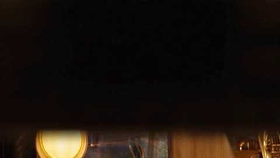</a>

结尾与开场使用同一个深色前景物体，镜头上升在循环点处延续。固定的每3秒分镜节拍和130 BPM音乐设定，让五套造型的节奏保持统一。

Seedance 2.5 · 文生视频 · 出处: [@codewithhajra on X](https://x.com/codewithhajra/status/2117859525734674842) · 发现于 [LearnPrompt/awesome-seedance](https://github.com/LearnPrompt/awesome-seedance)

[`fashion`](tags.md#tag-fashion) [`loop`](tags.md#tag-loop) [`camera-move`](tags.md#tag-camera-move)

<details><summary><b>提示词</b></summary>

```text
THE MIDNIGHT FASHION EDIT

15-second seamless looping fashion reel | Vertical 9:16 | 24 FPS | 5 scenes × 3 seconds

SEAMLESS OPENING & LOOP DESIGN

CRITICAL: The opening and ending must be visually identical and designed as one continuous camera movement.

OPENING FRAME (0.0s)

Begin with an extreme low-angle shot from behind the emerald-green velvet chaise lounge. A dark, out-of-focus foreground object partially covers the lens. Only a small portion of the golden lamp and warm penthouse lighting is visible.

The camera begins moving upward immediately, revealing the room as it rises toward the overhead composition.

ENDING FRAME (14.5–15.0s)

During the final clockwise barrel roll, rush toward the exact same dark foreground object used in the opening shot.

The foreground object gradually covers the entire lens until the final frame becomes completely dark.

Match the final frame to the opening frame in:

Camera position and height.
Lens angle and perspective.
Foreground object placement.
Darkness, exposure, and color.
Motion direction and speed.
Background lighting and visual composition.

LOOP CONNECTION

At exactly 15.0 seconds, the camera must continue the same upward movement established at 0.0 seconds. The opening rise should feel like the natural continuation of the final transition.

No fade-to-black followed by a separate restart. No sudden camera reset. No visible jump cut. No change in lighting.

The first and last frames must match precisely, and the motion across the cut must feel continuous.

FIVE FASHION SCENES

0–3s — THE CLASSIC MUSE

A timeless luxury outfit. She lies diagonally across the emerald velvet chaise, holding a perfume bottle above her face, then gently turns toward the camera.

3–6s — THE STREET-STYLE ICON

A completely different modern fashion look. One arm behind her head, the other near her waist. She adjusts her sleeve with a relaxed, confident expression.

6–9s — THE SOFT LUXURY LOOK

A romantic, elegant fashion look. She gently brushes her hair back and looks toward the overhead camera with a subtle smile.

9–12s — THE NIGHT OUT EDIT

A bold evening look. She holds an open fashion magazine above her chest, turns one page, and lowers it slightly.

12–15s — THE FINAL STATEMENT

A striking statement-fashion look. She rests one hand near her face, crosses her ankles, and gives the camera a subtle confident smile. The camera then performs the final clockwise barrel roll toward the dark foreground object.

ENVIRONMENT & CINEMATOGRAPHY

Maintain the same luxurious Parisian penthouse throughout: emerald-green velvet chaise, marble flooring, glowing city skyline, golden sculptural lamps, flowers, fashion magazines, vintage mirror, and candlelight.

Warm cinematic lighting, realistic fabric movement, subtle film grain, rich shadows, premium editorial color grading.

AUDIO

130 BPM laid-back luxury deep-house groove.
Consistent rhythm across all 15 seconds.
Bass impact and airy whoosh on each transition.
Natural fabric rustles and scene-specific foley.
No dialogue, no vocals.

FINAL TECHNICAL REQUIREMENTS

Duration: exactly 15 seconds.
Frame rate: 24 FPS.
Aspect ratio: 9:16.
Five scenes, exactly 3 seconds each.
Continuous visual environment.
Smooth camera movement.
No black-frame pause at the loop point.
No captions, logos, or watermarks.
Photorealistic live-action quality.

MOST IMPORTANT: Design the reel as a continuous circular camera journey. The final camera movement must return to the precise opening composition so viewers cannot tell where the video ends and begins. The loop must feel natural even when replayed repeatedly.
```

</details>

<a id="seedance-monochrome-studio-emerald-gown-ritual"></a>
### 黑白美妆工作室仪式，揭晓翡翠绿礼服

<a href="https://x.com/ElsaSofia__AI/status/2100179633266418072">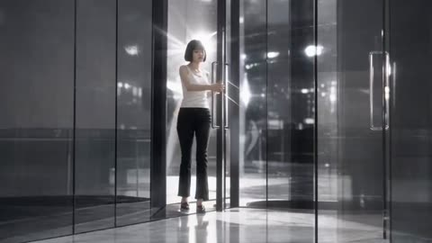</a>

@Image1 角色参考在全部 15 个镜头中锁定同一张脸，黑白色调让翡翠绿礼服成为唯一的饱和色。逐镜头的运镜与节拍对齐的声音提示，为模型提供了精确的时间线。

Seedance 2.5 · 参考生视频 · 出处: [@ElsaSofia__AI on X](https://x.com/ElsaSofia__AI/status/2100179633266418072) · 发现于 [LearnPrompt/awesome-seedance](https://github.com/LearnPrompt/awesome-seedance)

[`beauty`](tags.md#tag-beauty) [`monochrome`](tags.md#tag-monochrome) [`character-reference`](tags.md#tag-character-reference) [`fashion`](tags.md#tag-fashion)

<details><summary><b>提示词</b></summary>

```text
⤵️ 
SCENE 1 (0:00–0:30) — MONOCHROME STUDIO → FULL RITUAL → EMERALD GOWN → LAST DETAIL
SHOT STRUCTURE: 15 shots, 30 seconds, 16:9
@Image1 is the Aiko character reference — keep her face, fair skin, sleek black bob haircut and dark-brown eyes identical in every shot.
GLOBAL STYLE NOTES:
lighting_philosophy: crisp white beauty-dish key on her face, cool silver glow from square-framed vanity mirrors behind, soft grey practicals on walls; glossy speculars on marble, chrome and glass.
color_grade: high-gloss monochrome beauty commercial — charcoal-grey walls, ivory marble, fair skin held clean and cool; the emerald gown is the only deep saturated green in the film.
setting: sleek minimalist glam studio — charcoal-grey walls, polished ivory marble floor, low velvet stools in ash-grey, white sheepskin rugs, three large square chrome-framed vanity mirrors, a thin white LED strip along the ceiling, beauty-dish lights on stands, a disco ball throwing slow silver dots across the marble, open shelves of matte black labelled bottles and jars, a single orchid in a glass vase, a chrome drinks cart.
staff: three women in charcoal uniforms — an esthetician, a make-up artist, a hair stylist. Shown mainly as hands, forearms, backs and soft-focus bodies. No close-ups of their faces except the final reaction in medium shot. They move fast and react openly.
mirror_rule: mirrors stay BEHIND or BESIDE her, soft-focus, as light and texture only. Never a sharp reflection of her face shown next to her actual face in the same frame.
characters:
Aiko: visual_anchors: petite elegant build, sleek jet-black bob haircut with blunt bangs, dark-brown eyes, fair even skin, a small mole near one eye. Opens in a plain white ribbed tank top. Performance: composed, quietly amused — one mouth corner lifts, never a wide expression. She is the only still person in a room full of motion.
ambience: glossy pop beat locked to every cut, studio chatter under it, hairdryer hum. Beat drops at shot 12, cuts to silence at shot 15.
SEQUENCE LIST:
SHOT 1 (0–2s) HOOK — WS, glass door
camera_motion: static, then fast push-in
action_visual: Aiko (per @Image1) pushes the glass door open in a plain white tank top — cool silver light floods the frame. Door chime, beat starts on her step
exit: she walks past camera into the studio
SHOT 2 (2–4s) SETUP — MS tracking
camera_motion: handheld tracking behind her through the studio, chrome mirrors and shelves streaking past
action_visual: she drops into an ash-grey velvet stool. The esthetician snaps a white cape open and clicks it shut at her neck. A long emerald evening gown hangs soft-focus behind her; black leather ankle boots sit under the stool
exit: hands enter frame toward her face
SHOT 3 (4–6s) — insert macro on hands
camera_motion: static macro, 85mm
action_visual: a pump bottle pushes white cleansing foam into a gloved palm; gloved hands work the foam up her cheeks in one upward sweep. Wet foam squelch, pump hiss
exit: water enters frame
SHOT 4 (6–8s) — MCU
camera_motion: static, slight handheld float
action_visual: water rinses the foam, she lifts her wet face and droplets fly sideways catching the beauty-dish light
exit: a brush enters frame from the left
SHOT 5 (8–10s) SIGNATURE — MCU, frontal
vfx: none. Speed 100%
camera_motion: locked frontal, composition does not shift
action_visual: a brush lays charcoal clay mask in three strokes → jump to the mask already dry. She raises ONE eyebrow, the crust cracks across the bridge of her nose. The esthetician freezes mid-air with the brush. Aiko lowers the brow back
exit: two gel patches click under her eyes
SHOT 6 (10–12s) — MCU, frontal, same framing
camera_motion: locked, no movement
action_visual: the make-up artist slams a large powder puff straight into the lens, frame goes soft white → clears on glowing porcelain make-up and satin lips
exit: a brush sweeps across frame
SHOT 7 (12–14s) — MCU, same framing
camera_motion: locked
action_visual: the brush clears to reveal a sharp graphic black cat-eye liner and pale lips → a palm sweeps down the frame → clears on deep bronze eyelids
exit: the powder puff slams into the lens again
SHOT 8 (14–16s) — MCU, same framing
camera_motion: locked, tiny push-in
action_visual: frame clears on full smoky bronze eye, subtle highlighter on the cheekbones, deep berry-red lipstick. The make-up artist steps back and raises both hands. Aiko holds still half a second. Lipstick cap clicks
exit: a towel is pulled off her head
SHOT 9 (16–18s) — MS
camera_motion: static, then whip pan out and back
action_visual: the stylist rips the towel away, wet hair drops in one sheet → whip pan returns on a sleek glossy black bob shining under the beauty-dish light
exit: a flat iron enters frame
SHOT 10 (18–19s) — insert macro
vfx: speed ramp 50%→100%
camera_motion: static macro, 50mm
action_visual: the flat iron clicks open and releases a glossy sheet of hair, steam rises into the light beam
exit: steam crosses the lens
SHOT 11 (19–21s) — MS
camera_motion: two fast whip pans, out and back each time
action_visual: hair pushed back loose, the stylist tucks it behind her ear → whip pan → sleek blunt-bangs bob with a sharp edge. Aiko tips her head, hair swings across frame
exit: hair fills frame
SHOT 12 (21–24s) CLIMAX — MS to WS, studio floor
camera_motion: static, then slow pull-back
action_visual: the stylist lifts the emerald gown off a chrome hanger, the fabric flies across the whole frame — deep emerald floods the screen — then falls away: Aiko stands in the middle of the studio in a long emerald silk evening gown, bob restored, silk running to the floor. Silk whoosh, heavy fabric fall
exit: fingers rise to her ear
SHOT 13 (24–26s) — insert macro on ear
camera_motion: static macro, 85mm
action_visual: the make-up artist's fingers fasten a small emerald drop earring at her ear. The clasp click lands as the beat drop
exit: camera pulls wide
SHOT 14 (26–28s) — WS full length
camera_motion: static wide, three staff visible either side of her
action_visual: Aiko glances aside, takes two steps to the stool and bends down. Low insert: the emerald silk hem lifts and black leather ankle boots enter frame — one foot, then the other
exit: she straightens up
SHOT 15 (28–30s) PUNCHLINE — WS full length
camera_motion: locked off, no movement
action_visual: she straightens, adjusts the hem so the ankle boots stay visible, and looks straight into the lens. All three staff freeze. The stylist drops a brush — it clatters on the marble. One mouth corner lifts. She walks out of frame. Beat cuts to silence on the clatter
exit: empty studio, three women looking after her, brush on the floor. Hold one second, end
GENERATE FIRST: Shot 5 (eyebrow cracks the mask — the tone-setter), Shot 12 (emerald gown fabric wipe), Shot 15 (ankle boots punchline).
```

</details>

<a id="seedance-new-york-coffee-spill-slow-motion"></a>
### 阳光下纽约人行道上的女子与金毛犬

<a href="https://x.com/AvelyrahnAI/status/2094420859960045616">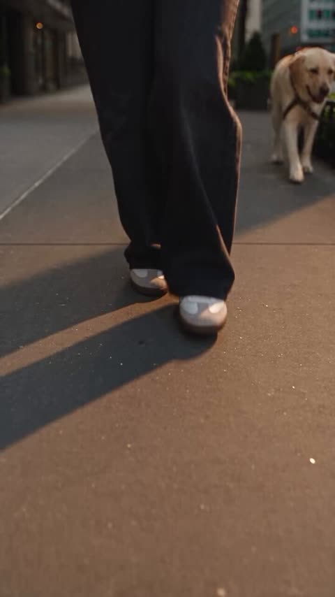</a>

按时间节拍写成：先是平稳行走的铺垫，接着绊倒触发慢动作悬浮，然后插入品牌杯子和显示 BOSS 来电的手机宏观特写，最后物体落地。杯子、传单和来电界面的文字用引号固定，金色时光与狗的画面也写明，保证场景稳定。

Seedance 2.5 · 文生视频 · 出处: [@AvelyrahnAI on X](https://x.com/AvelyrahnAI/status/2094420859960045616) · 发现于 [LearnPrompt/awesome-seedance](https://github.com/LearnPrompt/awesome-seedance)

[`slow motion`](tags.md#tag-slowmotion) [`golden-hour`](tags.md#tag-golden-hour) [`new-york`](tags.md#tag-new-york) [`pet`](tags.md#tag-pet)

<details><summary><b>提示词</b></summary>

```text
A stylish young woman walking confidently down a busy New York city sidewalk during golden hour, wearing a dark fitted t-shirt, relaxed dark jeans, and sneakers, talking on her smartphone and holding an iced coffee and a cafe menu, with a golden retriever dog walking on a leash beside her; suddenly, she trips and drops her phone, iced coffee cup, and a "YA HALA COFFEE - FALL MENU" flyer mid-stride, causing the items to suspend mid-air in slow motion with magical liquid splashes and floating autumn leaves, transitioning to a macro close-up of the branded coffee cup and a smartphone displaying an incoming call from "BOSS" before everything drops back to the pavement in a dynamic, high-octane commercial cinematic style.
```

</details>

<a id="seedance-nike-air-max-deadline-twist-ad"></a>
### 深夜办公桌旁的女性创意总监与 Nike Air Max 运动鞋

<a href="https://x.com/SyntheSarah/status/2096099021152498159">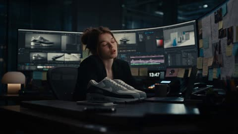</a>

按时间段划分分镜并写入台词，让 30 秒广告的节奏清晰。用一条固定规则锁定人物的脸、发型和服装，并为键盘声、脚步声和音乐停顿逐段写明音效，控制连贯性与喜剧节奏。

Seedance 2.5 · 文生视频 · 出处: [@SyntheSarah on X](https://x.com/SyntheSarah/status/2096099021152498159) · 发现于 [LearnPrompt/awesome-seedance](https://github.com/LearnPrompt/awesome-seedance)

[`advertising`](tags.md#tag-advertising) [`sneakers`](tags.md#tag-sneakers) [`character-consistency`](tags.md#tag-character-consistency) [`timed-beats`](tags.md#tag-timed-beats) [`sound-design`](tags.md#tag-sound-design)

<details><summary><b>提示词</b></summary>

```text
Create a 30-second ultra-photorealistic cinematic commercial for Nike Air Max, combining premium sports advertising, creativity, subtle comedy, and a surprising twist.

Keep the female creative director’s face, hairstyle, clothing, body proportions, and appearance perfectly consistent throughout.

0–4s — THE DEADLINE
Late-night creative studio. A stylish young female creative director sits surrounded by monitors and unfinished projects. Nike Air Max sneakers sit on her desk. Notifications appear rapidly. She says:
“Five projects. One deadline.”

4–8s — THE IDEA
She looks at the Nike Air Max, gets an idea, rapidly creates a campaign on her computer, and hits ENTER. The screen flashes.

8–16s — THE CAMPAIGN
A powerful athlete wearing the same Nike Air Max runs through multiple cinematic environments: a futuristic city at sunrise, rain-soaked streets, and mountains. Show extreme close-ups of the sneakers, realistic Air Max cushioning compression, pavement impacts, water splashes, and seamless match cuts between locations.

16–21s — DONE
Back in the studio, her monitors display polished Nike Air Max campaign visuals. Only seconds have passed. Shocked, she says:
“Wait… that's it?”

21–26s — THE TWIST
She relaxes with coffee. A notification appears: CAMPAIGN APPROVED. She smiles. Another appears:
CLIENT: “Can we make 10 more?”
Her smile disappears. She looks at the camera and says:
“Never mind.”

26–30s — HERO REVEAL
Extreme cinematic product shot of Nike Air Max on a dark reflective surface. Dramatic lighting, floating particles, slow camera rotation. Final frame:
NIKE — JUST DO IT.

STYLE: Ultra-photorealistic, premium global sports commercial, cinematic lighting, realistic skin, fabric, reflections, shadows, natural motion, dynamic camera movement, shallow depth of field, subtle slow motion. No cartoon style, distorted anatomy, fake logos, fake text, watermarks, or altered shoe design.

AUDIO: Keyboard and notification sounds at the start, building into energetic cinematic music during the running sequence. Powerful footsteps, sneaker impacts, water splashes, and bass hits. Music drops for the comedy moment and ends with a strong cinematic hit.
```

</details>

<a id="seedance-nz-rain-street-nike-sony"></a>
### 雨中奥克兰街头，穿 Nike 外套的女孩拿着索尼相机

<a href="https://x.com/Strength04_X/status/2097303258171949530">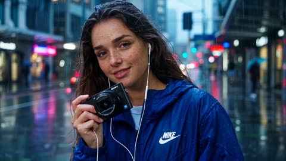</a>

固定的人物与服装描述加上带秒数的分镜表和硬切要求，让同一人物在各个场景中保持一致。明确写出衣料上的雨珠和可见的耳机线等物理细节，让画面更接近实拍而非 CGI。

Seedance 2.5 · 文生视频 · 出处: [@Strength04_X on X](https://x.com/Strength04_X/status/2097303258171949530) · 发现于 [LearnPrompt/awesome-seedance](https://github.com/LearnPrompt/awesome-seedance)

[`fashion`](tags.md#tag-fashion) [`travel`](tags.md#tag-travel) [`rain`](tags.md#tag-rain) [`shot-list`](tags.md#tag-shot-list)

<details><summary><b>提示词</b></summary>

```text
[GENERATION GOAL]
30-second cinematic fashion-travel music video following one beautiful sweet slim young woman across New Zealand — starting on a rainy Auckland street, moving through a coastal train journey, green countryside and finally a dramatic black-sand beach where she dances with a friend. She listens to music through white wired earphones and carries a Sony compact camera. Photoreal live-action, energetic editorial pacing, hard cuts only.

[CORE LOOK]
Premium outdoor fashion commercial meets cinematic road-trip film.
Cool blue rain, emerald greens, volcanic black sand, warm sunset skin tones.
Natural film grain, subtle lens bloom, realistic moisture and atmospheric perspective.
24fps, 180-degree shutter.
No artificial CGI look, no beauty smoothing, no warped faces, no duplicated people, no random text, no watermarks.

[LEAD]
Generate a new original beautiful sweet slim woman in her early 20s.
Heart-shaped face, bright hazel-brown eyes, long dark wavy hair, soft straight brows, subtle brown eyeliner, naturally glossy peach lips, fair warm skin with realistic freckles across nose and cheeks, slim athletic figure, delicate hands, short glossy pale-pink nails.
She has an innocent sweet smile and playful personality.
No glasses.
She never speaks.

White wired earphones in both ears whenever she appears. Cable remains visible.

[FRIEND]
Appears from 22s onward.
Young East-Asian woman, early 20s, short dark bob haircut, oversized pale-yellow sweatshirt, loose denim trousers, white sneakers.
No earphones.

[FASHION / PRODUCT]
LOOK A 0–6.5s:
Royal-blue Nike windbreaker, black straight-leg pants, white sneakers, small black shoulder bag. Sony RX100-style compact camera in hand.

LOOK B 6.5–15.5s:
Cream Nike cropped fleece jacket, forest-green cargo skirt over black leggings, silver watch, cream mini backpack.

LOOK C 15.5–30s:
Graphite Nike lightweight track jacket, loose black trousers, white sneakers, small silver hoop earrings.

No Adidas. No Puma. Nike branding stays physically correct and understated.

[LOCATIONS]
LOC 1 — Auckland rainy street:
Glass towers, wet pavement, neon reflections, green trees, moving pedestrians and buses.

LOC 2 — Historic railway platform:
Dark green station canopy, old benches, rain droplets, passengers waiting naturally.

LOC 3 — Coastal train:
Large window, ocean cliffs outside, woman seated beside window.

LOC 4 — Train reflection:
Close-up of her face reflected in rain-covered glass, city disappearing behind.

LOC 5 — Countryside station:
Wooden platform, green hills, sheep pasture in distance.

LOC 6 — Mountain road:
Long winding road through emerald hills.

LOC 7 — Waterfall trail:
Wet wooden walkway, huge waterfall behind mist.

LOC 8 — Black-sand beach:
Wide volcanic beach, dark rocks, crashing turquoise-grey ocean.

LOC 9 — Cliff path:
Grass-covered cliff edge, strong ocean wind.

LOC 10 — Beach café:
Small wooden café, surfboards, warm interior lights.

LOC 11 — Coastal overlook:
Two wooden benches facing ocean.

LOC 12 — Final beach plaza:
Open black-sand area with distant cliffs and sea.

[30-SECOND TIMELINE]

0.0–2.2s
SHOT 1 — RAIN OPEN
50mm handheld close-up. Woman walks beneath light rain in LOOK A. Drops collect on blue jacket. She smiles while listening to music.

2.2–3.8s
SHOT 2 — CAMERA DETAIL
85mm ECU. Her fingers switch Sony camera mode. White earphone cable crosses jacket naturally.

3.8–6.5s
SHOT 3 — STREET CROSS
35mm tracking shot. She crosses wet street, turns toward camera with a small smile. Bus passes behind, creating natural foreground wipe.

6.5–8.6s
SHOT 4 — PLATFORM CUT
Hard cut on bus wipe. LOOK B. She walks onto railway platform holding camera and cream backpack.

8.6–10.4s
SHOT 5 — TRAIN ARRIVAL
24mm. Train enters frame, wind moves her hair and fleece. She looks toward it.

10.4–12.6s
SHOT 6 — WINDOW
50mm inside train. She sits beside window, earphones visible, cheek against glass, watching countryside.

12.6–14.2s
SHOT 7 — REFLECTION
85mm close. Her face reflected in rain-streaked window. She closes eyes for a second and smiles.

14.2–16.0s
SHOT 8 — TITLE
Hard cut to countryside station.
She steps down from train.
Huge yellow condensed text:
【NEW ZEALAND】
appears vertically beside her as she walks forward.

16.0–18.0s
SHOT 9 — GREEN HILLS
24mm wide. LOOK C begins. She walks through a grassy mountain road, camera tracking sideways. Clouds move across distant hills.

18.0–19.8s
SHOT 10 — WATERFALL
Wide 24mm. She stands near wet wooden trail, turns toward massive waterfall and laughs.

19.8–21.6s
SHOT 11 — OCEAN REVEAL
Hard cut. She walks over grassy cliff path. Camera starts behind her and gently moves beside her, revealing black-sand beach below.

21.6–23.2s
SHOT 12 — FRIEND ARRIVAL
Friend enters from frame right holding two takeaway drinks. Lead turns and laughs.

23.2–25.0s
SHOT 13 — BEACH WALK
35mm two-shot. Both walk barefoot along black sand, shoes in hands, laughing naturally. Wind moves their clothes.

25.0–26.4s
SHOT 14 — CAMERA SNAP
85mm. Friend takes Sony camera from lead and quickly photographs her. Lead laughs and covers face playfully.

26.4–28.0s
SHOT 15 — RUN TO WATER
Wide 24mm. Both run toward shallow waves, jackets and hair moving naturally.

28.0–30.0s
SHOT 16 — DANCE + TITLE
Wide-to-medium. They stop near beach café and dance freely to music, no choreography.
At 28.6s bold yellow condensed text hits:
【KEEP MOVING】
Then at 29.3s:
【KEEP DREAMING】
Both stacked over the dancing pair.
Lead throws one arm upward and laughs.
Hard cut to black.

[CAMERA / MOVEMENT]
Rain shots: handheld 50mm.
Train: locked and intimate 50–85mm.
Landscape: 24mm with natural atmospheric depth.
Beach: low 24mm and gentle lateral tracking.
No drone orbit.
No crash zoom.
No artificial slow motion.
Hard cuts motivated by movement.

[PHYSICS]
Rain beads remain physically attached to fabric.
Wet pavement reflects real light.
Hair reacts to wind and moisture.
Earphone cable never vanishes.
Camera has realistic weight.
Fleece and nylon wrinkle naturally.
Ocean spray moves independently.
Footsteps disturb wet sand realistically.

[LIGHTING]
Auckland: cool cloudy daylight and practical city reflections.
Train: soft window light.
Countryside: diffused cloud light.
Waterfall: cool mist bounce.
Beach: overcast coastal light transitioning into warm late-day glow.
Faces retain realistic skin texture and eye catchlights.

[AUDIO]
Rain hitting jacket.
Street traffic.
Train brakes and rail vibration.
Camera shutter.
Distant waterfall.
Ocean wind.
Footsteps on wet sand.
Small natural laughs.
No dialogue.
No voiceover.
No lyrics.
Only two specified English title cards.

[FINAL CONSISTENCY]
One original lead throughout.
Friend only from 21.6s.
White wired earphones remain visible.
Nike is the only fashion-sports brand.
Sony compact camera remains consistent.
Photoreal premium live-action.
No anime, no 3D, no plastic skin.
```

</details>

<a id="seedance-overhead-fan-four-looks-rug"></a>
### 女子躺在地毯上，吊扇经过时四套造型依次切换

<a href="https://x.com/AIwithkhan/status/2102221702667309467">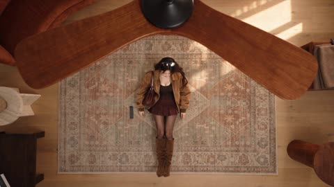</a>

固定俯拍机位，并以吊扇作为唯一转场，每次换装都发生在叶片扫过身体的瞬间，因此无需剪辑。角色与每套服装的参考图确保四次造型揭示中人物身份和服饰保持一致。

Seedance 2.5 · 参考生视频 · 出处: [@AIwithkhan on X](https://x.com/AIwithkhan/status/2102221702667309467) · 发现于 [LearnPrompt/awesome-seedance](https://github.com/LearnPrompt/awesome-seedance)

[`fashion`](tags.md#tag-fashion) [`overhead-shot`](tags.md#tag-overhead-shot) [`outfit-transition`](tags.md#tag-outfit-transition)

<details><summary><b>提示词</b></summary>

```text
Create a 15-second ultra-realistic vertical 9: 16 fashion film shot entirely from a fixed 90° overhead camera, using the supplied character and wardrobe images as strict references; preserve the same face, body proportions, hair and identity throughout. The Korean woman lies on a luxurious autumn-toned Persian-inspired rug over walnut flooring, surrounded by subtle upscale apartment furniture, while warm late-afternoon sunlight creates realistic shadows. A realistic wooden ceiling fan rotates continuously above her and acts as the only transition device. LOOK 1 chocolate ribbed tank, oversized camel suede bomber, burgundy pleated mini skirt, espresso tights, tobacco slouch boots, oxblood shoulder bag, gold hoops and tortoiseshell sunglasses. She casually picks up a remote and looks upward. As the fan blade physically passes over her body, seamlessly reveal LOOK 2 cream shearling hat, ivory knit sweater, olive utility jacket, wide faded jeans, cream socks, leopard slingbacks and espresso tote. Another blade sweep reveals LOOK 3 oxblood asymmetric knit top, chocolate faux-fur coat, charcoal pinstripe trousers, black kitten-heel boots and cherry-red handbag. The next rotation reveals LOOK 4 charcoal beret, moss-green mohair cardigan, chocolate tank, espresso leather trousers, burgundy loafers, charcoal socks and cherry-red handbag. She makes subtle editorial pose adjustments after each transition, always looking directly upward. End with her completely still in LOOK 4 as the fan continues rotating. Ultra-realistic fabrics, leather, suede, fur and skin, cinematic autumn color grading, natural film grain and premium fashion-campaign realism. Strictly no cuts, camera movement, zooms, angle changes, morphing, identity drift, outfit glitches, warped hands, duplicated limbs, disappearing accessories, text, logos or watermark.
```

</details>

<a id="seedance-overhead-rug-outfit-transitions-ceiling-fan"></a>
### 波斯地毯俯拍的连续换装

<a href="https://x.com/Zoyavelle/status/2108060187840180394">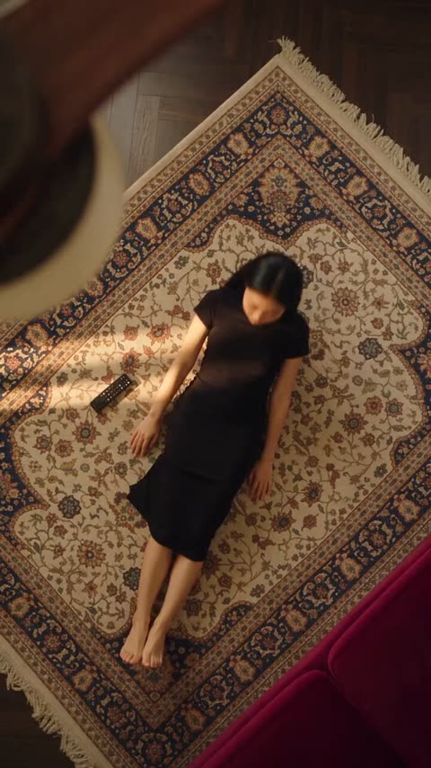</a>

用一句话锁定姿势、机位、环境和面部，只让服装变化，并按顺序列出每套服装，让转场层次清晰。前景缓慢旋转的吊扇叶片为固定俯拍增加了纵深和自然的动态模糊。

Seedance 2.5 · 文生视频 · 出处: [@Zoyavelle on X](https://x.com/Zoyavelle/status/2108060187840180394) · 发现于 [LearnPrompt/awesome-seedance](https://github.com/LearnPrompt/awesome-seedance)

[`fashion`](tags.md#tag-fashion) [`outfit-transition`](tags.md#tag-outfit-transition) [`top-down`](tags.md#tag-top-down) [`photorealistic`](tags.md#tag-photorealistic) [`cozy-interior`](tags.md#tag-cozy-interior)

<details><summary><b>提示词</b></summary>

```text
A cinematic top-down overhead shot of a young Asian woman lying barefoot on an elegant vintage Persian rug in a warm, cozy living room, viewed through the wooden blades of a slowly rotating ceiling fan in the foreground. She has natural black hair and a calm relaxed expression. The scene uses warm golden indoor lighting, realistic wooden flooring, detailed traditional carpet patterns, soft shadows, and a cozy aesthetic interior. The woman appears in a simple black dress at first, then smoothly transitions through several different fashionable outfits while maintaining the exact same pose, position, camera angle, environment, and facial identity. Outfit transitions include a soft pink cardigan with a white dress, a red cardigan over a white top, and finally a brown textured dress. Highly photorealistic, natural skin texture, realistic fabric details, cinematic lighting, shallow depth of field, subtle motion blur from the rotating ceiling fan, smooth seamless outfit transformation, professional fashion video, DSLR quality, ultra-detailed, 4K, realistic proportions, stable overhead camera, no text, no watermark.

Camera: fixed top-down perspective, ceiling fan blades passing naturally across the frame, slow smooth motion.
Aspect ratio: 16:9.
Style: photorealistic cinematic fashion video, warm cozy atmosphere, seamless transitions.
```

</details>

<a id="seedance-pan-fried-bao-juice-burst"></a>
### 生煎包煎制出锅，汤汁爆出

<a href="https://x.com/Lianaalane/status/2096903888813330826"></a>

按镜头顺序分镜书写，每个镜头写明景别和一个具体动作，如夹起、撕开、翻面，让模型有清晰的时间顺序。蒸汽、汤汁和焦壳等质感以可见事件描述，而不是形容词，使各镜头外观保持一致。

Seedance 2.5 · 文生视频 · 出处: [@Lianaalane on X](https://x.com/Lianaalane/status/2096903888813330826) · 发现于 [LearnPrompt/awesome-seedance](https://github.com/LearnPrompt/awesome-seedance)

[`food`](tags.md#tag-food) [`asmr`](tags.md#tag-asmr) [`close-up`](tags.md#tag-close-up) [`steam`](tags.md#tag-steam) [`street-food`](tags.md#tag-street-food)

<details><summary><b>提示词</b></summary>

```text
Create a hyper-realistic cinematic 15-second food video in the exact glossy ultra-detailed commercial style of premium Asian street-food ASMR films, with creamy soft lighting, slow-motion juice drips, rising steam and mouth-watering close-ups.  
Wooden chopsticks slowly lift a plump white shengjianbao from a black iron pan, black sesame seeds and green onion on top, dough shining under warm light. The bao is torn open in dramatic slow motion as thick golden broth and juicy minced meat filling burst out, sticky amber sauce stretching and cascading downward in long glossy strands while dense white steam swirls upward. Extreme close-up of the savory meatball-like filling as golden liquid continuously drips into a white ceramic spoon, forming perfect heavy droplets. Wide shot of a cast-iron skillet packed with perfectly pleated raw baozi on a gas stove as clear water is poured in, instantly creating thick clouds of steam. Tight shots show the bottoms crisping into golden lace-like crusts while a metal spatula flips them, revealing caramelized crunchy edges. Finished baozi stacked on a blue-and-white plate, one bitten open to reveal steaming pinkish meat and sauce, chopsticks dipping it into dark soy-sesame dipping sauce. Final wide shot of the steaming plate under a warm hanging lamp on a wooden table in a cozy night kitchen, soft steam rising against a dark window with distant city lights.
```

</details>

<a id="seedance-red-bull-wings-highway-takeoff"></a>
### 红牛罐在停滞的高速公路上滚动

<a href="https://x.com/azed_ai/status/2100947530431520915">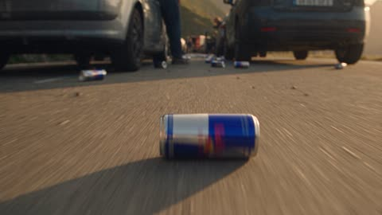</a>

按时间段逐步推进，每个动作都由上一个动作引发：罐子散落导致车流停止，抢罐与首口饮用触发变身，人群随之跟进。低角度贴地跟拍滚动的罐子，甩镜与加速段都由动作驱动，而不是为切换而切换。

Seedance 2.5 · 文生视频 · 出处: [@azed_ai on X](https://x.com/azed_ai/status/2100947530431520915) · 发现于 [LearnPrompt/awesome-seedance](https://github.com/LearnPrompt/awesome-seedance)

[`red-bull`](tags.md#tag-red-bull) [`commercial`](tags.md#tag-commercial) [`transformation`](tags.md#tag-transformation) [`crowd`](tags.md#tag-crowd)

<details><summary><b>提示词</b></summary>

```text
Create an explosive, energetic, photorealistic Red Bull commercial that transforms an ordinary highway accident into a rapidly escalating spectacle built around the literal realization of “Red Bull gives you wings.” A Red Bull delivery truck has experienced a minor non-injury accident on a mountain highway, causing hundreds of intact cans to spill across the road and bring traffic to a complete stop, but the frustration of the stranded drivers quickly turns into excitement when one person grabs a can, drinks it, suddenly grows enormous wings, and launches into the sky, triggering a contagious wave of people rushing from their cars, grabbing cans, drinking, transforming, and taking flight until the entire highway erupts into a massive airborne celebration.

The commercial should build energy continuously rather than repeatedly stopping for reactions, with faster camera movement, aggressive transitions motivated by physical action, dynamic crowd behavior, cans rolling beneath vehicles, doors opening simultaneously, people sprinting between cars, rapid transformations, powerful wing movements, wind blasting across the road, loose clothing whipping through the air, papers flying from vehicles, and increasingly dramatic takeoffs that culminate in dozens of people racing through the sky above the abandoned traffic.

Set the commercial on a spectacular mountain highway during brilliant late-afternoon sunlight, where a Red Bull delivery truck has stopped diagonally across several lanes after a minor accident and its rear cargo section has opened, releasing hundreds of shiny Red Bull cans that scatter across the asphalt between a long line of stopped cars. Nobody is injured and there is no fire, blood, panic, or graphic destruction, while the accident functions purely as the energetic setup that releases the product and interrupts the traffic.

Use premium high-energy sports-commercial cinematography with fast tracking shots, low road-level cameras racing beside rolling cans, aggressive push-ins, sweeping crane movements, vehicle-mounted perspectives, whip pans motivated by action, energetic handheld moments inside the crowd, dramatic aerial tracking, speed ramps around transformations, and powerful upward camera movements during takeoffs, while preserving enough visual continuity that every action clearly causes the next.

[00:00-00:04] RED BULL EVERYWHERE

Open at maximum energy with a low camera racing inches above the highway behind several Red Bull cans as they roll rapidly across the asphalt, bouncing between stopped tires while car brakes squeal and doors begin opening around them, before whipping upward to reveal the Red Bull delivery truck positioned diagonally farther ahead with hundreds of additional cans scattered across the road. Drivers lean from windows, passengers point toward the cans, horns echo through the mountain pass, and one can spins away from the larger pile before rolling directly toward a person stepping from a sports car.

[00:04-00:08] CRACK IT OPEN

Follow the same can without breaking continuity as the person catches it with one hand, looks toward the enormous spill, grins, snaps the tab open with a sharp CRACK, and drinks while the camera circles rapidly around them and nearby drivers begin grabbing cans for themselves. As the first person lowers the can, their jacket suddenly pulls backward as if caught by a powerful gust, enormous feathered wings burst outward and unfold behind them with enough force to send loose papers and dust sweeping across the road, while the surrounding crowd erupts in astonished shouts.

The transformed person looks at the wings, looks at the can, smiles, and says, “Okay... that works.”

[00:08-00:13] EVERYONE WANTS ONE

The first transformation immediately triggers chaos as dozens of people rush from their stationary cars toward the scattered cans, while the camera charges alongside them at road level and follows hands grabbing cans directly from the asphalt before rapidly cutting between tabs snapping open, cans tilting upward, people drinking, eyes widening, clothing beginning to move, and enormous wings unfolding one after another across the highway. Each transformation sends another blast of air through the crowd, causing hair, jackets, newspapers, shopping receipts, and lightweight objects to whip through the frame as the previously ordinary traffic jam becomes increasingly surreal.

A person sees wings explode open beside them, looks excitedly at the Red Bull can in their hand, and shouts, “I’m definitely drinking this!”, before opening it immediately.

[00:13-00:18] TAKEOFF

The original transformed driver takes several running steps between the stationary cars, spreads their wings completely, and launches powerfully upward as the camera races behind them before tilting vertically toward the sky, while several newly transformed people immediately follow from different parts of the same highway. One person runs across the roof line between two stationary vehicles before lifting safely into the air, another rises directly from the road with several enormous wing beats, while a group farther behind launches almost simultaneously and creates a huge blast of wind that sends abandoned newspapers swirling through the traffic.

Keep accelerating the editing rhythm as every new takeoff motivates the next camera movement, making the road feel increasingly empty while the sky becomes increasingly crowded.

[00:18-00:23] THE HIGHWAY TAKES FLIGHT

Transition into a breathtaking aerial chase as dozens of winged people race above the highway, diving between mountain ridges, banking around one another, climbing through sunlight, and laughing as they discover how naturally they can fly, while the camera moves with the speed and aggression of an extreme-sports commercial rather than observing them passively from a distance. Several flyers race alongside one another above the valley before one dives toward the highway, skims above the abandoned cars, then pulls upward at the last moment as the camera follows into a dramatic vertical climb.

Far below, more people continue drinking and launching from the road, creating a constant stream of new flyers joining the enormous formation overhead.

[00:23-00:27] EVERYONE IS GONE

Dive rapidly from the flying crowd back toward the highway and race through the traffic at road level, revealing car after car sitting completely abandoned with doors still open while Red Bull cans roll slowly between the tires and the enormous traffic jam that seemed impossible to escape only seconds earlier has become strangely empty. The camera continues accelerating toward the delivery truck until the driver steps from behind it, looks around at the deserted vehicles, then slowly looks upward and sees hundreds of wings crossing the golden sky above him.

He looks toward one remaining Red Bull can beside his shoe.

He smiles.

[00:27-00:30] ONE LAST TAKEOFF

The driver grabs the can, snaps it open, drinks immediately, and enormous wings unfold behind him as the camera pulls backward from the force of the movement, before he launches straight upward and the camera follows him into the sky where he joins the enormous airborne crowd racing toward the horizon. As everyone sweeps past the camera in one final surge of wings and rushing air, transition cleanly into the Red Bull product hero shot with a chilled can covered in condensation against the open sky.

Finish with:

RED BULL

GIVES YOU WINGS

Maintain relentless forward momentum while preserving strict cause-and-effect continuity, because the truck accident releases the cans, the rolling cans attract the stranded drivers, the first person demonstrates the transformation, witnessing that transformation motivates everyone else to grab cans, simultaneous drinking creates the rapidly expanding wave of wings, the growing number of transformed people triggers the mass takeoff, and the increasingly empty highway naturally reveals that the traffic jam has effectively moved into the sky.

Every person must physically acquire a Red Bull can before drinking it, every transformation must happen only after drinking, and every person must visibly possess fully developed wings before leaving the ground, while the transformations should feel powerful and instantaneous without becoming grotesque or anatomical. Keep the same truck, vehicles, people, cans, road geography, sunlight direction, scattered objects, and crowd positions consistent throughout, while using speed ramps, energetic tracking, whip pans, low-angle movement, dramatic aerial pursuit, strong wing-generated wind, punchy sound design, rapidly intensifying music, crisp can-opening sounds, rushing air, crowd excitement, and explosive takeoffs to make the commercial feel increasingly energetic until the final brand payoff.
```

</details>

<a id="seedance-retro-pink-bedroom-morning-commercial"></a>
### 粉色复古卧室晨间梳妆，配老式电话

<a href="https://x.com/noorlewisx/status/2097545178013950280">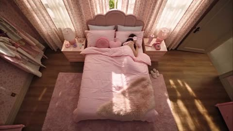</a>

七个编号镜头各写明一种机位运动，如俯拍、特写或跟拍。重复的粉色调与服装描述锁定了角色和卧室，使25秒内画面保持一致。

Seedance 2.5 · 文生视频 · 出处: [@noorlewisx on X](https://x.com/noorlewisx/status/2097545178013950280) · 发现于 [LearnPrompt/awesome-seedance](https://github.com/LearnPrompt/awesome-seedance)

[`pastel-pink`](tags.md#tag-pastel-pink) [`retro-90s`](tags.md#tag-retro-90s) [`fashion-commercial`](tags.md#tag-fashion-commercial) [`bedroom`](tags.md#tag-bedroom)

<details><summary><b>提示词</b></summary>

```text
Create a cinematic 25-second dreamy retro-pink fashion commercial set inside a cozy feminine bedroom. Everything has a soft pastel pink color palette, warm morning sunlight, vintage 90s aesthetic, floral wallpaper, pink bed, vanity mirror, cute retro telephone, pink accessories and soft curtains.

Scene 1: Wide overhead shot of a beautiful pink bedroom in warm sunlight, soft shadows falling across the bed, dreamy nostalgic atmosphere.

Scene 2: A young woman in a cute pastel-pink sleepwear outfit lies comfortably on the bed wearing a pink sleep mask, holding a vintage pink telephone. A pink tumbler sits beside her. Slow cinematic camera movement.

Scene 3: Close-up beauty shot of her face as she lifts the sleep mask slightly and talks on the phone, soft glowing skin, natural makeup, gentle expressions, shallow depth of field.

Scene 4: She gets out of bed and walks toward the vanity. Smooth tracking shot following her through the sunlit bedroom.

Scene 5: At the vintage vanity, she sits in front of a large oval mirror and gets ready, surrounded by perfumes, makeup, hair accessories and jewelry. Show elegant close-ups of her brushing her hair and applying makeup.

Scene 6: She looks toward the bedroom door, walks over and slowly peeks outside with a playful expression.

Scene 7: Final glamorous mirror shot: she is now fully dressed in a stylish pastel-pink outfit, standing confidently in front of the vanity mirror. Soft sunlight, elegant pose, dreamy romantic-commercial atmosphere.

Visual style: ultra-realistic cinematic photography, pastel pink tones, warm natural sunlight, nostalgic 1990s aesthetic, soft film grain, dreamy glow, realistic skin texture, shallow depth of field, smooth camera movements, subtle lens flare, premium fashion commercial, highly detailed, 4K, consistent character and wardrobe throughout, no text, no watermark.
```

</details>

<a id="seedance-rice-water-serum-commercial"></a>
### 白色反光台面上的米水烟酰胺精华瓶

<a href="https://x.com/AvelyrahnAI/status/2095373906815115469"></a>

将视频拆成编号分镜，每个分镜指定一种镜头类型，为模型提供清晰的顺序。用引号写出确切的标签文字，并以布光和运镜收尾，使瓶身文字和棚拍质感在各镜头间保持稳定。

Seedance 2.5 · 文生视频 · 出处: [@AvelyrahnAI on X](https://x.com/AvelyrahnAI/status/2095373906815115469)

[`skincare`](tags.md#tag-skincare) [`product-shot`](tags.md#tag-product-shot) [`macro`](tags.md#tag-macro) [`studio-lighting`](tags.md#tag-studio-lighting)

<details><summary><b>提示词</b></summary>

```text
A high-end cinematic commercial for a skincare facial serum. 

Scene 1: A clean white pump bottle labeled "Rice Water & Niacinamide Serum" standing on a reflective white surface with crystal-clear water droplets floating around it against a bright, minimalist background.

Scene 2: Macro shot of a glass dropper releasing a pure drop of serum into a liquid pool with gentle ripples.

Scene 3: A close-up of a model with glowing, flawless skin applying the serum to her cheek. 

Scene 4: Flat-lay shot of the bottle surrounded by raw rice grains and water splashes, panning smoothly to show the product beside its packaging box. Ultra-realistic, 4K resolution, commercial studio lighting, smooth professional camera movement, clean and luxurious aesthetic.
```

</details>

<a id="seedance-school-uniform-lookbook-turntable"></a>
### 校园风穿搭画册，模特与商品同步旋转

<a href="https://x.com/AI__TSUBAKI/status/2102459655700287648"></a>

从首帧锁定整张版式，只让模特和商品动起来。模特转身与每件商品旋转一圈在同一节拍结束，画面同步感清楚。

Seedance 2.5 · 图生视频 · 出处: [@AI__TSUBAKI on X](https://x.com/AI__TSUBAKI/status/2102459655700287648) · 发现于 [LearnPrompt/awesome-seedance](https://github.com/LearnPrompt/awesome-seedance)

[`fashion`](tags.md#tag-fashion) [`lookbook`](tags.md#tag-lookbook) [`turnaround`](tags.md#tag-turnaround) [`product-rotation`](tags.md#tag-product-rotation)

<details><summary><b>提示词</b></summary>

```text
A clean, premium 4-second fashion lookbook animation starting from the first frame. The entire layout stays exactly as shown: same background, same cream item panel, same captions, same crown icons, same wordmark, same framing.

The model on the right turns a full 360° on the spot the way a real fashion model does on set: she steps her feet around naturally, shifting her weight from one leg to the other as she turns, her arms moving freely and her shoulders relaxed. As she comes around to the back she glances over her shoulder, and as she returns to face the camera she settles into a new, different confident model pose. Natural posture, realistic cloth physics; hair, hems and accessories swing and settle with the motion. She stays in the same spot and at the same size in frame throughout.

At the same time, every product cutout inside the item panel rotates in place on its own vertical axis, like a luxury product display render, revealing front, side and back. Each item stays centered in its own slot, keeps its size, and completes exactly one full rotation in sync with the model's turn, ending in its original orientation.

The panel, divider lines, captions, crown icons and wordmark stay perfectly fixed; only the model moves and the products rotate. Camera locked off, no zoom, no pan. Soft studio lighting with realistic shadows under the model and the products. Smooth, natural motion, clean commercial fashion-ad aesthetic, ultra-sharp details, luxury catalog presentation.
```

</details>

<a id="seedance-snow-alpine-fur-jacket-walk"></a>
### 身穿白色毛领夹克的女子走过雪山

<a href="https://x.com/CaliraVal/status/2107697202646987178">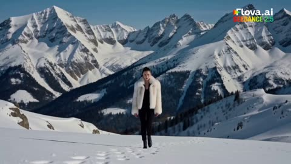</a>

按时间段分镜，依次为全景、跟拍、侧面特写和推近镜头，给模型清晰的镜头顺序。每段重复人物的面容、发型和服装，让整段视频的主体保持一致。

Seedance 2.5 · 文生视频 · 出处: [@CaliraVal on X](https://x.com/CaliraVal/status/2107697202646987178) · 发现于 [LearnPrompt/awesome-seedance](https://github.com/LearnPrompt/awesome-seedance)

[`fashion`](tags.md#tag-fashion) [`snow`](tags.md#tag-snow) [`mountain`](tags.md#tag-mountain) [`luxury`](tags.md#tag-luxury)

<details><summary><b>提示词</b></summary>

```text
A beautiful young woman with fair skin, realistic facial features, dark brown hair in a sleek high ponytail, natural makeup, wearing a luxurious white faux-fur jacket over a fitted black top, tailored black pants, and black leather ankle boots. Keep her identity, face, hairstyle, body proportions, and outfit consistent throughout.

0–4s: Wide cinematic shot of her standing in a breathtaking snow-covered alpine landscape with huge snowy mountains behind her. She begins walking toward the camera through fresh snow.

4–8s: Smooth full-body tracking shot as she walks confidently through the snow. Her boots leave realistic footprints while her fur jacket and ponytail move naturally in the cold wind.

8–12s: Elegant side-profile fashion shot. She stops, gently adjusts the fur collar, and looks toward the distant mountains. Soft winter sunlight highlights her face and the texture of the fur.

12–15s: Slow cinematic push-in to a beautiful close-up of her face. She calmly looks toward the camera, then slightly turns toward the mountains as the shot ends.

Photorealistic live-action, high-end luxury fashion campaign, cinematic camera movement, realistic snow and fabric physics, natural skin texture, soft winter sunlight, shallow depth of field, premium color grading, ultra-detailed, 4K quality.

Negative: distorted face, changing identity, changing outfit, unnatural hands, extra fingers, unrealistic walking, floating feet, CGI look, plastic skin, flickering, jitter, text, logo, watermark.
#Flovaai #Flovacpp 
@Flovaai_Japan
```

</details>

<a id="seedance-subway-pink-dress-fashion-film"></a>
### 粉色连衣裙女子与疾驰而过的地铁

<a href="https://x.com/Harry_thingss/status/2103494748132770038">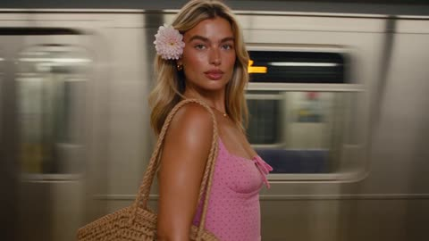</a>

参考图加上每个镜头都重复的人物锁定描述，保证全片是同一位女子，并按顺序写出每个镜头的动作节拍，让动作像一个连续镜头。站台的实拍灯光和经过的列车营造出动态模糊背景，并明确要求焦点内不出现其他人。

Seedance 2.5 · 参考生视频 · 出处: [@Harry_thingss on X](https://x.com/Harry_thingss/status/2103494748132770038) · 发现于 [LearnPrompt/awesome-seedance](https://github.com/LearnPrompt/awesome-seedance)

[`fashion`](tags.md#tag-fashion) [`subway`](tags.md#tag-subway) [`motion-blur`](tags.md#tag-motion-blur) [`character-lock`](tags.md#tag-character-lock) [`music-video`](tags.md#tag-music-video)

<details><summary><b>提示词</b></summary>

```text
Photoreal cinematic ~9 seconds, high-end fashion-film look. A young German woman with long wavy blonde hair, olive-tan skin, sharp brows, and glossy lips. A pale pink flower is pinned behind her right ear. She wears a pink spaghetti-strap mini dress with small black polka dots and carries a woven straw shoulder bag. Soft glam makeup, gold jewelry, warm skin highlights. Location: underground subway platform at night. Yellow safety strip on the platform edge, tiled walls, overhead fluorescent lights. A silver metro train streaks behind her in heavy motion blur — windows, doors, and at one moment an Japanese flag graphic on the passing car. Shot sequence, continuous energy: Medium close-up, she looks over her shoulder into camera while the train screams past behind her. Profile: she brings a lip wand or finger to her mouth, applying gloss as hair lifts in the train wind. She turns, hair swinging, eyes on camera, slight smirk. Wider on the platform: she touches her collarbone / strap, dress and bag readable, train still moving in the background. Head tipped back, hair flying, chin up, train with the flag ripping through frame. She looks back and smiles. Fast hair flip — hand rakes through hair, back partly to camera. Tight close-up: she blows a kiss to lens, fingers near lips, flower still in hair. Camera: mixed handheld fashion-cam and locked beauty close-ups. Shallow depth of field on her face, background train smeared into silver-and-light streaks. Practical station lighting plus a warm key on her skin. Color: creamy highlights, rich dark hair, the pink flower and red lips pop against cool subway metal. Motion: hair and dress always moving from train rush / her own turns. No extra people in focus. Mood: confident, flirty, summer-night city girl, music-video energy. Audio direction: upbeat dance-pop / Latin-pop, lyrics in the vein of “she got that vibe… dance all night… eyes on me.” Train rumble low under the track. Style keywords: photoreal fashion film, subway platform, motion-blur train, polka-dot sundress, pink hair flower, straw bag, glossy lips, hair flip, blow kiss, shallow focus, night metro lighting, 4K, no text overlay. Character lock (use with the reference still): Same German woman 📷dp.jpg as the daylight field photo: long blonde center-parted waves, pink flower over the right ear, pink black-polka-dot sundress, woven bag, warm skin, full lips. Keep identity consistent across every shot.
```

</details>

<a id="seedance-vampire-queen-flying-car-paris"></a>
### 雨夜巴黎街道与雾中埃菲尔铁塔

<a href="https://x.com/AIwithNatalia/status/2112412816070381937">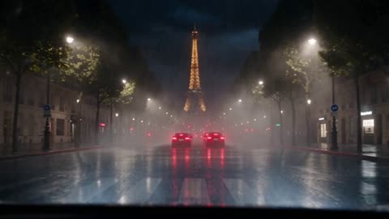</a>

将25至30秒的广告拆成六个带时间码的镜头，每个镜头都写明运镜，并用说话人标签给出台词，便于控制节奏与口型。开头的一致性段落让所有镜头中的车辆、服装与光线保持统一，负面提示词则抑制人脸和车身几何的漂移。

Seedance 2.5 · 文生视频 · 出处: [@AIwithNatalia on X](https://x.com/AIwithNatalia/status/2112412816070381937)

[`car-commercial`](tags.md#tag-car-commercial) [`paris-night`](tags.md#tag-paris-night) [`dark-fantasy`](tags.md#tag-dark-fantasy) [`multi-shot`](tags.md#tag-multi-shot)

<details><summary><b>提示词</b></summary>

```text
Duration: 25–30 seconds

Visual style: Ultra-photorealistic, dark fantasy, futuristic luxury car commercial, gothic Halloween cinema.

CHARACTER & WORLD CONSISTENCY
A glamorous adult vampire queen with long red wavy hair, pale porcelain makeup, smoky eyes, deep burgundy lipstick, a black velvet corset dress.

She drives the same sleek metallic-silver futuristic flying sports car throughout the film. The car has sculpted aerodynamic bodywork, violet neon underglow, glowing propulsion systems, a panoramic glass canopy, and elegant gullwing doors.
Paris at midnight on Halloween. Gothic architecture, fog-covered rooftops, wet streets, floating mist, glowing pumpkins, and a gigantic luminous blood-red moon dominate the atmosphere.

Maintain consistent character appearance, car design, lighting, and wardrobe across all shots.

SHOT 1 — THE HALLOWEEN NIGHTMARE (0–4 seconds)

Camera: Cinematic street-level tracking shot transitioning into an intimate interior close-up.

A massive traffic jam fills a rain-soaked Paris boulevard. Red brake lights stretch into the distance. The Eiffel Tower glows through atmospheric fog.
Inside the silver car, the vampire queen taps her fingers impatiently against the steering wheel. Violet dashboard light reflects in her eyes.

Her phone rings.

Friend, on the phone: “Babe! Where are you?! The Halloween party is starting!”

Vampire queen: “Relax, darling. I'll find another way.”

She smirks, revealing her tiny vampire fangs.

SHOT 2 — THE SUPERNATURAL TAKEOFF (4–8 seconds)

Camera: Extreme macro close-up, followed by a dramatic low-angle exterior shot.

Her black-gloved finger presses the glowing violet flight-mode control.
The dashboard pulses with futuristic holographic light. Mechanical propulsion fins unfold beneath the car. Violet energy illuminates the wet asphalt.

The suspension rises. The wheels rotate inward as concealed thrusters activate.

The car lifts smoothly, then suddenly accelerates vertically between the surrounding buildings, leaving a swirling vortex of mist and crimson-violet light.

Vampire queen: “Traffic is so… mortal.”

The camera races upward beneath the vehicle, revealing its glowing undercarriage as the car climbs into the night sky.

SHOT 3 — THE EIFFEL TOWER SPIRAL (8–13 seconds)

Camera: Fast aerial chase shot with a sweeping 360-degree orbit around the vehicle.

The silver flying car bursts through a layer of clouds and approaches the illuminated Eiffel Tower.
It banks sharply, then performs a spectacular corkscrew spiral around the tower, weaving through the open night sky without touching the structure.

The camera circles the car while the Eiffel Tower rotates dramatically in the background. Its golden lights streak across the car's reflective silver body.

The vehicle dives past the tower's upper section, rolls gracefully onto its side, and pulls upward into a steep climb.

A trail of violet light curls around the tower like magical ribbons.

The camera pulls far back to reveal the Eiffel Tower, the Seine, illuminated bridges, and the sprawling city below.

SHOT 4 — THE BLOOD MOON REVEAL (13–19 seconds)

Camera: Extreme wide shot transitioning into a dramatic side profile and a 360-degree aerial orbit.

A gigantic blood-red Halloween moon emerges from behind dark, rolling clouds, appearing enormous above the Paris skyline.
The car accelerates toward the moon, climbing through swirling silver mist. The camera follows from behind as the city shrinks beneath the vehicle.

At the peak of the ascent, the car performs a graceful aerial barrel roll directly in front of the enormous crimson moon.

For a breathtaking moment, the car becomes a sharp black-and-silver silhouette against the glowing red lunar surface.

The camera rotates a full 360 degrees around the flying car, revealing the moon, drifting clouds, the Eiffel Tower far below, and the entire illuminated Paris skyline.

The moonlight catches the vampire queen's face through the panoramic glass canopy. Her cape flows behind her like crimson smoke.

She smiles confidently.

Vampire queen: “Now this is my kind of nightlife.”

SHOT 5 — THE EPIC 360° PARIS PANORAMA (19–24 seconds)

Camera: Seamless cinematic aerial orbit, then a rapid descending chase shot.

The car levels out and glides above Paris in a wide, sweeping arc.
The camera completes a breathtaking 360-degree panoramic orbit around the vehicle, showcasing gothic rooftops, the winding Seine, glittering bridges, the Eiffel Tower, the Louvre courtyard, and the blood-red moon dominating the horizon.

Clouds drift beneath the car. Violet propulsion trails illuminate the mist.

The car suddenly tilts forward and dives toward the city in a controlled cinematic descent.

The camera chases closely behind as it races between elegant Parisian rooftops, then banks sharply into the illuminated street leading to the Halloween club.

SHOT 6 — THE VAMPIRE QUEEN ARRIVES (24–30 seconds)

Camera: Low-angle tracking shot, dramatic slow motion, final hero shot.

The car descends through swirling fog and lands perfectly outside an extravagant gothic Halloween nightclub.
Its violet lights pulse once. The gullwing doors open slowly.

The vampire queen steps out in slow motion. Her crimson-lined cape sweeps dramatically across the pavement as purple spotlights cut through the fog.

Her friends, dressed as glamorous witches and vampires, stare at her in disbelief.

Friend: “BABE! HOW DID YOU GET HERE SO FAST?!”

Vampire queen, smirking: “I don't wait in traffic. I fly.”

She flashes her fangs and walks confidently toward the club entrance.

The camera cranes upward to reveal the silver flying car, the gothic nightclub, the illuminated Eiffel Tower, and the enormous blood-red moon above Paris.

END FRAME: The vampire queen's silhouette against the glowing club entrance as violet light and crimson moonlight fill the screen.

CINEMATIC CAMERA & VFX REQUIREMENTS

Spectacular aerial tracking shots and dramatic low-angle vehicle reveals.

A complete 360-degree camera orbit around the flying car against the blood-red moon.
A dramatic corkscrew flight maneuver around the Eiffel Tower.
Volumetric fog, swirling clouds, moonlit mist, realistic reflections, and violet energy trails.
Strong contrast between silver metallic surfaces, violet neon, crimson moonlight, and golden Parisian architecture.
Physically coherent vehicle movement, realistic acceleration, smooth banking, and elegant aerial rolls.
Sophisticated gothic fashion-film aesthetics with blockbuster-scale visual effects.
Seamless transitions, cinematic motion blur, carefully controlled slow motion, and epic orchestral-electronic music.
Natural English dialogue with accurate lip-sync and consistent character identity.
NEGATIVE PROMPT: Cartoon rendering, cheap CGI, flat lighting, low-resolution textures, inconsistent vehicle geometry, changing faces, changing outfits, duplicated cars, distorted Eiffel Tower, broken architecture, random text, unwanted logos, excessive motion blur, jerky camera movement, gore, or horror imagery that overwhelms the luxury-fashion aesthetic.
```

</details>

<a id="seedance-velvet-kiss-lip-oil-commercial"></a>
### 唇油瓶微距展示与下落液滴

<a href="https://x.com/itxabdullaa/status/2103084704979394875">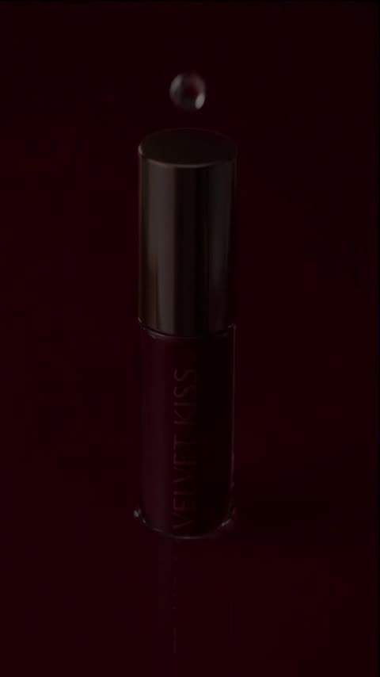</a>

在每个镜头中重复角色锁定和产品锁定两段约束，并用带秒数的镜头时间线让模型按固定节奏完成30秒剪辑。焦段、音效要求以及禁止字幕和变形的说明也都写进了提示词。

Seedance 2.5 · 参考生视频 · 出处: [@itxabdullaa on X](https://x.com/itxabdullaa/status/2103084704979394875) · 发现于 [LearnPrompt/awesome-seedance](https://github.com/LearnPrompt/awesome-seedance)

[`beauty`](tags.md#tag-beauty) [`product-reveal`](tags.md#tag-product-reveal) [`reference-lock`](tags.md#tag-reference-lock) [`timeline`](tags.md#tag-timeline)

<details><summary><b>提示词</b></summary>

```text
Part-1 30-SEC VERTICAL 9:16 | PHOTOREALISTIC LUXURY BEAUTY COMMERCIAL

Create a premium European luxury beauty commercial using the provided CHARACTER REFERENCE and PRODUCT REFERENCE.

ABSOLUTE REALISM:
Live-action cinema quality. Real human model, practical cosmetics, real glass, real liquids, real fruit and physical studio sets. Natural skin pores, realistic eyes, hair strands, hands, reflections, liquid physics and camera optics. No CGI look, wax skin, uncanny eyes, plastic face or AI aesthetic.

CHARACTER LOCK:
Use the exact same blonde female model throughout. Preserve her face, blue-green eyes, high bun, makeup, body proportions and dusty-rose pink suit.

PRODUCT LOCK:
Use the exact VELVET KISS raspberry-red lip oil in every product shot. Preserve bottle shape, color, lettering, glass and rose-gold cap.

SHOT TIMELINE:
0–1.7s — Extreme macro product reveal inside glossy raspberry-red liquid, droplets, rose-gold highlight, slow push-in and subtle rotation.

1.7–4.1s — Model walks through a pristine white luxury studio, then approaches camera holding VELVET KISS close to lens. Natural focus shift from product to eyes.

4.1–7.3s — Realistic hands open the lip oil. Macro applicator movement and close-up lip application with natural glossy texture.

7.3–10.6s — Product hero surrounded by raspberry-red liquid, followed by glossy lips and a chrome-surface product shot.

10.6–13.5s — Product inside soft blush-pink liquid folds. Realistic fluid physics, macro details and slow camera push toward VELVET KISS branding.

13.5–18.8s — Model in dusty-rose suit holds product beside her cheek, applies it again, then looks into camera with subtle natural expressions and blinking.

18.8–22.4s — Editorial upside-down portrait, followed by floating cosmetic droplets and a transition into realistic fresh raspberries and strawberries.

22.4–26.6s — Product among fresh berries, then model returns to the white studio. She walks toward camera, leans in and holds the product near her lips. Final clean product hero on dusty-rose background.

26.6–30s — Brief realistic blue-toned editorial beauty contrast, then immediately return to the model in white studio holding VELVET KISS beside her face. Subtle final camera push-in.

AUDIO:
Sophisticated minimal electronic-pop luxury soundtrack with deep bass pulse, glossy synth textures, subtle sparkle and restrained percussion. No vocals or dialogue. Add faint realistic cap-twist, applicator and liquid sounds.

EDITING:
Premium fashion-commercial pacing. Precise music-synced cuts, elegant slow motion, fast editorial transitions and realistic focus pulls. No AI morphing, text, subtitles, promotional graphics or watermarks.

CAMERA:
Full-frame cinema look with 35mm, 50mm, 85mm and 100mm macro lenses. Realistic depth of field, motion blur, exposure, reflections and controlled studio lighting.

FINAL QUALITY:
Photorealistic live-action luxury beauty campaign. Maintain perfect character and product continuity in every frame. Same face, hair, makeup, outfit, body, product design, color, proportions, lettering and cap throughout. Every shot must feel like it was filmed during one professional production.
```

</details>

<a id="seedance-white-handbag-golden-waterfront"></a>
### 金色水岸边身穿白色西装的女子

<a href="https://x.com/aiwithaayat/status/2100863394878525602">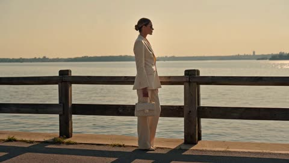</a>

按镜头顺序写明从远景建立、手袋特写到剪影收尾的分镜，使广告结构清晰。明确金色时段光线、浅景深与面料质感等描述，让画面保持写实的时尚大片质感。

Seedance 2.5 · 文生视频 · 出处: [@aiwithaayat on X](https://x.com/aiwithaayat/status/2100863394878525602) · 发现于 [LearnPrompt/awesome-seedance](https://github.com/LearnPrompt/awesome-seedance)

[`fashion`](tags.md#tag-fashion) [`luxury`](tags.md#tag-luxury) [`golden`](tags.md#tag-golden) [`commercial`](tags.md#tag-commercial)

<details><summary><b>提示词</b></summary>

```text
Prompt: Created a 10-second video featuring an elegant woman in a sophisticated white tailored suit walking beside a calm waterfront during golden hour.
She carries a luxurious quilted white handbag with refined gold hardware, creating a premium fashion-advertising aesthetic.
Begin with a wide cinematic shot of the woman standing beside the wooden waterfront railing with the glowing city skyline in the distance.
Slowly move into detailed close-ups of the handbag, highlighting its quilted texture, structured shape, handle, and polished gold clasp.
Show the handbag resting beautifully on the wooden railing with warm sunlight reflecting across the water behind it.
Transition to a medium fashion shot capturing the woman’s elegant white suit, confident posture, and graceful movement.
She gently adjusts her stylish sunglasses while looking toward the horizon, creating a calm and sophisticated luxury mood.
Use smooth cinematic camera movements, shallow depth of field, realistic fabric and leather textures, natural skin tones, and soft golden-hour lighting.
End with a wider silhouette shot of the woman walking along the waterfront as the sunlight fades into a warm evening atmosphere.
Photorealistic luxury fashion commercial, cinematic composition, premium visual quality, realistic lighting, subtle film grain, and elegant storytelling.
```

</details>

<a id="seedance-xenon-holographic-watch-promo"></a>
### 旋转智能手表宣传片，全息HUD揭示

<a href="https://x.com/noorwithwifi/status/2089705270608056651">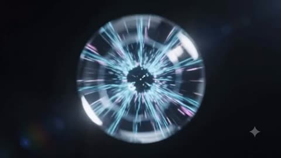</a>

这段提示用径向能量脉冲串联各个镜头，脉冲变成旋转手表，随后在产品特写、佩戴者和智能眼镜场景之间切换，最后以发光能量环收束到品牌标识。每个镜头都写明具体视觉元素，有助于模型在切换中保持产品和品牌一致。

Seedance 2.5 · 文生视频 · 出处: [@noorwithwifi on X](https://x.com/noorwithwifi/status/2089705270608056651)

[`smartwatch`](tags.md#tag-smartwatch) [`product-promo`](tags.md#tag-product-promo) [`holographic-hud`](tags.md#tag-holographic-hud) [`energy-pulse`](tags.md#tag-energy-pulse)

<details><summary><b>提示词</b></summary>

```text
Create a sleek futuristic smartwatch promo video for “XENON.” Begin with a radial energy pulse transitioning into a rotating dark metallic watch with floating particles, then reveal a close-up face with glowing blue holographic numbers and futuristic gauges. Show a person wearing the watch as circuit-like patterns illuminate their hand and holographic HUD panels project around their wrist. Cut to a silver-haired person in smart glasses surrounded by floating interfaces in a dark digital grid environment, and finish with a glowing energy ring around the watch revealing the “XENON – REACH BEYOND” branding.
```

</details>

<a id="seedance-ysl-libre-perfume-commercial"></a>
### 女模特在手腕上喷洒YSL Libre香水

<a href="https://x.com/AIwithZeeshi/status/2110579418271818208">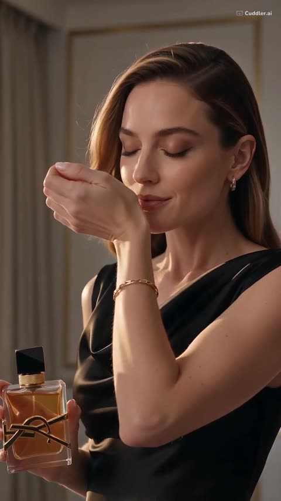</a>

提示词把15秒广告拆成有先后顺序的动作段落（拿起、喷香、走向窗边、结尾特写），让模型有清晰的镜头顺序。结尾集中列出物理真实感与镜头运动的术语（平滑跟拍、玻璃反光、角色一致），以此设定画面的真实质感。

Seedance 2.5 · 文生视频 · 出处: [@AIwithZeeshi on X](https://x.com/AIwithZeeshi/status/2110579418271818208) · 发现于 [LearnPrompt/awesome-seedance](https://github.com/LearnPrompt/awesome-seedance)

[`perfume`](tags.md#tag-perfume) [`luxury`](tags.md#tag-luxury) [`product-ad`](tags.md#tag-product-ad) [`fashion`](tags.md#tag-fashion)

<details><summary><b>提示词</b></summary>

```text
Create a 15-second ultra-photorealistic luxury perfume commercial featuring YSL Libre Eau de Parfum.

A stunning Western fashion model in an elegant black satin evening dress stands inside a luxurious Manhattan penthouse at golden hour. She picks up the iconic black-and-gold perfume bottle, sprays the fragrance on her wrist, and gently appreciates its scent. She then walks gracefully toward the floor-to-ceiling windows as her hair and dress move naturally. The video ends with a cinematic close-up of the perfume bottle against the glowing New York skyline.

Luxury fashion aesthetics, realistic skin texture, natural human movement, physically accurate perfume mist, realistic glass reflections, natural fabric physics, consistent character appearance, cinematic lighting, smooth camera tracking, believable gravity and airflow, and premium commercial cinematography throughout.
```

</details>

<a id="veo-candy-keyboard"></a>
### 糖果做的键盘

<a href="https://storage.googleapis.com/gdm-deepmind-com-prod-public/media/media/veo__veo-3__keyboard.webm">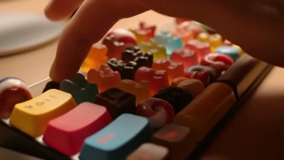</a>

单独一行 `Audio:` 告诉模型画面该配什么声音。

Veo 3 · 文生视频 · 出处: [Veo 3 prompt guide](https://deepmind.google/models/veo/prompt-guide/)

[`sfx`](tags.md#tag-sfx) [`product`](tags.md#tag-product) [`whimsical`](tags.md#tag-whimsical)

<details><summary><b>提示词</b></summary>

```text
A keyboard whose keys are made of different types of candy. Typing makes sweet, crunchy sounds. Audio: Crunchy, sugary typing sounds, delighted giggles.
```

</details>

[1](video-commercial.md) · **2**
