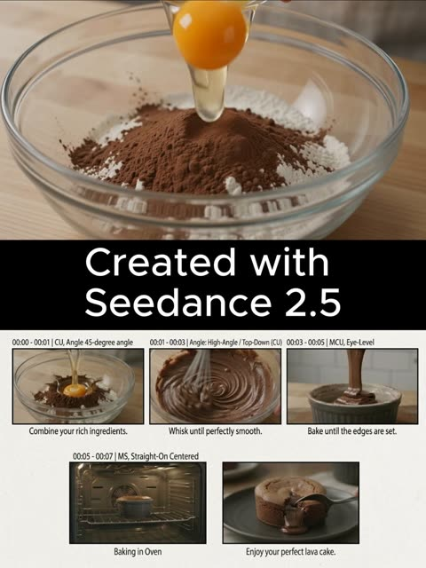

# 广告与产品

[返回目录](../../README_zh.md) · 全部 87 条

<a id="kling-vintage-watch-macro"></a>
### 指尖捏着复古腕表的微距镜头

<a href="https://x.com/higgsfield_ai/status/2019088049448362164"></a>

提示词用英寸级机位距离，并列出灰尘、细划痕、包浆等具体表面细节，让模型稳住质感。单一暖色侧掠光、浅景深，加上只有秒针这一处微动，画面不易闪烁或崩坏。

Kling 3.0 · 文生视频 · 出处: [@higgsfield_ai on X](https://x.com/higgsfield_ai/status/2019088049448362164) · 2,534 赞，统计于 2026-10-27

[`macro`](tags.md#tag-macro) [`product-shot`](tags.md#tag-product-shot) [`shallow-depth-of-field`](tags.md#tag-shallow-depth-of-field) [`moody-lighting`](tags.md#tag-moody-lighting) [`cinematic`](tags.md#tag-cinematic)

<details><summary><b>提示词</b></summary>

```text
Ultra-realistic cinematic macro shot of a vintage wristwatch held between two fingers, extreme close-up framing focused on the watch face and crystal, with the camera positioned inches away to reveal fine dust particles, micro scratches on the glass, worn metal edges, engraved numerals, and subtle patina on the hands. Shallow depth of field isolates the dial while the background dissolves into soft, dark bokeh. The lighting is moody and directional, a single warm key light grazing the surface to create delicate reflections along the curved crystal and metallic rim, emphasizing texture and age. The second hand moves subtly, creating a sense of quiet tension and time passing. Skin texture of the fingers is visible at the edges of the frame, slightly out of focus, adding scale and realism. High contrast, cinematic color grading, soft film grain, precise focus breathing, and a tactile, intimate macro perspective that feels handcrafted and timeless.
```

</details>

<a id="kling-turntable-needle-macro-pushin"></a>
### 唱机推镜至唱针微距

<a href="https://x.com/higgsfield_ai/status/2019101323317375400"></a>

以给定画面为起始帧，一镜到底。刚性螺栓固定式推镜锁定唱针尖，并列出微距细节、主导音效和明确的镜头规则。

Kling 3.0 · 图生视频 · 出处: [@higgsfield_ai on X](https://x.com/higgsfield_ai/status/2019101323317375400) · 2,357 赞，统计于 2026-10-27

[`macro`](tags.md#tag-macro) [`single-take`](tags.md#tag-single-take) [`sound-design`](tags.md#tag-sound-design) [`push-in`](tags.md#tag-push-in) [`analog`](tags.md#tag-analog)

<details><summary><b>提示词</b></summary>

```text
Use the provided image as the exact starting frame.
Cinematic video, single continuous shot, duration 5–7 seconds.
Single take. No cuts. No transitions.
CAMERA & ACTION (CONTINUOUS MOTION)
The camera starts static, framing a turntable in warm analog studio light.
A human hand lowers the tonearm onto a spinning vinyl record.
The record begins rotating smoothly. Immediately after contact, the camera accelerates forward in one continuous movement, a fast, rigid robot-bolt push-in directly toward the stylus needle. No easing. No cinematic zoom. Pure mechanical forward motion. As the camera reaches extreme macro distance, it locks onto the needle tip, as if physically bolted to it, without any cut. From this moment on, the camera moves together with the needle, perfectly synchronized.

MACRO DETAIL (SAME SHOT)
Extreme macro view shows:
Stylus tip vibrating microscopically
Vinyl grooves flowing beneath
Dust particles, micro scratches, groove texture
Subtle vertical and lateral needle movement, physically accurate
The camera remains rigidly attached, only tiny micro-vibrations from groove friction.

SOUND DESIGN (DOMINANT, CONTINUOUS)
Sound is uninterrupted and dominant:
Needle drop click
Loud, authentic vinyl crackle and hiss
Stylus-on-groove friction
Low mechanical hum of the turntable
No music clarity at first — raw analog texture only.
No score. No digital effects.

VISUAL STYLE
Extreme macro cinematography
Ultra-shallow depth of field
Warm analog color grading
Natural reflections on vinyl
Subtle film grain

CAMERA RULES
One continuous take
No cuts, no edits, no montage
No handheld shake
No floating camera
Robo-cam, bolt-mounted feel only

END FRAME
Camera stays locked to the needle,
vinyl spinning endlessly beneath it,
hypnotic, mechanical, intimate.
```

</details>

<a id="seedance-woman-in-storm-crowd"></a>
### 人群齐动，她一动不动

<a href="https://x.com/AIwithkhan/status/2099707375943066094"></a>

上传的图锁定人物、人群和构图，文字只管动作和禁止项。

Seedance 2.5 · 参考生视频 · 出处: [@AIwithkhan on X](https://x.com/AIwithkhan/status/2099707375943066094) · 2,128 赞，统计于 2026-10-27

[`fashion`](tags.md#tag-fashion) [`crowd`](tags.md#tag-crowd) [`reference-images`](tags.md#tag-reference-images)

<details><summary><b>提示词</b></summary>

```text
Create a ultra-realistic cinematic fashion video using the uploaded images as exact visual references for the woman, crowd, wardrobe, framing, and atmosphere.
A young woman with the same short dark bob wears a fitted black turtleneck, black trousers, and black shoes, standing confidently at the center of a large crowd.
Start with her walking slowly toward the middle of the crowd, calm and expressionless, with a lit cigarette naturally held between her lips.
She reaches the center, stops, and faces directly into the camera.
She takes one slow drag from the cigarette, then removes it from her mouth.
She slowly exhales a visible stream of smoke toward the camera, with the smoke naturally drifting across her face.
She lowers her hand and becomes completely still, staring directly into the lens.
The entire crowd behind her remains frozen for a brief moment.
Suddenly, everyone behind her begins moving in perfect synchronization — sharp head turns, shoulder jerks, folding forward and snapping upright.
The movement should feel rhythmic, strange, powerful, and physically realistic.
The woman does not move at all while the entire crowd moves behind her.
Slowly push the camera closer to her, keeping her sharply focused while the crowd has subtle depth-of-field blur.
Dark, cold, mysterious lighting with deep shadows, realistic skin, hair, clothing, cigarette ember, and physically accurate smoke.
Photorealistic live-action quality, cinematic composition, natural human movement; no animation, CGI look, duplicated woman, distorted bodies, excessive smoke, text, subtitles, or logos.
```

</details>

<a id="wan-fashion-face-closeup-flash-orbit"></a>
### 带抓拍闪光的超近景时尚人像

<a href="https://x.com/leaf_sanren/status/2105645639703183753"></a>

提示词把15秒拆成五个时间段，每段写明运镜、眼神和闪光时机。同时列出真实的皮肤瑕疵并禁止塑料感，让人脸保持摄影质感。

Wan 3.0 · 文生视频 · 出处: [@leaf_sanren on X](https://x.com/leaf_sanren/status/2105645639703183753) · 1,439 赞，统计于 2026-10-27

[`portrait`](tags.md#tag-portrait) [`fashion`](tags.md#tag-fashion) [`close-up`](tags.md#tag-close-up) [`skin-texture`](tags.md#tag-skin-texture) [`vertical`](tags.md#tag-vertical)

<details><summary><b>提示词</b></summary>

```text
Generate this video: Create a 15-second, 9:16 vertical screen, ultra-high-definition 4K, 30fps, cinematic realistic portrait quality fashion portrait short film.

The main subject of the frame is a young Asian woman around 20-25 years old, with a high-end face—cool with a touch of youthful greenness, delicate features but not overly perfect, smooth facial contours, natural nose bridge, full lips, eyes with depth, overall vibe like a car model or a close-up candid shot by a photographer at a fashion event.
No influencer vibe, no exaggerated plastic surgery face, no plastic skin, no excessive skin smoothing, no overly heavy fake lashes, no exaggerated highlights, no anime feel.
The character's skin must be realistic: clearly visible pores, subtle skin texture, light foundation caking, faint acne marks, very shallow pockmarks, under-eye fine lines, natural contours on nose wings and cheeks, lip lines, a few stray hairs and hair edge wisps. Makeup is refined but imperfect high-end subtle look: base slightly adherent but not flawless, clean eye makeup, naturally realistic lashes, lips with a subtle sheen.
Hair is black or dark brown straight long hair, with natural stray strands and a slight messy feel, not too deliberate.

Scene and Atmosphere

Scene is a high-end fashion event venue / auto show activity area / luxury brand launch event close-up portrait atmosphere, but the background must be blurred, not highlighting specific brands or text. Background can include soft exhibition hall lighting, minimal out-of-focus neon reflections, blurred crowds, blurred car body highlight reflections or metallic texture backgrounds, overall atmosphere high-end, restrained, fashionable.
No subtitles, no stickers, no watermarks, no readable text, no exaggerated effects, no illogical flashy lights.

Lighting Requirements

Lighting must conform to real-world logic, like a real photographer shooting close-up at the event site.
Main light is soft but directional facial key light, coming from slightly off to the front upper side, creating natural facial light and shadow layers.
Fill light is very subtle, retaining some shadows to enhance facial dimensionality.
Environment can include soft cool-toned rim light or auto show site reflection light to make the face more three-dimensional.
Throughout, allow 2 to 3 brief flash occurrences; flashes must feel like natural on-site photography flashes, quickly lighting up only in certain moments, causing temporary enhancement of facial highlights, more obvious pupil catchlights, brighter skin reflections, but no constant strobing, no illogical flashing.
When flashes occur, it should feel like a photographer's candid shot: lights up once and done, realistic light ratios, face not overexposed, skin details still visible.

Camera and Movement (Top-Tier Cinematography)

Overall, use ultra-close portrait movement, with the lens always orbiting the face to highlight eyes, nose bridge, lips, cheeks, hair strands, and skin texture.
Cinematography language is high-end, fluid, restrained, with a fashion ad and backstage photography candid feel.
No heavy shaky cam, no disorienting motion, no exaggerated AI camera moves, no sudden pull-backs.
Movement must feel natural, like a high-end photographer using a handheld gimbal or slight handheld shooting:

0-3 seconds

Lens starts with an ultra-close side-front face push-in, focus on eyes and nose bridge area, subject slightly lifts gaze to lens, natural breathing feel, lips subtly relaxed.
Lens does an extremely subtle slow push-in, with very light lateral sliding, showcasing cheeks, under-eye texture, and hair strands.
This segment should make viewers feel the face's high-end realism right from the first glance.

3-6 seconds

Lens slides along the face from eyes to nose tip, then to near the lips, in an extremely steady micro-arc orbit, close-up observation of features.
Subject's gaze subtly shifts, no exaggerated acting—just gently looks toward lens edge, then slowly back to lens.
First flash can occur here, briefly lighting up to enhance skin texture and lip highlights.

6-9 seconds

Lens slowly turns from front-left to front-right, still maintaining face-push distance, emphasizing cheek skin texture, nose wing details, lower eyelid fine lines, lashes, and pupil reflections.
Subject lightly brushes a bit of hair, or a stray strand naturally falls to the side of the face.
Lens has a subtle breathing-like float for real photography feel, not rigid.

9-12 seconds

Lens subtly shifts down to highlight lips, jawline, and cheeks, then slowly back to eyes.
Subject's expression stays cool, restrained, with a touch of high-end aloofness, like a car model caught close-up by a photographer, occasionally a gentle blink, corners of mouth with extremely subtle relaxation.
Second flash occurs here, natural and instantaneous like on-site candid, returning to normal light after.
Post-flash, catchlights in eyes more prominent, giving the frame more fashion editorial vibe.

12-15 seconds

Lens does one of the most beautiful ultra-close light arc closes, subtly orbiting the face and lightly pushing in, finally settling on an ideal composition of eyes + nose bridge + half lips.
Subject gently lifts gaze to straight-on lens in the last second, eyes clean, calm, captivating.
Ending can have a third very subtle flash or environmental highlight sweep, but must feel natural, not overdone.
Finally holds on a high-end face-push frame perfect for a thumbnail cover.

Frame Style

Overall style is:
Real cinematic fashion portrait, close-up commercial photography, auto show model face-close candid, high-end magazine feel, natural skin texture, non-studio fake-face sense.
Include real lens bokeh, natural depth of field, fine skin quality, subtle on-site feel, restrained high-end vibe.
Not influencer selfie, not live stream, not Korean-style skin smoothing, not low-quality AI face.

Key Emphases

Face must be real, not fake

Skin can't be overly perfect, retain subtle imperfections

Features stable, no distortion

Eyes can't wander, lips can't move randomly

Hair strands must be real, with stray hairs

Flashes must follow real candid logic

Lighting must be real, no random strobing

Camera must be high-end, smooth, cinematic, fashion photography feel

Whole piece centers on "high-end face close-up showcase," no plot, no big movements

Negative Restrictions (Suggest Adding Together)

Negative prompts:
Cartoonish feel, CG feel, plastic skin, excessive smoothing, over-beautification, feature distortion, eye misalignment, skin wax figure feel, overexposure, illogical flash strobing, face shake, low clarity, low-quality hair strands, exaggerated filters, influencer face, overly heavy fake lashes, heavy makeup, shaky lens, limb distortion, cluttered background, readable text, subtitles, stickers, watermarks,
```

</details>

<a id="seedance-outfit-change-one-take"></a>
### 一镜到底连换装，中文对白

<a href="https://x.com/cnyzgkc/status/2099029556434985065"></a>

图 1 只锁脸和发型，服装逐次描述；还专门要求画外男声说话时女主闭嘴倾听。

Seedance 2.5 · 参考生视频 · 出处: [@cnyzgkc on X](https://x.com/cnyzgkc/status/2099029556434985065) · 676 赞，统计于 2026-10-27

[`outfit-change`](tags.md#tag-outfit-change) [`long-take`](tags.md#tag-long-take) [`chinese-dialogue`](tags.md#tag-chinese-dialogue) [`reference-images`](tags.md#tag-reference-images)

<details><summary><b>提示词</b></summary>

```text
Duration 29 seconds, aspect ratio 16:9 landscape, language Chinese.
Character reference: Reference only image 1 to lock facial features, hairstyle, skin tone, and character identity; clothing strictly changes as described below. Character requirements: Adult female lead. Same character throughout, no face swaps, no changes to body proportions; increase weight to prioritize rigidly locking facial features, hairstyle, skin tone, and identity.

Overall style: Hyper-realistic AI dynamic desktop interactive video, simulating a full-screen computer desktop screen recording. Retain a simple taskbar at the bottom, a few desktop icons in the upper left corner; the main screen features a dynamic wallpaper that interacts in real time. Black leather sofa, cool-toned soft lighting, dark background. Fixed camera position, continuous single shot throughout, no cuts, no pans or zooms. Female lead primarily positioned on the right side of the frame, leaving the left side for the voice subtitle interface.

Subtitle interface (retain, overriding "prohibited text" constraints): Subtitles must appear in the middle left of the frame, not at the bottom. Slim modern sans-serif Chinese font, medium size, no background box, subtle soft glow and shadow. Female lead speaking: Light purple text, with a speaker icon on the left. Male voice speaking: White text, with a microphone icon on the left. A thin white audio waveform always runs below the subtitles, jumping in real time with the sound. All subtitles input word by word following pronunciation, about 0.08–0.12 seconds per word, like manual typing on a keyboard; after the current sentence finishes, pause for about 0.4 seconds, then fade out entirely. No sudden full-sentence appearances, no displaying upcoming text in advance.

Clothing design (three outfits unified, changing only the neckline: low round neck/shallow V-neck, slightly revealing cleavage, otherwise fully covered):
Initial outfit: Black-and-white horizontal stripe fitted short three-quarter sleeve top (low round neck/shallow V-neck, slightly revealing cleavage, otherwise fully covered), black low-waist drawstring casual long pants, silver thin necklace.
First schoolgirl style: Top with low round neck/shallow V-neck, slightly revealing cleavage, otherwise fully covered, blue-and-black plaid pleated short skirt, white knee-high socks, white cross-strap garter, overall fresh and playful.
Second schoolgirl style: Black fitted suit jacket, white shirt (shirt low round neck/shallow V-neck, slightly revealing cleavage, otherwise fully covered), burgundy plaid tie, burgundy-and-black plaid pleated short skirt, light nude sheer stockings, black loafers, refined and mature.

SINGLE CONTINUOUS SHOT (00:00-00:29)

00:00-00:02.80
Female lead in initial outfit sits on the right side of the black leather sofa, holding a black throw pillow on her lap. She gently adjusts her hair with both hands, then looks at the camera, showing a warm, slightly playful smile.
Female lead speaks naturally: "So, spill it... what do you wanna see today?"
Subtitles display word by word: "So, spill it...
What do you wanna see today?"

00:03.00-00:03.80
Male lead never shows his face, only off-screen male voice, tone direct and eager: "Wanna see JK."
Female lead listens quietly, her smile deepens slightly, and she nods gently.
Subtitles display word by word: "Wanna see JK"

00:04.70-00:06.00
Female lead replies cheerfully: "Alright, give me a sec."
She sets the pillow aside, right hand bracing the sofa as she prepares to stand.
Subtitles display word by word: "Alright, give me a sec."

00:06.00-00:08.80
Female lead stands quickly. Due to the fixed camera and close distance, her waist and legs sweep upward across the frame, her face exiting via the top edge; she then steps out to the right side. The motion includes a light "whoosh" sound, but no teleporting, no direct morphing.

00:08.80-00:11.50
Outfit change completed entirely off-screen. Sofa lingers empty for about one second. Accompanied by a playful reveal sound effect, female lead in first blue schoolgirl outfit re-enters from the right. She stands close to the camera, frame mainly showing waist, plaid skirt hem, and knee-high socks, head naturally above the top edge.
Female lead says in a playful tone showcasing the new outfit: "Ta-da... hubby... whaddya think?"
Subtitles display word by word: "Ta-da...
Hubby... whaddya think?"

00:11.70-00:12.50
Male off-screen voice pauses briefly, then answers approvingly: "Mm... not bad."
Female lead holds her stance, subtly swaying her waist left and right to let the plaid skirt hem sway naturally.
Subtitles display word by word: "Mm... not bad"

00:12.90-00:14.40
Female lead suddenly recalls another outfit and says lightly: "Wait, there's one more."
She immediately turns and exits to the right, skirt hem swaying with the motion.
Subtitles display word by word: "Wait, there's one more"

00:14.40-00:17.40
Outfit change completed entirely off-screen. Sofa lingers empty for about one second. Then a short, smooth "whoosh" of changing echoes, female lead in second burgundy schoolgirl outfit enters from the right. Fixed lens first captures black suit hem, burgundy plaid skirt, stockings, and loafers; clothing must be realistically complete, no melting or altering during the walk.

00:17.40-00:19.00
Female lead stops on the right side of the frame, slightly adjusting her stance to let the suit hem and skirt pleats fall naturally, then asks: "What about this one?"
Subtitles display word by word: "What about this one?"

00:19.50-00:20.50
Male off-screen voice immediately praises: "This one's good too."
Female lead chuckles softly upon hearing it, body beginning to lower as she prepares to sit.
Subtitles display word by word: "This one's good too"

00:20.50-00:24.80
Accompanied by faint fabric rustling, female lead sits back on the sofa swiftly and naturally. She repositions the black throw pillow on her lap, smooths hair on both sides and her tie, then leans slightly against the sofa. The lens recaptures her full face. She keeps looking at the camera, expression confident, intimate, with a hint of teasing.

00:25.00-00:28.20
Female lead hugs the pillow, first flashing a smug little smile, then says to the camera: "Chances used up. Which one does hubby wanna keep?"
"Chances used up" in a tone like announcing game rules; "Which one does hubby wanna keep?" slowed slightly, with rising inflection at the end, carrying an intimate questioning vibe.
Subtitles display word by word: "Chances used up.
Which one does hubby wanna keep?"

00:28.20-00:29.00
Subtitles linger fully. Female lead maintains eye contact, tilts her head gently, lips holding the playful smile. Waveform gradually calms, frame fades out naturally.

Audio: Female lead's realistic on-site human voice, precise lip sync; male lead as off-screen Chinese male voice, no face shown. Retain subtle electronic ambient music (auto-lowers during dialogue, increase weight), outfit "whoosh" sounds, reveal chimes, fabric rustles; all dialogue clear and discernible.

Performance constraints: Female lead not exaggeratedly cutesy. Smiles, nods, hair adjustments, outfit displays all natural and restrained; opening warm, first change playful, second change more confident, ending with light teasing. When male voice speaks, female lead must close her mouth and listen naturally.
```

</details>

<a id="omni-coconut-water-storyboard-commercial"></a>
### 椰子水瓶装广告，八格分镜转成视频

<a href="https://x.com/Strength04_X/status/2094760813794111843"></a>

先用结构化分镜板固定版式、信息卡、八个编号场景，以及每格的时长、镜头、动作和产品细节。镜头一行列出高速液体、极致微距和低角度，声音写明水声加 ASMR。再把分镜首格画面交给视频模型生成。

Gemini Omni Flash · 图生视频 · 出处: [@Strength04_X on X](https://x.com/Strength04_X/status/2094760813794111843) · 663 赞，统计于 2026-10-28

[`product-commercial`](tags.md#tag-product-commercial) [`storyboard`](tags.md#tag-storyboard) [`beverage`](tags.md#tag-beverage) [`macro`](tags.md#tag-macro) [`asmr`](tags.md#tag-asmr)

<details><summary><b>提示词</b></summary>

```text
Nano Banana 2 × Gemini Omni flash 1.1

Prompt - TITLE: Premium Coconut Water Product Commercial Storyboard

FORMAT:
• Single-page premium storyboard
• 3:4 Portrait ratio
• Premium natural beverage campaign
• 8 cinematic product-focused scenes
• Product remains the central hero
• High-end advertising agency presentation

HEADER:
• Clean modern typography
• Information cards:
  - Duration: 20 Seconds
  - Style: Fresh Natural Beverage Commercial
  - Product: Coconut Water
  - Audio: Tropical Water + Refreshing ASMR
• Why This Style Works section
• White, coconut green and natural beige aesthetic
• Minimal tropical decorative accents

STORYBOARD:
1. Chilled coconut water bottle standing on wet natural stone, covered in condensation
2. Bottle cap opening with a crisp close-up of the seal
3. Coconut water pouring into a transparent glass
4. Clear liquid swirling inside the glass with tiny bubbles
5. Fresh coconut pieces dropping beside the bottle in slow motion
6. Ice cubes falling into the drink and creating a controlled splash
7. Extreme macro of condensation droplets running down the bottle
8. Final hero bottle and glass surrounded by fresh coconut pieces and a frozen water splash

EVERY PANEL:
• Scene number
• Duration badge
• Camera direction
• Visual
• Action
• Product detail

CAMERA:
High-speed liquid photography, extreme macro, condensation close-up, slow-motion ice drop, transparent liquid swirl, low-angle product shot, cinematic hero framing.

STYLE:
Ultra-realistic beverage advertising, crystal-clear liquid, realistic condensation, detailed coconut texture, dynamic water splash, natural premium lighting, clean packaging, luxury commercial photography, 8K.
```

</details>

<a id="omni-commercial-storyboard-board-kitchen-pan"></a>
### 由商业分镜板生成的厨房平底锅视频

<a href="https://x.com/Strength04_X/status/2078516405251801458"></a>

提示词按版式、页眉、分镜布局、摄影风格、页脚分段列出，让 GPT Image 2 先生成八格分镜板。再把分镜板作为视觉参考交给 Gemini Omni Flash，生成产品镜头。

Gemini Omni Flash · 图生视频 · 出处: [@Strength04_X on X](https://x.com/Strength04_X/status/2078516405251801458) · 589 赞，统计于 2026-10-27

[`storyboard`](tags.md#tag-storyboard) [`product-shot`](tags.md#tag-product-shot) [`commercial`](tags.md#tag-commercial) [`kitchen`](tags.md#tag-kitchen) [`gpt-image-workflow`](tags.md#tag-gpt-image-workflow)

<details><summary><b>提示词</b></summary>

```text
TITLE: Premium Commercial Storyboard Presentation

FORMAT:
• Single-page premium storyboard
• 3:4 Portrait ratio
• Luxury advertising agency presentation board
• Client-ready storyboard layout
• 8 storyboard frames
• Editorial Swiss grid system
• High-end presentation quality
• Print-ready infographic

HEADER:
• Large elegant serif title
• Premium minimalist information bar
• Information cards:
  - Duration
  - Style
  - Audience
  - Audio Suggestion
• Rounded "Why This Style Works" section
• Gold decorative doodles, stars, sparkles, hearts
• Soft cream luxury background
• Thin beige border
• Clean editorial spacing

STORYBOARD LAYOUT:
• 8 equal storyboard panels
• 2 rows × 4 columns
• Rounded white cards
• Soft realistic shadows
• Perfect alignment
• Equal margins
• Professional grid layout
• Large cinematic image in upper section
• Information block below image

EVERY STORYBOARD PANEL INCLUDES:
• Scene number inside white outlined circle
• Duration badge in top-right corner
• Large commercial-quality photograph
• Sections:
  - Visual
  - Action
  - Dialogue
• Bold section titles
• Perfect typography hierarchy
• Consistent spacing
• Premium card design

PHOTOGRAPHY STYLE:
• Ultra realistic commercial photography
• Cinematic product shots
• Natural daylight
• Soft warm lighting
• Luxury advertising look
• Shallow depth of field
• Smooth background bokeh
• High-end product styling
• Professional color grading
• DSLR quality
• Premium lifestyle photography

GRAPHIC STYLE:
• Apple keynote presentation aesthetic
• Behance showcase quality
• Modern editorial magazine design
• Premium infographic
• Clean UI composition
• Luxury branding
• Elegant typography
• Minimalist design language
• Print-quality layout

FOOTER:
• Total Duration
• Format
• Visual Style
• Minimal line icons
• Premium editorial finish

QUALITY:
Ultra detailed, 8K, razor sharp, perfectly aligned, symmetrical composition, luxury commercial presentation, agency-quality storyboard, realistic textures, flawless typography, premium client presentation.
```

</details>

<a id="veo-strawberry-jar-assembly"></a>
### 草莓护肤霜罐在红色背景上逐件组装

<a href="https://x.com/ChillaiKalan__/status/2029019321364824452"></a>

提示词从空场景开始,并为每个物体的入场编号,组装顺序一目了然。固定机位、禁止弹跳,再加上与参考图一致的结尾画面,让动作干净可控。

Veo 3.1 · 参考生视频 · 出处: [@ChillaiKalan__ on X](https://x.com/ChillaiKalan__/status/2029019321364824452) · 582 赞，统计于 2026-10-28

[`product-commercial`](tags.md#tag-product-commercial) [`assembly`](tags.md#tag-assembly) [`skincare`](tags.md#tag-skincare) [`locked-camera`](tags.md#tag-locked-camera) [`sound-design`](tags.md#tag-sound-design)

<details><summary><b>提示词</b></summary>

```text
Use the uploaded image as the exact visual reference for jar design, label, strawberries, raspberries, flowers, leaves, condensation droplets, red gradient background, and reflective surface.

Camera:
Locked front-facing camera.
No zoom.
No rotation.
No angle change.
Studio composition remains centered.

Style:
Premium beauty commercial.
Smooth assembling sequence.
Ultra realistic.
Slow motion but not dramatic.

Scene – Start (Empty Setup):
Start with an empty red gradient background and glossy reflective surface.
No jar.
No fruits.
No flowers.
No water droplets.

Assembling Sequence:

1. The glass jar base smoothly slides into frame from below and settles perfectly centered.
2. The lid gently lowers from above and aligns perfectly on the jar.
3. Condensation droplets subtly appear on the glass surface as if forming naturally.
4. Raspberries roll in softly from left and right, stopping naturally around the base.
5. Strawberry halves slide into position at the front.
6. Whole strawberries gently drop from above into the open jar top and settle naturally.
7. Small white flowers softly fall into place between the strawberries.
8. Green leaves slide in behind the jar to frame it.
9. Final micro water droplets appear on fruits for freshness effect.

All movements smooth and controlled.
No bouncing.
No exaggerated motion.
No dramatic lighting changes.

Lighting:
Keep original studio lighting.
Deep red background glow remains consistent.
Soft reflections on the glossy surface.

Sound (if supported):
Soft subtle assembling sound design.
Gentle fruit placement sounds.
Light glass contact sound.
No music or very subtle premium ambient tone.

End Frame:
Fully assembled composition exactly matching the reference image.
Everything perfectly arranged.
Hold for 1–2 seconds.
Ultra clean luxury skincare commercial finish.
```

</details>

<a id="h3-pink-poster-character-walks-railway-text-path"></a>
### 角色走过粉色海报中的铁路线文字路径

<a href="https://x.com/taya_mama_AI/status/2096612096003965254"></a>

用一张参考海报提供文字，提示词要求角色把每个文字当作真实物体，边走边点触、低头躲避或侧身绕开。铁路线式的连线按原顺序串起文字，侧向跟拍保持连续横移，结尾用前景模糊遮挡转场切到标志画面。

MiniMax H3 · 参考生视频 · 出处: [@taya_mama_AI on X](https://x.com/taya_mama_AI/status/2096612096003965254) · 417 赞，统计于 2026-10-28 · 发现于 [SkyNotSilent/awesome-MiniMax-H3-cases](https://github.com/SkyNotSilent/awesome-MiniMax-H3-cases)

[`typography`](tags.md#tag-typography) [`commercial`](tags.md#tag-commercial) [`tracking-shot`](tags.md#tag-tracking-shot) [`text-interaction`](tags.md#tag-text-interaction) [`transition`](tags.md#tag-transition)

<details><summary><b>提示词</b></summary>

```text
Commercial film.

Maintain the initial background color throughout the sequence.

The camera smoothly tracks the character with a continuous horizontal scrolling movement, moving alongside them as they walk.

Text and connecting lines progressively appear across the screen, forming a continuous visual pathway.

As the character walks, they recognize the text and graphic elements appearing around them as physical objects that actually exist within the same space. They naturally interact with these elements as they move forward: occasionally tapping nearby text with a fingertip, looking up at words above them, glancing sideways at graphics, slightly stepping aside to avoid an element, ducking underneath one, or briefly stopping to observe something.

A continuous line, resembling a railway track or visual route, connects one text element to the next. The text from the reference image appears sequentially along this connected path, following the original order.

The text and graphic elements must not feel like flat background decorations. They should feel physically present in the same three-dimensional space as the character, with convincing spatial relationships and interaction.

Do not repeat or duplicate any text.

Keep the overall pacing fast, rhythmic, and fluid. The horizontal scrolling movement should remain continuous and uninterrupted throughout the sequence.

Faithfully reproduce all text from the reference image without garbled characters, corrupted typography, misspellings, or altered wording.

For the final transition, a large foreground object or graphic element passes very close in front of the camera, completely covering the entire frame and creating a natural foreground-blur wipe transition.

As the foreground object clears the frame, seamlessly reveal the final logo screen.

Camera movement should be smooth, dynamic, and cinematic.

Prioritize the interaction between the character and the text / graphic elements above everything else.

BGM: Up-tempo, rhythmic music with a strong beat.
```

</details>

<a id="omni-sparkling-lemon-drink-storyboard-commercial"></a>
### 冰块上的气泡柠檬饮料瓶微距广告

<a href="https://x.com/Strength04_X/status/2097237465887338994"></a>

先用 Nano Banana 2 生成八个分镜的故事板，再交给 Omni Flash 动起来。每个分镜都写明镜头方向和产品细节，镜头部分指定 120fps 液体摄影、凝结水珠微距和 360° 产品环绕。

Gemini Omni Flash · 图生视频 · 出处: [@Strength04_X on X](https://x.com/Strength04_X/status/2097237465887338994) · 361 赞，统计于 2026-10-28

[`product-commercial`](tags.md#tag-product-commercial) [`beverage`](tags.md#tag-beverage) [`storyboard`](tags.md#tag-storyboard) [`macro`](tags.md#tag-macro) [`slow-motion`](tags.md#tag-slow-motion)

<details><summary><b>提示词</b></summary>

```text
Premium Sparkling Lemon Drink Product Commercial Storyboard

FORMAT:
• Single-page premium storyboard
• 3:4 Portrait ratio
• Luxury beverage campaign
• 8 cinematic product-focused scenes
• Product remains the visual hero
• High-end commercial presentation

HEADER:
• Bold contemporary typography
• Information cards:
  - Duration: 20 Seconds
  - Style: High-Speed Cinematic Beverage Commercial
  - Product: Sparkling Lemon Drink
  - Audio: Fizz + Ice Crack + Liquid ASMR
• Why This Style Works section
• Crystal white, lemon yellow and silver aesthetic
• Minimal citrus-inspired graphic accents

STORYBOARD:
1. Ice-cold bottle standing alone with heavy condensation
2. Extreme macro of water droplets sliding down the bottle
3. Bottle cap opening with a dramatic burst of carbonation
4. Sparkling drink exploding upward in a controlled liquid splash
5. Lemon slices spinning through the sparkling liquid
6. Ice cubes falling into a crystal glass in ultra slow motion
7. Extreme macro showing thousands of carbonation bubbles rising through the drink
8. Final hero packshot with bottle, glass, lemon slices and frozen splash surrounding the product

EVERY PANEL:
• Scene number
• Duration badge
• Camera direction
• Visual
• Action
• Product detail

CAMERA:
120fps high-speed liquid photography, extreme macro, frozen splash, rotating lemon slices, dramatic backlight, condensation close-up, smooth 360° product movement.

STYLE:
Ultra-realistic premium beverage commercial, crystal-clear liquid, explosive carbonation, physically accurate water droplets
```

</details>

<a id="omni-peanut-butter-commercial-storyboard"></a>
### 花生酱罐装商业广告微距分镜

<a href="https://x.com/Strength04_X/status/2095104027667177825"></a>

提示词把20秒广告拆成八个编号场景，每个场景都写明时长、镜头方向、动作和产品细节。单独的镜头行（极致微距、慢动作涂抹、俯拍、推镜）加上强调黏稠质感与暖光的风格行，让食物质感更真实。

Gemini Omni Flash · 文生视频 · 出处: [@Strength04_X on X](https://x.com/Strength04_X/status/2095104027667177825) · 315 赞，统计于 2026-10-28

[`product-commercial`](tags.md#tag-product-commercial) [`food`](tags.md#tag-food) [`storyboard`](tags.md#tag-storyboard) [`macro`](tags.md#tag-macro) [`asmr`](tags.md#tag-asmr)

<details><summary><b>提示词</b></summary>

```text
Premium Peanut Butter Product Commercial Storyboard

FORMAT:
• Single-page premium storyboard
• 3:4 Portrait ratio
• Gourmet breakfast product campaign
• 8 cinematic product-focused scenes
• Product remains the main hero
• Luxury advertising presentation

HEADER:
• Elegant serif typography
• Information cards:
  - Duration: 20 Seconds
  - Style: Gourmet Food Commercial
  - Product: Creamy Peanut Butter
  - Audio: Spoon Scrape + Soft ASMR
• Why This Style Works section
• Warm beige, caramel and brown aesthetic
• Minimal peanut-inspired decorative elements

STORYBOARD:
1. Peanut butter jar positioned on a premium stone surface with whole peanuts around it
2. Jar lid being removed, revealing perfectly smooth peanut butter
3. Spoon entering the jar in an extreme macro shot
4. Thick peanut butter slowly lifting from the spoon in a long creamy ribbon
5. Peanut butter spreading smoothly across warm toasted bread
6. Roasted peanuts falling around the jar in slow motion
7. Extreme macro showing creamy texture with tiny peanut particles
8. Final hero jar beside toast and scattered roasted peanuts

EVERY PANEL:
• Scene number
• Duration badge
• Camera direction
• Visual
• Action
• Product detail

CAMERA:
Extreme macro, slow-motion spread, overhead composition, creamy texture close-up, controlled ingredient drop, smooth product push-in.

STYLE:
Ultra-realistic food photography, rich creamy texture, realistic viscosity, roasted peanut details, warm natural lighting, premium glass packaging, sophisticated breakfast advertising, 8K.
```

</details>

<a id="h3-sprite-golf-hole-in-one-spot"></a>
### 高尔夫女孩喝雪碧后打出一杆进洞

<a href="https://x.com/sophiaparkerr_/status/2106337250346664007"></a>

按秒划分的时间段配合明确的切镜、甩镜和变速指令，让模型把15秒内容组织成节奏紧凑的广告片。动作描述中写入PSHHHT和CRACK等拟声词，让音效与剪辑点对齐。

MiniMax H3 · 文生视频 · 出处: [@sophiaparkerr_ on X](https://x.com/sophiaparkerr_/status/2106337250346664007) · 303 赞，统计于 2026-10-29 · 发现于 [SkyNotSilent/awesome-MiniMax-H3-cases](https://github.com/SkyNotSilent/awesome-MiniMax-H3-cases)

[`sports-ad`](tags.md#tag-sports-ad) [`multi-shot`](tags.md#tag-multi-shot) [`speed-ramp`](tags.md#tag-speed-ramp) [`product-shot`](tags.md#tag-product-shot)

<details><summary><b>提示词</b></summary>

```text
0–2s — THE SIP
Fast close-up of the ginger-haired golfer on a sunny golf course. She grabs the Sprite can, cracks it open — PSHHHT! — condensation and tiny droplets flying in slow motion. She takes a refreshing sip and gives a confident little smirk.
2–4s — GAME ON
Hard cut. She tosses the Sprite can slightly upward, catches it, grabs her golf club, and steps into position. Quick whip-pan around her as sunlight flashes across the frame.

4–7s — THE SWING
Rapid montage: close-up of her gripping the club → golf ball on the tee → her eyes locking onto the ball → skirt and ponytail moving as she swings. She hits the ball with a powerful, perfectly timed CRACK!
7–10s — FOLLOW THE BALL
Ultra-fast camera follows the golf ball flying across the bright green course. Speed ramp as it passes trees and sunlight, then lands perfectly near the hole.

10–12s — HOLE IN ONE
She watches it drop into the hole. Quick reaction shot: she smiles, spins the club casually, and walks toward the camera like she absolutely knew that was happening.
12–15s — HERO SHOT
She grabs the cold Sprite can again and takes another sip. Camera pushes in as she lowers the can, smiling confidently. Condensation sparkles in the sunlight. End on a clean product close-up of the Sprite can beside the golf ball.

On-screen text:
“REFRESH. RELOAD. PLAY.”
SPRITE — THIRSTY FOR MORE.
Fast cuts, energetic commercial pacing, whip transitions, speed ramps, crisp summer lighting, realistic golf physics, dynamic camera movement, refreshing splash effects, premium sports-ad aesthetic.
```

</details>

<a id="h3-four-city-outfit-change-depth-reference"></a>
### 四座城市的一镜到底换装旅行

<a href="https://x.com/HoodyLiu/status/2101904919540429295"></a>

编号图片分别锁定每套服装、城市地图和界面，另用一张脸部裁剪图作为最高优先级的身份参考。黑白深度视频只提供动作和时间节奏，带精确秒数的分镜保证每次旋转都以正面收尾。

MiniMax H3 · 参考生视频 · 出处: [@HoodyLiu on X](https://x.com/HoodyLiu/status/2101904919540429295) · 295 赞，统计于 2026-10-28 · 发现于 [SkyNotSilent/awesome-MiniMax-H3-cases](https://github.com/SkyNotSilent/awesome-MiniMax-H3-cases)

[`outfit-change`](tags.md#tag-outfit-change) [`depth-reference`](tags.md#tag-depth-reference) [`character-consistency`](tags.md#tag-character-consistency) [`vertical`](tags.md#tag-vertical) [`travel`](tags.md#tag-travel)

<details><summary><b>提示词</b></summary>

```text
<Picture 1> defines Rei's opening outfit only: a fitted black satin mini dress with thin spaghetti straps, a lace-trimmed V-neckline, a small front bow with trailing ribbons, off-the-shoulder lace ruffle sleeves, a ruched bodice, a ruffled lace hem, bare legs and black pointed-toe stiletto pumps. Preserve the dress's silhouette, materials and front/back construction as shown. Use this outfit for the white-studio opening only; do not reproduce the character-sheet layout.

<Picture 2> defines her Paris outfit, front-facing presentation pose, drink, sunglasses, city map and UI. <Picture 3> defines her Rome outfit, front/three-quarter presentation pose, props, city map and UI. <Picture 4> defines her Cairo outfit, presentation pose, shopping bags, city map and UI. <Picture 5> defines her Sydney outfit, front-facing finishing pose, city map and UI.

<Picture 6> is an unmodified slightly turned standard face crop from the original Rei character card. It is the highest-priority facial identity reference for ALL outfits: preserve its eye shape and spacing, eyelids, nose, lips and natural proportions without beautification. Pictures 2–5 supply new city outfits and environments, never a substitute face. This is the same adult woman in different clothes throughout the entire video.

<Video 1> is a black-and-white relative-depth reference for body movement, camera pullback and chronological timing only. Depth brightness represents distance, not skin color or face detail. Render natural full color using the pictures. A featureless face in the depth map must not become the back of Rei's head. Use the scene pictures to resolve which way her face and chest point after each turn.

Generate ONE continuous 12-second vertical video. The timed Shot labels below are successive phases of this one output, not instructions to insert camera cuts. Keep the reference timeline at its original speed. Do not compress the opening to make room for the cities. Only Rei rotates during transformation; the camera must not orbit her. A back view is a brief passing orientation during a spin, never a held destination pose. Each completed transformation reveals her face and the FRONT of the new outfit, as in its corresponding picture. Change clothing, handheld props, city map and city-name UI together; do not change only the background while leaving the previous outfit.

Shot 1 [0.00–2.50 seconds]: White studio and opening black sailor uniform from <Picture 1>. Rei looks at the phone held in front of her chest. Follow the opening camera pullback in <Video 1>. Her torso remains generally facing the camera; allow the original small phone and head gestures. This interval contains no full-body spin, no location pin yet, no city background and no wardrobe change.

Shot 2 [2.50–3.15 seconds]: The red location pin appears above Rei. This event ONLY adds the pin. She continues looking at her phone in the white studio, still wearing the opening black sailor uniform. The pin does not trigger a spin or a scene change. Do not begin the transformation here.

Shot 3 [3.15–4.05 seconds]: Follow the small preparatory side pivot in <Video 1>, then return toward the camera-facing starting orientation while holding the phone. This is the preparatory movement, not the rapid transformation spin. Retain the opening black sailor uniform, white background and red pin throughout this interval. No Paris map or summer outfit before 4.05 seconds.

Shot 4 [4.05–6.00 seconds]: At 4.05 seconds begin the rapid transformation rotation following <Video 1>. Pass continuously through the side and back orientations without pausing. Around 4.25 seconds, during this rotation, change together into the Paris outfit, drink, sunglasses, map and navigation UI from <Picture 2>. By 4.50 seconds complete the rotation and reveal Rei FACING THE CAMERA, with her face and the front of her navy-and-ivory striped top visible. From 4.50 to 6.00 seconds remain in this front/three-quarter FRONT presentation, with the drink and sunglasses gesture from <Picture 2>. The cream full-length trousers, striped top and red neck scarf replace the opening black sailor uniform completely. No back-facing hold, no phone, no opening black sailor uniform during the Paris presentation. The top search bar and bottom location card both read 巴黎.

Shot 5 [6.00–8.00 seconds]: Begin the next reference turn at 6.00 seconds. Around 6.25 seconds change outfit, props, city and UI to Rome from <Picture 3>. Complete the turn by 6.55 seconds into a front/three-quarter FRONT view showing Rei's face, sage-green midi dress with brown belt. Until 8.00 seconds use the Rome pose with the paper guide and warm Trajan column and Roman Forum map. Both city labels read 罗马. Back-facing frames occur only while the turn is in progress; no stopped back view after the turn.

Shot 6 [8.00–10.00 seconds]: Begin the next reference turn at 8.00 seconds. Around 8.25 seconds change together to the ivory linen shirt, beige full-length trousers, ochre scarf, shopping bags, Cairo map and UI from <Picture 4>. By 8.55 seconds reveal her face and the front of the ivory linen shirt. Hold the front/three-quarter presentation with natural small movements until 10.00 seconds. Both city labels read 开罗. Keep the Cairo outfit and map together; do not introduce previous clothes or Sydney early.

Shot 7 [10.00–12.00 seconds]: Begin the final reference turn at 10.00 seconds. Around 10.25 seconds replace the Cairo clothes and shopping bags, city and labels with the Sydney sky-blue overshirt, white T-shirt, navy knee-length shorts and white sneakers, Sydney Tower map and UI from <Picture 5>. By 10.55 seconds face the camera with the white T-shirt beneath the sky-blue overshirt visible, hands raised and one leg bent backward as in <Picture 5>. Keep this front-facing Sydney presentation with subtle natural movement through 12.00 seconds. Both city labels read 悉尼. No additional spin, destination or wardrobe change after this final reveal.

Keep Rei's facial identity, natural body proportions, hair and bangs throughout. Clothing changes must not alter her face, age, body shape, hair color or hair length. Do not reproduce character-sheet panels, extra people, face closeups or depth-map gray colors. Do not reproduce the blank faces in Picture 1's full-body clothing views; Rei must have her normal face whenever her face is visible.

Keep the city UI style consistent; update both location labels at each city change. No generated speech or music.

The angle in Picture 6 describes identity only, NOT a fixed head pose. Face direction, expression, head tilt, hand gestures and full body movement follow Video 1, with each completed city presentation matching its corresponding scene picture.

In Paris the sunglasses are opaque black and fully cover both eyes and eye sockets. Keep the sunglasses on throughout the Paris presentation. At the Rome transformation, switch to the accessories shown in Picture 3.
```

</details>

<a id="veo-potato-farm-to-chip-commercial"></a>
### 日出农田里土豆变成脆片的广告

<a href="https://x.com/Fujimoto_hina/status/2094644333882540334"></a>

用JSON把十秒拆成四个带时间码的分镜，每段写明镜头类型、动作和光线。无缝变形把土豆从泥土带到切片旋涡再到脆片，结尾用微距慢动作掰断，并用负面提示排除文字和标志。

Veo 3.1 · 文生视频 · 出处: [@Fujimoto_hina on X](https://x.com/Fujimoto_hina/status/2094644333882540334) · 282 赞，统计于 2026-10-28

[`food-commercial`](tags.md#tag-food-commercial) [`macro`](tags.md#tag-macro) [`morph-transition`](tags.md#tag-morph-transition) [`json-prompt`](tags.md#tag-json-prompt) [`storyboard`](tags.md#tag-storyboard)

<details><summary><b>提示词</b></summary>

```text
{
  "commercial_specifications": {
    "title": "Farm to Table: Potato Chip Transformation",
    "duration_seconds": 10,
    "aspect_ratio": "16:9",
    "resolution": "4K",
    "style": "Cinematic photorealistic premium food commercial",
    "lighting": "Cinematic golden hour sunrise, warm highlights",
    "depth_of_field": "Shallow depth of field with high-speed macro focus",
    "audio_visual_notes": "No text, no logos, hyper-realistic physics"
  },
  "storyboard_timeline": [
    {
      "timecode": "00:00 - 00:02",
      "scene": "The Origin",
      "shot_type": "Close-up pushing in rapidly",
      "action": "A single raw, fresh potato rests in rich, dark soil at sunrise, lightly coated with fine earth particles. Sunlight filters dynamically through overhead foliage.",
      "lighting_atmosphere": "Warm morning glow, soft sun flare"
    },
    {
      "timecode": "00:02 - 00:05",
      "scene": "The Dynamic Transformation",
      "shot_type": "Dynamic tracking / High-speed aerial follow",
      "action": "The potato bursts upward from the earth and spins mid-air. In a seamless morph, it sheds its skin and cleanly slices into translucent raw potato rounds swirling in a tight spiral vortex.",
      "physics_effects": "Particle burst of soil, aerodynamic slice trajectory"
    },
    {
      "timecode": "00:05 - 00:08",
      "scene": "The Crisp & Flight",
      "shot_type": "Continuous smooth orbital tracking",
      "action": "The swirling slices flash-cook into a single perfect, undulating golden-brown potato chip with crisp ruffled edges. The camera tracks alongside the chip as it glides toward a rustic styled wooden dining table.",
      "visual_details": "Glistening oil sheen, fine salt crystals catching the light"
    },
    {
      "timecode": "00:08 - 00:10",
      "scene": "The Hero Landing & Snap",
      "shot_type": "Ultra-macro high-speed slow motion",
      "action": "The golden chip lands gently beside an artisanal bowl overflowing with freshly prepared chips. In extreme close-up, the hero chip snaps cleanly in half, releasing delicate airy crumb particles in slow motion.",
      "texture_focus": "Micro-blisters on chip surface, crisp fracture, golden translucence"
    }
  ],
  "prompt_parameters": {
    "camera": "Dynamic push-in to orbital tracking to high-speed macro slow motion",
    "render_qualities": [
      "Photorealistic textures",
      "Cinematic sunrise lighting",
      "Shallow depth of field",
      "Realistic physics",
      "Seamless morph transitions",
      "Warm golden highlights",
      "Ultra-detailed 4K"
    ],
    "negative_prompt": "text, watermark, logo, blurry, low resolution, cartoon, plastic texture, unrealistic movement, jerky cuts"
  }
}
```

</details>

<a id="kling-ten-pose-fashion-editorial-reflective-studio"></a>
### 镜面影棚里的十姿势快切时尚大片

<a href="https://x.com/ZaraIrahh/status/2097615157421867206"></a>

用编号列表锁定恰好十个姿势，每个姿势配独立的轮廓和机位，镜头数量可控。转场逐一点名（甩镜、急推、闪光、手掌遮镜头），并用 140 BPM 节拍加快门声定下剪辑节奏。

Kling 3.0 · 参考生视频 · 出处: [@ZaraIrahh on X](https://x.com/ZaraIrahh/status/2097615157421867206) · 235 赞，统计于 2026-10-28

[`fashion`](tags.md#tag-fashion) [`editorial`](tags.md#tag-editorial) [`kinetic-editing`](tags.md#tag-kinetic-editing) [`character-reference`](tags.md#tag-character-reference) [`studio`](tags.md#tag-studio)

<details><summary><b>提示词</b></summary>

```text
Create a 15-second high-fashion editorial film starring the adult character in <<<image_1>>> . Preserve their exact appearance, outfit, accessories and visual style. Render the entire film in the reference’s aesthetic.

Use a minimal studio with a reflective floor, bold directional lighting and rhythmic photographic flashes.

Show exactly 10 distinct fashion poses, each with a different silhouette and camera angle:

1. A confident standing pose, filmed from floor level with dramatic wide-angle perspective.
2. One hand beside the face, captured in an extreme side-profile close-up.
3. An asymmetric seated pose, seen directly overhead as the camera rotates.
4. One leg extended toward the lens, the foot or reference footwear dominating the foreground through foreshortening.
5. A quick, fluid leg cross, captured from a low diagonal angle.
6. Fingertips catching the edge of an existing sleeve or collar, framed in a tight detail shot.
7. A rear three-quarter turn with a deliberate glance back into the camera.
8. A forward lean toward the lens, ending with the palm briefly covering it.
9. An elongated upward stretch, revealed in a sharply tilted wide shot with strong side lighting.
10. A commanding full-body hero pose, looking down into the lens as the camera rapidly pulls back.

Keep the performance fast and rhythmically tight. Flow naturally between poses, holding each for only a fraction of a second while keeping its silhouette clearly readable. No repeated poses or additional pose changes.

Connect angles through whip pans, movement-matched cuts, snap zooms, flashes and lens occlusions. Orbit against the character’s turn, sweep from their floor reflection toward their face and plunge from overhead to floor level. Alternate intimate details with dramatic wide compositions. Accelerate between poses and brake sharply on each hold.

Keep the sensual gestures quick, confident and fully clothed. Hair and fabric react naturally. No slow motion, lingering shots or gradual camera drift. Build momentum toward the tenth pose, then stop sharply for a crisp final hold.

Stable identity and anatomy throughout. No outfit changes, added accessories or text. Sound: a driving 140 BPM fashion beat, rhythmic shutter clicks and subtle fabric movement.
```

</details>

<a id="h3-burger-exploded-stack-macro-commercial"></a>
### 汉堡分层悬浮微距美食广告

<a href="https://x.com/aimikoda/status/2094279178602283013"></a>

从面包的极致微距开场，再拉远成竖向分层悬浮的汉堡，并按顺序点名每一层食材。运镜、变速、动态字体和光线方向都写明，替换食物即可复用。

MiniMax H3 · 文生视频 · 出处: [@aimikoda on X](https://x.com/aimikoda/status/2094279178602283013) · 234 赞，统计于 2026-10-28 · 发现于 [SkyNotSilent/awesome-MiniMax-H3-cases](https://github.com/SkyNotSilent/awesome-MiniMax-H3-cases)

[`food`](tags.md#tag-food) [`commercial`](tags.md#tag-commercial) [`macro`](tags.md#tag-macro) [`kinetic-typography`](tags.md#tag-kinetic-typography) [`portrait`](tags.md#tag-portrait)

<details><summary><b>提示词</b></summary>

```text
Create a high-end cinematic burger commercial in portrait format, designed like a premium restaurant campaign.  Open on an extreme macro shot of a golden toasted bun, revealing tiny bake-specks, soft flour dusting and rich surface texture under warm directional light. The camera glides smoothly across the bun, then pulls back as the burger ingredients separate into a perfectly aligned exploded stack above a matte wooden tabletop.  The full burger floats on a single vertical axis: toasted top bun, crisp ruffled lettuce, glossy tomato slices, translucent purple-red onion rings, melted cheddar, a thick char-grilled beef patty and toasted bottom bun. Each layer moves with elegant controlled motion, subtle rotation and realistic weight.  Use premium food-commercial camera movement throughout: macro tracking shots, smooth dolly pushes, slow orbital moves, shallow-focus passes between ingredients and precise rack focuses. Add occasional speed ramps into slow-motion beauty moments. Let tiny crumbs, droplets and subtle steam move through the light for additional depth.  Integrate bold hand-lettered white typography directly into the composition. Words appear between the floating burger layers, following the camera movement with kinetic typography. Letters can slide behind ingredients, reveal through depth, stretch slightly during transitions and lock cleanly into place. Add minimal white doodle strokes and graphic accent lines that animate around key ingredients.  Lighting is luxurious and appetizing: soft directional key from upper-left, controlled fill, warm highlights, deep dimensional shadows and glossy specular detail on tomato, cheese and meat. Background is a refined warm brown gradient with subtle cinematic falloff.  Build toward a final satisfying moment where all ingredients rapidly assemble into one perfect burger. The camera performs a fast controlled push-in, then settles into a polished hero shot. Steam rises gently from the patty, cheese settles over the edges and the typography resolves beside the burger.  Final frame: centered premium burger hero shot, clean composition, elegant white campaign typography and subtle animated graphic accents.  Visual style: luxury food advertising, modern restaurant campaign, cinematic macro photography, rich warm tones, high contrast, shallow depth of field, highly detailed food textures, sophisticated motion design, premium typography, smooth dynamic camera choreography, polished commercial finish.
```

</details>

<a id="h3-luxury-perfume-amber-smoke-commercial"></a>
### 琥珀金烟奢华香水广告

<a href="https://x.com/Lianaalane/status/2086730655161823597"></a>

四行分镜各写明镜头运动和光线，首尾用同样的推近镜头呼应产品。单独的一致性段落锁定人物、服装和瓶身，并列出多余人物、变形的手和标志等排除项。

MiniMax H3 · 文生视频 · 出处: [@Lianaalane on X](https://x.com/Lianaalane/status/2086730655161823597) · 228 赞，统计于 2026-10-28 · 发现于 [SkyNotSilent/awesome-MiniMax-H3-cases](https://github.com/SkyNotSilent/awesome-MiniMax-H3-cases)

[`perfume`](tags.md#tag-perfume) [`commercial`](tags.md#tag-commercial) [`multi-shot`](tags.md#tag-multi-shot) [`luxury`](tags.md#tag-luxury) [`product-ad`](tags.md#tag-product-ad)

<details><summary><b>提示词</b></summary>

```text
A Luxury perfume bottle on glossy black surface, warm amber lighting, golden smoke, dark elegant background, soft reflections, cinematic close-up, slow push-in, photorealistic 4K.
Confident woman in a burnt-orange satin dress, long dark hair, luxurious dark interior with golden lights, subtle smoke, cinematic medium shot, photorealistic 4K.
Close-up of the same woman spraying perfume on her neck. Visible fragrance mist, warm golden light, natural hair movement, shallow depth of field, cinematic beauty ad.
Same woman walking confidently toward camera in the luxury interior. Smooth tracking shot, reflective floor, warm golden lighting, subtle smoke, elegant cinematic look.
Same perfume bottle centered on glossy black surface with amber crystals and golden smoke. Dramatic spotlight, dark luxury background, slow push-in, photorealistic 4K.

Consistency:
Keep the same woman, face, hair, skin tone, outfit, and perfume bottle across all scenes. Warm amber lighting, realistic skin and movement. No extra people, distorted hands, duplicate objects, text, or logos.

Style: Luxury fragrance commercial, cinematic, photorealistic, 4K.
```

</details>

<a id="omni-rolex-datejust-watch-parts-assembly"></a>
### 黄昏工作台上散落的微型表芯零件

<a href="https://x.com/MrDasCreates/status/2094772953003311105"></a>

按时间段（0秒到3秒、3秒到7秒、7秒到10秒）分段描述，并指定单镜头、焦段和运镜，使画面从工作台过渡到悬浮手表时保持连贯。constraints 中将对白、旁白和字幕全部设为无，避免生成多余文字。

Gemini Omni Flash · 文生视频 · 出处: [@MrDasCreates on X](https://x.com/MrDasCreates/status/2094772953003311105) · 228 赞，统计于 2026-10-29

[`product-reveal`](tags.md#tag-product-reveal) [`watchmaking`](tags.md#tag-watchmaking) [`macro`](tags.md#tag-macro) [`luxury`](tags.md#tag-luxury)

<details><summary><b>提示词</b></summary>

```text
{
  "model": "gemini-omni-1.1-flash",
  "duration": "10s",
  "aspect_ratio": "16:9",
  "shot": {
    "structure": "single continuous unbroken shot, no scene cuts",
    "composition": "starts wide on a dimly lit Swiss watchmaker's atelier workbench, follows individual precision components rising and interlocking, ends on a centered floating Rolex Datejust close-up",
    "lens": "50mm for the workshop environment, then 85mm for the product reveal",
    "frame_rate": "24fps cinematic",
    "camera_movement": "slow push-in across the bench following the rising parts, then a gentle orbital arc as they lock into the watch, hold steady on the hovering timepiece"
  },
  "timeline": {
    "0-3s": "Warm-lit luxury watchmaking atelier at dusk. Polished walnut workbench scattered with tiny gears, screws, hands, and a gold case. Soft tungsten lamps, leather tools, faint dust motes in the air.",
    "3-7s": "Dozens of microscopic brass and steel components lift from the bench and rotate in precise, clockwork orbits. They snap together mid-air with tiny metallic clicks into the exact silhouette of a Rolex Datejust. Subtle gold reflections and micro-spark highlights on polished surfaces.",
    "7-10s": "The assembled form pulses once and materializes into a real Rolex Datejust with fluted bezel and jubilee bracelet, hovering weightlessly. The second hand begins ticking. Warm rim light and faint workshop haze."
  },
  "subject": {
    "description": "dozens of precision watch components rising and interlocking in elegant mechanical orbits to form a luxury timepiece silhouette",
    "props": "final Rolex Datejust formed from swirling parts, then transitioning into real branded watch while hovering mid-air"
  },
  "scene": {
    "location": "traditional Swiss watchmaker's atelier with wooden workbench",
    "time_of_day": "early evening dusk, warm tungsten glow, lingering workshop atmosphere",
    "environment": "quiet precision workshop, scattered tools, leather mats, gold shavings"
  },
  "visual_details": {
    "action": "parts lift, rotate in organized mechanical paths, lock into watch outline, pulse, then morph into finished Rolex Datejust suspended in space",
    "special_effects": "micro-particle metal animation, slow-motion gold reflections, mid-air material morph, subtle levitation shimmer and dust trails"
  },
  "cinematography": {
    "lighting": "warm directional tungsten light, gleaming metal highlights, soft gold rim light on the floating watch",
    "color_palette": "rich walnut browns, polished golds, steel silvers, warm ambers",
    "tone": "precise, heritage luxury, quiet mastery"
  },
  "audio": {
    "music": "subtle orchestral strings with delicate piano and faint ticking motifs",
    "ambient": "distant workshop hush, occasional tool clink, evening stillness",
    "sound_effects": "tiny metallic snaps as parts lock, precision click when the form completes, faint mechanical hum under levitation",
    "mix": "intimate, refined, workshop-forward with a clean musical center"
  },
  "constraints": {
    "dialogue": "none",
    "voiceover": "none",
    "on_screen_text": "none",
    "captions": "none",
    "subtitles": false
  }
}
```

</details>

<a id="h3-audionic-airbud-850-city-walk-ad"></a>
### 银色耳机广告：城市漫步到产品定格

<a href="https://x.com/ayzalnooor24521/status/2087042771257540945"></a>

提示词按时间顺序写成分镜：先是耳机的产品特写，接着是带虚化光斑和流行音乐提示的城市步行段落，最后定格为一个干净的产品主视觉。结尾明确列出不需要的元素（手机屏幕、折扣文字、片尾标识），避免画面滑向通用广告模板。

MiniMax H3 · 文生视频 · 出处: [@ayzalnooor24521 on X](https://x.com/ayzalnooor24521/status/2087042771257540945) · 223 赞，统计于 2026-10-29 · 发现于 [SkyNotSilent/awesome-MiniMax-H3-cases](https://github.com/SkyNotSilent/awesome-MiniMax-H3-cases)

[`product-ad`](tags.md#tag-product-ad) [`earbuds`](tags.md#tag-earbuds) [`city-walk`](tags.md#tag-city-walk) [`bokeh`](tags.md#tag-bokeh) [`cinematic`](tags.md#tag-cinematic)

<details><summary><b>提示词</b></summary>

```text
Create a premium 15-second cinematic ad for Audionic Trance Airbud 850. Start with a close-up of the silver earbuds and case, then show a stylish Korean girl wearing them and walking through a luxurious Korean shopping street while enjoying a modern Korean K-pop song. Use beautiful city lights, soft bokeh, elegant fashion, natural expressions and smooth cinematic camera movement. End with one clean hero shot of the silver earbuds and case only. No phone screen, Bluetooth connection, discount text, logo end card or extra ending scene.
```

</details>

<a id="omni-pov-telekinetic-outfit-change"></a>
### 第一视角戴手套的手为女子换装

<a href="https://x.com/KrevixAi/status/2099562556507492661"></a>

以分镜图作参考，并把十秒拆成按秒计时的节拍，如聚焦、拉扯、环绕、组装，每段只写一个动作。固定人物外貌描述并配上较长的排除清单，让布料物理真实、人物保持一致。

Gemini Omni Flash · 参考生视频 · 出处: [@KrevixAi on X](https://x.com/KrevixAi/status/2099562556507492661) · 211 赞，统计于 2026-10-28

[`fashion`](tags.md#tag-fashion) [`pov`](tags.md#tag-pov) [`commercial`](tags.md#tag-commercial) [`outfit-change`](tags.md#tag-outfit-change) [`storyboard`](tags.md#tag-storyboard)

<details><summary><b>提示词</b></summary>

```text
Create a 10-second photorealistic luxury fashion commercial, 16:9, based on the reference storyboard. Pure black infinite studio, STRICT first-person POV, centered full-body framing. The same adult woman remains visually identical throughout: 25–30, tall, slim, long dark-chestnut wavy hair, refined face, natural makeup.
Two masculine hands in matte-black gloves remotely control the clothing without touching it. No visible telekinetic effects — movement is shown only through realistic fabric tension, weight and inertia.
0.0–1.0s — FOCUS. Woman wears an outdated oversized beige top, loose grey trousers and worn grey sneakers. POV hands extend toward her. The clothes stretch outward under invisible force.
1.0–2.0s — FORCE PULL. Hands sharply separate. Beige top, trousers and sneakers detach as complete garments and fly sideways. Nothing tears or dissolves. She remains covered by a minimal opaque black fashion base: fitted black crop top, high-waisted fitted black shorts and simple black pumps.
2.0–2.8s — STOP. Hands open sharply. The old garments suddenly stop and briefly remain suspended around her with realistic residual movement.
2.8–3.5s — DISPATCH. Hands sweep outward, throwing all old garments completely out of frame.
3.5–4.7s — PULL. Hands pull inward. Premium clothing rapidly flies from the darkness toward her: burgundy satin top, high-waisted black wide-leg trousers, structured black blazer, pointed black heels, slim black belt, gold earrings and small black handbag.
4.7–6.0s — ORBIT. The new garments dynamically circle the woman. POV hands precisely control their trajectories. Realistic fabric folds, weight, momentum and aerodynamic movement.
6.0–7.2s — ASSEMBLE. Hands sharply converge. All garments simultaneously move into their correct positions: trousers, burgundy top, blazer, heels, belt and accessories physically assemble into one finished luxury look. No morphing or dissolving.
7.2–8.5s — HERO. Hands leave frame. Clean full-body hero shot. Woman confidently poses in the completed black-and-burgundy luxury outfit.
8.5–10.0s — TOGETHER. One gloved POV hand reaches toward her. She takes it and confidently walks directly toward the camera while holding hands, moving from full-body to close-up until she fills the frame.
Photorealistic premium fashion campaign, dramatic studio lighting, deep blacks, realistic skin and fabric, cinematic contrast, fast elegant choreography, strong POV depth. No identity changes, nudity, transparent clothing, extra people, text, particles, beams, glow, smoke, magic, teleportation or unrealistic cloth physics.
```

</details>

<a id="omni-rose-perfume-storyboard-commercial"></a>
### 玫瑰香水瓶奢华广告与飘落花瓣

<a href="https://x.com/Strength04_X/status/2097919290980921451"></a>

先用图像模型生成十格分镜图定下画面，再交给视频模型动起来。一致性段落锁定瓶身、背景和花瓣，头部信息卡写明时长、风格和分层音效。

Gemini Omni Flash · 图生视频 · 出处: [@Strength04_X on X](https://x.com/Strength04_X/status/2097919290980921451) · 195 赞，统计于 2026-10-28

[`product-commercial`](tags.md#tag-product-commercial) [`storyboard`](tags.md#tag-storyboard) [`perfume`](tags.md#tag-perfume) [`macro`](tags.md#tag-macro) [`luxury`](tags.md#tag-luxury)

<details><summary><b>提示词</b></summary>

```text
Luxury Rose Perfume Cinematic Product Commercial Storyboard

FORMAT:
• Single-page premium storyboard
• 3:4 portrait storyboard sheet
• 10 cinematic product-focused panels
• Clean editorial grid with thin borders
• Connected sequence from one continuous commercial
• Luxury beauty campaign aesthetic

HEADER:
• Bold elegant typography
• Compact information cards
• Duration: 20 Seconds
• Style: Soft Luxury Fragrance Commercial
• Product: Premium Perfume Bottle
• Audio: Glass Tap + Soft Spray + Liquid ASMR + Gentle Whoosh
• White, blush pink and champagne aesthetic
• Minimal floral graphic accents

STORYBOARD:
1. Perfume bottle standing alone on a glossy white studio surface
2. Macro shot revealing crystal glass, cap and delicate reflections
3. Soft pink light sweeps smoothly across the bottle
4. Perfume cap lifts elegantly with a subtle sparkle
5. Fragrance liquid gently swirls inside the bottle
6. Fine perfume mist sprays into the soft white-pink atmosphere
7. Floating rose petals slowly move around the bottle
8. Bottle performs a smooth elegant 360° rotation
9. Rose petals settle around the base of the bottle
10. Final hero shot with perfume bottle, soft pink glow and delicate petals

FRAME CONSISTENCY:
• Same perfume bottle in every scene
• Identical bottle shape, cap, label and proportions
• Same white glossy studio environment
• Soft white-pink gradient background throughout
• Consistent champagne highlights and reflections
• Same rose petals from Scene 7 onward
• Product remains centered and visually dominant
• Every frame naturally continues from the previous scene

CAMERA:
Luxury macro photography, smooth 360° product rotation, controlled push-ins, shallow depth of field, soft reflections, slow-motion mist and elegant cinematic movement.

VISUAL STYLE:
Ultra-realistic premium beauty advertising, crystal glass, realistic perfume liquid, soft pink atmosphere, delicate
```

</details>

<a id="kling-gala-steps-couture-flash-sequence"></a>
### 高定礼服在红毯台阶上被摄影师环绕

<a href="https://x.com/Diplomeme/status/2090136981112250653"></a>

提示词把15秒拆成八个带时间码的镜头，每个镜头指定运镜，如跟拍、微距、甩镜和高角度广角。同时统一了色调（深阴影与冷青色），并以硬切黑场加渐隐闪光收尾。

Kling 3.0 · 文生视频 · 出处: [@Diplomeme on X](https://x.com/Diplomeme/status/2090136981112250653) · 152 赞，统计于 2026-10-28

[`fashion`](tags.md#tag-fashion) [`multi-shot`](tags.md#tag-multi-shot) [`timed-shots`](tags.md#tag-timed-shots) [`cinematic`](tags.md#tag-cinematic) [`paparazzi`](tags.md#tag-paparazzi)

<details><summary><b>提示词</b></summary>

```text
Met gala inspired 15 seconds scene.

Try it with prompt : High-octane, hyper-realistic fashion sequence in the style of Christopher Nolan, shot on actual 70mm IMAX cameras at the Met Gala. Fast-paced multi-shot editing with quick, cinematic cuts timed at exactly one shot every 2 seconds across a complete 15-second timeline. A striking young woman in an haute couture gown arrives at the Met Gala surrounded by photographers and camera flashes. High-contrast Nolan-esque color grading with deep shadows, cold teals, and bright highlights. Blinding bursts of paparazzi flashes pierce the night, reflecting across the gown and marble steps. Rapid sequence of intense cuts:
•Shot 1 (0-2s): Eye-level tracking shot of the woman ascending the Met Gala steps as photographers surround her.
•Shot 2 (2-4s): Tight, detailed close-up of her face, makeup, jewelry, and camera flashes reflecting in her eyes.
•Shot 3 (4-6s): Low-angle handheld camera whip-panning upward from the flowing couture gown to her silhouette against the illuminated museum facade.
•Shot 4 (6-8s): Ground-level macro shot of intricate fabric, embroidery, gemstones, and couture details moving naturally.
•Shot 5 (8-10s): Fast tracking shot behind the woman as she turns dramatically toward photographers, her gown sweeping through the air.
•Shot 6 (10-12s): High-angle wide shot of the Met Gala staircase, crowd, photographers, celebrities, and the woman commanding center frame.
•Shot 7 (12-14s): Shaky handheld tracking shot following her final dramatic pose as camera flashes erupt around her.
•Shot 8 (14-15s): Hard cut to black with a lingering burst of camera flashes fading into darkness.
Raw documentary-style camera textures, organic lens flares, lifelike physics, authentic fashion motion blur, realistic skin texture, natural crowd movement, and a glamorous sense of celebrity spectacle. Ultra-detailed, 4k resolution.
```

</details>

<a id="h3-oreo-twist-cream-macro-commercial"></a>
### 奥利奥扭开瞬间的奶油与饼干碎

<a href="https://x.com/itxabdullaa/status/2097647954354160120"></a>

提示词把15秒拆成ALMOST TWIST、REWIND、TENSION等命名节拍，相当于在一个片段里给出逐镜头脚本。每个节拍都配一个镜头运动和一个材质细节，如拉丝奶油或悬浮碎屑，让微距质感落在具体画面上。

MiniMax H3 · 文生视频 · 出处: [@itxabdullaa on X](https://x.com/itxabdullaa/status/2097647954354160120) · 145 赞，统计于 2026-10-29 · 发现于 [SkyNotSilent/awesome-MiniMax-H3-cases](https://github.com/SkyNotSilent/awesome-MiniMax-H3-cases)

[`food-commercial`](tags.md#tag-food-commercial) [`macro`](tags.md#tag-macro) [`slow motion`](tags.md#tag-slowmotion) [`brand-ad`](tags.md#tag-brand-ad)

<details><summary><b>提示词</b></summary>

```text
A premium 15-second 3:4 vertical commercial for OREO blending cinematic blockbuster action with extreme macro food photography. Hyper-realistic 8K, 120fps slow-motion, anamorphic lens flares, dynamic camera movements.

ALMOST TWIST: Extreme macro shot of an OREO cookie twisting at the climax of separation, the dark chocolate cookie surface micro-cracking, creamy vanilla filling stretching between both halves, tiny cookie particles suspended in mid-air.

REWIND: Time reverses instantly with a kinetic motion-blur rewind effect; crumbs fly back, cream reconnects, cracks seal, time resets.

COOKIE: Macro tracking shot diving across the razor-sharp ridges and embossed OREO pattern, pristine baked texture, rich cocoa tones, microscopic crumbs vibrating along the edges.

CREAM: A silky wave of brilliant white vanilla cream spreads dramatically between the two chocolate cookie halves in extreme slow-motion, smooth realistic food physics, glossy creamy texture contrasting against the dark cookie.

EMBOSSING:Camera sweeps vertically as the iconic OREO embossed logo and decorative pattern emerge in perfect detail across the chocolate cookie surface, dramatic highlights revealing every texture.

HERO:Low-angle cinematic hero shot of an iconic OREO package opening smoothly, revealing pristine OREO cookies glowing under dramatic studio lighting, rich blue packaging illuminated by cinematic rim light.

TENSION: Macro split-screen tension; hands holding the OREO cookie from both sides, extreme close-up on the cream stretching under rising twisting force, low-frequency sound rumble building anticipation.

 TWIST & PAYOFF: Iconic clean twist in ultra slow-motion, the cookie halves separating perfectly with a satisfying creamy stretch and crisp sound payoff, ending on a pristine hero product shot with bold text "TWIST, LICK, DUNK." Cinematic lighting, volumetric fog, photorealistic, 8K resolution, premium commercial aesthetic, 3:4 aspect ratio.
```

</details>

<a id="kling4-perfume-bottle-loop-ramp"></a>
### 香水瓶冲上环形坡道再喷射升空

<a href="https://x.com/AIWithRay/status/2114672427964010805"></a>

把产品广告拍成特技表演，两秒一拍，瓶子不带标签和品牌。

Kling 4.0 · 文生视频 · 出处: [@AIWithRay on X](https://x.com/AIWithRay/status/2114672427964010805) · 142 赞，统计于 2026-10-28

[`product-commercial`](tags.md#tag-product-commercial) [`surreal`](tags.md#tag-surreal) [`timed-beats`](tags.md#tag-timed-beats) [`vfx`](tags.md#tag-vfx) [`luxury`](tags.md#tag-luxury)

<details><summary><b>提示词</b></summary>

```text
Cinematic, photoreal night scene on a black stage inside a giant hangar. A towering concrete loop ramp/road with glowing red edge lights and a white center stripe dominates the background. In front of it stands a premium transparent glass perfume bottle, unlabeled, no logo, filled with pale golden fragrance, featuring elegant beveled edges, a polished metallic cap, realistic glass refraction, crisp reflections, and subtle condensation droplets. The bottle engages four small rocket nozzles under its base; soft white exhaust with bright orange cores appears. The bottle glides forward, then blasts up the glowing ramp, hugging the curve, leaving faint light trails and red neon reflections across its glass surface. At the apex it shoots off the ramp and transitions to a sleek electric-thruster flight, like a futuristic luxury flying car, then ends in a close hero shot of the perfume bottle hovering and roaring upward vertically with four bright jets, volumetric spotlights and fog below, sparks and vapor interaction, dramatic rim light, golden highlights, crisp reflections, shallow depth of field, 4K, high-end luxury perfume and car commercial look. No text, no brand, no label. Duration 9–10 seconds. Aspect ratio 9:16. Negative cues: no logos, no text, no labels, no hands, no spillage, no deformation, no duplicate bottles, no cartoon look, no melting glass, no detached cap, no liquid leakage, no extreme motion-blur smears. Beat sheet (timing guide) 0–2s: Low-angle push-in on the massive loop ramp; perfume bottle centered, engines arming beneath the base with subtle heat shimmer and glowing orange cores. 2–6s: Dynamic follow-cam as the bottle rockets up the ramp; speed ramping, neon edge lights streaking, dramatic red reflections sliding across the glass. 6–8s: Bottle leaves the ramp, switches to electric thrusters; quick cinematic orbit as it hovers midair, revealing the golden fragrance and metallic cap. 8–10s: Tight hero shot of the perfume bottle ascending vertically with four bright jets, swirling fog, volumetric spotlights, realistic vapor, and luxurious golden reflections. End with the bottle sharply focused and centered against the dark hangar.
```

</details>

<a id="omni-louis-vuitton-neverfull-atelier-morph"></a>
### 工坊桌面上的老花帆布与黄铜配件

<a href="https://x.com/MrDasCreates/status/2095861297288188282"></a>

按时间段划分的动作节拍让每个阶段都有明确动作，单镜头不切换的约束加上成品出现时的镜头切换，使拼合过程保持连贯。每次材料碰撞都配有对应的声音提示，让音效与画面的咬合同步。

Gemini Omni Flash · 文生视频 · 出处: [@MrDasCreates on X](https://x.com/MrDasCreates/status/2095861297288188282) · 139 赞，统计于 2026-10-29

[`product-reveal`](tags.md#tag-product-reveal) [`luxury-fashion`](tags.md#tag-luxury-fashion) [`morph-transition`](tags.md#tag-morph-transition) [`single-shot`](tags.md#tag-single-shot)

<details><summary><b>提示词</b></summary>

```text
{
  "model": "gemini-omni-1.1-flash",
  "duration": "10s",
  "aspect_ratio": "16:9",
  "shot": {
    "structure": "single continuous unbroken shot, no scene cuts",
    "composition": "starts wide on a refined Parisian leather atelier workbench, follows individual canvas panels, leather straps, and gold hardware rising and interlocking, ends on a centered floating Louis Vuitton Neverfull close-up",
    "lens": "50mm for the workshop environment, then 85mm for the product reveal",
    "frame_rate": "24fps cinematic",
    "camera_movement": "slow push-in across the bench following the rising materials, then a gentle orbital arc as they lock into the bag, hold steady on the hovering tote"
  },
  "timeline": {
    "0-3s": "Warm-lit luxury leather workshop at dusk. Polished oak workbench scattered with monogram canvas sheets, vachetta leather straps, gold-tone hardware, and brass locks. Soft tungsten lamps, leather tools, faint dust motes in the air.",
    "3-7s": "Dozens of precision canvas panels, leather pieces, stitching threads, and gold hardware lift from the bench and rotate in elegant, structured orbits. They snap together mid-air with soft leather and metallic clicks into the exact silhouette of a Louis Vuitton Neverfull. Subtle gold reflections and micro-spark highlights on polished surfaces.",
    "7-10s": "The assembled form pulses once and materializes into a real Louis Vuitton Neverfull with monogram canvas, natural vachetta handles, and gold hardware, hovering weightlessly. The bag settles with a gentle leather creak. Warm rim light and faint workshop haze."
  },
  "subject": {
    "description": "dozens of luxury bag components rising and interlocking in elegant structured orbits to form a classic tote silhouette",
    "props": "final Louis Vuitton Neverfull formed from swirling canvas and leather parts, then transitioning into the real branded bag while hovering mid-air"
  },
  "scene": {
    "location": "traditional Parisian leather atelier with wooden workbench",
    "time_of_day": "early evening dusk, warm tungsten glow, lingering workshop atmosphere",
    "environment": "quiet precision workshop, scattered tools, leather mats, gold hardware, canvas offcuts"
  },
  "visual_details": {
    "action": "parts lift, rotate in organized mechanical paths, lock into bag outline, pulse, then morph into finished Louis Vuitton Neverfull suspended in space",
    "special_effects": "micro-fiber canvas animation, slow-motion gold reflections, mid-air material morph, subtle levitation shimmer and dust trails"
  },
  "cinematography": {
    "lighting": "warm directional tungsten light, gleaming gold hardware highlights, soft amber rim light on the floating bag",
    "color_palette": "rich walnut browns, monogram golds, natural vachetta tans, warm ambers",
    "tone": "precise, heritage luxury, quiet mastery"
  },
  "audio": {
    "music": "subtle orchestral strings with delicate piano and faint leather-texture motifs",
    "ambient": "distant workshop hush, occasional tool clink, evening stillness",
    "sound_effects": "soft canvas rustle and leather snaps as parts lock, precision click when the form completes, faint mechanical hum under levitation",
    "mix": "intimate, refined, workshop-forward with a clean musical center"
  },
  "constraints": {
    "dialogue": "none",
    "voiceover": "none",
    "on_screen_text": "none",
    "captions": "none",
    "subtitles": false
  }
}
```

</details>

<a id="h3-kinetic-kanji-motion-graphics-street-dancer-cm"></a>
### 动感汉字动态图形广告与街舞少女

<a href="https://x.com/tanabe_fragm/status/2090306302966919515"></a>

开头的全局段落锁定四色配色和固定的角色设定，随后十三个带时间戳的分镜各自写明图形动作、角色动作以及带幅度和速度的镜头运动，最后以静态标识卡收尾。

MiniMax H3 · 文生视频 · 出处: [@tanabe_fragm on X](https://x.com/tanabe_fragm/status/2090306302966919515) · 132 赞，统计于 2026-10-28 · 发现于 [SkyNotSilent/awesome-MiniMax-H3-cases](https://github.com/SkyNotSilent/awesome-MiniMax-H3-cases)

[`motion-graphics`](tags.md#tag-motion-graphics) [`typography`](tags.md#tag-typography) [`anime`](tags.md#tag-anime) [`commercial`](tags.md#tag-commercial) [`multi-shot`](tags.md#tag-multi-shot)

<details><summary><b>提示词</b></summary>

```text
----------------------
integrated_multimodal_description:
2D-animated, a bold graphic-design motion-graphics commercial in 16:9 with exactly 13
distinct cuts at 24fps. This film is 85% kinetic graphic design and 15% character action:
giant kinetic Japanese typography, hard-edged flat shapes, split screens, halftone, speed
lines, torn-paper reveals and shutter flashes. Palette, strictly four colors: fluorescent
orange, deep black, off-white, silver grey. The recurring character is a young anime street
dancer with a black chin-length bob and blunt bangs, sharp confident eyes, an oversized
off-white track jacket with fluorescent-orange sleeve stripes, black cargo shorts, and
chunky white sneakers with fluorescent-orange lines. Preserve her exact face, proportions,
hairstyle, outfit, materials and colors throughout; never redesign her. Every graphic
element moves fast and snaps hard on the beat.

[Shot 1] On a deep black field, a massive off-white circle slams into frame left of center,
then two fluorescent-orange bars wipe across the upper and lower thirds, then the Japanese
kanji "烈" builds itself stroke by stroke in off-white at the center until it is complete.
The camera shakes slightly with small amplitude at fast speed on each impact.

[Shot 2] At 00:01.000, the camera cuts to an off-white field where four black squares
rotate into the center one at a time. The largest square opens as a porthole revealing an
extreme close-up of the dancer's ice-sharp eye glancing up, then a red-and-cyan split flash
tears across the edges and the squares shatter into flat shards. The camera pushes in with
small amplitude at fast speed.

[Shot 3] At 00:02.000, the camera cuts to an off-white field filled by an enormous black
kanji "烈". The dancer sprints in from frame left, power-slides along the baseline of the
typography, and fluorescent-orange ink splatter trails behind her as speed lines streak
past. The camera trucks left with large amplitude at fast speed. The kanji stays fully
readable before she crosses in front of it.

[Shot 4] At 00:03.100, the camera cuts to a vertical triptych of fluorescent-orange, deep
black and off-white panels. Her flat silhouette appears in each panel in stroboscopic
freeze, one after another — takeoff, mid-air tuck, landing — while giant vertical silver
text "全速" scrolls upward behind the panels. Static shot.

[Shot 5] At 00:04.000, the camera cuts to a black field where a giant tilted ring of
fluorescent-orange Japanese characters reading "止マルナ" rotates. The dancer leaps through
the center of the ring, spins once in mid-air, and the characters break off and scatter
outward as flat shards. The camera arcs with large amplitude at fast speed, then snap-zooms
onto her confident face.

[Shot 6] At 00:05.100, the camera cuts to a clean off-white editorial card holding a huge
black kanji "跳" with one orange diagonal slash. She vaults over the word itself, plants her
palm on its left radical, the character compresses like a spring under her hand, then
rebounds as her legs whip across the frame. Static shot.

[Shot 7] At 00:06.000, the camera cuts to a full fluorescent-orange field crossed by one
thick black diagonal stripe. She back-flips along the stripe in three stroboscopic ghost
frames tinted black, off-white and silver grey, while a large outlined kanji "回" rotates
180 degrees in sync with her rotation. The camera rolls clockwise with small amplitude at
fast speed.

[Shot 8] At 00:07.000, the camera cuts to an off-white field with a hard black band. Four
bold black kanji slam in one at a time at different scales and angles — "速", then "鋭",
then "静", then "烈" — each landing with a white shutter flash and an orange impact mark,
while she slides on her knees across the foreground, jacket flaring. The camera shakes
slightly with small amplitude at fast speed.

[Shot 9] At 00:08.000, the camera cuts to a black frame where a white wireframe grid tilts
away in 3D. She runs up the grid like a wall, kicks off it, and hangs frozen in mid-air as
a fluorescent-orange circle stamps around her pose like a target lock with silver UI
brackets and tick marks. The camera tilts up with small amplitude at slow speed.

[Shot 10] At 00:09.000, the freeze releases and the camera cuts to layered flat-color panes
stacked toward the lens. She dives straight at the camera, the panes tear open one at a
time like thick paper, and each tear reveals a larger portion of the black kanji "烈"
behind, before her sneaker wipes across the foreground. The camera pulls out with large
amplitude at fast speed.

[Shot 11] At 00:10.100, the camera cuts to a rapid-fire montage of four full-screen graphic
posters of her in different action poses — mid-flip, sliding, landing, hands in pockets —
snapping past with hard cuts, each with an oversized silver number 01 to 04, a black
barcode strip and thick diagonal slashes. Static shot.

[Shot 12] At 00:11.100, the camera cuts to a clean off-white cyclorama for the hero moment.
She lands a final backflip dead center in slow motion, straightens with both hands in her
pockets, and a shockwave of concentric fluorescent-orange rings blasts outward from her feet
carrying shattered fragments of the kanji "烈" with it, then the frame overexposes toward
white. The camera pushes in with small amplitude at slow speed.

[Shot 13] At 00:13.000, the camera cuts to the final identity card on a pale off-white
field. An enormous black kanji "烈" dominates the frame with translucent orange rings and
thin technical arcs behind it, the silver-grey word "RETSU" sits directly beneath the kanji,
and she stands relaxed at the lower center overlapping the bottom of the strokes with her
jacket rippling. One thin orange pulse sweeps horizontally through the typography and holds
cleanly until exactly 15.000 seconds. Static shot.

Editing: extremely aggressive rhythm — hard cuts on every beat, graphic matches, whip pans,
snap zooms, stroboscopic freezes, foreground wipes, split flashes and impact shakes. Every
cut must feel compositionally different. All Japanese typography is always fully readable
before the character overlaps it. No weapons, no combat, no fire, no explosions; all energy
comes from motion design, ink, torn paper, wind and her street-dance athleticism. No
photorealism, no 3D rendering, no gradients, no browser interface, no player controls, no
subtitles, no captions, and no text other than the Japanese characters named above.
Exactly 13 cuts.

overall_soundscape:
Sneaker impacts, knee slides and landings hit hard against a clean room tone. Ink splatters
burst, thick paper tears open, and flat panels shatter like glass. Sharp whooshes carry the
color wipes and typography slams, with small shutter clicks on each flash. No dialogue.

non_diegetic_music:
An original 15-second drum-heavy breakbeat with a deep sub bass, hard snare hits, risers and
glitch fills locked to every cut. Begin with a single impact, build tightly through the
middle, peak at the landing at 00:11.100, and end with a cold electronic logo sting that
resolves at 15.000 seconds.
```

</details>

<a id="veo-alphonso-mango-gelato-churn"></a>
### 阿方索芒果冰淇淋从切开到挖球

<a href="https://x.com/Fujimoto_hina/status/2102063087251853337"></a>

提示词把切芒果、失重漩涡、搅拌筒、挖球四个微距阶段串成一条连续的10秒运动。风格、镜头、光线和负面提示分字段书写，让各阶段的画面保持一致。

Veo 3.1 · 文生视频 · 出处: [@Fujimoto_hina on X](https://x.com/Fujimoto_hina/status/2102063087251853337) · 129 赞，统计于 2026-10-28

[`food`](tags.md#tag-food) [`macro`](tags.md#tag-macro) [`commercial`](tags.md#tag-commercial) [`slow-motion`](tags.md#tag-slow-motion) [`json-prompt`](tags.md#tag-json-prompt)

<details><summary><b>提示词</b></summary>

```text
{
  "title": "Golden Churn: The Artisanal Alphonso",
  "duration": "10 seconds",
  "format": "16:9, 4K",
  "style": "Cinematic photorealistic artisanal culinary commercial",
  "prompt": "Create a seamless 10-second cinematic journey tracing the creation of decadent churned Alphonso mango gelato. Begin with a sun-ripened, honey-glazed mango sliced on chilled dark slate, releasing golden nectar droplets and delicate fibrous fruit mist into the air. Transition into a dynamic zero-gravity vortex where velvety sweet cream, crushed cardamom pods, and rich saffron-gold mango pulp collide and swirl together in mid-air ribbons. Move directly into the churning cylinder where sub-zero brass paddles whip the mixture, rapidly crystallizing into dense, glossy, ribboned ice cream with frost vapors swirling outward. Finish with an ultra-macro 1000fps ice cream scoop gliding through the dense mass, rolling up a perfect textured sphere with visible ripe mango chunks, delicate frost crystals, glistening condensation, and a single cascading thread of thick mango reduction.",
  "visual_style": "Extreme macro, ultra-shallow depth of field, authentic churning physics, realistic thermodynamic frost and vapor, deep saffron-gold and rich ivory palette with dark slate contrast",
  "camera": "Continuous kinetic macro push-in, seamless fluid-vortex tumble, rotational cylinder tracking, and ultra-high-speed slow-motion curl reveal",
  "lighting": "Warm golden-hour rim lighting transitioning into cool cryogenic frosty blues, balanced by crisp studio highlights on glossy fruit surfaces",
  "negative_prompt": "text, watermark, logo, subtitles, cartoon, artificial neon yellow, icy melting mush, plastic texture, dry powder, low resolution, flat lighting, jump cuts, jerky camera movement, grainy footage"
}
```

</details>

<a id="omni-invisible-fitting-room-mannequin"></a>
### 无形之手为人台依次换上四套造型

<a href="https://x.com/KrevixAi/status/2101361197400387598"></a>

固定正面机位加按秒拆分的时间轴，让每套造型各占一个节拍。明确禁止魔法、发光和变形，布料物理才显得真实。结尾外套遮住镜头转黑，画面首尾闭环。

Gemini Omni Flash · 图生视频 · 出处: [@KrevixAi on X](https://x.com/KrevixAi/status/2101361197400387598) · 127 赞，统计于 2026-10-28

[`fashion`](tags.md#tag-fashion) [`mannequin`](tags.md#tag-mannequin) [`cloth-physics`](tags.md#tag-cloth-physics) [`storyboard`](tags.md#tag-storyboard) [`vertical`](tags.md#tag-vertical)

<details><summary><b>提示词</b></summary>

```text
Create a 10-second ultra-photorealistic premium fashion video “INVISIBLE FITTING ROOM”, 9:16. One locked frontal camera, black seamless studio. Same tall muscular matte-white faceless male mannequin centered full-body, initially wearing only fitted black shorts. Female hands in long matte-black gloves remotely dress him without touching. No magic, glow, portals, particles or morphing; realistic cloth physics, gravity and inertia. 0–2s: espresso oversized shirt + caramel wide trousers + brown loafers fly in and physically dress him; mannequin strikes an editorial pose, then one sharp hand swipe pulls the outfit off and it falls to the floor. 2–4s: cognac leather jacket + cream knit + dark-chocolate trousers + boots fly in; mannequin takes a strong pose, then both hands pull the outfit away and garments fall beside the first look. 4–6s: cream turtleneck + coffee trousers + long mocha coat assemble onto him; coat rotates naturally around his body, he poses, then a wide swipe removes everything onto the growing clothing pile. 6–8.5s: final luxury outfit assembles layer by layer: ivory silk shirt, espresso tailored trousers, burnt-orange waistcoat, long dark-chocolate jacket, cognac shoes, tie and gold brooch. Precise hand gestures remotely tailor waist, shoulders, lapels and cuffs with realistic fabric tension. 8.5–9.2s: mannequin holds a powerful final fashion pose surrounded by discarded clothes. 9.2–10s: female hand reaches forward; mannequin physically takes her hand and walks confidently toward the fixed camera until his jacket naturally covers the lens → black. Premium coffee palette, burnt-orange accent, cinematic rim lighting, realistic silk, leather, cashmere and wool, seamless continuity.
```

</details>

<a id="veo-strawberry-gelato-churn-macro"></a>
### 草莓冰淇淋制作过程的微距特写

<a href="https://x.com/Fujimoto_hina/status/2101697533705920970"></a>

四段式结构依次是切开草莓、失重漩涡、搅拌筒和最后的挖球，每段都有明确的镜头运动。镜头、光线、视觉风格和负面提示词分字段书写，让微距质感保持一致。

Veo 3.1 · 文生视频 · 出处: [@Fujimoto_hina on X](https://x.com/Fujimoto_hina/status/2101697533705920970) · 108 赞，统计于 2026-10-28

[`food`](tags.md#tag-food) [`macro`](tags.md#tag-macro) [`commercial`](tags.md#tag-commercial) [`slow-motion`](tags.md#tag-slow-motion) [`json-prompt`](tags.md#tag-json-prompt)

<details><summary><b>提示词</b></summary>

```text
{
  "title": "Crimson Cream: The Artisanal Churn",
  "duration": "10 seconds",
  "format": "16:9, 4K",
  "style": "Cinematic photorealistic artisanal culinary commercial",
  "prompt": "Create a seamless 10-second cinematic journey tracing the creation of decadent churned strawberry gelato. Begin with ripe, dew-kissed organic strawberries sliced on chilled dark marble, sending microscopic ruby juice droplets and seeds bursting into the air. Transition into a dynamic zero-gravity vortex where velvety sweet cream, pure vanilla bean specks, and thick strawberry coulis collide and swirl together in mid-air ribbons. Move directly into the churning cylinder where sub-zero brass paddles whip the mixture, rapidly crystallizing into dense, glossy, ribboned ice cream with frost vapors swirling outward. Finish with an ultra-macro 1000fps ice cream scoop gliding through the dense mass, rolling up a perfect textured sphere with visible strawberry chunks, delicate frost crystals, glistening condensation, and a single cascading drop of vibrant strawberry reduction.",
  "visual_style": "Extreme macro, ultra-shallow depth of field, authentic churning physics, realistic thermodynamic frost and vapor, rich cream and ruby-pink berry palette with deep contrasting marble accents",
  "camera": "Continuous kinetic macro push-in, seamless fluid-vortex tumble, rotational cylinder tracking, and ultra-high-speed slow-motion curl reveal",
  "lighting": "Crisp morning natural rim lighting transitioning into cool cryogenic frosty blues, balanced by warm culinary studio highlights on glossy fruit surfaces",
  "negative_prompt": "text, watermark, logo, subtitles, cartoon, artificial neon pink, icy melting mush, plastic texture, dry powder, low resolution, flat lighting, jump cuts, jerky camera movement, grainy footage"
}
```

</details>

<a id="h3-morning-skincare-serum-commercial"></a>
### 晨间护肤仪式，以精华瓶特写收尾

<a href="https://x.com/Maercihh/status/2083407991114805571"></a>

上传分镜图作为镜头参考，八个定时镜头各以一句转场收尾，把运镜交给下一镜，形成无缝匹配剪辑。结尾的风格段锁定镜头焦段、光线和一致性规则，让人物、房间和产品全程不变。

MiniMax H3 · 参考生视频 · 出处: [@Maercihh on X](https://x.com/Maercihh/status/2083407991114805571) · 97 赞，统计于 2026-10-28 · 发现于 [SkyNotSilent/awesome-MiniMax-H3-cases](https://github.com/SkyNotSilent/awesome-MiniMax-H3-cases)

[`commercial`](tags.md#tag-commercial) [`skincare`](tags.md#tag-skincare) [`storyboard`](tags.md#tag-storyboard) [`match-cut`](tags.md#tag-match-cut) [`macro`](tags.md#tag-macro)

<details><summary><b>提示词</b></summary>

```text
Use the uploaded storyboard as the camera guide. Follow all 8 frames in order with smooth cinematic continuity. The same woman, outfit, hairstyle, makeup, room and product must remain perfectly consistent throughout the entire 15-second commercial. Every shot must begin where the previous shot ends with seamless match cuts and natural camera movement.

Shot 1 (0-1.8s)
A slow push in as morning sunlight enters through the window. The woman looks outside and gently turns toward the mirror. The camera continues moving without stopping.

Transition:
The camera keeps pushing forward until her face fills the frame.

Shot 2 (1.8-3.6s)
Without cutting, the shot becomes a close-up of her face in the mirror. She notices dull skin and lightly touches her cheek. The camera slowly circles around her as she reaches toward the vanity.

Transition:
Follow her hand naturally to the serum bottle.

Shot 3 (3.6-5.4s)
Macro shot as she picks up the serum bottle. The bottle rotates slightly in her hand while natural sunlight reflects across the glass. The camera smoothly follows the bottle upward.

Transition:
Continue tracking into an extreme macro of the dropper.

Shot 4 (5.4-7.2s)
Extreme macro of the dropper lifting from the bottle. A single drop forms and falls in slow motion. The camera follows the drop as it lands on her fingertips.

Transition:
The camera continues following her fingertips toward her face.

Shot 5 (7.2-9.0s)
Close-up as she gently applies the serum across her cheeks using smooth circular motions. Skin catches soft natural highlights. Hair moves slightly in the breeze.

Transition:
The camera slowly rotates around her face while maintaining eye level.

Shot 6 (9.0-11.1s)
The lighting naturally becomes warmer as her skin appears healthier and more radiant. The transformation happens gradually, not instantly. She smiles softly while looking into the mirror.

Transition:
She turns away from the mirror and walks toward the window as the camera follows.

Shot 7 (11.1-13.2s)
Medium shot as she confidently walks into warm sunlight. She smiles naturally at the camera while the background softly blurs. The camera slowly arcs around her.

Transition:
She lowers the product toward the camera until it fills the frame.

Shot 8 (13.2-15.0s)
Hero product shot. The serum bottle stands on a clean surface with warm natural daylight. Soft reflections move across the glass. Premium end card with elegant typography and subtle camera push in. End on the product with "Shop Now."

Overall style:
Ultra photorealistic luxury skincare commercial, Apple-style cinematography, ARRI Alexa 65, 50mm and 85mm lenses, soft natural daylight, realistic skin texture, premium color grading, physically accurate lighting, smooth cinematic camera movement, seamless match cuts, invisible transitions, no jump cuts, no frame skipping, no character changes, no outfit changes, no background changes, premium beauty ad quality.

#MiniMaxH3 @Hailuo_AI
```

</details>

<a id="h3-black-couture-red-satin-courtyard-fashion-film"></a>
### 红色绸缎揭示庭院中的高定模特

<a href="https://x.com/DaniaSafvi/status/2109884479619682650"></a>

按时间码分成五段：红绸特写、聚光灯走秀、急摇转场、庭院环绕、对称收尾定格。风格与音频单独成行，并加入结尾字幕和一致性约束（面部、服装、无闪烁），让15秒竖屏片段保持统一。

MiniMax H3 · 文生视频 · 出处: [@DaniaSafvi on X](https://x.com/DaniaSafvi/status/2109884479619682650) · 87 赞，统计于 2026-10-28 · 发现于 [SkyNotSilent/awesome-MiniMax-H3-cases](https://github.com/SkyNotSilent/awesome-MiniMax-H3-cases)

[`fashion`](tags.md#tag-fashion) [`luxury`](tags.md#tag-luxury) [`timecoded-shots`](tags.md#tag-timecoded-shots) [`whip-pan`](tags.md#tag-whip-pan) [`vertical-9x16`](tags.md#tag-vertical-9x16)

<details><summary><b>提示词</b></summary>

```text
Create a 15-second cinematic luxury fashion video in 9:16 vertical format. A tall American female model with long dark hair wears a dramatic black couture gown with silver details and a flowing train.

0–3 sec: Close-up of red satin fabric moving through darkness before revealing the model under dramatic spotlights.

3–6 sec: The model walks confidently toward the camera. A stylish whip-pan captures her turning as the gown flows naturally.

6–10 sec: Seamless transition to a modern architectural courtyard with towering stone walls and golden sunlight. The model walks gracefully as the wind moves her hair and gown.

10–13 sec: The camera circles around her as she strikes a powerful high-fashion pose.

13–15 sec: Symmetrical hero shot with dramatic golden rim lighting, fading into black.

Style: Ultra-realistic luxury fashion campaign, cinematic lighting, natural fabric physics, elegant camera movements, deep shadows, black and gold color palette, 4K quality.

Audio: Deep cinematic bass, subtle percussion, and soft fabric sounds. No dialogue or subtitles.

Text at the end: “BEYOND THE ORDINARY”

Maintain consistent facial features, hairstyle, outfit, and body proportions throughout. No distortion, flickering, watermarks, or random text.
```

</details>

<a id="h3-alexa-fan-halloween-outfit-changes"></a>
### 吊扇转一圈换一套万圣节服装

<a href="https://x.com/MonetizationDon/status/2108957560707457178"></a>

固定俯拍镜头加上每次只转一圈的吊扇，把服装切换藏在扇叶遮挡之后，形成无剪辑的转场。用主角身份参考图锁定脸部和体型，并让姿势与环境保持不变，使五次换装期间人物始终一致。

MiniMax H3 · 参考生视频 · 出处: [@MonetizationDon on X](https://x.com/MonetizationDon/status/2108957560707457178) · 86 赞，统计于 2026-10-29 · 发现于 [SkyNotSilent/awesome-MiniMax-H3-cases](https://github.com/SkyNotSilent/awesome-MiniMax-H3-cases)

[`halloween`](tags.md#tag-halloween) [`fashion`](tags.md#tag-fashion) [`fan-transition`](tags.md#tag-fan-transition) [`overhead-camera`](tags.md#tag-overhead-camera)

<details><summary><b>提示词</b></summary>

```text
Create a photorealistic cinematic Halloween fashion transformation video featuring Alexa Grey, using the supplied Alexa Grey Master Character Lock as the exact identity reference.

Alexa is lying in the exact same relaxed pose on a vintage Persian rug in a dark, elegant Halloween-decorated living room.

CAMERA:
Fixed directly overhead.
Perfect top-down composition.
No camera movement.
No cuts.
No zoom.
No change in angle.
Alexa remains in exactly the same position throughout the entire video.

A large wooden ceiling fan is positioned directly between the camera and Alexa.

THE TRANSITION CONCEPT IS EXTREMELY IMPORTANT:

The ceiling fan rotates VERY SLOWLY.

ONE COMPLETE SLOW ROTATION OF THE CEILING FAN = ONE OUTFIT CHANGE.

As the fan completes one slow rotation, its blades naturally sweep across the camera's view and temporarily obscure Alexa.

When that ONE complete rotation finishes and the fan returns to its original position, Alexa is revealed wearing ONE completely different Halloween costume.

Then the fan makes another single slow rotation, revealing the next outfit.

Do NOT make multiple outfit changes during one rotation.

Do NOT make the fan spin rapidly.

Do NOT use cuts, dissolves, flashes or digital transition effects.

The fan itself must create the transformation.

OUTFIT SEQUENCE:

START:
Alexa wears a simple elegant black outfit.

ROTATION 1:
One slow complete fan rotation.
When the rotation finishes, reveal:

GOTHIC WITCH
Elegant black Victorian witch dress, dramatic pointed witch hat, dark lace, gothic accessories and mysterious Halloween styling.

ROTATION 2:
One slow complete fan rotation.
Reveal:

VAMPIRE QUEEN
Elegant black-and-deep-red Victorian gown, dramatic cape, gothic jewelry and sophisticated vampire styling.

ROTATION 3:
One slow complete fan rotation.
Reveal:

DEMON QUEEN
Elegant black-and-crimson gothic costume, subtle horns, dramatic dark textures and supernatural styling.

ROTATION 4:
One slow complete fan rotation.
Reveal:

FALLEN DARK ANGEL
Elegant black gothic gown with enormous black feathered wings and dramatic dark angel styling.

ROTATION 5:
One slow complete fan rotation.
Reveal:

GHOST BRIDE
Distressed vintage wedding gown, long torn veil, dark roses and haunting gothic styling.

Every time the fan completes ONE slow rotation, Alexa must be fully revealed in the new outfit.

The transition should feel almost magical and seamless, as if the rotating ceiling fan is changing her costume.

Keep Alexa's exact face, hair, skin tone and body proportions unchanged.

ENVIRONMENT:
Dark luxury Halloween interior.
Vintage Persian rug.
Wooden floor.
Pumpkins.
Flickering candles.
Old books.
Skulls.
Dark flowers.
Subtle atmospheric fog.
Warm orange candlelight.
Deep cinematic shadows.
Elegant gothic atmosphere.

The environment remains exactly the same during every transformation.

FINAL SHOT:
After the fifth outfit is revealed, Alexa remains lying on the rug and slowly looks directly toward the camera while the ceiling fan continues its slow rotation.

Photorealistic.
Cinematic Halloween fashion film.
Luxury horror aesthetic.
Realistic skin and hair.
Detailed costumes.
Realistic fabric and feather textures.
4K.
16:9.

NO TEXT.
NO SUBTITLES.
NO WATERMARK.
NO EXTRA PEOPLE.
NO CAMERA MOVEMENT.
NO CUTS.
NO FAST FAN MOTION.
NO RANDOM OUTFIT CHANGES.

KEY RULE:
ONE SLOW COMPLETE FAN ROTATION → ONE NEW HALLOWEEN OUTFIT.
```

</details>

<a id="veo-cocoa-pod-to-chocolate-bar"></a>
### 可可果变身为掰开的巧克力板

<a href="https://x.com/Fujimoto_hina/status/2094803500488372359"></a>

用JSON分镜把十秒拆成五个两秒段落，每段写明镜头类型、动作和物理细节，让可可果到豆、巧克力液再到巧克力板的转变保持连贯。全局的光线、景深和负面提示词让微距质感前后一致。

Veo 3.1 · 文生视频 · 出处: [@Fujimoto_hina on X](https://x.com/Fujimoto_hina/status/2094803500488372359) · 81 赞，统计于 2026-10-28

[`food`](tags.md#tag-food) [`macro`](tags.md#tag-macro) [`commercial`](tags.md#tag-commercial) [`json-prompt`](tags.md#tag-json-prompt) [`storyboard`](tags.md#tag-storyboard)

<details><summary><b>提示词</b></summary>

```text
{
  "commercial_specifications": {
    "title": "From Cocoa Pod to Chocolate: Nature's Transformation",
    "duration_seconds": 10,
    "aspect_ratio": "16:9",
    "resolution": "4K",
    "style": "Cinematic photorealistic luxury food commercial",
    "lighting": "Tropical golden-hour sunlight with rich cinematic contrast",
    "depth_of_field": "Ultra-shallow depth of field with high-speed macro photography",
    "audio_visual_notes": "No text, no logos, seamless transitions, hyper-realistic physics"
  },

  "storyboard_timeline": [
    {
      "timecode": "00:00 - 00:02",
      "scene": "The Cocoa Pod",
      "shot_type": "Slow cinematic macro push-in",
      "action": "A ripe crimson-orange cocoa pod hangs from a tropical cocoa tree covered in tiny droplets after rainfall. A single droplet slides down the textured surface and falls in slow motion.",
      "lighting_atmosphere": "Warm sunset rays piercing through dense green leaves, mist and sparkling water particles"
    },

    {
      "timecode": "00:02 - 00:04",
      "scene": "The Break",
      "shot_type": "Rapid orbital macro shot",
      "action": "The cocoa pod suddenly cracks open with a powerful but elegant split. White cocoa pulp and glossy cocoa beans burst outward and float weightlessly around the camera.",
      "physics_effects": "Realistic fruit fibers, suspended droplets, slow-motion particle explosion"
    },

    {
      "timecode": "00:04 - 00:06",
      "scene": "The Transformation",
      "shot_type": "高速 rotating macro tracking shot",
      "action": "The floating cocoa beans rapidly darken and transform through a seamless visual time-lapse into perfectly roasted chocolate-brown beans. They swirl into a vortex and dissolve into thick, glossy molten chocolate.",
      "visual_details": "Steam wisps, shimmering chocolate reflections, realistic viscosity and flowing liquid physics"
    },

    {
      "timecode": "00:06 - 00:08",
      "scene": "The Pour",
      "shot_type": "Smooth continuous overhead-to-side tracking",
      "action": "The molten chocolate pours in a perfect ribbon onto a polished marble surface, spreading naturally into a flawless glossy chocolate disc.",
      "physics_effects": "Realistic liquid flow, surface tension, reflections and tiny chocolate ripples"
    },

    {
      "timecode": "00:08 - 00:10",
      "scene": "The Snap",
      "shot_type": "Ultra-macro 1000fps slow motion",
      "action": "The chocolate instantly hardens into an elegant chocolate bar. A hand gently lifts it and snaps it in half. The fracture reveals delicate layers and releases tiny chocolate crumbs into the air.",
      "texture_focus": "Glossy tempered surface, sharp snap, realistic porous interior, microscopic chocolate fragments"
    }
  ],

  "prompt_parameters": {
    "camera": "Macro push-in to orbital tracking, aerial transition, continuous motion, ultra-high-speed slow motion",
    "render_qualities": [
      "Photorealistic cocoa textures",
      "Luxury food advertising aesthetic",
      "Cinematic tropical lighting",
      "Realistic liquid chocolate physics",
      "Seamless transformations",
      "Natural motion blur",
      "Extreme macro detail",
      "Premium 4K commercial quality"
    ],
    "negative_prompt": "text, watermark, logo, packaging, cartoon, CGI appearance, plastic texture, unrealistic liquid, blurry details, distorted hands, jerky movement, abrupt cuts, artificial lighting, duplicated objects"
  }
}
```

</details>

<a id="veo-miniature-workers-giant-banana-gelato"></a>
### 微缩工匠剥开巨型香蕉制作冰淇淋

<a href="https://x.com/Fujimoto_hina/status/2107732918932328800"></a>

用 JSON 把画面拆成带标签的阶段（开场、剥皮准备、场景转换），每个阶段都有具体动作。微距低机位加实拍微缩模型的质感，让小工匠与巨型香蕉的比例显得可信。

Veo 3.1 · 文生视频 · 出处: [@Fujimoto_hina on X](https://x.com/Fujimoto_hina/status/2107732918932328800) · 77 赞，统计于 2026-10-28

[`miniature`](tags.md#tag-miniature) [`macro`](tags.md#tag-macro) [`food`](tags.md#tag-food) [`diorama`](tags.md#tag-diorama) [`json-prompt`](tags.md#tag-json-prompt)

<details><summary><b>提示词</b></summary>

```text
{
  "title": "Golden Titan: The Miniature Banana Silk Gelato",
  "duration": "10 seconds",
  "format": "16:9, 4K",
  "style": "Cinematic photorealistic artisanal food commercial with hyper-realistic miniature diorama craftsmanship",

  "prompt": "Create a seamless 10-second cinematic macro journey showing the creation of an impossibly luxurious banana silk gelato inside a gigantic handcrafted miniature culinary world. The entire environment must look like a physically photographed ultra-realistic diorama, with tiny human food artisans working around monumental banana fruit, machinery, tools, and ingredients. Begin with an extreme macro low-angle shot of a gigantic perfectly ripe golden banana resting across dark wet basalt rock. The banana is enormous compared with the miniature workers, its curved peel covered in realistic fine pores, subtle brown freckles, tiny condensation beads, natural ridges, and soft golden highlights. Tiny culinary artisans, only a few centimeters tall, climb wooden ladders and rope scaffolds surrounding the banana. They wear charcoal-gray chef aprons, leather gloves, miniature boots, safety goggles, and realistic utility harnesses.",

  "banana_preparation": "Several miniature workers carefully secure the banana using braided ropes, wooden braces, and tiny steel anchors. Others operate a monumental precision peeling mechanism. The thick golden peel slowly separates and curls backward in dramatic slow motion, revealing an enormous creamy ivory-golden banana interior. Individual fibrous strands stretch naturally between the peel and fruit. Tiny droplets of banana moisture sparkle under the warm light. Workers use miniature brass hooks and curved stainless-steel tools to guide the peel away while others collect freshly exposed banana flesh into tiny copper containers. The banana should look ripe, fresh, dense, creamy, and naturally sweet—not rotten or excessively brown.",

  "scene_transition": "As the giant banana peel curls away, the camera smoothly travels through the exposed banana surface and transitions into a spectacular miniature ingredient-processing chamber hidden inside the culinary world. Fresh banana flesh is pressed through enormous polished brass rollers and transparent glass tubes. Thick golden banana puree flows through the system like a luxurious river while miniature workers operate hand wheels, valves, pumps, and pressure gauges.
```

</details>

<a id="h3-riviera-quilted-bag-commercial"></a>
### 灰色绗缝包与双链肩带 泳池边特写

<a href="https://x.com/Dustfinger2077/status/2086086171117969702"></a>

将 15 秒成片拆成带时间码的分镜，每个时段只做一件事，并把 @Image1 明确为唯一产品参考。结尾的禁止清单（如肩带合并、皮革质感、斜挎）锁住模型容易漂移的细节。

MiniMax H3 · 参考生视频 · 出处: [@Dustfinger2077 on X](https://x.com/Dustfinger2077/status/2086086171117969702) · 63 赞，统计于 2026-10-29 · 发现于 [SkyNotSilent/awesome-MiniMax-H3-cases](https://github.com/SkyNotSilent/awesome-MiniMax-H3-cases)

[`minimax-h3`](tags.md#tag-minimax-h3) [`product-fidelity`](tags.md#tag-product-fidelity) [`fashion-commercial`](tags.md#tag-fashion-commercial) [`multi-shot`](tags.md#tag-multi-shot)

<details><summary><b>提示词</b></summary>

```text
Create a 15 second, 16:9 luxury fashion commercial using @Image1@Image2 as exact visual references. @Image1 is the sole product reference. Preserve the bag’s exact proportions, pale grey white woven textile, irregular rectangular stitching, soft structure, curved flap, silver clasp, four black eyelets, side construction, zipper details, and hardware. Do not reinterpret it as leather. The bag has two separate short straps made from silver chain woven with matching textile. Preserve their exact construction, attachment points, resting positions, and maximum lengths. The front strap connects only the two front eyelets. The rear strap connects only the two rear eyelets. They must never cross, merge, disappear, duplicate, lengthen, or be rerouted. @Image2 is the exact character reference. Preserve the woman’s face, green eyes, straight blonde bob, natural proportions, and understated makeup. Dress her consistently in a sophisticated beige silk summer mini dress with a square neckline, narrow shoulder straps, fitted waist, and softly moving skirt. Add ivory slingback heels and small pearl earrings. The bag is the visual anchor throughout. It must always be the largest, brightest, sharpest, or most prominently framed element. The woman, hotel, landscape, and car are supporting elements only.
0 to 1.75 seconds: Tight product shot of the bag alone on a sunlit limestone console beside a softly shimmering Riviera pool. Directional sunlight reveals the textile weave, stitching, two straps, four eyelets, side details, and clasp. 1.75 to 3.25 seconds: Keep the bag large and tack sharp in the foreground while the woman approaches through the bright hotel suite in soft focus. She has not touched it yet. 3.25 to 5 seconds: Extreme close up of her fingers lifting both straps together. Keep the front and rear straps visibly separate, correctly routed, and uncrossed. Show realistic chain tension, textile threaded through the links, and accurate hands. 5 to 7 seconds: She places both short straps together over one shoulder and wears the bag as a side shoulder bag. It hangs close beneath her arm, high against the side of her upper waist. It must never reach her hip or thigh. Both straps remain visibly separate, uncrossed, and at their true maximum length. 7 to 9 seconds: Close tracking shot through a sunlit hotel colonnade, composed mainly around the bag moving naturally against the beige silk dress. The straps respond realistically to her steps, shoulder movement, tension, and gravity. 9 to 11 seconds: The bag stands upright and tack sharp on a pale stone terrace table. Its two straps settle naturally and remain identifiable. The woman sits behind it in soft focus, looking toward the sea. 11 to 13 seconds: She carries the bag on one shoulder toward a cream vintage convertible. In a tight product focused montage, she opens the driver door, removes both straps from her shoulder, and carefully places the bag upright on the front passenger seat cushion. The bag’s entire base must rest directly on the horizontal cushion where a passenger sits. It is not on the backrest, headrest, seat edge, center console, or top of the seat. The passenger backrest rises behind it. Both straps settle naturally beside and partly behind the bag without disappearing. She enters the driver seat. Keep the car cropped and secondary. 13 to 15 seconds: The car moves along the Riviera coast. Keep the bag upright, large, and tack sharp on the passenger seat cushion while the woman holds steering wheel and drives in the soft background. The sea and road pass through the windows in gentle motion blur. Moving sunlight reveals the woven textile, stitching, eyelets, two distinct straps, and hardware. End with one controlled flash across the silver clasp.
Use bright, fashion forward European luxury cinematography inspired by a restored 1990s campaign film. Directional Mediterranean sunlight, dimensional shadows, layered reflections, warm 35 mm grain, gentle haliation, creamy highlights, subtle film weave, natural motion blur, and tactile textile detail. Use elegant editorial cuts, realistic movement, accurate hands, and consistent spatial logic. Add a sophisticated original fashion score with crisp percussion, warm bass, airy electronic textures, subtle chain sounds, clasp click, silk movement, footsteps, coastal ambience, car door movement, and quiet engine sound. No dialogue. No product redesign, leather texture, colour change, altered stitching, missing or merged straps, crossed straps, extra straps, extended straps, changed eyelet routing, crossbody carry, low hip placement, warped chains, changed hardware, duplicated bag, distorted hands, outfit changes, blue dress, car hero shot, wide vehicle profile, empty road shot, incorrect seat placement, text, or subtitles.
```

</details>

<a id="h3-low-angle-fashion-alley-tracking"></a>
### 阳光小巷中的低角度时尚跟拍

<a href="https://x.com/Kiber_Alla/status/2083583963512062019"></a>

提示词先给出摄影机与镜头线索（ARRI Alexa 35、球面镜头、自然光），再锁定一个低机位连续后退跟拍。服装、面料物理、风和一串具体舞蹈动作为模型提供可渲染的动态，强日光与深阴影决定画面反差。

MiniMax H3 · 文生视频 · 出处: [@Kiber_Alla on X](https://x.com/Kiber_Alla/status/2083583963512062019) · 61 赞，统计于 2026-10-28 · 发现于 [SkyNotSilent/awesome-MiniMax-H3-cases](https://github.com/SkyNotSilent/awesome-MiniMax-H3-cases)

[`fashion`](tags.md#tag-fashion) [`low-angle`](tags.md#tag-low-angle) [`tracking-shot`](tags.md#tag-tracking-shot) [`alley`](tags.md#tag-alley) [`photorealistic`](tags.md#tag-photorealistic)

<details><summary><b>提示词</b></summary>

```text
Ultra realistic cinematic video, shot on ARRI Alexa 35 with spherical lens, natural daylight, photorealistic, looks like real footage filmed on location, high-end fashion film aesthetic, extreme detail, realistic skin texture, real fabric physics, subtle film grain. Continuous low angle tracking shot, camera smoothly moving backward as a beautiful young woman with long dark wind-blown hair walks and performs down a narrow sun-drenched urban alley between old textured stone buildings under deep blue sky. She wears a flowing milky white asymmetrical off-shoulder top and high-waist wide-leg technical cotton culottes with a thin rope belt. The wide pants and fabric move naturally and dramatically with the wind and her body. She sings with genuine joy, smiling and softly laughing, maintaining strong eye contact with the camera, while performing free, light dance elements — fluid arm gestures, body swaying, and elegant full turns around herself as she continues walking forward. Her movement is energetic yet effortless, full of lightness and positive energy. Cinematic natural lighting with strong sunlight and deep shadows, realistic motion blur, high dynamic range, masterpiece, best quality, no artificial look.
```

</details>

<a id="h3-cairn-munro-silent-electric-overlander-typography"></a>
### 高地暴雨中无声前行的电动越野车

<a href="https://x.com/Dheepanratnam/status/2084201268977844521"></a>

两张参考图分别锁定车辆外形与字体，逐镜头时间码配合单行文字叠层控制节奏。音频规则只允许雨声、风声和水声并禁止引擎声，让无声的车成为全片核心。

MiniMax H3 · 参考生视频 · 出处: [@Dheepanratnam on X](https://x.com/Dheepanratnam/status/2084201268977844521) · 50 赞，统计于 2026-10-28 · 发现于 [SkyNotSilent/awesome-MiniMax-H3-cases](https://github.com/SkyNotSilent/awesome-MiniMax-H3-cases)

[`automotive`](tags.md#tag-automotive) [`typography`](tags.md#tag-typography) [`cinematic`](tags.md#tag-cinematic) [`sound-design`](tags.md#tag-sound-design) [`multi-shot`](tags.md#tag-multi-shot)

<details><summary><b>提示词</b></summary>

```text
CAIRN MUNRO — "ARRIVE UNHEARD" — 14 CUTS · 15s · 2K · 24fps  REFERENCES: the attached PRODUCT SHEET@Image1 is the exact vehicle — match its proportion, stance, glasshouse angle, cladding, rack and light signature exactly, invent nothing. The attached TYPE SHEET@Image2 is the exact typeface, weight, tracking and scale for every overlay. Match it.  AUDIO LAW — HIGHEST PRIORITY. NO MUSIC ANYWHERE. Do not generate score, soundtrack, background music, beat, drums, percussion, bassline, synth pad, drone, melody, chord, ambient bed, riser, braam, trailer hit, stinger, swell, or any tonal instrument. Where music would normally be scored, render SILENCE. NO VOICE — no narration, dialogue, vocals, breath. ONLY PERMITTED AUDIO, all of it environmental: rain striking wet granite; rain drumming on metal and glass; wind over ridge grass; a burn running hard over rock; gravel shifting; distant thunder; and true silence. All of it recorded-real, close, dry, no reverb wash. Nothing sustains musically.  SILENCE LAW — the engine of the film. The landscape is loud. The vehicle adds nothing to it. No engine, no exhaust, no motor whine, no transmission, no tyre roar, no wind noise off the body, no door, no suspension. Rain striking its panels is permitted — that is the world touching the car, not the car making sound. Whenever the vehicle fills frame and nothing is striking it, the mix drops to near-silence. If an engine or tyre sound would normally be added to a moving vehicle, render silence instead. An engine sound anywhere in this film is a failure.  EDIT METRONOME — SILENT: cuts locked to 96 BPM, 1 beat = 0.625s, 24 beats. A timing grid for cutting ONLY. Do not generate audio to this tempo.  BRAND: CAIRN. PRODUCT: CAIRN MUNRO, a fully electric expedition overlander. It is silent because it is electric — the claim is literal.  SUBJECT: per the sheet — boxy full-size SUV, upright glasshouse, flat vertical sides, squared arches, short overhangs, high clearance. Matte peat green-black body, charcoal composite cladding and sliders, raw anodised aluminium rack and skid plate, bone-white roof, signal-orange recovery hooks, full-width thin white LED signature front and rear, no grille, all-terrain tyres on flat-faced aluminium wheels. No badging.  WORLD: the Scottish Highlands in heavy weather. Wet granite, peat, ridge grass and heather. Low cloud moving fast across the tops. Constant rain. A single unmade stone track. No road markings, no buildings, no fences.  PALETTE: peat #1B2320, granite #4A4E4B, mist #D9DDDB, aluminium #8E9490, heather #6B5470. Signal orange #E24E1B on the recovery hooks only, never more than a few pixels. Cold northern light, overcast, no sun, no warmth anywhere. Desaturated but never graded grey — these are true wet colours.  MIST LAW: mist is real volume. It moves, thins, and parts to reveal. It never becomes a soft filter — everything outside the mist stays razor sharp. It never glows, never catches a god ray, never becomes smoke.  TYPE LAW: every overlay uses the TYPE SHEET face, CAIRN EXTENDED — wide uppercase, medium weight, wide tracking, pure white, with the hairline contour rule beneath each line. Two positions only: body lines lower-left on the safe-area grid, the lockup dead centre. Type is revealed by a hard-edged horizontal wipe travelling left to right. It never fades, scales, rotates, skews, glows or casts a shadow. It cuts on with the cut and holds absolutely still until the next cut takes it. Always pure white.  TEXT ACCURACY: every overlay word is spelled exactly as written and appears exactly once. No extra letters, no duplicated lines, no garbled glyphs, no invented words. No text of any kind on the vehicle.  CAMERA: motion-control smooth and heavy, no handheld, no drift. Long-lens tracking and slow cranes. Clean digital, no grain. Directional blur in transit; everything arrives sharp and holds still.  RHYTHM: cuts 01–02 hold two beats. Cuts 03–10 are one beat apart, the spec run. Cuts 11–12 hold two beats. Cuts 13 and 14 hold four beats each.  01 · 0.000 · Wide. A granite ridge under fast-moving low cloud, rain falling hard across frame. No vehicle. SOUND: rain on stone and wind, loud.  02 · 1.250 · Macro. Rain hammering a wet granite face, water sheeting down the fractures. TYPE: EVERYTHING HERE  03 · 2.500 · A burn crashing white over black rock. TYPE: MAKES A SOUND  04 · 3.125 · Wind flattening ridge grass and heather in one long gust.  05 · 3.750 · The vehicle enters, low and wide, emerging from mist on the stone track. The mix drops away to rain only. TYPE: ONE THING DOESN'T  06 · 4.375 · Macro. A tyre rolling through standing water, the water throwing up hard. SOUND: water only, no tyre noise. TYPE: 800 VOLT  07 · 5.000 · Macro. Rain drumming on the bone-white roof panel. TYPE: 710 KM  08 · 5.625 · Macro. Water running off the anodised aluminium rack. TYPE: 900 NM  09 · 6.250 · Low long-lens track alongside the flat body side, mist parting off the panel. TYPE: 1050MM WADING  10 · 6.875 · Macro. The thin white LED signature cutting through mist. TYPE: 3.5T TOWING  11 · 7.500 · High wide. The vehicle small on a vast stone plateau, cloud dragging over it. SOUND: wind, distant thunder.  12 · 8.750 · Front three-quarter, wading a burn, water pushing up over the sills and breaking white. SOUND: water only.  13 · 10.000 · THE SHOT. A single mature red deer stag stands side-on on the ridge above the track, wet coat, broad antlers, head turned to camera. The vehicle passes below him in the same frame. The stag does not flinch, does not run, does not move at all. Hold on him. SOUND: rain and wind only — no vehicle sound whatsoever.  14 · 12.500 · The vehicle static on the ridge in moving mist, dead frontal. TYPE: CAIRN, dead centre. Two beats later MUNRO wipes on beneath it, then ARRIVE UNHEARD. beneath that. Hold, cut to black. SOUND: rain and wind, then hard silence on the cut. No end cue, no final hit.  NEGATIVE: no music, score, beat, instruments, narration, voice, engine noise, tyre noise. No people, hands, faces, drivers, passengers. No other vehicles, no roads, no road markings, no signage, no buildings, no fences, no power lines. No text other than the specified overlays — no captions, subtitles, watermarks, UI, timecode. No badging or lettering on the vehicle. No sun, no warm light, no golden hour, no lens flare, no god rays, no smoke, no snow. No glitch, scanlines, film burn, light leaks. The stag never runs. No colour outside the palette. No invented body parts.
```

</details>

<a id="h3-rome-paper-map-route-reel"></a>
### 纸质地图路线开场的罗马旅行短片

<a href="https://x.com/FutureVibesAi/status/2096549119234085017"></a>

带时间戳的分段节拍（0 到 2.5 秒、2.5 到 7 秒）把短片拆成镜头，单独的 STYLE 段落统一每个镜头的配色、胶片质感和镜头特性。开场用一张带手绘路线的纸质地图作为具体的起始画面，便于之后从实物过渡到航拍画面。

MiniMax H3 · 文生视频 · 出处: [@FutureVibesAi on X](https://x.com/FutureVibesAi/status/2096549119234085017) · 38 赞，统计于 2026-10-29 · 发现于 [SkyNotSilent/awesome-MiniMax-H3-cases](https://github.com/SkyNotSilent/awesome-MiniMax-H3-cases)

[`travel`](tags.md#tag-travel) [`editorial`](tags.md#tag-editorial) [`timed-shots`](tags.md#tag-timed-shots) [`paper-transition`](tags.md#tag-paper-transition)

<details><summary><b>提示词</b></summary>

```text
Create a 15-second, 4K, 16:9 ultra-fast luxury cinematic reel of ROME, ITALY. Blend ancient Roman grandeur, modern Italian street culture, premium fashion-editorial filmmaking and experimental motion graphics.

The entire reel should feel like pages of an expensive Italian travel magazine suddenly coming alive.

0–2.5s — HISTORY COMES ALIVE

Start extremely close on an old cream-colored paper map of Rome lying on a table.

A thin hand-drawn black route line rapidly travels across the map.

Camera follows the line at high speed.

The map suddenly transforms into a REAL aerial view of Rome using a seamless paper-to-reality transition.

Camera dives toward the Colosseum.

Massive elegant typography appears INSIDE the architecture using realistic depth masking:

“ROMA”

Behind it, enormous translucent Roman numerals:

“MMXXVI”

Tiny editorial text animates around the frame:

“41.9028° N / 12.4964° E”
“ROMA / ITALIA”
“LA CITTÀ ETERNA”

VFX: architectural blueprint lines briefly reconstruct the Colosseum's missing sections, showing it complete for half a second before dissolving back into the present-day ruins.

2.5–7s — ITALIAN LIFE

Beat accelerates.

Camera races beside a classic Vespa through a narrow Roman street.

WHIP PAN →

Espresso pouring into a tiny ceramic cup in extreme macro.

MATCH CUT →

Trevi Fountain water splashes directly toward camera and becomes the transition.

FLASH →

Italian fashion model walks confidently past historic architecture.

FAST PUSH-IN →

Fresh pasta twists around a fork.

SNAP ZOOM →

Pantheon ceiling.

Camera suddenly shoots upward through the opening.

Elegant floating typography locks onto objects:

“ESPRESSO”
“STORIA”
“MODA”
“ROMA”

Thin arrows, handwritten Italian annotations, postage stamps and tiny coordinates appear like an animated luxury travel journal.

7–12s — ROMAN CHAOS

Music DROPS.

Editing becomes extremely aggressive.

COLOSSEUM → VESPA → PASTA → STATUE → ESPRESSO → TREVI → FASHION → STREET → PANTHEON.

Each clip lasts only 0.2–0.35 seconds.

Then FREEZE FRAME.

A Roman statue becomes isolated from the background like a magazine cutout.

Huge typography slides BEHIND the statue:

“2000 YEARS.”

Another frame violently stacks over it:

“STILL ALIVE.”

The screen tears horizontally like ripped magazine paper.

Three moving vertical panels appear simultaneously:

ANCIENT ROME | STREET LIFE | ITALIAN STYLE

Panels slam together on the beat.

Typography rapidly flashes:

“STORIA.”
“PASSIONE.”
“BELLEZZA.”
“ROMA.”

VFX: analog film burns, photographic flash frames, paper textures, subtle dust, handwritten marks, frame numbers, red editorial circles and fast speed ramps.

12–15s — THE ETERNAL CITY

Suddenly everything becomes quiet.

Golden-hour aerial rises slowly above the Colosseum.

Modern Rome stretches endlessly into the background.

For one second, a subtle transparent reconstruction of ancient Rome overlays the modern city — ancient temples and structures briefly appearing where they once stood.

Then the reconstruction disappears.

Huge elegant serif typography emerges behind the Colosseum:

“ROME WASN’T BUILT
IN A DAY.”

Tiny handwritten text underneath:

“Some cities are visited.
Rome is remembered.”

Camera continues rising.

A flock of birds crosses frame.

Sunlight catches the lens.

Hard cut to cream paper.

Small final stamp:

“ROMA / ITALIA”

STYLE:
Premium Italian fashion editorial meets historical documentary and modern travel commercial. Cream, terracotta, deep red, warm gold and rich Mediterranean shadows. 35mm film texture, subtle halation, realistic motion blur, natural lens flares, tactile paper graphics and sophisticated typography.

CAMERA:
Drone dives, FPV sweeps, whip pans, snap zooms, macro photography, orbit shots, low-angle tracking and aggressive speed ramps. No static shots.

VFX:
Depth-masked typography, Roman architectural reconstruction
```

</details>

<a id="h3-runner-grey-street-cyan-shoe-glow"></a>
### 灰色街道中的跑者，鞋底泛着青色光

<a href="https://x.com/sebatheepan/status/2084311486277599712"></a>

带时间码的分段时间线，并为每个节拍配上文字提示，让模型按镜头逐段生成这条15秒广告。风格描述设定了黑白与霓虹的对比，负面提示排除写实感，使开场保持图形小说般的质感。

MiniMax H3 · 文生视频 · 出处: [@sebatheepan on X](https://x.com/sebatheepan/status/2084311486277599712) · 34 赞，统计于 2026-10-29 · 发现于 [SkyNotSilent/awesome-MiniMax-H3-cases](https://github.com/SkyNotSilent/awesome-MiniMax-H3-cases)

[`motivational`](tags.md#tag-motivational) [`vertical-ad`](tags.md#tag-vertical-ad) [`sprint`](tags.md#tag-sprint) [`neon-contrast`](tags.md#tag-neon-contrast)

<details><summary><b>提示词</b></summary>

```text
️

{   "title": "Outrun the Static",   "duration": "15 seconds",   "aspect_ratio": "9:16",   "style": "high-quality stylised 3D animation blended with graphic-novel visuals, vibrant neon and daylight contrast, expressive motion blur, bold geometric lighting, fluid animation, dynamic social-media advertising, polished but not photorealistic",   "prompt": "Create an explosive, fast-paced 15-second vertical animated advertisement about shattering mental noise and building instant momentum. Open immediately inside a monochrome, static-filled city street. A slouched, hesitant urban runner stands frozen as grey glitching words reading SOMEDAY, TOO TIRED, and NOT TODAY orbit them like heavy fog. Rapid visual storytelling with zero delay: the runner stomps their foot on the pavement, pulling their laces tight as vibrant electric-cyan energy flares from their shoes. They raise their gaze with sharp focus and burst into an all-out sprint. As they stride through the grey street, each powerful footstrike shatters a floating word into glowing neon shards and transforms the dreary alley into a vibrant, high-contrast world of motion light-trails. The camera dynamically tracks alongside them in rapid close-ups and side angles. On their final leap through a giant wall of static, the fog completely shatters into brilliant golden light, revealing the transformed runner reaching a sunlit city summit. Finish with the runner standing empowered in peak condition as bold text snaps onto screen: BREAK THE STATIC. RUN YOUR DAY. Maintain relentless energy, satisfying impact beats, fluid motion, crisp transitions, and a motivational narrative that makes the viewer want to move immediately.",   "timeline": [     {       "time": "0.0-3.0 seconds",       "visual": "Immediate hook: monochrome grey street filled with glitch static. The runner stands frozen in heavy posture as floating grey words (SOMEDAY, TOO TIRED, NOT TODAY) orbit around them. Fast camera push-in.",       "text": "STUCK IN THE STATIC?"     },     {       "time": "3.0-6.5 seconds",       "visual": "Rapid close-ups of laces snapping tight and shoe sole hitting the ground. Cyan energy sparks out. The runner's posture transforms instantly from sluggish to razor-sharp focus.",       "text": ""     },     {       "time": "6.5-11.5 seconds",       "visual": "High-speed sprinting sequence with dynamic side tracking camera. Every footstrike explodes with impact fx, shattering the floating negative words into neon sparks and painting the gray environment in bright colors.",       "text": ""     },     {       "time": "11.5-15.0 seconds",       "visual": "The runner leaps through the final static wall into warm, golden sunlight over an elevated city skyline. Fast pullback as they land confidently under bright skies.",       "text": "BREAK THE STATIC\nRUN YOUR DAY"     }   ],   "voiceover": {     "enabled": true,     "delivery": "direct, energetic, crisp, and motivating, like a high-performance coach speaking directly to the viewer",     "script": "Stuck in the static? The hardest part is standing still. Lock in. Outrun yesterday."   },   "audio": {     "music": "fast-paced modern electronic-hiphop training beat with driving bass drop at second 3.0",     "sound_design": "glitch hum, sharp lace snap, heavy footfall impacts, glass shatter FX for words, wind rush, crisp final bass thump",     "mix": "Punchy and clear voiceover balanced over a driving beat; footsteps and word shatters synced precisely to the musical beat."   },   "camera": {     "movement": "rapid whip push-in, low-angle boot macro shots, dynamic parallel tracking run, and high-speed final camera pullback",     "editing": "high temporal frequency, new camera angle every 0.6 to 1.0 seconds, motion-matched cuts"   },   "negative_prompt": [     "photorealistic characters",     "slow opening",     "dramatic movie trailer tone",     "long pauses",     "cluttered camera motion",     "anatomy glitches",     "unreadable text"   ] }
```

</details>

<a id="h3-exploded-diffuser-callout-showcase"></a>
### 带标注浮层的爆炸视图香薰机

<a href="https://x.com/LudovicCreator/status/2085425839236096175"></a>

带时间码的分段结构把 15 秒拆成镜头动作，并逐字给出浮层文字、出现秒数和指向的部件。结尾的否定约束列表（无手、无标志、无重复部件）让爆炸视图中的产品形态保持稳定。

MiniMax H3 · 文生视频 · 出处: [@LudovicCreator on X](https://x.com/LudovicCreator/status/2085425839236096175) · 31 赞，统计于 2026-10-29 · 发现于 [SkyNotSilent/awesome-MiniMax-H3-cases](https://github.com/SkyNotSilent/awesome-MiniMax-H3-cases)

[`product-showcase`](tags.md#tag-product-showcase) [`exploded-view`](tags.md#tag-exploded-view) [`callout-overlay`](tags.md#tag-callout-overlay) [`macro-shot`](tags.md#tag-macro-shot)

<details><summary><b>提示词</b></summary>

```text
Create a 15-second luxury cinematic product showcase for a premium compact fragrance diffuser with a sculpted ceramic body and brushed-metal top. The product has no visible branding, labels, logos or printed text.

0–4s: Begin with an extreme macro tracking shot gliding across the fine matte ceramic texture, seamless curved body, precision-machined metal rim and recessed control surface. A narrow band of warm light travels across the materials against a deep black studio background, revealing delicate surface detail and controlled highlights.

4–8s: Pull back into a three-quarter hero view. The diffuser rotates slowly above a glossy dark-stone pedestal. A subtle ambient light ring gradually illuminates beneath the metal top. A fine stream of mist rises naturally and disperses softly into the air. Maintain stable geometry, consistent proportions and elegant symmetry.

8–12s: Transition into an exploded-view reveal. The ceramic shell, fragrance reservoir, ultrasonic plate, airflow chamber and brushed-metal top separate smoothly in perfect vertical alignment. Delicate illuminated mist particles flow upward through the internal airflow channel while the camera performs a restrained side orbit.

At 9.2s, display a clean, partially transparent callout beside the ultrasonic plate. Connect it to the component with a fine pointer line. Use a thin champagne-gold border and minimal glass-like transparency. The callout title reads: “Silent Ultrasonic Diffusion”. Beneath it, in smaller text, display: “A refined mist without heat”. Keep the overlay sharp, readable, modern and premium without obscuring the internal construction.

12–15s: Every component reconnects seamlessly. The diffuser settles into a centered front-facing hero composition as warm rim lighting defines its silhouette. The callout fades away before the final lockup. Complete a gentle dolly-in while a controlled plume of mist rises from the top and the ambient light ring softly pulses once.

Premium wellness-commercial finish, photorealistic ceramic and metal, realistic mist simulation, controlled reflections, soft shadows, shallow depth of field, crisp surface detail, stable product shape, no liquid spills, no people, no hands, no logos, no writing on the product, no distortion, no duplicated components and no illegible overlay text.
2/2
```

</details>

<a id="h3-engineered-sneaker-landing-page"></a>
### 运动鞋落地页与速度光效

<a href="https://x.com/ImaStudio_ai/status/2085211946815758841"></a>

将产品图标注为 Image 1 以锁定主视觉，再列出具体的界面模块（特性卡片、画廊、参数区、按钮区）并使用放大、反色、卡片展开等交互词，让画面更像真实网站而不是抽象动效。

MiniMax H3 · 图生视频 · 出处: [@ImaStudio_ai on X](https://x.com/ImaStudio_ai/status/2085211946815758841) · 30 赞，统计于 2026-10-29 · 发现于 [SkyNotSilent/awesome-MiniMax-H3-cases](https://github.com/SkyNotSilent/awesome-MiniMax-H3-cases)

[`ecommerce-ui`](tags.md#tag-ecommerce-ui) [`landing-page`](tags.md#tag-landing-page) [`product-launch`](tags.md#tag-product-launch) [`motion-graphics`](tags.md#tag-motion-graphics)

<details><summary><b>提示词</b></summary>

```text
Create a 16:9 premium ecommerce landing page UI/UX demo built around the product in Image 1. Use a luxurious, futuristic sports-performance aesthetic with oversized bold italic sans-serif typography, dark glossy backgrounds, carbon fiber and performance-mesh textures, metallic highlights, and speed-driven light streaks. Show a smooth high-speed page scroll, premium product sections, sleek feature cards, gallery modules, tech-spec areas, and strong CTA zones. Include high-impact hover interactions like scale-up, color inversion, glow effects, card expansion, and animated typography. Make the motion cinematic, expensive, and ultra-polished, like a world-class product launch website demo.

💰 Generation cost: under $3
🖼 Input: one product image
🧩 Output: a polished website concept video

Try MiniMax H3 → https://bit.ly/4fES5pl

#MiniMaxH3 #EcommerceDesign #UIDesign #ProductMarketing #ImaStudio
```

</details>

<a id="h3-vintage-car-desert-highway-dusk-2"></a>
### 复古肌肉车扬起沙漠尘土

<a href="https://x.com/opener_ai/status/2085241788340797558"></a>

提示词以单张静态图作为首帧，并列出必须保持不变的元素，再按秒数为每个段落设定运镜和文字出现时机。文字内容逐字锁定以防变形，负面提示词则排除标志、多余车辆和廉价特效。

MiniMax H3 · 图生视频 · 出处: [@opener_ai on X](https://x.com/opener_ai/status/2085241788340797558) · 26 赞，统计于 2026-10-29 · 发现于 [SkyNotSilent/awesome-MiniMax-H3-cases](https://github.com/SkyNotSilent/awesome-MiniMax-H3-cases)

[`muscle-car`](tags.md#tag-muscle-car) [`desert`](tags.md#tag-desert) [`motion-graphics`](tags.md#tag-motion-graphics) [`typography`](tags.md#tag-typography)

<details><summary><b>提示词</b></summary>

```text
[1] FORMAT
10-second 16:9 cinematic motion-graphics promo built from a single desert muscle-car image. Premium, fast, dimensional, elegant, and tactile.

[2] ASSETS
Use Image 1 as the exact first-frame source and core visual reference for the vintage white muscle car, dusty desert road, rock formations, muted sand palette, and gritty film texture.

[3] IDENTITY
Preserve:
- the old white Dodge Charger–style muscle car as the hero subject
- weathered paint, rust marks, dust buildup, and worn wheels
- low front three-quarter angle and dominant car scale
- barren desert highway with cracked asphalt and rocky outcrops
- beige, sepia, and charcoal color family
- airborne dust and dry wind atmosphere
- gritty, premium editorial mood rather than cheerful commercial energy
- realistic hard sunlight and soft dust diffusion
- grounded reflections and believable shadow direction

[4] BEATS
[0–2 seconds] Start from the original composition. Create subtle stillness for half a second, then introduce layered parallax: foreground dust, midground car, and background rocks separate in depth. Camera begins a slow push-in with a slight rightward arc. Fine sand drifts across frame.
[2–4 seconds] Speed ramps in. Add dimensional motion-graphic accents: thin metallic lines, soft grid fragments, and subtle contour-tracing highlights briefly wrap around the car body, emphasizing shape and speed. Main title appears: "BORN FROM DUST".
[4–6 seconds] Camera performs a faster sweep past the front quarter panel toward the side, with strong depth, dust streaks, and passing light sweeps. Secondary text appears: "SPEED HAS A SHAPE". Keep the car stable and heroic while the environment feels fast.
[6–8 seconds] Push the most dynamic moment: dust bursts, perspective stretch, and elegant 3D typography planes moving in space around the car without blocking it. Add one short accent line: "RAW / FAST / ICONIC".
[8–10 seconds] Motion resolves into a premium final frame. Camera eases back into a clean hero composition. Final end card text appears and holds: "CHASE THE HORIZON". Keep the last 1.5 seconds readable and polished.

[5] CAMERA
Cinematic virtual camera from a single still image. Use layered 2.5D depth separation, push-ins, slight orbit motion, and one speed-ramped sweep for dimensionality. Start as a low wide hero shot, move into a medium close pass on the car, then settle into a clean final hero frame. Motion should feel expensive and controlled, not chaotic.

[6] LIGHT
Harsh desert sunlight with dusty diffusion. Palette: sand beige, sun-faded ivory, smoky gray, and soft metallic charcoal. Add tasteful specular sweeps on the car edges and grille. Film texture should feel editorial and refined, with fine grain and suspended dust particles for depth.

[7] EDIT
Use seamless motion-graphics transitions only, no hard scene changes. Typography and graphic elements should feel integrated with the car and dust flow. Text behavior:
- "BORN FROM DUST" enters with a fast horizontal build and slight depth extrusion
- it remains readable for around 1 second
- it exits by dissolving into dust particles
- do not warp, misspell, mirror, or replace the text
- "SPEED HAS A SHAPE" enters on a perspective plane aligned to the car motion
- "RAW / FAST / ICONIC" appears as small premium kinetic type
- final text "CHASE THE HORIZON" enters cleanly, stays stable, and fades softly at the end

[8] AUDIO
Audio: dry desert wind, fine sand skimming across metal, distant low engine rumble, and one sharp whoosh accent at 4 seconds during the speed ramp.
BGM: 10-second cue, 65% cinematic tension and 35% luxury fashion energy. Deep pulse, restrained synth bass, tight percussion, airy reverse textures, and metallic hits. Build gradually from 0–4 seconds, intensify from 4–8 seconds, then resolve into a confident sustained ending. Freeze the final 2 seconds on a clean, premium sonic tail. Do not imitate an existing melody.

[9] NEGATIVE
No subtitles, on-screen text beyond the specified titles, watermarks, platform logos, or stickers.
Do not introduce Chinese text, garbled characters, or misspellings.
No slideshow feeling — use natural dimensional camera motion and seamless transitions.
No cartoon styling, no cheap VFX clutter, no excessive lens distortion, no unrealistic car deformation, and no extra vehicles or people.
```

</details>

<a id="h3-vintage-car-desert-highway-dusk"></a>
### 黄昏沙漠公路上的复古轿车

<a href="https://x.com/influencer_seo/status/2084355335222108362"></a>

四张参考图各自负责一个元素（氛围与场景、人物、包袋、结尾品牌标识），让模型清楚每个输入控制什么。用简单的三步动作描述走位，使十五秒片段保持清晰，同时让服装和包袋成为人物表演的一部分。

MiniMax H3 · 参考生视频 · 出处: [@influencer_seo on X](https://x.com/influencer_seo/status/2084355335222108362) · 22 赞，统计于 2026-10-29 · 发现于 [SkyNotSilent/awesome-MiniMax-H3-cases](https://github.com/SkyNotSilent/awesome-MiniMax-H3-cases)

[`reference-images`](tags.md#tag-reference-images) [`fashion`](tags.md#tag-fashion) [`desert`](tags.md#tag-desert) [`vintage-car`](tags.md#tag-vintage-car)

<details><summary><b>提示词</b></summary>

```text
Minimax 3 Prompt: Create a premium 16:9 landscape fashion film. Use Image 1 for the overall mood, location, and film texture; Image 2 for the talent; Image 3 for the bag; and Image 4 for the closing brand mark. This is a fashion campaign for the clothing and bag. The tone is elevated, cool, and restrained, but the edit should still feel lively and fashion-forward—not like a conventional narrative film or an e-commerce ad.

Keep the story simple: beside a vintage car on a desert highway, a woman walks to the rear of the car, opens the trunk, takes out a black bag, shares a quiet beat with the man standing nearby, then leaves carrying the bag. Integrate the clothing and bag naturally into the performance so they feel like part of the characters’ identity.

I added the final video in and the reference images for you to learn from!
```

</details>

<a id="h3-triathlon-silhouette-kinetic-type"></a>
### 青色水面上的黑色剪影游泳者

<a href="https://x.com/Naonekozamurai/status/2094340753195725179"></a>

每项运动分配固定时段和独立的色块，同一个黑色剪影贯穿三段，保证角色一致。提示词明确限定文字只有 SWIM、BIKE、RUN，并禁止多余车辆和车轮复制，这些是视频生成最容易出错的地方。

MiniMax H3 · 文生视频 · 出处: [@Naonekozamurai on X](https://x.com/Naonekozamurai/status/2094340753195725179) · 20 赞，统计于 2026-10-29 · 发现于 [SkyNotSilent/awesome-MiniMax-H3-cases](https://github.com/SkyNotSilent/awesome-MiniMax-H3-cases)

[`triathlon`](tags.md#tag-triathlon) [`silhouette`](tags.md#tag-silhouette) [`motion-graphics`](tags.md#tag-motion-graphics) [`split-screen`](tags.md#tag-split-screen)

<details><summary><b>提示词</b></summary>

```text
MiniMax H3を使用して、15秒・2Kのスタイリッシュなモーショングラフィック＆キネティック・タイポグラフィーによるトライアスロン動画を制作する。

映像は、水泳4秒、自転車4秒、ラン4秒の順に展開し、最後の3秒は画面を斜めに3分割して、3つの競技を同時に見せる。スローモーションは使用せず、15秒間を通してスピード感と力強いテンポを維持する。

主人公は、全身が黒一色で描かれた一人の人間のシルエット。顔、髪、肌、競技ウェアなどの細部は描かず、プロのトライアスロン選手を思わせる、引き締まったしなやかな体型として表現する。

水泳、自転車、ランのすべてで、同じ体格、身長、身体の比率を持つ同一人物の黒いシルエットを維持する。背景には競技ごとに異なる明るく鮮やかな色を使用し、黒い人物との強いコントラストを保つ。

【0.0～4.0秒：SWIM】

映像は、鮮やかなシアンとブルーで構成された、抽象的でスタイリッシュな水面から始まる。カメラは水面すれすれの斜め前方から主人公を捉え、黒いシルエットが水を切りながら高速で泳いでくる。

主人公は正確で力強いフリースタイルを行う。左右の腕を交互に大きく前へ伸ばし、水中を後方へ押し出しながら、脚は自然で連続的なフラッターキックを行う。腕の入水、キャッチ、プル、リカバリーを滑らかにつなげ、途中で一度だけ横を向いて自然に呼吸する。

単に水面の上で腕を回しているようには見せず、身体の大部分を水中に維持し、前方へ進む推進力、水の抵抗、浮力、飛沫に物理的な説得力を持たせる。

腕が水面へ入るたびに円形の波紋が広がり、水を後方へ押すとシアンの太いラインと細かな光の粒子が進行方向と反対側へ流れる。キックに合わせて、水中に細いグリッドや波状のシェイプが現れる。

カメラを水面すれすれの追従ショットから、斜め上の俯瞰ショットへ切り替える。俯瞰ショットでは、主人公の全身、水面を切り裂く軌道、左右へ広がる波紋を明確に見せる。

背景には「SWIM」という単語を正確なスペルの大文字で登場させる。「SWIM」は水中から浮かび上がるように現れ、音楽のビートに合わせて拡大、縮小、前後方向への移動、軽い3D回転を行う。

3D回転した「SWIM」は必ず再び正面を向き、単語全体が明確に読める瞬間を作る。文字は主人公の背後や水中へ配置し、泳ぎを妨げないようにする。

4.0秒の強いビートで、主人公の腕が作った大きな円形波紋を画面いっぱいに拡大する。その円形波紋を、次のシーンの自転車の前輪へグラフィック・マッチさせ、シャープに切り替える。

【4.0～8.0秒：BIKE】

拡大した水面の円形波紋が、黒い競技用ロードバイクの前輪へ瞬時に切り替わる。背景の色は、ブルーとシアンから、鮮やかなマゼンタ、コーラル、オレンジへ大胆に変化する。

主人公は黒一色の競技用ロードバイクに乗り、抽象的で近未来的なロードコースを高速で走行する。上半身を低く保った空気抵抗の少ない姿勢でハンドルを握り、両脚でペダルを滑らかに高速回転させる。

ロードバイクは、細いフレーム、ドロップハンドル、サドル、クランク、ペダル、チェーン、同じ大きさの2つの車輪を持つ、正しい競技用自転車の形状として描く。

カメラは真横から高速で並走し、主人公の全身と自転車全体を捉える。続いて、地面すれすれから前輪とペダリングを大きく見せるローアングル、斜め上からコースの曲線を見せる俯瞰ショットへ、音楽のビートに合わせて大胆に切り替える。

車輪が回転すると、マゼンタとオレンジの円形ラインが短い軌跡として残る。ペダルを踏み込むたびに背景のシェイプが後方へ加速し、コースを曲がると長方形、三角形、太いライン、グリッドが同じ方向へ大きく傾く。

背景には「BIKE」という単語を正確なスペルの大文字で登場させる。「BIKE」は道路面から立ち上がるように現れ、車輪の回転と連動して3D回転、拡大、縮小、奥行き方向への移動を行う。

3D回転した「BIKE」は必ず再び正面を向き、単語全体が明確に読める瞬間を作る。文字は主人公や自転車と接触する物体ではなく、背景のグラフィック要素として使用する。

8.0秒の強いビートで、主人公がペダルを力強く踏み下ろす。ペダルを踏み込む足元のアップから、ランで足が地面へ接触する瞬間へ、動きの方向とリズムを維持したマッチカットで切り替える。

【8.0～12.0秒：RUN】

背景は、鮮やかなイエロー、ライムグリーン、バイオレットを組み合わせた、抽象的でスタイリッシュなランニングコースへ切り替わる。

主人公はトライアスロン終盤のランを思わせる、力強く持続的なペースで走る。単なる短距離スプリントではなく、上半身を安定させ、肘を自然に曲げ、腕を前後へ効率的に振りながら、高いピッチで前方へ進む。

接地した足の真上へ身体の重心が自然に移動し、反対側の膝が前方へ上がる。足の接地、蹴り出し、空中局面、次の接地を滑らかにつなげ、左右の脚を正しく交互に動かす。

カメラは真横から主人公と同じ速度で追従し、全身のランニングフォームを見せる。続いて、斜め前方から迫ってくる主人公を捉えるショット、足元すれすれのローアングル、斜め上からコースを見下ろす俯瞰ショットへ切り替える。

足が地面へ接触するたびに円形の波紋が広がり、蹴り出すと鋭いラインが後方へ走る。腕の振りや走行リズムに合わせて、長方形、円、三角形、グリッドが画面の上下左右からスライドインし、次のビートでスライドアウトする。

背景には「RUN」という単語を正確なスペルの大文字で登場させる。「RUN」は主人公の後方から急速に追いつくように画面奥から移動し、ビートに合わせて拡大、縮小、3D回転、軽い伸縮、色の切り替えを行う。

3D回転した「RUN」は必ず再び正面を向き、単語全体が明確に読める瞬間を作る。文字で主人公の身体や足元を覆い隠さない。

12.0秒の強いビートで主人公が力強く地面を踏み込む。接地点から3本の太い斜めラインが広がり、そのラインによって画面全体を3つのパネルへ分割する。

【12.0～15.0秒：3競技同時表示】

画面を、少し傾いたシャープな境界線によって、左、中央、右の3つの縦長パネルへ分割する。

左側のパネルでは、シアンとブルーの水中を、同じ黒い主人公がフリースタイルで泳ぎ続ける。背景には「SWIM」を表示する。

中央のパネルでは、マゼンタ、コーラル、オレンジのロードコースを、同じ黒い主人公がロードバイクで高速走行する。背景には「BIKE」を表示する。

右側のパネルでは、イエロー、ライムグリーン、バイオレットのコースを、同じ黒い主人公が力強く走り続ける。背景には「RUN」を表示する。

3つのパネルは静止画にせず、水泳のストローク、自転車のペダリング、ランの足運びを同時に継続させる。それぞれの動きを同じ音楽のビートへ同期させ、3競技が一体となったトライアスロンのリズムを作る。

分割画面では、それぞれのパネルに主人公を1人だけ表示する。同じ競技の人物を同じパネル内で複製しない。各パネルの人物、用具、背景が、隣のパネルへはみ出したり、混ざったりしないようにする。

終盤に向けて、各パネルの波紋、車輪の円形ライン、ランの接地エフェクトを徐々に高密度にする。最後の強いビートで3つの動きが同時にアクセントを作り、パネルの境界線と背景のシェイプが整列する。

最後の約0.6秒は、「SWIM」「BIKE」「RUN」の3語と、3競技を行う主人公の姿が明確に確認できる安定した3分割画面として保持し、クールに終了する。大げさな決めポーズや喜ぶ動作は入れない。

【モーショングラフィックと音楽】

水泳では、水の飛沫、波紋、波状のラインを、音楽の細かいビートへ同期させる。自転車では、ペダリング、車輪の回転、コースの通過を、ベースと連続するパーカッションへ同期させる。ランでは、左右の足の接地を、キックとスネアへ正確に同期させる。

水泳から自転車、自転車からランへ進むにつれて、音楽、カメラ、シェイプ、タイポグラフィーの動きを徐々に高密度にし、最後の3分割画面で3つのリズムを統合する。

背景のシェイプは人物や競技用具を完全に隠さず、それぞれの動作が常に明確に見えるようにする。制御されたモーションブラーを使用するが、人物の手足や自転車の車輪が複数に見えるほど強くしない。

【文字と一貫性】

映像内に登場する文字は「SWIM」「BIKE」「RUN」の3種類だけに限定する。すべて正確なスペルの大文字で表示し、文字の欠落、重複、誤字、別の文字への変化を起こさない。それ以外の文字、数字、企業名、ロゴ、ウォーターマーク、字幕は表示しない。

通常の競技シーンでは、主人公を一人だけにする。最後の3分割画面に限り、同じ主人公を各パネルへ一人ずつ表示する。

水泳シーンでは、自転車やランニングコースを登場させない。自転車シーンでは、水中表現や余分な自転車を登場させない。ランシーンでは、自転車やフープなどの競技用具を登場させない。

競技用ロードバイクは必ず1台だけにする。車輪を2つに限定し、フレーム、ハンドル、サドル、クランク、チェーン、ペダルの形状と位置を維持する。車輪の複製、変形、消失、瞬間移動を発生させない。

自転車走行中は両手を正しくハンドルへ置き、両足をペダルへ固定する。ペダルと脚を正しく連動させ、足がペダルから外れたり、フレームや車輪を貫通したりしない。

主人公の形状、体格、頭、胴体、手足の本数を15秒間一貫させる。手足の変形、身体の分裂、不自然な残像、競技間での性別や体格の変化を発生させない。

大胆でありながら統一感のある配色、シャープなグラフィック、強い遠近感、正確なビートシンクを組み合わせ、とにかくカッコよく、スタイリッシュで、スピード感とファッション性の高い映像に仕上げる。SNSで拡散されそうな、センスが良く、中毒性があり、何度も見返したくなる高品質なトライアスロン動画にする。
```

</details>

<a id="h3-ramen-focus-pull"></a>
### 前景拉面，后景家宴，一次焦点转移

<a href="https://huggingface.co/MiniMaxAI/MiniMax-H3/resolve/main/assets/i2va_2k.mp4"></a>

第一行把输入图钉在第 0 帧，后面把八秒写成一个固定机位，唯一的变化是焦点从拉面移到家人身上。

MiniMax H3 · 图生视频 · 出处: [MiniMax H3 model card](https://huggingface.co/MiniMaxAI/MiniMax-H3)

[`focus-pull`](tags.md#tag-focus-pull) [`static-camera`](tags.md#tag-static-camera) [`structured-prompt`](tags.md#tag-structured-prompt) [`food`](tags.md#tag-food) [`sfx`](tags.md#tag-sfx)

<details><summary><b>提示词</b></summary>

```text
For the target video, at 0.00 seconds into the target video, <Picture 1> (from [Shot 1]) is fully referenced.

integrated_multimodal_description: [Shot 1] This is a live-action, cinematic shot with a shallow depth of field. The camera holds a perfectly static shot throughout the entire eight-second duration, capturing a cozy family gathering in a traditional Japanese dining room. The scene opens with a large, intricately patterned blue and white ceramic bowl of ramen in the immediate foreground, rendered in crisp, sharp focus. The bowl sits on a smooth, polished long wooden table. Inside the bowl, a rich, oily golden-brown broth surrounds yellow wavy noodles, topped with two thick, round slices of chashu pork featuring visible fat marbling and a distinct spiral meat pattern. A generous mound of freshly chopped, bright green scallions rests in the center, and a crisp, dark green rectangular sheet of nori seaweed is tucked into the right edge. To the left of the bowl, a pair of light brown wooden chopsticks rests horizontally on a small, dark rectangular chopstick rest, near a small cylindrical ceramic teacup with blue painted patterns. On the right side of the table, a spherical paper lantern with a ribbed bamboo frame sits on a black wooden base. In the background, a large family of seven is gathered around the table, initially appearing as a soft, blurred presence. Behind them, traditional Japanese sliding shoji screens with wooden lattice frames are open, revealing a bright outdoor scene with lush green trees. Early in the clip, the thick, white steam rising from the hot ramen broth immediately intensifies, billowing upwards in thick, swirling clouds that dance continuously above the bowl. As the clip progresses into the middle seconds, the camera maintains its static position while the focus begins a deliberate, smooth shift deeper into the room. The foreground ramen bowl, its vibrant ingredients, and the rising steam gradually soften into a hazy, out-of-focus blur. Simultaneously, the family members in the background come into sharp, detailed clarity. The heavy steam continues to rise from the foreground, creating a dynamic, translucent veil between the camera and the family. With the focus now firmly locked on the background, the vibrant family dinner comes alive. The man in the dark navy blue long-sleeved shirt on the left leans forward, his mouth moving animatedly in a silent exchange. The young girl in the crisp white short-sleeved t-shirt beside him smiles brightly, looking toward the center of the table. The woman on the far left, wearing a soft light blue long-sleeved blouse, turns her head slightly, smiling gently. Across the table, the woman in the light grey button-down shirt smiles broadly, her eyes crinkling, as she rests her hands near her plate. The woman in the dark grey top further back uses her wooden chopsticks to pick up a small piece of food from a central ceramic dish filled with bright red pickled vegetables. The woman in the center back in the light grey sweater smiles gently, her hands clasped softly in front of her, observing the interaction. Throughout the remainder of the clip, the family continues their lively physical interaction, their mouths moving in continuous, silent cadences of conversation, while the thick, white steam from the blurred ramen bowl in the foreground never stops rising, adding a comforting atmosphere to the warm gathering.

overall_soundscape: The soundscape begins with a quiet room tone mixed with the faint, airy rustle of the thick steam billowing from the hot ramen bowl in the foreground, accompanied by the subtle, continuous hissing and bubbling of the rich broth. As the visual focus shifts deeper into the room, the physical sounds of the bustling family dinner become dominant in the foreground. The clear, sharp clinking of ceramic bowls and wooden chopsticks touching plates is clearly heard as the family members reach for food. This is followed by the faint, muffled thud of a cup being set down on the smooth wooden table, and the subtle, rhythmic rustle of cotton and wool clothing as the family members lean forward and gesture, perfectly capturing the lively, physical atmosphere of the shared meal.

non_diegetic_music: A gentle, heartwarming acoustic guitar melody plays softly in the background, accompanied by the subtle, resonant notes of a traditional Japanese koto. The music maintains a slow, comforting tempo that enhances the cozy, nostalgic, and joyful atmosphere of the family gathering.
```

</details>

<a id="kling-perfume-paris-ad"></a>
### 巴黎窗边的香水广告

<a href="https://static--72.klingai-cdn-aws.com/kling-blog/presigned_url/27107c4f-403c-412d-94b7-20a8835c8ffa_kling_20260202_作品_巴黎公寓窗边场景下__5018_0.mp4"></a>

产品镜头，瓶身印字保持清晰。旁白、口音、背景音乐都写在提示词里。

Kling 3.0 · 图生视频 · 出处: [Kling VIDEO 3.0 user guide](https://app.klingai.com/global/quickstart/klingai-video-3-model-user-guide)

[`product-ad`](tags.md#tag-product-ad) [`text-render`](tags.md#tag-text-render) [`voiceover`](tags.md#tag-voiceover)

<details><summary><b>提示词</b></summary>

```text
By the window of a Parisian apartment, with soft French piano BGM in the background, the gilded afternoon sunlight filters through the shutters onto the perfume bottle, casting dappled light and shadow. The camera pans slowly in from the scattered rose petals, shifting focus to the faceted cut of the Kling perfume bottle. Voiceover (lazy French female voice, British accent, slow pace): Bathe in the golden hour. The camera orbits the perfume bottle in slow motion, capturing the play of light and shadow on the golden lettering and bottle body. Voiceover: Kling, a whisper of Parisian elegance. The camera pulls back and freezes on the complete scene—the Kling perfume bottle standing on a velvet pedestal, with Parisian buildings faintly visible outside the window. Voiceover: Wrap yourself in luxury with every breath.
```

</details>

输入素材: [1](https://static--74.klingai-cdn-aws.com/kling-blog/file_by_url/3de2fbc80df150e68fc05823f829a0fd88e2145ed4b4dbfb2f6a6a4fd5dbea87.png)

<a id="kling4-car-ad-from-reference-video"></a>
### 照一支汽车短片的运镜，换成自己的车和背景

<a href="https://static--94.klingai-cdn-aws.com/kling-blog/presigned_url/2a2039c8-2a39-48cb-83b6-a3a4f95b4446_1-3.mp4"></a>

保留参考视频的运镜和剪辑节奏，车和背景分别换成两张图里的。

Kling 4.0 · 参考生视频 · 出处: [Kling 4.0 user guide](https://kling.ai/quickstart/kling-4-model-user-guide)

[`product-commercial`](tags.md#tag-product-commercial) [`camera-reference`](tags.md#tag-camera-reference) [`multi-reference`](tags.md#tag-multi-reference) [`object-swap`](tags.md#tag-object-swap)

<details><summary><b>提示词</b></summary>

```text
Use @Video 1 as the reference for camera movements and shot pacing. Replace the Element with the car from @Image 1 and the background with @Image 2.
```

</details>

输入素材: [1](https://static--54.klingai-cdn-aws.com/kling-blog/file_by_url/5a2591442bc22e9f30c9c01a908746abf2ee781a2f2791f024f9ff727b240966.png) · [2](https://static-58.klingai-cdn-aws.com/kling-blog/file_by_url/515ab05993934539ab58c7ab75862b3282d18fd063246deb918114a6dda943af.png) · [3](https://static--68.klingai-cdn-aws.com/kling-blog/presigned_url/d948f107-f702-4591-842f-c502eaf4e446_1-3-1.mp4)

<a id="seedance-90s-pixel-word-game-ad"></a>
### 90年代像素单词游戏广告，CRT开机

<a href="https://x.com/bmx_ai13/status/2101593507232387096"></a>

提示词按时间段拆成钩子、玩法、高光和回放钩子，每段都写明音效和界面文字。结尾列出禁止的画风（无写实、无3D、无动漫），把输出锁定在低分辨率像素风格。

Seedance 2.5 · 文生视频 · 出处: [@bmx_ai13 on X](https://x.com/bmx_ai13/status/2101593507232387096)

[`pixel-art`](tags.md#tag-pixel-art) [`retro-game`](tags.md#tag-retro-game) [`word-game`](tags.md#tag-word-game) [`sound-effects`](tags.md#tag-sound-effects)

<details><summary><b>提示词</b></summary>

```text
30 Second Pixel 90s Retro Word Game Concept

0–3 sec — Hook
Black CRT screen. Static flicker. Suddenly neon pink/purple pixel graphics boot up.
Big chunky pixel text:

“CAN YOU GUESS THE 90s?”

A 5-letter puzzle appears.

First guess: MUSIC
Tiles rapidly flip — ⬛ 🟨 🟩 ⬛ 🟩

Retro arcade beep-beep-boom sound.
3–8 sec — Fast Gameplay
Player quickly types another word using a chunky pixel keyboard.

Each letter tile flips with satisfying arcade sounds.

Correct letters explode into bright green pixels.
Wrong letters shake and glitch.

Top UI:

STREAK ×7
 LEVEL 12
 XP +50

Background feels like a 1990s arcade bedroom: CRT glow, cassette tapes, floppy disks, checkerboard patterns and neon geometric shapes.

8–13 sec — 90s Word Challenge
Screen glitches into:

“90s WORD PILE”
Words flash quickly:
VHS
 DISCO
 RADIO
 PIXEL
 ARCADE

Then a new mystery word appears:

_ _ _ _ _
Countdown:

10… 9… 8…

Player starts typing fast.

13–18 sec — Almost Fail
Guess:
GAMES
Only two letters turn green.
Timer:
3… 2…

Screen begins flashing red.

The player changes one letter at the last second.

GAME?

Final letter drops in.

18–22 sec — BIG PAYOFF
All five tiles flip GREEN one after another.

P — I — X — E — L
Huge pixel explosion.

CRT screen shakes.

Retro confetti fills the screen.

Text:

PERFECT!

STREAK ×8

+250 XP

22–27 sec — Progression Hook
Rapid gameplay montage:

Unlock a new neon theme.

Badge pops:
“90s KID”

Career map advances:

LEVEL 12 → LEVEL 13

Another theme unlocks:

MALL NIGHT

Everything changes to cyan, magenta and purple neon.

27–30 sec — Replay Hook
A brand-new puzzle instantly appears.

_ _ _ _ _

Small text:

“ONE MORE WORD?”
Cursor starts blinking.

Then:
PRESS START
Cut to CRT static.
Visual direction

Make it true retro pixel-game footage, not realistic 3D and not Pixar. Use low-resolution pixel graphics, chunky 8/16-bit-inspired typography, neon cyan/magenta/purple/green palettes, CRT scanlines, VHS-style glitches, checkerboard patterns, arcade UI, pixel particles, tile-flip animations and old-school sound effects.

The video should feel like a lost 1990s arcade word game rebuilt for modern mobile gameplay—fast, satisfying and addictive.

No photorealism, no 3D adventure character, no cinematic environments, no anime, no modern glossy UI, no realistic Unreal Engine visuals.

Best opening hook:
 “CAN YOU GUESS THE 90s?”
```

</details>

<a id="seedance-alpine-golden-hour-fashion-ski-walk"></a>
### 金色黄昏雪山坡上走来的时装模特

<a href="https://x.com/noorlewisx/status/2096826123330138410"></a>

以低机位和前景极近的闪光雪粒开场，形成浅景深与焦外光斑，再让人物走入清晰区。服装与道具细节（外套、雪靴、肩扛滑雪板）配合轮廓光和胶片颗粒，保持时尚大片的统一质感。

Seedance 2.5 · 文生视频 · 出处: [@noorlewisx on X](https://x.com/noorlewisx/status/2096826123330138410) · 发现于 [LearnPrompt/awesome-seedance](https://github.com/LearnPrompt/awesome-seedance)

[`fashion`](tags.md#tag-fashion) [`cinematic`](tags.md#tag-cinematic) [`snow`](tags.md#tag-snow) [`golden-hour`](tags.md#tag-golden-hour) [`low-angle`](tags.md#tag-low-angle)

<details><summary><b>提示词</b></summary>

```text
Cinematic fashion film still, low-angle shot of a beautiful young woman with wavy dirty-blonde hair and brown eyes walking toward camera on a sunlit snowy alpine mountain slope at golden hour. She wears an oversized cream faux-fur coat over a white ribbed crop top and matching white shorts, white fuzzy ski boots and white gloves. She carries a pair of sleek white skis with black bindings slung over one shoulder. Sparkling crystalline snow in extreme foreground with shallow depth of field and bokeh, snow-capped peaks and clear blue-to-dusk sky in background, dramatic rim lighting, high-fashion editorial photography, 35mm film grain, ultra-realistic, photorealistic, 8k
```

</details>

<a id="seedance-anime-girl-pastel-hair-salon"></a>
### 霓虹理发店里染粉彩虹色头发的动漫女孩

<a href="https://x.com/AIwithJessica/status/2093127123687108856"></a>

按时间码划分的分镜，每段只有一个沙龙动作，并明确禁止快切和变速，让 30 秒内的过程清晰可读。两位角色的外形描述在提示中固定重复，并要求全片保持同一人物，有助于镜头之间的人物一致。

Seedance 2.5 · 文生视频 · 出处: [@AIwithJessica on X](https://x.com/AIwithJessica/status/2093127123687108856)

[`retro-anime`](tags.md#tag-retro-anime) [`3d-cel`](tags.md#tag-3d-cel) [`hair-salon`](tags.md#tag-hair-salon) [`neon`](tags.md#tag-neon)

<details><summary><b>提示词</b></summary>

```text
Create a 30-second modern retro-anime style 3D-cel hybrid commercial in 16:9.

A cozy neon-lit retro salon with warm cinematic lighting, soft VHS grain, and gentle synthwave color glow. Keep the same stylist and the same customer throughout the entire video.

The customer is always the main focus.

Customer:
Slim, smart, fashionable young girl with straight shoulder-length dark hair, sharp stylish bangs, small nose piercing and two ear piercings, sparkly round glasses, oversized beige turtleneck, gold chain necklace, confident yet slightly nervous expression.

Stylist:
Beautiful young woman with long wavy silver-lavender hair tied in a loose ponytail, elegant almond-shaped violet eyes, retro apron over a fitted black top, small gold hoop earrings. She is warm, graceful and quietly confident.

Story (cut scenes):

[0:00–0:04] The customer walks in confidently, adjusting her glasses, and sits in the salon chair.
Customer: "I want something bold today."

[0:04–0:07] She shows her phone with a vibrant pastel-color hair reference. The stylist smiles.
Stylist: "Oh, this suits you."

[0:07–0:11] Slow shot: stylist carefully sections her hair, combing it smooth.

[0:11–0:15] Stylist gently paints soft pastel-rainbow color into her hair, brush strokes slow and precise.

[0:15–0:19] Hair is slowly rinsed under water, color flowing softly.

[0:19–0:22] Hair is blow-dried with gentle, flowing motion.

[0:22–0:25] Final light styling — soft waves shaped, one small clip added.

Show only one salon action at a time. Each action lasts long enough to clearly see the process. No fast cuts. No time-lapse. No jump cuts.

[0:25–0:30] Wide cinematic reveal — she looks into the mirror, eyes widening, then breaks into a bright happy smile, touching her colorful hair.
Customer: "I love it!"
Stylist: (smiles) "Told you."

Premium modern retro-anime animation, expressive close-up facial animation, realistic soft hair physics, gentle hand animation, cinematic slow camera movement, shallow depth of field, warm neon-retro lighting, consistent character design, no glitches, no subtitles, no watermark.
```

</details>

<a id="seedance-apis-glow-cosmetic-tube-golden-swirl"></a>
### 金色漩涡环绕白色 APIS GLOW 软管

<a href="https://x.com/laviniavelle/status/2095713859000729956"></a>

将广告拆成有顺序的镜头清单（按压泵头微距、脸颊涂抹、模特手持产品、结尾主视觉），每个镜头只承担一个任务。明确写出标签文字和结尾的金色液体漩涡，让成品画面中的产品名保持清晰可读。

Seedance 2.5 · 文生视频 · 出处: [@laviniavelle on X](https://x.com/laviniavelle/status/2095713859000729956)

[`cosmetics`](tags.md#tag-cosmetics) [`product-ad`](tags.md#tag-product-ad) [`macro`](tags.md#tag-macro) [`liquid-swirl`](tags.md#tag-liquid-swirl)

<details><summary><b>提示词</b></summary>

```text
High-end cosmetic product commercial, 8K resolution, cinematic lighting, studio setup with neutral beige tones. A blonde model wearing a strapless white top extends a white tube with gold accents labeled "APIS GLOW" directly toward the camera. Extreme close-up shot of a thumb pressing down on the pump dispenser, squeezing out a drop of smooth white cream. Macro shot of the white cream being smoothly applied and gently spread onto a woman's glowing cheek, highlighting realistic skin texture and moisture. Cut to the model holding the tube next to her face, smiling gracefully. Conclude with a dynamic product shot of the white and gold cosmetic tube standing centered against a warm, radiant background, wrapped in a shimmering, golden liquid swirl with flying droplets Professional commercial cinematography, soft focus depth of field, sleek aesthetic.
```

</details>

<a id="seedance-aqua-lagoon-daydream-lift"></a>
### 阳光厨房里女子打开 Aqua Lagoon 气泡饮料罐

<a href="https://x.com/ShamiWeb3/status/2096388928416919829"></a>

用分镜时间码把提示词拆成逐镜头的段落，并为现实与梦境分别指定镜头规则：厨房用手持，梦境用丝滑飞行机位。切点处的定格画面互相匹配，把两段连成一个连续镜头，音效节拍也逐镜写明。

Seedance 2.5 · 参考生视频 · 出处: [@ShamiWeb3 on X](https://x.com/ShamiWeb3/status/2096388928416919829) · 发现于 [LearnPrompt/awesome-seedance](https://github.com/LearnPrompt/awesome-seedance)

[`commercial`](tags.md#tag-commercial) [`match-cut`](tags.md#tag-match-cut) [`shot-list`](tags.md#tag-shot-list) [`handheld`](tags.md#tag-handheld)

<details><summary><b>提示词</b></summary>

```text
PART 1 (0–30s)
— 16:9, 4K, seedance 2.5 render quality
— 6 cuts, handheld reality / weightless dreamworld, one graphic match cut

CAMERA BEHAVIOR CONTRACT: in the REAL WORLD the camera is HANDHELD — organic micro-shake, human weight, drift and correction. CRITICAL: during the ascent (CUT 3) the handheld camera is PLANTED ON THE GROUND — the operator does not fly, does not crane, does not dolly; they stand on the kitchen floor and TILT UP, tracking her from below as she rises away, hands trembling slightly with the effort of craning back. In the DREAMWORLD the handheld dies: weightless, silk-smooth flight cam.

DREAMWORLD RULE — PHOTOREAL SURREAL: top-tier CGI rendered with physical realism — true atmospheric haze, aerial perspective, realistic cloud volumes, physically correct liquid. The surrealism is in WHAT exists: an endless glowing turquoise sky over a luminous sparkling-water ocean; slow-motion FRUIT MOUNTAINS — mountain-scale formations of giant glossy limes, cherries and pineapple wedges fused with erupting cyan-liquid peaks; balloon-sized carbonation bubbles rising with real refraction.

Character: woman from @Image 1 — same facial features, same long dark layered waves, unchanged — wearing a flowing pale-turquoise linen sundress, barefoot, morning stillness turning to wonder. The Aqua Lagoon can stays in her hand through the entire sequence.

[0–3s] CUT 1 — THE SIP. Handheld medium, kitchen morning light: she pops the tab — crack and hiss → raises the can → tilts back → one gulp. Her eyes widen mid-swallow.

[3–6s] CUT 2 — THE BUBBLES. Handheld tight on the can at her lips: a stream of glowing, oversized carbonation bubbles escapes the can's mouth → they multiply → swirl around her arms and shoulders → and as they gather beneath her, her bare feet peel off the kitchen floor. Contact, lift, weightlessness — in that order. She gasps a laugh.

[6–15s] CUT 3 — THE ASCENT (one continuous ground-locked shot, into the match). Camera PLANTED on the kitchen floor, low wide angle, tilting up to follow her: she rises through the room wrapped in the bubble stream, hair floating, cream walls and soft aqua cabinets sliding down past frame edges → above her the ceiling BREAKS OPEN — plaster and beams parting outward in slow motion, dust drifting weightless, morning light flooding down → she passes through → keeps rising into open blue sky → grows smaller against the sky, bubbles trailing beneath her. Frame trembles slightly with the strain of the tilt. FREEZE THE GEOMETRY of the final frame: her small silhouette centered high in frame against open sky, still rising, arms slightly out, bubble trail below.

[15–19s] CUT 4 — THE OTHER SKY (MATCH CUT). GRAPHIC MATCH: first frame mirrors the previous final frame exactly — same silhouette, same position, same scale, same bubble trail — but the sky is now the luminous TURQUOISE of the dreamworld and the handheld shake is gone: weightless smooth cam. Hold the matched composition 0.5s → she decelerates at the apex, levels out, takes in the view: vast turquoise sky, glowing sparkling-water ocean far below, fruit mountains on the horizon. The bubble stream disperses around her like released balloons.

[19–27s] CUT 5 — AROUND THE MOUNTAINS. She flies happily, banking in a wide arc AROUND the fruit mountains — skimming past a mountain-scale lime ridge, weaving along a pineapple-slice cliff face with cyan liquid cascading off it in slow motion, cherries tumbling past like giant red planets. Camera ORBITS her as she flies, closing in gradually — wide orbit → tightening — turquoise dress vivid against the deeper turquoise sky.

[27–30s] CUT 6 — THE STILLNESS. Orbit tightens fully onto her face, filling frame: cyan light from the fruit playing across her cheekbones, hair drifting weightless, eyes slowly closing, a soft blissful smile forming. FREEZE THE GEOMETRY of this final frame at exactly 30s: extreme close-up, centered, eyes closed, soft smile, hair suspended mid-drift, deep turquoise dreamworld light on her skin.

AUDIO: [MUSIC] light, airy tropical-pop score begins under Cut 1 — soft marimba and glassy synth pads, building gently through the ascent into a wide, uplifting swell through the flight sequence, still playing softly at the freeze. [SFX] tab crack and hiss, one gulp; rising bubble fizz growing into a deep glassy hum; long cinematic RISER under the ascent — layered whooshes, sub-bass pressure swelling; plaster cracking and beams parting (soft, dreamlike); on the match cut (15s) a single deep SUB DROP followed by a wide airy BLOOM, kitchen acoustics opening into vast open-sky reverb; distant fruit-mountain rumbles, glassy bubble hums, wind of banking flight. [AMBIENT] kitchen quiet + fridge hum in real world; vast open-sky airiness with layered distant cascades in dreamworld.

PART 2 (30–60s)

COMMERCIAL FILM — "AQUA LAGOON DAYDREAM — THE LIFT" — PART 2 OF 2
— 16:9, 4K, seedance 2.5 render quality
— 5 cuts, weightless dreamworld / handheld reality, one graphic match cut
— OPENING FRAME MUST EXACTLY MATCH THE FINAL FROZEN FRAME OF PART 1: extreme close-up on her face, centered in frame, eyes closed, soft blissful smile, hair suspended mid-drift, deep turquoise dreamworld light washing her skin, weightless smooth cam, no handheld shake. Hold this exact matched frame for 0.5s before continuing motion.

CAMERA BEHAVIOR CONTRACT: in the DREAMWORLD the camera is weightless, silk-smooth flight cam — no shake. In the REAL WORLD (from CUT 9 onward) the camera is HANDHELD — organic micro-shake, human weight, drift and correction. On the return match cut (CUT 9) the handheld shake snaps back on frame one.

DREAMWORLD RULE — PHOTOREAL SURREAL: top-tier CGI rendered with physical realism — true atmospheric haze, aerial perspective, realistic cloud volumes, physically correct liquid. Glowing turquoise sky over a luminous sparkling-water ocean; mountain-scale lime, cherry and pineapple formations with cyan-liquid peaks; floating ice-crystal islands catching prismatic light; balloon-sized carbonation bubbles with real refraction.

Character: woman from @Image 1 — same facial features, same long dark layered waves, unchanged — wearing the flowing pale-turquoise linen sundress, barefoot. The Aqua Lagoon can stays in her hand through the entire sequence.

[30–34s] CUT 7 — THE DIVE. Continuing from the matched close-up, her eyes open, still smiling — she banks downward, arcing toward the glowing ocean surface far below — skimming low, fingertips trailing through luminous sparkling water, a spray of oversized bubbles kicking up behind her in slow motion, droplets catching the light like glass. She laughs, weightless, alive.

[34–38s] CUT 8 — THE ICE ISLANDS. She rises again, gliding past floating ice-crystal islands, sunlight refracting through them in prismatic shards; she reaches out and lets a small burst of bubbles scatter from her palm like fireworks. Wide, dreamy, unhurried. The camera slowly tightens back toward her face as the sequence winds down, ending on a tight close-up, eyes closed once more, peaceful. FREEZE THE GEOMETRY of this frame: tight face close-up, centered, eyes closed, soft smile, hair drifting.

[38–42s] CUT 9 — HOME (MATCH CUT). GRAPHIC MATCH: same tight face close-up, same scale, same centered framing — but the handheld shake returns on frame one and warm kitchen light replaces the dream sun: her eyes OPEN in the kitchen. She stands exactly where she lifted off, feet planted, hair settling as if a wind just died. The camera eases back a step to a medium: the ceiling is intact — untouched, whole. She looks up at it once, then breaks into a slow, delighted smile.

[42–50s] CUT 10 — THE POUR. Handheld, kitchen light: she walks to the counter, pours the Aqua Lagoon over ice into a clear glass — a slow-motion cascade, bubbles catching morning light, a lime wedge dropping in with a soft splash. She lifts the glass, takes a small sip, smiles to herself.

[50–60s] CUT 11 — THE LOGO. Still handheld, gently breathing: she turns, looks into the lens, smiling, and RAISES the can toward camera — holding it out at chest-to-shoulder height, FRONT FACE of the label squared to the lens (exactly as in @Image 2), the white "AQUA LAGOON" wordmark and swirl logo centered, sharp and legible at frame center, one long horizontal cyan flare streaking off the aluminum rim, the deep-blue label glowing against the warm cream kitchen. Camera eases in a breath closer and settles. Final frame: her smile behind the can, logo to camera, lime and cherry garnish visible on the counter beside her.

AUDIO: [MUSIC] uplifting swell from Part 1 continues softly under the dive and ice islands, dropping out completely on the return match cut (38s) for total silence, then re-entering warm and soft under the pour and logo shots, resolving on a clean, bright final chord as she raises the can. [SFX] slow-motion water splashes on the dive, glassy bubble hums, wind of flight; on the match cut (38s) all dreamworld sound CUTS DEAD in one frame to sudden dry kitchen silence + fridge hum, bare feet settling, her soft delighted exhale; ice clinking and liquid pouring on Cut 10; under the final logo shot, music plus one soft airy shimmer as the flare crosses the lens. [AMBIENT] vast open-sky airiness with distant cascades in dreamworld; kitchen quiet + fridge hum in real world.
```

</details>

<a id="seedance-artisan-bakery-donut-commercial"></a>
### 糕点师将鸡蛋打入面粉碗中

<a href="https://x.com/AIwithAliya/status/2090780603872624826"></a>

按秒分段的分镜加上统一的光线与调色描述，并用素材引用锁定分镜和结尾的包装镜头。声音只写厨房环境音与克制的配乐，使广告语调保持一致。

Seedance 2.5 · 参考生视频 · 出处: [@AIwithAliya on X](https://x.com/AIwithAliya/status/2090780603872624826)

[`commercial`](tags.md#tag-commercial) [`food`](tags.md#tag-food) [`timed-storyboard`](tags.md#tag-timed-storyboard) [`product-reveal`](tags.md#tag-product-reveal)

<details><summary><b>提示词</b></summary>

```text
follow the storyboard @material:149015 A 30-second cinematic spec commercial / film-style advertisement for a premium artisan bakery brand. High-end food-commercial aesthetic, luxurious and sensory, shot like a short film.

Soft, warm, high-key kitchen lighting with gentle highlights on stainless steel and glossy glaze. Shallow depth of field, slow elegant camera moves, occasional slow-motion, rich color grading (soft pinks, golden dough, deep raspberry red). Ultra-clean, appetizing, almost tactile.

0–6s  
Medium shot of a striking young female pastry chef in a pale-pink chef’s jacket, matching pink toque, and pink gloves. She stands in a sleek, modern commercial kitchen. She looks down with quiet concentration and cracks a fresh egg into a stainless-steel bowl of flour. Subtle steam and flour dust in the air.

6–11s  
Tight close-up of the vivid yolk and white pouring into the flour well. Cut to the KitchenAid mixer head descending and beginning to knead. Macro of pale, elastic dough stretching, folding, and becoming silky and glossy.

11–16s  
Overhead shot of twelve perfectly formed raw ring donuts on a parchment-lined tray. Gloved hands lift the tray with precision. The camera follows as they are carried toward the fryer.

16–22s  
Donuts lowered into bubbling golden oil. Slow-motion close-up of four donuts frying, edges turning amber. A single donut is lifted on a metal skewer, oil dripping in slow motion. The full basket rises, steam rising, donuts now perfectly golden.

22–26s  
A warm donut is dipped halfway into a bowl of thick, vibrant raspberry-red glaze. Extreme close-up of the glossy glaze slowly cascading down the sides. Fine white sugar crystals rain onto the wet glaze, catching the light.

26–30s  
Product reveal. Gloved hands place the last donut into an open kraft bakery box. The camera slowly pulls back and tilts up as the lid is closed, revealing the brand name **MAISON ROSE** in elegant, minimal serif lettering on the lid, with a small rose emblem. The box sits perfectly centered, six glazed donuts visible through a brief moment before the lid settles. Soft light catches the logo. Hold on the branded box as the hero product shot.

Elegant, silent except for implied kitchen sounds and a refined, understated score. Premium, filmic, commercial-grade finish.
```

</details>

<a id="seedance-automated-fries-factory-potato-conveyor"></a>
### 工人将土豆倾倒到工厂传送带上

<a href="https://x.com/aiwithaly/status/2091031033986634183"></a>

提示词按从进料到装箱的工序顺序逐段描述，让画面沿着生产流程展开。明确列出传送带电机、油炸气泡等声音细节，并用反向约束排除变形、漂浮物和水印，让工厂画面真实干净。

Seedance 2.5 · 文生视频 · 出处: [@aiwithaly on X](https://x.com/aiwithaly/status/2091031033986634183)

[`food-factory`](tags.md#tag-food-factory) [`industrial`](tags.md#tag-industrial) [`documentary`](tags.md#tag-documentary) [`conveyor`](tags.md#tag-conveyor)

<details><summary><b>提示词</b></summary>

```text
A modern automated French fries factory processes fresh potatoes from start to finish. Potatoes arrive on stainless-steel conveyors, pass through industrial washing and peeling machines, then enter precision cutting equipment that produces evenly sized fries. The fresh-cut fries move through blanching, hot-oil frying, draining, and cooling systems before reaching automated weighing and packaging machines. Portions are measured, sealed into food-grade bags, checked by quality-control scanners, and transferred into cartons by robotic arms. Ultra-photorealistic industrial food production documentary, realistic potato and fry physics, physically accurate machinery, continuous conveyor movement, authentic water flow, realistic frying bubbles, natural steam, accurate robotic movements, hygienic factory environment, bright industrial LED lighting, realistic stainless-steel reflections, trained workers wearing proper protective equipment, smooth documentary cinematography, authentic factory sounds including conveyor motors, flowing water, cutting machines, fryer bubbling, cooling fans, and packaging mechanisms, no narration, no music, seamless visual continuity, no CGI appearance, no floating objects, no distorted food, no machine clipping, no excessive steam, no flickering lights, no text overlays, logos, or watermarks.
```

</details>

<a id="seedance-bare-faced-makeover-swipe"></a>
### 素颜女子挥手变身华丽妆容

<a href="https://x.com/MissDelulu9/status/2108101531426083045"></a>

用逐秒的时间轴规定镜头，硬切、白闪和快速推拉连接各段节奏。手掌划过镜头作为遮挡切点，让变身看起来像一个连续动作，而不是形变过渡。

Seedance 2.5 · 文生视频 · 出处: [@MissDelulu9 on X](https://x.com/MissDelulu9/status/2108101531426083045) · 发现于 [LearnPrompt/awesome-seedance](https://github.com/LearnPrompt/awesome-seedance)

[`makeup`](tags.md#tag-makeup) [`transformation`](tags.md#tag-transformation) [`beauty`](tags.md#tag-beauty) [`hard-cut`](tags.md#tag-hard-cut)

<details><summary><b>提示词</b></summary>

```text
Creare 10-second ultra-realistic Douyin-style makeup transformation of the same attractive young adult woman, cinematic 16:9, luxury beauty-commercial aesthetic.

0–2.5s: Bare face, messy hair, oversized T-shirt, sleepy expression in a casual room. Slow push-in. She suddenly becomes confident and makes a FAST sideways palm swipe across the lens. Camera whip-pans with her hand; palm covers frame.

2.5s: HARD CUT + WHITE FLASH + WHOOSH + SHAKE. Instant hidden transformation, no morphing. SNAP ZOOM OUT → IN.

2.5–4s: Black studio. Full glamorous Douyin makeup, styled voluminous hair, elegant fashion outfit. Strong wind blows her hair. Fast head turn + intense eye contact.

4–10s: Rapid editorial sequence: FLASH → HARD CUT → NEW POSE → CAMERA MOVE. Hair sweep, 3/4 turn, hand near jaw, low-angle pose, final hero shot. Multiple flashes and snap zooms, ending with a huge white photography flash + brief freeze.
```

</details>

<a id="seedance-bleu-de-chanel-perfume-review"></a>
### 女子在客厅展示 Bleu de Chanel 香水

<a href="https://x.com/CaliraVal/status/2097904148360630318"></a>

提示词把画面拆成有先后顺序的动作段落（展示瓶身、喷洒手腕和颈部、闻香、开口说话），并逐字给出完整台词，口型同步因此有固定依据。明确产品名称并反复强调瓶身需保持一致，锁定品牌外观；镜头、光线和写实质感的描述则塑造高级感。

Seedance 2.5 · 文生视频 · 出处: [@CaliraVal on X](https://x.com/CaliraVal/status/2097904148360630318)

[`fragrance`](tags.md#tag-fragrance) [`product-review`](tags.md#tag-product-review) [`lip-sync`](tags.md#tag-lip-sync) [`influencer`](tags.md#tag-influencer)

<details><summary><b>提示词</b></summary>

```text
Create a realistic luxury perfume review video featuring a stylish young woman in an elegant modern setting.

She holds the Bleu de Chanel perfume bottle toward the camera, showing the bottle clearly. She then sprays a small amount on her wrist and neck, gently smells the fragrance, smiles naturally, and gives a genuine personal reaction.

She looks directly into the camera and speaks naturally in a warm, confident female English voice with perfect lip-sync:

“I’ve been trying Bleu de Chanel, and honestly, I really love it. It smells fresh, clean, sophisticated, and very elegant. It’s perfect for everyday wear, but it also feels special enough for an evening out. Definitely a fragrance I’d recommend.”

Use natural facial expressions, realistic hand gestures, accurate lip movement, and authentic influencer-style delivery. Keep her voice clear, smooth, friendly, and conversational—not robotic or overly commercial.

Use soft flattering lighting, realistic skin texture, shallow depth of field, cinematic camera movement, natural perfume spray mist, realistic reflections, and a premium lifestyle background. Keep the perfume bottle consistent and recognizable throughout.

Photorealistic, luxury fragrance commercial, authentic product review, realistic physics, smooth motion, 4K, vertical . No distorted hands, no warped bottle, no changing face, no flickering, no incorrect text.
```

</details>

<a id="seedance-blonde-model-pink-ball-gown-palace"></a>
### 金发模特身着粉色礼服在水晶吊灯下

<a href="https://x.com/Zoyavelle/status/2108783755460853994"></a>

提示词按顺序写明每件礼服的颜色，并固定宫殿场景与水晶吊灯照明，使每次切换都有稳定的画面落点。描述裙摆被手提起并转动，同时要求面料自然流动，使动作更真实。

Seedance 2.5 · 文生视频 · 出处: [@Zoyavelle on X](https://x.com/Zoyavelle/status/2108783755460853994) · 发现于 [LearnPrompt/awesome-seedance](https://github.com/LearnPrompt/awesome-seedance)

[`fashion`](tags.md#tag-fashion) [`ball-gown`](tags.md#tag-ball-gown) [`palace`](tags.md#tag-palace) [`runway`](tags.md#tag-runway)

<details><summary><b>提示词</b></summary>

```text
A stunning blonde fashion model gracefully walks and poses in a luxurious palace ballroom, wearing an enormous elegant princess ball gown. She gently holds both sides of her voluminous skirt and slowly turns, allowing the delicate embroidered fabric to flow naturally. The camera smoothly moves forward and captures her full body and the intricate details of the dress. Transition seamlessly between different luxurious gowns in pastel pink, icy blue, lavender, champagne gold, and black, with each dress appearing in a grand palace interior with elegant chandeliers and cinematic lighting. Realistic walking motion, natural fabric movement, graceful posing, smooth cinematic transitions, high-end couture fashion runway aesthetic, photorealistic details, stable camera, vertical 9:16 video.
```

</details>

<a id="seedance-china-train-travel-multishot"></a>
### 旅行者在高铁车窗前望向窗外风景

<a href="https://x.com/Diplomeme/status/2099726668164444397"></a>

提示词按时间段列出每个镜头的焦段、运镜和光源，并在开头锁定人物外观，保证多镜头之间的一致性。明确描述环境声音和自然光源，让画面更接近实拍而非生成效果。

Seedance 2.5 · 文生视频 · 出处: [@Diplomeme on X](https://x.com/Diplomeme/status/2099726668164444397) · 发现于 [LearnPrompt/awesome-seedance](https://github.com/LearnPrompt/awesome-seedance)

[`travel`](tags.md#tag-travel) [`multishot`](tags.md#tag-multishot) [`fashion`](tags.md#tag-fashion) [`music-video`](tags.md#tag-music-video) [`china`](tags.md#tag-china)

<details><summary><b>提示词</b></summary>

```text
30 seconds | 16:9 | premium travel music video / fashion travel film | 2024–2026 commercial grade | MULTISHOT

CORE CONCEPT
A young traveler experiences China through an energetic but natural sequence of movement, culture, fashion, food, architecture and landscapes. The film feels like a premium Chinese tourism campaign combined with an elite fashion travel film. The traveler is always physically present in the environment. Every location feels photographed rather than generated. Music drives the edit, but the footage retains the imperfections and spontaneity of real travel photography.

CHARACTER
ONE TRAVELER — young adult international traveler wearing a contemporary Adidas travel outfit: premium red Adidas jacket, neutral trousers, sneakers, compact crossbody bag. Natural hair, realistic skin texture, minimal accessories. Same face, clothing, hairstyle, proportions and accessories throughout the entire film. Do not invent additional Adidas branding.

SETTING
Modern and historic China: high-speed railway, Shanghai streets, traditional water-town lanes, Chengdu food streets, ancient architecture, dramatic mountain valleys, elevated viewpoints and vibrant nighttime streets. Real pedestrians, vendors, commuters, vehicles and local activity. Locations feel naturally connected through the journey.

STORY — MUSIC-DRIVEN MULTISHOT VISUALS

00:00–02.5 — CLOSE-UP HOOK
85mm close-up of the traveler beside a high-speed train window. Warm sunlight catches the face while reflections of the moving Chinese landscape slide across the glass. Traveler looks outside, then turns toward camera as the first beat begins.

02.5–05 — MOVEMENT
24mm wide shot from the platform as the traveler walks alongside the departing high-speed train. Wind moves the red jacket naturally. The train accelerates through frame. Cut precisely with the music.

05–07.5 — CITY ARRIVAL
35mm handheld follow shot as the traveler exits a busy station into a dense Chinese city street. Real pedestrians cross naturally. Electric scooters, taxis and buses move through the background. Camera operator follows slightly behind rather than perfectly framing the subject.

07.5–10 — STREET LIFE
50mm observational shot. Traveler moves through a crowded neighborhood while a food vendor prepares steaming street food nearby. Traveler briefly stops, watches the preparation and smiles naturally. Steam passes across the foreground.

10–12.5 — CULTURAL TRANSITION
24mm shot following the traveler through a traditional Chinese water-town street. Stone paths, wooden buildings, bridges and hanging signs surround them. People move naturally through the scene. Traveler crosses a small bridge as sunlight breaks through the buildings.

12.5–15 — FOOD / HUMAN MOMENT
50mm close-up. A local vendor hands the traveler a freshly prepared dish. Traveler takes a bite and reacts naturally. Shallow depth of field, warm skin tones, authentic background activity and subtle handheld movement.

15–17.5 — MOUNTAIN REVEAL
24mm deep-focus landscape. Traveler walks up a long stone staircase through dense greenery. Camera follows from behind. As the traveler reaches the top, a vast mountain valley emerges through cool atmospheric mist.

17.5–20 — FASHION MOMENT
50mm side-tracking shot in golden sunlight. Traveler walks along the mountain viewpoint. Red Adidas jacket contrasts strongly against deep green vegetation. Golden rim light catches the hair and shoulders. Natural wind moves fabric.

20–22.5 — LANDSCAPE / SCALE
24mm wide. Traveler becomes small against enormous mountains disappearing into mist. Clouds move slowly through the valley. No artificial drone aesthetic; perspective feels like a real elevated camera position.

22.5–25 — NIGHT TRANSITION
50mm handheld street shot at blue hour. Traveler enters a lively nighttime food district. Warm lanterns, cool ambient light, scooters and pedestrians create layered depth. The music increases in intensity.

25–27.5 — CITY ENERGY
35mm tracking shot as traveler walks beside a modern riverside district. Reflections ripple across the water. Modern towers illuminate behind them while boats move naturally through the frame.

27.5–30 — FINAL REVEAL
24mm wide composition from behind the traveler. They stop briefly at the riverside and look across the illuminated skyline. Camera slowly moves backward rather than flying upward. Traveler then continues walking as the music reaches its final beat.

CAMERA
35mm and 50mm for portraits and human moments, 24mm for landscapes, architecture and stairs, occasional 85mm compression on faces. Shallow DOF on close-ups, deep focus on mountain wides. Handheld and physically motivated tracking movement. Natural camera micro-movement, imperfect framing, subtle autofocus adjustment, realistic exposure adaptation and occasional foreground obstruction. No impossible camera movement, no floating drone aesthetic.

VISUAL / COLOR SETTING
Premium travel music video / fashion travel film, 2024–2026 commercial grade. Look: photoreal cinema, slight filmic grain, mild halation on highlights, teal-cyan skies, punchy crimson reds, deep forest greens, warm skin, crushed-but-not-crushed blacks.

COLOR GRADE
Cinematic teal-and-warm, greens slightly cyan, red Adidas pops hard against foliage, golden rim on faces in sun, cool mist in mountain valleys. Maintain realistic skin tones and natural environmental color. No excessive saturation or artificial HDR.

MOTION
180-degree cinematic shutter, natural motion blur on hair and fabric, 24fps. No soap-opera 60fps look. Movement should retain the subtle imperfections of real location photography.

LIGHTING
Natural daylight, soft overcast city light, warm direct sunlight, golden-hour rim light, cool mountain mist, practical lanterns and nighttime city illumination. Lighting must originate naturally from the environment.

AUDIO
Premium contemporary travel soundtrack with subtle modern Chinese-inspired textures. Music drives the transitions and rhythm. Keep authentic location sound underneath: train ambience, station announcements, footsteps, scooters, traffic, vendors, cooking sounds, crowd chatter, wind, birds, distant city noise and riverside ambience. Environmental sound should occasionally become prominent during intimate moments.

REALISM
No CGI look, no plastic skin, no beauty-filter smoothing, no extra fingers, no warped architecture, no artificial crowd synchronization, no impossible reflections, no floating objects, no exaggerated depth of field. Realistic skin pores, hair strands, fabric texture, water reflections, atmospheric perspective and human movement.

BRAND CONTROL
The only Adidas branding visible is the existing Adidas trefoil already present on the traveler’s garments. Do not invent additional logos, advertisements, storefront branding or branded products. Do not add watermarks or random UI.

EDITING
Music-synchronized commercial editing without excessive effects. Cuts are motivated by movement, reflections, steam, architectural shapes, walking direction and changes in light. Use clean match cuts and occasional speed changes only when physically believable. Avoid generic AI transitions, artificial zooms, excessive whip transitions and over-edited montage pacing.

CONTINUITY
The traveler remains identical throughout all shots. Preserve face, hairstyle, red Adidas jacket, trousers, sneakers, bag and accessories. Maintain realistic weather and lighting progression from daylight → golden hour → blue hour → night. Each location should feel like part of one continuous journey through China.

FINAL QUALITY TARGET
The final film should look like genuine footage captured by an elite travel filmmaker for a major Chinese tourism/fashion campaign—not a collection of AI-generated beauty shots. The realism comes first; the commercial polish comes from cinematography, color, music, editing and art direction.
```

</details>

<a id="seedance-chinese-spicy-sour-fish-cooking"></a>
### 厨师在木板上切整条鱼

<a href="https://x.com/Naiknelofar788/status/2105297994736394705"></a>

按 0 到 4 秒、4 到 8 秒等时间段写成逐镜头脚本，每段都写清具体动作、声音和食材，模型能逐段执行。开头统一设定厨房光线、镜头风格和禁止字幕的要求，让各镜头画面保持一致。

Seedance 2.5 · 文生视频 · 出处: [@Naiknelofar788 on X](https://x.com/Naiknelofar788/status/2105297994736394705)

[`chinese-cuisine`](tags.md#tag-chinese-cuisine) [`food-commercial`](tags.md#tag-food-commercial) [`timed-shots`](tags.md#tag-timed-shots) [`macro`](tags.md#tag-macro)

<details><summary><b>提示词</b></summary>

```text
Create a 30-second ultra-realistic cinematic cooking video of a skilled Chinese chef preparing spicy-and-sour fish in a professional kitchen. The chef wears a clean white chef uniform. Fast, precise cooking movements, realistic food textures, authentic fire, steam and oil physics, natural human motion, cinematic food photography. No text, logos, subtitles, or watermarks.

[0–4s] — FISH PREPARATION
The chef firmly holds a fresh whole fish on a wooden cutting board. With fast, controlled knife movements, the chef removes the head and smoothly follows the spine, separating the fish into clean fillets. Realistic knife sounds and subtle moisture details.

[4–8s] — THIN SLICING
The fillet is placed flat on the board. The chef rapidly slices it into extremely thin, delicate pieces with precise wrist movements. The translucent slices fall naturally one after another, revealing detailed fish texture and moisture.

[8–11s] — SEASONING
The fish slices are transferred into a bowl and coated with spices and a light marinade. The chef quickly tosses and mixes them until every piece is evenly coated with a smooth, glossy layer.

[11–15s] — WOK AND AROMATICS
A heavy iron wok heats over a strong blue-orange flame. Oil begins to shimmer. Pickled mustard greens, pickled chilies, garlic, and spices are thrown into the wok. They immediately sizzle as the chef rapidly tosses the ingredients, filling the scene with realistic steam and aromatic heat.

[15–20s] — COOKING THE FISH
Rich stock is poured into the wok and reaches a vigorous boil. The chef carefully adds the delicate fish slices and controls the wok with quick, precise movements, keeping the fish intact. A light starch slurry is added while the wok is rotated in smooth arcs, creating a silky, glossy sauce that coats every slice.

[20–24s] — PLATING
The cooked fish is carefully transferred into a deep serving dish. White fish slices settle among golden pickled vegetables and red chilies. The glossy sauce flows naturally around the fish while steam rises from the hot dish.

[24–27s] — HOT OIL FINISH
Fresh minced garlic and dried red chilies are arranged on top. The chef pours scorching hot oil over them. A powerful, realistic sizzling reaction erupts, sending fragrant steam upward as the toppings bloom in the hot oil.

[27–30s] — FINAL HERO SHOT
The camera slowly pushes toward the finished dish. Tender white fish, golden pickled vegetables, bright red chilies, glossy sauce, fresh garlic, and swirling steam fill the frame. End on an irresistible macro close-up of the bubbling, freshly cooked spicy-and-sour fish.

Ultra-realistic food cinematography, photorealistic chef, authentic Chinese cooking technique, realistic knife handling, detailed fish texture, natural steam and fire, physically accurate oil movement, cinematic depth of field, subtle handheld camera movement, warm professional kitchen lighting, macro food details, high dynamic range, 4K, premium food commercial quality.
```

</details>

<a id="seedance-chocolate-lava-cake-commercial"></a>
### 巧克力熔岩蛋糕广告，从打蛋到勺子切开

<a href="https://x.com/AI_with_Antonio/status/2088237953772638270"></a>

每个镜头都给出时间码、景别、机位和单一动作，模型能在五个短镜头之间干净切换。同一提示词还要求输出带字幕的分镜板，可以逐镜头对照检查。

Seedance 2.5 · 文生视频 · 出处: [@AI_with_Antonio on X](https://x.com/AI_with_Antonio/status/2088237953772638270)

[`food`](tags.md#tag-food) [`commercial`](tags.md#tag-commercial) [`storyboard`](tags.md#tag-storyboard) [`timecode`](tags.md#tag-timecode)

<details><summary><b>提示词</b></summary>

```text
A photorealistic 10-second culinary commercial for a chocolate lava cake. Shot 1 (0:00–0:01): Close-up 45-degree angle of a fresh egg falling into a mound of cocoa powder and flour in a glass bowl on a wooden countertop. Shot 2 (0:01–0:03): Top-down overhead view of a metal wire whisk actively stirring velvety, glossy chocolate batter into silky concentric swirl patterns. Shot 3 (0:03–0:05): Medium close-up eye-level shot of thick chocolate batter pouring in a smooth ribbon fold into a grey ceramic ramekin dusted with cocoa. Shot 4 (0:05–0:07): Straight-on medium shot inside a modern oven, warm amber interior glow, showing the chocolate lava cake fully risen and domed on the wire rack. Shot 5 (0:07–0:10): Hero macro shot of the baked lava cake on a matte dark plate; a silver spoon breaks into the crust, releasing a flowing cascade of warm molten chocolate lava with delicate rising steam. Style: High-end commercial cinematography, natural studio lighting, ultra-realistic textures, shallow depth of field, 8k resolution, smooth transitions. A professional 5-panel commercial storyboard layout on a clean, light-grey textured background with crisp black frame borders and typography: Top Row (Left to Right): Panel 1: 00:00 - 00:01 | CU, Angle 45-degree angle — Raw egg yolk cracking into cocoa powder and flour in a glass bowl. Text: "Combine your rich ingredients." Panel 2: 00:01 - 00:03 | Angle: High-Angle / Top-Down (CU) — Whisk swirling glossy chocolate batter into concentric rings. Text: "Whisk until perfectly smooth." Panel 3: 00:03 - 00:05 | MCU, Eye-Level — Thick ribbon of chocolate batter pouring vertically into a grey ramekin. Text: "Bake until the edges are set." Bottom Row (Centered): Panel 4: 00:05 - 00:07 | MS, Straight-On Centered — Puffed cake resting on the wire rack inside a warm illuminated oven. Text: "Baking in Oven" Panel 5: 00:07 - 00:10 | Hero Angle — Silver dessert spoon breaking the cake crust, warm molten chocolate oozing outward with steam. Text: "Enjoy your perfect lava cake." Style: Clean storyboard graphic design, photorealistic culinary frame stills, sharp cinematic typography, balanced layout.
```

</details>

<a id="seedance-coffee-machine-ugc-commercial"></a>
### 穿米色毛衣的女性在温暖的厨房里走动

<a href="https://x.com/SadiaMalik182/status/2085947010293883115"></a>

提示词把 30 秒拆成带时间段的分镜，每段写明镜头运动和动作，模型得到的是分镜表而不是模糊的氛围描述。风格段落中的手持镜头、自然光和真实手部动作决定了 UGC 的真实感。

Seedance 2.5 · 文生视频 · 出处: [@SadiaMalik182 on X](https://x.com/SadiaMalik182/status/2085947010293883115)

[`ugc`](tags.md#tag-ugc) [`product-ad`](tags.md#tag-product-ad) [`coffee-machine`](tags.md#tag-coffee-machine) [`vertical`](tags.md#tag-vertical)

<details><summary><b>提示词</b></summary>

```text
Create a 30-second vertical AI UGC product commercial (9:16) for a premium coffee machine.

Style: Ultra-realistic, cinematic, social-media UGC, premium lifestyle, 4K HDR, natural lighting, smooth handheld camera, realistic human motion, luxury color grading.

Scene 1 (0–5s)
A creator walks into a modern kitchen holding a coffee mug and says, "I finally tried this coffee machine."

Scene 2 (5–10s)
Close-up shots of opening the coffee bean container, adding beans, filling water, and pressing the power button. Natural hand movements and satisfying button clicks.

Scene 3 (10–17s)
Macro shots of coffee grinding, rich crema forming, steam rising, and coffee slowly pouring into a glass cup. Beautiful golden morning sunlight.

Scene 4 (17–23s)
The creator takes the first sip, smiles naturally, and says, "This honestly tastes amazing."

Scene 5 (23–27s)
Premium product showcase with smooth orbit shots, close-ups of the controls, metallic finish, and elegant kitchen background.

Scene 6 (27–30s)
Hero shot of the coffee machine beside a fresh cup of coffee with soft cinematic lighting. End with the creator holding the cup and smiling at the camera.

Requirements:
Vertical 9:16, 30 seconds, AI UGC style, realistic creator vibe, premium product advertising, natural expressions, realistic hands, smooth camera movement, clean transitions, cinematic quality, no logos or watermarks.
```

</details>

<a id="seedance-fashion-editorial-lying-newspaper-montage"></a>
### 女子躺在报纸上的快节奏美妆剪辑

<a href="https://x.com/AIwithNatalia/status/2103481825096278257"></a>

参考图锁定人物身份，明确禁止移动的指令让躺姿保持不变，按时间段列出的镜头清单则驱动每0.3到1秒一次的切换。每段都绑定具体动作，剪辑读起来就是跟随时尚节拍的蒙太奇。

Seedance 2.5 · 参考生视频 · 出处: [@AIwithNatalia on X](https://x.com/AIwithNatalia/status/2103481825096278257)

[`fashion`](tags.md#tag-fashion) [`editorial`](tags.md#tag-editorial) [`speed-ramp`](tags.md#tag-speed-ramp) [`beat-sync`](tags.md#tag-beat-sync)

<details><summary><b>提示词</b></summary>

```text
Create a 15-second extremely fast-paced luxury fashion editorial video using the reference image. The woman must remain lying in the exact same pose throughout the entire video — no standing, walking, sitting up, or pose changes. Keep her exact facial features, burgundy hair, identity, and styling consistent.

The video should feel like a rapid fashion campaign, with constant visual movement and very quick cuts every 0.3–1 second, synced tightly to a punchy fashion beat.

0–2s: Start with the overhead shot of her lying among newspapers. Rapid push-in → immediate cut to her applying red lipstick.

2–4s: Ultra-fast beauty cuts:
lips → lipstick swipe → sunglasses → red nails → pearl earrings → eyes.
Each shot lasts only a fraction of a second, with quick snap zooms and whip transitions.

4–6s: Back to the full overhead composition. She adjusts her sunglasses while newspapers rapidly fly across the frame. Camera makes a quick circular move around her.

6–9s: Faster macro montage:
lipstick closing → glossy lips → sunglasses catching light → nails gripping newspaper → earrings swinging → burgundy hair moving.
Use aggressive editorial cuts, speed ramps, and flash-like transitions.

9–12s: Return to her lying pose. She casually applies lipstick again as newspapers swirl rapidly around her and red rose petals fall from above, creating layered motion around the completely still fashion pose.

12–15s: Rapid sequence of eyes → lips → sunglasses → nails → earrings, then a sudden overhead pullback revealing the entire newspaper-covered composition. Newspapers fly directly across the lens and create the final transition.

Visual style: high-fashion magazine campaign, cinematic overhead photography, dramatic hard sunlight, deep shadows, glossy beauty lighting, realistic skin and hair, rich burgundy/red accents, luxury editorial aesthetic, energetic camera movement, very fast cutting, speed ramps, whip transitions, snap zooms, motion blur, beat-synced editing.
```

</details>

<a id="seedance-fish-creative-drink-commercial"></a>
### 青绿瓷砖卡座里的女孩与奶昔

<a href="https://x.com/soulful__ai/status/2103844376120340877"></a>

先用一张参考图锁定人物、服装、店铺和品牌元素，再按 15 秒分段写清每段的运镜（推近、甩镜、拉远）和剪切节奏。明确禁止慢动作和静止镜头，让节奏从头到尾保持紧凑。

Seedance 2.5 · 图生视频 · 出处: [@soulful__ai on X](https://x.com/soulful__ai/status/2103844376120340877)

[`fast-cuts`](tags.md#tag-fast-cuts) [`whip-pan`](tags.md#tag-whip-pan) [`product-commercial`](tags.md#tag-product-commercial) [`image-reference`](tags.md#tag-image-reference)

<details><summary><b>提示词</b></summary>

```text
Create a high-energy 15-second commercial using the provided image as the exact visual reference. Keep the same girl, outfit, sunglasses, turquoise tiled booth, Fish Creative branding, and drink.

The video should feel very fast, playful, trendy, and energetic, with constant movement and quick cuts.

0–3 sec: Start with a rapid camera push-in toward the girl. She grabs the Fish Creative drink and immediately brings it toward the camera.

3–6 sec: Quick close-up of the drink → whip-pan to her face → she gives a confident playful look and takes a quick sip.

6–9 sec: Fast camera movement around her as she presents the drink with energetic hand gestures. She moves naturally and confidently, keeping the product visible.

9–12 sec: Rapid product shots: drink close-up → Fish Creative logo → whipped cream → her smiling face. Use quick snap transitions between each shot.

12–15 sec: Camera quickly pulls back. She raises the drink toward the camera in a bold advertising pose, ending with the drink prominently in the foreground.

Visual direction: extremely fast-paced, energetic commercial, dynamic handheld camera, rapid push-ins, whip pans, quick zooms, snap transitions, lively body movement, punchy timing, vibrant retro aesthetic, cinematic lighting, subtle film grain.

Important: No slow movements, no slow motion, no static shots, no long pauses. Keep the girl actively moving and interacting with the drink throughout the entire 15 seconds.
```

</details>

<a id="seedance-golden-light-to-planet-concept-ad"></a>
### 黑暗中的金色光点与玻璃水珠

<a href="https://x.com/hxhxhx0916/status/2106536299356381507"></a>

提示词按时间段拆成多个镜头节拍，每段写明运镜、转场特效和声音提示，读起来是分镜脚本而不是氛围描述。品牌文字不交给模型生成，而是后期叠加，让模型不必渲染清晰的标题文字。

Seedance 2.5 · 文生视频 · 出处: [@hxhxhx0916 on X](https://x.com/hxhxhx0916/status/2106536299356381507)

[`concept-ad`](tags.md#tag-concept-ad) [`timed-shots`](tags.md#tag-timed-shots) [`transitions`](tags.md#tag-transitions) [`sound-design`](tags.md#tag-sound-design)

<details><summary><b>提示词</b></summary>

```text
Seedance 2.5｜15s 概念宣传片

基础设定：16:9 横屏，15 秒，电影质感，深黑底色，冷蓝 + 暖金配色，概念视觉，无 UI 界面、无性能参数、无功能承诺，纯艺术概念短片；音频：电子配乐，从单音缓缓铺开，结尾干净柔和低音收束，无旁白。

00:00-00:01.5 灵感点亮，焦点转移特效，黑暗空间里悬浮一颗细密玻璃质感金色光点，微距固定机位，焦点从远处散景切换到光点，光点轻轻脉动，一声清晰电子音响起 00:01.5-00:03 穿过灵感，快速推进 + 径向运动模糊 + 变速减速特效，镜头冲入金色光点，四周拉扯出蓝金色光线，前方出现明亮矩形光门，镜头沿中心轴高速前进，临近光门平滑减速，门框填满画面 00:03-00:04.5 世界展开，连续空间展开特效，穿过光门，空白大地向远方延伸，建筑沿着街道依次生长成型，雨后未来都市，广角低机位向前滑行，湿滑路面反射冷蓝光，远方天空透出暖金色光晕，建筑立面贴近画面遮挡镜头 00:04.5-00:06 看见细节，25% 慢动作特效，微距侧拍，金属蝴蝶停留在湿润绿叶上，翅膀缓缓舒展，水珠沿着叶缘缓慢坠落，清晰展现金属纹理、叶脉、水珠折射光影，水珠落在画面中心 00:06-00:08 从水滴到宇宙，连续形态变换 + 环绕运镜特效，同一画面位置，水滴平滑演变为蓝色行星，液体纹理慢慢转化为云层与海洋，镜头环绕行星缓慢转动 30 度，后方金色恒星勾勒行星轮廓，画面连续无跳切，镜头沿着行星边缘向右加速 00:08-00:09 创意加速，加速变速 + 右向甩镜 + 方向运动模糊 + 金色光轨特效，行星边缘融化为金色光轨，镜头顺着光轨向右飞驰，光轨串联三个转瞬即逝场景：沙漠、深海、云端，运动方向统一，光轨横贯画面 00:09-00:12 世界成为画面，缓慢拉远特效，镜头向后缓缓拉远，前面出现的未来城市、金属蝴蝶、蓝色行星，变成三块悬浮动态画幅，画幅内部画面持续微动，三块画幅错落悬浮在深邃黑空间，纤细金色线条串联成流畅路径，镜头慢慢静止，音乐转为宽阔长音，画幅缓缓淡出 00:12-00:15 品牌落版，淡出转场特效，纯深黑背景，居中白色主标题 Seedance 2.5，下方浅金色小字：让想象，成为画面。文字稳定不动，保持至片段结束，音乐柔和低音收尾，品牌文字后期叠加保证清晰准确
负面提示词： UI 界面，按钮，电脑屏幕，数字参数，文字水印，人物，手部操作，粗糙材质，卡通 CG，塑料质感，画面跳变，镜头抖动，过曝，杂乱色彩，字幕乱码，多余文字，变形扭曲
```

</details>

<a id="seedance-influencer-serum-intro-jp"></a>
### 网红对镜头展示粉色美容液瓶

<a href="https://x.com/tanabe_fragm/status/2097515319309013359"></a>

用参考图锁定起始画面，并固定人物面容、发型、服装和瓶身，再把日语台词按7秒节奏切分，前半抬瓶一次、后半加深微笑。只保留室内环境音，并明确禁止切镜、变焦、字幕和logo，使其成为干净的单镜头口播演示。

Seedance 2.5 · 图生视频 · 出处: [@tanabe_fragm on X](https://x.com/tanabe_fragm/status/2097515319309013359)

[`beauty`](tags.md#tag-beauty) [`skincare`](tags.md#tag-skincare) [`product-demo`](tags.md#tag-product-demo) [`japanese-dialogue`](tags.md#tag-japanese-dialogue)

<details><summary><b>提示词</b></summary>

```text
7秒、縦型9:16、ワンカット。インフルエンサーが普段の投稿で、お気に入りの美容液を紹介する自然なオープニング。

【人物・商品】
参照画像を開始フレームに使用。女性の顔立ち、ブラウンのショートヘア、アイボリーのニットを維持。ピンク色の美容液ボトルを頬の横で持ち、反対の手を底に添える。ラベルはカメラに向けたまま。

【セリフ・演技】
開始直後から話し始め、約7秒かけて次のセリフを話す。

「今日は、私のお気に入りの美容液を紹介します。これ、みんなにも見てほしかったんです！」

友人に話しかけるような、明るく親しみのある声。少し軽快な会話のテンポで、長い間は入れず、短い息継ぎだけで続ける。最後の「です」が映像の終わり近くに自然に収まる。語尾を引き伸ばしたり、最後だけ早口にしたりしない。

前半の「私のお気に入りの美容液」で、両手で支えたボトルを2〜3センチだけ持ち上げる。後半の「これ、みんなにも」で微笑みを少し深める。最後までレンズに視線を向け、自然なまばたきと小さな表情の変化を添える。商品を動かす仕草は1回だけ。話し終わった後の無言のポーズは設けない。

【環境・カメラ】
参照画像と同じ明るい室内。画面左の窓から柔らかな自然光。スマートフォンを目線の高さに固定して撮影したような安定した構図。顔と商品を明瞭に見せ、肌のきめと自然なツヤを残す。

【音声・制約】
日本語のセリフと口の動きを正確に同期。本人の声を明瞭にし、静かな室内音のみ、BGMなし。
人物の顔、髪型、衣装、ボトルの形状・色・ラベルを維持。指と持ち方を自然に保つ。キャップを開けない。大げさな身振り、カット切り替え、ズーム、過剰な美肌加工、字幕、追加ロゴなし。
```

</details>

<a id="seedance-japanese-guide-bungalow-entrance-tour"></a>
### 日本女性导览员在平房门口迎客

<a href="https://x.com/tanabe_fragm/status/2096091586002399331"></a>

编号参考图分别锁定主持人的脸、服装和每个房间的布局，带时间码的分镜表为每个镜头规定一种镜头运动、一句台词和一条字幕。镜头只做缓慢推进和短横移，场景切换靠剪辑完成而不让镜头穿墙，从而保持建筑线条挺直、人物脸部稳定。

Seedance 2.5 · 参考生视频 · 出处: [@tanabe_fragm on X](https://x.com/tanabe_fragm/status/2096091586002399331)

[`real-estate`](tags.md#tag-real-estate) [`japanese-dialogue`](tags.md#tag-japanese-dialogue) [`reference-images`](tags.md#tag-reference-images) [`property-tour`](tags.md#tag-property-tour)

<details><summary><b>提示词</b></summary>

```text
30秒、16:9横長。日本の大手不動産会社の物件紹介を思わせる、上質で落ち着いた架空の平屋住宅案内動画を制作する。実写の建築映像と自然な日本語の女性案内、控えめなBGM、読みやすい日本語テロップを組み合わせる。

【参照画像】
画像1：案内役の顔・髪型・衣装の基準。同一人物の複数ビューであり、画面に複数人を出さない。この人物資料自体は動画に映さない。
画像2：玄関前でのお迎え。
画像3：玄関収納と廊下。
画像4：LDK。
画像5：キッチンから庭への眺め。
画像6：主寝室とウォークインクローゼット。
画像7：庭側の外観。

【人物と住宅の一貫性】
案内役は画像1と同じ27歳の日本人女性。ネイビーのパンツスーツ、アイボリーのブラウス、パールのピアス、低い位置でまとめた髪。知的で親しみのある笑顔、丁寧で控えめな所作。屋外は黒いパンプス、室内はベージュのスリッパ。全編で顔、体格、衣装、声を統一する。

住宅は参照画像と同じ平屋。白い壁、明るいオーク材、落ち着いた家具、黒い窓枠。各カットの背景は対応する画像を優先し、窓、扉、家具、間取りを勝手に変更しない。

【映像の演出】
高級住宅紹介のように、自然な明るさ、柔らかな窓光、繊細な素材感、抑制された色調で仕上げる。直線が歪まない建築撮影。カメラはゆっくり前進、または短い横移動に限定する。

場所の移動は編集のカットで表現する。壁や扉を通り抜けるカメラ移動、部屋同士の変形による場面転換はしない。女性はその場で小さく身振りをする程度とし、複雑な歩行や扉の開閉は行わない。

【30秒の構成】

0.0〜4.5秒｜玄関前のお迎え
画像2を基準に、家と女性が一緒に見えるワイドショットから緩やかに近づく。
女性はカメラに微笑み、玄関へそっと手を向ける。
女性の台詞：
「木のぬくもりを感じる平屋へ、ようこそ。」
テロップ：
「木のぬくもりと暮らす平屋」

4.5〜8.5秒｜玄関収納
画像3へカット。玄関収納と廊下が分かる構図を保つ。
女性が収納へ自然に手のひらを向ける。カメラはわずかに横移動。
女性の台詞：
「玄関には、すっきり収まる収納を。」
テロップ：
「玄関収納」

8.5〜14.5秒｜LDK
画像4へカット。ダイニング、キッチン、リビングを広く見せる。
女性はカメラから室内へ視線を移し、小さな身振りで紹介する。
ゆっくりした引きの動きで空間の広がりを伝える。
女性の台詞：
「家族が集まるリビングは、明るく、開放的です。」
テロップ：
「光が広がるリビング」

14.5〜19.5秒｜キッチンと庭
画像5へカット。手前のキッチンから窓越しのウッドデッキまで見せる。
女性は庭へ手を向ける。カメラは少しだけ前進し、庭への見通しを強調する。
女性の台詞：
「キッチンからは、庭まで見渡せます。」
テロップ：
「庭へつながる開放感」

19.5〜25.0秒｜主寝室と収納
画像6へカット。女性、ベッド、開いたウォークインクローゼットを一緒に見せる。
女性が収納を紹介し、最後にカメラへ視線を戻す。
女性の台詞：
「寝室には、ウォークインクローゼットも備えています。」
テロップ：
「主寝室・ウォークインクローゼット」

25.0〜30.0秒｜庭側外観・エンディング
画像7へカット。家全体とウッドデッキを見せる、穏やかな引きのショット。
このカットは人物を追加せず、同じ女性の声をナレーションとして重ねる。
ナレーション：
「心地よい毎日を、この住まいから。」
中央下寄りのテロップ：
「心地よい毎日を、この住まいから。」
最下部に小さく：
「架空の物件紹介イメージ」
最後の約1秒は構図を落ち着かせ、音楽とともに自然に終える。

【声・BGM】
女性の声は、落ち着いた明瞭な標準日本語。自然な接客口調で、急がず、台詞間に短い余韻を残す。
女性が映る場面は台詞と口の動きを合わせる。最後のみ画面外のナレーション。
台詞は指定どおりとし、追加の説明や英語を入れない。

BGMは、柔らかなピアノと薄い弦楽器によるオリジナルのインストゥルメンタル。穏やかなテンポ、上品で温かい雰囲気。全編を通して同じ曲を流し、場面転換で曲をリセットしない。声が常に明瞭に聞こえる音量に抑え、最後に自然にフェードアウトする。歌声、強いビート、派手な効果音は不要。

【テロップ】
指定した短い日本語のみを正確に表示する。通常は画面左下の余白に、読みやすい白のゴシック体と薄い影で配置。画面端から十分な余白を取り、顔、手、紹介する設備を隠さない。
各カットにつき1つ、静かなフェードで出し入れする。台詞全文の字幕は追加しない。
最後のコピーのみ上品な明朝体を使用する。

【制約】
全体を正確に30秒に収める。
人物の入れ替わり、複製、顔の変化、不自然な指、家具との接触や貫通を避ける。
住宅の階数、窓、扉、収納、家具を増減しない。
実在企業の名称・ロゴ、価格、所在地、販売実績、検証されていない面積や性能は表示しない。
```

</details>

<a id="seedance-karakoram-motorcycle-commercial"></a>
### 摩托车手在喀喇昆仑公路上的跟拍镜头

<a href="https://x.com/AI_with_Antonio/status/2088599346908365227"></a>

提示词按顺序写出四个镜头，每个镜头都有明确的机位，让成片像剪辑而不是单一跟拍。开头锁定车手服装和车辆比例，结尾用避免事项清单再次约束，帮助车手和摩托车在切换镜头后保持一致。

Seedance 2.5 · 文生视频 · 出处: [@AI_with_Antonio on X](https://x.com/AI_with_Antonio/status/2088599346908365227)

[`motorcycle`](tags.md#tag-motorcycle) [`tracking-shot`](tags.md#tag-tracking-shot) [`mountain-road`](tags.md#tag-mountain-road) [`photorealistic`](tags.md#tag-photorealistic)

<details><summary><b>提示词</b></summary>

```text
Create a 10-second photorealistic cinematic motorcycle commercial featuring a young 24-year-old male rider with an athletic, muscular physique, riding a Suzuki GS150SE along the Karakoram Highway in northern Pakistan at approximately 100+ km/h. The rider looks confident and energetic, wearing a premium black riding jacket with the sleeves fitted around his muscular arms, dark riding pants, gloves, riding boots, and a full-face helmet. Keep his appearance, clothing, helmet, and body proportions identical throughout the entire clip. The Suzuki GS150SE should remain accurately proportioned and visually consistent, with realistic suspension movement, wheel rotation, chain movement, engine vibration, brake components, exhaust, mirrors, and authentic motorcycle details. The highway winds dramatically through enormous snow-covered Karakoram mountains, with towering icy peaks visible in the distance. Cold mountain atmosphere, patches of snow beside the road, crisp blue sky, thin clouds, distant glaciers, and realistic high-altitude lighting. Cinematic Direction: Begin with a low front three-quarter tracking shot of the GS150SE approaching at speed. Transition into a side tracking shot showing the rider enjoying the mountain scenery while maintaining control of the motorcycle. Briefly show a helmet-level POV looking down the sweeping Karakoram Highway toward massive snow-covered peaks. Use realistic aerodynamic effects: subtle airflow flowing around the rider and motorcycle, jacket fabric reacting naturally to wind, slight suspension compression over road imperfections, realistic tire contact, and controlled motion blur. Finish with a dramatic rear three-quarter tracking shot as the motorcycle disappears along the winding highway, surrounded by enormous icy mountains. Visual style: photorealistic, premium motorcycle commercial, cinematic 4K, natural mountain lighting, realistic physics, detailed motorcycle textures, dynamic tracking camera, shallow depth of field where appropriate, subtle lens flare, realistic motion blur, immersive scale, epic Himalayan/Karakoram atmosphere. Important: No distorted motorcycle parts, no extra limbs or fingers, no changing rider appearance, no duplicated motorcycle components, no unrealistic wheel geometry, no floating motorcycle, no excessive CGI effects, and no text overlays unless specifically requested. Overall feeling: freedom, adventure, power, solitude, mountain exploration, and the thrill of riding through the Karakoram.
```

</details>

<a id="seedance-kawasaki-ninja-h2r-ugc-promo"></a>
### 创作者走向停在地下车库的 Ninja H2R

<a href="https://x.com/KevinVailAI/status/2104811263381721348"></a>

按时间划分的分镜表，每段写明画面和台词，为模型提供清晰的节奏与切换结构。手持智能手机的拍摄方式，加上对 CGI 质感、塑料材质和错误骑行物理的明确排除，让成片更像真实的达人素材。

Seedance 2.5 · 文生视频 · 出处: [@KevinVailAI on X](https://x.com/KevinVailAI/status/2104811263381721348)

[`ugc`](tags.md#tag-ugc) [`motorcycle`](tags.md#tag-motorcycle) [`product-promo`](tags.md#tag-product-promo) [`dialogue`](tags.md#tag-dialogue)

<details><summary><b>提示词</b></summary>

```text
Create a 30-second ultra-realistic UGC-style promotional video featuring a Kawasaki Ninja H2R. The video should feel like authentic footage filmed by a confident motorcycle creator, while maintaining premium cinematic quality.
Scene 1, 0–5 seconds: Start with a handheld smartphone-style shot of the creator walking toward the Kawasaki Ninja H2R parked in a modern underground garage. The creator looks into the camera and says naturally, “Okay, this might be one of the wildest bikes I’ve ever seen.” Quick close-ups reveal the sharp front fairing, aerodynamic bodywork, carbon-fiber details, exposed mechanical elements, and aggressive styling.

Scene 2, 5–12 seconds: Cut to the creator sitting on the motorcycle and starting the engine. Capture the realistic engine sound, subtle vibration, dashboard lighting, and exhaust note. The creator says, “The Ninja H2R just looks absolutely insane in person.” Use natural handheld camera movement mixed with cinematic close-up shots.

Scene 3, 12–22 seconds: Show the motorcycle riding on a closed professional track. Use dynamic tracking shots from multiple realistic camera positions, including low side angles, rear follow shots, and wide track shots. Show controlled acceleration, cornering, and aerodynamic movement without reckless public-road behavior. Add realistic tire movement, suspension response, wind interaction, and natural motion blur.

Scene 4, 22–27 seconds: Return to the creator standing beside the parked bike. He looks at the camera and says, “The design, the sound, the presence… everything feels next level.”

Scene 5, 27–30 seconds: Finish with a slow cinematic reveal of the Ninja H2R from front three-quarter angle as the creator walks away. End with clean on-screen text: “Ninja H2R. Built to stand apart.”

Visual style: authentic UGC meets premium motorcycle commercial. Photorealistic live-action appearance, natural skin texture, realistic motorcycle materials, accurate proportions, physically believable movement, natural lighting, subtle handheld imperfections, realistic audio synchronization, cinematic depth of field, smooth transitions, detailed reflections, 4K quality. Avoid CGI appearance, plastic textures, distorted motorcycle geometry, unrealistic riding physics, duplicated bikes, fake-looking environments, excessive camera shake, or exaggerated effects.
```

</details>

<a id="seedance-laundry-day-voiceover-commercial"></a>
### 带温暖旁白的洗衣日广告

<a href="https://x.com/CaliraVal/status/2091386310837862772"></a>

把30秒拆成带时间码的分镜，每段配一句旁白，动作与解说保持同步。结尾用一段风格清单统一光线、镜头、声音，并限定无字幕无文字无标志。

Seedance 2.5 · 文生视频 · 出处: [@CaliraVal on X](https://x.com/CaliraVal/status/2091386310837862772) · 发现于 [LearnPrompt/awesome-seedance](https://github.com/LearnPrompt/awesome-seedance)

[`commercial`](tags.md#tag-commercial) [`voiceover`](tags.md#tag-voiceover) [`timed-beats`](tags.md#tag-timed-beats) [`lifestyle`](tags.md#tag-lifestyle) [`vertical`](tags.md#tag-vertical)

<details><summary><b>提示词</b></summary>

```text
Create a 30-second photorealistic cinematic laundry commercial featuring a young South Asian woman in a bright, modern home. Include a natural female voiceover throughout the video, synchronized with the actions. The voice should sound warm, friendly, clear, and conversational, with soft realistic background laundry sounds and no music overpowering the voice.

0–5 seconds: The woman walks into the laundry area carrying a basket full of dirty clothes and places it beside a modern front-loading washing machine.
Voiceover: “Laundry day starts with one simple step.”

5–10 seconds: She opens the washing machine and carefully puts the clothes inside one by one. Show realistic fabric movement and natural hand movements.
Voiceover: “I just load all my clothes into the washing machine…”

10–13 seconds: She adds liquid detergent into the detergent compartment, closes it, and shuts the washing machine door.
Voiceover: “…add my detergent…”

13–17 seconds: She presses the start button. Close-up of the washing machine starting, with the clothes visibly spinning behind the glass door.
Voiceover: “…and let the machine do the work.”

17–22 seconds: After the wash, she opens the machine and takes out the fresh, clean clothes. She gently shakes and unfolds the garments.
Voiceover: “Once they’re clean, they come out fresh and ready to dry.”

22–28 seconds: She carries the clean clothes outside to a clothesline and hangs each garment carefully using clothespins. A gentle breeze makes the clothes move naturally.
Voiceover: “Then I simply hang them outside and let the fresh air do the rest.”

28–30 seconds: Final cinematic shot of the freshly washed clothes hanging beautifully in warm sunlight while the woman smiles naturally nearby.
Voiceover: “Clean, fresh, and ready to wear.”

Warm natural daylight, realistic South Asian woman, modern home, detailed clothing textures, realistic washing machine, natural human movement, smooth cinematic camera transitions, close-up shots, subtle handheld movement, realistic fabric physics, gentle outdoor breeze, photorealistic premium commercial quality, natural female voiceover, realistic ambient sounds, clear synchronized speech, vertical 9:16, no subtitles, no text, no watermark, no logos.
```

</details>

<a id="seedance-luxury-hair-dryer-case-macro-pan"></a>
### 蓝紫色反光台面上的闭合皮革收纳盒

<a href="https://x.com/AvelyrahnAI/status/2093932080497594740"></a>

将镜头拆成按时间顺序的几个节拍（合上的收纳盒、盖子打开、微距推进展示配件），让模型有清晰的时间线可循。同时写明光线、反射和景深，使整段画面的质感保持统一。

Seedance 2.5 · 文生视频 · 出处: [@AvelyrahnAI on X](https://x.com/AvelyrahnAI/status/2093932080497594740)

[`product-shot`](tags.md#tag-product-shot) [`macro-pan`](tags.md#tag-macro-pan) [`studio-lighting`](tags.md#tag-studio-lighting) [`hair-dryer`](tags.md#tag-hair-dryer)

<details><summary><b>提示词</b></summary>

```text
A sleek, high-end 3D cinematic commercial shot of a luxury blue and copper styling tool set. The sequence begins with a closed violet leather storage case resting on a glossy reflective surface under moody studio lighting. The case lid automatically lifts open to reveal a premium blue hair dryer with glowing copper accents. Smooth macro camera pan moves to showcase individual attachments—smoothing nozzles, diffuser, and styling barrels—arranging themselves neatly on the reflective surface next to the main device. Clean, minimalist luxury product presentation, hyper-realistic textures, studio soft-box reflections, cinematic depth of field, 4k resolution, smooth 60fps motion.
```

</details>

<a id="seedance-luxury-perfume-dark-reveal-macro-mist"></a>
### 黑暗中揭示的香水瓶，搭配薄雾与微距水花

<a href="https://x.com/juliaevee/status/2095745759027028252"></a>

从全黑开场，用边缘光逐步显出产品，再依次切换标签倾斜镜头、微距水花和慢动作手指按压喷嘴等镜头。在提示词中写明瓶身标签的完整文字，有助于锁定标签内容。

Seedance 2.5 · 文生视频 · 出处: [@juliaevee on X](https://x.com/juliaevee/status/2095745759027028252)

[`perfume`](tags.md#tag-perfume) [`product-ad`](tags.md#tag-product-ad) [`macro`](tags.md#tag-macro) [`slow-motion`](tags.md#tag-slow-motion)

<details><summary><b>提示词</b></summary>

```text
Cinematic 19-second commercial ad for a luxury perfume. The video starts in pitch darkness, slowly revealing a dark blue glass perfume bottle with a round silver metallic cap resting on dark folded leather, labeled "BLUE BY ISHQ EAU DE PARFUM 50 ML". Dynamic lighting shifts with sharp rim highlights outlining the bottle. A fine mist spray fills the air with delicate water particles illuminated by a spotlight behind the bottle. The camera transitions through dramatic angles: a close-up tilt shot of the label, macro water drops splashing dynamically around the glass base, a close-up of a finger pressing the metallic nozzle spraying a fine fragrance mist in slow motion, and a smooth rotating camera motion. High-end moody aesthetic, dramatic music beat sync, 8k resolution, ultra-realistic product commercial photography.
```

</details>

<a id="seedance-luxury-ugc-sunglasses-review"></a>
### UGC 创作者在阳光卧室里点评奢侈品太阳镜

<a href="https://x.com/AIwithSynthia/status/2086286356201066501"></a>

用参考图锁定人物与三件商品的外观，再把每句台词与一个明确的镜头动作对应，让手持手机的真实感、微距特写和口型同步在整段视频里保持有序。按开箱、镜前试戴、特写的顺序排列节拍，能保证商品在各个镜头中前后一致。

Seedance 2.5 · 参考生视频 · 出处: [@AIwithSynthia on X](https://x.com/AIwithSynthia/status/2086286356201066501)

[`ugc`](tags.md#tag-ugc) [`product-review`](tags.md#tag-product-review) [`reference-images`](tags.md#tag-reference-images) [`lip-sync`](tags.md#tag-lip-sync)

<details><summary><b>提示词</b></summary>

```text
Use the uploaded reference image as the exact character reference. Preserve her facial identity, hairstyle, eye color, makeup, skin tone, body proportions, white sleeveless fitted top, light blue wide-leg jeans, pearl choker, rings, and bracelets consistently throughout the video. Use the uploaded sunglasses, retail box, and leather carrying case as locked product references. Maintain perfect product consistency, including the frame shape, lenses, hinges, colors, materials, and proportions.

Create an ultra-realistic UGC luxury creator review filmed inside a modern luxury bedroom with warm golden-hour sunlight, soft natural shadows, and a premium lifestyle aesthetic. The camera feels like a handheld smartphone with subtle natural movement while maintaining cinematic commercial quality.

The video begins with the woman sitting on the bed beside the retail box and leather case. Smiling at the camera, she says, "I genuinely wasn't expecting to love these this much." She picks up the box, opens it naturally, reveals the leather case, then slowly removes the sunglasses while continuing, "The packaging already feels incredibly premium."

She rotates the sunglasses slowly in front of the camera, showing the frame, hinges, and lenses as natural reflections glide across the surface. She smiles and says, "The finish feels amazing, and they're incredibly lightweight."

She puts on the sunglasses, stands up, and walks toward a large full-length mirror. Looking at her reflection, she adjusts the frame naturally and says, "Honestly... they look so good, and they're really comfortable on the eyes, even in bright sunlight."

She turns slightly left and right so the sunglasses catch the sunlight from different angles before removing them with a smile. Walking back to the bed, she places the sunglasses beside the leather case and retail box, then picks them up one last time and holds them beside her face.

Looking directly into the camera, she smiles warmly and says, "Definitely one of my favorite accessories this year." The camera slowly pushes in on the sunglasses before fading out.

Ultra-realistic UGC fashion content, authentic creator review, cinematic handheld smartphone movement, luxury bedroom, macro product cinematography, realistic reflections, detailed frame textures, expressive facial animation, perfect lip sync, shallow depth of field, premium color grading, 4K HDR, 16:9, no subtitles, no logos, no watermarks, no on-screen text on it
```

</details>

<a id="seedance-new-york-coffee-spill-slow-motion"></a>
### 阳光下纽约人行道上的女子与金毛犬

<a href="https://x.com/AvelyrahnAI/status/2094420859960045616"></a>

按时间节拍写成：先是平稳行走的铺垫，接着绊倒触发慢动作悬浮，然后插入品牌杯子和显示 BOSS 来电的手机宏观特写，最后物体落地。杯子、传单和来电界面的文字用引号固定，金色时光与狗的画面也写明，保证场景稳定。

Seedance 2.5 · 文生视频 · 出处: [@AvelyrahnAI on X](https://x.com/AvelyrahnAI/status/2094420859960045616) · 发现于 [LearnPrompt/awesome-seedance](https://github.com/LearnPrompt/awesome-seedance)

[`slow motion`](tags.md#tag-slowmotion) [`golden-hour`](tags.md#tag-golden-hour) [`new-york`](tags.md#tag-new-york) [`pet`](tags.md#tag-pet)

<details><summary><b>提示词</b></summary>

```text
A stylish young woman walking confidently down a busy New York city sidewalk during golden hour, wearing a dark fitted t-shirt, relaxed dark jeans, and sneakers, talking on her smartphone and holding an iced coffee and a cafe menu, with a golden retriever dog walking on a leash beside her; suddenly, she trips and drops her phone, iced coffee cup, and a "YA HALA COFFEE - FALL MENU" flyer mid-stride, causing the items to suspend mid-air in slow motion with magical liquid splashes and floating autumn leaves, transitioning to a macro close-up of the branded coffee cup and a smartphone displaying an incoming call from "BOSS" before everything drops back to the pavement in a dynamic, high-octane commercial cinematic style.
```

</details>

<a id="seedance-nike-air-max-deadline-twist-ad"></a>
### 深夜办公桌旁的女性创意总监与 Nike Air Max 运动鞋

<a href="https://x.com/SyntheSarah/status/2096099021152498159"></a>

按时间段划分分镜并写入台词，让 30 秒广告的节奏清晰。用一条固定规则锁定人物的脸、发型和服装，并为键盘声、脚步声和音乐停顿逐段写明音效，控制连贯性与喜剧节奏。

Seedance 2.5 · 文生视频 · 出处: [@SyntheSarah on X](https://x.com/SyntheSarah/status/2096099021152498159) · 发现于 [LearnPrompt/awesome-seedance](https://github.com/LearnPrompt/awesome-seedance)

[`advertising`](tags.md#tag-advertising) [`sneakers`](tags.md#tag-sneakers) [`character-consistency`](tags.md#tag-character-consistency) [`timed-beats`](tags.md#tag-timed-beats) [`sound-design`](tags.md#tag-sound-design)

<details><summary><b>提示词</b></summary>

```text
Create a 30-second ultra-photorealistic cinematic commercial for Nike Air Max, combining premium sports advertising, creativity, subtle comedy, and a surprising twist.

Keep the female creative director’s face, hairstyle, clothing, body proportions, and appearance perfectly consistent throughout.

0–4s — THE DEADLINE
Late-night creative studio. A stylish young female creative director sits surrounded by monitors and unfinished projects. Nike Air Max sneakers sit on her desk. Notifications appear rapidly. She says:
“Five projects. One deadline.”

4–8s — THE IDEA
She looks at the Nike Air Max, gets an idea, rapidly creates a campaign on her computer, and hits ENTER. The screen flashes.

8–16s — THE CAMPAIGN
A powerful athlete wearing the same Nike Air Max runs through multiple cinematic environments: a futuristic city at sunrise, rain-soaked streets, and mountains. Show extreme close-ups of the sneakers, realistic Air Max cushioning compression, pavement impacts, water splashes, and seamless match cuts between locations.

16–21s — DONE
Back in the studio, her monitors display polished Nike Air Max campaign visuals. Only seconds have passed. Shocked, she says:
“Wait… that's it?”

21–26s — THE TWIST
She relaxes with coffee. A notification appears: CAMPAIGN APPROVED. She smiles. Another appears:
CLIENT: “Can we make 10 more?”
Her smile disappears. She looks at the camera and says:
“Never mind.”

26–30s — HERO REVEAL
Extreme cinematic product shot of Nike Air Max on a dark reflective surface. Dramatic lighting, floating particles, slow camera rotation. Final frame:
NIKE — JUST DO IT.

STYLE: Ultra-photorealistic, premium global sports commercial, cinematic lighting, realistic skin, fabric, reflections, shadows, natural motion, dynamic camera movement, shallow depth of field, subtle slow motion. No cartoon style, distorted anatomy, fake logos, fake text, watermarks, or altered shoe design.

AUDIO: Keyboard and notification sounds at the start, building into energetic cinematic music during the running sequence. Powerful footsteps, sneaker impacts, water splashes, and bass hits. Music drops for the comedy moment and ends with a strong cinematic hit.
```

</details>

<a id="seedance-nz-rain-street-nike-sony"></a>
### 雨中奥克兰街头，穿 Nike 外套的女孩拿着索尼相机

<a href="https://x.com/Strength04_X/status/2097303258171949530"></a>

固定的人物与服装描述加上带秒数的分镜表和硬切要求，让同一人物在各个场景中保持一致。明确写出衣料上的雨珠和可见的耳机线等物理细节，让画面更接近实拍而非 CGI。

Seedance 2.5 · 文生视频 · 出处: [@Strength04_X on X](https://x.com/Strength04_X/status/2097303258171949530) · 发现于 [LearnPrompt/awesome-seedance](https://github.com/LearnPrompt/awesome-seedance)

[`fashion`](tags.md#tag-fashion) [`travel`](tags.md#tag-travel) [`rain`](tags.md#tag-rain) [`shot-list`](tags.md#tag-shot-list)

<details><summary><b>提示词</b></summary>

```text
[GENERATION GOAL]
30-second cinematic fashion-travel music video following one beautiful sweet slim young woman across New Zealand — starting on a rainy Auckland street, moving through a coastal train journey, green countryside and finally a dramatic black-sand beach where she dances with a friend. She listens to music through white wired earphones and carries a Sony compact camera. Photoreal live-action, energetic editorial pacing, hard cuts only.

[CORE LOOK]
Premium outdoor fashion commercial meets cinematic road-trip film.
Cool blue rain, emerald greens, volcanic black sand, warm sunset skin tones.
Natural film grain, subtle lens bloom, realistic moisture and atmospheric perspective.
24fps, 180-degree shutter.
No artificial CGI look, no beauty smoothing, no warped faces, no duplicated people, no random text, no watermarks.

[LEAD]
Generate a new original beautiful sweet slim woman in her early 20s.
Heart-shaped face, bright hazel-brown eyes, long dark wavy hair, soft straight brows, subtle brown eyeliner, naturally glossy peach lips, fair warm skin with realistic freckles across nose and cheeks, slim athletic figure, delicate hands, short glossy pale-pink nails.
She has an innocent sweet smile and playful personality.
No glasses.
She never speaks.

White wired earphones in both ears whenever she appears. Cable remains visible.

[FRIEND]
Appears from 22s onward.
Young East-Asian woman, early 20s, short dark bob haircut, oversized pale-yellow sweatshirt, loose denim trousers, white sneakers.
No earphones.

[FASHION / PRODUCT]
LOOK A 0–6.5s:
Royal-blue Nike windbreaker, black straight-leg pants, white sneakers, small black shoulder bag. Sony RX100-style compact camera in hand.

LOOK B 6.5–15.5s:
Cream Nike cropped fleece jacket, forest-green cargo skirt over black leggings, silver watch, cream mini backpack.

LOOK C 15.5–30s:
Graphite Nike lightweight track jacket, loose black trousers, white sneakers, small silver hoop earrings.

No Adidas. No Puma. Nike branding stays physically correct and understated.

[LOCATIONS]
LOC 1 — Auckland rainy street:
Glass towers, wet pavement, neon reflections, green trees, moving pedestrians and buses.

LOC 2 — Historic railway platform:
Dark green station canopy, old benches, rain droplets, passengers waiting naturally.

LOC 3 — Coastal train:
Large window, ocean cliffs outside, woman seated beside window.

LOC 4 — Train reflection:
Close-up of her face reflected in rain-covered glass, city disappearing behind.

LOC 5 — Countryside station:
Wooden platform, green hills, sheep pasture in distance.

LOC 6 — Mountain road:
Long winding road through emerald hills.

LOC 7 — Waterfall trail:
Wet wooden walkway, huge waterfall behind mist.

LOC 8 — Black-sand beach:
Wide volcanic beach, dark rocks, crashing turquoise-grey ocean.

LOC 9 — Cliff path:
Grass-covered cliff edge, strong ocean wind.

LOC 10 — Beach café:
Small wooden café, surfboards, warm interior lights.

LOC 11 — Coastal overlook:
Two wooden benches facing ocean.

LOC 12 — Final beach plaza:
Open black-sand area with distant cliffs and sea.

[30-SECOND TIMELINE]

0.0–2.2s
SHOT 1 — RAIN OPEN
50mm handheld close-up. Woman walks beneath light rain in LOOK A. Drops collect on blue jacket. She smiles while listening to music.

2.2–3.8s
SHOT 2 — CAMERA DETAIL
85mm ECU. Her fingers switch Sony camera mode. White earphone cable crosses jacket naturally.

3.8–6.5s
SHOT 3 — STREET CROSS
35mm tracking shot. She crosses wet street, turns toward camera with a small smile. Bus passes behind, creating natural foreground wipe.

6.5–8.6s
SHOT 4 — PLATFORM CUT
Hard cut on bus wipe. LOOK B. She walks onto railway platform holding camera and cream backpack.

8.6–10.4s
SHOT 5 — TRAIN ARRIVAL
24mm. Train enters frame, wind moves her hair and fleece. She looks toward it.

10.4–12.6s
SHOT 6 — WINDOW
50mm inside train. She sits beside window, earphones visible, cheek against glass, watching countryside.

12.6–14.2s
SHOT 7 — REFLECTION
85mm close. Her face reflected in rain-streaked window. She closes eyes for a second and smiles.

14.2–16.0s
SHOT 8 — TITLE
Hard cut to countryside station.
She steps down from train.
Huge yellow condensed text:
【NEW ZEALAND】
appears vertically beside her as she walks forward.

16.0–18.0s
SHOT 9 — GREEN HILLS
24mm wide. LOOK C begins. She walks through a grassy mountain road, camera tracking sideways. Clouds move across distant hills.

18.0–19.8s
SHOT 10 — WATERFALL
Wide 24mm. She stands near wet wooden trail, turns toward massive waterfall and laughs.

19.8–21.6s
SHOT 11 — OCEAN REVEAL
Hard cut. She walks over grassy cliff path. Camera starts behind her and gently moves beside her, revealing black-sand beach below.

21.6–23.2s
SHOT 12 — FRIEND ARRIVAL
Friend enters from frame right holding two takeaway drinks. Lead turns and laughs.

23.2–25.0s
SHOT 13 — BEACH WALK
35mm two-shot. Both walk barefoot along black sand, shoes in hands, laughing naturally. Wind moves their clothes.

25.0–26.4s
SHOT 14 — CAMERA SNAP
85mm. Friend takes Sony camera from lead and quickly photographs her. Lead laughs and covers face playfully.

26.4–28.0s
SHOT 15 — RUN TO WATER
Wide 24mm. Both run toward shallow waves, jackets and hair moving naturally.

28.0–30.0s
SHOT 16 — DANCE + TITLE
Wide-to-medium. They stop near beach café and dance freely to music, no choreography.
At 28.6s bold yellow condensed text hits:
【KEEP MOVING】
Then at 29.3s:
【KEEP DREAMING】
Both stacked over the dancing pair.
Lead throws one arm upward and laughs.
Hard cut to black.

[CAMERA / MOVEMENT]
Rain shots: handheld 50mm.
Train: locked and intimate 50–85mm.
Landscape: 24mm with natural atmospheric depth.
Beach: low 24mm and gentle lateral tracking.
No drone orbit.
No crash zoom.
No artificial slow motion.
Hard cuts motivated by movement.

[PHYSICS]
Rain beads remain physically attached to fabric.
Wet pavement reflects real light.
Hair reacts to wind and moisture.
Earphone cable never vanishes.
Camera has realistic weight.
Fleece and nylon wrinkle naturally.
Ocean spray moves independently.
Footsteps disturb wet sand realistically.

[LIGHTING]
Auckland: cool cloudy daylight and practical city reflections.
Train: soft window light.
Countryside: diffused cloud light.
Waterfall: cool mist bounce.
Beach: overcast coastal light transitioning into warm late-day glow.
Faces retain realistic skin texture and eye catchlights.

[AUDIO]
Rain hitting jacket.
Street traffic.
Train brakes and rail vibration.
Camera shutter.
Distant waterfall.
Ocean wind.
Footsteps on wet sand.
Small natural laughs.
No dialogue.
No voiceover.
No lyrics.
Only two specified English title cards.

[FINAL CONSISTENCY]
One original lead throughout.
Friend only from 21.6s.
White wired earphones remain visible.
Nike is the only fashion-sports brand.
Sony compact camera remains consistent.
Photoreal premium live-action.
No anime, no 3D, no plastic skin.
```

</details>

<a id="seedance-overhead-rug-outfit-transitions-ceiling-fan"></a>
### 波斯地毯俯拍的连续换装

<a href="https://x.com/Zoyavelle/status/2108060187840180394"></a>

用一句话锁定姿势、机位、环境和面部，只让服装变化，并按顺序列出每套服装，让转场层次清晰。前景缓慢旋转的吊扇叶片为固定俯拍增加了纵深和自然的动态模糊。

Seedance 2.5 · 文生视频 · 出处: [@Zoyavelle on X](https://x.com/Zoyavelle/status/2108060187840180394) · 发现于 [LearnPrompt/awesome-seedance](https://github.com/LearnPrompt/awesome-seedance)

[`fashion`](tags.md#tag-fashion) [`outfit-transition`](tags.md#tag-outfit-transition) [`top-down`](tags.md#tag-top-down) [`photorealistic`](tags.md#tag-photorealistic) [`cozy-interior`](tags.md#tag-cozy-interior)

<details><summary><b>提示词</b></summary>

```text
A cinematic top-down overhead shot of a young Asian woman lying barefoot on an elegant vintage Persian rug in a warm, cozy living room, viewed through the wooden blades of a slowly rotating ceiling fan in the foreground. She has natural black hair and a calm relaxed expression. The scene uses warm golden indoor lighting, realistic wooden flooring, detailed traditional carpet patterns, soft shadows, and a cozy aesthetic interior. The woman appears in a simple black dress at first, then smoothly transitions through several different fashionable outfits while maintaining the exact same pose, position, camera angle, environment, and facial identity. Outfit transitions include a soft pink cardigan with a white dress, a red cardigan over a white top, and finally a brown textured dress. Highly photorealistic, natural skin texture, realistic fabric details, cinematic lighting, shallow depth of field, subtle motion blur from the rotating ceiling fan, smooth seamless outfit transformation, professional fashion video, DSLR quality, ultra-detailed, 4K, realistic proportions, stable overhead camera, no text, no watermark.

Camera: fixed top-down perspective, ceiling fan blades passing naturally across the frame, slow smooth motion.
Aspect ratio: 16:9.
Style: photorealistic cinematic fashion video, warm cozy atmosphere, seamless transitions.
```

</details>

<a id="seedance-pan-fried-bao-juice-burst"></a>
### 生煎包煎制出锅，汤汁爆出

<a href="https://x.com/Lianaalane/status/2096903888813330826"></a>

按镜头顺序分镜书写，每个镜头写明景别和一个具体动作，如夹起、撕开、翻面，让模型有清晰的时间顺序。蒸汽、汤汁和焦壳等质感以可见事件描述，而不是形容词，使各镜头外观保持一致。

Seedance 2.5 · 文生视频 · 出处: [@Lianaalane on X](https://x.com/Lianaalane/status/2096903888813330826) · 发现于 [LearnPrompt/awesome-seedance](https://github.com/LearnPrompt/awesome-seedance)

[`food`](tags.md#tag-food) [`asmr`](tags.md#tag-asmr) [`close-up`](tags.md#tag-close-up) [`steam`](tags.md#tag-steam) [`street-food`](tags.md#tag-street-food)

<details><summary><b>提示词</b></summary>

```text
Create a hyper-realistic cinematic 15-second food video in the exact glossy ultra-detailed commercial style of premium Asian street-food ASMR films, with creamy soft lighting, slow-motion juice drips, rising steam and mouth-watering close-ups.  
Wooden chopsticks slowly lift a plump white shengjianbao from a black iron pan, black sesame seeds and green onion on top, dough shining under warm light. The bao is torn open in dramatic slow motion as thick golden broth and juicy minced meat filling burst out, sticky amber sauce stretching and cascading downward in long glossy strands while dense white steam swirls upward. Extreme close-up of the savory meatball-like filling as golden liquid continuously drips into a white ceramic spoon, forming perfect heavy droplets. Wide shot of a cast-iron skillet packed with perfectly pleated raw baozi on a gas stove as clear water is poured in, instantly creating thick clouds of steam. Tight shots show the bottoms crisping into golden lace-like crusts while a metal spatula flips them, revealing caramelized crunchy edges. Finished baozi stacked on a blue-and-white plate, one bitten open to reveal steaming pinkish meat and sauce, chopsticks dipping it into dark soy-sesame dipping sauce. Final wide shot of the steaming plate under a warm hanging lamp on a wooden table in a cozy night kitchen, soft steam rising against a dark window with distant city lights.
```

</details>

<a id="seedance-red-bull-wings-highway-takeoff"></a>
### 红牛罐在停滞的高速公路上滚动

<a href="https://x.com/azed_ai/status/2100947530431520915"></a>

按时间段逐步推进，每个动作都由上一个动作引发：罐子散落导致车流停止，抢罐与首口饮用触发变身，人群随之跟进。低角度贴地跟拍滚动的罐子，甩镜与加速段都由动作驱动，而不是为切换而切换。

Seedance 2.5 · 文生视频 · 出处: [@azed_ai on X](https://x.com/azed_ai/status/2100947530431520915) · 发现于 [LearnPrompt/awesome-seedance](https://github.com/LearnPrompt/awesome-seedance)

[`red-bull`](tags.md#tag-red-bull) [`commercial`](tags.md#tag-commercial) [`transformation`](tags.md#tag-transformation) [`crowd`](tags.md#tag-crowd)

<details><summary><b>提示词</b></summary>

```text
Create an explosive, energetic, photorealistic Red Bull commercial that transforms an ordinary highway accident into a rapidly escalating spectacle built around the literal realization of “Red Bull gives you wings.” A Red Bull delivery truck has experienced a minor non-injury accident on a mountain highway, causing hundreds of intact cans to spill across the road and bring traffic to a complete stop, but the frustration of the stranded drivers quickly turns into excitement when one person grabs a can, drinks it, suddenly grows enormous wings, and launches into the sky, triggering a contagious wave of people rushing from their cars, grabbing cans, drinking, transforming, and taking flight until the entire highway erupts into a massive airborne celebration.

The commercial should build energy continuously rather than repeatedly stopping for reactions, with faster camera movement, aggressive transitions motivated by physical action, dynamic crowd behavior, cans rolling beneath vehicles, doors opening simultaneously, people sprinting between cars, rapid transformations, powerful wing movements, wind blasting across the road, loose clothing whipping through the air, papers flying from vehicles, and increasingly dramatic takeoffs that culminate in dozens of people racing through the sky above the abandoned traffic.

Set the commercial on a spectacular mountain highway during brilliant late-afternoon sunlight, where a Red Bull delivery truck has stopped diagonally across several lanes after a minor accident and its rear cargo section has opened, releasing hundreds of shiny Red Bull cans that scatter across the asphalt between a long line of stopped cars. Nobody is injured and there is no fire, blood, panic, or graphic destruction, while the accident functions purely as the energetic setup that releases the product and interrupts the traffic.

Use premium high-energy sports-commercial cinematography with fast tracking shots, low road-level cameras racing beside rolling cans, aggressive push-ins, sweeping crane movements, vehicle-mounted perspectives, whip pans motivated by action, energetic handheld moments inside the crowd, dramatic aerial tracking, speed ramps around transformations, and powerful upward camera movements during takeoffs, while preserving enough visual continuity that every action clearly causes the next.

[00:00-00:04] RED BULL EVERYWHERE

Open at maximum energy with a low camera racing inches above the highway behind several Red Bull cans as they roll rapidly across the asphalt, bouncing between stopped tires while car brakes squeal and doors begin opening around them, before whipping upward to reveal the Red Bull delivery truck positioned diagonally farther ahead with hundreds of additional cans scattered across the road. Drivers lean from windows, passengers point toward the cans, horns echo through the mountain pass, and one can spins away from the larger pile before rolling directly toward a person stepping from a sports car.

[00:04-00:08] CRACK IT OPEN

Follow the same can without breaking continuity as the person catches it with one hand, looks toward the enormous spill, grins, snaps the tab open with a sharp CRACK, and drinks while the camera circles rapidly around them and nearby drivers begin grabbing cans for themselves. As the first person lowers the can, their jacket suddenly pulls backward as if caught by a powerful gust, enormous feathered wings burst outward and unfold behind them with enough force to send loose papers and dust sweeping across the road, while the surrounding crowd erupts in astonished shouts.

The transformed person looks at the wings, looks at the can, smiles, and says, “Okay... that works.”

[00:08-00:13] EVERYONE WANTS ONE

The first transformation immediately triggers chaos as dozens of people rush from their stationary cars toward the scattered cans, while the camera charges alongside them at road level and follows hands grabbing cans directly from the asphalt before rapidly cutting between tabs snapping open, cans tilting upward, people drinking, eyes widening, clothing beginning to move, and enormous wings unfolding one after another across the highway. Each transformation sends another blast of air through the crowd, causing hair, jackets, newspapers, shopping receipts, and lightweight objects to whip through the frame as the previously ordinary traffic jam becomes increasingly surreal.

A person sees wings explode open beside them, looks excitedly at the Red Bull can in their hand, and shouts, “I’m definitely drinking this!”, before opening it immediately.

[00:13-00:18] TAKEOFF

The original transformed driver takes several running steps between the stationary cars, spreads their wings completely, and launches powerfully upward as the camera races behind them before tilting vertically toward the sky, while several newly transformed people immediately follow from different parts of the same highway. One person runs across the roof line between two stationary vehicles before lifting safely into the air, another rises directly from the road with several enormous wing beats, while a group farther behind launches almost simultaneously and creates a huge blast of wind that sends abandoned newspapers swirling through the traffic.

Keep accelerating the editing rhythm as every new takeoff motivates the next camera movement, making the road feel increasingly empty while the sky becomes increasingly crowded.

[00:18-00:23] THE HIGHWAY TAKES FLIGHT

Transition into a breathtaking aerial chase as dozens of winged people race above the highway, diving between mountain ridges, banking around one another, climbing through sunlight, and laughing as they discover how naturally they can fly, while the camera moves with the speed and aggression of an extreme-sports commercial rather than observing them passively from a distance. Several flyers race alongside one another above the valley before one dives toward the highway, skims above the abandoned cars, then pulls upward at the last moment as the camera follows into a dramatic vertical climb.

Far below, more people continue drinking and launching from the road, creating a constant stream of new flyers joining the enormous formation overhead.

[00:23-00:27] EVERYONE IS GONE

Dive rapidly from the flying crowd back toward the highway and race through the traffic at road level, revealing car after car sitting completely abandoned with doors still open while Red Bull cans roll slowly between the tires and the enormous traffic jam that seemed impossible to escape only seconds earlier has become strangely empty. The camera continues accelerating toward the delivery truck until the driver steps from behind it, looks around at the deserted vehicles, then slowly looks upward and sees hundreds of wings crossing the golden sky above him.

He looks toward one remaining Red Bull can beside his shoe.

He smiles.

[00:27-00:30] ONE LAST TAKEOFF

The driver grabs the can, snaps it open, drinks immediately, and enormous wings unfold behind him as the camera pulls backward from the force of the movement, before he launches straight upward and the camera follows him into the sky where he joins the enormous airborne crowd racing toward the horizon. As everyone sweeps past the camera in one final surge of wings and rushing air, transition cleanly into the Red Bull product hero shot with a chilled can covered in condensation against the open sky.

Finish with:

RED BULL

GIVES YOU WINGS

Maintain relentless forward momentum while preserving strict cause-and-effect continuity, because the truck accident releases the cans, the rolling cans attract the stranded drivers, the first person demonstrates the transformation, witnessing that transformation motivates everyone else to grab cans, simultaneous drinking creates the rapidly expanding wave of wings, the growing number of transformed people triggers the mass takeoff, and the increasingly empty highway naturally reveals that the traffic jam has effectively moved into the sky.

Every person must physically acquire a Red Bull can before drinking it, every transformation must happen only after drinking, and every person must visibly possess fully developed wings before leaving the ground, while the transformations should feel powerful and instantaneous without becoming grotesque or anatomical. Keep the same truck, vehicles, people, cans, road geography, sunlight direction, scattered objects, and crowd positions consistent throughout, while using speed ramps, energetic tracking, whip pans, low-angle movement, dramatic aerial pursuit, strong wing-generated wind, punchy sound design, rapidly intensifying music, crisp can-opening sounds, rushing air, crowd excitement, and explosive takeoffs to make the commercial feel increasingly energetic until the final brand payoff.
```

</details>

<a id="seedance-rice-water-serum-commercial"></a>
### 白色反光台面上的米水烟酰胺精华瓶

<a href="https://x.com/AvelyrahnAI/status/2095373906815115469"></a>

将视频拆成编号分镜，每个分镜指定一种镜头类型，为模型提供清晰的顺序。用引号写出确切的标签文字，并以布光和运镜收尾，使瓶身文字和棚拍质感在各镜头间保持稳定。

Seedance 2.5 · 文生视频 · 出处: [@AvelyrahnAI on X](https://x.com/AvelyrahnAI/status/2095373906815115469)

[`skincare`](tags.md#tag-skincare) [`product-shot`](tags.md#tag-product-shot) [`macro`](tags.md#tag-macro) [`studio-lighting`](tags.md#tag-studio-lighting)

<details><summary><b>提示词</b></summary>

```text
A high-end cinematic commercial for a skincare facial serum. 

Scene 1: A clean white pump bottle labeled "Rice Water & Niacinamide Serum" standing on a reflective white surface with crystal-clear water droplets floating around it against a bright, minimalist background.

Scene 2: Macro shot of a glass dropper releasing a pure drop of serum into a liquid pool with gentle ripples.

Scene 3: A close-up of a model with glowing, flawless skin applying the serum to her cheek. 

Scene 4: Flat-lay shot of the bottle surrounded by raw rice grains and water splashes, panning smoothly to show the product beside its packaging box. Ultra-realistic, 4K resolution, commercial studio lighting, smooth professional camera movement, clean and luxurious aesthetic.
```

</details>

<a id="seedance-school-uniform-lookbook-turntable"></a>
### 校园风穿搭画册，模特与商品同步旋转

<a href="https://x.com/AI__TSUBAKI/status/2102459655700287648"></a>

从首帧锁定整张版式，只让模特和商品动起来。模特转身与每件商品旋转一圈在同一节拍结束，画面同步感清楚。

Seedance 2.5 · 图生视频 · 出处: [@AI__TSUBAKI on X](https://x.com/AI__TSUBAKI/status/2102459655700287648) · 发现于 [LearnPrompt/awesome-seedance](https://github.com/LearnPrompt/awesome-seedance)

[`fashion`](tags.md#tag-fashion) [`lookbook`](tags.md#tag-lookbook) [`turnaround`](tags.md#tag-turnaround) [`product-rotation`](tags.md#tag-product-rotation)

<details><summary><b>提示词</b></summary>

```text
A clean, premium 4-second fashion lookbook animation starting from the first frame. The entire layout stays exactly as shown: same background, same cream item panel, same captions, same crown icons, same wordmark, same framing.

The model on the right turns a full 360° on the spot the way a real fashion model does on set: she steps her feet around naturally, shifting her weight from one leg to the other as she turns, her arms moving freely and her shoulders relaxed. As she comes around to the back she glances over her shoulder, and as she returns to face the camera she settles into a new, different confident model pose. Natural posture, realistic cloth physics; hair, hems and accessories swing and settle with the motion. She stays in the same spot and at the same size in frame throughout.

At the same time, every product cutout inside the item panel rotates in place on its own vertical axis, like a luxury product display render, revealing front, side and back. Each item stays centered in its own slot, keeps its size, and completes exactly one full rotation in sync with the model's turn, ending in its original orientation.

The panel, divider lines, captions, crown icons and wordmark stay perfectly fixed; only the model moves and the products rotate. Camera locked off, no zoom, no pan. Soft studio lighting with realistic shadows under the model and the products. Smooth, natural motion, clean commercial fashion-ad aesthetic, ultra-sharp details, luxury catalog presentation.
```

</details>

<a id="seedance-subway-pink-dress-fashion-film"></a>
### 粉色连衣裙女子与疾驰而过的地铁

<a href="https://x.com/Harry_thingss/status/2103494748132770038"></a>

参考图加上每个镜头都重复的人物锁定描述，保证全片是同一位女子，并按顺序写出每个镜头的动作节拍，让动作像一个连续镜头。站台的实拍灯光和经过的列车营造出动态模糊背景，并明确要求焦点内不出现其他人。

Seedance 2.5 · 参考生视频 · 出处: [@Harry_thingss on X](https://x.com/Harry_thingss/status/2103494748132770038) · 发现于 [LearnPrompt/awesome-seedance](https://github.com/LearnPrompt/awesome-seedance)

[`fashion`](tags.md#tag-fashion) [`subway`](tags.md#tag-subway) [`motion-blur`](tags.md#tag-motion-blur) [`character-lock`](tags.md#tag-character-lock) [`music-video`](tags.md#tag-music-video)

<details><summary><b>提示词</b></summary>

```text
Photoreal cinematic ~9 seconds, high-end fashion-film look. A young German woman with long wavy blonde hair, olive-tan skin, sharp brows, and glossy lips. A pale pink flower is pinned behind her right ear. She wears a pink spaghetti-strap mini dress with small black polka dots and carries a woven straw shoulder bag. Soft glam makeup, gold jewelry, warm skin highlights. Location: underground subway platform at night. Yellow safety strip on the platform edge, tiled walls, overhead fluorescent lights. A silver metro train streaks behind her in heavy motion blur — windows, doors, and at one moment an Japanese flag graphic on the passing car. Shot sequence, continuous energy: Medium close-up, she looks over her shoulder into camera while the train screams past behind her. Profile: she brings a lip wand or finger to her mouth, applying gloss as hair lifts in the train wind. She turns, hair swinging, eyes on camera, slight smirk. Wider on the platform: she touches her collarbone / strap, dress and bag readable, train still moving in the background. Head tipped back, hair flying, chin up, train with the flag ripping through frame. She looks back and smiles. Fast hair flip — hand rakes through hair, back partly to camera. Tight close-up: she blows a kiss to lens, fingers near lips, flower still in hair. Camera: mixed handheld fashion-cam and locked beauty close-ups. Shallow depth of field on her face, background train smeared into silver-and-light streaks. Practical station lighting plus a warm key on her skin. Color: creamy highlights, rich dark hair, the pink flower and red lips pop against cool subway metal. Motion: hair and dress always moving from train rush / her own turns. No extra people in focus. Mood: confident, flirty, summer-night city girl, music-video energy. Audio direction: upbeat dance-pop / Latin-pop, lyrics in the vein of “she got that vibe… dance all night… eyes on me.” Train rumble low under the track. Style keywords: photoreal fashion film, subway platform, motion-blur train, polka-dot sundress, pink hair flower, straw bag, glossy lips, hair flip, blow kiss, shallow focus, night metro lighting, 4K, no text overlay. Character lock (use with the reference still): Same German woman 📷dp.jpg as the daylight field photo: long blonde center-parted waves, pink flower over the right ear, pink black-polka-dot sundress, woven bag, warm skin, full lips. Keep identity consistent across every shot.
```

</details>

<a id="seedance-vampire-queen-flying-car-paris"></a>
### 雨夜巴黎街道与雾中埃菲尔铁塔

<a href="https://x.com/AIwithNatalia/status/2112412816070381937"></a>

将25至30秒的广告拆成六个带时间码的镜头，每个镜头都写明运镜，并用说话人标签给出台词，便于控制节奏与口型。开头的一致性段落让所有镜头中的车辆、服装与光线保持统一，负面提示词则抑制人脸和车身几何的漂移。

Seedance 2.5 · 文生视频 · 出处: [@AIwithNatalia on X](https://x.com/AIwithNatalia/status/2112412816070381937)

[`car-commercial`](tags.md#tag-car-commercial) [`paris-night`](tags.md#tag-paris-night) [`dark-fantasy`](tags.md#tag-dark-fantasy) [`multi-shot`](tags.md#tag-multi-shot)

<details><summary><b>提示词</b></summary>

```text
Duration: 25–30 seconds

Visual style: Ultra-photorealistic, dark fantasy, futuristic luxury car commercial, gothic Halloween cinema.

CHARACTER & WORLD CONSISTENCY
A glamorous adult vampire queen with long red wavy hair, pale porcelain makeup, smoky eyes, deep burgundy lipstick, a black velvet corset dress.

She drives the same sleek metallic-silver futuristic flying sports car throughout the film. The car has sculpted aerodynamic bodywork, violet neon underglow, glowing propulsion systems, a panoramic glass canopy, and elegant gullwing doors.
Paris at midnight on Halloween. Gothic architecture, fog-covered rooftops, wet streets, floating mist, glowing pumpkins, and a gigantic luminous blood-red moon dominate the atmosphere.

Maintain consistent character appearance, car design, lighting, and wardrobe across all shots.

SHOT 1 — THE HALLOWEEN NIGHTMARE (0–4 seconds)

Camera: Cinematic street-level tracking shot transitioning into an intimate interior close-up.

A massive traffic jam fills a rain-soaked Paris boulevard. Red brake lights stretch into the distance. The Eiffel Tower glows through atmospheric fog.
Inside the silver car, the vampire queen taps her fingers impatiently against the steering wheel. Violet dashboard light reflects in her eyes.

Her phone rings.

Friend, on the phone: “Babe! Where are you?! The Halloween party is starting!”

Vampire queen: “Relax, darling. I'll find another way.”

She smirks, revealing her tiny vampire fangs.

SHOT 2 — THE SUPERNATURAL TAKEOFF (4–8 seconds)

Camera: Extreme macro close-up, followed by a dramatic low-angle exterior shot.

Her black-gloved finger presses the glowing violet flight-mode control.
The dashboard pulses with futuristic holographic light. Mechanical propulsion fins unfold beneath the car. Violet energy illuminates the wet asphalt.

The suspension rises. The wheels rotate inward as concealed thrusters activate.

The car lifts smoothly, then suddenly accelerates vertically between the surrounding buildings, leaving a swirling vortex of mist and crimson-violet light.

Vampire queen: “Traffic is so… mortal.”

The camera races upward beneath the vehicle, revealing its glowing undercarriage as the car climbs into the night sky.

SHOT 3 — THE EIFFEL TOWER SPIRAL (8–13 seconds)

Camera: Fast aerial chase shot with a sweeping 360-degree orbit around the vehicle.

The silver flying car bursts through a layer of clouds and approaches the illuminated Eiffel Tower.
It banks sharply, then performs a spectacular corkscrew spiral around the tower, weaving through the open night sky without touching the structure.

The camera circles the car while the Eiffel Tower rotates dramatically in the background. Its golden lights streak across the car's reflective silver body.

The vehicle dives past the tower's upper section, rolls gracefully onto its side, and pulls upward into a steep climb.

A trail of violet light curls around the tower like magical ribbons.

The camera pulls far back to reveal the Eiffel Tower, the Seine, illuminated bridges, and the sprawling city below.

SHOT 4 — THE BLOOD MOON REVEAL (13–19 seconds)

Camera: Extreme wide shot transitioning into a dramatic side profile and a 360-degree aerial orbit.

A gigantic blood-red Halloween moon emerges from behind dark, rolling clouds, appearing enormous above the Paris skyline.
The car accelerates toward the moon, climbing through swirling silver mist. The camera follows from behind as the city shrinks beneath the vehicle.

At the peak of the ascent, the car performs a graceful aerial barrel roll directly in front of the enormous crimson moon.

For a breathtaking moment, the car becomes a sharp black-and-silver silhouette against the glowing red lunar surface.

The camera rotates a full 360 degrees around the flying car, revealing the moon, drifting clouds, the Eiffel Tower far below, and the entire illuminated Paris skyline.

The moonlight catches the vampire queen's face through the panoramic glass canopy. Her cape flows behind her like crimson smoke.

She smiles confidently.

Vampire queen: “Now this is my kind of nightlife.”

SHOT 5 — THE EPIC 360° PARIS PANORAMA (19–24 seconds)

Camera: Seamless cinematic aerial orbit, then a rapid descending chase shot.

The car levels out and glides above Paris in a wide, sweeping arc.
The camera completes a breathtaking 360-degree panoramic orbit around the vehicle, showcasing gothic rooftops, the winding Seine, glittering bridges, the Eiffel Tower, the Louvre courtyard, and the blood-red moon dominating the horizon.

Clouds drift beneath the car. Violet propulsion trails illuminate the mist.

The car suddenly tilts forward and dives toward the city in a controlled cinematic descent.

The camera chases closely behind as it races between elegant Parisian rooftops, then banks sharply into the illuminated street leading to the Halloween club.

SHOT 6 — THE VAMPIRE QUEEN ARRIVES (24–30 seconds)

Camera: Low-angle tracking shot, dramatic slow motion, final hero shot.

The car descends through swirling fog and lands perfectly outside an extravagant gothic Halloween nightclub.
Its violet lights pulse once. The gullwing doors open slowly.

The vampire queen steps out in slow motion. Her crimson-lined cape sweeps dramatically across the pavement as purple spotlights cut through the fog.

Her friends, dressed as glamorous witches and vampires, stare at her in disbelief.

Friend: “BABE! HOW DID YOU GET HERE SO FAST?!”

Vampire queen, smirking: “I don't wait in traffic. I fly.”

She flashes her fangs and walks confidently toward the club entrance.

The camera cranes upward to reveal the silver flying car, the gothic nightclub, the illuminated Eiffel Tower, and the enormous blood-red moon above Paris.

END FRAME: The vampire queen's silhouette against the glowing club entrance as violet light and crimson moonlight fill the screen.

CINEMATIC CAMERA & VFX REQUIREMENTS

Spectacular aerial tracking shots and dramatic low-angle vehicle reveals.

A complete 360-degree camera orbit around the flying car against the blood-red moon.
A dramatic corkscrew flight maneuver around the Eiffel Tower.
Volumetric fog, swirling clouds, moonlit mist, realistic reflections, and violet energy trails.
Strong contrast between silver metallic surfaces, violet neon, crimson moonlight, and golden Parisian architecture.
Physically coherent vehicle movement, realistic acceleration, smooth banking, and elegant aerial rolls.
Sophisticated gothic fashion-film aesthetics with blockbuster-scale visual effects.
Seamless transitions, cinematic motion blur, carefully controlled slow motion, and epic orchestral-electronic music.
Natural English dialogue with accurate lip-sync and consistent character identity.
NEGATIVE PROMPT: Cartoon rendering, cheap CGI, flat lighting, low-resolution textures, inconsistent vehicle geometry, changing faces, changing outfits, duplicated cars, distorted Eiffel Tower, broken architecture, random text, unwanted logos, excessive motion blur, jerky camera movement, gore, or horror imagery that overwhelms the luxury-fashion aesthetic.
```

</details>

<a id="seedance-velvet-kiss-lip-oil-commercial"></a>
### 唇油瓶微距展示与下落液滴

<a href="https://x.com/itxabdullaa/status/2103084704979394875"></a>

在每个镜头中重复角色锁定和产品锁定两段约束，并用带秒数的镜头时间线让模型按固定节奏完成30秒剪辑。焦段、音效要求以及禁止字幕和变形的说明也都写进了提示词。

Seedance 2.5 · 参考生视频 · 出处: [@itxabdullaa on X](https://x.com/itxabdullaa/status/2103084704979394875) · 发现于 [LearnPrompt/awesome-seedance](https://github.com/LearnPrompt/awesome-seedance)

[`beauty`](tags.md#tag-beauty) [`product-reveal`](tags.md#tag-product-reveal) [`reference-lock`](tags.md#tag-reference-lock) [`timeline`](tags.md#tag-timeline)

<details><summary><b>提示词</b></summary>

```text
Part-1 30-SEC VERTICAL 9:16 | PHOTOREALISTIC LUXURY BEAUTY COMMERCIAL

Create a premium European luxury beauty commercial using the provided CHARACTER REFERENCE and PRODUCT REFERENCE.

ABSOLUTE REALISM:
Live-action cinema quality. Real human model, practical cosmetics, real glass, real liquids, real fruit and physical studio sets. Natural skin pores, realistic eyes, hair strands, hands, reflections, liquid physics and camera optics. No CGI look, wax skin, uncanny eyes, plastic face or AI aesthetic.

CHARACTER LOCK:
Use the exact same blonde female model throughout. Preserve her face, blue-green eyes, high bun, makeup, body proportions and dusty-rose pink suit.

PRODUCT LOCK:
Use the exact VELVET KISS raspberry-red lip oil in every product shot. Preserve bottle shape, color, lettering, glass and rose-gold cap.

SHOT TIMELINE:
0–1.7s — Extreme macro product reveal inside glossy raspberry-red liquid, droplets, rose-gold highlight, slow push-in and subtle rotation.

1.7–4.1s — Model walks through a pristine white luxury studio, then approaches camera holding VELVET KISS close to lens. Natural focus shift from product to eyes.

4.1–7.3s — Realistic hands open the lip oil. Macro applicator movement and close-up lip application with natural glossy texture.

7.3–10.6s — Product hero surrounded by raspberry-red liquid, followed by glossy lips and a chrome-surface product shot.

10.6–13.5s — Product inside soft blush-pink liquid folds. Realistic fluid physics, macro details and slow camera push toward VELVET KISS branding.

13.5–18.8s — Model in dusty-rose suit holds product beside her cheek, applies it again, then looks into camera with subtle natural expressions and blinking.

18.8–22.4s — Editorial upside-down portrait, followed by floating cosmetic droplets and a transition into realistic fresh raspberries and strawberries.

22.4–26.6s — Product among fresh berries, then model returns to the white studio. She walks toward camera, leans in and holds the product near her lips. Final clean product hero on dusty-rose background.

26.6–30s — Brief realistic blue-toned editorial beauty contrast, then immediately return to the model in white studio holding VELVET KISS beside her face. Subtle final camera push-in.

AUDIO:
Sophisticated minimal electronic-pop luxury soundtrack with deep bass pulse, glossy synth textures, subtle sparkle and restrained percussion. No vocals or dialogue. Add faint realistic cap-twist, applicator and liquid sounds.

EDITING:
Premium fashion-commercial pacing. Precise music-synced cuts, elegant slow motion, fast editorial transitions and realistic focus pulls. No AI morphing, text, subtitles, promotional graphics or watermarks.

CAMERA:
Full-frame cinema look with 35mm, 50mm, 85mm and 100mm macro lenses. Realistic depth of field, motion blur, exposure, reflections and controlled studio lighting.

FINAL QUALITY:
Photorealistic live-action luxury beauty campaign. Maintain perfect character and product continuity in every frame. Same face, hair, makeup, outfit, body, product design, color, proportions, lettering and cap throughout. Every shot must feel like it was filmed during one professional production.
```

</details>

<a id="seedance-white-handbag-golden-waterfront"></a>
### 金色水岸边身穿白色西装的女子

<a href="https://x.com/aiwithaayat/status/2100863394878525602"></a>

按镜头顺序写明从远景建立、手袋特写到剪影收尾的分镜，使广告结构清晰。明确金色时段光线、浅景深与面料质感等描述，让画面保持写实的时尚大片质感。

Seedance 2.5 · 文生视频 · 出处: [@aiwithaayat on X](https://x.com/aiwithaayat/status/2100863394878525602) · 发现于 [LearnPrompt/awesome-seedance](https://github.com/LearnPrompt/awesome-seedance)

[`fashion`](tags.md#tag-fashion) [`luxury`](tags.md#tag-luxury) [`golden`](tags.md#tag-golden) [`commercial`](tags.md#tag-commercial)

<details><summary><b>提示词</b></summary>

```text
Prompt: Created a 10-second video featuring an elegant woman in a sophisticated white tailored suit walking beside a calm waterfront during golden hour.
She carries a luxurious quilted white handbag with refined gold hardware, creating a premium fashion-advertising aesthetic.
Begin with a wide cinematic shot of the woman standing beside the wooden waterfront railing with the glowing city skyline in the distance.
Slowly move into detailed close-ups of the handbag, highlighting its quilted texture, structured shape, handle, and polished gold clasp.
Show the handbag resting beautifully on the wooden railing with warm sunlight reflecting across the water behind it.
Transition to a medium fashion shot capturing the woman’s elegant white suit, confident posture, and graceful movement.
She gently adjusts her stylish sunglasses while looking toward the horizon, creating a calm and sophisticated luxury mood.
Use smooth cinematic camera movements, shallow depth of field, realistic fabric and leather textures, natural skin tones, and soft golden-hour lighting.
End with a wider silhouette shot of the woman walking along the waterfront as the sunlight fades into a warm evening atmosphere.
Photorealistic luxury fashion commercial, cinematic composition, premium visual quality, realistic lighting, subtle film grain, and elegant storytelling.
```

</details>

<a id="seedance-xenon-holographic-watch-promo"></a>
### 旋转智能手表宣传片，全息HUD揭示

<a href="https://x.com/noorwithwifi/status/2089705270608056651"></a>

这段提示用径向能量脉冲串联各个镜头，脉冲变成旋转手表，随后在产品特写、佩戴者和智能眼镜场景之间切换，最后以发光能量环收束到品牌标识。每个镜头都写明具体视觉元素，有助于模型在切换中保持产品和品牌一致。

Seedance 2.5 · 文生视频 · 出处: [@noorwithwifi on X](https://x.com/noorwithwifi/status/2089705270608056651)

[`smartwatch`](tags.md#tag-smartwatch) [`product-promo`](tags.md#tag-product-promo) [`holographic-hud`](tags.md#tag-holographic-hud) [`energy-pulse`](tags.md#tag-energy-pulse)

<details><summary><b>提示词</b></summary>

```text
Create a sleek futuristic smartwatch promo video for “XENON.” Begin with a radial energy pulse transitioning into a rotating dark metallic watch with floating particles, then reveal a close-up face with glowing blue holographic numbers and futuristic gauges. Show a person wearing the watch as circuit-like patterns illuminate their hand and holographic HUD panels project around their wrist. Cut to a silver-haired person in smart glasses surrounded by floating interfaces in a dark digital grid environment, and finish with a glowing energy ring around the watch revealing the “XENON – REACH BEYOND” branding.
```

</details>

<a id="seedance-ysl-libre-perfume-commercial"></a>
### 女模特在手腕上喷洒YSL Libre香水

<a href="https://x.com/AIwithZeeshi/status/2110579418271818208"></a>

提示词把15秒广告拆成有先后顺序的动作段落（拿起、喷香、走向窗边、结尾特写），让模型有清晰的镜头顺序。结尾集中列出物理真实感与镜头运动的术语（平滑跟拍、玻璃反光、角色一致），以此设定画面的真实质感。

Seedance 2.5 · 文生视频 · 出处: [@AIwithZeeshi on X](https://x.com/AIwithZeeshi/status/2110579418271818208) · 发现于 [LearnPrompt/awesome-seedance](https://github.com/LearnPrompt/awesome-seedance)

[`perfume`](tags.md#tag-perfume) [`luxury`](tags.md#tag-luxury) [`product-ad`](tags.md#tag-product-ad) [`fashion`](tags.md#tag-fashion)

<details><summary><b>提示词</b></summary>

```text
Create a 15-second ultra-photorealistic luxury perfume commercial featuring YSL Libre Eau de Parfum.

A stunning Western fashion model in an elegant black satin evening dress stands inside a luxurious Manhattan penthouse at golden hour. She picks up the iconic black-and-gold perfume bottle, sprays the fragrance on her wrist, and gently appreciates its scent. She then walks gracefully toward the floor-to-ceiling windows as her hair and dress move naturally. The video ends with a cinematic close-up of the perfume bottle against the glowing New York skyline.

Luxury fashion aesthetics, realistic skin texture, natural human movement, physically accurate perfume mist, realistic glass reflections, natural fabric physics, consistent character appearance, cinematic lighting, smooth camera tracking, believable gravity and airflow, and premium commercial cinematography throughout.
```

</details>

<a id="veo-candy-keyboard"></a>
### 糖果做的键盘

<a href="https://storage.googleapis.com/gdm-deepmind-com-prod-public/media/media/veo__veo-3__keyboard.webm"></a>

单独一行 `Audio:` 告诉模型画面该配什么声音。

Veo 3 · 文生视频 · 出处: [Veo 3 prompt guide](https://deepmind.google/models/veo/prompt-guide/)

[`sfx`](tags.md#tag-sfx) [`product`](tags.md#tag-product) [`whimsical`](tags.md#tag-whimsical)

<details><summary><b>提示词</b></summary>

```text
A keyboard whose keys are made of different types of candy. Typing makes sweet, crunchy sounds. Audio: Crunchy, sugary typing sounds, delighted giggles.
```

</details>
