# Kling 3.0

[返回目录](../../README_zh.md) · 全部 29 条

<a id="kling-vintage-watch-macro"></a>
### 指尖捏着复古腕表的微距镜头

<a href="https://x.com/higgsfield_ai/status/2019088049448362164"></a>

提示词用英寸级机位距离，并列出灰尘、细划痕、包浆等具体表面细节，让模型稳住质感。单一暖色侧掠光、浅景深，加上只有秒针这一处微动，画面不易闪烁或崩坏。

Kling 3.0 · 文生视频 · 出处: [@higgsfield_ai on X](https://x.com/higgsfield_ai/status/2019088049448362164) · 2,534 赞，统计于 2026-10-27

[`macro`](tags.md#tag-macro) [`product-shot`](tags.md#tag-product-shot) [`shallow-depth-of-field`](tags.md#tag-shallow-depth-of-field) [`moody-lighting`](tags.md#tag-moody-lighting) [`cinematic`](tags.md#tag-cinematic)

<details><summary><b>提示词</b></summary>

```text
Ultra-realistic cinematic macro shot of a vintage wristwatch held between two fingers, extreme close-up framing focused on the watch face and crystal, with the camera positioned inches away to reveal fine dust particles, micro scratches on the glass, worn metal edges, engraved numerals, and subtle patina on the hands. Shallow depth of field isolates the dial while the background dissolves into soft, dark bokeh. The lighting is moody and directional, a single warm key light grazing the surface to create delicate reflections along the curved crystal and metallic rim, emphasizing texture and age. The second hand moves subtly, creating a sense of quiet tension and time passing. Skin texture of the fingers is visible at the edges of the frame, slightly out of focus, adding scale and realism. High contrast, cinematic color grading, soft film grain, precise focus breathing, and a tactile, intimate macro perspective that feels handcrafted and timeless.
```

</details>

<a id="kling-basketball-backflip-dunk-court"></a>
### 篮球运动员在室外球场后空翻扣篮

<a href="https://x.com/higgsfield_ai/status/2019083976682684558"></a>

提示词把一个动作拆成四个编号镜头（运球、起跳、空中翻转、扣篮），每个镜头都写明景别和机位。低机位加上翻转时的慢动作特写，让 Kling 的物理模拟每一步都有明确的画面目标。

Kling 3.0 · 文生视频 · 出处: [@higgsfield_ai on X](https://x.com/higgsfield_ai/status/2019083976682684558) · 2,533 赞，统计于 2026-10-27

[`multi-shot`](tags.md#tag-multi-shot) [`sports`](tags.md#tag-sports) [`basketball`](tags.md#tag-basketball) [`low-angle`](tags.md#tag-low-angle) [`physics`](tags.md#tag-physics)

<details><summary><b>提示词</b></summary>

```text
Shot 1: A side profile, medium shot of a muscular African American man in athletic wear, intensely dribbling a basketball on an outdoor concrete court towards a hoop against a high white wall under a bright blue sky.
Shot 2: A dynamic, low-angle wide shot showing the man jumping remarkably high into the air, performing a backflip while holding the basketball, with the white wall and sky in the background.
Shot 3: A close-up, slow-motion shot of the man mid-air and upside down during his flip, showing his focused expression and the basketball held firmly in his hands against the sky.
Shot 4: A dramatic, low-angle shot focusing on the basketball hoop as the man, still upside down from his acrobatic jump, powerfully dunks the ball into the net.
```

</details>

<a id="kling-night-courtyard-katana-six-shots"></a>
### 夜晚庭院中女子挥刀斩断木人桩

<a href="https://x.com/higgsfield_ai/status/2019104313302569185"></a>

六个编号镜头各自写明景别和运镜，从嘴部微距到全景动作再到收尾人像，节奏清晰。每个镜头都点明机位和物理效果，比如飞溅的木屑和灰尘，让冲击瞬间有据可依。

Kling 3.0 · 文生视频 · 出处: [@higgsfield_ai on X](https://x.com/higgsfield_ai/status/2019104313302569185) · 2,473 赞，统计于 2026-10-27

[`multi-shot`](tags.md#tag-multi-shot) [`action`](tags.md#tag-action) [`katana`](tags.md#tag-katana) [`macro`](tags.md#tag-macro) [`night`](tags.md#tag-night)

<details><summary><b>提示词</b></summary>

```text
Shot 1: An extreme close-up of a young woman's mouth, her teeth clenched on a wooden toothpick, creating a tense and gritty atmosphere.
Shot 2: A medium shot of the woman in a traditional Japanese-style courtyard at night, illuminated by soft lanterns. She is dressed in a white tank top and dark trousers, holding a katana in a defensive stance with a determined look on her face.
Shot 3: A dynamic, low-angle action shot of the woman jumping high into the air, raising her katana to strike a wooden training dummy that resembles a samurai in armor.
Shot 4: A close-up, high-speed impact shot showing the woman’s katana slicing through the wooden dummy, sending wood splinters and dust flying into the air.
Shot 5: A fast-paced tracking shot of the woman landing gracefully and immediately striking another wooden structure, demonstrating her speed and precision.
Shot 6: A final medium close-up of the woman’s face as she finishes her move. She is slightly breathless, her hair disheveled, with a sharp, focused gaze directed off-camera.
```

</details>

<a id="kling-eagle-pov-steppe-flight"></a>
### 金雕视角飞越山谷与河流

<a href="https://x.com/higgsfield_ai/status/2019090635408744851"></a>

镜头锁定在金雕头部,翅膀与羽毛留在画面边缘作为稳定参照。用河流、山谷、岩峰提供地面视差,并限定无抖动、仅速度模糊、无剪辑,让飞行动作连贯真实。

Kling 3.0 · 文生视频 · 出处: [@higgsfield_ai on X](https://x.com/higgsfield_ai/status/2019090635408744851) · 2,454 赞，统计于 2026-10-27

[`pov`](tags.md#tag-pov) [`aerial`](tags.md#tag-aerial) [`wildlife`](tags.md#tag-wildlife) [`tracking-shot`](tags.md#tag-tracking-shot) [`landscape`](tags.md#tag-landscape)

<details><summary><b>提示词</b></summary>

```text
POV flight from a golden eagle soaring over vast mountainous steppe landscapes. Camera locked to the eagle’s head with clean, precise tracking — stable forward motion, no jitter. The eagle actively flaps its wings, powerful wingbeats transitioning into smooth gliding. Wings and feathers visible at the frame edges, moving naturally in rhythm. Strong ground parallax below: winding rivers, open valleys, rocky peaks. Bright late-afternoon light, crisp air, subtle lens flare. Ultra-wide cinematic perspective, natural motion blur from speed only, realistic flight physics, continuous shot, no cuts.
```

</details>

<a id="kling-turntable-needle-macro-pushin"></a>
### 唱机推镜至唱针微距

<a href="https://x.com/higgsfield_ai/status/2019101323317375400"></a>

以给定画面为起始帧，一镜到底。刚性螺栓固定式推镜锁定唱针尖，并列出微距细节、主导音效和明确的镜头规则。

Kling 3.0 · 图生视频 · 出处: [@higgsfield_ai on X](https://x.com/higgsfield_ai/status/2019101323317375400) · 2,357 赞，统计于 2026-10-27

[`macro`](tags.md#tag-macro) [`single-take`](tags.md#tag-single-take) [`sound-design`](tags.md#tag-sound-design) [`push-in`](tags.md#tag-push-in) [`analog`](tags.md#tag-analog)

<details><summary><b>提示词</b></summary>

```text
Use the provided image as the exact starting frame.
Cinematic video, single continuous shot, duration 5–7 seconds.
Single take. No cuts. No transitions.
CAMERA & ACTION (CONTINUOUS MOTION)
The camera starts static, framing a turntable in warm analog studio light.
A human hand lowers the tonearm onto a spinning vinyl record.
The record begins rotating smoothly. Immediately after contact, the camera accelerates forward in one continuous movement, a fast, rigid robot-bolt push-in directly toward the stylus needle. No easing. No cinematic zoom. Pure mechanical forward motion. As the camera reaches extreme macro distance, it locks onto the needle tip, as if physically bolted to it, without any cut. From this moment on, the camera moves together with the needle, perfectly synchronized.

MACRO DETAIL (SAME SHOT)
Extreme macro view shows:
Stylus tip vibrating microscopically
Vinyl grooves flowing beneath
Dust particles, micro scratches, groove texture
Subtle vertical and lateral needle movement, physically accurate
The camera remains rigidly attached, only tiny micro-vibrations from groove friction.

SOUND DESIGN (DOMINANT, CONTINUOUS)
Sound is uninterrupted and dominant:
Needle drop click
Loud, authentic vinyl crackle and hiss
Stylus-on-groove friction
Low mechanical hum of the turntable
No music clarity at first — raw analog texture only.
No score. No digital effects.

VISUAL STYLE
Extreme macro cinematography
Ultra-shallow depth of field
Warm analog color grading
Natural reflections on vinyl
Subtle film grain

CAMERA RULES
One continuous take
No cuts, no edits, no montage
No handheld shake
No floating camera
Robo-cam, bolt-mounted feel only

END FRAME
Camera stays locked to the needle,
vinyl spinning endlessly beneath it,
hypnotic, mechanical, intimate.
```

</details>

<a id="kling-manhattan-panic-nine-shot-sequence"></a>
### 身穿条纹睡袍的惊慌女子冲上曼哈顿街头

<a href="https://x.com/higgsfield_ai/status/2019314800409600470"></a>

每个镜头单独编号，写明景别、镜头运动和一个具体动作。穿插微距细节和情绪反差的平静画面来制造节奏，并反复写出主角的外观，让她在各镜头间保持一致。

Kling 3.0 · 文生视频 · 出处: [@higgsfield_ai on X](https://x.com/higgsfield_ai/status/2019314800409600470) · 622 赞，统计于 2026-10-27

[`multi-shot`](tags.md#tag-multi-shot) [`cinematic`](tags.md#tag-cinematic) [`handheld`](tags.md#tag-handheld) [`macro`](tags.md#tag-macro) [`city`](tags.md#tag-city)

<details><summary><b>提示词</b></summary>

```text
Shot 1: High-intensity handheld tracking shot. A young woman with disheveled blonde hair, wearing a white tank top under a vibrant red and blue vertical-striped silk robe, bursts out of a shadowy alleyway. Her face is a mask of pure panic as she stumbles onto a sun-drenched Manhattan sidewalk, the camera shaking to mirror her frantic movements.

Shot 2: Medium shot, shallow depth of field. A middle-aged businessman in a charcoal suit and navy tie stands amidst a sea of pedestrians. He checks his silver watch with a sharp, rhythmic jerk of his wrist, his brow furrowed in annoyance. The background is a blur of yellow taxis and the towering architecture of 5th Avenue.

Shot 3: Extreme macro photography. The camera focus is locked onto the tip of a silver watch hand as it clicks forward. Microscopic dust motes dance in the harsh sunlight reflecting off the brushed metal surface of the dial.

Shot 4: Low-angle medium shot. Rapid-fire motion of a street drummer’s hands hitting a series of weathered white plastic buckets. The wooden drumsticks are a blur of motion, and the camera captures the vibration of the plastic lids as the city crowd flows past in a time-lapse-like stream.

Shot 5: Low-angle medium shot. The woman in the striped robe has stopped running; she is hunched over, hands on her knees, gasping for breath. The camera remains low, making the surrounding skyscrapers feel like they are closing in on her as she looks around, disoriented.

Shot 6: Macro close-up, high contrast. A man’s stubbled face as he inhales from a cigarette. The paper crinkles and the tobacco glows a fierce, molten orange before instantly turning into a delicate, flaky grey ash that threatens to fall.

Shot 7: Extreme close-up of the woman's face, focusing on her piercing blue eyes. Her pupils are dilated, and her forehead is deeply wrinkled with anxiety. The reflection of the busy street and moving vehicles can be seen glinting in her irises.

Shot 8: Medium-wide lifestyle shot. Two young Asian women walk across a city crosswalk, bathed in warm afternoon "golden hour" light. They are laughing and talking, creating a sharp emotional contrast to the previous shots of distress.

Shot 9: Final tight close-up. The blonde woman stares directly into the lens, her expression shifting from confusion to absolute shock. She slowly brings her hand up, her fingers trembling, to cover her mouth as her eyes well up with fear.
```

</details>

<a id="kling-paper-bag-locked-tracking"></a>
### 低机位锁定牛皮纸袋的跟拍镜头

<a href="https://x.com/higgsfield_ai/status/2019304424297177558"></a>

提示词指定单一锚点物体，并明确写出镜头与其刚性锁定，主体始终居中而背景飞速掠过。摆臂、指节发白、纸张震颤等具体动作与质感细节，把人物运动与镜头表现联系起来。

Kling 3.0 · 文生视频 · 出处: [@higgsfield_ai on X](https://x.com/higgsfield_ai/status/2019304424297177558) · 554 赞，统计于 2026-10-27

[`tracking-shot`](tags.md#tag-tracking-shot) [`locked-camera`](tags.md#tag-locked-camera) [`low-angle`](tags.md#tag-low-angle) [`wide-angle`](tags.md#tag-wide-angle) [`action`](tags.md#tag-action)

<details><summary><b>提示词</b></summary>

```text
Low-angle wide-angle tracking shot focused on a crumpled brown paper bag held tightly in a man’s hand. The camera is rigidly locked to the bag with precise tracking — the bag stays centered and stable while the world rushes past. The man is running away from someone, sprinting forward; his arm pumps hard, aggressive vertical and lateral motion transferred directly to the bag. Strong grip, whitening knuckles, paper creasing and vibrating from speed.
```

</details>

<a id="kling-billiard-ball-pov-pocket"></a>
### 台球视角滚入底袋

<a href="https://x.com/higgsfield_ai/status/2019253167662534748">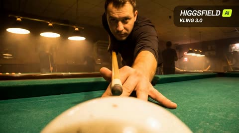</a>

提示词把镜头设定为球本身，并把画面拆成击球、滚动、落袋三个节拍。低机位、边缘动态模糊、灯光拉出光束以及台边和背景人物的视差，让第一视角的运动显得真实。

Kling 3.0 · 文生视频 · 出处: [@higgsfield_ai on X](https://x.com/higgsfield_ai/status/2019253167662534748) · 449 赞，统计于 2026-10-27

[`pov`](tags.md#tag-pov) [`billiards`](tags.md#tag-billiards) [`tracking-shot`](tags.md#tag-tracking-shot) [`physics-motion`](tags.md#tag-physics-motion) [`ambient-sound`](tags.md#tag-ambient-sound)

<details><summary><b>提示词</b></summary>

```text
POV video from the perspective of a billiard ball on a pool table inside a dim, smoky billiard club. A focused male player leans in and strikes the ball with a cue. At the moment of impact, the camera becomes the ball, rolling straight toward a corner pocket across the green felt. Realistic rolling motion with subtle vibration and spin, low table-level angle, natural edge motion blur. Warm overhead lamps stretch into soft light streaks as the camera advances. Strong parallax as table rails and background players slide past. The pocket rapidly fills the frame — then the ball drops into the pocket, brief darkness, soft impact, and muffled ambient sound implied.
```

</details>

<a id="kling-hotel-corridor-neon-fight"></a>
### 红色霓虹酒店走廊里的打斗戏

<a href="https://x.com/higgsfield_ai/status/2019272810838061122">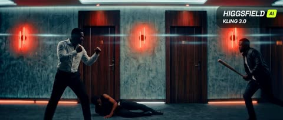</a>

提示词先定地点和光线，再按顺序写出动作节拍：防御姿态、右侧入场、格挡、擒抱、膝击、推向墙面。结尾一句镜头指令要求稳定跟拍，贴着动作走。

Kling 3.0 · 文生视频 · 出处: [@higgsfield_ai on X](https://x.com/higgsfield_ai/status/2019272810838061122) · 445 赞，统计于 2026-10-27

[`action`](tags.md#tag-action) [`fight-scene`](tags.md#tag-fight-scene) [`neon`](tags.md#tag-neon) [`tracking-shot`](tags.md#tag-tracking-shot) [`multi-character`](tags.md#tag-multi-character)

<details><summary><b>提示词</b></summary>

```text
A gritty, cinematic fight scene in a modern, dimly lit hotel corridor with grey concrete walls and dark wooden doors. The scene is illuminated by glowing red vertical neon lights.

A man in a white dress shirt and black trousers is in a defensive stance over a person lying on the floor. Suddenly, an attacker enters from the right, swinging a wooden baseball bat. The man in the white shirt quickly blocks the strike, grabs the attacker, and delivers a powerful knee strike to the midsection before pushing him back against the wall. The camera follows the movement with a steady, high-tension tracking motion.
```

</details>

<a id="kling-neon-nightclub-rain-dance"></a>
### 女子在霓虹夜店与雨中起舞

<a href="https://x.com/CaliraVal/status/2052314090467405869"></a>

提示词在一段话里依次交代人物、服装、场景、霓虹配色和运镜。另附负面词清单，结尾再用一行写明分辨率、帧率和调色，使画面风格保持一致。

Kling 3.0 · 文生视频 · 出处: [@CaliraVal on X](https://x.com/CaliraVal/status/2052314090467405869) · 445 赞，统计于 2026-10-27

[`neon`](tags.md#tag-neon) [`nightclub`](tags.md#tag-nightclub) [`rain`](tags.md#tag-rain) [`slow-motion`](tags.md#tag-slow-motion) [`cinematic`](tags.md#tag-cinematic)

<details><summary><b>提示词</b></summary>

```text
A cinematic ultra-realistic 4K music video scene of a beautiful young woman in a neon-lit nightclub and rainy retro city at night. Vibrant pink, purple, blue, and teal neon lighting creates a dreamy cyberpunk atmosphere. The woman has long wet dark hair, glowing natural makeup, and wears a stylish white top with a dark skirt and black heels. Emotional slow-motion shots of her dancing freely in heavy rain on wet reflective streets, surrounded by colorful neon signs, vintage American cars, retro diners, and blurred nightclub crowds. Smooth cinematic camera tracking, soft bokeh lights, realistic rain effects, glossy pavement reflections, dramatic Hollywood-style lighting, shallow depth of field, sensual emotional mood, highly detailed skin texture, cinematic storytelling, shot on a 35mm film look with premium color grading.

low quality, blurry, distorted face, bad anatomy, extra fingers, extra limbs, cartoon, anime, oversaturated colors, noisy image, watermark, text, duplicate body, unrealistic eyes, glitch, low detail, poorly drawn hands

4K Ultra HD, 16:9 aspect ratio, 24fps, cinematic realism style, smooth slow-motion camera movement, Hollywood lighting, ultra detailed quality, realistic rain simulation, cinematic neon color grading
```

</details>

<a id="kling-ten-pose-fashion-editorial-reflective-studio"></a>
### 镜面影棚里的十姿势快切时尚大片

<a href="https://x.com/ZaraIrahh/status/2097615157421867206"></a>

用编号列表锁定恰好十个姿势，每个姿势配独立的轮廓和机位，镜头数量可控。转场逐一点名（甩镜、急推、闪光、手掌遮镜头），并用 140 BPM 节拍加快门声定下剪辑节奏。

Kling 3.0 · 参考生视频 · 出处: [@ZaraIrahh on X](https://x.com/ZaraIrahh/status/2097615157421867206) · 235 赞，统计于 2026-10-28

[`fashion`](tags.md#tag-fashion) [`editorial`](tags.md#tag-editorial) [`kinetic-editing`](tags.md#tag-kinetic-editing) [`character-reference`](tags.md#tag-character-reference) [`studio`](tags.md#tag-studio)

<details><summary><b>提示词</b></summary>

```text
Create a 15-second high-fashion editorial film starring the adult character in <<<image_1>>> . Preserve their exact appearance, outfit, accessories and visual style. Render the entire film in the reference’s aesthetic.

Use a minimal studio with a reflective floor, bold directional lighting and rhythmic photographic flashes.

Show exactly 10 distinct fashion poses, each with a different silhouette and camera angle:

1. A confident standing pose, filmed from floor level with dramatic wide-angle perspective.
2. One hand beside the face, captured in an extreme side-profile close-up.
3. An asymmetric seated pose, seen directly overhead as the camera rotates.
4. One leg extended toward the lens, the foot or reference footwear dominating the foreground through foreshortening.
5. A quick, fluid leg cross, captured from a low diagonal angle.
6. Fingertips catching the edge of an existing sleeve or collar, framed in a tight detail shot.
7. A rear three-quarter turn with a deliberate glance back into the camera.
8. A forward lean toward the lens, ending with the palm briefly covering it.
9. An elongated upward stretch, revealed in a sharply tilted wide shot with strong side lighting.
10. A commanding full-body hero pose, looking down into the lens as the camera rapidly pulls back.

Keep the performance fast and rhythmically tight. Flow naturally between poses, holding each for only a fraction of a second while keeping its silhouette clearly readable. No repeated poses or additional pose changes.

Connect angles through whip pans, movement-matched cuts, snap zooms, flashes and lens occlusions. Orbit against the character’s turn, sweep from their floor reflection toward their face and plunge from overhead to floor level. Alternate intimate details with dramatic wide compositions. Accelerate between poses and brake sharply on each hold.

Keep the sensual gestures quick, confident and fully clothed. Hair and fabric react naturally. No slow motion, lingering shots or gradual camera drift. Build momentum toward the tenth pose, then stop sharply for a crisp final hold.

Stable identity and anatomy throughout. No outfit changes, added accessories or text. Sound: a driving 140 BPM fashion beat, rhythmic shutter clicks and subtle fabric movement.
```

</details>

<a id="kling-mirror-selfie-dialogue-finger-heart"></a>
### 镜中自拍女子 对白与比心手势

<a href="https://www.reddit.com/r/klingO1/comments/1qw80hp/how_to_create_a_realistic_mirror_selfie_test_with"></a>

提示词按三个分镜编写(中景、特写、中景),每句台词都附带音色描述(低沉、轻微气泡音、气声),让语音和动作同时受控。在各镜头中重复固定的发型、束腰上衣和耳环等细节,有助于人物在切换镜头后保持一致。

Kling 3.0 · 文生视频 · 出处: [u/GearOkBjork on Reddit](https://www.reddit.com/r/klingO1/comments/1qw80hp/how_to_create_a_realistic_mirror_selfie_test_with) · 195 赞，统计于 2026-10-29

[`mirror-selfie`](tags.md#tag-mirror-selfie) [`dialogue`](tags.md#tag-dialogue) [`voice-direction`](tags.md#tag-voice-direction) [`character-consistency`](tags.md#tag-character-consistency)

<details><summary><b>提示词</b></summary>

```text
Upload the image you want to animate

Click Generate and get your animated video

Prompt:

"A medium shot of Groklyn, a Korean-American woman with platinum blonde bangs and a black floral corset, standing in a white dressing room holding a phone. She looks into the mirror, waves her hand casually, and speaks to the camera. She says: "Ahn-young. It’s Groklyn. Just testing the new Kling V3." The voice is cool, low-pitched, and has a slight vocal fry. A close-up of Groklyn's face. She tucks a strand of blonde hair behind her ear to show her silver hoop earring and turns her head slightly to admire the details. She speaks softly: "The motion is honestly... day-baak. Just look at these details." Her tone is impressed and breathy. A medium shot of Groklyn posing in the mirror. She lifts her hand to make a Korean finger-heart gesture near her cheek, holds the pose, and then winks at the camera. She asks confidently: "Does this look real to you guys? Let me know. Bye."

This clip features Groklyn, a Korean-American woman in a white dressing room, filmed as a mirror-style selfie. The goal was to test three things specifically:

Natural hand gestures and facial motion

Subtle head turns, hair movement, and micro-expressions

Realistic dialogue delivery with tone and vocal texture

Scene breakdown:

Medium mirror shot: casual wave, relaxed posture, natural intro dialogue

Close-up: hair tuck behind the ear, earring detail, soft impressed tone

Final mirror pose: Korean finger-heart gesture, wink, confident outro

What really surprised me was how smooth the transitions and motion continuity felt, especially in the close-up. The facial details, timing of gestures, and voice expression came out way more natural than I expected.

So yeah — does this look real to you?
Curious how others are using Kling 3.0 for dialogue-driven, selfie-style content. Let me know what you think in the comment section!
```

</details>

<a id="kling-gala-steps-couture-flash-sequence"></a>
### 高定礼服在红毯台阶上被摄影师环绕

<a href="https://x.com/Diplomeme/status/2090136981112250653"></a>

提示词把15秒拆成八个带时间码的镜头，每个镜头指定运镜，如跟拍、微距、甩镜和高角度广角。同时统一了色调（深阴影与冷青色），并以硬切黑场加渐隐闪光收尾。

Kling 3.0 · 文生视频 · 出处: [@Diplomeme on X](https://x.com/Diplomeme/status/2090136981112250653) · 152 赞，统计于 2026-10-28

[`fashion`](tags.md#tag-fashion) [`multi-shot`](tags.md#tag-multi-shot) [`timed-shots`](tags.md#tag-timed-shots) [`cinematic`](tags.md#tag-cinematic) [`paparazzi`](tags.md#tag-paparazzi)

<details><summary><b>提示词</b></summary>

```text
Met gala inspired 15 seconds scene.

Try it with prompt : High-octane, hyper-realistic fashion sequence in the style of Christopher Nolan, shot on actual 70mm IMAX cameras at the Met Gala. Fast-paced multi-shot editing with quick, cinematic cuts timed at exactly one shot every 2 seconds across a complete 15-second timeline. A striking young woman in an haute couture gown arrives at the Met Gala surrounded by photographers and camera flashes. High-contrast Nolan-esque color grading with deep shadows, cold teals, and bright highlights. Blinding bursts of paparazzi flashes pierce the night, reflecting across the gown and marble steps. Rapid sequence of intense cuts:
•Shot 1 (0-2s): Eye-level tracking shot of the woman ascending the Met Gala steps as photographers surround her.
•Shot 2 (2-4s): Tight, detailed close-up of her face, makeup, jewelry, and camera flashes reflecting in her eyes.
•Shot 3 (4-6s): Low-angle handheld camera whip-panning upward from the flowing couture gown to her silhouette against the illuminated museum facade.
•Shot 4 (6-8s): Ground-level macro shot of intricate fabric, embroidery, gemstones, and couture details moving naturally.
•Shot 5 (8-10s): Fast tracking shot behind the woman as she turns dramatically toward photographers, her gown sweeping through the air.
•Shot 6 (10-12s): High-angle wide shot of the Met Gala staircase, crowd, photographers, celebrities, and the woman commanding center frame.
•Shot 7 (12-14s): Shaky handheld tracking shot following her final dramatic pose as camera flashes erupt around her.
•Shot 8 (14-15s): Hard cut to black with a lingering burst of camera flashes fading into darkness.
Raw documentary-style camera textures, organic lens flares, lifelike physics, authentic fashion motion blur, realistic skin texture, natural crowd movement, and a glamorous sense of celebrity spectacle. Ultra-detailed, 4k resolution.
```

</details>

<a id="kling-rainy-alley-armored-vehicle-chase"></a>
### 雨夜小巷中蓄须英雄奔逃爆炸装甲车

<a href="https://x.com/iamrealsnow/status/2104788524310688210">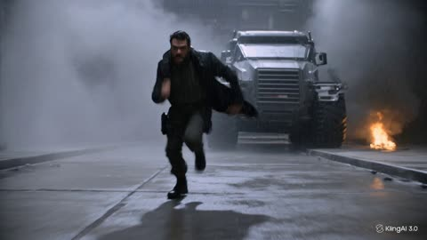</a>

提示词把七秒拆成带时间戳的分镜,每段指定镜头运动:倒退跟拍、滑铲翻滚、快速摇镜、推向面部。结尾罗列动作与光影关键词,并用禁止慢动作和静态镜头等否定项保持节奏凌厉。

Kling 3.0 · 文生视频 · 出处: [@iamrealsnow on X](https://x.com/iamrealsnow/status/2104788524310688210) · 89 赞，统计于 2026-10-28

[`action`](tags.md#tag-action) [`rain`](tags.md#tag-rain) [`night`](tags.md#tag-night) [`handheld`](tags.md#tag-handheld) [`timed-shots`](tags.md#tag-timed-shots)

<details><summary><b>提示词</b></summary>

```text
A rugged bearded action hero sprints through a rain-soaked industrial alley at night as a massive armored vehicle explodes behind him. 0–2 sec: handheld low-angle tracking shot racing backward in front of him, rain and sparks flying through the lens, intense facial expression, coat whipping violently in the wind. 2–4 sec: he suddenly slides beneath a burst of gunfire, rolls across the wet concrete, grabs a metal pipe and uses it to knock an attacking enemy off balance. 4–6 sec: explosive close-quarters fight — one brutal punch, spinning elbow, rapid camera whip-pan, shattered glass and sparks filling the frame. 6–7 sec: he rises into a powerful hero stance as the burning vehicle erupts behind him, camera rapidly pushes toward his face, rain dripping from his beard.

Fast choreography, continuous physical momentum, realistic body mechanics, dynamic handheld camera, aggressive camera movement, dramatic lighting, volumetric smoke, flying debris, realistic rain, cinematic motion blur, sharp facial detail, natural cloth physics, high contrast, premium action-film cinematography. No slow motion, no static shots, no unnecessary cuts, no text, no logos.
```

</details>

<a id="kling-baseball-bat-logo"></a>
### 挥棒全程，球棒上的字保持清晰

<a href="https://static-54.klingai-cdn-aws.com/kling-blog/presigned_url/50fdd9a7-e3d7-4d62-8715-edaa9b3003bc_文字_棒球.mp4"></a>

一句话把镜头钉在运动物体的字上，用来快速测文字稳定性。

Kling 3.0 · 图生视频 · 出处: [Kling VIDEO 3.0 user guide](https://app.klingai.com/global/quickstart/klingai-video-3-model-user-guide)

[`text-render`](tags.md#tag-text-render) [`sports`](tags.md#tag-sports)

<details><summary><b>提示词</b></summary>

```text
The camera remains fixed on the word "KLING" emblazoned on the baseball bat as the player swings and hits the ball.
```

</details>

输入素材: [1](https://static-3.klingai-cdn-aws.com/kling-blog/file_by_url/a8527e3967d0a358562fddac74c2c9e13c98135619da9af77ea326fe756fb0ff.png)

<a id="kling-family-reacts-to-twist"></a>
### 一家四口对剧情反转的反应

<a href="https://static-86.klingai-cdn-aws.com/kling-blog/presigned_url/8aa6f5a2-b121-4b08-840d-827cc670c4be_kling_20260202_作品_居家环境_背景有轻微_5022_0.mp4"></a>

四个说话人，每个都标角色和语气（`Mom (softly, in a surprised tone)`），台词能对上正确的人。

Kling 3.0 · 图生视频 · 出处: [Kling VIDEO 3.0 user guide](https://app.klingai.com/global/quickstart/klingai-video-3-model-user-guide)

[`dialogue`](tags.md#tag-dialogue) [`multi-speaker`](tags.md#tag-multi-speaker) [`ambience`](tags.md#tag-ambience)

<details><summary><b>提示词</b></summary>

```text
Home setting with a faint hum of the living room air conditioner in the background for a realistic daily vibe. Mom (softly, in a surprised tone): Wow, I didn’t expect this plot at all. Dad (in a low voice, agreeing, in a calm tone): Yeah, it’s totally unexpected. Never thought that would happen. Boy (in an excited tone): It’s the best twist ever! Girl (nodding along, in an enthusiastic tone): I can’t believe they did that!
```

</details>

输入素材: [1](https://static--49.klingai-cdn-aws.com/kling-blog/file_by_url/006b3efc9ecef758c2aac2e8765f63e4b0f7d684de4d8e6e40e50a90fdb426ce.png)

<a id="kling-indian-accent-order"></a>
### 带印度口音点餐

<a href="https://static-78.klingai-cdn-aws.com/kling-blog/presigned_url/29736974-c5c6-46d2-a9af-ec0413fb74ef_kling_20260204_作品_多镜头_一位中年男子_5210_1.mp4">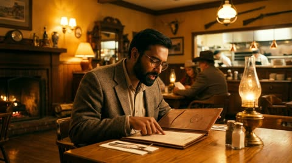</a>

口音在台词前点一次。两句话之间的停顿写成动作（`then he looks up`）。

Kling 3.0 · 图生视频 · 出处: [Kling VIDEO 3.0 user guide](https://app.klingai.com/global/quickstart/klingai-video-3-model-user-guide)

[`dialogue`](tags.md#tag-dialogue) [`accent`](tags.md#tag-accent) [`multi-shot`](tags.md#tag-multi-shot)

<details><summary><b>提示词</b></summary>

```text
A middle-aged man is ordering food in a Western restaurant. He speaks in English with an Indian accent and says: "excuse me, I would like to order a seafood pasta, and a filet mignon. medium-rare", then he looks up and continues: “And, do you have any drink recommendations?”
```

</details>

输入素材: [1](https://static--52.klingai-cdn-aws.com/kling-blog/file_by_url/4a06a8651731e50c212477bcb626257d4e1ba3576eb48ff57aa077cd6a5d9d4f.png)

<a id="kling-japanese-station-bento"></a>
### 晨雾小站递便当，日语对白

<a href="https://static--87.klingai-cdn-aws.com/kling-blog/presigned_url/3d106f34-7b24-462f-9238-0a9d4c3981dc_kling_20260204_作品_清晨薄雾的小站_男生_5550_3.mp4">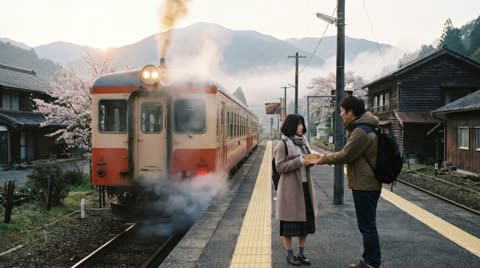</a>

日语台词用直角引号，说话人只写 `the boy` 和 `the girl`，展示可灵的日语口型。

Kling 3.0 · 图生视频 · 出处: [Kling VIDEO 3.0 user guide](https://app.klingai.com/global/quickstart/klingai-video-3-model-user-guide)

[`dialogue`](tags.md#tag-dialogue) [`multilingual`](tags.md#tag-multilingual) [`japanese`](tags.md#tag-japanese)

<details><summary><b>提示词</b></summary>

```text
On a small station shrouded in morning mist, the boy smiled and handed over the bento: 「急いで作ったけど、大丈夫？ お母さんのレシピだよ。」The girl took it with a smile: 「うん、きっと美味しい！ 到着したら LINE するね。」
```

</details>

输入素材: [1](https://static-39.klingai-cdn-aws.com/kling-blog/file_by_url/1e96651baca4447550008b624ccb8723fb4d5aa383734b8744042d031532e619.jpg)

<a id="kling-joseon-lady-and-maid"></a>
### 朝鲜贵族小姐与侍女

<a href="https://static-41.klingai-cdn-aws.com/kling-blog/presigned_url/d7236484-7cf3-4092-a019-4321dbc661b4_kling_20260202_作品_镜头聚焦两人的互动__4898_0.mp4">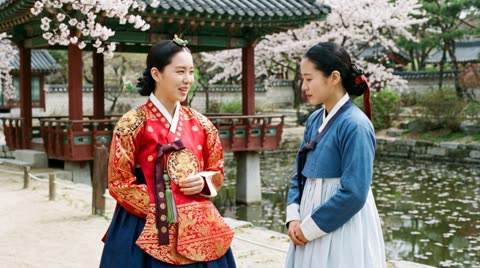</a>

韩语古装戏。语气词（`warm, gentle`、`with deference`）交代两人的身份高低。

Kling 3.0 · 图生视频 · 出处: [Kling VIDEO 3.0 user guide](https://app.klingai.com/global/quickstart/klingai-video-3-model-user-guide)

[`dialogue`](tags.md#tag-dialogue) [`multilingual`](tags.md#tag-multilingual) [`period`](tags.md#tag-period)

<details><summary><b>提示词</b></summary>

```text
The camera lingers on their interaction— the noble lady’s gaze soft and mild, her maid listening with her head bowed. The lady lifts a hand to smooth her sleeve gently, and speaks in a warm, gentle tone: “오늘 후원에서 피어난 꽃을 보니, 시원한 바람이 분다. 너도 함께 걸어볼까?” The maid inclines her body slightly forward, and replies with deference: “네, 아씨님. 따라갈게요.
```

</details>

输入素材: [1](https://static-10.klingai-cdn-aws.com/kling-blog/file_by_url/6ea73c8a737512559f23bb74328f56539882634fa386241b340d5af0c0314b93.jpg)

<a id="kling-korean-rooftop"></a>
### 韩国高中天台夜聊

<a href="https://static-74.klingai-cdn-aws.com/kling-blog/presigned_url/43cd806c-13a5-4375-906d-7c29f632b04c_kling_20260202_作品_韩国高中屋顶场景下__5286_0.mp4">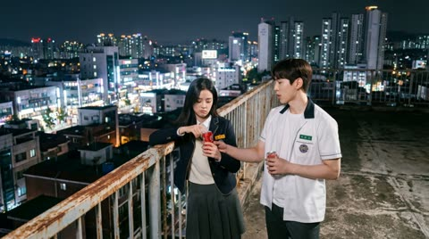</a>

语言写在每个说话人标签里：`Boy (casual tone, Korean)`。

Kling 3.0 · 图生视频 · 出处: [Kling VIDEO 3.0 user guide](https://app.klingai.com/global/quickstart/klingai-video-3-model-user-guide)

[`dialogue`](tags.md#tag-dialogue) [`multilingual`](tags.md#tag-multilingual) [`korean`](tags.md#tag-korean)

<details><summary><b>提示词</b></summary>

```text
On the rooftop of a Korean high school, distant city lights glimmer in the background with a soft wind rustling, and stars twinkle in the night sky. The girl leans against the railing, lost in thought. The boy walks over with two cans of cola, hands one to her, and she takes it and pops the tab open. Boy (casual tone, Korean): "숙제 다 했어? 왜 여기 있어?" Girl (sighing, Korean): "시험이 너무 무서워". Boy (gentle tone, Korean): “걱정 마, 넌 잘할 거야.”
```

</details>

输入素材: [1](https://static-46.klingai-cdn-aws.com/kling-blog/file_by_url/f04a52d4d7bbeb30091cb136cd8623e84bd995776b765099fcc5ddcbbaf07391.png)

<a id="kling-madrid-asking-directions"></a>
### 马德里问路，磕磕绊绊的西班牙语

<a href="https://static-45.klingai-cdn-aws.com/kling-blog/presigned_url/10902407-6b2f-4e1c-86f4-ae81f9da21c2_kling_20260204_作品_阳光洒满马德里老街__3484_0.mp4"></a>

三个说话人流利度不同：游客要求说得慢、口音别扭，店员轻快。

Kling 3.0 · 图生视频 · 出处: [Kling VIDEO 3.0 user guide](https://app.klingai.com/global/quickstart/klingai-video-3-model-user-guide)

[`dialogue`](tags.md#tag-dialogue) [`multilingual`](tags.md#tag-multilingual) [`spanish`](tags.md#tag-spanish) [`accent`](tags.md#tag-accent)

<details><summary><b>提示词</b></summary>

```text
Sunlight fills the old streets of Madrid. In front of a street-side bakery, a Chinese female tourist and a male tourist wearing a gray hoodie walk toward the shop clerk, both wearing polite smiles. Female tourist (speaking slightly slowly, with an awkward accent, in Spanish):Disculpe, ¿dónde está la plaza mayor? A white-haired Spanish shop clerk (turning slightly and pointing forward, with a light and cheerful tone, in Spanish):Por allí, a dos calles. Muy cerca. The female tourist nods to express her thanks. The male tourist also nods in agreement and says (in Spanish): Muchas gracias. The shop clerk smiles and nods in response. The two tourists then turn and walk in the indicated direction.
```

</details>

输入素材: [1](https://static--53.klingai-cdn-aws.com/kling-blog/file_by_url/e4699b0ea66d1a1b6b94dcc1dedc462be6136f1a4fe5d263b719f7bd54dc8992.png)

<a id="kling-moonlit-garden-run"></a>
### 绿裙女子奔过月下花园，15 秒

<a href="https://static--79.klingai-cdn-aws.com/kling-blog/presigned_url/3f219e9a-5e38-46ed-af01-9831ebce2f2a_kling_20260203_作品_超广角中远景横向跟拍_4556_0.mp4">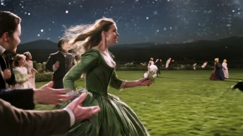</a>

15 秒连续镜头，按导演段落写：镜头、稳定器高度、调色，再按顺序写动作。

Kling 3.0 · 图生视频 · 出处: [Kling VIDEO 3.0 user guide](https://app.klingai.com/global/quickstart/klingai-video-3-model-user-guide)

[`long-take`](tags.md#tag-long-take) [`film-look`](tags.md#tag-film-look) [`camera-move`](tags.md#tag-camera-move)

<details><summary><b>提示词</b></summary>

```text
Opening with an ultra-wide-angle medium-long shot tracking horizontally, the stabilizer moves low to the ground, with a highly contrasting romantic cinematic tone of cold blue night and silvery white starry sky, exuding a strong poetic realism and classical epic temperament. The protagonist is a young woman in a dark green long dress, running with all her might on the garden lawn illuminated by moonlight; her skirt billows in the wind forming surging dynamic curves, she clutches a small white flower in her right hand and lifts the hem of her dress with her left, breathing rapidly yet with a firm gaze. At the 4th second, the camera accelerates forward with her, and multiple men and women in old-era ball gowns break into the frame one after another from the left and right sides in the background, running alongside her—some try to approach, some turn back to shout, yet none truly touch her, implying pursuit and escape. At the 8th second, the camera gradually zooms in to a medium shot, pans to track forward in front of the protagonist and lifts slightly; she glances back briefly at a young male character behind her, their gazes meet for a split second, emotions erupt mid-run, and the woman and man join hands to run together. At the 12th second, the music and movement reach a climax; the camera moves forward close to her side face and fluttering hair, she releases the white flower and tosses it into the air, the flower drifting down in slow motion as the crowd behind brushes past it. In the final 3 seconds, the camera keeps moving forward, the woman and man break through the crowd and dash toward the starry sky at the end of the garden, their figures gradually taking over the center of the frame. The overall atmosphere is fiery, romantic and resolute, a burst of narrative about fate, choice and freedom.
```

</details>

输入素材: [1](https://static--91.klingai-cdn-aws.com/kling-blog/file_by_url/21ef15bece0400c220dd7db92c388544a486345d867b33673fec8ba66b1ee2c6.png)

<a id="kling-office-long-take"></a>
### 一镜到底，跟拍女人从电梯走到工位

<a href="https://static--46.klingai-cdn-aws.com/kling-blog/presigned_url/cf695909-2395-4433-a0b1-caeb28df578d_kling_20260201_作品_平稳跟拍长镜头一镜到_3635_0.mp4">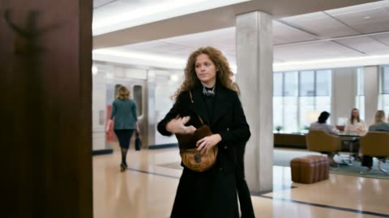</a>

首帧加绑定的人物主体。提示词写清机位怎么跟：她走就跟，她停就停。

Kling 3.0 · 图生视频 · 出处: [Kling VIDEO 3.0 user guide](https://app.klingai.com/global/quickstart/klingai-video-3-model-user-guide)

[`long-take`](tags.md#tag-long-take) [`character-consistency`](tags.md#tag-character-consistency) [`tracking-shot`](tags.md#tag-tracking-shot)

<details><summary><b>提示词</b></summary>

```text
Authentic workplace texture, one continuous long take without any cuts. The camera follows the professional woman steadily in a medium shot throughout, moving in sync with her: the camera tracks her as she walks and freezes instantly when she pauses, with natural and smooth movements and fluid camera work. The woman walks forward out of the elevator, and the elevator doors close slowly and naturally behind her; she steps into the office area, takes off her sunglasses by hand, tucks them into her commuter bag casually, and nods politely to colleagues passing by; she pauses briefly, the camera freezes in sync, she hangs her commuter bag on the coat rack in the office area, then takes off her outer coat and hangs it on the same rack; after hanging up her clothes, she walks forward again, the camera tracks her in sync; a young man in a formal shirt walks towards her, hands her a document and a signature pen, she pauses, the camera freezes in sync, takes them and signs the document; after signing, she walks forward again, the camera tracks her in sync; finally, she walks to her desk, sits down by the chair, reaches out to pick up a cup of tea on the desk, and sips it with her head down, her movements relaxed and natural.
```

</details>

输入素材: [1](https://static-44.klingai-cdn-aws.com/kling-blog/file_by_url/f810ae350b11c0469938a2dc73724c09618b56830d84f506027187df168c830e.png)

<a id="kling-orbit-to-smile"></a>
### 镜头绕到正面，她抬头微笑

<a href="https://static-36.klingai-cdn-aws.com/kling-blog/presigned_url/53d2490e-3ad9-4d84-b74f-bc0b1fcc4151_kling_20260204_作品_镜头逐渐环绕至女孩的_4266_2.mp4"></a>

同一句提示词跑两遍，一遍绑定主体，一遍只用首帧，页面上两版并排，能直接比脸的一致性。

Kling 3.0 · 图生视频 · 出处: [Kling VIDEO 3.0 user guide](https://app.klingai.com/global/quickstart/klingai-video-3-model-user-guide)

[`character-consistency`](tags.md#tag-character-consistency) [`orbit`](tags.md#tag-orbit) [`image-to-video`](tags.md#tag-image-to-video)

<details><summary><b>提示词</b></summary>

```text
The camera gradually moves around to the front of the girl, who then lifts her head and smiles warmly at the camera, as if seeing an old friend after many years.
```

</details>

输入素材: [1](https://static--64.klingai-cdn-aws.com/kling-blog/file_by_url/445147e8acb2e81e4c06a4a819081baeacbdbcf1824946cf1cd9b5a2f0c4e0f5.png)

<a id="kling-perfume-paris-ad"></a>
### 巴黎窗边的香水广告

<a href="https://static--72.klingai-cdn-aws.com/kling-blog/presigned_url/27107c4f-403c-412d-94b7-20a8835c8ffa_kling_20260202_作品_巴黎公寓窗边场景下__5018_0.mp4"></a>

产品镜头，瓶身印字保持清晰。旁白、口音、背景音乐都写在提示词里。

Kling 3.0 · 图生视频 · 出处: [Kling VIDEO 3.0 user guide](https://app.klingai.com/global/quickstart/klingai-video-3-model-user-guide)

[`product-ad`](tags.md#tag-product-ad) [`text-render`](tags.md#tag-text-render) [`voiceover`](tags.md#tag-voiceover)

<details><summary><b>提示词</b></summary>

```text
By the window of a Parisian apartment, with soft French piano BGM in the background, the gilded afternoon sunlight filters through the shutters onto the perfume bottle, casting dappled light and shadow. The camera pans slowly in from the scattered rose petals, shifting focus to the faceted cut of the Kling perfume bottle. Voiceover (lazy French female voice, British accent, slow pace): Bathe in the golden hour. The camera orbits the perfume bottle in slow motion, capturing the play of light and shadow on the golden lettering and bottle body. Voiceover: Kling, a whisper of Parisian elegance. The camera pulls back and freezes on the complete scene—the Kling perfume bottle standing on a velvet pedestal, with Parisian buildings faintly visible outside the window. Voiceover: Wrap yourself in luxury with every breath.
```

</details>

输入素材: [1](https://static--74.klingai-cdn-aws.com/kling-blog/file_by_url/3de2fbc80df150e68fc05823f829a0fd88e2145ed4b4dbfb2f6a6a4fd5dbea87.png)

<a id="kling-plaster-tower-dinosaur"></a>
### 石膏像塔里，与恐龙重逢

<a href="https://static-17.klingai-cdn-aws.com/kling-blog/presigned_url/9d0eec96-49d3-4229-a2c0-f38ceb5974e0_没想到吧Alex是只恐龙.mp4">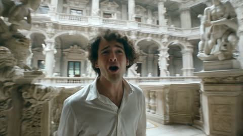</a>

开头先声明 `single unbroken shot with no edited transitions`，再写一条从绝望到重逢的情绪线。

Kling 3.0 · 图生视频 · 出处: [Kling VIDEO 3.0 user guide](https://app.klingai.com/global/quickstart/klingai-video-3-model-user-guide)

[`long-take`](tags.md#tag-long-take) [`emotion`](tags.md#tag-emotion) [`creature`](tags.md#tag-creature)

<details><summary><b>提示词</b></summary>

```text
This is a 15-second cinematic long take, a single unbroken shot with no edited transitions. The scene is set inside a tower of plaster statues dappled with light and shadow, surrounded by towering white plaster sculptures, evoking an air of mystery and oppression. The shot opens with the protagonist skidding to a halt at the center of the scene after a frantic run, chest heaving, expression dazed and helpless, fear glinting in their eyes. The camera orbits the protagonist in a smooth 360-degree pan. As the camera rotates, the protagonist glances anxiously around and shouts: "Alex! Alex where are you! Are you here?" A cute dinosaur cry then echoes in the background, and the camera pushes in over the protagonist’s shoulder to their back— a small to medium-sized, adorable baby dinosaur steps out from behind a plaster pillar, letting out a sweet chirp. Startled by the sound, the protagonist whips around; catching sight of the dinosaur, they burst into tears instantly and rush forward without hesitation to clasp it tightly in their arms. The dinosaur nestles obediently against them. Sobbing, the protagonist strokes the dinosaur gently and trembles: "I found you! Thank God, I’m so scared!" The overall lighting and shadow boast a cinematic texture, with the emotion shifting from despair to an overwhelmingly touching reunion.
```

</details>

输入素材: [1](https://static-47.klingai-cdn-aws.com/kling-blog/file_by_url/fe49a43ec06b9e0cdf7f555268cbe2a18c35175ab6cc25fc2b1150218076b6d9.png)

<a id="kling-snowmobile-six-shots"></a>
### 雪地摩托，六个镜头

<a href="https://static-14.klingai-cdn-aws.com/kling-blog/presigned_url/fbf5a59b-e1c0-45ee-9ec8-13726d3d3887_kling_20260202_作品_镜头_1_2s_后远_4947_0.mp4">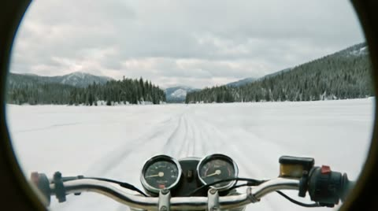</a>

六个镜头只写角度和运镜，环境只在最后一个镜头写一次。

Kling 3.0 · 图生视频 · 出处: [Kling VIDEO 3.0 user guide](https://app.klingai.com/global/quickstart/klingai-video-3-model-user-guide)

[`multi-shot`](tags.md#tag-multi-shot) [`camera-move`](tags.md#tag-camera-move) [`action`](tags.md#tag-action)

<details><summary><b>提示词</b></summary>

```text
Shot 1, Low-angle rear wide shot, tracking behind the rider as they move forward. Shot 2, Low-angle side close-up, a detailed shot of the motorcycle wheel. Shot 3, First-person POV from the rider, with the handlebars and instrument panel visible ahead. Shot 4, Frontal medium shot, tracking backward in front of the motorcycle, the rider’s helmet facing the camera. Shot 5, Side-on eye-level tracking shot with slight lateral movement. Shot 6, High-angle wide shot with a gentle downward tilt. The camera rises as the snowmobile rides deeper into the snowfield, leaving winding tracks carved into the pristine white snow, with snow-covered forests scattered on both sides.
```

</details>

输入素材: [1](https://static-29.klingai-cdn-aws.com/kling-blog/file_by_url/ef7ccbdcafe3af9d5fbbe492976b10793b302cc4ecab0778734b129dc7db9570.png)

<a id="kling-truck-driver-four-shots"></a>
### 卡车司机，四个手持镜头

<a href="https://static-94.klingai-cdn-aws.com/kling-blog/presigned_url/b77930c4-755d-4035-ba98-842446609ea8_Dave_multi.mp4">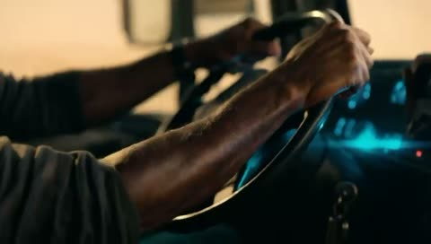</a>

可灵创作伙伴 Dave Clark 的自定义多镜头。每个镜头都重复 `cinematic handheld`，切镜后质感不跳。

Kling 3.0 · 图生视频 · 出处: [Kling VIDEO 3.0 user guide](https://app.klingai.com/global/quickstart/klingai-video-3-model-user-guide)

[`multi-shot`](tags.md#tag-multi-shot) [`handheld`](tags.md#tag-handheld) [`film-look`](tags.md#tag-film-look)

<details><summary><b>提示词</b></summary>

```text
shot 1, profile shot of black man driving a truck, cinematic handheld. Shot 2, frontal macro shot of black man driving a truck, cinematic handheld. Shot 3, macro shot of hands on the steering wheel, cinematic handheld. Shot 4, macro shot of a weathered picture of a young black child laying on the passenger side seat, cinematic handheld.
```

</details>

输入素材: [1](https://static--56.klingai-cdn-aws.com/kling-blog/file/0c5b8af23bea126e21beac535408c4cf6020f44cc773e2985ab1c32c42756216.jpg)

<a id="kling-villa-terrace-dialogue"></a>
### 别墅露台，夏日双人对话

<a href="https://static-37.klingai-cdn-aws.com/kling-blog/presigned_url/206908e5-edd9-4f12-a7cb-2baca6a0f2bd_kling_20260203_作品_欧洲别墅户外露台场景_4118_0.mp4"></a>

开启多镜头后，模型从一段动作加对白里自己排出正反打。

Kling 3.0 · 图生视频 · 出处: [Kling VIDEO 3.0 user guide](https://app.klingai.com/global/quickstart/klingai-video-3-model-user-guide)

[`multi-shot`](tags.md#tag-multi-shot) [`dialogue`](tags.md#tag-dialogue) [`shot-reverse-shot`](tags.md#tag-shot-reverse-shot)

<details><summary><b>提示词</b></summary>

```text
Outdoor terrace of a European villa, by a dining table with a blue and white checkered tablecloth, a young white woman in a blue and white striped short-sleeve shirt and khaki shorts, with a brown belt, sits barefoot, opposite a young white man in a white T-shirt. The camera zooms in, the woman swirls the juice in a glass, her eyes looking at the distant woods, and says "These trees will turn yellow in a month, won't they?". Close-up of the man, he lowers his head and says, "but they'll be green again next summer.". Then the woman turns her head, smiles at the man opposite, and says, "Are you always this optimistic? Or just about summer?". Then the man lifts his head, looks at the woman and says, “Only about summers with you.”
```

</details>

输入素材: [1](https://static-6.klingai-cdn-aws.com/kling-blog/file_by_url/1e8ad2ce90036c01aa7fe86c89178590aaf136880206c40d8fc0f99e68d93445.png)
