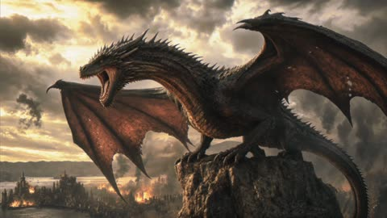

# Kling 4.0

[返回目录](../../README_zh.md) · 全部 26 条

<a id="kling4-ugc-brunch-pancake-thief"></a>
### 早午餐手机视频，妹妹偷吃一口松饼

<a href="https://x.com/minchoi/status/2111471573395755295"></a>

30 秒一镜到底，像没剪过的手机视频：自动曝光忽明忽暗，9 秒时服务员碰到桌子，画外有对白和咖啡馆噪音。

Kling 4.0 · 文生视频 · 出处: [@minchoi on X](https://x.com/minchoi/status/2111471573395755295) · 268 赞，统计于 2026-10-28

[`ugc`](tags.md#tag-ugc) [`vertical`](tags.md#tag-vertical) [`one-take`](tags.md#tag-one-take) [`dialogue`](tags.md#tag-dialogue) [`food`](tags.md#tag-food) [`phone-footage`](tags.md#tag-phone-footage)

<details><summary><b>提示词</b></summary>

```text
Raw vertical 9:16 video recorded on a phone's front camera (not on screen), one continuous 30-second take with no cuts. It looks like an ordinary unedited phone clip, not a film: slightly soft image, a little digital noise and compression, deep focus with the café behind her as sharp as her face, auto-exposure brightening and dimming as people pass the sunny window behind her, no colour grading. The phone sits close and a little low, looking slightly up at her; around 9 s a waiter's arm bumps the table, the phone slides and tilts, and she catches it and props it back up. Sadie, a young woman in her early 20s with long honey-blonde waves, light natural makeup, small gold hoop earrings and a cropped cream knit top, sits at a small marble table by a big sunny window in a busy brunch café. Her sister sits across from her, out of frame except for her arm and a hand with a silver ring. Behind Sadie: other tables of people talking, a counter with a glass pastry case, plants, staff moving about, chalkboards too far away to read. Around 9 s a waiter sets down two plates, a lemon ricotta pancakes and a plate of eggs on toast, plus two iced coffees in plain glasses. Around 15 s she turns the pancake plate toward the camera; around 20 s she cuts a bite, eats it and closes her eyes; around 26 s her sister's hand reaches in with a fork and steals a piece of pancake, and Sadie swats at it, laughing. [Sadie: casual young woman's voice, warm and a bit giggly, recorded on the phone's built-in mic from half a metre away]: "Okay, I promised I'd show you what we get. ... We get the same thing every single time. ... Oh, here it is! Thank you! ... Look at this. Lemon ricotta pancakes. ... Mmm. Okay. Yeah. Still the best. ... Hey! Get your own!" [Her sister, off camera: a young woman's voice, dry and amused]: "That's the tax." [Sadie, laughing]: "She does this every time." Audio as captured by the phone mic in a busy café, not studio clean: her voice close but with the room around it, the hiss and grind of an espresso machine, cups and cutlery clinking, overlapping chatter and laughter from other tables, a door bell jingling, a chair scraping, faint music in the background. No subtitles, no captions, no on-screen text.
```

</details>

<a id="kling4-tactical-shooter-gameplay"></a>
### 以假乱真的 5v5 战术射击游戏实录

<a href="https://x.com/higgsfield_ai/status/2110905436371370009"></a>

按屏幕录像来写：HUD、准星、PC 游戏光照和枪声设计。让模型拍游戏画面，不拍电影。

Kling 4.0 · 文生视频 · 出处: [@higgsfield_ai on X](https://x.com/higgsfield_ai/status/2110905436371370009) · 260 赞，统计于 2026-10-28

[`gameplay`](tags.md#tag-gameplay) [`pov`](tags.md#tag-pov) [`hud`](tags.md#tag-hud) [`action`](tags.md#tag-action) [`sound-design`](tags.md#tag-sound-design)

<details><summary><b>提示词</b></summary>

```text
15-second horizontal 16:9 1080p first-person gameplay recording of a competitive 5v5 tactical shooter in team elimination mode, captured straight from a PC screen. Modern next-gen competitive shooter graphics: bright, clean, readable daylight, crisp PBR materials, high frame rate, sharp image. Pure first-person view: the player's hands in purple tactical gloves hold an original assault rifle with a flashy custom skin of hot-pink and teal graffiti patterns, positioned in the lower right of the frame. Clean screen with the HUD turned off: the only on-screen element is a small green crosshair in the center. There is no minimap, no kill feed, no health, ammo or money counters, no timer and no banners. Snappy competitive movement with quick peeks, crouching, strafing and precise flicks. The whole video is one continuous round with no cinematic cuts.

Setting: a sunny Asian harbor market district at midday, an original competitive map. There are narrow alleys between stacked, faded red, blue and yellow shipping containers, sun-bleached concrete, stalls with colorful canvas tarps and hanging paper lanterns, food carts, wooden crates and fish barrels, metal stairs and catwalks, corrugated metal walls, an open harbor basin of deep blue-green water with moored wooden fishing boats and floating pontoons, cranes on the docks in the background, and colorful painted shop signs made of abstract shapes, not letters. Bright high sun, clear blue sky with a few clouds, hard crisp shadows, seagulls in the distance and sunlight glittering on the water.

[00:00–00:02] The player strafes out from behind a shipping container, flicks onto an enemy soldier at the alley entrance and drops him with a short burst. The enemy ragdolls onto the concrete.
[00:02–00:04] He sprints along the containers, wide-swings around a stack of crates and drops an enemy hiding behind them with a quick two-shot tap.
[00:04–00:06] He jiggle-peeks the corner of a market stall and lands a clean headshot on an enemy on the catwalk.
[00:06–00:08] He hops down from the pier onto a floating wooden pontoon at the edge of the harbor basin and casually reloads with a fast magazine swap while moving along the planks.
[00:08–00:10] He advances along the pontoons between moored wooden fishing boats and taps an enemy standing on a boat deck. The body ragdolls off the deck and drops into the water with a splash.
[00:10–00:11] He throws a smoke grenade ahead onto the dock. It bounces across the wooden planks, then pops, and thick grey smoke spreads over the pier in the sunlight.
[00:11–00:13] Two enemies push out of the smoke along the dock. He sprays and taps them down; bullet impacts kick up wood splinters from the planks and small splashes in the water. Both enemies ragdoll onto the dock.
[00:13–00:15] The round is won. Standing alone on the pontoon in the middle of the harbor, he glances down at the sunlit water lapping against the boards, then looks back up and inspects his rifle with a stylish flip animation.

Style: authentic competitive esports gameplay footage that looks like a real ranked match caught on stream, with confident, clean play. Readable action, stable first-person camera with natural view bob and recoil, sharp, high detail, bright saturated daylight colors. No real-world text, no words, no brand logos, no watermark, no IP characters or maps.

Audio: competitive shooter sound design, with punchy rifle bursts with echo off the containers, shell casings clinking on concrete and wood, footsteps on concrete and hollow wooden planks, bullet impacts on wood and metal with small water splashes, a smoke grenade hiss, a crisp magazine reload, seagulls, lapping water against the boats, distant harbor horns and a short round-win sting at the end. No dialogue.
```

</details>

<a id="kling4-perfume-bottle-loop-ramp"></a>
### 香水瓶冲上环形坡道再喷射升空

<a href="https://x.com/AIWithRay/status/2114672427964010805"></a>

把产品广告拍成特技表演，两秒一拍，瓶子不带标签和品牌。

Kling 4.0 · 文生视频 · 出处: [@AIWithRay on X](https://x.com/AIWithRay/status/2114672427964010805) · 142 赞，统计于 2026-10-28

[`product-commercial`](tags.md#tag-product-commercial) [`surreal`](tags.md#tag-surreal) [`timed-beats`](tags.md#tag-timed-beats) [`vfx`](tags.md#tag-vfx) [`luxury`](tags.md#tag-luxury)

<details><summary><b>提示词</b></summary>

```text
Cinematic, photoreal night scene on a black stage inside a giant hangar. A towering concrete loop ramp/road with glowing red edge lights and a white center stripe dominates the background. In front of it stands a premium transparent glass perfume bottle, unlabeled, no logo, filled with pale golden fragrance, featuring elegant beveled edges, a polished metallic cap, realistic glass refraction, crisp reflections, and subtle condensation droplets. The bottle engages four small rocket nozzles under its base; soft white exhaust with bright orange cores appears. The bottle glides forward, then blasts up the glowing ramp, hugging the curve, leaving faint light trails and red neon reflections across its glass surface. At the apex it shoots off the ramp and transitions to a sleek electric-thruster flight, like a futuristic luxury flying car, then ends in a close hero shot of the perfume bottle hovering and roaring upward vertically with four bright jets, volumetric spotlights and fog below, sparks and vapor interaction, dramatic rim light, golden highlights, crisp reflections, shallow depth of field, 4K, high-end luxury perfume and car commercial look. No text, no brand, no label. Duration 9–10 seconds. Aspect ratio 9:16. Negative cues: no logos, no text, no labels, no hands, no spillage, no deformation, no duplicate bottles, no cartoon look, no melting glass, no detached cap, no liquid leakage, no extreme motion-blur smears. Beat sheet (timing guide) 0–2s: Low-angle push-in on the massive loop ramp; perfume bottle centered, engines arming beneath the base with subtle heat shimmer and glowing orange cores. 2–6s: Dynamic follow-cam as the bottle rockets up the ramp; speed ramping, neon edge lights streaking, dramatic red reflections sliding across the glass. 6–8s: Bottle leaves the ramp, switches to electric thrusters; quick cinematic orbit as it hovers midair, revealing the golden fragrance and metallic cap. 8–10s: Tight hero shot of the perfume bottle ascending vertically with four bright jets, swirling fog, volumetric spotlights, realistic vapor, and luxurious golden reflections. End with the bottle sharply focused and centered against the dark hangar.
```

</details>

<a id="kling4-blacksmith-forges-greatsword"></a>
### 铁匠把铁块打成巨剑，从首帧到尾帧

<a href="https://static--34.klingai-cdn-aws.com/kling-blog/presigned_url/e8b7cc55-4cb6-4a0c-b175-e22d1f378f5f_1-2.mp4"></a>

首帧是桌上的铁块，尾帧是放回原处的成剑，中间六个镜头压缩锻造过程。

Kling 4.0 · 首尾帧 · 出处: [Kling 4.0 user guide](https://kling.ai/quickstart/kling-4-model-user-guide)

[`keyframes`](tags.md#tag-keyframes) [`craft`](tags.md#tag-craft) [`multi-shot`](tags.md#tag-multi-shot) [`structured-prompt`](tags.md#tag-structured-prompt) [`time-lapse`](tags.md#tag-time-lapse)

<details><summary><b>提示词</b></summary>

```text
SCENE CONTEXT EXACT 1 CHARACTER — NO DUPLICATES. Interior, a worn blacksmith workshop, daytime. The same blacksmith removes the raw material, works it into a greatsword, and returns the completed sword to the original table.15 seconds, six shots. Manufacturing time is compressed through editorial cuts; individual actions retain natural weight and speed.
ACTIVE REFERENCES: @Image1: exact first-frame anchor. Preserve all five iron blocks, their arrangement, the tabletop, background tools, perspective, and lighting. This image is the starting state of an active pickup shot.@Image2: exact final-frame anchor and finished-sword design. Preserve the blade silhouette, central fuller, angular curved crossguard, spiral metal grip, faceted pommel, diagonal placement, perspective, and background. This composition is reached through a visible physical placement.
LOCATION MAP: The worktable fills the foreground. The tool bucket stands behind its left-center edge, the rod rack occupies the rear right, and the anvil stands at the right. The blacksmith works from the left side of the table in both endpoint shots. The camera stays on the original viewer-facing side of the table. During blade-working inserts, the tang points screen-left and the tip points screen-right. The final sword position runs from the upper-left pommel to the lower-right tip.
FIRST FRAME AND SPATIAL BLOCKING: At 0.0 seconds, the frame exactly matches the raw-material reference, with five iron blocks and no hands visible. The same blacksmith immediately reaches in from the left edge. Both gloved hands approach the largest central block from opposite ends, preparing a supported two-handed lift. The blacksmith wears soot-gray sleeves, brown leather gloves, and a narrow dark strap around the right cuff. These details remain identical throughout every shot.
FORMAT MODE: 15 seconds total, six shots.Hard cuts at 3.0, 5.0, 8.0, 10.0, and 11.0 seconds. Cuts compress the omitted manufacturing work and bench clearing. The opening pickup and closing placement each play as continuous physical actions.No fades, dissolves, or object-morph transitions.
OPTICS: Shots 1 and 6: reference-matched elevated three-quarter framing, approximately 63° diagonal field of view and approximately 1.8 meters from the tabletop center. Exact endpoint framing takes priority over estimated optical measurements. Shots 2–5: 40° diagonal field of view, approximately 0.8 meters from the working contact point. Focus follows the hands and metal contact; the workshop background remains softly readable. Each shot holds one fixed field of view.
CAMERA: A real camera operator holds the camera from the viewer-facing side of the workspace. All shots use handheld SETTLE: visible breathing sway, slight roll, and small delayed corrections. The opening camera holds its position while the iron block leaves the frame. The closing camera holds the empty tabletop composition while the sword enters, then settles into the exact final reference. The blacksmith is the only visible worker; the camera operator remains outside the image.
ACTION TIMING: 0.0–3.0s — TAKE THE IRON. Start on the exact first reference; during 0.0–0.6s, the blacksmith’s matching gloved hands enter from screen-left and grip opposite ends of the largest central block. During 0.6–1.5s, the wrists brace and both hands lift the block clear of the tabletop, exposing the patch of table beneath it. During 1.5–3.0s, the blacksmith carries the supported block out through screen-left; the other four blocks remain resting on the table through the cut.3.0–5.0s — HEAT THE STOCK. Hard cut forward in time to one thick billet already glowing orange among forge coals. The same gray sleeves, brown gloves, and right-cuff strap appear at screen-left as the blacksmith holds long tongs around the billet. A short controlled pull draws the billet toward the forge mouth, with heat shimmer rising above its scaled surface.5.0–8.0s — FORGE THE BLADE. Hard cut forward to an elongated orange-hot blade blank supported on the anvil, tang left and emerging tip right. The same blacksmith braces the tang with left-hand tongs and delivers three deliberate right-hand hammer strikes along the blade flat. Each strike produces local compression, wrist recoil, and a brief scatter of dark scale.8.0–10.0s — FINISH THE METAL. Hard cut forward to a cooled blade with its fuller already formed, held by the same gloved hands against an abrasive wheel. The blacksmith makes one controlled finishing pass along the bevel. A narrow stream of sparks falls from the actual contact point as a brighter strip of metal appears.10.0–11.0s — COMPLETE THE HILT. Hard cut forward to the nearly finished sword supported on a separate assembly bench, its crossguard and spiral metal grip already fitted. The same blacksmith’s left hand braces the grip while the right hand gives the faceted pommel its final tightening turn. The completed sword now has the exact construction and finish required for the final image.11.0–15.0s — PLACE THE FINISHED SWORD.Hard cut to the original worktable, now completely clear; show its empty surface for 0.4 seconds before the same gloved hands carry the completed sword in from screen-left, one hand around the grip and the other supporting the blade flat near its balance point. From 11.4–13.8s, the blacksmith lowers the entire rigid sword diagonally, hilt toward upper-left and tip toward lower-right, easing it onto the tabletop and sliding the supporting hand free as its weight transfers to the table. From 13.8–15.0s, both hands release and withdraw through screen-left; the sword remains motionless in the exact final-reference position as the camera settles onto the final frame.
PHYSICS: The raw block retains its shape and mass throughout the pickup. Both hands support it continuously; the forearms tense and the lift accelerates slowly under its weight. The anvil supports the hot blade during forging. Large changes of shape occur across editorial time jumps. The completed sword remains rigid during carrying and placement. The blade-supporting hand has visible clearance to slide free as the sword settles; the hand never passes through the blade or tabletop. Metal contact produces a short scrape and a low, heavy clink, followed by stillness. The same blacksmith clears the remaining raw stock during omitted time before the final shot.
LIGHTING: The original table shots use soft daylight from upper camera-left, matching both references. Retain dark detail in the iron and protect the silver blade highlights. The forge insert uses orange coal glow from below-left as its dominant source. Return to the original neutral daylight before the sword enters the final tabletop shot.
AUDIO: Quiet workshop air and distant furnace draft form the ambient bed. Opening: leather creaks, a brief iron scrape, and a restrained exertion breath as the heavy block rises.Middle: forge crackle, tong contact, three synchronized hammer impacts, abrasive scraping, and a short fitting sound.Ending: sleeve movement, glove friction against metal, a weighted sword-to-table clink, then quiet workshop ambience. The blacksmith speaks no dialogue.SFX only, no music, no score, no song, no soundtrack.
CHARACTER ACTING: One consistent blacksmith performs every visible action. Soot-gray sleeves, brown leather gloves, and the dark right-cuff strap remain unchanged. Hands work deliberately: brace before lifting, maintain firm tool contact, and reduce speed before lowering the finished sword. The physical rhythm shifts from effort during the raw-block pickup to careful control during the final placement. The face and torso remain outside the crop.
STYLE: Grounded workshop documentary with tactile iron, worn tools, and convincing manual labor.Soft old-photograph texture, restrained grain, and natural motion blur; no digital sharpening. Charcoal metal and muted brown surfaces dominate, with silver highlights and localized forge orange. The first and last frames preserve the supplied images’ appearance.
QUALITY: Maintain consistent hands, gloves, sleeve details, metal geometry, and contact shadows. The lifted block reveals the tabletop underneath it. The closing shot visibly establishes the empty tabletop before the sword enters. Keep the full final sword readable, including its tip, guard, grip, and pommel. Avoid duplicate limbs, flickering geometry, and intersecting solid surfaces.
POSITIVE CONSTRAINTS: The first frame contains exactly five iron blocks. The largest central block physically leaves the table in the same blacksmith’s two hands. The final shot begins with an empty table. The completed sword enters while visibly supported by that same blacksmith, contacts the tabletop, and remains after both hands withdraw. The last frame matches the finished-sword reference exactly. The opening pickup and final placement each remain continuous, with visible hand-object contact. Exactly one finished sword is present.No text overlays, subtitles, or music.
```

</details>

输入素材: [1](https://static-84.klingai-cdn-aws.com/kling-blog/file_by_url/19ce60e842cb8fb4c613ed685c77e1c4d4cf027c6e827611fe944122945eccf1.png) · [2](https://static--59.klingai-cdn-aws.com/kling-blog/file_by_url/0b1daaccfe88e3810a5249fa9b1b81d8270e3a89ba88adda865ec5cfe0fa6ae1.png)

<a id="kling4-car-ad-from-reference-video"></a>
### 照一支汽车短片的运镜，换成自己的车和背景

<a href="https://static--94.klingai-cdn-aws.com/kling-blog/presigned_url/2a2039c8-2a39-48cb-83b6-a3a4f95b4446_1-3.mp4"></a>

保留参考视频的运镜和剪辑节奏，车和背景分别换成两张图里的。

Kling 4.0 · 参考生视频 · 出处: [Kling 4.0 user guide](https://kling.ai/quickstart/kling-4-model-user-guide)

[`product-commercial`](tags.md#tag-product-commercial) [`camera-reference`](tags.md#tag-camera-reference) [`multi-reference`](tags.md#tag-multi-reference) [`object-swap`](tags.md#tag-object-swap)

<details><summary><b>提示词</b></summary>

```text
Use @Video 1 as the reference for camera movements and shot pacing. Replace the Element with the car from @Image 1 and the background with @Image 2.
```

</details>

输入素材: [1](https://static--54.klingai-cdn-aws.com/kling-blog/file_by_url/5a2591442bc22e9f30c9c01a908746abf2ee781a2f2791f024f9ff727b240966.png) · [2](https://static-58.klingai-cdn-aws.com/kling-blog/file_by_url/515ab05993934539ab58c7ab75862b3282d18fd063246deb918114a6dda943af.png) · [3](https://static--68.klingai-cdn-aws.com/kling-blog/presigned_url/d948f107-f702-4591-842f-c502eaf4e446_1-3-1.mp4)

<a id="kling4-clay-cloud-teacher-counting"></a>
### 毛毡黏土森林课堂，云朵老师教数 1 到 4

<a href="https://static-77.klingai-cdn-aws.com/kling-blog/presigned_url/c025c539-645d-4cb3-8950-a1582dbba7ec_1-1.mov"></a>

五个硬切的儿童数数课。参考图只管材质和配色，提示词明确说别照搬图里的角色和数字。

Kling 4.0 · 参考生视频 · 出处: [Kling 4.0 user guide](https://kling.ai/quickstart/kling-4-model-user-guide)

[`kids-education`](tags.md#tag-kids-education) [`claymation`](tags.md#tag-claymation) [`felt`](tags.md#tag-felt) [`multi-shot`](tags.md#tag-multi-shot) [`structured-prompt`](tags.md#tag-structured-prompt) [`voiceover`](tags.md#tag-voiceover)

<details><summary><b>提示词</b></summary>

```text
SCENE CONTEXT: EXACTLY 3 UNIQUE CHARACTERS ACROSS THE VIDEO — NO DUPLICATES.EXT. Enchanted counting forest classroom, warm morning. One soft cream cloud teacher teaches the numbers 1, 2, 3 and 4 in four separate shots. Two tiny yellow chick pupils appear only in the number-two shot.3 characters across the video, 5 hard-cut shots, 15s, real time. @Image1: visual-world reference only — handmade clay-and-felt materials, rounded toy-like forms, pastel forest trunks, mossy ground, rainbow colours, warm diffused backlight and shallow storybook depth. Never inherit its existing characters, numerals or composition.
LOCATION MAP: All five shots occur on the same circular moss stage inside one enchanted forest classroom.One broad warm-brown tree trunk anchors frame-left; a second tree trunk anchors frame-right. A curved pastel rainbow root crosses the background. The central teaching pedestal remains in the same position in every shot. Camera always stays on the front side of the teaching axis, between 3.0 and 3.3 m from the pedestal. The sun always comes from upper frame-right. Background geometry, material scale and colour palette remain identical after every cut.
FIRST FRAME AND SPATIAL BLOCKING: Shot 1: the cloud teacher floats centre-left, facing a large red felt numeral 1 on the central pedestal. One red apple is concealed inside the moss below it. Shot 2: The cloud teacher floats centre-left, facing a large amber felt numeral 2. Two yellow chicks begin concealed behind the pedestal. Shot 3: the cloud teacher floats centre-left, facing a large green felt numeral 3. Three blue felt stars begin nested inside the moss. Shot 4: the cloud teacher floats centre-left, facing a large blue felt numeral 4. Four purple clay blocks begin below the pedestal. Shot 5: the cloud teacher floats alone at centre, facing the viewer beneath the rainbow root. Every shot begins mid-gesture with the teacher already pointing toward the active numeral. No empty establishing beat.
FORMAT MODE: Horizontal 16:9, total 15s, real time, 5 shots connected by clean hard cuts.Shot 1 — 0.00–4.00s: number 1 and one apple.Shot 2 — 4.00–7.08s: number 2 and two chicks.Shot 3 — 7.08–10.21s: number 3 and three stars.Shot 4 — 10.21–13.08s: number 4 and four blocks.Shot 5 — 13.08–15.00s: spoken recap and celebration. Each number receives its own separate shot. Numerals 1, 2, 3 and 4 never share the same teaching frame.No fades, dissolves or split screens.
OPTICS: 35mm equivalent, 54° horizontal FOV, locked across all five shots. Identical natural perspective, camera height, background scale and depth-of-field character after every cut. Focal plane remains on the cloud teacher, active numeral and active quantity. Foreground flowers softly obscure the lower corners. Distant trees dissolve into the same creamy storybook blur.
CAMERA: Every shot is operated handheld at approximately 105 cm height from the front side of the teaching axis. World register: gentle SETTLE. Shot 1: slow 10 cm push toward numeral 1. Shot 2: slow 10 cm push toward numeral 2. Shot 3: slow 10 cm push toward numeral 3.Shot 4: slow 10 cm push toward numeral 4. Shot 5: slow 8 cm push toward the celebrating teacher.Visible handheld character throughout: breath sway, micro-roll, late tiny corrections and gentle but obvious handmade shake. Numerals and subtitles remain readable. Camera height, axis and movement speed match across all cuts.Not a gimbal, slider, tripod lock-off, drone or digitally stabilised camera.
ACTION TIMING 0.00–0.78s: Shot 1 begins. The cloud teacher already points toward the red numeral 1. 0.78–1.98s: numeral 1 rises and completes one soft bounce. 1.98–4.00s: one red apple rises from the moss and settles beneath numeral 1. 4.00–4.86s: hard cut to Shot 2. The amber numeral 2 rises and completes one soft bounce. 4.86–7.08s: one yellow chick hops out from the left, then a second chick joins from the right; they touch shoulders and settle together. 7.08–8.04s: hard cut to Shot 3. The green numeral 3 rises and completes one soft bounce. 8.04–10.21s: two blue felt stars rise together, followed by one additional star; the three stars settle into a clear triangular arrangement. 10.21–11.06s: hard cut to Shot 4. The blue numeral 4 rises and completes one soft bounce. 11.06–13.08s: three purple blocks assemble first; one additional block clicks into the fourth position. 13.08–14.40s: hard cut to Shot 5. Four tiny coloured fireflies pulse sequentially red, amber, green and blue while the teacher points from left to right. 14.40–15.00s: the teacher opens both arms; a small clay sun unfolds above the rainbow and releases a brief sparkle burst.
PHYSICS: The cloud teacher has the buoyancy of a lightweight stuffed felt puppet, with soft vertical drift and delayed arm movement. Each numeral has padded felt weight: it compresses, rebounds once and settles. The apple lands with soft clay weight. The chicks’ feet squash slightly into the moss. Stars descend with gentle air resistance. Blocks connect with firm edge-to-edge contact. Every quantity remains stable and readable until its shot ends. Hard cuts reset the teaching pedestal cleanly while preserving the same forest, teacher identity, material scale and lighting.
LIGHTING: One identical motivated source in every shot: warm morning sunlight filtering through the trees from upper frame-right.The teacher’s lower-left side remains slightly darker in all five shots. Soft rim light separates the felt fibres from the forest. Protect the cream cloud, pastel numerals and rainbow highlights from clipping. The direction, colour temperature, haze density and exposure remain unchanged across every cut.
AUDIO VOICEOVER: The cloud teacher speaks in English with the same warm, clear, medium-high preschool-teacher voice in every shot. Pronunciation is slow, encouraging and rhythmically precise.0.78s: “One.”1.98s: “One means just one.”4.16s: “Two.”4.86s: “Two means one and one together.”7.26s: “Three.”8.04s: “Three means two and one more.”10.32s: “Four.”11.06s: “Four means three and one more.”13.32s: “One, two, three, four.”14.40s: “Great job!”
MUSIC: one continuous original children’s instrumental across all cuts, using soft marimba, toy piano, light ukulele, felt-drum taps and gentle handclaps. The same melody, tempo and instrumentation continue seamlessly through every shot. It rises slightly with each new number and ends with a short celebratory flourish.SFX: one soft felt pop for each numeral bounce; one clay plop for the apple; two tiny moss footsteps for the chicks; three sparkle chimes for the stars; four wooden clicks for the blocks; four soft firefly pings during the recap; one bright celebration chime at the end.
AMBIENCE: continuous close grass rustle, mid-distance leaves and faint woodland birds. The ambience never resets at the cuts.MIX: narration remains clear and centred. Music ducks beneath every spoken line. Sound effects synchronise exactly with the quantities. Music and ambience remain continuous across every hard cut.
SUBTITLES: Burned-in English subtitles, bottom-centre inside the title-safe area, positioned 10% above the lower edge.One or two lines maximum. Rounded cream felt subtitle panel with dark chocolate-brown bold lettering, high contrast and stable placement. Subtitles appear and disappear exactly with the matching narration:0.78–1.38s: “ONE.”1.98–3.84s: “ONE MEANS JUST ONE.”4.16–4.66s: “TWO.”4.86–6.82s: “TWO MEANS ONE AND ONE TOGETHER.”7.26–7.78s: “THREE.”8.04–10.16s: “THREE MEANS TWO AND ONE MORE.”10.32–10.80s: “FOUR.”11.06–13.08s: “FOUR MEANS THREE AND ONE MORE.”13.32–14.24s: “ONE, TWO, THREE, FOUR.”14.40–15.00s: “GREAT JOB!”
CHARACTER ACTING: Cloud teacher: identical body proportions, cream felt texture, tiny arms, dot eyes, rosy cheeks and a small smiling mouth in every shot. Uses slow preschool-teaching gestures. The gaze always lands on the active numeral or quantity. The expression gradually changes from patient concentration in Shot 1 to a broad celebratory smile in Shot 5.Shot 1: points with one hand and watches the single apple settle.Shot 2: brings both hands together as the two chicks join.Shot 3: traces a small triangle after the third star appears.Shot 4: raises four soft fingertips after the final block connects.Shot 5: points across four firefly pulses, then opens both arms toward the viewer.Two chick pupils: appear only in Shot 2. The first chick leaves a visible space beside itself; the second fills that space. Both look up at the teacher and blink once after joining.
STYLE: One perfectly consistent handmade clay-and-felt stop-motion storybook world across every shot.Rounded silhouettes, tactile fingerprints, plush fibres, softly imperfect surfaces, oversized friendly trees, moss carpet, tiny flowers and pastel rainbow details.Identical teacher model, forest geometry, prop scale, material softness, lens character and lighting direction after every cut.Soft vintage optical character, old-photograph texture, subtle film grain, slight halation and natural motion blur.Colour 60:30:10 = moss green and warm wood / cream and pastel numeral colours / coral-red and sunny-yellow accents. Vintage photo softness, no sharpening.
QUALITY: The cloud teacher, active numeral, active quantity and subtitles remain readable in every shot. Numeral shapes are conventional, upright and unambiguous. Subtitle spelling, punctuation and timing match the specified script exactly. Subtitle size, typeface, panel shape and screen position remain identical across all cuts. Soft old-photo resolution, never digitally sharpened.Natural motion blur without ghosting, duplicated limbs, malformed numerals, incorrect quantities or plastic CGI surfaces.
POSITIVE CONSTRAINTS: Numbers 1, 2, 3 and 4 each receive one separate teaching shot. Only one large numeral appears in each teaching shot. Shot 1 contains exactly one apple. Shot 2 contains exactly two yellow chicks. Shot 3 contains exactly three blue stars. Shot 4 contains exactly four purple blocks. Shot 5 contains only the cloud teacher, four sequential firefly pulses and the final clay sun. The same cloud teacher identity, forest style, light direction, optics, colour palette, music and subtitle design continue across every cut. Speech count: exactly 10 lines. Every subtitle matches its spoken line word for word. A shared 1–4 teaching frame, split screen, incorrect quantity, extra character, style change, lighting change, malformed subtitle or mismatched narration = failed shot.
```

</details>

输入素材: [1](https://static-29.klingai-cdn-aws.com/kling-blog/file_by_url/5c612de9b2a3a866c24704652186c8a37d57cfc480e6748e24137cf2aa8215ca.webp)

<a id="kling4-clay-dog-moon-cheese-storyboard"></a>
### 黏土宇航狗追巴士大的奶酪老鼠，照分镜稿拍

<a href="https://static-24.klingai-cdn-aws.com/kling-blog/presigned_url/1b9b38b5-2381-4f54-a5e2-c6510075ea1f_1-5.mp4"></a>

喂一张铅笔分镜和一张角色设定图，并说明要拍分镜描述的画面，别把分镜纸拍出来。全片一个连续长镜头。

Kling 4.0 · 参考生视频 · 出处: [Kling 4.0 user guide](https://kling.ai/quickstart/kling-4-model-user-guide)

[`stop-motion`](tags.md#tag-stop-motion) [`claymation`](tags.md#tag-claymation) [`storyboard`](tags.md#tag-storyboard) [`character-sheet`](tags.md#tag-character-sheet) [`long-take`](tags.md#tag-long-take) [`comedy`](tags.md#tag-comedy)

<details><summary><b>提示词</b></summary>

```text
Strictly follow the attached storyboard (Image 1) as the basis, adhering to the director-approved shot order, composition, camera movement paths, screen movement directions, and emotional progression. Present the final stop-motion animation frames described by the storyboard panels; do not film or recreate the storyboard itself. The footage must not contain pencil-sketch textures, storyboard grids, titles, Chinese labels, or director's notes.
The attached character design sheet (Image 2) is the sole authoritative reference for BISCUIT (C1): a small, round, plump clay terrier with tousled brown fur, one floppy ear and one upright ear, a large black clay nose, wide-open, expectant eyes, and a short tail. He wears a tiny white clay spacesuit with orange collars and cuffs; his round glass helmet is open at the front, allowing his nose to stick out. He carries a small backpack with a curved antenna, wears oversized moon boots, and holds a clay fork larger than himself. The same dog, spacesuit, and fork must remain visually consistent in every frame. C2 is a friendly clay cheese mouse as large as a bus.
Duration: 15 seconds, aspect ratio 16:9. The entire sequence must be one continuous master shot with no visible cuts. A single virtual camera first bobs alongside him as he jumps, then dives into the hole with him, tilts upward from the bottom of the tunnel, follows him as he bursts out of the hole, and finally rises to an extreme long shot. All changes in shot scale must be achieved through this continuous camera movement.
Visual style: Handcrafted clay stop-motion animation in the style of Aardman Animations. Preserve clearly visible fingerprints, clay textures, and slightly uneven surfaces, with the characteristic stepped motion of 12 fps stop-motion animation. Use lighting that resembles a real miniature set and macro-photography-style shallow depth of field. The cheese moon wobbles like jelly. The sky is made of black felt, decorated with tin-foil stars and a clay Earth. The overall atmosphere is warm, cozy, and whimsical.
Visual concept: Hunger and courage. A little dog, an enormous fork, a wobbling cheese moon, and a new friend.
Environment: A yellow cheese moon riddled with holes, underground cheese tunnels, a small crooked clay rocket, and Earth in the sky.
Audio: No music for the first 12 seconds. During the final three seconds, a cheerful tuba and ukulele duet plays. Sound effects include squeaky clay footsteps, springy “boing-whoing” sounds during slow, low-gravity jumps, deep jelly-like rumbles as the moon shakes, a rubbery “pop” as the hole opens, a rushing whoosh during tumbling, loud chewing from the giant mouse and a startled squeal, frantic paw-scratching sounds, a satisfying bite as Biscuit finally gets his cheese, contented chewing, and the sound of his tail thumping against the ground.
Emotional progression: L1 Curiosity → L3 Surprise → L4 Panic → L5 Chase at its peak → L5 Ecstatic bliss at the first bite of cheese → L1 Warmth and contentment.
Storyboard beats (continuous throughout, no cuts):
0–2 seconds (P01): The camera stays close to the cheese surface at a low angle. Biscuit steps out of the crooked little rocket and plants one paw on the cheese. He sniffs it, and his eyes grow wider with anticipation. He carries the fork over his shoulder, and Earth is visible in the sky.
2–4.5 seconds (P02): The camera bobs alongside him with each jump. He makes slow, exaggerated low-gravity leaps across the cheese landscape, his ears bouncing and flapping upward. He plunges his fork into a large wedge of cheese, and the entire surface immediately wobbles like jelly as a gigantic hole opens beneath his feet.
4.5–7 seconds (P03): The camera dives into the hole alongside him. Still gripping his fork, Biscuit tumbles slowly through a hole-riddled cheese tunnel, passing a gigantic clay cheese mouse as large as a bus that is busy nibbling on the tunnel wall. Biscuit's appearance startles the mouse.
7–9.5 seconds (P04): The camera reaches the bottom of the tunnel and tilts upward. The giant mouse turns around, its whiskers trembling, and chases Biscuit up the tunnel. Panicking, Biscuit ricochets between the tunnel walls, with curly ribbons of cheese trailing behind his fork.
9.5–12 seconds (P05): The camera follows them as they burst out of the hole. Biscuit launches upward in a slow, high arc, and the giant mouse's head emerges from the opening immediately behind him. Suspended upside down in midair, Biscuit scoops up a huge curl of cheese with his fork and puts it into his mouth, instantly experiencing overwhelming bliss.
12–15 seconds (P06): The camera rises and pulls back into an extreme long shot. Biscuit and the giant mouse sit side by side on the edge of the hole, happily sharing cheese. The rocket rests behind them, Earth slowly rises in the distance, and tin-foil stars dot the sky. Biscuit exhales contentedly, fogging up his helmet glass, while his tail wags happily. The tuba and ukulele duet begins. Hold on this final composition.
```

</details>

输入素材: [1](https://static-6.klingai-cdn-aws.com/kling-blog/file_by_url/982c5566ed9dc356c626105c4777b31163f3de2537b0a12de2e7583d49b39918.png) · [2](https://static--57.klingai-cdn-aws.com/kling-blog/file_by_url/961d42867186eca64dd753536ed8a3646dc475680b377e629066fef22b5c7b94.png)

<a id="kling4-dragon-attacks-coastal-city"></a>
### 巨龙从山巅起飞火烧海港城，30 秒六个镜头

<a href="https://static-2.klingai-cdn-aws.com/kling-blog/presigned_url/9214134d-57a9-4702-a064-c72fe4f02ab3_1-1.mov"></a>

可灵的长结构化写法：场景、地理图、首帧、分镜、镜头光学、物理、声音、约束。地理图写死了巨龙的飞行方向，切镜头时方向不会反。

Kling 4.0 · 参考生视频 · 出处: [Kling 4.0 user guide](https://kling.ai/quickstart/kling-4-model-user-guide)

[`dragon`](tags.md#tag-dragon) [`dark-fantasy`](tags.md#tag-dark-fantasy) [`multi-shot`](tags.md#tag-multi-shot) [`structured-prompt`](tags.md#tag-structured-prompt) [`action`](tags.md#tag-action) [`reference-images`](tags.md#tag-reference-images)

<details><summary><b>提示词</b></summary>

```text
1. SCENE CONTEXT: EXACTLY 1 DRAGON — NO DUPLICATES.A 30-second, six-shot dark-fantasy action sequence. A colossal dragon roars, launches from a mountain pinnacle, accelerates toward a burning coastal city, dives between its towers and performs a devastating aerial fire attack. Epic scale, very fast pacing, real-time motion.
2. ACTIVE REFERENCES: controls the burning coastal city, Gothic architecture, harbour, mountain horizon, existing fires, smoke columns, storm clouds and lightning. Controls the dragon’s identity, black-grey scales, red-brown wing membranes, horns, dorsal spines, four legs, two wings, long tail and opening rocky pinnacle.
3. LOCATION MAP: The pinnacle overlooks the coastal city. The harbour lies screen-left, the central castle lies ahead, and the densest burning district lies centre-right. Direction of travel always runs from the mountain toward the city centre. Cameras remain behind, below or on the dragon’s left side without reversing the travel axis.
4. FIRST FRAME AND SPATIAL BLOCKING: The dragon is already crouched on the pinnacle, wings spread, hind legs compressed and head aimed toward the city. Its jaws open for one roar. Fires flicker below; connected smoke columns bend with the wind and the entire storm ceiling visibly moves.
5. FORMAT MODE: Six shots with hard cuts: SHOT 1 — 0.0–4.0s: roar and launch.SHOT 2 — 4.0–9.0s: high-speed pursuit toward the harbour.SHOT 3 — 9.0–13.5s: low flight across the water toward the city.SHOT 4 — 13.5–19.0s: first fire attack between towers.SHOT 5 — 19.0–25.0s: banking pursuit and sweeping fire attack.SHOT 6 — 25.0–30.0s: dragon climbs above the burning city. Cuts are motivated by wing wipes, smoke wipes and close architectural passes. No fades or dissolves.
6. OPTICS SHOT: 1: 24mm, 74° horizontal FOV, low-angle environmental wide.SHOT 2: 18mm, 90° FOV, rear pursuit perspective.SHOT 3: 24mm, 74° FOV, low water-level chase.SHOT 4: 28mm, 65° FOV, roof-height tracking.SHOT 5: 24mm, 74° FOV, close side-rear pursuit.SHOT 6: 18mm, 90° FOV, monumental aerial wide.Moderate-deep focus. Strong natural motion blur on wing tips, water, smoke, embers and nearby buildings.
7. CAMERA: All cameras have obvious physical handheld instability.SHOT 1 rapidly tilts upward as the dragon launches; wing pressure violently jolts the operator.SHOT 2 follows 12 metres behind the tail with intense wind buffeting and rapid vertical vibration.SHOT 3 races just above the water behind the dragon; waves and burning boats whip past the frame edges.SHOT 4 tracks through the street canyon at roof height.SHOT 5 follows the dragon through a hard bank, nearly losing framing as towers pass dangerously close.SHOT 6 pursues upward, then settles into a wide view of the devastated city.No smooth floating or mechanically perfect movement.
8. ACTION TIMING: 0.0–0.8s: The dragon releases one thunderous roar, neck extended and eyes fixed on the city.0.8–2.0s: Hind legs drive into the pinnacle; claws fracture the rock.2.0–4.0s: The dragon launches and performs two powerful wing strokes. Dust and stone explode backward.4.0–6.5s: Hard cut behind the dragon already accelerating at high speed.6.5–9.0s: It folds its legs beneath its body and dives toward the harbour. Smoke streams across its wings.9.0–11.5s: The dragon skims rapidly above rough water. Wing tips nearly touch the waves.11.5–13.5s: It passes burning ships and climbs over the sea wall. A tower wipes across the lens.13.5–15.0s: Hard cut inside the city. The dragon bursts through smoke between Gothic towers.15.0–19.0s: It releases one continuous orange-white fire jet, sweeping across the left row of rooftops while maintaining full speed.19.0–21.5s: The dragon snaps into a hard right bank around the central tower; the tail swings with delayed inertia.21.5–25.0s: Its connected fire stream sweeps across the avenue and strikes the right-side tower. Burning masonry and embers fall behind it.25.0–27.0s: The dragon stops breathing fire, beats its wings powerfully and climbs above the rooftops.27.0–30.0s: It ascends into the storm light and glides over the burning city. The camera widens to reveal spreading flames, smoke columns and the harbour below.
9. PHYSICS: The dragon has immense believable mass despite its speed. Wing strokes originate in the shoulders; membranes stretch under aerodynamic load. The torso, legs and tail react with delayed inertia. Wing wakes tear openings through smoke, disturb water and buffet nearby fires. Fire emerges only from the open mouth as a pressure-driven stream with a white-hot core, orange turbulent edges and visible heat distortion. Buildings ignite progressively at visible impact points. Debris follows gravity and the dragon’s wake.
10. LIGHTING: Cold storm daylight enters from upper-left. Existing fires provide orange underlight beneath the dragon. The fire stream becomes a moving motivated key light, casting travelling highlights over scales, towers and smoke. Sunbeams break through the clouds during the final climb. Preserve detail in the flame core and keep the dragon’s silhouette readable.
11. AUDIO: No dialogue. Synchronized dragon roar, claw scraping, rock fracture, leather-wing thunder, violent wind, wave impacts, burning ships, collapsing masonry, ember hiss and pressurised fire blasts. Epic original score: rapid war drums, low brass ostinato and urgent strings begin immediately. Wordless low choir enters at launch. Percussion accelerates during the chase. Full orchestra strikes with each fire attack, then expands into a dark triumphant finale during the ascent. Roar, wings and fire remain louder than the music.
12. CHARACTER ACTING: The dragon acts with focused predatory intent. Its eyes remain locked on its flight path and successive building targets. During acceleration, its head lowers and shoulders drive aggressively. Inside the city, the neck deliberately guides the fire stream while the tail controls each bank. In the final shot, its chest opens and posture changes from attacking aggression to airborne dominance.
13. STYLE: Grand apocalyptic dark-fantasy cinema, aggressive pursuit photography, monumental scale and battlefield energy. Charcoal and storm blue occupy 60% of the palette, smoke-brown stone 30%, and fire orange 10%. Weathered 35mm film texture with old-photograph softness, organic grain and no digital sharpening.
14. QUALITY: Consistent dragon identity and anatomy through every cut: one head, two wings, four legs and one tail. Stable city architecture, coherent wing cycles, attached mouth fire, volumetric smoke and physically connected destruction. Natural fast-motion blur without ghost copies, anatomy mutation or detached flames.
15. POSITIVE CONSTRAINTS: Exactly one dragon remains visible throughout the sequence. It launches before 2 seconds, reaches the harbour by 9 seconds, enters the city at 13.5 seconds and completes two fast fire-attack passes before climbing away. Every shot preserves the mountain-to-city direction. Strong camera shake communicates extreme speed while the dragon remains readable. City fires continuously emit smoke, clouds visibly travel across the sky, and new destruction appears only where the connected fire stream strikes.
```

</details>

输入素材: [1](https://static--88.klingai-cdn-aws.com/kling-blog/file_by_url/f5a55a529cc09483b9d9fce05d2a08683d2a37a58aeeeb18ff8a6b0470ac74c3.png) · [2](https://static-18.klingai-cdn-aws.com/kling-blog/file_by_url/3014c9b125142780247c3ee4fd35592a878350d3b17f4a2b3c9c9ec79e4cf159.png)

<a id="kling4-edit-corgi-to-voxel-corgi"></a>
### 改视频：雪地里的柯基变成方块像素柯基

<a href="https://static-9.klingai-cdn-aws.com/kling-blog/presigned_url/e195bd1a-13ae-4d52-a67b-00b14f3972b6_1-5.mp4"></a>

逐个部位写新造型，从方块身体到 16x16 贴图，并保留原来的毛色分布，看起来仍是同一只狗。

Kling 4.0 · 视频编辑 · 出处: [Kling 4.0 user guide](https://kling.ai/quickstart/kling-4-model-user-guide)

[`video-edit`](tags.md#tag-video-edit) [`voxel`](tags.md#tag-voxel) [`animals`](tags.md#tag-animals) [`restyle`](tags.md#tag-restyle)

<details><summary><b>提示词</b></summary>

```text
Edit @Video 1 by replacing the tricolor Corgi puppy hopping in the snow with a 3D blocky pixel-art Corgi. The entire body must be constructed from cubes: a rectangular torso, a cubic head, two upright square triangular ears, four short cuboid legs, and a small block-shaped tail. All edges must have sharp, hard right angles, with no rounded curves.
The surface uses low-resolution 16×16 pixel textures, preserving the original Corgi's tricolor distribution: a tan body, a black saddle-shaped patch across the back, a white facial blaze, a white collar, a white chest, and white paws. The eyes are two black square pixels, the nose is a single black cube, and the tongue is a small pink pixel block. Lit surfaces are bright and side surfaces are dark, with flat-shaded, block-based lighting. There must be no fur texture or soft tonal transitions.
Keep the Corgi exactly the same size as the original, without scaling it up or down. The blocky Corgi must follow the original Corgi's position, actions, and movement trajectory frame by frame: standing beside the porch, jumping into deep snow and disappearing, leaving a hole in the snow, peeking out with its blocky head, repeatedly leaping forward into the snow, and finally sitting in the snow pit. During jumps, its body and legs should move as rigid blocks, like a creature animation in a video game, without bending.
The depth to which it sinks into the snow, the snow kicked up by its paws, the snow settling on its body, and its shadow cast onto the snow must all follow the blocky body accurately. Whenever it reappears after being covered by snow, it must remain the exact same blocky Corgi with consistent textures.
Important: Only the Corgi should be transformed into a blocky style. The wooden porch, snowy ground, wooden fence, trees, and gray-white sky must remain completely realistic, as in the original live-action footage. Do not apply any blocky or pixelated effects to the environment. Only one animal should appear in the footage, and no realistic, fur-covered Corgi may appear in any frame.
Keep the audio exactly identical to the original video. Do not add any new sounds. Preserve the handheld camera perspective and all camera movements. Everything else must remain unchanged.
```

</details>

输入素材: [1](https://static-81.klingai-cdn-aws.com/kling-blog/presigned_url/458f58fa-6934-4de1-a967-73e50bfbde62_1-5-1.mp4)

<a id="kling4-edit-felt-style-transfer"></a>
### 改视频：整段转成毛毡风格

<a href="https://static--4.klingai-cdn-aws.com/kling-blog/presigned_url/04e6bce0-f983-482a-b9e1-10f816d9321b_1-1.mp4"></a>

用一张图做风格迁移。大半篇幅在列不许变的东西：镜头、运镜、时间、人物。

Kling 4.0 · 视频编辑 · 出处: [Kling 4.0 user guide](https://kling.ai/quickstart/kling-4-model-user-guide)

[`video-edit`](tags.md#tag-video-edit) [`felt`](tags.md#tag-felt) [`style-transfer`](tags.md#tag-style-transfer)

<details><summary><b>提示词</b></summary>

```text
Edit @Video 1 by transforming the entire video into the felt style shown in @Image 1. Preserve the original video's composition, camera shots, camera movements, character actions, timing, and sequence exactly. Change only the visual style to match the felt aesthetic of @Image 1. All characters, objects, and environments should have consistent felt textures and a handcrafted felt appearance. Do not alter the original scene content, character identities, or movements. Everything else must remain unchanged.
```

</details>

输入素材: [1](https://static-12.klingai-cdn-aws.com/kling-blog/file_by_url/df26de15d0723c4dc3063da47dea63cdffa4310fbfe00165f12034dca85e358d.png) · [2](https://static-53.klingai-cdn-aws.com/kling-blog/presigned_url/243e4698-e9f5-4192-bdf5-c3aa01bbd121_1-1-1.mov)

<a id="kling4-edit-pig-in-the-box-new-line"></a>
### 改视频：箱子里加一只睡着的猪，顺便改最后一句台词

<a href="https://static--86.klingai-cdn-aws.com/kling-blog/presigned_url/d0d3136c-1bf1-4940-b24e-4d056c5e9af6_1-1.mp4"></a>

一次编辑同时加元素和改台词。开头写 Edit @Video1，可灵说编辑必须这样起头。

Kling 4.0 · 视频编辑 · 出处: [Kling 4.0 user guide](https://kling.ai/quickstart/kling-4-model-user-guide)

[`video-edit`](tags.md#tag-video-edit) [`add-object`](tags.md#tag-add-object) [`dialogue`](tags.md#tag-dialogue) [`comedy`](tags.md#tag-comedy)

<details><summary><b>提示词</b></summary>

```text
Edit @Video1. When the box is opened again at the end of the video, @Element1 is lying inside, asleep. Replace the final line, “Ah, it's all old stuff,” with “Why is there a pig here?”
```

</details>

输入素材: [1](https://static-69.klingai-cdn-aws.com/kling-blog/file_by_url/05e5537073a5b777a556a6ca1d7674084e5062c074bc7a7a2b9ee5c1b291d55c.png) · [2](https://static-96.klingai-cdn-aws.com/kling-blog/file_by_url/d75de72f10aa9c6378f0837551a337fb0e60ebe0f3b7532d0eacb10f8496eebc.png) · [3](https://static-88.klingai-cdn-aws.com/kling-blog/file_by_url/5a5caf66b2695099249e7bd573ca117d2ceec8168c1d044818f66bb97c3f8ef8.png) · [4](https://static--78.klingai-cdn-aws.com/kling-blog/presigned_url/84cd82e3-8d57-4e41-bb95-b2cf8e035a9e_1-1-1.mp4)

<a id="kling4-edit-recast-three-shop-workers"></a>
### 改视频：给走出便利店的三个人换演员

<a href="https://static--59.klingai-cdn-aws.com/kling-blog/presigned_url/9c6d3aaf-422d-46ed-be7d-aff4e26957e1_1-3.mp4"></a>

用三张照片给三个人换演员，每人的衣着逐条列出防止串人，最后列出所有必须保持不变的东西。

Kling 4.0 · 视频编辑 · 出处: [Kling 4.0 user guide](https://kling.ai/quickstart/kling-4-model-user-guide)

[`video-edit`](tags.md#tag-video-edit) [`character-swap`](tags.md#tag-character-swap) [`multi-reference`](tags.md#tag-multi-reference) [`character-consistency`](tags.md#tag-character-consistency)

<details><summary><b>提示词</b></summary>

```text
Edit @Video1. Replace the three people who walk out of the convenience store one after another with the following characters: First character: use the identity, face, dark curly hair, white sun hat, white short-sleeved shirt with a black-and-white striped inner top, green apron, loose light gray jeans, and dark sneakers of the man in @Image1. Second character: use the identity, short light blonde hair, red sweatshirt, green apron, white knee-high socks, and red shoes of the woman in @Image2. Third character: use the identity, short light blonde hair, white chef hat, black-framed glasses, blue-green-and-black patterned knit outfit, green apron, white shoes, and the same off-white plush sheep held in his arms as the man in @Image3. The order in which the three characters appear, their movements from inside the store to the doorway, their pauses to pose, and their approach toward the camera and exit through the foreground should follow the actions and camera timing of @Video1: the first character slightly lifts the brim of his sun hat before approaching the camera; the second character naturally adjusts her apron and gives a slight wave at the doorway before approaching the camera; the third character holds the plush sheep, adjusts his glasses, then approaches the camera and slightly raises the plush sheep as he gets closer. Fix a clear, stable, readable sign with the exact uppercase text `KLING AI OPEN 24 hours` in the middle of the convenience store's right-side glass window. The text must remain correctly spelled, undistorted, and free of flickering throughout the video. Keep the sign fixed to the inside of the glass window without obstructing any characters. Keep everything else unchanged: preserve the green convenience store doorframe, doorway composition, interior shelves, fluorescent lights, glass reflections, daylight, camera position, walking direction, duration, pacing, and aspect ratio of @Video1. Do not add any characters, change the store structure or camera movement, or introduce subtitles, logos, watermarks, or extra text.
```

</details>

输入素材: [1](https://static--29.klingai-cdn-aws.com/kling-blog/file_by_url/b543db1d109219975a68d1221b2c2527ee57423b5e310d2d3c6c0777f0e6cee1.png) · [2](https://static--21.klingai-cdn-aws.com/kling-blog/file_by_url/1a46d27b44af66db489c3493198babfbd51d8cfee16801fdff9f631f199c779a.png) · [3](https://static-45.klingai-cdn-aws.com/kling-blog/file_by_url/215c8a0540de5d336ff1c4d56794041bb2fca70f2a03afc7940473ea7a42d0bf.png) · [4](https://static-2.klingai-cdn-aws.com/kling-blog/presigned_url/2a3d6487-b5c8-409a-9030-11f7ebcd8d57_1-3-1.mp4)

<a id="kling4-edit-remove-foreground-person"></a>
### 改视频：去掉前景里的人

<a href="https://static-60.klingai-cdn-aws.com/kling-blog/presigned_url/13c66fc3-b663-4e6e-b50c-208bbd080a5c_1-4.mp4"></a>

一段话做物体移除：删什么、留什么，再要求把被挡住的部分补出来。

Kling 4.0 · 视频编辑 · 出处: [Kling 4.0 user guide](https://kling.ai/quickstart/kling-4-model-user-guide)

[`video-edit`](tags.md#tag-video-edit) [`object-removal`](tags.md#tag-object-removal) [`inpainting`](tags.md#tag-inpainting)

<details><summary><b>提示词</b></summary>

```text
Edit @Video 1 to remove the foreground person. Keep everything else unchanged, including the background, other subjects, camera movement, lighting, composition, and video duration. Seamlessly reconstruct the areas previously obscured by the person, ensuring natural, consistent details with no visible artifacts.
```

</details>

输入素材: [1](https://static--19.klingai-cdn-aws.com/kling-blog/presigned_url/968b27e4-43a2-4757-b744-074878d87095_1-4-1.mp4)

<a id="kling4-edit-replace-element"></a>
### 改视频：把主体换成图里的

<a href="https://static--73.klingai-cdn-aws.com/kling-blog/presigned_url/a69b8de9-efb4-45a5-8da2-68e7ce0fcd74_1-1.mp4"></a>

可复用的替换模板：换掉主体，其余不动，位置、大小和运动轨迹跟原来一致。

Kling 4.0 · 视频编辑 · 出处: [Kling 4.0 user guide](https://kling.ai/quickstart/kling-4-model-user-guide)

[`video-edit`](tags.md#tag-video-edit) [`object-swap`](tags.md#tag-object-swap) [`template`](tags.md#tag-template)

<details><summary><b>提示词</b></summary>

```text
Replace the Element in @Video 1 with the Element from @Image 1. Keep everything else unchanged, including the background composition, camera movements, lighting, shadows, audio, and video duration. Ensure the replacement Element integrates naturally into the original footage, matching the original Element's position, scale, movements, and trajectory.
```

</details>

输入素材: [1](https://static-15.klingai-cdn-aws.com/kling-blog/file_by_url/d534117094084549b75edb5744e1c97527daf3f56ecc79696eb17e6adf64684b.png) · [2](https://static--88.klingai-cdn-aws.com/kling-blog/presigned_url/8ed131ae-de43-402f-a70c-8a8cb57ff635_1-1-1.mov)

<a id="kling4-edit-swap-whole-world"></a>
### 改视频：整个场景和角色换成一张图里的

<a href="https://static--76.klingai-cdn-aws.com/kling-blog/presigned_url/c7048822-9f71-49e4-b9d7-b5a254893ffe_1-2.mp4"></a>

指南里最短的编辑提示词，一张图同时换掉场景和人物，动作不变。

Kling 4.0 · 视频编辑 · 出处: [Kling 4.0 user guide](https://kling.ai/quickstart/kling-4-model-user-guide)

[`video-edit`](tags.md#tag-video-edit) [`restyle`](tags.md#tag-restyle) [`reference-image`](tags.md#tag-reference-image)

<details><summary><b>提示词</b></summary>

```text
Edit @Video1. Replace the environment and characters throughout the video with the content from @Image1.
```

</details>

输入素材: [1](https://static--63.klingai-cdn-aws.com/kling-blog/file_by_url/a755279b2ec2b77e49b1de97efb9f838564c2e3ca37d4f00d956e1f4ea522600.png) · [2](https://static-90.klingai-cdn-aws.com/kling-blog/presigned_url/42801baf-9a37-471f-ae55-68cd75001eb4_1-2-1.mp4)

<a id="kling4-fight-choreography-from-reference-video"></a>
### 借一段打斗的动作编排，换成自己的角色

<a href="https://static-17.klingai-cdn-aws.com/kling-blog/presigned_url/ed604ee7-c243-4375-9dc7-38c5964d81e2_1-2.mp4"></a>

两句话，每份素材一个任务：视频管招式和节奏，两张图管角色长相。

Kling 4.0 · 参考生视频 · 出处: [Kling 4.0 user guide](https://kling.ai/quickstart/kling-4-model-user-guide)

[`fight-scene`](tags.md#tag-fight-scene) [`motion-reference`](tags.md#tag-motion-reference) [`multi-reference`](tags.md#tag-multi-reference) [`character-reference`](tags.md#tag-character-reference)

<details><summary><b>提示词</b></summary>

```text
Use @Video 1 as the reference for the fight choreography and attack timing. Use @Image 1 and @Image 2 as the references for the character designs.
```

</details>

输入素材: [1](https://static--45.klingai-cdn-aws.com/kling-blog/file_by_url/9603ebbdfda76122fdbef0275af4dbad96108fcbb7e46bad56e621feba73c892.png) · [2](https://static-10.klingai-cdn-aws.com/kling-blog/file_by_url/ef4f3b49db4eab2d135518404005e67da24472f824e27b2ddf1c86c2699d9217.png) · [3](https://static--34.klingai-cdn-aws.com/kling-blog/presigned_url/bd79f738-8bdf-4cf8-b02a-be0fad27c733_1-2-1.mp4)

<a id="kling4-girl-recorder-six-keyframes"></a>
### 女孩在房间里吹竖笛，六张关键帧

<a href="https://static--52.klingai-cdn-aws.com/kling-blog/presigned_url/e99d0231-be47-4aaf-a43c-a444f03a831a_1-5.mp4"></a>

六张关键帧排在 15 秒时间线上。每次切换都对上一个点，一个音符或鞋尖的摆动，硬切也显得有理由。

Kling 4.0 · 首尾帧 · 出处: [Kling 4.0 user guide](https://kling.ai/quickstart/kling-4-model-user-guide)

[`keyframes`](tags.md#tag-keyframes) [`match-cut`](tags.md#tag-match-cut) [`music`](tags.md#tag-music) [`lifestyle`](tags.md#tag-lifestyle) [`timed-shots`](tags.md#tag-timed-shots)

<details><summary><b>提示词</b></summary>

```text
SCENE CONTEXT EXACT 1 CHARACTER — NO DUPLICATES. 0.0–2.1s | Keyframe 1: Looking Up from the Floor. Strictly match Image Node_23. Wide, static composition: The girl sits on mint-green tiled flooring, leaning against a cabinet and the corner of a wall, with her legs naturally extended apart and both hands resting lightly between her knees. Soft light filters through the plaid curtains and falls across the tiles. She initially keeps her gaze lowered, then slowly lifts her head toward the window light, lips slightly parted, as if hearing a melody from far away. The curtains sway only slightly, while the lace hem of her skirt and the tips of her hair show the faintest hint of movement with her breathing. The camera slowly pushes in by approximately 3% without changing the composition.
2.1–4.3s | Keyframe 2: Close-Up of the Recorder, Sound-Matched Cut. At the peak of the girl's head-lifting motion, a clear, brief recorder note enters 0.1 seconds early. Hard cut to the medium close-up from Image Node_29 (2). The girl closes her eyes and gently plays a white recorder, completing one full but brief exhalation. Only two or three fingers make subtle adjustments over the holes. Her cheeks puff out slightly, then relax. Do not distort the recorder, exaggerate her puffed cheeks, or add extra fingers. Keep the camera steady and the plaid curtains softly out of focus in the background.
4.3–6.5s | Keyframe 3: Hands and Gaze, Action-Matched Cut. The instant the recorder note ends, hard cut to Image Node_18. The girl stands by the window in front of mint-green wall paneling, with both hands held beside the right side of her face, as if gathering the melody into her palms. She keeps her gaze lowered for approximately 0.4 seconds, then gently raises her eyes to look directly into the camera. Her fingers make one extremely subtle closing motion, and her beaded bracelet catches a glint of window light. The camera pushes in extremely slowly from a medium shot, keeping her centered and the interior clean and uncluttered.
6.5–8.5s | Keyframe 4: Detail of Dangling Legs, Skirt-Matched Cut. As her hands slowly move away from the sides of her face, use the moment they drop out of the bottom edge of the frame as the cut point. Hard cut to Image Node_21. Low-angle close-up: The girl sits on the edge of a tall mint-green cabinet. Only her mint-green lace skirt, white stockings, pale green Mary Jane shoes, and one hand lightly touching the cabinet edge are visible. Her legs remain together and dangle freely. Her toes gently swing forward once, pause, then naturally return to a vertical resting position. The lace hem sways slightly with the movement. Do not exaggerate the swinging motion, let her legs touch the floor, or change the positions of the cabinet and bathtub.
8.5–10.8s | Keyframe 5: Still Gaze on the Bed, Shoe-Tip-Matched Cut. As both shoes swing back downward, hard cut to Image Node_22. The girl lies on her stomach on a mint-green bed, resting her face in both hands with her feet raised behind her. The composition is gentle, with ample negative space. She looks at the camera first, then softly shifts her gaze toward the window light on the left before returning it to the camera. Her feet perform only one small, synchronized crossing motion at the shoe tips, then relax. The bedsheet develops only the faintest soft folds. Do not turn her into a side-lying pose or change the positions of the pillows, bedsheet, table lamp, plants, or framed pictures.
10.8–13.5s | Keyframe 6: Paper in the Foreground, Final Gaze. Use a corner of the pale bedsheet passing across the frame as an occlusion transition, then hard cut to Image Node_20. The girl sits on a white chair, with her transparent glasses strictly matching the keyframe. A sheet of white paper slowly drifts across the frame from the lower left and upper edge, briefly obscuring part of her forehead and shoulder, but must never cover her entire face for more than 0.3 seconds. She gazes quietly at the camera through the moving sheet of paper. After blinking once, she tilts her head slightly to the right by approximately 3 degrees and holds the position. The paper drifts out of frame. Keep the camera steady, and do not create a storm-like flurry of paper.
13.5–15.0s | Gentle Fade to Black. Maintain the final composition of Keyframe 6. After the paper leaves the frame, the girl remains still, maintaining a calm, direct gaze. The daylight by the window gradually dims like a soft light being slowly turned down. The mint-green walls, curtains, girl, and chair all fade evenly into shadow. Do not abruptly switch off the lights, change the color temperature, or add any text.
```

</details>

输入素材: [1](https://static-22.klingai-cdn-aws.com/kling-blog/file_by_url/33ac900bf82c6cf3cc9b3864d141ee5bf5d539ba7127aed56bf57cfd8546ed02.png) · [2](https://static--73.klingai-cdn-aws.com/kling-blog/file_by_url/52e28427e82f94e0767609eb5c518f1c8148e911794376dc2f3b8945aca53ecb.png) · [3](https://static-4.klingai-cdn-aws.com/kling-blog/file_by_url/02b21e458445a696737255b384a943723b95e36d81baa5d8211bd316802c630b.png) · [4](https://static-82.klingai-cdn-aws.com/kling-blog/file_by_url/3399431d9eeb7c8c0d2eb26d481b05aa57e30c53526cf546e21d7aca9dfbda2f.png) · [5](https://static--53.klingai-cdn-aws.com/kling-blog/file_by_url/54747de90e26fc4939f7782ab0bd93ab9f3c13c6683a77df2ea9f1a2cf21e800.png) · [6](https://static-64.klingai-cdn-aws.com/kling-blog/file_by_url/773db4a2dfe2f7fde291d00072beed8fd3071968782e9abc71797f93b68954ba.png)

<a id="kling4-interpreter-spanish-chinese"></a>
### 西班牙游客和中国店员之间的翻译

<a href="https://static--47.klingai-cdn-aws.com/kling-blog/presigned_url/ffc66c6b-2566-4ab4-b556-6305b928cad6_1-1.mp4"></a>

两种语言的台词逐字写出，每轮之间停半秒，镜头跟着说话的人切。

Kling 4.0 · 参考生视频 · 出处: [Kling 4.0 user guide](https://kling.ai/quickstart/kling-4-model-user-guide)

[`dialogue`](tags.md#tag-dialogue) [`multilingual`](tags.md#tag-multilingual) [`lip-sync`](tags.md#tag-lip-sync) [`timed-shots`](tags.md#tag-timed-shots) [`travel`](tags.md#tag-travel)

<details><summary><b>提示词</b></summary>

```text
SCENE CONTEXT EXACT 3 UNIQUE HUMAN CHARACTERS ACROSS THE VIDEO: Three people are in a bright, clean, fictional city tourist information center. Maintain consistent color tones throughout. The tourist stands on the left, the interpreter stands in the middle, and the tourism staff member stands on the right. A city map and route diagram are placed on the information desk. Background text and map labels must be blurred and unreadable. No real brands, organization names, logos, or watermarks may appear.
ACTION TIMING:
0–3 seconds: Medium shot of all three people. The Spanish female tourist looks at the interpreter in the middle, raises the map in her hand, and speaks in natural, clear, slightly slow Spanish: “¿Dónde está la estación de metro más cercana?” After she finishes speaking, pause for approximately 0.5 seconds. The interpreter turns to the tourism staff member and translates into Chinese: “她想知道最近的地铁站在哪里。”
3–7 seconds: Cut to the interpreter and the tourism staff member. The tourism staff member looks at the map (do not use a close-up of the map) and answers in natural, clear Chinese: “沿这条路直走，步行大约五分钟就能到。” After the staff member finishes speaking, pause for approximately 0.5 seconds. The interpreter confirms understanding and turns toward the tourist.
7–11 seconds: The interpreter translates the staff member's answer into natural, clear, slightly slow Spanish: “La estación de metro está a unos cinco minutos a pie. Siga recto por esta calle.” While speaking, the interpreter points to the route on the map, and the tourist studies it attentively.
11–15 seconds: Return to a medium shot of all three people. After understanding the directions, the Spanish tourist smiles, nods, and says in Spanish: “Muchas gracias.” All three maintain a natural service interaction as the scene ends.
AUDIO:
- The Spanish tourist speaks only Spanish.
- The Chinese tourism staff member speaks only Chinese.
- The Chinese interpreter speaks Chinese first, then Spanish.
- Each person has a distinct voice.
- When one person is speaking, the others remain silent. No interruptions or overlapping dialogue.
- All dialogue must have clear vocals, with lip movements synchronized to the corresponding language.
- Spanish pronunciation must be natural and standard, without English-accented pronunciation.
- Speech should be slightly slow, with natural pauses between sentences.
- Retain subtle ambient sounds from a tourist information center. Do not add background music. Ambient sounds must not overpower the dialogue.
CAMERA: Begin with a medium shot of all three people to establish their relationships. When the tourist speaks, cut to a two-shot of the tourist and interpreter. When the interpreter relays the question, cut to the interpreter and staff member. During the staff member's response, include a close-up of the map route. When the interpreter translates into Spanish, return to a two-shot of the interpreter and tourist. End with a medium shot of all three people. Maintain consistent character positions, eyelines, and clothing throughout. Do not abruptly replace characters or change their spatial relationships.
STYLE: Realistic, natural, professional travel-service documentary style. Bright, clean lighting, natural facial expressions, and restrained movements. The scene should resemble an authentic interaction at an airport or city tourist information center.
```

</details>

输入素材: [1](https://static--70.klingai-cdn-aws.com/kling-blog/file_by_url/ec20a9573046207984f3c03dbea8d63a9e979ee34029d070ac4ae13132cb2e4a.png)

<a id="kling4-militia-march-into-painting"></a>
### 十七世纪民兵列队出发，最后定格成名画

<a href="https://static-77.klingai-cdn-aws.com/kling-blog/presigned_url/4205f3d5-fbac-4bfa-9ae3-2826fe780925_1-4.mp4"></a>

尾帧就是那幅画。前半段必须像实拍，到结尾才在同一个镜头里变成油画。

Kling 4.0 · 首尾帧 · 出处: [Kling 4.0 user guide](https://kling.ai/quickstart/kling-4-model-user-guide)

[`historical`](tags.md#tag-historical) [`painting`](tags.md#tag-painting) [`transformation`](tags.md#tag-transformation) [`long-take`](tags.md#tag-long-take) [`keyframes`](tags.md#tag-keyframes)

<details><summary><b>提示词</b></summary>

```text
SCENE CONTEXT — EXACTLY ONE HISTORICAL SCENE, NO ADDITIONAL CHARACTERS. Use @Image1 as the exact final-frame reference for character costumes, positioning, lighting, composition, and painterly color palette. Create a 15-second cinematic short film depicting a 17th-century civic militia gathering to march out from a dimly lit archway. The first half must look entirely like live-action footage, with a high degree of photorealism. Only toward the end should the scene gradually transform into the original painting within the same continuous shot. Characters must not emerge from the painting, and no oil-paint textures may appear at the beginning.
LOCATION AND ATMOSPHERE: A dark urban archway opens onto stone pavement where a civic militia gathers to march. Urban dust hangs in the air, and a warm shaft of sunlight enters from the side. Use dramatic Rembrandt-style chiaroscuro while keeping the space shrouded in nighttime darkness. Do not create a moonlit-night appearance.
CAMERA AND OPTICS: Use cinematic photorealism, finely rendered textures, realistic lens depth of field, subtle handheld breathing, and smooth tracking and pullback movements. The camera begins low to the ground, tracks naturally through the marching crowd, then gradually pulls back and rises slightly. The entire sequence remains one continuous shot, maintaining spatial continuity between the live-action scene, the transforming painting, and the surrounding dark environment.
FORMAT MODE: 15 seconds total, one continuous shot. No hard cuts, white flashes, page-turn effects, or transitions that interrupt spatial continuity. The transformation from live action to painting occurs gradually within the same shot, progressing from the edges toward the center.
ACTION TIMING:
0.0–3.0s — THE MILITIA MARCHES. Track low to the ground as boots march across stone pavement. Drumsticks strike, and a red sleeve sweeps past the camera. The camera naturally tilts upward, following a musket as it passes beneath a flag. All movements feel realistic and weighty, with natural walking speed and no slow motion. The scene remains entirely photorealistic, with no visible oil-paint textures.
3.0–8.0s — MOVE THROUGH THE CROWD. The camera moves steadily through the crowd, finding the captain dressed in black with a red sash. He turns to check the formation and extends his hand forward to give a command. Beside him, a lieutenant dressed in pale gold steps forward. In the background, guards raise their pikes and adjust their formation. A blonde little girl briefly looks back at the group. Expressions and movements remain natural and restrained, as if spontaneously captured by a camera in a historical film. Maintain fully realistic skin, fabric, metal, and architectural details.
8.0–12.0s — REVEAL THE COMPOSITION. The camera continuously pulls back and rises slightly. As the group continues moving, the characters gradually settle into their precise positions in the original painting. The captain's outstretched hand, the lieutenant's pose, the red-clad guard in the doorway, the Afghan girl, the weapons, and the drummer on the right all come into view simultaneously. At this moment, the drumbeat abruptly stops, and everyone freezes for half a second. Preserve realistic live-action appearance as the composition becomes fully readable.
12.0–15.0s — TRANSFORM INTO THE PAINTING. Continue the same slow pullback without cutting. The realistic skin, fabric, metal, and architectural details gradually transform from the edges toward the center into rich oil paint and visible brushstrokes. The surrounding scene progressively resolves into the original painting,
The Night Watch
, fully revealing @Image1. Preserve the exact positions, character costumes, proportions, lighting, color palette, and composition of the original painting. By the end, the transformation is complete, and the image remains motionless.
FINAL FRAME AND COMPOSITION: The final painting must retain its complete original aspect ratio and be displayed centered in the frame, with seamless spatial continuity between the painting and the surrounding dark environment. Do not crop the original painting, alter its composition, or introduce any additional characters. Hold the completed image motionless until the end.
LIGHTING AND COLOR: Begin with nighttime darkness, dramatic Rembrandt-style chiaroscuro, warm side lighting, and dust suspended in the air. Do not introduce moonlight. During the live-action portion, maintain realistic cinematic lighting and natural material textures. As the painting transformation progresses, preserve the original painting's distinctive lighting, rich oil-paint colors, and visible brushwork.
PHYSICS AND MOTION: Boots maintain convincing contact with the stone pavement. Weapons, clothing, and equipment move with realistic weight and inertia. The captain's gestures, the lieutenant's forward movement, the guards' formation adjustments, and the girl's brief backward glance remain physically natural. The transition into the painting changes the visual rendering of the existing scene rather than causing characters to emerge from or move out of the painting.
AUDIO: Environmental audio consists of boots on stone, rustling fabric, subtle metallic clinks, and live drums. Add low strings and gradually intensifying orchestral music, building to a climax as the camera pulls back. At the moment the scene freezes, the drums stop, leaving only a brief musical resonance. The sound design must support the cinematic progression from a living historical scene to a motionless painted composition.
STYLE: Cinematic historical realism transitioning into the original oil painting. The opening and middle sections must look entirely like live-action footage, with realistic skin, fabric, metal, architectural surfaces, lens depth of field, and natural motion. Rich oil-paint textures and visible brushstrokes appear only toward the end, gradually replacing the photorealistic rendering.
POSITIVE CONSTRAINTS: Maintain consistent character identities, costumes, positions, weapons, and spatial relationships throughout the continuous shot. Preserve the exact final composition of @Image1. The first half remains fully photorealistic. The transformation progresses from the edges toward the center and completes by 15.0 seconds. No characters emerge from the painting. No additional characters, cropped painting, hard cuts, white flashes, page-turn effects, or premature oil-paint textures. The final frame matches the original painting's full aspect ratio and composition, centered within the surrounding dark environment.
```

</details>

输入素材: [1](https://static-90.klingai-cdn-aws.com/kling-blog/file_by_url/4b16c7bb953ef321eeaff771e559b35cecd573838d2e1f42a55a4e8e0c4e0278.jpg)

<a id="kling4-moonlit-lotus-goddess"></a>
### 月亮那么大的莲花，白衣女子遥望

<a href="https://static--43.klingai-cdn-aws.com/kling-blog/presigned_url/95805563-46fa-438e-9a45-4a86a1ebaf2b_1-4.mp4"></a>

两个五秒镜头，各自对应一张构图参考。文字大半在交代尺度：花巨大而远，人小而近。

Kling 4.0 · 参考生视频 · 出处: [Kling 4.0 user guide](https://kling.ai/quickstart/kling-4-model-user-guide)

[`fantasy`](tags.md#tag-fantasy) [`multi-shot`](tags.md#tag-multi-shot) [`reference-images`](tags.md#tag-reference-images) [`xianxia`](tags.md#tag-xianxia)

<details><summary><b>提示词</b></summary>

```text
Shot 1 (5s): Use Reference Image 1 for composition. A moonlit night with sparse stars. A colossal white lotus glowing with moonlight blooms in the sky, radiating tiny white sparkles and golden flecks of light. The lotus dominates most of the frame, appearing like an enormous luminous moon, yet remains visibly distant from the character.
In the foreground, a breathtakingly beautiful woman in white traditional Chinese attire with a flowing golden gauze outer robe gazes toward the distant lotus with one hand gently raised. Her figure is much smaller than the lotus but closer to the camera, creating a pronounced sense of depth and spatial separation. Her long, waterfall-like black hair, two slender white hair ribbons, and flowing garments sway naturally in the breeze. Moonlight illuminates her silhouette, tracing her body with a delicate silver-white rim light, giving her an ethereal, celestial presence.
The enormous lotus gently pulses with light as if breathing. Each petal subtly rises and falls, while delicate streams of water carrying tiny starlike glimmers trickle continuously from the petals. Golden particles drift slowly back and forth around the flower.
The camera slowly pans to the right. The woman remains stationary in her position, while her hair, ribbons, and clothing move organically in the wind. Subtle parallax and perspective shifts reveal the lotus's changing appearance as the camera moves. Motion is fluid, natural, and physically believable, with cinematic depth and an enchanting celestial atmosphere.
Shot 2 (5s): Use Reference Image 2 for the lotus design and the character's pose and composition. Under a starry, moonlit sky, an enormous ink-black lotus blooms on the surface of a flowing river. Its magnificent dark petals fill almost the entire frame, forming the dominant visual subject. The lotus emits a soft, otherworldly glow that illuminates the surrounding scene. Its hollow center is large enough to cradle a beautiful woman dressed in pale, muted celadon-blue traditional Chinese clothing.
She reclines comfortably in the center of the lotus, legs crossed, both hands interlaced behind her head, as if peacefully dozing. Her pose is relaxed and carefree. The lotus's center has an almost translucent luminous quality, delicately edged in white and touched with subtle golden radiance. The woman occupies a relatively small portion of the frame.
Use a strictly vertical top-down overhead shot. Tiny fireflies sparkle throughout the composition. The woman gently shifts and moves her hands in a relaxed, unhurried manner. A soft breeze causes her hair and flowing skirt to sway naturally, with subtle, lifelike movements.
The massive black lotus slowly pulses between brighter and dimmer states, like a calm, steady breath. Golden fireflies drift gradually in the same direction. Water flows continuously beneath the flower, carrying the lotus slowly toward the left side of the frame. The camera gradually pulls back, revealing more of the flowing water and the surrounding field of fireflies while preserving the lotus as the central visual focus. All motion remains smooth, graceful, and dreamlike.
Background Music: elegant, classical Chinese instrumental music evoking a celestial fairyland. A delicate guzheng and Chinese flute duet, with graceful melodies, spacious ambience, and a serene, otherworldly atmosphere. Preserve the beauty and refinement of traditional Chinese aesthetics.
```

</details>

输入素材: [1](https://static-41.klingai-cdn-aws.com/kling-blog/file_by_url/42f358302f2d6b57eab3c152bcd280c568591ec04a2c955501b7ae6db7e436aa.png) · [2](https://static-99.klingai-cdn-aws.com/kling-blog/file_by_url/2a100339cabc4ef41bc6545716796046247e2c7ca1a35dec672ff7444e70972e.png)

<a id="kling4-office-chair-cliff-jump"></a>
### 照拍一段悬崖跳伞特技，坐骑换成办公椅

<a href="https://static--89.klingai-cdn-aws.com/kling-blog/presigned_url/6277f31b-5c85-4c24-9974-d5254c0fa23c_1-1.mp4"></a>

首帧来自图，镜头和剪辑来自视频。逐个列出自行车出现的时刻，保证每一处都换成椅子。

Kling 4.0 · 参考生视频 · 出处: [Kling 4.0 user guide](https://kling.ai/quickstart/kling-4-model-user-guide)

[`motion-reference`](tags.md#tag-motion-reference) [`pov`](tags.md#tag-pov) [`comedy`](tags.md#tag-comedy) [`object-swap`](tags.md#tag-object-swap) [`action`](tags.md#tag-action)

<details><summary><b>提示词</b></summary>

```text
@Image1 is the first frame.  @Video1 is the reference for camera, motion, timing and cuts. Recreate @Video1 shot-for-shot and cut-for-cut, but starting from @Image1: the rider is SITTING in a black office swivel chair instead of standing on a bike. Same chest-mounted GoPro fisheye POV, same ramp, canyon, river, orange parachute with white ring, airboat and cheering crew; same three jump-cuts and audio as video. Wherever the video shows the bike — under the rider on the ramp, shoved away at the cliff, tumbling below in free-fall, and the tiny silhouette during the parachute opening — show the office chair (mesh backrest, padded seat, chrome column, five-spoke base, casters). Before the launch, the rider stays seated exactly as in @Image1: thighs and knees at the bottom of frame, sneakers on the star base, hands on the armrests. No bicycle, handlebar, tyres or pedals anywhere.
```

</details>

输入素材: [1](https://static--11.klingai-cdn-aws.com/kling-blog/file_by_url/a587a7581557e29314065a81c742d18edb842696f595a220c4bd757d9c7a8c83.png) · [2](https://static-96.klingai-cdn-aws.com/kling-blog/presigned_url/bdac1b40-c32d-4f3a-b565-40d258f1d78b_1-1-1.mp4)

<a id="kling4-skater-stair-jump-tracking"></a>
### 低机位一镜跟拍滑手跳台阶

<a href="https://x.com/minchoi/status/2111471588256207357"></a>

纯文字，30 秒按 6 秒一拍写。测大动作和落地物理，同时保持脸和衣服不变。

Kling 4.0 · 文生视频 · 出处: [@minchoi on X](https://x.com/minchoi/status/2111471588256207357)

[`sports`](tags.md#tag-sports) [`tracking-shot`](tags.md#tag-tracking-shot) [`long-take`](tags.md#tag-long-take) [`physics`](tags.md#tag-physics) [`timed-beats`](tags.md#tag-timed-beats)

<details><summary><b>提示词</b></summary>

```text
30-second continuous low tracking shot of a skateboarder in a concrete park at golden hour. Large dynamic motion, realistic weight and physics.[Skater]: young man, early 20s, faded red T-shirt, black shorts, short hair. Consistent face and outfit.0–6s: He rides toward camera, pushes once, centers his weight. Camera tracks low beside the board.6–12s: He approaches a set of stairs. Knees bend, weight shifts back. Board rises on the tail.12–18s: He clears the stairs. Wheels leave the ground. Cloth and hair react to the motion. He lands with knees absorbing impact.18–24s: He rolls out, slight speed check, then carves hard left. Camera stays locked low and follows.24–30s: Final wide as he rides away into the warm light, board still under him.Natural late-afternoon sun, long shadows, realistic dust and board sound. No slow motion unless specified. Preserve exact clothing and face.
```

</details>

<a id="kling4-ski-film-seven-shots"></a>
### 用一张角色设定图做七个镜头的滑雪片

<a href="https://x.com/minchoi/status/2111471581461426236"></a>

一条雪坡剪成滑雪片，服装由角色参考图锁定，声音写得很细，从雪板刮雪到远处乌鸦。

Kling 4.0 · 参考生视频 · 出处: [@minchoi on X](https://x.com/minchoi/status/2111471581461426236)

[`sports`](tags.md#tag-sports) [`multi-shot`](tags.md#tag-multi-shot) [`character-reference`](tags.md#tag-character-reference) [`sound-design`](tags.md#tag-sound-design) [`golden-hour`](tags.md#tag-golden-hour)

<details><summary><b>提示词</b></summary>

```text
A 30-second, seven-shot ski film edit of Kai <Character reference> skiing one steep, untracked mountain face at golden hour, cut together from several real cameras: a drone, a helmet-mounted action camera, an action camera on a pole, a camera planted in the snow, a chase skier and a long lens across the valley. Photoreal action-sports look, real speed, hard cuts on the action, no slow motion. Kai: athletic man in his 20s, red insulated ski jacket, black ski pants, black gloves, white helmet, mirrored orange goggles, black poles, twin-tip skis. Same outfit and gear in every shot, exactly as in the character sheet. Same mountain face, same powder, and the low sun always on his left as he skis down, throwing long blue shadows across the snow. Shot 1 (0-4s), drone: high aerial view of a sunlit ridge and the whole golden face below it. Kai, small in frame, drops in off the ridge and carves his first big turn, a plume of powder behind him. The drone pushes forward and tilts down to follow. Hard cut. Shot 2 (4-8s), helmet cam: first-person view from an action camera on his helmet, ultra-wide with curved edges. His ski tips and pole baskets at the bottom of the frame, snow rushing underneath, the horizon tilting hard left and right with each carve, powder spraying across the lens. Hard cut. Shot 3 (8-12s), pole cam: an action camera on a short pole held out in his left hand, ultra-wide, pointing back at him. His goggles and helmet fill one side of the frame, his body leaning into a turn, the mountain and sky swinging behind him, snow flecks stuck to the lens. He lets out a wordless shout into the wind. Hard cut. Shot 4 (12-17s), planted cam: a camera set low in the snow just below a wind-lip, pointing up at the sky. Kai launches off the lip and flies straight over the lens, skis crossing the low sun, snow raining down onto the camera, then he lands out of frame behind it. Hard cut. Shot 5 (17-21s), chase skier: a camera on a handheld stabiliser, skiing a few metres behind him at the same speed. He drops into a tuck and straight-lines the fall line, spray from his tails hitting the lens, the slope streaking past. Hard cut. Shot 6 (21-25s), long lens: a telephoto shot from across the valley, slightly shaky, compressing the slope. Kai lays a huge carve and throws a wall of powder backlit gold by the sun. Hard cut. Shot 7 (25-30s), low static camera at the bottom of the run: he skis straight at the lens and skids a hard hockey stop right in front of it, a sheet of snow blasting the camera. As it clears, he pushes his goggles up onto his helmet, breathing hard and laughing. Look: every action-camera shot ultra-wide and crisp with curved edges, small lens flares and snow on the lens; the drone and long-lens shots clean and natural. Warm low sun, long blue shadows, glittering ice crystals in the spray, natural colour, real motion blur. Sound, in stereo, loud and up front like real action-camera audio, never quiet: constant wind roaring and buffeting the camera mics, gusting harder as he picks up speed; the crunch of snow under his skis as he drops in; friends whooping and yelling "Go!" from the ridge at the start; the hiss, scrape and chatter of his edges biting the snow on every carve; poles planting with a crisp crunch; powder spraying off his tails with a soft roar; his hard breathing, and a grunt on the landing; a loud whoosh and the clack of skis as he flies over the planted camera, then the thud of the landing; distant ravens calling across the valley; the ripping sheet of snow blasting the lens on the hockey stop, then his panting laugh and his friends cheering from up the slope. A driving instrumental track with punchy drums sits low underneath, cut on the beat, never covering the natural sound. No subtitles.
```

</details>

<a id="kling4-spy-chase-tearaway-suit-to-banquet"></a>
### 飞车追逐后撕掉外衣，直接走进晚宴

<a href="https://static--59.klingai-cdn-aws.com/kling-blog/presigned_url/f671c2ce-6245-44f4-851a-ed927d4949da_1-1-1.mp4"></a>

十五秒精确到秒，还写了多数提示词不会写的服装细节：战术外衣带撕裂缝，里面已经穿好礼服，所以换装在镜头里完成。

Kling 4.0 · 参考生视频 · 出处: [Kling 4.0 user guide](https://kling.ai/quickstart/kling-4-model-user-guide)

[`action`](tags.md#tag-action) [`chase`](tags.md#tag-chase) [`handheld`](tags.md#tag-handheld) [`outfit-change`](tags.md#tag-outfit-change) [`timed-shots`](tags.md#tag-timed-shots) [`reference-images`](tags.md#tag-reference-images)

<details><summary><b>提示词</b></summary>

```text
【Overall Style】
15 seconds, realistic live-action cinematic quality. A coastal city street at dusk connects to a staged banquet scene.
Natural handheld cinematography with noticeable vertical movement from footsteps, subtle irregular shake, and framing corrections. Whip pans follow vehicle and character movements, producing brief motion blur before settling back on the target. Movement is intense during the car chase and running sequences, then gradually slows during the banquet sequence.
Characters have slight perspiration, loose strands of hair, and natural clothing wrinkles. Road surfaces, clothing, and equipment show realistic signs of use. Natural colors create visual contrast between the red sports car, flames, and the warm tones of the banquet.
【Characters and Vehicles】
Male Actor:
Around 30 years old, with short dark hair, light stubble, and a lean, athletic build.
While driving and rolling on the ground, he wears a complete spy-action outfit:
A fitted dark charcoal-gray tactical top with a closed neckline;
Matching tactical trousers;
Black leather ankle boots.
The outer costume has tear-away seams designed for quick changes on set. The top opens along the center front and both sides, while the trousers open along the outer seams of both legs.
A white shirt, black bow tie, and dark navy dress trousers are already worn underneath the outer costume.
When the outer costume remains intact, he clearly appears in the dark tactical outfit.
Two additional crew members help him put on the suit jacket later.
The hems of the navy dress trousers cover the shafts of the black ankle boots.
The actor's face, hairstyle, and physique must remain consistent throughout.
Sports Car:
An original red concept sports car with a low, rounded wedge-shaped body, a short front end, a curved cockpit, and wide rear wheel arches.
The front features a continuous horizontal white light bar. The rear has three small circular taillights on each side.
The center of the hood is uninterrupted, smooth red paint. The dark gray wheels have plain metal center caps.
The center of the steering wheel has a solid black leather surface.
The driver's side window is open. The car's overall shape and lighting design must remain consistent across all shots.
Motorcycle Camera Operator:
Wearing dark workwear and a protective helmet, he stands alone on both stunt footpegs of a dark blue sport motorcycle, with his hips higher than the seat. He holds a camera on his shoulder with both hands, leaving the handlebars unoccupied.
He controls the motorcycle using his legs and center of gravity, compensating for bumps with his upper body. The camera is aimed at the sports car's driver.
During the reveal, his full standing posture, both feet, the motorcycle, and the camera must all be clearly visible.
Director:
In his forties, with some gray hair and naturally textured facial features.
He wears a worn-in, short dark brown jacket over a beige crew-neck T-shirt, paired with dark straight-leg trousers.
He holds a digital stopwatch, actively turning his body and gaze to follow the filming action.
A script supervisor, camera assistants, and lighting crew stand nearby. People and equipment in the foreground, beside him, and in the distance create layered depth.
Wardrobe Crew:
Six crew members in ordinary on-set workwear.
The first four, two on the left and two on the right, pull open and remove the outer tactical costume.
The remaining two unfold and help him put on the dark navy suit jacket.
Each person performs a clearly defined action. After removing a garment, the corresponding crew member holds it in their hands.
Female Companion:
Wearing a champagne-gold evening gown and holding her own champagne flute. She stands a few steps inside the banquet entrance.
Waiter:
Standing to one side of the entrance, holding a tray of champagne flutes for the male actor to pick one up as he passes.
【Shots and Actions】
00:00–00:03 | Five Rapid Cuts During the Car Chase
Tire close-up: The rear tire grips the road as the red sports car accelerates.
Foot close-up: The actor's black leather boot presses down on the accelerator.
Eye close-up: The actor quickly assesses the traffic ahead, his face vibrating with the movement of the car.
Hand close-up: Both hands turn the steering wheel decisively.
Slightly wider side shot: The sports car squeezes past an adjacent vehicle, rapidly closing the gap before pulling away again.
The first four shots are brief and punchy. Let the final shot run slightly longer to clearly establish the car weaving through traffic.
00:03–00:09 | Pull Out of the Car, Reveal the Camera Operator, Whip Pan to the Director
Film the driver from near the passenger seat.
The camera moves through the open driver's side window, fully exits the car, and continues pulling outward.
Establish a wide exterior side view:
The red sports car and dark blue motorcycle travel side by side. The camera operator is fully visible from head to toe, standing alone with the camera on his shoulder, aimed directly at the driver.
The sports car steers around a vehicle ahead. The motorcycle leans into the turn in sync, then returns to parallel alignment.
The camera naturally bobs with the speed and road bumps.
As the vehicles pass the director's working area, the camera whips toward the roadside.
A camera assistant's shoulder briefly sweeps through the foreground before the camera settles into an oblique medium close-up of the director.
The director leans forward, his gaze tracking the sports car.
A script supervisor takes notes beside him, while lighting crew and equipment in the distance create a deep, layered production-set background.
He gestures forward and shouts:
“Stay with it! Keep going!”
The entire line must be delivered while the director is on screen.
00:09–00:12 | Sports Car Explosion
Cut to a wider tracking shot alongside the sports car.
A missile with a visible flaming trail enters from the rear left and clearly strikes the rear of the car.
A flash erupts at the point of impact, followed immediately by an explosion at the rear of the vehicle. Flames, black smoke, and debris expand outward.
The car body is thrown upward while continuing its momentum toward the right.
The handheld camera jolts briefly from the impact.
00:12–00:14 | The Actor Rolls into Frame from the Left
Cut to the ground near the adjacent film set.
Wearing the complete dark tactical outfit, the actor rolls close to the ground into frame from the left, moving toward the center.
Burning flames and rising smoke remain visible in the rear left.
Orange light sweeps across his left shoulder, the side of his face, and the ground.
He finishes in a heroic kneeling pose, with one knee on the ground and one hand braced against the ground. His entire body remains visible, and his clothes are covered in dust.
The camera briefly dips with his landing, then readjusts to find the actor.
00:14–00:15 | Facial Close-Up Leading into the Run
Cut to the actor's face.
He exhales, with sweat and dust visible on his face and flickering firelight on his left side.
He raises his eyes and locks his gaze on something ahead. His shoulders lift, and his body begins to launch into a run.
The handheld camera makes small natural movements and quickly rises with him as he gets up, transitioning into the running sequence.
```

</details>

输入素材: [1](https://static-50.klingai-cdn-aws.com/kling-blog/file_by_url/718638a1415f12a8a259928d829f6b96678acf35f7ed493643ddd9acd835b832.png)

<a id="kling4-street-escape-side-tracking"></a>
### 二十秒横向跟拍，女人拖着大包在街上逃

<a href="https://static-60.klingai-cdn-aws.com/kling-blog/presigned_url/a9525d30-1b22-4f61-a7ca-7478eb835d24_1-3.mp4"></a>

一个横移长镜头。前景出租车和行人不断扫过，12 秒左右一群人完全挡住她，她借机消失。

Kling 4.0 · 首尾帧 · 出处: [Kling 4.0 user guide](https://kling.ai/quickstart/kling-4-model-user-guide)

[`long-take`](tags.md#tag-long-take) [`tracking-shot`](tags.md#tag-tracking-shot) [`chase`](tags.md#tag-chase) [`keyframes`](tags.md#tag-keyframes) [`film-look`](tags.md#tag-film-look)

<details><summary><b>提示词</b></summary>

```text
Generate a 20-second, horizontal 16:9 realistic cinematic street escape video. The entire video must be one continuous lateral side-tracking long take, filmed in a single shot with no cuts, no angle changes, and no scene changes. The scene takes place on a busy Manhattan-style street. Use a cool-toned, low-saturation film look, shallow depth of field, and realistic handheld shoulder-rig or gimbal camera movement. The street features outdoor restaurant seating, yellow taxis, parked vehicles, newspaper stands, fire hydrants, construction scaffolding, storefront windows, white steam rising from subway ventilation grates, pedestrians, and dense crowds in the distance. Foreground objects continuously sweep rapidly across the frame, creating natural occlusions and a convincing sense of street depth. The camera remains parallel to the street, moving laterally to the left while following a young woman running. She carries a large, overstuffed travel bag that is visibly heavy. As she runs, the bag swings with a delayed motion and thuds heavily against the side of her leg, causing her body to tilt slightly off balance. She looks tense and exhausted, breathing rapidly and occasionally glancing back over her shoulder, but no pursuers should appear anywhere in the frame.
0–5s: Establishing shot of a calm street. The camera initially frames an outdoor restaurant seating area. A passerby is lifting a cup of coffee, with round metal tables, wicker chairs, awnings, and pedestrians nearby. Realistic street ambience dominates the audio: traffic, voices, footsteps, and distant horns. The camera moves slowly to the left, keeping the scene calm. A blurred figure of the female protagonist gradually appears at the far right edge of the frame, rushing in at high speed.
5–12s: The woman rushes into frame, and the camera catches up with her. She bursts in from the right, and the camera rapidly accelerates laterally to the left as if her movement is pulling it along, catching up with her. The focus shifts from the street scenery to her face, with slight overshooting and refocusing allowed during the transition. She runs at full speed, mouth open as she gasps for air, brows tightly furrowed, jaw clenched. She looks back over her shoulder twice, with the second glance more pronounced, revealing fear and exhaustion. She carries the heavy, oversized travel bag, which swings with a delay in response to each arm movement and thuds heavily against her leg, throwing her body slightly off balance. She brushes past outdoor seating and runs over subway ventilation grates, stirring up white steam. Pedestrians and street objects in the foreground sweep rapidly across the frame.
12–15s: Occlusion and losing sight of her. A yellow taxi or a group of pedestrians quickly passes between the camera and the woman, completely obscuring the frame for approximately half a second to one second. When the obstruction clears, the woman is no longer at the center of the frame. The camera continues moving laterally but noticeably slows down and briefly loses focus, as if the camera operator is searching for her. The camera sweeps past a lamppost, pedestrians from behind, a newspaper stand, parked vehicles, and reflections in storefront windows.
15–21s: Finding the woman again. The camera continues searching along the sidewalk. Focus briefly shifts back and forth between foreground pedestrians, storefront reflections, and street objects before reacquiring the woman's back and profile farther away. She is still running to the left, but she is more exhausted than before. The camera accelerates again to catch up with her, pulling focus from the foreground pedestrians back to her body and face. Her pace begins to slow, her breathing becomes heavier, her strides shorten, and the travel bag feels increasingly burdensome. She briefly switches the bag to her other hand, then immediately switches it back, gripping the handle tightly as the weight pulls her body increasingly off balance.
21–30s: Running into the crowd and gradually disappearing. The camera reacquires a full-body side view of the woman. She runs past construction scaffolding, while green safety netting and metal poles sweep rapidly across the foreground one by one. Her running reflection briefly appears in storefront glass. Sweat is visible on her face, and her expression shifts from panic to exhausted determination. Finally, she rushes into the dense crowd at the entrance to a pedestrian street, using her shoulder to push past people blocking her way. Her figure is repeatedly obscured by foreground pedestrians, leaving only intermittent glimpses of her profile, jacket, and heavy travel bag. The camera continues moving slowly to the left, struggling to keep her in frame but gradually falling behind. The final shot remains on the flowing crowd, with only her back and a corner of the travel bag visible before they disappear between people.
Audio: No dialogue, no voice-over, and no background music. The soundscape should consist primarily of realistic street ambience: traffic, voices, footsteps, and distant horns. When the camera catches up with the woman, her rapid breathing, footsteps, and the sound of the travel bag thudding against her leg should dominate the center of the soundscape. During occlusion, the whoosh of a passing taxi or the footsteps of the crowd should overpower everything else. When the camera loses sight of her, her breathing should become more distant. After she is found again, her breathing should grow louder and closer. Toward the end, the footsteps and voices of the crowd should gradually swallow her sounds.
Visual style: Realistic cinematic street-chase atmosphere, cool-toned, low-saturation film color grading, detailed shadows, soft highlights, and fine film grain. Shallow depth of field, with foreground and background naturally blurring during movement. Focus should exhibit slight overshooting, refocusing, and brief moments of defocus, resembling manual focus adjustments by a real camera operator. Camera movement should have the authentic feel of a handheld shoulder rig or gimbal, with subtle vertical bobbing, lateral sway, and the inertia of acceleration and deceleration, but no violent shaking.
Negative Constraints: No cuts, no jump cuts, no white flashes, no dissolves, no slow motion, no speed changes, no subtitles, no watermarks, no UI, and no background music. No pursuers, no three men in suits, and no additional clearly identifiable antagonist characters. No mechanical, rail-mounted camera movement. No sliding character motion; the running must convey realistic footfalls and physical weight. Do not make the travel bag appear weightless. Do not make the woman run gracefully or calmly. No body intersections or clipping, no merging of people in the crowd, and no sudden changes of street, character, clothing, or camera angle.
```

</details>

输入素材: [1](https://static-73.klingai-cdn-aws.com/kling-blog/file_by_url/8cacca42bc6f30b6b7005d79689b1514c8aa39570c940406880e1cf7299d3f3f.png) · [2](https://static-18.klingai-cdn-aws.com/kling-blog/file_by_url/981929584e94d954726e341a62ff98315c2bee8aea21d711002dc3f5c4509d72.png)

<a id="kling4-ugc-car-confession"></a>
### 在车里录视频吐槽：朝陌生人挥手认错了人

<a href="https://x.com/minchoi/status/2111471592601534511"></a>

30 秒手机一镜到底的搞笑独白，车顶有雨声，窗外停车场的声音隔着玻璃传进来。

Kling 4.0 · 文生视频 · 出处: [@minchoi on X](https://x.com/minchoi/status/2111471592601534511)

[`ugc`](tags.md#tag-ugc) [`vlog`](tags.md#tag-vlog) [`vertical`](tags.md#tag-vertical) [`comedy`](tags.md#tag-comedy) [`dialogue`](tags.md#tag-dialogue) [`rain`](tags.md#tag-rain)

<details><summary><b>提示词</b></summary>

```text
Raw vertical 9:16 video recorded on a phone's front camera, one continuous 30-second take with no cuts. It looks like an ordinary unedited phone clip, not a film: slightly soft image, digital noise and compression, flat grey daylight through rain-streaked windows, no colour grading. the picture wobbles whenever she moves and jolts when she pulls the door shut. Sadie, a young woman in her early 20s with long honey-blonde hair in a messy bun with loose strands, no makeup, small gold hoop earrings and an oversized sage-green hoodie with no print, sits in the driver's seat of a small, slightly messy hatchback parked in a supermarket car park on a rainy afternoon. Rain streaks every window; through the rear window, blurred parked cars and a trolley bay. At the start she drops into the seat and pulls the door shut. She tells the story with her hands. Around 18 s she covers her face with both hands. Around 26 s a trolley rattles past her window and she slides down low in the seat as if hiding, laughing. [Sadie: casual young woman's voice, a bit breathless and mortified, recorded on the phone's built-in mic in a small car]: "Okay. I need to tell someone this immediately. ... So I'm in the cereal aisle, and this guy waves at me. Like, a big wave. So I wave back. Big wave. ... He was waving at his wife. Who was right behind me. ... And then I saw them again at the checkout. ... I'm never going back in there. I live in the car now. This is my home." Audio as captured by the phone mic inside a closed car, not studio clean: rain drumming on the roof and windscreen, her voice close and boxy in the small space, the door's heavy thud, fabric rustling against the seat, and outside, muffled through the glass, a trolley rattling past, a car door slamming and an engine starting. No subtitles, no captions, no on-screen text.
```

</details>
