# 科幻与奇幻

[返回目录](../../README_zh.md) · 全部 105 条 · [1](video-scifi-fantasy.md) · **2**

<a id="seedance-sorceress-water-beast-castle-courtyard-rain"></a>
### 女巫在雨中城堡庭院召唤水兽

<a href="https://x.com/laviniavelle/status/2107333176985317886">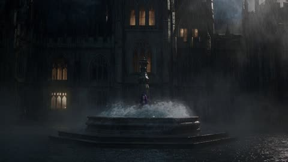</a>

提示词把动作拆成清晰的节拍：现身、闪避、召唤、撞击、消散。开头先定下场景与天气，结尾再补充光线和慢动作流体效果。

Seedance 2.5 · 文生视频 · 出处: [@laviniavelle on X](https://x.com/laviniavelle/status/2107333176985317886) · 发现于 [LearnPrompt/awesome-seedance](https://github.com/LearnPrompt/awesome-seedance)

[`dark-fantasy`](tags.md#tag-dark-fantasy) [`action`](tags.md#tag-action) [`water-magic`](tags.md#tag-water-magic) [`gothic`](tags.md#tag-gothic) [`slow-motion`](tags.md#tag-slow-motion)

<details><summary><b>提示词</b></summary>

```text
A dark fantasy action sequence in a gothic castle courtyard during torrential rain A sorceress with vibrant purple hair rises from a stone fountain Two men with swords attack her She fluidly dodges uses water magic to shield herself, and summons a giant water beast with glowing eyes from the fountain that slams into her attackers She calmly steps out of the fountain raises her hand, and dissolves the water beast into a fine mist of rain. Cinematic lighting slow motion fluid dynamics, 8k resolution.
```

</details>

<a id="seedance-thorn-wood-glass-figure-encounter"></a>
### 荆棘木人与琉璃人形在旧屋相遇

<a href="https://x.com/itsSaira_1/status/2121100826894590435">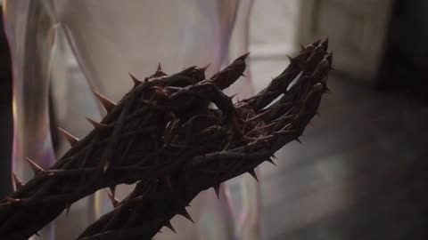</a>

先明确两个角色的材质，荆棘枝条与透明琉璃，再按靠近、互动、粉色光芒浮现的顺序写出动作节拍，让模型有清晰的剧情线。结尾用慢速流动运镜和浅景深统一画面的电影质感。

Seedance 2.5 · 文生视频 · 出处: [@itsSaira_1 on X](https://x.com/itsSaira_1/status/2121100826894590435) · 发现于 [LearnPrompt/awesome-seedance](https://github.com/LearnPrompt/awesome-seedance)

[`dark-fantasy`](tags.md#tag-dark-fantasy) [`surreal`](tags.md#tag-surreal) [`glass-figure`](tags.md#tag-glass-figure)

<details><summary><b>提示词</b></summary>

```text
A surreal dark-fantasy cinematic scene featuring a mysterious humanoid creature made entirely of twisted branches, roots, and sharp thorns, encountering a beautiful translucent glass-like humanoid figure with an iridescent rainbow sheen inside an abandoned vintage room. The two figures slowly approach and interact with each other, creating an emotional and mysterious atmosphere. A glowing pink energy begins to emerge as the wooden creature reaches toward the transparent figure. Dreamlike movements, intricate organic textures, soft volumetric light, dramatic shadows, shallow depth of field, atmospheric cinematic lighting, photorealistic details, haunting visual storytelling, slow fluid camera movements, ultra-realistic fantasy filmmaking, 4K.

#AIart #AI #Visualart
```

</details>

<a id="seedance-time-machine-future-scientist"></a>
### 科学家站在发光时光机旁的昏暗实验室

<a href="https://x.com/iam_nafisahmed/status/2088964392528527702">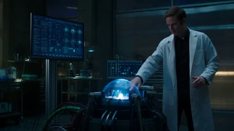</a>

用带时间点的分镜逐拍描述，并写明倒计时与黑场闪白的收尾，让模型有清晰的节奏结构。结尾用真实物理和细微胶片颗粒等词，把画面锁定在实拍电影的质感上。

Seedance 2.5 · 文生视频 · 出处: [@iam_nafisahmed on X](https://x.com/iam_nafisahmed/status/2088964392528527702) · 发现于 [LearnPrompt/awesome-seedance](https://github.com/LearnPrompt/awesome-seedance)

[`sci-fi`](tags.md#tag-sci-fi) [`thriller`](tags.md#tag-thriller) [`countdown`](tags.md#tag-countdown) [`time-machine`](tags.md#tag-time-machine)

<details><summary><b>提示词</b></summary>

```text
He built a machine that could see 10 seconds into the future.

Then he saw himself standing behind him.

Create your version on @budgetpixel  using Seedance 2.5 

Prompt below if you want to make your own.👇

"Create a 10-second photorealistic cinematic sci-fi thriller.

A young scientist stands inside a dark futuristic laboratory beside a glowing experimental time machine. He activates it and sees exactly 10 seconds into the future.

At first, he smiles in amazement as the machine shows the laboratory still intact.

Suddenly, the future image changes.

The same laboratory is now completely destroyed—glass shattered, machines burning, sparks flying, smoke everywhere.

The scientist looks around in panic.

A countdown appears on the machine: 10... 9... 8... 7...

He notices the machine's glowing energy core rapidly overheating.

3... 2... 1...

He realizes the machine is about to explode.

The screen instantly cuts to black as a massive white flash fills the laboratory.

Ultra-photorealistic, cinematic sci-fi thriller, realistic futuristic laboratory, dramatic lighting, realistic fire and sparks, intense suspense, fast pacing, believable technology, realistic physics, cinematic camera movement, premium Hollywood VFX, subtle film grain, highly detailed, 4K.

No subtitles, no logos, no watermark, no cartoon style."
```

</details>

<a id="seedance-traveler-unicorn-misty-forest"></a>
### 旅者在晨雾森林遇见独角兽

<a href="https://x.com/juliaevee/status/2105150663047135672">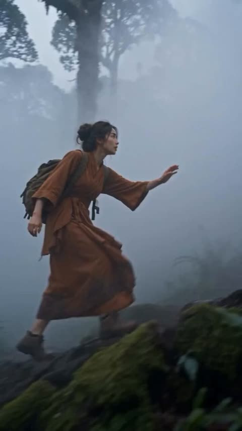</a>

提示词按顺序铺设场景：先写旅者与服装，再写独角兽的发光特征，最后用蹄子踩踏苔藓这一物理动作触发金光沿小径蔓延并驱散浓雾。结尾指向日出山谷，为视频提供明确的收束画面。

Seedance 2.5 · 文生视频 · 出处: [@juliaevee on X](https://x.com/juliaevee/status/2105150663047135672) · 发现于 [LearnPrompt/awesome-seedance](https://github.com/LearnPrompt/awesome-seedance)

[`unicorn`](tags.md#tag-unicorn) [`misty-forest`](tags.md#tag-misty-forest) [`fantasy`](tags.md#tag-fantasy) [`volumetric-light`](tags.md#tag-volumetric-light)

<details><summary><b>提示词</b></summary>

```text
A young East Asian female traveler wearing an earth-toned, brown wrap tunic robe with a backpack hiking through a misty, dense ancient forest. She encounters a majestic white unicorn with a glowing golden horn, glowing eyes, and golden light woven through its flowing mane. The unicorn steps on the mossy ground, causing veins of golden magical light to spread along the forest trail, clearing the thick fog and opening into a breathtaking view of a lush mountain valley at sunrise. Cinematic 4k, hyper-realistic, volumetric lighting, epic fantasy atmosphere, soft morning sunbeams.
```

</details>

<a id="seedance-tree-guardian-dark-fantasy-battle"></a>
### 女子唤醒熔岩树灵对抗恶魔

<a href="https://x.com/itsSaira_1/status/2107685928647160275">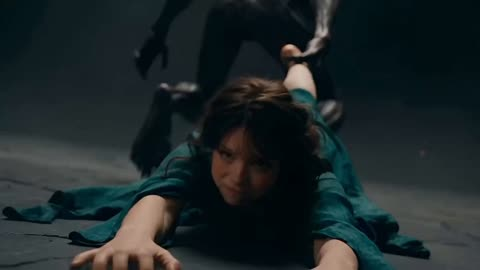</a>

开头先用画幅、镜头、色调和粒子等全局风格词定调，再按被擒、召唤、战斗、平静收尾的顺序写清节拍。快速运镜、慢动作爆炸和骷髅特写等镜头词控制了画面节奏。

Seedance 2.5 · 文生视频 · 出处: [@itsSaira_1 on X](https://x.com/itsSaira_1/status/2107685928647160275) · 发现于 [LearnPrompt/awesome-seedance](https://github.com/LearnPrompt/awesome-seedance)

[`dark-fantasy`](tags.md#tag-dark-fantasy) [`battle`](tags.md#tag-battle) [`creature`](tags.md#tag-creature) [`cinematic`](tags.md#tag-cinematic) [`slow-motion`](tags.md#tag-slow-motion)

<details><summary><b>提示词</b></summary>

```text
Cinematic dark fantasy battle, 16:9, photoreal, shallow depth of field, anamorphic lens, moody teal-grey and fiery orange color grade, drifting embers and smoke. A young woman with short wavy brown hair in an emerald green dress is dragged across cracked dark stone floor by a tall horned grey demon. She slams her hand down and glowing white-gold roots erupt from the ground, growing into a towering tree-guardian with a glowing lava-vein bark body and antler-like branches. The tree-guardian fights a horde of grey demon creatures, shoots a massive stream of fire, and gets surrounded by burning demons. Close-ups of a skull-faced demon with molten cracks. Fast dynamic camera, slow-motion fire explosions. Ends with a glowing sphere of woven burning roots, then the woman kneeling on the ground, hands glowing on the floor, calm and powerful.

#AI #AIart️️️️️️️️️️️️️️️️️️️️️️️️️️️️️️️️️️️️️️️️️️️️️️️️️️️ #Visualart
```

</details>

<a id="seedance-twin-speedsters-empty-city-superpower-short"></a>
### 两位超速女孩在空城街头相遇

<a href="https://x.com/ai_anelia/status/2112960745168392440">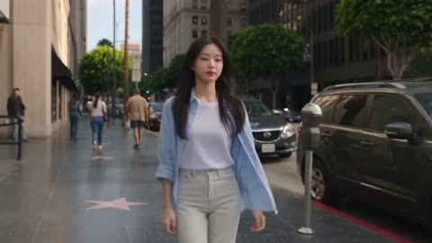</a>

把 30 秒拆成每段 4 到 6 秒的时间节拍，每段指定景别和运动，故事从繁忙街头推进到完全寂静。角色块锁定脸部和服装，音频一行把风声和轮胎声渐隐为寂静，并配上对白和渐强配乐。

Seedance 2.5 · 文生视频 · 出处: [@ai_anelia on X](https://x.com/ai_anelia/status/2112960745168392440) · 发现于 [LearnPrompt/awesome-seedance](https://github.com/LearnPrompt/awesome-seedance)

[`sci-fi`](tags.md#tag-sci-fi) [`superpower`](tags.md#tag-superpower) [`timed-shots`](tags.md#tag-timed-shots) [`dialogue`](tags.md#tag-dialogue) [`cinematic`](tags.md#tag-cinematic)

<details><summary><b>提示词</b></summary>

```text
Cinematic ultra-realistic sci-fi superpower short film, 16:9, 30 seconds, 24fps, shot like a high-budget streaming drama, bright natural daylight, downtown American-style city with tall glass and stone buildings, palm trees, traffic lights, wide crosswalks and parked cars, shallow depth of field, crisp detail, subtle film grain, natural color grade with warm sunlight and cool shadows.
Character 1: A young Korean woman in her early 20s, long straight black hair, soft natural makeup, expressive wide eyes, wearing a light-blue open button-up shirt over a fitted white t-shirt, cream trousers and white sneakers. Gentle, curious and a little frightened at the start, slowly turning confident.
Character 2: A young blonde woman in her mid-20s, wavy shoulder-length hair, calm sharp eyes, wearing a black sweater and blue jeans. Cool, mysterious and fast, with a hint of loneliness behind her eyes.
Keep both faces, hairstyles and outfits identical in every shot.
Setting: A busy city intersection that slowly turns completely empty and silent as the story goes on, with wind, dust and loose papers moving through the air.
0–4s: Wide establishing shot of a sunny downtown street with pedestrians, taxis and cars. The Korean woman stands near a crosswalk. Time seems to slow down; the background blurs into soft motion and her eyes widen in shock as a car speeds straight toward her.
4–8s: Extreme close-up of her startled face, then she bursts into superhuman speed. Her feet kick up dust and wind, her hair and shirt whip backward, and she weaves between moving cars and people, the city stretching into streaks of motion behind her. Low tracking shot, strong motion blur.
8–12s: A shockwave of dust rolls across the crosswalk. From the side of the frame, the blonde woman appears running at the same impossible speed. They glance at each other, both stunned. Close-up of the Korean woman whispering: "There's someone else like me?"
12–18s: They sprint side by side down the wide street, dust clouds exploding behind them, cars frozen in the background like statues. Dynamic side tracking shots, then a low-angle shot as they run past the camera, hair flying, determination on both faces.
18–22s: The Korean woman launches into a long, graceful leap, gliding through the air above the street, while the blonde woman runs beneath her, hair blowing wildly in the wind. Slow-motion for the leap, cinematic and almost weightless.
22–26s: Both slow down and come to a stop in the middle of a completely empty street. Papers drift down through the air, the wind fades, the whole city is silent and still around them. Wide shot from behind showing the two small figures in the empty avenue.
26–30s: Calm close-ups, soft light on their faces. The blonde woman says quietly: "I thought I was the only one." The Korean woman smiles and answers: "So did I." Slow pull-back as they stand together in the empty street, then cut to black.
Audio: Rushing wind, tire screeches fading into complete silence, a soft heartbeat, light footsteps, a subtle emotional orchestral score building gently, clear natural English dialogue.
Style: Realistic grounded sci-fi action-drama, smooth physics, natural human movement, emotional performances, non-graphic, no text, no subtitles, no logos, no watermark.
```

</details>

<a id="seedance-vehicles-transform-into-robots"></a>
### 银色跑车在城市高速公路上疾驰

<a href="https://x.com/laviniavelle/status/2108404878590857384">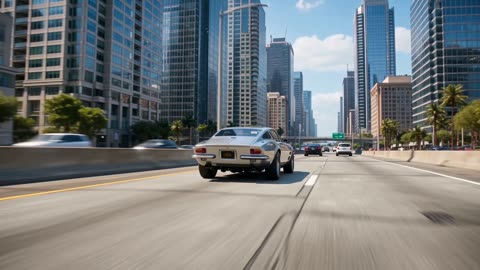</a>

一个提示词串联了四组载具变形为机器人的场景，每组配有不同环境（城市高速、海岸公路、沙漠、航母甲板），便于模型在环境之间切换。结尾的动态追踪镜头和写实8K渲染风格词，让整段画面保持统一的质感。

Seedance 2.5 · 文生视频 · 出处: [@laviniavelle on X](https://x.com/laviniavelle/status/2108404878590857384)

[`transformation`](tags.md#tag-transformation) [`robots`](tags.md#tag-robots) [`vehicles`](tags.md#tag-vehicles) [`tracking-shot`](tags.md#tag-tracking-shot)

<details><summary><b>提示词</b></summary>

```text
A silver sports car driving down a city highway smoothly transforms into a giant silver running robot a futuristic neon lit motorcycle on a coastal highway morphs into a running blue cybernetic robot; a camouflage military tank driving across a sandy desert transforms into a walking heavy combat mecha a fighter jet on an aircraft carrier deck unfolds and transforms into a standing robot warrior, sci-fi action style high tech mechanical transformation, dynamic camera tracking shot, cinematic photorealistic 8k render.
```

</details>

<a id="seedance-venice-inverted-city-envelope-run"></a>
### 粉发女子奔跑穿过倒置的威尼斯

<a href="https://x.com/Just_sharon7/status/2100541954685895043"></a>

固定的身份描述锁定人脸、发色和服装，分段时间轴列出每个镜头，使同一角色在所有运镜中保持一致。把折叠的城市描述为镜面天花板，并明确人物始终受正常重力，为超现实场景建立清晰的视觉规则。

Seedance 2.5 · 参考生视频 · 出处: [@Just_sharon7 on X](https://x.com/Just_sharon7/status/2100541954685895043) · 发现于 [LearnPrompt/awesome-seedance](https://github.com/LearnPrompt/awesome-seedance)

[`surreal`](tags.md#tag-surreal) [`venice`](tags.md#tag-venice) [`character-consistency`](tags.md#tag-character-consistency) [`cinematic`](tags.md#tag-cinematic)

<details><summary><b>提示词</b></summary>

```text
[Image 1](image_1) is the face and identity reference. A young Korean woman in her early twenties with EXACTLY the face of @[Image 1](image_1) — same facial structure, same features, natural Korean skin, no glasses. Long pastel pink hair, wearing a 1940s teal-orange wool coat-dress with white collar, a brown leather satchel worn cross-body, grey knee socks, black leather shoes, holding a folded yellow envelope. Every shot of her matches @[Image 1](image_1).
1940s Venice at golden hour. Amber and teal cinematic grade, anamorphic 35mm film look, shallow depth of field, volumetric god rays, fine film grain. Inception-style folding architecture — the Venetian city curls upward and hangs inverted overhead like a mirrored ceiling. The woman always stays under normal gravity while the world folds around her. Continuous camera motion, no hard cuts.
[TIMELINE PROMPT]
0–3s: Lateral tracking shot along a stone quay by the Grand Canal at sunset. The young woman @[Image 1](image_1) in a teal coat sprints past camera, clutching a yellow envelope. Above her the entire city hangs upside down, mirrored — a man in a bowler hat walks a dachshund across the inverted street. A red umbrella drifts weightlessly between the two worlds. Pigeons scatter through the amber light.
3–6s: Camera follows behind her into a narrow Venetian alley, dry leaves swirling in her wake. At the far end the street peels upward into the sky, buildings stacking vertically like a wall of windows. Her footsteps echo between the stone walls.
6–9s: The camera slowly rolls 90 degrees. The alley wall becomes the ground beneath her feet; she keeps running, unfazed. The roll continues into a wide orbit as she races up a floating spiral stone staircase suspended in mid-air, fragments of terracotta Venetian rooftops rotating around her like a kaleidoscope.
9–12s: Extreme wide silhouette. She runs across the top of an arched stone bridge over a wide canal against the blazing setting sun. The mirrored city hangs both above and below the arch. On the inverted plane, a lone pedestrian walks the opposite direction. Birds burst across the frame in slow motion.
12–15s: Low angle looking straight up between two towering building walls, the sky a thin bright strip. She leaps across the vertical chasm, arms spread wide, coat and hair flying, satchel swinging. Camera holds on her against the sky. Wind roars.
15–18s: Handheld push-in through a crowded 1940s Rialto market street — vendors stacking crates of apples, laundry strung overhead between the buildings. She weaves between blurred foreground shoppers, running away from camera. An apple rolls loose across the cobblestones.
18–21s: Camera tilts up a grand brick bell tower — a Venetian campanile — as the surrounding city folds and curls around it. The woman appears tiny on the tower ledge, pauses against the sun, then steps off toward the rooftops. Bells begin to ring.
21–24s: Rooftop terrace garden framed by a rose-covered arbor. An elderly woman in a grey cardigan waters a bed of vivid flowers with a tin can. Behind her, Venice and the domes of St Mark's Basilica glow at sunset over the lagoon while the inverted city hangs overhead. The young woman balances along the stone balustrade, arms out, then jumps down onto the terrace.
24–27s: She holds out the yellow envelope. The old woman turns, sets down the watering can, and takes it. Both smile warmly at each other. Rose petals drift upward past them, falling toward the inverted sky.
27–30s: Camera pulls back and rises fast. The whole city folds and rotates until it becomes a top-down aerial of Venice's canals and streets curling into a sphere. The two tiny figures remain on the terrace. Slow fade to warm light.
```

</details>

<a id="seedance-wasteland-hourglass-hair-morph"></a>
### 荒原巨型沙漏间伫立的女子

<a href="https://x.com/itsSaira_1/status/2106989829108207864">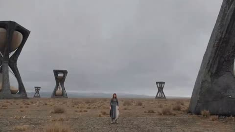</a>

提示词详细锁定服装，并只把发型变化描述为唯一的形象变化，使人物在变换过程中保持一致。阴天平光、低饱和色调和缓慢的镜头运动奠定了氛围。

Seedance 2.5 · 文生视频 · 出处: [@itsSaira_1 on X](https://x.com/itsSaira_1/status/2106989829108207864) · 发现于 [LearnPrompt/awesome-seedance](https://github.com/LearnPrompt/awesome-seedance)

[`wasteland`](tags.md#tag-wasteland) [`hourglass`](tags.md#tag-hourglass) [`character-morph`](tags.md#tag-character-morph) [`photorealistic`](tags.md#tag-photorealistic)

<details><summary><b>提示词</b></summary>

```text
Cinematic wide shot of a cracked, dry wasteland under a flat grey overcast sky. Monumental weathered stone hourglasses, some as tall as buildings, stand across the plain; sand pours steadily inside their glass bulbs. A young woman in a muted blue-grey high-collar tunic with white embroidery, a two-tone grey and cream skirt, tall boots, and wide silver cuff bracelets walks toward the nearest hourglass. She stops, looks up at the falling sand, then checks a thick silver wrist device with growing alarm. Her appearance morphs mid-shot: long brown hair with bangs becomes windblown blonde, then a darker brown, while the outfit stays the same. Close-ups show wide eyes and hands pressed to her temples as small dark particles drift in the air. She turns away, then looks back over her shoulder with a faint, knowing smile. Desaturated earth tones, soft diffused light, shallow depth of field on close-ups, photorealistic, filmic, slow deliberate camera moves.

#AIArt #AIContent #CinematicAI
```

</details>

<a id="seedance-water-dragon-rooftop-brush-vortex"></a>
### 屋顶白衣女子云端召唤水晶水龙

<a href="https://x.com/juliaevee/status/2110191663666639097">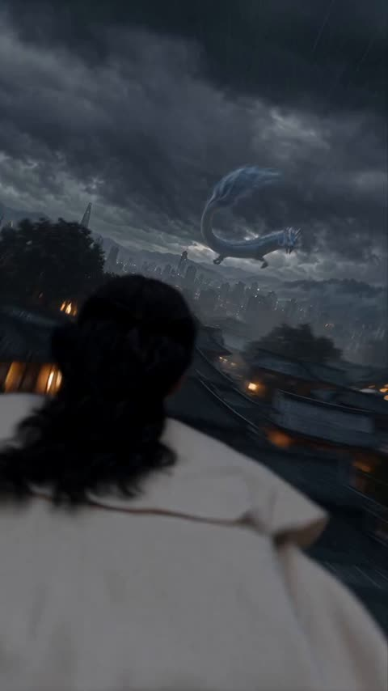</a>

提示词按时间顺序写成分镜：先定暴风雨屋顶，再过渡到阳光下的云上世界，最后以画圈引出漩涡。这条清晰的因果链让模型有明确的先后顺序，而服饰与半透明龙身的具体描述使主体在镜头切换中保持一致。

Seedance 2.5 · 文生视频 · 出处: [@juliaevee on X](https://x.com/juliaevee/status/2110191663666639097) · 发现于 [LearnPrompt/awesome-seedance](https://github.com/LearnPrompt/awesome-seedance)

[`water-dragon`](tags.md#tag-water-dragon) [`fantasy`](tags.md#tag-fantasy) [`vfx`](tags.md#tag-vfx) [`storm`](tags.md#tag-storm)

<details><summary><b>提示词</b></summary>

```text
A cinematic vertical video starting on a dark, stormy rooftop overlooking a sprawling urban city. A woman in a white and beige traditional robe with long dark hair stands watching a majestic, translucent blue water-dragon coiled in the stormy clouds. The dragon lunges towards her, transitioning into a bright, ethereal realm above the clouds where she floats under a brilliant sun. She draws a glowing circle with a brush on parchment, creating a vortex in the clouds, then summons water spirals that shape into a massive crystalline dragon that dives down toward the city below, creating a giant splash through the cloud layer. Photorealistic, high-end VFX, epic fantasy atmosphere, dynamic camera angles, 8k resolution.
```

</details>

<a id="seedance-wizard-duck-monster-storyboard"></a>
### 女巫变成鸭子逃离怪物

<a href="https://x.com/AIwithNatalia/status/2089170554725265625">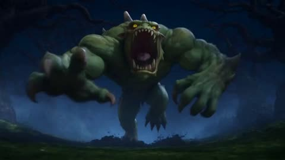</a>

七段分镜精确到秒，每个剧情节点都有独立的时间段。对白和音效直接写进对应段落，结尾用一行文字卡收束。

Seedance 2.5 · 文生视频 · 出处: [@AIwithNatalia on X](https://x.com/AIwithNatalia/status/2089170554725265625) · 发现于 [LearnPrompt/awesome-seedance](https://github.com/LearnPrompt/awesome-seedance)

[`comedy`](tags.md#tag-comedy) [`storyboard`](tags.md#tag-storyboard) [`timed-beats`](tags.md#tag-timed-beats) [`fantasy`](tags.md#tag-fantasy) [`dialogue`](tags.md#tag-dialogue)

<details><summary><b>提示词</b></summary>

```text
0–3 sec — Hook
A young wizard stands frozen in a dark forest as a massive monster charges toward her.
Wizard: “Ten seconds… that’s all I need!”

3–8 sec — The Spell
She raises her glowing staff and rapidly chants a magical spell. The monster gets closer and closer.

8–12 sec — Countdown
Monster: “YOU’RE TOO LATE!”
The wizard finishes the final word: “TRANSFORMUS!”

12–16 sec — Magic Burst
A huge explosion of purple light fills the screen. Everything goes silent.

16–21 sec — Twist
The smoke clears. The monster looks confused.
Instead of the wizard… there’s a tiny, adorable duck standing in her robes.

21–26 sec — Reaction
The duck looks down at herself, quacks angrily, and smacks the staff with her wing.

26–30 sec — Punchline
The monster slowly backs away.
Monster: “...Honestly, I’m scared of her.”
The duck suddenly starts chasing him.
SFX: Quack! Quack! Quack!
End text:
✨ Never rush a spell. 🦆
```

</details>

<a id="seedance-wizard-workshop-transformation"></a>
### 第一人称巫师工坊与发光药剂

<a href="https://x.com/KICHOCHEZI/status/2098432693222715716">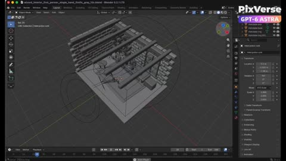</a>

先用 Blender 白模生成参考视频，锁定运镜、动作时序与空间布局，再用参考图定义材质与光线。要求单镜头连续拍摄并且只拿一瓶药剂，可以保持动作与道具稳定。

Seedance 2.5 · 参考生视频 · 出处: [@KICHOCHEZI on X](https://x.com/KICHOCHEZI/status/2098432693222715716)

[`blender`](tags.md#tag-blender) [`white-model`](tags.md#tag-white-model) [`first-person`](tags.md#tag-first-person) [`reference-video`](tags.md#tag-reference-video)

<details><summary><b>提示词</b></summary>

```text
Create a 12-second single-take white-model animation in Blender based on the supplied wizard workshop reference. Build the stone walls, wooden shelves, arched window, fireplace, books, astronomical instrument and alchemy table filled with potion bottles. Animate a low first-person viewpoint with exactly one right hand holding one potion. Begin with the bottle near the lower-right edge, look around the workshop and toward the window, raise the potion naturally, pause to examine it, then lower it while turning toward the fireplace and glowing reagents. Export the white-model MP4. Then use PixVerse with Seedance 2.5, referencing the Blender video for camera, action and spatial layout and the supplied images for appearance. Preserve the continuous shot and timing while adding weathered stone, carved wood, worn leather, realistic glass, cool window light, warm fireplace illumination, glowing magical liquids, natural flames, embers, sparks and smoke.
```

</details>

<a id="seedance-woman-castle-doors-floating-islands"></a>
### 女子推开城堡大门飞入浮岛天空

<a href="https://x.com/laviniavelle/status/2105889515948921057">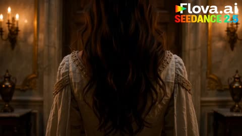</a>

提示词按时间顺序写出镜头：昏暗室内、推门露出风景、奔跑、跃起，镜头全程跟随，让模型有清晰的动作节拍可循。结尾的光影与画质词定下电影感的效果。

Seedance 2.5 · 文生视频 · 出处: [@laviniavelle on X](https://x.com/laviniavelle/status/2105889515948921057)

[`fantasy`](tags.md#tag-fantasy) [`castle`](tags.md#tag-castle) [`floating-islands`](tags.md#tag-floating-islands) [`camera-follow`](tags.md#tag-camera-follow)

<details><summary><b>提示词</b></summary>

```text
Cinematic video of a young woman in an elegant white medieval dress opening large wooden doors from a dark castle interior to reveal a breathtaking sunny landscape with lush green fields a lake and distant mountains She runs out across the grassy field towards a large grand castle The camera follows her as she leaps into the air, gracefully floating into a magical fantasy sky filled with floating islands cascading waterfalls above clouds, and a large glowing pink moon in the surreal sky, 8k resolution, ultra detailed, cinematic lighting.
```

</details>

<a id="seedance-woodland-guardian-lantern-door"></a>
### 林间守护者触碰发光的刻纹石柱

<a href="https://x.com/itxabdullaa/status/2107792780395458733">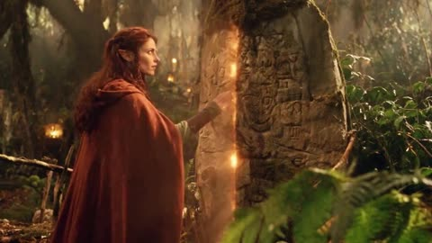</a>

提示词把人物、服装和色调写进一个可复用的固定段落，再用带时间码的分镜逐段推进，并加入连续性约束，让脸部、披风和道具在各镜头中保持一致。35mm 颗粒、实景灯笼和微缩布景等胶片与实拍质感的描述，让画面远离光滑的 CGI 风格。

Seedance 2.5 · 文生视频 · 出处: [@itxabdullaa on X](https://x.com/itxabdullaa/status/2107792780395458733) · 发现于 [LearnPrompt/awesome-seedance](https://github.com/LearnPrompt/awesome-seedance)

[`fantasy`](tags.md#tag-fantasy) [`practical-effects`](tags.md#tag-practical-effects) [`continuity`](tags.md#tag-continuity) [`film-grain`](tags.md#tag-film-grain) [`timed-shots`](tags.md#tag-timed-shots)

<details><summary><b>提示词</b></summary>

```text
Create an original young adult female woodland guardian in the handcrafted style of a forgotten early-1990s live-action fantasy film. Fully original character and world, practical-effects aesthetic, not modern CGI.

CHARACTER: Young adult woman, natural expressive face, amber-brown eyes, softly angular features, subtly elongated fantasy ears, thick dark auburn wavy hair with small braids. Intelligent, brave, curious and quietly playful.

COSTUME: Fully modest sage-green high-neck linen blouse, brown leather vest, ankle-length olive wool skirt, opaque dark leggings, worn brown boots, leather wrist guards and long burnt-orange hooded cloak. Leather belt with small pouches, brass compass, herbs, wooden whistle and bronze leaf pendant. Real fibers, worn leather, tarnished metal and natural mud. Practical prosthetic fantasy ears.

SETTING: Ancient woodland at dusk, twisted trees, moss, ferns, mushrooms, streams, wooden bridges, carved stones and handmade lanterns. Hidden shelters and distant lights suggest a secret woodland settlement.

STYLE: Practical foliage, physical props, theatrical mist, practical lanterns, miniature sets, restrained optical effects, 35mm film softness, subtle grain, lantern halation, earthy greens, browns and amber, warm theatrical lighting. No glossy CGI or modern fantasy aesthetic.

[00:00-00:04] THE PATH
Low shot of her boots walking through damp leaves. Camera rises to her face. A distant metallic chime makes her stop.

[00:04-00:08] THE LANTERN
She finds a glowing antique lantern with no visible flame. It goes dark as she reaches for it. Another lantern lights deeper in the forest, then another. She realizes she is being guided.

[00:08-00:12] THE TRAIL
She follows the lanterns and discovers carved symbols on trees. One rotates when touched. Another moves behind her. Nobody is there. She smiles, realizing someone is watching.

[00:12-00:16] THE FOX
A woodland fox leads her to a fallen tree. Beneath its roots she finds a box containing a brass compass. Its spinning needle suddenly points upward. A shadow moves through the canopy.

[00:16-00:20] SOMEONE ABOVE
Leaves rustle. Acorns drop beside her boots. She looks upward and says softly, "You could simply come down." A hidden wooden platform creaks above. She smiles suspiciously.

[00:20-00:24] THE DOOR
She follows the sound to an enormous tree and discovers a hidden seam. She touches it. Carved symbols glow and the bark opens into a secret doorway filled with warm golden light. She enters.

[00:24-00:27] THE HIDDEN WORLD
Inside is a vast woodland settlement built around the tree: lanterns, wooden platforms, rope bridges, workshops, herbs and glowing windows. Hundreds of lanterns illuminate as she looks around in wonder.

[00:27-00:30] THE INVITATION
A wooden bridge leads to a folded parchment reading "YOU FOUND US." Several silhouettes appear among the lanterns. She smiles, places the parchment in her satchel and walks deeper into the settlement.

Camera pulls backward through the ancient tree doorway into the dark forest. Cut to black.

STRICT CONTINUITY: Same face, hair, ears, proportions, costume, cloak, boots, belt, pendant and satchel in every shot. Fully modest clothing with no wardrobe changes or exposure. Continuous geography and logical progression.

CAMERA: Atmospheric low angles, slow tracking, facial close-ups, wide environmental shots and restrained handheld movement.

FINAL LOOK: Authentic early-1990s 35mm fantasy film, practical prosthetics, real costumes, physical sets, theatrical mist, practical lanterns, subtle optical effects, natural performances and beautiful film grain.

Original character and world only. No recognizable existing characters, franchises, logos, branded costumes, copied designs, blood or gore.
```

</details>

<a id="veo-moon-dust-flowers"></a>
### 月尘平原上的水晶花

<a href="https://storage.googleapis.com/gdm-deepmind-com-prod-public/media/media/veo__veo-3__moon-dust.webm">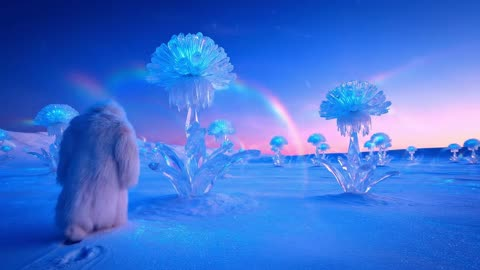</a>

短小的造景提示词。一个抓人的细节（`the only footprints in untouched dust`）胜过一长串形容。

Veo 3 · 文生视频 · 出处: [Veo 3 prompt guide](https://deepmind.google/models/veo/prompt-guide/)

[`world-building`](tags.md#tag-world-building) [`fantasy`](tags.md#tag-fantasy)

<details><summary><b>提示词</b></summary>

```text
A snow-covered plain of iridescent moon-dust under twilight skies. Thirty-foot crystalline flowers bloom, refracting light into slow-moving rainbows. A fur-cloaked figure walks between these colossal blossoms, leaving the only footprints in untouched dust.
```

</details>

[1](video-scifi-fantasy.md) · **2**
