# 科幻与奇幻

[返回目录](../../README_zh.md) · 全部 82 条

<a id="seedance-lab-containment-breach"></a>
### 实验室收容失效，科幻恐怖

<a href="https://x.com/auqibhabib/status/2099725768310009982"></a>

要求开场即钩子、用实拍特效质感，怪物不会显得像 CG。

Seedance 2.5 · 文生视频 · 出处: [@auqibhabib on X](https://x.com/auqibhabib/status/2099725768310009982) · 2,425 赞，统计于 2026-10-27

[`horror`](tags.md#tag-horror) [`sci-fi`](tags.md#tag-sci-fi) [`action`](tags.md#tag-action)

<details><summary><b>提示词</b></summary>

```text
Cinematic sci-fi horror-action short film set in a research laboratory, opens with an immediate strong hook, natural realistic pacing, grounded practical-effects style. Lab filled with steel equipment, glass containment tubes, monitors, specimen tables, harsh fluorescent lighting. Five scientists in lab coats work at various stations. Natural handheld camera work, muted authentic color grading, all sound fully natural and diegetic — no music, no artificial sound design until the tension score kicks in.
>
> **[0-1s]** Hard cut: a containment tube shatters violently, glass exploding across the lab floor.
>
> **[1-2s]** A small dark parasite creature skitters out fast, latching instantly onto a scientist's neck.
>
> **[2-3s]** He screams, collapsing to his knees, the others recoiling in shock.
>
> **[3-4s]** Dark veins pulse rapidly beneath his skin, visible even through his collar, his body convulsing.
>
> **[4-5s]** His eyes turn a deep obsidian black — he rises, movements jerky and unnatural.
>
> **[5-6s]** He lunges at the nearest colleague, parasite tendrils extending from his mouth toward her.
>
> **[6-7s]** She's caught, tendrils latching onto her neck, her scream cutting short.
>
> **[7-8s]** Veins spread fast across her too, body convulsing against a lab table, equipment crashing down.
>
> **[8-9s]** She rises seconds later, eyes black, joining him, both turning toward the remaining three.
>
> **[9-10s]** The three scientists scramble back, one grabbing a fire axe from an emergency case on the wall.
>
> **[10-11s]** The two infected charge fast, jerky inhuman movements, tendrils whipping from their jaws.
>
> **[11-12s]** The lead scientist swings the axe hard into the first infected — a solid impact, it staggers into a specimen table, equipment shattering.
>
> **[12-13s]** A second scientist grabs a fire extinguisher, blasting the other infected in the face, it recoils, tendrils flailing.
>
> **[13-14s]** The third scientist shoves a steel cart into the staggering infected's path, sending it crashing down.
>
> **[14-15s]** Both infected collapse motionless, twitching, tendrils retracting slowly.
>
> **[15-16s]** The three survivors regroup, breathing hard, scanning the wrecked lab for more movement.
>
> **[16-17s]** Wide shot: broken glass and toppled equipment everywhere, alarm lights beginning to flash red.
>
> **[17-18s]** A third containment tube behind them starts cracking, unnoticed by the group.
>
> **[18-19s]** It shatters suddenly — another parasite creature launches out fast.
>
> **[19-20s]** The lead scientist spins just in time, swinging the axe and slicing it out of the air mid-leap.
>
> **[20-21s]** It hits the floor, motionless, dark fluid spreading slightly beneath it.
>
> **[21-23s]** The group presses their backs together, weapons raised, scanning every corner of the lab.
>
> **[23-25s]** Emergency lights flash steadily red, alarm klaxon blaring through the facility.
>
> **[25-27s]** The lead scientist gestures toward the exit; they move together cautiously, stepping over debris and fallen colleagues.
>
> **[27-29s]** They reach the heavy lab door, the lead scientist sealing it shut behind them with a hard mechanical clang.
>
> **[29-30s]** Final shot: the three survivors lean against the sealed door, breathing hard, alarm lights flashing red across their exhausted faces. Cut to black.
>
> Natural diegetic sound throughout — glass shattering, guttural convulsions, screaming, metal impacts, alarm klaxon, heavy breathing — layered with a tense instrumental score building through the fight and easing at the end. No text overlay, no watermark. Natural handheld camera with realistic shake during action, muted clinical color grading.
```

</details>

<a id="seedance-dragon-bakes-bread"></a>
### 女孩教巨龙烤心形面包

<a href="https://x.com/ElsaSofia__AI/status/2113089111699673461"></a>

短而具体：龙的配色、一条硬规则（面包全是心形）、最后落一个情绪词。

Seedance 2.5 · 文生视频 · 出处: [@ElsaSofia__AI on X](https://x.com/ElsaSofia__AI/status/2113089111699673461) · 1,430 赞，统计于 2026-10-27

[`fantasy`](tags.md#tag-fantasy) [`creature`](tags.md#tag-creature) [`food`](tags.md#tag-food)

<details><summary><b>提示词</b></summary>

```text
Photorealistic medieval fantasy film. Warm sunlight, stone cottage, wooden table, iron grill. Colossal dragon with pale pink-white scales, pink spines and golden eyes. All bread must be heart-shaped. Realistic fire, food textures, natural physics.
0-5s: Heroine arranges raw heart-shaped dough on the grill. Dragon sniffs eagerly, then blasts enormous flames! Fire engulfs the dough. She jumps back: "Whoa! Easy! You're making bread, not dragon food!"
5-10s: A charred heart-shaped loaf smokes on the grill. Dragon looks guilty, hiding its head. She shows the burnt bread, then smiles and replaces it: "Look. Just a little flame. Can you do that?"
10-17s: Dragon carefully releases a tiny steady flame beneath the grill. Heart-shaped dough rises, forming a golden crust. Steam rises as dragon watches nervously.
17-23s: She cuts open the crispy heart-shaped bread, revealing a soft fluffy center. "You did it! Perfect!" Dragon tries to eat it all. She laughs and feeds it a small piece.
23-30s: Dragon nuzzles her for affection. She strokes its scales, shares more heart-shaped bread. Dragon closes its eyes happily, tail wagging. Wide sunset shot, warm and healing.
Cinematic lighting, detailed scales, realistic flames, expressive acting. No subtitles, narration, logos or watermark.
```

</details>

<a id="seedance-celestial-puppeteer-golden-star"></a>
### 天界操偶师重塑崩塌的金色恒星

<a href="https://x.com/itsPixieVerse/status/2099712704940568739"></a>

提示词首尾各放一段带明确排除项的绘画风格约束，中间用世界观和角色两个模块锁定外观。三十秒切成十个三秒镜头，每个镜头标明景别，从微距细节一路推到英雄定格。用 GPT Image 2.5 生成的角色设定图作为形象参考。

Seedance 2.5 · 参考生视频 · 出处: [@itsPixieVerse on X](https://x.com/itsPixieVerse/status/2099712704940568739) · 1,127 赞，统计于 2026-10-27

[`painterly-animation`](tags.md#tag-painterly-animation) [`multi-shot`](tags.md#tag-multi-shot) [`character-sheet`](tags.md#tag-character-sheet) [`sci-fi`](tags.md#tag-sci-fi) [`30-seconds`](tags.md#tag-30-seconds)

<details><summary><b>提示词</b></summary>

```text
Cinematic 2.5D animation in painterly rendering, gouache concept art in motion, visible brush textures, flat posterized color blocks, matte finish, soft volumetric lighting. NOT flat 2D cartoon, NO outlines, NOT glossy CGI, NO photorealism.

WORLD: Shattered zero-G celestial observatory overlooking a collapsing golden planetary core, palette of obsidian black, ivory stone, and blinding gold energy, floating cosmic debris.

CHARACTER: Extremely tall adult woman in early 20s, black visor-hat with glowing gold glyphs, floating orbital halo, black prosthetic arms with trailing strings. Massive ballooning obsidian cloak, cream draped gown, platform heels. Elongated tall proportions, supermodel legs, painterly matte skin.

CINEMATIC SHOT DESIGN (10 Filmic Cuts across 30 Seconds):
• SHOT 1 (0–3s | Macro Detail): Macro close-up of Ophelia's black prosthetic fingers twitching; glowing gold gravitational threads unspool into the vacuum.
• SHOT 2 (3–6s | Scale & Threat): Wide shot of the dying planetary core cracking in half, blasting shockwaves of golden light through floating ivory pillars.
• SHOT 3 (6–9s | Character Entrance): Low-angle tracking shot as Ophelia glides weightlessly into the abyss, her massive obsidian cloak ballooning around her like a cosmic void.
• SHOT 4 (9–12s | Expression Focus): Close-up on her face under the visor; the gold glyphs flare brightly as she tilts her head in absolute, chilling composure.
• SHOT 5 (12–15s | Casting the Strings): Medium shot; Ophelia sweeps both mechanical hands outward, casting hundreds of glowing gold puppet strings across the entire starfield.
• SHOT 6 (15–18s | Reality Pull): Dynamic wide shot; she violently pulls the strings taut, arresting the collapse of the planet and dragging the colossal burning fragments back together.
• SHOT 7 (18–21s | High-Speed Tracking): FPV tracking shot swooping past floating debris as the planetary fragments collide and fuse into a newly ignited miniature golden sun.
• SHOT 8 (21–24s | Power Apex): Medium shot; Ophelia rotates her mechanical wrists, the floating orbital halo around her head spinning rapidly and locking the new star into orbit behind her.
• SHOT 9 (24–27s | Aftermath Echo): Extreme wide shot; the restored golden star illuminates the massive expanse, Ophelia silhouetted dead-center as the master of the cosmos.
• SHOT 10 (27–30s | Hero Poster Frame): Low-angle hero shot; Ophelia lowers her hands, gravity strings dissolving into gold dust, her massive black mantle settling around her towering silhouette. Hold final frame.
Weighty natural animation, zero-G fabric motion, 24fps filmic motion, shallow depth of field.  NOT flat 2D cartoon, no bold outlines, not glossy CGI, no photorealism.
```

</details>

<a id="seedance-cottage-pet-dragon-roast-short-film"></a>
### 少女与宠物飞龙一起烤肉的奇幻短片

<a href="https://x.com/Alina_with_Ai/status/2109224200217198796"></a>

按秒划分的分镜从全景推到特写，在30秒内走完从喷火闯祸到温柔原谅的完整喜剧弧线。两位主角各有一份外观设定，再加场景清单和单独的音效行（火焰、蒸汽、龙的低吼），保证画面与声音前后一致。

Seedance 2.5 · 文生视频 · 出处: [@Alina_with_Ai on X](https://x.com/Alina_with_Ai/status/2109224200217198796) · 1,043 赞，统计于 2026-10-27

[`fantasy`](tags.md#tag-fantasy) [`dragon`](tags.md#tag-dragon) [`short-film`](tags.md#tag-short-film) [`multi-shot`](tags.md#tag-multi-shot) [`audio`](tags.md#tag-audio)

<details><summary><b>提示词</b></summary>

```text
Cinematic 16:9 fantasy short film, 30 seconds, 30fps, photorealistic, warm golden-hour light, rich film color grading, shallow depth of field, smooth camera, natural motion blur, heartwarming comedy tone.

Characters:
1) A young woman with messy wavy blonde hair, thin round glasses, a linen cream blouse with rolled sleeves and a dark brown pinafore apron dress. Expressive, funny, warm face.
2) Her pet baby dragon: a huge, friendly, horse-sized dragon with white-cream scales covered in pink-magenta patterns, a crest of soft pink spikes, big amber eyes with vertical pupils, a gentle snout. It acts like a naughty, affectionate puppy.

Setting: a rustic medieval cottage courtyard and kitchen: a stone oven, a wooden table, hanging lavender and herbs, stacked firewood, a low stone wall, green hills in the background. Later, the warm inside of the cottage with a wooden table, a candle, pots on shelves, and sunbeams through a small window.

0-3s: Wide shot, courtyard. The woman turns a big pink raw pork roast on a metal spit over the table. The dragon's head peeks over the stone wall on the right, watching curiously. She talks to the dragon, laughing, asking it for just "a little fire".
3-5s: Extreme close-up of the dragon's scaly snout and nostrils, then a close-up of her smiling face, laughing and confident.
5-7.5s: The dragon opens its mouth and unleashes a huge blast of fire at the roast, flames and sparks everywhere. She throws her hands up in panic.
7.5-10s: Extreme close-ups of her shocked face, wide eyes, hair blown by the heat, hands raised, shouting "No, no, no!". Cut to the roast, completely burnt black and surrounded by flames.
10-12s: She grabs a wooden bucket and throws water on the fire, a giant cloud of steam rises. The dragon laughs with its mouth open, tongue out.
12-15s: Steam clears. She stands with her arms out, scolding the dragon like a child. The dragon lowers its head with guilty puppy eyes, and she gently touches its snout, forgiving it.
15-18s: Cut to the cozy kitchen. She wipes her forehead, then cuts a small piece of fresh meat and puts it on a tiny skewer, calmly explaining to the dragon how little fire is needed. The dragon leans in beside her.
18-21s: Close-up: she holds the skewered meat cube. The dragon carefully breathes a tiny, gentle flame, and the meat sizzles with small sparks. She smiles proudly.
21-23s: Extreme close-up: the perfectly seared meat cube on the skewer, in front of the dragon's amber eye, a reflection of tiny fire in its vertical pupil.
23-26s: She sits at the table with a plate of cooked meat, cuts a piece, tastes it with a delighted face and gives a thumbs-up. She feeds a piece to the dragon, who opens its mouth happily.
26-30s: Wide, warm shot of the cottage interior, golden sunbeam through the window, a candle on the table. She eats while the dragon rests its big head on the table next to her, its eyes slowly closing in contentment, its body curled behind. Peaceful, heartwarming final frame, hold.

Style: Pixar-quality emotional storytelling with photorealistic detail, warm golden and orange tones, soft volumetric light, steam and sparks, cinematic grading.

Audio: gentle fantasy folk music (soft strings and flute), crackling fire and a whoosh on the fire blasts, steam hiss, a deep playful dragon rumble and purr, her laughter and short dialogue, light kitchen sounds.
```

</details>

<a id="seedance-baby-dragon-sneeze-cabin-fire"></a>
### 小龙在冬日木屋打喷嚏点燃壁炉

<a href="https://x.com/Alina_with_Ai/status/2108875306144813134"></a>

提示词把 25 秒拆成四个带时间码的场景，每个场景指定景别和一个明确的动作节点。画面色调从冷蓝渐变到暖琥珀，对应壁炉点燃，再用声音设计和负面提示词稳住角色形象。

Seedance 2.5 · 文生视频 · 出处: [@Alina_with_Ai on X](https://x.com/Alina_with_Ai/status/2108875306144813134) · 833 赞，统计于 2026-10-27

[`fantasy`](tags.md#tag-fantasy) [`creature`](tags.md#tag-creature) [`multi-shot`](tags.md#tag-multi-shot) [`cinematic`](tags.md#tag-cinematic) [`sound-design`](tags.md#tag-sound-design)

<details><summary><b>提示词</b></summary>

```text
CINEMATIC FANTASY | THE BABY DRAGON

Format: 16:9 | Duration: 25 seconds | Photorealistic CGI

Scene & Atmosphere:

Create a breathtaking, cinematic fantasy short set inside a cozy medieval winter cabin. The interior features dark, rough stone walls, a rustic wooden floor, a small frosted window overlooking a snowy pine forest, and an empty stone fireplace. Cold blue winter light filters through the window, creating a beautiful contrast with the warm golden glow that gradually fills the room. Use shallow depth of field, subtle handheld camera movement, realistic textures, fine film grain, and an intimate, heartwarming atmosphere.

Main Characters:

The Woman: A young woman with long, wavy dark brown hair, wearing a black wool cloak over a dark, rustic dress. She shivers from the freezing temperature, with her breath visible in the cold air. Her expressions are gentle, natural, and full of warmth.

The Baby Dragon: An adorable, cat-sized baby dragon with pearly white and pale pink shimmering skin, enormous amber eyes, delicate frilly ears, translucent pink wings with intricate rose-colored veins, and a long, slender tail. Its movements are lifelike, innocent, playful, and emotionally expressive.

Scene 1 | 0–6 Seconds: A Magical Encounter

Begin with a cinematic wide shot of the freezing cabin. The woman sits beside the cold stone fireplace, hugging herself to keep warm. Her breath forms delicate clouds in the chilly air. A tiny baby dragon waddles across the wooden floor, its little tail trailing behind. It climbs beside the fireplace, and the woman gently strokes its head. The dragon looks up at her with curious, sparkling amber eyes.

Scene 2 | 6–12 Seconds: The Tiny Sneeze

Transition into an intimate close-up of the baby dragon's face. Its eyes slowly close, its tiny nostrils twitch, and it prepares to sneeze. A little puff of smoke escapes from its nose. The dragon opens its eyes in surprise, looking adorably confused and embarrassed. The woman smiles warmly, leans closer, and gently encourages it to try again. The dragon scrunches its face, preparing for another sneeze.

Scene 3 | 12–17 Seconds: A Spark of Magic

Capture a close two-shot as the baby dragon suddenly sneezes again. This time, a tiny burst of golden-orange flame shoots from its mouth and ignites the dry twigs inside the fireplace. The flames begin to dance, casting beautiful golden reflections across the stone walls. The woman bursts into joyful laughter, clasping her hands as the warm light illuminates her face. The baby dragon looks at the newly lit fire with pride and innocent amazement.

Scene 4 | 17–25 Seconds: Warmth and Affection

The cabin is now filled with a cozy, golden glow as the fire crackles gently. The woman carefully wraps the tiny dragon in a thick, soft sheepskin fur. The dragon climbs into her lap, curls up comfortably, and nuzzles against her cheek. End with an emotional cinematic close-up of the woman gently touching her forehead to the dragon's snout while stroking its tiny head. The dragon purrs softly as they share a tender moment beside the glowing fireplace.

Cinematic Style & Sound Design:

Ultra-realistic live-action aesthetic with photorealistic CGI, detailed dragon skin, beautifully translucent wings, believable creature animation, expressive eyes, natural human movements, cinematic composition, soft volumetric lighting, realistic fire simulation, and smooth transitions. Begin with icy blue tones and gradually transition into rich amber and golden hues as the fireplace comes alive.

Sound design includes howling winter wind outside, soft breathing, tiny dragon footsteps, a cute sneeze, a gentle burst of flame, crackling fire, and emotional piano accompanied by delicate orchestral strings during the final scene.

Negative Prompt:

No text, no watermark, no subtitles, no distorted faces, no extra limbs, no malformed wings, no unnatural movements, no flickering character designs, no inconsistent character appearance, no cartoon style, no plastic textures, no scary or aggressive dragon, no sudden scene changes, and no unrealistic lighting.
```

</details>

<a id="seedance-dragon-hatchlings-dungeon"></a>
### 藏起三只幼龙，追兵已到门口

<a href="https://x.com/Adnan_Ai2/status/2113945930185732358"></a>

按续集写：第一行声明接着上一段，系列片的基调和人物更容易保持一致。

Seedance 2.5 · 文生视频 · 出处: [@Adnan_Ai2 on X](https://x.com/Adnan_Ai2/status/2113945930185732358) · 781 赞，统计于 2026-10-27

[`fantasy`](tags.md#tag-fantasy) [`drama`](tags.md#tag-drama) [`continuation`](tags.md#tag-continuation)

<details><summary><b>提示词</b></summary>

```text
A dark, emotionally charged medieval fantasy drama, cinematic 16:9 widescreen format, continuing directly from the earlier cave-birth and bonding story with full character and tonal continuity. Moody low-key lighting throughout, deep cold-blue tones contrasted sharply against warm amber torch and firelight, photorealistic non-cartoonish creature texture work, handheld intimate camera movement, prestige dark-fantasy television visual quality, 24fps cinematic film grain.

**Scene 1 (0–10s):** Inside a vast glowing ice cave, walls shimmering with deep blue bioluminescent light reflecting off frozen crystalline formations. On the icy cave floor, three baby dragons huddle close together for warmth — one with frost-blue scales, sharp little horns, and piercing blue eyes; one pure white with crystalline, feather-like frills and pale grey-blue eyes; and one soft pink-toned with warm coral fins and large amber eyes. A woman's scarred, bandaged hand slowly reaches into frame, palm open, as the dragons lean curiously toward it, sniffing and nuzzling her fingers with cautious trust. Wide shot establishes the vast, cold, otherworldly isolation of the ice cave.

**Scene 2 (10–20s):** Close-up, emotionally raw shot of the young woman — long dark wavy hair damp and disheveled, wrapped in a thick, heavy fur cloak — her face streaked with tears and dirt, eyes closed in anguish. She presses her forehead gently against the huddled trio of baby dragons, pulling all three into a tight, desperate embrace against her chest. A visible wound bleeds along her forearm, blood smeared on her hands and the dragons' scales, hinting at a recent struggle or sacrifice to protect them. Her expression carries a mixture of exhaustion, grief, and fierce, unwavering maternal protectiveness.

**Scene 3 (20–28s):** A quieter, tender beat — inside a dim hidden nest made of piled hay and straw, the three baby dragons poke their heads out side by side in a neat row, their large reflective eyes blinking in the low light, ears/frills perked with alertness as if sensing an approaching threat. Shallow depth of field keeps focus tightly on their expressive faces, background falling into soft shadow.

**Scene 4 (28–38s):** Setting shifts to a dim, damp stone dungeon or underground cellar, pale light filtering through a small barred window high on the wall. The woman kneels low on the cold stone floor, her fur cloak draped protectively over her shoulders and partially covering the three dragons huddled behind and beneath her. She glances anxiously toward the doorway, body angled to shield the creatures from view, every muscle tense with the instinct to protect at any cost.

**Scene 5 (38–45s):** Intimate close-up — she gently cradles the pink baby dragon in both arms, rocking it slightly to keep it calm and quiet as its small mouth opens in a near-silent chirp or whimper. Her face is soft with tenderness toward the creature but tight with fear of discovery, eyes darting toward unseen danger beyond the frame.

**Scene 6 (45–55s):** Hard cut to a shadowy stone corridor elsewhere in the same fortress/castle. A stern, heavyset older man dressed in dark, heavy medieval robes strides purposefully down the corridor, a large lit torch held firmly in one hand, flames casting flickering, dangerous light across ancient carved stone walls. His expression is grim, suspicious, and resolute as he approaches a heavy iron-banded wooden door — the entrance to the dungeon where the woman and dragons are hiding. Low-angle, slightly ominous camera framing builds mounting dread and tension, the gap between pursuer and protector closing with every step.

**Overall tone and continuity:** A visceral, high-stakes escalation of the established dark-fantasy saga — shifting from tender nurturing (birth, feeding, warmth) toward active danger and sacrifice, as the same woman now harbors not one but three dragon hatchlings and must risk everything to keep them hidden from a clearly hostile authority figure. Visual and character continuity fully maintained: same actress/character design, same practical-effect creature rendering (wet-look skin on younger dragons, fine scale and frill texture, anatomically grounded proportions), same desaturated cold-exterior/warm-interior lighting philosophy established in prior installments. Sound design implied: distant echoing footsteps, crackling torch flame, soft dragon chirps, the woman's held breath. Aspect ratio 16:9, prestige-drama cinematography, emotionally driven pacing building toward confrontation.
```

</details>

<a id="h3-dragon-rider-snowy-forest-deer"></a>
### 白裙女骑士骑龙飞越雪山

<a href="https://x.com/Aiwithmaha/status/2115298302367568077">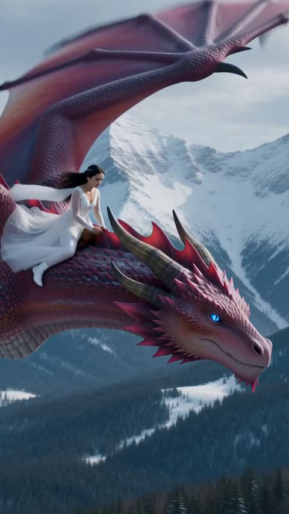</a>

将视频拆成带时间点的分段，每段有独立的动作和镜头指令，使骑手、巨龙和鹿按顺序出现。结尾的视觉风格段统一角色、光线与竖屏格式。

MiniMax H3 · 文生视频 · 出处: [@Aiwithmaha on X](https://x.com/Aiwithmaha/status/2115298302367568077) · 217 赞，统计于 2026-10-29

[`dragon`](tags.md#tag-dragon) [`fantasy`](tags.md#tag-fantasy) [`winter`](tags.md#tag-winter) [`multi-shot`](tags.md#tag-multi-shot)

<details><summary><b>提示词</b></summary>

```text
Step 1 — 0 to 3 Seconds:
A beautiful woman wearing an elegant white flowing gown with delicate lace sleeves rides on the back of a majestic red dragon. The dragon flies gracefully above a snow-covered forest surrounded by towering pine trees and majestic snowy mountains. Its enormous wings move naturally as it glides through the cold winter air. The camera captures a cinematic side view of the woman and the dragon in flight.

Step 2 — 3 to 5 Seconds:
The red dragon begins descending toward a snowy clearing in the forest. The woman remains seated on its back, holding on gently as the dragon lowers its wings. Several wild deer and other animals are visible on the snowy ground below. The camera follows the dragon's smooth descent.

Step 3 — 5 to 8 Seconds:
The dragon lands gracefully in the snowy clearing, spreading its enormous wings. The woman carefully dismounts and walks toward a beautiful brown deer with large antlers. The dragon stands behind her, watching calmly. The camera captures the magical winter environment and the realistic interaction between the characters.

Step 4 — 8 to 12 Seconds:
The woman gently embraces the deer and lovingly strokes its head. The deer calmly approaches her and rests its head near her shoulder. She smiles warmly while the majestic red dragon watches from behind. The camera moves closer to capture the emotional connection between the woman and the deer, with soft snowfall and cinematic lighting.

Step 5 — 12 to 15 Seconds:
The woman continues embracing the deer as the red dragon raises its head and opens its mouth, releasing a powerful stream of bright orange fire into the snowy clearing. The fire illuminates the surrounding snow, the dragon's red scales, and the woman's white gown. The deer remains beside her as the scene ends with a dramatic cinematic fantasy atmosphere.

Visual Style:
Ultra-realistic fantasy cinematography, detailed dragon scales, realistic deer fur, natural character movements, flowing white dress, cinematic camera motion, realistic fire simulation, snowy mountain environment, soft atmospheric lighting, high detail, vertical 9:16 format, consistent character appearance, no text, no watermark.
```

</details>

<a id="seedance-floating-cloud-village-reveal"></a>
### 云海之上漂浮村庄的航拍上拉

<a href="https://x.com/laviniavelle/status/2097622617968751012">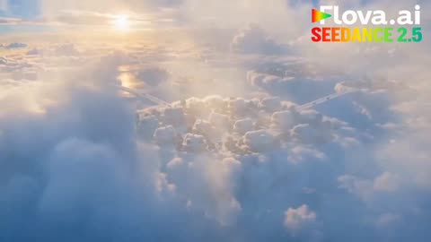</a>

提示词按镜头顺序写明：先是金色云海的全景，再过渡到漂浮村庄，最后缓慢上拉揭示整座空中城市。明确的镜头运动让模型按顺序执行，而不是生成单一的静态画面。

Seedance 2.5 · 文生视频 · 出处: [@laviniavelle on X](https://x.com/laviniavelle/status/2097622617968751012) · 216 赞，统计于 2026-10-29

[`aerial`](tags.md#tag-aerial) [`fantasy`](tags.md#tag-fantasy) [`clouds`](tags.md#tag-clouds) [`camera-move`](tags.md#tag-camera-move)

<details><summary><b>提示词</b></summary>

```text
Create a cinematic photorealistic fantasy world built entirely above the clouds Start with a breathtaking aerial view of massive fluffy white clouds glowing in warm golden sunlight Smoothly transition into a beautiful futuristic village floating among the clouds with elegant modern white buildings cozy houses lush green gardens colorful flowers and people walking and riding bicycles on soft cloud covered streets Show people enjoying this magical sky world walking cycling gardening, and relaxing Then slowly pull the camera upward and reveal a massive breathtaking floating civilization stretching across the clouds with bridges islands homes gardens and futuristic structures surrounded by endless blue sky and dramatic volumetric clouds Bright cinematic sunlight realistic shadows natural human movement highly detailed environments dreamy but photorealistic, epic scale smooth camera movement, aerial drone shots cinematic depth of field realistic physics 8K, ultra detailed, seamless transitions, inspirational fantasy atmosphere.
```

</details>

<a id="seedance-alien-council-summoning-cave"></a>
### 英雄被拉入四名异星议员的洞窟

<a href="https://x.com/aimikoda/status/2087563695849189516">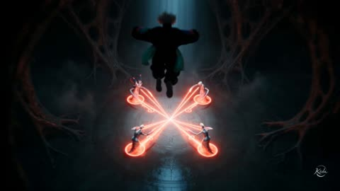</a>

六张参考图分别锁定每个角色的外观，提示词又把四名议员固定在时钟方位，让他们在各镜头中保持区分。按秒数分段写出动作节拍，只在每次刀刃接触时恢复正常速度，说话者切换时单独切近景，口型更易读。

Seedance 2.5 · 参考生视频 · 出处: [@aimikoda on X](https://x.com/aimikoda/status/2087563695849189516) · 215 赞，统计于 2026-10-29

[`reference-images`](tags.md#tag-reference-images) [`multi-character`](tags.md#tag-multi-character) [`timed-beats`](tags.md#tag-timed-beats) [`alien-creatures`](tags.md#tag-alien-creatures)

<details><summary><b>提示词</b></summary>

```text
一部写实真人科幻奇幻短片从失控的异星召唤仪式切入：Shade被从高楼坠落的瞬间强行拉入地下议会洞窟，随后与一只活体武器生物联结，以超高速迎战四名外形完全不同的异星议员。

@[Image 1] 定义Shade在全片中的唯一身份、完整外观、服装与身体比例；忽略设定图背景、文字和重复姿态。
@[Image 2] 定义“垂鳍议员”的完整外观；固定其圆润无巨角头部、巨大橙眼和两条下垂肉质头鳍，忽略版式与重复视角。
@[Image 3] 定义“珊瑚冠议员”的完整外观；固定其白蓝高挑身体、红色分叉珊瑚冠和四条弧形背部附肢，忽略版式与重复视角。
@[Image 4] 定义“叉冠议员”的完整外观；固定其巨大U形多孔头冠、橙眼、极长颈和长尾，忽略版式与重复视角。
@[Image 5] 定义“长耳议员”的完整外观；固定其两只笔直长耳、窄脸绿眼和肩后长带状鳍，忽略版式与重复视角。
@[Image 6] 定义“小兽”的完整外观，并定义其活体武士刀形态的生物材质来源；保留橙色眼、珊瑚色皮板、白色花瓣状鳞片和触须的可识别延续，忽略版式与重复视角。
最终画面是高质感真人电影，不呈现概念图或二维动画。使用实景湿岩洞窟结合无缝生物VFX，真实皮肤微纹理、半透明组织、布料惯性、重量、碰撞、空气阻力和重力。议会厅是高耸到黑暗中的巨型洞穴，天然岩壁与肋骨状外星结构融合，中央圆形召唤台被冷青环境光和珊瑚红仪式光切开，水汽、尘粒和深层体积雾形成纵深。
四名议员是四个连续存在的独立个体。以祭坛入口为12点方向，垂鳍议员固定在10点、珊瑚冠议员在2点、叉冠议员在5点、长耳议员在8点，Shade位于中心。战斗前保持这些位置。每个全景都清楚读出四种不同的头部轮廓、身高、颈长、背部附肢与尾巴；各自的脸、耳、冠、颜色和台词始终归属原角色。全片始终只有一个Shade、一只小兽和四名议员；小兽与武士刀是同一身体，绝不同时出现。
镜头采用清晰的多机位动力叙事：环境与动作使用有强纵深和视差的24-35mm感，台词与变形使用自然压缩的50-85mm近景；先建立圆形地理，再沿顺时针动作轴追随Shade。只在说话者变化、真实接触、运动方向改变或不可逆结果出现时切镜。战斗镜头贴近主体追踪，穿过前景附肢并始终保留下一目标的方位。
所有对白逐句显示底部居中的英文字幕，屏幕文字仅限这些英文字幕，不生成中文字幕，不把外星语拼写显示在画面中。Shade与小兽说自然英语并准确对口型。四名议员只说同一种急促、低沉、带喉音与咔嗒辅音的外星语；四名议员的可听台词中不出现英语，其英文含义只通过字幕呈现。
0-2秒：从召唤已进入危险峰值的第一帧开始。高位广角快速下降，四名不同议员在各自固定方位驱动同一仪式，身体附肢动作彼此不同；地面符号向中心输送四股光。能量柱撕开空间，把仍带向下动量的Shade抛到中心，Shade单膝和手掌重重触地，衣摆与头发随后落下，冲击波沿圆环扩散，传送门闭合。

2-8秒：手持中近景跟随Shade起身，视线扫过陌生生物，呼吸浅促，肩膀绷紧。Shade用英语说：{Where am I? How did I get here?}，字幕【Where am I? How did I get here?】。仪式余光在Shade瞳孔中闪白，在闪光上匹配剪辑到夜间屋顶。闪回用三个因果连续镜头：低侧广角明确展示楼间距离与助跑；鞋底踩中湿滑起跳边缘后失去抓地，跃程明显不足；手指擦过对面混凝土檐口却抓空，身体被真实重力迅速拉下，城市灯光产生强烈垂直视差，头发和衣料被上升气流掀起，镜头与Shade同步俯冲。Shade英语内心旁白：{The last thing I remember is missing that jump. Is this hell?}，字幕同句。黑暗楼体从上方填满画面，在8秒以同一向下运动方向硬切回洞窟。

8-14秒：Shade仍站在圆环中心。依次切四个清晰近景，每次只让当前说话者口部运动，识别锚点保持正确，边缘背景保留其原始方位。垂鳍议员发出外星语，字幕【Another scrawny one.】珊瑚冠议员愤怒反驳，字幕【Your fault!】叉冠议员尖锐插话，字幕【I told you we needed to change the summoning method.】长耳议员压下争吵，字幕【Stop arguing. We have to make do with what we've got.】所有可听台词均为外星语，不朗读字幕英文；最后一句结束时拉回中心广角，Shade与四种不同轮廓同时清楚可见。

14-18秒：保持群像，Shade低声用英语说：{What are they talking about?}，字幕同句。一缕残余召唤能量在Shade肩上逐层凝成同一只小兽。小兽贴近耳边急促说英语：{No time. They'll kill you. Kill them first. Keep up.}，字幕同句，然后跃到Shade面前。

18-22秒：一个不中断的近景完整展示所有变形中间态，稳定照明使轮廓和材质变化始终可读。小兽的尾巴先伸长并硬化为弧形刀背；腹面的半透明角质层沿全长展开成薄而锋利的单刃；珊瑚色皮板逐片咬合，白色花瓣鳞片压平组成刀脊和刀镡；躯干收窄为活体刀芯，四肢折叠锁成刀柄，触须编绕成握把；一只橙色眼保留在刀镡处并眨动。整个变化保持质量守恒，不凭空出现零件。最终形成约一米长、修长、窄刃、单刃、轻微弧度的活体武士刀，而非宽刃金属巨剑。Shade在空中抓住刀柄，活体肌腱缠绕手腕和前臂，与袖口贴合融合，刀镡上的眼睛转向首名攻击者。

22-28秒：四名议员同时主动杀向中心：垂鳍议员以头鳍和利爪从左侧抓取；珊瑚冠议员张开四条背肢形成合拢牢笼；叉冠议员用长尾横扫退路；长耳议员用两条肩鳍交叉封锁上方。Shade沿顺时针路线爆发出近乎不可见的超高速，目标顺序固定为垂鳍、珊瑚冠、叉冠、长耳，仍活着的议员持续追击、封路和调整攻击。

目标之间是带虹彩残像、空气压缩波、碎屑吸卷和强视差的速度爆发；只有四次刀刃接触颈部的瞬间恢复正常实时速度，清楚看到刀刃进入、头颅完全分离、少量暗色异星体液和身体按原有动量倒下，随后立刻重新加速。第一击从头鳍抓取下方掠过并斜向上切；第二击穿入尚未闭合的背肢牢笼，以反握横切暴露颈部；第三击越过扫来的长尾，借其旋转动量绕至长颈外侧完成水平切割；第四击以活体刀镡拨开交叉肩鳍，用残像诱导错误方向后出现在长耳议员身后完成收刀斩。

镜头先短暂俯视确认圆环，再俯冲进入低位贴身追踪，以甩镜连接极速位移，在每次接触时稳定成可读侧面近景；四颗不同轮廓的头依次落地，尸体与头颅持续留在原位。

28-30秒：Shade沿可见虹彩轨迹回到圆环正中心并减速显形，四具无头尸体和四颗头仍在各自倒下的位置。活体刀从前臂松开，在近景中快速反向变形：肌腱退开，刀身皮板变软分离，尾巴缩短，四肢和头部展开，同一只小兽落回Shade肩上。音乐与速度轰鸣在最后一次接触后骤停，只剩洞穴回声和Shade的呼吸。Shade看向小兽，用英语问：{Now what?}，字幕【Now what?】；在小兽回答之前立即黑切。
```

</details>

<a id="h3-forgotten-kingdom-stone-bridge-traveler"></a>
### 旅人走过石桥前往隐秘王国

<a href="https://x.com/aiwithaly/status/2085221226335879541"></a>

一段连贯的文字按顺序写出剧情节拍：石桥、城门开启、守卫苏醒、灯笼、飞龙。结尾堆叠电影级关键词（ARRI Alexa 35、变形镜头、体积光）来锁定画面质感，再用不出现文字和标志的约束保持画面干净。

MiniMax H3 · 文生视频 · 出处: [@aiwithaly on X](https://x.com/aiwithaly/status/2085221226335879541) · 211 赞，统计于 2026-10-28 · 发现于 [SkyNotSilent/awesome-MiniMax-H3-cases](https://github.com/SkyNotSilent/awesome-MiniMax-H3-cases)

[`fantasy`](tags.md#tag-fantasy) [`cinematic`](tags.md#tag-cinematic) [`epic-adventure`](tags.md#tag-epic-adventure) [`dragons`](tags.md#tag-dragons) [`volumetric-lighting`](tags.md#tag-volumetric-lighting)

<details><summary><b>提示词</b></summary>

```text
A cinematic 15-second fantasy adventure following a lone traveler as they cross an ancient stone bridge toward a forgotten medieval kingdom hidden beneath towering cliffs. As colossal gates slowly open, giant stone guardians awaken and glowing light spills through the mist, revealing a city untouched by time. The traveler steps forward as thousands of lanterns illuminate the streets, waterfalls cascade from towering cliffs, and majestic dragons soar across the sunrise sky. Epic cinematic camera movements, IMAX-scale visuals, volumetric lighting, realistic weather effects, premium VFX, emotional orchestral atmosphere, ARRI Alexa 35 aesthetic, anamorphic lenses, 4K HDR, seamless continuity, blockbuster movie quality, no text, no logos.
```

</details>

<a id="seedance-fog-megacity-titan-takedown"></a>
### 晨雾笼罩的未来巨型城市航拍

<a href="https://x.com/SyntheSarah/status/2089538609858875714">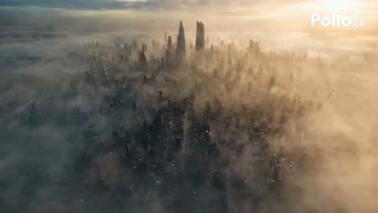</a>

提示词按镜头顺序分段书写，每段都给出明确的运镜，如过肩跟拍、360 度环绕和结尾的航拍拉升，为模型提供清晰的剪辑顺序。结尾的约束段锁定镜头焦段、胶片颗粒和角色外观，使人物面部与深色战术服在各镜头间保持一致。

Seedance 2.5 · 文生视频 · 出处: [@SyntheSarah on X](https://x.com/SyntheSarah/status/2089538609858875714) · 195 赞，统计于 2026-10-29

[`sci-fi`](tags.md#tag-sci-fi) [`megacity`](tags.md#tag-megacity) [`aerial`](tags.md#tag-aerial) [`continuity`](tags.md#tag-continuity)

<details><summary><b>提示词</b></summary>

```text
An ultra-photorealistic live-action sci-fi cinematic sequence set in a vast, ruined futuristic megacity at pre-dawn, framed by towering obsidian skyscrapers, rain-drenched streets, hanging fog, and a massive alien mothership hovering silently above the skyline. A 15-meter gunmetal combat robot featuring weathered armor plates, exposed mechanical hydraulics, and a pulsing blue chest core violently charges through the wreckage, sending shockwaves through puddles and scattering concrete debris. The camera rapidly drops into an over-the-shoulder tracking perspective following a 25-year-old female warrior—with long messy dark-brown hair, brown eyes, realistic skin texture, and a practical dark armored tactical suit—as she draws an energy spike weapon and sprints head-on into the titan’s path.
As the machine executes a massive overhead downward strike, she dives into a low power-slide directly beneath its crushing fist. The fist shatters the asphalt with heavy physical impact, launching a wall of water, sparks, and pulverized stone into the air with natural motion blur. Utilizing her forward momentum, she vaults onto the robot’s lower leg armor, gripping fractured metal seams and scaling its massive torso while the camera swings in a continuous, dynamic 360-degree orbital arc around the rising combatants. She narrowly dodges a sweeping mechanical hand, maneuvers past sparking internal wiring, and reaches the glowing chest housing.
A dramatic tight close-up captures her fierce, determined expression as she drives the high-density energy spike straight into the center of the core. Blinding blue-white electrical arcs burst violently through the titan’s internal conduit networks, illuminating its mechanical structure, causing its red eye-visors to flicker out, and shutting down its central power. The colossal machine loses balance and collapses forward with immense, realistic weight, slamming onto the roadway and kicking up a thick cloud of dust, smoke, and steam.
She leaps clear and lands gracefully in a grounded stance beside the smoking wreck, standing tall as the dust settles. The camera smoothly pulls up into a grand high-altitude aerial view as golden sunrise beams break through the storm clouds, washing over the destroyed city street while the giant mothership slowly retreats into the upper atmosphere.
Technical Constraints: 4K HDR live-action film quality, photorealistic 35mm grain, 85mm cinematic lens depth of field, realistic gravity and collision physics, volumetric smoke and fog lighting, precise character facial feature and dark tactical suit continuity across all frames, zero morphing, zero cartoon/CGI aesthetic, no extra limbs.
```

</details>

<a id="h3-kitten-warrior-dragon-friendship-meadow"></a>
### 小猫战士在草地上遇见巨龙

<a href="https://x.com/LettyVesper/status/2108843102417113181"></a>

提示词在一段视频里写出从恐惧到温情的情绪转折，用小战士与巨龙的体型反差搭配低角度、特写和金色日落光线。丢下剑、巨龙闭眼这类具体动作给模型提供了清晰的节拍。

MiniMax H3 · 文生视频 · 出处: [@LettyVesper on X](https://x.com/LettyVesper/status/2108843102417113181) · 188 赞，统计于 2026-10-28 · 发现于 [SkyNotSilent/awesome-MiniMax-H3-cases](https://github.com/SkyNotSilent/awesome-MiniMax-H3-cases)

[`fantasy`](tags.md#tag-fantasy) [`dragon`](tags.md#tag-dragon) [`kitten`](tags.md#tag-kitten) [`emotional-arc`](tags.md#tag-emotional-arc) [`cinematic`](tags.md#tag-cinematic)

<details><summary><b>提示词</b></summary>

```text
A cinematic, ultra-realistic fantasy scene featuring an adorable fluffy ginger-and-white kitten warrior wearing miniature silver medieval armor, a flowing cream-colored cape, and carrying a tiny sword, standing bravely in a misty green meadow facing a massive, fearsome dragon covered in dark, rugged scales, sharp horns, and powerful leathery wings. The camera captures dramatic low-angle shots, close-ups of the kitten gripping its sword, and intense shots of the dragon lowering its enormous head toward the tiny warrior. The kitten initially stands courageously, but as the dragon approaches, it becomes frightened and drops its sword, looking up with teary eyes and a trembling expression. Suddenly, the mood shifts from danger to tenderness as the dragon gently touches its snout against the kitten, revealing a surprising bond between them. The kitten embraces the dragon's enormous face affectionately, and the dragon closes its glowing amber eyes peacefully. Golden sunset light illuminates the meadow, creating a magical, emotional atmosphere with volumetric lighting, realistic fur and scales, detailed metallic armor, cinematic depth of field, smooth camera movements, dramatic wide shots, intimate close-ups, 4K photorealistic CGI, and an epic fantasy film aesthetic, transitioning from suspense and fear to warmth, friendship, and heartwarming emotional connection.
```

</details>

<a id="h3-kaiju-squid-airplane-window-city"></a>
### 舷窗外巨型章鱼怪兽破坏城市

<a href="https://x.com/Spectromachina/status/2084307393081401499">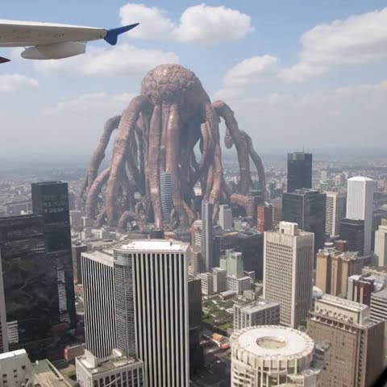</a>

画面设定为机舱舷窗内的手持纪实镜头，玻璃变形和冷凝水痕迹让它看起来像真实拍摄。机身颠簸的晃动、引擎与风声的音频提示，以及结尾的爆炸冲击，共同带来动感和递进。

MiniMax H3 · 图生视频 · 出处: [@Spectromachina on X](https://x.com/Spectromachina/status/2084307393081401499) · 186 赞，统计于 2026-10-29

[`kaiju`](tags.md#tag-kaiju) [`handheld`](tags.md#tag-handheld) [`city-destruction`](tags.md#tag-city-destruction) [`explosion`](tags.md#tag-explosion)

<details><summary><b>提示词</b></summary>

```text
New MiniMax H3 video model running on consumer gpu, specs:

 minimax_h3_fl2va_pruned_int8_convrot.safetensors 19gb
Sampler: Euler, Scheduler: Normal
Steps: 8
Sage attention, RTX 4060ti 16gb, 64gb ram, ryzen 7
263 seconds, 10 second video
Image to video workflow (default from comfyui)

Prompt: "Handheld documentary-style footage, shot from inside a flying airplane window, slightly warped by the plexiglass and streaked with condensation. Below, a colossal squid-like kaiju monster (see reference image) rampages through a dense city skyline, its massive tentacles coiling around skyscrapers and tearing through steel and concrete — glass and debris raining down in slow cascades. Camera shakes violently with turbulence, the framing jerking and re-settling as the handheld operator struggles to keep the monster in frame, engine drone and wind noise bleeding into the audio.

Suddenly a blinding explosion detonates against the creature's flank causing major shockwave and destruction"
```

</details>

<a id="seedance-jade-sword-water-dragon-cave"></a>
### 女子持翠玉剑召唤水龙

<a href="https://x.com/AiwithElisia/status/2087051732774011038">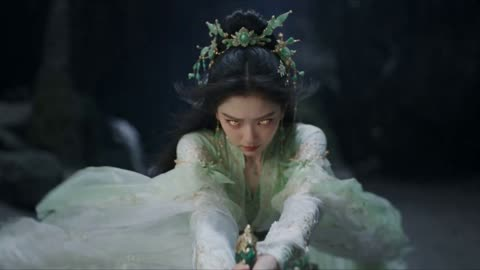</a>

提示词按镜头顺序写成分镜：先中景特写，镜头后拉露出身后的龙，再随龙上仰至洞顶，每个运镜都有明确起止。湿石地面、体积雾、边缘光和青绿光效等材质与光线词确定氛围，让画面风格保持统一。

Seedance 2.5 · 文生视频 · 出处: [@AiwithElisia on X](https://x.com/AiwithElisia/status/2087051732774011038) · 169 赞，统计于 2026-10-29

[`xianxia`](tags.md#tag-xianxia) [`dragon`](tags.md#tag-dragon) [`dark-cave`](tags.md#tag-dark-cave) [`camera-pullback`](tags.md#tag-camera-pullback)

<details><summary><b>提示词</b></summary>

```text
A cinematic fantasy scene inside a dark mystical cave. A beautiful young East Asian woman wearing an elegant flowing white and pale-green ancient Chinese fantasy robe, intricate floral hair ornaments and traditional hairstyle, kneels on a wet stone floor. She looks intensely focused as she holds a glowing magical green energy sword with both hands. Bright emerald-green energy flows from the sword into the ground, creating powerful magical light, mist and ripples across the wet floor.

As the magical energy intensifies, a gigantic translucent ice-blue Chinese dragon made entirely of water and crystalline energy suddenly emerges from the ground behind her. The dragon rises dramatically, its long serpentine body twisting upward, detailed scales, horns, whiskers and glowing cyan-blue aura. Thick mist and water particles surround the dragon. The woman remains small in the foreground while the enormous dragon dominates the cave.

The camera begins with a medium close-up of the woman, slowly pulls backward and reveals the full dragon emerging behind her, then tilts upward following the dragon as it rises toward the cave ceiling. At the end, the dragon bursts upward toward a bright opening in the cave, with rocks and debris floating and falling through the light.

Dark cinematic atmosphere, mystical Chinese xianxia fantasy aesthetic, volumetric fog, dramatic rim lighting, glowing cyan and emerald energy, realistic wet surfaces, detailed fabric movement, realistic facial features, highly detailed dragon scales, epic scale, dynamic magical particles, cinematic depth of field, smooth camera movement, photorealistic VFX, movie-quality CGI, ultra-detailed, 4K, dramatic fantasy cinematography, 16:9.
```

</details>

<a id="kling-cloud-creature-bedroom-sneeze"></a>
### 蓬松云朵小生物在卧室里打喷嚏洒下雨滴

<a href="https://x.com/Strength04_X/status/2114623188202402063"></a>

按时间段分场景写动作，并明确要求全程保持同一只生物和同一位女性，使 30 秒内角色稳定。用柔和体积光、真实蓬松云朵质感等描述锁定写实画风，并加入无字幕无水印的约束让画面干净。

Kling 4.0 · 文生视频 · 出处: [@Strength04_X on X](https://x.com/Strength04_X/status/2114623188202402063) · 168 赞，统计于 2026-10-29

[`cloud-creature`](tags.md#tag-cloud-creature) [`fantasy`](tags.md#tag-fantasy) [`bedroom`](tags.md#tag-bedroom) [`multi-scene`](tags.md#tag-multi-scene)

<details><summary><b>提示词</b></summary>

```text
How am I supposed to move on after seeing this AI creature

Made with Kling 4.0

Prompt : Create a 30-second ultra-realistic cinematic fantasy video featuring a completely original miniature cloud creature in a charming countryside bedroom.

Scene 1 (0–7 seconds): A tiny floating cloud creature with fluffy white fur, pale blue eyes, tiny dangling feet, and miniature translucent wings drifts above a wooden bedside table. Soft morning sunlight enters through linen curtains while dust particles shimmer in the air.

Scene 2 (7–14 seconds): A young woman wearing a peach-colored cardigan and a cream skirt enters the room. The little cloud follows her curiously, hovering above her head. Suddenly, it sneezes and releases a tiny shower of sparkling raindrops onto her hair.

Scene 3 (14–23 seconds): The woman looks surprised before smiling and holding out her hands. The cloud becomes excited and accidentally creates a miniature rainbow inside the room. Tiny floating droplets turn into glowing bubbles that gently drift around the furniture.

Scene 4 (23–30 seconds): The cloud settles onto the woman's head like a fluffy hat. It produces one final tiny raindrop that lands on its own nose. The creature crosses its eyes trying to look at the drop, then giggles silently as a miniature rainbow appears above it.

Visual style: Original imaginary creature, realistic fluffy cloud texture, expressive blue eyes, physically believable water droplets, soft volumetric sunlight, realistic reflections, pastel color palette, detailed fabric textures, cinematic close-ups, natural character animation, smooth camera movements.

Duration: 30 seconds. Aspect ratio: 16:9. 4K cinematic quality. Preserve the same creature and woman across all scenes. No text, subtitles, logos, or watermark. Use original designs only.
```

</details>

<a id="h3-maya-candyland-chaos-storyboard"></a>
### 女主角站在巨型棉花糖与棒棒糖之间的糖果世界

<a href="https://x.com/MonetizationDon/status/2105971557772231027"></a>

十三个带时间码的分镜，每个镜头都写明运镜和动作，并在每个镜头重复同一份角色设定（发型、服装、配饰），以保持跨镜头的人物一致。提示词还点名需要规避的原有作品，并直接写明内容限制，确保世界观原创且内容安全。

MiniMax H3 · 文生视频 · 出处: [@MonetizationDon on X](https://x.com/MonetizationDon/status/2105971557772231027) · 162 赞，统计于 2026-10-29

[`storyboard`](tags.md#tag-storyboard) [`character-consistency`](tags.md#tag-character-consistency) [`camera-direction`](tags.md#tag-camera-direction) [`candyland`](tags.md#tag-candyland)

<details><summary><b>提示词</b></summary>

```text
Create a 13-panel cinematic storyboard for an original 65-second family-friendly 3D animated short titled “MAYA: CANDYLAND CHAOS.”

Maya is an original adult fantasy heroine with long dark-brown wavy hair, warm brown eyes, medium-brown skin, a blue adventure outfit, white jacket, red scarf and brown adventure boots. Maintain her exact facial identity, hairstyle, outfit, proportions and accessories across every panel.

Panel 1 — HERE WE GO AGAIN (0–5s): Close-up, eye-level, slow push-in. Maya talks directly to camera before discovering a mysterious glowing candy portal.

Panel 2 — THE CANDY PORTAL (5–10s): Wide dynamic shot, Dutch tilt, spiral camera movement as Maya is pulled into a swirling rainbow candy portal.

Panel 3 — THE SWEET KINGDOM (10–15s): Epic wide establishing shot, low-to-high crane reveal of Candyland: giant lollipops, gumdrop hills, chocolate rivers, candy trees and a spectacular candy castle.

Panel 4 — THE CHASE BEGINS (15–20s): Side tracking shot as playful original gummy creatures chase Maya through the candy forest.

Panel 5 — LOLLIPOP ESCAPE (20–25s): Low-angle dynamic tracking shot. Maya dodges giant lollipops and escapes the creatures.

Panel 6 — MARSHMALLOW CHAOS (25–30s): Fast side-tracking shot as Maya bounces across giant marshmallows in a hilarious chain reaction.

Panel 7 — THE GIANT GUMMY (30–35s): Extreme low-angle hero shot. A gigantic friendly gummy creature rises in front of Maya.

Panel 8 — RAINBOW CANDY SLIDE (35–40s): POV and tracking camera as Maya races down a massive rainbow candy slide through sparkling sugar tunnels.

Panel 9 — CHOCOLATE RIVER (40–45s): Low water-level tracking shot as Maya rides a candy raft across a chocolate river toward the castle.

Panel 10 — THE CANDY QUEEN (45–50s): Wide shot transitioning into a dramatic close-up. Maya encounters an original Candy Queen at the castle.

Panel 11 — THE CUPCAKE TRICK (50–55s): Dynamic side-tracking shot. Maya uses a giant cupcake as a springboard to leap over the Queen's candy obstacles.

Panel 12 — CANDYLAND CELEBRATION (55–60s): Epic wide crane shot. Gummy creatures celebrate as candy fireworks explode across the sky.

Panel 13 — SWEET ENDING (60–65s): Wide sunset shot with a slow pull-back. Maya overlooks the entire Candyland kingdom and says, “Okay… that was definitely worth it.” She winks at the camera.

Use professional cinematic composition, dynamic camera movement, dramatic lighting, expressive facial animation, depth of field, motion blur and high-end animated-feature-quality 3D rendering.

IMPORTANT: Maya and Candyland must be completely original. Do not reference or resemble Alice, Wonderland, Disney, or any existing copyrighted character or franchise. Family-friendly fantasy adventure. No sexual content, suggestive posing, gore, horror or injuries.

#polloaiCPP
@polloai_creator
```

</details>

<a id="seedance-seoul-celestial-guardian-transformation"></a>
### 首尔黄金时刻天际线到天界守护者变身

<a href="https://x.com/john_my07/status/2085973359221973300">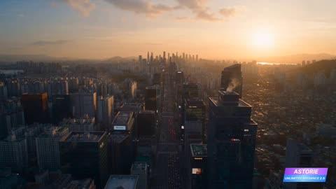</a>

按时间段（0:00 到 0:03、0:08 到 0:16）分段描述，让 30 秒内容有清晰的结构；明确要求不切镜、单次 360 度环绕，使变身过程保持一个连续镜头。在各段反复锁定水晶吊坠、发型和金色眼睛等身份特征，帮助角色保持一致。

Seedance 2.5 · 文生视频 · 出处: [@john_my07 on X](https://x.com/john_my07/status/2085973359221973300) · 147 赞，统计于 2026-10-29

[`one-take`](tags.md#tag-one-take) [`transformation`](tags.md#tag-transformation) [`character-consistency`](tags.md#tag-character-consistency) [`seoul`](tags.md#tag-seoul)

<details><summary><b>提示词</b></summary>

```text
30-Second Cinematic Fantasy Transformation

Ultra-photorealistic, blockbuster-quality CGI, IMAX-style cinematic composition, realistic physics, premium VFX, HDR, volumetric lighting, detailed environments, smooth animation, 4K. One cohesive continuous fantasy film sequence with perfect character consistency. No text, subtitles, logos, watermarks, copyrighted characters, cuts during transformation, teleportation, anatomy errors, duplicated limbs, or abrupt camera movements.

0:00–0:03 — Seoul Before the Mystery
Aerial golden-hour shot gliding over modern Seoul. Warm sunlight reflects across skyscrapers, traffic and pedestrians move naturally, cafés and streets glow softly. Amber-orange architectural lights blend with sunset. Glowing clouds gradually form above the skyline, signaling something extraordinary.

0:03–0:06 — Celestial Colossus
Camera tilts upward to reveal an enormous original celestial creature emerging peacefully from luminous clouds. Flowing light, shimmering particles, and energy waves surround it. Its immense scale fills the sky. People stop and gaze upward in wonder as warm amber holographic lights, distant drones, and city beacons glow naturally below.

0:06–0:08 — The Guardian
Camera moves through the crowd toward an elegant young Korean woman standing completely calm. Long dark hair moves naturally in the breeze. She wears a modern outfit with subtle amber accents and a crystal pendant around her neck. The pendant begins glowing warmly as she smiles softly. Camera slowly circles her.

0:08–0:16 — Seamless Transformation
The pendant bursts into brilliant amber-orange light. Without a cut, the camera performs one smooth 360° orbit as glowing energy ribbons spiral around her. Her outfit transforms gradually into an elegant futuristic guardian suit of white, silver, and black with refined amber highlights. Armor forms naturally from boots upward across her legs, waist, torso, shoulders, and arms. Metallic gauntlets materialize piece by piece and a luminous energy cape unfolds behind her. Her hair becomes more dynamic, her eyes gain a subtle golden glow, and her expression becomes confident and graceful. Crystals, sparks, leaves, particles, and light fragments orbit naturally. Maintain perfect facial identity, realistic anatomy, natural motion, and uninterrupted transformation.

0:16–0:21 — Ascension
Energy gathers around her and expands into a glowing circular wave. She lifts smoothly from the ground and flies upward, leaving an elegant amber-orange trail through Seoul. Camera follows behind, then transitions into sweeping aerial shots as she glides between skyscrapers and illuminated clouds. The celestial giant watches calmly from above.

0:21–0:27 — Dance of Light
High above Seoul, guardian and celestial giant interact through graceful energy rather than physical combat. Amber-orange, blue, and white light streams weave through the sky. She forms radiant shields, flowing energy ribbons, and luminous geometric patterns while gliding effortlessly. Alternate epic wide shots with cinematic close-ups of her consistent face. Clouds, particles, and city reflections intensify as the energy display reaches its peak.

0:27–0:30 — Guardian of Seoul
She raises one hand toward the sky. A brilliant amber beam surrounds the celestial giant, which peacefully dissolves into countless shimmering particles that become part of the sky. She lands gracefully on a modern rooftop overlooking Seoul. Her luminous cape moves in the evening breeze as glowing embers drift around her. Camera slowly cranes backward into an epic wide shot of the guardian overlooking the glowing city and sunset horizon.

STYLE & CONTINUITY
Premium blockbuster fantasy, ultra-photorealistic Korean heroine, seamless character identity, elegant camera choreography, realistic lighting and physics, cinematic depth, volumetric clouds, detailed reflections, natural environmental movement, warm amber-orange visual motif, emotionally uplifting tone.
```

</details>

<a id="h3-eclipse-sci-fi-motion-poster"></a>
### 橙色暗云中浮现的暗黑科幻动态海报

<a href="https://x.com/LudovicCreator/status/2087116928473006428">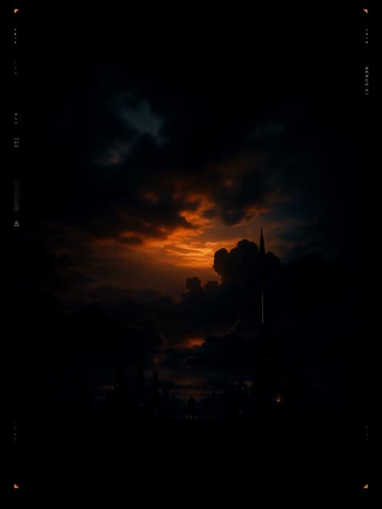</a>

提示词先锁定不变的元素（黑色背景、配色、版式、字体），再按顺序从黑暗中逐层构建画面，使动态呈现为重建而非漂移。键盘声、提示音、金属咔哒声和冲击声等音效提示与画面写在同一时间线上。

MiniMax H3 · 图生视频 · 出处: [@LudovicCreator on X](https://x.com/LudovicCreator/status/2087116928473006428) · 135 赞，统计于 2026-10-29

[`motion-poster`](tags.md#tag-motion-poster) [`sci-fi`](tags.md#tag-sci-fi) [`layered-reveal`](tags.md#tag-layered-reveal) [`sound-design`](tags.md#tag-sound-design)

<details><summary><b>提示词</b></summary>

```text
Animate the source artwork as a 10-second dark cinematic sci-fi motion poster while preserving the full-frame black background, orange-and-teal palette, female profile, mechanical helmet, spacecraft, skyline, portal, typography and original layout. Begin in near darkness with only a faint orange glow, then construct the poster in layered stages: thin interface marks and corner graphics appear first, the storm clouds and futuristic skyline fade upward from the shadows, the enormous circular portal expands into position, and the woman’s profile slides in from the left as the mechanical helmet assembles behind her through rotating segmented parts. Illuminate the orange ring beside her face, then bring the central spacecraft rapidly forward from the portal before it settles beneath the “ECLIPSE” title, creating a strong 3D pop-out effect without changing the composition. Reveal the title, tagline, credits and release information through sequential type-on, tracking expansion and sharp graphic pop-ins, accompanied by playful but sophisticated digital keystrokes, interface beeps, metallic clicks and soft cinematic impacts. Complete the animation with small fighters crossing the background, subtle hair movement, drifting sparks, pulsing city lights and a slow final push-in, then hold on the fully reconstructed poster with every word sharp and readable.

Made in MinimaxHub
@Hailuo_AI
```

</details>

<a id="wan-time-space-train"></a>
### 时空列车，30 秒一镜到底

<a href="https://x.com/johnAGI168/status/2092180177690194162"></a>

开头是参数表（时长、比例、形式、风格），后面列出场景必须遵守的物理规则，比如乘客不能瞬移。

Wan 3.0 · 文生视频 · 出处: [@johnAGI168 on X](https://x.com/johnAGI168/status/2092180177690194162) · 129 赞，统计于 2026-10-27

[`long-take`](tags.md#tag-long-take) [`sci-fi`](tags.md#tag-sci-fi) [`world-building`](tags.md#tag-world-building)

<details><summary><b>提示词</b></summary>

```text
Duration: 30 seconds
Aspect Ratio: 16:9 Landscape
Format: A truly continuous, uncut, no-frame-jump cinematic long take
Overall Style: Hollywood sci-fi adventure blockbuster, hyper-realistic, epic scale, authentic physical motion, cinematic lighting and depth of field, delicate film grain, high dynamic range, cold-to-warm color shifts layer by layer.

Subject:
A modern and realistic urban train with an entire massive curved panoramic glass window. The shot is positioned at the rear of the carriage, capturing the front of the carriage with a 24mm wide-angle oblique angle: the left two-thirds is the panoramic window, the right one-third is handrails, hanging straps, and ordinary passengers. Passengers wear modern dark commuter attire, initially quiet and heads down on their phones. The train, carriage structure, seats, passenger positions, clothing, camera height, and focal length remain completely consistent throughout the 30 seconds. All time-space changes occur only outside the window.

ONE CONTINUOUS TAKE (0-30 seconds):

0-4 seconds:
The train speeds through the edge of a modern city under overcast skies, with buildings, rivers, and utility poles outside the window creating realistic lateral motion blur. Carriage lights are steady, passengers heads down on phones. The shot maintains an oblique wide-angle composition, with only subtle realistic train vibrations. A calm female voice comes over the broadcast: "The time-space train is about to activate. Please remain seated."

4-6 seconds:
The train enters a dim tunnel, the city replaced by concrete walls, overhead lights quickly sweeping across the glass. The carriage gradually darkens. The tunnel walls continuously transform into rough, damp natural rock faces, using rocks close to the glass for a natural occlusion transition, with absolutely no cuts.

6-12 seconds — Dinosaur Era:
The rock cave suddenly opens, revealing sunlight piercing through mist outside the window: a prehistoric rainforest and vast Jurassic valley. Herds of Parasaurolophus run alongside the train, massive Apatosauruses slowly cross distant woodlands, Pteranodons soar across the sky. Foreground plants create fast motion blur, midground dinosaurs are sharp, distant volcanoes shrouded in mist form strong depth and parallax.
At 10 seconds, a massive Tyrannosaurus Rex bursts from the woods, briefly paralleling the train, roaring thunderously close to the glass. Passengers simultaneously look up and turn toward the window, but without exaggerated scrambling. Golden sunlight and forest greens realistically project into the carriage.

12-19 seconds — Volcanic Apocalypse:
The T-Rex's enormous body sweeps across the frame, creating a natural occlusion. After the occlusion clears, the same prehistoric world has transformed into a volcanic wasteland in the midst of destruction. A super-volcano erupts violently in the distance, black volcanic clouds roiling upward, red-hot lava cascading from cliffs, ground fissures extending all the way to the train.
The train races through a lava canyon at high speed, volcanic bombs streaking across the sky but not striking the carriage, a scorching shockwave chasing from behind. The glass reflects real firelight, the carriage shifting from golden to intense red-orange, passengers gripping handrails tightly, staring in shock out the window. Maintain realistic gravity, smoke, dust, and volcanic debris motion.

19-22 seconds — Time-Space Submersion:
The train plunges into a massive wall of volcanic steam, thick smoke, and white water vapor, the frame naturally obscured but the shot never interrupts. Red firelight rapidly shifts to deep blue, steam condensing into water droplets streaking across the glass. The train seamlessly crosses the time-space boundary into the deep sea; the carriage interior remains dry and intact, with no seawater intrusion.

22-28 seconds — Undersea World:
The white water vapor clears, revealing a vast, clear, profound blue ocean outside the window. Sunbeams pierce from the surface, colorful corals, seagrasses, schools of fish, sea turtles, and manta rays pass by at varying depths, creating spectacular parallax. A massive blue whale glides slowly overhead, its belly nearly covering the entire panoramic window, the scale utterly breathtaking. Cool blue rippling light flows naturally across the carriage and passengers' faces, all passengers gazing upward in quiet awe.

28-30 seconds — Ultimate Reveal:
The blue whale's tail fluke sweeps across the glass, forming the final natural occlusion. As the tail fluke departs, a grand lost civilization spanning the underwater canyon suddenly appears outside the window: glowing crystal spires, massive domes, ancient temples, and suspended tracks extending to the deep-sea horizon, countless manta rays weaving through the city skies. The train continues toward the brightly glowing time-space gate at the city's center.
The shot maintains the original carriage composition, ending amid the silhouetted shocked gazes of all passengers, no fade-out, no cuts.

Camera:
Throughout: 24mm cinematic wide-angle, eye-level height, fixed two-thirds composition from the rear of the carriage obliquely forward; stabilizer texture combined with subtle train vibrations; realistic depth of field, glass reflections, foreground motion blur, and multi-layered parallax. The camera never leaves the carriage, never changes axis, never suddenly pushes in, rotates, or drifts.

Sound:
Continuous unified train track sounds as the audio anchor; tunnel echoes, dinosaur low-frequency footsteps and roars, volcanic explosions and lava rumbles, steam impact sounds, deep-sea submersion into low underwater ambience, whale songs. Sounds transition smoothly with scenes, cinematic surround sound, no background music, no excess dialogue.

Continuity Constraints:
The same train, same carriage, same group of passengers, same clothing, same seating layout, same window structure, same camera position throughout 30 seconds; scenes can only transition continuously via the train's forward motion, rock wall occlusions, smoke, steam, darkness, or large creatures passing by. The carriage does not deform, passengers do not teleport, creatures outside the window never enter the carriage.
```

</details>

<a id="h3-moonlit-cloud-palace-back-view"></a>
### 白衣人立于月下云宫前

<a href="https://x.com/Stellakjbk/status/2085040940196958664">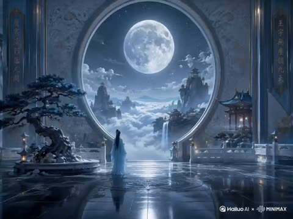</a>

人物固定为静止的背影，负面提示同时禁止转身和行走，让动态集中在环境上。镜头缓慢推进并保持原画构图稳定，配合流动的云海、摇曳的松枝和灯笼光，形成画面动感。

MiniMax H3 · 图生视频 · 出处: [@Stellakjbk on X](https://x.com/Stellakjbk/status/2085040940196958664) · 123 赞，统计于 2026-10-29

[`xianxia`](tags.md#tag-xianxia) [`moonlight`](tags.md#tag-moonlight) [`back-view`](tags.md#tag-back-view) [`push-in`](tags.md#tag-push-in)

<details><summary><b>提示词</b></summary>

```text
The camera slowly pushes forward, maintaining the original composition's stability. The sea of clouds and thin mist flow gently, the waterfall cascades naturally, starlight flickers faintly; the woman stands still with her back to the camera, her long hair and sleeves swaying lightly in the wind; pine branches sway gently, the lantern and its reflection on the ground shimmer slightly. An ethereal xianxia aesthetic, cold blue moonlight, cinematic lighting and shadows, with delicate and natural movements.
Negative prompt: Character turning around, walking, deformation; architectural distortion, moon displacement, camera shake, rapid zooming, flickering frame skips, screen melting.

Xianxia cinematic feel, the camera slowly pans, original composition stable. The sea of clouds and thin mist flow slowly, the palace bathed in golden morning light; character's back view stands still, cloak and hem swaying lightly; reflections on the bridge surface move subtly, pine trees sway gently, light motes float. Grand and sacred, with natural and delicate dynamics, 4 seconds.
Negative prompt: Character turning around, character walking, character deformation, architectural deformation, camera shake, rapid movement, flickering frame skips, screen breakdown.

Xianxia cinematic feel, the camera slowly pushes forward, original composition stable. The sea of clouds flows slowly, morning light spills down; character's back view stands still, hem and hair strands moving lightly; pine branches sway subtly, birds glide slowly past. Ethereal and beautiful, with natural dynamics, 4 seconds.
Negative prompt: Character turning around, character walking, character deformation, architectural deformation, camera shake, rapid movement, flickering frame skips, screen breakdown.

Xianxia cinematic feel, the camera slowly pushes forward, original composition stable. The sea of clouds and thin mist flow slowly, morning light spills over the palace and steps; character's back view stands still, cloak swaying lightly; the waterfall flows naturally, the floating island hovers subtly. Grand and ethereal, with delicate dynamics, 4 seconds.
Negative prompt: Character turning around, character walking, character deformation, architectural deformation, camera shake, rapid movement, floating island drifting chaotically, flickering frame skips, screen breakdown.
```

</details>

<a id="h3-dragon-cave-emergence-three-shot-takeoff"></a>
### 披甲骑士驭龙冲出山洞腾空而起

<a href="https://x.com/MadMax_Series/status/2083855654205186452"></a>

先用独立的龙与骑士锁定段固定外形，再把15秒拆成三个带时间段的镜头并用硬切连接。每个镜头单独写明运镜（后拉、侧向跟拍、尾随追拍），光线段保证暗洞中主体依然清晰。

MiniMax H3 · 文生视频 · 出处: [@MadMax_Series on X](https://x.com/MadMax_Series/status/2083855654205186452) · 116 赞，统计于 2026-10-28 · 发现于 [SkyNotSilent/awesome-MiniMax-H3-cases](https://github.com/SkyNotSilent/awesome-MiniMax-H3-cases)

[`dark-fantasy`](tags.md#tag-dark-fantasy) [`dragon`](tags.md#tag-dragon) [`multi-shot`](tags.md#tag-multi-shot) [`cinematic`](tags.md#tag-cinematic) [`creature`](tags.md#tag-creature)

<details><summary><b>提示词</b></summary>

```text
Create a 15-second photorealistic cinematic dark-fantasy sequence in 16:9 widescreen. The video must contain exactly three clearly separated cinematic shots connected by clean hard cuts. No dissolves, morphing transitions or continuous camera orbit.

MASTER DRAGON LOCK:
Show one enormous ancient dragon with a broad powerful body, charcoal-black overlapping scales, subtle dark crimson colouring across its head and neck, two swept-back horns, smaller facial spikes, glowing amber-orange eyes, one long tail and one pair of enormous bat-like wings with dark leathery membranes. The dragon has four legs: two forelegs and two hind legs. Its design, size, horns, colour, anatomy and facial structure remain identical in all three shots. The dragon must feel extremely heavy, ancient and physically realistic.

MASTER RIDER LOCK:
One adult armoured rider is already seated securely in a dark leather saddle on the dragon from the very first frame. The rider wears detailed weathered silver plate armour, dark under-clothing, a fitted medieval helmet with a narrow shadowed visor and a long dark cloak. The rider’s face is never clearly visible. The rider holds leather reins connected to the saddle and remains seated throughout the entire sequence. The rider does not suddenly appear, mount, dismount or change clothing. During the first shot, the rider is naturally hidden behind the dragon’s large head, neck and folded wings.

ENVIRONMENT AND LIGHTING:
The sequence takes place inside a gigantic ancient mountain cave. The cave contains rough black rock walls, enormous stone formations, drifting mist, scattered bones and faint glowing embers between cracks in the ground. The far interior is almost black, but the dragon must remain readable through soft amber reflections and cold blue rim light entering from the cave mouth. The cave entrance opens from a high mountain cliff into a vast dramatic landscape of jagged mountains, deep valleys, distant waterfalls, rolling clouds and pale stormy daylight. Maintain a cinematic cold-blue and muted-amber colour palette with deep shadows, volumetric light rays and realistic atmospheric haze. Dark and mysterious, but never so underexposed that the dragon or rider becomes blurry or invisible.

SHOT 1 — DRAGON EMERGES, 0–5 SECONDS:
Begin with a symmetrical low frontal wide shot positioned near the cave entrance, facing deep into the darkness. The camera slowly tracks backward toward the entrance as the enormous dragon walks forward out of the black cave interior. The dragon’s wings remain completely folded against both sides of its body. Its glowing amber eyes appear first, followed by its horned head, shoulders and powerful forelegs becoming visible through the mist.

Each heavy footstep shakes the cave floor and dislodges small stones and dust from the ceiling. The dragon exhales dense vapour from its nostrils and releases a deep restrained growl. Its head moves naturally with the weight of each step. The dragon looks directly past the camera toward the cave opening. The rider is already seated but remains hidden behind the dragon’s head and neck. Do not reveal the rider clearly during this shot.

SHOT 2 — RIDER REVEAL, 5–9 SECONDS:
Clean hard cut to a low three-quarter side tracking shot beside the moving dragon. Begin close to the dragon’s horned head and sharply detailed scales. Track smoothly backward along the dragon’s neck and folded wing while the dragon continues walking toward the cave entrance.

As the camera reaches the dragon’s shoulder, reveal the single armoured rider seated in the saddle between the folded wings. Hold the composition long enough to clearly show the rider’s silver armour, helmet, dark cloak and both hands gripping the reins. The rider looks toward the bright cave exit and leans slightly forward in preparation for takeoff. The dragon and rider remain in continuous forward motion. Do not show a separate rider anywhere else in the cave.

SHOT 3 — REAR TAKEOFF AND FLIGHT, 9–15 SECONDS:
Clean hard cut to an epic wide rear view positioned behind and slightly above the dragon and rider. The bright cave mouth and vast mountain landscape fill the background ahead of them. The dragon accelerates into a powerful run toward the cave opening while its wings remain folded enough to pass safely through the cave.

The dragon reaches the cliff edge and makes one forceful leap completely out of the cave. Only after clearing the rock opening, it spreads both enormous wings to their full symmetrical width. The sudden wing expansion pushes mist, dust and loose stones outward from the cave entrance. The rider leans forward, grips the reins and remains firmly attached to the saddle.

The dragon performs one enormous downward wingbeat, catches the air and transitions naturally into stable forward flight. Loose stones fall from the cliff beneath it. The camera rapidly follows from behind as the dragon and rider soar away over the deep valley between jagged mountain peaks. The long tail streams naturally behind the dragon and the rider’s cloak whips in the wind. End on a majestic wide rear silhouette of the dragon flying into the open mountain landscape as sunlight breaks through the storm clouds.

CAMERA AND MOTION:
Premium cinematic camera movement with realistic scale and parallax. Shot one is a controlled backward dolly. Shot two is a smooth low side-tracking reveal. Shot three is a dynamic rear pursuit shot that follows the takeoff out of the cave. Use natural motion blur only during the leap and wingbeat. Keep the dragon’s movement heavy on the ground and powerful but graceful in the air. No shaky chaotic framing and no extreme close-ups that obscure the action.

CINEMATIC QUALITY:
Big-budget photorealistic dark-fantasy visual effects, highly detailed scales and armour, realistic creature muscles beneath the skin, physically accurate wing membranes, believable foot contact, convincing dust and falling-rock physics, volumetric cave mist, dramatic rim lighting, strong depth, atmospheric perspective and stable character consistency.

AUDIO:
No dialogue and no music. Deep dragon breathing, restrained growl, heavy echoing footsteps, claws scraping stone, armour movement, leather saddle creaking, falling pebbles, rushing cave wind, powerful wingbeat and a deep dragon roar as it enters open air.

STRICT CONSISTENCY:
Exactly one dragon and one rider. The rider is seated on the dragon from the beginning and never disappears. No additional people, dragons or creatures. No dragon transformation or colour change. No extra heads, horns, tails, wings, legs or riders. The wings remain folded inside the cave and open only after the dragon has completely cleared the cave mouth. The wings must not clip through the cave walls. The rider must not float above the saddle or merge into the dragon. No fire breathing, combat, dialogue, text, logos, blood or visible injuries.
```

</details>

<a id="h3-chinese-fantasy-river-night-market-lanterns"></a>
### 月夜国风幻想水乡夜市

<a href="https://x.com/Stellakjbk/status/2084691296472449246"></a>

以参考图锁定首帧，提示词只写一次低机位缓慢前推来形成前中后景视差。逐项列出船、灯笼、花瓣、薄雾等细小且各不相同的动作，结尾用一串否定项保持画面稳定。

MiniMax H3 · 图生视频 · 出处: [@Stellakjbk on X](https://x.com/Stellakjbk/status/2084691296472449246) · 104 赞，统计于 2026-10-28 · 发现于 [SkyNotSilent/awesome-MiniMax-H3-cases](https://github.com/SkyNotSilent/awesome-MiniMax-H3-cases)

[`chinese-fantasy`](tags.md#tag-chinese-fantasy) [`night-scene`](tags.md#tag-night-scene) [`lanterns`](tags.md#tag-lanterns) [`cinematic`](tags.md#tag-cinematic) [`camera-push`](tags.md#tag-camera-push)

<details><summary><b>提示词</b></summary>

```text
以参考图为首帧，保持原有构图、建筑布局、人物服饰与蓝紫色东方幻想夜景风格不变。

5秒电影级连续镜头：镜头从河面上方以低机位缓慢向前推进，轻微掠过前景乌篷船，形成自然的前中后景视差。夜市人群熙熙攘攘地流动，岸边行人缓步穿行、驻足交谈、摊贩招呼客人，动作细微但丰富，避免所有人同步运动。河面上的小船沿不同方向缓慢划行，船夫自然摆动船桨，船身随水波轻轻起伏。两岸灯笼被晚风吹得轻微摇晃，暖黄色灯火自然闪烁，倒影在水面上被船桨和涟漪缓缓拉开。紫藤花穗随风摆动，少量花瓣飘落，远处瀑布持续流淌，山间薄雾与云层缓慢移动，月光洒在水面形成流动的银蓝色高光。

整体节奏繁华但不混乱，画面稳定、动作真实、层次丰富，具有东方古城夜游的沉浸感。运镜平滑克制，无突然加速、无镜头抖动、无建筑变形、无人脸扭曲、无人物闪现、无物体穿模、无新增大型元素，保持高细节、电影级光影与史诗感。
```

</details>

<a id="h3-derelict-spaceship-classroom-reveal-dialogue"></a>
### 废弃飞船的门后竟是小学教室

<a href="https://x.com/cocktailpeanut/status/2085498501384024495"></a>

每句台词都写明说话人和出现的时机,模型因此能把语气和节奏做对。结尾的音频清单依次列出电流声、低频嗡鸣、脚步、开门声和教室环境音,支撑从悬疑到荒诞的反转。

MiniMax H3 · 文生视频 · 出处: [@cocktailpeanut on X](https://x.com/cocktailpeanut/status/2085498501384024495) · 96 赞，统计于 2026-10-28 · 发现于 [SkyNotSilent/awesome-MiniMax-H3-cases](https://github.com/SkyNotSilent/awesome-MiniMax-H3-cases)

[`sci-fi`](tags.md#tag-sci-fi) [`dialogue`](tags.md#tag-dialogue) [`suspense`](tags.md#tag-suspense) [`audio-cues`](tags.md#tag-audio-cues) [`plot-twist`](tags.md#tag-plot-twist)

<details><summary><b>提示词</b></summary>

```text
cinematic sci-fi suspense video. A realistic spaceship crew in full futuristic uniforms follows a mysterious distress signal and boards a dark, abandoned spacecraft drifting in space. Flashlights cut through darkness as they move cautiously through narrow metallic corridors. Warning lights flicker, metal creaks, and their boots echo on the floor. One crew member says, "Signal's coming from deeper inside." They enter a large chamber filled with hundreds of empty cryogenic pods, all open and abandoned. Another crew member says nervously, "Where did everyone go?" They approach a final closed door at the far end. The captain slowly opens it, and instead of another ship compartment, it reveals a completely normal present-day elementary school classroom in bright daylight. Children sit at desks, backpacks on the floor, colorful posters on the walls, and a teacher at the front turns to the crew and scolds them: "You're late again. Take your seats." The astronauts stand frozen in confusion at the doorway. Realistic tone, smooth camera movement, strong suspense buildup, with the final reveal clear, sudden, and absurd. Include realistic audio: radio static, low ship hum, footsteps, pod machinery ambience, door hiss, then ordinary classroom sounds and the teacher's voice.
```

</details>

<a id="wan-korean-girl-painting-comes-to-life"></a>
### 首尔少女画中的花与纸飞机成真

<a href="https://x.com/NoOneIsHere2603/status/2094658391369191894"></a>

将30秒故事拆成带时间码的分镜，每段都从上一段的动作接续，并用连续性规则锁定同一女孩、同一画室和同一块画布。这样层层升级的魔法不会漂移成新场景或换装。

Wan 3.0 · 文生视频 · 出处: [@NoOneIsHere2603 on X](https://x.com/NoOneIsHere2603/status/2094658391369191894) · 89 赞，统计于 2026-10-29

[`korean`](tags.md#tag-korean) [`painting`](tags.md#tag-painting) [`magic-realism`](tags.md#tag-magic-realism) [`storyboard`](tags.md#tag-storyboard)

<details><summary><b>提示词</b></summary>

```text
A Korean girl discovers that whatever she paints on a canvas becomes real for a few seconds. The story gradually escalates from something tiny to something amazing.

0–3 sec:
Rainy Seoul afternoon. A young Korean girl sits inside a small art studio, painting a single red flower on a white canvas. She finishes the final brushstroke.

4–6 sec:
She looks away for a second. When she looks back, the painted flower has become a real flower, slowly moving in the breeze. She touches it in disbelief.

7–9 sec:
Excited, she paints a tiny paper airplane beside it. The painted airplane suddenly lifts off the canvas and flies around her room.

10–12 sec:
She laughs and follows it with her eyes. The airplane flies toward the studio window, and she quickly opens the window.

13–15 sec:
The airplane flies outside. She grabs her canvas and runs onto the small balcony, continuing to paint while following it.

16–18 sec:
She paints a flock of white birds. One by one, they emerge from the canvas and join the paper airplane in the sky.

19–21 sec:
She becomes more confident and paints a huge golden sunset across the canvas. The real sky outside gradually transforms to match her painting.

22–24 sec:
The entire Seoul skyline becomes bathed in the same golden light. People on the street stop and look upward in amazement.

25–27 sec:
She smiles proudly—but suddenly notices the paintbrush beginning to fade from her hand.

28–30 sec:
She looks at the canvas. Everything she created slowly returns to normal… except the original red flower, which remains real. She gently smiles and whispers, “Some things are meant to stay.”

Style: premium Korean cinematic aesthetic, emotional fantasy, realistic Seoul environment, beautiful natural lighting, detailed anime-realism, smooth camera movement, expressive acting, magical but believable effects.

CONTINUITY RULE: One girl, one studio, one canvas, one paintbrush, same clothing, same hairstyle and same environment throughout. Every action must directly continue from the previous action. No jumps, teleportation, sudden location changes, character changes, wardrobe changes, or random cuts.
```

</details>

<a id="seedance-golden-panda-exorcist-fox-demon"></a>
### 驱魔少女直面九尾狐妖

<a href="https://x.com/Mayz1169/status/2088249110709375460">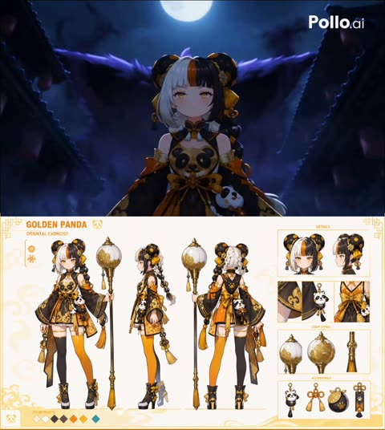</a>

角色锁定段落固定发型、服装和法杖，逐秒表情轨迹为每个情绪节点设定面部状态。按秒分段的镜头表配合镜头运动和分层音效提示，推动剧情逐步升级到结尾的揭示。

Seedance 2.5 · 参考生视频 · 出处: [@Mayz1169 on X](https://x.com/Mayz1169/status/2088249110709375460) · 82 赞，统计于 2026-10-29

[`character-lock`](tags.md#tag-character-lock) [`shot-sequence`](tags.md#tag-shot-sequence) [`anime`](tags.md#tag-anime) [`fox-demon`](tags.md#tag-fox-demon)

<details><summary><b>提示词</b></summary>

```text
[CHARACTER LOCK]
One girl exorcist, age ~17, slim build, composed features, highly expressive eyes.
HAIR: long black hair with a hard asymmetric front section — a white streak on her left and an orange streak beside it, blunt straight bangs; two large round panda-ear buns high on the head, black with scattered orange dot markings; one long braid falling over the right shoulder with a white-and-orange tail; small gold chrysanthemum ornaments and orange tassel danglers at the buns.
FACE: large amber-gold eyes with bright highlights, thin lashes, pale skin, small mouth, faint warm blush. Gold lantern light always reflected in her irises.
OUTFIT: black-and-orange oriental exorcist robe — short black wrap top with gold cloud-scroll embroidery and a round panda emblem at the chest; wide oversized detached hanfu sleeves, black outside with orange lining and gold trim, bare shoulders between; large orange obi sash tied in a bow with long gold-tassel cords; black high collar with a small gold clasp; layered orange-and-gold wrap skirt panels over white shorts; a plush panda-head charm with a red bell hanging at the right hip alongside gold knot tassels and a paw-print talisman; MISMATCHED LEGWEAR — black thigh-high on the left leg, bright orange thigh-high on the right, both with gold bands; black platform heeled boots with gold ribbon bows and white soles.
WEAPON: tall gold soul-quelling lantern staff, slightly taller than she is — dark gold shaft with ringed segments, topped by a large white orb wrapped in gold cloud filigree with a small gold spire, long orange-gold tassels at the joint. It burns with GOLDEN spirit fire when active and channels floating gold talisman papers and ring-shaped seal arrays.
Night scene: black mist and deep shadow with red lanterns; her gold light is the only warm source.
Same face, same hair streaks and panda buns, same robe, same mismatched stockings, same staff in all shots. No costume change, no other lookalike characters.
[EXPRESSION TRACK — mandatory, must read on her face]
0-3s calm and still, eyes half-lidded, listening to the bell → 3-5s alert: eyes sharpen, brows lower, quick scanning glances as the mist rises → 5-8s awe without fear as the giant fox demon rises — eyes widening slightly, chin lifting, mouth a firm line → 8-12s fierce concentration holding the seal array: teeth set, brows drawn, effort visible, hair blown back → 12-16s cool combat calm, small confident narrowing of the eyes, precise and unhurried → 16-18s dawning realization as she traces the spirit flow, eyes flicking upward, lips parting slightly → 18-21s resolve hardens into determination, a single decisive nod, jaw set → 21-25s driving forward through the horde, unwavering stare, faint defiant smile → 25-27s shock as the sky-eye opens: eyes flying wide, pupils shrinking, breath caught → 27-30s shock resolving into steady fearless resolve — she lowers her chin, grips the staff two-handed, gold fire lighting her face from below.
[SHOT SEQUENCE — 30s, continuous escalation]
0.0-3.0 Midnight. A temple bell tolls over a silent oriental old town. Slow crane down the street as every red lantern snuffs out in sequence; black mist boils up between the flagstones. She stands alone at the center of a stone bridge, staff in hand.
3.0-5.0 The ground cracks open. Spirit wisps and small demons pour out from below; talisman papers on the eaves ignite. Low angle whip-pan.
5.0-8.0 A 100m nine-tailed fox demon rises from the black mist, its body eclipsing the whole street and blotting out the moon. Extreme low angle for scale, her tiny silhouette in the foreground.
8.0-11.0 She raises the lantern staff. Golden light expands into an enormous circular seal array of rotating talisman rings, blocking a wave of demon shadows that crash against it like surf. Camera pushes through the light.
11.0-14.0 The horde swarms. Flying demons dive over the rooftops; a giant spectral claw smashes the street apart; black demon fire devours a building. She springs across the flying eaves, hurling gold talisman papers that pin demons mid-air. Handheld chase cam.
14.0-16.5 A massive demon beast lunges head-on. She sidesteps at the last instant, reverses her grip and slams the staff into the ground — a golden barrier detonates outward and blasts the beast back. Speed ramp on the impact.
16.5-19.0 The town warps: streets invert, buildings drift upward, illusory demons bloom from the mist. Rotating camera as she reads the flow of spirit energy and sees it all converging on an ancient shrine at the town's center.
19.0-22.0 She runs, stepping across burning talisman papers suspended in air like stones. Tracking shot at her heels, gold sparks trailing.
22.0-25.0 The hundred demons converge into a tidal horde from every direction. She does not slow — she spins the staff, releasing a spiral burst of golden spirit light, and drives straight through the center of the tide. Orbiting shot through the parting horde.
25.0-27.0 She reaches the shrine. A colossal demon core pulses in the ground, the horde feeding power into it. She lifts the lantern to seal it — then the power surges far beyond her expectation, and the black mist above coalesces into a single monstrous EYE spanning the entire sky, slowly opening.
27.0-30.0 She looks up. Camera pushes in on her face as shock hardens into resolve, then a low angle behind her: she grips the staff two-handed, golden spirit fire erupting up its length, and takes one step forward toward the sky-eye. Hard cut mid-step.
[STYLE / TECHNICAL]
High-end stylized 3D anime character-PV animation with painterly texture, expressive high-detail facial rig, silk cloth simulation on sleeves and sash. Aesthetic blend: Onmyoji yokai design language, Inuyasha demon-world atmosphere, Genshin Impact oriental fantasy PV polish, Final Fantasy colossal-boss scale. Night grading: deep blacks and cold blue mist versus warm gold and red lantern light, strong rim lighting, volumetric fog, floating embers and ash, gold particle motes, ink-wash smoke dissolve on demon deaths, anamorphic flares, motion blur, brief speed ramps on seal impacts, camera shake on giant hits. 24fps cinematic shutter, 2.39:1 widescreen, mixed crane / handheld / drone / orbit cameras, camera never static — but hold on her face long enough for each emotional beat to read. Combat reads as sealing and warding, not slaughter: barriers, talismans, binding arrays.
[NEGATIVE]
static camera, freeze frame, fade to black ending, slow-motion ending, standing idle ending, victory pose ending, blank deadpan face, unchanging expression, character inconsistency, hair color or streak change, missing panda-ear buns, eye color change, matching stockings, costume change, staff design change, second weapon, sword or gun, duplicate lookalike girls, daytime scene, desaturated grading, gore, blood, dismemberment, human corpses, body horror, realistic photo style, off-model face, warped hands, extra fingers, subtitles, text artifacts, watermark, logo overlay, blurry, low detail, dialogue close-ups, idle empty frames.
[AUDIO]
Oriental orchestral hybrid: single deep temple bell at 0.0s, erhu and guzheng motifs, taiko drums building throughout, low male chant under the fox demon reveal, wind chimes and paper-flutter textures. Demon shrieks and layered growls, stone cracking, whooshing talisman flames, crystalline chime on each seal array, deep gong on the barrier slam. Big riser into 25.0s, then near-silence with only a slow heartbeat as the sky-eye opens, and a single low chord as she steps forward. No dialogue.
```

</details>

<a id="h3-cyberpunk-samurai-neon-rain-katana-draw"></a>
### 赛博朋克武士在霓虹雨中拔刀

<a href="https://x.com/noorwithwifi/status/2084289809359810731"></a>

单一连续镜头加极致慢动作，把动作收束到拔刀这一个节拍。环绕运镜、体积霓虹雾和镜头光晕各自单独点名，让湿润反光的铠甲捕捉到彩色光线。

MiniMax H3 · 文生视频 · 出处: [@noorwithwifi on X](https://x.com/noorwithwifi/status/2084289809359810731) · 77 赞，统计于 2026-10-28 · 发现于 [SkyNotSilent/awesome-MiniMax-H3-cases](https://github.com/SkyNotSilent/awesome-MiniMax-H3-cases)

[`cyberpunk`](tags.md#tag-cyberpunk) [`samurai`](tags.md#tag-samurai) [`neon-rain`](tags.md#tag-neon-rain) [`slow-motion`](tags.md#tag-slow-motion) [`orbit-shot`](tags.md#tag-orbit-shot)

<details><summary><b>提示词</b></summary>

```text
Continuous 15-second cinematic shot, extreme slow-motion: a futuristic cyberpunk samurai standing in heavy neon rain, reflective wet armor. The samurai slowly draws a glowing katana, lens flare, volumetric neon fog, dynamic camera panning around the character, continuous fluid motion, photorealistic 8k
```

</details>

<a id="seedance-white-ice-dragon-woman-snow-journey"></a>
### 女子与白色冰龙并立于雪林中

<a href="https://x.com/Aiwithkami/status/2099056876722041057">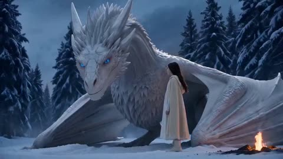</a>

参考图锁定角色的脸、发型和服装，提示词用有序的动作节拍描述站立、骑乘、飞越山脉、抵达遗迹。广角电影镜头语言和氛围词（飘雪、蓝色冷光配暖色火光）定下整体画面质感。

Seedance 2.5 · 参考生视频 · 出处: [@Aiwithkami on X](https://x.com/Aiwithkami/status/2099056876722041057) · 75 赞，统计于 2026-10-29

[`fantasy`](tags.md#tag-fantasy) [`dragon`](tags.md#tag-dragon) [`character-reference`](tags.md#tag-character-reference) [`snow`](tags.md#tag-snow)

<details><summary><b>提示词</b></summary>

```text
Use the uploaded reference image as the exact character reference. Keep the same face, hair, outfit and appearance throughout. The woman stands beside the giant white ice dragon, then rides on its back as it flies over snowy mountains and a frozen river. They reach an ancient stone shelter where she explores while the dragon protects her. Cinematic camera movement, epic wide shots, realistic motion, glowing blue eyes, snowfall, blue atmosphere with warm firelight, photorealistic fantasy movie quality, 16:9, no background music.
```

</details>

<a id="seedance-origami-hypercar-nine-vehicle-transformation"></a>
### 折纸超跑在一镜到底中连续变形为九种载具

<a href="https://x.com/umesh_ai/status/2089722918146285690">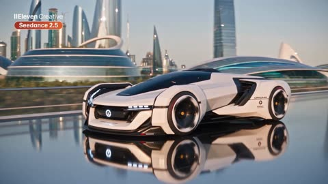</a>

参考图锁定每种载具的外形，单次跟拍镜头加上分步的变形描述让每次转换都连贯。明确禁止切镜、场景重置和更换驾驶者，使九种载具始终处于同一地点、由同一人驾驶。

Seedance 2.5 · 参考生视频 · 出处: [@umesh_ai on X](https://x.com/umesh_ai/status/2089722918146285690) · 69 赞，统计于 2026-10-29

[`transformation`](tags.md#tag-transformation) [`tracking-shot`](tags.md#tag-tracking-shot) [`reference-images`](tags.md#tag-reference-images)

<details><summary><b>提示词</b></summary>

```text
The images were first generated and used as references with the below prompt.

Prompt : Create a 30-second cinematic continuous one-shot using the provided vehicle reference images as the identity source for each machine. Preserve each vehicle’s silhouette, proportions, materials, and signature design language.

Core concept: one man, one uninterrupted high-speed journey, one continuous futuristic coastal megastructure, with vehicles transforming seamlessly around him. The same man must drive or pilot every vehicle throughout.

Vehicle order:
Origami hypercar → chrome futuristic motorcycle → Terra Centipede rover → champagne streamlined speed vehicle → Gravity Beetle air taxi → white organic hovercraft → Orbit Nomad shuttle → Lagoon Manta yacht → translucent bioluminescent aquatic craft.
Environment:
Keep the entire film inside one coherent coastal megastructure with elevated roads, service paths, platforms, reflective water channels, engineered ocean basins, sea-edge architecture, low-altitude airspace, and transparent underwater sections. Ground, air, water, and underwater zones must feel like connected layers of the same place. The world changes only through forward movement, perspective, and elevation, never through cuts, resets, teleportation, or abrupt location changes.

Camera:
One fluid tracking shot, mainly side or three-quarter side, following left to right. Keep the vehicle large and readable. The camera may arc, rise, descend, or skim the water with the vehicle, but the shot must remain continuous.
Action:
Begin with the Origami hypercar blasting along an elevated reflective roadway at extreme speed, the man visible through the canopy.

Hypercar → motorcycle: body narrows, roof drops, panels fold inward, wheel geometry simplifies, cockpit lowers, and the driver shifts naturally into a racing posture.
Motorcycle → Terra Centipede rover: frame thickens and lengthens, extra wheel modules unfold, armor grows, cockpit rises, and the driver becomes seated as the road flows into a rough engineered service path.

Rover → champagne speed vehicle: wheels retract and merge, segmented structures smooth into a low sculptural body, and the cockpit streamlines as the surface reconnects to a sleek high-speed lane.
Champagne vehicle → Gravity Beetle air taxi: chassis lightens, wheel structures become propulsion pods, side arms extend, cabin rises, and the craft lifts just above the corridor.

Air taxi → white organic hovercraft: angular structures soften into biomorphic surfaces, pods merge into the body, and the canopy becomes a smooth bubble.

Hovercraft → Orbit Nomad shuttle: body stretches into an aerospace silhouette, curves tighten, propulsion reorganizes, cockpit elongates, and the craft climbs slightly above the water and architecture.

Shuttle → Lagoon Manta yacht: craft descends, broadens, flattens, thrusters retract, and the underside forms aquatic contours as it becomes a yacht skimming a water channel at extreme speed.

Yacht → bioluminescent aquatic craft: white hull turns translucent and layered, blue internal light glows, fins emerge, and the craft dives smoothly into the transparent underwater level of the same megastructure.

Ending:
Finish underwater with the final bioluminescent craft racing forward, the same man visible inside, with architecture and filtered light around it. Emphasize that the world never changed, only the vehicle evolved.

Transformation rules:
Every transition must be gradual, elegant, mechanically readable, and believable. Existing panels, wheels, arms, hulls, pods, canopies, propulsors, and lighting systems visibly reconfigure in motion. No cuts, scene resets, environment swaps, teleporting, or driver changes.

Visual style:
High-end sci-fi commercial, cinematic realism, premium industrial design, polished materials, clean silhouettes, coherent worldbuilding, fluid mechanical transformations, ultra-smooth camera movement, and extreme speed. The vehicles are the spectacle; the environment remains one continuous unified landscape
```

</details>

<a id="h3-red-eye-cliff-temple-trailer"></a>
### 赤红瞳孔特写倒映山崖神殿

<a href="https://x.com/Cia0_exe/status/2091147848058613775">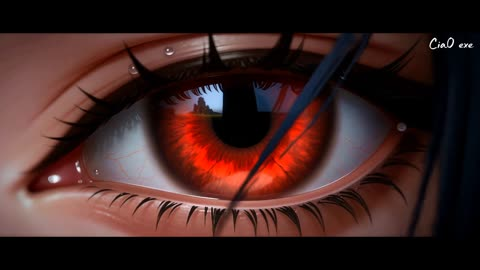</a>

八个带时间码的镜头各自锁定焦段、光圈、运动与速度，全局规则段统一画幅、转场与声音分层。三个@image参考分别锁定眼部、角色与神殿，让人物在各镜头间保持一致。

MiniMax H3 · 参考生视频 · 出处: [@Cia0_exe on X](https://x.com/Cia0_exe/status/2091147848058613775) · 58 赞，统计于 2026-10-29

[`storyboard`](tags.md#tag-storyboard) [`reference-images`](tags.md#tag-reference-images) [`close-up`](tags.md#tag-close-up) [`lightning`](tags.md#tag-lightning) [`transformation`](tags.md#tag-transformation)

<details><summary><b>提示词</b></summary>

```text
[分镜脚本 — 变身三阶段·八镜法]

镜1，0至1.5秒，极极限特写眼部。机位绝对固定，85毫米定焦电影镜头，T1.3极浅景深，完美圆形散景，焦点锁定右眼瞳孔，虹膜纹理清晰可辨，可见细微血管与纤维结构。画面背景近乎纯黑，
@image1
 右眼赤红瞳孔占画面百分之九十，睫毛根根分明带晨露微光，下眼睑轻微颤动，瞳孔中清晰倒映
@image3
 山崖神殿微缩轮廓，神殿倒影随瞳孔收缩微动。眼神从死寂瞬间锐利如刀，额前黑色碎发被微风拂动掠过焦平面产生瞬间模糊。摄影机微推镜前进1.5厘米，呼吸感手持幅度控制在正负2毫米，模拟人眼凝视的生理微动。色彩虹膜深红，高光古金，暗部近黑，睫毛阴影带冷青边缘。排版无文字，纯视觉，画面四角压暗暗角15百分比。音效极静中微风草动由负60分贝渐升至负30分贝，远处神殿风铃单音C6，少女沉重呼吸贴耳如ASMR。日语音声清冷低语气声近耳，「時が来た」。

镜2，1.5至3秒，中景半身转身。机位轨道车环绕，35毫米镜头，T2.0，高度齐腰，微仰角12度，环绕速度每秒0.5弧度。画面
@image1
 从侧身缓转正，右肩白色牡丹随动作自然颤动花瓣微张，金色云纹图腾在晨光下产生菲涅尔反光，黑色手套轻握成拳指节发白，小臂肌肉线条紧绷。背景
@image3
 翠绿草坡与雾中山崖，雾气在脚边如水流过，草叶带露水反光。摄影机180度平滑环绕无抖动，背景产生动态模糊，前景牡丹短暂失焦后清晰。色彩红衣暗红，金光古金，雾冷蓝，草露银白。排版无。音效衣料摩擦高频声，金属扣轻响，心跳低频鼓点渐强40至80拍每分钟，地面草叶静电颤动。黑色闪电在画面边缘如血管般微弱脉动，深红内核，仅环绕角色周身半米范围，不扩散至环境。

镜3，3至5秒，全景全身低角度上升。机位斯坦尼康低角度跟拍，24毫米广角，T2.8，仰角30度起升至平视。画面
@image1
 立于
@image3
 草坡，晨风吹动红衣摆与黑发，衣摆飘动幅度自然，发丝相互缠绕，镜头从靴底缓缓上升，经花卉刺绣裤腿，金色绑带，腰侧镂空，胸口图腾，最终停在面部。她抬头凝视神殿，颈部青筋微显，下颌线紧绷。背景山崖在广角畸变中更具压迫感，云层缓慢流动。摄影机垂直上升速度先慢每秒0.3米后快每秒0.8米再缓，模拟呼吸起伏。色彩草坡橄榄绿，晨雾白，肤色暖桃。排版无。音效草地踩踏声，呼吸加重带颤音，远处鸟鸣骤停，空气凝固感。天空暗云聚集，黑色闪电夹杂深红在云层无声游走，但仅聚焦于角色头顶上方三米范围内形成小型aura，压迫感渐强，红色光尘飘浮于角色肩侧。

镜4，5至7秒，近景胸至面部变身爆发。机位手持肩扛，50毫米镜头，T1.8，浅景深，焦点在面部与胸口间0.8秒缓慢转移，手持呼吸感正负5毫米。画面
@image1
 胸口金色图腾发出刺目红光，皮肤下脉动透光如心跳，红光从锁骨蔓延至颈部，面露痛苦却坚毅，眉毛紧锁，牙齿轻咬下唇，右肩白色牡丹瞬间枯萎花瓣卷曲化为红色光点飘散，光点轨迹呈螺旋上升。双肩开始隆起衣物撕裂，黑色手套崩裂碎片飞散。摄影机微晃后瞬间稳定制造张力释放。色彩红光正红，皮肤透光粉红，碎屑纯白。排版无。音效能量共鸣低频轰鸣30赫兹，骨骼微响如干木裂，花瓣碎裂清脆，心跳骤停一瞬1秒静音。黑色闪电夹杂深红从地面向上窜起，围绕角色周身形成旋转aura，主闪电臂般粗壮，通体漆黑透深红内核，分支细丝游走，光尘被电光点亮如星尘，能量场呼吸般一张一缩，草叶被静电牵引竖起。闪电严格限定于角色身体周围1.5米球形范围内，不触及远景环境。

镜5，7至9秒，全景全身觉醒展开。机位摇臂360度环绕加上升，21毫米超广角，T4.0，低角度仰拍40度起。画面
@image1
 双臂猛然展开，生物装甲破肤而出，
@image2
 珊瑚血肉翼疯狂生长至三米，翼膜半透明带血管纹理，眼状图腾睁开转动瞳孔收缩，橙红微光从翼缘溢出如熔岩流动。镜头环绕中背景
@image3
 山崖在闪电照耀下忽明忽暗，建筑细节在闪光中显现。摄影机环绕速度由慢每秒45度至快每秒120度再缓，摇臂上升1.5米。色彩生物翼肉粉，电光猩红，暗部纯黑。排版画面中央偏下，半透明日式竖排文字「覚醒」浮现0.5秒，字体明朝体，字色古金(#B8860B)带深红(#8B0000)微光描边1像素，字间距宽松，随闪电闪烁透明度0至100百分比，无背景块纯文字浮于画面。文字尺寸占画面高度十二分之一，位置绝对居中偏下5百分比，不遮挡角色主体。音效有机组织生长湿润撕裂声，甲壳展开爆响，能量嗡鸣震耳，黑色闪电劈啪炸响如连发鞭炮，空气电离滋滋声。日语音声痛苦转空灵，空间混响加延迟，「力を受け入れる」。

镜6，9至11秒，全景全身悬浮完成。机位轨道车后退加微升，35毫米，T2.8，低角度仰拍35度。画面
@image2
 悬浮离地30厘米，翠绿眼眸睁开，生物翼完全展开三米宽，翼面图腾转动，洒落红色光尘，黑色连体衣花卉纹身脉动如心跳，纹身线条发光。黑色与深红闪电在翅膀间穿梭，形成巨大旋转aura能量场，闪电从翼尖向外放射如树根蔓延，但放射范围严格控制在角色身体周围2米内，击中地面产生焦痕。背景
@image3
 神殿在电光中庄严显现，草坡被照亮，雾气呈放射状退散。摄影机轨道后退每秒0.8米，微升每秒0.3米，平滑如液压稳定器。色彩翠绿瞳，电光深红，雾灰蓝。排版无。音效能量爆发后瞬间寂静负50分贝，光尘飘落细微声，沉重呼吸带回音，远处雷鸣滚动。日语音声空灵决绝清亮，「我が花開く」。

镜7，11至13秒，中景侧面轨道跟拍。机位侧面轨道车平行跟拍，40毫米，T2.0，中低角度18度，速度精确匹配角色步伐每秒1.2米。画面
@image2
 迈步向
@image3
 神殿前行，生物翼随步伐收拢舒展如呼吸，翼膜褶皱自然，黑色高跟短靴踏草泥土微陷，泥土颗粒飞散，腿部花卉刺绣随肌肉流动，雾气被黑色闪电驱散成漩涡。身后拖出三秒残影，残影带红色电光，地面焦黑足迹冒烟。摄影机绝对稳定，背景产生方向性动态模糊。色彩焦黑足迹，靴纯黑，雾漩涡银灰。排版无。音效靴跟踏地清脆，草叶摩擦，翼膜轻颤如战旗，黑色闪电持续噼啪，能量残余嗡嗡声。闪电aura持续环绕角色周身1米范围，随步伐节奏脉动。

镜8，13至15秒，终幕Typography Art。机位完全静止，50毫米，T8.0全清晰。画面从角色背影淡出至纯黑，屏幕中央浮现主标题「Cia0 X H3」。Typography Art规格：主标题采用超高对比无衬线黑体如思源黑体Heavy或苹方特粗，字号占画面高度七分之一，位置绝对居中偏上3百分比，字色金属银灰渐变(#C0C0C0至#808080)从左上方至右下方，带2像素深红(#8B0000)硬边偏移阴影向右下45度，轻微色差效果红与蓝横向错位1.5像素，字间距拉宽至正常160百分比，字重极粗。文字后方横向刷过一道血红泼墨(#8B0000)如刀刃伤痕，泼墨边缘带橙红(#FF4500)微光粒子消散，粒子呈星尘状向上飘散。主标题下方8百分比画面高度处，副标题「Coming Soon」以细体明朝体浮现，字色暗古金(#B8860B)，透明度0至90百分比淡入0.5秒，字间距正常，无阴影。整个文字层带极轻微纸张颗粒质感与0.5百分比噪点。背景保持纯黑。摄影机绝对静止无任何运动。音效最后一声沉重古钟轰鸣C2音持续1.5秒，余音回荡渐弱，所有声音归于绝对寂静负无穷分贝。日语音声最后低语渐行渐远至完全消失，「さようなら」。

[摄影机宪法] 画幅比严格2.39比1变形宽银幕。所有镜头主体始终为角色，最远不超过全身full body，禁止远景大全景破坏亲密感。每镜转场使用光学溶解叠化或无缝运动匹配衔接，叠化时长0.25秒，禁止跳切。镜头运动：镜1固定微推，镜2轨道环绕，镜3斯坦尼康上升，镜4手持肩扛，镜5摇臂环绕上升，镜6轨道后退，镜7轨道平行跟拍，镜8绝对静止。景深特写T1.3至T1.8极浅，中景T2.0至T2.8，全景T4.0。运动模糊快门角度180度，自然动态模糊。镜头呼吸效应在变焦时轻微可见。任何情况下摄影机不得后退至角色全身以下比例小于画面高度的70百分比。

[闪电aura圣经] 黑色闪电为主体色(#0A0A0A)，深红为内核与边缘辉光(#8B0000)，变身阶段加入橙红高光(#FF4500)。闪电形态主闪电如成人手臂粗壮，表面不光滑带有机扭曲，分支如毛细血管细丝蔓延，整体呈旋转aura能量场环绕角色身体周围1至2米球形范围，绝不扩散至环境远景。闪电运动非匀速，呈脉冲式爆发，间隔0.3秒一次强闪，伴随细微红色光尘爆散。闪电与角色交互从地面向上窜起，沿腿部攀爬，在腰部分叉，于背部汇聚后从翼尖放射，但放射长度不超过角色翼展的1.5倍。环境反应：草叶静电竖起仅限角色脚边半米，雾气被电离成漩涡仅限角色周围1米，地面留下临时性焦黑痕迹仅限足迹位置。闪电音效低频轰鸣30至60赫兹打底，中频噼啪2千赫兹，高频电离滋滋8千赫兹。

[声音设计宪法] 绝对禁止背景音乐。仅使用环境音效与角色音效，分层混音：Layer1环境底噪风声草动负40分贝，Layer2角色动作衣料步伐负20分贝，Layer3能量特效闪电生长负15分贝，Layer4人声配音负10分贝。空间感使用卷积混响模拟开阔山谷，预延迟60毫秒，衰减时间3.2秒。动态范围最小负60分贝，最大负3分贝，保留电影级动态。变身爆发瞬间(镜4)加入1秒绝对静音制造张力，随后能量释放。

[日语音声设计] 声线少女清冷沙哑，20岁前后，标准语带轻微疏离感。处理：近距离耳语用高通滤波加近距离混响，变身痛苦段加入失真与空间混响，觉醒段加入教堂式长混响与延迟，终幕段加入低通滤波渐弱至消失。台词共五句，每句不超过8音节，情绪递进：平静→警觉→痛苦→空灵→决绝→消散。台词顺序：「時が来た」→「力を受け入れる」→「我が花開く」→「さようなら」。

[Typography设计宪法] 全片仅两处文字出现：(1)镜5「覚醒」竖排明朝体，古金带深红微光描边，尺寸占画面高度十二分之一，居中偏下5百分比，浮现0.5秒，透明度随闪电闪烁0-100百分比，无背景块；(2)镜8终幕主标题「Cia0 X H3」+副标题「Coming Soon」，主标题无衬线黑体Heavy占画面高度七分之一居中偏上3百分比，金属银灰渐变带深红硬边阴影与色差效果，字间距160百分比；副标题明朝体细体暗古金，位于主标题下方8百分比高度处，淡入0.5秒。禁止其他任何文字、水印、UI元素出现。

[三阶段变身法则] 阶段一(0-5秒)：
@image1
 完全形态，环境明亮晨雾青绿，闪电仅画面边缘微弱脉动，眼神从死寂转锐利，身体无变化，氛围宁静中暗藏张力。阶段二(5-10秒)：变身爆发，
@image1
 向
@image2
 过渡，胸口图腾发光→皮肤透光→牡丹枯萎→衣物撕裂→生物翼破肤生长，环境压暗至近黑，闪电aura从角色身体内部向外爆发，环绕周身1.5米，色彩从青绿骤变为黑红橙。阶段三(10-15秒)：
@image2
 完全形态，翠绿眼眸睁开，生物翼完全展开三米，悬浮离地，闪电aura稳定环绕周身1-2米，环境雾冷灰蓝，神殿显现，角色向神殿前行，终幕淡入Typography。

[渲染技术规格] 8K分辨率(7680x4320)，光线追踪全局光照，路径追踪采样2048spp，体积雾散射，皮肤次表面散射(SSS)半径3毫米，Kodak 5219胶片颗粒强度15百分比，Halation光晕强度8百分比，镜头呼吸效应在焦点转移时可见，变形宽银幕镜头椭圆散景(水平拉伸1.33倍)，水平拉丝眩光在强高光处可见，色彩空间Rec.709，电影级青橙LUT，对比度S型曲线暗部提升15百分比高光压缩10百分比，阴影偏青(#2F4F4F)高光偏金(#D4A843)，黑位纯净(000000)不浮灰。
```

</details>

<a id="h3-dragon-attack-medieval-fleet-northern-sea"></a>
### 巨龙突袭风暴北海中的中世纪舰队

<a href="https://x.com/Diplomeme/status/2086833428713116099"></a>

15秒内分成五个时间节拍,在高空俯瞰、甲板低机位和远处山景之间切换,让巨龙的逼近一步步推向火球击中领头舰。结尾的风格句列出排除项,避免人脸特写和名人相似。

MiniMax H3 · 文生视频 · 出处: [@Diplomeme on X](https://x.com/Diplomeme/status/2086833428713116099) · 53 赞，统计于 2026-10-28 · 发现于 [SkyNotSilent/awesome-MiniMax-H3-cases](https://github.com/SkyNotSilent/awesome-MiniMax-H3-cases)

[`fantasy`](tags.md#tag-fantasy) [`dragon`](tags.md#tag-dragon) [`naval-battle`](tags.md#tag-naval-battle) [`multi-shot`](tags.md#tag-multi-shot) [`cinematic`](tags.md#tag-cinematic)

<details><summary><b>提示词</b></summary>

```text
Hyper-realistic cinematic fantasy action sequence, 15 seconds, aspect ratio 16:9.

Daytime in a vast cold northern sea surrounded by jagged mountains and dark rocky cliffs. A fleet of large medieval wooden warships sails through rough black-blue water while armored soldiers prepare for battle on the decks. Massive sails snap violently in the wind. The ships carry burning braziers, ropes, shields, spears, banners, wooden siege weapons, and rows of armed warriors. Thick storm clouds hang low above the sea. Wind drives sea spray across the decks. The danger comes from the sky: a giant dragon approaches from behind the mountains, its enormous wings gradually emerging through the mist.

Begin with a high sweeping view of the entire fleet moving through the dangerous northern sea. Several warships sail in formation while smaller boats move between them. Soldiers look toward the distant mountains as a huge shadow passes across the water.
Shift to a low deck-level view among the warriors. Men raise shields and grab spears while officers shout commands. The camera moves toward the front of the ship as the wind suddenly becomes violent.
Cut to a distant view of the mountains. The dragon bursts through the clouds and flies directly toward the fleet, enormous wings beating through the storm mist. Its silhouette grows rapidly larger.

Return above the ships as the dragon dives toward the fleet. Sailors scramble across the decks while archers rush into position. Burning arrows are lit and giant ballistae are rotated toward the approaching creature.

Near the end, the dragon suddenly opens its jaws and releases a massive stream of fire toward the lead warship. The flames illuminate the dark sea as the crew raises shields and desperately attempts to turn the vessel.

End with the dragon flying directly above the fleet as the first fireball crashes into the lead ship, exploding across its wooden deck.

Style: hyper-realistic, cinematic, intense, fast-paced, suspenseful, fantasy atmosphere, strong sense of scale, warships, dragon battle, ocean storm, medieval warfare, fire, smoke, dynamic varied camera movement, no text, no logos, no cartoon style, no slow motion, no famous celebrity faces, no recognizable actors, no movie-star resemblance, no public-figure likenesses, no clear facial close-ups. Keep proportions. Keep style and features. Aspect ratio 16:9.
```

</details>

<a id="wan-floating-cathedral-angel-battle"></a>
### 战士与堕落天使在漂浮大教堂对决

<a href="https://x.com/LudovicCreator/status/2093639918031446064">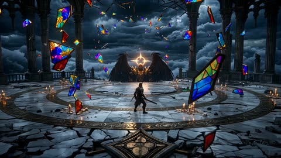</a>

用时间点把片子分成几个节拍，第2秒的冲击波和结尾的画面各占一段，镜头运动写得很具体：先是宽幅环绕，接着在剑击地面时压低俯冲。结尾的风格词统一了整段的光影和特效。

Wan 3.0 · 文生视频 · 出处: [@LudovicCreator on X](https://x.com/LudovicCreator/status/2093639918031446064) · 51 赞，统计于 2026-10-29

[`dark-fantasy`](tags.md#tag-dark-fantasy) [`angel-battle`](tags.md#tag-angel-battle) [`floating-ruins`](tags.md#tag-floating-ruins) [`storm`](tags.md#tag-storm)

<details><summary><b>提示词</b></summary>

```text
A ruined cathedral floats in the sky during a violent storm, broken pillars suspended in mid-air, stained glass fragments orbiting like shards of light. A lone warrior stands on the cracked marble floor facing a colossal fallen angel with black wings, glowing armor, and a burning halo split in half.
At the 2-second mark, the angel spreads its wings, creating a shockwave that sends candles, dust, and glass spiraling outward. The warrior charges forward as lightning strikes through the broken roof. The camera circles them in a wide cinematic arc, then dives low as the angel’s sword slams into the floor, cracking the cathedral platform.
Final moment: the warrior raises their blade as the entire floating cathedral begins falling through the clouds.
Dark fantasy final battle, angelic VFX, storm, floating ruins, cinematic 4K.

Made in
@magnific
```

</details>

<a id="wan-escape-pod-station-collapse-space"></a>
### 巨型空间站悬于条纹气态巨行星之上

<a href="https://x.com/AllaAisling/status/2095949652667298044">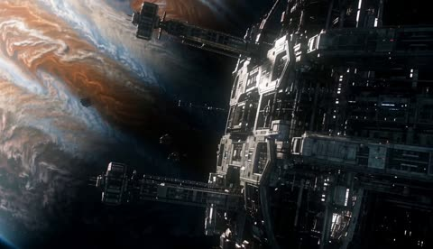</a>

按时间顺序排列的镜头节拍让模型理解完整叙事，紧贴吊舱后方的跟随镜头建立尺度感。结尾的风格段落指定真实物理、紧张氛围和大画幅质感。

Wan 3.0 · 文生视频 · 出处: [@AllaAisling on X](https://x.com/AllaAisling/status/2095949652667298044) · 37 赞，统计于 2026-10-29

[`hard-sci-fi`](tags.md#tag-hard-sci-fi) [`space-station`](tags.md#tag-space-station) [`debris-simulation`](tags.md#tag-debris-simulation)

<details><summary><b>提示词</b></summary>

```text
A tiny escape pod launches from a gigantic space station orbiting a gas giant. The camera follows close behind. Moments later the station begins breaking apart. Explosions ripple through kilometers of structure. Massive debris fields form around the pod. The pilot navigates through collapsing corridors of metal and fire. Giant station fragments tumble in every direction. The pod squeezes through an impossibly narrow opening. Final shot reveals the escape pod emerging into open space as the entire station disintegrates behind it.
Ultra-realistic hard sci-fi, realistic physics, immense scale, cinematic tension, detailed debris simulation, IMAX quality.

Made with Wan 3.0 in
@openart_ai
```

</details>

<a id="wan-mars-dome-collapse-colony-chase"></a>
### 殖民车辆冲向坍塌的火星穹顶

<a href="https://x.com/AllaAisling/status/2098153036682047774">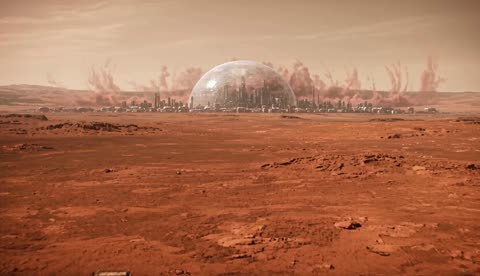</a>

提示词按顺序列出故事节拍，从追逐到穹顶坍塌再到最后的滑入，给模型一条清晰的时间线。明确俯视镜头、物理效果和 IMAX 级别的规模，决定了构图与尺度感。

Wan 3.0 · 文生视频 · 出处: [@AllaAisling on X](https://x.com/AllaAisling/status/2098153036682047774) · 34 赞，统计于 2026-10-29

[`mars`](tags.md#tag-mars) [`dome-collapse`](tags.md#tag-dome-collapse) [`chase`](tags.md#tag-chase) [`sci-fi-disaster`](tags.md#tag-sci-fi-disaster)

<details><summary><b>提示词</b></summary>

```text
A colony vehicle races across the surface of Mars toward the last human settlement. The camera follows from above. Behind it, a gigantic atmospheric breach spreads across a transparent habitat dome hundreds of kilometers wide. The entire dome begins collapsing. Dust storms surge inward. The vehicle accelerates across rocky terrain while sections of the colony implode in the distance. The settlement airlock begins closing. Final shot: the vehicle slides through seconds before the dome catastrophically fails behind it.
Ultra-realistic hard sci-fi, Martian landscape, dramatic tension, realistic physics, cinematic scale, IMAX quality.

Made with Wan 3.0 in
@openart_ai
```

</details>

<a id="h3-spaceship-corridor-escape-hard-cut"></a>
### 女子在飞船走廊奔跑，冲向观察窗

<a href="https://x.com/ItsCosmicAnts/status/2087839534155211198">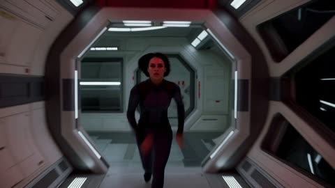</a>

用分段式的节拍描述加硬切，让一条提示词覆盖逃亡、冲击和梦醒的完整叙事。手持镜头、急促节奏和明确的胶片颗粒感定下基调，结尾切到卧室让梦境的反转清晰可读。

MiniMax H3 · 文生视频 · 出处: [@ItsCosmicAnts on X](https://x.com/ItsCosmicAnts/status/2087839534155211198) · 30 赞，统计于 2026-10-29

[`spaceship`](tags.md#tag-spaceship) [`handheld`](tags.md#tag-handheld) [`hard-cut`](tags.md#tag-hard-cut) [`film-grain`](tags.md#tag-film-grain)

<details><summary><b>提示词</b></summary>

```text
Cinematic 15-second sequence: A young athletic woman with short dark hair in a fitted dark spacesuit sprints desperately down a glass-walled spaceship corridor under flashing red emergency lights, stars visible outside. She bursts into a circular observation room and collapses against a massive round panoramic window, pressing her face and hands to the glass in exhaustion. Through the window a beautiful planet violently explodes — a massive wave of fire and energy races toward the ship and smashes into the glass in a blinding flash. Hard cut: the same woman jolts awake in a dark ordinary bedroom, gasping, covered in sweat. Handheld camera, urgent pacing, intense red emergency lighting, cinematic sci-fi destruction, realistic, film grain.
```

</details>

<a id="h3-schoolgirl-runs-golden-grass-phoenix"></a>
### 女学生在夕阳下的金色草丛中奔跑

<a href="https://x.com/Cardoso/status/2108599749179781551">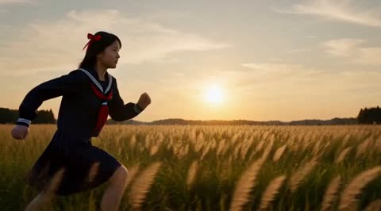</a>

四个带时间码的镜头，每个镜头都写明运镜，并用身份锁定段重复发型、发带和制服，使角色在切换中保持一致。音效和配乐单独成段，不与画面描述混在一起。

MiniMax H3 · 文生视频 · 出处: [@Cardoso on X](https://x.com/Cardoso/status/2108599749179781551) · 24 赞，统计于 2026-10-29 · 发现于 [SkyNotSilent/awesome-MiniMax-H3-cases](https://github.com/SkyNotSilent/awesome-MiniMax-H3-cases)

[`multi-shot`](tags.md#tag-multi-shot) [`identity-lock`](tags.md#tag-identity-lock) [`camera-move`](tags.md#tag-camera-move) [`phoenix-transformation`](tags.md#tag-phoenix-transformation)

<details><summary><b>提示词</b></summary>

```text
integrated_multimodal_description: [Shot 1] Live-action, cinematic, anamorphic 35mm, golden hour, fine film grain, warm sun flare. A low tracking shot through a wide open meadow of tall gold grass, low sun ahead on the horizon, no buildings, no road. A Japanese schoolgirl runs screen-left to screen-right, feet-first, toward the open field and the sun, not back toward the camera. Identity lock: late teens, fair skin, black shoulder-length hair with a small red ribbon, navy sailor uniform with a white collar and red neckerchief, pleated navy skirt, white socks, brown loafers. Determined face, eyes on the field ahead, not on the camera, mouth closed. Grass whips through the foreground, out of focus. Her hair and skirt stream behind her. The camera trucks right at fast speed at knee height, matching her pace, with large amplitude, sun flare raking the lens. No second person. No bird yet. No speech. No narrator.
[Shot 2] At 00:03.800, the camera cuts to an extreme low angle from the grass, looking up. Same girl, same lock: late teens, black shoulder-length hair, red ribbon, navy sailor uniform, white collar, red neckerchief, pleated skirt, white socks, brown loafers. She plants her right foot and leaps straight up, arms opening, skirt and hair lifting, loafers leaving the grass. The sun sits behind her so she is a rim-lit silhouette against a clear gold sky. She does not fall back. She does not look at the camera. Mouth stays closed. The camera tilts up at fast speed with large amplitude, following her rise, grass blades sharp in the near foreground. No speech. No narrator.
[Shot 3] At 00:07.200, the camera cuts to a medium shot of her at the top of the leap, same body, same face, same navy uniform and red ribbon, against the gold sky. One continuous morph, no second figure, no costume left behind, no small bird hatching out of her. Gold fire kindles at her outstretched fingertips and at the hem of the skirt, climbs the arms, and becomes long primary feathers. The sailor collar and skirt burn away into plumage on the same body. Her face lengthens into a raptor beak in that same head; the eyes stay in place and turn coal-bright. Her legs tuck and become talons. What finishes the morph is a phoenix the size of a large crane, wingspan wider than she was tall: gold breast, crimson flight feathers with white-hot edges, a long trailing tail of fire, not a cartoon flame blob, not a sparrow, not a chicken. The camera arcs around her with large amplitude at slow speed as the wings open. No human girl remains in frame. No speech. No narrator.
[Shot 4] At 00:11.000, the camera cuts to a wide low crane over the same meadow. The phoenix only: crane-sized, gold breast, crimson flight feathers, white-hot edges, long fire tail, coal-bright eyes, talons tucked. It banks once, then flies away from the camera toward the low sun, wings beating forward, hood-first, not reversing, not circling back to the girl, because the girl is gone. Embers drift down into the grass and go dark; the field does not catch. She shrinks toward the sun. The camera tilts up and pulls out with large amplitude at slow speed until the bird is a bright streak on the horizon. No speech. No narrator.

overall_soundscape: Wind in tall grass, loafers on dry stems, a short breath on the plant, fabric snap as she leaves the ground. A rising whoosh as fire takes the uniform, then heavy wing beats and a single wild phoenix cry, beak open once, not words. Embers tick into the grass. After the cry, only wind and wings fading. No voices. No narrator.

non_diegetic_music: Low strings and a solo shakuhachi in a slow pulse, a single taiko hit on the plant, then fast rising brass and a high string ostinato under the wing beats. No lyrics. No sung theme.
```

</details>

<a id="h3-ruby-queen-gown-to-armor"></a>
### 红宝石女王在哥特大厅中即将化身战甲

<a href="https://x.com/TaliaAariz/status/2090330350668947525">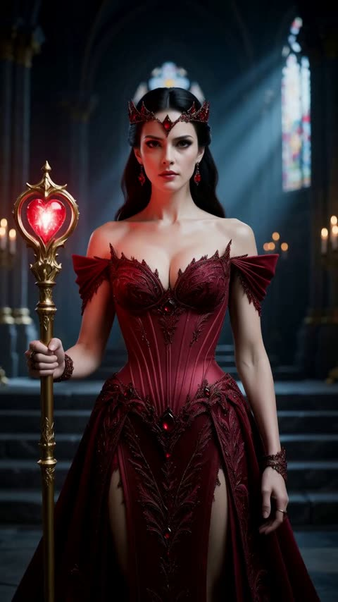</a>

提示词按顺序分段：先确立造型，再拉远镜头展示完整服饰，随后用魔法光爆把长裙和权杖变为战甲、长剑与盾牌。结尾指定战斗姿势和红色魔法阵，为模型提供明确的最终画面。

MiniMax H3 · 文生视频 · 出处: [@TaliaAariz on X](https://x.com/TaliaAariz/status/2090330350668947525) · 19 赞，统计于 2026-10-29 · 发现于 [SkyNotSilent/awesome-MiniMax-H3-cases](https://github.com/SkyNotSilent/awesome-MiniMax-H3-cases)

[`costume-transformation`](tags.md#tag-costume-transformation) [`magic-burst`](tags.md#tag-magic-burst) [`camera-zoom-out`](tags.md#tag-camera-zoom-out) [`gothic-interior`](tags.md#tag-gothic-interior)

<details><summary><b>提示词</b></summary>

```text
A cinematic fantasy transformation beginning with a majestic queen wearing an intricate ruby-embroidered corset gown, matching crown, and holding a glowing heart-topped scepter inside a gothic cathedral throne room. The camera zooms out to show her full attire as she turns and walks toward a grand staircase, where a burst of glowing red magical light erupts around her. Enveloped in the crimson energy, her gown transforms into sleek, ornate metallic warrior armor, while her scepter morphs into a longsword and an embossed shield. She turns back toward the camera in a powerful battle stance, positioned before a glowing red arcane circle on the cathedral steps.
```

</details>

<a id="h3-houyi-nine-suns-archer-battle"></a>
### 孤身射手立于焦土，九日悬天

<a href="https://x.com/LufzzLiz/status/2085152634949030212">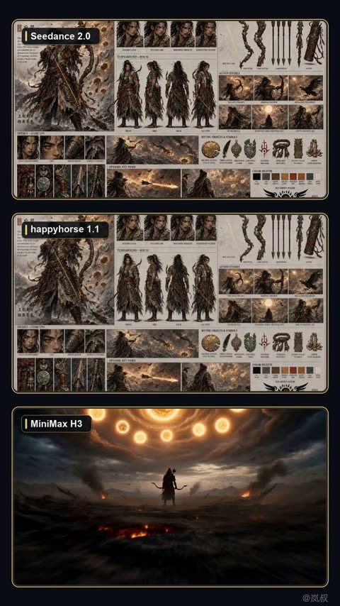</a>

按时间段写分镜，每段都给出明确运镜（低机位推近、高速环绕、慢动作），让模型有清晰的镜头顺序。锁定参考图人物身份，并禁止设定板、分格、文字和界面，使结果保持为一段连续的电影场景。

MiniMax H3 · 图生视频 · 出处: [@LufzzLiz on X](https://x.com/LufzzLiz/status/2085152634949030212) · 16 赞，统计于 2026-10-29 · 发现于 [SkyNotSilent/awesome-MiniMax-H3-cases](https://github.com/SkyNotSilent/awesome-MiniMax-H3-cases)

[`chinese-mythology`](tags.md#tag-chinese-mythology) [`epic-battle`](tags.md#tag-epic-battle) [`slow-motion`](tags.md#tag-slow-motion) [`timed-shots`](tags.md#tag-timed-shots)

<details><summary><b>提示词</b></summary>

```text
电影级东方神话史诗，保持参考图中后羿的身份与造型统一：年轻坚毅的东方男性，凌乱黑色长发，带灼痕的黑铜战甲、朱红腰带、玉石饰物，手持雕纹神圣青铜弓。画面转换成完整连续的真实电影场景，禁止出现设定板、分格、文字和界面。

0至3秒，乌云翻涌的焦土战场，天空悬挂九轮燃烧烈日。低机位掠过碎石与灰烬，快速推近后羿背影，披风和长发在热浪中狂舞。

3至7秒，群鸦骤然冲出云层，镜头高速环绕至后羿侧面。他抬弓搭箭，青铜弓纹逐层亮起金红色神光，弓弦绷紧，眼神从克制转为决绝，火星贴近镜头飞过，强烈压迫感。

7至11秒，后羿猛然释放神箭。瞬间进入极致慢动作，发光箭矢撕裂空气，随后镜头迅猛追随箭矢穿越云海。神箭分化为九道金色流光，烈日接连崩裂，形成震撼的连锁爆炸，冲击波推开乌云，天地剧烈震动。

11至15秒，爆炸声势骤然沉寂，灰烬像雪一样缓慢飘落。天空只剩最后一轮温暖太阳，后羿立于山巅成为逆光剪影，缓缓放下神弓。镜头升高并大幅拉远，露出重获生机的辽阔山河，庄严、悲壮、余韵悠长。

真实电影摄影，史诗级规模，强烈明暗对比，体积光，热浪折射，飞灰与火星，真实布料和金属质感，动态运镜，速度变化自然，24帧电影质感，人物面部稳定，手指与弓箭结构正确，无字幕，无水印，无现代物品。 

根据这个提示词，你觉得哪个模型做的最好？客观多方位真实评价
```

</details>

<a id="h3-starship-hyperspace-jump"></a>
### 星舰舰桥，舰队跃迁

<a href="https://huggingface.co/MiniMaxAI/MiniMax-H3/resolve/main/assets/t2va_2k.mp4"></a>

完整的 H3-Context-IR 格式：编号镜头加 00:04.500 的定时切换，声音和配乐各占一个字段。本地跑 H3 多半跳过了这一步改写，所以画面发平。

MiniMax H3 · 文生视频 · 出处: [MiniMax H3 model card](https://huggingface.co/MiniMaxAI/MiniMax-H3)

[`multi-shot`](tags.md#tag-multi-shot) [`timed-cut`](tags.md#tag-timed-cut) [`structured-prompt`](tags.md#tag-structured-prompt) [`sfx`](tags.md#tag-sfx) [`score`](tags.md#tag-score) [`sci-fi`](tags.md#tag-sci-fi)

<details><summary><b>提示词</b></summary>

```text
integrated_multimodal_description: [Shot 1] Cinematic, medium wide shot, pushing in slowly. In the cavernous, dimly lit bridge of a starship, sleek metallic consoles with glowing amber displays flank a massive, curved observation window. A female captain, in her late 40s with an athletic build and short silver-streaked black hair, stands in the center midground. She wears a structured, high-collared dark navy military tunic with silver chest insignias. Her back is to the camera, silhouetted against the cool, ambient starlight pouring through the thick glass. She stands perfectly still with her hands clasped tightly behind her back. Outside the window, a massive armada of jagged, dark grey dreadnoughts hovers in tight formation against a deep purple space nebula. The fleet's massive rear thrusters begin to glow with an intense, escalating bright blue light. [Shot 2] At 00:04.500, the camera cuts to a close-up of the captain's face and shakes strongly. The brilliant blue-white light from the fleet's gathering energy reflects vividly in her dark eyes. Suddenly, a blinding white flash floods through the window, completely washing out the background as the fleet jumps to hyperspace. The sheer spatial force violently jolts the bridge, causing the captain from Shot 1 to stagger slightly forward, her shoulders tensing as she visibly braces herself against the physical tremors. As the intense white light fades abruptly, leaving only the dim, empty expanse of the purple nebula reflected on her starkly lit skin, her jaw clenches, and she slowly closes her eyes in the newly emptied space.
overall_soundscape: A low, resonant hum of the ship's ambient life support systems serves as the baseline, soon drowned out by an audible, escalating, high-pitched electronic whine as the fleet outside charges its hyperdrives. A massive, deafening, bass-heavy boom and sharp crackle erupts during the blinding flash, accompanied by the loud metallic creaking, rattling, and deep thuds of the bridge's bulkheads vibrating under immense physical stress. The intense roaring impact then cuts abruptly back to a hollow, echoing room tone, leaving only the faint, steady hum of the isolated bridge.
non_diegetic_music: Cinematic space-opera orchestral score, slow tempo, featuring a solitary, mournful French horn melody over deep, sustained string dissonances that build rapidly in volume and intensity, swelling to a massive orchestral peak before snapping immediately into silence right after the jump.
```

</details>

<a id="kling-plaster-tower-dinosaur"></a>
### 石膏像塔里，与恐龙重逢

<a href="https://static-17.klingai-cdn-aws.com/kling-blog/presigned_url/9d0eec96-49d3-4229-a2c0-f38ceb5974e0_没想到吧Alex是只恐龙.mp4"></a>

开头先声明 `single unbroken shot with no edited transitions`，再写一条从绝望到重逢的情绪线。

Kling 3.0 · 图生视频 · 出处: [Kling VIDEO 3.0 user guide](https://app.klingai.com/global/quickstart/klingai-video-3-model-user-guide)

[`long-take`](tags.md#tag-long-take) [`emotion`](tags.md#tag-emotion) [`creature`](tags.md#tag-creature)

<details><summary><b>提示词</b></summary>

```text
This is a 15-second cinematic long take, a single unbroken shot with no edited transitions. The scene is set inside a tower of plaster statues dappled with light and shadow, surrounded by towering white plaster sculptures, evoking an air of mystery and oppression. The shot opens with the protagonist skidding to a halt at the center of the scene after a frantic run, chest heaving, expression dazed and helpless, fear glinting in their eyes. The camera orbits the protagonist in a smooth 360-degree pan. As the camera rotates, the protagonist glances anxiously around and shouts: "Alex! Alex where are you! Are you here?" A cute dinosaur cry then echoes in the background, and the camera pushes in over the protagonist’s shoulder to their back— a small to medium-sized, adorable baby dinosaur steps out from behind a plaster pillar, letting out a sweet chirp. Startled by the sound, the protagonist whips around; catching sight of the dinosaur, they burst into tears instantly and rush forward without hesitation to clasp it tightly in their arms. The dinosaur nestles obediently against them. Sobbing, the protagonist strokes the dinosaur gently and trembles: "I found you! Thank God, I’m so scared!" The overall lighting and shadow boast a cinematic texture, with the emotion shifting from despair to an overwhelmingly touching reunion.
```

</details>

输入素材: [1](https://static-47.klingai-cdn-aws.com/kling-blog/file_by_url/fe49a43ec06b9e0cdf7f555268cbe2a18c35175ab6cc25fc2b1150218076b6d9.png)

<a id="kling4-dragon-attacks-coastal-city"></a>
### 巨龙从山巅起飞火烧海港城，30 秒六个镜头

<a href="https://static-2.klingai-cdn-aws.com/kling-blog/presigned_url/9214134d-57a9-4702-a064-c72fe4f02ab3_1-1.mov"></a>

可灵的长结构化写法：场景、地理图、首帧、分镜、镜头光学、物理、声音、约束。地理图写死了巨龙的飞行方向，切镜头时方向不会反。

Kling 4.0 · 参考生视频 · 出处: [Kling 4.0 user guide](https://kling.ai/quickstart/kling-4-model-user-guide)

[`dragon`](tags.md#tag-dragon) [`dark-fantasy`](tags.md#tag-dark-fantasy) [`multi-shot`](tags.md#tag-multi-shot) [`structured-prompt`](tags.md#tag-structured-prompt) [`action`](tags.md#tag-action) [`reference-images`](tags.md#tag-reference-images)

<details><summary><b>提示词</b></summary>

```text
1. SCENE CONTEXT: EXACTLY 1 DRAGON — NO DUPLICATES.A 30-second, six-shot dark-fantasy action sequence. A colossal dragon roars, launches from a mountain pinnacle, accelerates toward a burning coastal city, dives between its towers and performs a devastating aerial fire attack. Epic scale, very fast pacing, real-time motion.
2. ACTIVE REFERENCES: controls the burning coastal city, Gothic architecture, harbour, mountain horizon, existing fires, smoke columns, storm clouds and lightning. Controls the dragon’s identity, black-grey scales, red-brown wing membranes, horns, dorsal spines, four legs, two wings, long tail and opening rocky pinnacle.
3. LOCATION MAP: The pinnacle overlooks the coastal city. The harbour lies screen-left, the central castle lies ahead, and the densest burning district lies centre-right. Direction of travel always runs from the mountain toward the city centre. Cameras remain behind, below or on the dragon’s left side without reversing the travel axis.
4. FIRST FRAME AND SPATIAL BLOCKING: The dragon is already crouched on the pinnacle, wings spread, hind legs compressed and head aimed toward the city. Its jaws open for one roar. Fires flicker below; connected smoke columns bend with the wind and the entire storm ceiling visibly moves.
5. FORMAT MODE: Six shots with hard cuts: SHOT 1 — 0.0–4.0s: roar and launch.SHOT 2 — 4.0–9.0s: high-speed pursuit toward the harbour.SHOT 3 — 9.0–13.5s: low flight across the water toward the city.SHOT 4 — 13.5–19.0s: first fire attack between towers.SHOT 5 — 19.0–25.0s: banking pursuit and sweeping fire attack.SHOT 6 — 25.0–30.0s: dragon climbs above the burning city. Cuts are motivated by wing wipes, smoke wipes and close architectural passes. No fades or dissolves.
6. OPTICS SHOT: 1: 24mm, 74° horizontal FOV, low-angle environmental wide.SHOT 2: 18mm, 90° FOV, rear pursuit perspective.SHOT 3: 24mm, 74° FOV, low water-level chase.SHOT 4: 28mm, 65° FOV, roof-height tracking.SHOT 5: 24mm, 74° FOV, close side-rear pursuit.SHOT 6: 18mm, 90° FOV, monumental aerial wide.Moderate-deep focus. Strong natural motion blur on wing tips, water, smoke, embers and nearby buildings.
7. CAMERA: All cameras have obvious physical handheld instability.SHOT 1 rapidly tilts upward as the dragon launches; wing pressure violently jolts the operator.SHOT 2 follows 12 metres behind the tail with intense wind buffeting and rapid vertical vibration.SHOT 3 races just above the water behind the dragon; waves and burning boats whip past the frame edges.SHOT 4 tracks through the street canyon at roof height.SHOT 5 follows the dragon through a hard bank, nearly losing framing as towers pass dangerously close.SHOT 6 pursues upward, then settles into a wide view of the devastated city.No smooth floating or mechanically perfect movement.
8. ACTION TIMING: 0.0–0.8s: The dragon releases one thunderous roar, neck extended and eyes fixed on the city.0.8–2.0s: Hind legs drive into the pinnacle; claws fracture the rock.2.0–4.0s: The dragon launches and performs two powerful wing strokes. Dust and stone explode backward.4.0–6.5s: Hard cut behind the dragon already accelerating at high speed.6.5–9.0s: It folds its legs beneath its body and dives toward the harbour. Smoke streams across its wings.9.0–11.5s: The dragon skims rapidly above rough water. Wing tips nearly touch the waves.11.5–13.5s: It passes burning ships and climbs over the sea wall. A tower wipes across the lens.13.5–15.0s: Hard cut inside the city. The dragon bursts through smoke between Gothic towers.15.0–19.0s: It releases one continuous orange-white fire jet, sweeping across the left row of rooftops while maintaining full speed.19.0–21.5s: The dragon snaps into a hard right bank around the central tower; the tail swings with delayed inertia.21.5–25.0s: Its connected fire stream sweeps across the avenue and strikes the right-side tower. Burning masonry and embers fall behind it.25.0–27.0s: The dragon stops breathing fire, beats its wings powerfully and climbs above the rooftops.27.0–30.0s: It ascends into the storm light and glides over the burning city. The camera widens to reveal spreading flames, smoke columns and the harbour below.
9. PHYSICS: The dragon has immense believable mass despite its speed. Wing strokes originate in the shoulders; membranes stretch under aerodynamic load. The torso, legs and tail react with delayed inertia. Wing wakes tear openings through smoke, disturb water and buffet nearby fires. Fire emerges only from the open mouth as a pressure-driven stream with a white-hot core, orange turbulent edges and visible heat distortion. Buildings ignite progressively at visible impact points. Debris follows gravity and the dragon’s wake.
10. LIGHTING: Cold storm daylight enters from upper-left. Existing fires provide orange underlight beneath the dragon. The fire stream becomes a moving motivated key light, casting travelling highlights over scales, towers and smoke. Sunbeams break through the clouds during the final climb. Preserve detail in the flame core and keep the dragon’s silhouette readable.
11. AUDIO: No dialogue. Synchronized dragon roar, claw scraping, rock fracture, leather-wing thunder, violent wind, wave impacts, burning ships, collapsing masonry, ember hiss and pressurised fire blasts. Epic original score: rapid war drums, low brass ostinato and urgent strings begin immediately. Wordless low choir enters at launch. Percussion accelerates during the chase. Full orchestra strikes with each fire attack, then expands into a dark triumphant finale during the ascent. Roar, wings and fire remain louder than the music.
12. CHARACTER ACTING: The dragon acts with focused predatory intent. Its eyes remain locked on its flight path and successive building targets. During acceleration, its head lowers and shoulders drive aggressively. Inside the city, the neck deliberately guides the fire stream while the tail controls each bank. In the final shot, its chest opens and posture changes from attacking aggression to airborne dominance.
13. STYLE: Grand apocalyptic dark-fantasy cinema, aggressive pursuit photography, monumental scale and battlefield energy. Charcoal and storm blue occupy 60% of the palette, smoke-brown stone 30%, and fire orange 10%. Weathered 35mm film texture with old-photograph softness, organic grain and no digital sharpening.
14. QUALITY: Consistent dragon identity and anatomy through every cut: one head, two wings, four legs and one tail. Stable city architecture, coherent wing cycles, attached mouth fire, volumetric smoke and physically connected destruction. Natural fast-motion blur without ghost copies, anatomy mutation or detached flames.
15. POSITIVE CONSTRAINTS: Exactly one dragon remains visible throughout the sequence. It launches before 2 seconds, reaches the harbour by 9 seconds, enters the city at 13.5 seconds and completes two fast fire-attack passes before climbing away. Every shot preserves the mountain-to-city direction. Strong camera shake communicates extreme speed while the dragon remains readable. City fires continuously emit smoke, clouds visibly travel across the sky, and new destruction appears only where the connected fire stream strikes.
```

</details>

输入素材: [1](https://static--88.klingai-cdn-aws.com/kling-blog/file_by_url/f5a55a529cc09483b9d9fce05d2a08683d2a37a58aeeeb18ff8a6b0470ac74c3.png) · [2](https://static-18.klingai-cdn-aws.com/kling-blog/file_by_url/3014c9b125142780247c3ee4fd35592a878350d3b17f4a2b3c9c9ec79e4cf159.png)

<a id="kling4-moonlit-lotus-goddess"></a>
### 月亮那么大的莲花，白衣女子遥望

<a href="https://static--43.klingai-cdn-aws.com/kling-blog/presigned_url/95805563-46fa-438e-9a45-4a86a1ebaf2b_1-4.mp4"></a>

两个五秒镜头，各自对应一张构图参考。文字大半在交代尺度：花巨大而远，人小而近。

Kling 4.0 · 参考生视频 · 出处: [Kling 4.0 user guide](https://kling.ai/quickstart/kling-4-model-user-guide)

[`fantasy`](tags.md#tag-fantasy) [`multi-shot`](tags.md#tag-multi-shot) [`reference-images`](tags.md#tag-reference-images) [`xianxia`](tags.md#tag-xianxia)

<details><summary><b>提示词</b></summary>

```text
Shot 1 (5s): Use Reference Image 1 for composition. A moonlit night with sparse stars. A colossal white lotus glowing with moonlight blooms in the sky, radiating tiny white sparkles and golden flecks of light. The lotus dominates most of the frame, appearing like an enormous luminous moon, yet remains visibly distant from the character.
In the foreground, a breathtakingly beautiful woman in white traditional Chinese attire with a flowing golden gauze outer robe gazes toward the distant lotus with one hand gently raised. Her figure is much smaller than the lotus but closer to the camera, creating a pronounced sense of depth and spatial separation. Her long, waterfall-like black hair, two slender white hair ribbons, and flowing garments sway naturally in the breeze. Moonlight illuminates her silhouette, tracing her body with a delicate silver-white rim light, giving her an ethereal, celestial presence.
The enormous lotus gently pulses with light as if breathing. Each petal subtly rises and falls, while delicate streams of water carrying tiny starlike glimmers trickle continuously from the petals. Golden particles drift slowly back and forth around the flower.
The camera slowly pans to the right. The woman remains stationary in her position, while her hair, ribbons, and clothing move organically in the wind. Subtle parallax and perspective shifts reveal the lotus's changing appearance as the camera moves. Motion is fluid, natural, and physically believable, with cinematic depth and an enchanting celestial atmosphere.
Shot 2 (5s): Use Reference Image 2 for the lotus design and the character's pose and composition. Under a starry, moonlit sky, an enormous ink-black lotus blooms on the surface of a flowing river. Its magnificent dark petals fill almost the entire frame, forming the dominant visual subject. The lotus emits a soft, otherworldly glow that illuminates the surrounding scene. Its hollow center is large enough to cradle a beautiful woman dressed in pale, muted celadon-blue traditional Chinese clothing.
She reclines comfortably in the center of the lotus, legs crossed, both hands interlaced behind her head, as if peacefully dozing. Her pose is relaxed and carefree. The lotus's center has an almost translucent luminous quality, delicately edged in white and touched with subtle golden radiance. The woman occupies a relatively small portion of the frame.
Use a strictly vertical top-down overhead shot. Tiny fireflies sparkle throughout the composition. The woman gently shifts and moves her hands in a relaxed, unhurried manner. A soft breeze causes her hair and flowing skirt to sway naturally, with subtle, lifelike movements.
The massive black lotus slowly pulses between brighter and dimmer states, like a calm, steady breath. Golden fireflies drift gradually in the same direction. Water flows continuously beneath the flower, carrying the lotus slowly toward the left side of the frame. The camera gradually pulls back, revealing more of the flowing water and the surrounding field of fireflies while preserving the lotus as the central visual focus. All motion remains smooth, graceful, and dreamlike.
Background Music: elegant, classical Chinese instrumental music evoking a celestial fairyland. A delicate guzheng and Chinese flute duet, with graceful melodies, spacious ambience, and a serene, otherworldly atmosphere. Preserve the beauty and refinement of traditional Chinese aesthetics.
```

</details>

输入素材: [1](https://static-41.klingai-cdn-aws.com/kling-blog/file_by_url/42f358302f2d6b57eab3c152bcd280c568591ec04a2c955501b7ae6db7e436aa.png) · [2](https://static-99.klingai-cdn-aws.com/kling-blog/file_by_url/2a100339cabc4ef41bc6545716796046247e2c7ca1a35dec672ff7444e70972e.png)

<a id="seedance-2100-mystery-message-dubai"></a>
### 黑暗中的手机屏幕，俯拍桌面

<a href="https://x.com/iam_nafisahmed/status/2087921744166420808"></a>

提示词按时间顺序分段写出剧情节拍，从手机收到消息一直推进到渺小人影站在巨大物体下方。空城画面和结尾远景确定比例感，风格段落统一了写实光影、雾气与胶片颗粒。

Seedance 2.5 · 文生视频 · 出处: [@iam_nafisahmed on X](https://x.com/iam_nafisahmed/status/2087921744166420808)

[`sci-fi`](tags.md#tag-sci-fi) [`dubai`](tags.md#tag-dubai) [`mystery`](tags.md#tag-mystery) [`photorealistic`](tags.md#tag-photorealistic)

<details><summary><b>提示词</b></summary>

```text
Create a 15-second photorealistic cinematic sci-fi mystery short film.

A young man in his late 20s is alone in a modern apartment in Dubai at night. His smartphone suddenly receives a mysterious video message labeled "MESSAGE FROM 2100." He opens it and sees an older version of himself, around 70 years old, sitting in a futuristic room. The older man looks terrified and urgently says: "Whatever you do... don't go outside tomorrow."

The video suddenly glitches and cuts to black.

The next morning, the young man cautiously walks toward his apartment window and looks outside. Reveal a breathtaking futuristic Dubai in the year 2100: enormous advanced skyscrapers, futuristic transportation, flying vehicles, glowing architecture and a transformed Burj Khalifa.

But the entire city is completely empty. No people. No cars. No activity.

The man slowly looks up toward the sky.

The clouds suddenly separate, revealing an enormous mysterious unidentified object hovering above the futuristic city, so massive that it dominates the entire skyline.

End on a dramatic wide shot of the tiny man standing beneath the gigantic object.

Style: ultra-photorealistic, cinematic sci-fi thriller, realistic human expressions, believable futuristic technology, realistic Dubai architecture, dramatic lighting, atmospheric haze, volumetric clouds, subtle film grain, shallow depth of field, smooth cinematic camera movement, realistic scale, suspenseful pacing, premium Hollywood VFX, highly immersive.

No cartoon style, no subtitles, no logos, no watermark.
```

</details>

<a id="seedance-armored-queen-storm-dive"></a>
### 身披银黑铠甲的金发女战士穿越风暴云层

<a href="https://x.com/Noor_ul_ain43/status/2097879315912552864">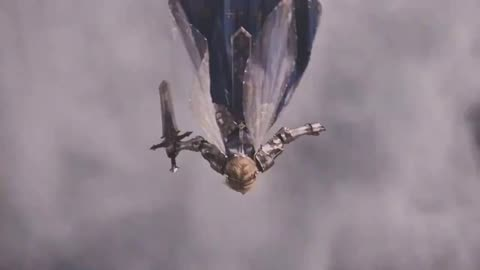</a>

将 11 秒按时间段拆分，每段写明各自的机位运动（俯拍下坠、正面跟拍、特写），再用独立的风格、镜头和动作段落补充约束。结尾列出负面约束，防止镜头切换时脸部、肢体和鸟的数量出错。

Seedance 2.5 · 文生视频 · 出处: [@Noor_ul_ain43 on X](https://x.com/Noor_ul_ain43/status/2097879315912552864) · 发现于 [LearnPrompt/awesome-seedance](https://github.com/LearnPrompt/awesome-seedance)

[`dark-fantasy`](tags.md#tag-dark-fantasy) [`multi-shot`](tags.md#tag-multi-shot) [`timed-segments`](tags.md#tag-timed-segments) [`armor-warrior`](tags.md#tag-armor-warrior)

<details><summary><b>提示词</b></summary>

```text
Create an 11-second cinematic dark-fantasy scene featuring a beautiful blonde female warrior queen wearing intricate medieval silver-and-black metallic armor and a delicate dark crown.

SCENE 1 — 0–3 seconds:
Begin with a dramatic top-down aerial shot. The warrior is flying/falling through thick stormy clouds with her arms stretched outward like she is diving through the sky. Her long blonde hair and pieces of her clothing move naturally in the powerful wind. Far below, a vast fantasy landscape is barely visible through the mist. The camera rapidly moves downward toward her while maintaining a powerful cinematic perspective.

SCENE 2 — 3–5 seconds:
Transition smoothly into a frontal tracking shot as she moves through the clouds. Her armored shoulders and arms remain extended. Her expression is serious, fearless and emotionally intense. Soft sunlight breaks through the clouds behind her, creating a dramatic halo around her silhouette. Tiny particles and mist pass rapidly across the camera lens.

SCENE 3 — 5–9 seconds:
Cut into an extreme cinematic close-up of her face. A huge majestic black raven/eagle suddenly flies beside her face, its dark feathers contrasting against her pale skin and blonde hair. The bird moves extremely close to her, almost touching her cheek. Feathers are released into the air and float dramatically around them. She looks directly ahead with an intense, mysterious expression.

SCENE 4 — 9–11 seconds:
The bird slowly moves away while she turns her head toward it. Her expression changes subtly from determination to curiosity and emotion. Wind continues moving her hair and armor naturally. The background remains filled with bright clouds and atmospheric mist.

VISUAL STYLE:
Epic high-budget fantasy film, photorealistic CGI, dark medieval fantasy, dramatic natural lighting, realistic metallic armor, highly detailed skin and hair, volumetric clouds, atmospheric fog, floating feathers, realistic bird movement, cinematic depth of field, subtle film grain, anamorphic lens characteristics, rich shadows, dramatic contrast, sophisticated color grading.

CAMERA:
Smooth aerial tracking, fast cinematic push-in, gradual transition to extreme close-up, shallow depth of field, realistic handheld micro-movement during the close-up, carefully controlled focus pulls, cinematic composition.

MOTION:
Natural wind physics, realistic hair movement, physically accurate feathers, believable bird flight, flowing fabric, subtle facial expressions and eye movement. No exaggerated or cartoonish motion.

MOOD:
Mysterious, powerful, emotional, majestic, supernatural and epic — like a scene from a premium dark-fantasy feature film.

Maintain consistent facial identity, anatomy and armor throughout the entire video. No face distortion, no extra limbs, no duplicated bird, no unnatural body movement, no text, no subtitles, no watermark.
```

</details>

<a id="seedance-baby-dragon-afro-cottage-comedy"></a>
### 小龙用魔法火焰把少女变成爆炸头

<a href="https://x.com/mehwishkiran07/status/2113088659658612746"></a>

提示词把场景写成连续的节拍（开场、变身、反应、复原、依偎），每一拍都配有明确的运镜，从龙眼极近特写到缓慢拉远。风格、光线、画质和音频分块书写，音效对应变身时刻，让喜剧效果和氛围保持一致。

Seedance 2.5 · 文生视频 · 出处: [@mehwishkiran07 on X](https://x.com/mehwishkiran07/status/2113088659658612746) · 发现于 [LearnPrompt/awesome-seedance](https://github.com/LearnPrompt/awesome-seedance)

[`fantasy`](tags.md#tag-fantasy) [`dragon`](tags.md#tag-dragon) [`comedy`](tags.md#tag-comedy) [`multi-shot`](tags.md#tag-multi-shot) [`cinematic`](tags.md#tag-cinematic)

<details><summary><b>提示词</b></summary>

```text
A magical, heartwarming fantasy scene inside a cozy medieval cottage with rustic wooden walls, a stone fireplace, flickering candles, and warm golden sunlight streaming through a small window. A beautiful young woman with long, wavy blonde hair, fair skin, and expressive blue eyes wears a simple cream-colored medieval dress. Beside her is an adorable small fantasy dragon with pale pink-white scales, soft pink spines, tiny wings, a long tail, and large glowing amber eyes.

The scene begins with the young woman sitting beside the baby dragon near the fireplace, smiling affectionately as they gaze at each other. The camera slowly moves closer to the dragon's adorable face, highlighting its detailed scales, glossy amber eyes, and tiny nose. Suddenly, the little dragon playfully breathes a small burst of magical golden fire toward the woman's head, transforming her hair into an enormous, perfectly rounded, fluffy golden afro. Her appearance changes comically while her cream medieval dress remains unchanged. She looks completely stunned, adjusts her round glasses, and picks up a small hand mirror to examine her extraordinary new hairstyle. The baby dragon rolls onto its back, laughing and playfully flapping its tiny wings.

Next, the woman returns to her original appearance with long, flowing blonde hair and gently blows a kiss toward the baby dragon. The dragon responds by releasing a soft stream of sparkling golden magical light, creating a warm, glowing aura around her face. She smiles with wonder and delight, and the two share a tender, magical moment. Finally, she lovingly cuddles the baby dragon in her lap as it closes its eyes peacefully, resting its head against her while she gently strokes its pink spines.

Visual style: ultra-realistic cinematic fantasy, high-end CGI, photorealistic skin and hair, incredibly detailed dragon scales, expressive facial animations, realistic firelight, volumetric sunlight, floating magical particles, warm amber color grading, shallow depth of field, smooth camera movements, natural body language, emotional storytelling, whimsical humor, and a charming fairy-tale atmosphere.

Camera direction: begin with a medium two-shot, cut to an extreme close-up of the dragon's eyes, transition to a wide shot during the magical hair transformation, use reaction close-ups for comedic effect, and finish with a slow cinematic pullback showing the woman cuddling the sleeping dragon beside the glowing fireplace.

Lighting: warm fireplace illumination mixed with soft golden sunlight, realistic shadows, subtle highlights, and cinematic volumetric rays.

Quality: 4K, 24fps, highly detailed textures, smooth motion, consistent character designs, realistic physics, expressive emotions, seamless transitions, and professional cinematic composition.

Audio: gentle fireplace crackling, soft dragon chirps, a magical sparkling sound during the transformation, playful laughter, and peaceful fantasy background music. No subtitles, no text, no watermark.
```

</details>

<a id="seedance-baby-dragon-cottage-feeding"></a>
### 女子在石屋里偷偷喂养幼龙

<a href="https://x.com/Adnan_Ai2/status/2113451899013996748"></a>

开头的统一风格段落定下光线、镜头和颗粒感，随后四个带时间码的分镜由极特写推到全景，再回到温柔的特写。壁炉暖光与窗边冷光形成对比，湿润反光和细小血管等质感细节让幼龙显得真实。连续性说明和隐含的声音设计把它与前一段龙蛋诞生的剧情衔接起来。

Seedance 2.5 · 文生视频 · 出处: [@Adnan_Ai2 on X](https://x.com/Adnan_Ai2/status/2113451899013996748) · 发现于 [LearnPrompt/awesome-seedance](https://github.com/LearnPrompt/awesome-seedance)

[`dark-fantasy`](tags.md#tag-dark-fantasy) [`creature`](tags.md#tag-creature) [`multi-scene`](tags.md#tag-multi-scene) [`cinematic`](tags.md#tag-cinematic) [`timed-shots`](tags.md#tag-timed-shots)

<details><summary><b>提示词</b></summary>

```text
A warm, intimate scene continuing a dark-fantasy medieval drama, shot inside a rustic stone cottage interior with a prestige-television cinematic aesthetic — soft natural window light mixed with warm firelight, shallow depth of field, photorealistic creature texture work, handheld yet controlled camera movement, 16:9 widescreen, 24fps film grain, muted earthy color palette with warm amber accents.

**Scene 1 (0–6s):** Extreme close-up, low-angle shot on a rough-hewn wooden tabletop inside a dimly lit stone cottage. A small baby dragon — pale translucent pink skin, delicate frilled wing-like fins flaring from its head down its spine, large glossy dark eyes, soft rounded snout, and tiny sharp claws — crouches low on the table, sniffing curiously at a single gleaming gold coin resting in front of it. Faint dust motes drift through a shaft of soft light. Background softly blurred: a clay jug, a wooden bowl, and stone wall textures. The creature's skin has a faint wet sheen and subtle veining, anatomically detailed and grounded rather than cartoonish.

**Scene 2 (6–12s):** Wider shot reveals a young woman with long, dark, loosely tousled hair, wearing a cream lace-trimmed chemise beneath a dark woolen cloak, leaning across the wooden table toward the dragon. Her expression is tender, watchful, and slightly anxious — the look of someone hiding a secret and caring for it in private. A stone fireplace crackles warmly in the background, casting flickering amber light across the room, with a wrought-iron fire tool and hanging lantern visible nearby. A small leaded-glass window lets in cool grey daylight from the left, creating a natural contrast between warm interior firelight and cool exterior light.

**Scene 3 (12–20s):** The woman holds up a small torn piece of meat or bread between her fingers, offering it to the dragon. The baby dragon's eyes light up with eager attention; it opens its mouth to reveal small sharp teeth, its delicate wing-fins fluttering slightly with excitement, front claws gripping the wooden table as it leans forward to reach the food. Close-up alternating shots capture the dragon's playful, almost puppy-like eagerness and the woman's warm, affectionate half-smile as she watches it, clearly growing emotionally attached despite the danger of what the creature represents.

**Scene 4 (20–25s):** A final tender close-up — the dragon playfully snaps at the food, wings spreading slightly in excitement, while the woman smiles softly, her eyes reflecting the warm firelight. The mood is quiet, domestic, and secretly joyful, a brief moment of peace and bonding hidden away from the dangers of the outside world established in the earlier birth scene.

**Overall tone and continuity:** This is a direct continuation of the cave-birth dark-fantasy story — the same woman now secretly raising the dragon hatchling in hiding inside a humble medieval cottage, their bond deepening through small domestic moments like feeding. Visual continuity maintained: same character designs, same practical-effect creature texture (wet, fleshy, finely scaled, non-cartoonish), same muted cold-vs-warm cinematic color grading. Emotional core: forbidden maternal tenderness and quiet domestic intimacy contrasted against the creature's mythic, dangerous nature. Sound design implied: crackling fire, soft creature chirps/snorts, quiet ambient room tone. Aspect ratio 16:9, cinematic film grain, award-drama quality lighting and composition.
```

</details>

<a id="seedance-bedroom-awakening-giant-black-cat"></a>
### 卧室超自然觉醒与巨型黑猫

<a href="https://x.com/Zyrellix/status/2097594855946113177"></a>

30秒内容按分镜顺序逐拍写出：推镜、突然现身、房间崩裂、极特写、缓慢揭示并以黑猫特写收尾。结尾叠加体积光、尘埃粒子、发丝物理、浅景深等画面词，让写实特效质感保持一致。

Seedance 2.5 · 文生视频 · 出处: [@Zyrellix on X](https://x.com/Zyrellix/status/2097594855946113177) · 发现于 [LearnPrompt/awesome-seedance](https://github.com/LearnPrompt/awesome-seedance)

[`supernatural`](tags.md#tag-supernatural) [`fantasy`](tags.md#tag-fantasy) [`vfx`](tags.md#tag-vfx) [`cinematic`](tags.md#tag-cinematic) [`long-take`](tags.md#tag-long-take)

<details><summary><b>提示词</b></summary>

```text
Create a 30-second ultra-cinematic supernatural fantasy sequence, photorealistic, high-end Hollywood VFX quality.A young woman with long straight black hair and bangs sits in a warm, dimly lit bedroom at night, wearing elegant white pajamas. Start with an intimate close-up of her looking down, then slowly push the camera toward her face. She suddenly senses something strange and looks directly toward the camera.She raises both hands as if controlling an invisible supernatural force. The atmosphere becomes intense, subtle particles and dark energy begin swirling around her. Suddenly, a mysterious white-haired female character appears in the room at incredible speed. She has pale skin, short silver-white hair, sharp expressive eyes, and wears a white outfit. She moves with supernatural agility, rushing toward the camera while reaching forward.The room begins shaking violently. Furniture and objects vibrate, dust and debris float through the air. The ceiling suddenly cracks open with a powerful burst of brilliant white-blue supernatural light. Walls fracture dramatically, creating a huge opening that reveals the dark night sky https://t.co/WPqc9zA0ZI the dust settles, the white-haired character stands in the destroyed room, illuminated by the strange light. Cut to an extreme close-up of her face as she looks shocked and breathes heavily.Then slowly reveal a gigantic mysterious black cat standing in the darkness behind her. The cat is unnaturally large, extremely fluffy, with glowing yellow eyes and an intimidating supernatural presence.End on a dramatic close-up of the giant black cat staring directly into the camera.
Smooth cinematic camera movement, realistic facial expressions, detailed hair physics, realistic cloth movement, volumetric lighting, floating dust particles, dynamic debris, dramatic shadows, shallow depth of field, realistic VFX, film-quality color grading, seamless transitions, highly detailed environment, photorealistic, 4K, cinematic masterpiece.
```

</details>

<a id="seedance-black-sphere-rooftop-time-reversal"></a>
### 雨中未来城市上方的巨大黑色球体

<a href="https://x.com/codewithhajra/status/2094758907885355381">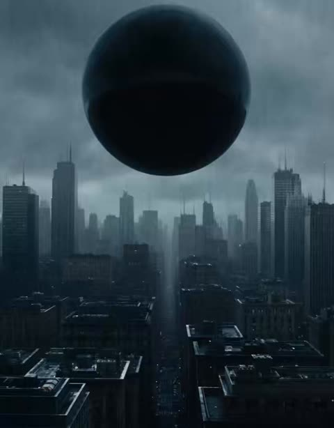</a>

提示词把10秒拆分为有先后顺序的节拍，并按顺序列出声音提示，让模型有清晰的时间线可依。固定的人物描述加上一致性要求，使特写镜头中的女主角保持稳定。

Seedance 2.5 · 文生视频 · 出处: [@codewithhajra on X](https://x.com/codewithhajra/status/2094758907885355381)

[`sci-fi`](tags.md#tag-sci-fi) [`cinematic`](tags.md#tag-cinematic) [`rain`](tags.md#tag-rain) [`sound-design`](tags.md#tag-sound-design)

<details><summary><b>提示词</b></summary>

```text
10 seconds, cinematic, ultra-realistic, photorealistic, colossal scale, no text, no logos. The black sphere pulses. The frozen city suddenly moves again. On a rooftop far below, a young woman in a dark futuristic raincoat stands completely still, drenched by the rain. She looks upward as the sphere begins opening like a gigantic black eye. Her hair and coat whip violently in the gravitational wind. She slowly raises one hand toward the sphere. Inside it, the tiny city begins moving backward through time—cars reverse, rain rises, broken buildings reconstruct themselves. The woman watches in disbelief as her own reflection appears inside the sphere. The reflection moves independently. The real woman lowers her hand. The reflection doesn't. It suddenly turns toward her and points behind her. She turns around. Every skyscraper in the city is now facing her, windows illuminating one by one in a massive wave.  The gravitational force suddenly intensifies. She is pulled across the rooftop toward the sphere, sliding through the rain. She grabs a massive steel structure, barely holding on as buildings around her stretch toward the black sphere.  Extreme close-up of her eyes. Inside her pupil, the entire futuristic city is reflected. Then the reflection reveals something impossible: another version of the woman standing directly behind her. A deep pulse. 

HARD CUT TO BLACK. Sound: violent rain → deep gravitational rumble → metallic tearing → sudden silence → one sharp breath → enormous sub-bass pulse. Character: realistic young woman, dark futuristic raincoat, wet hair, natural facial features, cinematic lighting, determined but frightened expression. Keep her visually consistent throughout the sequence
```

</details>

<a id="seedance-businessman-portal-dinosaur"></a>
### 商务人士被蓝色传送门拉入恐龙丛林

<a href="https://x.com/Elvorya/status/2105171530703413334">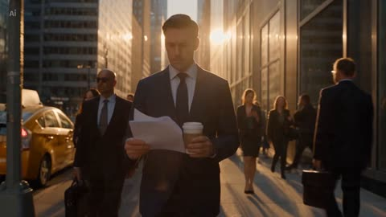</a>

用编号分镜并为每次转场写明镜头指令，让30秒剧情保持顺序。固定角色细节（西装、领带、咖啡杯、皮鞋）并重复身份约束，使同一人物贯穿每个切镜。

Seedance 2.5 · 文生视频 · 出处: [@Elvorya on X](https://x.com/Elvorya/status/2105171530703413334) · 发现于 [LearnPrompt/awesome-seedance](https://github.com/LearnPrompt/awesome-seedance)

[`fantasy`](tags.md#tag-fantasy) [`portal`](tags.md#tag-portal) [`dinosaur`](tags.md#tag-dinosaur) [`character-continuity`](tags.md#tag-character-continuity)

<details><summary><b>提示词</b></summary>

```text
Create a 30-second photorealistic cinematic fantasy adventure sequence following a sharply dressed businessman through an ordinary morning in a busy modern city. Begin with a warm golden-hour tracking shot moving through a downtown street surrounded by towering glass skyscrapers, yellow taxis, pedestrians, and long cinematic shadows → reveal the businessman wearing a dark navy suit, white shirt, and tie, calmly walking through the crowd while holding a takeaway coffee and papers → transition to a dynamic street-level shot as a woman accidentally bumps into him, causing papers, coffee, sunglasses, and pigeons to scatter dramatically through the air → cut to a cinematic close-up as he reaches toward the floating coffee cup while strange golden magical particles begin appearing around him → suddenly reveal the coffee cup surrounded by glowing blue magical energy as the entire city begins filling with swirling particles → transition into a dramatic low-angle shot looking upward between enormous skyscrapers as the atmosphere transforms into a powerful vortex of golden dust and blue energy → cut to a spectacular portal sequence as a huge glowing blue circular gateway opens and pulls the businessman through the air, his suit and tie reacting naturally to the force while he desperately holds onto his coffee → transition through the blue portal into a mysterious ancient rainforest filled with enormous trees, dense ferns, mist, moss-covered ground, and shafts of soft sunlight → reveal the businessman crashing onto the forest floor, still holding his coffee, then slowly standing up in confusion → suddenly cut to an intense close-up of a gigantic realistic T-Rex-like dinosaur emerging from the dense jungle and roaring directly toward him → transition into a fast dynamic tracking shot as the businessman runs across a massive fallen tree while the dinosaur charges aggressively behind him → cut to a spectacular wide shot of him sprinting across a rope suspension bridge above a raging jungle river as the enormous dinosaur follows him → transition into an action close-up as he grabs a hanging jungle vine and swings dramatically beside a massive waterfall while the dinosaur leaps across the gap behind him → final shot becomes a heroic cinematic wide-angle view of the businessman standing on a moss-covered rock in the prehistoric forest, calmly drinking his coffee while a brilliant glowing blue portal opens behind him, surrounded by mist, waterfalls, enormous trees, floating magical particles, and dramatic sunlight breaking through the canopy.

Visual style: ultra-photorealistic live-action fantasy adventure, premium Hollywood cinematography, realistic human character, realistic dinosaur creature, natural skin texture, physically accurate motion, cinematic depth of field, anamorphic lens, volumetric lighting, atmospheric fog, realistic water and particle effects, dramatic scale, smooth camera movement, high-detail environments, immersive cinematic realism, 4K quality.

Character continuity: keep the exact same businessman throughout the entire sequence, identical face, hairstyle, age, body proportions, navy suit, white shirt, tie, black shoes, and coffee cup; no identity drift, no wardrobe changes, no character redesign.

Negative prompt: cartoon, animation, stylized CGI, plastic skin, fake-looking human, identity drift, changing face, changing clothes, duplicate character, extra people appearing suddenly, deformed hands, extra fingers, extra limbs, distorted body, unrealistic dinosaur anatomy, floating objects, broken physics, jittery motion, excessive motion blur, warped buildings, artificial environment, low detail, oversaturated colors, text, subtitles, logos, watermark, UI elements.
```

</details>

<a id="seedance-clockmaker-freezes-workshop-time"></a>
### 钟表匠冻结工坊时间

<a href="https://x.com/AIwithZeeshi/status/2108412888415400315">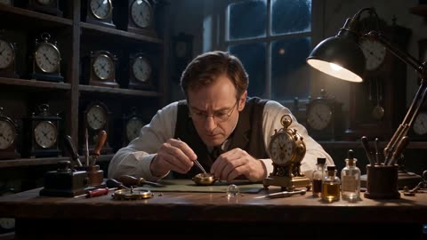</a>

提示词先完整列出真实世界的物理规则，再只设定一个超自然例外，因此重力、阴影和物体轨迹保持一致，只有时间效果打破规则。按向前、倒转、冻结、最后特写的顺序安排剧情节拍，让片段结构清晰。

Seedance 2.5 · 文生视频 · 出处: [@AIwithZeeshi on X](https://x.com/AIwithZeeshi/status/2108412888415400315) · 发现于 [LearnPrompt/awesome-seedance](https://github.com/LearnPrompt/awesome-seedance)

[`time-freeze`](tags.md#tag-time-freeze) [`workshop`](tags.md#tag-workshop) [`physics-exception`](tags.md#tag-physics-exception) [`camera-tracking`](tags.md#tag-camera-tracking)

<details><summary><b>提示词</b></summary>

```text
A middle-aged clockmaker is repairing an antique pocket watch in his old-fashioned workshop at night when he discovers a mysterious clock that controls time.

He carefully turns its brass winding crown backward, causing a nearby pendulum to slow down, falling dust to become suspended in the air, and the second hands of surrounding clocks to stop moving.

He turns the crown forward, and everything resumes its natural motion. Fascinated, he turns it backward again, gradually freezing time throughout the workshop while he remains able to move.

The video ends with a cinematic close-up of the mysterious clock as its second hand continues ticking in an otherwise motionless room.

Photorealistic cinematic fantasy, realistic mechanical gear interactions, believable pendulum physics, natural gravity and inertia, consistent character appearance, realistic brass reflections, warm workshop lighting, physically accurate shadows, natural human movement, smooth camera tracking, realistic depth of field, and continuous object trajectories throughout. The supernatural time-control effect is the only exception to real-world physics.
```

</details>

<a id="seedance-cyberpunk-phoenix-tea-transformation"></a>
### 身着藏青旗袍的女子在日落茶室品茶

<a href="https://x.com/laviniavelle/status/2107709472944906671">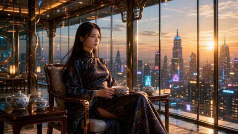</a>

提示词按镜头顺序逐句描述，从茶杯特写开始，让蓝色能量凤凰从日常物件中升起，再过渡到服装变化。每个镜头都写明场景、动作以及结尾转身面向镜头，为模型提供清晰的分镜锚点。

Seedance 2.5 · 文生视频 · 出处: [@laviniavelle on X](https://x.com/laviniavelle/status/2107709472944906671)

[`cyberpunk`](tags.md#tag-cyberpunk) [`transformation`](tags.md#tag-transformation) [`energy-phoenix`](tags.md#tag-energy-phoenix) [`rooftop-leap`](tags.md#tag-rooftop-leap)

<details><summary><b>提示词</b></summary>

```text
Cinematic 8K video sequence, 30 seconds An elegant East Asian woman in a dark navy cheongsam sits in a luxury high rise tea room at golden hour sunset overlooking a city Close up of her teacup as steam forms a glowing blue spectral energy phoenix that emerges from the tea. The light phoenix enters her chest, swirling blue energy transforming her dress into sleek black cyberpunk tactical armor She stands on a skyscraper rooftop at night surrounded by neon billboards, flying vehicles and floating particles She sprints and leaps off the rooftop edge stepping onto a glowing blue energy platform mid air to leap across the city Lands gracefully on another high rooftop as a massive blue energy phoenix spreads its wings behind her before she turns to face the camera.
```

</details>

<a id="seedance-cyberpunk-skyscraper-freefall-neon-dive"></a>
### 赛博朋克摩天楼坠落穿越霓虹都市

<a href="https://x.com/itsshara_ai/status/2100435410338144486"></a>

用一个连续长镜头讲一个清晰动作，先跃下再以第一人称视角向下俯冲。全息广告牌、紫粉霓虹招牌和雨后反光路面这些具体视觉锚点带来速度感与纵深，结尾用几个风格关键词收束。

Seedance 2.5 · 文生视频 · 出处: [@itsshara_ai on X](https://x.com/itsshara_ai/status/2100435410338144486) · 发现于 [LearnPrompt/awesome-seedance](https://github.com/LearnPrompt/awesome-seedance)

[`cyberpunk`](tags.md#tag-cyberpunk) [`freefall`](tags.md#tag-freefall) [`neon-city`](tags.md#tag-neon-city) [`pov`](tags.md#tag-pov) [`one-take`](tags.md#tag-one-take)

<details><summary><b>提示词</b></summary>

```text
A dark figure leaps from a skyscraper ledge and free-falls through a neon-drenched cyberpunk cityscape at night. Massive holographic billboards and glowing purple and pink signage streak past as the camera plunges downward in a vertigo-inducing POV dive. Rain-slicked surfaces reflect neon light below. High-speed freefall, cyberpunk noir atmosphere, vertiginous depth.
```

</details>

<a id="seedance-dark-fantasy-sword-ritual-cathedral"></a>
### 受伤女子在哥特大教堂石地上撑起身体

<a href="https://x.com/itsSaira_1/status/2110223060066521421">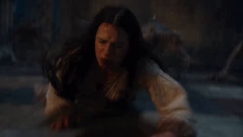</a>

采用分镜编号结构，每个镜头单独给出景别、光线和氛围，让模型在一次生成中按顺序切换场景。负面提示词用于压制卡通、低模和现代服装等偏差。

Seedance 2.5 · 文生视频 · 出处: [@itsSaira_1 on X](https://x.com/itsSaira_1/status/2110223060066521421)

[`dark-fantasy`](tags.md#tag-dark-fantasy) [`shot-sequence`](tags.md#tag-shot-sequence) [`gothic`](tags.md#tag-gothic) [`sword-ritual`](tags.md#tag-sword-ritual)

<details><summary><b>提示词</b></summary>

```text
Sequence of shots for a dark fantasy cinematic video:

[Shot 1] 
Close-up cinematic shot of a wounded woman with long dark hair, wearing a blood-stained white medieval gown, struggling and pushing herself up on the stone floor of a dark gothic cathedral, moody atmosphere, dramatic lighting, 8k resolution.

[Shot 2] 
Cinematic shot of a woman plunging a glowing magical sword into the stone floor, creating a bright red glowing fiery magical sigil circle expanding rapidly across the ground, dark fantasy style, smoke, epic visual effects.

[Shot 3] 
Cinematic wide shot inside a gothic cathedral, revealing a towering mystical entity in a dark hooded cloak framed by massive rotating concentric golden rings filled with glowing eyes, epic fantasy atmosphere, dramatic lighting, 8k.

[Shot 4]
Action-packed cinematic shot of terrifying demonic monsters roaring and moving aggressively in a dark gothic cathedral, surrounded by smoke, debris, and bursts of magical fire, dark fantasy film style.

Negative prompt: 
blurry, low quality, distorted, deformed, extra limbs, bad anatomy, modern clothing, bright cheerful colors, cartoon, 3d animation, low-poly.
```

</details>

<a id="seedance-dragon-bedside-three-reference-roles"></a>
### 龙低头靠近烛光床上的女子

<a href="https://x.com/ZentrixHQ/status/2109579827565015394">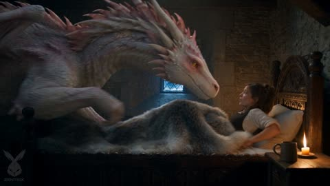</a>

每张参考图只指定一个用途：图 1 提供女子的脸、发型和服装，图 2 提供成年龙，图 3 提供幼龙。结尾一句把幼龙的珍珠白与粉色配色、琥珀色竖瞳和粉色冠羽与成年龙绑定，让两条龙看起来是同一种生物的不同体型。

Seedance 2.5 · 参考生视频 · 出处: [@ZentrixHQ on X](https://x.com/ZentrixHQ/status/2109579827565015394)

[`character-consistency`](tags.md#tag-character-consistency) [`reference-images`](tags.md#tag-reference-images) [`dragon`](tags.md#tag-dragon) [`multi-reference`](tags.md#tag-multi-reference)

<details><summary><b>提示词</b></summary>

```text
Use image 1 for the young woman's face, hair and outfit. Use image 2 for the adult dragon. Use image 3 for the baby dragon. The baby dragon has exactly the same pearl-white and pink color, amber slit-pupil eyes and pink-tipped crest as the adult dragon.
```

</details>

<a id="seedance-dragon-medieval-kitchen-cooking"></a>
### 白龙加入中世纪村庄烹饪

<a href="https://x.com/ZoyaAi_/status/2113998714842779948"></a>

六个五秒分镜按时间推进，从全景到龙眼特写再回到全景。固定的人物与龙外观描述，加上独立的风格、镜头、音频和格式要求，让30秒片段保持一致。

Seedance 2.5 · 文生视频 · 出处: [@ZoyaAi_ on X](https://x.com/ZoyaAi_/status/2113998714842779948) · 发现于 [LearnPrompt/awesome-seedance](https://github.com/LearnPrompt/awesome-seedance)

[`fantasy`](tags.md#tag-fantasy) [`dragon`](tags.md#tag-dragon) [`multi-shot`](tags.md#tag-multi-shot) [`cinematic`](tags.md#tag-cinematic) [`photorealistic`](tags.md#tag-photorealistic)

<details><summary><b>提示词</b></summary>

```text
AI Video Prompt 👇

Create a 30-second ultra-realistic cinematic fantasy video set in a rustic medieval village kitchen, featuring a young blonde woman with braided hair, wearing a cream blouse and a dark brown apron, alongside a magnificent white dragon with pale pink spikes, glowing amber eyes, and highly detailed scales.

Scene 1 (0–5 seconds): A wide establishing shot of the woman preparing food at a rustic wooden table outside a medieval cottage. A giant white dragon slowly approaches her from behind, curiously observing the food. Warm golden sunlight streams through the village, creating a magical atmosphere.

Scene 2 (5–10 seconds): Close-up of the dragon's glowing amber eye as it opens its mouth and breathes a powerful burst of fire toward the cooking area. The woman reacts with shock and quickly moves away from the flames. Sparks, smoke, and realistic fire effects fill the scene.

Scene 3 (10–15 seconds): The woman uses a metal pan to control the cooking fire while the dragon watches with curiosity. Smoke rises dramatically as the dragon lowers its enormous head beside her, creating a funny yet cinematic moment.

Scene 4 (15–20 seconds): Inside a cozy medieval kitchen illuminated by flickering candlelight, the woman carefully prepares a piece of roasted meat on a wooden table. The giant white dragon rests its head beside her, watching every movement with intense curiosity. Use intimate close-ups and warm amber lighting.

Scene 5 (20–25 seconds): The woman holds a small flame near the dragon's snout. Capture an extreme close-up of its beautiful golden eye reflecting the firelight. She tastes the freshly cooked meat, smiles, and gestures approvingly toward the dragon.

Scene 6 (25–30 seconds): The woman and the dragon share a playful, heartwarming moment beside the dinner table. The dragon gently lowers its enormous head toward her while she continues eating. End with a wide cinematic shot of the medieval kitchen, warm candlelight, rustic wooden furniture, and the dragon curling around the room.

Visual Style: Photorealistic fantasy, Hollywood-level CGI, cinematic composition, realistic dragon anatomy, highly detailed skin and scales, natural facial expressions, physically accurate fire and smoke, volumetric lighting, shallow depth of field, smooth camera movements, dramatic close-ups, warm golden color grading, realistic textures, 4K quality.

Camera: Smooth tracking shots, wide establishing shots, extreme close-ups, slow cinematic push-ins, and seamless transitions.

Audio: Natural kitchen ambience, crackling fire, subtle dragon breathing and growls, sizzling meat, and cinematic fantasy background music.

Format: 16:9 widescreen, 30 seconds, 24 FPS, consistent character design, consistent dragon appearance, no text, no subtitles, no logos, no watermarks.
```

</details>

<a id="seedance-dragon-rider-pov-ocean-dive"></a>
### 第一人称视角骑乘巨龙俯瞰海崖

<a href="https://x.com/frametheory058/status/2087007818721423855">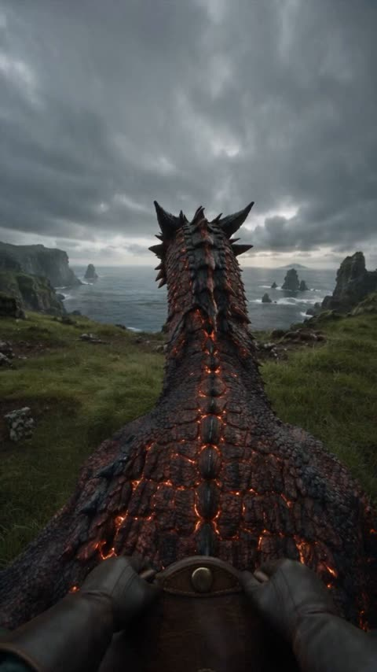</a>

镜头以骑手身上的第一人称视角书写，并列出手套、护腕、链条缰绳和钉饰马鞍等装备，让摄像机贴合身体运动。按时间段拆分动作，每个阶段都配有对应的配乐和音效，使画面从平静、起飞到水下寂静再到浮出水面，节奏清晰连贯。

Seedance 2.5 · 文生视频 · 出处: [@frametheory058 on X](https://x.com/frametheory058/status/2087007818721423855)

[`dragon`](tags.md#tag-dragon) [`pov`](tags.md#tag-pov) [`ocean`](tags.md#tag-ocean) [`sound-design`](tags.md#tag-sound-design)

<details><summary><b>提示词</b></summary>

```text
Create a 30-second vertical 9:16, 24fps, 8K-quality photorealistic live-action fantasy sequence from a first-person rider POV. A massive original obsidian-crimson dragon with individually detailed scales, subtle dark mottling, molten-gold eyes, volcanic-black swept-back horns, blade-like dorsal fins, burgundy-red translucent wings and faint ember-like fissures across its body. Rider wears black leather gloves, dark-green sleeves and weathered leather bracers, holding heavy chain reins from a worn brown studded saddle.

Begin with the dragon calmly breathing on a wet emerald coastal cliff; it slowly turns toward camera and the rider gently pets its neck. Suddenly it lowers its body, launches across the grass and leaps from the cliff. Dive steeply toward the grey-green ocean, deploy huge wings with realistic membrane movement, then skim just above the water with spray hitting the lens. Perform a dramatic high-speed bank around a sea stack, then plunge directly underwater. Brief dark-teal underwater silence with bubbles and faint crimson glow, followed by a powerful eruption through the ocean. Finish with a calm glide above foggy water as the dragon slowly turns and looks toward the rider.

Use physically accurate anatomy, weight, gravity, wing aerodynamics, water physics, scale deformation, wind and environmental interaction. Natural rider-mounted camera movement, realistic motion blur, lens droplets, focus breathing, subtle handheld vibration, cinematic depth of field, soft overcast lighting, HDR, restrained film grain and natural cinematic color grading.

Audio: atmospheric drone → intimate cello → rising orchestral tension → massive launch/flight score → intense percussion during the bank → muffled underwater audio → epic orchestral return during emergence → soft cello/piano ending. Layer detailed ASMR/SFX: dragon breathing, scales, leather, reins, claws scraping soil, wind, wingbeats, water spray, bubbles, ocean impact and a deep natural dragon roar.

Make it indistinguishable from expensive real live-action cinema. No AI look, cartoon, anime, game CGI, plastic textures, fake physics, neon glow, oversaturation, distorted anatomy, extra limbs, text or watermark.
```

</details>

<a id="seedance-dragon-roasts-turkey-medieval-cottage"></a>
### 巨龙在中世纪村舍旁烤火鸡

<a href="https://x.com/Arzoo12sh/status/2113215535706198293"></a>

六个分镜都标明精确的秒数区间,每个镜头各有动作,从全景建立镜头到眼睛微距再到日落收尾。结尾的风格段和负面提示词让角色与火焰保持一致。

Seedance 2.5 · 文生视频 · 出处: [@Arzoo12sh on X](https://x.com/Arzoo12sh/status/2113215535706198293) · 发现于 [LearnPrompt/awesome-seedance](https://github.com/LearnPrompt/awesome-seedance)

[`fantasy`](tags.md#tag-fantasy) [`dragon`](tags.md#tag-dragon) [`multi-shot`](tags.md#tag-multi-shot) [`photorealistic`](tags.md#tag-photorealistic) [`cinematic`](tags.md#tag-cinematic)

<details><summary><b>提示词</b></summary>

```text
**Prompt: The Dragon and the Roasted Turkey**

Create a 27-second photorealistic cinematic fantasy film set in a medieval countryside. A young woman wearing a simple cream-colored medieval dress stands outside a rustic stone cottage with a thatched roof. Beside her is a large pale pink and white dragon with detailed scales, golden reptilian eyes, and expressive facial movements.

**Scene 1 (0–5 seconds):** Wide establishing shot of the medieval cottage and grassy countryside. The woman holds a raw turkey on a long metal spit while the curious dragon leans forward, opens its mouth, and breathes a powerful stream of fire.

**Scene 2 (5–10 seconds):** The fire fills the frame, transitioning into a close-up of a rugged, dirt-covered young woman with messy blonde hair and an intense expression. Use dramatic lighting, realistic skin texture, and cinematic shallow depth of field.

**Scene 3 (10–15 seconds):** Cut back to the cottage. Several raw turkeys, fresh herbs, butter, and cooking ingredients are arranged on a rustic wooden table. The woman prepares the food while the dragon watches closely.

**Scene 4 (15–22 seconds):** Extreme close-up of the dragon breathing controlled blue flames toward the turkey on the metal spit. The turkey gradually transforms from raw to golden-brown, crispy roasted meat. Show realistic sizzling fat, detailed skin texture, subtle smoke, and the woman carefully rotating the spit.

**Scene 5 (22–25 seconds):** Macro close-up of the dragon's magnificent golden eye, followed by a cinematic shot of a knife slicing through the perfectly roasted turkey, revealing juicy meat and crispy skin.

**Scene 6 (25–27 seconds):** Warm sunset lighting. The dragon gently lowers its enormous head toward the woman, and she affectionately touches its snout. End with a beautiful fantasy-film composition.

**Visual style:** Ultra-photorealistic fantasy cinema, realistic dragon anatomy, highly detailed scales, natural human expressions, physically accurate fire simulation, volumetric smoke, cinematic camera movements, 35mm film look, shallow depth of field, natural countryside atmosphere, dramatic lighting, seamless transitions, consistent characters, 4K detail, 16:9 aspect ratio.

**Negative prompt:** Cartoon, anime, plastic textures, low resolution, distorted faces, extra limbs, inconsistent characters, flickering, unnatural fire, duplicate objects, text, subtitles, logos, watermarks.
```

</details>

<a id="seedance-dragon-steals-dinner-fantasy-comedy"></a>
### 小龙偷吃晚餐的中世纪农舍喜剧

<a href="https://x.com/itxabdullaa/status/2109603859513712776"></a>

先用固定的角色和场景段落锁定外观，再把 30 秒按时间段拆成节拍，每段只有一个运镜和一个笑点。结尾的音频清单逐项写明音效、配乐和台词。

Seedance 2.5 · 文生视频 · 出处: [@itxabdullaa on X](https://x.com/itxabdullaa/status/2109603859513712776) · 发现于 [LearnPrompt/awesome-seedance](https://github.com/LearnPrompt/awesome-seedance)

[`fantasy`](tags.md#tag-fantasy) [`comedy`](tags.md#tag-comedy) [`dragon`](tags.md#tag-dragon) [`multi-shot`](tags.md#tag-multi-shot) [`native-audio`](tags.md#tag-native-audio)

<details><summary><b>提示词</b></summary>

```text
30 SECONDS | 16:9 | 30 FPS

Cinematic fantasy short film, photorealistic detail, warm golden-hour light, rich film color grading, shallow depth of field, smooth camera movement, natural motion blur, heartwarming comedy.

CHARACTERS:

1. A young woman with messy wavy blonde hair, thin round glasses, a cream linen blouse with rolled sleeves, and a dark brown pinafore apron dress. Expressive, funny, warm face.
2. Her enormous, horse-sized pet baby dragon with white-cream scales covered in pink-magenta patterns, soft pink crest spikes, huge amber eyes with vertical pupils, and a gentle snout. Mischievous, affectionate, puppy-like behavior.

SETTING: Rustic medieval cottage courtyard with a stone oven, wooden table, hanging herbs, stacked firewood, low stone wall, and rolling green hills. Cozy kitchen interior with wooden furniture, candles, and golden sunlight.

0–3s: EXTREME CLOSE-UP: a perfectly roasted, juicy piece of meat hangs from a skewer inches from the woman's mouth. Suddenly, a giant pink-patterned dragon tongue shoots into frame and steals it. Whip-pan to the woman frozen mid-bite, mouth open in disbelief. The dragon chews innocently behind her.

3–6s: She slowly turns toward the dragon, raises one accusing finger, and demands her dinner back. The dragon's enormous amber eyes widen. It swallows dramatically. A tiny puff of smoke escapes its nostrils.

6–9s: The dragon suddenly hiccups. A violent burst of fire shoots upward, igniting the laundry hanging above the courtyard. The woman screams and dives for a bucket as flaming clothes rain down around them.

9–12s: Fast tracking shot: she splashes water everywhere, slips on the wet stones, and lands sitting in a wooden laundry basket. The dragon rushes over to help, accidentally knocking the basket across the courtyard with its snout.

12–15s: The basket stops against the stone wall. She emerges with tangled laundry draped over her head like a ridiculous royal crown. The dragon tilts its head, then gives her an enormous affectionate lick across the face. She wipes her cheek, trying desperately not to laugh.

15–18s: CUT TO THE KITCHEN. She places a tiny piece of meat on a skewer and holds it up like a strict cooking instructor. The dragon sits obediently beside her, wings tucked in, eyes fixed on the food. She demonstrates a tiny flame with her fingers.

18–21s: MACRO CLOSE-UP: the dragon carefully releases the smallest flame imaginable. The meat sizzles perfectly. Its amber eye reflects the golden fire. The woman beams with pride and gives a thumbs-up.

21–25s: She proudly places the cooked meat on a plate. Before she can taste it, the dragon delicately picks up the entire plate with its tongue and swallows everything in one gulp. Silence. The woman's smile disappears.

25–30s: WIDE SHOT: the dragon immediately curls up beside her, resting its enormous head in her lap and purring like a giant cat. She stares at the camera in exhausted disbelief, then scratches behind its pink crest. The dragon closes its eyes happily. She mutters, “Tomorrow, we're eating vegetables.” The dragon opens one eye, horrified. HOLD on her wicked grin.

STYLE: Premium cinematic fantasy, lifelike textures, believable dragon anatomy, natural facial expressions, detailed scales, realistic fire and steam, warm amber light, expressive comedic timing, polished theatrical-quality storytelling. No plastic CGI appearance, no exaggerated cartoon physics except the dragon's playful personality.

AUDIO: Gentle fantasy folk music with strings and flute, sudden comedic music stops, wet tongue swipe, loud swallow, fiery hiccup, crackling flames, splashing water, wooden basket scraping, dragon purrs, expressive laughter, and clear natural dialogue. End with a short comedic musical sting. #ImagineArt
```

</details>

<a id="seedance-elf-girl-mirror-underwater-whale"></a>
### 惊恐的精灵少女侧头望向雾气森林

<a href="https://x.com/Just_sharon7/status/2088970274075246774"></a>

三张参考图各自只负责一项，脸部、服装和场景分开锁定，镜头切换时身份与场景保持一致。回头动作写成头部与眼睛同时转向约45度，而非看向镜头；结尾用两次硬切夹住第一人称视角镜头，并保持取景完全相同。

Seedance 2.5 · 参考生视频 · 出处: [@Just_sharon7 on X](https://x.com/Just_sharon7/status/2088970274075246774) · 发现于 [LearnPrompt/awesome-seedance](https://github.com/LearnPrompt/awesome-seedance)

[`character-sheet`](tags.md#tag-character-sheet) [`multi-reference`](tags.md#tag-multi-reference) [`pov-insert`](tags.md#tag-pov-insert) [`underwater`](tags.md#tag-underwater)

<details><summary><b>提示词</b></summary>

```text
SCENE CONTEXT A girl Image flees something unseen through a glowing forest, trips, falls — and finds an antique mirror that yanks her through into an underwater city. There, mid-float before the great shell palace, she turns her head — a flash of POV shows a colossal mouth opening onto her — and back in the wide frame the whale is already closing its jaw and gliding calmly away. 24 seconds, full realism. ACTIVE REFERENCES — STRICT ROLE HIERARCHY Image HER EXACT FACE — sole source of her identity and features, 100% match, zero drift: a 20-year-old , 163 cm, slim and lightly built. Soft rounded oval face; warm light-beige skin with a golden undertone and real photographic texture — visible pores, small freckles and tiny beauty marks across the cheeks and nose bridge; dark blue almond eyes with a shallow partially hidden upper-lid crease and soft under-eye fullness; thick dark straight brows with individual hairs brushed upward; a small neat nose with narrow straight bridge and softly rounded tip; full lips with a defined cupid's bow, the lower lip fuller, natural rosy tone; softly rounded jaw tapering to a small chin; small silver hoop earrings. Ignore this reference's hair, clothing, car interior and lighting. Face identity comes from this reference in every single frame. Image : CHARACTER SHEET — controls everything: long voluminous wavy blonde hair past the shoulders; neat elven ears with slender pointed tips; a white billowy medieval linen shirt deep plunging scoop neckline that reveals significant cleavage., with puffed sleeves; a brown leather underbust corset; fitted sage-green trousers; tall brown leather boots; brown leather gloves; a forest-green wool hooded cloak clasped at the collar. Does NOT control the face. Image FOREST LOCATION — a misty magical forest: narrow dirt path, giant glowing red mushrooms casting warm orange light, pink flowers, mossy trunks, drifting fog. 100% matches the reference. Image : UNDERWATER CITY LOCATION — the plaza: a colossal ribbed nautilus-shell palace with glowing golden seams, pearl shell houses with warm windows, god rays from above, jellyfish and drifting sea life. 100% matches the reference. FORMAT MODE One continuous shot from 0:00 to 0:19, then TWO HARD CUTS in the finale: a fast POV insert and a return to the previous framing. No fades, no dissolves. Full realism. HER BACKWARD GLANCE — HOW IT MUST LOOK, STRICT Whenever she checks behind her, she does NOT turn toward the camera and does NOT look into the lens. She rotates her head roughly 45° to ONE SIDE and her EYES GO THE SAME WAY her head goes — looking off toward that side of frame, into the fog, then snapping forward again. BANS: no over-the-shoulder look at the lens, no eye contact with the camera, no 180° head turn. SHOT 1 — 0:00–0:01.5 — HER FEET, LOW AND CANTED LOW, near ground level, canted hard — Dutch tilt ~20–25° — framing her BOOTS and lower legs sprinting along the path: soil bursting, cloak hem cracking, mushroom stalks brushing aside, path streaking in motion blur. Handheld, jolting with her rhythm; the pursuer heard far behind in the fog. SHOT 2 — 0:01.5–0:03 — HER FACE, FRIGHTENED Unbroken move: the frame rises and pushes in to her FACE — a tight running close-up travelling with her, still canted, hair whipping. Raw fear: wide eyes, brows drawn, mouth gasping, dirt on her cheek. Twice she performs the 45° glance as specified, eyes going the same way as her head, searching the fog off to that side; then forward again. SHOT 3 — 0:03–0:05 — THE TRIP, WIDE Unbroken: the frame swings out to a WIDE shot of the path — full figure, mushrooms towering, fog closing the depth. Mid-glance her leading boot CATCHES a root — the foot stops dead, momentum throws her forward, and she goes down hard in full view: knees, then hands and shoulder into the dirt, dust and leaf litter bursting up, cloak flying over her. She lands sprawled, chest heaving. SHOT 4 — 0:05–0:09 — THE MIRROR SHE ALMOST IGNORES Unbroken: the camera drifts in from the front, then around to her side, settling into profile with her and the mirror in frame. Fear first, curiosity second: sprawled, she checks behind with the 45° head-and-eyes turn; the crashing is closer. She scrambles up, barely looking ahead — then registers an ornate antique MIRROR against a mossy trunk, filled with cold blue glow unlike the warm mushroom light. Brushing dirt off her sleeve with ONE hand, her eyes stay on the glass. THE MIRROR DOES NOT REFLECT: her reflection NEVER appears, no mirror image of her, no reflection of the forest — the glass is a window filled with its own inner light: fog thinning into deep watery blue, faint caustics, vague luminous silhouettes far in the depth, no sharp image. The blue washes her face. ACTING TASK — HER CHOICE (the work happens in her eyes): glass → a 45° glance into the fog behind → glass again; she registers that nothing of HER answers her movement in it; no time to solve it. She extends ONE FINGER toward the surface. (Safety: gaze always engaged; natural blink cadence.) SHOT 5 — 0:09–0:11 — THE YANK: UNDER A SECOND Her fingertip nears the glass. The light FLARES — the surface SNAPS outward like a whip and SEIZES her hand. INSTANT: she is RIPPED off her feet, jerked forward along her outstretched arm, body whipping horizontal in a single frame, head-first through the glass, boots torn off the ground last, cloak cracking behind her. No build-up, no float — limp as a ragdoll, the mirror doing ALL of it, vector purely FORWARD through the glass plane. Camera: caught off guard WITH her — it WHIPS sideways-and-forward, slings around behind her flying body and punches through the rippling surface on her heels; water and bubbles SLAM across the lens, forest colors ripped into deep blue. NOT her POV. SHOT 6 — 0:11–0:16 — ARRIVAL IN THE PLAZA Same shot, no cut — camera behind her. THE FIRST UNDERWATER FRAME IS THE ARRIVAL FRAME: the portal exits DIRECTLY INTO the plaza of <<<image_4>>>; the colossal nautilus palace is ALREADY in frame, its ribbed pearl wall with glowing golden seams filling the background, sharp and close; shell houses with warm windows border both sides. NO TRAVEL, no approach — the water BRAKES her within a meter or two. HER BODY: horizontal, HEAD-FIRST, back toward the surface, fully passive — arms loose, LEGS STILL AND MOTIONLESS, no kicking, no strokes; thrown cargo, not a swimmer. UNDERWATER PHYSICS, HIGHEST PRIORITY: hair streaming backward in rippling seaweed-like strands, cloak dragging in a heavy water-loaded wave; on stopping, hair and cloak drift forward past her shoulders by inertia. She pivots from horizontal to upright — feet swinging down, legs hanging relaxed — settling into weightless float facing the palace wall. HER HAIR AT REST, STRICT: no parting, no combed order — a loose free-floating mass fanning outward and upward from her whole head, strands crossing over her crown in constant slow chaotic motion, never symmetrical, never still. The cloak billows wide, breathing with the water. SHE CANNOT BREATHE UNDERWATER: cheeks slightly puffed, lips pressed, holding her breath. Bubbles rise from her mouth in small silver clusters climbing upward past her face. ACTING TASK: to ORIENT beneath something impossibly huge — her attention pulls UPWARD: head climbing the glowing houses, up the palace wall, chin lifting, trying to find where the spiral ends. Jellyfish pulse between the houses. SHOT 7 — 0:16–0:19 — SETTLE INTO THE MEDIUM PROFILE FRAME Same shot, no cut. The camera drifts smoothly from behind her around to her side and settles into the framing that holds for the rest of the film: FRAMING LOCK — MEDIUM PROFILE: she is seen from her LEFT SIDE in a medium shot, CHEST-UP ONLY — never full-body, never small in frame; her head and shoulders occupy the lower-left third, elven ear tip clear, hair a floating dark halo, white puffed sleeve and green cloak reading in the frame's bottom, one gloved hand extended forward. Behind and above her, filling the whole background, the giant glowing spiral nautilus palace; pearl shell houses along the lower edge; god rays raking down from the surface; a jellyfish drifting at frame-left; her bubbles rising past her face. She hangs weightless with the faintest sway. SHOT 8 — 0:19–0:21 — SHE TURNS HER HEAD (SAME FRAME) No cut, camera locked in the FRAMING LOCK. She turns her head sharply to look off toward frame-LEFT — a fast, alarmed head turn, eyes going the same direction, brows snapping up, a startled burst of bubbles ripping from her mouth. Her shoulder tenses; nothing else of her moves. She is still only chest-up in frame; the whale is NOT visible yet. HARD CUT. SHOT 9 — 0:21–0:22.5 — POV: THE MOUTH OPENS ON US FIRST-PERSON POV FROM HER EYES — fast and brutal: filling the entire frame, the colossal whale's head rushes in from the left, and the vast baleen MOUTH OPENS WIDE — grooved pale throat pleats stretching, a dark glowing cavern spreading until it swallows the frame edge to edge; water and bubbles ripping past the lens; the scale absolute, the opening several times larger than a human body. Quick — a second and a half, no lingering. The frame goes to the mouth's darkness. HARD CUT. SHOT 10 — 0:22.5–0:24 — BACK TO THE SAME FRAME: THE WHALE MOVES ON Return to the EXACT FRAMING LOCK of Shot 7–8 — same camera position, same background: the glowing spiral palace, the shell houses, the god rays. The girl is no longer there; only her last scattered bubbles rising where she floated. The colossal whale is already in frame with its JAW CLOSED, gliding calmly from LEFT to RIGHT across the plaza — placid, unhurried, indifferent, as if it simply fed on the way past. Its enormous flank sweeps close past the lens: dark iridescent mother-of-pearl skin shifting purple-green-blue like oil on water, scattered glowing teal rings and dotted bioluminescent lines, a tall webbed translucent dorsal fin with visible veining, pectoral and tail fins extending into long flowing translucent ribbon-streamers rippling like silk. TRUE WHALE LOCOMOTION: all thrust from the TAIL — deep lateral sweeps bending the rear third of the body, an S-wave of muscle rolling down the flanks head-to-tail on every beat, mass shifting under the skin, head steady on course, ribbon-fins streaming back like wings. Living muscle, never a rigid sculpture on rails. Its wake rocks the jellyfish and scatters her bubbles. It exits frame-RIGHT. Final beat: the empty plaza, the palace glowing, bubbles dispersing, water settling. END. Exactly ONE creature in the finale, the same individual in the POV and in the return frame — no second creature, no duplicate. No grabbing, no chewing, no thrashing, no blood, no gore — the horror is entirely scale. PHYSICS Forest: real running biomechanics, the head-turns costing her balance, the trip stopping the foot dead while momentum carries her over, a genuine three-point fall, real bodyweight in the scramble up. The yank: whip-crack acceleration, body limp, purely forward. Underwater: everything obeys water — drag on limbs and fabric, slow rebound, no dry-hair or dry-cloth behavior in any frame; the whale moves with true mass and inertia, its bow wave visibly displacing water, bubbles and jellyfish; the jaw opens and closes with weight, not like a trap. LIGHTING Forest: warm orange mushroom glow against cool misty air; the mirror's cold blue the only competing source. Underwater: cool blue depth light with god rays, warm golden light from the shell houses and the palace's glowing seams; caustic ripples crawling over her skin, the white sleeve and the whale's flank; the open mouth in the POV reading as a deep shadowed cavern with faint light only on the throat pleats. Natural exposure, no stylization. MATERIALS Real skin with pores and freckles; individual hair strands, dry and flying in the forest, water-loaded and undulating below; real linen weave, leather grain, heavy wool cloak with true water weight; real soil, moss and mushroom flesh; pearl shell with subsurface glow; the whale's iridescent hide with subsurface shift, skin folds and grooved throat pleats, translucent fin membranes. No plastic skin, no CG sheen. AUDIO — SFX ONLY, NO MUSIC 0:00–0:05: pounding footsteps, ragged breathing, cloak snapping, DISTANT crashing branches and a low guttural monster call rolling through the fog; the trip — scuff, body impact, gasp. 0:05–0:09: panicked breathing, scrambling in dirt, forest ambience, a rising crystalline hum near the glass. 0:09–0:11: a sharp liquid CRACK, one violent water-rush WHOOSH, bubbles slamming the lens; forest sound cutting off dead. 0:11–0:19: muffled underwater ambience, soft bubble streams, distant whale-like calls, faint clicks, a deep resonant hum from the palace. 0:19–0:22.5: a startled bubble burst; a deep swelling RUMBLE from the left; in the POV a roaring water-rush and the wet groan of the opening jaw. 0:22.5–0:24: one soft heavy WHOMP settling, then calm rhythmic tail SWISH, the flank's water-rush passing the lens, fading right into churning wake and settling ambience. No score, no melody anywhere. POSITIVE CONSTRAINTS Continuous shot 0:00–0:19; then exactly TWO HARD CUTS: into the POV insert and back out to the identical framing. No other cuts anywhere. FRAMING LOCK: from 0:16 to the end (except the POV insert) the camera holds the same medium profile framing — she is CHEST-UP, seen from her left side, lower-left of frame, with the glowing spiral palace filling the background. She is never shown full-body in this section, never small in frame, and the camera never moves. The finale order is exact: she turns her head left (chest-up, whale not visible) → HARD CUT to her POV of the mouth opening wide, fast → HARD CUT back to the same framing where the jaw is already closed and the whale glides calmly left to right and exits. Her glances in the forest: ~45° head turns with eyes going the same direction; never toward the lens. The forest pursuer is NEVER shown — distant sound only. The mirror NEVER reflects her or the forest — a lit window, not a reflective surface. Underwater she never swims — legs still and motionless throughout; the palace fills the background from the first underwater frame, no travel. Her hair underwater is a chaotic free-floating mass — never parted, never neat, never still. Face 100% <<<image_1>>> every frame, zero drift; hair, elven ears, wardrobe 100% <<<image_2>>>; forest 100% <<<image_3>>>; plaza and palace 100% <<<image_4>>>. No grabbing, chewing, blood or gore; exactly ONE creature; she is not visible after the POV cut, only her bubbles. Full realism — no animated look, no illustration, no CG gloss, no plastic surfaces. Clean image: no grain, no vignette. She is the only person. No text, no logos, no watermarks. OPTICS STRONG anamorphic lens character: horizontal squeeze and compression, oval elliptical bokeh, horizontally stretched highlights, curved barrel edge distortion, chromatic aberration toward the edges. NO lens flares, NO light streaks, NO floating bokeh circles. Shot 1: canted 20–25°, low on boots. Shot 2: focus locked on her face. Shot 3: wide, deep focus. Shots 4–5: her face and the mirror's glow. Shots 6–8: her in medium profile against the palace, caustics softening the depth. Shot 9 (POV): ultra-wide immersive perspective, the mouth filling the frame. Shot 10: the flank sharp as it sweeps past the lens.
```

</details>

<a id="seedance-grandma-tanuki-morning-market-shopping"></a>
### 奶奶与巨型狸猫的清晨市场采买

<a href="https://x.com/Just_sharon7/status/2103503970815930610"></a>

把50秒拆成带时间戳的分镜，每段写明镜头运动、关西腔台词和英文字幕。每个镜头逐字重复角色描述以锁定形象，结尾用统一的风格与环境音锁定段落收束。

Seedance 2.5 · 文生视频 · 出处: [@Just_sharon7 on X](https://x.com/Just_sharon7/status/2103503970815930610) · 发现于 [LearnPrompt/awesome-seedance](https://github.com/LearnPrompt/awesome-seedance)

[`cinematic`](tags.md#tag-cinematic) [`multi-shot`](tags.md#tag-multi-shot) [`dialogue`](tags.md#tag-dialogue) [`subtitles`](tags.md#tag-subtitles) [`character-consistency`](tags.md#tag-character-consistency)

<details><summary><b>提示词</b></summary>

```text
Photorealistic AAA cinematic short, GTA-style urban energy: saturated colors, punchy contrast, dynamic camera (low heroic angles, smooth tracking, brief crane and push-ins), rich environmental detail, slightly larger-than-life character presence, filmic grain, sharp fur and fabric simulation. Duration exactly 50 seconds. Natural morning light mixed with colorful market stall canopies. Busy, funny, lively tone. English subtitles at the bottom. Japanese dialogue in a warm elderly Kansai-accented female voice for the grandmother.  CAST (use these exact descriptions every time they appear): - An elderly Japanese grandmother (short gray hair in a loose bun, wrinkled kind face, purple-pink floral vest over a patterned blouse, dark pants) - A giant tanuki (raccoon-dog), about 6.5 feet tall standing on hind legs, thick brown-grey fur, round belly, mischievous dark-ringed eyes, wearing a slightly stained vendor apron, walking upright like a person - A tiny brown sparrow perched on the grandmother’s shoulder - A grumpy middle-aged Japanese fishmonger in a rubber apron  ---  0:00–0:07 — ESTABLISHING   Wide crane shot descending into a crowded Japanese open-air morning market. Fish stalls, vegetable crates, hanging flowers, steam, shouting vendors, bicycles, plastic bags. Camera finds an elderly Japanese grandmother (short gray hair in a loose bun, wrinkled kind face, purple-pink floral vest over a patterned blouse, dark pants) walking into the market carrying an empty basket. A tiny brown sparrow is already perched on her right shoulder. She looks delighted and a little overwhelmed.  Dialogue (grandmother):   「今日は安うてええ日やわ。」   Subtitle: “Prices are good today. Dangerous for me.”  ---  0:07–0:16 — FISH STALL**   Medium tracking shot. An elderly Japanese grandmother (short gray hair in a loose bun, wrinkled kind face, purple-pink floral vest over a patterned blouse, dark pants) stops at a fish stall piled with ice and silver fish. The grumpy fishmonger slaps a huge fish onto the scale. The tiny sparrow hops down, pecks a piece of dried squid, and flies back to her shoulder. She notices and gently scolds it without real anger.  Dialogue (grandmother):   「あんたまた盗んでるやないの。恥ずかしいわ。」   Subtitle: “You little thief. That’s embarrassing.”  The fishmonger frowns.   Fishmonger: 「ばあさん、そんなに持って帰れんやろ。」   Subtitle: “Grandma, you can’t carry all that.”  ---  **0:16–0:28 — TANUKI ARRIVES AND BARGAINS**   Low heroic angle. The crowd parts. A giant tanuki in a vendor apron walks upright through the aisle, heavy and confident, GTA-style presence. He stops beside an elderly Japanese grandmother (short gray hair in a loose bun, wrinkled kind face, purple-pink floral vest over a patterned blouse, dark pants), looks at the fishmonger’s price, then slaps a paw on the counter.  Tanuki (deep, playful male voice):   「その値段、冗談やろ。半分でええやろ。」   Subtitle: “That price? You’re joking. Half.”  The fishmonger argues, then reluctantly nods. The giant tanuki grins. An elderly Japanese grandmother (short gray hair in a loose bun, wrinkled kind face, purple-pink floral vest over a patterned blouse, dark pants) covers her mouth, laughing.  Dialogue (grandmother):   「もう、あんたまで出てこんでもええのに。」   Subtitle: “You didn’t have to jump in… but thank you.”  ---  0:28–0:40 — CARRYING EVERYTHING   Smooth side-tracking shot through the busy market. The giant tanuki now carries two overflowing wooden crates of fish, vegetables, and flowers on his shoulders like it’s nothing. An elderly Japanese grandmother (short gray hair in a loose bun, wrinkled kind face, purple-pink floral vest over a patterned blouse, dark pants) walks beside him, still holding her small basket. The tiny sparrow keeps darting down to steal small snacks from open stalls and returning to her shoulder. Shoppers stare and smile. Dynamic market chaos in the background: steam, shouting, hanging lanterns, wet pavement reflections.  Dialogue (grandmother, amused):   「箱二つも買うんやったらええ加減にせな。肩の子も手伝いすぎや。」   Subtitle: “Two crates is too much. And you on my shoulder, stop helping so much.”  ---  0:40–0:50 — FINAL BEAT   The trio stops at the edge of the market near a narrow street. The giant tanuki sets the crates down carefully, then stands proud with paws on his hips. Close-up of an elderly Japanese grandmother (short gray hair in a loose bun, wrinkled kind face, purple-pink floral vest over a patterned blouse, dark pants) looking up at him, then at the tiny sparrow on her shoulder. She reaches up and gently taps the sparrow’s head, then pats the tanuki’s massive forearm.  Dialogue (grandmother, soft and affectionate):   「ほんま、困った相棒やわ。けど…助かった。帰ろか。」   Subtitle: “What a pair of troublemakers. …Still, you saved me. Let’s go home.”  Final shot: slow push-in. The giant tanuki picks the crates up again. An elderly Japanese grandmother (short gray hair in a loose bun, wrinkled kind face, purple-pink floral vest over a patterned blouse, dark pants) walks ahead. The tiny sparrow settles on her shoulder as they leave the colorful market toward the street. Hold 1.5 seconds, then cut to black.  ---  TECH / STYLE LOCKS   GTA AAA cinematic look: vibrant market colors, strong sunlight shafts through stall roofs, wet ground reflections, dense extras, slightly exaggerated scale on the giant tanuki, ultra-detailed fur, realistic plastic bags and ice, handheld-feeling but stabilized tracking. No text except the English subtitles. Ambient sound: vendors shouting, ice being shoveled, sparrows, footsteps, distant traffic. Keep the grandmother’s appearance identical in every shot using the exact description above.
```

</details>

<a id="seedance-hell-maglev-commute-descent"></a>
### 拥挤通勤列车从城市一路驶向地狱

<a href="https://x.com/Ciri_ai/status/2089939087201558754">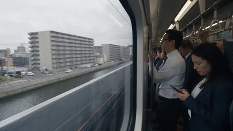</a>

按秒数划分的节拍，配合固定车厢内景和左侧车窗视角，使旅程在物理上连贯，每个新场景都是上一段行程的自然结果。远处人声先于火光出现、结尾广播收束等声音线索推动情绪递进。

Seedance 2.5 · 文生视频 · 出处: [@Ciri_ai on X](https://x.com/Ciri_ai/status/2089939087201558754) · 发现于 [LearnPrompt/awesome-seedance](https://github.com/LearnPrompt/awesome-seedance)

[`first-person`](tags.md#tag-first-person) [`smartphone-footage`](tags.md#tag-smartphone-footage) [`sound-design`](tags.md#tag-sound-design) [`timed-beats`](tags.md#tag-timed-beats)

<details><summary><b>提示词</b></summary>

```text
One continuous 30-second chaotic amateur first-person smartphone video filmed by a standing passenger inside a completely packed magnetic-levitation commuter train. Single unbroken take with no cuts, jump cuts, dissolves, crossfades, double exposures, portals, morphing or artificial scene transitions. The train begins as an ordinary weekday commute on Earth and then physically travels downward on an impossible journey — through subway tunnels into bedrock, into a colossal void beneath the crust, past a soot-blackened waiting platform, through an immense eroded gate, out above a burning plain, down the terraced wall of a vast pit, and into the inhabited depths of Hell. Everything must feel physically connected, as though the same train is genuinely travelling down through each environment.
The tone is bureaucratic dread, not horror-movie shock. This is a scheduled service. The route is old, the infrastructure is worn, and the train runs it the way it runs any other line. The horror comes from how ordinary the journey is and how enormous the destination turns out to be.
The interior is a completely packed standing-room-only maglev commuter car. Passengers are pressed shoulder-to-shoulder, gripping overhead straps and vertical poles. Backpacks are squeezed between bodies, coats and loose clothing shift with acceleration, straps swing on their inertia, and the entire carriage constantly vibrates and rattles. The camera is a cheap smartphone held at chest height by one standing passenger who grips a pole with the other hand. The phone itself is NEVER visible because the phone is the camera. The framing is crooked, slightly off-centre, partially blocked by shoulders and arms, and imperfect like genuine accidental footage. The camera constantly shakes, rolls, yaws and gets thrown around by acceleration. Use realistic rolling-shutter distortion, autofocus hunting, exposure pumping, blown highlights, crushed noisy shadows, low-bitrate compression, macroblocking and smeared motion blur. It must look like genuine spontaneous smartphone footage, not professional cinematic footage.
The camera always looks through the LEFT-SIDE WINDOWS at approximately 90 degrees to the train's direction of travel. The train always travels forward and the outside world always streams past the windows from front-to-back. Never switch to a forward-facing train-nose view. Never show the front of the train. The same carriage, same passengers, same poles, same straps and same windows remain visually consistent throughout the entire journey. The interior is the constant realistic anchor while the outside world becomes increasingly impossible.
0 to 3 seconds. Begin with an ordinary overcast weekday commute on an elevated urban line. Grey apartment blocks, rooftop water tanks, a scrapyard, overhead wires, a canal and traffic on a road below streak past the left windows at different distances with realistic parallax. The passengers are tired and mostly uninterested — some on phones, some staring out, some talking quietly. A calm public-address chime sounds and an announcer quietly says, "Next stop: Hell." Nobody reacts. One passenger glances up briefly and goes back to their phone. The train accelerates and everyone instinctively tightens their grip as the carriage gives a hard lateral jolt.
3 to 6 seconds. The line drops into a cutting and then into a tunnel. Tiled subway walls, cable runs, service lights and a passing platform strobe across the windows in hard bands of light and dark, throwing the carriage into stuttering illumination. The tunnel ages as the train descends: modern concrete becomes older brickwork, then rough-cut stone. The fittings become scorched and soot-caked — blackened signal lights, corroded brackets, cabling burnt down to bare metal. This route has been running a long time. The gradient steepens noticeably; passengers lean back against the pitch and the straps hang visibly off-vertical.
6 to 9 seconds. The tunnel wall becomes raw geology and the train is now clearly descending through the crust at impossible speed. Through the left windows the rock face streaks past in visible strata — pale limestone, dark shale, red iron-stained bands, seams catching the carriage light. The air begins to heat and passengers loosen collars. Then, under the mechanical roar, a sound arrives before anything is visible: a vast, distant, continuous mass of human voices, far away and heavily reverberant, never resolving into individual words. It is not loud. It is simply there, and it does not stop. Two passengers look at each other. Nobody says anything.
9 to 11.5 seconds. The rock wall falls away entirely and the train emerges into a void larger than a city, with no visible far side. It runs along a ledge on the wall; below the windows the space drops away into darkness. Stone columns kilometres tall stand in the void with strong parallax — near ones sweeping past, distant ones barely shifting. Far below and far ahead, a faint orange glow is already visible. It must already exist in the frame from this moment and grow continuously from here forward without ever popping or suddenly enlarging. The voices are louder here, spread across an enormous space. One passenger near the glass leans forward slightly. Another quietly says, "Ohh."
11.5 to 14 seconds. The train passes a station. A soot-blackened platform is cut into the rock wall — worn edge, dead lamps, faded markings unreadable under the grime — and figures are standing on it in an orderly queue, waiting, facing the track, completely motionless. They are seen for less than a second at speed, as dark shapes against the platform light, never close enough to read faces. The train does not slow. Nobody boards. The platform is gone behind the carriage. This is the moment the passengers understand. Several stop looking at their phones. Embers begin drifting upward past the windows from below.
14 to 16 seconds. Ahead, a wall crosses the entire void — a single continuous barrier extending beyond sight in both directions and upward past the ceiling. The train passes through an immense gateway cut into it, an arch hundreds of metres tall, its stone eroded smooth by an unimaginable volume of traffic, its carved markings worn past legibility. For half a second the carriage is in the shadow of the arch and everything goes dark. Then it is through, and the light on the far side is completely different: warm, hard, and coming from below.
16 to 19 seconds. The train races above a burning plain. Outside the left windows: a vast crusted expanse of dark solidified ground cracked into slow-moving plates with brilliant orange fissures running between them, distant fountains of molten material rising and falling in slow motion because of their true scale, and smoke columns standing kilometres high. Running across it are raised stone causeways, and on the causeways are crowds — dense, continuous, moving slowly, all in the same direction, extending to the limit of visibility. They are seen only as masses at distance, never in detail. The light entering the carriage is now dominant and hard, throwing sharp orange edges on faces, poles and straps with deep black shadows behind them. The interior air is visibly hazy. The voices are constant.
19 to 21 seconds. The plain ends at the rim of a colossal pit — a shaft so wide the far wall is only a suggestion in the haze. The train races over the edge and begins descending along the interior wall. The wall is terraced: enormous concentric ledges receding downward, each deeper and darker than the last, disappearing into smoke layers. The descent acceleration pushes the passengers down and forward against the poles. Ash begins striking the windows and streaking backward.
21 to 23 seconds. The terraces are populated. Endless slow processions move along every ledge, strings of figures following the curve of the wall down into the smoke and out of sight, lit from below by the fires beneath them. There is no chaos in it — it is orderly, patient and entirely without end, which is worse. Furnace mouths open in the rock face, glowing white at their throats, and long queues stand before them. Everything is at distance. Nothing is close enough to resolve. The light entering the carriage takes on a deeper red and the fluorescents are overwhelmed. Passengers nearest the window press slightly closer to the glass.
23 to 25 seconds. Enormous shapes move among the terraces — figures many times the height of the crowds around them, walking slowly along the ledges, their scale established only by comparison. They do not look at the train. Distant winged forms cross beneath the carriage at low altitude with slow heavy wingbeats appropriate to their size and vanish into the smoke. Stone pens and barred openings are cut into the wall in their thousands, receding into the haze like housing. Ash accumulates in the corners of the windows. The carriage is hot enough that the glass fogs and clears in waves.
25 to 27 seconds. The train reaches the deep layer and the full extent of Hell reveals itself. It is not a city on a human plan and it is not a cavern. It is a continuous inhabited geology extending in every direction — towers of black stone fused into cliff faces, vaults hollowed out of the rock at cathedral scale, rivers of molten material running in cut channels between districts and falling in slow luminous cataracts to levels further down, bridges spanning gaps kilometres across, and everywhere on all of it, crowds. Smoke columns rise for kilometres and flatten against unseen ceilings. Every level is lit by its own fires. The train races along a ridge line through the middle of it; arches and aqueduct spans pass overhead and terraces stream past below the window with violent parallax. It is impossible to see where any of it ends.
27 to 29 seconds. The depths continue past the windows. The camera struggles badly with the contrast, blowing out the fires and crushing everything else into noise. Ash cakes the corners of the glass. Passengers are pressed against the windows in total silence, faces lit from below in hard orange, expressions stunned and completely still. One person quietly whispers, "What is that?" Nobody answers. Autofocus hunts between the ash on the glass and the world beyond it.
29 to 30 seconds. The fires end. The train passes out of the smoke and the lowest region opens — and it is not burning. It is a vast frozen plain stretching beyond the visible horizon, an impossibly wide sheet of dark grey ice, absolutely still, lit by nothing but a faint pale glow from within itself. Shapes are visible held motionless within it, spaced far apart, receding to the horizon, never shown in detail. Every exterior sound stops at once — the voices, the fires, everything — leaving only the carriage. The heat drops out and frost blooms instantly across the outside of the windows. The scale feels planetary. The passengers stare in complete silence. At approximately 29.7 seconds the calm PA voice says quietly, "Welcome to Hell." The train continues moving. The camera keeps shaking naturally as the frozen expanse extends endlessly beyond the left window.
Lighting
The lighting must evolve naturally throughout the journey. Begin with flat overcast daylight around 6500K. In the tunnels use harsh strobing bands from passing service lights against near-total dark, then let the sources become sparse until the carriage's own weak fluorescent tubes are the only illumination. In the void the interior lights fall off into nothing. Then introduce a growing warm orange from below — first a faint wash on the lower half of faces, then mixing with the cold interior white, then completely dominating it: hard, high-contrast, sharp-edged, with deep black shadows. Above the burning plain it should be strong enough to blow out the phone's sensor at the window. In the deep layer it becomes red-orange and omnidirectional from countless fires at every distance. In the final second all warm light vanishes and is replaced by a faint pale luminance from the ice, cold and almost sourceless. All exterior light must enter naturally through the LEFT-SIDE WINDOWS and fall across passengers' faces and clothing at every stage. Do not add artificial interior lighting to create the colours.
Passengers
Keep all passengers completely ordinary throughout the journey. Realistic skin texture, subtle capillary variation, natural blinking, breathing, eye movement and imperfect facial symmetry. Clothing has realistic folds and responds to acceleration. Passengers must continuously perform small independent movements: shifting weight, adjusting grip, loosening a collar in the heat, wiping fog from the glass, turning their heads, tightening their hands around poles. Do not make them freeze. Do not make everyone react at the same moment. Do not let them perform dramatic acting.
Their emotional progression is subtle: indifference at the announcement → mild confusion in the tunnels → unease when the voices arrive → the exact moment of understanding as the waiting platform passes → dread on the descent → complete stunned silence in the depths. No screaming. Only one soft "Ohh" at the first glow and one whispered "What is that?" near the end. The most powerful reaction is no reaction — just faces pressed against the glass, lit from below by something that should not exist.
Physics
The train always travels forward and always downward after the tunnel. Passengers sway according to acceleration and lean against the gradient; straps hang off-vertical on the descents. Loose clothing reacts to movement. Exterior objects have different velocities and distances with strong realistic parallax at every stage — near stone columns sweep past, mid-distance terraces move steadily, distant districts barely shift. Ash and embers must move independently of the train, drifting upward on thermal currents rather than streaming with the carriage. Heat must be expressed physically: window fogging and clearing, haze inside the carriage, frost at the very end. Enormous figures and flying forms must move slowly, because they are enormous. Nothing teleports, nothing freezes, nothing suddenly appears, and nothing changes position without physical cause.
No transitions
There are absolutely no visual transitions. No dissolves, crossfades, portals, morphing or ghosted overlays. Every environment change happens because the train physically travels into the next environment. The city becomes a cutting, the cutting becomes a tunnel, the tunnel becomes bedrock, the bedrock opens into the void, the void contains the waiting platform, the void ends at the wall, the gateway gives onto the burning plain, the plain ends at the pit rim, the rim becomes a terraced descent, the terraces fill with processions, the processions become the full inhabited depths, and the depths open onto the frozen plain. It must feel like one physically continuous impossible journey where every step is the inevitable consequence of the step before it.
Audio
Audio must be entirely diegetic with no music. Use cheap compressed smartphone microphone quality. The train produces a constant deep maglev roar, mechanical clatter, rattling poles, vibrating windows, swinging straps and low-frequency carriage rumble, plus passenger breathing and clothing movement. In the tunnels add hard reverberant slap-back and pressure changes as the train passes openings.
The defining sound of this video is the voices. They must arrive at 6 to 9 seconds, before anything is visible, as a distant continuous mass of human voices with enormous reverberation, never resolving into words and never rising to screaming. From that point they never stop. They grow with depth and spread across a wider stereo field as the spaces open up. Beneath them, a very low frequency resonance builds steadily, felt more than heard. Above the burning plain add a broad distant roar and irregular deep concussions at long intervals. Ash strikes the hull as fine irregular ticking. In the depths the voices are vast, layered at many distances, and mixed with immense indistinct industrial-scale sound that never resolves into detail.
In the final second every exterior sound stops at once — total silence outside, leaving only the carriage, the passengers' breathing, and ice creaking against the hull. At approximately 29.7 seconds the calm PA voice says quietly, "Welcome to Hell."
Style and content limits
The overall style must remain dirty photorealistic amateur smartphone footage despite the spectacular environments. Vertical 9:16, real-time speed, no slow motion, no stabilisation, no cinematic camera, no perfect composition, no clean VFX presentation. Use heavy shadow noise, blown highlights, low-bitrate compression, rolling-shutter skew, autofocus hunting, auto-exposure pumping, smeared motion blur and crooked framing. The camera should occasionally be partially blocked by a shoulder, arm or nearby passenger, and should struggle badly with the extreme contrast between fire and darkness.
Hell is conveyed through scale, architecture, crowds at distance, fire, ash and sound. Do not show suffering, injury, bodies, blood, restraints or any graphic content. Every figure outside the train stays a distant silhouette or part of a mass — none is ever close enough for its face or condition to be read. Do not use recognisable religious iconography or legible text of any kind; all markings are eroded past legibility. Do not make it look like a game cinematic or a clean VFX render. The world outside should be overwhelming and physically impossible, but the recording itself must look raw, accidental and believable.
The most important rule
ONE SINGLE CONTINUOUS TAKE. No cuts, no jump cuts, no dissolves, no crossfades, no scene resets and no artificial transitions. The same train, same passengers and same camera remain present from beginning to end. The orange glow must be visible as a faint distant smudge from the first cavern and grow continuously and inevitably until it fills the window. The voices must arrive before the fire and never stop until the final second. The heat must build physically across the whole descent so that its total disappearance at the end lands as a shock. The population must emerge gradually — the waiting platform, then crowds on the causeways, then processions on the terraces, then the full inhabited depths — never appearing all at once. End while the train is still moving, the frozen plain extending endlessly beyond the left window, passengers silent, carriage still shaking, the PA announcement fading into the sound of ice.
```

</details>

<a id="seedance-hijab-girl-duckling-moonlit-village"></a>
### 头巾女孩与小鸭在月夜村庄漫步

<a href="https://x.com/Zyrellix/status/2106604455151980846">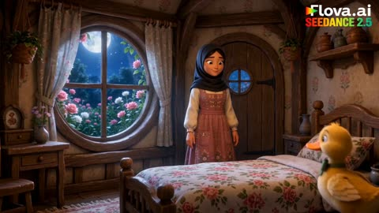</a>

角色锚点先行（黑色头巾、玫瑰粉连衣裙、黄色小鸭、棕色小兔），随后按卧室、村庄、大树的顺序推进场景，每个镜头的地点都很清楚。结尾的风格词列出光影与渲染术语（柔和月光、暖色灯笼光、皮克斯风格3D动画），无需参考图即可定下画风。

Seedance 2.5 · 文生视频 · 出处: [@Zyrellix on X](https://x.com/Zyrellix/status/2106604455151980846) · 发现于 [LearnPrompt/awesome-seedance](https://github.com/LearnPrompt/awesome-seedance)

[`character-consistency`](tags.md#tag-character-consistency) [`moonlight`](tags.md#tag-moonlight) [`3d-animation`](tags.md#tag-3d-animation) [`fairy-tale`](tags.md#tag-fairy-tale)

<details><summary><b>提示词</b></summary>

```text
A magical 3D animated fairy-tale scene featuring a young girl wearing a black hijab and a beautiful vintage rose-pink dress, accompanied by a cute fluffy yellow duckling and a tiny brown rabbit. Inside a cozy cottage bedroom, moonlight shines through a round window filled with pink roses. The duckling and rabbit join the girl as she picks up a glowing lantern and opens the wooden cottage door. They walk together through a charming village under a bright full moon, surrounded by thatched-roof cottages, blooming roses, glowing fireflies, and a beautiful starry sky. The girl gently kneels beside the adorable animals near a giant magical tree with a tiny round wooden door glowing warmly from within. Cinematic camera movements, expressive characters, detailed textures, soft moonlight, warm lantern lighting, vibrant colors, whimsical fantasy atmosphere, smooth character animation, consistent character designs, high-quality Pixar-style 3D animation, enchanting storytelling, 16:9 widescreen, 4K quality.

#FlovaAI #CPP
```

</details>

<a id="seedance-lightning-warrior-ruined-battlefield-30s"></a>
### 闪电战士在废墟战场劈开现实

<a href="https://x.com/itxabdullaa/status/2106702315239686628"></a>

把30秒按0到5秒、5到10秒等时间段切开，每段只推进一个节拍，从火花、追击到空间撕裂再归于寂静。结尾用排除清单（不要动漫、不要盔甲、不要换装）加上物理优先的风格句，保持画面写实、角色前后一致。

Seedance 2.5 · 文生视频 · 出处: [@itxabdullaa on X](https://x.com/itxabdullaa/status/2106702315239686628) · 发现于 [LearnPrompt/awesome-seedance](https://github.com/LearnPrompt/awesome-seedance)

[`dark-fantasy`](tags.md#tag-dark-fantasy) [`action`](tags.md#tag-action) [`lightning`](tags.md#tag-lightning) [`timeline-prompt`](tags.md#tag-timeline-prompt) [`photorealistic`](tags.md#tag-photorealistic)

<details><summary><b>提示词</b></summary>

```text
16:9 • RAW DOCUMENTARY PHOTOREALISM • LIVE-ACTION IMAX/HDR • REALISTIC PHYSICS

A dark-fantasy warrior with long disheveled black hair, cold expression, tattered gray-white scarf, shattered dark cloak and white-gray outfit awakens an abandoned battlefield.

0–5s: A tiny white-blue spark triggers the entire environment. Stones vibrate, cracks spread, invisible pressure bends the air, and a colossal thunderstorm ring forms overhead.

5–10s: Shadow distortions hunt him. He explodes into motion—wall runs, aerial redirects, lightning-charged impacts and massive shockwaves destroy the ruins. Black smoke afterimages trail every movement.

10–15s: He moves across falling debris at impossible speed. Multiple motion afterimages surround the battlefield before collapsing back into him, compressing into one devastating lightning strike.

15–20s: The battlefield transforms into a rotating storm cage. Debris, dust, fabric and lightning orbit him. Everything suddenly compresses inward as a giant spatial crack opens behind him.

20–27s: He launches into the fractured dimension, moving through floating ruins with punches, elbows and aerial strikes. All accumulated energy converges into a tiny, hyper-dense white-blue thunderstorm sphere.

27–30s: Absolute silence. One spark. His eyes open. He unleashes the WORLD-SPLITTING STRIKE—a colossal white-blue shockwave tears through reality, followed by a black-and-white spatial implosion.

Cut back to the ruined battlefield. He stands alone, dust falling, scarf moving in the residual wind. One final spark crosses his cheek.

STYLE: Extremely fast, agile, physically grounded combat. Dense semi-transparent lightning, black smoke/shattered-shadow afterimages, air distortion, debris interaction and violent wind pressure. No anime, no superhero CGI, no modern tech, no guns, no armor, no dialogue, no text, no subtitles, no logos, no face/hairstyle/costume changes. Continuous escalation from mystery → pursuit → impossible movement → environmental destruction → spatial rupture → silence.
```

</details>

<a id="seedance-maglev-time-travel-history-pov"></a>
### 智能手机视角：磁悬浮列车窗外的现代城市

<a href="https://x.com/noorlewisx/status/2093928767152701852">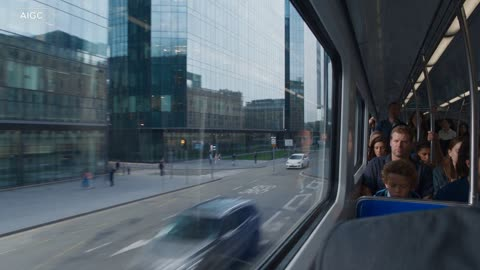</a>

提示词固定了第一人称手持手机的镜头、同一节车厢和左侧车窗，每次时代切换只靠广播、雾状隧道和光线变化完成。按秒划分的节拍加上列车始终向前的约束，让整段一镜到底的画面保持连贯。

Seedance 2.5 · 文生视频 · 出处: [@noorlewisx on X](https://x.com/noorlewisx/status/2093928767152701852)

[`pov`](tags.md#tag-pov) [`time-travel`](tags.md#tag-time-travel) [`maglev-train`](tags.md#tag-maglev-train) [`mist-transition`](tags.md#tag-mist-transition)

<details><summary><b>提示词</b></summary>

```text
30s vertical 9:16 first-person smartphone video. One continuous take, no cuts. Cheap phone held chest-height inside a packed maglev train, looking out the left window. Shaky, crooked, blocked by shoulders, rolling shutter, noisy, unstabilized.

Train always moves forward. Same carriage and passengers throughout.

0–2s Present day city. Announcement: “Next stop: 1944.” Train jolts.

2–4s Real silver-gray time-mist tunnel swallows the city. Papers and static fragments fly past.

4–8s Emerges at Normandy, June 1944: gray dawn, ships, landing craft, smoke, distant soldiers. No graphic violence.

8–9s Mist again. “Next stop: 1789.”

9–13s Versailles: golden morning, gates, carriages, 1789 crowds.

13–14s Mist. “Next stop: 1776.”

14–18s Philadelphia: Independence Hall, crowd, proclamation. A passenger says “Look.”

18–19s Dark mist. “Next stop: 1184 BC.”

19–23s Troy at night: burning walls, wooden horse, ships. Silhouettes only.

23–24s Sand mist. “Next stop: 2500 BC.”

24–28s Giza: unfinished pyramid, thousands of workers hauling stones. Passenger whispers “Ohh.”

28–30s Train keeps moving past the pyramid. Soft announcement: “Welcome to 2500 BC.” Ends naturally.

Diegetic sound only. Light changes with each era through the left window. Every jump is a real 3D mist tunnel, not an edit.
```

</details>

<a id="seedance-man-werewolf-transformation-forest"></a>
### 雾林中男子变身狼人

<a href="https://x.com/AIwithWania/status/2101908482073252349">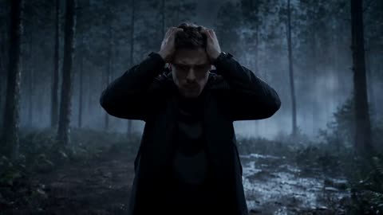</a>

用带秒数的分段节拍表把变身拆成连续的几个阶段，并要求保持同一张脸和同一身份。禁止切镜、突变和血腥保证变身过程连贯，结尾的数量约束要求恰好一人变身为一只狼人，防止出现重复主体。

Seedance 2.5 · 文生视频 · 出处: [@AIwithWania on X](https://x.com/AIwithWania/status/2101908482073252349) · 发现于 [LearnPrompt/awesome-seedance](https://github.com/LearnPrompt/awesome-seedance)

[`werewolf`](tags.md#tag-werewolf) [`transformation`](tags.md#tag-transformation) [`night-forest`](tags.md#tag-night-forest) [`identity-lock`](tags.md#tag-identity-lock)

<details><summary><b>提示词</b></summary>

```text
-

Create a  cinematic dark-fantasy transformation in 16:9. A realistic adult man with short dark hair, light stubble and black clothes stands alone in a cold, foggy pine forest at night. Keep the SAME face, body, hairstyle and identity throughout.

0–3s: Medium frontal shot. He bends forward slightly, holding both sides of his head, breathing heavily. Slow push-in. Blue-grey moonlight and drifting fog.

3–6s: Tight close-up. His jaw clenches, expression intensifies and eyes gradually glow amber-orange. Fur appears around temples, cheeks and neck; ears slowly become pointed.

6–10s: Continuous realistic transformation: face turns wolf-like, jaw extends, teeth sharpen, dark brown-grey fur spreads across head, shoulders, arms and torso. Body grows taller and more muscular. No instant morph, cuts, blood or gore.

10–12s: Camera pulls back to reveal one fully transformed realistic werewolf with glowing amber eyes, thick fur, muscular body, clawed hands, wolf-like legs and a natural tail. Full moon behind the trees.

12–15s: Dramatic full-body wide shot. The werewolf stands in fog, breathing heavily, fur moving in the wind, then slowly raises its head toward the moon.

Style: ultra-realistic live-action, cinematic VFX, volumetric moonlight, deep shadows, realistic fur, natural anatomy, depth of field, subtle motion blur and film grain. Sound: forest wind, heavy breathing, low bass rumble, transformation sounds and deep growl. Exactly ONE man transforms into ONE werewolf. No duplicates, extra creatures, extra limbs, cartoon look or deformed anatomy.
```

</details>

<a id="seedance-meteor-crash-armored-warrior"></a>
### 装甲战士从燃烧的陨石坑中走出

<a href="https://x.com/NoOneIsHere2603/status/2106981270085656888">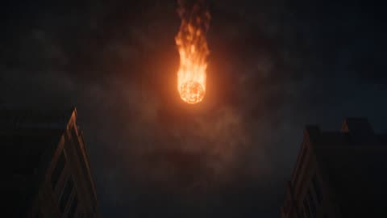</a>

重复出现的角色锁定描述固定了脸、发型、装甲、配色和武器，让全片人物保持一致。把 30 秒动作拆成每 5 秒一段的时间节拍，每段单独写明镜头运动，长段打斗因此更清晰。

Seedance 2.5 · 文生视频 · 出处: [@NoOneIsHere2603 on X](https://x.com/NoOneIsHere2603/status/2106981270085656888) · 发现于 [LearnPrompt/awesome-seedance](https://github.com/LearnPrompt/awesome-seedance)

[`meteor`](tags.md#tag-meteor) [`robots`](tags.md#tag-robots) [`character-lock`](tags.md#tag-character-lock) [`timed-beats`](tags.md#tag-timed-beats)

<details><summary><b>提示词</b></summary>

```text
VISUAL STYLE: Ultra-cinematic science fiction, photorealistic CGI, dark futuristic city at night, dramatic blue-orange lighting, realistic smoke, fire, sparks, debris, atmospheric rain, powerful camera movement, high-detail environments, blockbuster action-film quality.

MAIN CHARACTER: One mysterious adult male warrior, athletic build, short dark hair, black futuristic armored suit with subtle glowing blue energy lines, metallic boots and gloves. His face, hairstyle, armor design, colors, body proportions, and weapon configuration must remain 100% identical throughout the entire video.

0–5 SECONDS

A gigantic burning meteor crashes into an abandoned futuristic city street at night. The camera follows the meteor from the sky as it impacts the exact center of the street, creating a powerful shockwave. Cars are pushed aside, windows shatter, smoke and sparks fill the air.

5–10 SECONDS

Without changing location, the camera moves closer to the smoking meteor. The cracked surface begins glowing blue from within and slowly splits apart. The same mysterious armored man steps out from inside the meteor and stands in the crater as smoke moves around him.

10–15 SECONDS

Before he can move, several hostile futuristic combat robots emerge from the surrounding smoke and buildings, forming a circle around him. He slowly looks around, raises his right hand, and blue energy begins traveling through the glowing lines of his armor.

15–20 SECONDS

His armor activates with mechanical components unfolding naturally over his arms and shoulders. He suddenly charges forward from the exact position where he was standing. He strikes the nearest robot, spins into another, and sends it crashing into a parked vehicle. The other robots immediately attack him.

20–25 SECONDS

The largest robot charges from directly behind him. The man turns at the last moment, catches its massive fist with both hands, and releases a concentrated blue energy shockwave. The robot is thrown backward through the same street, destroying several already-damaged vehicles and walls.

25–30 SECONDS

The dust slowly clears. The man remains standing in the crater, breathing heavily, with the same damaged-but-intact armor. He looks upward toward the sky. The camera follows his gaze and reveals a second gigantic meteor entering the atmosphere, far larger than the first.

End on his face as blue light from the approaching meteor reflects across his armor.
```

</details>

<a id="seedance-miniature-witch-halloween-pumpkin-chase"></a>
### 小女巫抱着发光南瓜坐在落叶船上

<a href="https://x.com/ImaStudio_ai/status/2104881979485463035"></a>

按时间节拍分段（开场、追逐、落叶船、幽灵、结尾特写），并锁定角色外观描述，让帽子、雨衣和雨靴在整段视频中保持一致。低角度微距镜头加上明确的比例反差，让小人物看起来像真实雨夜街道中的微缩场景。

Seedance 2.5 · 文生视频 · 出处: [@ImaStudio_ai on X](https://x.com/ImaStudio_ai/status/2104881979485463035)

[`miniature`](tags.md#tag-miniature) [`stop-motion`](tags.md#tag-stop-motion) [`halloween`](tags.md#tag-halloween) [`character-consistency`](tags.md#tag-character-consistency)

<details><summary><b>提示词</b></summary>

```text
Create a 15-second, 16:9, 24fps high-quality miniature fantasy animation.
Overall style: miniature stop-motion animation × photorealistic macro environment × cute Halloween fantasy.
The world should feel like a handcrafted animated character placed inside a highly realistic macro environment: wet pavement, shallow depth of field, giant raindrops, oversized fallen leaves, and strong scale contrast between the tiny character and the real-world surroundings.
The overall mood should be warm, cute, mysterious, and cinematic, never scary, bloody, or childish.
Character Consistency
Keep the exact same miniature witch girl throughout the entire video.
She is palm-sized, with:
short black hair
a slightly crooked black pointed witch hat
orange raincoat
black tights
small red rain boots
Strictly preserve her:
face
hairstyle
outfit
body proportions
scale
overall identity
She should have a refined handcrafted stop-motion look, while the environment remains highly photorealistic.
0–2.5s | Hook
Halloween night after the rain.
Use an extremely low-angle macro shot close to the wet cobblestone street. Warm orange streetlights create large, soft bokeh in the distance.
The tiny witch stands beside a puddle holding a miniature black umbrella.
Suddenly, a small glowing jack-o’-lantern floats past her in the rainwater, emitting a warm orange glow.
She pauses in surprise, looks up, and immediately starts chasing it.
Use a subtle cinematic push-in.
2.5–5.5s | Chase
Low-angle lateral tracking shot.
The tiny witch runs quickly along the wet street, chasing the drifting glowing pumpkin.
Huge maple leaves, giant raindrops, and thin twigs pass around her like oversized obstacles.
She jumps across a narrow stream of water.
Her raincoat and short hair move naturally in the strong breeze.
Keep the glowing pumpkin visible ahead of her, drifting continuously with the current.
5.5–9s | Leaf Boat
The pumpkin drifts into a deeper puddle.
The witch jumps onto a giant orange-red maple leaf and uses it as a tiny boat.
She holds a thin twig like a pole and gently pushes herself forward.
The camera moves close to the water surface and follows the leaf boat.
Show warm orange reflections, realistic water surface tension, ripples from raindrops, and the leaf softly rocking with the water.
9–12s | Friendly Ghosts
Two or three tiny translucent ghosts with warm white glow gently rise above the water.
They must look cute and friendly, never frightening.
They resemble soft floating light spirits.
The ghosts circle around the witch once, then fly toward the glowing pumpkin as if guiding her.
The witch smiles with surprise and reaches forward.
12–15s | Final Hero
The witch finally catches and hugs the glowing jack-o’-lantern.
Its warm orange light illuminates her face, clothes, nearby raindrops, and the wet leaf.
Slowly pull the camera back.
She sits i
```

</details>

<a id="seedance-orc-warlord-rallying-speech"></a>
### 兽人首领在电影感特写中激励军队

<a href="https://x.com/Uncanny_Harry/status/2087589869354672222">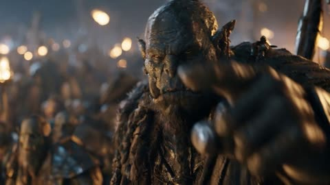</a>

参考图锁定角色外形，参考视频提供表演、动作和台词，因此演技来自视频而不是文字。明确的不加音乐指令让音频只保留语音和环境声。

Seedance 2.5 · 参考生视频 · 出处: [@Uncanny_Harry on X](https://x.com/Uncanny_Harry/status/2087589869354672222)

[`orc`](tags.md#tag-orc) [`performance-transfer`](tags.md#tag-performance-transfer) [`reference-video`](tags.md#tag-reference-video) [`fantasy`](tags.md#tag-fantasy) [`speech`](tags.md#tag-speech)

<details><summary><b>提示词</b></summary>

```text
A cinematic close up of an orc warlord giving a rallying speech to his army of orcs. Transfer the performance, movement and audio from Video 1 onto the the character Image 1. Do not add any music
```

</details>

<a id="seedance-runner-fog-sleeping-dinosaur"></a>
### 雾中女子发现沉睡的巨型恐龙

<a href="https://x.com/KrishnaBio1/status/2113420145800450388">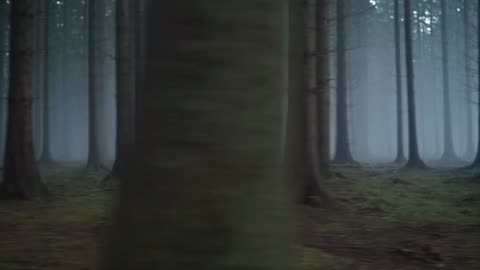</a>

在固定的角色和生物描述之后，按每 5 秒一段的分镜表逐段写明镜头，因此跨镜头的人物一致性更稳，每段都有独立机位。声音被写成明确的提示（风声、呼吸、低沉的鼻息、弦乐），让音效成为请求的一部分，而不是交给模型自由发挥。

Seedance 2.5 · 文生视频 · 出处: [@KrishnaBio1 on X](https://x.com/KrishnaBio1/status/2113420145800450388) · 发现于 [LearnPrompt/awesome-seedance](https://github.com/LearnPrompt/awesome-seedance)

[`dinosaur`](tags.md#tag-dinosaur) [`fantasy`](tags.md#tag-fantasy) [`misty-forest`](tags.md#tag-misty-forest) [`timed-shots`](tags.md#tag-timed-shots)

<details><summary><b>提示词</b></summary>

```text
Cinematic ultra-realistic fantasy-adventure short film, 16:9, 30 seconds, 24fps, shot like a high-budget movie trailer, cold misty dawn, heavy fog drifting through tall pine forest and rolling grassland, muted green-grey color grade, shallow depth of field, soft diffused light, subtle film grain, quiet and mysterious atmosphere.
Character: A young woman in her mid-20s, shoulder-length dark brown hair, wearing a plain dark baseball cap with no logo, a black windbreaker jacket, baggy black track pants, white ankle socks and chunky white-and-grey sneakers, white fitted arm sleeves under her jacket. Brave, focused and breathing hard from running. Keep face, hair and outfit identical in every shot.
Creature: A gigantic, ancient long-necked herbivorous dinosaur, so huge and still that its back looks like a moss-covered grassy hill. Rough grey-brown textured skin, deep wrinkles, a slow-blinking amber eye, a long gentle neck. Calm and peaceful, not aggressive.
Setting: A silent pine forest at dawn that opens into a wide foggy meadow with distant tree lines and low clouds.
🌲 0–5s: Wide shot of the woman running between tall pine trees through thick fog, boots crunching on damp earth. Low-angle close-up of her sneakers stepping over a fallen branch, then a medium shot of her glancing back over her shoulder, breathing in white clouds, then running on.
🌫️ 5–10s: The forest ends and she bursts out into an open foggy meadow. Close-ups of her sneakers on wet grass, her hands pressing on her knees as she stops, catching her breath. She looks around at the endless silent mist.
⛰️ 10–15s: She notices a strange, large, moss-covered mound ahead. She walks toward it slowly, curious, and climbs to the top, standing tall on it. Wide shot showing her tiny against the foggy horizon. The mound very slightly rises and falls like breathing.
😳 15–20s: Extreme close-up of her face under the cap, eyes widening. She feels the ground move under her feet. Close-up of her sneakers as the "grass" ripples. The camera pushes toward a huge, wrinkled, closed eye emerging from the mound beside her.
🦕 20–25s: She drops to her hands and knees, gripping the moss. Wide shot as the mound slowly shifts, revealing it is the enormous head and body of a sleeping giant dinosaur. A great amber eye opens slowly and looks at her.
🌅 25–30s: The dinosaur gently lifts its long neck high into the fog with her still balanced on its head, as thin sunlight breaks through the clouds. She stands up in awe, smiling in disbelief. Epic slow pull-back crane shot revealing the immense creature and the tiny girl on its head against the misty horizon, then fade out.
🎧 Audio: Soft wind, distant birds, heavy breathing and footsteps on damp grass, a deep low rumbling breath from the creature, a slow rising orchestral score with soft strings and low brass, no dialogue.
🎬 Style: Realistic cinematic adventure, smooth natural movement, believable giant-creature scale, emotional wonder, non-graphic, no text, no subtitles, no logos, no watermark.
```

</details>

<a id="seedance-sci-fi-megacity-evacuation-trailer"></a>
### 夜间大都市撤离，外星巨构降临地球

<a href="https://x.com/ZaraIrahh/status/2095400351142682842">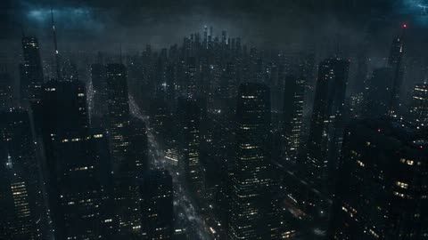</a>

用带时间码的分镜表，加上锁定角色、服装、武器和扫描仪的连续性说明，使人物在各镜头间保持一致。每个镜头运动都有叙事动机，并以月球作为尺度参照来表现外星结构的巨大体量。

Seedance 2.5 · 文生视频 · 出处: [@ZaraIrahh on X](https://x.com/ZaraIrahh/status/2095400351142682842)

[`sci-fi`](tags.md#tag-sci-fi) [`alien`](tags.md#tag-alien) [`megacity`](tags.md#tag-megacity) [`trailer`](tags.md#tag-trailer)

<details><summary><b>提示词</b></summary>

```text
Create a 45-second ultra-photorealistic cinematic sci-fi thriller/action sequence with the visual quality of a high-budget Hollywood blockbuster. CONCEPT In a futuristic megacity at night, a mysterious global emergency signal orders humanity to evacuate Earth immediately. A lone 25-year-old female survivor races toward an orbital evacuation station while millions flee the city. Everyone believes a catastrophic disaster is approaching, but the truth is far more terrifying: something enormous has entered Earth's orbit, and humanity was never the one being evacuated. MAIN CHARACTER A beautiful young adult female survivor, approximately 25 years old, with a natural oval face, expressive brown eyes, realistic skin texture, subtle facial imperfections and long slightly messy dark-brown hair. She wears dark charcoal futuristic tactical clothing, lightweight armor, gloves, utility belt, dark pants and rugged combat boots. She carries a compact futuristic rifle and blue-white handheld scanner. Maintain perfect facial identity, hairstyle, body proportions, clothing, weapon and scanner throughout the video. ENVIRONMENT A massive futuristic megacity during a violent nighttime storm, filled with towering skyscrapers, holographic emergency warnings, wet streets, abandoned vehicles, evacuation towers, military aircraft, orbital elevators, smoke, steam, rain and flashing red emergency lights. The atmosphere should feel chaotic, enormous and realistic. 0–5 SECONDS — THE WARNING Begin with a huge aerial shot of the futuristic city. Every screen suddenly displays: "GLOBAL EVACUATION — LEAVE EARTH IMMEDIATELY." Sirens erupt as crowds panic and spacecraft launch. The female survivor stands in the rain, looking at her scanner as it detects an enormous unidentified object approaching Earth. 5–10 SECONDS — THE EVACUATION She runs toward a massive orbital evacuation station through terrified crowds. Military spacecraft launch overhead. Emergency countdowns flash across buildings. Her scanner begins malfunctioning as a strange blue glow spreads across the clouds. 10–15 SECONDS — SOMETHING ARRIVES She reaches an elevated platform and looks upward. The clouds slowly open, revealing an impossibly enormous alien structure emerging from orbit. It is far larger than any human spacecraft, with gigantic geometric surfaces and thousands of blue-white lights. The Moon appears tiny beside it. 15–20 SECONDS — THE REVELATION The entire city falls silent. The colossal structure moves closer without visible propulsion. Every aircraft stops. Her scanner suddenly receives a transmission from the object. Every screen on Earth turns black. 20–25 SECONDS — THE MESSAGE Every screen simultaneously displays the same mysterious alien symbol. A calm distorted voice comes through her scanner: "Earth evacuation confirmed." She looks around in confusion as humanity realizes the message did not come from human authorities. 25–30 SECONDS — THE SKY OPENS The enormous structure positions itself around Earth instead of attacking. Thousands of blue-white lights activate across its surface. Massive beams descend toward the planet, scanning cities, oceans and continents. No explosions. No weapons fire. 30–35 SECONDS — THE HIDDEN SIGNALS Her scanner suddenly reveals thousands of mysterious signals beneath Earth's surface. The signals exist beneath oceans, mountains and cities, forming a gigantic planetary network. She realizes the structure is searching for something that has been hidden on Earth for thousands of years. 35–40 SECONDS — THE TRUTH A powerful blue-white pulse surrounds the planet. She experiences a brief vision of ancient Earth, where enormous alien structures already existed beneath the surface. The vision disappears. Her scanner displays: "SUBJECT LOCATED." 40–45 SECONDS — FINAL CLIFFHANGER The camera rapidly pulls away from the city and rises into orbit. Reveal Earth surrounded by the enormous alien structure. Hundreds of additional unidentified spacecraft suddenly appear behind it, silently filling the sky. Cut back to the survivor staring upward in terror. Her scanner activates one final time. The voice whispers: "You were never the ones being evacuated." CUT TO BLACK. CINEMATOGRAPHY Professional Hollywood science-fiction cinematography using massive aerial shots, atmospheric tracking, handheld evacuation footage, extreme close-ups, macro technology shots, low-angle perspectives, dynamic tracking and dramatic orbital-scale pull-outs. Camera movement must feel physically motivated and cinematic. VISUAL STYLE Ultra-photorealistic live-action, 4K HDR, realistic human skin, detailed futuristic architecture, realistic spacecraft, wet reflective surfaces, rain, fog, smoke, steam, dust, natural motion blur, cinematic depth of field, subtle film grain and anamorphic lens characteristics. LIGHTING Dark nighttime atmosphere with cold blue ambient light, red emergency lighting, lightning, blue-white alien illumination, volumetric beams, wet reflections, deep shadows and realistic light falloff. REALISM Realistic human movement, crowds, aircraft, spacecraft, rain and environmental physics. The alien structure must feel unimaginably massive, physically believable and extremely slow-moving. No weightless objects or artificial-looking CGI. CONTINUITY Maintain identical female character identity, face, hair, clothing, weapon, scanner, city, spacecraft and alien structure throughout the sequence. No morphing, redesigns, outfit changes or inconsistent scale. NEGATIVE PROMPT No cartoon, anime, video-game graphics, plastic CGI, unrealistic physics, gore, blood, distorted faces, extra fingers, extra limbs, character morphing, outfit changes, creature redesigns, random explosions, excessive lens effects, flickering objects, teleportation, floating debris or unrealistic lighting.
```

</details>

<a id="seedance-sci-fi-motorcycle-supercar-highway-chase"></a>
### 科幻装甲骑手与超跑公路追逐

<a href="https://x.com/itsSaira_1/status/2104064261005709551"></a>

提示词先统一整体影调(低饱和、动态模糊、4K 胶片感),再列出九个编号分镜,每个分镜都写明机位和运镜:低角度跟拍、特写、无人机俯拍、车内第一视角。末尾的长负面提示词用来稳住各镜头之间的光线和摩托车结构。

Seedance 2.5 · 文生视频 · 出处: [@itsSaira_1 on X](https://x.com/itsSaira_1/status/2104064261005709551) · 发现于 [LearnPrompt/awesome-seedance](https://github.com/LearnPrompt/awesome-seedance)

[`sci-fi`](tags.md#tag-sci-fi) [`action`](tags.md#tag-action) [`motorcycle`](tags.md#tag-motorcycle) [`multi-shot`](tags.md#tag-multi-shot) [`chase`](tags.md#tag-chase)

<details><summary><b>提示词</b></summary>

```text
Cinematic photorealistic sci-fi action sequence, moody desaturated color grade, dramatic lighting, hyper-detailed mechanical design, motion blur for speed, 4K film quality.

Scene 1: Wide low-angle tracking shot of a futuristic armored rider in black tactical exosuit on a black-gold angular sci-fi motorcycle, speeding on empty highway, overcast sky.

Scene 2: Close-up transformation shot — motorcycle's rear panels mechanically unfold like wings while riding at high speed, sparks of light on metal joints.

Scene 3: Low-angle hero reveal shot of a sleek black Batmobile-style supercar with scissor/wing doors opening, front LED light strip glowing.

Scene 4: Rear-tracking low-angle shot of two motorcycles riding side by side on the highway, wheels blurred with speed.

Scene 5: Rear pursuit shot of the black supercar driving with glowing taillights, a motorcycle catching up close behind.

Scene 6: Aerial drone top-down shot of a curving highway with the car and motorcycles racing, small flying drone visible above for scale.

Scene 7: Close-up action shot of the car's front wheel with sparks flying off the road surface, high-speed drift feel.

Scene 8: Interior POV shot from the car's dashboard, glowing speedometer, driving fast through a dark tunnel with lights streaking past.

Scene 9: Tunnel chase shot — motorcycle and car entering/exiting a concrete tunnel, wet road reflections, cinematic light contrast.

Negative prompt: blurry, low quality, distorted proportions, extra limbs, deformed hands, warped motorcycle frame, flickering lights, inconsistent lighting, cartoonish, low-res textures, watermark, text, logo, oversaturated colors, daytime bright sun (unless overcast), shaky unstable camera, jerky motion, unrealistic physics, plastic look, glitch artifacts.

#Ai #AIart️️️️️️️️️️️️️️️️️️️️️️️️️️️️️️️️️️️️️️️️️️️️️️️️️️️ #VisualStorytelling #CinematicAI
#GenerativeAI  #AICreator
```

</details>

<a id="seedance-sorceress-water-beast-castle-courtyard-rain"></a>
### 女巫在雨中城堡庭院召唤水兽

<a href="https://x.com/laviniavelle/status/2107333176985317886"></a>

提示词把动作拆成清晰的节拍：现身、闪避、召唤、撞击、消散。开头先定下场景与天气，结尾再补充光线和慢动作流体效果。

Seedance 2.5 · 文生视频 · 出处: [@laviniavelle on X](https://x.com/laviniavelle/status/2107333176985317886) · 发现于 [LearnPrompt/awesome-seedance](https://github.com/LearnPrompt/awesome-seedance)

[`dark-fantasy`](tags.md#tag-dark-fantasy) [`action`](tags.md#tag-action) [`water-magic`](tags.md#tag-water-magic) [`gothic`](tags.md#tag-gothic) [`slow-motion`](tags.md#tag-slow-motion)

<details><summary><b>提示词</b></summary>

```text
A dark fantasy action sequence in a gothic castle courtyard during torrential rain A sorceress with vibrant purple hair rises from a stone fountain Two men with swords attack her She fluidly dodges uses water magic to shield herself, and summons a giant water beast with glowing eyes from the fountain that slams into her attackers She calmly steps out of the fountain raises her hand, and dissolves the water beast into a fine mist of rain. Cinematic lighting slow motion fluid dynamics, 8k resolution.
```

</details>

<a id="seedance-time-machine-future-scientist"></a>
### 科学家站在发光时光机旁的昏暗实验室

<a href="https://x.com/iam_nafisahmed/status/2088964392528527702"></a>

用带时间点的分镜逐拍描述，并写明倒计时与黑场闪白的收尾，让模型有清晰的节奏结构。结尾用真实物理和细微胶片颗粒等词，把画面锁定在实拍电影的质感上。

Seedance 2.5 · 文生视频 · 出处: [@iam_nafisahmed on X](https://x.com/iam_nafisahmed/status/2088964392528527702) · 发现于 [LearnPrompt/awesome-seedance](https://github.com/LearnPrompt/awesome-seedance)

[`sci-fi`](tags.md#tag-sci-fi) [`thriller`](tags.md#tag-thriller) [`countdown`](tags.md#tag-countdown) [`time-machine`](tags.md#tag-time-machine)

<details><summary><b>提示词</b></summary>

```text
He built a machine that could see 10 seconds into the future.

Then he saw himself standing behind him.

Create your version on @budgetpixel  using Seedance 2.5 

Prompt below if you want to make your own.👇

"Create a 10-second photorealistic cinematic sci-fi thriller.

A young scientist stands inside a dark futuristic laboratory beside a glowing experimental time machine. He activates it and sees exactly 10 seconds into the future.

At first, he smiles in amazement as the machine shows the laboratory still intact.

Suddenly, the future image changes.

The same laboratory is now completely destroyed—glass shattered, machines burning, sparks flying, smoke everywhere.

The scientist looks around in panic.

A countdown appears on the machine: 10... 9... 8... 7...

He notices the machine's glowing energy core rapidly overheating.

3... 2... 1...

He realizes the machine is about to explode.

The screen instantly cuts to black as a massive white flash fills the laboratory.

Ultra-photorealistic, cinematic sci-fi thriller, realistic futuristic laboratory, dramatic lighting, realistic fire and sparks, intense suspense, fast pacing, believable technology, realistic physics, cinematic camera movement, premium Hollywood VFX, subtle film grain, highly detailed, 4K.

No subtitles, no logos, no watermark, no cartoon style."
```

</details>

<a id="seedance-traveler-unicorn-misty-forest"></a>
### 旅者在晨雾森林遇见独角兽

<a href="https://x.com/juliaevee/status/2105150663047135672">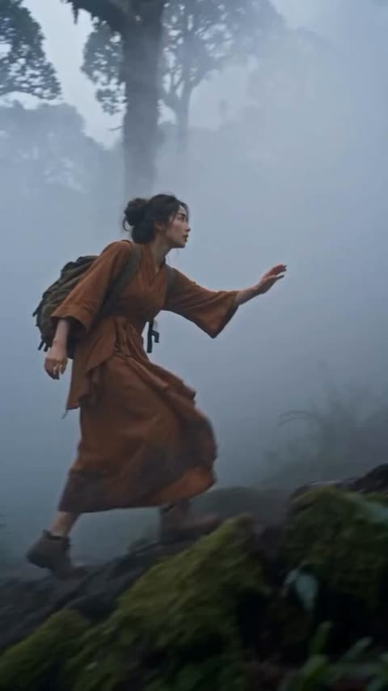</a>

提示词按顺序铺设场景：先写旅者与服装，再写独角兽的发光特征，最后用蹄子踩踏苔藓这一物理动作触发金光沿小径蔓延并驱散浓雾。结尾指向日出山谷，为视频提供明确的收束画面。

Seedance 2.5 · 文生视频 · 出处: [@juliaevee on X](https://x.com/juliaevee/status/2105150663047135672) · 发现于 [LearnPrompt/awesome-seedance](https://github.com/LearnPrompt/awesome-seedance)

[`unicorn`](tags.md#tag-unicorn) [`misty-forest`](tags.md#tag-misty-forest) [`fantasy`](tags.md#tag-fantasy) [`volumetric-light`](tags.md#tag-volumetric-light)

<details><summary><b>提示词</b></summary>

```text
A young East Asian female traveler wearing an earth-toned, brown wrap tunic robe with a backpack hiking through a misty, dense ancient forest. She encounters a majestic white unicorn with a glowing golden horn, glowing eyes, and golden light woven through its flowing mane. The unicorn steps on the mossy ground, causing veins of golden magical light to spread along the forest trail, clearing the thick fog and opening into a breathtaking view of a lush mountain valley at sunrise. Cinematic 4k, hyper-realistic, volumetric lighting, epic fantasy atmosphere, soft morning sunbeams.
```

</details>

<a id="seedance-tree-guardian-dark-fantasy-battle"></a>
### 女子唤醒熔岩树灵对抗恶魔

<a href="https://x.com/itsSaira_1/status/2107685928647160275"></a>

开头先用画幅、镜头、色调和粒子等全局风格词定调，再按被擒、召唤、战斗、平静收尾的顺序写清节拍。快速运镜、慢动作爆炸和骷髅特写等镜头词控制了画面节奏。

Seedance 2.5 · 文生视频 · 出处: [@itsSaira_1 on X](https://x.com/itsSaira_1/status/2107685928647160275) · 发现于 [LearnPrompt/awesome-seedance](https://github.com/LearnPrompt/awesome-seedance)

[`dark-fantasy`](tags.md#tag-dark-fantasy) [`battle`](tags.md#tag-battle) [`creature`](tags.md#tag-creature) [`cinematic`](tags.md#tag-cinematic) [`slow-motion`](tags.md#tag-slow-motion)

<details><summary><b>提示词</b></summary>

```text
Cinematic dark fantasy battle, 16:9, photoreal, shallow depth of field, anamorphic lens, moody teal-grey and fiery orange color grade, drifting embers and smoke. A young woman with short wavy brown hair in an emerald green dress is dragged across cracked dark stone floor by a tall horned grey demon. She slams her hand down and glowing white-gold roots erupt from the ground, growing into a towering tree-guardian with a glowing lava-vein bark body and antler-like branches. The tree-guardian fights a horde of grey demon creatures, shoots a massive stream of fire, and gets surrounded by burning demons. Close-ups of a skull-faced demon with molten cracks. Fast dynamic camera, slow-motion fire explosions. Ends with a glowing sphere of woven burning roots, then the woman kneeling on the ground, hands glowing on the floor, calm and powerful.

#AI #AIart️️️️️️️️️️️️️️️️️️️️️️️️️️️️️️️️️️️️️️️️️️️️️️️️️️️ #Visualart
```

</details>

<a id="seedance-twin-speedsters-empty-city-superpower-short"></a>
### 两位超速女孩在空城街头相遇

<a href="https://x.com/ai_anelia/status/2112960745168392440"></a>

把 30 秒拆成每段 4 到 6 秒的时间节拍，每段指定景别和运动，故事从繁忙街头推进到完全寂静。角色块锁定脸部和服装，音频一行把风声和轮胎声渐隐为寂静，并配上对白和渐强配乐。

Seedance 2.5 · 文生视频 · 出处: [@ai_anelia on X](https://x.com/ai_anelia/status/2112960745168392440) · 发现于 [LearnPrompt/awesome-seedance](https://github.com/LearnPrompt/awesome-seedance)

[`sci-fi`](tags.md#tag-sci-fi) [`superpower`](tags.md#tag-superpower) [`timed-shots`](tags.md#tag-timed-shots) [`dialogue`](tags.md#tag-dialogue) [`cinematic`](tags.md#tag-cinematic)

<details><summary><b>提示词</b></summary>

```text
Cinematic ultra-realistic sci-fi superpower short film, 16:9, 30 seconds, 24fps, shot like a high-budget streaming drama, bright natural daylight, downtown American-style city with tall glass and stone buildings, palm trees, traffic lights, wide crosswalks and parked cars, shallow depth of field, crisp detail, subtle film grain, natural color grade with warm sunlight and cool shadows.
Character 1: A young Korean woman in her early 20s, long straight black hair, soft natural makeup, expressive wide eyes, wearing a light-blue open button-up shirt over a fitted white t-shirt, cream trousers and white sneakers. Gentle, curious and a little frightened at the start, slowly turning confident.
Character 2: A young blonde woman in her mid-20s, wavy shoulder-length hair, calm sharp eyes, wearing a black sweater and blue jeans. Cool, mysterious and fast, with a hint of loneliness behind her eyes.
Keep both faces, hairstyles and outfits identical in every shot.
Setting: A busy city intersection that slowly turns completely empty and silent as the story goes on, with wind, dust and loose papers moving through the air.
0–4s: Wide establishing shot of a sunny downtown street with pedestrians, taxis and cars. The Korean woman stands near a crosswalk. Time seems to slow down; the background blurs into soft motion and her eyes widen in shock as a car speeds straight toward her.
4–8s: Extreme close-up of her startled face, then she bursts into superhuman speed. Her feet kick up dust and wind, her hair and shirt whip backward, and she weaves between moving cars and people, the city stretching into streaks of motion behind her. Low tracking shot, strong motion blur.
8–12s: A shockwave of dust rolls across the crosswalk. From the side of the frame, the blonde woman appears running at the same impossible speed. They glance at each other, both stunned. Close-up of the Korean woman whispering: "There's someone else like me?"
12–18s: They sprint side by side down the wide street, dust clouds exploding behind them, cars frozen in the background like statues. Dynamic side tracking shots, then a low-angle shot as they run past the camera, hair flying, determination on both faces.
18–22s: The Korean woman launches into a long, graceful leap, gliding through the air above the street, while the blonde woman runs beneath her, hair blowing wildly in the wind. Slow-motion for the leap, cinematic and almost weightless.
22–26s: Both slow down and come to a stop in the middle of a completely empty street. Papers drift down through the air, the wind fades, the whole city is silent and still around them. Wide shot from behind showing the two small figures in the empty avenue.
26–30s: Calm close-ups, soft light on their faces. The blonde woman says quietly: "I thought I was the only one." The Korean woman smiles and answers: "So did I." Slow pull-back as they stand together in the empty street, then cut to black.
Audio: Rushing wind, tire screeches fading into complete silence, a soft heartbeat, light footsteps, a subtle emotional orchestral score building gently, clear natural English dialogue.
Style: Realistic grounded sci-fi action-drama, smooth physics, natural human movement, emotional performances, non-graphic, no text, no subtitles, no logos, no watermark.
```

</details>

<a id="seedance-vehicles-transform-into-robots"></a>
### 银色跑车在城市高速公路上疾驰

<a href="https://x.com/laviniavelle/status/2108404878590857384">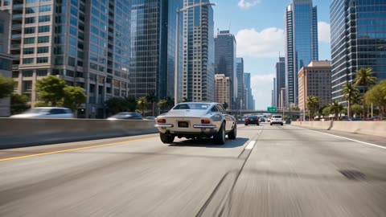</a>

一个提示词串联了四组载具变形为机器人的场景，每组配有不同环境（城市高速、海岸公路、沙漠、航母甲板），便于模型在环境之间切换。结尾的动态追踪镜头和写实8K渲染风格词，让整段画面保持统一的质感。

Seedance 2.5 · 文生视频 · 出处: [@laviniavelle on X](https://x.com/laviniavelle/status/2108404878590857384)

[`transformation`](tags.md#tag-transformation) [`robots`](tags.md#tag-robots) [`vehicles`](tags.md#tag-vehicles) [`tracking-shot`](tags.md#tag-tracking-shot)

<details><summary><b>提示词</b></summary>

```text
A silver sports car driving down a city highway smoothly transforms into a giant silver running robot a futuristic neon lit motorcycle on a coastal highway morphs into a running blue cybernetic robot; a camouflage military tank driving across a sandy desert transforms into a walking heavy combat mecha a fighter jet on an aircraft carrier deck unfolds and transforms into a standing robot warrior, sci-fi action style high tech mechanical transformation, dynamic camera tracking shot, cinematic photorealistic 8k render.
```

</details>

<a id="seedance-water-dragon-rooftop-brush-vortex"></a>
### 屋顶白衣女子云端召唤水晶水龙

<a href="https://x.com/juliaevee/status/2110191663666639097">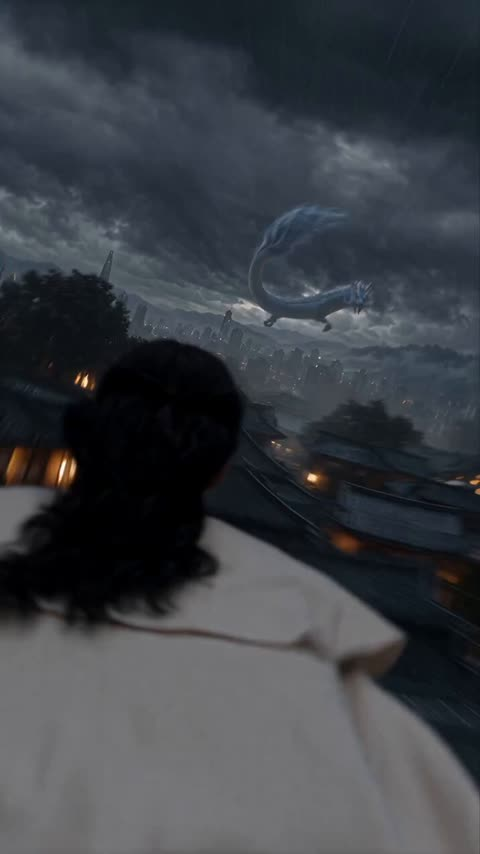</a>

提示词按时间顺序写成分镜：先定暴风雨屋顶，再过渡到阳光下的云上世界，最后以画圈引出漩涡。这条清晰的因果链让模型有明确的先后顺序，而服饰与半透明龙身的具体描述使主体在镜头切换中保持一致。

Seedance 2.5 · 文生视频 · 出处: [@juliaevee on X](https://x.com/juliaevee/status/2110191663666639097) · 发现于 [LearnPrompt/awesome-seedance](https://github.com/LearnPrompt/awesome-seedance)

[`water-dragon`](tags.md#tag-water-dragon) [`fantasy`](tags.md#tag-fantasy) [`vfx`](tags.md#tag-vfx) [`storm`](tags.md#tag-storm)

<details><summary><b>提示词</b></summary>

```text
A cinematic vertical video starting on a dark, stormy rooftop overlooking a sprawling urban city. A woman in a white and beige traditional robe with long dark hair stands watching a majestic, translucent blue water-dragon coiled in the stormy clouds. The dragon lunges towards her, transitioning into a bright, ethereal realm above the clouds where she floats under a brilliant sun. She draws a glowing circle with a brush on parchment, creating a vortex in the clouds, then summons water spirals that shape into a massive crystalline dragon that dives down toward the city below, creating a giant splash through the cloud layer. Photorealistic, high-end VFX, epic fantasy atmosphere, dynamic camera angles, 8k resolution.
```

</details>

<a id="seedance-wizard-duck-monster-storyboard"></a>
### 女巫变成鸭子逃离怪物

<a href="https://x.com/AIwithNatalia/status/2089170554725265625"></a>

七段分镜精确到秒，每个剧情节点都有独立的时间段。对白和音效直接写进对应段落，结尾用一行文字卡收束。

Seedance 2.5 · 文生视频 · 出处: [@AIwithNatalia on X](https://x.com/AIwithNatalia/status/2089170554725265625) · 发现于 [LearnPrompt/awesome-seedance](https://github.com/LearnPrompt/awesome-seedance)

[`comedy`](tags.md#tag-comedy) [`storyboard`](tags.md#tag-storyboard) [`timed-beats`](tags.md#tag-timed-beats) [`fantasy`](tags.md#tag-fantasy) [`dialogue`](tags.md#tag-dialogue)

<details><summary><b>提示词</b></summary>

```text
0–3 sec — Hook
A young wizard stands frozen in a dark forest as a massive monster charges toward her.
Wizard: “Ten seconds… that’s all I need!”

3–8 sec — The Spell
She raises her glowing staff and rapidly chants a magical spell. The monster gets closer and closer.

8–12 sec — Countdown
Monster: “YOU’RE TOO LATE!”
The wizard finishes the final word: “TRANSFORMUS!”

12–16 sec — Magic Burst
A huge explosion of purple light fills the screen. Everything goes silent.

16–21 sec — Twist
The smoke clears. The monster looks confused.
Instead of the wizard… there’s a tiny, adorable duck standing in her robes.

21–26 sec — Reaction
The duck looks down at herself, quacks angrily, and smacks the staff with her wing.

26–30 sec — Punchline
The monster slowly backs away.
Monster: “...Honestly, I’m scared of her.”
The duck suddenly starts chasing him.
SFX: Quack! Quack! Quack!
End text:
✨ Never rush a spell. 🦆
```

</details>

<a id="seedance-wizard-workshop-transformation"></a>
### 第一人称巫师工坊与发光药剂

<a href="https://x.com/KICHOCHEZI/status/2098432693222715716">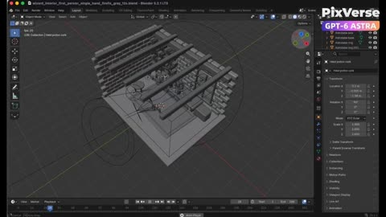</a>

先用 Blender 白模生成参考视频，锁定运镜、动作时序与空间布局，再用参考图定义材质与光线。要求单镜头连续拍摄并且只拿一瓶药剂，可以保持动作与道具稳定。

Seedance 2.5 · 参考生视频 · 出处: [@KICHOCHEZI on X](https://x.com/KICHOCHEZI/status/2098432693222715716)

[`blender`](tags.md#tag-blender) [`white-model`](tags.md#tag-white-model) [`first-person`](tags.md#tag-first-person) [`reference-video`](tags.md#tag-reference-video)

<details><summary><b>提示词</b></summary>

```text
Create a 12-second single-take white-model animation in Blender based on the supplied wizard workshop reference. Build the stone walls, wooden shelves, arched window, fireplace, books, astronomical instrument and alchemy table filled with potion bottles. Animate a low first-person viewpoint with exactly one right hand holding one potion. Begin with the bottle near the lower-right edge, look around the workshop and toward the window, raise the potion naturally, pause to examine it, then lower it while turning toward the fireplace and glowing reagents. Export the white-model MP4. Then use PixVerse with Seedance 2.5, referencing the Blender video for camera, action and spatial layout and the supplied images for appearance. Preserve the continuous shot and timing while adding weathered stone, carved wood, worn leather, realistic glass, cool window light, warm fireplace illumination, glowing magical liquids, natural flames, embers, sparks and smoke.
```

</details>

<a id="seedance-woman-castle-doors-floating-islands"></a>
### 女子推开城堡大门飞入浮岛天空

<a href="https://x.com/laviniavelle/status/2105889515948921057">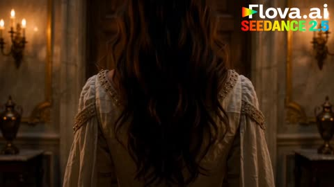</a>

提示词按时间顺序写出镜头：昏暗室内、推门露出风景、奔跑、跃起，镜头全程跟随，让模型有清晰的动作节拍可循。结尾的光影与画质词定下电影感的效果。

Seedance 2.5 · 文生视频 · 出处: [@laviniavelle on X](https://x.com/laviniavelle/status/2105889515948921057)

[`fantasy`](tags.md#tag-fantasy) [`castle`](tags.md#tag-castle) [`floating-islands`](tags.md#tag-floating-islands) [`camera-follow`](tags.md#tag-camera-follow)

<details><summary><b>提示词</b></summary>

```text
Cinematic video of a young woman in an elegant white medieval dress opening large wooden doors from a dark castle interior to reveal a breathtaking sunny landscape with lush green fields a lake and distant mountains She runs out across the grassy field towards a large grand castle The camera follows her as she leaps into the air, gracefully floating into a magical fantasy sky filled with floating islands cascading waterfalls above clouds, and a large glowing pink moon in the surreal sky, 8k resolution, ultra detailed, cinematic lighting.
```

</details>

<a id="seedance-woodland-guardian-lantern-door"></a>
### 林间守护者触碰发光的刻纹石柱

<a href="https://x.com/itxabdullaa/status/2107792780395458733">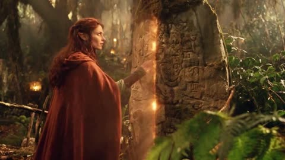</a>

提示词把人物、服装和色调写进一个可复用的固定段落，再用带时间码的分镜逐段推进，并加入连续性约束，让脸部、披风和道具在各镜头中保持一致。35mm 颗粒、实景灯笼和微缩布景等胶片与实拍质感的描述，让画面远离光滑的 CGI 风格。

Seedance 2.5 · 文生视频 · 出处: [@itxabdullaa on X](https://x.com/itxabdullaa/status/2107792780395458733) · 发现于 [LearnPrompt/awesome-seedance](https://github.com/LearnPrompt/awesome-seedance)

[`fantasy`](tags.md#tag-fantasy) [`practical-effects`](tags.md#tag-practical-effects) [`continuity`](tags.md#tag-continuity) [`film-grain`](tags.md#tag-film-grain) [`timed-shots`](tags.md#tag-timed-shots)

<details><summary><b>提示词</b></summary>

```text
Create an original young adult female woodland guardian in the handcrafted style of a forgotten early-1990s live-action fantasy film. Fully original character and world, practical-effects aesthetic, not modern CGI.

CHARACTER: Young adult woman, natural expressive face, amber-brown eyes, softly angular features, subtly elongated fantasy ears, thick dark auburn wavy hair with small braids. Intelligent, brave, curious and quietly playful.

COSTUME: Fully modest sage-green high-neck linen blouse, brown leather vest, ankle-length olive wool skirt, opaque dark leggings, worn brown boots, leather wrist guards and long burnt-orange hooded cloak. Leather belt with small pouches, brass compass, herbs, wooden whistle and bronze leaf pendant. Real fibers, worn leather, tarnished metal and natural mud. Practical prosthetic fantasy ears.

SETTING: Ancient woodland at dusk, twisted trees, moss, ferns, mushrooms, streams, wooden bridges, carved stones and handmade lanterns. Hidden shelters and distant lights suggest a secret woodland settlement.

STYLE: Practical foliage, physical props, theatrical mist, practical lanterns, miniature sets, restrained optical effects, 35mm film softness, subtle grain, lantern halation, earthy greens, browns and amber, warm theatrical lighting. No glossy CGI or modern fantasy aesthetic.

[00:00-00:04] THE PATH
Low shot of her boots walking through damp leaves. Camera rises to her face. A distant metallic chime makes her stop.

[00:04-00:08] THE LANTERN
She finds a glowing antique lantern with no visible flame. It goes dark as she reaches for it. Another lantern lights deeper in the forest, then another. She realizes she is being guided.

[00:08-00:12] THE TRAIL
She follows the lanterns and discovers carved symbols on trees. One rotates when touched. Another moves behind her. Nobody is there. She smiles, realizing someone is watching.

[00:12-00:16] THE FOX
A woodland fox leads her to a fallen tree. Beneath its roots she finds a box containing a brass compass. Its spinning needle suddenly points upward. A shadow moves through the canopy.

[00:16-00:20] SOMEONE ABOVE
Leaves rustle. Acorns drop beside her boots. She looks upward and says softly, "You could simply come down." A hidden wooden platform creaks above. She smiles suspiciously.

[00:20-00:24] THE DOOR
She follows the sound to an enormous tree and discovers a hidden seam. She touches it. Carved symbols glow and the bark opens into a secret doorway filled with warm golden light. She enters.

[00:24-00:27] THE HIDDEN WORLD
Inside is a vast woodland settlement built around the tree: lanterns, wooden platforms, rope bridges, workshops, herbs and glowing windows. Hundreds of lanterns illuminate as she looks around in wonder.

[00:27-00:30] THE INVITATION
A wooden bridge leads to a folded parchment reading "YOU FOUND US." Several silhouettes appear among the lanterns. She smiles, places the parchment in her satchel and walks deeper into the settlement.

Camera pulls backward through the ancient tree doorway into the dark forest. Cut to black.

STRICT CONTINUITY: Same face, hair, ears, proportions, costume, cloak, boots, belt, pendant and satchel in every shot. Fully modest clothing with no wardrobe changes or exposure. Continuous geography and logical progression.

CAMERA: Atmospheric low angles, slow tracking, facial close-ups, wide environmental shots and restrained handheld movement.

FINAL LOOK: Authentic early-1990s 35mm fantasy film, practical prosthetics, real costumes, physical sets, theatrical mist, practical lanterns, subtle optical effects, natural performances and beautiful film grain.

Original character and world only. No recognizable existing characters, franchises, logos, branded costumes, copied designs, blood or gore.
```

</details>

<a id="veo-moon-dust-flowers"></a>
### 月尘平原上的水晶花

<a href="https://storage.googleapis.com/gdm-deepmind-com-prod-public/media/media/veo__veo-3__moon-dust.webm"></a>

短小的造景提示词。一个抓人的细节（`the only footprints in untouched dust`）胜过一长串形容。

Veo 3 · 文生视频 · 出处: [Veo 3 prompt guide](https://deepmind.google/models/veo/prompt-guide/)

[`world-building`](tags.md#tag-world-building) [`fantasy`](tags.md#tag-fantasy)

<details><summary><b>提示词</b></summary>

```text
A snow-covered plain of iridescent moon-dust under twilight skies. Thirty-foot crystalline flowers bloom, refracting light into slow-moving rainbows. A fur-cloaked figure walks between these colossal blossoms, leaving the only footprints in untouched dust.
```

</details>
