# Seedance 2.5

[返回目录](../../README_zh.md) · 全部 163 条 · [1](video-seedance25.md) · **2** · [3](video-seedance25-3.md)

<a id="seedance-hammock-motorcycle-wash-dv-home-video"></a>
### 千禧年初家用DV：吊床小憩与洗摩托车

<a href="https://x.com/doctorwasif/status/2099836703729172540">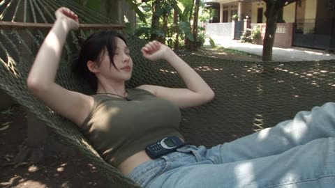</a>

用参考图锁定人物与服装，再用九段三到四秒的时间轴逐段安排动作。风格靠消费级DV质感加禁用清单（无防抖、无美颜、无电影调色）来压住，声音只保留环境音。

Seedance 2.5 · 参考生视频 · 出处: [@doctorwasif on X](https://x.com/doctorwasif/status/2099836703729172540) · 发现于 [LearnPrompt/awesome-seedance](https://github.com/LearnPrompt/awesome-seedance)

[`dv-home-video`](tags.md#tag-dv-home-video) [`timeline`](tags.md#tag-timeline) [`handheld`](tags.md#tag-handheld) [`lo-fi`](tags.md#tag-lo-fi) [`ambient-audio`](tags.md#tag-ambient-audio)

<details><summary><b>提示词</b></summary>

```text
Subject: “<<<image_1>>>” — preserve exact identity, face, skin tone, body proportions, hair, and outfit. Southeast Asian appearance with subtle Korean styling: olive-green faded sleeveless crop top, loose high-waist light-blue jeans, black canvas sneakers, black cord necklace, black wavy hair, side-swept bangs, messy ponytail.

Setting: Quiet early-2000s Southeast Asian residential neighborhood—concrete alley, simple homes, terraces, trees, plants, parked motorcycles, tangled overhead cables. No shops.

Style: Raw early-2000s consumer DV/home-video footage. Heavy handheld shake, imperfect framing, autofocus hunting, lens breathing, exposure shifts, rolling shutter, natural motion blur, faded low-contrast colors, washed highlights, digital noise/compression. No stabilization, beauty filters, cinematic grading, glamour, or posing.

Timeline:

- 00–03: Relaxing in a hammock between trees, dappled sunlight.
- 03–07: Uses an old Nokia phone, presses keypad, subtle smile; focus hunts.
- 07–10: Lazily stretches in hammock, phone on stomach, looks at canopy.
- 10–13: Gets up, pockets phone, walks across yard.
- 13–16: Crouches beside motorcycle, picks up soapy water and rag.
- 16–20: Slowly cleans helmet; water drips onto concrete.
- 20–24: Cleans motorcycle seat, briefly smiles at camera.
- 24–27: Rinses and wrings rag over bucket.
- 27–30: Wipes hands on jeans, looks at camera and softly smiles; abrupt cut to black.

Audio: Natural ambience only—birds, breeze, distant motorcycles, chatter, hammock creaks, Nokia keypad clicks, leaves, water, and rag sounds. No music or cinematic effects.

Format: 16:9.
```

</details>

<a id="seedance-helicopter-news-dirt-bike-pursuit"></a>
### 直升机新闻镜头拍摄的越野摩托追逐

<a href="https://x.com/CharaspowerAI/status/2111517673276240251">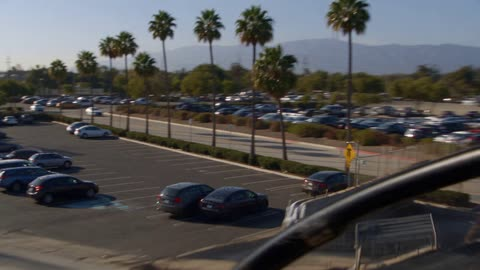</a>

全程锁定单一直升机视角，并刻意写入抖动变焦、压缩伪影、热浪和迟到的摇镜，让画面像未经修饰的新闻素材。六个带时间码的段落逐步升级动作，旋翼声、电台杂音和结尾的记者台词构成声音层。

Seedance 2.5 · 文生视频 · 出处: [@CharaspowerAI on X](https://x.com/CharaspowerAI/status/2111517673276240251) · 发现于 [LearnPrompt/awesome-seedance](https://github.com/LearnPrompt/awesome-seedance)

[`aerial`](tags.md#tag-aerial) [`news-footage`](tags.md#tag-news-footage) [`motocross`](tags.md#tag-motocross) [`handheld-realism`](tags.md#tag-handheld-realism) [`timed-beats`](tags.md#tag-timed-beats)

<details><summary><b>提示词</b></summary>

```text
Ultra-realistic viral helicopter pursuit footage, raw local-news style, filmed entirely from one helicopter in bright Los Angeles daylight. Long-lens aerial camera, unstable vibration, abrupt zooms, compression artifacts, heat haze, autofocus breathing, imperfect framing, rotor thump, distant radio chatter, harsh California sun, no cinematic polish, believable amateur-news realism.

Main subject: one motocross rider on a dirt bike, full helmet and motocross gear, highly skilled, aggressive but controlled riding. Keep the same rider and same bike throughout.

Los Angeles daytime: palm-lined boulevard, parking lots, freeway ramps, concrete flood channel, industrial blocks, overpasses, service roads and distant skyline.

0-5s: Immediate viral hook The helicopter camera is already searching frantically when the rider suddenly blasts into frame between moving cars. Operator snaps into a shaky zoom. The rider jumps a curb, cuts across a parking lot and nearly disappears behind palm trees.

5-10s: Chaotic tracking He rejoins a boulevard, threads through traffic, then veers up a sloped driveway and launches over a low divider. Camera over-zooms, loses him for half a second, then catches him landing cleanly.

10-15s: Escalation The rider enters a concrete flood channel. Huge aerial reveal. He accelerates along the channel floor while the helicopter banks hard overhead. Dust trails behind the bike. Quick zoom on spinning rear wheel and suspension.

15-20s: Viral stunt beat He rides up the angled concrete wall, holds a dramatic high line for a moment, then drops back down smoothly. Camera shakes violently trying to follow. Rotor vibration and radio chatter intensify.

20-25s: Big surprise The rider exits through a service ramp, crosses beneath an overpass, then unexpectedly appears on a parallel industrial road. The operator pans late and barely recovers him. He hits a natural rise and gets long airtime in full daylight.

25-30s: Iconic ending He lands, accelerates toward another overpass and vanishes into shadow underneath. The helicopter overshoots, circles, zooms wildly across multiple roads, but he is gone. Reporter voice, stunned: “We just lost him.” Hold on shaky wide aerial of Los Angeles. Hard cut.

One continuous helicopter perspective, strong amateur-news authenticity, same rider throughout, realistic motocross physics, believable Los Angeles geography, harsh daylight, imperfect tracking, viral unpredictability, readable stunts, no crash, no gore, no readable text, no logos.

#DreaminaCPP  @dreamina_ai
```

</details>

<a id="seedance-hotel-door-five-worlds-fashion-journey"></a>
### 一扇酒店门通向五个超现实世界

<a href="https://x.com/IsabelWhite24/status/2096638350174101539"></a>

按秒数分段，每个世界都写明镜头运动与光线，并用开门强光、摩托车遮挡、鱼群铺满画面作为转场。多次重复锁定面部身份的句子，并配合模特参考图保持人物一致。

Seedance 2.5 · 参考生视频 · 出处: [@IsabelWhite24 on X](https://x.com/IsabelWhite24/status/2096638350174101539) · 发现于 [LearnPrompt/awesome-seedance](https://github.com/LearnPrompt/awesome-seedance)

[`surreal`](tags.md#tag-surreal) [`fashion-film`](tags.md#tag-fashion-film) [`scene-transitions`](tags.md#tag-scene-transitions) [`character-consistency`](tags.md#tag-character-consistency) [`timecoded`](tags.md#tag-timecoded)

<details><summary><b>提示词</b></summary>

```text
Create a 28-second ultra-cinematic surreal fashion adventure starring my female AI model. Preserve her EXACT facial identity, facial structure, hairstyle, skin tone, body proportions and recognizable appearance throughout the entire video.

The film must feel like ONE continuous impossible journey, not separate AI-generated clips. Photorealistic, mysterious, premium and visually spectacular.

0–4 SEC — THE MYSTERIOUS HOTEL

Begin with an extreme cinematic close-up of my model's eyes.

Camera smoothly pulls backward, revealing her standing inside an impossibly long, luxurious old-European hotel corridor at night.

Warm golden wall lamps illuminate hundreds of identical doors stretching into the distance.

She wears an elegant flowing black evening dress with subtle jewellery.

She looks toward one particular door and confidently approaches it.

CAMERA: Slow dolly backward → smooth over-the-shoulder orbit as her hand reaches toward the brass handle.

She opens the door.

Intense white light floods through it and completely fills the lens.

SEAMLESS TRANSITION THROUGH THE LIGHT.

4–9 SEC — STORMY ICELAND

The camera passes through the doorway directly behind her.

Without stopping her walking motion, she emerges onto a spectacular Icelandic black-sand beach.

Towering dark cliffs, crashing ocean waves, mist and light rain surround her.

Strong wind naturally moves her hair and black dress.

CAMERA: Begin low beside her feet → rapidly rise into a cinematic tracking orbit around her.

Standing completely alone on the beach is another mysterious hotel door.

She reaches it and immediately opens it.

Camera follows directly through.

9–14 SEC — FUTURISTIC TOKYO

She steps through the same doorway directly into a futuristic Tokyo street at midnight.

Her walking movement continues seamlessly.

Wet streets reflect enormous neon signs, futuristic architecture and passing autonomous vehicles.

Crowds naturally move around her while she confidently walks toward camera.

CAMERA: 35mm anamorphic backward tracking shot → subtle handheld micro-movement → gentle push toward her face.

A sleek futuristic motorcycle suddenly races extremely close across the foreground.

For a fraction of a second, the motorcycle completely covers the camera.

USE THE MOTORCYCLE AS THE TRANSITION.

14–19 SEC — UNDERWATER BALLROOM

As the motorcycle clears the lens, she is suddenly walking through an enormous abandoned luxury ballroom deep underwater.

She does NOT wear diving equipment.

She walks normally while her dress and hair gently react to the surrounding water.

Gigantic floor-to-ceiling windows reveal the deep ocean outside.

A huge whale silently glides past the windows behind her.

Blue sunlight beams penetrate through the water while thousands of tiny particles float naturally through the scene.

CAMERA: Slow cinematic 180° orbit around her as she turns slightly toward the whale.

Suddenly hundreds of shimmering silver fish rush directly toward and across the camera.

They completely fill the frame.

19–23 SEC — GOLDEN DESERT

The silver fish seamlessly transform into thousands of glowing golden particles carried by desert wind.

Camera pushes through the particles.

Reveal my model walking along the crest of an enormous golden sand dune during sunset.

Her outfit has seamlessly transformed into an elegant flowing ivory desert outfit.

HER FACE AND IDENTITY MUST REMAIN EXACTLY THE SAME.

Wind dramatically moves the fabric.

CAMERA: Start extremely wide → rapidly fly toward her → smooth orbit around her body.

Reveal one final mysterious door standing alone at the top of the dune.

She opens it.

Brilliant golden-white sunlight bursts through.

23–28 SEC — ABOVE THE CLOUDS

She steps through the door.

Camera follows immediately.

Reveal an extraordinary mirrored.
#AICinema #Seedance25
```

</details>

<a id="seedance-husky-bunnies-snow-sunset-friendship"></a>
### 日落雪山中哈士奇与两只小兔相遇

<a href="https://x.com/RizwanAly07/status/2110654938472952253"></a>

五个带标题的分镜把剧情从靠近到揭示逐拍写清，每个分镜只给一个镜头动作，如低角度跟拍、推近和缓慢拉远。结尾分块写明毛发细节、黄金时刻光线、环境音，并用负面清单排除卡通感和重复动物，以保持动物形象一致。

Seedance 2.5 · 文生视频 · 出处: [@RizwanAly07 on X](https://x.com/RizwanAly07/status/2110654938472952253) · 发现于 [LearnPrompt/awesome-seedance](https://github.com/LearnPrompt/awesome-seedance)

[`animals`](tags.md#tag-animals) [`snow`](tags.md#tag-snow) [`golden-hour`](tags.md#tag-golden-hour) [`multi-scene`](tags.md#tag-multi-scene) [`photorealistic`](tags.md#tag-photorealistic)

<details><summary><b>提示词</b></summary>

```text
Create an ultra-realistic cinematic video of a beautiful black-and-white Siberian Husky with striking blue eyes exploring a snowy mountain landscape at sunset. The environment features pristine white snow, snow-covered pine trees, enormous snow-covered rocks, distant blue mountains, and warm golden sunlight illuminating the snow. Every animal must look completely realistic, with detailed fur, natural movements, and believable interactions.

SCENE 1 — THE HUSKY APPROACHES 
A beautiful black-and-white Siberian Husky walks slowly through deep, powdery snow. Its paws sink naturally into the snow, sending tiny snow particles into the air. The camera follows the dog from a low angle as it lowers its head and sniffs the ground curiously. Warm sunset light illuminates its fur.

SCENE 2 — SOMETHING MOVES 
The Husky suddenly notices movement near a large snow-covered rock. It stops, raises its head, and turns its blue eyes toward the rock. Its ears stand upright, and its nose twitches as it investigates. The camera smoothly moves closer to capture its curious expression.

SCENE 3 — THE SURPRISE 
A tiny, fluffy brown bunny cautiously peeks out from behind the rock. A second, smaller white bunny appears just behind it. Both rabbits have realistic fur, twitching noses, upright ears, and tiny paws. The Husky watches them with curiosity while maintaining a natural, relaxed posture.

SCENE 4 — THE ADORABLE MOMENT 
The brown bunny hops forward through the fresh snow, followed by the tiny white bunny. The Husky gently lowers its head toward them, sniffing the snow nearby. The rabbits pause and look toward the dog. Their contrasting sizes create a beautiful cinematic composition.

SCENE 5 — THE HEARTWARMING ENDING 
Both bunnies hop closer to the Husky. The dog remains calm and gently tilts its head, watching their movements with curious blue eyes. The camera slowly pulls back to reveal the three animals together in the glowing snowy landscape, surrounded by majestic mountains and warm sunset light.

🎥 Camera & Quality Instructions

Photorealistic animal fur, eyes, whiskers, paws, and facial expressions.

Natural animal anatomy and believable movement.

Smooth cinematic tracking shots with realistic depth of field.

Golden-hour lighting with cool blue shadows across the snow.

Realistic snow particles, pawprints, and subtle wind.

Natural ambient audio: soft winter wind, paws crunching in snow, and gentle rabbit movements.

No dialogue, text, subtitles, logos, or watermarks.

No cartoon appearance, artificial CGI look, distorted anatomy, duplicated animals, or sudden scene transitions.

Maintain consistent animal appearances throughout the entire video.
```

</details>

<a id="seedance-ice-cream-cart-chase-home-video"></a>
### 年轻女子追冰淇淋车的手持家庭录像

<a href="https://x.com/aiwithaly/status/2104428091476988236">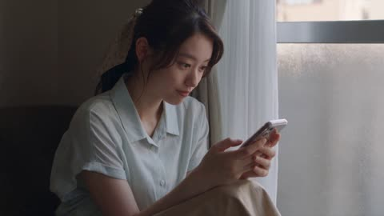</a>

提示词先定下业余摄像机质感，包括不完美构图、对焦漂移和无电影感，再按时间顺序写清30秒内的情节节拍。固定的服装清单、物理细节、只含自然声的音频清单和较长的负面提示，共同保证人物和动作前后一致。

Seedance 2.5 · 文生视频 · 出处: [@aiwithaly on X](https://x.com/aiwithaly/status/2104428091476988236) · 发现于 [LearnPrompt/awesome-seedance](https://github.com/LearnPrompt/awesome-seedance)

[`slice-of-life`](tags.md#tag-slice-of-life) [`japanese`](tags.md#tag-japanese) [`handheld`](tags.md#tag-handheld) [`home-video`](tags.md#tag-home-video) [`natural-audio`](tags.md#tag-natural-audio)

<details><summary><b>提示词</b></summary>

```text
Create a 30-second ultra-photorealistic Japanese slice-of-life home-video following an adorable Japanese woman in her early 20s who hears the distant ice-cream cart bell while relaxing at home. She grabs her wallet, slips on her sneakers, rushes outside, and runs through a quiet neighborhood to catch the cart.

Show authentic handheld consumer-camera footage with imperfect framing, subtle shake, autofocus shifts, natural daylight, realistic motion blur and no commercial cinematic look.

She catches the cart just in time, buys a vanilla-strawberry cone, then meets neighborhood children playing with a ball. She joins them briefly before walking home through the warm late-afternoon street, happily finishing her ice cream.

Maintain consistent face, ponytail, pale-blue blouse, beige skirt, white sneakers, cream shoulder bag and natural expressions throughout. Use realistic physics for running, balance, bag and hair movement, bicycle momentum, ball motion, melting ice cream, shadows and material interaction.

Natural audio only: bicycle bell, footsteps, breathing, children laughing, ball, vendor dialogue, neighborhood ambience and light wind. No music or narration.

Negative prompt: No anime, CGI, plastic skin, beauty filters, robotic movement, impossible physics, floating objects, teleportation, distorted hands, extra fingers, duplicated children, face/outfit changes, excessive camera movement, commercial look, subtitles, logos or watermark.
```

</details>

<a id="seedance-indonesian-alley-dv-camcorder-day"></a>
### 仿千禧年初家用摄像机的印尼小巷日常

<a href="https://x.com/RishuaVR/status/2089204108175741157">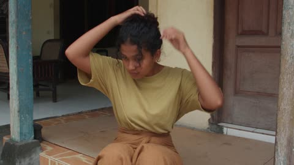</a>

先固定人物外貌与服装，并列出场地禁用元素来保持一致。明确写出自动对焦迷失、曝光起伏等摄像机瑕疵，配合四段分秒镜头与只有拟音的细致音频设计。

Seedance 2.5 · 文生视频 · 出处: [@RishuaVR on X](https://x.com/RishuaVR/status/2089204108175741157) · 发现于 [LearnPrompt/awesome-seedance](https://github.com/LearnPrompt/awesome-seedance)

[`documentary`](tags.md#tag-documentary) [`camcorder`](tags.md#tag-camcorder) [`handheld`](tags.md#tag-handheld) [`asmr-audio`](tags.md#tag-asmr-audio) [`slice-of-life`](tags.md#tag-slice-of-life)

<details><summary><b>提示词</b></summary>

```text
Main subject: young Indonesian woman, early 20s, natural everyday appearance, faded mustard-yellow oversized cotton t-shirt, brown high-waisted linen wrap skirt reaching just below the knee, simple brown leather slide sandals, thin gold stud earrings, dark wavy hair in a messy low bun with loose wispy strands framing her face. Realistic warm brown skin texture, minimal natural makeup, warm and approachable demeanor. Maintain consistent identity, clothing, hairstyle, and appearance throughout the entire video.

Location: Authentic Indonesian residential neighborhood (gang) during a calm late morning. Narrow paved alleys, low-rise houses with open front terraces, terracotta roof tiles, potted frangipani and bougainvillea, laundry on bamboo drying racks, parked motorbikes along plastered walls, overhead utility wires, banana and coconut trees casting dappled moving shadows, quiet tropical residential atmosphere. No modern stores, billboards, cafés, or crowds.

Visual Style: Ultra-realistic documentary realism. Genuine candid behavior. Natural body language. Unscripted slice-of-life feeling. Strong environmental authenticity. Rich real-world details and believable human motion.

Camera Style: Early-2000s consumer DV camcorder aesthetic. Friend casually recording everyday moments. Heavy handheld shake, imperfect framing, frequent autofocus hunting, lens breathing, exposure pumping when moving between harsh tropical sun and deep alley shade, occasional motion blur, subtle rolling shutter, mild digital compression artifacts, warm faded colors, soft contrast, slight sensor noise. No stabilization. No cinematic camera moves. No modern color grading.

00:00–00:02
Outside a small house entrance with an open terrace. She sits on the low terrace step adjusting her loose hair bun with both hands raised. A light warm breeze moves loose strands of hair. She smiles naturally while the camera struggles to lock focus.

00:02–00:05
The camera follows her into a narrow alley lined with potted plants and plastered walls. She notices a neighborhood cat resting on a warm concrete ledge, crouches down, and gently pets it. Framing drifts off-center as the operator tries to keep up. Morning sunlight flickers through banana leaves overhead.

00:05–00:08
Small front terrace with a glass of sweet iced tea on a wooden stool. She sits relaxed on a plastic chair watching the quiet gang, casually brushing hair behind her ear. A motorbike passes slowly in the distant background. Handheld side angle with natural camera drift.

00:08–00:10
She turns toward the camera with a warm, genuine smile, gives a gentle nod of acknowledgement, then turns to walk down the tree-lined alley holding her iced tea. Recording cuts abruptly to black mid-motion as if the camcorder was switched off.

Audio: Hyper-detailed environmental ASMR binaural audio — crisp micro-sounds captured up close with high sensitivity. Crisp rustle of cotton fabric and linen as she moves, deep rhythmic cat purring vibrating close to the microphone, ice cubes gently clinking against the glass condensation, soft scuff of leather sandals on textured concrete pavement, dry banana leaves brushing together in the warm breeze, rhythmic faint sound of a sapu lidi broom sweeping fallen leaves nearby, water dripping into a terracotta gentong, distant gentle crowing rooster, faint muffled low-frequency hum of a passing motorbike down the alley. Pure natural foley textures, zero music, zero studio effects, zero narration, zero speech.

Goal: Authentic Indonesian neighborhood life captured like a forgotten home video from the early 2000s — candid, imperfect, realistic, warm, and deeply believable, with immersive environmental ASMR soundscape.
```

</details>

<a id="seedance-italian-restaurant-spaghetti-comedy"></a>
### 3D动画意大利餐厅番茄酱意面喜剧

<a href="https://x.com/Elvorya/status/2106974836887318797">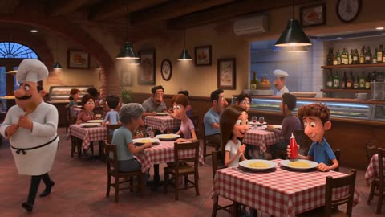</a>

用箭头串联的分镜清单在15秒内从全景建立镜头推进到特写、插入镜头,再回到全景收尾。风格段重复强调角色一致、无闪烁、无身份漂移等约束。

Seedance 2.5 · 文生视频 · 出处: [@Elvorya on X](https://x.com/Elvorya/status/2106974836887318797) · 发现于 [LearnPrompt/awesome-seedance](https://github.com/LearnPrompt/awesome-seedance)

[`3d-animation`](tags.md#tag-3d-animation) [`restaurant`](tags.md#tag-restaurant) [`comedy`](tags.md#tag-comedy) [`multi-shot`](tags.md#tag-multi-shot) [`character-consistency`](tags.md#tag-character-consistency)

<details><summary><b>提示词</b></summary>

```text
Create a 15-second high-quality cinematic 3D animated restaurant sequence with expressive stylized characters, warm lighting, detailed environments, smooth character animation, natural comedic reactions, and consistent character appearance throughout.

Begin with a wide establishing shot inside a cozy Italian restaurant filled with wooden tables, red-and-white checkered tablecloths, framed food artwork, warm pendant lights, brick arches, and customers enjoying their meals → reveal a young man with messy brown hair sitting at a table with a young brunette woman, both waiting for their food while the busy restaurant continues around them → transition into a close-up as the young man gives an enthusiastic thumbs-up while a red ketchup bottle is squeezed dramatically over a plate of spaghetti, creating a playful food moment → cut to the chef in his white chef uniform and tall chef hat standing in the kitchen, reacting with a concerned and confused expression while holding a wooden spoon → transition to a medium shot of a waiter carrying plates through the restaurant as several customers suddenly look toward the commotion with surprised expressions → cut back to the young couple at their table as the chef approaches them holding a ketchup bottle, gesturing animatedly and trying to explain something → show the chef and the young man exchanging confused but humorous expressions while the woman watches curiously → transition into a dramatic close-up of the chef carefully presenting a beautifully plated spaghetti dish topped with tomato sauce, grated parmesan, and fresh basil → cut to an extreme close-up of a fork lifting a large portion of spaghetti, long noodles stretching upward with rich tomato sauce and steam rising from the freshly prepared food → transition back to the table as the young man and woman happily react while the chef proudly stands behind the dish → final shot becomes a warm cinematic wide shot of the restaurant, with the chef smiling proudly between the young couple as they enjoy their spaghetti, surrounding customers laughing and smiling, warm golden restaurant lighting creating a cozy happy ending.

Style: polished cinematic 3D animation, expressive facial animation, charming family-friendly comedy, detailed character models, realistic food textures, warm Italian restaurant atmosphere, soft depth of field, smooth camera movement, cinematic composition, natural motion, high-quality animated-film rendering, consistent characters and environment throughout, no flickering, no character deformation, no identity drift, no text, no watermark.
```

</details>

<a id="seedance-katen-kyokotsu-bankai-thread-web"></a>
### 森林剑斗转入卍解白丝大网

<a href="https://x.com/itxabdullaa/status/2102609881677107243">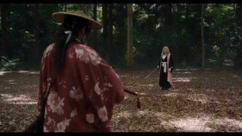</a>

两张参考图锁定两名角色的外观，按时间段拆分的分镜表让每个动作直接引发下一个事件，十秒内的节奏层层递进。禁止发光气场并要求水、布料和花瓣遵循真实物理，使画面保持实拍质感。

Seedance 2.5 · 参考生视频 · 出处: [@itxabdullaa on X](https://x.com/itxabdullaa/status/2102609881677107243) · 发现于 [LearnPrompt/awesome-seedance](https://github.com/LearnPrompt/awesome-seedance)

[`sword-fight`](tags.md#tag-sword-fight) [`fantasy-action`](tags.md#tag-fantasy-action) [`live-action`](tags.md#tag-live-action) [`timed-beats`](tags.md#tag-timed-beats)

<details><summary><b>提示词</b></summary>

```text
SCENE — KATEN KYŌKOTSU: KARAMATSU SHINJŪ
DURATION: exactly 10 seconds
FORMAT: 16:9
STYLE: ultra-photorealistic live-action cinematic fantasy action, grounded CGI, desaturated palette, high-contrast lighting, realistic anatomy and physics, dark supernatural atmosphere, cinematic Japanese tragedy, practical environmental interaction, no digital-art appearance.
PACE: extremely fast continuous escalation, zero pause, zero dead frame.

REFERENCES
IMAGE 1 — PAKSHUN
Preserve facial identity, hairstyle, costume, proportions, and appearance exactly.

IMAGE 2 — OPPONENT
Preserve facial identity, hairstyle, costume, proportions, and appearance exactly.

ACTION

0.0–2.0 SECONDS — BANKAI
Tight rear three-quarter shot. Opponent charges. Pakshun lowers his sword and says: 「卍解……花天狂骨枯松心中。」
A violent pressure wave tears across the ground. Dust, leaves, debris, and hundreds of dark petals rise. The environment rapidly desaturates into black, grey, and pale tones. Camera performs a fast 360° orbit as Opponent closes in.

2.0–4.0 SECONDS — SHARED WOUND
Opponent attacks. Pakshun pivots and cuts across his torso. An identical wound instantly appears on Pakshun. A thin crimson thread connects both wounds as Opponent retreats. The ground cracks beneath it and black water erupts upward.

4.0–6.5 SECONDS — THE DROWNED STAGE
A massive wave floods the battlefield. Camera dives underwater seamlessly. Both characters struggle violently against the current, with realistic movement of soaked clothing, hair, debris, and petals. Pakshun plants his feet and pulls one hand back. The entire current suddenly freezes in turbulent suspension.

6.5–8.5 SECONDS — WHITE THREADS
Pakshun rises through the suspended water. Countless thin white threads spread behind him into a huge web. Opponent tries to escape, but threads catch his wrist, arms, torso, and legs, tightening and dragging him toward the center. Pakshun advances. Camera rapidly pulls back to reveal the full structure.

8.5–10.0 SECONDS — HAKKA NO TOGAME
Pakshun grips one primary thread and pulls once. Every thread becomes violently taut. Water erupts outward and dark petals explode across the frame. Pakshun makes a minimal sword-draw motion. One sharp white cutting line tears across the composition.

SMASH CUT TO BLACK. One sharp sword-slash sound. END.

VISUAL RULES

- Both characters remain active throughout.
- No teleportation, transformations, NPC behavior, or static posing.
- No glowing anime aura or excessive energy beams.
- All water, debris, fabric, hair, petals, and threads obey believable physics.
- Grounded CGI integrated into live-action photography.
- Every action directly causes the next event.
- Continuous movement, zero pauses, zero dead frames.
- No unnecessary movement or ending hero pose. #ImagineArt
```

</details>

<a id="seedance-korean-alley-leaf-bicycle-bell-dv-home-video"></a>
### 韩国女生与自行车铃铛的老式DV家庭录像

<a href="https://x.com/SimplyAnnisa/status/2096931238460178592">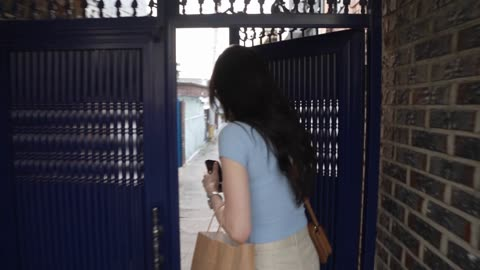</a>

把30秒按时间码拆成五个6秒段落，每段只有一个小动作和一句台词。详细列出DV摄像机的瑕疵（对焦漂移、意外变焦、磁带噪点），并规定只有现场环境声，让画面更像真实素材。

Seedance 2.5 · 文生视频 · 出处: [@SimplyAnnisa on X](https://x.com/SimplyAnnisa/status/2096931238460178592) · 发现于 [LearnPrompt/awesome-seedance](https://github.com/LearnPrompt/awesome-seedance)

[`dv-camcorder`](tags.md#tag-dv-camcorder) [`home-video`](tags.md#tag-home-video) [`korean`](tags.md#tag-korean) [`street`](tags.md#tag-street) [`timed-beats`](tags.md#tag-timed-beats)

<details><summary><b>提示词</b></summary>

```text
Create a 30-second, 1080p, 16:9 ultra-realistic early-2000s DV home video of a young Korean woman having an ordinary but unexpectedly memorable summer evening in an older Seoul neighborhood.

A naturally pretty Korean woman in her early 20s, realistic skin, minimal makeup, long black slightly wavy hair, pale-blue knit top, loose cream trousers, white sneakers, brown crossbody bag, and silver watch. Keep her identity, face, outfit, hairstyle, and proportions perfectly consistent.

SETTING

A quiet older Seoul residential street with concrete lanes, apartment buildings, potted plants, bicycles, utility poles, leafy trees, and a tiny neighborhood convenience shop. Lived-in and authentic. No brands, logos, advertisements, or tourist locations.

CAMERA STYLE

Raw footage from a cheap early-2000s DV camcorder: shaky handheld movement, imperfect framing, autofocus hunting, exposure shifts, faded colors, soft detail, mild tape noise, accidental zooms, and natural camera mistakes. No stabilization or cinematic shots.

00:00–00:06 — THE MYSTERY

She walks down the street holding a small plastic bag when she suddenly hears a faint jingling sound behind her.

She stops and looks around.

The camera quickly zooms toward her confused face.

She says:

“Did you hear that?”

00:06–00:12 — THE LITTLE DISCOVERY

She follows the sound and finds a small old bicycle with a tiny bell stuck slightly open.

She gently taps the bell.

Ding.

She looks at the camera and laughs.

Then she notices a small handwritten-looking paper tag hanging from the bicycle, but the writing is too unclear to read.

00:12–00:18 — THE WIND

A sudden breeze blows several dry leaves across the street.

One lands directly on her head.

She doesn't notice.

The camera operator laughs.

She looks confused, then realizes and removes the leaf.

She gives the camera an embarrassed stare.

00:18–00:24 — THE SMALL CHALLENGE

She places the leaf on the bicycle seat and tries to balance it there.

The wind immediately blows it away.

She tries again.

It falls again.

She laughs and finally gives up.

00:24–00:30 — THE MEMORY

She picks up the leaf, puts it into her small bag, and starts walking home.

After a few steps, she turns toward the camera and says:

“Okay, that was pointless.”

She smiles and keeps walking.

The camera follows her for a few seconds before abruptly cutting to black.

AUDIO

Natural location sound only: footsteps, distant traffic, bicycle bell, summer insects, leaves, wind, neighborhood ambience, and natural laughter.

No music, narration, subtitles, captions, logos, watermarks, or on-screen text.

REALISM

Natural human reactions, imperfect timing, realistic physics, consistent objects, authentic Korean neighborhood details, and believable DV-camera imperfections. No CGI look, distorted hands, extra fingers, duplicated people, identity drift, or outfit changes.

16:9 aspect ratio.
```

</details>

<a id="seedance-korean-apartment-tiktok-dance-fail-home-video"></a>
### 狭小公寓里笨拙的跟跳舞蹈

<a href="https://x.com/Ciri_ai/status/2095026480552271884">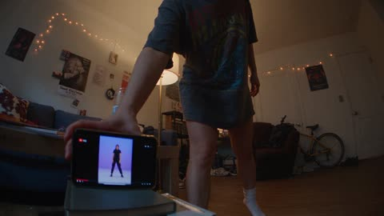</a>

每五秒一个时间段，从干净利落的开场逐步升级到撞灯和打翻水杯的混乱，镜头也从固定手机机位中途变成手持晃动。音频只保留现场自然声，并逐句写出台词，保持家庭录像的真实感。

Seedance 2.5 · 文生视频 · 出处: [@Ciri_ai on X](https://x.com/Ciri_ai/status/2095026480552271884) · 发现于 [LearnPrompt/awesome-seedance](https://github.com/LearnPrompt/awesome-seedance)

[`home-video`](tags.md#tag-home-video) [`handheld`](tags.md#tag-handheld) [`comedy`](tags.md#tag-comedy) [`dialogue`](tags.md#tag-dialogue) [`timed-beats`](tags.md#tag-timed-beats)

<details><summary><b>提示词</b></summary>

```text
Create a 30-second, 1080p ultra-realistic personal home-video of a young Korean woman confidently attempting to learn a viral TikTok dance trend in her tiny apartment, with her furniture and coordination working against her the entire time. No reference image.

**MAIN SUBJECT**

Young Korean woman in her early 20s, casual and determined energy, natural makeup, expression that shifts from focused confidence to flustered embarrassment.

Hair in a messy half-up bun, a few strands sticking to her face as she gets more flustered, small stud earrings.

Wearing an oversized band t-shirt tucked loosely into biker shorts, white ankle socks, no shoes, phone propped up against a stack of books on the floor to "record for practice."

Maintain the same face, hairstyle, clothing, body proportions, and appearance throughout the entire video.

**SETTING**

A small, cluttered studio apartment living room, evening, warm lamp light mixed with the cool glow of a laptop screen playing the dance tutorial video.

A coffee table pushed slightly out of the way but not far enough, a floor lamp standing a little too close to her "stage area," a pile of laundry on the couch, a half-full water glass on the side table, string lights on the wall, and a roommate's bike leaning against the wall in the background. Cramped, real, an apartment clearly not built for dancing.

**CAMERA / VISUAL AESTHETIC**

Raw personal footage, filmed by her roommate on a phone propped up at first, then grabbed handheld once things go wrong — strong handheld vlog shake for the second half.

Static, slightly low-angle framing for the "practice" shots, mimicking a phone-on-a-stack-of-books setup. Frame is imperfectly centered, cutting off the top of her head slightly. Once the roommate grabs the phone, autofocus hunts, motion blur kicks in during the collision moment, exposure shifts as she moves between lamp light and shadow, visible digital noise in the dim room.

No stabilization, no gimbal smoothness, no cinematic camera moves — it should feel like a real phone recording that was never meant to be watched by anyone but her.

---

**00:00–00:05 — THE CONFIDENT SETUP**

She props her phone against a stack of books, steps back into frame, and shakes out her arms like an athlete warming up.

She points at the laptop screen playing the dance tutorial, then back at herself, deadly serious.

*"Okay. I've watched this like twenty times. I got this."*

**00:05–00:10 — FIRST EIGHT-COUNT**

The music starts. She nails the first few moves surprisingly well, sharp and confident, clearly proud of herself mid-move.

Roommate's voice from off-screen, genuinely impressed: *"Wait, okay—?!"*

The camera stays static, catching her in full frame, a rare clean moment.

**00:10–00:15 — THE FIRST WOBBLE**

A quick turn in the choreography catches her off guard — she spins a half-second late, arms flailing to catch up, and clips the edge of the coffee table with her shin.

She yelps, hopping on one foot, still trying to keep the rhythm going through gritted teeth.

*"I'm fine — I'm fine, keep going—"*

**00:15–00:20 — LAMP INCIDENT**

Recovering, she throws herself into the next big arm movement — her hand clips the floor lamp, sending it tilting dangerously.

Her roommate lunges into frame to catch it, grabbing the phone off the books in the process, camera suddenly handheld and shaking.

*"THE LAMP—"*

**00:20–00:25 — FULL CHAOS**

With the lamp saved but the camera now shaky and handheld, she tries to pick the choreography back up from memory, increasingly out of sync with the music, arms going in directions the dance never intended.

She knocks the water glass off the side table with her elbow, doesn't even stop, just grimaces and keeps dancing through the spill.

Roommate, laughing hysterically behind the now-unsteady camera: *"You're literally destroying the apartment—"*

**00:25–00:30 — FINAL MOMENT**

The song ends. She strikes a triumphant final pose — chest heaving, one hand on her hip, completely out of breath, water pooling near her sock.

She looks into the camera, dead serious despite the disaster around her.

*"...Post it. That was clean."*

Her roommate, still laughing, pans the camera slowly down to the spilled water and tipped lamp before swinging back to her unbothered face — and the footage cuts abruptly to black.

---

**AUDIO**

Natural location sound only:

The tutorial/dance track playing tinny from the laptop speakers, her footsteps and fabric movement, the thud of her shin hitting the table, the lamp wobbling and roommate's scramble to catch it, glass tipping and water spilling, her roommate's genuine off-camera laughter throughout, and handheld camera noise once it's picked up.

No added music beyond the in-scene laptop track. No narration. No artificial sound effects.

Spoken lines: *"Okay. I've watched this like twenty times. I got this."* / *"Wait, okay—?!"* (roommate) / *"I'm fine — I'm fine, keep going—"* / *"THE LAMP—"* (roommate) / *"You're literally destroying the apartment—"* (roommate) / *"...Post it. That was clean."*

**FINAL FEEL**

Chaotic, cramped-apartment energy — the universal experience of confidently trying a viral dance and immediately losing a fight with your own furniture. Funny, physical, unscripted-feeling, with a deadpan ending that lands harder because she genuinely doesn't acknowledge the destruction around her.

No exaggerated slapstick beyond real physical missteps. No professional dance skill required — the comedy comes from real momentum, real near-misses, and her total refusal to admit defeat.
```

</details>

<a id="seedance-korean-classroom-gunfight-red-scarf"></a>
### 红围巾女主的韩式教室枪战

<a href="https://x.com/Noor_ul_ain43/status/2104793144743108833"></a>

60秒脚本拆成六个带时间段的场景，每段都列出特写、低角度、甩镜和慢动作等镜头。固定的服装描述、单一场景和冷蓝绿调色让角色与画面在多次剪切中保持一致。

Seedance 2.5 · 文生视频 · 出处: [@Noor_ul_ain43 on X](https://x.com/Noor_ul_ain43/status/2104793144743108833) · 发现于 [LearnPrompt/awesome-seedance](https://github.com/LearnPrompt/awesome-seedance)

[`action`](tags.md#tag-action) [`gunfight`](tags.md#tag-gunfight) [`martial-arts`](tags.md#tag-martial-arts) [`cinematic`](tags.md#tag-cinematic) [`multi-shot`](tags.md#tag-multi-shot)

<details><summary><b>提示词</b></summary>

```text
Create a 60-second ultra-realistic cinematic Korean action-thriller scene featuring a young woman with straight black hair, a sharp, confident expression, and a distinctive outfit: a black oversized jacket, light-colored top, black pants, and a bright red scarf. She is inside a dimly lit classroom, facing an armed opponent. The scene combines intense gunfight choreography, acrobatic martial arts, dramatic close-ups, and stylish action-film cinematography.

SCENE 1 — THE INTRODUCTION (0–6 seconds)

Open with a medium close-up of the young woman standing motionless in a dark classroom. She looks directly ahead with a calm, intimidating expression. Her black hair frames her face, and her red scarf contrasts with her dark clothing.

Cut to an extreme close-up of her face as she slightly tilts her head and purses her lips, maintaining a cool, fearless attitude. Insert a brief close-up of a handgun resting on a nearby desk to establish the danger.

SCENE 2 — THE ATTACK BEGINS (6–12 seconds)

Cut to a wider classroom shot. An armed opponent suddenly approaches. The woman immediately lowers her body, shifts her weight, and prepares to evade.

Use a fast tracking shot as she moves forward, followed by a sudden camera cut to her opponent. The choreography should feel fast, fluid, and physically convincing, with realistic body mechanics and clear spatial continuity.

SCENE 3 — ACROBATIC FIGHT (12–22 seconds)

The woman launches into an explosive sequence of martial arts movements. She ducks beneath an attack, pivots, performs a high spinning kick, and uses rapid changes of direction to avoid her opponent.

Capture the action with a combination of low-angle shots, wide shots, and close tracking movements. Her jacket and red scarf move naturally with her momentum.

Show brief flashes of gunfire and bright muzzle flashes illuminating the dark classroom. The camera alternates between the woman's controlled movements and the opponent's reactions.

SCENE 4 — THE GUNFIGHT (22–36 seconds)

Escalate the confrontation with rapid exchanges of gunfire. The woman takes cover, changes position, and uses the classroom desks as obstacles.

Include dramatic low-angle shots of her moving across the room, quick close-ups of her focused eyes, and brief shots of the muzzle flashes lighting the windows and furniture.

At one point, use a dramatic ground-level perspective as she stands over the camera's viewpoint, holding her weapon with a determined expression.

Cut to a close-up of her hands holding a firearm, then return to a wider shot showing her movement through the classroom.

SCENE 5 — THE FINAL EXCHANGE (36–48 seconds)

The action becomes more intense. The woman moves sideways while maintaining awareness of her opponent. Show a fast sequence of evasive movements, sharp turns, and acrobatic kicks.

Use dynamic handheld cinematography, short whip pans, and occasional slow motion at the most dramatic moments. Include realistic motion blur without losing the clarity of the choreography.

The opponent attempts to regain control, but she continues moving confidently through the classroom.

SCENE 6 — THE CINEMATIC FINISH (48–60 seconds)

Slow the pacing briefly. Show the woman standing with a confident, almost playful expression. Her hair is slightly disheveled, and her red scarf hangs loosely around her neck.

Cut to a wide shot of the classroom as the confrontation resumes. The woman and her opponent exchange a final sequence of rapid movements, with one last dramatic dodge and counterattack.

End with a close-up of her face as she looks toward the camera with a subtle, confident expression. Finish with a final cinematic action shot and a sharp cut to black.

CINEMATOGRAPHY AND VISUAL STYLE

- Photorealistic Korean action-film cinematography.
- Cool blue-green color grading, dark shadows, and muted classroom colors.

IMPORTANT CONSISTENCY INSTRUCTIONS
```

</details>

<a id="seedance-korean-coastal-coffee-lifestyle-film"></a>
### 滨海城市里韩国女孩的咖啡日常

<a href="https://x.com/aiwithaayat/status/2110600258871013510"></a>

提示词按顺序列出镜头，从咖啡柜台到街头、海边栏杆再到黄金时刻的山坡，让25秒时长里有一条连贯的故事线。结尾集中写明镜头、颗粒、色调和情绪，使各个镜头保持统一的画面风格。

Seedance 2.5 · 文生视频 · 出处: [@aiwithaayat on X](https://x.com/aiwithaayat/status/2110600258871013510) · 发现于 [LearnPrompt/awesome-seedance](https://github.com/LearnPrompt/awesome-seedance)

[`lifestyle`](tags.md#tag-lifestyle) [`cinematic`](tags.md#tag-cinematic) [`multi-shot`](tags.md#tag-multi-shot) [`coastal`](tags.md#tag-coastal) [`golden-hour`](tags.md#tag-golden-hour)

<details><summary><b>提示词</b></summary>

```text
Created a 25 second video, beautiful Korean girls, cinematic lifestyle film set in a beautiful coastal city, capturing the peaceful and aesthetic moments of everyday life. Begin with a warm, cozy coffee shop scene featuring a barista serving a takeaway coffee on a wooden counter, followed by a cinematic reflection of a young Korean woman standing near a large glass window with soft city lights reflecting across the glass. Show close-up shots of her walking along a busy urban street, focusing on her sneakers stepping across the pavement, then transition to a wide low-angle shot of her standing in front of a striking modern architectural building, wearing a stylish beige trench coat, carrying a black shoulder bag, and looking peacefully toward the sky. Capture intimate side-profile shots of her holding a coffee cup beside a window, with natural sunlight illuminating her face and soft shadows creating a moody atmosphere. Transition smoothly to a beautiful seaside promenade where she stands beside a metal railing, holding her coffee and gazing at the sparkling blue ocean as a large cruise ship moves slowly in the background. Continue with breathtaking golden-hour shots of a beautiful Korean girl sitting on a lush green grassy hill overlooking the ocean, her long dark brown hair moving gently in the sea breeze, wearing a relaxed beige outfit and holding a takeaway coffee cup. Capture natural facial expressions, subtle movements, candid moments, and elegant close-ups of her face as she turns toward the camera. End with an expansive cinematic wide shot of the green coastal landscape, calm blue water, distant islands, and a cruise ship sailing peacefully along the horizon, with the girl appearing small against the beautiful scenery. Use photorealistic visuals, cinematic composition, smooth camera movements, shallow depth of field, natural skin texture, soft film grain, realistic lighting, warm golden-hour tones, muted earthy colors, subtle lens flares, and premium Korean fashion editorial aesthetics. The overall mood should feel peaceful, dreamy, elegant, emotional, and authentic, like a high-end Korean lifestyle film shot on a professional cinema camera, with seamless transitions, realistic motion, beautiful environmental details, and no artificial-looking faces or exaggerated movements.
```

</details>

<a id="seedance-korean-countryside-chicken-coop-morning-vlog"></a>
### 韩国乡村清晨鸡舍生活 Vlog

<a href="https://x.com/aiwithaly/status/2097556131623432569">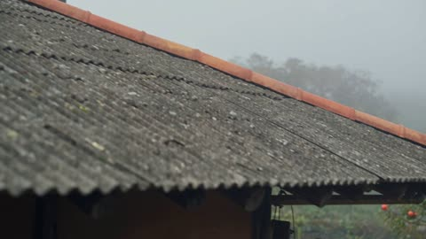</a>

用箭头把一连串动作拆成有序的节拍，让 30 秒的片段脉络清晰。再配上纪实手持风格、雾气与风声等环境声提示，结尾列出排除项（无背景音乐、字幕、标志），画面更自然。

Seedance 2.5 · 文生视频 · 出处: [@aiwithaly on X](https://x.com/aiwithaly/status/2097556131623432569) · 发现于 [LearnPrompt/awesome-seedance](https://github.com/LearnPrompt/awesome-seedance)

[`vlog`](tags.md#tag-vlog) [`korean-countryside`](tags.md#tag-korean-countryside) [`documentary`](tags.md#tag-documentary) [`handheld`](tags.md#tag-handheld) [`morning-routine`](tags.md#tag-morning-routine)

<details><summary><b>提示词</b></summary>

```text
Create a 30-second photorealistic Korean countryside lifestyle vlog following a woman through her peaceful morning routine. Show her opening the chicken coop → feeding the chickens → collecting fresh eggs → cleaning the coop → preparing a homemade breakfast → sitting outside and enjoying the quiet farmhouse morning.

Authentic 2026 Korean rural life, natural human movement, realistic chicken behavior, fresh farm-to-table details, morning mist, soft sunlight, natural wind and environmental sounds, and documentary-style handheld cinematography. No background music, subtitles, logos or watermark.
```

</details>

<a id="seedance-korean-couple-lazy-morning-pov-walk"></a>
### 韩国情侣夏日慵懒清晨第一视角漫步

<a href="https://x.com/AIwithJessica/status/2096779054720639258">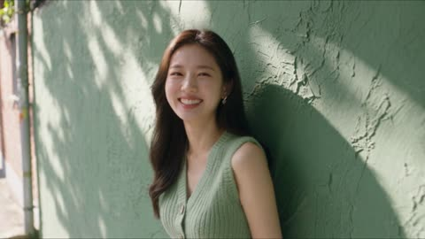</a>

用参考图锁定两人的脸和服装，再把30秒拆成十个三秒小段，每段只写一个小动作。MiniDV手持风格、只保留现场环境声，并在结尾写明一致性要求，让画面更真实。

Seedance 2.5 · 参考生视频 · 出处: [@AIwithJessica on X](https://x.com/AIwithJessica/status/2096779054720639258) · 发现于 [LearnPrompt/awesome-seedance](https://github.com/LearnPrompt/awesome-seedance)

[`pov-vlog`](tags.md#tag-pov-vlog) [`korean-lifestyle`](tags.md#tag-korean-lifestyle) [`couple`](tags.md#tag-couple) [`minidv`](tags.md#tag-minidv) [`reference-images`](tags.md#tag-reference-images)

<details><summary><b>提示词</b></summary>

```text
POV: Korean couple spends a lazy summer morning wandering their neighborhood 🇰🇷 Create a 30-second, 16:9 ultra-realistic live-action POV vlog using the uploaded reference images as the exact character references. Girl: preserve her face, long straight dark hair, eye color, skin tone, soft natural makeup, delicate drop earrings, and body proportions exactly as in reference image 2, wearing her sage-green sleeveless ribbed knit vest and white wide-leg trousers throughout. Boy: preserve his face, tousled dark wavy hair, earrings, layered silver chain necklace, chain bracelet and wristwatch exactly as in reference image 1, wearing his oversized dusty-pink smiley-face tee and white sweatshorts throughout.

Style: Authentic Korean lifestyle vlog, early-2000s MiniDV/home-video aesthetic, handheld POV, imperfect framing, slight autofocus breathing, natural motion blur and exposure changes, soft overcast morning light. Spontaneous, unstaged chemistry.

0–3s: She leans against a textured green courtyard wall, laughing as she films him approaching down the lane with two iced coffees.

3–6s: They walk side by side down the narrow concrete alley, camera swinging naturally; he hands her a coffee and she takes a sip, smiling at the lens.

6–9s: She spins slowly in front of an old wall covered in dappled tree-shadow, showing off her outfit; he claps and whistles playfully off-camera.

9–12s: They pause by a row of parked bicycles; he pretends to ride one and she films, giggling, telling him to stop.

12–15s: Inside the small convenience store, she picks a snack from the shelf while he sneaks a second item into her basket; she catches him and narrows her eyes.

15–18s: Outside the store, they sit on a low step sharing the snack, passing it back and forth, natural laughter between bites.

18–21s: Walking again, she films their shadows stretching across the pavement; he reaches over and gently tucks a strand of her hair back.

21–24s: They stop by a wall of hanging laundry and potted plants; she pretends to interview him with the coffee cup as a microphone.

24–27s: He points out something off-camera; she turns to look, laughing, then bumps his shoulder with hers.

27–30s: They continue walking down the sunlit lane, hand in hand, camera trailing behind as they shrink into the distance; she glances back once, smiling, before the frame settles into a soft handheld sway.

Audio: Natural location sound only—quiet residential ambience, birds, distant traffic, footsteps, rustling laundry, convenience store door chime, soft conversation and laughter. No music, narration or artificial SFX.

Continuity/realism: Same woman and boyfriend throughout; consistent wardrobe and appearance matching the reference images exactly, believable Korean neighborhood environment, realistic physics and movement, natural couple chemistry. No teleportation, duplicates, distorted faces/hands, exaggerated acting, subtitles, captions, logos or watermarks.
```

</details>

<a id="seedance-korean-couple-seoul-drive-dv-camcorder"></a>
### 韩国情侣午后兜风DV摄像机风格

<a href="https://x.com/AIwithkhan/status/2104776214066188611">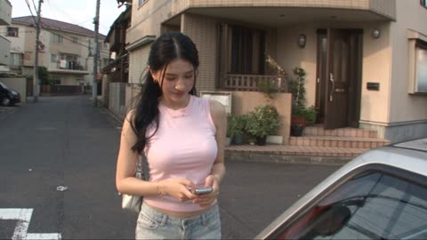</a>

prompt按人物、分段剧情、镜头质感、音频、连续性和负面词分区,让30秒内容保持连贯。DV质感来自具体的瑕疵描述,如对焦抖动、意外变焦和曝光波动,音频只用内置麦克风的环境声,不加音乐。

Seedance 2.5 · 文生视频 · 出处: [@AIwithkhan on X](https://x.com/AIwithkhan/status/2104776214066188611) · 发现于 [LearnPrompt/awesome-seedance](https://github.com/LearnPrompt/awesome-seedance)

[`dv-camcorder`](tags.md#tag-dv-camcorder) [`couple`](tags.md#tag-couple) [`seoul`](tags.md#tag-seoul) [`lo-fi-realism`](tags.md#tag-lo-fi-realism) [`native-audio`](tags.md#tag-native-audio)

<details><summary><b>提示词</b></summary>

```text
Create a 30-second, 1080p ultra-realistic early-2000s consumer DV camcorder home video of a young Korean couple going for a casual afternoon drive through Seoul. The footage should feel like a genuine memory recorded by a friend, imperfect and spontaneous rather than a polished commercial.

=== CHARACTERS ===

GIRL: Young adult Korean woman in her early 20s, naturally beautiful, realistic skin, minimal makeup, long slightly wavy dark hair tied loosely with a few strands framing her face. Ll

BOYFRIEND: Young adult Korean man in his early 20s, natural hairstyle, realistic skin, relaxed expression, wearing a loose white T-shirt, dark jeans and white sneakers. Keep his appearance consistent.

=== STORY ===

She waits outside her apartment building with a small shoulder bag, checking her phone and looking down the street. Her boyfriend arrives in an older compact car and smiles when he sees her. She opens the passenger door, gets inside and playfully looks toward the camera as if embarrassed about being filmed.

They drive slowly through an older Seoul neighborhood. She sits in the passenger seat with the window slightly open, enjoying the breeze while her hair moves naturally. Her boyfriend occasionally glances at her and smiles while keeping his attention on the road.

They stop at a small neighborhood convenience store. She gets out, buys two cold drinks and returns to the car. She hands one to her boyfriend, keeps the other for herself, and they laugh together before continuing the drive.

Later, they park near a quiet riverside road. They get out and walk beside the parked car, talking casually. She takes a sip of her drink, makes a playful expression at the taste, and he laughs. She lightly pushes his shoulder and they continue walking together.

A gentle breeze moves through her hair. He notices a strand across her face and gently moves it aside. She smiles and looks at him for a moment. They stand close together beside the car, sharing a quiet romantic moment.

Near the end, she looks toward the camera and laughs shyly, then turns back toward her boyfriend. He steps closer, she smiles, and they share a brief, natural kiss. They pull back, laugh softly and remain standing close together as the camera keeps recording.

The boyfriend looks toward the camera and jokingly shakes his head while she hides her face against his shoulder, laughing.

=== CAMERA / DV FEEL ===

Raw early-2000s consumer DV camcorder footage. Handheld camera operated by a friend sitting in the back seat and later walking with them. Imperfect framing, subtle handheld shake, autofocus hunting, occasional exposure shifts, faded summer colors, soft digital detail, mild sensor noise, natural motion blur and occasional accidental zooms. No stabilization and no polished cinematic movement.

=== AUDIO ===

Built-in camcorder microphone only. Car engine, road noise, turn signals, window breeze, distant Seoul traffic, convenience-store door chime, refrigerator hum, footsteps, birds, neighborhood voices, fabric movement and natural laughter. Their dialogue should feel casual and partially imperfect like a real home video. No music, no narration, no subtitles.

=== REALISM / CONTINUITY ===

Keep the same couple, faces, hairstyles, outfits, accessories and car throughout. Natural Korean facial features, realistic hands and fingers, believable walking, sitting, driving and kissing. Hair and clothing react naturally to the breeze and movement. Genuine expressions rather than exaggerated acting.

=== NEGATIVE ===

No cinematic commercial look, no gimbal shots, no drone shots, no dramatic lighting, no beauty filters, no plastic skin, no CGI appearance, no anime, no cartoon
```

</details>

<a id="seedance-korean-farm-day-front-facing-home-video"></a>
### 韩国农场一日家庭录像

<a href="https://x.com/saniaspeaks_/status/2098742251472261330">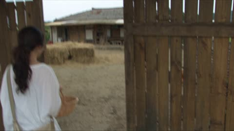</a>

五段各五秒的时间线让三十秒的片段保持连贯。反复强调镜头始终在人物正面、手持 DV 的瑕疵以及只保留现场环境音，让家庭录像的真实感立得住。

Seedance 2.5 · 文生视频 · 出处: [@saniaspeaks_ on X](https://x.com/saniaspeaks_/status/2098742251472261330) · 发现于 [LearnPrompt/awesome-seedance](https://github.com/LearnPrompt/awesome-seedance)

[`home-video`](tags.md#tag-home-video) [`dv-camcorder`](tags.md#tag-dv-camcorder) [`korean`](tags.md#tag-korean) [`vlog`](tags.md#tag-vlog) [`farm`](tags.md#tag-farm)

<details><summary><b>提示词</b></summary>

```text
Create a 30-second, 1080p ultra-realistic personal home-video showing an ordinary summer afternoon in the life of a young Korean woman visiting a small traditional farm and helping with the animals. No reference image.

A naturally pretty beautiful Korean woman in her early 20s, realistic natural skin texture, minimal makeup, relaxed and cheerful personality. Long black hair tied in a loose low ponytail. She wears a loose white cotton T-shirt, light olive-green cargo pants, brown ankle boots, and a beige canvas crossbody bag. Keep the same face, hairstyle, clothing, body proportions, and overall appearance throughout the entire video.

A small traditional countryside farm outside Seoul during a warm summer afternoon. Wooden fences, green fields, an old farmhouse, barn, hay bales, vegetable patches, chickens, cows, buckets, farming tools, trees and natural countryside surroundings. The farm feels ordinary and lived-in, not like a tourist attraction.

The camera is ALWAYS positioned IN FRONT OF THE GIRL, never behind her. A friend stands or walks in front of her, casually filming her with a handheld consumer DV camcorder/smartphone. Her front face must remain clearly visible during the important moments. The camera naturally moves backward while she walks toward it. Use imperfect handheld movement, small shakes, slightly uneven framing, autofocus hunting, occasional exposure changes, natural motion blur, soft digital detail, mild image noise, faded early-2000s home-video colors, and occasional accidental zooms.

Absolutely NO rear-view shots, NO filming from behind, NO drone, NO gimbal, NO cinematic tracking shots, NO polished commercial look, NO beauty filter. It should genuinely feel like a friend casually recorded this afternoon.

TIMELINE

0:00–0:05 — Arriving at the Farm

The girl walks toward the farm entrance while the friend walks backward in front of her filming. She smiles naturally and looks around at the animals and fields. She says casually in Korean:

“오늘 농장에 왔어요.”

Natural footsteps, birds, insects and distant farm sounds.

0:05–0:10 — Feeding the Cow

Still filmed from the front, the girl approaches a calm cow and holds out fresh vegetables. The cow gently eats from her hand. She laughs naturally and looks at the camera, then back at the cow.

0:10–0:15 — Helping With Vegetables

Hard cut. The camera remains in front of her as she walks through a vegetable patch and picks fresh vegetables. She holds them up toward the camera with a happy smile.

0:15–0:20 — Chickens

Hard cut. Several chickens suddenly walk across the path in front of her. The camera stays facing her from the front as she laughs and carefully steps around them. One chicken comes close to her boots.

0:20–0:25 — Farmhouse Break

She sits outside the farmhouse with a basket of freshly picked vegetables and eats a piece of fresh fruit. She looks relaxed and slightly tired from working. She smiles at the camera and says:

“생각보다 재밌어요.”

0:25–0:30 — Walking Away / Goodbye
She gets up and walks toward the camera, then stops near the farm entrance. The friend keeps filming from directly in front of her. She gives a small wave and says:

“다음에 또 올게요. 안녕!”

She walks past the camera as the recording ends naturally.

AUDIO:
Only authentic location sound: birds, chickens, cows, insects, footsteps, leaves, distant farm activity and natural conversation. No background music, no narration, no artificial sound effects.

FINAL LOOK:
Completely believable real-life home-video footage. Slightly imperfect, spontaneous, unpolished and human. Front-facing camera coverage throughout the story, with the girl's face clearly visible.
```

</details>

<a id="seedance-korean-seaside-harbor-flip-camera-vlog"></a>
### 韩国海边港口翻盖相机随拍 Vlog

<a href="https://x.com/ShamiWeb3/status/2096101448090267992">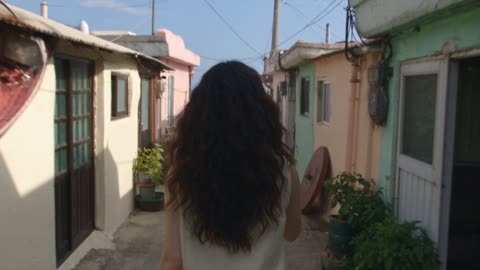</a>

按四秒左右的时间段列出动作和韩语台词，让 30 秒的 Vlog 节奏清晰。统一的风格段落写明 2000 年代末翻盖相机的画质缺陷，再用否定清单排除精致感，并单独写环境音，画面才显得真实粗粝。

Seedance 2.5 · 参考生视频 · 出处: [@ShamiWeb3 on X](https://x.com/ShamiWeb3/status/2096101448090267992) · 发现于 [LearnPrompt/awesome-seedance](https://github.com/LearnPrompt/awesome-seedance)

[`vlog`](tags.md#tag-vlog) [`handheld`](tags.md#tag-handheld) [`korean`](tags.md#tag-korean) [`timestamped`](tags.md#tag-timestamped) [`ambient-sound`](tags.md#tag-ambient-sound)

<details><summary><b>提示词</b></summary>

```text
Preserve the exact facial features, identity, skin tone, and natural facial proportions from @image1 throughout. Do not copy the reference hairstyle or outfit. Outfit: lightweight cream sleeveless blouse, high-waisted faded blue jeans, white canvas sneakers, small gold hoop earrings, loose natural wavy hair. Authentic Korean woman. Late-2000s personal vlog aesthetic. Extremely raw handheld flip-camera footage with heavy camera shake, spontaneous reframing, partial face crops, focus hunting, exposure shifts, warm faded colors, mild digital noise, and authentic home-video imperfections. No posing, no cinematic glamour, no stabilization, no modern color grading.

00:00–00:04 Walking quickly down a narrow seaside alley while holding the camera, suddenly spotting the ocean at the end of the street. She turns the camera toward it and excitedly says in Korean, "잠깐, 바다가 보여요!"

00:04–00:08 Runs toward a small harbor, laughing as the camera shakes heavily. She reaches the railing, leans over carefully, and watches fishing boats moving across the water.

00:08–00:12 Spots a fisherman pulling in a small fishing net and asks if she can help. She grabs one end of the net, struggles with the weight, laughs, and says in Korean, "생각보다 훨씬 무거운데요?"

00:12–00:16 The fisherman shows her a freshly caught fish. She reacts with wide-eyed surprise, steps backward laughing, then cautiously reaches out to touch it while saying, "우와, 진짜 크다!"

00:16–00:20 Walks into a tiny harbor-side snack shop, discovers a bowl of freshly made fish cake soup, sits at the counter, takes a sip, and smiles with satisfaction.

00:20–00:24 Steps outside holding the warm cup, notices a group of neighborhood grandmothers playing a casual Korean card game at a plastic table. She joins them briefly, laughs at their playful reactions, and gestures toward the camera.

00:24–00:27 Walks along the harbor promenade eating a small ice cream, filming boats and seagulls before accidentally getting a little ice cream on her nose. She notices it and laughs.

00:27–00:30 Stops beside the harbor railing as the wind moves her hair, turns the camera toward herself, smiles naturally, and says in Korean, "오늘 진짜 재밌었다. 다음에 또 올게요. 안녕!" She waves and the recording ends abruptly.

Natural ambience only: ocean waves, seagulls, fishing boats, harbor conversations, footsteps, wind, net ropes, shop sounds, card-table laughter, distant scooters, and neighborhood activity. No background music, subtitles, logos, or watermarks. The footage should feel exactly like a genuine late-2000s handheld flip-camera Korean vacation vlog with spontaneous actions, imperfect framing, authentic Korean dialogue, realistic human movement, and natural interactions. Aspect ratio: 16:9.
```

</details>

<a id="seedance-korean-subway-door-glass-punch-comedy"></a>
### 韩国地铁女生砸碎车门玻璃

<a href="https://x.com/AIwithkhan/status/2097168171367338428">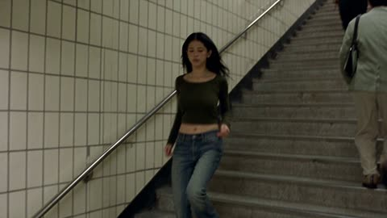</a>

提示词先声明上传图片是精确参考来锁定脸、发型和服装,再用一串简短的剧情节拍从没赶上地铁推进到全车厢大笑。DV质感、只有地铁环境音不放音乐,再加上覆盖人物漂移、玻璃复原和血腥的长负面清单,让物理效果和角色保持稳定。

Seedance 2.5 · 参考生视频 · 出处: [@AIwithkhan on X](https://x.com/AIwithkhan/status/2097168171367338428) · 发现于 [LearnPrompt/awesome-seedance](https://github.com/LearnPrompt/awesome-seedance)

[`subway`](tags.md#tag-subway) [`action-comedy`](tags.md#tag-action-comedy) [`korean`](tags.md#tag-korean) [`dv-look`](tags.md#tag-dv-look) [`character-consistency`](tags.md#tag-character-consistency)

<details><summary><b>提示词</b></summary>

```text
Create a 30-second, 1080p ultra-realistic Korean subway action-comedy scene using the uploaded images as exact visual references; keep characters, faces, hair, outfits and environment consistent.
Young Korean woman, early 20s, long straight black hair, green cropped long-sleeve top, loose blue jeans, silver jewelry; confident and expressive.
Young Korean man, short black hair, gray button-up shirt, dark trousers and white sneakers; playful, then shocked and embarrassed.
She rushes down the subway stairs toward a waiting train, but the doors close just as she reaches them.
The man inside sees her through the glass and laughs at her; she stares at him angrily and says, “Are you seriously laughing?”
He laughs again, so she suddenly punches the glass beside the door, cracking and breaking the safety glass realistically with no injury or gore.
She reaches through the broken opening, grabs his shirt and pulls him safely out onto the platform; he lands awkwardly on the floor in shock.
She calmly climbs through the same broken opening into the train, straightens her clothes and walks inside as stunned passengers watch.
The man remains sitting outside, looking confused and humiliated while passengers stare at him through the windows.
One passenger starts laughing, then everyone bursts into laughter while the man looks around helplessly.
She looks at him through the window, gives a tiny satisfied smile, then casually turns away.
Ultra-realistic Korean subway lighting, gritty DV-inspired look, natural motion blur, realistic physics, handheld imperfections, authentic reactions and ambient subway audio; no music.
No gore, blood, serious injuries, identity drift, outfit changes, duplicated people, teleportation, regenerating glass, distorted hands, CGI look, subtitles, captions, text, logos or watermark.
```

</details>

<a id="seedance-korean-subway-glass-punch-revenge-comedy"></a>
### 韩国地铁门玻璃一拳复仇喜剧

<a href="https://x.com/AIwithSynthia/status/2098988104418050349">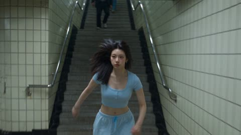</a>

上传参考图锁定人物脸部和服装，动作按关门到最后一笑的顺序逐拍写清。DV 手持质感加无音乐的环境声，再配一长串负面清单，防止人物漂移和血腥画面。

Seedance 2.5 · 参考生视频 · 出处: [@AIwithSynthia on X](https://x.com/AIwithSynthia/status/2098988104418050349) · 发现于 [LearnPrompt/awesome-seedance](https://github.com/LearnPrompt/awesome-seedance)

[`subway`](tags.md#tag-subway) [`action-comedy`](tags.md#tag-action-comedy) [`dv-handheld`](tags.md#tag-dv-handheld) [`korean`](tags.md#tag-korean) [`reference-images`](tags.md#tag-reference-images)

<details><summary><b>提示词</b></summary>

```text
Create a 30-second, 1080p ultra-realistic Korean subway action-comedy scene using the uploaded images as exact visual references; keep characters, faces, hair, outfits and environment consistent.
Young Korean woman, early 20s, long straight black hair, fitted pastel-blue cropped top, loose pajama-style pants, simple silver jewelry; confident, expressive and slightly mischievous.
Young Korean man, short black hair, gray button-up shirt, dark trousers and white sneakers; playful at first, then shocked and embarrassed.
She rushes down the subway stairs toward a waiting train, but the doors close just as she reaches them.
The man inside sees her through the glass and laughs at her; she stares at him angrily and says, “Are you seriously laughing?”
He laughs again, so she suddenly punches the glass beside the door, cracking and breaking the safety glass realistically with no injury or gore.
She reaches through the broken opening, grabs his shirt and pulls him safely out onto the platform; he lands awkwardly on the floor in shock.
She calmly climbs through the same broken opening into the train, straightens her pastel top and pajama pants, and walks inside as stunned passengers watch.
The man remains sitting outside, looking confused and humiliated while passengers stare at him through the windows.
One passenger starts laughing, then everyone bursts into laughter while the man looks around helplessly.
She looks at him through the window, gives a tiny satisfied smile, then casually turns away.
Ultra-realistic Korean subway lighting, gritty DV-inspired look, natural motion blur, realistic physics, handheld imperfections, authentic reactions and ambient subway audio; no music.
No gore, blood, serious injuries, identity drift, outfit changes, duplicated people, teleportation, regenerating glass, distorted hands, CGI look, subtitles, captions, text, logos or watermark.
```

</details>

<a id="seedance-korean-summer-peach-snack-day-in-the-life"></a>
### 韩国夏日午后桃子小食日常

<a href="https://x.com/ChillaiKalan__/status/2094633575547314503">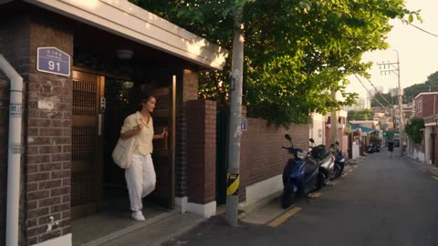</a>

三十秒内按时间戳拆成六个段落，并用参考图锁定人物身份，服装与光线全程一致。镜头风格、环境音、物理真实感和负面提示各自成段，把画面推向纪录片质感而不是广告感。

Seedance 2.5 · 参考生视频 · 出处: [@ChillaiKalan__ on X](https://x.com/ChillaiKalan__/status/2094633575547314503) · 发现于 [LearnPrompt/awesome-seedance](https://github.com/LearnPrompt/awesome-seedance)

[`day-in-the-life`](tags.md#tag-day-in-the-life) [`photorealistic`](tags.md#tag-photorealistic) [`korean`](tags.md#tag-korean) [`documentary`](tags.md#tag-documentary) [`multi-scene`](tags.md#tag-multi-scene)

<details><summary><b>提示词</b></summary>

```text
30 seconds | 16:9 | Ultra-photorealistic live-action

Create a natural Korean summer day-in-the-life video featuring one young Korean woman spending a quiet afternoon preparing a simple chilled fruit snack at home.

Use the reference image only for her exact facial identity, hairstyle, skin tone, and body proportions. Keep her appearance consistent throughout the entire video.

OUTFIT: Lightweight pale-yellow short-sleeve blouse, loose white cotton pants, simple canvas shoulder bag, white low-profile sneakers, minimal silver jewelry. Outfit remains unchanged from beginning to end.

TIME & LIGHTING: Warm late-afternoon summer sunlight. Consistent weather, shadows, color temperature, and time of day across every scene.

00–05s — Neighborhood walk

She leaves a small Korean apartment building carrying her canvas bag and walks down a quiet residential street.

Trees move gently in the summer breeze. Parked scooters, apartment entrances, utility poles, bicycles, and distant pedestrians create an authentic neighborhood atmosphere.

She briefly looks at the camera and says:
“I need something refreshing today.”

05–10s — Local fruit stand

She arrives at a small neighborhood fruit shop with crates of peaches, grapes, melons and Korean pears.

Instead of immediately picking something, she walks around comparing the fruit.

She notices a basket of peaches, picks one up carefully, examines it, smells it, and smiles.

The shop owner says something casually off-camera.

She responds:
“This one looks perfect.”

She places several peaches into her canvas bag.

10–15s — Walking home

She walks back through the neighborhood carrying the slightly heavier bag.

The camera follows from behind and then moves beside her.

She adjusts the bag against her shoulder as the fruit shifts naturally inside.

A bicycle passes in the background. Leaves move gently in the breeze. Her hair moves subtly with the air.

15–21s — Apartment kitchen

She enters her apartment kitchen and places the peaches on the counter.

She turns on the faucet and rinses them under cool running water.

Water droplets collect on the fruit and fall naturally into the sink.

She dries one peach with a clean kitchen towel and places it onto a small ceramic plate.

21–26s — Preparing the snack

She sits at the kitchen counter.

Using a small kitchen knife, she carefully slices the peach in half.

The knife meets realistic resistance before passing through the soft fruit.

She removes the pit, cuts several thin slices, and arranges them casually on the plate.

Close-up of realistic juice and peach texture.

26–30s — First bite

She picks up one slice and takes her first bite.

She pauses for a moment, smiles naturally, and quietly says:

“So good.”

She looks toward the window as warm sunlight falls across the kitchen.

The camera slowly drifts backward, capturing the cozy kitchen, open window, gentle curtain movement, and late-summer atmosphere.

Cut naturally at the end.

CAMERA STYLE: Documentary lifestyle footage with smooth handheld movement. Natural tracking shots, occasional subtle camera sway, realistic focus transitions, restrained depth of field, natural lens behavior, and authentic perspective. Avoid overly cinematic shots or commercial advertising aesthetics.

AUDIO: Real environmental audio only — distant neighborhood sounds, footsteps, bicycle passing, fruit shop conversations, plastic bags, fruit being handled, apartment door, running water, knife against cutting board, refrigerator hum, subtle curtain movement, breathing, and natural eating sounds. No background music.

PHYSICAL REALISM: The shopping bag reacts naturally to the weight of the fruit. Peach movement follows gravity and momentum. Hands maintain believable grip and pressure. Water flows naturally. Knife movement shows realistic cutting resistance. All body movements, walking, reaching, lifting, sitting, washing, cutting, and eating should feel spontaneous and physically accurate.

CONTINUITY: Same woman, facial identity, hairstyle, body proportions, outfit, bag, fruit, apartment, kitchen, weather, lighting, and time of day throughout. No unexplained object changes.

NEGATIVE PROMPT: No CGI look, synthetic skin, beauty filter, excessive sharpening, HDR, artificial blur, unrealistic depth of field, robotic movement, weightless objects, floating fruit, impossible hand positions, distorted anatomy, extra fingers, malformed hands, face drift, character replacement, wardrobe changes, hairstyle changes, teleportation, instant cutting, duplicated people, inconsistent shadows, sudden weather changes, excessive wind, text, subtitles, logos, watermark, background music, commercial advertisement style. <<<259c3755-e438-49f5-b983-e6673a6ad05c>>> <<<259c3755-e438-49f5-b983-e6673a6ad05c>>>
```

</details>

<a id="seedance-korean-sunday-chores-dv-home-video"></a>
### 韩国女子清扫门前台阶的千禧年DV家庭录像

<a href="https://x.com/Ciri_ai/status/2099379932082348417">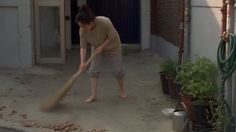</a>

提示词按主体、场景、动作序列、镜头、音频、连贯性和负面词分块书写。每个动作都是不剪辑的长镜头,并明确列出DV的瑕疵,如自动对焦来回拉扯、褪色和意外变焦。音频只写环境声,连贯性一块锁定道具和猫,避免物体消失或重复。主体通过参考图锁定人物身份。

Seedance 2.5 · 参考生视频 · 出处: [@Ciri_ai on X](https://x.com/Ciri_ai/status/2099379932082348417) · 发现于 [LearnPrompt/awesome-seedance](https://github.com/LearnPrompt/awesome-seedance)

[`dv-camcorder`](tags.md#tag-dv-camcorder) [`home-video`](tags.md#tag-home-video) [`observational`](tags.md#tag-observational) [`korean`](tags.md#tag-korean) [`ambient-audio`](tags.md#tag-ambient-audio)

<details><summary><b>提示词</b></summary>

```text
Create a 30-second, 1080p ultra-realistic early-2000s DV home video of a young Korean woman doing quiet Sunday chores around her home in an older Seoul neighborhood. Purely observational, no dialogue, no narrative arc  just rhythmic, textural everyday realism.
MAIN SUBJECT
Young Korean woman same as , early 20s, natural beauty, realistic skin texture, no makeup, black hair tied up messily in a claw clip, oversized faded T-shirt, rolled-up sweatpants, bare feet or house slippers. Keep her identity, outfit, hairstyle and proportions perfectly consistent throughout.
SETTING
The front step and small yard/alley outside an older Seoul home. Concrete step, a low gate, potted plants, a garden hose, a trash bin, scattered leaves. Ordinary, lived-in, no landmarks or brand names.
SEQUENCE (rhythmic, no dialogue)
She sweeps the front step with a short broom, dust and leaves scattering in the light.
She crouches down and pours a small amount of dry food into a bowl for a neighborhood cat waiting nearby; the cat eats while she watches briefly.
She stands and waters potted plants along the wall with a small watering can, water visibly darkening the soil.
She picks up a bagged trash bundle and carries it a few steps to place it by the curb/bin.
She wipes her hands on her shirt, looks around the now-tidy step and yard for a moment, then exhales/stretches.
She glances toward the camera briefly with a small, tired smile — no words — then turns and walks back inside.
Camera holds on the empty, swept step for a beat before cutting to black.
CAMERA
Raw handheld early-2000s DV camcorder, shaky footage, autofocus hunting, faded colors, exposure shifts, motion blur, soft digital detail, occasional accidental zooms. Observational, documentary-like framing — lingering shots, no cuts within actions. No polished cinematography.
AUDIO
Natural ambience only — broom bristles on concrete, water pouring, cat eating, distant birds, wind, a far-off scooter or dog bark, plastic bag rustling, faint footsteps. No dialogue, no music.
CONTINUITY
Broom, watering can and trash bag each remain consistent through their respective actions. Cat stays in frame while eating, doesn't disappear or duplicate. No teleporting or vanishing objects. Smooth, realistic, unhurried movement throughout.
NEGATIVE
CGI look, plastic skin, identity drift, outfit changes, distorted hands, extra fingers, subtitles, watermark.
```

</details>

<a id="seedance-korean-village-morning-walk"></a>
### 韩国乡村清晨起床与散步

<a href="https://x.com/ayzalnooor24521/status/2101151635309564095"></a>

先用角色块锁定面部、发型、服装和背包,再拆成八个两秒的定时分镜,保证跨镜头形象一致。每个分镜只给一个运镜和一个环境声提示,室内转室外的曝光变化增加真实感。

Seedance 2.5 · 文生视频 · 出处: [@ayzalnooor24521 on X](https://x.com/ayzalnooor24521/status/2101151635309564095) · 发现于 [LearnPrompt/awesome-seedance](https://github.com/LearnPrompt/awesome-seedance)

[`lifestyle`](tags.md#tag-lifestyle) [`rural-village`](tags.md#tag-rural-village) [`multi-shot`](tags.md#tag-multi-shot) [`character-consistency`](tags.md#tag-character-consistency) [`vertical`](tags.md#tag-vertical)

<details><summary><b>提示词</b></summary>

```text
Create a 15-second vertical 9:16 cinematic lifestyle video featuring one consistent young Korean woman living in a peaceful rural Korean village. The video should feel like a natural everyday moment captured for a Korean lifestyle/X social-media post — quiet, authentic, cozy, photorealistic, not commercial, not overly dramatic.

Character consistency:
A young Korean woman in her early 20s, natural Korean facial features, soft clear skin, long dark-brown/black hair tied loosely in a low ponytail, minimal natural makeup. She wears a cozy cream knit sweater, long dark plaid skirt, white sneakers, and a simple black backpack. Keep her face, hairstyle, body proportions, clothing and backpack 100% consistent throughout every shot.

Environment:
A traditional rural Korean village with a small rustic wooden-and-plaster house, warm wooden interior, simple furniture, handmade baskets, old windows, stone walls, narrow village paths, small gardens, traditional tiled rooftops, distant green mountains and a peaceful countryside atmosphere. Early morning sunlight, fresh air, subtle autumn colors.

SHOT 1 — 0:00–0:02

Close cinematic shot inside her cozy rustic bedroom. She slowly wakes up in a simple bed, opens her eyes and looks toward the warm sunlight coming through the wooden window. Soft curtains move gently from the morning breeze. Natural room ambience, subtle birds outside. Camera slowly pushes in toward her face.

SHOT 2 — 0:02–0:04

Medium shot. She sits up, casually fixes her slightly messy hair and ties it into a loose ponytail. She puts on her cream knit sweater and prepares to leave. Keep the movement natural and unhurried, like a real morning routine.

SHOT 3 — 0:04–0:06

She picks up her simple black backpack from beside the wooden chair, puts it over her shoulders, checks herself briefly in a small mirror, then walks toward the wooden front door. Warm sunlight enters the room behind her.

SHOT 4 — 0:06–0:08

Rear three-quarter shot. She opens the old wooden door and steps outside. Bright natural morning light gently floods the frame. The camera follows her from behind as she leaves the house. Slight realistic exposure adjustment as the camera moves from dark interior to bright exterior.

SHOT 5 — 0:08–0:10

Wide cinematic shot of the Korean countryside village. She walks slowly along a narrow stone-and-concrete village path surrounded by small gardens, stone walls and traditional houses. Mountains are visible in the background. Leaves move naturally in the breeze. Camera tracks smoothly behind her.

SHOT 6 — 0:10–0:12

Side-profile close-up while she walks. She briefly looks toward the mountains and takes a peaceful breath. A few strands of hair move naturally in the wind. Sunlight creates a soft glow around her hair. Genuine relaxed expression, no exaggerated acting.

SHOT 7 — 0:12–0:14

She continues walking down the peaceful village road. Camera slowly moves from behind toward her side. The background reveals rooftops, trees, distant mountains and morning sunlight. She casually touches one hand to her backpack strap.

SHOT 8 — 0:14–0:15

Final cinematic wide shot from behind. She becomes slightly smaller in the frame as she continues walking toward the distant village and mountains. Hold for a beautiful peaceful ending with warm sunlight and gentle wind.

Camera & visual style:
Photorealistic Korean lifestyle cinematography, cinematic 35mm look, natural skin texture, realistic facial movement, subtle film grain, soft depth of field, gentle handheld camera movement, smooth tracking shots, realistic motion blur, natural lens flare, warm morning sunlight, muted earthy colors, soft highlights, detailed rural textures.
```

</details>

<a id="seedance-kuala-lumpur-earthquake-survival-run-storyboard"></a>
### 吉隆坡地震逃生奔跑分镜

<a href="https://x.com/Xaroon_x/status/2097267405399396457">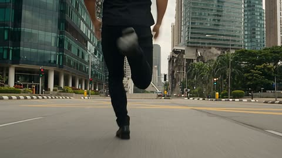</a>

两张参考图分别锁定人物形象和分镜版式。十二个带时间码的分镜串成一次连续奔跑，并用禁止瞬移的核心规则保证动作衔接。镜头清单排除无人机和不可能的旋转，让追逐保持贴地写实。

Seedance 2.5 · 参考生视频 · 出处: [@Xaroon_x on X](https://x.com/Xaroon_x/status/2097267405399396457) · 发现于 [LearnPrompt/awesome-seedance](https://github.com/LearnPrompt/awesome-seedance)

[`storyboard`](tags.md#tag-storyboard) [`disaster-action`](tags.md#tag-disaster-action) [`continuous-shot`](tags.md#tag-continuous-shot) [`character-reference`](tags.md#tag-character-reference) [`handheld-tracking`](tags.md#tag-handheld-tracking)

<details><summary><b>提示词</b></summary>

```text
TITLE: THE SURVIVAL RUN

Create a single-page, premium Hollywood disaster-action storyboard in 16:9 widescreen format with 12 cinematic panels covering one continuous 30-second survival sequence.

REFERENCE IMAGE 1 (Image1):
Use as the EXACT main character reference. Maintain the same facial identity, hairstyle, beard, body proportions, black shirt, black pants and overall appearance consistently in every panel. No character, face, hairstyle or clothing changes. Dust and debris may gradually appear as the disaster progresses.

REFERENCE IMAGE 2 (Image2):
Use as the EXACT storyboard design and layout reference. Match its premium cinematic panel arrangement, numbering, timecodes, black caption strips, typography hierarchy, borders and professional Hollywood storyboard presentation.

STYLE:
Photorealistic live-action Hollywood disaster film, ARRI Alexa 35, anamorphic cinematic lens, realistic Kuala Lumpur, Malaysia, practical stunt realism, believable destruction physics, handheld tracking, cinematic lighting, motion blur, dust, shattered glass, sparks and realistic debris.

CORE RULE:
ONE CONTINUOUS SURVIVAL SHOT. Every movement must logically connect. No teleportation or unexplained location changes. The same man constantly runs, stumbles, recovers, jumps, slides and changes direction while the collapsing city becomes the antagonist.

STORYBOARD PANELS:

1. 00:00–00:03 — EARTHQUAKE
Low-angle behind his feet as he runs through Kuala Lumpur. The ground shakes, buildings tremble, glass explodes and concrete crashes behind him. He looks back and accelerates.

2. 00:03–00:06 — COLLAPSE
Front tracking shot. A building façade collapses behind him. He changes direction and jumps over a metal barrier as debris destroys his original path.

3. 00:06–00:09 — CAR IMPACT
At an intersection, vehicles slide toward him. He dives at the last second, a car passes overhead, he rolls, recovers and keeps running.

4. 00:09–00:12 — ROAD CRACK
A huge fissure tears across the road. He runs onto a damaged car as a springboard and leaps across collapsing pavement.

5. 00:12–00:15 — FALLING GLASS
Side tracking shot. High-rise windows explode above him. Glass rains down as he shields his face and ducks beneath a falling sign.

6. 00:15–00:18 — COLLAPSE
A building collapses ahead. He spots a narrow gap, drops low and slides beneath falling debris, then emerges dusty and runs.

7. 00:18–00:21 — VEHICLE CHAOS
A bus crashes into cars. A spinning vehicle approaches. He jumps onto its hood, springs over the roof and lands on the opposite sidewalk.

8. 00:21–00:24 — ELEVATED ROAD FAILURE
An elevated road collapses ahead. He performs a desperate full-body gap jump, lands hard, rolls, recovers and runs.

9. 00:24–00:27 — DEBRIS CHASE
Heavy dust reduces visibility. Falling streetlights and concrete force sudden direction changes. He stumbles against a wall and pushes forward.

10. 00:27–00:30 — FINAL COLLAPSE
Camera faces him as he runs toward it. Massive buildings collapse behind him. He jumps a concrete barrier as a gigantic slab crashes down.

11. FINAL SHOT — STILL RUNNING
He emerges through a huge dust cloud, exhausted and covered in debris but clearly recognizable as Reference Image 1, still running toward camera.

12. CUT TO BLACK
Black screen with:
“THE SURVIVAL RUN”
“SOME DISASTERS YOU CAN’T OUTRUN”

CAMERA:
Low tracking, front pursuit, side tracking, shoulder-mounted chase, whip-pans and ground-level movement. Camera always follows his momentum. No drones, floating cameras or impossible rotations.
```

</details>

<a id="seedance-kyoto-autumn-slow-travel-vlog"></a>
### 京都秋日慢节奏旅行 vlog,30 秒

<a href="https://x.com/Chaemate_/status/2099439262106083704">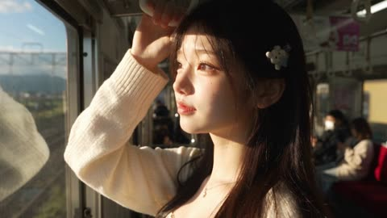</a>

用参考图锁定面部、服装和项链,再规定慢节奏、每个场景只做一个简单动作,并明确排除广告式蒙太奇。给出带停顿的简短台词,配合手持、自动对焦、环境声和 35mm 胶片颗粒,营造随手拍的真实感。

Seedance 2.5 · 参考生视频 · 出处: [@Chaemate_ on X](https://x.com/Chaemate_/status/2099439262106083704) · 发现于 [LearnPrompt/awesome-seedance](https://github.com/LearnPrompt/awesome-seedance)

[`travel-vlog`](tags.md#tag-travel-vlog) [`kyoto`](tags.md#tag-kyoto) [`character-consistency`](tags.md#tag-character-consistency) [`handheld`](tags.md#tag-handheld) [`film-grain`](tags.md#tag-film-grain)

<details><summary><b>提示词</b></summary>

```text
Create a photorealistic 30-second personal travel vlog featuring the exact same woman from the reference image. Keep her face, hairstyle, physical appearance, makeup, outfit and necklace consistent throughout the entire video.

Make it feel like a real young woman casually documenting her autumn trip to Kyoto with a friend behind the camera. No commercial travel-ad look, no fast montage and no overly cinematic movements.

Keep the pacing slow and natural. Each scene should focus on one simple action. Let shots breathe and allow natural pauses. She should walk, look around and react at normal human speed. Never speed up her movement or speech to fit more into the scene.

Show quiet everyday moments around Kyoto: riding a local train in the morning, walking through a residential street, discovering a small bakery, sitting by the river, browsing a tiny stationery shop, getting caught in light rain and grabbing a warm drink from a vending machine at night.

Keep the dialogue extremely short and casual, with natural pauses. Things like “Cute…”, “So pretty”, “Mmm… good”, “Look…”, “This one?”, “Oh… rain”, “Nice…” and “One more stop.” She should never sound like she's reading a script or rushing through lines.

Use realistic handheld camera movement, subtle autofocus, natural exposure changes, real ambient sounds, natural skin texture, realistic lighting and subtle 35mm film grain. Some moments should have no dialogue at all.

The goal is simple: make it feel like an actual travel vlog someone happened to capture during a real day in Kyoto, not an AI-generated commercial.
```

</details>

<a id="seedance-last-call-mountain-road-rain-thriller"></a>
### 雨夜山路惊悚片：一通警告电话

<a href="https://x.com/RuzainaMeer/status/2097193955230405007">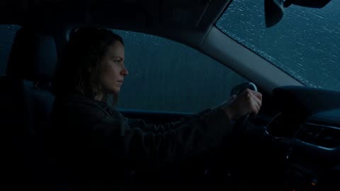</a>

先用固定的角色与场景段落加否定式风格清单，锁定同一个女人和同一辆车。再按 0 到 30 秒逐段写镜头、屏幕文字和台词，最后用一行音频说明雨声、雨刷和撞击后的寂静。

Seedance 2.5 · 文生视频 · 出处: [@RuzainaMeer on X](https://x.com/RuzainaMeer/status/2097193955230405007) · 发现于 [LearnPrompt/awesome-seedance](https://github.com/LearnPrompt/awesome-seedance)

[`thriller`](tags.md#tag-thriller) [`cinematic`](tags.md#tag-cinematic) [`rain`](tags.md#tag-rain) [`night-driving`](tags.md#tag-night-driving) [`timed-shots`](tags.md#tag-timed-shots)

<details><summary><b>提示词</b></summary>

```text
Create a 30-second ultra-photorealistic Hollywood-level cinematic thriller scene titled “THE LAST CALL.” The entire sequence must feel like a scene from a high-budget live-action feature film, with realistic human acting, natural facial expressions, physically accurate movement, realistic rain, practical lighting, believable vehicle physics, detailed environments, cinematic depth of field, subtle film grain, natural skin texture, realistic reflections, and professional Hollywood cinematography. No anime, no CGI-looking visuals, no fantasy aesthetic, no cyberpunk, no neon lighting, no exaggerated visual effects.
MAIN CHARACTER: A realistic young woman in her late 20s, natural appearance, expressive eyes, shoulder-length dark hair slightly damp from the humid weather, wearing a simple dark jacket. Maintain the exact same woman, face, hairstyle, clothing, car, weather and environment consistently throughout the entire sequence.

SETTING: A remote mountain road at night during heavy but realistic rainfall. Dark forested mountains surround the narrow winding road. Wet asphalt reflects only natural headlights and road markings. The atmosphere is tense, isolated and believable.

0–5 SECONDS

Interior of a moving car at night. Medium shot from the passenger side showing the woman driving alone. Rain continuously hits the windshield and realistic windshield wipers move back and forth. Dashboard illumination softly lights her face. She looks tired and emotionally distant while concentrating on the road. Camera slowly pushes toward her face. Natural breathing, subtle blinking and realistic micro-expressions.

5–10 SECONDS

Her smartphone suddenly begins ringing in the center console. Cut to an extremely realistic close-up of the phone screen.

Caller ID: “MOM”

The woman freezes.

Her eyes widen slightly. Her hands tighten around the steering wheel. She looks at the phone in disbelief. She hesitates for a moment, then reaches down and answers the call.

10–17 SECONDS

Extreme close-up of her face as she listens.

A faint, emotional female voice comes through the phone:

“Don't take the next turn.”

The woman's expression changes from confusion to fear.

The call suddenly disconnects.

She looks at the phone.

The screen reads: CALL ENDED

Outside the windshield, a sharp mountain turn approaches through the heavy rain.

17–23 SECONDS

She immediately slows the car.

Camera moves to a forward-facing perspective through the windshield. The road curves sharply ahead.

Suddenly, distant headlights appear through the rain around the corner.

The woman looks toward them.

A large truck suddenly loses control and crashes through the roadside barrier at the exact location where her car would have been if she had continued driving.

The crash must look physically realistic and grounded, with believable vehicle momentum, rain, debris and impact. No exaggerated explosions.

23–27 SECONDS

Silence after the crash.

The woman sits completely still, breathing heavily, visibly shaken.

She slowly looks down at her phone.

The phone screen now shows:

NO SIM — NO SIGNAL

She looks confused and terrified.

27–30 SECONDS

Extreme close-up of her eyes filling with tears.

She looks toward the empty passenger seat.

A subtle emotional pause.

In a trembling whisper, she says:

“Mom?”

Cut instantly to black.

FINAL AUDIO: Heavy rain, windshield wipers, realistic car interior ambience, distant thunder, phone ringing, muffled female voice, sudden silence after the crash, then only the woman's breathing.
```

</details>

<a id="seedance-last-supper-painting-camera-journey"></a>
### 镜头飞入文艺复兴风格最后的晚餐画作

<a href="https://x.com/abxxai/status/2110709089710088537"></a>

画作被锁定为首帧和尾帧，提示词要求补全三维几何并保留油画质感。用分秒镜头表（面包微距、酒杯、手、披风、面部、绕到身后）串成一次连续运镜，并写明人物全程不动以稳住姿态。

Seedance 2.5 · 图生视频 · 出处: [@abxxai on X](https://x.com/abxxai/status/2110709089710088537) · 发现于 [LearnPrompt/awesome-seedance](https://github.com/LearnPrompt/awesome-seedance)

[`painting`](tags.md#tag-painting) [`camera-move`](tags.md#tag-camera-move) [`macro`](tags.md#tag-macro) [`orbit`](tags.md#tag-orbit) [`vertical`](tags.md#tag-vertical)

<details><summary><b>提示词</b></summary>

```text
upload the painting image as first frame and use this video prompt

[First-Frame.png] Create a 20-second vertical 9:16 image-to-video film, using the supplied image as the exact first frame and matching final frame. One continuous camera journey through the room, with macro detail, a gradual emotional reveal, an orbit behind the central figure and a seamless return.

Build the supplied scene as complete 3D geometry while preserving its Renaissance oil-painted appearance. The table stands in real space, the tablecloth drapes over its edges, the food and vessels sit on its surface, and every figure has a fully dimensional body beneath their robes. As the camera passes around them, reveal the sides and rear surfaces hidden from the opening viewpoint. Retain the original brushwork, warm earthy colours, soft daylight and expressive faces.

IDENTIFY AND PRESERVE THE FIGURES

The central figure sits at the middle of the table. He has long wavy brown hair, a full brown beard and downcast, calm eyes. He wears a deep red robe with a rich blue mantle draped across his left shoulder and lap. His right hand rests palm-down on the tablecloth at the left of the frame; his left hand lies open, palm-up, beside a small glass of red wine.

To his right (left of frame) sits a young apostle with long golden-brown hair, a green mantle over a red garment, his sorrowful gaze turned toward the centre. In front of him, a balding older man with a dark beard, wearing red and blue, leans in with a pointing gesture. A partly visible figure with curly hair sits at the far left edge.

To his left (right of frame) a man with thick black curly hair and a dark beard, in a blue robe, turns to speak with a grey-bearded elder in an olive-green robe at the right edge, who raises both hands in an open, questioning gesture.

Keep every pose, gesture, gaze direction and costume exactly as in the reference. No figure moves.

THE ROOM AND TABLE

A dark coffered wooden ceiling. A grey back wall with three tall windows opening onto a sunlit Tuscan landscape of blue hills, cypress trees, terracotta villas and a bell tower. Dark blue and gold damask panels on both side walls.

A long table covered in white linen with a visible grid of fold creases, hanging almost to the floor. On it: scattered bread rolls and crumbs, pewter plates, a central plate of fish, the small glass of red wine, a bowl of green olives, a plate of red and green grapes at the right, a blue-and-white decorated bowl with bread at the left, and a dark glazed ceramic jug at the far left. Wooden trestle legs and the hems of robes are visible below the cloth.

0–3 SECONDS — ENTER OVER THE BREAD

Begin on the exact supplied image for approximately half a second.

The camera then flies forward into the room and descends toward the bread roll resting on the tablecloth just left of centre. Pass macro-close above it.

Reveal the roll's rounded volume, cracked golden crust, flour-dusted ridges and the small crumbs scattered around it, each casting a tiny shadow on the linen. The nearest crust passes softly out of focus beneath the lens as the camera glides on.

The tablecloth has physical relief: woven threads, raised fold creases and shallow dips where objects press into it. The bread falls behind the moving camera while the central figure stays fixed farther into the room. This changing perspective establishes real depth immediately.

3–7 SECONDS — GLIDE ACROSS THE TABLE TO THE WINE

Travel low and smoothly across the linen toward the centre of the table, skimming past the rim of the fish plate. Reveal the plate's worn pewter edge, its curved depth and the painted fish resting inside.

Continue to the small glass of red wine. Curve partly around it at macro distance, revealing the thickness of the glass, the flat surface of the wine, and daylight from the windows refracting through it as a soft red glow on the cloth.

The glass crosses the near foreground, the open palm-up hand appears just beyond it, and the back wall shifts more slowly behind. Maintain forward momentum throughout.

7–10 SECONDS — RISE ALONG THE OPEN HAND AND MANTLE

Rise past the open hand, revealing the gentle curve of the fingers, the creases of the palm and its weight resting on the cloth.

Continue upward along the blue mantle where it falls across his lap and left shoulder. Travel close to the fabric without touching it. Show the painted texture, the deep blue folds as dimensional surfaces: raised crests catch the window light, undersides fall into shadow, and the red robe shows beneath the mantle's edge.

The blue fabric passes beside the lens as his face comes into view above.

10–13 SECONDS — REVEAL THE CENTRAL FACE

Curve inward and slightly upward toward his face.

Approach a close view of his lowered eyes, calm brow, nose and the soft strands of his beard and hair. Preserve the exact face from the reference. Reveal the three-dimensional shape of the cheekbones and brow, and the subtle painted texture of the skin, fully connected to his neck and shoulders.

Ease the camera's speed for approximately one second while continuing a gentle sideways drift. Let the stillness and quiet sorrow register. He does not move; the emotion comes from discovering the expression already present in the painting.

13–17 SECONDS — ORBIT BEHIND HIM TO THE WINDOW

Continue past the outside of his face, over his blue-draped left shoulder, and orbit smoothly behind him into the narrow space between his back and the central window.

Reveal the back of his long wavy hair, the rear folds of the blue mantle and red robe, and the thickness of his shoulders beneath the fabric. His shoulder passes close beside the lens as a soft foreground shape.

Turn gently to look past him through the central window: the sunlit Tuscan hills, cypresses and villas gain real depth, the far hills hazy and the near trees sharper. Then continue the arc so the view swings back over his other shoulder, revealing from behind the backs of the apostles' heads, the young apostle's green mantle, and the whole table spread out before them toward where the viewer began.

17–20 SECONDS — RETURN TO THE ORIGINAL COMPOSITION

Rise and retreat in one smooth arc over the table, passing above the grey-bearded elder's raised open hands at the right, then curving back onto the opening camera axis.

Reveal all figures again in their exact positions. The bread, plates, wine glass, olives, grapes, decorated bowl and ceramic jug settle back onto the table as in the supplied image. The coffered ceiling, three windows and damask walls realign with the frame.

Gently decelerate into the exact opening viewpoint, lens perspective, framing and lighting. End on a frame matching the supplied image so the next repetition flows directly into the opening movement.

CAMERA, STYLE AND CONTINUITY

Use one uninterrupted physical camera path: over the bread, across the table to the wine, up the open hand and blue mantle, to the central face, around behind him to the window, back over his shoulder and out to the original wide composition.

Use natural motion blur and shallow depth of field during macro passes. Transfer focus smoothly to the next detail along the route. Foreground objects pass the lens because the camera moves around them; no figure changes pose, blinks, speaks or moves toward the camera.

Maintain one coherent room with stable geometry and consistent warm daylight from the windows. Hidden surfaces belong to the existing figures, clothing, table and walls and match their visible design. Preserve the oil painting's brushwork, canvas texture and colour at every scale.

No cuts, crash zooms, dissolves, flat canvas flyovers, wall-relief effects, scene morphing, additional people, new props, extra food, text or watermark.
```

</details>

<a id="seedance-laundry-day-voiceover-commercial"></a>
### 带温暖旁白的洗衣日广告

<a href="https://x.com/CaliraVal/status/2091386310837862772">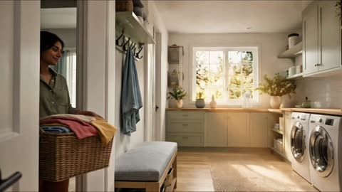</a>

把30秒拆成带时间码的分镜，每段配一句旁白，动作与解说保持同步。结尾用一段风格清单统一光线、镜头、声音，并限定无字幕无文字无标志。

Seedance 2.5 · 文生视频 · 出处: [@CaliraVal on X](https://x.com/CaliraVal/status/2091386310837862772) · 发现于 [LearnPrompt/awesome-seedance](https://github.com/LearnPrompt/awesome-seedance)

[`commercial`](tags.md#tag-commercial) [`voiceover`](tags.md#tag-voiceover) [`timed-beats`](tags.md#tag-timed-beats) [`lifestyle`](tags.md#tag-lifestyle) [`vertical`](tags.md#tag-vertical)

<details><summary><b>提示词</b></summary>

```text
Create a 30-second photorealistic cinematic laundry commercial featuring a young South Asian woman in a bright, modern home. Include a natural female voiceover throughout the video, synchronized with the actions. The voice should sound warm, friendly, clear, and conversational, with soft realistic background laundry sounds and no music overpowering the voice.

0–5 seconds: The woman walks into the laundry area carrying a basket full of dirty clothes and places it beside a modern front-loading washing machine.
Voiceover: “Laundry day starts with one simple step.”

5–10 seconds: She opens the washing machine and carefully puts the clothes inside one by one. Show realistic fabric movement and natural hand movements.
Voiceover: “I just load all my clothes into the washing machine…”

10–13 seconds: She adds liquid detergent into the detergent compartment, closes it, and shuts the washing machine door.
Voiceover: “…add my detergent…”

13–17 seconds: She presses the start button. Close-up of the washing machine starting, with the clothes visibly spinning behind the glass door.
Voiceover: “…and let the machine do the work.”

17–22 seconds: After the wash, she opens the machine and takes out the fresh, clean clothes. She gently shakes and unfolds the garments.
Voiceover: “Once they’re clean, they come out fresh and ready to dry.”

22–28 seconds: She carries the clean clothes outside to a clothesline and hangs each garment carefully using clothespins. A gentle breeze makes the clothes move naturally.
Voiceover: “Then I simply hang them outside and let the fresh air do the rest.”

28–30 seconds: Final cinematic shot of the freshly washed clothes hanging beautifully in warm sunlight while the woman smiles naturally nearby.
Voiceover: “Clean, fresh, and ready to wear.”

Warm natural daylight, realistic South Asian woman, modern home, detailed clothing textures, realistic washing machine, natural human movement, smooth cinematic camera transitions, close-up shots, subtle handheld movement, realistic fabric physics, gentle outdoor breeze, photorealistic premium commercial quality, natural female voiceover, realistic ambient sounds, clear synchronized speech, vertical 9:16, no subtitles, no text, no watermark, no logos.
```

</details>

<a id="seedance-lightning-warrior-ruined-battlefield-30s"></a>
### 闪电战士在废墟战场劈开现实

<a href="https://x.com/itxabdullaa/status/2106702315239686628">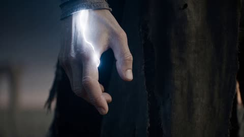</a>

把30秒按0到5秒、5到10秒等时间段切开，每段只推进一个节拍，从火花、追击到空间撕裂再归于寂静。结尾用排除清单（不要动漫、不要盔甲、不要换装）加上物理优先的风格句，保持画面写实、角色前后一致。

Seedance 2.5 · 文生视频 · 出处: [@itxabdullaa on X](https://x.com/itxabdullaa/status/2106702315239686628) · 发现于 [LearnPrompt/awesome-seedance](https://github.com/LearnPrompt/awesome-seedance)

[`dark-fantasy`](tags.md#tag-dark-fantasy) [`action`](tags.md#tag-action) [`lightning`](tags.md#tag-lightning) [`timeline-prompt`](tags.md#tag-timeline-prompt) [`photorealistic`](tags.md#tag-photorealistic)

<details><summary><b>提示词</b></summary>

```text
16:9 • RAW DOCUMENTARY PHOTOREALISM • LIVE-ACTION IMAX/HDR • REALISTIC PHYSICS

A dark-fantasy warrior with long disheveled black hair, cold expression, tattered gray-white scarf, shattered dark cloak and white-gray outfit awakens an abandoned battlefield.

0–5s: A tiny white-blue spark triggers the entire environment. Stones vibrate, cracks spread, invisible pressure bends the air, and a colossal thunderstorm ring forms overhead.

5–10s: Shadow distortions hunt him. He explodes into motion—wall runs, aerial redirects, lightning-charged impacts and massive shockwaves destroy the ruins. Black smoke afterimages trail every movement.

10–15s: He moves across falling debris at impossible speed. Multiple motion afterimages surround the battlefield before collapsing back into him, compressing into one devastating lightning strike.

15–20s: The battlefield transforms into a rotating storm cage. Debris, dust, fabric and lightning orbit him. Everything suddenly compresses inward as a giant spatial crack opens behind him.

20–27s: He launches into the fractured dimension, moving through floating ruins with punches, elbows and aerial strikes. All accumulated energy converges into a tiny, hyper-dense white-blue thunderstorm sphere.

27–30s: Absolute silence. One spark. His eyes open. He unleashes the WORLD-SPLITTING STRIKE—a colossal white-blue shockwave tears through reality, followed by a black-and-white spatial implosion.

Cut back to the ruined battlefield. He stands alone, dust falling, scarf moving in the residual wind. One final spark crosses his cheek.

STYLE: Extremely fast, agile, physically grounded combat. Dense semi-transparent lightning, black smoke/shattered-shadow afterimages, air distortion, debris interaction and violent wind pressure. No anime, no superhero CGI, no modern tech, no guns, no armor, no dialogue, no text, no subtitles, no logos, no face/hairstyle/costume changes. Continuous escalation from mystery → pursuit → impossible movement → environmental destruction → spatial rupture → silence.
```

</details>

<a id="seedance-lime-blazer-woman-crowd-choreography-swap"></a>
### 青柠西装女子替换人群编舞主角

<a href="https://x.com/john_my07/status/2100115896111161691">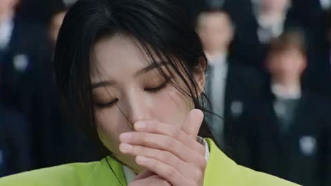</a>

用参考视频锁定动作、镜头和切点，用一张参考图锁定人物身份，并列出大量保持项与禁止项。0到30秒的分段时间轴、固定的服装清单，加上只替换中心人物的指令，让原编舞完整保留。

Seedance 2.5 · 参考生视频 · 出处: [@john_my07 on X](https://x.com/john_my07/status/2100115896111161691) · 发现于 [LearnPrompt/awesome-seedance](https://github.com/LearnPrompt/awesome-seedance)

[`character-replacement`](tags.md#tag-character-replacement) [`identity-lock`](tags.md#tag-identity-lock) [`motion-transfer`](tags.md#tag-motion-transfer) [`crowd-choreography`](tags.md#tag-crowd-choreography) [`timed-segments`](tags.md#tag-timed-segments)

<details><summary><b>提示词</b></summary>

```text
Use the uploaded reference VIDEO as the exact motion, choreography, camera, framing, timing, pacing, shot duration and cut-point reference.

Use <image_1> as the STRICT identity reference for the MAIN WOMAN.

The final video should feel like the SAME original video, but with the original central man completely replaced by the woman from <image_1>.

Do NOT recreate or preserve the original man's face or identity.

IDENTITY <image_1>

The central character is the exact same woman shown in <image_1>.

Preserve her:

- exact face
- facial structure
- jawline
- cheekbones
- nose
- eyes
- eyebrows
- lips
- ears
- skin tone
- natural facial proportions
- hairstyle
- hair length, volume and texture
- any facial features visible in the reference
- natural body proportions

Maximum identity preservation throughout the entire video.

She must remain recognizably the same person from the uploaded photograph in every shot and every angle.

NO face morphing.
NO identity drift.
NO changing facial structure.
NO different hairstyle.
NO unwanted hair changes.
NO beautification or artificial facial retouching.
NO age changes.
NO facial distortion.

CHARACTER REPLACEMENT

Replace ONLY the original central man with the woman from <image_1>.

Keep the exact position, scale, body movement, gestures, walking path, head movements, smoking actions and timing from the reference video.

Everything the original central character does in the reference video should be performed by the <image_1> woman at the same moment and with the same choreography.

Do not reinterpret or redesign the choreography simply because the replacement character is female.

WARDROBE

Dress <image_1> in the same character-reference outfit, adapted naturally for the woman:

Acid lime green single-breasted blazer, notch lapels, two buttons, buttoned closed, slightly oversized shoulders.

Plain white cotton shirt underneath.

Narrow black knitted tie, neatly knotted.

Straight black trousers.

Plain black leather ankle boots, low heel.

No jewellery.
No watch.
No belt.
No bag.
No phone.
No logos or patterns.

The lime blazer must remain exactly throughout the entire video.

IMPORTANT:
Do not let the wardrobe replacement change the original choreography, body positioning, composition or pacing.

SMOKING ACTION

Preserve the smoking sequence from the reference video exactly.

At the beginning, the main woman holds a cigarette naturally between her fingers and brings it to her mouth.

She lights the cigarette using the same hand movements, timing and body positioning as the reference video.

She takes a drag and naturally exhales smoke.

Preserve the original:

- hand position
- cigarette position
- lighter movement
- timing
- head movement
- facial expression
- smoke timing
- arm movement

The smoking action should look physically natural and cinematic.

Do not exaggerate the smoke.
Do not create excessive smoke.
No smoking action should occur from any other character.

All other characters remain unchanged.

EXACT ORIGINAL ACTION / TIMING

0–4 SECONDS:

Match the reference video exactly.

The central woman is shown smoking.

She brings the cigarette toward her mouth, lights it, takes a drag and exhales.

Match the original close framing, facial positioning, hand movements and timing.

4–11 SECONDS:

Match the reference video exactly.

The woman turns away from camera and moves forward into the crowd using the exact same movement and timing as the original central character.

Preserve her body position, walking speed, direction and camera framing.

11–17 SECONDS:

Match the original choreography exactly.

The woman moves back toward the central position and performs the same gestures and movements as the original central character.

Do not invent new actions.

17–22 SECONDS:

The woman reaches and holds the same central position as the reference.

She becomes calm and composed.

Maintain the exact same camera composition.

22–30 SECONDS:

The crowd begins the same synchronized chaotic movement from the reference.

The central woman remains calm and controlled in the center while the surrounding crowd moves violently and rhythmically around her.

Match the exact timing, intensity and choreography of the original crowd movement.

The central woman must remain clearly identifiable and visually separated from the crowd.

CAMERA

COPY THE REFERENCE VIDEO'S CAMERA LANGUAGE EXACTLY.

Preserve:

- camera position
- camera height
- camera distance
- lens perspective
- focal length feel
- framing
- depth of field
- camera movement
- push/pull movement
- tracking
- camera shake if present
- zoom
- subject scale
- transitions
- shot duration
- exact cut points

Do NOT create new shots.

Do NOT add new camera movements.

Do NOT change the original video's pacing.

The output should have the same visual rhythm and edit structure as the reference video.

CROWD

Keep the original crowd concept and choreography from the reference video.

Large group of young men surrounding the central woman.

Preserve their:

- positions
- density
- formation
- movements
- synchronized choreography
- timing
- background behavior

Do not replace the crowd with women.

Do not introduce new characters.

Do not allow anyone else to become visually dominant over the main woman.

Only the central character is replaced.

LOCATION

Preserve the same environment and architecture as the reference video.

Keep the same:

- concrete/architectural setting
- stairs
- background structure
- crowd arrangement
- environmental depth
- overall composition

Do not redesign the location.

Do not introduce new buildings or props.

LIGHTING / COLOR

Preserve the reference video's overall cinematic lighting and color grading.

Keep the dark, moody atmosphere.

The acid lime blazer should be the distinctive color of the central character.

Keep natural skin tones.

Realistic shadows and highlights.

No artificial glow.
No haze.
No bloom.
No excessive smoke.
No fantasy lighting.

VISUAL STYLE

Photorealistic cinematic live-action footage.

Natural human motion.
Natural body physics.
Realistic fabric.
Realistic hair.
Realistic skin.
Realistic cigarette smoke.
Realistic lighting.

No CGI appearance.
No animation.
No cartoon.
No plastic skin.
No face distortion.
No duplicated main character.

CRITICAL INSTRUCTION

REFERENCE VIDEO = controls EVERYTHING about the original video's motion.

<image_1> = controls ONLY the identity and appearance of the replacement central woman.

Replace the original central man with the woman from <image_1> while preserving the original video's actions, choreography, camera, timing, pacing, framing and cuts as closely as possible.

The result should look like the original video was filmed with <image_1> instead of the original actor.

ONE MAIN CHARACTER ONLY.
NO IDENTITY DRIFT.
NO EXTRA VERSION OF <image_1>.
```

</details>

<a id="seedance-magic-pen-street-transport-vlog"></a>
### 魔法笔把街头交通变成卡通

<a href="https://x.com/Strength04_X/status/2095748874942263601">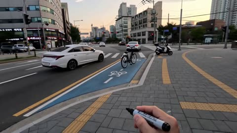</a>

每个目标都重复同一套变身流程（马克笔指向、说出Biu、蓝色草图线、墨水填色），每个时间段的节奏因此一致。手持手机的真实质感、统一光向和接触阴影，让平面2D角色稳稳落在写实街景里，同时按时间段列出分镜和音效。

Seedance 2.5 · 文生视频 · 出处: [@Strength04_X on X](https://x.com/Strength04_X/status/2095748874942263601) · 发现于 [LearnPrompt/awesome-seedance](https://github.com/LearnPrompt/awesome-seedance)

[`vlog`](tags.md#tag-vlog) [`live-action-2d-composite`](tags.md#tag-live-action-2d-composite) [`first-person`](tags.md#tag-first-person) [`transformation`](tags.md#tag-transformation) [`vertical`](tags.md#tag-vertical)

<details><summary><b>提示词</b></summary>

```text
Magic Pen Street Transport Vlog · 15 Seconds · Vertical 9:16

[STYLE]
Live-action + flat 2D anime sticker compositing, first-person street transport magic vlog. 8K photorealistic detail with the authentic look of a real smartphone rear-camera recording. Strong visual contrast between the photorealistic city and flat cartoon vehicles. One continuous handheld smartphone shot. No cuts. No scene transitions.

[CAMERA]
Raw, unstabilized handheld smartphone footage throughout: natural walking shake, subtle arm movement, occasional autofocus hunting, realistic exposure shifts between bright sky and building shadows, and slight rolling-shutter jelly during fast pans. Natural smartphone HDR colors with soft, realistic tones. The camera quickly whip-pans to follow the marker and each target.

[LIGHTING]
Late-afternoon sunlight coming consistently from one direction. Every real object and every animated character casts a soft contact shadow matching the direction of the sunlight.

[SETTING]
One continuous walk through a Korean city neighborhood. A wide urban road with a pedestrian sidewalk, bicycle lane, city buses, parked scooters, and a crosswalk. Everyday street life, with background pedestrians and vehicles moving naturally.

[PEN — MAGIC RULES]
The vlogger's real hand, with photorealistic skin and visible pores, holds a black marker and remains visible throughout the entire video, serving as the visual guide connecting every beat.

Every transformation follows the exact same sequence:

Marker points → Vlogger says “Biu!” → blue hand-drawn sketch lines wrap around the target → ink spreads → the target transforms into a lively flat 2D cel-shaded anime character with bold cartoon outlines.

The transformed character must preserve the original object's exact size, position, speed, direction, and perspective, remaining perfectly anchored to the real street environment. Characters retain flat sticker-style shading and are never relit by the real-world lighting. Anything they touch reacts with realistic physical interaction.

[00:00–00:03]

First-person view while walking beside a busy road. The vlogger raises the black marker into frame and points at a passing city bus.

“Biu!”

Blue sketch lines wrap around the bus. The bus transforms into a giant flat 2D cartoon vehicle with bold anime outlines while maintaining its exact size, speed, direction, and perspective.

It continues driving normally through traffic.

SFX: Bus engine + marker whoosh + soft cartoon movement sound.

[00:03–00:06]

The marker quickly swings downward toward a bicycle passing along the bicycle lane.

“Biu!”

The bicycle transforms into a cute hand-drawn cartoon bicycle. It continues moving at the same speed, its wheels spinning rapidly, with small sketch particles appearing behind it.

SFX: Bicycle wheel sound + light sketch rustling.

[00:06–00:10]

The marker follows the bicycle toward a parked scooter near the sidewalk.

“Biu!”

A rapid blue sketch outline covers the scooter. It transforms into a flat 2D cartoon scooter while preserving its exact position, proportions, and perspective.

Its wheels spin once and its small cartoon headlight blinks twice.

SFX: Soft engine hum + tiny mechanical click.

[00:10–00:12]

The marker quickly swings toward a pedestrian crossing the road.

“Biu!”

Blue sketch lines trace around the person. The same person, in the exact same pose, proportions, and position, becomes a vibrant anime cel-shaded illustration.

They continue walking naturally and briefly wave once.

SFX: Fast doodling sound + soft sparkle chime.

[00:12–00:15]

The vlogger stops walking and gives one final, louder:

“Biu—!”

The marker spins upward toward the road. A swirling blue ink trail spreads across the vehicles and pavement, transforming the entire road surface into a hand-drawn anime street while the surrounding buildings remain completely photorealistic.

A small handwritten “THE END!” doodle — the only text appearing anywhere in the video — pops up above the road.

Freeze frame.

SFX: Sharp throwing whoosh + spreading watercolor-ink bloom + felt-tip marker squeaking as it writes “THE END!”
```

</details>

<a id="seedance-mahjong-parlor-martial-arts-brawl"></a>
### 地下麻将馆里的格斗打斗场面

<a href="https://x.com/ElsaSofia__AI/status/2114538463605498112">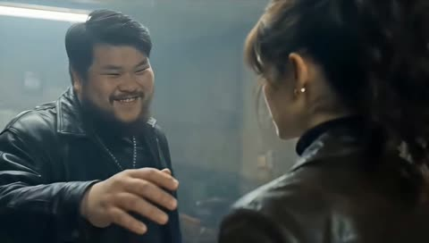</a>

十二个带秒数区间的分镜把20秒动作拆成清晰节拍，从第一次出手到最后推近特写。开头固定场景、主角和打手的描述块来保持画面统一，结尾的声音设计在最后特写处收成近乎寂静。

Seedance 2.5 · 文生视频 · 出处: [@ElsaSofia__AI on X](https://x.com/ElsaSofia__AI/status/2114538463605498112) · 发现于 [LearnPrompt/awesome-seedance](https://github.com/LearnPrompt/awesome-seedance)

[`martial-arts`](tags.md#tag-martial-arts) [`action`](tags.md#tag-action) [`crime-thriller`](tags.md#tag-crime-thriller) [`multi-shot`](tags.md#tag-multi-shot) [`handheld`](tags.md#tag-handheld)

<details><summary><b>提示词</b></summary>

```text
A gritty, cinematic, photorealistic 20-second urban martial-arts action scene in 16:9, in the style of a 1990s Hong Kong / Korean crime-thriller. Handheld camera with sharp whip pans, rapid cuts, shaky close-ups, motion blur and flying debris. Color grade: cold blue-grey haze, desaturated teal and brown tones, deep shadows, a faint film grain, thick cigarette smoke drifting through the air, flat fluorescent tube lighting and a few warm amber lamps.

SETTING: A run-down underground mahjong parlor in an old building: stained concrete floor littered with broken glass and mahjong tiles, scuffed wood-paneled walls with framed pictures, green-felt mahjong tables with white tiles, green glass soju bottles, wooden chairs, a brown leather sofa, an old CRT television on a wooden stand glowing white static, ceiling fluorescent tubes, smoke and dust in the air.

HERO: A young woman with brown shoulder-length wavy hair in a loose, messy ponytail with bangs, wearing a black turtleneck, a worn black leather jacket and black trousers. Fierce, calm, cold expression. She fights with precise, powerful strikes, kicks and throws, using chairs and bottles.

THUGS: A gang of men in black leather jackets and dark clothes. The first is a heavyset, bearded man with short black hair, a big grin and a metal dog-tag chain around his neck.

Shot 1 (0–2s): Medium close-up. The big bearded thug grins and reaches out his hand toward her face to touch her chin. She stands with her back partly to the camera, head turned toward him. His face goes from a leer to alarm as she hits back.
Shot 2 (2–3s): The thug is flung backward with his arms flailing above his head, falling toward a mahjong table in the background.
Shot 3 (3–4s): He crashes into the green felt mahjong table, a bottle and white mahjong tiles exploding into the air around him.
Shot 4 (4–5s): Close-up: the woman turns to the camera, face cold and focused, hair strands in front of her face. Behind her another thug grins and swings a wooden chair at her.
Shot 5 (5–6.5s): She ducks under the chair, which smashes against a wall in a burst of splinters. Fast whip pan to a thug thrown against the wall, then a low shot of his legs kicking and another man sliding across the floor.
Shot 6 (6.5–8s): Wide shot: an old CRT TV in the background, a thug runs in and she sweeps him down; he slams across the edge of a mahjong table with tiles scattering. A thug crawls on the floor.
Shot 7 (8–9s): A grinning thug lunges at her with a green bottle. She dodges, grabs his arm and smashes the bottle, glass spraying; close-up of her fist and the bottle breaking in a spray of liquid.
Shot 8 (9–11s): Rapid close-quarters fight: she punches a thug in the face, spins, and he is knocked backward; a thug lounges on a brown leather sofa, stunned, as another body passes the lens; she turns and kicks.
Shot 9 (11–15s): Chaotic brawl in the smoke: multiple thugs rushing in, handheld shaky camera, her ponytail whipping, punches and elbows landing, a man yelling in rage, then a low-angle shot of black trouser legs mid-kick. One thug grabs her by the shoulders; she throws him over her hip.
Shot 10 (15–16s): Low shot across the floor: a defeated thug lies on the glass-strewn floor, tiles and green bottles around him, her black trouser legs step past the camera.
Shot 11 (16–18s): Wide static shot: the woman stands in the center of the wrecked parlor, legs apart, chest heaving, rubbing her arm, her head lowered, bodies of the thugs sprawled on the floor and chairs, broken chairs, bottles, the old TV flickering white.
Shot 12 (18–20.5s): She slowly raises her head and walks toward the camera; the camera pushes in slowly from a medium shot to a tight close-up of her face, wet hair strands across her forehead, breathing hard, staring straight into the lens with a cold, defiant look.

Audio: heavy thuds, bone-crunching punches, glass shattering, wood splintering, mahjong tiles scattering, men yelling and groaning, a low tense drone with a pounding drum beat that cuts to near silence on the final close-up with only her heavy breathing and the hiss of the TV static.
```

</details>

<a id="seedance-maple-tree-keepsake-korean-romance"></a>
### 韩国老奶奶在秋日窗边打开旧物盒

<a href="https://x.com/JuliaClarky/status/2112763209836835000">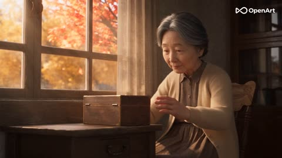</a>

先写好老年和青年两个版本的固定角色设定来保持一致，再按时间分段，每段单独写镜头、动画和光线。用推近老照片作为进入回忆的转场，并用排除清单避开动漫感和塑料感的三维质感。

Seedance 2.5 · 文生视频 · 出处: [@JuliaClarky on X](https://x.com/JuliaClarky/status/2112763209836835000) · 发现于 [LearnPrompt/awesome-seedance](https://github.com/LearnPrompt/awesome-seedance)

[`3d-animation`](tags.md#tag-3d-animation) [`korean-romance`](tags.md#tag-korean-romance) [`autumn`](tags.md#tag-autumn) [`flashback`](tags.md#tag-flashback) [`multi-scene`](tags.md#tag-multi-scene)

<details><summary><b>提示词</b></summary>

```text
Duration: 20 seconds | Cinematic 3D Animation | Korean Romance | Autumn Nostalgia | 16:9
ANIMATION STYLE AND VISUAL DIRECTION
Create a stunning, high-quality cinematic 3D animated short film set in South Korea. Use sophisticated character animation, beautifully detailed environments, realistic fabric textures, expressive faces, delicate lighting, and fluid natural movements.
The visual style should combine the charm of a beautifully animated romantic film with the emotional depth and cinematic composition of a nostalgic Korean love story.
Characters should have elegant, attractive facial features, expressive eyes, beautifully animated hair, and subtly stylized proportions while maintaining believable anatomy. Skin, knitted fabric, wood, falling leaves, and lighting should have rich, detailed textures.

Use warm autumn colors, golden sunlight, burgundy-red accents, soft atmospheric depth, delicate depth of field, and subtle film grain.

Important: This is a fully animated 3D film, not live-action. Avoid flat 2D animation, exaggerated cartoon proportions, childish character designs, anime styling, or plastic-looking 3D characters.

CHARACTER DESIGN AND CONTINUITY

THE ELDERLY WOMAN — PRESENT DAY

A graceful, exceptionally beautiful 72-year-old Korean woman with delicate facial features, expressive dark eyes, elegant silver-black hair tied loosely at the back, and naturally detailed age lines.

Her face should communicate kindness, wisdom, warmth, and a lifetime of beautiful memories. Her wrinkles should be delicately rendered rather than exaggerated. Give her a gentle smile and expressive eyes that can communicate happiness and nostalgia without dialogue.

She wears a vintage cream knitted cardigan over a muted-brown dress.

Her home is an old, cozy Korean wooden house featuring traditional wooden windows, faded curtains, aged furniture, a small wooden cabinet, an old analogue clock, and warm afternoon sunlight streaming inside.

On a wooden table sits an old keepsake box containing a faded photograph and a carefully preserved deep-red knitted scarf.

THE YOUNG WOMAN — 1998 FLASHBACK

The exact same character at 23 years old.

She is exceptionally beautiful, with delicate Korean facial features, large expressive dark eyes, smooth skin, long glossy black hair with soft bangs, and a naturally charming smile.

Her character design should feel elegant, romantic, and timeless, with subtle stylization, detailed hair strands, expressive facial animation, and graceful movements.

She wears a vintage cream wool coat, an ivory blouse, a dark pleated skirt, and a beautiful deep-red knitted scarf given to her by her first love.

The scarf must have detailed wool fibers, visible knitted patterns, soft folds, and natural movement.

THE BOYFRIEND — 1998 FLASHBACK

An exceptionally handsome 25-year-old Korean man with expressive dark eyes, a naturally defined jawline, thick black hair styled in a classic late-1990s Korean fashion, and a warm, sincere smile.

He wears a charcoal wool overcoat, a cream knitted sweater, dark trousers, and vintage leather shoes.

His animated expressions should be subtle and believable. His smile should feel shy, affectionate, and genuine.

Both characters must remain visually consistent throughout the flashback, with matching facial features, hairstyles, clothing, and proportions.

SCENE 1 — THE KEEPSAKE

TIME: 0–5 SECONDS

Inside a cozy old Korean wooden house, golden autumn sunlight streams through faded curtains.

Outside the window, red, amber, and golden maple leaves drift gently through the air.

The elderly woman sits beside a wooden table and slowly opens an old wooden keepsake box.

Inside is a faded photograph of her younger self standing beside a handsome young Korean man beneath a maple tree.

A deep-red knitted scarf rests carefully beneath the photograph.

She gently lifts the scarf with both hands. Her fingers softly move across its knitted texture.

A small, affectionate smile appears on her face. Her eyes glisten with a subtle tear as she remembers her first love.

Her expression is peaceful, happy, and filled with gratitude.

CAMERA: Slow cinematic push-in, beginning with a medium shot of the woman before moving into detailed close-ups of her hands, the red scarf, and the faded photograph.

ANIMATION DETAILS: Subtle hand movements, natural blinking, gentle breathing, delicate facial expressions, and softly moving curtains.

LIGHTING: Warm amber sunlight, soft shadows, beautiful highlights on the knitted wool, and realistic light bouncing off the wooden furniture.

SCENE 2 — A HAPPY MEMORY

TIME: 5–10 SECONDS

The camera slowly moves toward the old photograph.

The photograph fills the screen, and its image gradually transforms into a living, animated memory.

Suddenly, we are transported to autumn 1998.

A beautiful young Korean woman stands beneath a magnificent maple tree in a peaceful university garden. Golden leaves float around her as a gentle breeze moves her long black hair.

She wears her cream wool coat and the deep-red knitted scarf.

Her exceptionally handsome boyfriend approaches, carrying a small paper bag from an old-fashioned Korean bakery.

He smiles shyly and gently adjusts the scarf around her neck.

She looks up at him and laughs softly.

He brushes a loose strand of hair away from her face. They exchange a warm, affectionate smile.

Their expressions should communicate the excitement and tenderness of young love.

VISUAL EFFECT: A dreamy, softly glowing atmosphere with delicate floating leaves, gentle sunlight filtering through the maple canopy, subtle depth of field, and beautifully rendered autumn colors.

The memory should feel warm, happy, and precious, as though the elderly woman is reliving her favorite moment.

CAMERA: Gentle tracking movement, intimate close-ups, and graceful transitions between their expressions.

SCENE 3 — THEIR LITTLE WORLD

TIME: 10–15 SECONDS

The young couple walks along an old stone pathway covered in colorful fallen maple leaves.

The young man playfully steps on a dry leaf, making it crackle.

The woman laughs and lightly taps his arm.

He reaches for her hand. Their fingers gently interlock.

She looks at him with a playful smile before resting her head briefly against his shoulder.

They stop beneath the magnificent maple tree.

He gently adjusts the deep-red scarf around her neck and looks into her eyes.

BOYFRIEND — NATURAL KOREAN DIALOGUE:

"너한테 잘 어울려."

ENGLISH SUBTITLE:

"It looks beautiful on you."

The woman smiles shyly, lowers her eyes, and then looks back at him.

GIRL — NATURAL KOREAN DIALOGUE:

"정말?"

ENGLISH SUBTITLE:

"Really?"

He nods and smiles warmly.

She laughs softly.

A few maple leaves float between them as they continue looking at each other.

ANIMATION DETAILS: Fluid body movement, natural eye contact, subtle smiles, gentle hair movement, realistic scarf physics, and leaves responding naturally to the breeze.

The scene should feel intimate, playful, innocent, and genuinely happy.

SCENE 4 — THE MEMORY SHE KEPT

TIME: 15–20 SECONDS

A close-up of the young woman's joyful smile.

The image softly dissolves back into the present day.

The elderly woman sits beside the window in her wooden home, holding the same deep-red scarf against her chest.

She smiles tenderly at the photograph.

Her eyes glisten with nostalgic tears, but she does not look heartbroken. Instead, she looks peaceful and grateful to have experienced such beautiful love.

She carefully places the scarf beside the photograph and gently smooths its folded edge.

Outside the window, a golden maple leaf floats past.

She looks toward the autumn trees and whispers in Korean:

"행복했어… 정말."

ENGLISH SUBTITLE:

"I was happy… truly."

FINAL SHOT

A beautifully composed close-up of the faded photograph beside the preserved red scarf.

Warm sunlight falls across the wooden table. Tiny dust particles drift through the light.

The camera slowly pulls backward, revealing the peaceful room as golden leaves move beyond the window.

Fade to black.

FINAL TEXT:

"Some memories never grow old."

The text appears elegantly in the center of the screen, accompanied by a final gentle piano note.

CINEMATIC ANIMATION AND LIGHTING

High-end cinematic 3D animation with beautifully detailed character models, expressive facial animation, natural movement, realistic cloth simulation, detailed knitted fabric, individual hair strands, atmospheric lighting, and richly textured environments.

Use a warm autumn palette of amber, muted gold, burgundy, cream, and soft brown.

The present-day scenes should feel intimate, peaceful, and softly illuminated.

The flashback should feel brighter, warmer, and slightly dreamy, with delicate glowing sunlight and floating maple leaves.

Use smooth camera movement, cinematic composition, subtle depth of field, soft volumetric lighting, and gentle transitions.

Maintain consistent character identities and preserve the exact same deep-red scarf throughout the entire film.

AUDIO AND SUBTITLES

Soft nostalgic piano blended with gentle acoustic guitar.

Include delicate autumn ambience, rustling leaves, quiet footsteps, and subtle knitted-fabric sounds.

The Korean dialogue must sound natural, softly spoken, and emotionally authentic.

Display accurate English subtitles synchronized with the Korean dialogue. Use small, elegant white text with a subtle dark outline at the bottom of the frame.

No English voice-over.

NEGATIVE PROMPT

Flat 2D animation, childish cartoon style, exaggerated anime eyes, chibi characters, overly exaggerated facial expressions, plastic-looking skin, uncanny faces, distorted anatomy, inconsistent character designs, changing hairstyles, changing clothing, changing scarf color, unrealistic scarf physics, poorly animated hands, extra fingers, stiff movements, unnatural walking, excessive crying, horror atmosphere, dark depressing lighting, oversaturated colors, excessive blur, modern objects in the 1998 flashback, incorrect Korean subtitles, random text, logos, and watermarks.

FINAL OUTPUT

20-second cinematic 3D animated short film, 16:9 aspect ratio, 24 fps, high-quality rendering, beautiful original Korean character designs, detailed environments, smooth character animation, realistic cloth simulation, warm autumn lighting, seamless flashback transitions, expressive storytelling, and a deeply nostalgic yet happy romantic atmosphere.
```

</details>

<a id="seedance-miniature-woman-convenience-store-adventure"></a>
### 迷你女子在巨型便利店中飞奔冒险

<a href="https://x.com/AIwithkhan/status/2106397932304191969"></a>

开头先锁定角色与一比五的比例，再按顺序串联货架、购物车、冷柜、招牌等物理障碍。微距跟拍、前景视差、结尾拉远展示尺度，加上分层音效清单和防止比例漂移的负面词，让画面保持一致。

Seedance 2.5 · 文生视频 · 出处: [@AIwithkhan on X](https://x.com/AIwithkhan/status/2106397932304191969) · 发现于 [LearnPrompt/awesome-seedance](https://github.com/LearnPrompt/awesome-seedance)

[`miniature`](tags.md#tag-miniature) [`macro`](tags.md#tag-macro) [`adventure`](tags.md#tag-adventure) [`handheld`](tags.md#tag-handheld) [`sfx`](tags.md#tag-sfx)

<details><summary><b>提示词</b></summary>

```text
STYLE: Photorealistic live-action miniature-person FX, cinematic macro photography, ultra-shallow depth of field, realistic convenience store, dynamic handheld camera, dramatic practical lighting, realistic physics, detailed textures, premium viral commercial aesthetic, 4K.

Create a 30-second cinematic adventure featuring one athletic miniature woman at approximately 1 : 5 scale. Maintain her exact face, hairstyle, outfit, body proportions, backpack, and scale throughout.

She races across towering snack shelves, jumping over oversized packages and gaps. A giant candy box falls, creating an avalanche of rolling candies that she uses as stepping stones before landing on a massive chocolate bar. She climbs a huge drink bottle, runs up its curved surface, jumps over the cap, and lands on a hanging promotional display. She then rides a moving shopping cart through checkout, dodging the scanner and jumping onto the conveyor belt. At the refrigerated section, she runs across frozen-food packages, slides beneath a closing freezer door, and swings onto the display using the handle. Finally, she climbs onto a giant store sign and looks across the enormous store filled with products and shoppers as the camera pulls back to reveal just how tiny she is.

Use dynamic macro tracking, dramatic low angles, smooth aerial-style movements, strong foreground parallax, realistic reflections, shadows, depth of field, product packaging, natural human movement, believable physics, seamless transitions, and cinematic lighting.

End with the cinematic title: “SMALL SCALE. BIG ADVENTURE.” followed by “EVERY AISLE IS A NEW WORLD.”

SFX: Footsteps, packaging crinkles, candy rattles, plastic flexing, cart wheels, scanner beeps, conveyor hum, freezer sounds, rushing air, and cinematic impact.

NEGATIVE: No cartoon, anime, toy-like appearance, animation, duplicated character, face or outfit changes, distorted anatomy, floating, scale changes, narration, or subtitles.
```

</details>

<a id="seedance-minidv-couple-afternoon-street-walk"></a>
### MiniDV家庭录像风格的情侣午后街头漫步

<a href="https://x.com/AIwithkhan/status/2094997895187673489">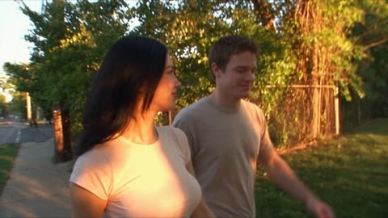</a>

先用参考图锁定人物外貌和服装，再用风格句（千禧年初MiniDV、手持抖动、对焦漂移）定下画面质感。情节按街头小吃到日落亲吻的顺序连续展开，音频要求环境声且不加音乐，负面提示补充了禁止换人和换装。

Seedance 2.5 · 参考生视频 · 出处: [@AIwithkhan on X](https://x.com/AIwithkhan/status/2094997895187673489) · 发现于 [LearnPrompt/awesome-seedance](https://github.com/LearnPrompt/awesome-seedance)

[`minidv`](tags.md#tag-minidv) [`home-video`](tags.md#tag-home-video) [`handheld`](tags.md#tag-handheld) [`couple`](tags.md#tag-couple) [`street-ambience`](tags.md#tag-street-ambience)

<details><summary><b>提示词</b></summary>

```text
Use the uploaded reference image as the exact character reference. Preserve her facial identity, hairstyle, eye color, skin tone, makeup, body proportions, 

Style: Early-2000s MiniDV home-video aesthetic, photorealistic live-action, shaky handheld camera, slight autofocus hunting, natural exposure shifts, motion blur, imperfect framing, warm afternoon light, authentic everyday atmosphere.

A young woman from Korea wearing a fitted pastel tshirt spends a casual afternoon with her boyfriend in a quiet neighborhood. She films herself walking down the street, smiling at the camera while her boyfriend walks beside her. They stop at a small street-food stall, share a snack, laugh together, and continue walking.

She playfully steals his sunglasses and puts them on, making him laugh. They sit together on a low wall, talk and tease each other, then walk through a small park while she records little moments on the handheld camera.

As the sun begins to set, they stop under a streetlight. She turns the camera toward him, they exchange a warm smile, move closer, and share a brief natural kiss on the lips.

The camera stays handheld and slightly imperfect as they laugh afterward and walk away together.

Audio: Natural street ambience, footsteps, distant traffic, birds, casual conversation and laughter. No music.

Negative prompt: No subtitles, text, logos, watermarks, identity changes, outfit changes, duplicate people, distorted hands, unnatural movements, or AI artifacts.
```

</details>

<a id="seedance-motorcycle-to-dragon-jungle-flight"></a>
### 丛林摩托车变身巨龙腾空飞行

<a href="https://x.com/RuzainaMeer/status/2089595902818398461"></a>

30秒片段按时间段拆分，每段写明镜头与动作。单独的一致性条目锁定人物，并要求摩托车到巨龙的变形连续不切镜，再用负面清单防止多余肢体和跳场景。

Seedance 2.5 · 文生视频 · 出处: [@RuzainaMeer on X](https://x.com/RuzainaMeer/status/2089595902818398461) · 发现于 [LearnPrompt/awesome-seedance](https://github.com/LearnPrompt/awesome-seedance)

[`cinematic`](tags.md#tag-cinematic) [`fantasy`](tags.md#tag-fantasy) [`transformation`](tags.md#tag-transformation) [`dragon`](tags.md#tag-dragon) [`long-form`](tags.md#tag-long-form)

<details><summary><b>提示词</b></summary>

```text
Create a 30-second ultra-photorealistic cinematic fantasy sequence with high-budget Hollywood film quality. A strong, fearless young woman rides a small rugged black motorcycle through a dense tropical jungle at sunrise. Maintain realistic skin, hair, physics, lighting, atmosphere, detailed environments, natural motion, and cinematic depth throughout.

0–5s — The Ride: Wide cinematic tracking shot of the woman riding along a narrow muddy rainforest trail. Sun rays through the canopy, ground mist, moving leaves, water droplets from tires. She wears a practical dark leather riding outfit, protective boots and gloves. Calm, confident expression. Realistic engine vibration and body movement.

5–10s — Transformation: In an open clearing, the motorcycle slows and the ground trembles. Its metal frame seamlessly transforms into a gigantic creature through a believable mechanical-organic fusion: wheels become huge clawed limbs, frame expands into an armored body, metal flows into dark realistic scales, handlebars become horns. Dust, leaves, rocks, and debris react naturally. No cuts or jumps.

10–15s — Dragon Awakens: The motorcycle becomes a gigantic realistic black-and-dark-red dragon with muscular wings, detailed scales, powerful claws, curved horns, and integrated glowing amber eyes. The woman remains safely on its back. The dragon raises its head, exhales warm vapor, spreads its wings, and roars, shaking nearby foliage. Low-angle shot emphasizes scale.

15–23s — Flight: The dragon launches powerfully from the jungle, bending trees and scattering leaves. The woman grips its armored neck. Aerial tracking shot reveals rivers, waterfalls, cliffs, mist, and dense rainforest below. Realistic wing aerodynamics, turbulence, mist movement, and sunlight reflecting across scales.

23–27s — River: The dragon dives toward a massive turquoise river, flying extremely low above the water. Its wings create waves and spray. The woman's hair and clothing whip in the wind while she remains focused. High-speed side camera captures her expression and the dragon's detailed face.

27–30s — Epic Ending: The dragon pulls upward toward the golden sky. Camera pulls far back to reveal endless jungle, rivers, mountains, and clouds. Golden light illuminates its wings from behind. End with a powerful silhouette disappearing toward the horizon.

Visual Style: Ultra-photorealistic live-action fantasy, cinematic 8K appearance, believable anatomy, realistic skin/scales, atmospheric perspective, volumetric sunlight, detailed foliage, realistic water and wind simulation, cinematic DOF, subtle anamorphic lens characteristics, dramatic camera movement, HDR, realistic motion blur, natural shadows, film-quality grading.

Character Consistency: Same woman throughout; preserve facial identity, hairstyle, body proportions, clothing, and appearance.

Transformation: Continuous and coherent motorcycle-to-dragon transformation. Motorcycle and dragon must clearly be the same entity. No sudden cuts, teleportation, disappearing objects, duplicated limbs, malformed anatomy, or inconsistent scale.

Camera: Cinematic tracking, low-angle hero shots, close-ups, dynamic aerial/drone-style shots, smooth high-speed movement, realistic parallax, motivated transitions.

Negative: No cartoon, anime, plastic CGI textures, rubbery movement, extra characters, duplicate woman, deformed hands, distorted face, floating motorcycle parts, random scene changes, text, subtitles, logos, or watermark.
```

</details>

<a id="seedance-mountain-spire-house-grocery-climb"></a>
### 女子攀登云海孤峰回到山顶小屋

<a href="https://x.com/sophiaparkerr_/status/2107096810783461509"></a>

六个带秒数区间的分镜，从航拍全景、脚部特写、跟拍、室内一路推进到拉远收尾，把尺度反差讲清楚。参考图锁定人物形象，结尾的负面清单约束手脚变形和脸部漂移。

Seedance 2.5 · 参考生视频 · 出处: [@sophiaparkerr_ on X](https://x.com/sophiaparkerr_/status/2107096810783461509) · 发现于 [LearnPrompt/awesome-seedance](https://github.com/LearnPrompt/awesome-seedance)

[`surreal`](tags.md#tag-surreal) [`aerial`](tags.md#tag-aerial) [`multi-shot`](tags.md#tag-multi-shot) [`character-consistency`](tags.md#tag-character-consistency) [`vertical`](tags.md#tag-vertical)

<details><summary><b>提示词</b></summary>

```text
Create a cinematic, photorealistic 30-second vertical video using the provided girl reference image as the strict character reference.

Preserve her exact facial identity, facial structure, skin tone, hairstyle, age, and natural proportions throughout the entire video. Do not change her identity or facial features.

Character: The same woman from the reference image, wearing an elegant deep burgundy/red long-sleeve midi dress with a subtle vintage pattern, a matching belt, and elegant burgundy high heels. She carries a simple brown kraft-paper grocery bag containing a few visible groceries.

Shot 1 — 0–5 sec

Begin with a breathtaking aerial establishing shot high above the clouds. A gigantic, extremely tall, narrow rocky mountain spire rises vertically through a sea of white clouds. The peak is covered with patches of green vegetation, with a tiny charming house perched impossibly at the very top.

Slow cinematic drone movement toward the mountain. Bright blue sky, warm sunlight, soft atmospheric haze, realistic clouds, immense sense of scale.

Shot 2 — 5–10 sec

Cut to a close-up of the woman's feet as she carefully climbs uneven stone steps carved into the side of the mountain.

Her burgundy high heels step naturally from one stone ledge to another. The hem of her dress moves gently in the wind. Far below, clouds and the distant landscape are visible.

Use realistic foot movement, natural weight, physically accurate fabric motion, shallow depth of field, cinematic lens.

Shot 3 — 10–15 sec

Reveal the woman from a side/back angle as she continues climbing toward the summit.

She carries the brown grocery bag naturally in one hand. Her burgundy dress flows slightly in the strong mountain breeze.

The camera slowly tracks beside her, revealing the enormous drop and clouds stretching endlessly below. She remains calm and composed despite the surreal height.

Shot 4 — 15–20 sec

The woman reaches the tiny house at the summit and walks through its doorway while still holding the grocery bag.

Transition from the bright outdoor environment into a warm, cozy interior. Golden sunlight enters through the doorway. She walks naturally through the small home and places the grocery bag inside.

Maintain the exact same character appearance, dress, hairstyle, and proportions.

Shot 5 — 20–26 sec

Show the woman standing inside the cozy house beside a huge floor-to-ceiling window overlooking the clouds.

She pauses with a cup in her hand and looks peacefully toward the breathtaking view. The camera slowly moves backward, revealing the warm interior, wooden furniture, soft curtains, and the enormous mountain landscape outside.

Golden-hour lighting, subtle curtain movement, realistic shadows, cinematic atmosphere.

Shot 6 — 26–30 sec

Return to a spectacular wide aerial shot of the entire impossibly tall mountain spire rising above the clouds.

The tiny house is visible at the very top, emphasizing the incredible scale. Slowly pull the camera farther away until the mountain becomes surrounded by an endless sea of clouds.

End on a beautiful cinematic wide shot.

Visual style: ultra-realistic cinematic photography, premium film look, natural skin texture, realistic physics, realistic fabric and hair movement, volumetric sunlight, atmospheric perspective, detailed environments, subtle film grain, shallow depth of field where appropriate, high dynamic range, smooth camera motion, believable lighting.

Camera: cinematic drone shots, slow tracking shots, low-angle detail shots, gentle push-ins, smooth aerial pullback, realistic handheld micro-movements only when appropriate.

Important: Keep the woman's identity perfectly consistent across every shot. No face morphing, no character changes, no extra fingers, no distorted hands, no warped feet, no duplicated objects, no floating objects, no unnatural body movement, no cartoon or CGI appearance, no text, no subtitles, no logos.
```

</details>

<a id="seedance-mud-in-jar-becomes-bird"></a>
### 玻璃罐里的泥土变成一只鸟

<a href="https://x.com/Yesandyou_/status/2090075447195480403"></a>

用参考图锁定主体，把十秒切成四个带时间码的段落，从泥土涌动一直写到小鸟的最终特写。镜头与风格部分禁止切镜和抖动，再配上很长的负面提示词，让变形过程显得真实可信。

Seedance 2.5 · 图生视频 · 出处: [@Yesandyou_ on X](https://x.com/Yesandyou_/status/2090075447195480403) · 发现于 [LearnPrompt/awesome-seedance](https://github.com/LearnPrompt/awesome-seedance)

[`transformation`](tags.md#tag-transformation) [`macro`](tags.md#tag-macro) [`photorealistic`](tags.md#tag-photorealistic) [`fantasy`](tags.md#tag-fantasy) [`vertical`](tags.md#tag-vertical)

<details><summary><b>提示词</b></summary>

```text
Use the uploaded image as the exact visual reference. Create a highly detailed, cinematic 10-second magical transformation video. Keep the overall composition, character appearance, lighting, camera quality, and environment consistent with the reference.

⏱️ 0–2 seconds — Jar & Mud
The subject is holding a small transparent glass jar/container carefully in both hands. Inside the jar is thick, dark, moist magical mud/soil with realistic texture. The camera slowly pushes toward the jar, focusing on the mud. Tiny particles of soil begin to move naturally.

🌱 2–5 seconds — Mud Comes Alive
The mud inside the jar starts gently swirling and rising as if something is forming underneath it. Small cracks appear across the surface of the mud. Tiny pieces of soil lift into the air and fall naturally. A subtle magical glow begins to emerge from inside the mud, while keeping the scene photorealistic rather than cartoonish.

🐣 5–8 seconds — Bird Emerges
A small realistic bird slowly emerges from the mud inside the jar. First, its tiny head appears, followed by its neck, wings, and body. Wet mud naturally falls away from its feathers as it comes out. The bird gradually becomes fully formed, with extremely detailed feathers, realistic eyes, tiny beak, and natural movements. The emergence should feel magical but physically believable.

🐦 8–10 seconds — Final Moment
The bird completely emerges from the mud and gently spreads its wings. A few tiny pieces of mud fall back into the jar. The bird looks around naturally and gives a subtle wing movement. The camera finishes with a beautiful close-up of the bird sitting on/above the mud inside the jar, creating a mysterious and magical final shot.

🎥 CAMERA & VISUAL STYLE

Duration: 10 seconds
Format: 9:16 vertical
Ultra-photorealistic
Cinematic fantasy realism
Smooth slow camera movement
Macro-style detail on mud and feathers
Realistic depth of field
Natural lighting and shadows
Detailed glass reflections
Realistic mud physics
Smooth motion with strong temporal consistency
No sudden camera movements
No cuts
No transitions
No camera shake

🪶 BIRD DETAILS

The bird should look completely realistic:

Extremely detailed individual feathers
Natural feather movement
Realistic eyes and beak
Correct bird anatomy
Natural wing structure
Realistic proportions
Wet mud sticking temporarily to feathers
Mud naturally falling away as the bird emerges
Subtle breathing and head movement
Natural wing movement

🚫 NEGATIVE PROMPT

cartoon, anime, CGI-looking bird, fake feathers, deformed bird, malformed wings, extra wings, extra legs, extra eyes, multiple birds, duplicate bird, bird suddenly appearing, bird teleportation, unnatural bird anatomy, giant bird, oversized bird, disappearing bird, distorted mud, floating mud, unrealistic mud physics, excessive magic effects, cartoon magic, excessive glowing particles, explosions, smoke, fire, distorted jar, broken glass, melting glass, changing jar shape, extra hands, deformed fingers, missing fingers, distorted hands, face distortion, blurry, low resolution, pixelated, oversaturated, excessive bloom, excessive lens flare, camera shake, fast zoom, sudden movement, flickering, ghosting, frame interpolation artifacts, object morphing, inconsistent lighting, watermark, logo, text, subtitles, UI elements.

✨ FINAL QUALITY

Photorealistic cinematic fantasy, highly detailed wet mud, realistic glass, physically accurate lighting, natural bird anatomy, extremely detailed feathers, believable mud-to-bird transformation, smooth 10-second animation, consistent objects and environment, premium cinematic quality, realistic depth of field, 4K-quality detail.
```

</details>

<a id="seedance-nike-air-max-deadline-twist-ad"></a>
### 深夜办公桌旁的女性创意总监与 Nike Air Max 运动鞋

<a href="https://x.com/SyntheSarah/status/2096099021152498159">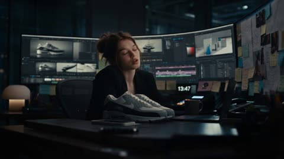</a>

按时间段划分分镜并写入台词，让 30 秒广告的节奏清晰。用一条固定规则锁定人物的脸、发型和服装，并为键盘声、脚步声和音乐停顿逐段写明音效，控制连贯性与喜剧节奏。

Seedance 2.5 · 文生视频 · 出处: [@SyntheSarah on X](https://x.com/SyntheSarah/status/2096099021152498159) · 发现于 [LearnPrompt/awesome-seedance](https://github.com/LearnPrompt/awesome-seedance)

[`advertising`](tags.md#tag-advertising) [`sneakers`](tags.md#tag-sneakers) [`character-consistency`](tags.md#tag-character-consistency) [`timed-beats`](tags.md#tag-timed-beats) [`sound-design`](tags.md#tag-sound-design)

<details><summary><b>提示词</b></summary>

```text
Create a 30-second ultra-photorealistic cinematic commercial for Nike Air Max, combining premium sports advertising, creativity, subtle comedy, and a surprising twist.

Keep the female creative director’s face, hairstyle, clothing, body proportions, and appearance perfectly consistent throughout.

0–4s — THE DEADLINE
Late-night creative studio. A stylish young female creative director sits surrounded by monitors and unfinished projects. Nike Air Max sneakers sit on her desk. Notifications appear rapidly. She says:
“Five projects. One deadline.”

4–8s — THE IDEA
She looks at the Nike Air Max, gets an idea, rapidly creates a campaign on her computer, and hits ENTER. The screen flashes.

8–16s — THE CAMPAIGN
A powerful athlete wearing the same Nike Air Max runs through multiple cinematic environments: a futuristic city at sunrise, rain-soaked streets, and mountains. Show extreme close-ups of the sneakers, realistic Air Max cushioning compression, pavement impacts, water splashes, and seamless match cuts between locations.

16–21s — DONE
Back in the studio, her monitors display polished Nike Air Max campaign visuals. Only seconds have passed. Shocked, she says:
“Wait… that's it?”

21–26s — THE TWIST
She relaxes with coffee. A notification appears: CAMPAIGN APPROVED. She smiles. Another appears:
CLIENT: “Can we make 10 more?”
Her smile disappears. She looks at the camera and says:
“Never mind.”

26–30s — HERO REVEAL
Extreme cinematic product shot of Nike Air Max on a dark reflective surface. Dramatic lighting, floating particles, slow camera rotation. Final frame:
NIKE — JUST DO IT.

STYLE: Ultra-photorealistic, premium global sports commercial, cinematic lighting, realistic skin, fabric, reflections, shadows, natural motion, dynamic camera movement, shallow depth of field, subtle slow motion. No cartoon style, distorted anatomy, fake logos, fake text, watermarks, or altered shoe design.

AUDIO: Keyboard and notification sounds at the start, building into energetic cinematic music during the running sequence. Powerful footsteps, sneaker impacts, water splashes, and bass hits. Music drops for the comedy moment and ends with a strong cinematic hit.
```

</details>

<a id="seedance-noir-rooftop-heist-35-shot-timeline"></a>
### 三十五镜头的黑色电影屋顶劫案

<a href="https://x.com/doctorwasif/status/2100181300049232193">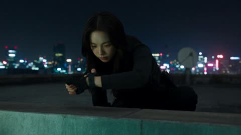</a>

用带编号的时间轴给每个镜头单独划定秒数，把30秒拆成短而可控的节拍。参考图锁定主角的脸和服装，结尾的风格行统一霓虹黑色电影的画面、物理表现和无对白要求。

Seedance 2.5 · 参考生视频 · 出处: [@doctorwasif on X](https://x.com/doctorwasif/status/2100181300049232193) · 发现于 [LearnPrompt/awesome-seedance](https://github.com/LearnPrompt/awesome-seedance)

[`multi-shot`](tags.md#tag-multi-shot) [`noir`](tags.md#tag-noir) [`heist`](tags.md#tag-heist) [`timeline`](tags.md#tag-timeline) [`character-consistency`](tags.md#tag-character-consistency)

<details><summary><b>提示词</b></summary>

```text
35-shot, 30-second cinematic noir rooftop heist. Keep Character A’s face, outfit, and appearance identical to the reference image. Sleek tactical gear, neon-lit city, tense professional choreography, realistic cinematic lighting, sharp cuts, no dialogue.

1. 0.0–1.0s: A crouches on a rooftop ledge at night, checks wrist device, neon skyline behind.
2. 1.0–1.6s: Extreme close-up of her eyes scanning the opposite building, neon reflections.
3. 1.6–2.2s: Teammate mechanically checks a grappling-hook launcher.
4. 2.2–2.8s: Wide neon city skyline establishing shot.
5. 2.8–3.4s: Two teammates exchange a precise silent hand signal.
6. 3.4–4.0s: A fires grappling hook across the gap; cable snaps taut.
7. 4.0–4.6s: Teammate checks a countdown timer.
8. 4.6–5.4s: A launches across the gap, city lights streaking below.
9. 5.4–6.0s: She lands silently, rolls, and immediately readies herself.
10. 6.0–6.6s: Security camera pans while team freezes in shadows.
11. 6.6–7.2s: Camera passes; teammate exhales in brief relief.
12. 7.2–7.8s: Three teammates synchronize watches and countdown gestures.
13. 7.8–8.6s: Team crosses rooftop in perfect formation, silhouetted against neon.
14. 8.6–9.2s: Gloved hands bypass a keypad with a decoding device.
15. 9.2–9.8s: Access panel opens; teammate silently signals success.
16. 9.8–10.6s: Team descends through rooftop hatch into a dark maintenance corridor.
17. 10.6–11.4s: Security guard patrols below, unaware; team hides above stairwell.
18. 11.4–12.2s: A signals “wait,” tracking the guard through railing.
19. 12.2–13.0s: Guard turns away; team swiftly moves past.
20. 13.0–13.8s: Team reaches a reinforced metallic vault door.
21. 13.8–14.6s: Decoding device attaches to vault lock; numbers cycle rapidly.
22. 14.6–15.6s: Close-ups of tense faces and countdown timer.
23. 15.6–16.6s: A guards the corridor, alert and weapon-free.
24. 16.6–17.6s: Decoder numbers slow toward final combination.
25. 17.6–18.8s: Slow motion: final digit locks; vault mechanisms release.
26. 18.8–20.0s: Slow motion: massive vault door opens, dramatic light spills out.
27. 20.0–21.0s: Team exchanges a restrained, silent look of triumph.
28. 21.0–22.0s: Wide reveal of sleek high-value contents inside vault.
29. 22.0–23.0s: A checks corridor again, maintaining vigilance.
30. 23.0–24.0s: Team efficiently secures the objective.
31. 24.0–25.2s: Distant alarm begins; team instantly shifts into calm exit mode.
32. 25.2–26.4s: Team retreats through rooftop access hatch.
33. 26.4–27.6s: A briefly looks back at the building, neon reflected in her eyes.
34. 27.6–28.8s: Team rappels down the exterior toward a waiting vehicle.
35. 28.8–30.0s: Wide final shot: vehicle speeds through neon city streets as rooftop lights fade behind, cinematic noir heist ending.

Style: high-end cinematic action thriller, realistic tactical movement, neon noir, dramatic contrast, atmospheric night lighting, dynamic camera work, precise choreography, seamless continuity, realistic physics, restrained professional emotion, no dialogue.
```

</details>

<a id="seedance-office-stealth-game-escape-elevator"></a>
### 上班族潜行下班，潜行游戏视角

<a href="https://x.com/Just_sharon7/status/2099440985872933199">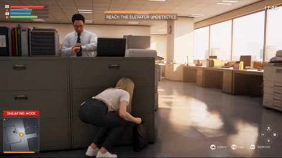</a>

用角色分离段落为每个人物写明身高、年龄和发型，避免人物混淆。镜头设定为带弹簧延迟的第三人称长镜头，视场角平滑变化，按秒分段写动作节拍，仅在结尾硬切一次到固定反打镜头。

Seedance 2.5 · 图生视频 · 出处: [@Just_sharon7 on X](https://x.com/Just_sharon7/status/2099440985872933199) · 发现于 [LearnPrompt/awesome-seedance](https://github.com/LearnPrompt/awesome-seedance)

[`stealth-game`](tags.md#tag-stealth-game) [`third-person`](tags.md#tag-third-person) [`one-take`](tags.md#tag-one-take) [`office`](tags.md#tag-office) [`hud`](tags.md#tag-hud)

<details><summary><b>提示词</b></summary>

```text
SCENE CONTEXT

A 30-second realistic AAA third-person stealth-action game sequence set in a Japanese corporate office at exactly 5:00 PM on a bright weekday afternoon. The player character, NAGI, has finished her work and must reach the elevator without being stopped by her boss and given another assignment.

ACTIVE REFERENCES

[@Image1] = NAGI’s facial identity, if a character reference is supplied. Use only her facial appearance as the identity reference; replace any school clothing and background with the adult office character and environment specified below.

NAGI: Japanese woman, 25, long straight black hair with blunt bangs, white short-sleeve office blouse, charcoal tailored trousers, black leather belt, white minimalist sneakers, employee ID clipped to her waistband, small black work tote held close to her body.

Voice: light, breathy adult female voice, speaking Japanese in a hushed whisper. Keep her face, hairstyle, outfit, proportions, and accessories identical throughout.

CAST SEPARATION

Four distinct adult office characters appear, each with a different silhouette, age, and hairstyle so they read as separate people:

TEAM LEADER: man in his 40s, 170 cm, average build, full head of short black hair parted at the side, thin metal-framed glasses, white dress shirt with a loosened navy tie. Appears only beside the first desk cluster, checking his watch.
PAPERWORK COWORKER: woman in her 20s, 160 cm, slim, brown hair in a high ponytail, beige cardigan over a white blouse, carrying a thick stack of printouts. Appears only in the printer aisle.
BOSS: man in his 60s, 160 cm, stout and round-shouldered, completely bald with a shiny scalp and a fringe of white hair above the ears, round gold-rimmed glasses, charcoal three-piece suit with a company lapel badge, carrying a blue assignment folder. Appears at the corridor T-junction and remains in that connected corridor during the whiteboard sequence.
OFFICE ASSISTANT: man in his early 30s, 182 cm, lean and broad-shouldered, thick full black hair swept back, short beard, navy shirt with rolled sleeves, dark trousers, no glasses. Pushes the mobile whiteboard from the meeting-room alcove toward the elevator lobby.

The BOSS is the only bald character in the entire video. The OFFICE ASSISTANT keeps a full head of thick black hair and a beard, stands more than 20 cm taller than the BOSS, and is clearly a different, much younger man.

LOCATION MAP

One unbroken spatial route the camera travels with her:

Her workstation → low desk partition → printer aisle → corridor T-junction → meeting-room alcove with mobile whiteboard → elevator lobby → elevator interior.

Keep the route compact and physically traversable within the 27-second continuous section.

Foreground: polished linoleum floor, office desks, steel filing cabinets, rolling chairs, and reflective glass meeting-room partitions.

Background: window wall on camera-right overlooking neighboring office buildings, dust suspended in the sunbeams. Light enters from camera-right along the office route.

ELEVATOR GEOMETRY

The elevator entrance is at the end of the office corridor. The call button is on the wall beside the entrance. The elevator is empty when NAGI enters.

Inside the elevator: brushed-metal rear wall, side handrails, softly illuminated ceiling, control panel beside the doorway. No rear exit and no mirror creating a second NAGI.

NAGI enters facing the rear wall, then turns to face the open elevator doors.

For the final reverse shot, the camera is positioned INSIDE the elevator, immediately beside the doorway, looking inward at NAGI. The brushed-metal rear wall is behind her. The elevator doors close behind the camera, allowing her face to remain visible throughout the final shot.

FIRST FRAME / BLOCKING

First frame is already in motion: NAGI darts in from lower-left toward camera-right, work tote clutched to her chest, and drops into a crouch-slide behind a low desk partition beside her workstation.

Camera behind her right shoulder. Game HUD fully visible from frame one.

A small desk clock reads 17:00.

FORMAT MODE

One continuous unbroken take from 0.0s to 27.0s with no cuts of any kind, then a single HARD CUT at 27.0s to one final locked reverse shot that runs to 30.0s.

Exactly one cut exists in the whole video, at 27.0s. The camera does not cut anywhere else.

OPTICS

One lens for the continuous section: 47° third-person over-the-shoulder framing as the baseline, breathing in to 29° on reaction beats and out to 63° for the boss encounter and moving-whiteboard concealment.

All FOV changes in that section happen as smooth continuous zoom breathing, never as a jump.

The final shot after the cut is a fixed 29° frontal framing of NAGI, no drift.

CAMERA

For the continuous section, the camera is a physical object flying with her.

Chest-height, 1.5 meters behind NAGI, slightly camera-right of her spine, swinging with a soft spring delay half a beat behind her turns like an analog-stick gameplay camera.

It dips to knee height when she crouches, rises when she stands, slides sideways along the filing cabinets with her, swings wide to corridor-left to reveal the boss encounter, drifts behind her for the moving whiteboard, and follows her through the open elevator doorway.

The camera travels through open space around desks and partitions. It never clips through furniture, walls, the whiteboard, or elevator doors.

After the cut, the camera is repositioned inside the elevator beside the doorway, looking inward at NAGI — locked off, eye level, completely static, no movement.

ACTION

[Beat 1 — 0.0s to 6.0s]

NAGI crouch-slides behind the low desk partition, back flat against it, chest heaving. She leans out 20 cm to peek at the TEAM LEADER checking his watch beside the adjacent desk cluster, then pulls back.

She whispers in Japanese:

{定時だ…捕まったら終わり。}

HUD flashes 【5:00 PM — SHIFT OVER】 and the mission banner 【OBJECTIVE: REACH THE ELEVATOR UNDETECTED】.

The TEAM LEADER turns toward a ringing desk phone. NAGI slips behind his back, staying below the desk-partition line, and moves into the printer aisle.

The camera follows without stopping.

[Beat 2 — 6.0s to 12.0s]

The camera stays with her beside the steel filing cabinets.

NAGI presses her spine flat against the cabinets and shuffles sideways at 2 km/h, sneakers rolling heel-to-toe in silence. The camera tracks sideways with her at the same speed.

The PAPERWORK COWORKER walks past the end of the row carrying a thick stack of printouts, scanning the office for someone available to help.

NAGI holds her breath, pupils tracking the coworker without moving her head, and whispers:

{来ないで…こっち見ないで。}

The minimap vision cone sweeps past NAGI’s marker and turns away.

HUD shows 【SNEAKING MODE】.

The PAPERWORK COWORKER exits frame-left. NAGI exhales, crouches beneath the edge of the last desk, and slips into the corridor with the camera still on her shoulder.

[Beat 3 — 12.0s to 18.0s]

The BOSS steps around the T-junction two meters in front of her, blue assignment folder in hand.

He catches a brief glimpse of movement. A red exclamation marker snaps above his bald head with a sharp alert sting. The HUD edge pulses red: 【ALERT】.

He starts saying in Japanese:

{なぎさん、追加の仕事が…}

The camera swings wide to corridor-left as NAGI reacts in one motion: hugs her tote tightly against her ribs, drops below his eye line, pivots around the corner of a tall filing cabinet, and slips into the adjacent meeting-room alcove.

The cabinet fully blocks his view before he can finish approaching her.

She whispers:

{今だけは無理…！}

HUD prints 【EVASIVE MANEUVER】 and 【BREAK LINE OF SIGHT】.

The BOSS takes a step toward the place where he last saw her, looking around the cabinet. NAGI has already moved to the far side of a mobile whiteboard in the alcove.

The camera falls in behind her again.

[Beat 4 — 18.0s to 24.0s]

The OFFICE ASSISTANT starts pushing the mobile whiteboard out of the meeting-room alcove toward the elevator lobby.

The whiteboard is a tall, opaque rectangular board on a metal frame with four caster wheels. Its panel extends low enough to conceal NAGI’s crouched torso and head; only her white sneakers occasionally show below the frame.

NAGI crouches on the side opposite the BOSS and shuffles with the board, matching its rolling speed exactly. She keeps her tote tucked close so it never protrudes beyond the board’s edge.

The camera tracks low on her concealed side, showing her careful steps and the BOSS intermittently visible beyond the board’s far edge.

The BOSS pauses, looks toward the moving whiteboard for a full beat, then turns back toward the office with his assignment folder.

From behind the board, NAGI whispers:

{ホワイトボード…最強。}

HUD prints 【MOBILE COVER EQUIPPED】, then 【ENEMY LOST CONTACT】.

The alert bar drains to green.

The OFFICE ASSISTANT steers the board into a wall recess beside the elevator lobby. NAGI slips away from its concealed side as it stops.

[Beat 5 — 24.0s to 27.0s]

NAGI reaches the elevator call button and taps it once.

A soft arrival chime sounds. The elevator is already waiting on this floor; its doors slide fully open.

She slips through the clear doorway. The camera follows her inside, staying behind her shoulder.

She turns to face the entrance and presses the door-close button once. Her shoulders remain tense, tote held tightly in both hands.

The doors remain open until the cut.

27.0s HARD CUT

[Beat 6 — 27.0s to 30.0s]

Locked static reverse shot from inside the elevator beside the doorway, looking inward:

NAGI stands facing camera, shoulders squared, work tote held in front of her, chest still rising fast. Behind her are the brushed-metal rear wall and a horizontal handrail.

Off camera behind the lens, from the distant office corridor, the BOSS calls in Japanese:

{なぎさん、ちょっといい？}

The elevator doors slide closed behind the camera. Their narrowing opening is registered by the shrinking patch of corridor light across NAGI’s face and the sliding-door sound.

NAGI answers brightly, looking straight down the lens:

{お先に失礼します！}

The doors finish closing. Her shoulders drop with relief.

HUD prints 【MISSION COMPLETE】, 【STEALTH RANK: S】, 【ADRENALINE +150】, and the final notification:

【AFTER-HOURS TASK EVADED】

Final frame: NAGI facing camera, a tiny triumphant smile pulling at one corner of her mouth.

PERFORMANCE

Photographic human realism indistinguishable from live-action footage: skin with visible pores, fine vellus hair catching the light, subsurface scattering in the earlobes and fingertips, capillary flush across her cheeks and ears from running, individual flyaway strands lifting off her hair, wet living eyes with true window catchlights and a faint red inner rim, clean matte skin.

Visible fast breathing at the collarbone, eyes darting a half-second before her head turns.

Tension shown by muscle: shoulders drawn up to her ears, fingers clamped white on the tote handles, jaw set, then a full-body shoulder drop on each escape.

All adults have equally real skin, real hair follicles, and natural asymmetric faces.

PHYSICS

Her blouse and tailored trousers crease naturally during crouches and turns. Hair lags and sweeps across her face on fast direction changes.

The work tote has real weight: its handles pull taut in her hands, and its body swings with inertia before settling against her torso.

The mobile whiteboard has real mass. Its caster wheels rotate against the floor, swivel when steered, and rattle lightly over a flooring seam. The board wobbles subtly when the OFFICE ASSISTANT starts and stops it.

NAGI moves with her own visible footsteps; the board does not drag or transport her.

The coworker’s printouts flex slightly while walking. The BOSS’s folder stays in his hand.

Elevator doors slide smoothly on fixed tracks and close only after NAGI and the camera are fully inside.

Contact shadows stay glued under every foot, every knee, every furniture leg, and every caster wheel.

LIGHTING

One continuous light logic across the office route: bright late-afternoon sun at 5600K entering from the window wall on camera-right, throwing long window-frame stripes across the floor.

NAGI passes through light and shadow as she travels. Soft bounce fill off the pale linoleum lifts her face. Fine dust hangs suspended in the sunbeams.

The elevator lobby receives the same window light. Inside the elevator, neutral overhead illumination provides continuous soft fill.

In the final reverse shot, the same corridor daylight enters from camera-left through the open doorway, raking across her cheek. As the doors close behind the lens, this daylight narrows and disappears naturally, leaving the elevator’s established overhead light.

Exposure rolls smoothly as she moves between bright and shadowed stretches, and the color temperature matches exactly across the cut.

HUD

GTA-style real-time game HUD locked to fixed screen positions for the whole 30 seconds, with every on-screen word written in English:

Circular minimap bottom-left with the player arrow and yellow vision cones for the office characters; health and stamina bars top-left; alert-state bar shifting green to amber to red; controller button prompts bottom-right; English mission objective text top-center; floating red exclamation markers over alerted characters; notification cards sliding in from screen-right.

The HUD stays in the same screen positions across the cut.

No subtitles or caption bars anywhere on screen.

The HUD is a clean flat graphic overlay composited on top of fully photographic live-action-grade footage.

AUDIO

Tense minimalist stealth synth loop with a pulsing heartbeat underneath, running unbroken across the cut and resolving to a short bright victory fanfare at the end.

Ambience carries continuously through the cut. Office sounds become naturally muffled as the elevator doors close.
All dialogue is spoken in Japanese.
STYLE
Photoreal live-action realism, real human beings and real fabric, natural skin tones with true-to-life color science, physically correct materials, realistic human proportions and anatomy, real optical depth of field, real floor reflections, subtle handheld gameplay motion blur, fine film grain at 5%, sharp detail intent.
OUTPUT SETTINGS
16:9, real-time speed throughout, one continuous 27-second take plus one 3-second locked shot after a single hard cut.
POSITIVE LOCKS
Exactly one cut in the entire video, at 27.0s — everything before it is a single unbroken take with the camera connected to NAGI.
NAGI is consistently an adult office employee, 25, with the same face, long black hair with blunt bangs, white office blouse, charcoal tailored trousers, black belt, white sneakers, clipped employee ID, and black work tote throughout, with dry clean skin.
The work tote stays with her throughout.
The mobile whiteboard appears only from the meeting-room alcove onward and is physically pushed by the OFFICE ASSISTANT. It remains between NAGI and the BOSS during the concealment beat.

The bald BOSS in the charcoal suit and the tall bearded OFFICE ASSISTANT with thick black hair are unmistakably different men.

The office route remains spatially continuous. Characters do not teleport between locations.

NAGI enters the elevator before turning toward its doors.

In the final shot, the camera is inside the elevator beside the doorway, with NAGI facing the lens and the brushed-metal rear wall behind her. The doors close behind the camera; they never pass between the lens and her face.

All on-screen text is English. The last 3 seconds hold a locked frontal eye-level shot of NAGI facing camera.

HUD elements stay in the same screen corners throughout.

One single NAGI on screen at all times.

All spoken lines are in Japanese.

Sunlight direction stays consistent across the office route, with a physically motivated transition to elevator lighting as the doors close.

Final notification: 【AFTER-HOURS TASK EVADED】.
```

</details>

<a id="seedance-overhead-rug-outfit-transitions-ceiling-fan"></a>
### 波斯地毯俯拍的连续换装

<a href="https://x.com/Zoyavelle/status/2108060187840180394">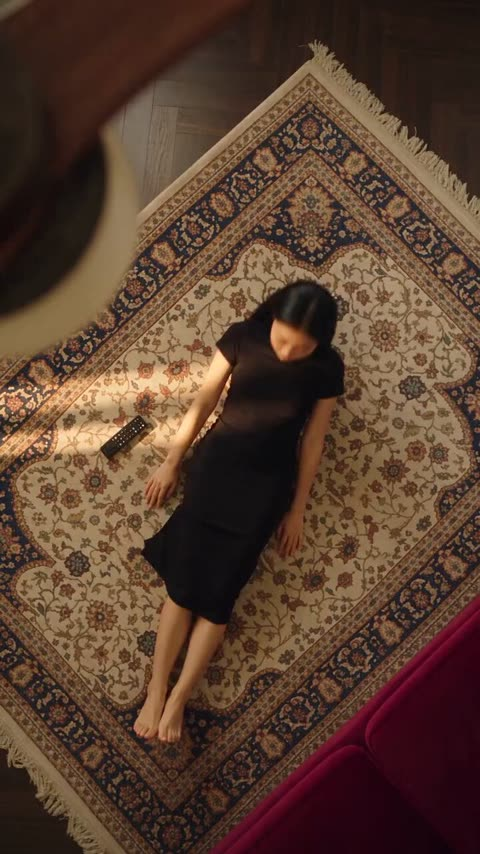</a>

用一句话锁定姿势、机位、环境和面部，只让服装变化，并按顺序列出每套服装，让转场层次清晰。前景缓慢旋转的吊扇叶片为固定俯拍增加了纵深和自然的动态模糊。

Seedance 2.5 · 文生视频 · 出处: [@Zoyavelle on X](https://x.com/Zoyavelle/status/2108060187840180394) · 发现于 [LearnPrompt/awesome-seedance](https://github.com/LearnPrompt/awesome-seedance)

[`fashion`](tags.md#tag-fashion) [`outfit-transition`](tags.md#tag-outfit-transition) [`top-down`](tags.md#tag-top-down) [`photorealistic`](tags.md#tag-photorealistic) [`cozy-interior`](tags.md#tag-cozy-interior)

<details><summary><b>提示词</b></summary>

```text
A cinematic top-down overhead shot of a young Asian woman lying barefoot on an elegant vintage Persian rug in a warm, cozy living room, viewed through the wooden blades of a slowly rotating ceiling fan in the foreground. She has natural black hair and a calm relaxed expression. The scene uses warm golden indoor lighting, realistic wooden flooring, detailed traditional carpet patterns, soft shadows, and a cozy aesthetic interior. The woman appears in a simple black dress at first, then smoothly transitions through several different fashionable outfits while maintaining the exact same pose, position, camera angle, environment, and facial identity. Outfit transitions include a soft pink cardigan with a white dress, a red cardigan over a white top, and finally a brown textured dress. Highly photorealistic, natural skin texture, realistic fabric details, cinematic lighting, shallow depth of field, subtle motion blur from the rotating ceiling fan, smooth seamless outfit transformation, professional fashion video, DSLR quality, ultra-detailed, 4K, realistic proportions, stable overhead camera, no text, no watermark.

Camera: fixed top-down perspective, ceiling fan blades passing naturally across the frame, slow smooth motion.
Aspect ratio: 16:9.
Style: photorealistic cinematic fashion video, warm cozy atmosphere, seamless transitions.
```

</details>

<a id="seedance-parking-garage-zombie-chase-horror"></a>
### 地下停车场韩式恐怖僵尸追逐

<a href="https://x.com/AIwithSynthia/status/2113840061104206005">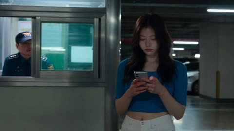</a>

提示词把 30 秒切成六个带时间码的段落，每段只写一个明确动作，剧情从玩笑升级到追逐再到断电。结尾的 STYLE 行用手持抖动、闪烁灯光和乳白色眼睛锁定画面风格，再用简短的排除清单避免过度血腥、字幕和卡通感。

Seedance 2.5 · 文生视频 · 出处: [@AIwithSynthia on X](https://x.com/AIwithSynthia/status/2113840061104206005) · 发现于 [LearnPrompt/awesome-seedance](https://github.com/LearnPrompt/awesome-seedance)

[`horror`](tags.md#tag-horror) [`zombie`](tags.md#tag-zombie) [`timed-shots`](tags.md#tag-timed-shots) [`handheld`](tags.md#tag-handheld) [`photorealistic`](tags.md#tag-photorealistic)

<details><summary><b>提示词</b></summary>

```text
0–3s: A young Korean woman in a fitted blue crop top and white shorts walks through an underground parking garage, jokingly waving at the security guard.

3–6s: Her smile freezes, her eyes turn completely white, and dark veins appear across her face. She coughs, revealing blood around her lips.

6–9s: She tilts her head unnaturally, laughs hysterically, and suddenly slams her bloody palm against the security booth glass.

9–13s: The terrified guard runs away as she chases him between parked cars, moving with frightening speed.

13–18s: A resident exits the elevator, mistakes the situation for a prank, then screams as the zombie suddenly charges at him.

18–24s: Emergency sprinklers activate. Soaked and twitching, the zombie crawls beneath a closing metal shutter while the survivors watch in horror.

24–30s: Everyone races toward the exit. The zombie smashes against the glass door, revealing her white eyes and blood-smeared grin before the lights suddenly go out.

STYLE: Photorealistic Korean horror, creepy laughter, milky-white eyes, realistic blood smears, sudden jerky movements, flickering lights, handheld camera shake, dark humor, cinematic 4K. No cartoon, anime, excessive gore, subtitles, or watermark.
```

</details>

<a id="seedance-pink-court-skateboard-tennis"></a>
### 女子在粉色网球场上滑板打网球

<a href="https://x.com/AIwithNatalia/status/2107056982163402833">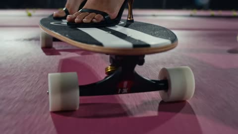</a>

四个定时分段让每一拍都有独立的运镜：低角度、侧向跟拍、环绕、正面跟拍。服装由参考图锁定，反向提示词用来防止身份、服装和人体结构漂移。

Seedance 2.5 · 参考生视频 · 出处: [@AIwithNatalia on X](https://x.com/AIwithNatalia/status/2107056982163402833) · 发现于 [LearnPrompt/awesome-seedance](https://github.com/LearnPrompt/awesome-seedance)

[`fashion`](tags.md#tag-fashion) [`sports`](tags.md#tag-sports) [`skateboard`](tags.md#tag-skateboard) [`tracking-shot`](tags.md#tag-tracking-shot) [`shot-sequence`](tags.md#tag-shot-sequence)

<details><summary><b>提示词</b></summary>

```text
Create a photorealistic cinematic fashion-sports video set on a pink tennis court at night. The woman is standing and riding on a skateboard while simultaneously playing tennis. 
She wears the black-and-white tennis-inspired bodysuit, layered pearl necklaces, white leg warmers, sunglasses, and black high heels shown in the reference.  
She pushes off and smoothly skates across the tennis court on the skateboard, maintaining believable balance. She holds a tennis racket in one hand and hits tennis balls coming toward her while continuing to roll forward. 
Her movements should feel confident, stylish, athletic, and controlled—not exaggerated or cartoonish. Her long dark-red hair moves naturally with the motion.  
Shot sequence: 
0–3 sec: Low-angle close-up of the skateboard rolling across the pink court, wheels moving naturally as tennis balls bounce nearby. 
3–7 sec: Wide side-tracking shot showing her riding the skateboard across the court while returning a tennis ball with a clean forehand. 
7–11 sec: Smooth camera orbit around her as she continues skating and hits another incoming ball, with her hair and jewelry moving naturally. 
11–15 sec: Front-facing tracking shot as she rides toward the camera, performs one final stylish tennis swing, then smoothly passes the camera.  
Visual style: luxury fashion campaign meets futuristic tennis commercial, nighttime stadium lighting, glossy pink court, realistic shadows and reflections, cinematic depth of field, subtle slow motion during racket impacts, smooth stabilized camera movement, realistic human anatomy, realistic skateboard physics, natural facial expression, detailed skin and hair, high-end editorial photography, photorealistic.  
Format: 15 seconds, 24 fps, high resolution.  
Negative prompt: distorted face, changing identity, extra fingers, extra limbs, duplicated tennis rackets, warped skateboard, floating wheels, impossible body positions, broken anatomy, jittery motion, unnatural hair, flickering clothing, changing outfit, cartoon appearance, CGI-looking skin, blurry face, camera shake.
```

</details>

<a id="seedance-pink-rabbit-lipstick-sofa-3d-animation"></a>
### 两只毛绒兔子在沙发上玩口红

<a href="https://x.com/Zarnab_with_Ai/status/2099683790717325390"></a>

用服饰和颜色固定两只兔子的形象，避免角色混淆，再用从涂口红到翻滚再到躲进毯子的连续动作串起情节。结尾罗列光线、镜头和皮克斯风格等关键词来定下画面质感。

Seedance 2.5 · 文生视频 · 出处: [@Zarnab_with_Ai on X](https://x.com/Zarnab_with_Ai/status/2099683790717325390) · 发现于 [LearnPrompt/awesome-seedance](https://github.com/LearnPrompt/awesome-seedance)

[`3d-animation`](tags.md#tag-3d-animation) [`animals`](tags.md#tag-animals) [`cute`](tags.md#tag-cute) [`comedy`](tags.md#tag-comedy) [`pixar-style`](tags.md#tag-pixar-style)

<details><summary><b>提示词</b></summary>

```text
Create a cute, heartwarming, ultra-realistic 3D animated video featuring two adorable fluffy rabbits sitting together on a cozy beige sofa in a warm modern living room. One rabbit wears a blue shirt and a small golden bunny necklace, while the other is soft pink with a large pink bow and a heart-shaped necklace.

The pink rabbit applies lipstick while making funny, confident expressions. She then playfully interacts with the other rabbit, who has pink lipstick kiss marks all over its face and ears. They cuddle, laugh, and playfully tumble together on the sofa. At one point, they hide under a soft beige blanket decorated with pink lipstick kiss marks, then pop back out laughing and hugging each other.

Warm golden lighting, cozy home interior, soft cushions, wooden furniture, plants and framed artwork in the background, expressive faces, detailed fluffy fur, cinematic camera movement, shallow depth of field, adorable comedic atmosphere, polished Pixar-style 3D animation, highly detailed, smooth natural motion, 4K quality.
```

</details>

<a id="seedance-plum-tree-prince-comedy"></a>
### 女子摇动梅树,接住掉下来的王子

<a href="https://x.com/Chaemate_/status/2105611129867395458">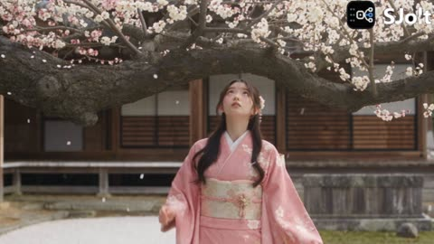</a>

身份锁和环境锁绑定两张参考图,让两位角色与神社庭院在五个定时分镜里保持一致。情绪曲线、明确的声音设计和负面提示词共同控制喜剧节奏与慢动作花瓣雨。

Seedance 2.5 · 参考生视频 · 出处: [@Chaemate_ on X](https://x.com/Chaemate_/status/2105611129867395458) · 发现于 [LearnPrompt/awesome-seedance](https://github.com/LearnPrompt/awesome-seedance)

[`reference-images`](tags.md#tag-reference-images) [`identity-lock`](tags.md#tag-identity-lock) [`shot-breakdown`](tags.md#tag-shot-breakdown) [`romantic-comedy`](tags.md#tag-romantic-comedy) [`japanese-fantasy`](tags.md#tag-japanese-fantasy)

<details><summary><b>提示词</b></summary>

```text
TITLE: "What Falls from the Plum Tree?"
DURATION: 15 seconds | ASPECT RATIO: 16:9
GENRE: Romantic Japanese Fantasy Comedy
STYLE: Ultra-realistic premium Japanese drama, cinematic film quality

IDENTITY LOCK:
The woman @image1 must keep the exact same face, face shape, skin tone, hairstyle, height, body proportions, and wardrobe in every shot. The man @image2 must keep his exact face, hairstyle, and outfit as in the reference. No changes in any frame.

ENVIRONMENT LOCK:
An elegant Edo-era Japanese shrine courtyard with traditional wooden architecture, tiled rooftops, stone lanterns, and a raked gravel garden in the background. A giant ancient plum (ume) tree with dense white and pink blossoms. Its thick main branch extends horizontally above the woman's head. Soft spring daylight.

SHOT BREAKDOWN:

0.0–4.0s | Medium shot
The woman stands beneath the huge horizontal branch. Blossom petals drift in the breeze. She looks up curiously, then raises both hands and shakes the branch. The branch trembles and a shower of petals falls. A lacquered cosmetic box tumbles down through the blossoms and she catches it with both hands. Close-up of her face as she peeks inside. Flat, unimpressed expression. She tosses it casually out of frame.

4.0–7.5s | Medium shot
Her curiosity grows. She shakes the branch harder and petals pour down like rain. A scatter of gold koban coins and a few silk pouches fall. She catches one pouch, raises a single eyebrow, looks bored, and tosses it away.

7.5–10.5s | Slow motion
Determined now, she grips the branch with both hands and shakes with all her strength. The branch shudders, a heavy blossom storm rains down, and the man @image2 suddenly drops from the branch. She gasps, spreads her arms, and catches him just before he hits the ground. Petals swirl around them.

10.5–13.0s | Close-up, 50mm
She looks at his face. Her eyes sparkle and a wide, delighted smile appears. He gives a charming, slightly embarrassed smile and looks back at her.

13.0–15.0s | Medium-wide shot
They turn to the camera together and make small heart shapes with their hands, laughing happily. They turn to each other, laugh, and walk out of frame side by side while petals keep falling behind them. Fade out on the falling blossoms.

EMOTION ARC:
Curious → Bored → More curious → Surprised → Smitten → Happy.

SOUND:
Soft spring breeze, rustling blossoms, creaking wood, light thud of the box, jingle of coins, warm playful Japanese rom-com music (koto, light shamisen, soft piano), cheerful laughter, fading footsteps.

CAMERA & VISUALS:
ARRI Alexa 35 look, 35mm and 50mm cinematic lenses, smooth gimbal movement, slow-motion petal shower, natural spring lighting, realistic skin pores, physically accurate shadows, HDR, subtle film grain, soft pastel color grading.

NEGATIVE PROMPT:
cartoon, anime, CGI look, low quality, blurry face, extra fingers, warped hands, duplicate objects, duplicate people, distorted body, floating objects, unrealistic physics, unnatural falling motion, overexposed lighting, oversaturated colors, AI artifacts, camera shake, abrupt cuts, warped architecture, deformed eyes

#Seedance25 #AIVideo #AIFilmmaking #AIart️️️️️️️️️️️️️️️️️️️️️️️️️️️️️️️️️️️️️️️️️️️️️️️️️️️
```

</details>

<a id="seedance-pov-cliff-jump-turquoise-canyon"></a>
### 第一人称跳入碧绿峡谷的悬崖跳水

<a href="https://x.com/abxxai/status/2103861170625286334">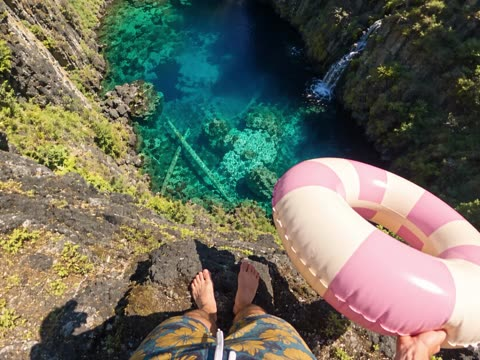</a>

按秒拆分的节拍表只在起跳处用慢动作，其余保持实时，下落的速度感不被打断。超广角畸变、卷帘快门、自动曝光变化和分层音效，让第一人称画面像真实运动相机素材。

Seedance 2.5 · 文生视频 · 出处: [@abxxai on X](https://x.com/abxxai/status/2103861170625286334) · 发现于 [LearnPrompt/awesome-seedance](https://github.com/LearnPrompt/awesome-seedance)

[`pov`](tags.md#tag-pov) [`action-cam`](tags.md#tag-action-cam) [`single-take`](tags.md#tag-single-take) [`water-physics`](tags.md#tag-water-physics) [`nature`](tags.md#tag-nature)

<details><summary><b>提示词</b></summary>

```text
SEEDANCE 2.5 | TEXT TO VIDEO | SINGLE CONTINUOUS TAKE | 22s | 1080x1920 | 9:16 | 30fps | 1080p

SCENE AND LOCATION
A hidden volcanic spring canyon deep in a Pacific Northwest pine forest on a bright summer day. A narrow, deep gorge with steep, very high walls of dark gray basalt made of vertical hexagonal columns, streaked with tan and rust tones and covered in patches of bright green moss, ferns and small shrubs.
At the bottom is a crystal-clear natural spring pool. The shallow edges glow bright turquoise and aqua, fading to deep sapphire blue in the center. The water is so transparent that the bottom is fully visible: honeycomb-patterned volcanic rock, mossy boulders, and two long pale submerged logs lying diagonally across the bottom.
Two white waterfalls pour into the pool: a thin one at the far back of the canyon and a larger one spilling from the right-hand cliff wall, making white foam where it hits the water. Tall dark-green conifer and pine trees line the canyon rim. Above is a vivid clear blue sky with a few small white clouds. Hard, bright midday sunlight with strong contrast, and sun sparkles on the water.

THE JUMPER
A young man seen only from his own first-person view. Tanned bare feet and lightly hairy shins, and loose navy-blue swim shorts with a large mustard-yellow hibiscus flower pattern and white drawstrings. No shirt, no shoes, no gloves. His hands and forearms appear naturally in frame when he moves them.

CAMERA AND REALISM
First-person POV from a GoPro strapped to his forehead. It looks like real action-cam footage, not a cinematic camera. 16mm-equivalent ultra-wide lens with slight barrel distortion, and saturated but natural color.
Use real action-cam behavior throughout: small head bob and micro-jitter from breathing and body weight, rolling-shutter wobble on fast moves, quick auto-exposure shifts between bright sky and the shaded canyon, a small sun flare on upward tilts, light sensor noise in the shadows, and wind buffeting that shakes the frame during the fall.
The cliff is about 35 meters high. Gravity, body motion and water physics are fully realistic.

0-2s | THE EDGE (real time)
POV looking straight down from the top of the basalt cliff. His bare feet stand on the rough, dark rock ledge at the bottom of frame, with the shorts visible at the lower edge. Both hands hover forward at the sides of frame. The turquoise pool, the submerged logs and the waterfalls are far, far below. His toes curl over the edge and small grit crumbles off. His right hand tosses a pink-and-white striped inflatable tube out over the drop; it tumbles down and lands as a tiny speck on the water far below. Wind, distant waterfall roar, upbeat chill electronic music starts.

2-4s | THE COUNTDOWN (real time)
A quick nervous tilt down at the drop, a sharp exhale, then two fast steps back from the edge, with the ledge bouncing in frame. Young male voice, hyped: "Three, two, one!"

4-7s | THE TAKEOFF (natural slow motion, about 50% speed)
Two running steps forward, then his last foot pushes off the ledge in slow motion. Rock grit kicks up and floats in the sunlight, the cliff edge slides away beneath his feet, his arms swing forward and out wide, and the whole turquoise canyon opens up below. The slow motion looks like a real high-frame-rate action-cam clip, not a frozen hang. Deep bass swell, stretched wind.

7-13s | THE FALL (real time, fast and continuous)
The speed ramps smoothly back to normal and the stomach drops.
7-9s: The frame dips and wobbles, his arms flail slightly for balance at the edges of frame, and his feet kick at the bottom of frame. A loud yell: "Woooooo!"
9-11s: The basalt column wall, moss and ferns streak upward past the lens, and the right-side waterfall rushes by with spray catching the sun. Wind roars louder and the frame shakes from air buffeting.
11-13s: The glowing turquoise water rushes up and fills the frame, and the pink tube and submerged logs grow fast. His arms snap tight to his body and his legs lock straight for a feet-first pencil dive. The music builds to the drop.

13-14s | IMPACT
A hard feet-first hit into the water and a white explosion of bubbles swallows the lens. Loud plunge splash, deep impact whoosh, and the music goes heavily muffled underwater.

14-17s | UNDERWATER (short, energetic, real time)
A violent swirl of silver bubbles clears to reveal crystal-clear blue water, bright sun shafts cutting down from the surface, the pale submerged logs and honeycomb volcanic rock bottom below, and small fish darting away. His hands push into frame for one strong breaststroke pull, then fast kicks straight up toward the bright glowing surface, with bubbles streaming past the lens. No slow sinking.

17-19s | SURFACE BREAK
The camera bursts through the surface, water droplets sliding across the lens, and bright sunlight floods in. The music snaps back to full clarity on the beat drop. His hand grabs the pink-and-white tube floating right beside him.

19-22s | THE REWARD
POV bobbing on the turquoise water holding the tube, then a sharp tilt up revealing the towering basalt cliff, the tiny ledge he jumped from far above, the pine trees on the rim and the vivid blue sky, with the waterfall splashing on the right. Same voice, out of breath and triumphant: "Yeah, dude! That was insane!" Faint distant cheering. Music plays clean to the final frame.

AUDIO
Continuous upbeat chill electronic track: a bass swell on takeoff, a fast build through the fall, muffled underwater, then a clean drop on surfacing. Real ambient layers: wind that grows with speed, fabric flapping, heavy breathing, waterfall roar, splash, bubbles. Dialogue clear over the music.

KEEP
One continuous take, first-person only. The same shorts, feet and hands throughout, and the same canyon layout with two waterfalls, turquoise pool and submerged logs. The slow motion lasts only 3 seconds at takeoff. The fall is fast, real time and builds speed without pausing. Every beat is quick and punchy.

AVOID
Extra slow motion beyond the takeoff, hovering or floating mid-air, smooth cinematic gimbal movement, cuts to third person, showing the jumper's face, extra people, distorted hands or extra fingers, morphing cliffs, changing water color, text, subtitles, watermarks.
```

</details>

<a id="seedance-pov-trout-river-to-campfire"></a>
### 第一视角钓鳟鱼、处理并篝火烧烤

<a href="https://x.com/abxxai/status/2087189194720657649"></a>

四个带时长的片段和三次硬切，每段单独标注视场角度，稳住胸挂运动相机的观感。命名参考图锁定场景和双手，分段声音设计加物理与一致性约束让道具前后一致。

Seedance 2.5 · 参考生视频 · 出处: [@abxxai on X](https://x.com/abxxai/status/2087189194720657649) · 发现于 [LearnPrompt/awesome-seedance](https://github.com/LearnPrompt/awesome-seedance)

[`pov`](tags.md#tag-pov) [`multi-shot`](tags.md#tag-multi-shot) [`hard-cuts`](tags.md#tag-hard-cuts) [`outdoor`](tags.md#tag-outdoor) [`action-camera`](tags.md#tag-action-camera)

<details><summary><b>提示词</b></summary>

```text
SCENE CONTEXT
POV river-to-campfire sequence at a jade-green alpine river through birch/cedar forest, late-afternoon light. A trout is caught, cleaned, seasoned, grilled over an open fire, then eaten, with one sip from a glass bottle while it cooks. 30s, four continuous segments, three hard cuts, real chest-mounted action camera.

ACTIVE REFERENCES

@location1
: jade-green river, granite boulders, gravel bar, stone fire-ring, tree-stump table, birch/cedar tree line, faint peaks. 100% matches reference.

@hands1
: sun-tanned forearms, light-blond arm hair, olive sleeve rolled to elbow, braided wrist cord. Same fly rod, folding knife, wood board, wire grill basket, plain glass bottle, brown fizzy liquid, no label. 100% matches reference.

LOCATION MAP
Segment A: river foreground, tree line behind. Segments B-D: gravel bar foreground, fire-ring and stump table midground, tree line and peaks background. POV chest-to-eye height, moving only with the body. Key light low, behind camera-left.

FIRST FRAME / BLOCKING
Non-empty opening frame: already mid-cast, rod raised, line already peeling off the reel. Water fills the lower two-thirds, forest/sky the top third.

FORMAT MODE
Controlled multi-shot, three HARD CUTs, camera does not cut anywhere else:
A (0-9s) river, one continuous take. HARD CUT.
B (9-21s) board, one continuous take. HARD CUT.
C (21-27s) fire, one continuous take. HARD CUT.
D (27-30s) eating, one continuous take.

OPTICS
84° in A easing to 63° through the fight. 63° easing to 18° across B. 63° opening to 29° in C. 29° held in D. No drift within any segment.

CAMERA
Chest-height POV, moving only with body motion — forward stroke on the cast, downward tilt on the knife and grate, forward lean when hands work close. Soft highlight roll-off on bright water and hot metal.

ACTION
A: rod arcs, line whistles; tip snaps down as the trout strikes; rod pumps, reel clicking, fish surfacing closer each pump; hand closes behind the gills, lifts the fish clear, holds it still one beat as water streams off. B: boots cross the gravel, fish set on the board, knife meets scales, scrapes tail to head; one clean line opens the belly, organs lift free; fish rinses in the shallows, pink cloud drifting off; salt, pepper, herbs scatter over the flesh; fish folds into the basket, latch clacks. C: kindling catches from a breath, flame licks up; basket lowers onto the grate, skin bubbles and browns, smoke lifts. D: bottle tips up for one swallow; fork pauses a half-second at the flesh before splitting it open, steam lifting as a piece rises toward camera, one quiet exhale closing the shot.

PERFORMANCE
Hands stay continuously busy with real working tasks, never idle. Pore-level realism: vellus arm hair in the breeze, capillary flush from cold water. Movements read practiced, unhurried, one deliberate pause at the fish-lift and one at the first bite, restrained and human, never cartoonish.

PHYSICS
No floating props. Correct contact shadows under every prop, every segment. Water carries real weight and splash. Fire holds true flicker, heat-shimmer, smoke on a light breeze. Mass and inertia carry through the rod bend, the fish's thrashing and the latch.

LIGHTING
WB locked 5600K, warm low sun behind camera-left as key, cool sky fill through A-B. From C onward, ember-orange fire light adds a low rim on hands and fish alongside the same key.

COLOR GRADE
Cool jade-green river/forest in A, warm honey wood and pale gravel in B, ember-orange fire glow and seared skin in C-D. Color tied to source and surface, not a flat list.

AUDIO
Warm acoustic guitar bed under everything, mixed low, sitting quietly beneath the natural sound. Diegetic: river current and line-whistle opening A, splash and reel-drag through the fight; gravel footsteps opening B, knife-on-wood, one clean cut sound, rinse-splash, hinge-click closing it; twig-snap opening C, crackle into sizzle; glass clink and swallow opening D, fork scrape, steam hiss, one quiet chuckle closing the shot. No subtitles.

STYLE
8K photorealistic — no 3D render, no game engine, no game-cutscene aesthetic. Naturalistic master cinematography, fine film grain, true action-camera color science.

OUTPUT SETTINGS
Real-time throughout, no speed ramping, FOV holds exactly as stated per segment with no drift across any hard cut.

POSITIVE LOCKS
Same hands, sleeve and wrist cord across all four segments. Same rod, knife, board, basket and bottle, no substitutions across any cut. Same river, gravel bar and fire-ring geometry held across every segment. Fish skin and flesh stay anatomically real. Eyes stay natural — no eye glow. Contact shadows read clearly every segment. No logos, no UI, no subtitles anywhere in frame.
```

</details>

<a id="seedance-rainy-japanese-neighborhood-vlog"></a>
### 日本公交站避雨的年轻女子望向雨中

<a href="https://x.com/ZorviaLux/status/2105533415026241635">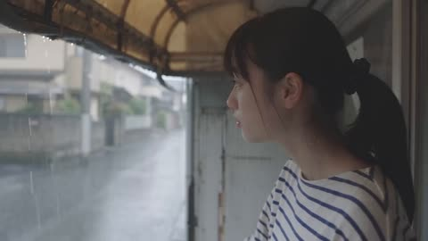</a>

先详细描述发型与服装，结尾再强调所有镜头中脸部、服装和身材比例保持一致，以稳住角色。镜头按侧脸特写、中景、背后跟拍、微笑特写的顺序写明，并在技术行里给出 9:16 和 24fps。

Seedance 2.5 · 文生视频 · 出处: [@ZorviaLux on X](https://x.com/ZorviaLux/status/2105533415026241635) · 发现于 [LearnPrompt/awesome-seedance](https://github.com/LearnPrompt/awesome-seedance)

[`japanese-vlog`](tags.md#tag-japanese-vlog) [`rain`](tags.md#tag-rain) [`lifestyle`](tags.md#tag-lifestyle) [`vertical`](tags.md#tag-vertical) [`character-consistency`](tags.md#tag-character-consistency)

<details><summary><b>提示词</b></summary>

```text
Create an ultra-realistic cinematic Japanese lifestyle vlog featuring a young Japanese woman enjoying a peaceful rainy day in a quiet Japanese neighborhood.

A young woman with black hair tied in a neat ponytail, wearing a white and navy striped oversized T-shirt, beige shorts, and white sneakers, stands under a traditional covered bus stop during light rain. She looks outside, gently extends her hand to feel the raindrops, then turns around and runs playfully along a quiet residential street.

Show cinematic transitions of her running through the wet neighborhood, passing traditional Japanese houses, green trees, and a peaceful park. She eventually reaches a wooden shelter in the park, adjusts her ponytail, stretches her arms, and smiles naturally toward the camera.

Visual Style: Photorealistic Japanese slice-of-life cinematography, soft overcast daylight, realistic rain reflections, natural human movements, beautiful greenery, peaceful atmosphere, authentic Japanese residential environment.

Camera Direction: Start with a cinematic side-profile close-up, transition into a medium shot of her touching raindrops, followed by a smooth rear tracking shot while running. Finish with emotional close-ups and a warm natural smile.

Technical: 4K, 9:16 vertical, 24fps, realistic facial expressions, consistent character identity, smooth camera movement, natural physics, detailed environment, cinematic color grading.

Important: Maintain the same woman's face, hairstyle, outfit, and body proportions throughout every scene. No facial distortion, no outfit changes, no unnatural movements, no text or watermark.
```

</details>

<a id="seedance-rainy-school-first-love-two-shots"></a>
### 雨中放学初恋短片两个连续镜头

<a href="https://x.com/Caden_Flux/status/2089154775829074074">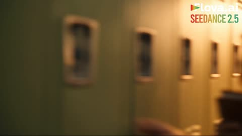</a>

提示词把60秒拆成两个连续镜头，每个节拍都写明时间码、运镜和台词。镜头之间用雨伞做匹配剪辑衔接，并用角色设定图和连续性规则锁定人物的脸和服装。

Seedance 2.5 · 参考生视频 · 出处: [@Caden_Flux on X](https://x.com/Caden_Flux/status/2089154775829074074) · 发现于 [LearnPrompt/awesome-seedance](https://github.com/LearnPrompt/awesome-seedance)

[`romance`](tags.md#tag-romance) [`school`](tags.md#tag-school) [`rain`](tags.md#tag-rain) [`dialogue`](tags.md#tag-dialogue) [`long-take`](tags.md#tag-long-take)

<details><summary><b>提示词</b></summary>

```text
Create a 60-second cinematic high-school first-love story using SEEDANCE 2.5.

IMPORTANT:
Generate the video as EXACTLY TWO CONTINUOUS SHOTS:
SHOT 1 = 0–30 seconds
SHOT 2 = 30–60 seconds
The two shots must connect seamlessly and feel like ONE continuous short film, not two unrelated clips.
FORMAT:
16:9 widescreen
Cinematic photorealism
Premium coming-of-age romance film
Fast-paced but emotionally natural
Smooth transitions and motivated camera movement
Realistic teenage body proportions and expressions
Natural English dialogue only
No subtitles unless dialogue is naturally spoken
No text overlays
No character redesign
CHARACTER CONSISTENCY — EXTREMELY IMPORTANT:
Use the provided character reference sheets for BOTH characters.

BOY:
Preserve exact face, hairstyle, clothing, body proportions, accessories and identity from the character sheet.

GIRL:
Preserve exact face, hairstyle, clothing, body proportions, accessories and identity from the character sheet.
Their faces, hairstyles and outfits must remain IDENTICAL throughout both shots.
The boy and girl are both 17–18-year-old high-school students. Keep the romance completely innocent, wholesome and age-appropriate.
VISUAL LANGUAGE:
Warm nostalgic coming-of-age movie aesthetic, realistic school environment, natural skin texture, subtle film grain, cinematic depth of field, soft lens bloom, realistic physics, natural hair movement, expressive eyes, believable teenage body language.
Use a dynamic combination of:
wide establishing shots,
medium tracking shots,
over-the-shoulder shots,
close-ups,
handheld intimate moments,
smooth push-ins,
whip-pan transitions,
shallow-focus inserts,
and brief slow-motion accents.
Avoid excessive slow motion. The pacing should feel energetic and modern.
━━━━━━━━━━━━━━━━━━━━
SHOT 1 — 0:00–0:30
“THE ROUTINE”
━━━━━━━━━━━━━━━━━━━━
0:00–0:03
OPEN on a cinematic wide shot of a lively high-school hallway immediately after the final bell.
Students rush past the camera.
The boy exits his classroom with his backpack over one shoulder.
He looks across the hallway.

The girl is already there.
Their eyes meet.

She gives him a tiny smile.
He smiles back.

CAMERA:
Fast lateral tracking shot through the crowd, then smoothly pushes toward the boy as he notices her.
0:03–0:07
She walks toward him.

He casually falls into step beside her.

GIRL:
“You're late.”

BOY:
“By two minutes.”
She laughs.

They continue walking.
CAMERA:
Smooth backward tracking shot in front of them as students pass naturally around them.
0:07–0:11
QUICK MONTAGE.
They sit together in class.
She steals one of his fries during lunch.
He looks offended.
She laughs.
He secretly smiles.
CUT TO:
Their notebooks side by side.
She draws a tiny smiley face in the margin of his notebook.

He notices.

CAMERA:
Fast close-up inserts and match cuts, keeping the rhythm playful and energetic.
0:11–0:15
They leave school together.
Golden afternoon light floods the corridor.
He holds the door open for her.

She playfully bumps his shoulder as she walks past.
He laughs.

CAMERA:
Low-angle tracking shot transitioning into a warm side-profile shot.

0:15–0:20
Outside school.

They walk down the sidewalk.

She talks animatedly while he listens.

A light breeze moves her hair.

He looks at her for a moment longer than he should.

She catches him staring.

GIRL:
“What?”
BOY:
“Nothing.”

She smiles knowingly.
CAMERA:
Over-the-shoulder close-up from behind her, revealing his shy smile.

0:20–0:25
The sky suddenly darkens.

First drops of rain hit the pavement.
She looks upward.

BOY:
“Uh-oh.”
She laughs and quickly pulls her cardigan closer.

The boy opens his small umbrella.

CAMERA:
Quick tilt from the darkening sky down to them.

0:25–0:30
They squeeze underneath the tiny umbrella together.
Their shoulders bump.

They laugh.
The camera slowly circles around them as they begin walking through the rain.

The boy looks at her.

She looks back.

A brief quiet moment.

MATCH CUT:
Camera passes behind the umbrella fabric.

Use the movement of the umbrella to create a seamless transition into SHOT 2.

━━━━━━━━━━━━━━━━━━━━
SHOT 2 — 0:30–1:00
“FIVE MORE MINUTES”
━━━━━━━━━━━━━━━━━━━━
IMPORTANT:
SHOT 2 begins from the EXACT SAME MOMENT as Shot 1 ends.

Same characters.
Same clothing.
Same umbrella.
Same rainy street.
Same lighting.
Same environment.

No visual reset.

0:30–0:35
Continue the walking shot.
They move through the rain beneath the tiny umbrella.

Their hands accidentally touch.
Both notice.

Neither pulls away immediately.

CAMERA:
Slow subtle push-in toward their hands, then rack focus to their faces.

0:35–0:40
They reach the girl's house.

She steps out from beneath the umbrella.

She turns toward him.
GIRL:
“See you tomorrow?”

BOY:
“Yeah.”
She starts walking toward her front door.

The boy watches her.

She takes a few steps.

0:40–0:44
He suddenly gathers courage.

BOY:
“Hey!”

She turns around.

CAMERA:
Quick handheld push toward the boy as he runs a few steps back toward her.
0:44–0:49
He smiles nervously.

BOY:
“Can I have five more minutes?”
She looks at him, amused.

GIRL:
“You already had an hour.”

He laughs.
BOY:
“I know.”

A small pause.
She smiles.

GIRL:
“Okay. Five more minutes.”

0:49–0:54
She steps back underneath the umbrella.

They begin walking together again.
The rain becomes softer.

The street lights begin glowing as evening approaches.

CAMERA:
Wide cinematic tracking shot from the front, slowly moving backward as they walk toward camera.

0:54–0:58
QUICK NOSTALGIC MONTAGE:
Their sneakers splashing through puddles.

Their hands almost touching.
Her laughing.

His nervous smile.

The tiny umbrella tilting as they walk closer together.

A final glance between them.

Use rhythmic match cuts synced to the emotional music.

0:58–1:00
FINAL WIDE SHOT.

The camera pulls slowly upward and backward.

The two teenagers walk away together beneath the tiny umbrella, becoming smaller against the glowing evening street.
The rain sparkles under the streetlights.

They continue talking and laughing as they disappear farther down the road.

FADE OUT.
FINAL EMOTIONAL FEELING:
First love.
Youth.
Nervous butterflies.
The feeling of not wanting the day to end.
Do NOT make the ending sad.
Do NOT introduce a breakup.
Do NOT introduce a twist.
Do NOT introduce additional characters who become romantically relevant.
The entire story should feel like one precious memory from the beginning of a first love.

━━━━━━━━━━━━━━━━━━━━
CAMERA & MOTION REQUIREMENTS
━━━━━━━━━━━━━━━━━━━━
Keep camera movement fluid and cinematic throughout.

Use motivated transitions rather than random cuts.
Mix fast-paced montage editing with slower intimate close-ups.
Prioritize:
• smooth tracking shots
• natural handheld movement
• cinematic push-ins
• over-the-shoulder compositions
• expressive close-ups
• realistic rack focus
• wide environmental shots
• subtle slow-motion only for emotional beats
Maintain realistic physics for:
rain,
umbrella movement,
hair,
clothing,
walking,
running,
hand gestures,
and interactions with the environment.
━━━━━━━━━━━━━━━━━━━━
AUDIO & DIALOGUE
━━━━━━━━━━━━━━━━━━━━
Natural English dialogue only.

Dialogue should sound spontaneous and age-appropriate.

Ambient sound:
school hallway chatter,
footsteps,
distant laughter,
birds,
city ambience,
rain,
umbrella fabric,
wet pavement.
Music:
soft modern coming-of-age instrumental soundtrack that gradually builds from playful and light to warm and emotional.

Music must never overpower dialogue.

━━━━━━━━━━━━━━━━━━━━
NEGATIVE PROMPT
━━━━━━━━━━━━━━━━━━━━

No character identity changes.
No face changes.
No hairstyle changes.
No outfit changes.
No age changes.
No adult appearance.
No sexualized content.
No exaggerated body proportions.
No random wardrobe changes.
No duplicated characters.
No extra limbs or fingers.
No distorted hands.
No unnatural walking.
No floating objects.
No impossible rain physics.
No inconsistent umbrella.
No teleporting.
No location jumps that break continuity.
No random camera cuts.
No excessive slow motion.
No cartoon appearance.
No anime style.
No plastic skin.
No overprocessed faces.
No text overlays.
No subtitles.
No logos.
No watermark.
No visual glitches.
No abrupt ending.

FINAL REQUIREMENT:
SEEDANCE 2.5 MUST PRIORITIZE CHARACTER CONSISTENCY, FACIAL IDENTITY, TEMPORAL CONTINUITY, NATURAL MOTION AND SEAMLESS TRANSITION BETWEEN THE TWO 30-SECOND SHOTS.

The final result should look like a polished 60-second scene from a premium cinematic coming-of-age romance film.
```

</details>

<a id="seedance-rainy-window-kitten-hair-tie-selfie"></a>
### 雨天窗边自拍小猫偷走发绳

<a href="https://x.com/Strength04_X/status/2098256490238755226">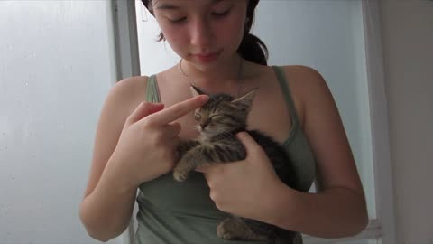</a>

用参考图锁定人物形象，并强调只有一只小猫以保持连续。六个五秒分段从平静逐步升级到小猫扒镜头，配合手持抖动、台词和详细的音频清单。

Seedance 2.5 · 参考生视频 · 出处: [@Strength04_X on X](https://x.com/Strength04_X/status/2098256490238755226) · 发现于 [LearnPrompt/awesome-seedance](https://github.com/LearnPrompt/awesome-seedance)

[`selfie-vlog`](tags.md#tag-selfie-vlog) [`pet`](tags.md#tag-pet) [`handheld`](tags.md#tag-handheld) [`timed-beats`](tags.md#tag-timed-beats) [`native-audio`](tags.md#tag-native-audio)

<details><summary><b>提示词</b></summary>

```text
She thought it was going to be a peaceful rainy-day selfie

But the kitten had other plans 😅

Seedance 2.5

Prompt - REFERENCE & SUBJECT Use "@<image1" as the exact visual reference for the woman. Preserve her identity, face, hairstyle, clothing, skin texture, body proportions, and natural appearance throughout the entire clip. Exactly ONE small tabby kitten. The same kitten remains continuous throughout. No other animal, no duplicate kitten. FORMAT 30-second vertical 9:16 handheld front-camera selfie. Indoor room beside a window on a rainy day. Soft gray natural daylight through the glass. Very subtle window reflections and realistic ambient room sound. No color grading, no cinematic lighting, no beauty filter. --- 0–5 SEC — QUIET RAINY MOMENT The woman stands beside the window holding the kitten against her chest. Rain droplets are visible softly on the window behind her. She looks at the kitten and gently touches its forehead with her finger. The kitten watches her hand. She gives a quiet smile and casually says: "You're being good today, huh?" The phone remains slightly imperfect and handheld. --- 5–10 SEC — HAIR TIE CATCHES ATTENTION She reaches toward the back of her tied hair with her free hand and adjusts the hair tie. The kitten suddenly notices the small hair tie around her wrist. Its ears move forward. It stretches one paw toward it. She notices and pulls her wrist away. A small nose-laugh escapes. --- 10–15 SEC — THEFT The kitten reaches again and catches the hair tie between its paws. She reacts with surprise. The kitten pulls it toward itself. She laughs and tries to gently retrieve it. The phone shakes subtly from her laughter. She says: "Hey, that's not yours." The kitten refuses to release it. --- 15–20 SEC — PLAYFUL TUG The kitten squirms against her chest while holding the hair tie. She supports its body securely with her other hand. She gently tries to take the hair tie back. The kitten suddenly turns its head away. She laughs harder. A few strands of her hair fall loose near her cheek. The rain remains softly visible in the background. --- 20–25 SEC — KITTEN CLIMBS The kitten begins climbing toward her shoulder while still holding the hair tie. Its paws grip the fabric of her top. She gives a small surprised yelp followed by laughter. Her phone hand moves upward slightly. The camera briefly loses perfect framing and then naturally re-centers. --- 25–30 SEC — FINAL CAMERA ATTACK The kitten reaches her shoulder and then suddenly turns toward the phone. Its nose and whiskers approach the lens. She pulls her face backward while laughing. The kitten raises one paw toward the camera. She starts: "You really want—" Her sentence breaks apart into laughter. The paw reaches the near corner of the lens. The phone dips naturally. The clip ends mid-laugh. AUDIO Rain ambience through the window, fabric rustling, kitten movement, one tiny mewl, woman's natural voice, breathing, nose-laughs and genuine laughter. No background music. No subtitles. No text. No logo. No watermark. No cuts. No zoom. Exactly one kitten.
```

</details>

<a id="seedance-roman-gladiator-arena-duel"></a>
### 黄金时刻罗马竞技场的角斗士对决

<a href="https://x.com/Xaroon_x/status/2108921521142141421"></a>

六个镜头在固定的五秒节点硬切，每个镜头单独指定播放速度（实时、2倍速、40%慢动作）。连续性锁定按时间点写明@image1的面部、盾牌状态和双方武器归属，另有独立的音频行描述人群、号角、太鼓与合唱的递进。

Seedance 2.5 · 参考生视频 · 出处: [@Xaroon_x on X](https://x.com/Xaroon_x/status/2108921521142141421) · 发现于 [LearnPrompt/awesome-seedance](https://github.com/LearnPrompt/awesome-seedance)

[`gladiator`](tags.md#tag-gladiator) [`multishot`](tags.md#tag-multishot) [`action`](tags.md#tag-action) [`cinematic`](tags.md#tag-cinematic) [`slow-motion`](tags.md#tag-slow-motion)

<details><summary><b>提示词</b></summary>

```text
ROMAN GLADIATOR: FIGHT FOR GLORY

Duration: 30 seconds | Format: 16:9, 24 FPS | Style: Photorealistic Hollywood cinema, ARRI ALEXA LF, anamorphic lenses, realistic physics, natural skin texture, fine film grain.

SCENE: Ancient Roman amphitheater at golden hour, packed with 50,000 cheering spectators. A king and queen watch from a shaded imperial box. Golden sunlight comes consistently from screen-left, illuminating dusty sand, bronze armor, and flying particles.

CHARACTERS:

- Main character (@image1): Preserve 100% the reference face, hairstyle, skin tone, and athletic build. Dark-red wool tunic, leather chest harness, bronze shoulder guard, bracers, greaves, sandals, gladius in right hand, round bronze shield on left arm.
- ENEMY: One-and-a-half heads taller, heavily muscled, scarred torso, polished bronze helmet with crimson crest, iron arm guard, broad sword, rectangular wooden shield with faded red emblem.
- KING & QUEEN: King with grey-streaked beard, laurel wreath, purple-and-gold toga. Queen with dark braided updo, ivory-and-gold stola, gold jewelry.

TIMED MULTISHOT — SIX SHOTS, HARD CUTS ONLY AT 5, 10, 15, 20, AND 25 SECONDS.

SHOT 1 | 0–5s | REAL-TIME: High crane descends into the arena. The king raises his hand, then signals the duel with a horn blast. The hero and enemy raise their shields and approach from opposite sides.

SHOT 2 | 5–10s | 2× SPEED: Ground-level handheld orbit. Both warriors charge and clash swords, producing sparks. The hero parries, ducks, sidesteps, and counters. The enemy lands a powerful shield bash, forcing the hero backward.

SHOT 3 | 10–15s | 40% SLOW MOTION: The enemy smashes the hero's shield, splintering it. The hero drops his gladius and falls onto the sand. The enemy steps over him and raises his sword for the finishing strike. Rack focus from the fallen weapon to the hero's determined face.

SHOT 4 | 15–20s | REAL-TIME: The enemy swings downward. The hero catches his forearm, stopping the blade inches from his throat. He strikes the enemy's ribs with an elbow, headbutts the bronze visor, then punches him hard. The enemy staggers backward and drops his shield.

SHOT 5 | 20–25s | 40% SLOW MOTION, CLIMAX: The hero retrieves his gladius, rises, and charges. He slides beneath the enemy's horizontal sword swing, slashes across his torso, and drives his shoulder into the enemy's chest. The giant flies backward three meters, his sword spinning away, then crashes onto the sand in a dramatic dust explosion.

SHOT 6 | 25–30s | REAL-TIME: The exhausted, bloodied hero stands over the motionless enemy and raises his gladius toward the imperial box, roaring triumphantly. The king rises in approval, the queen smiles, and the camera cranes upward and pulls back to reveal the roaring amphitheater.

CAMERA & PHYSICS: Distinct cinematic framing for every shot, controlled camera movement, realistic sword impacts, natural body weight, flying sparks, falling wood splinters, authentic sand displacement, consistent contact shadows, stable faces and anatomy.

LIGHTING & COLOR: Low golden sun from screen-left, bronze highlights, ochre sand, deep blue shadows, crimson accents, purple royal toga, volumetric dust, cinematic HDR and filmic highlights.

AUDIO: Continuous crowd roar, horn blast, metallic sword clashes, shield impacts, grunts, accelerating taiko percussion, dramatic strings and choir at the climax, triumphant brass ending.

CONTINUITY LOCKS: @image1 remains identical in every shot. Maintain the same outfits, faces, weapons, lighting direction, and arena layout. Shield intact until 10s, broken afterward. Enemy's shield drops by 20s; he retains his helmet and sword until the climax, then lies motionless from 25–30s. Only two fighters on the arena floor. Every shot fills its full five seconds with one consistent playback speed.
```

</details>

<a id="seedance-rooftop-leap-rainbow-bounce-pad-stunt"></a>
### 屋顶跃下落在巨型彩虹弹垫上反弹返回

<a href="https://x.com/johnAGI168/status/2095025524586193105">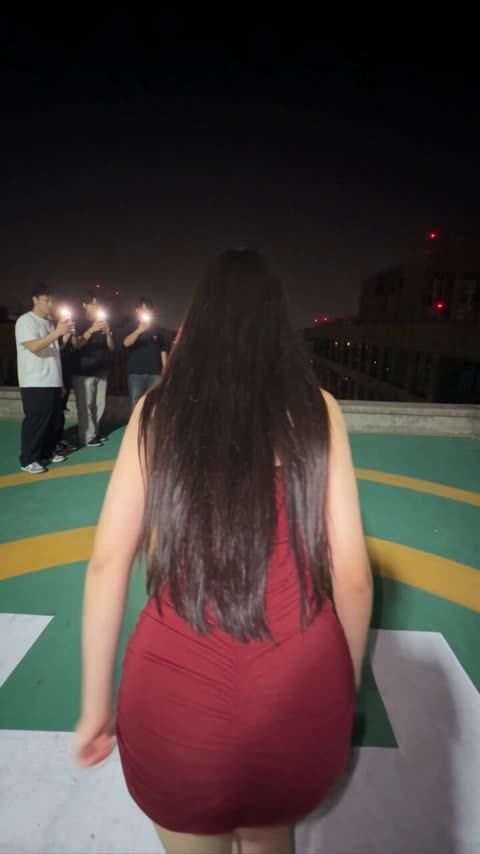</a>

先固定动作闭环（助跑、跃下、下落、触垫、回弹、团身、落地），再按时间戳分段，并限定为手持手机一镜到底。明确写出接触、下陷、压缩、回弹四个阶段，用参考图锁定人物，再用长负面清单防止飞行和瞬移。

Seedance 2.5 · 参考生视频 · 出处: [@johnAGI168 on X](https://x.com/johnAGI168/status/2095025524586193105) · 发现于 [LearnPrompt/awesome-seedance](https://github.com/LearnPrompt/awesome-seedance)

[`stunt`](tags.md#tag-stunt) [`one-take`](tags.md#tag-one-take) [`night-city`](tags.md#tag-night-city) [`handheld-phone`](tags.md#tag-handheld-phone) [`timestamped`](tags.md#tag-timestamped)

<details><summary><b>提示词</b></summary>

```text
Seedance 2.5 prompt 👇

Duration: 10秒
Aspect ratio: 9:16
Reference: @图片1，锁定主角面部、发型和人物造型，不额外描述或更换穿着
Audio: 真实城市夜景环境声、助跑脚步、强风呼啸、弹性装置低频回弹声、落地闷响、朋友欢呼；无对白、无旁白、无字幕
Overall style: 极限运动手机实拍，真实高空距离，强烈临场感，一镜到底，轻微手持与高速运动模糊，拒绝游戏CG感

GLOBAL CONTINUITY

Setting:
夜晚城市高楼屋顶，绿色直升机停机坪，黄色圆形标线，低矮水泥护墙。两栋高楼之间形成垂直街道峡谷，地面可见车辆、路灯和十字路口。

Lower apparatus:
街道中央设置一座巨大的圆形黑色弹性回弹装置，中心为深黑色弹性面，外圈环绕连续彩虹灯带。装置尺寸巨大，正对屋顶边缘，作为主角下落和反弹的准确落点。

Main subject:
@图片1为唯一主角。人物身份、面部和造型全程一致。

Bystanders:
三至四名朋友站在屋顶左侧，用手机拍摄并等待主角返回。不能抢占主体。

CAMERA CONTINUITY

全片为屋顶朋友手持手机拍摄的一镜到底。

摄影者先在主角身后跟拍助跑；主角跃下后，摄影者迅速冲到护墙边俯拍；随后镜头持续锁定主角，从垂直向下逐渐抬向天空；主角反弹回到屋顶后，镜头恢复平视。

不切镜、不瞬移、不更换视角。

STUNT ENGINE

动作闭环必须固定：

屋顶助跑 → 飞越护墙 → 高空下落 → 命中圆形弹性面中心 → 装置深度下陷 → 强力回弹 → 主角高速升空 → 空中团身翻腾 → 展体定位 → 双脚返回同一屋顶 → 屈膝落地 → 欢呼庆祝。

SHOT 1（00:00-00:10）高空反弹往返特技

Subject:
@图片1主角站在屋顶停机坪后方，正对远处护墙。朋友位于画面左侧拍摄。

Action:

00:00-00:01.50｜快速助跑

主角背对镜头，从停机坪中央快速冲向屋顶边缘。步幅逐渐加大，身体前倾，双臂自然摆动。

摄影者手持手机紧跟主角向前跑，画面产生真实脚步震动。朋友站在左侧举起手机，紧张注视。

00:01.50-00:02.30｜跃出屋顶

主角最后一步用力蹬地，身体越过低矮护墙。离开屋顶的瞬间，双臂向左右展开，身体稍微前倾，主动朝两栋高楼之间俯冲。

摄影者冲到护墙边，镜头快速向下俯转，始终把主角保持在画面中央。

00:02.30-00:04.80｜高空下落

镜头接近垂直俯拍。主角沿楼宇之间的空间快速下降，身体由前倾逐渐调整为面向下方，双臂保持展开以稳定方向。

随着主角下降，街道、车辆和十字路口迅速显现。巨型黑色圆形弹性装置从画面下方出现，彩虹灯环照亮周围建筑。

主角的下降轨迹必须准确对准黑色弹性面的圆心，不能偏向灯环或撞向建筑。

00:04.80-00:05.50｜命中中心

主角身体落在黑色弹性面正中心。弹性面受到冲击后明显向下形成深凹，彩虹灯环保持固定，装置不能破裂。

短暂压缩后，弹性面以巨大力量恢复原状，将主角垂直向上弹出。

必须清楚表现“接触—下陷—压缩—回弹”四个阶段，不能在接触前提前反向飞行。

00:05.50-00:08.20｜高速反弹与空中翻腾

摄影者仍站在屋顶护墙边。画面底部短暂出现摄影者的双脚，强化真实第一视角和高空距离。

主角从圆形装置中心高速升起，沿原来的垂直路线返回屋顶。摄影机从垂直向下持续向上抬起，跟随主角穿过城市楼宇之间的空间。

主角升空后收紧腰腹，双膝靠近胸口，双臂抱住小腿，形成紧凑团身，在空中完成连续快速翻腾。不要锁定具体翻转方向，以自然连续旋转为准。

主角接近屋顶高度时开始打开身体：松开双腿、抬起头寻找屋顶、双脚转向下方，双臂向两侧展开保持平衡。

00:08.20-00:09.40｜返回屋顶

主角高速接近镜头，从屋顶护墙外侧越回停机坪。双脚同时接触绿色地面，膝盖和髋部深度弯曲，以低位蹲姿吸收落地冲击。

落地必须具有明显重量：鞋底或脚掌接触、腿部压缩、身体下沉、轻微反弹恢复。不能站直着轻飘落地。

摄影者快速后退半步，避免主角撞上镜头，同时继续保持正面近景。

00:09.40-00:10.00｜真实庆祝

主角从蹲姿快速站起，兴奋地看向镜头，张口欢呼。屋顶朋友冲进画面，举着手机围过来，拍肩、挥拳、大声庆祝。

镜头因人群靠近产生轻微晃动，以真实手机自拍视频状态结束。

Environment:
高楼灯光、街道车辆和彩虹灯环保持空间位置稳定。下落和上升必须发生在同一条垂直路线，主角最后返回起跳的同一栋屋顶。

Camera:
24mm手机广角，一镜到底。开始为背后低位跟拍；跃下后变为越肩俯拍；回弹时由垂直俯拍连续抬升至仰拍；最后恢复平视近景。

Style:
真实夜间手机曝光，高楼具有准确透视和尺度。下落阶段风声增强，城市灯光形成自然运动拖影；主角返回屋顶时速度极快，但人体轮廓仍然清晰。

Constraints:
这是经过专业布置的虚构极限运动场景。必须完整显示圆形弹性装置承接并反弹主角，不能表现为无保护自由坠落。

主角下降和上升必须连续可追踪。回弹来自黑色弹性面的物理压缩，不是飞行、瞬移、绳索拖拽或超能力。

---
Negative:

改变@图片1人物造型，重新设计服装，服装漂移，面部漂移，人物替换，
中途切镜，机位瞬移，场景跳变，摄影者突然出现在地面，第三人称航拍，
主角直接飞行，悬浮，隐形绳索拉升，反重力，瞬间返回屋顶，
没有弹性装置，错误落点，落在彩虹灯环，撞击建筑，撞击护墙，
接触前提前反弹，弹性面没有下陷，装置破裂，装置变形消失，
下落方向改变，上升路线偏移，身体穿过弹性面，人物尺寸异常，
翻腾时四肢扭曲，多余手臂，多余腿，关节反折，身体融化，复制人物，
落地无重量，站直落地，脚部穿透地面，跌倒受伤，血液，严重伤害，
朋友提前挡住镜头，群众冻结，手机变形，高楼弯曲，车辆漂浮，
动漫渲染，游戏CG，塑料皮肤，廉价绿幕，过度光效，过度慢动作，
字幕，屏幕文字，水印，品牌标志，旁白，额外对白
```

</details>

<a id="seedance-rooftop-office-chase-cheek-kisses"></a>
### 女子在夜晚顶层空间追打闪避的男子

<a href="https://x.com/pyona_ai/status/2088605198973583799">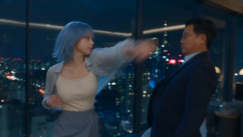</a>

两张上传图锁定人物身份，用带时间码的时间线把进攻、闪避、轻吻、升级的循环重复五次。每次轻吻都用不切镜的连续推镜头，对白只允许几句原文韩语。

Seedance 2.5 · 参考生视频 · 出处: [@pyona_ai on X](https://x.com/pyona_ai/status/2088605198973583799) · 发现于 [LearnPrompt/awesome-seedance](https://github.com/LearnPrompt/awesome-seedance)

[`action-comedy`](tags.md#tag-action-comedy) [`two-characters`](tags.md#tag-two-characters) [`long-take`](tags.md#tag-long-take) [`push-in`](tags.md#tag-push-in) [`korean-dialogue`](tags.md#tag-korean-dialogue)

<details><summary><b>提示词</b></summary>

```text
Use exactly 2 uploaded image assets.\nimage1 = 成年女主唯一且最高优先级的人物身份参考。严格保持她的脸部、五官比例、肤色、发型、体型、年龄感、整体气质、服装与配件一致。\nimage2 = 戴眼镜的韩国成年男性唯一且最高优先级的人物身份参考。严格保持他的脸部、五官比例、肤色、发型、眼镜、体型、年龄感、整体气质、服装与配件一致。\n\n生成一段30秒、16:9横屏、4K、24fps、超写实真人电影级动作喜剧短片。场景是夜晚高层现代顶层办公层 / 豪华公寓式空间，落地玻璃外是都市夜景，室内有开放客厅、长廊、现代家具、冷暖混合灯光。不要动漫感，不要游戏CG感，不要廉价特效，不要慢动作，不要伪慢动作。动作必须真实、快速、清晰、电影化。\n\n【前提】\n这是两名成年演员进行的一段事先编排、双方同意的动作喜剧表演。整体气氛轻松、顽皮、带竞技感，不表现恐惧、威胁或强迫。不是生死战，不是低俗戏，而是“女主不断进攻，男主不断闪避并用玩笑式脸颊轻吻打乱节奏”的高能动作喜剧。\n\n【核心关系】\n女主全程主动进攻，男主几乎不真正反击，只不断闪避、绕位、贴近、退开。男主的主要“得分方式”不是拳脚，而是利用动作节奏中的瞬间空档，突然靠近，做一个短促、清楚、玩笑式的脸颊轻吻，然后立刻退开。全片一共5次脸颊轻吻。每一次都必须是明确的喜剧节奏点。亲吻后女主都会更恼火、更认真，继续追打。\n\n【动作原则】\n女主：持续前压，连续使用直拳、摆拳、肘击、膝击、侧踢、高踢、回旋踢、转身攻击、追击压迫。越往后越认真，越往后越凶。\n男主：几乎不主动打人，不进行真正的拳脚反击，不做沉重摔打。他的主要动作只有：闪避、后撤、侧身、低头、后仰、滑步、绕位、借力卸开攻击路线、突然靠近、脸颊轻吻、马上退开。\n全片结构必须反复升级：\n女主连续攻击 → 男主连续闪避 → 男主抓住极短空档突然脸颊轻吻 → 女主更生气 → 再次猛烈追击。\n这个结构共出现5次。\n\n【镜头规则】\n动作段落主要使用medium shot、medium-wide、wide、贴身跟拍、手持感摄影、侧向tracking、轻微呼吸感晃动，清楚交代空间移动。\n每一次脸颊轻吻发生前，摄影机先跟着两人的动作节奏推进，捕捉到男主突然靠近女主近身空间。\n每一次轻吻发生时，不要突然切镜，不要突然换机位。必须使用同一连续镜头中的快速、平滑camera push-in / dolly-in：\n动作中景 → 男主突然靠近 → 摄影机迅速推进到medium close-up / close-up → 清楚表现短促的脸颊轻吻动作、男主略显得意的表情、女主瞬间错愕或恼火的表情 → 摄影机随着两人分开自然拉回动作镜头继续追打。\n每次轻吻持续约0.3–0.6秒，必须清楚可见，但很短。不要停下来摆Pose。\n\n【男主表情与性格】\n男主全程保持从容、调皮、略微欠揍的恶作剧感。他不生气，也不想真正压制女主；他的乐趣是不断躲开她的攻击，然后趁她出现瞬间空档突然做一个脸颊轻吻。\n每次成功后，他都必须出现极短、自然、略显得意的表情：嘴角轻微上扬，眼神带一点“又没打中我”的玩味，偶尔轻轻挑眉。不要猥琐，不要邪恶，不要夸张奸笑。\n第一次：有点得意。\n第二次：更明显觉得好玩。\n第三次：开始故意挑衅。\n第四次：明知道女主越来越生气，仍忍不住露出欠揍笑意。\n第五次：轻吻后明显露出“玩过头了”的心虚笑容，然后马上逃跑。\n\n【对白规则】\n全片对白极少，只允许以下4句韩语，不要增加其他对白、旁白或字幕。\n第一次脸颊轻吻后，女主短促、错愕又恼火地说：“야!”\n第二次脸颊轻吻后，男主一边轻松后退一边带一点调皮语气说：“또 실패.”\n第四次脸颊轻吻后，女主咬牙压住怒气说：“너 진짜...”\n话还没说完就继续攻击。\n第五次脸颊轻吻成功后，男主立刻转身逃跑，带着一点不太真诚的轻松语气喊：“미안!”\n第三次脸颊轻吻完全不要对白，只用清楚的轻吻声、女主表情和马上开始的追击制造笑点。\n所有台词必须严格保持以上韩语原文。不要中文对白，不要英文对白，不要自动翻译。\n\n【时间线】\n0–4秒\n开场1秒内直接进入动作。女主已经在高层客厅区域连续猛攻，动作快速凌厉：直拳、转身肘击、中段踢连贯压上。男主几乎不出手，只不断侧身、低头、滑步、后仰闪避，动作非常从容。摄影机近距离跟拍，建立“女主持续追打、男主一直躲”的基本关系。\n\n4–6秒｜第一次脸颊轻吻\n女主继续前压，一拳接一脚逼近男主。男主闪过后突然从女主侧后方约45度短暂贴近，不要完全站在正后方。随后快速在她右侧脸颊上做第一次短促轻吻。必须在同一镜头内快速推进到脸部近景，清楚表现轻吻动作。女主瞬间愣住，然后恼火地说：“야!” 男主立刻退开，并露出第一次得意的欠揍表情。\n\n6–10秒\n女主明显更火，攻击节奏提高。她连续用低扫、高踢、摆拳和转身追击，男主持续闪避，不反打，只边退边躲，偶尔用很短的借力化解改变她攻击方向，但绝不展开真正反击。\n\n10–12秒｜第二次脸颊轻吻\n女主一记高位踢被男主极限低头躲过。男主趁她动作落下的半拍，从另一侧快速切入，在她左侧脸颊上再做一次轻吻。必须再次在同一镜头中快速推进到脸部近景，清楚表现动作瞬间。亲完后男主一边轻松后退一边说：“또 실패.” 表情更明显地觉得好玩。女主更生气，立刻冲上。\n\n12–16秒\n女主开始更猛烈追打，动作更大、更快、更凶。她连续前压、转身、追身高踢，追着男主从客厅打到玻璃窗前再转向开放走道。男主几乎只做极限闪避：上身后仰、贴身绕开、低身闪过、侧滑退开。动作要让人感觉“再慢一点就会被打中”。\n\n16–18秒｜第三次脸颊轻吻\n女主连续两次攻击落空后，男主在她转身回头的一瞬间突然贴近，再次做一个更短、更突然、更干脆的脸颊轻吻。仍然必须在同一连续镜头中快速推进到近距离脸部特写，清楚看到动作。这里不要对白，只保留短促自然的“啵”声和女主表情。男主表情已经带着故意挑衅的欠揍感。女主眼神明显变得更凶，继续追打。\n\n18–22秒\n女主怒气继续累积，追击更狠。她连续使用高踢、转身横踢、膝击逼近，几乎不停顿。男主一路闪避、躲入长廊、绕过家具边缘，不反打，只是不断读她动作并险之又险地避开。男主的从容感开始带一点被追得发慌的喜感，但仍然很会躲。\n\n22–24秒｜第四次脸颊轻吻\n女主一记攻击擦过男主面前，男主借她动作惯性突然近身，第四次轻吻到脸颊。摄影机再次在同一镜头内迅速推进到近景，清楚表现动作。男主仍忍不住露出欠揍笑意。女主咬牙、压着火气说：“너 진짜...” 话还没说完，她就立刻继续追打，不给男主喘息。\n\n24–27秒\n女主进入最强追击状态，速度和压迫感拉满。她连续高位踢击和转身动作几乎不间断，把男主一路逼向更深处走廊。男主仍然不反击，只不断极限后撤、侧身、低头、后仰，像在玩命躲。\n\n27–29秒｜第五次脸颊轻吻\n在全片最高速的追逐与攻防中，男主看起来几乎要被踢中，却在最后一瞬躲开，并突然非常快速地回到女主近身，完成第五次、也是最夸张最欠揍的一次脸颊轻吻。必须使用最清楚的连续push-in脸部特写，清楚表现动作。亲完后男主露出“玩过头了”的心
```

</details>

<a id="seedance-ruined-temple-warrior-swordsmen-battle"></a>
### 女武者在破败古寺大战剑客

<a href="https://x.com/aiwithaly/status/2112055308701053088">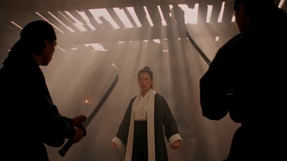</a>

提示词先交代类型参照，再用具体的残骸和穿过灰尘的金色光束搭出场景。随后按顺序列出招式与镜头运动，并以旋踢击碎祭坛这一明确动作收尾。胶片颗粒、色调和无对白的声音描述补全了画面与音频。

Seedance 2.5 · 文生视频 · 出处: [@aiwithaly on X](https://x.com/aiwithaly/status/2112055308701053088) · 发现于 [LearnPrompt/awesome-seedance](https://github.com/LearnPrompt/awesome-seedance)

[`martial-arts`](tags.md#tag-martial-arts) [`cinematic`](tags.md#tag-cinematic) [`temple`](tags.md#tag-temple) [`action`](tags.md#tag-action) [`film-grain`](tags.md#tag-film-grain)

<details><summary><b>提示词</b></summary>

```text
A 15-second ultra-realistic cinematic martial arts battle inspired by classic Hong Kong action cinema. A fearless female warrior dressed in black and white faces deadly swordsmen inside a ruined ancient temple. Broken Buddha statues, shattered roof tiles, collapsed wooden beams, and dusty stone pillars create a dramatic battlefield. Golden sunlight cuts through the damaged roof, illuminating floating dust particles in a moody amber atmosphere. Lightning-fast punches, powerful spinning kicks, precise sword deflections, sweeping leg attacks, and breathtaking airborne qinggong maneuvers unfold in seamless, high-intensity choreography. Every impact releases clouds of white dust, clashing weapons spark, and enemies crash into ancient pillars and wooden altars. Dynamic handheld tracking shots, rapid lateral movements, dramatic orbital camera angles, realistic body mechanics, flowing robes, and authentic facial skin textures enhance the immersion. Vintage 35mm film grain, deep sepia shadows, warm golden highlights, natural side lighting, and rich cinematic contrast recreate the timeless aesthetic of classic martial arts films. The warrior finishes with a powerful spinning kick, shattering an altar before landing gracefully in a fearless fighting stance. Photorealistic, intense, immersive, ultra-detailed cinematic action with traditional percussion, realistic combat sound effects, and no dialogue or on-screen text.
```

</details>

<a id="seedance-school-uniform-lookbook-turntable"></a>
### 校园风穿搭画册，模特与商品同步旋转

<a href="https://x.com/AI__TSUBAKI/status/2102459655700287648"></a>

从首帧锁定整张版式，只让模特和商品动起来。模特转身与每件商品旋转一圈在同一节拍结束，画面同步感清楚。

Seedance 2.5 · 图生视频 · 出处: [@AI__TSUBAKI on X](https://x.com/AI__TSUBAKI/status/2102459655700287648) · 发现于 [LearnPrompt/awesome-seedance](https://github.com/LearnPrompt/awesome-seedance)

[`fashion`](tags.md#tag-fashion) [`lookbook`](tags.md#tag-lookbook) [`turnaround`](tags.md#tag-turnaround) [`product-rotation`](tags.md#tag-product-rotation)

<details><summary><b>提示词</b></summary>

```text
A clean, premium 4-second fashion lookbook animation starting from the first frame. The entire layout stays exactly as shown: same background, same cream item panel, same captions, same crown icons, same wordmark, same framing.

The model on the right turns a full 360° on the spot the way a real fashion model does on set: she steps her feet around naturally, shifting her weight from one leg to the other as she turns, her arms moving freely and her shoulders relaxed. As she comes around to the back she glances over her shoulder, and as she returns to face the camera she settles into a new, different confident model pose. Natural posture, realistic cloth physics; hair, hems and accessories swing and settle with the motion. She stays in the same spot and at the same size in frame throughout.

At the same time, every product cutout inside the item panel rotates in place on its own vertical axis, like a luxury product display render, revealing front, side and back. Each item stays centered in its own slot, keeps its size, and completes exactly one full rotation in sync with the model's turn, ending in its original orientation.

The panel, divider lines, captions, crown icons and wordmark stay perfectly fixed; only the model moves and the products rotate. Camera locked off, no zoom, no pan. Soft studio lighting with realistic shadows under the model and the products. Smooth, natural motion, clean commercial fashion-ad aesthetic, ultra-sharp details, luxury catalog presentation.
```

</details>

<a id="seedance-schoolgirl-stands-before-tanks"></a>
### 女学生独自站在高速公路上面对坦克

<a href="https://x.com/itsSaira_1/status/2101205826895827053">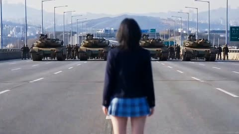</a>

全局连续性段落锁定人物、服装和环境，随后每个定时分镜都从上一镜的末帧开始，保证剪切衔接一致。负面提示词排除了倒放和消失的物体，使飞来的炮弹始终保持向前的运动方向。

Seedance 2.5 · 文生视频 · 出处: [@itsSaira_1 on X](https://x.com/itsSaira_1/status/2101205826895827053) · 发现于 [LearnPrompt/awesome-seedance](https://github.com/LearnPrompt/awesome-seedance)

[`continuity`](tags.md#tag-continuity) [`timed-scenes`](tags.md#tag-timed-scenes) [`dark-fantasy`](tags.md#tag-dark-fantasy) [`multi-shot`](tags.md#tag-multi-shot)

<details><summary><b>提示词</b></summary>

```text
GLOBAL CONTINUITY: Photorealistic cinematic 16:9. Keep the EXACT same schoolgirl, identical face, black bob haircut, navy school uniform, red ribbon, blue plaid skirt, same highway, mountains, skyline, lighting and visual style. Every scene must directly continue from the previous scene using the exact previous last frame as the next Start/Reference Frame. No changes in identity, clothing, environment, direction, scale or lighting.

SCENE 1 — 0:00–0:02.5
Girl stands exactly in the center of a huge highway, facing distant military tanks. Wide cinematic shot, mountains and city skyline behind them.

SCENE 2 — 0:02.5–0:04.5
The same tanks fire toward the girl. Powerful muzzle flashes, smoke and realistic military details. Camera moves slightly alongside the tanks.

SCENE 3 — 0:04.5–0:07
Cut to the exact same girl, standing calmly and facing the camera. Slow cinematic push-in toward her face.

SCENE 4 — 0:07–0:09.5
Multiple tank shells rapidly fly toward and around the girl. She remains completely still. Projectiles must keep their forward direction and never disappear or reverse.

SCENE 5 — 0:09.5–0:11.5
The girl's eyes glow neon green. She raises one hand and creates powerful green energy around her hand and body.

SCENE 6 — 0:11.5–0:14
A massive explosion erupts on the highway around the attacking forces. Huge fire, smoke, dust and debris.

SCENE 7 — 0:14–0:16.5
Low tracking shot of the same military tanks aggressively moving forward. Realistic tracks, armor, weight, dust and smoke.

SCENE 8 — 0:16.5–0:19
Multiple tanks suddenly rise and float above the highway under a powerful supernatural force. Same environment and daylight.

SCENE 9 — 0:19–0:21.5
The floating tanks violently explode in mid-air. Large fireballs, smoke, metal fragments and debris fall downward.

SCENE 10 — 0:21.5–0:24
A gigantic explosion completely fills the center of the highway with fire, smoke and debris. Wide cinematic shot.

SCENE 11 — 0:24–0:26
Cut back to the EXACT same girl, unchanged and unharmed, standing calmly in the center of the now-empty highway. Slow push-in.

SCENE 12 — 0:26–0:27.5
Camera moves behind the girl as she calmly walks forward down the highway. End with a wide cinematic shot of her walking toward the distant mountains.

NEGATIVE: No character change, face change, hairstyle change, outfit change, age change, background change, lighting change, weather change, duplicated character, distorted face, deformed hands, extra fingers, disappearing objects, reversed movement, U-turns, camera flips, inconsistent tanks, unrealistic physics, text, subtitles, logos, watermark, UI or continuity errors.

#Ai #darkfantisy #visaul #AIart️️️️️️️️️️️️️️️️️️️️️️️️️️️️️️️️️️️️️️️️️️️️️️️️️️️ #visualstorytelling #seedance25
@Flovaai @itsPolloAI
```

</details>

<a id="seedance-sci-fi-motorcycle-supercar-highway-chase"></a>
### 科幻装甲骑手与超跑公路追逐

<a href="https://x.com/itsSaira_1/status/2104064261005709551">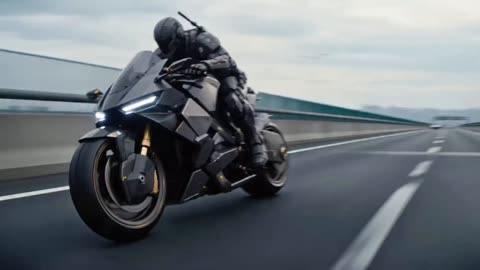</a>

提示词先统一整体影调(低饱和、动态模糊、4K 胶片感),再列出九个编号分镜,每个分镜都写明机位和运镜:低角度跟拍、特写、无人机俯拍、车内第一视角。末尾的长负面提示词用来稳住各镜头之间的光线和摩托车结构。

Seedance 2.5 · 文生视频 · 出处: [@itsSaira_1 on X](https://x.com/itsSaira_1/status/2104064261005709551) · 发现于 [LearnPrompt/awesome-seedance](https://github.com/LearnPrompt/awesome-seedance)

[`sci-fi`](tags.md#tag-sci-fi) [`action`](tags.md#tag-action) [`motorcycle`](tags.md#tag-motorcycle) [`multi-shot`](tags.md#tag-multi-shot) [`chase`](tags.md#tag-chase)

<details><summary><b>提示词</b></summary>

```text
Cinematic photorealistic sci-fi action sequence, moody desaturated color grade, dramatic lighting, hyper-detailed mechanical design, motion blur for speed, 4K film quality.

Scene 1: Wide low-angle tracking shot of a futuristic armored rider in black tactical exosuit on a black-gold angular sci-fi motorcycle, speeding on empty highway, overcast sky.

Scene 2: Close-up transformation shot — motorcycle's rear panels mechanically unfold like wings while riding at high speed, sparks of light on metal joints.

Scene 3: Low-angle hero reveal shot of a sleek black Batmobile-style supercar with scissor/wing doors opening, front LED light strip glowing.

Scene 4: Rear-tracking low-angle shot of two motorcycles riding side by side on the highway, wheels blurred with speed.

Scene 5: Rear pursuit shot of the black supercar driving with glowing taillights, a motorcycle catching up close behind.

Scene 6: Aerial drone top-down shot of a curving highway with the car and motorcycles racing, small flying drone visible above for scale.

Scene 7: Close-up action shot of the car's front wheel with sparks flying off the road surface, high-speed drift feel.

Scene 8: Interior POV shot from the car's dashboard, glowing speedometer, driving fast through a dark tunnel with lights streaking past.

Scene 9: Tunnel chase shot — motorcycle and car entering/exiting a concrete tunnel, wet road reflections, cinematic light contrast.

Negative prompt: blurry, low quality, distorted proportions, extra limbs, deformed hands, warped motorcycle frame, flickering lights, inconsistent lighting, cartoonish, low-res textures, watermark, text, logo, oversaturated colors, daytime bright sun (unless overcast), shaky unstable camera, jerky motion, unrealistic physics, plastic look, glitch artifacts.

#Ai #AIart️️️️️️️️️️️️️️️️️️️️️️️️️️️️️️️️️️️️️️️️️️️️️️️️️️️ #VisualStorytelling #CinematicAI
#GenerativeAI  #AICreator
```

</details>

<a id="seedance-seoul-first-snow-dv-camcorder-home-video"></a>
### 2000年代初DV摄像机拍下的首尔初雪

<a href="https://x.com/nawalsehar/status/2106251329085874184">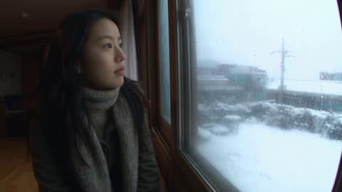</a>

用参考图锁定人物的脸和服装，动作按窗边、雪球、路灯的顺序分段写清。详细的DV画质瑕疵、只保留现场声音和一长串负面词，让质感真实、物理合理。

Seedance 2.5 · 参考生视频 · 出处: [@nawalsehar on X](https://x.com/nawalsehar/status/2106251329085874184) · 发现于 [LearnPrompt/awesome-seedance](https://github.com/LearnPrompt/awesome-seedance)

[`dv-camcorder`](tags.md#tag-dv-camcorder) [`vintage`](tags.md#tag-vintage) [`snow`](tags.md#tag-snow) [`handheld`](tags.md#tag-handheld) [`diegetic-audio`](tags.md#tag-diegetic-audio)

<details><summary><b>提示词</b></summary>

```text
Create a 30-second ultra-photorealistic early-2000s Korean DV-camcorder home video of a young Korean woman experiencing Seoul’s first snowfall of winter. Use the attached image as the character reference and keep her face, hairstyle, body proportions, outfit and identity consistent throughout.

She notices the first snow from her window, excitedly grabs her coat and scarf, rushes outside and catches snowflakes in her hand. She runs briefly through the residential lane, crouches to make a tiny snowball, shows it proudly to the camera and tosses it. The snowball follows realistic gravity and breaks apart naturally on impact.

She continues walking through the snowy older Seoul neighborhood, leaving believable footprints as snow gradually settles on bicycles, cars, rooftops and bushes. Her hair, scarf and coat move naturally in the winter breeze, with subtle visible breath in the cold air.

At the end, she stops beneath a streetlight, looks into the camera, catches a snowflake in her palm and softly says, “First snow.” She smiles and walks away as the handheld camera follows.

Authentic early-2000s consumer DV look: shaky handheld framing, autofocus hunting, slight exposure/white-balance shifts, soft digital detail, CCD noise, subtle interlacing, cool white balance, natural motion blur, limited dynamic range and occasional awkward zooms. The camera operator reacts imperfectly like a real home-video recording.

Natural diegetic audio only: wind, footsteps crunching snow, breathing, doors, fabric movement, distant traffic, birds and neighborhood ambience. No music, narration, subtitles, CGI, beauty filters, cinematic grading, slow motion or polished camera movement.

Negative prompt: inconsistent face, changing clothes, morphing, distorted hands, extra fingers, unnatural physics, floating snow, instant snowballs, impossible trajectories, teleportation, clipping, plastic skin, cinematic camera, excessive stabilization, commercial look, logos, watermark.
```

</details>

<a id="seedance-sharon-taekwondo-arena-duel"></a>
### 两名金发女战士在阳光下的石质竞技场中交锋

<a href="https://x.com/Just_sharon7/status/2088878042034868640">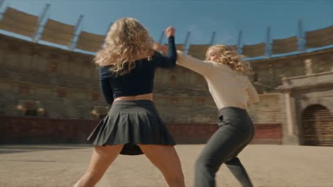</a>

用参考图加文字特征清单锁定两名角色的脸部与服装，并把10秒镜头按时间段拆分，每段指定跆拳道踢法，段落之间用无重置的衔接保持连贯，慢动作只用于击中瞬间。

Seedance 2.5 · 参考生视频 · 出处: [@Just_sharon7 on X](https://x.com/Just_sharon7/status/2088878042034868640) · 发现于 [LearnPrompt/awesome-seedance](https://github.com/LearnPrompt/awesome-seedance)

[`taekwondo`](tags.md#tag-taekwondo) [`fight-choreography`](tags.md#tag-fight-choreography) [`reference-images`](tags.md#tag-reference-images) [`arena`](tags.md#tag-arena)

<details><summary><b>提示词</b></summary>

```text
Image : SHARON'S REAL FACE — sole source of her features, 100% match, zero drift: soft rounded oval face, warm light-beige skin with tiny freckles and beauty marks, GREEN eyes, dense straight feathered brows, small neat nose, full pink lips, small silver drop earring. 

image Image 
STYLE / PRIORITY

Ultra-photorealistic live-action AAA Hollywood action film, ARRI ALEXA 65, IMAX, Panavision anamorphic, premium restrained semi-CGI VFX. Realistic anatomy, weight, gravity, momentum, and authentic Taekwondo biomechanics. One continuous uninterrupted 10-second combat shot, 16:9.

**CHARACTERS**

Image = FIGHTER. @Image2 = ENEMY. Preserve both references exactly: face, facial anatomy, eyes, hairstyle, physique, proportions, clothing, accessories, silhouette, identity. If references are sketches, use only as design blueprints; render as fully realistic live-action humans. Maintain consistency throughout.

**COMBAT**

Hand-to-hand only, no weapons. Both fighters remain aggressive and reactive. No passive waiting, idle stance, reset, teleportation, or position jumps.

**00:00–00:02 — OPENING EXCHANGE**

Start mid-fight. Image2 attacks: straight punch → hook → low kick. Image parries → slips under hook → checks low kick → immediately counters with fast body kick. Image2 blocks and is pushed backward. Both instantly reposition. Low-angle camera rapidly circles them.

**00:02–00:03 — OPENING**

she attacks again. Image1 narrowly sidesteps, pivots outside the attack angle, and @Image2 turns toward him, briefly exposing the torso. @Image1 explosively accelerates forward. Camera drops toward the feet. Supporting foot plants and hip rotation begins.

**00:03–00:04.5 — CYCLONE 1**

**DOLLYO CHAGI:** natural supporting-foot pivot, hip and torso rotation, kicking leg extends into Image2's torso. Realistic displacement, clothing compression and dust. 0.20s hyper slow motion only at impact, then instantly full speed. Landing immediately feeds the next rotation—NO RESET.

**00:04.5–00:06 — CYCLONE 2**

**TORNADO KICK:** landing momentum converts directly into explosive pivot and airborne rotation. Full-body rotation, kicking leg strikes Image2, driving him sideways. Camera rapidly orbits the airborne Fighter. Natural landing preserves rotational momentum. NO RESET.

**00:06–00:07.5 — CYCLONE 3**

**DWI HURRYEO CHAGI:** immediate continuous rotation. Hips and shoulders rotate together; heel/back of foot follows a clean circular trajectory and connects. Image2 is redirected sideways. 0.20s hyper slow motion at impact, dust/debris briefly suspended, heavy THOOM, then full speed. Rotation continues.

**00:07.5–00:08.5 — CYCLONE 4**

**SPINNING HEEL KICK:** no stance reset. Supporting foot establishes axis, rapid hip/torso rotation, heel travels circularly through Image2's raised guard and connects. Image2 is driven backward. Camera performs a fast 270° orbit. Image1 keeps rotating after impact.

**00:08.5–00:10 — FINAL CYCLONE**

**FINAL TORNADO KICK — STRONGEST IMPACT.** Maximum rotational acceleration, explosive ground push, vertical lift, rapid airborne rotation. Camera drops low then rises with Image Final kick connects with maximum physical force. 0.25s hyper slow motion, extreme close-up showing foot contact, clothing compression, natural facial reaction, dust/debris and camera recoil, then THOOOOOM and immediate full speed. Image2 is violently displaced backward across the arena. Image lands naturally and continues moving forward. No hero pose, no victory pose, no freeze.

**ROTATIONAL MOMENTUM LOCK**

The five techniques must function as ONE connected sequence:

**DOLLYO CHAGI → LAND → TORNADO KICK → LAND → DWI HURRYEO CHAGI → SPINNING HEEL KICK → FINAL TORNADO KICK.**

Never kick → stop → stance → kick. Always kick → momentum → rotation → kick → momentum → rotation → kick.

**PHYSICS / CAMERA**

Every movement is physically traveled through: footwork, pivots, hip rotation, torso rotation, leg acceleration, jump force and rotational momentum. Image2 reacts naturally according to impact direction; no exaggerated ragdoll or floating. Camera constantly chases the fighters using low-angle tracking, ground pursuit, lateral/reverse tracking, fast orbit, whip-pans, snap-reframes, impact jolts, rapid push-ins and low-angle aerial follow. Aggressive movement but each kick remains clearly readable. No excessive motion blur or camera shake.

**ENVIRONMENT / VFX / AUDIO**

Large cinematic outdoor combat arena with realistic ground, dust, small debris and detailed environmental depth; never an empty studio. Restrained photorealistic VFX: dust, debris, air displacement, natural motion streaks only. No aura, energy, glow or magic. No music. Realistic footsteps, shoe friction, punches, kicks, cloth movement, air whooshes, dust, body impacts and heavy final THOOM.

**NEGATIVE**

Teleportation, clones, duplicates, extra/missing limbs, malformed anatomy, broken joints, rubber/stretching limbs, disconnected body parts, impossible spine rotation, floating, weightless movement, random position jumps, kick-stop-kick, attack-wait-attack, idle pose, static/locked/gameplay camera, excessive shake, excessive motion blur, prolonged slow motion, unreadable action, looping animation, repeated identical kicks, giant aura, energy beams, magical powers, glowing body, cartoon, cel shading, videogame graphics, gore, blood, subtitles, text, logo, watermark, freeze frame, hero pose, victory pose, fade-out.

**HIGHEST PRIORITY:** Hand-to-hand Taekwondo combat. Image = Fighter, Image2 = Enemy. Continuous realistic biomechanics. DOLLYO CHAGI → TORNADO KICK → DWI HURRYEO CHAGI → SPINNING HEEL KICK → FINAL TORNADO KICK, with zero idle, zero reset, zero teleportation, continuous rotational momentum, realistic enemy reactions, constantly moving camera, micro slow-motion only on decisive impacts, strongest final impact, and no hero pose.16:9.16:9.16:9.
```

</details>

<a id="seedance-shower-towel-doorbell-delivery-comedy"></a>
### 男子冲出淋浴间跑去应门取快递

<a href="https://x.com/AIwithZeeshi/status/2107317166995546481"></a>

提示词把笑点拆成清晰的节拍：通知、门铃、奔跑、错过快递员、无奈表情。结尾用一串物理描述约束水、重力、湿织物和阴影，并保证角色一致和跟拍镜头平滑。

Seedance 2.5 · 文生视频 · 出处: [@AIwithZeeshi on X](https://x.com/AIwithZeeshi/status/2107317166995546481) · 发现于 [LearnPrompt/awesome-seedance](https://github.com/LearnPrompt/awesome-seedance)

[`comedy`](tags.md#tag-comedy) [`photorealistic`](tags.md#tag-photorealistic) [`tracking-shot`](tags.md#tag-tracking-shot) [`physics`](tags.md#tag-physics) [`storytelling`](tags.md#tag-storytelling)

<details><summary><b>提示词</b></summary>

```text
A young man is taking a normal shower in a modern apartment when his phone suddenly shows a delivery notification.

He hears the doorbell and quickly turns off the shower, grabs a towel, and rushes toward the entrance. His wet feet leave small realistic footprints as he carefully runs across the floor.

He finally opens the door, but the delivery driver is already walking away. The package is sitting safely on the doormat.

He looks at the package, then at the driver, completely exhausted.

Photorealistic cinematic comedy, realistic water behavior, natural human movement, believable gravity and friction, consistent character appearance, realistic wet hair and fabric, natural facial expressions, smooth camera tracking, accurate shadows, realistic apartment lighting, and physically believable interactions throughout.
```

</details>

<a id="seedance-singing-cat-night-convertible"></a>
### 夜间敞篷车里唱歌的司机猫和乘客

<a href="https://x.com/MahiraEhan/status/2109875307675017668"></a>

提示词为每只动物写明毛色和品种，并固定座位布局，同时要求司机猫自然对口型唱歌。城市灯光虚化、车头反光和浅景深营造出夜间电影感，再加一句跨镜头角色一致性来稳定角色外观。

Seedance 2.5 · 文生视频 · 出处: [@MahiraEhan on X](https://x.com/MahiraEhan/status/2109875307675017668) · 发现于 [LearnPrompt/awesome-seedance](https://github.com/LearnPrompt/awesome-seedance)

[`animals`](tags.md#tag-animals) [`cat`](tags.md#tag-cat) [`night-drive`](tags.md#tag-night-drive) [`lip-sync`](tags.md#tag-lip-sync) [`cinematic`](tags.md#tag-cinematic)

<details><summary><b>提示词</b></summary>

```text
A high-definition 4K cinematic video of a white and orange tabby cat sitting in the driver's seat of a classic convertible car at night, looking expressively toward the passenger side while "singing" with natural lip-sync movement. In the passenger seat, a fluffy blue-gray British Shorthair cat and a tiny white Pomeranian dog sit close together, watching with wide, emotional eyes. The background features soft, blurred bokeh city lights of a downtown street. Moody, cinematic lighting reflecting off the polished black car hood. Shot with a shallow depth of field, playful yet dramatic tone, seamless character consistency across cuts.
```

</details>

<a id="seedance-sokcho-fish-market-flip-camera-vlog"></a>
### 束草鱼市清晨翻盖相机旅行视频

<a href="https://x.com/oggii_0/status/2095029762070900919">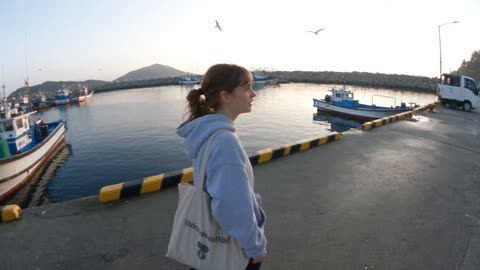</a>

先用参考图锁定人物身份，再列出抖动、对焦漂移、高光过曝等刻意瑕疵，让画面像朋友随手拍的真实记录。七个带时间码的段落各含一个动作和一句台词，音频只保留现场自然声。

Seedance 2.5 · 参考生视频 · 出处: [@oggii_0 on X](https://x.com/oggii_0/status/2095029762070900919) · 发现于 [LearnPrompt/awesome-seedance](https://github.com/LearnPrompt/awesome-seedance)

[`vlog`](tags.md#tag-vlog) [`handheld`](tags.md#tag-handheld) [`lo-fi`](tags.md#tag-lo-fi) [`travel`](tags.md#tag-travel) [`dialogue`](tags.md#tag-dialogue)

<details><summary><b>提示词</b></summary>

```text
FORMAT: 30 seconds | 16:9 | Ultra-photorealistic live-action | Continuous handheld vacation vlog

Preserve the exact face, hairstyle, identity, skin tone, facial features, and body proportions from <<<image_1>>> throughout the entire video. The same woman must appear consistently in every shot.

VISUAL STYLE: Authentic late-2000s personal vacation vlog recorded on a cheap handheld flip camera. Extremely raw and imperfect footage. Heavy natural camera shake, awkward handheld framing, occasional partial face crops, sudden reframing, autofocus hunting, exposure fluctuations, blown highlights, slightly soft image quality, warm faded colors, mild digital noise, compression artifacts, and subtle motion blur. No cinematic camera movements, no gimbal stabilization, no polished composition, no modern color grading, no beauty filter, no artificial sharpness.

Outfit: oversized grey hooded sweatshirt, black leggings, worn white running shoes, hair pulled back into a low messy ponytail, small silver stud earrings, a canvas tote bag slung over one shoulder. The entire video must feel like one genuine recording captured by a friend on an early-morning trip through a fishing village in Sokcho, South Korea, not a staged commercial or cinematic recreation.

00:00–00:04 — EARLY MORNING ARRIVAL
The woman walks along a quiet harbor path as the sun rises, fishing boats bobbing gently in the water behind her, seagulls circling overhead.
The camera shakes slightly as it follows her from the side.
She says:
"It's so early, but I really wanted to see the fish market before it gets busy."

00:04–00:08 — THE FISH MARKET
She steps into a covered harbor market filled with tanks of live fish, crabs, and squid, fishermen unloading crates from small boats nearby.
The camera zooms unsteadily on a tank of wriggling crabs, focus hunting before snapping back to her face.
She reacts with a mix of fascination and mild alarm.

00:08–00:12 — TALKING WITH A FISHERMAN
An older fisherman hoists a large fish onto a table for her to see up close.
She leans in curiously, asks a question, and he answers while gesturing with his hands.
She laughs and says to the camera:
"He says this one was caught just an hour ago!"

00:12–00:16 — TRYING RAW SQUID
A nearby stall vendor offers her a small plate of freshly sliced raw squid with dipping sauce.
She hesitates for a second, then takes a bite, chewing slowly with a surprised expression.
She turns to the camera and says:
"Okay wow, that's way fresher than I expected."

00:16–00:20 — HELPING SORT THE CATCH
A fisherwoman nearby is sorting fish into baskets and waves her over to help.
She kneels down and awkwardly tries to sort a few fish, nearly dropping one, laughing at herself.
The fisherwoman laughs too and pats her on the back encouragingly.

00:20–00:24 — WALKING THE HARBOR
She walks along the docks past rows of moored fishing boats, ropes coiled on the ground, nets drying in the morning sun.
A couple of fishermen nod and greet her; she waves back cheerfully.
The camera briefly swings toward the boats before swinging back to her.

00:24–00:27 — QUIET MOMENT
She stops at the edge of the harbor, looking out over the calm water as the sun fully rises over the horizon.
For a moment there's no dialogue — just waves lapping, distant gulls, and the creak of boats.
She smiles softly and says:
"Mornings like this make the early wake-up worth it."

00:27–00:30 — NATURAL ENDING
She turns back toward the camera, gives a small wave, and says:
"Okay, harbor adventure done. See you next time!"
She laughs, turns, and walks off along the dock.
The camera lingers a moment before the footage naturally ends with a slight shake and imperfect cut.

AUDIO
Natural location sound only:
- waves lapping against the dock
- seagulls calling
- boat engines idling in the distance
- fishermen calling out to each other
- crates being unloaded
- water splashing in fish tanks
- footsteps on wet pavement
- light morning breeze
```

</details>

<a id="seedance-sorceress-water-beast-castle-courtyard-rain"></a>
### 女巫在雨中城堡庭院召唤水兽

<a href="https://x.com/laviniavelle/status/2107333176985317886">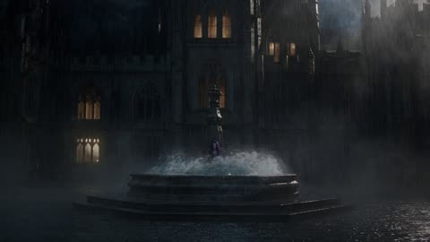</a>

提示词把动作拆成清晰的节拍：现身、闪避、召唤、撞击、消散。开头先定下场景与天气，结尾再补充光线和慢动作流体效果。

Seedance 2.5 · 文生视频 · 出处: [@laviniavelle on X](https://x.com/laviniavelle/status/2107333176985317886) · 发现于 [LearnPrompt/awesome-seedance](https://github.com/LearnPrompt/awesome-seedance)

[`dark-fantasy`](tags.md#tag-dark-fantasy) [`action`](tags.md#tag-action) [`water-magic`](tags.md#tag-water-magic) [`gothic`](tags.md#tag-gothic) [`slow-motion`](tags.md#tag-slow-motion)

<details><summary><b>提示词</b></summary>

```text
A dark fantasy action sequence in a gothic castle courtyard during torrential rain A sorceress with vibrant purple hair rises from a stone fountain Two men with swords attack her She fluidly dodges uses water magic to shield herself, and summons a giant water beast with glowing eyes from the fountain that slams into her attackers She calmly steps out of the fountain raises her hand, and dissolves the water beast into a fine mist of rain. Cinematic lighting slow motion fluid dynamics, 8k resolution.
```

</details>

<a id="seedance-spy-factory-fight-15-seconds"></a>
### 特工在着火工厂里十五秒打斗

<a href="https://x.com/Xaroon_x/status/2092873962640519385">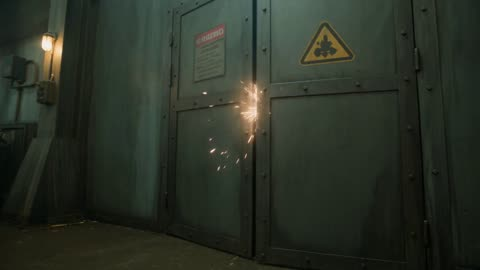</a>

开头先用参考图锁定人物身份，再按0到4、4到7、7到10、10到13、13到15秒分段，每段只写一个动作和一种运镜。镜头、光线、物理和负面提示各自成段，让手持写实感保持稳定。

Seedance 2.5 · 参考生视频 · 出处: [@Xaroon_x on X](https://x.com/Xaroon_x/status/2092873962640519385) · 发现于 [LearnPrompt/awesome-seedance](https://github.com/LearnPrompt/awesome-seedance)

[`action`](tags.md#tag-action) [`spy`](tags.md#tag-spy) [`fight-choreography`](tags.md#tag-fight-choreography) [`handheld`](tags.md#tag-handheld) [`vertical`](tags.md#tag-vertical)

<details><summary><b>提示词</b></summary>

```text
REFERENCE / IDENTITY LOCK
Use Reference Image 1 as the exact identity lock for the adult male spy. Preserve identical face, facial proportions, black hairstyle, skin tone, physique, outfit and accessories throughout. No identity or wardrobe changes.

15-SECOND CINEMATIC ACTION — 24FPS, REAL-TIME
Photorealistic Hollywood spy-action, ARRI Alexa Mini, 27mm spherical lens, 4K, 24fps, realistic physics, sharp cinematic film grain, aggressive handheld camera, dynamic tracking, whip-pans, low-angle combat shots and realistic motion blur. 9:16 vertical.

ENVIRONMENT
Continue inside the same oil-soaked industrial factory. Thick smoke, flickering cyan-white fluorescent lights, sparks, steam bursts, broken glass, damaged machinery, oil-covered concrete, fallen enemies, barrels, conveyor belts, steel columns, overhead crane and elevated platforms. Maintain perfect continuity.

0–4 SEC: Immediately after the final gunshot, two armed reinforcements burst through a steel security door while another enemy rappels from an overhead crane. The spy instantly sprints forward, steps onto a fallen crate and launches into a flying side kick, crushing Enemy 6 into the steel door. He seamlessly follows with a spinning tornado kick, knocking Enemy 7 from the rappel line into stacked barrels.

4–7 SEC: Enemy 8 opens automatic fire. The spy rolls underneath the gunfire, draws a combat knife with his left hand, slashes the weapon arm and disarms him. He traps the wrist, pivots with precise Kung Fu footwork, throws Enemy 8 over his shoulder and finishes with a powerful downward axe kick.

7–10 SEC: Warning alarms activate as a heavily armored operative with a ballistic shield charges. The spy sprints toward him, rebounds from a steel column, performs a short wall-run and launches an aerial bicycle kick, knocking the shield upward. He lands behind the operative, executes a rapid arm lock, elbows, knees and spinning back kick, sending him through a steel railing onto the lower floor.

10–13 SEC: Enemies on elevated platforms open fire. The spy dives behind a moving conveyor, slides underneath it and fires four rapid tactical shots through narrow openings, eliminating two attackers. He emerges, grabs a hanging industrial chain, swings across a machinery gap and launches a flying double-foot kick into the final attacker, smashing him through reinforced safety glass.

13–15 SEC: The spy lands in a controlled three-point stance. Red emergency lights replace the fluorescent lighting. A massive fuel pipeline ruptures behind him, creating a realistic towering wall of fire. Without looking back, he calmly turns toward a dark industrial corridor. Brief cinematic push-in, then hard cut to black at 15 seconds.

CAMERA / LIGHTING: Aggressive handheld shaky-cam, fast dolly tracking, rapid whip-pans, dynamic low angles, close over-the-shoulder shots, realistic camera inertia. Cyan-white industrial lighting transitions into flashing red emergency lights and realistic orange fire illumination. Dense smoke, sparks, steam, muzzle flashes and realistic debris.

PHYSICS: Grounded Kung Fu choreography, realistic human weight, momentum, impacts and ragdoll behavior. No wire-fu or superhero movement. Weapons and bodies remain physically consistent.

NEGATIVE PROMPT: No slow motion, time-lapse, bullet-time, dreamy effects, superhero movement, unrealistic physics, exaggerated wire-fu, impossible parkour, poor anatomy, distorted face, identity changes, wardrobe changes, CGI artifacts, jitter, ghosting, duplicated limbs, weapon clipping, teleportation, unrealistic explosions, fake glass destruction, continuity errors or video-game movement.

FINAL: 15 seconds, 9:16, 24fps, 4K, photorealistic Hollywood action, cinematic realism, sharp film grain.
```

</details>

<a id="seedance-suburban-outbreak-neighbors-fight-back"></a>
### 郊区街道突发感染与邻居奋起反击

<a href="https://x.com/auqibhabib/status/2107346452494381298">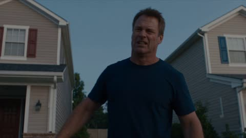</a>

30秒内每秒一个分镜节拍，从突袭到解脱，叙事弧线清晰。慢动作只留给最后的击倒，镜头晃动仅用于撞击，并在开头就写明现场音效和紧张配乐。

Seedance 2.5 · 文生视频 · 出处: [@auqibhabib on X](https://x.com/auqibhabib/status/2107346452494381298) · 发现于 [LearnPrompt/awesome-seedance](https://github.com/LearnPrompt/awesome-seedance)

[`horror`](tags.md#tag-horror) [`action`](tags.md#tag-action) [`suburban`](tags.md#tag-suburban) [`slow-motion`](tags.md#tag-slow-motion) [`diegetic-sound`](tags.md#tag-diegetic-sound)

<details><summary><b>提示词</b></summary>

```text
Cinematic horror-action short film, opens with an instant attack, no slow build, grounded practical-effects style, maximum dynamic camera work. Setting: a quiet suburban street at dusk, a small group of neighbors gathered outside their homes. Muted authentic color grading, natural diegetic sound throughout, tension score entering immediately.
>
> **[0-1s]** Hard cut: a man stumbles out from between two houses, collapsing onto the street, convulsing violently.
>
> **[1-2s]** Nearby neighbors rush toward him to help, unaware of the danger.
>
> **[2-3s]** He suddenly lunges up, grabbing the nearest person by the arm.
>
> **[3-4s]** She screams, pulling back as his grip holds firm, veins darkening rapidly across his skin.
>
> **[4-5s]** He pulls her down, the group scattering in fear and confusion.
>
> **[5-6s]** She convulses hard on the pavement, veins spreading fast across her neck.
>
> **[6-7s]** She rises seconds later, eyes clouded, joining him, both turning toward the others.
>
> **[7-8s]** Loud cries of fear erupt through the street as neighbors scramble for their homes.
>
> **[8-9s]** The two infected move fast, catching a third neighbor near his front gate.
>
> **[9-10s]** He goes down, convulsing, rising moments later as one of them.
>
> **[10-11s]** Wide shot: panic spreads further down the street, people slamming doors and windows shut.
>
> **[11-12s]** A man grabs a baseball bat from his garage, stepping out cautiously.
>
> **[12-13s]** The three infected turn toward him, moving fast across the street.
>
> **[13-14s]** He swings hard at the first, a solid impact knocking it back into a parked car.
>
> **[14-15s]** A neighbor joins him, grabbing a shovel from a nearby yard.
>
> **[15-16s]** SLOW MOTION insert: she swings it into the second infected, striking it down.
>
> **[16-17s]** The third lunges at the man with the bat; he sidesteps and strikes again.
>
> **[17-18s]** It staggers, falling against a mailbox, still trying to rise.
>
> **[18-19s]** More neighbors emerge cautiously, grabbing garden tools and makeshift weapons.
>
> **[19-20s]** They surround the remaining infected, striking together in a coordinated effort.
>
> **[20-21s]** SLOW MOTION: the final blow connects, all three collapsing motionless on the street.
>
> **[21-23s]** Wide shot: the group stands over them, breathing hard, weapons still raised.
>
> **[23-25s]** Cries of fear slowly settle into exhausted relief among the neighbors.
>
> **[25-27s]** The man with the bat lowers it slowly, scanning the quiet street for any more movement.
>
> **[27-29s]** Neighbors check on each other, some embracing, others sitting down on the curb in shock.
>
> **[29-30s]** Final shot: the street falls silent under the dusk sky, the group standing together, exhausted but safe. Cut to black.
>
> Natural diegetic sound throughout — convulsing, screaming, crying, metal impacts, heavy breathing — layered with a tense instrumental score building through the chaos and easing into relief at the end. No text overlay, no watermark. Maximum dynamic camera variety — close-ups, wide shots, tracking shots, slow motion reserved for the final takedowns. Realistic shake only during physical impacts, natural dusk color grading.

Made with seedance 2.5 on @SocialSight
```

</details>

<a id="seedance-subway-platform-martial-arts-fight"></a>
### 地铁站台上女子击败袭击者

<a href="https://x.com/Elvorya/status/2104450675656835476">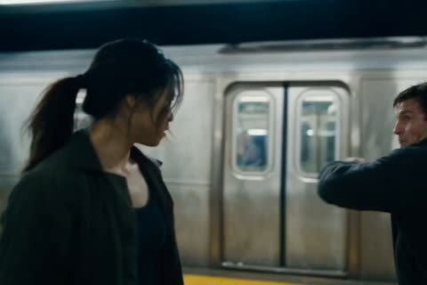</a>

用箭头串联的分镜节拍，从中景、手持打斗、低角度收招一直到跟拍离场。单独的角色一致性和负面提示词段落，让两个人物的面孔与服装在多次切镜中保持稳定。

Seedance 2.5 · 文生视频 · 出处: [@Elvorya on X](https://x.com/Elvorya/status/2104450675656835476) · 发现于 [LearnPrompt/awesome-seedance](https://github.com/LearnPrompt/awesome-seedance)

[`action`](tags.md#tag-action) [`martial-arts`](tags.md#tag-martial-arts) [`subway`](tags.md#tag-subway) [`multi-shot`](tags.md#tag-multi-shot) [`character-consistency`](tags.md#tag-character-consistency)

<details><summary><b>提示词</b></summary>

```text
Create a 10-second cinematic action sequence set inside a gritty modern subway station, featuring a determined young woman confronting a larger male attacker on a wet underground platform. Maintain the same character appearance, facial features, body proportions, hairstyle, clothing, and accessories throughout the entire sequence.

Begin with a cinematic medium shot of the woman standing on the subway platform beside a stopped silver train, looking alert and focused as the male opponent approaches her from the side → transition into a sudden close-range confrontation as the man attempts to attack, while she quickly reacts and raises her arms defensively → cut into a dynamic action sequence as the woman delivers a powerful side kick toward the man's torso, with realistic body mechanics and believable impact → transition to fast handheld-style camera movement as both characters exchange rapid punches, blocks, dodges, and defensive movements across the platform → capture the woman's controlled fighting technique as she remains balanced and focused while the larger man struggles to keep up → cut to a dramatic low-angle shot as she delivers a final powerful strike, causing the man to lose his balance and fall heavily onto the wet platform → show him lying on the ground while the woman stands above him, breathing steadily and watching him cautiously → transition to a wider cinematic shot as she turns away and begins walking down the subway platform while the defeated man remains motionless in the foreground → final shot follows behind the woman as she walks away beside the stationary train, creating a stylish action-movie ending.

Visual style: high-end cinematic action filmmaking, realistic human movement, gritty underground subway atmosphere, wet reflective floor, dramatic overhead fluorescent lighting, realistic train details, natural clothing movement, subtle motion blur, dynamic handheld camera, low-angle action shots, fast cinematic cuts, believable martial-arts choreography, realistic impact physics, strong facial expressions, shallow depth of field, atmospheric urban tension, polished color grading, intense but grounded action tone.

Character consistency: preserve the woman's exact facial identity, hairstyle, body proportions, black outfit, and overall appearance throughout every shot. Preserve the man's appearance, clothing, hairstyle, and body proportions throughout the entire sequence. No character morphing or identity drift.

Negative prompt: distorted faces, changing faces, character morphing, extra limbs, missing limbs, extra fingers, broken hands, unnatural anatomy, floating bodies, unrealistic physics, cartoon movement, exaggerated CGI, duplicated characters, clothing changes, hairstyle changes, inconsistent characters, warped train, flickering background, excessive motion blur, text, subtitles, logos, watermark.
```

</details>

<a id="seedance-time-machine-future-scientist"></a>
### 科学家站在发光时光机旁的昏暗实验室

<a href="https://x.com/iam_nafisahmed/status/2088964392528527702"></a>

用带时间点的分镜逐拍描述，并写明倒计时与黑场闪白的收尾，让模型有清晰的节奏结构。结尾用真实物理和细微胶片颗粒等词，把画面锁定在实拍电影的质感上。

Seedance 2.5 · 文生视频 · 出处: [@iam_nafisahmed on X](https://x.com/iam_nafisahmed/status/2088964392528527702) · 发现于 [LearnPrompt/awesome-seedance](https://github.com/LearnPrompt/awesome-seedance)

[`sci-fi`](tags.md#tag-sci-fi) [`thriller`](tags.md#tag-thriller) [`countdown`](tags.md#tag-countdown) [`time-machine`](tags.md#tag-time-machine)

<details><summary><b>提示词</b></summary>

```text
He built a machine that could see 10 seconds into the future.

Then he saw himself standing behind him.

Create your version on @budgetpixel  using Seedance 2.5 

Prompt below if you want to make your own.👇

"Create a 10-second photorealistic cinematic sci-fi thriller.

A young scientist stands inside a dark futuristic laboratory beside a glowing experimental time machine. He activates it and sees exactly 10 seconds into the future.

At first, he smiles in amazement as the machine shows the laboratory still intact.

Suddenly, the future image changes.

The same laboratory is now completely destroyed—glass shattered, machines burning, sparks flying, smoke everywhere.

The scientist looks around in panic.

A countdown appears on the machine: 10... 9... 8... 7...

He notices the machine's glowing energy core rapidly overheating.

3... 2... 1...

He realizes the machine is about to explode.

The screen instantly cuts to black as a massive white flash fills the laboratory.

Ultra-photorealistic, cinematic sci-fi thriller, realistic futuristic laboratory, dramatic lighting, realistic fire and sparks, intense suspense, fast pacing, believable technology, realistic physics, cinematic camera movement, premium Hollywood VFX, subtle film grain, highly detailed, 4K.

No subtitles, no logos, no watermark, no cartoon style."
```

</details>

<a id="seedance-tiny-frog-michelin-chef-short"></a>
### 小青蛙大厨在月光池塘餐厅招待森林动物

<a href="https://x.com/Caden_Flux/status/2091396961329131999"></a>

把30秒故事按时间段拆成带标题的段落，每段只写一个清晰的情节点，从备菜一直写到结尾。先锁定角色外观并加一句一致性要求，最后用风格清单和禁止文字的规则收尾，让青蛙形象和动画质感保持稳定。

Seedance 2.5 · 文生视频 · 出处: [@Caden_Flux on X](https://x.com/Caden_Flux/status/2091396961329131999) · 发现于 [LearnPrompt/awesome-seedance](https://github.com/LearnPrompt/awesome-seedance)

[`3d-animation`](tags.md#tag-3d-animation) [`character`](tags.md#tag-character) [`short-film`](tags.md#tag-short-film) [`cute-animals`](tags.md#tag-cute-animals) [`cooking`](tags.md#tag-cooking)

<details><summary><b>提示词</b></summary>

```text
The Tiny Frog Michelin Chef — 30-Second Animated Short

Create a 30-second premium cinematic 3D animated short film about a tiny frog who takes cooking extremely seriously.

The animation should feel like a high-end theatrical 3D animated feature film: charming, whimsical, expressive, funny, visually rich, and cinematic.

MAIN CHARACTER

A tiny adorable emerald-green frog with smooth slightly textured skin, huge expressive golden-brown eyes, a tiny rounded mouth, soft rounded cheeks, and little webbed feet.

He wears an oversized pristine white chef jacket, a tiny black neckerchief, and a miniature white chef hat that is slightly too large for him.

Despite being tiny and adorable, he behaves like an extremely serious professional chef.

His personality is dramatic, perfectionist, ambitious, passionate, and hilariously serious about food.

Keep the exact same frog appearance, outfit, proportions, face, colors, and animation style throughout the entire video.

0–5 SEC — THE RESTAURANT

Open on a beautiful moonlit pond transformed into a tiny luxury restaurant.

Fireflies glow like miniature chandeliers.

Lily pads become elegant dining tables.

Tiny candles illuminate the water.

The frog chef stands inside his miniature outdoor kitchen.

He adjusts his chef hat with complete seriousness.

He looks directly at the dish he is about to prepare.

Dramatic cinematic push-in toward his determined face.

5–10 SEC — THE PREPARATION

Rapid cinematic cooking montage.

The tiny frog dramatically chops miniature vegetables.

He slices mushrooms with incredible precision.

He tosses herbs into a tiny copper pan.

Butter melts.

Steam rises.

He tastes the sauce with a tiny spoon.

His eyes narrow.

He adds exactly one more tiny pinch of seasoning.

He tastes it again.

His expression finally shows approval.

Use exaggerated but believable animated physical comedy.

10–17 SEC — THE MASTERPIECE

The frog chef begins assembling his signature dish.

He carefully places tiny colorful vegetables onto a miniature white porcelain plate.

He uses tweezers to position a single delicate herb.

He steps back.

Something looks wrong.

His eyes widen.

He rushes back to the plate.

He moves one tiny vegetable approximately one millimeter.

He steps back again.

Perfect.

His face lights up with pride.

17–22 SEC — THE BIG PRESENTATION

The frog dramatically carries the tiny plate across a lily-pad dining area.

Several adorable woodland animals sit at tiny tables watching him.

A rabbit.

A hedgehog.

A duckling.

A small turtle.

They all stare at the dish with exaggerated anticipation.

The frog carefully places the plate in the center.

Everyone leans forward.

22–27 SEC — THE TASTE

The animals take one bite.

Silence.

Their eyes suddenly become enormous.

The rabbit gasps.

The hedgehog's ears shoot upward.

The duckling freezes in amazement.

The turtle slowly raises both tiny flippers.

Then everyone starts happily celebrating.

The frog chef stands completely still, trying desperately to maintain his serious professional expression.

A tiny smile slowly appears.

27–30 SEC — THE PAYOFF

Suddenly, the frog's miniature restaurant becomes completely chaotic.

The animals cheer.

Fireflies swirl around the restaurant like sparkling lights.

The frog chef jumps onto a tiny wooden crate and proudly raises his cooking spoon like a trophy.

Camera pulls back to reveal the entire magical pond restaurant glowing under the moonlight.

Final shot:

The tiny frog chef stands proudly beneath his oversized chef hat.

Adorable. Dramatic. Completely ridiculous.

VISUAL & ANIMATION STYLE

Premium cinematic 3D animated feature-film quality.

Extremely expressive character animation.

Cute stylized proportions.

Detailed frog skin.

Soft natural reflections in the eyes.

Realistic miniature food textures.

Tiny believable kitchen props.

Beautiful moonlit pond environment.

Warm candlelight contrasting with cool nighttime atmosphere.

Detailed lily pads, flowers, fireflies, water reflections, and vegetation.

Playful cartoon physics.

Subtle squash-and-stretch.

Excellent comedic timing.

Smooth cinematic camera movements.

Dynamic food close-ups.

Macro photography feeling for the tiny world.

Shallow depth of field.

Soft volumetric lighting.

Natural motion blur.

Polished theatrical rendering.

The entire sequence should feel like one continuous animated movie scene, with consistent character design, environment, lighting, proportions, and animation quality.

16:9 LANDSCAPE — 4K — premium cinematic 3D animation.

No text, no subtitles, no logos, no watermark.
```

</details>

<a id="seedance-toddler-alphabet-doors-3d-kids-learning"></a>
### 幼儿逐扇开启字母门的3D儿童启蒙动画

<a href="https://x.com/Zarnab_with_Ai/status/2104764823091490851"></a>

开头先固定角色和场景描述以保持幼儿形象一致，再把每个字母写成同一套重复结构：彩色门、大字母、开门、揭示、屏幕标签。单独的动画与镜头段落约束了手握门把的动作和多次切换中的缓慢推镜。

Seedance 2.5 · 文生视频 · 出处: [@Zarnab_with_Ai on X](https://x.com/Zarnab_with_Ai/status/2104764823091490851) · 发现于 [LearnPrompt/awesome-seedance](https://github.com/LearnPrompt/awesome-seedance)

[`3d-animation`](tags.md#tag-3d-animation) [`kids-education`](tags.md#tag-kids-education) [`alphabet`](tags.md#tag-alphabet) [`multi-scene`](tags.md#tag-multi-scene) [`vertical-9-16`](tags.md#tag-vertical-9-16)

<details><summary><b>提示词</b></summary>

```text
Create a high-quality vertical 9:16 3D animated educational kids video in a bright, colorful, cute nursery-rhyme style.

Main character:
A cute adorable toddler boy, around 2 years old, with chubby cheeks, big expressive eyes, short light-brown hair, wearing a bright blue T-shirt with a playful “LOL Kids” style graphic and matching diaper/shorts. Keep the child’s appearance consistent throughout the entire video.

Environment:
A clean, bright indoor children's learning room with a glossy white floor, colorful geometric shapes scattered around the background, playful decorations, and a series of colorful doors. Use vibrant red, blue, yellow and green doors. Soft studio lighting, cheerful atmosphere, polished 3D cartoon animation, smooth reflections, high-quality Pixar-like children's animation aesthetic.

VIDEO SEQUENCE:

Scene 1 — A for Apple:
The toddler stands in front of a bright red door with a large bold yellow letter “A” on it. He reaches toward the door handle and opens the door with excitement. Behind the door is a colorful apple-themed environment with red apples. Show the text “A - APPLE” at the top. The child looks surprised and happy.

Scene 2 — B for Banana:
Cut to a bright blue door with a large yellow “B”. The toddler walks toward it, reaches for the handle and opens the door. Reveal a playful collection of bright yellow bananas behind the door. Display “B - BANANA” at the top.

Scene 3 — C for Cat:
Show a yellow/orange door with a large red “C”. The toddler opens the door and a cute friendly cat appears behind it. The child reacts with excitement and curiosity. Display “C - CAT”.

Scene 4 — D for Dog:
Show a red door with a large yellow “D”. The toddler opens it and reveal a cute friendly brown-and-white puppy standing behind the door. The puppy happily looks toward the child. Display “D - DOG”.

Scene 5 — E for Elephant:
Show a blue door with a large yellow “E”. The toddler opens the door and a cute baby elephant appears. The elephant playfully raises its trunk while the child reacts happily. Display “E - ELEPHANT”.

Scene 6 — F for Fish:
Transition to a bright underwater-themed aquarium area. Show colorful orange fish swimming inside a large glass aquarium. The toddler stands beside it and looks excitedly at the fish. Display “F - FISH”.

Scene 7 — G for Grapes:
Show a green door with a large yellow “G”. The toddler opens the door and discovers a huge bunch of shiny purple grapes behind it. He points toward the grapes with excitement. Display “G - GRAPES”.

Scene 8 — I for Ice:
Show a red door with a large yellow “I”. The toddler stands beside the closed door, reaches for the handle and opens it. Reveal a playful icy environment. Display “I - ICE”.

Scene 9 — J for Jelly:
Show a blue door with a large yellow “J”. The toddler opens the door and reveal colorful jelly/jelly dessert behind it. The child points toward it happily. Display “J - JELLY”.

Scene 10 — K for Kite:
Show a red door with a large yellow “K”. The toddler opens the door and reveal a colorful kite-themed scene. Display “K - KITE”.

Scene 11 — L for Lion:
Show a green door with a large yellow “L”. The toddler opens the door and a cute friendly cartoon lion appears behind it. The lion looks gentle and playful, not scary. The toddler reacts with excitement. Display “L - LION”.

Final scene:
Show a cute fluffy hamster waving goodbye to the camera in a bright pastel background. Add cheerful text:
“Bye-Bye 👋”
and a colorful kids-learning logo at the bottom.

Animation and camera:
Smooth toddler walking and reaching movements, natural hand interaction with every door handle, realistic door opening motion, expressive facial reactions, playful character animation, gentle camera movements, medium full-body framing, occasional slow push-ins, clean transitions between alphabet scenes, consistent character proportions, bright cinematic lighting, glossy 3D rendering, vibrant colors, soft shadows, highly detailed children'
```

</details>

<a id="seedance-toddler-fruit-hunt-nursery-rhyme"></a>
### 幼儿与兔子寻找三种水果

<a href="https://x.com/abs_uiux/status/2105238474387234897"></a>

开头固定角色外观，随后按四个三秒分段，每段只写一个动作和一个屏幕文字。结尾的禁止项列表用来防止变形和闪烁。

Seedance 2.5 · 文生视频 · 出处: [@abs_uiux on X](https://x.com/abs_uiux/status/2105238474387234897) · 发现于 [LearnPrompt/awesome-seedance](https://github.com/LearnPrompt/awesome-seedance)

[`3d-animation`](tags.md#tag-3d-animation) [`kids-education`](tags.md#tag-kids-education) [`vertical`](tags.md#tag-vertical) [`timed-shots`](tags.md#tag-timed-shots) [`on-screen-text`](tags.md#tag-on-screen-text)

<details><summary><b>提示词</b></summary>

```text
Create a high-quality 15-second vertical 9:16 3D animated educational kids video in a bright, colorful, cute nursery-rhyme style.

Main character:
A cute 2-year-old toddler boy with chubby cheeks, big expressive brown eyes, short light-brown hair, a bright blue T-shirt, yellow shorts, and colorful sneakers. Keep his appearance perfectly consistent throughout the entire video.

Story concept:
The toddler discovers a glowing magical map and follows it on a very short learning adventure to help a cute rabbit find three missing fruits.

0–3 sec — The Discovery

The toddler is playing in a colorful room when a glowing rainbow map suddenly appears.

The map shows three missing fruits:

🍎 Apple
🍌 Banana
🍊 Orange

A cute rabbit appears looking worried.

The toddler points toward the map and excitedly begins the adventure.

3–6 sec — Find the Apple

Fast magical transition into a colorful fruit garden.

A shiny red apple falls gently from a tree.

The toddler catches it and smiles.

Display large clear text:

“APPLE 🍎”

6–9 sec — Find the Banana

The toddler runs a few steps and notices a bright yellow banana.

He picks it up happily.

Display:

“BANANA 🍌”

9–12 sec — Find the Orange

A bright orange rolls across the grass toward the toddler.

He stops it with both hands and laughs.

Display:

“ORANGE 🍊”

12–15 sec — Happy Ending

The toddler places all three fruits into the rabbit’s basket.

The rabbit jumps happily.

A colorful rainbow appears behind them.

The toddler and rabbit wave toward the camera.

Display:

“Great Job! 🌈”

Animation:
Fast but smooth storytelling, natural toddler movements, expressive reactions, accurate hand-object interaction, playful running, picking up fruit, smiling, pointing, and waving.

Camera:
Vertical 9:16, quick child-height tracking shots, gentle push-ins, clear close-ups of each fruit, smooth magical transitions, no confusing cuts.

Visual style:
Premium polished 3D children’s animation, vibrant colors, soft cinematic lighting, glossy surfaces, cute rounded shapes, cheerful preschool atmosphere, clean backgrounds, expressive character animation.

Important:
Keep the entire video within 15 seconds.
Use only one main action per shot.
Keep text large and readable.
Do not overcrowd scenes.
No character morphing, extra fingers, duplicated objects, inconsistent clothing, flickering, warped fruit, or sudden background changes.
```

</details>

<a id="seedance-toddler-fruit-names-classroom"></a>
### 3D教室里幼儿认识水果名称

<a href="https://x.com/Zarnab_with_Ai/status/2108381024417993043"></a>

提示词把20秒拆成八个编号场景，每个场景只配一种水果、一个宝宝反应和一个屏幕单词。结尾的风格段落统一锁定角色、服装、机位、配音和音乐。

Seedance 2.5 · 文生视频 · 出处: [@Zarnab_with_Ai on X](https://x.com/Zarnab_with_Ai/status/2108381024417993043) · 发现于 [LearnPrompt/awesome-seedance](https://github.com/LearnPrompt/awesome-seedance)

[`3d-animation`](tags.md#tag-3d-animation) [`kids-education`](tags.md#tag-kids-education) [`multi-scene`](tags.md#tag-multi-scene) [`voiceover`](tags.md#tag-voiceover) [`vertical`](tags.md#tag-vertical)

<details><summary><b>提示词</b></summary>

```text
Create a 20-second ultra-realistic, adorable 3D animated educational video for toddlers. A cute baby girl with big sparkling brown eyes, rosy cheeks, soft brown hair, and a white colorful kids' T-shirt sits at a small table in a beautiful preschool classroom. The classroom features pastel-colored walls, rainbow decorations, clouds, stars, colorful toys, pencils, and soft natural sunlight coming through the window.

Scene 1 – Banana 🍌: A hand gently presents a fresh yellow banana to the baby. She looks at it with curiosity and smiles happily. Display the word “BANANA” in large, colorful, playful 3D letters at the top of the screen, with a banana emoji.

Scene 2 – Apple 🍎: The hand presents a shiny red apple. The baby opens her mouth in excitement and reaches toward the fruit. Display “APPLE” in bright, multicolored 3D letters.

Scene 3 – Orange 🍊: A fresh orange is presented. The baby makes a cute surprised expression with her lips forming an O. Display “ORANGE” in bold, colorful letters.

Scene 4 – Grapes 🍇: Show a bunch of fresh purple grapes on the table. The baby looks down at the grapes and laughs joyfully. Display “GRAPES” in large purple 3D letters.

Scene 5 – Watermelon 🍉: A hand presents a juicy red watermelon slice with black seeds and green rind. The baby smiles excitedly and points toward it. Display “WATERMELON” in bright, playful letters.

Scene 6 – Mango 🥭: Present a ripe golden-yellow mango. The baby opens her mouth with excitement and smiles at the fruit. Display “MANGO” in colorful 3D letters.

Scene 7 – Strawberry 🍓: Show a fresh, bright red strawberry with green leaves. The baby raises her finger happily and smiles. Display “STRAWBERRY” in large, attractive letters.

Scene 8 – Pineapple 🍍: Present a beautiful golden pineapple with green spiky leaves. The baby claps her hands with delight. Display “PINEAPPLE” in colorful 3D letters.

Final Scene: The baby looks directly at the camera, smiles warmly, and gives a cute thumbs-up gesture.

🎨 Visual Style & Animation

Ultra-cute, high-quality 3D animation with a Pixar-inspired aesthetic.

Soft, realistic lighting and vibrant pastel colors.

Adorable facial expressions, natural blinking, and smooth hand movements.

Keep the same baby character, outfit, classroom, and camera angle throughout.

Each fruit must be clearly visible and recognizable.

Display each fruit's English name in large, bold, colorful 3D letters at the top.

Gentle camera movements, smooth transitions, and cheerful children's background music.

Add a friendly female voice pronouncing each fruit's English name clearly.

Vertical 9:16 format, high resolution, suitable for YouTube Shorts and children's educational content.

No scary elements, no distorted faces, no extra fingers, and no character changes.
```

</details>

<a id="seedance-tomato-seedling-macro-timelapse"></a>
### 微距延时：幼苗长成结满番茄的植株

<a href="https://x.com/Yesandyou_/status/2088998841395921185"></a>

用土壤参考图锁定首帧，再把10秒切成五个2秒的生长阶段，每段只写一个变化。结尾列出禁用项（剪辑、运镜、变焦、变形），保证镜头固定、生长连贯。

Seedance 2.5 · 图生视频 · 出处: [@Yesandyou_ on X](https://x.com/Yesandyou_/status/2088998841395921185) · 发现于 [LearnPrompt/awesome-seedance](https://github.com/LearnPrompt/awesome-seedance)

[`time-lapse`](tags.md#tag-time-lapse) [`macro`](tags.md#tag-macro) [`nature`](tags.md#tag-nature) [`plants`](tags.md#tag-plants) [`locked-camera`](tags.md#tag-locked-camera)

<details><summary><b>提示词</b></summary>

```text
Create a 10-second ultra-realistic cinematic macro time-lapse video 🌱🎥, using the provided reference image as the exact visual starting point. Begin with the same tiny green seedling 🌱 emerging from dark, rich, slightly moist soil. Keep the camera completely locked and stationary 📷, preserving the same composition, camera angle, depth of field, warm natural sunlight ☀️, soft background bokeh, and realistic soil texture throughout the entire video.

0–2 seconds 🌱: The tiny seedling slowly pushes upward from beneath the soil. Small cracks and subtle soil movement appear naturally around its base as the plant emerges. The thin green stem gradually becomes taller while the two young leaves slowly unfold and expand 🍃.

2–4 seconds 🌿: The seedling continues growing into a young tomato plant. The stem becomes thicker and taller, while additional green leaves and small branches gradually emerge. Each leaf unfolds naturally with visible veins and realistic botanical detail 🍃✨. Gentle sunlight passes through the leaves ☀️, creating beautiful natural highlights.

4–6 seconds 🌼: The plant grows fuller and stronger. Small yellow tomato flowers 🌼 begin appearing on the branches. The flowers gradually develop and bloom one by one, with delicate petals opening naturally. The plant continues extending upward and outward in a smooth time-lapse 🌿.

6–8 seconds 🍅: After flowering 🌼, tiny green tomatoes 🍅 begin forming beneath the flowers. The fruits slowly enlarge from tiny green buds into recognizable round tomatoes. More tomatoes develop across the branches while fresh leaves continue growing around them 🌿🍃.

8–10 seconds 🍅❤️: The green tomatoes gradually mature and transform into large, ripe, vibrant red tomatoes 🍅❤️. End with a healthy, fully grown tomato plant 🌿 surrounded by several beautiful ripe tomatoes hanging naturally from its branches.

Make the entire transformation smooth, continuous, organic, and biologically believable 🌱➡️🌿➡️🌼➡️🍅. Use photorealistic textures, realistic plant anatomy, detailed leaves and veins, natural soil particles, subtle wind movement 🍃, warm golden-hour sunlight ☀️, cinematic depth of field 🎥, soft background bokeh ✨, realistic shadows, macro photography quality, and highly detailed 4K visuals.

Important: No cuts ❌, no transitions ❌, no camera movement ❌, no zoom ❌, no camera shake ❌, no text ❌, no people ❌, no hands ❌, and no artificial-looking morphing ❌. The plant must grow progressively from the exact location of the original seedling, with every stage naturally connected to the previous stage. The final result should look like a real professional botanical time-lapse 🌱🎥🍅, showing the complete journey from a tiny seedling to a mature tomato plant full of ripe red tomatoes. 🍅✨
```

</details>

<a id="seedance-train-station-diamond-heist-game-hud"></a>
### 日本车站里的第三人称游戏盗窃任务

<a href="https://x.com/saniaspeaks_/status/2099700182388801793"></a>

用带时间码的分镜把片段拆成潜行、偷窃、搏斗、追逐和收尾几段，每段配上界面文字，并在27秒硬切到固定正面镜头。参考图锁定人脸，结尾的绝对约束和音频描述保证连贯性与游戏质感。

Seedance 2.5 · 参考生视频 · 出处: [@saniaspeaks_ on X](https://x.com/saniaspeaks_/status/2099700182388801793) · 发现于 [LearnPrompt/awesome-seedance](https://github.com/LearnPrompt/awesome-seedance)

[`game-footage`](tags.md#tag-game-footage) [`hud`](tags.md#tag-hud) [`timecoded-shots`](tags.md#tag-timecoded-shots) [`hard-cut`](tags.md#tag-hard-cut) [`chase`](tags.md#tag-chase)

<details><summary><b>提示词</b></summary>

```text
16:9 landscape, ultra-realistic AAA third-person gameplay, bright afternoon at a luxurious Japanese train station. Realistic game-engine visuals, natural human animation, believable physics, detailed skin and hair, realistic clothing movement, marble reflections and cinematic daylight. Clearly a GAME, not anime or cartoon.

NAGI: Use @ Image1 as exact face and identity reference. Japanese high-school girl, 17, long straight black hair with blunt bangs, white sailor blouse with pink collar stripes and pink ribbon, grey pleated skirt, black knee-high socks, white sneakers and school bag. Same face, hair and outfit throughout.

MISSION: Steal a priceless diamond necklace from a VIP passenger's luxury suitcase and escape onto the departing train.

CAMERA: One physical third-person camera, 1.5m behind NAGI, slightly camera-right. Natural gameplay spring movement, smooth FOV breathing 30°–60°. Camera follows her continuously.

0–6s — INFILTRATION

NAGI moves through the crowded luxury station toward a VIP waiting area. A wealthy passenger sits beside a black suitcase guarded by two security guards. She hides briefly behind a luggage cart as a guard passes.

HUD:
MISSION: STEAL VIP NECKLACE
STEALTH MODE

6–12s — THEFT

NAGI reaches the suitcase while the VIP looks away. She opens it and finds a velvet jewelry case containing a stunning diamond necklace. She grabs it and hides it inside her bag.

HUD:
TARGET ACQUIRED

Suddenly a guard notices her.

ALERT

12–19s — FIGHT

The guard grabs NAGI's arm. She struggles hard to escape. He pulls her backward and she nearly falls. She pushes free and runs.

A second guard intercepts her. They struggle physically in a realistic, difficult fight. NAGI finally breaks away, visibly exhausted.

HUD:
NECKLACE ACQUIRED
ALERT LEVEL: CRITICAL

19–25s — CHASE

NAGI sprints toward the platform while two guards chase her. She jumps over luggage, turns sharply through a narrow passage and runs toward the departing luxury train.

Her hair, skirt and bag move naturally with her speed.

Station announcement:

“Train departing shortly.”

HUD:
ESCAPE ROUTE: PLATFORM 4

25–27s — LAST SECOND

The train doors begin closing.

A guard grabs NAGI's shoulder.

She struggles free and runs the final few meters.

She jumps into the train.

The doors close immediately behind her.

HUD:
ESCAPE SUCCESSFUL

27.0s HARD CUT

27–30s — FINAL SHOT

Locked frontal camera inside the moving luxury train, eye-level, 29° FOV, completely static.

NAGI stands in the aisle facing camera, breathing heavily, hair slightly messy.

She opens her bag and reveals the stolen diamond necklace.

Bright afternoon sunlight enters through the train windows.

HUD:

MISSION COMPLETE
DIAMOND SECURED
ESCAPE RANK: S

NAGI looks directly at camera and gives a tiny victorious smile.

AUDIO: tense stealth music, station ambience, footsteps, luggage wheels, security radio, realistic struggle sounds, fast breathing, train warning chime and a short victory sting.

ABSOLUTE LOCKS: Exactly one hard cut at 27s. First 27 seconds completely continuous. Same NAGI, same outfit, same necklace and same environment continuity. Realistic physics and difficult physical struggles. No superhuman movements, no cartoon animation, no face changes, no teleportation. Daytime only. HUD fixed in the same screen positions. All HUD text English; dialogue/announcements natural Japanese.
```

</details>

<a id="seedance-tree-guardian-dark-fantasy-battle"></a>
### 女子唤醒熔岩树灵对抗恶魔

<a href="https://x.com/itsSaira_1/status/2107685928647160275"></a>

开头先用画幅、镜头、色调和粒子等全局风格词定调，再按被擒、召唤、战斗、平静收尾的顺序写清节拍。快速运镜、慢动作爆炸和骷髅特写等镜头词控制了画面节奏。

Seedance 2.5 · 文生视频 · 出处: [@itsSaira_1 on X](https://x.com/itsSaira_1/status/2107685928647160275) · 发现于 [LearnPrompt/awesome-seedance](https://github.com/LearnPrompt/awesome-seedance)

[`dark-fantasy`](tags.md#tag-dark-fantasy) [`battle`](tags.md#tag-battle) [`creature`](tags.md#tag-creature) [`cinematic`](tags.md#tag-cinematic) [`slow-motion`](tags.md#tag-slow-motion)

<details><summary><b>提示词</b></summary>

```text
Cinematic dark fantasy battle, 16:9, photoreal, shallow depth of field, anamorphic lens, moody teal-grey and fiery orange color grade, drifting embers and smoke. A young woman with short wavy brown hair in an emerald green dress is dragged across cracked dark stone floor by a tall horned grey demon. She slams her hand down and glowing white-gold roots erupt from the ground, growing into a towering tree-guardian with a glowing lava-vein bark body and antler-like branches. The tree-guardian fights a horde of grey demon creatures, shoots a massive stream of fire, and gets surrounded by burning demons. Close-ups of a skull-faced demon with molten cracks. Fast dynamic camera, slow-motion fire explosions. Ends with a glowing sphere of woven burning roots, then the woman kneeling on the ground, hands glowing on the floor, calm and powerful.

#AI #AIart️️️️️️️️️️️️️️️️️️️️️️️️️️️️️️️️️️️️️️️️️️️️️️️️️️️ #Visualart
```

</details>

<a id="seedance-tuscan-peasant-dv-camcorder-30s"></a>
### DV摄像机拍摄的1800年代托斯卡纳农妇日常

<a href="https://x.com/Goodmanprotocol/status/2107530733212590250"></a>

五个六秒时间段把一镜到底拆成清晰的动作序列。用对焦游移、曝光起伏、压缩噪点等具体缺陷锁定2000年代初DV质感，并在音频部分限定只有自然环境声。

Seedance 2.5 · 文生视频 · 出处: [@Goodmanprotocol on X](https://x.com/Goodmanprotocol/status/2107530733212590250) · 发现于 [LearnPrompt/awesome-seedance](https://github.com/LearnPrompt/awesome-seedance)

[`documentary`](tags.md#tag-documentary) [`dv-camcorder`](tags.md#tag-dv-camcorder) [`historical`](tags.md#tag-historical) [`handheld`](tags.md#tag-handheld) [`timestamped`](tags.md#tag-timestamped)

<details><summary><b>提示词</b></summary>

```text
30-second ultra-realistic documentary slice-of-life video, early-2000s consumer DV camcorder aesthetic. A young Italian peasant woman in her early 20s, sun-weathered olive skin with freckles, dark brown wavy hair loosely tied with a faded scarf, worn off-white linen blouse, earth-brown patched wool skirt, faded floral apron and muddy leather boots. Rural Tuscany in the late 1800s. Golden wheat fields, olive trees, stone farmhouse, cypress trees, stone walls, chickens, donkey and old stone well. No modern objects or machinery.

[0–6s]
Handheld camera follows her naturally along a dirt path through golden wheat fields. She carries a woven basket on her hip and brushes her free hand across the wheat. Wind moves the stalks and her loose hair.

[6–12s]
She reaches a wooden fence, sets down the basket and feeds scraps to several chickens gathered around her boots. The camera stays close and imperfect, briefly adjusting focus as she moves.

[12–18s]
She continues toward an old stone well. She lowers a wooden bucket on a rope, pulls it up with effort, then drinks fresh water from a small ladle. Water runs down her chin and she wipes it away with her sleeve.

[18–24s]
A donkey approaches. She smiles softly, pats its muzzle, then picks a small wildflower from the field and tucks it behind her ear. She lifts the basket and walks toward the farmhouse.

[24–30s]
Near the heavy wooden doorway, she notices the person filming. She gives a tired but warm smile and a small wave, then opens the door. She looks back once before stepping inside. The camera remains outside as the door slowly closes.

STYLE: photorealistic historical documentary, authentic 1800s Tuscany, early-2000s consumer DV look, handheld shake, imperfect framing, autofocus hunting, slight exposure pumping, faded colors, soft contrast, mild digital compression and sensor noise. No stabilization, no cinematic camera moves, no modern color grading. One continuous fluid shot, no cuts, no captions, no music.

AUDIO: natural ambience only -wind through wheat, birds, chickens, footsteps on dry earth, rope and wooden bucket creaking, water splashing, donkey sounds, distant countryside atmosphere and the wooden door closing.
```

</details>

<a id="seedance-twin-speedsters-empty-city-superpower-short"></a>
### 两位超速女孩在空城街头相遇

<a href="https://x.com/ai_anelia/status/2112960745168392440"></a>

把 30 秒拆成每段 4 到 6 秒的时间节拍，每段指定景别和运动，故事从繁忙街头推进到完全寂静。角色块锁定脸部和服装，音频一行把风声和轮胎声渐隐为寂静，并配上对白和渐强配乐。

Seedance 2.5 · 文生视频 · 出处: [@ai_anelia on X](https://x.com/ai_anelia/status/2112960745168392440) · 发现于 [LearnPrompt/awesome-seedance](https://github.com/LearnPrompt/awesome-seedance)

[`sci-fi`](tags.md#tag-sci-fi) [`superpower`](tags.md#tag-superpower) [`timed-shots`](tags.md#tag-timed-shots) [`dialogue`](tags.md#tag-dialogue) [`cinematic`](tags.md#tag-cinematic)

<details><summary><b>提示词</b></summary>

```text
Cinematic ultra-realistic sci-fi superpower short film, 16:9, 30 seconds, 24fps, shot like a high-budget streaming drama, bright natural daylight, downtown American-style city with tall glass and stone buildings, palm trees, traffic lights, wide crosswalks and parked cars, shallow depth of field, crisp detail, subtle film grain, natural color grade with warm sunlight and cool shadows.
Character 1: A young Korean woman in her early 20s, long straight black hair, soft natural makeup, expressive wide eyes, wearing a light-blue open button-up shirt over a fitted white t-shirt, cream trousers and white sneakers. Gentle, curious and a little frightened at the start, slowly turning confident.
Character 2: A young blonde woman in her mid-20s, wavy shoulder-length hair, calm sharp eyes, wearing a black sweater and blue jeans. Cool, mysterious and fast, with a hint of loneliness behind her eyes.
Keep both faces, hairstyles and outfits identical in every shot.
Setting: A busy city intersection that slowly turns completely empty and silent as the story goes on, with wind, dust and loose papers moving through the air.
0–4s: Wide establishing shot of a sunny downtown street with pedestrians, taxis and cars. The Korean woman stands near a crosswalk. Time seems to slow down; the background blurs into soft motion and her eyes widen in shock as a car speeds straight toward her.
4–8s: Extreme close-up of her startled face, then she bursts into superhuman speed. Her feet kick up dust and wind, her hair and shirt whip backward, and she weaves between moving cars and people, the city stretching into streaks of motion behind her. Low tracking shot, strong motion blur.
8–12s: A shockwave of dust rolls across the crosswalk. From the side of the frame, the blonde woman appears running at the same impossible speed. They glance at each other, both stunned. Close-up of the Korean woman whispering: "There's someone else like me?"
12–18s: They sprint side by side down the wide street, dust clouds exploding behind them, cars frozen in the background like statues. Dynamic side tracking shots, then a low-angle shot as they run past the camera, hair flying, determination on both faces.
18–22s: The Korean woman launches into a long, graceful leap, gliding through the air above the street, while the blonde woman runs beneath her, hair blowing wildly in the wind. Slow-motion for the leap, cinematic and almost weightless.
22–26s: Both slow down and come to a stop in the middle of a completely empty street. Papers drift down through the air, the wind fades, the whole city is silent and still around them. Wide shot from behind showing the two small figures in the empty avenue.
26–30s: Calm close-ups, soft light on their faces. The blonde woman says quietly: "I thought I was the only one." The Korean woman smiles and answers: "So did I." Slow pull-back as they stand together in the empty street, then cut to black.
Audio: Rushing wind, tire screeches fading into complete silence, a soft heartbeat, light footsteps, a subtle emotional orchestral score building gently, clear natural English dialogue.
Style: Realistic grounded sci-fi action-drama, smooth physics, natural human movement, emotional performances, non-graphic, no text, no subtitles, no logos, no watermark.
```

</details>

<a id="seedance-vampire-romance-castle-teaser"></a>
### 三十秒哥特吸血鬼古堡爱情预告片

<a href="https://x.com/ZaraIrahh/status/2094363532636590322"></a>

两张参考图分别锁定主角和古堡场景，六个各五秒的分镜写明台词与动作。景别、固定色板、音效清单以及亲吻前切黑的收尾，共同撑起张力和悬念。

Seedance 2.5 · 参考生视频 · 出处: [@ZaraIrahh on X](https://x.com/ZaraIrahh/status/2094363532636590322) · 发现于 [LearnPrompt/awesome-seedance](https://github.com/LearnPrompt/awesome-seedance)

[`vampire`](tags.md#tag-vampire) [`romance`](tags.md#tag-romance) [`short-drama`](tags.md#tag-short-drama) [`cinematic`](tags.md#tag-cinematic) [`dialogue`](tags.md#tag-dialogue)

<details><summary><b>提示词</b></summary>

```text
Create a 30-second, 16:9 premium live-action vampire-romance teaser for an international short-drama audience. Use Image 1 for the two leads' appearance and Image 2 for the castle environment. Preserve both identities consistently throughout every shot with ultra-realistic live-action cinematography, cinematic lighting, natural skin texture, and emotionally expressive performances.

Story: A curious young woman accidentally wanders into the forbidden wing of a forgotten castle, where she awakens an ancient vampire noble from centuries of sleep. The instant he sees her, he senses the bloodline of an ancient war flowing through her veins. Instead of killing her, he becomes dangerously fascinated. His obsession grows immediately into a possessive desire to keep her close. She is frightened by his overwhelming presence but refuses to surrender completely, meeting his dominance with quiet courage.

Style: Premium ReelShort / DramaBox vampire romance. Darkly romantic, emotionally intense, fate-bound, mysterious, elegant, and seductive without becoming explicit. Build escalating romantic tension through eye contact, silence between lines, restrained emotion, and powerful chemistry. The pacing should feel like the opening episode of a viral international drama with a shocking cliffhanger ending. No gore, no cheap horror, no Halloween costumes, no monsters, and no modern streetwear.

The castle is illuminated only by moonlight filtering through towering stained-glass windows, flickering candlelight, fireplaces, drifting mist, ancient chandeliers, marble floors, velvet curtains, towering bookshelves, gothic arches, carved stone walls, and floating dust particles. Rich black, crimson, silver, and deep blue dominate the color palette.

Shoot entirely for TikTok, ReelShort, and DramaBox. Prioritize medium close-ups, close-ups, extreme close-ups, slow push-ins, over-the-shoulder shots, dramatic eye contact, trembling hands, subtle breathing, and intimate framing. Every shot should maximize emotional tension between the leads.

Scene 1 (0–5s)
The young woman cautiously walks through the abandoned castle corridor holding an antique candle. The flame flickers violently as if something unseen is watching her.

Woman (whispering):
"I shouldn't be here..."

A distant male voice echoes through the darkness.

Vampire (O.S., whisper):
"...You finally came."

Scene 2 (5–10s)
An enormous stone coffin slowly opens. The vampire noble rises with quiet elegance, his crimson eyes fixed only on her. She freezes in fear.

Woman:
"Who... who are you?"

Vampire (calmly):
"The one fate refused to bury."

Scene 3 (10–15s)
He slowly approaches until only inches separate them. He gently lifts her chin without hurting her, studying her face as though recognizing someone long forgotten.

Vampire:
"Your blood remembers a war the world has forgotten."

Woman:
"I don't know what you're talking about."

Scene 4 (15–20s)
She steps backward, refusing to surrender despite her fear. He blocks her escape with effortless confidence.

Woman:
"I'm not afraid of you."

Vampire (soft smile):
"You should be."

Scene 5 (20–25s)
He leans closer, eyes locked with hers. Their breathing becomes the only sound. His expression shifts from curiosity to obsession.

Vampire:
"I searched centuries for you..."

Woman (barely whispering):
"Why me?"

Vampire:
"Because you belong to my destiny."

Scene 6 (25–30s)
The castle doors slam shut by themselves. Candle flames extinguish one by one. He gently reaches for her hand while she hesitates, torn between fear and an irresistible pull.

Vampire:
"You may fight fate..."

(He slowly intertwines his fingers with hers.)

Vampire:
"...but you'll never escape me."

Final shot: Extreme close-up of their locked eyes as orchestral music swells. Smash cut to black before they kiss.

Editing should feel premium and fast-paced with cinematic hard cuts, dramatic push-ins, elegant slow motion, realistic sound design, orchestral strings, deep piano notes, distant thunder, candle crackles, footsteps, soft breathing, fabric movement, and subtle heartbeats. The final frame ends on a cliffhanger that leaves the audience desperate for Episode 2.
```

</details>

<a id="seedance-waterbending-ambush-jungle-temple"></a>
### 水系术士在丛林神庙对战五名铠甲敌人

<a href="https://x.com/itxsarmadd/status/2103694941260222603"></a>

用三张带编号的参考图分别锁定主角、场景和敌人，再按四段各2.5秒的时间轴让动作环环相扣、全程不停顿。明确禁止发光和动漫特效，配合手持跟拍镜头与无配乐的纯音效清单，让水和冰保持写实质感。

Seedance 2.5 · 参考生视频 · 出处: [@itxsarmadd on X](https://x.com/itxsarmadd/status/2103694941260222603) · 发现于 [LearnPrompt/awesome-seedance](https://github.com/LearnPrompt/awesome-seedance)

[`fantasy-action`](tags.md#tag-fantasy-action) [`waterbending`](tags.md#tag-waterbending) [`jungle-temple`](tags.md#tag-jungle-temple) [`handheld`](tags.md#tag-handheld) [`timed-beats`](tags.md#tag-timed-beats)

<details><summary><b>提示词</b></summary>

```text
SCENE — WATERBENDING AMBUSH
DURATION: exactly 10 seconds
FORMAT: 16:9
STYLE: ultra-photorealistic live-action fantasy action, grounded CGI, realistic water physics, Hollywood stunt choreography, practical jungle-temple location, handheld cinematography, seamless VFX integration, no digital-art appearance.
PACE: extremely fast continuous combat, zero pauses, zero idle moments, action already in progress.

REFERENCES

IMAGE 1 — ARMAN
Preserve facial identity, hairstyle, body proportions, costume, and appearance exactly.

IMAGE 2 — MASTER ENVIRONMENT SHEET
Preserve environment, architecture, vegetation, atmosphere, and location identity exactly.

IMAGE 3 — ENEMY REFERENCE
Preserve enemy armor, silhouette, proportions, and visual identity exactly.

ACTION

0.0–2.5 SECONDS — SURROUNDED
Fight begins mid-combat. Five armored enemies attack from multiple directions. Arman pivots beneath a frontal strike while a large mass of water is already orbiting around him. He redirects the flow to deflect Enemy A. Several sections split from the moving water, instantly freeze into sharp ice shards, and fire toward attacking enemies. Camera performs fast handheld lateral tracking.

2.5–5.0 SECONDS — ROTATING PRESSURE
Enemy C closes from behind. Arman ducks beneath an attack and transitions into a continuous spinning movement. The main water mass whips around him with believable inertia, striking, deflecting, and creating openings. Multiple ice shards separate from the flowing water and launch toward different attackers, forcing evasions and interrupting attacks. Camera reacts with quick pans and target switching.

5.0–7.5 SECONDS — WATER IMPACT
Enemy A attacks again. Arman redirects the entire water mass into a powerful lateral strike. Water impact throws the enemy sideways onto wet stone. While the enemy falls, additional ice shards fire toward advancing attackers. Arman immediately turns toward the next threat without stopping.

7.5–10.0 SECONDS — COMBO CONTINUES
Enemies close from opposite directions. Arman performs rapid circular footwork while continuously controlling the moving water flow. Fresh ice shards split from the leading edge and fire toward multiple enemies. Enemy C charges directly into range. Arman pivots and accelerates the main water mass toward him.

END BEFORE IMPACT.

SMASH CUT. ACTION INTERRUPTED MID-COMBO. END.

VISUAL RULES

- Five active enemies remain engaged throughout.
- No enemy stands and watches.
- Combat never slows down.
- Water remains a single continuous moving mass.
- Ice shards separate from the moving water, instantly freeze, and launch as sharp translucent projectiles.
- No glowing effects, energy beams, neon trails, or anime aura.
- Grounded CGI integrated into live-action photography.
- Every action directly causes the next event.
- Continuous movement, zero pauses, zero dead frames.
- Final frame preserves active combat momentum for Scene 02.

CAMERA

Reactive handheld Hollywood action camera. Fast but readable movement, medium-wide coverage, brief wider shots for major impacts, natural motion blur, occasional water spray crossing lens. No floating virtual camera.

ENVIRONMENT

Ancient jungle temple ruins. Wet stone, moss, roots, ferns, waterfalls, dense tropical vegetation, humid atmosphere, realistic live-action location photography.

SOUND

Raw action only. Footsteps, armor movement, weapons cutting air, rushing water, splashes, ice projectiles, impact sounds, bodies hitting wet ground, distant waterfalls and jungle ambience.

NO MUSIC.
```

</details>

<a id="seedance-whispered-japanese-faint-smile"></a>
### 低声日语台词，以淡淡微笑收尾

<a href="https://x.com/sakisuta_/status/2088559545174175836"></a>

提示词按12到15秒的时间段编写，先写眉毛和嘴角的细微变化，再接一句低声台词。它指定了台词语言，用花括号标出台词原文，并写明结束状态，让表情收得干净。

Seedance 2.5 · 文生视频 · 出处: [@sakisuta_ on X](https://x.com/sakisuta_/status/2088559545174175836) · 发现于 [LearnPrompt/awesome-seedance](https://github.com/LearnPrompt/awesome-seedance)

[`dialogue`](tags.md#tag-dialogue) [`japanese`](tags.md#tag-japanese) [`facial-expression`](tags.md#tag-facial-expression) [`close-up`](tags.md#tag-close-up) [`emotional`](tags.md#tag-emotional)

<details><summary><b>提示词</b></summary>

```text
12-15秒: 眉が緩み、口角が小さく抑えたまま上がる。セリフ言語: 日本語。<Woman> は軽く、ほとんど息のような声で日本語で言う: {……あ、なんで謝るの}。終了状態: かすかに微笑んだまま、彼を見ている。
```

</details>

<a id="seedance-wizard-duck-monster-storyboard"></a>
### 女巫变成鸭子逃离怪物

<a href="https://x.com/AIwithNatalia/status/2089170554725265625"></a>

七段分镜精确到秒，每个剧情节点都有独立的时间段。对白和音效直接写进对应段落，结尾用一行文字卡收束。

Seedance 2.5 · 文生视频 · 出处: [@AIwithNatalia on X](https://x.com/AIwithNatalia/status/2089170554725265625) · 发现于 [LearnPrompt/awesome-seedance](https://github.com/LearnPrompt/awesome-seedance)

[`comedy`](tags.md#tag-comedy) [`storyboard`](tags.md#tag-storyboard) [`timed-beats`](tags.md#tag-timed-beats) [`fantasy`](tags.md#tag-fantasy) [`dialogue`](tags.md#tag-dialogue)

<details><summary><b>提示词</b></summary>

```text
0–3 sec — Hook
A young wizard stands frozen in a dark forest as a massive monster charges toward her.
Wizard: “Ten seconds… that’s all I need!”

3–8 sec — The Spell
She raises her glowing staff and rapidly chants a magical spell. The monster gets closer and closer.

8–12 sec — Countdown
Monster: “YOU’RE TOO LATE!”
The wizard finishes the final word: “TRANSFORMUS!”

12–16 sec — Magic Burst
A huge explosion of purple light fills the screen. Everything goes silent.

16–21 sec — Twist
The smoke clears. The monster looks confused.
Instead of the wizard… there’s a tiny, adorable duck standing in her robes.

21–26 sec — Reaction
The duck looks down at herself, quacks angrily, and smacks the staff with her wing.

26–30 sec — Punchline
The monster slowly backs away.
Monster: “...Honestly, I’m scared of her.”
The duck suddenly starts chasing him.
SFX: Quack! Quack! Quack!
End text:
✨ Never rush a spell. 🦆
```

</details>

<a id="seedance-woman-crowd-synchronized-turn"></a>
### 黑色外套女子站在白衣人群中央

<a href="https://x.com/AIwithSynthia/status/2100067816162636164"></a>

用参考图锁定人物、服装和人群，再把动作拆成定格、逐步扩散的转头、最后一次整齐回头三段节拍。镜头只用后退跟拍和缓慢推进，让主角的静止感更突出。

Seedance 2.5 · 参考生视频 · 出处: [@AIwithSynthia on X](https://x.com/AIwithSynthia/status/2100067816162636164) · 发现于 [LearnPrompt/awesome-seedance](https://github.com/LearnPrompt/awesome-seedance)

[`crowd`](tags.md#tag-crowd) [`reference-image`](tags.md#tag-reference-image) [`cinematic`](tags.md#tag-cinematic) [`synchronized-motion`](tags.md#tag-synchronized-motion)

<details><summary><b>提示词</b></summary>

```text
Create an ultra-realistic cinematic fashion/music video using the uploaded reference image as the exact visual reference for the woman, crowd, wardrobe, composition, lighting, and atmosphere.

A young woman with a short sleek dark bob, realistic facial features, natural skin texture, and subtle makeup wears a fitted black turtleneck, black trousers, black shoes, and minimal jewelry. Keep her face, hairstyle, outfit, and proportions perfectly consistent.

She walks slowly and confidently toward a large, tightly packed crowd, maintaining a calm and emotionless expression while the camera smoothly tracks backward and keeps her centered.

She reaches the exact center of the crowd and stops completely, standing perfectly still with her arms naturally at her sides and looking directly into the camera.

The crowd remains completely frozen for a brief moment.

Then, without the woman moving, the people behind her slowly begin turning toward her. The head turns start subtly and spread through the entire crowd until everyone is facing and looking directly at her.

The woman remains completely motionless and expressionless, never reacting to the crowd.

The camera slowly pushes closer while the crowd stays turned toward her, creating an unsettling synchronized effect. Their final movement is one sharp, simultaneous turn toward her while she continues staring into the lens.

Dark, mysterious, photorealistic live-action aesthetic, soft cinematic lighting, deep shadows, realistic skin, hair and clothing physics, shallow depth of field, natural human movement.

No animation, anime, cartoon, CGI look, duplicate woman, distorted faces, morphing, random crowd movement, text, subtitles, logos, watermark, excessive camera movement, artificial fog, glow, or exaggerated effects.
```

</details>

[1](video-seedance25.md) · **2** · [3](video-seedance25-3.md)
