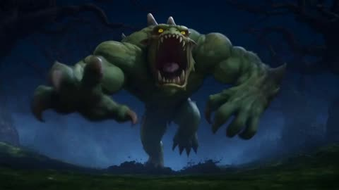
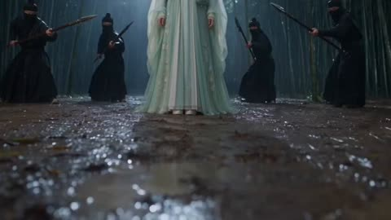
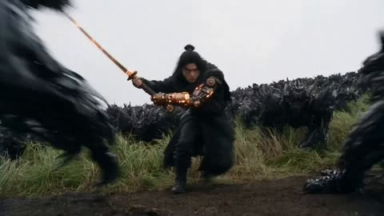

# Seedance 2.5

[返回目录](../../README_zh.md) · 全部 164 条 · [1](video-seedance25.md) · [2](video-seedance25-2.md) · **3**

<a id="seedance-wizard-duck-monster-storyboard"></a>
### 女巫变成鸭子逃离怪物

<a href="https://x.com/AIwithNatalia/status/2089170554725265625"></a>

七段分镜精确到秒，每个剧情节点都有独立的时间段。对白和音效直接写进对应段落，结尾用一行文字卡收束。

Seedance 2.5 · 文生视频 · 出处: [@AIwithNatalia on X](https://x.com/AIwithNatalia/status/2089170554725265625) · 发现于 [LearnPrompt/awesome-seedance](https://github.com/LearnPrompt/awesome-seedance)

[`comedy`](tags.md#tag-comedy) [`storyboard`](tags.md#tag-storyboard) [`timed-beats`](tags.md#tag-timed-beats) [`fantasy`](tags.md#tag-fantasy) [`dialogue`](tags.md#tag-dialogue)

<details><summary><b>提示词</b></summary>

```text
0–3 sec — Hook
A young wizard stands frozen in a dark forest as a massive monster charges toward her.
Wizard: “Ten seconds… that’s all I need!”

3–8 sec — The Spell
She raises her glowing staff and rapidly chants a magical spell. The monster gets closer and closer.

8–12 sec — Countdown
Monster: “YOU’RE TOO LATE!”
The wizard finishes the final word: “TRANSFORMUS!”

12–16 sec — Magic Burst
A huge explosion of purple light fills the screen. Everything goes silent.

16–21 sec — Twist
The smoke clears. The monster looks confused.
Instead of the wizard… there’s a tiny, adorable duck standing in her robes.

21–26 sec — Reaction
The duck looks down at herself, quacks angrily, and smacks the staff with her wing.

26–30 sec — Punchline
The monster slowly backs away.
Monster: “...Honestly, I’m scared of her.”
The duck suddenly starts chasing him.
SFX: Quack! Quack! Quack!
End text:
✨ Never rush a spell. 🦆
```

</details>

<a id="seedance-woman-crowd-synchronized-turn"></a>
### 黑色外套女子站在白衣人群中央

<a href="https://x.com/AIwithSynthia/status/2100067816162636164"></a>

用参考图锁定人物、服装和人群，再把动作拆成定格、逐步扩散的转头、最后一次整齐回头三段节拍。镜头只用后退跟拍和缓慢推进，让主角的静止感更突出。

Seedance 2.5 · 参考生视频 · 出处: [@AIwithSynthia on X](https://x.com/AIwithSynthia/status/2100067816162636164) · 发现于 [LearnPrompt/awesome-seedance](https://github.com/LearnPrompt/awesome-seedance)

[`crowd`](tags.md#tag-crowd) [`reference-image`](tags.md#tag-reference-image) [`cinematic`](tags.md#tag-cinematic) [`synchronized-motion`](tags.md#tag-synchronized-motion)

<details><summary><b>提示词</b></summary>

```text
Create an ultra-realistic cinematic fashion/music video using the uploaded reference image as the exact visual reference for the woman, crowd, wardrobe, composition, lighting, and atmosphere.

A young woman with a short sleek dark bob, realistic facial features, natural skin texture, and subtle makeup wears a fitted black turtleneck, black trousers, black shoes, and minimal jewelry. Keep her face, hairstyle, outfit, and proportions perfectly consistent.

She walks slowly and confidently toward a large, tightly packed crowd, maintaining a calm and emotionless expression while the camera smoothly tracks backward and keeps her centered.

She reaches the exact center of the crowd and stops completely, standing perfectly still with her arms naturally at her sides and looking directly into the camera.

The crowd remains completely frozen for a brief moment.

Then, without the woman moving, the people behind her slowly begin turning toward her. The head turns start subtly and spread through the entire crowd until everyone is facing and looking directly at her.

The woman remains completely motionless and expressionless, never reacting to the crowd.

The camera slowly pushes closer while the crowd stays turned toward her, creating an unsettling synchronized effect. Their final movement is one sharp, simultaneous turn toward her while she continues staring into the lens.

Dark, mysterious, photorealistic live-action aesthetic, soft cinematic lighting, deep shadows, realistic skin, hair and clothing physics, shallow depth of field, natural human movement.

No animation, anime, cartoon, CGI look, duplicate woman, distorted faces, morphing, random crowd movement, text, subtitles, logos, watermark, excessive camera movement, artificial fog, glow, or exaggerated effects.
```

</details>

<a id="seedance-wuxia-bamboo-rain-hanfu-duel"></a>
### 雨中竹林武侠女侠被刺客围困

<a href="https://x.com/Zoyavelle/status/2110235870473461970"></a>

六个带时间段的分镜（每段2到4秒）依次是低机位跟拍、面部特写、长矛突刺、俯拍闪避和剑斗。结尾分别写明风格、镜头、音效、一致性和负面提示，让服装与面部保持稳定。

Seedance 2.5 · 文生视频 · 出处: [@Zoyavelle on X](https://x.com/Zoyavelle/status/2110235870473461970) · 发现于 [LearnPrompt/awesome-seedance](https://github.com/LearnPrompt/awesome-seedance)

[`wuxia`](tags.md#tag-wuxia) [`martial-arts`](tags.md#tag-martial-arts) [`rain`](tags.md#tag-rain) [`multi-shot`](tags.md#tag-multi-shot) [`cinematic`](tags.md#tag-cinematic)

<details><summary><b>提示词</b></summary>

```text
Create an ultra-realistic, cinematic Chinese Wuxia martial arts action scene set in a dark bamboo forest during heavy rain. A beautiful young East Asian woman with long black hair, delicate facial features, floral hair ornaments, and an elegant flowing pale mint-green traditional Hanfu dress stands calmly surrounded by masked black-clad assassins holding swords and spears.

Scene 1 (0–3 seconds): Low-angle cinematic tracking shot of the woman's flowing silk dress and the muddy forest floor covered in rainwater. Black-clad warriors surround her in a threatening formation. Heavy rain falls continuously, creating realistic splashes and reflections.

Scene 2 (3–6 seconds): Slow camera push-in toward the mysterious woman as she stands fearlessly. Her long wet black hair moves gently in the wind. Assassins approach from the background, holding their weapons ready to attack.

Scene 3 (6–9 seconds): Extreme close-up of her beautiful face, expressive dark eyes, wet eyelashes, and realistic raindrops on her skin. Her expression remains calm, confident, and emotionless. Shallow depth of field, cinematic lighting, highly detailed skin texture.

Scene 4 (9–11 seconds): An assassin thrusts a sharp metal spear toward her face. Extreme close-up of the rain-covered spear blade passing dangerously close to her eyes. Dramatic slow motion, realistic water droplets sliding across the metal, intense suspense.

Scene 5 (11–15 seconds): Dynamic overhead camera shot as the woman suddenly performs an elegant martial arts dodge and spins through the attacking warriors. Her flowing silk sleeves and long hair move naturally with her motion. Smooth camera rotation, realistic sword choreography, cinematic motion blur.

Scene 6 (15–18 seconds): Fast, graceful sword-fighting sequence in the rain. She deflects an incoming weapon with precise movements, pivots sideways, and counters the attackers with fluid Wuxia martial arts techniques. The camera follows her movement with a sweeping tracking shot.

Visual Style: Photorealistic Chinese historical fantasy, premium Wuxia movie cinematography, dark bamboo forest, cold teal and muted green color grading, soft mist, volumetric lighting, realistic heavy rain, detailed wet silk fabric, natural human anatomy, realistic facial expressions, shallow depth of field, 4K cinematic quality, 24fps, dramatic atmosphere.

Camera: Low-angle tracking shots, slow dolly-in, extreme facial close-ups, overhead action shots, dynamic tracking movements, smooth cinematic transitions, controlled slow motion.

Audio: Heavy rainfall, footsteps on wet mud, metallic sword clashes, sharp weapon whooshes, flowing fabric sounds, subtle tense orchestral background music.

Consistency: Maintain the same woman's face, hairstyle, pale mint-green Hanfu outfit, and body proportions throughout the video. Keep all warriors dressed in black traditional assassin clothing. Natural physics, coherent action, realistic weapon movements.

Negative Prompt: Cartoon, anime, CGI appearance, plastic skin, blurry faces, distorted anatomy, extra fingers, extra limbs, duplicate characters, floating weapons, unrealistic fighting, inconsistent clothing, face morphing, flickering, low resolution, oversaturated colors, text, subtitles, watermark.
```

</details>

<a id="seedance-wuxia-fire-sword-shadow-beast-swarm"></a>
### 火焰剑客对决暗影兽群

<a href="https://x.com/itsSaira_1/status/2099006619988459985"></a>

提示词以低机位跟拍开场，再按旋转挥砍、地面冲击波、红色准星阵列爆发、慢动作前行的顺序写出动作节拍。火焰弧光、火星和黑灰等具体特效细节让画面更有层次。

Seedance 2.5 · 文生视频 · 出处: [@itsSaira_1 on X](https://x.com/itsSaira_1/status/2099006619988459985) · 发现于 [LearnPrompt/awesome-seedance](https://github.com/LearnPrompt/awesome-seedance)

[`wuxia`](tags.md#tag-wuxia) [`dark-fantasy`](tags.md#tag-dark-fantasy) [`action`](tags.md#tag-action) [`vfx`](tags.md#tag-vfx) [`low-angle`](tags.md#tag-low-angle)

<details><summary><b>提示词</b></summary>

```text
Cinematic dark fantasy wuxia action scene, low angle dynamic tracking shot. A male warrior in black martial robes and arm guards stands in a tall grass field under an overcast gray sky. He spins dynamically, slashing a glowing fiery sword that leaves arc trails of bright orange fire and sparks. A massive swarm of black shadow beasts charges across the field. He triggers a powerful ground shockwave that blasts dirt, smoke, and embers into the air. A circular matrix of glowing red target reticles and energy lasers shoots outward into the monster swarm. The warrior then rests his blazing sword on his shoulder and walks forward in slow motion through floating embers, smoke, and dissolving black ash. Photorealistic VFX, motion blur, 8k resolution, hyper-detailed.

#ai #AIart️️️️️️️️️️️️️️️️️️️️️️️️️️️️️️️️️️️️️️️️️️️️️️️️️️️
#visualstorytelling #flovaai
#aicreater
#seedance25
```

</details>

<a id="seedance-zombie-express-sleeper-train"></a>
### 丧尸列车卧铺车厢感染扩散

<a href="https://x.com/doctorwasif/status/2095373753983369666"></a>

编号分镜并标注每个镜头的精确时间段，为 30 秒内容提供节拍表，每个镜头都写明景别和速度，如特写或慢动作。image_1 参考图锁定面部与服装，手持镜头与全景镜头把画面从一次咬伤扩展到整节车厢。

Seedance 2.5 · 参考生视频 · 出处: [@doctorwasif on X](https://x.com/doctorwasif/status/2095373753983369666) · 发现于 [LearnPrompt/awesome-seedance](https://github.com/LearnPrompt/awesome-seedance)

[`horror`](tags.md#tag-horror) [`multi-shot`](tags.md#tag-multi-shot) [`handheld-camera`](tags.md#tag-handheld-camera) [`slow-motion`](tags.md#tag-slow-motion)

<details><summary><b>提示词</b></summary>

```text
Shot 1 (0.0–1.2s): <<<image_1>>>, face and outfit matching reference, lying in upper bunk of a dim sleeper cabin, feverish and sweating, eyes fluttering open, curtain half-drawn.
Shot 2 (1.2–2.2s): Close-up of her hand gripping the bunk edge, dark veins emerging beneath the skin, shallow breathing, blue nightlight.
Shot 3 (2.2–3.3s): Her eyes cloud milky white as her head stiffly tilts toward the bunk edge, eerie stillness.
Shot 4 (3.3–4.3s): Dark blood drips from her lips onto the curtain below, extreme close-up, slow motion.
Shot 5 (4.3–5.3s): A sleeping passenger stirs as another blood drop lands on his forehead.
Shot 6 (5.3–6.3s): Wide view of the stacked bunks, her silhouette slowly leaning over the edge above the sleeping passenger.
Shot 7 (6.3–7.5s): She drops silently onto the lower bunk, straddling him; curtain sways as her feral bloodshot eyes fill the frame.
Shot 8 (7.5–8.7s): She bites deeply into his neck; his eyes snap open in shock and pain, slow-motion impact.
Shot 9 (8.7–9.8s): Close-up of the wound as dark veins rapidly branch across his skin.
Shot 10 (9.8–10.8s): His body convulses violently, curtain thrashing as the cabin light flickers.
Shot 11 (10.8–11.8s): His eyes turn milky white, jaw twitching as dark veins spread across his face.
Shot 12 (11.8–12.8s): He throws his head back with an inhuman scream, ripping the curtain open.
Shot 13 (12.8–13.8s): A nearby passenger wakes and cautiously peers from his bunk into the corridor.
Shot 14 (13.8–14.8s): The infected passenger suddenly lunges into the corridor and attacks him.
Shot 15 (14.8–15.8s): Chaos erupts; curtains rip open as passengers wake to screams, handheld frantic camera.
Shot 16 (15.8–16.8s): A newly bitten passenger convulses against the wall as dark veins spread, others retreat in panic.
Shot 17 (16.8–17.8s): The infected turns and lunges at nearby passengers, spreading chaos through the narrow corridor.
Shot 18 (17.8–18.8s): Passengers scramble over each other to escape, luggage and curtains tumbling around them.
Shot 19 (18.8–19.8s): A conductor grabs a fire extinguisher, bracing himself as infected rush toward him.
Shot 20 (19.8–21.0s): He blasts an infected passenger with white extinguisher foam, filling the corridor as it recoils.
Shot 21 (21.0–22.5s): Survivors rush to the connecting door and slam it shut as infected hands claw through.
Shot 22 (22.5–24.0s): They wedge luggage and a fold-down seat against the door, breathing hard as pounding continues.
Shot 23 (24.0–25.5s): Close-up of infected faces pressing against the door window, cracks spreading across the glass.
Shot 24 (25.5–27.0s): A survivor pulls two children close, shielding them as the pounding grows louder.
Shot 25 (27.0–28.5s): Wide shot of survivors huddled in the next car, sealed door shuddering behind them under red emergency lights.
Shot 26 (28.5–30.0s): Exterior wide shot of the train speeding through the night, sleeper windows flickering with chaos inside, ominous ending.
```

</details>

[1](video-seedance25.md) · [2](video-seedance25-2.md) · **3**
