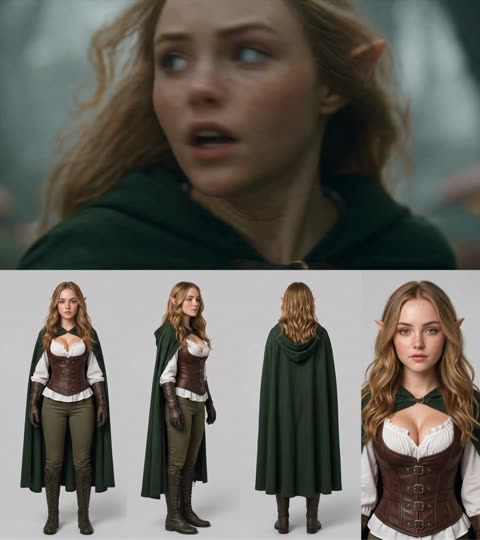

# Seedance 2.5

[返回目录](../../README_zh.md) · 全部 163 条 · **1** · [2](video-seedance25-2.md) · [3](video-seedance25-3.md)

<a id="seedance-seoul-subway-revenge"></a>
### 首尔地铁站复仇喜剧

<a href="https://x.com/AIwithSynthia/status/2108760866422415701"></a>

第一行先定镜头语言（手持、荧光灯、实时），再按节拍写笑点，结尾点明哪些画面必须拍清楚。

Seedance 2.5 · 文生视频 · 出处: [@AIwithSynthia on X](https://x.com/AIwithSynthia/status/2108760866422415701) · 10,056 赞，统计于 2026-10-27

[`action`](tags.md#tag-action) [`comedy`](tags.md#tag-comedy) [`handheld`](tags.md#tag-handheld) [`subtitles`](tags.md#tag-subtitles)

<details><summary><b>提示词</b></summary>

```text
Create a live-action cinematic revenge-comedy video set in a Seoul subway station. Use realistic handheld camera movement, cold fluorescent lighting, teal-green accents, and real-time action.

A Korean woman in her 20s with a black bob, sunglasses on her head, a fitted crop top, high-waisted blue jeans, black boots, and a brown shoulder bag descends the subway stairs holding a takeaway coffee. A Korean man with messy dark hair and blonde tips, wearing a dark-green bomber jacket, suddenly hits her from behind and laughs as she stumbles against the handrail. Furious, she chases him onto the platform as he boards a train and mocks her through the closing glass doors.

She punches the glass, creating a dramatic crack and opening. As she confronts him, her coffee cup slips from her hand, falls to the platform, and spills visibly across the floor. She grabs his jacket, forcefully throws him through the air, and sends him crashing into a large metal rubbish bin. The bin rattles and wobbles as he lands inside, looking terrified and humiliated.

She leans toward him and says, "Don't mess around." She then calmly walks away while he remains stuck in the bin.

Maintain identical faces, hairstyles, outfits, and location throughout. Include realistic physics, expressive reactions, cinematic close-ups, subway ambience, and clear white subtitles. Keep the action non-gory, the coffee spill visible, and the final dustbin landing unmistakable.
```

</details>

<a id="seedance-seoul-summer-evening-vlog"></a>
### 首尔夏夜，家庭录像质感

<a href="https://x.com/AIwithkhan/status/2092971211169100048"></a>

纯文字，没有参考图。真实感来自要求小意外和不完美的手持摄像。

Seedance 2.5 · 文生视频 · 出处: [@AIwithkhan on X](https://x.com/AIwithkhan/status/2092971211169100048) · 6,187 赞，统计于 2026-10-27

[`vlog`](tags.md#tag-vlog) [`ugc`](tags.md#tag-ugc) [`realism`](tags.md#tag-realism) [`home-video`](tags.md#tag-home-video)

<details><summary><b>提示词</b></summary>

```text
Create a 30-second, 1080p ultra-realistic personal home-video showing an ordinary summer evening in the life of a young Korean woman. No reference image.

MAIN SUBJECT

Young Korean woman in her early 20s, naturally pretty, realistic skin texture, minimal makeup, relaxed and approachable personality.

Long black hair loosely tied into a messy side ponytail with a few loose strands around her face. Wearing a fitted pastel-blue short top, loose cream pajama-style pants, black sneakers and a simple silver necklace.

Maintain the same face, hairstyle, clothing, body proportions and overall appearance throughout the entire video.

SETTING

A quiet older Seoul residential neighborhood during a warm summer evening. Narrow concrete lanes, small houses, potted plants, bicycles, old walls, utility poles, overhead wires, a tiny neighborhood bakery, a public water tap and large leafy trees casting shadows across the street.

Everything should feel lived-in, ordinary and peaceful. No tourist attractions, advertisements, recognizable brands or commercial activity.

CAMERA / VISUAL AESTHETIC

Raw personal footage casually recorded by a friend on an early-2000s consumer DV camcorder.

Strong handheld shake, imperfect framing, autofocus hunting, exposure shifts, occasional motion blur, faded colors, soft digital detail, mild noise, accidental zooms and natural camera imperfections.

No stabilization, drone footage, gimbal movement, dramatic lighting or polished commercial cinematography.

 — OUTSIDE THE HOUSE

She steps outside carrying a small reusable shopping bag. She locks the door, adjusts her messy ponytail and looks toward the camera with a relaxed smile.

A light summer breeze moves her hair as she starts walking down the lane.

 — BAKERY STOP

She reaches a tiny neighborhood bakery and buys a warm pastry.

She steps outside, takes her first bite and immediately smiles because it tastes good.

She notices her friend filming and holds the pastry toward the camera playfully before taking another bite.

— WALKING HOME

She continues down the narrow street while eating.

A neighborhood cat follows her for a few steps. She notices it, crouches down and gently pets it.

The cat walks away and she laughs before continuing.

 — SMALL ACCIDENT

She walks beneath a large tree when a few leaves fall onto her hair.

She stops, looks confused, then realizes what happened and laughs.

She brushes the leaves away while her friend zooms awkwardly toward her face.

She looks directly into the camera and says:

"Seriously?"

 — QUIET MOMENT

She reaches a low concrete wall beside the street and sits down for a moment.

She finishes the pastry while watching bicycles and neighbors passing through the lane.

A gentle breeze moves her hair. She casually fixes her ponytail and looks around peacefully.

 — FINAL MOMENT

She stands up and continues walking home.

After a few steps, she turns back toward the camera with a small playful smile and says:

"Come on."

She keeps walking down the sunny lane while the camera follows behind.

She disappears around the corner and the recording abruptly cuts to black.

AUDIO

Natural location sound only: birds, summer insects, footsteps, bicycle bells, distant scooters, leaves moving in the breeze, bakery sounds, neighborhood conversations and subtle camera-handling noise.

No music. No narration. No artificial sound effects.

Only the two spoken lines specified above.

FINAL FEEL

The entire video should feel like a forgotten summer recording from the early 2000s.

Warm, feminine, casual, slightly playful, intimate and nostalgic.

No dramatic events, no exaggerated acting, no model poses and no polished cinematic shots.

The realism should come from ordinary surroundings, natural expressions, small accidents, realistic environmental movement and imperfect camcorder operation.
```

</details>

<a id="seedance-katsudon-anime-cooking"></a>
### 快剪动画风格做猪排饭

<a href="https://x.com/Goodmanprotocol/status/2098845134326808734"></a>

开头明确禁止模仿任何现有动画，再一步步写菜谱，让每个镜头都有事做。

Seedance 2.5 · 文生视频 · 出处: [@Goodmanprotocol on X](https://x.com/Goodmanprotocol/status/2098845134326808734) · 4,935 赞，统计于 2026-10-27

[`anime`](tags.md#tag-anime) [`food`](tags.md#tag-food) [`fast-cut`](tags.md#tag-fast-cut)

<details><summary><b>提示词</b></summary>

```text
Create a 30-second fast-paced cinematic Japanese anime cooking video showing the preparation of authentic katsudon, entirely from the text description below.

IMPORTANT: Do not display, recreate, trace, reference, or imitate any storyboard, sketch, reference image, panel, annotation, or source material. Generate only original anime-style animation.

STYLE

High-quality Japanese anime film style, cinematic summer lighting, ultra-detailed food textures, realistic cooking physics, visible steam and moisture, shallow depth of field, macro close-ups, smooth camera movement, warm Japanese kitchen atmosphere. Fast rhythmic editing with natural match cuts based on movement, shape, texture, and composition.

TIMELINE

0–2.5s — Prepare Pork
Close-up of hands pounding a thick pork loin with a wooden mallet on a cutting board. The meat gradually flattens and its fibers loosen. Sprinkle salt and pepper evenly. Crisp rhythmic impacts.

2.5–5s — Bread the Pork
Quick match cuts: press the pork into flour, dip into beaten egg, then firmly coat with coarse panko breadcrumbs. Show realistic egg dripping and breadcrumbs adhering to the surface.

5–7.5s — Fry
Lower the breaded pork into hot golden oil. Intense bubbling surrounds the cutlet as the crust turns golden brown and crispy. Warm cinematic lighting and detailed oil movement.

7.5–9.5s — Slice
Place the fried tonkatsu on a wooden board. A sharp knife cuts it into even strips. The crispy crust cracks naturally, revealing juicy white pork with gentle steam escaping.

9.5–12s — Simmer Dashi & Onion
Thinly sliced onions gently simmer in amber dashi inside a shallow pan. Small bubbles rise while the onions become translucent. Chopsticks gently move them through the broth.

12–14s — Add Tonkatsu
Place the sliced tonkatsu carefully over the simmering onions using chopsticks. The broth begins soaking into the crispy edges while steam rises.

14–16.5s — Pour Egg
Slowly pour beaten golden egg over the tonkatsu and onions. The egg spreads naturally through the gaps and begins setting around the hot edges.

16.5–19s — Set the Egg
Close-up of the egg gently coagulating over low heat. Edges become soft and golden while the center remains glossy, slightly runny, and trembling. No stirring.

19–21s — Prepare Rice
A white ceramic donburi bowl receives a generous mound of steaming Japanese short-grain rice. The rice looks fluffy and slightly glossy.

21–24s — Assemble
Carefully slide the egg-and-tonkatsu mixture from the pan onto the rice. The egg settles naturally in a soft wave while dashi lightly absorbs into the rice.

24–26s — Final Close-Up
The finished katsudon rests on the counter. Glossy egg slowly settles over the tonkatsu and rice, gently trembling. Slow cinematic push-in.

26–30s — Hero Reveal
Present the finished katsudon in a traditional blue-and-white ceramic bowl on a wooden surface. Golden egg covers crispy tonkatsu over glossy rice, topped with fresh mitsuba. Steam rises as the camera slowly arcs around the bowl for a beautiful anime-food-film ending.

AUDIO

Bright 1980s-inspired Japanese city-pop instrumental, 110–120 BPM, with subtle koto and light chime percussion. Synchronize realistic ASMR cooking sounds: mallet impacts, knife slicing, frying sizzle, bubbling dashi, chopsticks, egg pouring, steam, and a soft ceramic clink.

End with one delicate wind-chime tone during the final reveal.

NEGATIVE

No storyboard, reference image, sketch, panels, borders, numbers, arrows, annotations, subtitles, captions, UI, logos, or text overlays. No unrelated ingredients or dishes. Katsudon only. Keep the food, hands, utensils, lighting, and environment visually consistent throughout.
```

</details>

<a id="seedance-rainy-morning-university-vlog"></a>
### 雨天早晨，咖啡，走去学校

<a href="https://x.com/nawalsehar/status/2103337966416621703"></a>

30 秒只用不到 1000 字：一条紧凑的日常流程，加一小串要避免的毛病。

Seedance 2.5 · 文生视频 · 出处: [@nawalsehar on X](https://x.com/nawalsehar/status/2103337966416621703) · 4,181 赞，统计于 2026-10-27

[`vlog`](tags.md#tag-vlog) [`realism`](tags.md#tag-realism) [`morning-routine`](tags.md#tag-morning-routine)

<details><summary><b>提示词</b></summary>

```text
Create a 30-second ultra-photorealistic live-action university vlog of a European brunette in her mid-20s waking to a rainy morning, making coffee, getting ready, grabbing her umbrella, walking through a wet city, and arriving at university just before class.

Modern smartphone vlog style: natural handheld movement, subtle shake, autofocus changes, realistic rain, puddles, reflections, traffic, umbrellas, wet clothing, natural expressions and believable human movement.

Dialogue: “Good morning… apparently, it’s raining.” → “First coffee. Then lecture.” → “Two minutes early. I’m impressed.” → “Okay, made it.”

Natural diegetic audio only. No music, narration, CGI look, artificial rain, face changes, distorted anatomy, impossible physics, subtitles, logos or watermark.

16:9 • 24fps • 4K • Ultra-photorealistic live action
```

</details>

<a id="seedance-cafe-table-multi-angle-reshoot"></a>
### 咖啡馆桌边讲话重拍成十三个新机位

<a href="https://x.com/Scenario_gg/status/2102365054389899695"></a>

提示词先锁定原视频的表演、音频、光线和节奏，只允许机位与镜头变化，再用带时间码的镜头表逐段设计新机位。逐段标注的说话时间窗、视线规则和空天空规则，让每个新角度的口型同步与背景都保持干净。

Seedance 2.5 · 视频编辑 · 出处: [@Scenario_gg on X](https://x.com/Scenario_gg/status/2102365054389899695) · 3,287 赞，统计于 2026-10-27

[`video-to-video`](tags.md#tag-video-to-video) [`multi-angle`](tags.md#tag-multi-angle) [`camera-plan`](tags.md#tag-camera-plan) [`lip-sync`](tags.md#tag-lip-sync) [`timed-shot-list`](tags.md#tag-timed-shot-list)

<details><summary><b>提示词</b></summary>

```text
Prompt (seedance 2.5 video to video):

ONE FINISHED TAKE, RE-PHOTOGRAPHED


@video1
 is one finished take: a single locked-off wide, 19.53 s, with its original audio, a young man at an outdoor cafe table talking to one camera. Do not restage, re-perform, re-time or reinterpret it. Re-photograph the identical event from thirteen new camera positions, as if thirteen extra cameras had been rolling around him in the same moment. Every output frame shows the same body at the same instant of
@video1
 at the same speed. Output runs the full 19.53 s. Keep the audio of
@video1
 unchanged and in sync.

DO NOT CHANGE
Performance, body, hands and what they hold, head angle, eyeline, lip movement, blink timing, movement speed, action start and end times, lighting, exposure, white balance, colour grade, wardrobe, props, set. The only variable is camera position and lens.

SPEECH WINDOWS (measured from the audio of
@video1
)
SPEAKING: 0.00-1.65, 2.05-4.80, 5.95-6.90, 9.65-11.75, 12.20-12.85, 13.35-13.80, 16.70-16.90, 17.60-18.90.
SILENT, mouth closed and still or chewing: 1.65-2.05, 4.80-5.95, 6.90-9.65 (drinking), 11.75-12.20, 12.85-13.35, 13.80-16.70 (chewing), 16.90-17.60, 18.90-19.55.
Whenever his mouth is visible in a SPEAKING window it moves in lip-sync with the audio of
@video1
. He talks while looking down: from 2.05 to 4.80 his head is down at the laptop and he is speaking. Head down is not silent. Never add speech to a silent window, never mute a speaking one.

EYELINE RULE
He performed to ONE camera, the A-camera: the original locked-off wide, directly in front of him at seated eye level. His eyeline stays on that spot in every shot, apart from the glances down at keyboard, mug and pastry already in
@video1
. He never looks for or turns toward a new camera. From above he reads cap and brow; from the sides, three-quarter or profile; from behind, the back of his head. Single exception: the on-axis shot at 00:01-00:02 sits where the A-camera was, so there alone he looks into the lens.

TEMPO RULE
Real time, 1:1 with
@video1
. No speed ramps, added slow motion, freeze frames or time remaps. Exactly one slowed passage exists, already baked into the source: the pastry at the top of its arc, 12.5-13.55. Reproduce it at the speed it already has, no slower, no longer.

TOSS TIMING
The pastry leaves his fingers at 12.43 and is caught at 13.60: airborne about one second only. Do not stretch, loop or hang the flight. Before 12.43 and after 13.60 it is in his hand.

EMPTY SKY
On every low or upward-tilting shot the sky is plain pale overcast and empty. No skyscrapers, glass towers, solar panels, cranes, birds, aircraft, sun disc, structured clouds, lens flare or signage. Above his head only cream wall, white pillars and flat pale sky.

CAMERA PLAN

[00:00-00:01] High-angle MCU from above and to his right, about 40 degrees down, chest up, slow push-in, 35mm feel, moderate depth of field, cap brim and open gesturing palms, marble edge in the lower foreground. Speaking, reading three-quarter, not to this lens.

[00:01-00:02] ON THE A-CAMERA AXIS. ECU of his face, dead front, seated eye level, 85mm feel, shallow focus, pillars soft cream behind. The one shot where he looks into the lens. Hands drop below frame onto the keyboard; mouth closes at 1.65.

[00:02-00:05] Macro along the MacBook keyboard to his typing fingers, lens centimetres above the keys, razor-thin focus, keycaps sharp, his face soft far behind, head down. Speaking 2.05-4.80: where his mouth shows in the blur it moves with the audio. Fingers lift at 5.0.

[00:05-00:06] Top-down bird's eye straight down over the table, 24mm feel, deep focus, locked off. Marble disc fills frame: open laptop, white mug, financier, his cap at the bottom edge. Right hand crosses to the mug handle.

[00:06-00:07] Lens resting on the marble at table height, 50mm feel. White mug large and sharp in the left foreground; his hand enters from the right, grips the handle, lifts the mug up out of frame. Torso soft behind. Speaking 5.95-6.90.

[00:07-00:09] First-person POV from his seat, ultra-wide 18mm feel, gentle handheld breathing. The mug rim rises into the bottom of frame and tips toward the lens; laptop screen and marble beyond in deep focus. No face; framing dips to the mug, never up. Silent.

[00:09-00:10] Extreme wide, slow dolly out, 24mm feel, deep focus. He is small at his table mid-terrace: cream wall, pillars, concentric-circle mural, taped boxes behind, slatted bench visible. He sets the mug on the marble 9.4-10.0; speech resumes 9.65.

[00:10-00:12] Low and to his left, lens just above the marble, 50mm feel, shallow focus, table edge and mug soft in the near foreground. Right hand reaches out at 10.5 and lifts the golden financier into sharp focus before his left profile. Talking to the A-camera: full profile here.

[00:12-00:14] Low beside him, 35mm feel, slight Dutch. Opens on the pastry in his fingers; at 12.43 it leaves his hand and the camera tilts UP, following it against plain pale overcast sky and the top of a white pillar through the baked-in slow apex 12.5-13.55, then tilts DOWN for the catch at 13.60 into cupped hands, head tipped back, mouth open, then head coming forward.

[00:14-00:15] Behind him, over his right shoulder, 50mm feel, moderate focus. Back of the black Yankees cap and long dark hair fill frame-left; laptop glow and marble past his shoulder. Head settles level, hands bring the pastry toward his mouth. No face. Silent.

[00:15-00:16] ECU on his mouth and jaw, 100mm macro feel, very shallow focus, soft open-sky light. The financier enters from below, he bites, crumbs, the jaw chews. Chewing, not speaking. Nothing above the nose in frame.

[00:16-00:18] Slow orbit from his left toward front, 35mm feel, moderate focus, mural and pillars parallaxing behind, table crossing the foreground. He chews, speaks 16.70-16.90 and from 17.60, open palms, a small shrug. As the orbit nears front his gaze lands near, not into, this moving lens.

[00:18-00:20] Top-down bird's eye straight down over the table, 24mm feel, deep focus, locked off. Hands come down beside the laptop and settle, cap centred, speech ends 18.90, then still. Hold to 19.53.

SET AND SUBJECT CONTINUITY (identical in every shot)
Young man, long dark hair, black short-sleeve button-up shirt with a small chest logo, black New York Yankees baseball cap, grey trousers. Light wood slatted bench, round white marble table, outdoor cafe terrace. On the table: open dark grey MacBook, white mug with a circular graphic, one small golden financier. Behind him: cream wall, white cylindrical pillars, large black-and-white concentric-circle mural, taped cardboard boxes. Soft overcast open-shade daylight, no hard shadows, constant direction and softness. Warm bright grade: cream walls, golden wood, neutral white marble, warm skin, deep neutral blacks. He is alone; no passers-by, no staff.

No on-screen text, captions, subtitles, watermarks or logos beyond the small chest logo and cap emblem already in
@video1
.
```

</details>

<a id="seedance-diner-frozen-time-rewind"></a>
### 1950 年代餐馆：时间静止再倒流

<a href="https://x.com/techhalla/status/2083389002552664385"></a>

一个特效撑满 30 秒。先把餐馆写细，静止和倒流才看得清。

Seedance 2.5 · 文生视频 · 出处: [@techhalla on X](https://x.com/techhalla/status/2083389002552664385) · 2,873 赞，统计于 2026-10-27

[`vfx`](tags.md#tag-vfx) [`time-freeze`](tags.md#tag-time-freeze) [`period`](tags.md#tag-period)

<details><summary><b>提示词</b></summary>

```text
Photorealistic cinematic 1950s American diner, chrome stools, red vinyl, neon glow and checkerboard floor, shot with modern lived-in realism and soft natural window light. Subtle handheld texture, warm practicals, rich period detail, heavy film grain.

0-4s: [Medium Wide] A striking young woman in her early 20s sits alone at the counter, calm and slightly amused, slowly sipping a tall thick milkshake through a straw. Behind her a young waitress in classic uniform approaches with a tray of eggs and bacon in one hand and a full glass coffee pot in the other. An older lady starts rising from a nearby booth.

4-8s: [Dynamic Tracking] The older lady collides hard into the waitress. Tray, plate, eggs, bacon and coffee pot explode upward in chaotic slow motion. Coffee erupts into long liquid ribbons and perfect suspended droplets. Camera immediately begins a smooth continuous orbit around the impact. Time locks completely at the peak of the spill. Every face freezes in pure shock. Only the girl at the counter keeps moving, completely unfazed.

8-17s: [Slow 360° Orbital] Camera glides in a full elegant orbit through the frozen diner. Coffee hangs in mid-air as glassy ribbons and spheres with perfect volume and surface tension. Bacon strips, eggs and the spinning tray float weightlessly. Patrons and waitress remain locked in startled expressions. The girl at the counter takes one slow, deliberate sip, eyes half-lidded, almost bored, while the entire frozen world (except her) begins an elegant reverse: every droplet, every piece of food and every person rewinds smoothly back to the exact starting positions.

17-24s: [Medium Shot] Rewind lands perfectly. Waitress stands balanced again with tray and coffee pot. The girl lifts her eyes, raises two fingers in a small casual gesture and softly calls the waitress by name. The waitress turns toward her just before the older lady begins to stand, completely avoiding the collision. A tiny private smile crosses the girl’s face.

24-30s: [Extreme Close-Up] Hard cut to her face as she takes one last slow sip. Soft knowing smile, eyes almost closed in quiet satisfaction, like she has done this a hundred times. Shallow depth of field, creamy bokeh of the neon diner behind her.

Photorealistic, ultra-detailed fluid physics, perfect motion blur only on moving elements, stable characters, cinematic lighting, heavy natural film grain, no artifacts, movie-level temporal coherence, high rewatch value.
```

</details>

<a id="seedance-lab-containment-breach"></a>
### 实验室收容失效，科幻恐怖

<a href="https://x.com/auqibhabib/status/2099725768310009982"></a>

要求开场即钩子、用实拍特效质感，怪物不会显得像 CG。

Seedance 2.5 · 文生视频 · 出处: [@auqibhabib on X](https://x.com/auqibhabib/status/2099725768310009982) · 2,425 赞，统计于 2026-10-27

[`horror`](tags.md#tag-horror) [`sci-fi`](tags.md#tag-sci-fi) [`action`](tags.md#tag-action)

<details><summary><b>提示词</b></summary>

```text
Cinematic sci-fi horror-action short film set in a research laboratory, opens with an immediate strong hook, natural realistic pacing, grounded practical-effects style. Lab filled with steel equipment, glass containment tubes, monitors, specimen tables, harsh fluorescent lighting. Five scientists in lab coats work at various stations. Natural handheld camera work, muted authentic color grading, all sound fully natural and diegetic — no music, no artificial sound design until the tension score kicks in.
>
> **[0-1s]** Hard cut: a containment tube shatters violently, glass exploding across the lab floor.
>
> **[1-2s]** A small dark parasite creature skitters out fast, latching instantly onto a scientist's neck.
>
> **[2-3s]** He screams, collapsing to his knees, the others recoiling in shock.
>
> **[3-4s]** Dark veins pulse rapidly beneath his skin, visible even through his collar, his body convulsing.
>
> **[4-5s]** His eyes turn a deep obsidian black — he rises, movements jerky and unnatural.
>
> **[5-6s]** He lunges at the nearest colleague, parasite tendrils extending from his mouth toward her.
>
> **[6-7s]** She's caught, tendrils latching onto her neck, her scream cutting short.
>
> **[7-8s]** Veins spread fast across her too, body convulsing against a lab table, equipment crashing down.
>
> **[8-9s]** She rises seconds later, eyes black, joining him, both turning toward the remaining three.
>
> **[9-10s]** The three scientists scramble back, one grabbing a fire axe from an emergency case on the wall.
>
> **[10-11s]** The two infected charge fast, jerky inhuman movements, tendrils whipping from their jaws.
>
> **[11-12s]** The lead scientist swings the axe hard into the first infected — a solid impact, it staggers into a specimen table, equipment shattering.
>
> **[12-13s]** A second scientist grabs a fire extinguisher, blasting the other infected in the face, it recoils, tendrils flailing.
>
> **[13-14s]** The third scientist shoves a steel cart into the staggering infected's path, sending it crashing down.
>
> **[14-15s]** Both infected collapse motionless, twitching, tendrils retracting slowly.
>
> **[15-16s]** The three survivors regroup, breathing hard, scanning the wrecked lab for more movement.
>
> **[16-17s]** Wide shot: broken glass and toppled equipment everywhere, alarm lights beginning to flash red.
>
> **[17-18s]** A third containment tube behind them starts cracking, unnoticed by the group.
>
> **[18-19s]** It shatters suddenly — another parasite creature launches out fast.
>
> **[19-20s]** The lead scientist spins just in time, swinging the axe and slicing it out of the air mid-leap.
>
> **[20-21s]** It hits the floor, motionless, dark fluid spreading slightly beneath it.
>
> **[21-23s]** The group presses their backs together, weapons raised, scanning every corner of the lab.
>
> **[23-25s]** Emergency lights flash steadily red, alarm klaxon blaring through the facility.
>
> **[25-27s]** The lead scientist gestures toward the exit; they move together cautiously, stepping over debris and fallen colleagues.
>
> **[27-29s]** They reach the heavy lab door, the lead scientist sealing it shut behind them with a hard mechanical clang.
>
> **[29-30s]** Final shot: the three survivors lean against the sealed door, breathing hard, alarm lights flashing red across their exhausted faces. Cut to black.
>
> Natural diegetic sound throughout — glass shattering, guttural convulsions, screaming, metal impacts, alarm klaxon, heavy breathing — layered with a tense instrumental score building through the fight and easing at the end. No text overlay, no watermark. Natural handheld camera with realistic shake during action, muted clinical color grading.
```

</details>

<a id="seedance-woman-in-storm-crowd"></a>
### 人群齐动，她一动不动

<a href="https://x.com/AIwithkhan/status/2099707375943066094"></a>

上传的图锁定人物、人群和构图，文字只管动作和禁止项。

Seedance 2.5 · 参考生视频 · 出处: [@AIwithkhan on X](https://x.com/AIwithkhan/status/2099707375943066094) · 2,128 赞，统计于 2026-10-27

[`fashion`](tags.md#tag-fashion) [`crowd`](tags.md#tag-crowd) [`reference-images`](tags.md#tag-reference-images)

<details><summary><b>提示词</b></summary>

```text
Create a ultra-realistic cinematic fashion video using the uploaded images as exact visual references for the woman, crowd, wardrobe, framing, and atmosphere.
A young woman with the same short dark bob wears a fitted black turtleneck, black trousers, and black shoes, standing confidently at the center of a large crowd.
Start with her walking slowly toward the middle of the crowd, calm and expressionless, with a lit cigarette naturally held between her lips.
She reaches the center, stops, and faces directly into the camera.
She takes one slow drag from the cigarette, then removes it from her mouth.
She slowly exhales a visible stream of smoke toward the camera, with the smoke naturally drifting across her face.
She lowers her hand and becomes completely still, staring directly into the lens.
The entire crowd behind her remains frozen for a brief moment.
Suddenly, everyone behind her begins moving in perfect synchronization — sharp head turns, shoulder jerks, folding forward and snapping upright.
The movement should feel rhythmic, strange, powerful, and physically realistic.
The woman does not move at all while the entire crowd moves behind her.
Slowly push the camera closer to her, keeping her sharply focused while the crowd has subtle depth-of-field blur.
Dark, cold, mysterious lighting with deep shadows, realistic skin, hair, clothing, cigarette ember, and physically accurate smoke.
Photorealistic live-action quality, cinematic composition, natural human movement; no animation, CGI look, duplicated woman, distorted bodies, excessive smoke, text, subtitles, or logos.
```

</details>

<a id="seedance-ugc-night-yacht"></a>
### 朋友用手机拍的夜游

<a href="https://x.com/mightyking/status/2089299068514148655"></a>

开头先交代谁在拍（跟着大家走的朋友），晃动和构图都由此而来。

Seedance 2.5 · 文生视频 · 出处: [@mightyking on X](https://x.com/mightyking/status/2089299068514148655) · 2,038 赞，统计于 2026-10-27

[`ugc`](tags.md#tag-ugc) [`vertical`](tags.md#tag-vertical) [`realism`](tags.md#tag-realism) [`handheld`](tags.md#tag-handheld)

<details><summary><b>提示词</b></summary>

```text
Raw vertical phone video (UGC), handheld throughout, filmed by a friend who walks with the group, casual sway, natural night lighting, wide-angle lens, deep focus.

Characters: The hero is a young woman with long dark hair in a deep-purple one-shoulder dress with a small shoulder bag. Her three friends: one in a dark brown dress, a blonde in a black wrap dress, a blonde in a white mini dress — party dresses and sandals. Laughing, spontaneous night-out energy.

Setting: A luxury marina at night — a stone quay along a narrow water slip flanked on both sides by large moored luxury yachts, big white hulls rising on either side, masts and rigging above, fenders on the hulls. Warm orange street lamps, palm trees, distant city lights. The yachts glow with blue-turquoise underwater LED lights spilling into the water; a yellow mooring line runs to the stone.

[0.0s–4.0s] — Wide tracking shot, eye level, camera moving backward. The camera walks backward ahead of the four women as they stroll toward it down the marina promenade, framed head-to-toe, laughing and chatting in French; warm lamplight and palm trees behind, slight handheld bob.

[4.0s–6.0s] — Medium shot, eye level, backward track + quick left pan. The woman in the purple dress surges ahead of the group toward the lens, one arm raised, hair flying; the camera, on their left, keeps tracking back and pans to hold her.

[6.0s–8.0s] — Medium-wide, camera tilts down-left to follow, whip motion. She reaches the quay edge between the moored luxury yachts and launches headfirst over the edge; the handheld camera whips left and tilts down to chase her off the stone.

[8.0s–10.0s] — High-angle wide, looking down at the water, slight jolt. From up on the quay the camera looks down as she plunges headfirst into the blue-turquoise water in the slip between the big yacht hulls — a big splash, the underwater lights glowing around the impact; the handheld frame jolts slightly with the motion.

[10.0s–13.0s] — High-angle medium, looking down, small handheld drift. She surfaces in the teal water, gasping and laughing up at the camera, hair slicked back, treading water.

[13.0s–16.0s] — Handheld tilt up and back down, slight zoom. The camera lifts off the water and tilts up to a person leaning on the deck railing of one of the moored luxury yachts, watching her in the water, then tilts back down and zooms slightly in on her still treading and laughing.

[16.0s–20.0s] — High-angle medium, tilting to follow her up. She swims to the stone quay wall, reaches up and grabs a thick dark mooring pole, and hauls herself out; the camera tilts upward with her as she rises from the water, legs braced on the stone.

[20.0s–23.0s] — Low/close medium at the quay edge, static handheld. She climbs onto the stone lip, rolls onto her side, soaked dress clinging, then pushes up to her feet; the camera holds close, catching the water running off her.

[23.0s–27.0s] — Medium shot, eye level, loose handheld reframe. Back on the promenade, dripping wet, she flips her long wet hair forward and wrings it out, laughing, as her friends and passing pedestrians move behind her.

[27.0s–30.0s] — Medium shot, eye level, camera settles. Still dripping, she straightens up and strikes a confident, playful pose for the camera — hand on hip, tossing her wet hair back with a big smile — her friends laughing around her; the camera holds on the pose to end.

Audio: Live sync sound — friends laughing and shouting excitedly in French, a scream at the leap, a big water splash, water sloshing against the yacht hulls, wet footsteps on stone, ambient night marina sounds. No music.

Style: Raw amateur vertical phone footage, natural night lighting, warm street lamps mixing with the turquoise underwater yacht glow, authentic handheld motion.
```

</details>

<a id="seedance-zombie-calico-cat-reunion"></a>
### 流泪的橘猫举枪对准僵尸花猫

<a href="https://x.com/ElsaSofia__AI/status/2108740749420646730"></a>

按时间码逐段写出景别、动作和情绪转折，让昏暗木屋里的紧张感顺畅过渡到金色黄昏草地。开头先交代两只猫、两处场景以及前后半段的光线对比，保证跨镜头的角色与场景一致。

Seedance 2.5 · 文生视频 · 出处: [@ElsaSofia__AI on X](https://x.com/ElsaSofia__AI/status/2108740749420646730) · 2,000 赞，统计于 2026-10-27

[`short-film`](tags.md#tag-short-film) [`cats`](tags.md#tag-cats) [`emotional`](tags.md#tag-emotional) [`timestamped-shots`](tags.md#tag-timestamped-shots) [`cinematic`](tags.md#tag-cinematic)

<details><summary><b>提示词</b></summary>

```text
Cinematic emotional short film, live-action look, 16:9, 24 seconds, 24 fps. Characters: a ginger tabby cat that stands upright on its hind legs like a human, and a calico cat (black, white and orange). At the start the calico is zombie-like: cloudy pale eyes, torn fur hanging in shreds, sharp fangs. Opening setting: a dark rustic wooden cabin kitchen at night, pots on wooden shelves, a window with cold blue night light, wooden plank floor. Final setting: a green meadow at golden-hour sunset with white dandelion fluff floating in the air.

0:00-0:01.5 Extreme close-up of the ginger tabby with tears in his eyes, holding a black handgun with both paws, aimed toward the camera (gun out of focus in the foreground).

0:02-0:02.5 Over-the-shoulder wide shot from behind the ginger cat: he aims the handgun at the zombie calico slowly walking toward him across the wooden floor.

0:03-0:03.5 Front shot: the ginger cat stands upright, aiming with both paws, dark wooden wall and blue window behind him.

0:04-0:04.5 Close-up of the zombie calico, glassy pale eyes, then snarling with fangs.

0:05-0:06.5 Extreme close-up of the ginger cat's face, tears rolling down.

0:06.5-0:08 He stands aiming, then slowly lowers the gun.

0:08.5-0:09 The gun drops from his paw and he opens both arms wide for a hug.

0:09.5-0:10 Quick cuts: the zombie calico's face, then the ginger cat with eyes closed and a tear falling.

0:10.5 The calico leaps into his arms, wrapping her white paws around him; her fur is now healthy and normal.

0:11-0:13 Cut to the sunset meadow: the two cats roll and cuddle in the grass, white fluff floating around, warm golden light.

0:13-0:18 Close-up of the calico's affectionate face while the ginger cat's paw gently touches her face and head; the ginger cat lies on his back in the grass, eyes closed, peaceful.

0:18-0:20.5 The ginger cat's paw rests on her face; he looks up, content and relaxed.

0:21-0:22 Wide silhouette shot: the two cats sit snuggled together against the glowing sunset, tall grass and wildflowers in the foreground.

0:22.5-0:24 Close-up with sun flare: the ginger cat tenderly rubs his head against the calico's head. End.

Style: dramatic zombie-movie tension turning into a heartwarming ending, shallow depth of field, realistic fur detail, warm golden-hour light in the second half, dark low-key lighting in the first half.
```

</details>

<a id="seedance-anime-rooftop-brawl-kinetic-fight"></a>
### 两名动漫格斗者在天台激烈缠斗

<a href="https://x.com/aimikoda/status/2111824828009193814"></a>

先用角色参考块锁定两人的服装，再用风格与能量段落定下赛璐珞着色、冲击帧和持续运动的镜头。四个分镜各有独立的运镜路径和连续出招，没有停顿，并用禁止项排除慢动作和定格。

Seedance 2.5 · 参考生视频 · 出处: [@aimikoda on X](https://x.com/aimikoda/status/2111824828009193814) · 1,962 赞，统计于 2026-10-27

[`anime`](tags.md#tag-anime) [`fight-scene`](tags.md#tag-fight-scene) [`multi-shot`](tags.md#tag-multi-shot) [`camera-movement`](tags.md#tag-camera-movement) [`character-reference`](tags.md#tag-character-reference)

<details><summary><b>提示词</b></summary>

```text
References:
@[char1 ref]: Mina. Long black hair, green striped crop top, baggy orange cargo pants with black graffiti, white sneakers, black fingerless boxing gloves on both hands, chain bracelet.
@[char2 ref]: Rue. Long pink hair, black crop top, black cargo shorts with chains and tags, bare knuckles with silver rings, skin visible on both hands, chunky lime sneakers, dog tag necklace.

Visual style: High-sakuga flat-color 2D anime, bold linework, hard cel shading, flat blue and teal backgrounds that flash hot pink or orange on impact, speed smears, impact frames, deep foreshortening.

Energy: Within every shot the camera keeps moving: it spirals around crossing limbs, dives under kicks, skims the floor, and whips between faces, often following a fist or a sole within inches of the lens. Every movement flows straight into the next strike, block, or counter. Every landed hit plays as sakuga impact: a two-frame impact frame, then the struck body whips away in a long smear, elastic recoil, immediate re-entry into her own attack. Heads snap, torsos fold, feet leave the ground, bodies skid across concrete. Each impact throws a color flash, dust, flying hair and cloth, and radiating speed lines.

Avoid: No subtitles. No slow motion, no idle posing, no pauses between actions, no freeze frames, no held two-shots.

Mina and Rue trade one relentless brawl on an empty concrete rooftop with a chain-link fence at the back and a steel vent box at center right. Mina starts screen left, Rue screen right. Whenever they close, one body is nearer the camera and the other clearly behind it with air between. No dialogue; hits, shoe scuffs, chain rattle, wind. Shot list: 4 shots, about 30 seconds, every shot packed edge to edge with exchanges.

Scene 1: 连续时间，天台。
Shot 1: 大全景起，地面高度，低角度；镜头从水泥地面猛然升起，穿过两名已经腾空扑向对方的格斗者之间，然后贴着Mina的拳套甩进中景，并绕着两人交错的手臂急速环绕。Mina的右勾拳与Rue抬起的膝盖在半空撞上，冲击帧，两人同时被震成拖影向后飞开，滑步落地的瞬间已经再次扑上；Mina左直拳，Rue下潜躲过并打出上勾拳，Mina用前臂接住，前臂被顶上自己的下巴，头向后一甩成拖影，她借着仰头的势头打出一记一二连击，第二拳砸开Rue的防守，冲击帧，Rue的头横向甩出，粉发拉成一道弧，她踉跄一步就从踉跄里踢出正蹬，踢中Mina的拳套，把Mina推得双脚在地上滑出一道痕。快速细节切：Rue眯起的眼睛，Mina收紧的拳套，狗牌甩动，然后镜头钻到Rue旋踢的下方。Rue的脚跟掠过Mina低下的头顶，Mina从内侧起身的身体勾拳把Rue整个人折弯在拳套上，冲击帧，Rue的双脚离地，她顺着折弯的势头甩出肘击，Mina双拳套挡住，拳套却被顶进自己的脸，她向后踉跄两步，Rue追上来一记戴戒指的直拳擦着镜头砸过，Mina侧滑，把一记短右拳埋进Rue的肋部，冲击帧，Rue半边身体塌陷成拖影，双脚在地面打滑，她就从打滑里顶出一膝，砸在拳套上，把Mina的胳膊震到自己胸口。

Shot 2: 跟拍起，位于Rue身后腰部高度；镜头随她冲向铁丝网，沿着网向上扫，在她蹬离时翻转，然后落到地面高度，贴着天台地面疾驰穿过两人相撞的缝隙。Rue推开Mina的胸口转身冲向铁丝网，在网上蹬两步，蹬离，后空翻越过从下方冲进来的Mina，落下的膝盖砸中Mina的肩膀，冲击帧，Mina被砸成一个拖影般的前滚翻，从翻滚里起身时顺势扫向Rue落地的那条腿，Rue跳过扫踢，撑手后空翻，落地时Mina的直拳已经到了，Rue格挡，格挡把她自己的手臂震开，Mina的第二拳穿过空档擦中她的太阳穴，冲击帧，Rue半转过身，粉发横扫镜头。快速细节切：荧光绿鞋底填满镜头，橙色工装布料猛甩，铁丝网剧烈震颤，然后镜头贴地。两人再次相撞：Mina低身滑过Rue的飞跃拳，两人在另一侧旋转成背对背，同一瞬间各踢出一记后蹬，鞋底对撞，冲击帧，两人都被踢得向前扑倒撑地，撑起后同时转身甩出旋转背拳，拳套撞上指节，粉色闪光，两人的头各自甩向一侧成拖影，Rue先回过身勾住Mina的腿，Mina跳脱的同时抡出过顶拳，擦过Rue的太阳穴，把她打得转了半圈，Rue转完这半圈的势头直接变成一记反手肘，砸在Mina的肩上，Mina的肩膀被压得一沉。

Shot 3: 高角度俯冲起；镜头向通风箱俯冲，压低绕到箱侧，然后在两张脸之间左右急甩，每一拳都跟着拳头从一张脸甩到另一张脸。Mina，戴黑拳套，跃上通风箱，膝盖朝下砸落；Rue，赤手戴戒指，侧步闪开，一记侧踢踹进箱体，箱体轰然凹陷；Mina从压扁的边缘跃起打出飞身直拳，Rue后仰躲过，扫掉Mina的支撑手臂，Mina侧手翻落地的同时勾拳打中Rue的下颌，冲击帧，Rue的头甩过去，整个人被带得转了半圈，脚步踉跄，又从踉跄里反扑一记直拳，震得Mina的下巴一晃。快速细节切：弯折的金属，断裂的电缆冒着火花，拳套在箱顶打滑，然后镜头切进两张脸之间。隔着废墟的近身对轰：刺拳，格挡，直拳，侧闪，没有一拳停在半路；Rue的膝盖顶进Mina垂下的拳套，把她推退一步；Mina的头槌砸在Rue的眉骨上，冲击帧，Rue的头向后甩成拖影，她的身体先于意识反击，戴戒指的勾拳打在Mina的拳套上；Mina的反击肘撞上Rue的脸颊，冲击帧，粉发炸开，Rue踉跄两步，膝盖一软又撑住，从撑住的那一下里直拳回敬，打得Mina的头偏过去，Mina的头偏到一半就已经转回来，两人同时下蹲。

Shot 4: 高角度大全景起，倾斜成荷兰角；镜头在两人跃起时螺旋下降，在最高点从两人之间穿过，再翻到两人侧面，并在两人上升时继续旋转。两人同时向上爆发，拳头在前，Mina的黑拳套与Rue戴戒指的拳头冲向画面中央同一点，头发向后飞扬成拖影，速度线向中心汇聚，拳头进入触及范围的瞬间背景炸成全屏亮粉色；拳头仍在逼近，头发仍在甩动，镜头仍在旋转，画面在此切断。
```

</details>

<a id="seedance-anime-frame-break-letterbox-pop-out"></a>
### 动漫角色的手伸出黑色上下遮幅

<a href="https://x.com/aimikoda/status/2106044483863191748"></a>

提示词写明从后到前的合成顺序（背景、黑色遮幅、角色），让前景角色盖住固定不动的黑边。固定广角镜头、开场直扑镜头的动作，以及结尾不得把角色裁在画面窗口内的要求，让出框效果反复出现。黑边的大小在不同生成之间仍会变化。

Seedance 2.5 · 参考生视频 · 出处: [@aimikoda on X](https://x.com/aimikoda/status/2106044483863191748) · 1,675 赞，统计于 2026-10-27

[`frame-break`](tags.md#tag-frame-break) [`letterbox`](tags.md#tag-letterbox) [`anime`](tags.md#tag-anime) [`pop-out`](tags.md#tag-pop-out) [`character-reference`](tags.md#tag-character-reference)

<details><summary><b>提示词</b></summary>

```text
Use @[char ref]as the exact character and style reference. Preserve her white hair, red eyes, oversized black cropped top, long cream skirt with orange lining, bare feet and single slender sword. Keep the same angular painterly anime rendering.

MAIN VISUAL GOAL: an unmistakable OUT-OF-FRAME, POP-OUT effect. The character repeatedly projects beyond the central picture window, with her sword, hands, hair and especially her wide skirt visibly moving OVER the black letterbox bars toward the viewer.

COMPOSITING ORDER, BACK TO FRONT:
1. Background and scene.
2. Two broad black letterbox bars at the top and bottom.
3. The foreground character, including her sword, hair and flowing skirt.

The background is confined to the central picture window. The foreground character is NOT confined to that window. Her silhouette continues uninterrupted across its boundaries and onto the black bars. Cream fabric, orange lining, white hair and the silver blade remain fully visible when overlapping black.

Keep both bars equal in thickness and fixed in screen position throughout. The character covers them temporarily without moving or changing them. Keep sections of black visible beside each overlap so the frame-break illusion remains clear.

The camera stays stationary with a fixed wide-angle lens. The character moves rapidly through depth, creating extreme foreshortening and dramatic scale changes through physical approaches and retreats.

OPENING:
Start immediately with a powerful forward lunge. Her sword hand projects toward the lens and overlaps the lower black bar. At the same time, the nearest cream skirt folds spill across that bar. Establish the frame-break effect clearly in the very first movement.

CHOREOGRAPHY:
She pulls back into the central window, then snaps into a fast turning advance. Her skirt fans outward in a huge cream sweep, crossing the bottom boundary and spreading over the black surface. The orange lining flips into view along the moving hem. Her waist and torso remain inside the central window while the nearest fabric extends outside it.

Reverse the rotation sharply into an upward sword flourish. The blade crosses onto the upper black bar, followed by flying strands of white hair. She immediately drives forward again, bringing her hand and blade extremely close to the viewer.

Chain rapid fencing lunges, spinning evasions, low sweeping turns and short twisting leaps. Repeatedly move from the depth of the central scene into extreme foreground space. Alternate sword-and-hair overlaps across the upper bar with large skirt-and-hand overlaps across the lower bar.

Give the skirt substantial momentum: it follows her hips, overtakes her during abrupt stops and lashes around her during reversals. Show broad cream folds sweeping across black, not merely touching the border. Keep the fabric naturally attached to her waist.

Include a close spinning pass where the skirt occupies a large portion of the lower black bar while her sword cuts diagonally across the upper bar. Her face remains readable between them.

FINISH:
A final explosive lunge brings the sword toward the lens as the skirt billows across the lower bar. Resolve into a confident fencing pose with the blade and cream hem still visibly extending beyond the central picture window.

Prioritize visible foreground overlap throughout. Do not crop the entire character inside the letterbox window. Do not replace the effect with simple zooming or a character moving behind black bars.

Fast, forceful motion with crisp silhouettes and brief directional smears. No slow motion, camera movement, duplicated weapons, cloth morphing, text or background music.

---

Prompt for the second one:

Use @[char ref]as the exact reference for the character and visual style. Preserve her blonde hair, small crown, orange puff-sleeved dress, cream skirt panels, slender sword and elongated proportions. Maintain the same flat painterly anime aesthetic, rough ink contours, dry-brush textures, graphic silhouettes and restricted orange, cream, yellow and charcoal palette.

Create an explosive, high-speed sword performance built around a strong FRAME-BREAK EFFECT. Solid black horizontal bars occupy the top and bottom 15% of the output throughout the entire shot. These bars remain perfectly fixed to the screen while the camera moves inside the central image window.

CRITICAL COMPOSITING RULE: the environment stays behind the black bars. Selected foreground parts of the character render IN FRONT OF the bars, visibly covering their black surface with her original colors. Her sword, hands, crown, hair and flaring skirt repeatedly cross the inner edges and overlap the bars. Do not crop these foreground elements at the inner frame boundary. The bars remain intact beneath them. This must read as the character physically bursting out of the framed image toward the viewer.

Start immediately in motion. She launches straight toward the lens and thrusts her sword past it, the sharply foreshortened blade growing enormous in the foreground and extending across the lower black bar. The camera recoils and banks sideways as her hand and orange sleeve sweep through the same foreground space.

She snaps into a full-body corkscrew turn, pulling the sword around her waist before whipping it upward. The blade crosses the upper black bar, followed by her crown and flying blonde hair. Her cream-and-orange skirt fans outward in a huge rotating arc, spilling over the lower bar while her torso remains inside the central window.

Chain rapid thrusts, reverse-grip transitions, overhead cuts and tight spinning combinations without pauses. Alternate deep retreats into the scene with sudden lunges directly toward the viewer. Every return creates a new frame-breaking overlap: a sword tip punching toward the lens, a hand reaching beyond the lower border, an orange sleeve flashing across the upper border, a cream skirt panel sweeping across the bottom.

Use aggressive wide-angle perspective and dramatic changes in depth. The camera darts backward ahead of her charge, arcs close around her sword arm, drops below an airborne turn and whips back toward her face. Keep the camera reactive and fluid in one continuous shot. No top-down angles. Keep the black bars screen-locked during every camera roll, orbit and recoil.

Make each near-lens pass feel dangerously close, with strong parallax, brief directional smears and crisp readable silhouettes at the peak of each movement. Her face stays consistent and expressive: fierce concentration with a confident, playful edge. Hair, sleeves and layered skirt react sharply to acceleration.

Finish with one final forward burst. She drives the sword diagonally past the lens, its blade spanning the lower black bar while her crown overlaps the upper bar. Resolve directly into a striking extended fencing pose, close to the viewer, with fabric still whipping around her.

Full-speed action throughout. No slow motion, frozen midair poses or gentle floating. No extra weapons, duplicated limbs, costume changes or transformation into 3D. Sword whooshes, sharp fabric snaps and forceful air rushes only. No background music, dialogue or text.

---

Prompt for this one:

Use @[char ref]as the exact character and style reference. Preserve her black hair and braids, oversized blue hooded jacket with cream graphics and orange trim, white cropped top, layered cream-and-orange pants, orange ribbons and white sneakers with black stripes and orange panels. Preserve her single sword with its black wrapped handle, gold guard and red tassel. Keep the same angular painterly anime rendering and blue background.

MAIN VISUAL GOAL:
An unmistakable OUT-OF-FRAME, POP-OUT effect. The character repeatedly projects beyond the central picture window, with her sword, hands, sneakers, hair and loose clothing visibly moving OVER the black letterbox bars toward the viewer.

COMPOSITING ORDER, BACK TO FRONT:
1. Background and scene.
2. Two broad black letterbox bars at the top and bottom.
3. The foreground character, including her sword, hands, sneakers and clothing.

The background is confined to the central picture window. The foreground character is NOT confined to that window. Her silhouette continues uninterrupted across its boundaries and onto the black bars. Blue sleeves, cream fabric, orange panels, sneakers and the silver blade remain fully visible when overlapping black.

STATIC BARS, MOVING CHARACTER:
Both bars are completely static screen graphics. Keep their equal thickness, full width and exact screen position unchanged throughout. Their inner boundaries remain perfectly straight and horizontal.

The character simply renders in front of them. Her movement temporarily hides portions of their black surface. The underlying bars never move or deform. Visible edge segments on either side of an overlap remain aligned on the same horizontal line. When she withdraws a limb, reveal the original unchanged black bar beneath it.

Keep black visible beside the overlapping body parts. No bending, sliding, shaking, stretching, opening or impact reactions in the bars.

The camera stays stationary with a fixed wide-angle lens. One continuous shot. She stays close and large in the composition, using short forward approaches, lateral pivots and compact recoveries. Never retreat deep into the background.

OPENING:
Already close to the viewer, she reaches toward the lens with her EMPTY hand while retaining the sword in her other hand.

Her fingertips visibly overlap the upper black bar. She makes one brisk diagonal lens-wiping gesture with her open palm, passing across the center and over the lower black bar. The hand and sleeve appear in front of both bars during the gesture. The bars remain unchanged beneath them.

The instant her palm clears the lens, she snaps into fast action without a pause.

CHOREOGRAPHY:
A diagonal sword slash passes close to the lens and visibly extends over the upper black bar. Reverse immediately into a tight turning cut. Her blue sleeve and loose cream-and-orange fabric sweep across the lower black surface.

She chambers a knee and fires a sharp FRONT KICK toward the viewer. The sneaker sole becomes large in the foreground and clearly overlaps the lower black bar, with black still visible beside it. Her shin connects continuously back to her body inside the central window. Retract immediately.

Plant the foot and pivot into a fast sword flourish crossing the upper bar. Continue into a compact SPINNING HEEL KICK. The sneaker sweeps close past the lens, its heel and sole projecting over the lower bar while her jacket and trouser fabric trail behind.

Keep alternating clear close-range overlaps: sword above the upper bar, sneaker over the lower bar, empty hand across a border, blue sleeve and cream fabric sweeping across black. Use fast connected combinations with crisp readable extensions and immediate recoveries.

Her clothing follows her body with strong momentum. Preserve the garment construction, patterned orange sections and cream folds. Fabric stays attached naturally and visibly covers the black surface without affecting its straight boundaries.

FINISH:
A final close-range sword extension crosses the upper black bar as her loose clothing flares over the lower bar. Resolve sharply into a confident martial-arts pose, retaining visible foreground overlap and quick natural follow-through.

The frame-break effect must come from the character visibly covering black areas outside the central picture window. Do not keep her entirely behind the bars. Do not simulate the effect by moving the bars or enlarging the window.

Fast real-time movement throughout, including the opening wipe. No slow motion, speed ramps, long windups or floating pauses. No camera movement, duplicated limbs or weapons, clothing morphing, text or background music. Sword whooshes, kick air bursts and fabric snaps only.
```

</details>

<a id="seedance-dragon-bakes-bread"></a>
### 女孩教巨龙烤心形面包

<a href="https://x.com/ElsaSofia__AI/status/2113089111699673461"></a>

短而具体：龙的配色、一条硬规则（面包全是心形）、最后落一个情绪词。

Seedance 2.5 · 文生视频 · 出处: [@ElsaSofia__AI on X](https://x.com/ElsaSofia__AI/status/2113089111699673461) · 1,430 赞，统计于 2026-10-27

[`fantasy`](tags.md#tag-fantasy) [`creature`](tags.md#tag-creature) [`food`](tags.md#tag-food)

<details><summary><b>提示词</b></summary>

```text
Photorealistic medieval fantasy film. Warm sunlight, stone cottage, wooden table, iron grill. Colossal dragon with pale pink-white scales, pink spines and golden eyes. All bread must be heart-shaped. Realistic fire, food textures, natural physics.
0-5s: Heroine arranges raw heart-shaped dough on the grill. Dragon sniffs eagerly, then blasts enormous flames! Fire engulfs the dough. She jumps back: "Whoa! Easy! You're making bread, not dragon food!"
5-10s: A charred heart-shaped loaf smokes on the grill. Dragon looks guilty, hiding its head. She shows the burnt bread, then smiles and replaces it: "Look. Just a little flame. Can you do that?"
10-17s: Dragon carefully releases a tiny steady flame beneath the grill. Heart-shaped dough rises, forming a golden crust. Steam rises as dragon watches nervously.
17-23s: She cuts open the crispy heart-shaped bread, revealing a soft fluffy center. "You did it! Perfect!" Dragon tries to eat it all. She laughs and feeds it a small piece.
23-30s: Dragon nuzzles her for affection. She strokes its scales, shares more heart-shaped bread. Dragon closes its eyes happily, tail wagging. Wide sunset shot, warm and healing.
Cinematic lighting, detailed scales, realistic flames, expressive acting. No subtitles, narration, logos or watermark.
```

</details>

<a id="seedance-toddler-copies-shaving"></a>
### 小宝宝学爸爸刮胡子

<a href="https://x.com/Zarnab_with_Ai/status/2106560621932384657"></a>

竖屏 3D 家庭喜剧：一个铺垫，一个笑点，一次大笑。

Seedance 2.5 · 文生视频 · 出处: [@Zarnab_with_Ai on X](https://x.com/Zarnab_with_Ai/status/2106560621932384657) · 1,379 赞，统计于 2026-10-27

[`3d-animation`](tags.md#tag-3d-animation) [`family`](tags.md#tag-family) [`comedy`](tags.md#tag-comedy) [`vertical`](tags.md#tag-vertical)

<details><summary><b>提示词</b></summary>

```text
Create a heartwarming and funny ultra-realistic 3D animated cinematic video in vertical 9:16 format.

Scene: A cute little toddler boy is sitting on the bathroom floor in front of a dark blue liquid soap dispenser. His father is standing behind him in front of a large bathroom mirror, shaving his own face with a razor.

The toddler curiously watches his father and decides to imitate him. He presses the soap dispenser and playfully covers his eyebrows, cheeks, upper lip, and chin with thick white shaving foam, creating a funny oversized Santa-style beard and eyebrows.

The father notices what the child has done and looks surprised and amused. The toddler proudly stands up, grabs a wooden floor broom, and walks toward the bathroom doorway as if he is going to help clean.

The mother appears at the doorway holding folded white towels. She looks at the toddler, realizes what happened, and starts laughing. The father also looks at his little son and bursts into laughter.

End with the toddler standing proudly between his laughing parents, still covered in shaving foam, smiling innocently at the camera.

Style: high-quality 3D animated family comedy, adorable toddler expressions, realistic body movement, detailed facial animation, warm bathroom lighting, cinematic depth of field, soft shadows, realistic textures, natural camera movement, expressive reactions, wholesome family humor.

Keep the characters consistent throughout the entire video. Preserve the toddler's hairstyle, clothing, facial features, and proportions. Smooth motion, believable hand movements, natural eye direction, cinematic composition, highly detailed animation, no text, no subtitles, no watermark.
```

</details>

<a id="seedance-celestial-puppeteer-golden-star"></a>
### 天界操偶师重塑崩塌的金色恒星

<a href="https://x.com/itsPixieVerse/status/2099712704940568739"></a>

提示词首尾各放一段带明确排除项的绘画风格约束，中间用世界观和角色两个模块锁定外观。三十秒切成十个三秒镜头，每个镜头标明景别，从微距细节一路推到英雄定格。用 GPT Image 2.5 生成的角色设定图作为形象参考。

Seedance 2.5 · 参考生视频 · 出处: [@itsPixieVerse on X](https://x.com/itsPixieVerse/status/2099712704940568739) · 1,127 赞，统计于 2026-10-27

[`painterly-animation`](tags.md#tag-painterly-animation) [`multi-shot`](tags.md#tag-multi-shot) [`character-sheet`](tags.md#tag-character-sheet) [`sci-fi`](tags.md#tag-sci-fi) [`30-seconds`](tags.md#tag-30-seconds)

<details><summary><b>提示词</b></summary>

```text
Cinematic 2.5D animation in painterly rendering, gouache concept art in motion, visible brush textures, flat posterized color blocks, matte finish, soft volumetric lighting. NOT flat 2D cartoon, NO outlines, NOT glossy CGI, NO photorealism.

WORLD: Shattered zero-G celestial observatory overlooking a collapsing golden planetary core, palette of obsidian black, ivory stone, and blinding gold energy, floating cosmic debris.

CHARACTER: Extremely tall adult woman in early 20s, black visor-hat with glowing gold glyphs, floating orbital halo, black prosthetic arms with trailing strings. Massive ballooning obsidian cloak, cream draped gown, platform heels. Elongated tall proportions, supermodel legs, painterly matte skin.

CINEMATIC SHOT DESIGN (10 Filmic Cuts across 30 Seconds):
• SHOT 1 (0–3s | Macro Detail): Macro close-up of Ophelia's black prosthetic fingers twitching; glowing gold gravitational threads unspool into the vacuum.
• SHOT 2 (3–6s | Scale & Threat): Wide shot of the dying planetary core cracking in half, blasting shockwaves of golden light through floating ivory pillars.
• SHOT 3 (6–9s | Character Entrance): Low-angle tracking shot as Ophelia glides weightlessly into the abyss, her massive obsidian cloak ballooning around her like a cosmic void.
• SHOT 4 (9–12s | Expression Focus): Close-up on her face under the visor; the gold glyphs flare brightly as she tilts her head in absolute, chilling composure.
• SHOT 5 (12–15s | Casting the Strings): Medium shot; Ophelia sweeps both mechanical hands outward, casting hundreds of glowing gold puppet strings across the entire starfield.
• SHOT 6 (15–18s | Reality Pull): Dynamic wide shot; she violently pulls the strings taut, arresting the collapse of the planet and dragging the colossal burning fragments back together.
• SHOT 7 (18–21s | High-Speed Tracking): FPV tracking shot swooping past floating debris as the planetary fragments collide and fuse into a newly ignited miniature golden sun.
• SHOT 8 (21–24s | Power Apex): Medium shot; Ophelia rotates her mechanical wrists, the floating orbital halo around her head spinning rapidly and locking the new star into orbit behind her.
• SHOT 9 (24–27s | Aftermath Echo): Extreme wide shot; the restored golden star illuminates the massive expanse, Ophelia silhouetted dead-center as the master of the cosmos.
• SHOT 10 (27–30s | Hero Poster Frame): Low-angle hero shot; Ophelia lowers her hands, gravity strings dissolving into gold dust, her massive black mantle settling around her towering silhouette. Hold final frame.
Weighty natural animation, zero-G fabric motion, 24fps filmic motion, shallow depth of field.  NOT flat 2D cartoon, no bold outlines, not glossy CGI, no photorealism.
```

</details>

<a id="seedance-friday-morning-seoul"></a>
### 首尔老街区的周五早晨

<a href="https://x.com/AIwithkhan/status/2103329257149898940"></a>

人物来自参考图。结尾一串禁止项（美颜、换装）让她 30 秒都不走样。

Seedance 2.5 · 参考生视频 · 出处: [@AIwithkhan on X](https://x.com/AIwithkhan/status/2103329257149898940) · 1,124 赞，统计于 2026-10-27

[`vlog`](tags.md#tag-vlog) [`character-consistency`](tags.md#tag-character-consistency) [`reference-images`](tags.md#tag-reference-images)

<details><summary><b>提示词</b></summary>

```text
Create a 30-second ultra-realistic personal home-video of a young Korean woman enjoying a relaxed Friday morning in an older Seoul residential neighborhood. Use the attached image as the character reference and keep her face, long black messy side ponytail, pastel-blue fitted top, loose cream pants, black sneakers, silver necklace, and overall appearance perfectly consistent.

She leaves her home with a cheerful expression and walks casually through the quiet neighborhood. She reaches a nearby outdoor water tap, stops, splashes cool water onto her face, wipes her face with her hands, smiles and continues walking.

She arrives at a small neighborhood shop and buys a colorful lollipop for herself. She unwraps it immediately, puts it in her mouth and happily enjoys the candy while walking through the street.

A few school children pass by carrying their backpacks. She smiles, waves at them and casually says, “Hello!” as they walk past.

She then approaches a newspaper seller outside a small local shop, picks up a newspaper, gives him a few coins, thanks him with a smile and starts walking back toward home while holding the newspaper.

Near the end, she looks toward the camera with a happy smile, still enjoying her lollipop, and says, “Happy Friday!” before continuing home.

Use raw early-2000s consumer DV-camera footage: handheld shake, imperfect framing, autofocus hunting, exposure shifts, soft digital detail, mild digital noise, natural motion blur, occasional awkward zooms and authentic home-video imperfections. Natural Seoul neighborhood ambience only — footsteps, running water, children talking, shop sounds, newspaper rustling, distant traffic, birds and summer insects. No music, no narration, no subtitles, no polished commercial cinematography, no beauty-filter skin, no CGI look, no duplicate characters, no changing face, hairstyle or outfit.
```

</details>

<a id="seedance-cottage-pet-dragon-roast-short-film"></a>
### 少女与宠物飞龙一起烤肉的奇幻短片

<a href="https://x.com/Alina_with_Ai/status/2109224200217198796"></a>

按秒划分的分镜从全景推到特写，在30秒内走完从喷火闯祸到温柔原谅的完整喜剧弧线。两位主角各有一份外观设定，再加场景清单和单独的音效行（火焰、蒸汽、龙的低吼），保证画面与声音前后一致。

Seedance 2.5 · 文生视频 · 出处: [@Alina_with_Ai on X](https://x.com/Alina_with_Ai/status/2109224200217198796) · 1,043 赞，统计于 2026-10-27

[`fantasy`](tags.md#tag-fantasy) [`dragon`](tags.md#tag-dragon) [`short-film`](tags.md#tag-short-film) [`multi-shot`](tags.md#tag-multi-shot) [`audio`](tags.md#tag-audio)

<details><summary><b>提示词</b></summary>

```text
Cinematic 16:9 fantasy short film, 30 seconds, 30fps, photorealistic, warm golden-hour light, rich film color grading, shallow depth of field, smooth camera, natural motion blur, heartwarming comedy tone.

Characters:
1) A young woman with messy wavy blonde hair, thin round glasses, a linen cream blouse with rolled sleeves and a dark brown pinafore apron dress. Expressive, funny, warm face.
2) Her pet baby dragon: a huge, friendly, horse-sized dragon with white-cream scales covered in pink-magenta patterns, a crest of soft pink spikes, big amber eyes with vertical pupils, a gentle snout. It acts like a naughty, affectionate puppy.

Setting: a rustic medieval cottage courtyard and kitchen: a stone oven, a wooden table, hanging lavender and herbs, stacked firewood, a low stone wall, green hills in the background. Later, the warm inside of the cottage with a wooden table, a candle, pots on shelves, and sunbeams through a small window.

0-3s: Wide shot, courtyard. The woman turns a big pink raw pork roast on a metal spit over the table. The dragon's head peeks over the stone wall on the right, watching curiously. She talks to the dragon, laughing, asking it for just "a little fire".
3-5s: Extreme close-up of the dragon's scaly snout and nostrils, then a close-up of her smiling face, laughing and confident.
5-7.5s: The dragon opens its mouth and unleashes a huge blast of fire at the roast, flames and sparks everywhere. She throws her hands up in panic.
7.5-10s: Extreme close-ups of her shocked face, wide eyes, hair blown by the heat, hands raised, shouting "No, no, no!". Cut to the roast, completely burnt black and surrounded by flames.
10-12s: She grabs a wooden bucket and throws water on the fire, a giant cloud of steam rises. The dragon laughs with its mouth open, tongue out.
12-15s: Steam clears. She stands with her arms out, scolding the dragon like a child. The dragon lowers its head with guilty puppy eyes, and she gently touches its snout, forgiving it.
15-18s: Cut to the cozy kitchen. She wipes her forehead, then cuts a small piece of fresh meat and puts it on a tiny skewer, calmly explaining to the dragon how little fire is needed. The dragon leans in beside her.
18-21s: Close-up: she holds the skewered meat cube. The dragon carefully breathes a tiny, gentle flame, and the meat sizzles with small sparks. She smiles proudly.
21-23s: Extreme close-up: the perfectly seared meat cube on the skewer, in front of the dragon's amber eye, a reflection of tiny fire in its vertical pupil.
23-26s: She sits at the table with a plate of cooked meat, cuts a piece, tastes it with a delighted face and gives a thumbs-up. She feeds a piece to the dragon, who opens its mouth happily.
26-30s: Wide, warm shot of the cottage interior, golden sunbeam through the window, a candle on the table. She eats while the dragon rests its big head on the table next to her, its eyes slowly closing in contentment, its body curled behind. Peaceful, heartwarming final frame, hold.

Style: Pixar-quality emotional storytelling with photorealistic detail, warm golden and orange tones, soft volumetric light, steam and sparks, cinematic grading.

Audio: gentle fantasy folk music (soft strings and flute), crackling fire and a whoosh on the fire blasts, steam hiss, a deep playful dragon rumble and purr, her laughter and short dialogue, light kitchen sounds.
```

</details>

<a id="seedance-selfie-skincare-ugc"></a>
### 自拍式护肤品 UGC 广告

<a href="https://x.com/abxxai/status/2095179656802844727"></a>

线程的第三步：人物设定图和产品图作参考，提示词强调 `Not an ad`，换来自拍的真实感。

Seedance 2.5 · 参考生视频 · 出处: [@abxxai on X](https://x.com/abxxai/status/2095179656802844727) · 1,017 赞，统计于 2026-10-27

[`ugc`](tags.md#tag-ugc) [`product-ad`](tags.md#tag-product-ad) [`vertical`](tags.md#tag-vertical) [`reference-images`](tags.md#tag-reference-images)

<details><summary><b>提示词</b></summary>

```text
A 15-second vertical (9:16) ultra-photorealistic close-up vlog clip, filmed on a phone held at arm's length. Not an ad. A girl talking to her own camera at the end of the day, the way people actually film themselves.
TALENT —
Young woman, early-to-mid 20s. Long light-brown hair with soft caramel balayage, middle part, loose undone waves, a few strands stuck to her cheek. Fair-to-light-tan skin with visible freckles across the nose and cheeks, thick natural brows, blue-green eyes, bare face, small blue resin hoop earrings, thin gold chain with a small pearl pendant. Face, freckles, hair and eye color must 100% match the reference. Oversized white linen button-down over a fitted white ribbed top, fully covered, collar slightly crooked, sleeves pushed up.
PRODUCT —
LANEIGE Water Sleeping Mask_EX, 70 ml. Frosted translucent light-blue glass jar, smooth matte cobalt-blue screw lid. Front label reads, in this exact order: "LANEIGE" in wide-spaced capitals, "WATER SLEEPING MASK_EX" below it, then "SLEEPING MICROBIOME" and "BRIGHTENING · HYDRATING · SOFTENING" in smaller pale-yellow type, then "70 ml" at the base. Inside, thick pale mint-blue gel with a wet glossy surface that holds a soft peak. Shape, color, gel texture and all label text must 100% match the reference, correctly spelled, legible whenever in focus.
LOCATION
A villa bedroom at golden hour. Only fragments read in frame because the camera is so tight: white stucco wall, a corner of rumpled white linen bedding, blurred bougainvillea and olive leaves through an open door behind her. The background stays soft and mostly out of focus the entire time.
LIGHTING
One condition, unchanged across all four beats. Low warm sun from frame-left through the open door, roughly 4800K, soft white-wall bounce filling the shadow side of her face. Warm rim on the left edge of her hair and jaw. Slight blown highlight where the sun clips her cheek. No ring light, no fill, no glam lighting.
FRAMING
Close-up throughout. Her face fills most of the frame in every beat, chin to just above the hairline, never wider than upper-chest. The jar enters frame close to her face, never held out toward the lens.
0:00–0:04
Visual: Tight front-camera close-up, slightly below eye level. She's mid-motion already, pushing hair off her face with the back of her wrist. She glances just off-lens, checking her own image, then back. The jar comes up beside her cheek, held low and casual, only the top half in frame, lid already off. A slow exhale through the nose.
Camera: Selfie camera, arm's length, natural handheld drift, one quick autofocus hunt between her face and the jar.
Dialogue: "Okay. Last thing, then bed."
0:04–0:07
Visual: She tips the jar slightly and drags two fingertips through the gel. Macro-tight: her fingertips, the wet mint-blue surface, a fine thread of gel stretching and snapping. The "LANEIGE" and "WATER SLEEPING MASK_EX" lines cross the frame in focus for a beat. Her face stays partly in frame at the edge, out of focus.
Camera: Same front camera pushed in close, shallow focus, rack from the label to the gel on her fingers.
Dialogue: "It's cold, by the way."
0:07–0:11
Visual: Back to her face, closer now. She taps the gel across one cheek, her forehead, her chin, then presses it in flat-palmed, working outward. The gel flashes milky over her skin, then settles clear with a faint sheen. She winces at the cold, blinks it off, keeps going. Freckles, pores and natural under-eye shadows stay visible right through the layer. She's talking while working, not pausing for the line.
Camera: Selfie camera, very close, small handheld corrections, a slow drift as she turns her cheek toward the light.
Dialogue: "Thin layer. You don't wash it off."
0:11–0:15
Visual: Closest framing of the clip. She presses two fingertips against her cheek and lets them lift, feeling the faint tack. Turns her head slowly through the low sun, checking the sheen along her cheekbone, eyes tracking her own reflection in the screen rather than the lens. A short nod. The corner of the blue jar sits soft-focus in the lower frame edge, label partly readable. She reaches to stop the recording and the frame tilts as her hand moves.
Camera: Selfie camera, slow handheld orbit from three-quarter profile to straight-on, ending on her face filling the frame, then a small tilt as she reaches.
Dialogue: "Morning me is gonna be so happy."
PERFORMANCE
End-of-day, low energy, unperformed. She talks the way someone talks while doing something else, lines half-thrown-away, not projected. Micro-behavior carries the beats: a slow blink, a genuine flinch at the cold, a half-smile that arrives late, eyes checking her own reflection instead of the lens, one natural swallow, visible breath, a small unconscious head tilt. No presenter voice, no bright delivery, no exaggerated reactions, no pointing at the product.
VOICE
Soft, slightly flat, close to the mic because the phone is at arm's length. Natural room tone around it. Unhurried, a little tired. Ordinary speaking volume with a touch of breath on the ends of words.
REALISM
Pore-level skin realism: visible pores across the nose and cheeks, fine forehead texture, natural freckling, faint under-eye shadows, a small blemish near the jaw, stray flyaway hairs catching the backlight, vellus hair on the cheek edge. Wet living eyes with catch-lights and natural asymmetric blinking. The gel reads as a real cosmetic layer refracting light on top of her skin, never replacing its texture.
PHYSICS
Gel holds a soft peak on her fingertip and slumps under pressure. Hair moves with real inertia and a few strands fall back across her face. Linen creases and drapes naturally. The jar has real weight and correct contact shadow against her hand. Camera weight shifts naturally with her arm.
CAMERA CHARACTER
Authentic modern smartphone selfie footage. Natural handheld tremor throughout, small framing corrections, quick autofocus hunts, mild wide-angle distortion at close range, natural rolling shutter, real motion blur, slight sensor noise in the shadow side. Never feels stabilized or operated by anyone else.
STYLE
Real personal vlog, iPhone-shot look, high-end photorealistic quality. Warm golden-hour daylight, real ambient evening atmosphere, no retouching, no skin smoothing, no product-hero framing, no before/after transformation, no commercial polish.
OUTPUT SETTINGS
9:16 vertical. 15 seconds. Real-time motion. High-detail photorealistic 8K intent. Natural smartphone motion blur and subtle sensor noise.
POSITIVE LOCKS
 keeps the same face, freckles, hair, earrings, necklace and white linen shirt over white ribbed top in every beat, fully covered throughout.
 stays the same frosted blue jar with matte cobalt lid, correct one-hand size, label text correctly spelled and legible whenever in focus, sharpest in the 0:04–0:07 beat.
Exactly two arms and two hands visible, anatomically correct with five fingers, one hand always holding the phone.
Same room, same wardrobe, same golden-hour lighting from first frame to last.
Close-up framing held throughout, her face dominant in every beat.
Spoken dialogue exactly as written, in order, at the stated timings, with accurate natural lip-sync.
Natural ambient audio only: faint breeze, distant birds, the small click of the lid, room tone. No music, no on-screen text, no captions, no subtitles, no logos other than the product's own packaging.
```

</details>

<a id="seedance-mall-zombie-outbreak"></a>
### 商场突发丧尸潮

<a href="https://x.com/auqibhabib/status/2104107269206237325"></a>

从正常营业写起，丧尸才有东西可打破；结尾落在安静的一拍，不是爆炸。

Seedance 2.5 · 文生视频 · 出处: [@auqibhabib on X](https://x.com/auqibhabib/status/2104107269206237325) · 1,002 赞，统计于 2026-10-27

[`horror`](tags.md#tag-horror) [`action`](tags.md#tag-action) [`crowd`](tags.md#tag-crowd)

<details><summary><b>提示词</b></summary>

```text
Create a photorealistic live action horror short film set inside a busy modern shopping mall during normal operating hours. The scene must feel like a real emergency captured by a human handheld camera operator, not a choreographed action movie. Prioritize realistic human behavior, believable physics, natural body movement, consistent character appearance, spatial continuity, practical effects and authentic environmental detail.

MAIN CHARACTER: A male mall security guard in his late 30s wearing a realistic dark security uniform and carrying a radio. Keep his face, clothing, body proportions and equipment identical throughout the entire video.

SURVIVORS: A small group of ordinary shoppers with realistic clothing and consistent appearances. Their faces, clothing and body proportions must remain unchanged throughout the sequence.

0–4 SECONDS:
Begin immediately in the food court with shoppers eating and walking normally. Without warning, an infected man suddenly attacks a nearby shopper. The attack is chaotic and physically messy rather than theatrical. The victim falls against a table, knocking over food and drinks. Nearby shoppers freeze for a moment because they do not understand what is happening.

4–8 SECONDS:
Several shoppers back away. One person briefly tries to help before realizing the attacker is dangerous. Chairs scrape across the floor as people retreat. The security guard hears the disturbance and runs toward the food court. His reaction is confused and concerned, not heroic.

8–12 SECONDS:
The infected attacker suddenly rushes toward another shopper. The crowd finally realizes something is seriously wrong. Panic spreads naturally. People run in different directions instead of moving together. Some hide behind storefronts while others run toward exits. Shopping bags and personal belongings fall naturally as people flee.

12–16 SECONDS:
The security guard reaches the food court and sees two infected people approaching. He grabs a nearby metal crowd-control barrier for protection. He initially backs away while watching them. One infected suddenly charges. The guard swings the barrier defensively and knocks the attacker off balance. The movement must look heavy, awkward and physically difficult, never like professional choreography.

16–20 SECONDS:
A few shoppers help each other retreat behind a storefront entrance. One person pulls an injured shopper away from the food court. Nobody performs exaggerated combat moves. The guard keeps backing toward the survivors while maintaining distance from the infected.

20–24 SECONDS:
One infected suddenly charges again. The guard sidesteps at the last moment. The infected crashes into the glass railing from its own momentum. The glass cracks realistically but does not explode into an unrealistic shower of fragments. The guard immediately moves the survivors farther away.

24–27 SECONDS:
The survivors move together toward a partially closed storefront. The guard stays behind them and keeps watching the infected. Distant screaming comes from another section of the mall, suggesting the outbreak is larger than what the camera has witnessed without showing an unnecessary crowd of zombies.

27–30 SECONDS:
The group reaches temporary safety behind the storefront. The guard slowly looks through the gap toward the food court. The mall has become eerily quiet. An escalator continues running in the background while abandoned shopping bags, overturned chairs and spilled food remain scattered across the floor. A distant infected figure briefly crosses the far end of the mall. The guard quietly raises one finger, signaling everyone to stay silent.Cut naturally to black.
```

</details>

<a id="seedance-2000s-birthday-dv"></a>
### 2000 年代初的韩国生日，DV 摄像机

<a href="https://x.com/saniaspeaks_/status/2105146792681832481"></a>

用设备定年代感。场景编号，并要求严格按顺序出现。

Seedance 2.5 · 文生视频 · 出处: [@saniaspeaks_ on X](https://x.com/saniaspeaks_/status/2105146792681832481) · 918 赞，统计于 2026-10-27

[`home-video`](tags.md#tag-home-video) [`period`](tags.md#tag-period) [`dv-camcorder`](tags.md#tag-dv-camcorder)

<details><summary><b>提示词</b></summary>

```text
Create a 30-second ultra-realistic Korean birthday vlog set in South Korea in the early 2000s, filmed casually by a friend on an authentic consumer DV camcorder. It must feel like genuine home-video footage, not a modern video with a retro filter.

EXACT ORDER — 7 SCENES:

0–4s — GETTING READY: The same young Korean birthday girl gets ready in her early-2000s bedroom, fixes her hair, adjusts makeup, picks up her handbag and smiles toward the camera.

4–8s — MEETING FRIENDS: She walks through an authentic Korean neighborhood, meets the same 2–3 friends, they congratulate her and walk together toward a bakery.

8–11s — BAKERY: They enter a small early-2000s Korean bakery, browse cakes and choose one birthday cake.

11–14s — BUYING CAKE: A friend pays with cash. The worker puts the cake into a box and hands it over. The same cake box remains visible as they walk to the café.

14–23s — CAFÉ CELEBRATION: They sit in a cozy early-2000s café. The cake is opened, a candle is lit, everyone sings Happy Birthday, the girl makes a wish and blows it out. They clap and laugh. She then cuts the cake, places pieces on plates, personally gives a piece to each friend, watches them eat, then takes a piece herself. Keep the entire sequence clearly visible and in order.

23–26s — PHOTOS: After eating, they take group photos using a small early-2000s disposable film camera. No smartphones or modern digital cameras. They pose, the shutter clicks and they laugh afterward.

26–30s — EVENING WALK: They leave the café and walk through the same neighborhood as it becomes evening. The girl carries her handbag, a friend carries the empty cake box/bag, and they chat and laugh while the camera follows from behind.

CONTINUITY: Same girl, friends, outfits, hairstyles, handbag and cake throughout. No teleporting, identity drift, outfit changes, disappearing props or reordered actions.

ERA: Everything must look authentically early 2000s Korean—fashion, hair, bakery, café, cars, signs, furniture, cake packaging and technology. No smartphones, AirPods, modern cars, LED screens or contemporary interiors.

CAMERA: Raw consumer DV footage with subtle handheld shake, imperfect framing, autofocus hunting, exposure shifts, soft digital detail, mild CCD/DV noise, motion blur, compression and occasional awkward zooms. Natural candid behavior, realistic skin and movement. No cinematic stabilization, 4K sharpness, beauty filters, VHS effects or professional filmmaking.

FINAL FEEL: A genuine Korean birthday memory from the early 2000s, with every scene and action clearly shown in the exact requested order.
```

</details>

<a id="seedance-desert-warrior-reaper-fight"></a>
### 面具战士在沙漠尘暴中对决持镰死神

<a href="https://x.com/techhalla/status/2090568539325317401"></a>

用两张图分别锁定死神和战士的角色设定图，再按 0 到 30 秒分段，每段写明镜头运动和具体动作节拍。开头的统一风格段落（变形宽银幕镜头、烟尘、粒子物理）让各镜头画面保持一致。

Seedance 2.5 · 参考生视频 · 出处: [@techhalla on X](https://x.com/techhalla/status/2090568539325317401) · 882 赞，统计于 2026-10-27

[`action`](tags.md#tag-action) [`fight-scene`](tags.md#tag-fight-scene) [`multi-shot`](tags.md#tag-multi-shot) [`character-consistency`](tags.md#tag-character-consistency) [`desert`](tags.md#tag-desert)

<details><summary><b>提示词</b></summary>

```text
I've used 2 image refs as the only reference for this one (both made on MJ), along with this prompt:

Hyper-kinetic desert combat spectacle, extreme high-intensity CGI action, thick volumetric cinematic haze and golden-hour dust storms, aggressive anamorphic 35mm lens with heavy motion blur, relentless handheld tracking and whip pans, deep shadows, heat distortion, ultra-realistic particle systems.

Use the first provided image as exact reference for the ethereal dark reaper silhouette, flowing tattered robes, skull-scythe and arid desert environment. Use the second multi-view character sheet as exact appearance lock for the muscular tribal warrior (mask, red cape, yellow tattered bone-adorned skirt, dreadlocks, scarred body, barefoot).

0-4s: [Extreme Wide Crash-In] Instant violent collision. Warrior explodes forward through dense dust cloud, red cape whipping. Reaper swings massive scythe in wide horizontal arc. Impact detonates shockwave of sand and embers. No pause.

4-8s: [Dynamic Low Tracking] Rapid exchange. Warrior ducks under scythe, delivers spinning elbow to reaper’s ribs, then upward knee. Reaper phases partially, reforms mid-strike, counters with spectral claw rake across warrior’s chest. Fabric and ash particles explode outward.

8-13s: [Orbiting Medium + Dutch Angle] Acrobatic mid-air clash. Warrior vaults off scythe shaft, red cape fully extended, lands dual-fist hammer blow to reaper’s hood. Reaper retaliates with vertical scythe slam that cracks the ground; warrior rolls, rises into spinning back-kick that shreds more robe into black ribbons.

13-18s: [Handheld Close Combat Frenzy] Brutal ground scramble. Warrior grapples the scythe pole, headbutts the mask, then rips free and unleashes three distinct strikes: upward palm, horizontal elbow, downward axe-kick. Reaper absorbs then unleashes tendril-whip of shadow that lashes warrior’s back, drawing blood and dust.

18-23s: [Slow-Motion Impact Montage] Escalating power. Warrior catches scythe mid-swing, twists, drives knee into reaper’s midsection twice, then spinning heel kick that sends the figure airborne. Reaper crashes down in explosion of ash and sand, robes half-dissolved. Warrior advances without mercy.

23-28s: [Wide to Tight Push-In] Finishing sequence. Warrior seizes the collapsing reaper by the remaining hood, delivers a savage rising uppercut followed by a final two-handed overhead smash. Reaper’s entire form shatters into swirling black ash and ember particles that scatter across the desert floor. Warrior stands over the dissipating cloud, breathing hard.

28-30s: [Hard Cut Reverse Extreme Close-Up] Blurred warrior fills foreground, chest heaving, sweat and dust streaking his mask, mouth open in ragged breath. Sharp deep background: the dark figure slowly reconstitutes from residual ash, scythe reforming in hand, rising and stalking forward with predatory stillness.

Photorealistic, ultra-detailed fabric physics and particle simulation, perfect motion blur, volumetric haze at maximum density, coherent anatomy and proportions, stable character consistency, cinematic color grade, movie-level VFX polish.

Hope you like it! 🫡
```

</details>

<a id="seedance-baby-dragon-sneeze-cabin-fire"></a>
### 小龙在冬日木屋打喷嚏点燃壁炉

<a href="https://x.com/Alina_with_Ai/status/2108875306144813134"></a>

提示词把 25 秒拆成四个带时间码的场景，每个场景指定景别和一个明确的动作节点。画面色调从冷蓝渐变到暖琥珀，对应壁炉点燃，再用声音设计和负面提示词稳住角色形象。

Seedance 2.5 · 文生视频 · 出处: [@Alina_with_Ai on X](https://x.com/Alina_with_Ai/status/2108875306144813134) · 833 赞，统计于 2026-10-27

[`fantasy`](tags.md#tag-fantasy) [`creature`](tags.md#tag-creature) [`multi-shot`](tags.md#tag-multi-shot) [`cinematic`](tags.md#tag-cinematic) [`sound-design`](tags.md#tag-sound-design)

<details><summary><b>提示词</b></summary>

```text
CINEMATIC FANTASY | THE BABY DRAGON

Format: 16:9 | Duration: 25 seconds | Photorealistic CGI

Scene & Atmosphere:

Create a breathtaking, cinematic fantasy short set inside a cozy medieval winter cabin. The interior features dark, rough stone walls, a rustic wooden floor, a small frosted window overlooking a snowy pine forest, and an empty stone fireplace. Cold blue winter light filters through the window, creating a beautiful contrast with the warm golden glow that gradually fills the room. Use shallow depth of field, subtle handheld camera movement, realistic textures, fine film grain, and an intimate, heartwarming atmosphere.

Main Characters:

The Woman: A young woman with long, wavy dark brown hair, wearing a black wool cloak over a dark, rustic dress. She shivers from the freezing temperature, with her breath visible in the cold air. Her expressions are gentle, natural, and full of warmth.

The Baby Dragon: An adorable, cat-sized baby dragon with pearly white and pale pink shimmering skin, enormous amber eyes, delicate frilly ears, translucent pink wings with intricate rose-colored veins, and a long, slender tail. Its movements are lifelike, innocent, playful, and emotionally expressive.

Scene 1 | 0–6 Seconds: A Magical Encounter

Begin with a cinematic wide shot of the freezing cabin. The woman sits beside the cold stone fireplace, hugging herself to keep warm. Her breath forms delicate clouds in the chilly air. A tiny baby dragon waddles across the wooden floor, its little tail trailing behind. It climbs beside the fireplace, and the woman gently strokes its head. The dragon looks up at her with curious, sparkling amber eyes.

Scene 2 | 6–12 Seconds: The Tiny Sneeze

Transition into an intimate close-up of the baby dragon's face. Its eyes slowly close, its tiny nostrils twitch, and it prepares to sneeze. A little puff of smoke escapes from its nose. The dragon opens its eyes in surprise, looking adorably confused and embarrassed. The woman smiles warmly, leans closer, and gently encourages it to try again. The dragon scrunches its face, preparing for another sneeze.

Scene 3 | 12–17 Seconds: A Spark of Magic

Capture a close two-shot as the baby dragon suddenly sneezes again. This time, a tiny burst of golden-orange flame shoots from its mouth and ignites the dry twigs inside the fireplace. The flames begin to dance, casting beautiful golden reflections across the stone walls. The woman bursts into joyful laughter, clasping her hands as the warm light illuminates her face. The baby dragon looks at the newly lit fire with pride and innocent amazement.

Scene 4 | 17–25 Seconds: Warmth and Affection

The cabin is now filled with a cozy, golden glow as the fire crackles gently. The woman carefully wraps the tiny dragon in a thick, soft sheepskin fur. The dragon climbs into her lap, curls up comfortably, and nuzzles against her cheek. End with an emotional cinematic close-up of the woman gently touching her forehead to the dragon's snout while stroking its tiny head. The dragon purrs softly as they share a tender moment beside the glowing fireplace.

Cinematic Style & Sound Design:

Ultra-realistic live-action aesthetic with photorealistic CGI, detailed dragon skin, beautifully translucent wings, believable creature animation, expressive eyes, natural human movements, cinematic composition, soft volumetric lighting, realistic fire simulation, and smooth transitions. Begin with icy blue tones and gradually transition into rich amber and golden hues as the fireplace comes alive.

Sound design includes howling winter wind outside, soft breathing, tiny dragon footsteps, a cute sneeze, a gentle burst of flame, crackling fire, and emotional piano accompanied by delicate orchestral strings during the final scene.

Negative Prompt:

No text, no watermark, no subtitles, no distorted faces, no extra limbs, no malformed wings, no unnatural movements, no flickering character designs, no inconsistent character appearance, no cartoon style, no plastic textures, no scary or aggressive dragon, no sudden scene changes, and no unrealistic lighting.
```

</details>

<a id="seedance-mini-dv-coffee-asmr"></a>
### Mini DV 咖啡 ASMR 小片

<a href="https://x.com/Strength04_X/status/2083094742682787939"></a>

按标签分块写（`CAMERA / LOOK`、主体、动作、声音），拿来当模板很方便。

Seedance 2.5 · 文生视频 · 出处: [@Strength04_X on X](https://x.com/Strength04_X/status/2083094742682787939) · 833 赞，统计于 2026-10-27

[`asmr`](tags.md#tag-asmr) [`vlog`](tags.md#tag-vlog) [`dv-camcorder`](tags.md#tag-dv-camcorder)

<details><summary><b>提示词</b></summary>

```text
CAMERA / LOOK: Handheld mini DV camcorder footage filmed by the subject herself. Slight hand shake, occasional focus hunting, imperfect framing, natural zoom adjustments, soft tape-like image quality, subtle grain, realistic auto-exposure shifts from bright kitchen morning light. Natural skin tones, mild motion blur, authentic consumer camcorder aesthetic.
STYLE: Cozy coffee-prep vlog with gentle ASMR elements. Relaxed pacing, minimal dialogue, candid moments. Focus on satisfying sounds: bean grinder whirring, portafilter tamping, steam wand hissing, cup clinking, milk frothing.
SUBJECT: Young man in his mid-20s, plain t-shirt, hair slightly tousled, minimal accessories. Calm, focused energy while making his morning coffee.
SETTING: Small kitchen counter with an espresso machine on a bright morning. Natural daylight, coffee beans and a mug nearby, quiet atmosphere.
STORYBOARD:
→ (3s, propped medium shot) Places camera on the counter, switches on the machine. "Morning coffee, the proper way."
→ (3s, overhead shot) Grinds fresh coffee beans, fine grounds falling into the portafilter.
→ (3s, close-up) Tamps the grounds down firmly and evenly.
→ (3s, handheld shot) Locks the portafilter into the machine. "Here we go."
→ (3s, detail shot) Espresso streams slowly into a small cup. No dialogue.
→ (3s, medium shot) Pours cold milk into a small steel pitcher. "Time for the milk."
→ (3s, macro shot) Steam wand hissing as it froths the milk.
→ (3s, propped shot) Pours frothed milk carefully over the espresso, forming light layers.
→ (3s, warm ending shot) Holds the finished cup, takes a small sip, satisfied smile. "That's exactly what I needed."
→ (3s, final shot) Reaches toward camera, still holding the cup. "See you later." Hand covers lens as recording ends.
AUDIO NOTES: Natural kitchen ambience — grinder whirring, tamping, steam hissing, milk pouring should be clearly audible. Dialogue quiet and casual.
REALISM NOTES: Authentic body language, natural blinking, genuine focused smiles, occasional careful pauses while pouring, imperfect framing, focus breathing, bright morning light shifts. Should resemble a genuine personal coffee vlog on a consumer camcorder, not a commercial or AI-generated production.
```

</details>

<a id="seedance-painted-flame-karate-kata-void"></a>
### 蓝色虚空中的彩绘火焰空手道套路

<a href="https://x.com/aimikoda/status/2110119492076404869"></a>

两张带标签的参考图分别锁定面部身份与身体、服装、特效，十六个分镜各写明时间段、机位和招式。音效对齐剪点，排除清单避免出现光滑的CG火焰，保住手绘质感。

Seedance 2.5 · 参考生视频 · 出处: [@aimikoda on X](https://x.com/aimikoda/status/2110119492076404869) · 802 赞，统计于 2026-10-27

[`martial-arts`](tags.md#tag-martial-arts) [`painterly`](tags.md#tag-painterly) [`multi-shot`](tags.md#tag-multi-shot) [`vertical`](tags.md#tag-vertical) [`sound-design`](tags.md#tag-sound-design)

<details><summary><b>提示词</b></summary>

```text
References:
@[ref1]: The martial artist's face. Identity, dark tousled hair, eyes, and the look of the painted flame around her open hand.
@[ref2]: Her body, costume, setting, and effects. Pale pink short-sleeve top, red wrist wraps and red sash, dark loose trousers, her low kneeling stance, the misty blue void with its dark floor, the looping pink ribbon arcs, and the spark burst.

Visual style: Painterly digital illustration in motion: thick, loose brushstrokes and palette-knife texture, deep blue-teal shadows and haze, figures built from broad painted planes. Every effect is painted, not rendered: flame-like ribbons of orange, hot pink, and violet with white-hot cores, exactly as in @[ref1] and @[ref2].

Avoid: No subtitles. No background music. No clean 3D particle fire, glossy CG effects, or lens-flare glare. No weapons or opponents.

A solo karate kata in a misty blue void, where painted flame grows with every strike and ends in an explosive palm strike into the floor. Vertical 9:16 frame, real-time speed except one brief speed ramp at the final impact. She performs toward screen right, faces screen left after her turn, and faces the lens for the finale; the camera stays on the same side of her line. The flame starts in her right hand; after the first punch it ignites on whichever limb strikes, and each technique leaves its own shape. Warm colors stay on the effects; the setting stays blue-teal. Crackling flame, sharp whooshes, foot stamps, cloth snaps, breath, one kiai, and heavy impact thuds land on the cuts.

Scene 1: Continuous, the misty blue void, its dark floor dusted pale blue.
Shot 1 (0-2s): [Extreme close-up on her eyes, slow push in] Stillness. A single ember drifts across her face as she breathes in. Cut on a sharp inhale.
Shot 2 (2-4s): [Close-up on her right hand, low angle, quick push toward the lens] Her open right hand thrusts at the lens in teisho-uchi, fingers spread as in @[ref1]. Painted flame ignites in the palm and curls up her forearm. Cut as the flame flares.

Scene 2: Continuous, the first form.
Shot 3 (4-6s): [Low wide, fast lateral track] She steps into zenkutsu-dachi and drives a right oi-zuki toward screen right; the flame stretches behind her fist in one long straight ribbon. Cut as the punch locks out.
Shot 4 (6-7s): [Tight side view at waist height] A left gyaku-zuki snaps out past the retracting right fist, and the flame catches on her left fist too. Cut as it locks out.
Shot 5 (7-9s): [Medium, camera whipping around to face her] Her right mae-geri kicks straight at the lens, flame fanning off the foot in a short burst. Cut as the kick retracts.
Shot 6 (9-10s): [Ground level, close on her feet] The kicking foot stamps down, throwing a ring of pale blue dust and orange sparks. Cut as she pivots.
Shot 7 (10-13s): [Orbiting camera with a whip pan] She turns 180 degrees through a right, then left shuto-uke, and her burning hands wrap her in looping pink ribbon arcs as in @[ref2]. She now faces screen left. Cut as the arcs close.

Scene 3: Continuous, the pause and the escalation.
Shot 8 (13-15s): [Low frontal medium, locked] She sinks into kiba-dachi, both fists drawn to her hips. The flames shrink into tight glowing cores in her fists and the dust settles; only her breath is heard. Cut on a sharp exhale.
Shot 9 (15-16s): [Snap zoom into her face] Her kiai rings out, flame reflected in her eyes, hair whipping. Cut at the peak of the shout.
Shot 10 (16-18s): [Low wide] She explodes into ushiro-mawashi-geri, the burning heel drawing one full ring of fire around her. Cut as the ring closes.
Shot 11 (18-19s): [Close tracking on her right fist] An uraken-uchi snaps through the frame toward screen left, its trail cracking like a whip. Cut on the snap.
Shot 12 (19-20s): [Medium from behind her shoulder] Her right empi-uchi drives toward screen left, a short burst flaring off the elbow. Cut as the elbow locks.
Shot 13 (20-22s): [Low angle, camera rising] She crouches and launches into nidan-geri, a spiral of flame climbing around her through both kicks. Cut at the apex.

Scene 4: Continuous, the finale.
Shot 14 (22-24s): [High angle, camera diving down with her] She descends from the apex, turning to face the lens, and drops onto one knee, right palm driving toward the floor. Cut just before contact.
Shot 15 (24-25s): [Ground-level close-up] Her right teisho-uchi hits the floor: a white-hot core flashes and erupts into orange sparks, pink paint flecks, and lifted blue dust, as in @[ref2], with a brief speed ramp at contact. Cut at the peak of the burst.
Shot 16 (25-30s): [Low frontal wide, slow push in to medium] She holds the low kneeling stance from @[ref2] as the burst's ribbons settle into drifting embers and fade. She raises her eyes to the lens and holds.
```

</details>

<a id="seedance-dragon-hatchlings-dungeon"></a>
### 藏起三只幼龙，追兵已到门口

<a href="https://x.com/Adnan_Ai2/status/2113945930185732358"></a>

按续集写：第一行声明接着上一段，系列片的基调和人物更容易保持一致。

Seedance 2.5 · 文生视频 · 出处: [@Adnan_Ai2 on X](https://x.com/Adnan_Ai2/status/2113945930185732358) · 781 赞，统计于 2026-10-27

[`fantasy`](tags.md#tag-fantasy) [`drama`](tags.md#tag-drama) [`continuation`](tags.md#tag-continuation)

<details><summary><b>提示词</b></summary>

```text
A dark, emotionally charged medieval fantasy drama, cinematic 16:9 widescreen format, continuing directly from the earlier cave-birth and bonding story with full character and tonal continuity. Moody low-key lighting throughout, deep cold-blue tones contrasted sharply against warm amber torch and firelight, photorealistic non-cartoonish creature texture work, handheld intimate camera movement, prestige dark-fantasy television visual quality, 24fps cinematic film grain.

**Scene 1 (0–10s):** Inside a vast glowing ice cave, walls shimmering with deep blue bioluminescent light reflecting off frozen crystalline formations. On the icy cave floor, three baby dragons huddle close together for warmth — one with frost-blue scales, sharp little horns, and piercing blue eyes; one pure white with crystalline, feather-like frills and pale grey-blue eyes; and one soft pink-toned with warm coral fins and large amber eyes. A woman's scarred, bandaged hand slowly reaches into frame, palm open, as the dragons lean curiously toward it, sniffing and nuzzling her fingers with cautious trust. Wide shot establishes the vast, cold, otherworldly isolation of the ice cave.

**Scene 2 (10–20s):** Close-up, emotionally raw shot of the young woman — long dark wavy hair damp and disheveled, wrapped in a thick, heavy fur cloak — her face streaked with tears and dirt, eyes closed in anguish. She presses her forehead gently against the huddled trio of baby dragons, pulling all three into a tight, desperate embrace against her chest. A visible wound bleeds along her forearm, blood smeared on her hands and the dragons' scales, hinting at a recent struggle or sacrifice to protect them. Her expression carries a mixture of exhaustion, grief, and fierce, unwavering maternal protectiveness.

**Scene 3 (20–28s):** A quieter, tender beat — inside a dim hidden nest made of piled hay and straw, the three baby dragons poke their heads out side by side in a neat row, their large reflective eyes blinking in the low light, ears/frills perked with alertness as if sensing an approaching threat. Shallow depth of field keeps focus tightly on their expressive faces, background falling into soft shadow.

**Scene 4 (28–38s):** Setting shifts to a dim, damp stone dungeon or underground cellar, pale light filtering through a small barred window high on the wall. The woman kneels low on the cold stone floor, her fur cloak draped protectively over her shoulders and partially covering the three dragons huddled behind and beneath her. She glances anxiously toward the doorway, body angled to shield the creatures from view, every muscle tense with the instinct to protect at any cost.

**Scene 5 (38–45s):** Intimate close-up — she gently cradles the pink baby dragon in both arms, rocking it slightly to keep it calm and quiet as its small mouth opens in a near-silent chirp or whimper. Her face is soft with tenderness toward the creature but tight with fear of discovery, eyes darting toward unseen danger beyond the frame.

**Scene 6 (45–55s):** Hard cut to a shadowy stone corridor elsewhere in the same fortress/castle. A stern, heavyset older man dressed in dark, heavy medieval robes strides purposefully down the corridor, a large lit torch held firmly in one hand, flames casting flickering, dangerous light across ancient carved stone walls. His expression is grim, suspicious, and resolute as he approaches a heavy iron-banded wooden door — the entrance to the dungeon where the woman and dragons are hiding. Low-angle, slightly ominous camera framing builds mounting dread and tension, the gap between pursuer and protector closing with every step.

**Overall tone and continuity:** A visceral, high-stakes escalation of the established dark-fantasy saga — shifting from tender nurturing (birth, feeding, warmth) toward active danger and sacrifice, as the same woman now harbors not one but three dragon hatchlings and must risk everything to keep them hidden from a clearly hostile authority figure. Visual and character continuity fully maintained: same actress/character design, same practical-effect creature rendering (wet-look skin on younger dragons, fine scale and frill texture, anatomically grounded proportions), same desaturated cold-exterior/warm-interior lighting philosophy established in prior installments. Sound design implied: distant echoing footsteps, crackling torch flame, soft dragon chirps, the woman's held breath. Aspect ratio 16:9, prestige-drama cinematography, emotionally driven pacing building toward confrontation.
```

</details>

<a id="seedance-airport-immigration-makeup-wipe"></a>
### 机场入境卸妆喜剧十二镜头短片

<a href="https://x.com/ElsaSofia__AI/status/2107290801017704458"></a>

每一部分都重复角色设定,锁定脸部、服装和场景,12个镜头都标有精确时间戳和分镜编号。每个镜头写明景别与机位运动,结尾的特效清单和情绪曲线控制30秒实时节奏。

Seedance 2.5 · 文生视频 · 出处: [@ElsaSofia__AI on X](https://x.com/ElsaSofia__AI/status/2107290801017704458) · 740 赞，统计于 2026-10-27

[`multi-shot`](tags.md#tag-multi-shot) [`comedy`](tags.md#tag-comedy) [`close-up`](tags.md#tag-close-up) [`timestamped`](tags.md#tag-timestamped) [`character-consistency`](tags.md#tag-character-consistency)

<details><summary><b>提示词</b></summary>

```text
VIDEO PROMPT — 30 seconds total, 16:9, live-action cinematic realism, soft natural airport light, shallow depth of field, clean commercial look. Comedic drama, played straight. Keep the same faces, outfits and location in every shot. NO slow motion anywhere, everything runs in REAL TIME.

CHARACTERS (repeat in every part)
HEROINE: young Korean woman in her 20s, long wavy black hair, porcelain skin. FULL GLAM makeup at first: gold shimmer eyeshadow, long dramatic false lashes, pink blush, glossy rose lips. Wears a sheer dark-brown mesh long-sleeve top over a black bandeau, with a thin gold-chain crossbody bag strap. In the walking shot she also wears a denim mini skirt, black ankle boots, and pulls a pink rolling suitcase.
OFFICER: Korean woman in her 40s, dark hair pulled back tight, strict calm face, navy uniform jacket with a red-white-navy striped scarf.
PASSPORT: dark-blue Korean passport. The photo page shows the heroine's BARE-FACED, tired, messy-haired ID photo, with Korean text and a small blue flag icon.
LOCATION: Korean international airport immigration hall — shiny marble floor, rows of small round ceiling lights, beige columns, blue digital signs, travelers with suitcases walking in the background.

===== PART 1 (0:00-0:13) =====

SHOT 1 (00:00-00:02.2) — Counter Wide [Panel 1]
Front-facing medium-wide, eye level. The heroine stands behind the immigration counter, one hand on her hip, then takes the blue passport from her bag and places it on the counter edge. Travelers walk in the blurred background. Camera static.

SHOT 2 (00:02.2-00:04.6) — Passport POV [Panel 2]
Over-the-counter POV close-up of the officer's hands picking up the passport, turning it, then opening it to the photo page with her thumb. The bare-faced ID photo is clearly readable. Camera static, shallow depth of field.

SHOT 3 (00:04.6-00:06.6) — Suspicious Finger [Panel 3]
Medium shot over the officer's shoulder (back of her head on the right). The officer points a finger at the heroine's face and moves it up and down as if comparing. The heroine looks uneasy with a small frown. Airport counters blurred behind.

SHOT 4 (00:06.6-00:10.2) — Eyelash Peel [Panel 4]
Extreme close-up of the heroine's glam face looking straight into the camera. Her fingers pinch the false lash and she slowly peels it off, holding it between her fingertips. Camera static.

SHOT 5 (00:10.2-00:12.9) — Face-Off Two-Shot [Panel 5]
Medium close-up: the heroine's face on the left, the officer's face in sharp profile on the right, very close, staring at her. The heroine looks back with a stiff blank expression, then purses her lips.

===== PART 2 (0:13-0:22) =====

SHOT 6 (00:13.0-00:14.0) — Wipe Out [Panel 6]
Close-up, airport lights blurred into soft bokeh behind her. The heroine pouts, takes out a white wet makeup wipe, and unfolds it with both hands.

SHOT 7 (00:14.0-00:19.0) — Makeup Removal [Panel 7]
Same close-up. She presses the wipe over her eyes, then wipes her cheeks and lips with both hands, eyes closed. At the end she lowers the wipe to reveal a fresh, bare, natural face and looks calmly into the camera.

SHOT 8 (00:19.0-00:20.6) — Officer Verdict [Panel 8]
Medium close-up of the officer, blurred teal-grey wall behind her. She looks down at the passport, then up at the heroine, and breaks into a satisfied small smile.

SHOT 9 (00:20.6-00:22.0) — The Stamp [Panel 9]
Close-up of the open passport on the counter. The officer's hand brings down a black-and-red rubber stamp onto the photo page and lifts it, leaving a round red stamp mark. Camera static.

===== PART 3 (0:22-0:30) =====

SHOT 10 (00:22.0-00:25.2) — Passport Returned [Panel 10]
Back to the opening wide shot. The heroine now has full glam makeup again. The officer's hand slides the passport across the counter. She picks it up and holds it with both hands at chest height, looking down at it, then glances toward the camera.

SHOT 11 (00:25.2-00:27.0) — Walk Away
Rear tracking shot: the heroine walks away through the terminal in denim mini skirt and black boots, pulling the pink suitcase. Travelers cross in the background, blue digital signs glow. Camera follows at eye level.

SHOT 12 (00:27.0-00:30.4) — Final Pout [Panel 11-12]
Close-up: she looks back over her shoulder, then turns to face the camera. She pouts, scrunches her face and squints in cute annoyance, then returns to a flat pout. Blurred airport behind. Hold, then end.

MASTER EFFECTS INVENTORY
1. Eyelash peel close-up (Shot 4).
2. Makeup wipe transformation: glam to bare face (Shots 6-7).
3. Over-the-shoulder suspicion framing (Shots 3, 5).
4. Passport insert close-ups and stamp (Shots 2, 9).
5. Shallow depth-of-field bokeh throughout.

ENERGY ARC
Part 1 (0-13s): tension, suspicion.
Part 2 (13-22s): transformation, then relief.
Part 3 (22-30s): she walks off, final grumpy pout.
```

</details>

<a id="seedance-outfit-change-one-take"></a>
### 一镜到底连换装，中文对白

<a href="https://x.com/cnyzgkc/status/2099029556434985065"></a>

图 1 只锁脸和发型，服装逐次描述；还专门要求画外男声说话时女主闭嘴倾听。

Seedance 2.5 · 参考生视频 · 出处: [@cnyzgkc on X](https://x.com/cnyzgkc/status/2099029556434985065) · 676 赞，统计于 2026-10-27

[`outfit-change`](tags.md#tag-outfit-change) [`long-take`](tags.md#tag-long-take) [`chinese-dialogue`](tags.md#tag-chinese-dialogue) [`reference-images`](tags.md#tag-reference-images)

<details><summary><b>提示词</b></summary>

```text
Duration 29 seconds, aspect ratio 16:9 landscape, language Chinese.
Character reference: Reference only image 1 to lock facial features, hairstyle, skin tone, and character identity; clothing strictly changes as described below. Character requirements: Adult female lead. Same character throughout, no face swaps, no changes to body proportions; increase weight to prioritize rigidly locking facial features, hairstyle, skin tone, and identity.

Overall style: Hyper-realistic AI dynamic desktop interactive video, simulating a full-screen computer desktop screen recording. Retain a simple taskbar at the bottom, a few desktop icons in the upper left corner; the main screen features a dynamic wallpaper that interacts in real time. Black leather sofa, cool-toned soft lighting, dark background. Fixed camera position, continuous single shot throughout, no cuts, no pans or zooms. Female lead primarily positioned on the right side of the frame, leaving the left side for the voice subtitle interface.

Subtitle interface (retain, overriding "prohibited text" constraints): Subtitles must appear in the middle left of the frame, not at the bottom. Slim modern sans-serif Chinese font, medium size, no background box, subtle soft glow and shadow. Female lead speaking: Light purple text, with a speaker icon on the left. Male voice speaking: White text, with a microphone icon on the left. A thin white audio waveform always runs below the subtitles, jumping in real time with the sound. All subtitles input word by word following pronunciation, about 0.08–0.12 seconds per word, like manual typing on a keyboard; after the current sentence finishes, pause for about 0.4 seconds, then fade out entirely. No sudden full-sentence appearances, no displaying upcoming text in advance.

Clothing design (three outfits unified, changing only the neckline: low round neck/shallow V-neck, slightly revealing cleavage, otherwise fully covered):
Initial outfit: Black-and-white horizontal stripe fitted short three-quarter sleeve top (low round neck/shallow V-neck, slightly revealing cleavage, otherwise fully covered), black low-waist drawstring casual long pants, silver thin necklace.
First schoolgirl style: Top with low round neck/shallow V-neck, slightly revealing cleavage, otherwise fully covered, blue-and-black plaid pleated short skirt, white knee-high socks, white cross-strap garter, overall fresh and playful.
Second schoolgirl style: Black fitted suit jacket, white shirt (shirt low round neck/shallow V-neck, slightly revealing cleavage, otherwise fully covered), burgundy plaid tie, burgundy-and-black plaid pleated short skirt, light nude sheer stockings, black loafers, refined and mature.

SINGLE CONTINUOUS SHOT (00:00-00:29)

00:00-00:02.80
Female lead in initial outfit sits on the right side of the black leather sofa, holding a black throw pillow on her lap. She gently adjusts her hair with both hands, then looks at the camera, showing a warm, slightly playful smile.
Female lead speaks naturally: "So, spill it... what do you wanna see today?"
Subtitles display word by word: "So, spill it...
What do you wanna see today?"

00:03.00-00:03.80
Male lead never shows his face, only off-screen male voice, tone direct and eager: "Wanna see JK."
Female lead listens quietly, her smile deepens slightly, and she nods gently.
Subtitles display word by word: "Wanna see JK"

00:04.70-00:06.00
Female lead replies cheerfully: "Alright, give me a sec."
She sets the pillow aside, right hand bracing the sofa as she prepares to stand.
Subtitles display word by word: "Alright, give me a sec."

00:06.00-00:08.80
Female lead stands quickly. Due to the fixed camera and close distance, her waist and legs sweep upward across the frame, her face exiting via the top edge; she then steps out to the right side. The motion includes a light "whoosh" sound, but no teleporting, no direct morphing.

00:08.80-00:11.50
Outfit change completed entirely off-screen. Sofa lingers empty for about one second. Accompanied by a playful reveal sound effect, female lead in first blue schoolgirl outfit re-enters from the right. She stands close to the camera, frame mainly showing waist, plaid skirt hem, and knee-high socks, head naturally above the top edge.
Female lead says in a playful tone showcasing the new outfit: "Ta-da... hubby... whaddya think?"
Subtitles display word by word: "Ta-da...
Hubby... whaddya think?"

00:11.70-00:12.50
Male off-screen voice pauses briefly, then answers approvingly: "Mm... not bad."
Female lead holds her stance, subtly swaying her waist left and right to let the plaid skirt hem sway naturally.
Subtitles display word by word: "Mm... not bad"

00:12.90-00:14.40
Female lead suddenly recalls another outfit and says lightly: "Wait, there's one more."
She immediately turns and exits to the right, skirt hem swaying with the motion.
Subtitles display word by word: "Wait, there's one more"

00:14.40-00:17.40
Outfit change completed entirely off-screen. Sofa lingers empty for about one second. Then a short, smooth "whoosh" of changing echoes, female lead in second burgundy schoolgirl outfit enters from the right. Fixed lens first captures black suit hem, burgundy plaid skirt, stockings, and loafers; clothing must be realistically complete, no melting or altering during the walk.

00:17.40-00:19.00
Female lead stops on the right side of the frame, slightly adjusting her stance to let the suit hem and skirt pleats fall naturally, then asks: "What about this one?"
Subtitles display word by word: "What about this one?"

00:19.50-00:20.50
Male off-screen voice immediately praises: "This one's good too."
Female lead chuckles softly upon hearing it, body beginning to lower as she prepares to sit.
Subtitles display word by word: "This one's good too"

00:20.50-00:24.80
Accompanied by faint fabric rustling, female lead sits back on the sofa swiftly and naturally. She repositions the black throw pillow on her lap, smooths hair on both sides and her tie, then leans slightly against the sofa. The lens recaptures her full face. She keeps looking at the camera, expression confident, intimate, with a hint of teasing.

00:25.00-00:28.20
Female lead hugs the pillow, first flashing a smug little smile, then says to the camera: "Chances used up. Which one does hubby wanna keep?"
"Chances used up" in a tone like announcing game rules; "Which one does hubby wanna keep?" slowed slightly, with rising inflection at the end, carrying an intimate questioning vibe.
Subtitles display word by word: "Chances used up.
Which one does hubby wanna keep?"

00:28.20-00:29.00
Subtitles linger fully. Female lead maintains eye contact, tilts her head gently, lips holding the playful smile. Waveform gradually calms, frame fades out naturally.

Audio: Female lead's realistic on-site human voice, precise lip sync; male lead as off-screen Chinese male voice, no face shown. Retain subtle electronic ambient music (auto-lowers during dialogue, increase weight), outfit "whoosh" sounds, reveal chimes, fabric rustles; all dialogue clear and discernible.

Performance constraints: Female lead not exaggeratedly cutesy. Smiles, nods, hair adjustments, outfit displays all natural and restrained; opening warm, first change playful, second change more confident, ending with light teasing. When male voice speaks, female lead must close her mouth and listen naturally.
```

</details>

<a id="seedance-classroom-sudden-gesture-push-in"></a>
### 课堂上同学们对突然的手势作出反应

<a href="https://www.reddit.com/r/Seedance_AI/comments/1x6t7ph/an_8second_classroom_drama_made_with_seedance_25"></a>

用参考图锁定首帧,并写明保持人物、服装、布局和起始位置不变。随后只描写一个主动作,配合背景人物的延迟反应、一次缓慢推镜和短暂慢动作。

Seedance 2.5 · 图生视频 · 出处: [u/Independent-Date393 on Reddit](https://www.reddit.com/r/Seedance_AI/comments/1x6t7ph/an_8second_classroom_drama_made_with_seedance_25) · 558 赞，统计于 2026-10-28

[`classroom`](tags.md#tag-classroom) [`cinematic`](tags.md#tag-cinematic) [`push-in`](tags.md#tag-push-in) [`slow-motion`](tags.md#tag-slow-motion) [`reaction-shot`](tags.md#tag-reaction-shot)

<details><summary><b>提示词</b></summary>

```text
Create an 8-second cinematic video using the reference image. Preserve the characters, clothing, classroom layout, and starting positions.

A female student in a dark blue blazer suddenly extends her arm toward a male student seated on a wooden chair. He leans forward in surprise. Nearby students notice the movement and exchange nervous looks, reacting with slight delays.

Warm sunlight enters through large windows, revealing drifting dust above desks scattered with books and notebooks.

Use one slow camera push-in, natural movement, restrained facial expressions, and a brief moment of subtle slow motion during the gesture. Maintain consistent anatomy, lighting, and spatial relationships.

Realistic cinematic photography, 16:9 widescreen, 4K where supported. No text or watermark.
```

</details>

<a id="seedance-kpop-two-idol-mv"></a>
### 双人 K-pop MV，逐镜头

<a href="https://x.com/Just_sharon7/status/2083422886686031982"></a>

30 秒 MV 按 2 到 4 秒的时间段排开，在三个布景间来回切。

Seedance 2.5 · 文生视频 · 出处: [@Just_sharon7 on X](https://x.com/Just_sharon7/status/2083422886686031982) · 547 赞，统计于 2026-10-27

[`music-video`](tags.md#tag-music-video) [`dance`](tags.md#tag-dance) [`timed-beats`](tags.md#tag-timed-beats)

<details><summary><b>提示词</b></summary>

```text
30-second ultra-realistic K-pop MV featuring two young East Asian women with flawless synchronization, cinematic lighting, glossy skin, realistic hair and fabric physics, natural body motion, and 4K live-action quality. Vibrant hot pink, electric blue, and silver color palette. 0–2s: Wide shot in a bright circular pink studio with reflective floor. Pink-haired woman (left) and black-haired woman (right) perform energetic opening pose and synchronized dance. 2–4s: Medium close-up of the black-haired woman on a blue spotlight stage, confidently pointing at the camera. 4–6s: Pink-haired woman dances before shimmering blue-silver tinsel curtains, dramatic hair flip and fluid arm movements. 6–8s: Back to the pink studio. Both perform synchronized choreography with sharp arm waves, hip sways, and strong formations. 8–10s: Extreme close-up of both faces against a blue background, glossy makeup, subtle smiles, and direct eye contact. 10–14s: Solo shots at the tinsel backdrop. Pink-haired woman mouths lyrics and gestures confidently, followed by the black-haired woman with relaxed jacket styling. 14–18s: Pink studio. Coordinated jacket choreography, hair flips, powerful synchronized dance, ending hands-on-hips. 18–22s: Glamour close-ups. Black-haired woman under glittering bokeh lights, then pink-haired woman with wind-blown hair against a soft pink background. 22–24s: Blue spotlight stage. Mirrored black-haired performer effect with synchronized spins and flowing hair. 24–26s: Both walk confidently toward the camera in front of shimmering tinsel curtains, reflections visible on the floor. 26–29s: Final synchronized dance and ending pose in the pink circular studio, standing together and looking into the camera. Style: Hyper-realistic live action, Seedance 2.5-quality motion realism, perfect lip sync, natural weight shifts, flowing hair, realistic fabric simulation, polished K-pop music video cinematography.
```

</details>

<a id="seedance-anime-rooftop-four-shot-brawl"></a>
### 两名女性的四镜头动漫天台格斗

<a href="https://www.reddit.com/r/Seedance_AI/comments/1x97lk3/seedance_25_anime_fight_prompt_a_fourshot_rooftop"></a>

先用角色参考块锁定两位格斗者的服装与手部配饰，再把30秒拆成四个带时间码的镜头。每个镜头只给一种运镜和一串出招、后撤、反击，音频一行点明撞击声、鞋底摩擦、锁链和风声。

Seedance 2.5 · 文生视频 · 出处: [u/Fresh-Resolution182 on Reddit](https://www.reddit.com/r/Seedance_AI/comments/1x97lk3/seedance_25_anime_fight_prompt_a_fourshot_rooftop) · 530 赞，统计于 2026-10-28

[`anime`](tags.md#tag-anime) [`fight-scene`](tags.md#tag-fight-scene) [`multi-shot`](tags.md#tag-multi-shot) [`camera-movement`](tags.md#tag-camera-movement) [`cel-shading`](tags.md#tag-cel-shading)

<details><summary><b>提示词</b></summary>

```text
Create a 30-second, four-shot 2D anime fight between two adult women. Bold outlines, flat colors, hard cel shading, deep foreshortening, speed smears, and brief two-frame impact drawings. Blue-teal backgrounds flash pink or orange on contact.

Character references

Mina: long black hair, green striped crop top, orange graffiti cargo pants, white sneakers, black fingerless boxing gloves, chain bracelet.

Rue: long pink hair, black crop top, black cargo shorts with chains, bare hands with silver rings, lime sneakers, dog tags.

Keep their identities, outfits, and hand accessories distinct throughout.

Location: empty concrete rooftop, rear chain-link fence, steel vent at center-right. Mina begins left, Rue right. Maintain readable spacing, depth, and movement.

0–8s — Opening exchange
Rise from floor level between their opening attacks, then orbit around crossing arms. Mina throws a hook; Rue blocks and counters. A straight punch breaks the guard, followed by a push kick that sends Mina sliding into her next approach.

8–16s — Fence rebound
Track Rue toward the fence. She rebounds over Mina, who rolls through the landing attack and answers with a sweep. Drop the camera low as both recover, turn, and exchange kicks.

16–24s — Vent-box clash
Dive toward the vent as Mina attacks from above. Rue evades and dents the metal with a kick. Continue around the damaged vent through a compact sequence of strikes, blocks, and counters.

24–30s — Final collision
Both launch upward. Spiral downward, pass between them, and rotate to a side view as their fists converge. The background flashes hot pink. Cut just before contact, with both fighters and camera still moving.

Use continuous camera movement within each shot. Every impact has direction, recoil, and recovery. No slow motion, extended holds, idle poses, dialogue, subtitles, or gore. Audio: impacts, shoe scuffs, rattling chains, and rooftop wind.
```

</details>

<a id="seedance-kitchen-fight"></a>
### 餐厅后厨一打三

<a href="https://x.com/Alina_with_Ai/status/2113816556140675163"></a>

10 秒打戏，开头定死调色和机位，结尾列音效，不要配乐。

Seedance 2.5 · 文生视频 · 出处: [@Alina_with_Ai on X](https://x.com/Alina_with_Ai/status/2113816556140675163) · 514 赞，统计于 2026-10-27

[`action`](tags.md#tag-action) [`martial-arts`](tags.md#tag-martial-arts) [`sfx`](tags.md#tag-sfx)

<details><summary><b>提示词</b></summary>

```text
Cinematic live-action martial arts fight, 10 seconds, wide 16:9, handheld camera with fast whip-pans and slight shake, gritty high-contrast grade with warm brown tile floor and cool steel tones, motion blur on strikes, realistic physics.

Setting: a busy professional restaurant kitchen. Brown quarry-tile floor with black rubber mats, stainless steel prep tables, a rolling rack of fresh vegetables (carrots, greens, red tomatoes), copper pots hanging from a ceiling rail that swing with every impact, gas range and hood, steel refrigerators, wooden produce crates stacked against a white-tiled back wall. In the far background, chefs in white uniforms keep working.

Characters: a young woman with dark hair tied back, grey button-up work shirt with sleeves pushed up and black pants and black boots. She fights 3 men in grey shirts and black aprons (one bearded, one heavyset, one Asian man with short hair), all trying to attack her, one wielding a kitchen knife.

0-1s: She dodges a swinging punch from the bearded man, then blocks the heavyset man's arm with a crossed-arm block, copper pots swaying above.
1-2s: She drops into a low lunge and kicks, sending the man flipping backward over the stainless prep table, legs in the air.
2-3s: She spins toward the next man by the cutting board with vegetables, camera whip-pans with motion blur.
3-4s: She throws a high side kick that knocks a knife aside as a man raises it overhead, third man stepping in behind.
4-5s: Camera cuts wider: she lands a spinning back kick, a man crashes to the floor, wooden crates and papers on the wall behind.
5-6s: She leaps high in the air in a flying kick pose against the white wall, whole body visible.
6-7s: She lands in a ready stance, focused and breathing hard, two men lying defeated on the floor behind the crates, spilled apples on the ground, a knife visible in the background.
7-8s: A man in a grey shirt charges, she counters with a sharp fist strike.
8-10s: Tight shot over her shoulder, a man with a knife lunges at her from the right, copper pots overhead, she steps in to meet him.

Sound: impact thuds, fabric whooshes, shoes squeaking on tile, clattering pots and crates, kitchen ambience, no music.
```

</details>

<a id="seedance-2011-selfie-vlog-seoul-shopping-street"></a>
### 2011年手机自拍风首尔购物街vlog

<a href="https://x.com/Just_sharon7/status/2109218767620444331"></a>

按镜头、画质、角色、场景、风格和音频分块,再用带时间码的分镜列表,每段配一句台词。写明旧手机型号、480p压缩瑕疵和手抖来保持业余感,末尾的规则块锁定角色一致、竖屏9:16并禁用美颜滤镜。

Seedance 2.5 · 文生视频 · 出处: [@Just_sharon7 on X](https://x.com/Just_sharon7/status/2109218767620444331) · 发现于 [LearnPrompt/awesome-seedance](https://github.com/LearnPrompt/awesome-seedance)

[`selfie-vlog`](tags.md#tag-selfie-vlog) [`retro-camcorder`](tags.md#tag-retro-camcorder) [`street`](tags.md#tag-street) [`dialogue`](tags.md#tag-dialogue) [`shot-list`](tags.md#tag-shot-list)

<details><summary><b>提示词</b></summary>

```text
CAMERA:
Early-2010s smartphone front-camera selfie vlog, filmed on an old iPhone 4 or Samsung Galaxy S2. The girl holds the phone at arm's length, occasionally switching to the rear camera to show her surroundings. Natural hand tremors, awkward framing, accidental finger covering the lens, shaky walking footage, imperfect autofocus, and sudden camera tilts. No professional camera movements.
VIDEO QUALITY:
Authentic 2010–2012 smartphone footage, 480p resolution, low dynamic range, washed-out colors, visible digital noise, blocky compression artifacts, slightly blurry moving subjects, rolling-shutter wobble, overexposed skies, and automatic white-balance shifts. Looks like a forgotten YouTube vlog uploaded in 2011.

CHARACTER:
MILA — a cheerful 22-year-old East Asian girl with a Korean-Chinese appearance, long straight black hair with side-swept bangs, naturally fair skin, soft pink lip tint, minimal makeup, and expressive dark-brown eyes. Wearing a loose pastel-yellow cardigan over a white graphic T-shirt, a short denim skirt, white sneakers, and a small brown leather shoulder bag. Her appearance, hairstyle, outfit, and facial features remain identical throughout.
LOCATION:
A lively Seoul shopping neighborhood on a sunny afternoon. Narrow pedestrian streets, colorful Korean storefronts, clothing racks outside shops, stationery stores, photo booths, flower stands, parked scooters, and pedestrians walking naturally in the background.

STYLE:
Spontaneous, playful, slightly chaotic 2011 YouTube lifestyle vlog. Casual conversations directly into the phone, unscripted facial expressions, awkward pauses, spontaneous laughter, and quick amateur cuts.
SHOT-BY-SHOT SEQUENCE

0–2.5s — The Flower Shop
Front-camera selfie. MILA walks past a tiny flower shop, notices a beautiful bouquet, and suddenly stops.

Dialogue: "Wait, these flowers are literally so pretty!"
She turns the phone toward the flowers, briefly losing focus.

2.5–5s — The Photo Booth

Quick shaky cut. MILA squeezes inside a tiny Korean photo booth. The camera is held too close to her face. She makes an exaggerated silly expression and flashes a peace sign as the booth flashes.

Dialogue: "Oh my gosh, why do I look like that?!"

She bursts into laughter.

5–7.5s — The Claw Machine

MILA stands in front of a small arcade claw machine, filming herself and the machine alternately. She presses the button, the claw grabs a tiny plush bunny but drops it at the last second.

Dialogue: "Nooo! I almost got it!"

She dramatically pouts at the camera.

7.5–10s — The Sunglasses

Quick cut to a sidewalk accessories stand. MILA tries on oversized heart-shaped pink sunglasses, turns the front camera toward herself, and tilts her head.

Dialogue: "Okay, wait... kinda iconic!"

She laughs and adjusts the glasses.

10–12.5s — The Unexpected Wind

Walking down the street, a sudden breeze blows her bangs across her face. She tries to fix her hair while still holding the phone. The frame tilts awkwardly.

Dialogue: "Ahh! My hair! Seriously?!"

She giggles, brushing her bangs away.

12.5–15s — Goodbye

MILA stops beside a colorful storefront, holds up her photo-booth pictures, smiles brightly, and gives a little wave.

Dialogue: "Best random day ever! Byeee!"

She reaches toward the phone screen. Her finger partially covers the lens, followed by an abrupt cut to black.

AUDIO

Authentic low-quality smartphone microphone. Distant Korean street conversations, footsteps, shop music, arcade machine beeps, camera shutter, occasional wind hitting the microphone, and slight distortion when MILA laughs. Her voice is cheerful, spontaneous, conversational, and slightly muffled.

IMPORTANT GENERATION RULES

Exactly 15 seconds, vertical 9:16.

Same character identity and outfit in every shot.

Natural selfie perspective, never cinematic third-person footage.
Realistic hand movements and physically plausible phone handling.

Natural dialogue timing and accurate lip synchronization.
No beauty filters, artificial skin smoothing, or cinematic color grading.
No subtitles, text overlays, logos, or modern smartphone aesthetics.
Preserve the authentic, imperfect, nostalgic feeling of an amateur 2011 street vlog. #DomoAI #DomoAICPP
```

</details>

<a id="seedance-3d-family-backpack-eight-scenes"></a>
### 抱着粉色书包站在温馨客厅里的担心小女孩

<a href="https://x.com/Zarnab_with_Ai/status/2105120880926019827"></a>

八个编号场景各自写明镜头和情绪，并重复同一组角色外观描述加上一致性要求，让脸型和服装在切换中保持稳定。特写镜头和缓慢运镜承担表演，适合动画里的情感段落。

Seedance 2.5 · 文生视频 · 出处: [@Zarnab_with_Ai on X](https://x.com/Zarnab_with_Ai/status/2105120880926019827) · 发现于 [LearnPrompt/awesome-seedance](https://github.com/LearnPrompt/awesome-seedance)

[`3d-animation`](tags.md#tag-3d-animation) [`family`](tags.md#tag-family) [`multi-scene`](tags.md#tag-multi-scene) [`character-consistency`](tags.md#tag-character-consistency)

<details><summary><b>提示词</b></summary>

```text
Create a heartwarming cinematic 3D animated family scene in a high-quality Pixar-style aesthetic, with expressive characters, soft realistic lighting, detailed facial expressions, and smooth natural animation.

Scene 1: A cute little girl with big expressive eyes, short dark brown hair tied into small pigtails, wearing adorable cream-colored pajamas, stands beside a small pink children's backpack in a cozy modern living room. She looks worried and emotional.

Scene 2: A young father with short dark brown hair, wearing blue checkered pajamas, is sitting and then getting down to the little girl's level. He looks at her with a caring and slightly concerned expression. The little girl stays close to him while holding her pink backpack.

Scene 3: The father sits on the floor beside his daughter. They look at each other emotionally. Use gentle camera movement and close-up shots to emphasize their facial expressions and their loving father-daughter relationship.

Scene 4: Cut to an extreme close-up of the father's face. His expression becomes emotional and exaggerated in a cute animated style. His eyes appear watery and tired, with colorful makeup-like details around his eyes and cheeks, creating a humorous emotional moment.

Scene 5: The father sits on the floor looking exhausted and emotional while the little girl stands beside him, looking up at him innocently.

Scene 6: A young mother enters the room. She has dark brown hair, warm facial features, and wears soft pink pajamas. She looks surprised and concerned after seeing the situation.

Scene 7: Close-up of the little girl's face. Her huge expressive eyes brighten and she gives a sweet innocent smile.

Scene 8: Close-up of the mother as her expression suddenly changes into a big joyful laugh. She closes her eyes and laughs warmly, creating a funny and heartwarming ending.

Style: high-end cinematic 3D animation, adorable family characters, exaggerated expressive faces, realistic skin and hair details, soft warm indoor lighting, cozy modern home interior, smooth character animation, natural body movements, emotional storytelling, shallow depth of field, cinematic camera angles, detailed textures, vibrant but soft colors, professional animated movie quality, 4K, polished rendering.

Keep the characters' identities, clothing, hairstyle, proportions, and facial features consistent throughout the entire video. Focus strongly on facial expressions, emotional reactions, family chemistry, and comedic timing.
```

</details>

<a id="seedance-alpine-golden-hour-fashion-ski-walk"></a>
### 金色黄昏雪山坡上走来的时装模特

<a href="https://x.com/noorlewisx/status/2096826123330138410"></a>

以低机位和前景极近的闪光雪粒开场，形成浅景深与焦外光斑，再让人物走入清晰区。服装与道具细节（外套、雪靴、肩扛滑雪板）配合轮廓光和胶片颗粒，保持时尚大片的统一质感。

Seedance 2.5 · 文生视频 · 出处: [@noorlewisx on X](https://x.com/noorlewisx/status/2096826123330138410) · 发现于 [LearnPrompt/awesome-seedance](https://github.com/LearnPrompt/awesome-seedance)

[`fashion`](tags.md#tag-fashion) [`cinematic`](tags.md#tag-cinematic) [`snow`](tags.md#tag-snow) [`golden-hour`](tags.md#tag-golden-hour) [`low-angle`](tags.md#tag-low-angle)

<details><summary><b>提示词</b></summary>

```text
Cinematic fashion film still, low-angle shot of a beautiful young woman with wavy dirty-blonde hair and brown eyes walking toward camera on a sunlit snowy alpine mountain slope at golden hour. She wears an oversized cream faux-fur coat over a white ribbed crop top and matching white shorts, white fuzzy ski boots and white gloves. She carries a pair of sleek white skis with black bindings slung over one shoulder. Sparkling crystalline snow in extreme foreground with shallow depth of field and bokeh, snow-capped peaks and clear blue-to-dusk sky in background, dramatic rim lighting, high-fashion editorial photography, 35mm film grain, ultra-realistic, photorealistic, 8k
```

</details>

<a id="seedance-apartment-afternoon-vlog-face-yoga-nails"></a>
### 温馨公寓午后日常vlog：面部瑜伽与涂指甲

<a href="https://x.com/doctorwasif/status/2107824210899055039"></a>

用参考图锁定人物形象与服装，再把五个约七秒的时间段串成一个30秒的家居日常长镜头。手持感关键词（轻微抖动、不完美构图、真实对焦）加上限定环境音且不要音乐，让画面更像真实拍摄。

Seedance 2.5 · 图生视频 · 出处: [@doctorwasif on X](https://x.com/doctorwasif/status/2107824210899055039) · 发现于 [LearnPrompt/awesome-seedance](https://github.com/LearnPrompt/awesome-seedance)

[`vlog`](tags.md#tag-vlog) [`handheld`](tags.md#tag-handheld) [`lifestyle`](tags.md#tag-lifestyle) [`ambient-sound`](tags.md#tag-ambient-sound) [`timed-shots`](tags.md#tag-timed-shots)

<details><summary><b>提示词</b></summary>

```text
image = Main Subject. Preserve her exact identity, face, hairstyle, skin tone, proportions, and reference outfit throughout.

Authentic Korean woman in a cozy, modern Korean apartment. RAW handheld vlog realism, natural afternoon light, subtle camera shake, imperfect framing, realistic autofocus, and natural colors.

00:00–00:07: In front of a mirror, she makes exaggerated face yoga expressions, notices her reflection, and laughs shyly.

00:07–00:13: She mists windowsill plants, gently inspecting a leaf with a satisfied smile.

00:13–00:20: Sitting cross-legged on the living room floor, she folds laundry beside a basket, briefly reacting to a TV show.

00:20–00:27: At a desk by the window, she carefully paints her nails, then blows on them to dry.

00:27–00:30: She admires her freshly painted nails in sunlight, turns her hand, and smiles softly at the camera.

Natural movements and ambient sounds only: spray bottle, distant TV, fabric, nail polish, and breathing. No music. 16:9.
```

</details>

<a id="seedance-aqua-lagoon-daydream-lift"></a>
### 阳光厨房里女子打开 Aqua Lagoon 气泡饮料罐

<a href="https://x.com/ShamiWeb3/status/2096388928416919829"></a>

用分镜时间码把提示词拆成逐镜头的段落，并为现实与梦境分别指定镜头规则：厨房用手持，梦境用丝滑飞行机位。切点处的定格画面互相匹配，把两段连成一个连续镜头，音效节拍也逐镜写明。

Seedance 2.5 · 参考生视频 · 出处: [@ShamiWeb3 on X](https://x.com/ShamiWeb3/status/2096388928416919829) · 发现于 [LearnPrompt/awesome-seedance](https://github.com/LearnPrompt/awesome-seedance)

[`commercial`](tags.md#tag-commercial) [`match-cut`](tags.md#tag-match-cut) [`shot-list`](tags.md#tag-shot-list) [`handheld`](tags.md#tag-handheld)

<details><summary><b>提示词</b></summary>

```text
PART 1 (0–30s)
— 16:9, 4K, seedance 2.5 render quality
— 6 cuts, handheld reality / weightless dreamworld, one graphic match cut

CAMERA BEHAVIOR CONTRACT: in the REAL WORLD the camera is HANDHELD — organic micro-shake, human weight, drift and correction. CRITICAL: during the ascent (CUT 3) the handheld camera is PLANTED ON THE GROUND — the operator does not fly, does not crane, does not dolly; they stand on the kitchen floor and TILT UP, tracking her from below as she rises away, hands trembling slightly with the effort of craning back. In the DREAMWORLD the handheld dies: weightless, silk-smooth flight cam.

DREAMWORLD RULE — PHOTOREAL SURREAL: top-tier CGI rendered with physical realism — true atmospheric haze, aerial perspective, realistic cloud volumes, physically correct liquid. The surrealism is in WHAT exists: an endless glowing turquoise sky over a luminous sparkling-water ocean; slow-motion FRUIT MOUNTAINS — mountain-scale formations of giant glossy limes, cherries and pineapple wedges fused with erupting cyan-liquid peaks; balloon-sized carbonation bubbles rising with real refraction.

Character: woman from @Image 1 — same facial features, same long dark layered waves, unchanged — wearing a flowing pale-turquoise linen sundress, barefoot, morning stillness turning to wonder. The Aqua Lagoon can stays in her hand through the entire sequence.

[0–3s] CUT 1 — THE SIP. Handheld medium, kitchen morning light: she pops the tab — crack and hiss → raises the can → tilts back → one gulp. Her eyes widen mid-swallow.

[3–6s] CUT 2 — THE BUBBLES. Handheld tight on the can at her lips: a stream of glowing, oversized carbonation bubbles escapes the can's mouth → they multiply → swirl around her arms and shoulders → and as they gather beneath her, her bare feet peel off the kitchen floor. Contact, lift, weightlessness — in that order. She gasps a laugh.

[6–15s] CUT 3 — THE ASCENT (one continuous ground-locked shot, into the match). Camera PLANTED on the kitchen floor, low wide angle, tilting up to follow her: she rises through the room wrapped in the bubble stream, hair floating, cream walls and soft aqua cabinets sliding down past frame edges → above her the ceiling BREAKS OPEN — plaster and beams parting outward in slow motion, dust drifting weightless, morning light flooding down → she passes through → keeps rising into open blue sky → grows smaller against the sky, bubbles trailing beneath her. Frame trembles slightly with the strain of the tilt. FREEZE THE GEOMETRY of the final frame: her small silhouette centered high in frame against open sky, still rising, arms slightly out, bubble trail below.

[15–19s] CUT 4 — THE OTHER SKY (MATCH CUT). GRAPHIC MATCH: first frame mirrors the previous final frame exactly — same silhouette, same position, same scale, same bubble trail — but the sky is now the luminous TURQUOISE of the dreamworld and the handheld shake is gone: weightless smooth cam. Hold the matched composition 0.5s → she decelerates at the apex, levels out, takes in the view: vast turquoise sky, glowing sparkling-water ocean far below, fruit mountains on the horizon. The bubble stream disperses around her like released balloons.

[19–27s] CUT 5 — AROUND THE MOUNTAINS. She flies happily, banking in a wide arc AROUND the fruit mountains — skimming past a mountain-scale lime ridge, weaving along a pineapple-slice cliff face with cyan liquid cascading off it in slow motion, cherries tumbling past like giant red planets. Camera ORBITS her as she flies, closing in gradually — wide orbit → tightening — turquoise dress vivid against the deeper turquoise sky.

[27–30s] CUT 6 — THE STILLNESS. Orbit tightens fully onto her face, filling frame: cyan light from the fruit playing across her cheekbones, hair drifting weightless, eyes slowly closing, a soft blissful smile forming. FREEZE THE GEOMETRY of this final frame at exactly 30s: extreme close-up, centered, eyes closed, soft smile, hair suspended mid-drift, deep turquoise dreamworld light on her skin.

AUDIO: [MUSIC] light, airy tropical-pop score begins under Cut 1 — soft marimba and glassy synth pads, building gently through the ascent into a wide, uplifting swell through the flight sequence, still playing softly at the freeze. [SFX] tab crack and hiss, one gulp; rising bubble fizz growing into a deep glassy hum; long cinematic RISER under the ascent — layered whooshes, sub-bass pressure swelling; plaster cracking and beams parting (soft, dreamlike); on the match cut (15s) a single deep SUB DROP followed by a wide airy BLOOM, kitchen acoustics opening into vast open-sky reverb; distant fruit-mountain rumbles, glassy bubble hums, wind of banking flight. [AMBIENT] kitchen quiet + fridge hum in real world; vast open-sky airiness with layered distant cascades in dreamworld.

PART 2 (30–60s)

COMMERCIAL FILM — "AQUA LAGOON DAYDREAM — THE LIFT" — PART 2 OF 2
— 16:9, 4K, seedance 2.5 render quality
— 5 cuts, weightless dreamworld / handheld reality, one graphic match cut
— OPENING FRAME MUST EXACTLY MATCH THE FINAL FROZEN FRAME OF PART 1: extreme close-up on her face, centered in frame, eyes closed, soft blissful smile, hair suspended mid-drift, deep turquoise dreamworld light washing her skin, weightless smooth cam, no handheld shake. Hold this exact matched frame for 0.5s before continuing motion.

CAMERA BEHAVIOR CONTRACT: in the DREAMWORLD the camera is weightless, silk-smooth flight cam — no shake. In the REAL WORLD (from CUT 9 onward) the camera is HANDHELD — organic micro-shake, human weight, drift and correction. On the return match cut (CUT 9) the handheld shake snaps back on frame one.

DREAMWORLD RULE — PHOTOREAL SURREAL: top-tier CGI rendered with physical realism — true atmospheric haze, aerial perspective, realistic cloud volumes, physically correct liquid. Glowing turquoise sky over a luminous sparkling-water ocean; mountain-scale lime, cherry and pineapple formations with cyan-liquid peaks; floating ice-crystal islands catching prismatic light; balloon-sized carbonation bubbles with real refraction.

Character: woman from @Image 1 — same facial features, same long dark layered waves, unchanged — wearing the flowing pale-turquoise linen sundress, barefoot. The Aqua Lagoon can stays in her hand through the entire sequence.

[30–34s] CUT 7 — THE DIVE. Continuing from the matched close-up, her eyes open, still smiling — she banks downward, arcing toward the glowing ocean surface far below — skimming low, fingertips trailing through luminous sparkling water, a spray of oversized bubbles kicking up behind her in slow motion, droplets catching the light like glass. She laughs, weightless, alive.

[34–38s] CUT 8 — THE ICE ISLANDS. She rises again, gliding past floating ice-crystal islands, sunlight refracting through them in prismatic shards; she reaches out and lets a small burst of bubbles scatter from her palm like fireworks. Wide, dreamy, unhurried. The camera slowly tightens back toward her face as the sequence winds down, ending on a tight close-up, eyes closed once more, peaceful. FREEZE THE GEOMETRY of this frame: tight face close-up, centered, eyes closed, soft smile, hair drifting.

[38–42s] CUT 9 — HOME (MATCH CUT). GRAPHIC MATCH: same tight face close-up, same scale, same centered framing — but the handheld shake returns on frame one and warm kitchen light replaces the dream sun: her eyes OPEN in the kitchen. She stands exactly where she lifted off, feet planted, hair settling as if a wind just died. The camera eases back a step to a medium: the ceiling is intact — untouched, whole. She looks up at it once, then breaks into a slow, delighted smile.

[42–50s] CUT 10 — THE POUR. Handheld, kitchen light: she walks to the counter, pours the Aqua Lagoon over ice into a clear glass — a slow-motion cascade, bubbles catching morning light, a lime wedge dropping in with a soft splash. She lifts the glass, takes a small sip, smiles to herself.

[50–60s] CUT 11 — THE LOGO. Still handheld, gently breathing: she turns, looks into the lens, smiling, and RAISES the can toward camera — holding it out at chest-to-shoulder height, FRONT FACE of the label squared to the lens (exactly as in @Image 2), the white "AQUA LAGOON" wordmark and swirl logo centered, sharp and legible at frame center, one long horizontal cyan flare streaking off the aluminum rim, the deep-blue label glowing against the warm cream kitchen. Camera eases in a breath closer and settles. Final frame: her smile behind the can, logo to camera, lime and cherry garnish visible on the counter beside her.

AUDIO: [MUSIC] uplifting swell from Part 1 continues softly under the dive and ice islands, dropping out completely on the return match cut (38s) for total silence, then re-entering warm and soft under the pour and logo shots, resolving on a clean, bright final chord as she raises the can. [SFX] slow-motion water splashes on the dive, glassy bubble hums, wind of flight; on the match cut (38s) all dreamworld sound CUTS DEAD in one frame to sudden dry kitchen silence + fridge hum, bare feet settling, her soft delighted exhale; ice clinking and liquid pouring on Cut 10; under the final logo shot, music plus one soft airy shimmer as the flare crosses the lens. [AMBIENT] vast open-sky airiness with distant cascades in dreamworld; kitchen quiet + fridge hum in real world.
```

</details>

<a id="seedance-archer-glitter-arrow-wakes-plush-mascot"></a>
### 弓箭手的粉色亮片箭唤醒巨型毛绒吉祥物

<a href="https://x.com/Just_sharon7/status/2089578815219785888"></a>

用参考图锁定角色，并把服装写成每个镜头都重复的固定段落。每个秒级节拍都是下一拍的因，从箭射出到亮片流动再到吉祥物苏醒，实拍、胶片颗粒和物理描述让毛绒材质不会变成CGI。

Seedance 2.5 · 参考生视频 · 出处: [@Just_sharon7 on X](https://x.com/Just_sharon7/status/2089578815219785888) · 发现于 [LearnPrompt/awesome-seedance](https://github.com/LearnPrompt/awesome-seedance)

[`archery`](tags.md#tag-archery) [`reference-character`](tags.md#tag-reference-character) [`glitter-vfx`](tags.md#tag-glitter-vfx) [`shot-list`](tags.md#tag-shot-list) [`live-action`](tags.md#tag-live-action)

<details><summary><b>提示词</b></summary>

```text
LIVE-ACTION CINEMATIC REALISM. Every frame is photographed as real live-action footage: a real adult woman, real city, real pedestrians, real domestic pets, and a real enormous mascot plush statue. Real skin with pores, real wavy blonde hair with individual strands, real cotton, nylon, leather, metal, wet asphalt, glass, concrete and plush fibers. No illustration, painting, anime, CGI, 3D render, or artificial surface.

CHARACTER LOCK:

The same clearly adult street-fashion archer from @[Image 1](image_1) in every shot. Preserve her exact face, natural facial geometry, dark eyes, skin tone, expression, extremely long straight wavy blonde hair, thick blunt bangs, and royal-blue backward baseball cap with small decorative details but no readable text. She is 178 cm tall, XS size, very slim elongated runway-model proportions. Her outfit never changes: oversized white-to-light-grey graphic cotton T-shirt with a deep plunging neckline that that accentuates her large cleavage., faint doodle motifs but no readable lettering, dusty rose-pink wide cargo trousers with dimensional pockets and heavy folds, black belt with silver hardware, colorful keychain charms, layered bead necklaces, and red low-top sneakers with white soles.
ARCHERY GEAR:
She carries a long dark laminated-wood recurve bow with a leather-wrapped grip, visible taut string, realistic curved limbs and subtle wear. A dark-brown leather quiver crosses diagonally over her back, holding six to eight arrows with natural wood shafts and cream-white feather fletching. She wears matching brown leather archery gloves with stitched palms, reinforced knuckles and wrist straps, plus a fitted leather forearm bracer on the bow arm and a slim finger tab or draw glove. The archery equipment is integrated into her street-fashion styling, not a historical costume.
LOCATION:
A dense urban shopping district and pedestrian plaza at blue hour, wet asphalt reflecting storefront light, concrete towers, glass façades, crosswalk signals, street lamps, overhead transit lines, narrow side streets, urban haze, and a large original unbranded mascot plush statue installed in the center of the plaza. The mascot is enormous, approximately three stories tall, with a soft cream-and-pastel plush body, oversized rounded head, expressive embroidered eyes, visible seams, padded limbs and tactile fabric. No copyrighted character, logo or readable text.
STORY — 12 SHOTS, ONE CONTINUOUS EVENT:
1. 0–1.5s, LOW WIDE. Camera whips right past two foreground pedestrians and a street barrier. She bursts through the wet plaza at a low run, bow held low, red sneakers splashing lightly, dusty rose cargo fabric and extremely long hair streaming behind her.
2. 1.5–3s, EXTREME CLOSE, LOCKED. A commuter’s eyes appear above a scarf behind a transparent umbrella. The eyes snap toward the plaza as nearby city lights reflect across the wet plastic.
3. 3–4.5s, CLOSE, FAST PUSH-IN. Two pedestrians and their leashed pets in the distance suddenly turn toward the giant mascot statue. A small dog raises its ears while a cat inside a carrier shifts and looks outward.
4. 4.5–6s, TRACKING MEDIUM. Camera runs beside her through the moving crowd at shoulder height. People step aside, coats and shopping bags sway, her long black hair, oversized T-shirt and cargo trousers carry real momentum as she reaches toward the quiver.
5. 6–7.5s, LOW ANGLE CLOSE. Her red sneaker plants on the wet pavement. She straightens hard and raises the dark recurve bow into frame. The giant mascot statue is visible far behind her between buildings.
6. 7.5–9s, MEDIUM FROM HER LEFT. Camera orbits behind her as she draws an arrow from the quiver, nocks it and pulls the string to full draw. The bow limbs flex visibly; pedestrians freeze at a safe distance, watching.
7. 9–10.5s, MACRO, LOCKED, razor-shallow focus. Her leather-gloved fingers grip the string, stitched glove texture, finger tab and arrow shaft sharply resolved. Her eye, blue cap and city lights remain soft behind. The string creeps back the last centimetre. The crowd noise drops for one hard beat.
8. 10.5–12s, WIDE FROM BEHIND AND ABOVE THE ARROW, LOCKED. She releases. The string snaps and blurs. The arrow tears forward between streetlights and glass buildings toward the giant mascot statue.
9. 12–14s, MEDIUM CLOSE TRACKING THE ARROW. The arrow breaks apart in mid-air: its front half dissolves into millions of bright rose-pink glitter particles streaming behind it, each particle catching the city light separately while the feathered tail remains intact. The arrow has no point.
10. 14–16s, WIDE LOW ANGLE. The glitter stream strikes the plush mascot’s chest and races through its seams as a bright rose-pink wave. Plush fibers ripple outward from the impact point. Pink reflections pulse across the wet pavement and nearby windows.
11. 16–18s, WIDE LOW ANGLE, FAST PULLBACK. The enormous mascot plush statue activates and rises into a fully living presence. Its padded head lifts, embroidered eyes illuminate softly, oversized arms move, seams flex, and rose-pink glowing fabric appliqués spread across its plush surface from the impact point. It remains clearly soft, textile-based and physically heavy, not a CGI monster.
12. 18–20s, FINALE, WIDE FROM BEHIND. Camera rises behind her as she lowers the bow and lets her weight settle naturally onto one hip. She looks up at the awakened mascot with a small confident smile. Pedestrians gather and react, some stepping backward, others pointing or raising phones. Dogs tug lightly at their leashes, a small pet in a carrier shifts, and the giant mascot waves slowly above the plaza. Glitter continues to fall through the city light.
Vary the framing aggressively: extreme close-up, macro, close, medium, tracking, low wide and overhead. Never repeat the same shot type twice consecutively. Shots 2, 7 and 8 are locked; all others use clear camera movement. Every action must be instantly readable.
LOOK:
Photorealistic live-action large-format colour film with a refined three-strip Technicolor response. Concrete, glass, asphalt and distant architecture remain cool blue-grey and slightly desaturated. Saturated colours are the royal-blue cap, dusty rose cargo trousers, red sneakers, colorful keychain charms, rose-pink glitter, and the cream-and-pastel mascot plush. Fine photochemical grain, subtle halation on streetlights and glitter, realistic wet reflections, tactile cotton, nylon, leather, metal and plush fibers. Photographed reality, never drawn.
LIGHTING:
Blue-hour city light mixed with warm street lamps and storefront spill at approximately 4200K. Cooler sky fill at 4:1. Streetlights rim her long black hair, cap, bow and quiver. Thin urban mist and steam rise from vents and wet pavement. The glitter emits separate rose-pink specular points and casts soft pink reflections onto the mascot, asphalt, glass and her face.
CAUSE AND EFFECT:
Pedestrians and pets notice the strange event before the transformation, so their final reactions read as consequences. The glitter must visibly travel in sequence: arrow releases, arrow breaks apart, particles stream through the city, glitter strikes the mascot chest, light travels through the seams, the plush statue activates, then the crowd and pets react. Never cut directly to an already-animated mascot.
PHYSICS:
Real mass, real air and believable momentum. Bow limbs flex, string snaps, arrow flight has directional force, glitter behaves as millions of separate solid particles carried by fast air, and plush fabric compresses, ripples and rebounds with weight. Cargo fabric, T-shirt, hair, quiver strap and keychains respond to acceleration. Wet pavement reflects movement without becoming a mirror. The giant mascot moves slowly because of its padded mass. No slow motion; all shots run at real-time speed.
AUDIO:
Wet footsteps, light splashes, distant traffic, pedestrian chatter, shopping bags and coats moving, dog tags and leash tension, a faint pet sound, bowstring creak, sharp release snap, arrow hiss, crystalline glitter shimmer, plush fabric shifting, soft mechanical-like seam tension, crowd gasps and footsteps. No music.
ON-SCREEN TEXT:
None. No readable text, subtitles, numbers, captions, UI, logos, brand marks or watermark anywhere.
OUTPUT:
20 seconds, horizontal 16:9, 4K, continuous cinematic live-action realism. #DomoAi #DomoAiCPP
```

</details>

<a id="seedance-autumn-city-day-seven-shot-vlog"></a>
### 秋日城市一天的七镜头 vlog

<a href="https://x.com/Chaemate_/status/2100103235566797039"></a>

用参考图锁定人物脸部和服装，并按指定秒数硬切，把 30 秒分成七个镜头。每个镜头单独设定焦段、机位运动、光线和声音，对白镜头与无声的随拍空镜穿插。

Seedance 2.5 · 参考生视频 · 出处: [@Chaemate_ on X](https://x.com/Chaemate_/status/2100103235566797039) · 发现于 [LearnPrompt/awesome-seedance](https://github.com/LearnPrompt/awesome-seedance)

[`vlog`](tags.md#tag-vlog) [`autumn`](tags.md#tag-autumn) [`multishot`](tags.md#tag-multishot) [`day-in-the-life`](tags.md#tag-day-in-the-life) [`character-consistency`](tags.md#tag-character-consistency)

<details><summary><b>提示词</b></summary>

```text
SCENE CONTEXT
A 20-year-old East Asian woman spends an autumn day moving through a big city — leaving her apartment, riding the subway, grabbing coffee from a cart, cutting through a park in falling leaves, browsing a bookstore, catching golden hour on a rooftop, and riding home at night — filmed as a candid, mixed-format day-in-the-city vlog, 30 seconds total.

ACTIVE REFERENCES
@image1: 20-year-old East Asian woman, soft round face, warm ivory skin, dark brown hair in a loose high bun with face-framing strands, natural dewy makeup, gentle expressive eyes, wearing a wine-burgundy ribbed knit off-shoulder sweater and a small silver flower pendant necklace. 100% matches the reference throughout every shot.

FORMAT MODE
Timed multishot. HARD CUTs only at the stated seconds; camera does not cut on its own between them. Mixed scene styles — not every shot has dialogue; some are silent candid b-roll.

0.0s–4.0s — HARD CUT
4.0s–8.0s — HARD CUT
8.0s–12.0s — HARD CUT
12.0s–17.0s — HARD CUT
17.0s–21.0s — HARD CUT
21.0s–26.0s — HARD CUT
26.0s–30.0s — end

OPTICS
Shot 1: 63° wide, POV-adjacent handheld. Shot 2: 47° neutral, static-ish lean. Shot 3: 29° portrait-compression, quick transactional. Shot 4: 18° natural-portrait, slow-mo detail. Shot 5: 29° portrait-compression, candid unaware angle. Shot 6: 47° neutral, two-shot-adjacent solo toast. Shot 7: 18° natural-portrait, close reflective. No drift mid-segment.

CAMERA
Handheld throughout with natural 1–2cm tremor. Shot 1: phone-height POV-style, walking at 4 km/h. Shot 2: camera rests low against a pole, minimal movement, observational. Shot 3: quick whip from hand to face and back. Shot 4: slowed to half real-time, camera drifts sideways at 1 km/h following falling leaves. Shot 5: camera appears to catch her off-guard, slight delay before she notices it. Shot 6: static-ish, propped, she moves into frame. Shot 7: static through car window glass, reflections passing over her face.

ACTION
0.0s–4.0s: She steps out of an apartment building onto a leaf-scattered sidewalk, adjusting her bag strap, glancing at her phone, morning light low and warm through bare branches. She looks up at the camera briefly, half-smiles: "Okay — let's do this."

4.0s–8.0s: Inside a subway car, she leans against a pole, earbuds in, watching the platform lights blur past the window, city sounds muffled and rhythmic. No dialogue — just her quiet, unbothered expression, occasional sway with the train's motion.

8.0s–12.0s: At a small street coffee cart, steam rising from the machine, she hands over cash, receives a paper cup, wraps both hands around it immediately for warmth. Brief exchange, she says only: "Thanks, you're the best."

12.0s–17.0s: Slow-motion through a park path thick with falling amber leaves, she tips her head back mid-step and turns once, leaves catching in her hair and sweater, genuine unguarded laugh, no spoken line — just breath and laughter audible.

17.0s–21.0s: Inside a small bookstore, she runs a finger along a shelf, pulls a book halfway out, flips a few pages, unaware of the camera, soft window light across her face, ambient store quiet. No dialogue.

21.0s–26.0s: On a rooftop at golden hour, city skyline hazy behind her, she raises a takeaway coffee cup slightly toward the lens like a small toast, warm low sun rim-lighting her hair, says only: "To days like this."

26.0s–30.0s: Inside a taxi at night, warm amber streetlights sliding across the window glass and over her face in soft passing bands, she rests her head against the seat, tired contented smile, looks toward the lens and says: "Best day, hands down."

PERFORMANCE
Restrained, natural reactions — no performed excitement. Shots 2 and 5 specifically read as candid/unaware of the camera. Living eyes with catch-light in every close shot, visible breath in shot 1, natural skin and fabric texture throughout.

PHYSICS
Leaves fall and scatter with real weight and drift, catching briefly in hair and sweater fibers before falling away. Coffee steam rises and dissipates naturally. Streetlight bands move across her face and the window glass with correct parallax as the car moves. Train sway shifts her weight subtly and believably.

LIGHTING
Shot 1: low warm morning sun through bare branches, soft shadow lines. Shot 2: cool fluorescent subway light with warm practicals flickering past outside. Shot 3: overcast daylight, soft even key. Shot 4: dappled warm sun through park canopy, backlit leaf edges. Shot 5: soft window-diffused daylight, low contrast. Shot 6: warm low-angle golden hour key, strong rim light, soft haze. Shot 7: warm amber sodium streetlight passing bands only, otherwise dark interior.

COLOR GRADE
Warm autumn palette — amber, rust, and soft gold tones with muted city grays. Warm amber streetlight at night, never neon or saturated colored signage anywhere in frame. No cool-cyan or magenta tint.

WARDROBE
Wine-burgundy ribbed knit off-shoulder sweater and silver flower pendant necklace, unchanged and clearly visible in every shot. A loosely draped scarf or open coat may sit over it in the subway and taxi shots without covering it.

AUDIO
Shot 1: quiet street ambience, rustling leaves. Shot 2: muffled train rumble, distant announcement, no dialogue. Shot 3: espresso machine hiss, brief exchange. Shot 4: crunch of leaves, natural laughter, no line. Shot 5: quiet store ambience, page-turning, no dialogue. Shot 6: distant city hum, wind. Shot 7: engine hum, soft radio murmur under her line.

STYLE
Authentic day-in-the-life vlog cinematography, dreamy 35mm film aesthetic, fine natural grain, realistic autofocus hunting, mix of talking and silent candid shots for a lived-in, unscripted feel.

OUTPUT SETTINGS
4K, 24fps, 35mm grain, real-time except shot 4 (half real-time slow motion), realistic handheld motion, no neon or saturated signage in the color palette anywhere.

POSITIVE LOCKS
Same woman's face and build in every shot, matching @image1 exactly. Wine-burgundy sweater and silver necklace stay visible in every shot. Hair stays in the same loose high bun throughout. Cuts only at stated seconds, camera does not cut on its own. Shots 2 and 5 stay dialogue-free and candid. Warm amber tones hold throughout — no neon, no cool-cyan tint anywhere.
```

</details>

<a id="seedance-baby-banana-peel-family-comedy"></a>
### 妈妈端着茶杯，宝宝坐在高脚椅上生闷气

<a href="https://x.com/Zarnab_with_Ai/status/2110558398492348605"></a>

为每个角色固定服装和身份（蓝色熊连体衣、白毛衣、深色西装），让模型在各个镜头中保持一致。结尾给出明确的最后反应，并在末尾集中写明风格、画幅和音效，使画面风格稳定。

Seedance 2.5 · 文生视频 · 出处: [@Zarnab_with_Ai on X](https://x.com/Zarnab_with_Ai/status/2110558398492348605) · 发现于 [LearnPrompt/awesome-seedance](https://github.com/LearnPrompt/awesome-seedance)

[`family-comedy`](tags.md#tag-family-comedy) [`pixar-style`](tags.md#tag-pixar-style) [`character-consistency`](tags.md#tag-character-consistency) [`vertical-video`](tags.md#tag-vertical-video)

<details><summary><b>提示词</b></summary>

```text
Create an ultra-realistic, cinematic 3D animated family comedy featuring an adorable chubby baby wearing a blue teddy-bear romper, a beautiful mother in a white sweater, a father in a dark business suit, and a playful golden-brown dog. Inside a cozy modern home, the baby creates a funny mess in the kitchen, plays with toys, and giggles mischievously. The curious dog follows the baby around while the mother reacts with surprise and amusement. Suddenly, the distracted father enters while looking at his phone, accidentally slips on a banana peel, and falls harmlessly onto a soft mat. The baby bursts into laughter as the father makes an exaggerated shocked expression. End with the baby smiling innocently while the father looks confused. Maintain consistent character faces, clothing, and proportions, with expressive facial animations, realistic textures, smooth movements, cinematic lighting, and perfectly timed comedic sound effects. Pixar-style 3D animation, vertical 9:16, 1080p, family-friendly, high-quality rendering.
```

</details>

<a id="seedance-baby-doctor-soldier-army-tent"></a>
### 宝宝医生在军营帐篷里给士兵听诊

<a href="https://x.com/aiwithaayat/status/2113854017420108258"></a>

提示词先定下随手手机拍摄的质感，包括轻微抖动、自然日光和营地环境音，再禁用电影光、慢动作和调色来保持真实。一句带字幕的台词加上锁定的宝宝与士兵形象，撑起喜剧效果。

Seedance 2.5 · 文生视频 · 出处: [@aiwithaayat on X](https://x.com/aiwithaayat/status/2113854017420108258) · 发现于 [LearnPrompt/awesome-seedance](https://github.com/LearnPrompt/awesome-seedance)

[`ugc`](tags.md#tag-ugc) [`handheld`](tags.md#tag-handheld) [`comedy`](tags.md#tag-comedy) [`baby`](tags.md#tag-baby) [`dialogue`](tags.md#tag-dialogue)

<details><summary><b>提示词</b></summary>

```text
Create a 20-second vertical 9:16 ultra-realistic funny baby doctor video, filmed in a casual smartphone recording style inside a real military tent at an outdoor army camp. A cute chubby baby with round cheeks, light-colored eyes, and a serious facial expression wears a tiny white doctor’s coat and a blue stethoscope while being held close to a male soldier wearing a real camouflage military uniform. The baby presses the stethoscope against the soldier’s chest and listens carefully like a professional doctor, looking intensely focused and adorably confused. The soldier looks at the baby with a warm smile, trying not to laugh during the examination. Show natural close-up shots of the baby gripping the stethoscope with tiny hands, looking into the soldier’s eyes, and moving his lips with innocent, funny expressions. Include humorous English dialogue with matching subtitles: “You have a serious case of too much phone and not enough exercise.” The soldier reacts with an amused smile while the baby continues the examination with a completely serious face. Keep another soldier naturally visible in the background, sitting inside the tent and enjoying the funny moment. The camera should feel like a real person casually recording this adorable interaction on a phone, with slight natural hand movements, imperfect framing, authentic outdoor daylight, realistic skin textures, and the ordinary background sounds of a military camp. Use spontaneous reactions, natural facial movements, and believable human interaction instead of dramatic acting or exaggerated effects. Maintain the same baby and soldier throughout the entire video, with accurate clothing, realistic proportions, and consistent faces. No cinematic lighting, no dramatic camera movements, no slow motion, no movie-style color grading, no artificial transitions, no animation, and no polished commercial look. The final result should look like an authentic, funny, heartwarming viral video captured in real life.
```

</details>

<a id="seedance-baby-dragon-afro-cottage-comedy"></a>
### 小龙用魔法火焰把少女变成爆炸头

<a href="https://x.com/mehwishkiran07/status/2113088659658612746"></a>

提示词把场景写成连续的节拍（开场、变身、反应、复原、依偎），每一拍都配有明确的运镜，从龙眼极近特写到缓慢拉远。风格、光线、画质和音频分块书写，音效对应变身时刻，让喜剧效果和氛围保持一致。

Seedance 2.5 · 文生视频 · 出处: [@mehwishkiran07 on X](https://x.com/mehwishkiran07/status/2113088659658612746) · 发现于 [LearnPrompt/awesome-seedance](https://github.com/LearnPrompt/awesome-seedance)

[`fantasy`](tags.md#tag-fantasy) [`dragon`](tags.md#tag-dragon) [`comedy`](tags.md#tag-comedy) [`multi-shot`](tags.md#tag-multi-shot) [`cinematic`](tags.md#tag-cinematic)

<details><summary><b>提示词</b></summary>

```text
A magical, heartwarming fantasy scene inside a cozy medieval cottage with rustic wooden walls, a stone fireplace, flickering candles, and warm golden sunlight streaming through a small window. A beautiful young woman with long, wavy blonde hair, fair skin, and expressive blue eyes wears a simple cream-colored medieval dress. Beside her is an adorable small fantasy dragon with pale pink-white scales, soft pink spines, tiny wings, a long tail, and large glowing amber eyes.

The scene begins with the young woman sitting beside the baby dragon near the fireplace, smiling affectionately as they gaze at each other. The camera slowly moves closer to the dragon's adorable face, highlighting its detailed scales, glossy amber eyes, and tiny nose. Suddenly, the little dragon playfully breathes a small burst of magical golden fire toward the woman's head, transforming her hair into an enormous, perfectly rounded, fluffy golden afro. Her appearance changes comically while her cream medieval dress remains unchanged. She looks completely stunned, adjusts her round glasses, and picks up a small hand mirror to examine her extraordinary new hairstyle. The baby dragon rolls onto its back, laughing and playfully flapping its tiny wings.

Next, the woman returns to her original appearance with long, flowing blonde hair and gently blows a kiss toward the baby dragon. The dragon responds by releasing a soft stream of sparkling golden magical light, creating a warm, glowing aura around her face. She smiles with wonder and delight, and the two share a tender, magical moment. Finally, she lovingly cuddles the baby dragon in her lap as it closes its eyes peacefully, resting its head against her while she gently strokes its pink spines.

Visual style: ultra-realistic cinematic fantasy, high-end CGI, photorealistic skin and hair, incredibly detailed dragon scales, expressive facial animations, realistic firelight, volumetric sunlight, floating magical particles, warm amber color grading, shallow depth of field, smooth camera movements, natural body language, emotional storytelling, whimsical humor, and a charming fairy-tale atmosphere.

Camera direction: begin with a medium two-shot, cut to an extreme close-up of the dragon's eyes, transition to a wide shot during the magical hair transformation, use reaction close-ups for comedic effect, and finish with a slow cinematic pullback showing the woman cuddling the sleeping dragon beside the glowing fireplace.

Lighting: warm fireplace illumination mixed with soft golden sunlight, realistic shadows, subtle highlights, and cinematic volumetric rays.

Quality: 4K, 24fps, highly detailed textures, smooth motion, consistent character designs, realistic physics, expressive emotions, seamless transitions, and professional cinematic composition.

Audio: gentle fireplace crackling, soft dragon chirps, a magical sparkling sound during the transformation, playful laughter, and peaceful fantasy background music. No subtitles, no text, no watermark.
```

</details>

<a id="seedance-baby-dragon-cottage-feeding"></a>
### 女子在石屋里偷偷喂养幼龙

<a href="https://x.com/Adnan_Ai2/status/2113451899013996748"></a>

开头的统一风格段落定下光线、镜头和颗粒感，随后四个带时间码的分镜由极特写推到全景，再回到温柔的特写。壁炉暖光与窗边冷光形成对比，湿润反光和细小血管等质感细节让幼龙显得真实。连续性说明和隐含的声音设计把它与前一段龙蛋诞生的剧情衔接起来。

Seedance 2.5 · 文生视频 · 出处: [@Adnan_Ai2 on X](https://x.com/Adnan_Ai2/status/2113451899013996748) · 发现于 [LearnPrompt/awesome-seedance](https://github.com/LearnPrompt/awesome-seedance)

[`dark-fantasy`](tags.md#tag-dark-fantasy) [`creature`](tags.md#tag-creature) [`multi-scene`](tags.md#tag-multi-scene) [`cinematic`](tags.md#tag-cinematic) [`timed-shots`](tags.md#tag-timed-shots)

<details><summary><b>提示词</b></summary>

```text
A warm, intimate scene continuing a dark-fantasy medieval drama, shot inside a rustic stone cottage interior with a prestige-television cinematic aesthetic — soft natural window light mixed with warm firelight, shallow depth of field, photorealistic creature texture work, handheld yet controlled camera movement, 16:9 widescreen, 24fps film grain, muted earthy color palette with warm amber accents.

**Scene 1 (0–6s):** Extreme close-up, low-angle shot on a rough-hewn wooden tabletop inside a dimly lit stone cottage. A small baby dragon — pale translucent pink skin, delicate frilled wing-like fins flaring from its head down its spine, large glossy dark eyes, soft rounded snout, and tiny sharp claws — crouches low on the table, sniffing curiously at a single gleaming gold coin resting in front of it. Faint dust motes drift through a shaft of soft light. Background softly blurred: a clay jug, a wooden bowl, and stone wall textures. The creature's skin has a faint wet sheen and subtle veining, anatomically detailed and grounded rather than cartoonish.

**Scene 2 (6–12s):** Wider shot reveals a young woman with long, dark, loosely tousled hair, wearing a cream lace-trimmed chemise beneath a dark woolen cloak, leaning across the wooden table toward the dragon. Her expression is tender, watchful, and slightly anxious — the look of someone hiding a secret and caring for it in private. A stone fireplace crackles warmly in the background, casting flickering amber light across the room, with a wrought-iron fire tool and hanging lantern visible nearby. A small leaded-glass window lets in cool grey daylight from the left, creating a natural contrast between warm interior firelight and cool exterior light.

**Scene 3 (12–20s):** The woman holds up a small torn piece of meat or bread between her fingers, offering it to the dragon. The baby dragon's eyes light up with eager attention; it opens its mouth to reveal small sharp teeth, its delicate wing-fins fluttering slightly with excitement, front claws gripping the wooden table as it leans forward to reach the food. Close-up alternating shots capture the dragon's playful, almost puppy-like eagerness and the woman's warm, affectionate half-smile as she watches it, clearly growing emotionally attached despite the danger of what the creature represents.

**Scene 4 (20–25s):** A final tender close-up — the dragon playfully snaps at the food, wings spreading slightly in excitement, while the woman smiles softly, her eyes reflecting the warm firelight. The mood is quiet, domestic, and secretly joyful, a brief moment of peace and bonding hidden away from the dangers of the outside world established in the earlier birth scene.

**Overall tone and continuity:** This is a direct continuation of the cave-birth dark-fantasy story — the same woman now secretly raising the dragon hatchling in hiding inside a humble medieval cottage, their bond deepening through small domestic moments like feeding. Visual continuity maintained: same character designs, same practical-effect creature texture (wet, fleshy, finely scaled, non-cartoonish), same muted cold-vs-warm cinematic color grading. Emotional core: forbidden maternal tenderness and quiet domestic intimacy contrasted against the creature's mythic, dangerous nature. Sound design implied: crackling fire, soft creature chirps/snorts, quiet ambient room tone. Aspect ratio 16:9, cinematic film grain, award-drama quality lighting and composition.
```

</details>

<a id="seedance-bali-travel-vlog-eight-scene-montage"></a>
### 巴厘岛八场景旅行 vlog 短片

<a href="https://x.com/eshal__ai/status/2096840505355370629"></a>

把 30 秒拆成八个带时间码的场景，每个场景写明地点、运镜和一句台词。固定的人物描述、统一的胶片风格段落和避免项清单让人物在转场间保持一致。

Seedance 2.5 · 文生视频 · 出处: [@eshal__ai on X](https://x.com/eshal__ai/status/2096840505355370629) · 发现于 [LearnPrompt/awesome-seedance](https://github.com/LearnPrompt/awesome-seedance)

[`travel-vlog`](tags.md#tag-travel-vlog) [`multi-scene`](tags.md#tag-multi-scene) [`golden-hour`](tags.md#tag-golden-hour) [`35mm-film`](tags.md#tag-35mm-film) [`dialogue`](tags.md#tag-dialogue)

<details><summary><b>提示词</b></summary>

```text
A cinematic 30-second tropical travel vlog montage featuring a beautiful 20-year-old East Asian woman with dark hair exploring Bali during a dreamy summer getaway. Shot like an authentic luxury travel diary with handheld camera movement, candid moments, soft golden-hour sunlight, dreamy 35mm film aesthetics, warm vintage color grading, shallow depth of field, natural skin texture, atmospheric lighting, and cinematic storytelling. Maintain the same woman throughout every scene: dark hair, youthful appearance, natural makeup, elegant summer outfits, relaxed happy expression. Format: 4K cinematic video, 24fps, 35mm film grain, realistic handheld camera, soft focus, warm color palette, travel documentary style.

Scene 1 (0-4s) — Arrival & Village Street: A warm Balinese morning. The woman strolls down a narrow street lined with frangipani trees and stone shrines, wearing a linen wrap dress, sunglasses pushed up into her hair. Motorbikes pass softly blurred in the background, incense smoke drifts from a doorway offering. Camera trails her from behind, then swings into a close-up as she glances back over her shoulder and laughs, saying softly, "Okay, I think I already love it here."

Scene 2 (4-8s) — Cliffside Beach Discovery: She descends stone steps onto a narrow cliffside beach, turquoise water crashing against limestone cliffs behind her. She walks barefoot at the tideline, dress hem lifted slightly, waves curling over her feet. Low-angle shots of her footprints filling with foam, sunlight scattering across the water, jagged cliffs framing the horizon.

Scene 3 (8-12s) — Rice Terrace & Jungle Moments: A worm's-eye view looking up through banana leaves and bamboo, sunlight cutting through in warm shafts with soft lens flares. Cut to a close-up of her standing at the edge of an emerald rice terrace, wind lifting loose strands of hair as she looks out, quietly murmuring, "It's so green it doesn't look real."

Scene 4 (12-16s) — Warung Cafe & Slow Living: She sits alone at a small open-air warung overlooking the jungle, sipping fresh coconut water through a paper straw. Sunlight filters through woven bamboo shades. Close-up shots of her hands wrapped around the coconut, condensation beading on the shell, her contented half-smile as she watches the trees sway.

Scene 5 (16-20s) — Ocean Adventure: She paddles a wooden longboard through a calm turquoise lagoon, sunlight sparkling across the surface. Camera circles her at water level, capturing gentle ripples and distant green cliffs. She loses balance slightly, laughs out loud, and calls toward the camera, "Don't film this part — actually, keep filming it."

Scene 6 (20-24s) — Night Market Exploration: A glowing Balinese night market strung with paper lanterns, satay smoke curling into the air, vendors calling out prices. She weaves through the crowd sampling grilled skewers and mango sticky rice, her face lit by warm string lights and passing motorbike headlights. Cinematic close-ups of her eyes widening at the taste, lanterns blurred into soft bokeh behind her.

Scene 7 (24-27s) — Golden Sunset Ending: A wide silhouette shot of her standing at the shoreline as the sun sinks into the sea, sky burning orange and violet, reflections rippling across the wet sand. Waves wash gently around her ankles as she tilts her face toward the last light, one hand shielding her eyes.

Scene 8 (27-30s) — Hotel Night Reflection: A rooftop pool bar overlooking a glittering coastal skyline at night. She leans against the railing in a simple white dress, curtain of hair moving in the breeze, city lights reflected in her eyes. Final intimate close-up of her curled up on the hotel bed, propped on one elbow, looking directly into the lens with a soft, warm smile as she says, "Goodnight from Bali."

Camera Style: Authentic travel vlog cinematography, handheld camera shake, smooth cinematic transitions, slow push-ins, natural drifting movement, occasional POV shots, realistic autofocus hunting, subtle motion blur.

Visual Style: Dreamy Bali vacation film, boutique travel-brand aesthetic, soft golden sunlight, realistic skin texture, cinematic shallow depth of field, nostalgic 35mm film look, warm atmospheric tones, natural unscripted expressions, emotional storytelling.

Avoid: cartoon style, CGI look, plastic skin, unrealistic face, inconsistent character appearance, changing hairstyle, extra fingers, distorted body, artificial lighting, oversaturated colors, blurry face, unnatural movements, duplicate people.
```

</details>

<a id="seedance-beach-rescue-playful-seawater-spit"></a>
### 海滩急救以顽皮喷水收尾

<a href="https://x.com/Harry_thingss/status/2104579594695409840"></a>

把15秒拆成三个定时段落，每段都有景别、运镜和情绪转折，从惊慌到释然再到大笑。固定的角色描述、从手到脸的变焦、声音清单和负面提示共同稳住人物、服装和基调。

Seedance 2.5 · 文生视频 · 出处: [@Harry_thingss on X](https://x.com/Harry_thingss/status/2104579594695409840) · 发现于 [LearnPrompt/awesome-seedance](https://github.com/LearnPrompt/awesome-seedance)

[`beach`](tags.md#tag-beach) [`emotional-drama`](tags.md#tag-emotional-drama) [`timeline-prompt`](tags.md#tag-timeline-prompt) [`handheld`](tags.md#tag-handheld) [`golden-hour`](tags.md#tag-golden-hour)

<details><summary><b>提示词</b></summary>

```text
PHOTOREALISTIC CINEMATIC VIDEO, 15 sec, 16:9, 35mm lens, shallow depth of field, warm golden-hour light, high-end film look.

CHARACTERS (identical in every frame): Woman, mid-20s, curvy Indian/Latina, wavy shoulder-length brown hair (soaked, on sand), soft makeup, wet olive-green sleeveless bodycon midi dress, gold chain necklace, hoop earrings, watch on left wrist, small floral tattoo on right forearm. Realistic skin, water droplets, sand grains. Boyfriend: early-30s, athletic, wet white t-shirt, dark shorts, short wet hair.

LOCATION: Quiet beach, wet sand, foaming waves behind, side sunlight with rim light on wet hair and skin, light sea breeze.

0-5s: Wide-to-medium shot, slow push-in at sand level. She lies on her back, eyes closed. He drops to his knees, urgently tilts her head and performs rescue-style chest compressions, realistic and non-graphic. Worried, panicked face; water drips from his hair. A wave washes near her feet.

5-10s: Close-up, slight handheld push-in on her hand and face. Her fingers twitch, hand curls, eyelids flutter, chest rises with a breath. He notices, freezes, panic turns to deep relief. Rack focus from her hand to his face.

10-15s: Medium close-up at sand level, both in frame. Still lying down, she opens her eyes, smiles mischievously, and playfully spits a small burst of seawater at his face. Droplets arc slowly, catching sunlight. He recoils, blinks, then laughs in shock. She looks relieved and amused. End on a warm two-shot.

CAMERA: smooth, slight handheld, slow push-ins, no sudden cuts.
AUDIO: waves, seagulls, wind, her small cough, soft laughter, light emotional score.
NEGATIVE: no blood, no gore, no distortion, no extra fingers, no face morphing, no outfit or jewelry change, no text, no watermark, no cartoon or plastic skin.
```

</details>

<a id="seedance-bedroom-awakening-giant-black-cat"></a>
### 卧室超自然觉醒与巨型黑猫

<a href="https://x.com/Zyrellix/status/2097594855946113177"></a>

30秒内容按分镜顺序逐拍写出：推镜、突然现身、房间崩裂、极特写、缓慢揭示并以黑猫特写收尾。结尾叠加体积光、尘埃粒子、发丝物理、浅景深等画面词，让写实特效质感保持一致。

Seedance 2.5 · 文生视频 · 出处: [@Zyrellix on X](https://x.com/Zyrellix/status/2097594855946113177) · 发现于 [LearnPrompt/awesome-seedance](https://github.com/LearnPrompt/awesome-seedance)

[`supernatural`](tags.md#tag-supernatural) [`fantasy`](tags.md#tag-fantasy) [`vfx`](tags.md#tag-vfx) [`cinematic`](tags.md#tag-cinematic) [`long-take`](tags.md#tag-long-take)

<details><summary><b>提示词</b></summary>

```text
Create a 30-second ultra-cinematic supernatural fantasy sequence, photorealistic, high-end Hollywood VFX quality.A young woman with long straight black hair and bangs sits in a warm, dimly lit bedroom at night, wearing elegant white pajamas. Start with an intimate close-up of her looking down, then slowly push the camera toward her face. She suddenly senses something strange and looks directly toward the camera.She raises both hands as if controlling an invisible supernatural force. The atmosphere becomes intense, subtle particles and dark energy begin swirling around her. Suddenly, a mysterious white-haired female character appears in the room at incredible speed. She has pale skin, short silver-white hair, sharp expressive eyes, and wears a white outfit. She moves with supernatural agility, rushing toward the camera while reaching forward.The room begins shaking violently. Furniture and objects vibrate, dust and debris float through the air. The ceiling suddenly cracks open with a powerful burst of brilliant white-blue supernatural light. Walls fracture dramatically, creating a huge opening that reveals the dark night sky https://t.co/WPqc9zA0ZI the dust settles, the white-haired character stands in the destroyed room, illuminated by the strange light. Cut to an extreme close-up of her face as she looks shocked and breathes heavily.Then slowly reveal a gigantic mysterious black cat standing in the darkness behind her. The cat is unnaturally large, extremely fluffy, with glowing yellow eyes and an intimidating supernatural presence.End on a dramatic close-up of the giant black cat staring directly into the camera.
Smooth cinematic camera movement, realistic facial expressions, detailed hair physics, realistic cloth movement, volumetric lighting, floating dust particles, dynamic debris, dramatic shadows, shallow depth of field, realistic VFX, film-quality color grading, seamless transitions, highly detailed environment, photorealistic, 4K, cinematic masterpiece.
```

</details>

<a id="seedance-blonde-student-hallway-energy-fight"></a>
### 金发学生被同学围在学校走廊里

<a href="https://x.com/AiwithElisia/status/2092119695201837059"></a>

提示词把30秒内容拆成几个段落（写实开场、能量升级、动作戏、安静收尾），每段配独立的镜头语言：开场用手持跟拍保证真实感，慢动作只用于最强的攻击。结尾重复列出禁止文字、标志和畸形肢体的约束，稳定写实画面。

Seedance 2.5 · 文生视频 · 出处: [@AiwithElisia on X](https://x.com/AiwithElisia/status/2092119695201837059) · 发现于 [LearnPrompt/awesome-seedance](https://github.com/LearnPrompt/awesome-seedance)

[`cinematic`](tags.md#tag-cinematic) [`handheld-camera`](tags.md#tag-handheld-camera) [`superhero-action`](tags.md#tag-superhero-action) [`slow-motion`](tags.md#tag-slow-motion)

<details><summary><b>提示词</b></summary>

```text
Create a cinematic, photorealistic 30-second live-action video set inside a modern American high school hallway lined with beige lockers. A beautiful young blonde female student with tied-back blonde hair, wearing a loose white long-sleeve top, black mini skirt, black backpack and casual shoes, walks through the crowded hallway while several students around her watch and interact with her.

Start with a natural medium shot of the girl walking between other students. Use realistic handheld camera movement, shallow depth of field, soft cinematic lighting, natural skin texture, realistic facial expressions and authentic high-school atmosphere.

As she continues walking, tension suddenly builds. A female student in a dark varsity-style jacket approaches her. The blonde girl raises her hand and mysterious pink-red energy begins glowing around her hands. Small luminous particles and sparks appear in the air. The energy gradually becomes stronger, creating a supernatural aura around her body.

Transition smoothly into an intense superhero-style action sequence in the same school corridor. The blonde girl suddenly moves with extraordinary speed and power, dodging an attacking male student and striking him with glowing pink-red energy. Show dynamic martial-arts-inspired movements, fast footwork, powerful kicks and punches, with energy trails following her movements.

Use cinematic slow motion for the strongest attacks, followed by fast-paced cuts. Show students reacting and moving away in fear as the fight continues down the hallway. The glowing pink-red energy should illuminate the lockers, floor and characters realistically, with subtle volumetric light, sparks, smoke and motion blur.

Include a dramatic moment where the girl performs a powerful spinning kick while surrounded by bright pink-red energy, sending the opponent backward. Keep the choreography physically believable and visually grounded, avoiding cartoonish effects.

Near the end, the hallway becomes quiet. The glowing energy disappears and the girl calmly continues walking toward the camera as if nothing happened. End with a close-up/medium close-up of her face with a confident, serious expression.

Visual style: photorealistic Hollywood superhero movie, cinematic color grading, realistic teenage/high-school environment, detailed faces, natural skin, realistic clothing and hair physics, realistic lighting, subtle film grain, shallow depth of field, professional cinematography, dynamic camera movement, high-detail VFX, realistic particle effects, 4K cinematic quality.

Camera: handheld tracking shots, medium shots, close-ups, low-angle action shots, smooth whip-pans, controlled motion blur, occasional slow motion during attacks.

Aspect ratio: 16:9.
Duration: approximately 30 seconds.
No text, no subtitles, no logos, no watermark, no distorted faces, no extra fingers, no unnatural anatomy.
```

</details>

<a id="seedance-blue-hair-katana-duel-glass-hall"></a>
### 蓝发持刀少女在玻璃大厅中的对决

<a href="https://x.com/AvelyrahnAI/status/2093540453261946900"></a>

提示词先锁定单一场景和跟拍镜头，再逐一写明两名对手的外形与武器，让打斗调度清晰可读。子弹时间、木屑、烟雾、体积光等效果叠加，支撑起一镜到底的长动作段落。

Seedance 2.5 · 文生视频 · 出处: [@AvelyrahnAI on X](https://x.com/AvelyrahnAI/status/2093540453261946900) · 发现于 [LearnPrompt/awesome-seedance](https://github.com/LearnPrompt/awesome-seedance)

[`action`](tags.md#tag-action) [`anime-inspired`](tags.md#tag-anime-inspired) [`tracking-shot`](tags.md#tag-tracking-shot) [`bullet-time`](tags.md#tag-bullet-time) [`long-take`](tags.md#tag-long-take)

<details><summary><b>提示词</b></summary>

```text
Cinematic action sequence, dynamic tracking shot in a modern glass-and-concrete architectural hall. A stylish anime-inspired girl with vibrant light-blue bob hair and cute blue/white hair clips wields a handgun and a katana, engaging in intense hand-to-hand combat against a nimble blonde rival armed with dual daggers. High-speed bullet-time perspective, dramatic close-ups, flying wood splinters, dynamic smoke effects, volumetric lighting, photorealistic skin texture, dramatic cinematic framing, 8k resolution, highly detailed martial arts choreography.
```

</details>

<a id="seedance-blue-pencil-draws-city-into-line-art"></a>
### 第一视角蓝色铅笔把街景描成手绘插画

<a href="https://x.com/Sairah_0/status/2089556355384512991"></a>

固定第一视角，铅笔始终出现在画面底部，让转变有明确的动因。每个主体指定各自的目标画风（黑白线稿、卡通、粉彩、色块），结尾要求有机转变而不是硬切。

Seedance 2.5 · 文生视频 · 出处: [@Sairah_0 on X](https://x.com/Sairah_0/status/2089556355384512991) · 发现于 [LearnPrompt/awesome-seedance](https://github.com/LearnPrompt/awesome-seedance)

[`pov`](tags.md#tag-pov) [`rotoscoping`](tags.md#tag-rotoscoping) [`line-art`](tags.md#tag-line-art) [`transformation`](tags.md#tag-transformation) [`urban`](tags.md#tag-urban)

<details><summary><b>提示词</b></summary>

```text
Style: Cinematic live-action seamlessly blended with 2D hand-drawn line-art animation, using a playful rotoscoping-inspired transformation effect.

Visual Direction:
First-person POV throughout. A hand holding a blue pencil appears at the bottom of the frame, seemingly tracing over real-world objects. Wherever the pencil moves, the live-action environment gradually transforms into expressive 2D illustrations.

Scene Transitions & Subjects:

- Train: A white-and-green train travels across an elevated urban overpass. As the blue pencil traces along it, the train smoothly converts into clean black-and-white sketch line art, while retaining its movement and perspective.
- Cat: An orange tabby cat casually walks along a paved sidewalk. The pencil follows its movement, transforming the cat into a white hand-drawn cartoon with stylized illustrated shadows.
- Bus: A light-colored compact bus drives through the street. As it passes beneath the pencil’s tracing path, it morphs into a colorful pastel illustration with loose, artistic hand-drawn outlines.
- Girl: A woman sits naturally on a bench in a narrow urban alley, looking at her phone. The pencil traces around her and the surroundings, seamlessly turning the scene into a stylized 2D color-block illustration.

Tone & Atmosphere: Bright natural daylight, contemporary urban environment, playful and whimsical mood, fluid camera movement, dynamic transformations, and seamless transitions between realistic footage and hand-drawn animation.

Overall Effect: The video should feel as though the blue pencil is literally drawing reality into an animated world, with each subject transforming organically rather than appearing as a sudden cut or visual effect.
```

</details>

<a id="seedance-boy-fox-golden-meadow-3d-fantasy"></a>
### 男孩与小狐狸在金色山间草甸相遇

<a href="https://x.com/Elvorya/status/2114235357961306286"></a>

用箭头把七个镜头按顺序串起来，从特写、拉远到收尾远景，30秒的故事线清晰。结尾的光线、毛发、薄雾风格词，加上角色与小狐狸外观一致的约束，以及禁止文字水印的要求，让多镜头画面保持稳定。

Seedance 2.5 · 文生视频 · 出处: [@Elvorya on X](https://x.com/Elvorya/status/2114235357961306286) · 发现于 [LearnPrompt/awesome-seedance](https://github.com/LearnPrompt/awesome-seedance)

[`3d-animation`](tags.md#tag-3d-animation) [`fantasy`](tags.md#tag-fantasy) [`multi-shot`](tags.md#tag-multi-shot) [`golden-hour`](tags.md#tag-golden-hour) [`creature`](tags.md#tag-creature)

<details><summary><b>提示词</b></summary>

```text
Create a 30-second cinematic, ultra-detailed 3D animated fantasy adventure set in a beautiful mountain meadow during golden hour. Show a close-up of a young boy with dark hair and a tiny fox-like creature nestled beside his face → camera pulls back to reveal the boy standing in a vast field of golden grass surrounded by majestic blue mountains → show the boy noticing a small fox in the distance as warm sunlight illuminates the meadow → transition to a close-up of the boy crouching down and gently reaching toward the fox with curiosity and kindness → show the boy kneeling in the tall grass, carefully approaching the little fox as it looks at him with bright, expressive eyes → the fox comes closer, creating a heartwarming moment of connection → show the boy gently interacting with the fox in the golden grass → end with a wide cinematic shot of the boy standing on a winding mountain path while the little fox walks nearby, surrounded by endless golden meadows and breathtaking mountain scenery. Warm golden-hour lighting, soft atmospheric mountain haze, detailed grass movement, expressive animated characters, realistic fur textures, natural body movements, beautiful environmental depth, smooth cinematic camera transitions, rich colors, emotional storytelling, high-quality 3D animation, polished feature-film aesthetic, magical yet natural atmosphere. Maintain consistent character designs, clothing, and fox appearance throughout the entire sequence. No text, subtitles, logos or watermark.
```

</details>

<a id="seedance-busan-coastal-street-travel-vlog"></a>
### 釜山海边街道上的女孩,电车与比心

<a href="https://x.com/MissDelulu9/status/2113151262103621812"></a>

开头一句定好时长、画幅、分辨率和帧率,再用固定的发型与服装描述锁定人物。四个各 2.5 秒的分镜,每段只写一个动作,镜头逐步靠近。

Seedance 2.5 · 文生视频 · 出处: [@MissDelulu9 on X](https://x.com/MissDelulu9/status/2113151262103621812) · 发现于 [LearnPrompt/awesome-seedance](https://github.com/LearnPrompt/awesome-seedance)

[`travel-vlog`](tags.md#tag-travel-vlog) [`timed-scenes`](tags.md#tag-timed-scenes) [`character-consistency`](tags.md#tag-character-consistency) [`busan`](tags.md#tag-busan) [`realistic`](tags.md#tag-realistic)

<details><summary><b>提示词</b></summary>

```text
Create a 10-second ultra-realistic 4K video, 16:9 landscape, 60 FPS. A cute adult woman with long silky dark-brown hair, soft bangs, almond-shaped brown eyes, and natural skin texture. She wears a pastel pink cardigan, white top, ivory pleated mini skirt, white sneakers, a cream shoulder bag, and a pink hair clip.

Scene 1 (0–2.5s): On a sloping coastal street in Busan, she smiles, points at the blue ocean, and invites her boyfriend to follow.

Scene 2 (2.5–5s): A yellow-green tourist tram passes behind her. She waves excitedly from the safe sidewalk.

Scene 3 (5–7.5s): With the turquoise ocean behind her, she makes a tiny finger heart, then giggles shyly as the camera approaches.

Scene 4 (7.5–10s): She playfully reaches for the camera, laughs, and ends with a cute smile while pointing at the ocean.
```

</details>

<a id="seedance-cafe-heartbreak-rainy-evening"></a>
### 雨夜咖啡馆里撞见男友出轨的女孩

<a href="https://x.com/AIwithSynthia/status/2096439253970395531"></a>

提示词先锁定人物长相和服装，再按动作节拍逐条写场景，并列出从困惑到平静接受的情绪递进。对眼泪连贯性的明确约束、发现时逐渐推近的手持镜头，以及不加配乐的音效清单，让哭戏克制而可信。

Seedance 2.5 · 文生视频 · 出处: [@AIwithSynthia on X](https://x.com/AIwithSynthia/status/2096439253970395531) · 发现于 [LearnPrompt/awesome-seedance](https://github.com/LearnPrompt/awesome-seedance)

[`emotional-drama`](tags.md#tag-emotional-drama) [`live-action`](tags.md#tag-live-action) [`cafe`](tags.md#tag-cafe) [`dialogue`](tags.md#tag-dialogue) [`handheld`](tags.md#tag-handheld)

<details><summary><b>提示词</b></summary>

```text
Create a 30-second, 1080p ultra-realistic emotional live-action scene about a young woman discovering her boyfriend kissing another woman inside a quiet café. Focus entirely on authentic human emotion, natural crying, subtle facial expressions and believable body language. No melodrama or exaggerated acting.
MAIN CHARACTER
Young Korean woman in her early 20s, naturally beautiful, realistic skin texture, minimal makeup, long black hair loosely styled, wearing a fitted pastel-pink top, casual denim shorts and simple sneakers.
Maintain the exact same face, hairstyle, outfit, body proportions and appearance throughout the entire scene.
LOCATION
A cozy modern café on a rainy evening. Warm interior lighting, large windows covered with rain droplets, wooden tables, soft background chatter, cups and plates, a few customers quietly talking.
SCENE
She enters the café carrying a small handbag, casually looking around for her boyfriend.
She suddenly notices him sitting at a table near the window.
He is kissing another young woman.
She immediately stops walking.
Her expression changes from confusion to disbelief.
She slowly lowers her handbag.
She stares at them silently for a few seconds, struggling to process what she is seeing.
Her eyes begin to fill with tears.
Show realistic tears naturally forming along her lower eyelids, then slowly rolling down her cheeks. No exaggerated crying.
She takes a shaky breath.
She walks toward their table.
Her boyfriend notices her.
His expression immediately changes to shock.
The other woman turns around and becomes uncomfortable.
The girlfriend looks directly at him with trembling eyes and quietly says:
“How could you do this to me?”
Her voice cracks naturally.
She wipes one tear from her cheek, but more tears continue falling.
Her boyfriend stands up and tries to explain.
She shakes her head and takes a small step backward.
She says through tears:
“I trusted you.”
She looks at him for one final moment.
Her expression shows heartbreak, disappointment and disbelief rather than anger.
She turns around and walks toward the café door while quietly crying.
Her boyfriend takes one step after her but stops.
She reaches the door, pauses briefly, wipes her face and leaves.
The camera remains inside the café as the door closes behind her.
CAMERA / VISUAL STYLE
Handheld cinematic camera with subtle natural movement. Start with a medium shot following her into the café, then slowly move closer when she notices the couple.
Use realistic close-ups of her eyes, trembling lips, tears and subtle facial reactions.
Natural shallow depth of field, realistic skin pores, authentic reflections in the café windows, soft rainy evening light, natural motion blur, 24fps, photorealistic live-action.
Do not make her crying look beautiful or glamorous. It should look spontaneous, uncomfortable and emotionally real.
AUDIO
Rain against the café windows, quiet conversations, cups being placed on tables, distant café ambience, footsteps and subtle breathing.
No background music.
No narration.
Dialogue should sound natural with slight pauses, trembling voice and emotional breathing.
EMOTIONAL DIRECTION
The emotion should build gradually:
confusion → realization → shock → disbelief → tears → confrontation → heartbreak → quiet acceptance.
Avoid screaming, physical aggression or exaggerated dramatic gestures.
CONTINUITY / REALISM
Keep tears physically consistent once they appear. Tears should remain visible on her cheeks and naturally accumulate as she continues crying.
Maintain consistent clothing, hairstyle, jewelry and facial identity.
No sudden emotional changes, no disappearing tears, no duplicated people, no changing café layout, no unnatural body movements.
NEGATIVE: plastic skin, fake tears, exaggerated crying, cartoon expressions, melodramatic acting, screaming, physical violence, distorted faces, extra fingers, identity drift, outfit changes, CGI
```

</details>

<a id="seedance-campus-rain-umbrella-cafe-romance"></a>
### 校园暴雨伞下相遇到咖啡馆的恋爱短片

<a href="https://x.com/nawalsehar/status/2096832969453543579"></a>

提示词把故事拆成按顺序的段落（暴雨、共伞、咖啡馆、雨后放晴），让30秒的片子有清晰的起承转合。雨伞物理、湿发、水洼倒影等细节加上手持手机镜头，再用结尾的排除清单，让画面保持写实。

Seedance 2.5 · 文生视频 · 出处: [@nawalsehar on X](https://x.com/nawalsehar/status/2096832969453543579) · 发现于 [LearnPrompt/awesome-seedance](https://github.com/LearnPrompt/awesome-seedance)

[`romance`](tags.md#tag-romance) [`vlog`](tags.md#tag-vlog) [`rain`](tags.md#tag-rain) [`handheld`](tags.md#tag-handheld) [`dialogue`](tags.md#tag-dialogue)

<details><summary><b>提示词</b></summary>

```text
Create a 30-second photorealistic live-action American university romance vlog set during a sudden afternoon rainstorm. A young female student gets caught in heavy rain without an umbrella, until a male student kindly shares his black umbrella. They walk together through a realistic U.S. college campus, joking and slowly becoming comfortable with each other.

They escape to a cozy campus café, share hot coffee beside a rain-covered window, and have a subtle moment of connection. As the rain stops, golden sunlight breaks through the clouds and they walk together across the wet campus.

Modern 2026 cinematic coming-of-age style, natural American English dialogue, realistic rain, wet hair and clothing, umbrella physics, puddle reflections, authentic student behavior, handheld smartphone-style camera, natural expressions and subtle romance. No exaggerated acting, CGI, animation, subtitles, music or watermark.
```

</details>

<a id="seedance-cat-day-in-the-life-selfie-vlog"></a>
### 橘猫自拍记录一整天的日常 vlog

<a href="https://x.com/ZaraIrahh/status/2091385137133219971"></a>

提示词把 60 秒拆成六个十秒段落，每段写明动作和声音。开头用硬性规则禁止人声，并列出允许的自然声音，让音频只剩猫叫和环境声；猫爪举手机的设定带出自拍视角。

Seedance 2.5 · 文生视频 · 出处: [@ZaraIrahh on X](https://x.com/ZaraIrahh/status/2091385137133219971) · 发现于 [LearnPrompt/awesome-seedance](https://github.com/LearnPrompt/awesome-seedance)

[`cat`](tags.md#tag-cat) [`vlog`](tags.md#tag-vlog) [`selfie`](tags.md#tag-selfie) [`day-in-the-life`](tags.md#tag-day-in-the-life) [`natural-sound`](tags.md#tag-natural-sound)

<details><summary><b>提示词</b></summary>

```text
Create a 60-second realistic day-in-the-life cat vlog, following the same cute cat from waking up in the morning until falling asleep at night.

Critical Requirement

NO HUMAN SPEECH AND NO DIALOGUE.

The cat must not speak any words at any point. Do not use narration, voice-over, human voices, subtitles, captions, or text.

The story must be communicated entirely through the cat’s actions, facial expressions, body language, meows, purrs, chirps, yawns, and natural environmental sounds.

Overall Visual Style

One continuous handheld front-facing smartphone selfie-vlog perspective. The cat holds the phone itself with its paw and films its own day.

- Realistic modern smartphone footage
- Natural handheld shake
- Slight framing imperfections
- Occasional autofocus hunting
- Natural front-camera lens distortion
- Realistic unfiltered smartphone colors
- Soft natural morning, afternoon, and evening lighting
- Same cat, face, fur pattern, eyes, and body throughout
- Cute but believable cat behavior
- Natural expressions and movements
- No cinematic camera movements
- No third-person camera
- No tripod or external camera
- No beauty filter or cinematic color grading
- No logos, watermarks, subtitles, captions, or on-screen text
- No background music

0–10 sec — Wake Up

The cat wakes up in a cozy bed.

It picks up the phone with its paw and starts filming itself selfie-style.

It looks sleepy, yawns, stretches, rubs its face with its paws, and looks into the camera with sleepy eyes.

It gives a tiny “meow”, then climbs out of bed.

10–20 sec — Breakfast

The cat walks into the kitchen while filming itself.

It sees its food bowl and immediately becomes excited.

It prepares or receives its breakfast, eagerly eats, then drinks water.

It looks happily into the camera and gives a couple of excited little meows.

Include realistic food-bowl sounds, chewing, drinking, and kitchen ambience.

20–30 sec — Playtime

The cat grabs its favorite toy.

It runs around the house, chases the toy, jumps onto the couch, bats at it with its paws, and playfully rolls around.

The phone shakes naturally during the energetic movement.

The cat stops for a moment, looks directly into the camera, gives a playful chirp/meow, then immediately runs off again.

30–40 sec — Exploring

The cat explores the house.

It looks through a window, watches birds outside, investigates a strange sound, walks into another room, and sniffs interesting objects.

It notices something outside and becomes curious.

The cat makes a soft “mrrp” sound and continues exploring.

Keep the behavior authentically feline rather than human-like.

40–50 sec — Afternoon Adventure

The cat safely goes outside into a garden or quiet courtyard.

It walks around while filming itself, sniffs flowers and plants, watches birds, investigates leaves, and explores its surroundings.

The cat pauses, looks excitedly at something off-camera, then gives a small curious meow.

Use natural outdoor sounds such as birds, wind, leaves, distant traffic, and footsteps.

50–60 sec — Evening & Bedtime

The cat returns home as the light becomes warm and soft.

It has its evening meal, drinks some water, then climbs onto the couch or back into its bed.

It grooms itself, yawns, becomes sleepy, and curls into a comfortable position.

It looks into the phone one last time, gives a tiny sleepy meow, slowly closes its eyes, and lowers the phone naturally.

End with quiet nighttime home ambience.

Final Audio Requirements

Absolutely no dialogue. No words. No narration. No human voice. No talking cat.

Use only natural diegetic sounds:

- Cat meows
- Purring
- Chirping
- Yawning
- Footsteps
- Food and water sounds
- Toy sounds
- Household ambience
- Birds and outdoor sounds
- Wind and leaves
- Natural nighttime ambience

The finished video should feel like a realistic, cozy smartphone vlog from a cat’s perspective, showing what the cat naturally does throughout an entire day without saying a single word.
```

</details>

<a id="seedance-coastal-crime-game-livestream-facecam"></a>
### 带主播小窗的海滨犯罪游戏直播

<a href="https://x.com/QAiStudio/status/2099363620325048805"></a>

固定HUD加参考图锁定的右下角主播小窗，配合英文聊天栏和按秒分段的节拍表，每个时间段只写一个动作和一次HUD变化。末尾的严格规则限定角色数量、武器和结局，让30秒开场加15秒续写的长镜头保持一致。

Seedance 2.5 · 参考生视频 · 出处: [@QAiStudio on X](https://x.com/QAiStudio/status/2099363620325048805) · 发现于 [LearnPrompt/awesome-seedance](https://github.com/LearnPrompt/awesome-seedance)

[`gameplay`](tags.md#tag-gameplay) [`livestream`](tags.md#tag-livestream) [`hud`](tags.md#tag-hud) [`long-take`](tags.md#tag-long-take) [`photorealistic`](tags.md#tag-photorealistic)

<details><summary><b>提示词</b></summary>

```text
Photorealistic fictional open-world coastal crime-action gameplay livestream, 16:9, one continuous 45-second take split into a 30-second opening plus a seamless 15-second continuation. Fixed full-screen game HUD throughout: bottom-right square pink-blue neon facecam of HANEUL only, matching the supplied reference image exactly; fixed HUD, English-only scrolling live chat on the left, Korean streamer speech only with no subtitles, third-person chase camera, no cuts, no transitions, no scene changes, no duplicate characters.

0–8s: Player drives a dark muscle car through a neon coastal city at dusk toward a GPS destination; HANEUL is calm and focused in facecam, with engine, city ambience, faint radio, and keyboard/mouse sounds.

8–15s: At a warehouse, exactly two dark-red-jacket gang enemies emerge from cover, draw pistols, and ambush the player. The player dives behind a car, is visibly grazed, health drops, and wanted level rises to two stars. HANEUL reacts in shocked Korean.

15–24s: Intense reckless firefight. Player uses one compact SMG; enemies use pistols only. A flanking enemy shatters a nearby car window, bullets dent the car and pop a tire, ammo falls from 38/120 toward 24/120, wanted level reaches three stars, and distant police cruisers appear only in the background.

24–30s: Player fires five deliberate SMG shots with visible sequential hit reactions; both enemies fall only after being hit. Ammo drops exactly from 24/120 to 14/120. HANEUL remains wide-eyed and tense; police sirens close in.

30–38s: With both enemies down, the player limps into the damaged muscle car with a shredded tire. Two police cruisers pursue in the background as the car lurches forward on its rim. Health remains critically low and flashing red; wanted level stays at three stars.

38–45s: Player scrapes through a narrow alley, knocks off both mirrors, and reaches a side street where traffic briefly blocks the police. The wanted level remains flashing at three stars, police lights remain visible in the rearview, and the ending stays unresolved.

Strict rules: HANEUL appears only in the bottom-right fixed facecam; exactly one player and two gang enemies; no extra armed characters; no full-screen facecam; no subtitles; English-only HUD/chat text; no weapon swaps; no gore; no victory, clean escape, black screen, or end card.
#flovacpp #flovaai
```

</details>

<a id="seedance-college-lab-zombie-infection"></a>
### 大学实验室学生被感染变成丧尸

<a href="https://x.com/AIwithSynthia/status/2106955772395659431"></a>

提示词按时间顺序串起容器破裂、感染、追逐、堵门和门窗前的最后一笑，开头就锁定人物的脸和衣着。单独的音频行不要音乐，风格行写明冷色荧光灯转红色应急灯，负面清单排除血腥和脸部变形，让恐怖感保持写实。

Seedance 2.5 · 文生视频 · 出处: [@AIwithSynthia on X](https://x.com/AIwithSynthia/status/2106955772395659431) · 发现于 [LearnPrompt/awesome-seedance](https://github.com/LearnPrompt/awesome-seedance)

[`horror`](tags.md#tag-horror) [`zombie`](tags.md#tag-zombie) [`photorealistic`](tags.md#tag-photorealistic) [`handheld`](tags.md#tag-handheld) [`sound-design`](tags.md#tag-sound-design)

<details><summary><b>提示词</b></summary>

```text
Create a photorealistic live-action zombie-horror sequence inside a modern university science laboratory during a normal college practical session. The central character is a young adult Korean female college student wearing a white laboratory coat over a simple shirt, blue jeans and white sneakers. Keep her face, hairstyle, clothing and body proportions identical throughout. Surround her with several college students, laboratory benches, microscopes, glass test tubes, chemical containers, computers and scientific equipment. Use realistic fluorescent lighting, practical effects, handheld camerawork and believable physics.

The students are quietly working on an experiment when a sealed glass specimen container suddenly cracks. A dark infected substance escapes and attaches itself to the young woman near her shoulder and neck. She stumbles backward in fear as dark veins slowly spread beneath her skin, traveling across her neck and face. Her fingers begin twitching, her body develops violent tremors and her skin becomes pale and clammy.

Her frightened expression gradually disappears. She raises her head and her eyes slowly transform into deep cloudy-black eyes. She suddenly turns toward a nearby classmate and charges. He desperately backs away behind a laboratory table while she repeatedly slams against it, moving with unnatural strength.

The other students freeze before scrambling toward the laboratory exit. The infected woman suddenly becomes completely still, then slowly rotates her head toward them. Her dark veins pulse visibly across her face while her black eyes remain fixed on the students.

Another glass specimen container cracks in the background. A second infected student suddenly collapses onto the floor, convulsing violently as dark veins spread across his neck and face and his eyes turn black. Panic erupts throughout the laboratory.

Students grab backpacks, chairs and laboratory equipment while trying to escape. One student pulls another toward the emergency exit as the infected chase them through the narrow aisles. A heavy laboratory table is pushed against the door as a temporary barricade.

The survivors finally reach the hallway and slam the laboratory door shut. Red emergency lights begin flashing as they catch their breath.

Inside the laboratory, everything becomes silent.

The camera slowly approaches the small observation window in the door. The infected female student stands motionless in the darkness, still wearing her white lab coat and jeans. Her pale face, prominent dark veins and completely black eyes are clearly visible.

She slowly tilts her head toward the window.

Then she suddenly smiles.

Cut to black.

AUDIO: Realistic laboratory ambience, fluorescent hum, glass cracking, equipment falling, footsteps, frightened breathing, screams, alarms, convulsions, impacts and distant banging. No music or exaggerated sound effects.

STYLE: Ultra-realistic college laboratory horror, practical-effects infection, realistic skin texture, believable anatomy, natural handheld camera, grounded movement, realistic facial transformation, dark spreading veins, black/cloudy eyes, violent convulsions and unnatural infected movements, cold fluorescent lighting transitioning into red emergency lighting.

NEGATIVE: Excessive gore, graphic dismemberment, graphic eye gore, anime, cartoon, illustration, plastic skin, fake CGI, duplicated students, face morphing, distorted anatomy, extra limbs, floating objects, impossible physics, changing clothes, inconsistent identities, subtitles, text, logos, watermark.
```

</details>

<a id="seedance-convenience-store-number-four"></a>
### 便利店外女子用借力化解三人围堵

<a href="https://x.com/aiwithaly/status/2106981702677451248"></a>

提示词把30秒拆成按顺序排列的段落，每句台词和每个动作各占一句。动量、惯性、杠杆等物理词加上很长的负面清单，并限定只有环境声和撞击声，让打斗保持写实。

Seedance 2.5 · 文生视频 · 出处: [@aiwithaly on X](https://x.com/aiwithaly/status/2106981702677451248) · 发现于 [LearnPrompt/awesome-seedance](https://github.com/LearnPrompt/awesome-seedance)

[`action-thriller`](tags.md#tag-action-thriller) [`dialogue`](tags.md#tag-dialogue) [`choreography`](tags.md#tag-choreography) [`night`](tags.md#tag-night) [`korean`](tags.md#tag-korean)

<details><summary><b>提示词</b></summary>

```text
Create an exactly 30-second, 16:9, 24fps hyper-realistic Korean live-action action thriller with dry dark comedy. Nighttime outside a modern Korean convenience store, wet pavement reflecting storefront lights.

PYONA exits carrying a small paper bag. Three intimidating adult men surround her. The leader says, “You have three choices: give us your phone, apologize, or fight.”

PYONA calmly studies the gap between them and says, “I'll take number four.” She walks through the opening and adds, “You leave.” The leader's smile disappears.

He grabs her forearm. She looks at his hand and says, “That was the wrong answer.” When he pulls her, she steps toward him, rotates with his force and redirects his momentum into the convenience-store door.

A second man charges with a punch. PYONA sidesteps and redirects him into the first man. A third attacks from behind; she steps aside and redirects him into stacked plastic crates, which collapse from the collision.

The three men freeze. The leader asks, “Who are you?” PYONA calmly replies, “I already told you.” She picks up her bag, walks past them, then looks back and says, “Number four.”

Cut to black.

Use grounded physical choreography: realistic weight, momentum, inertia, friction, leverage, balance and collision reactions. PYONA wins through timing and redirection, never superhuman strength.

Controlled cinematic camera with consistent screen direction and clear full-body framing during physical actions. Natural nighttime ambience and realistic impact sounds only. No music or narration.

Negative prompt: supernatural strength, flying bodies, wire-fu, invisible force, impossible throws, premature falls, teleportation, duplicate characters, appearance drift, costume changes, location changes, excessive camera shake, exaggerated slow motion, cartoon physics, blood, gore, weapons, broken bones, head impacts, logos, watermark.
```

</details>

<a id="seedance-couple-pov-bedroom-teasing-pinch"></a>
### 男友第一人称卧室拌嘴捏脸憋笑

<a href="https://x.com/QtImVCr6WK56152/status/2106252278940541142"></a>

整段用一个连续手持第一人称长镜头，逐句写明台词、停顿和微表情，笑点靠节奏而不是切镜。同时写死手的进入、接触、撤回路径，并要求侧放的镜子不能映出拍摄一侧。

Seedance 2.5 · 参考生视频 · 出处: [@QtImVCr6WK56152 on X](https://x.com/QtImVCr6WK56152/status/2106252278940541142) · 发现于 [LearnPrompt/awesome-seedance](https://github.com/LearnPrompt/awesome-seedance)

[`couple`](tags.md#tag-couple) [`pov`](tags.md#tag-pov) [`long-take`](tags.md#tag-long-take) [`dialogue`](tags.md#tag-dialogue) [`photoreal`](tags.md#tag-photoreal)

<details><summary><b>提示词</b></summary>

```text
使用上传的角色参考图像作为唯一女主角参考，女主为年轻成年女性，全程严格保持同一人物身份，高度锁定参考图中人物原本的脸型、五官比例、眉型、眼型、眼睛大小与间距、鼻型、嘴型、唇形、下颌线、面部骨相、白皙自然肤色、年龄感、黑色长直发、自然齐刘海、发际线以及整体人物辨识度，不换脸、不漂移、不重新设计五官、不突然改变妆容、不改变年龄，不生成统一韩系AI网红脸；皮肤保持白皙、细腻、透亮但必须有真实真人皮肤质感，保留自然毛孔、鼻翼阴影、轻微唇纹、细小碎发和真实光影，不要塑料磨皮；发型从第一帧到最后一帧始终保持参考图中的黑色长直发与齐刘海结构，长度、发量、刘海位置不能突然变化；服装严格参考中女生原本穿搭，保持浅米白色自然V领短袖上衣与黑色短裤，颜色、材质、领口、袖型和整体穿着比例稳定一致，进入卧室以后去掉豹纹包、鞋子等外出配件，只保留自然居家穿着状态，全程不换衣服。生成一段约30秒、16:9横版、真人实拍质感、真实生活流、甜蜜轻喜剧情侣互动视频，两个人已经是关系非常亲密、非常熟悉的年轻情侣，不是暧昧初期，也不是刚认识，不需要通过夸张的拥抱、接吻或者表白证明感情，女主性格俏皮、可爱、开朗、爱笑，情绪很容易写在脸上，喜欢抓住男朋友一句普通的话故意曲解，偶尔会假装生气、嘴硬、撇嘴，但从来不是真正发脾气，她其实很喜欢看男朋友被自己问住的样子；男主性格平时偏高冷、内向、话少、不太会表达，也完全不擅长哄人，面对女主时会明显变柔软，但依旧不会说很多漂亮话，他的好笑来自一本正经、反应稍微慢半拍、不会哄却总能莫名其妙把女主逗笑；两个人之间不是刻意调情，而是已经非常熟悉以后形成的自然情侣状态，整段视频必须有一种“本来只是晚上躺在房间里随口聊天，女生突然抓住男朋友一句话故意找茬，男朋友越解释越不会说，最后又用很笨的方式把她逗笑”的感觉，不要偶像剧式表演，不要霸总式男友，不要刻意深情凝视，不要每一句都像情话，不要演成短剧，不要像演员背台词，要像真正情侣卧室里偶然被记录下来的一小段，甜感来自两个人的熟悉、停顿、眼神、嘴硬、轻轻捏脸、低头憋笑和最后破功，而不是刻意卖甜。场景是一间真实、普通、干净、有生活感的住宅卧室，夜晚，房间保持床、浅色或白色被褥、枕头、木质床头、窗户、窗帘、简单家居陈设以及侧放落地镜等元素，床铺不要像酒店一样完全整理平整，被褥可以有自然皱褶和真实使用痕迹，窗外已经变暗，室内主要由柔和床头灯与一点非常微弱的窗边夜间环境光照明，床头灯是柔和暖白而不是浓烈橙黄色，同时保留一点轻微偏冷的夜间窗口环境光，让人物肤色自然、白皙、干净，不要整个画面变黄，不要强烈轮廓光，不要硬阴影，不要豪华酒店感，不要摄影棚感，不要样板房感，不要蜡烛、玫瑰、爱心灯等刻意浪漫元素，浪漫全部来自两个人互动；特别注意卧室中的镜子，镜面保持偏侧角度，不正对摄影方向，只允许反射窗帘、床侧或房间环境，镜子里绝对不能出现男主的脸、完整身体、摄影设备、摄影人员、第三个人或者任何不合理人体。全程主要采用男朋友第一人称视角 / 近距离情侣POV，镜头本身就是男朋友所在的位置，男主绝对不露脸，也不能出现完整身体，最多只允许偶尔出现男主的一只右手、少量前臂或者非常模糊的肩部边缘，除此之外不要出现男主人体，女主实际上始终是在与自己的男朋友交流，因此她看向镜头就是看向男朋友，而不是在面对观众自拍；摄影距离保持在真实情侣坐在床上聊天时的私人距离，前半段保持自然中近景，可以看到女主完整脸部、肩膀、上半身以及一部分床铺和卧室环境，不要一开始就一直怼脸，后半段随着两个人互动越来越甜，镜头才可以非常轻微、缓慢地靠近一点；全程轻微自然手持呼吸感，像男朋友本人手拿手机拍摄，只允许极小幅度的手腕漂移和呼吸起伏，不剧烈晃动，不旋转镜头，不快速推拉，不频繁切镜，整段优先采用一个连续POV长镜头完成，最多允许一次非常自然、几乎感觉不到的重新构图，不要一句对白切一次镜头；镜头始终重点捕捉女主的眼睛、嘴角、脸颊、轻轻眯眼、撇嘴、抿嘴、忍笑、低头憋笑、重新抬眼、突然笑出来、细微呼吸以及头发的小动作，女主不能从头到尾一直直勾勾盯镜头，眼神必须自然变化，看男友、短暂移开、偷偷看回来、低头、看男主伸来的手、假装不高兴地转开、忍笑、重新对视，最后才完全笑开。视频开头女主自然坐在床上或靠坐在床边，身体非常放松，一边随手整理垂在胸前的黑色长发，一边和男朋友随意聊天，她原本心情很好，脸上始终带着很轻松、很自然的笑，男主在画外用非常随意、平静、略微低沉、话不多的语气说：“你今天话还挺多啊。”女主不要马上反应，先保持原本的笑大约半秒，像突然捕捉到“话还挺多”这几个字，整理头发的动作慢下来，眼睛停一下，再慢慢抬眼看向男朋友，嘴角原本的笑意一点一点收回来，但绝对不是真的生气，而是明显意识到自己好像抓到了一个可以逗他的点，眼睛轻轻眯一下，下巴微微抬起，带着一点“你刚刚是不是说错话了”的感觉说：“嫌我烦啊？”男主明显愣一下，马上意识到情况不对，语气稍微有一点慌但依旧内向、克制：“啊？没有没有，我不是那意思。”女主几乎立刻接上，不给他太多缓冲，身体仍然很放松，但是眼神盯着他，故意追问：“那你什么意思。”说完以后她表面一本正经等他的答案，实际上嘴角已经有一点点想笑，她自己意识到以后轻轻抿一下嘴，把笑压回去；男主明显不知道这种问题应该怎么处理，不要立刻回答，镜头安静看着女主，保留大约半秒到一秒真实思考的停顿，他先迟疑地说：“就是……”再停顿一下，像是真的在想一个最安全的答案，然后非常认真、略显笨拙地说：“感觉你今天特别可爱。”这一句男主绝对不要用成熟撩人的语气，不要突然温柔深情，不要像情话高手，而应该像被追问以后情急之下说出了自己真实想法；女主听完以后先停一下，眼神明显有一点被夸到，但她马上意识到自己不能这么快被哄好，于是故意把脸轻轻偏向一边，嘴角努力压住，带着一点不信又有一点想笑的感觉说：“油嘴滑舌，我才不信！”这里不是真嫌弃，语气里藏着明显笑意，说完以后她故意把视线移开，不马上看男朋友，嘴巴轻轻抿着，让人感觉她其实已经开心了一点，只是还想继续装；男主看到她还是不理自己，安静一秒，明显不知道还能怎么哄，不要马上继续说话，随后男主的一只右手从镜头侧前方自然进入画面，必须是一只结构真实稳定的成年男性右手，正常五根手指，手掌、手腕、前臂比例自然，动作缓慢，先完整向女主一侧脸颊靠近，再由拇指和食指非常轻地捏一下她一侧脸颊，只持续约一秒，这是已经很熟的情侣之间非常自然的小动作，不是用力掐脸，不是拉扯，不要让整张脸发生夸张变形，手指不能穿过皮肤，不能多出手指，不能出现第二只多余男性手，也不能突然从女主脸旁凭空生成一只手；女主完全没想到男朋友会突然这样，先明显愣半秒，眼睛轻轻放大一点，随后皱起一点眉毛，被捏的一侧脸颊微微鼓起来，嘴巴很自然地撇下来，非常可爱又有一点无语地重新看向男朋友，不要夸张嘟嘴，不要演成表情包，随后她可以用自己的一只手轻轻碰一下或者推开男主的手，两只手必须发生真实接触，不能穿透，男主的手随后沿原来的方向自然撤回画面，不能凭空消失；女主带着真实意外和一点假生气说：“哎你捏我脸干嘛？”男主依旧非常平静、非常认真地回答：“哄你啊。”女主更加无语地盯着他，嘴巴仍然微微撇着：“你管这叫哄人？”男主再次卡住，先短暂停顿，像第一次认真思考“哄人到底应该怎么哄”，然后有一点没底气、甚至略微迟疑地说：“那…那不然怎么哄啊，我也没经验啊。”说完以后再稍微停一下，男主重新恢复一本正经的状态，继续非常认真地补一句：“脸软乎乎的，捏捏气就消了吧应该。”这一句是整段最关键的喜剧点，男主自己绝对不要笑，也不能故意用搞笑语气，他是真的认真觉得“脸软，所以捏一下可能气就消了”，越认真越好笑；女主听完先愣住，眼睛重新抬起来看男朋友，原本还想维持自己的生气表情，但是嘴角已经开始明显失控，她立刻意识到自己快笑出来，于是低一下头，把视线移开，轻轻抿住嘴，肩膀非常轻地动一下，从鼻子或者嘴里漏出一点很轻的憋笑气音，不要马上大笑，她必须努力重新控制表情，再慢慢抬头，故意继续装凶，用一种“怎么会有这么笨的人”的眼神看着男朋友说：“你可真够笨的。”这句话表面是在嫌弃，语气实际上已经明显变软，嘴角也已经藏不住一点笑；男主注意到她刚刚低头憋笑，停顿半秒，非常自然地指出：“哎，你笑了。”女主瞬间重新抿嘴，眼睛看回来，非常嘴硬、非常自然地否认：“我没有。”但说这句话的时候嘴角其实还在偷偷往上翘；男主没有被她骗到，声音依旧平静，只多一点终于抓到证据的感觉：“得了吧，嘴角都翘起来了还装。”女主听完以后终于彻底绷不住，不要突然夸张哈哈大笑，正确反应是先愣一下，然后眼睛最先弯起来，接着嘴角彻底失去控制，再真正笑出来，笑容明亮、自然、甜，但不是营业式标准笑，她可以低一下头笑，再重新抬头看男朋友，身体非常自然地朝镜头靠近一点，眼睛里已经完全没有刚才所谓的“生气”，只剩下被抓包以后又好气又好笑的感觉，最后她伸出一只手朝镜头靠近，手掌自然挡住一部分画面，笑着说：“闭嘴。”说完以后自己又忍不住笑一下，不要立刻黑屏，最后停留短短一瞬，让最后可见的画面是她靠近男朋友、眼睛已经笑弯、嘴角完全藏不住、伸手挡镜头之前仍然看着男朋友的状态，然后自然结束。整个视频最大的表演核心是“憋不住”，女主从来不是真的发火，她知道男朋友说“话还挺多”并不是嫌自己烦，她所谓的生气其实是故意曲解、看他紧张、继续追问、看他会怎么哄自己，所以完整情绪必须表现为：一开始自然笑着聊天，听见“话还挺多”后动作停顿，突然意识到可以抓这句话做文章，轻轻眯眼问“嫌我烦啊”，看到男朋友慌了以后其实已经有一点得逞，听见“感觉你今天特别可爱”以后明显被哄到，却嘴硬说“不信”，故意把脸转开，突然被捏脸以后短暂意外，再可爱地撇嘴问“你管这叫哄人”，听男朋友认真解释，听到“脸软乎乎的，捏捏气就消了吧应该”以后瞬间觉得他真的很笨，嘴角开始失控，低头憋笑，重新装严肃，被男朋友发现以后立刻否认，最后再次被拆穿才彻底笑出来；不要每一句话都配一个大动作，不要演成小品，不要频繁眨眼，不要夸张鼓腮，不要故意瞪大眼睛，不要高频撒娇，不要从头到尾不停摸头发，真正的可爱来自反应慢半拍、眼睛先变化、嘴角藏不住、自己发现以后再努力压住。男主虽然全程不露脸，但必须通过停顿、说话节奏、语气、偶尔的迟疑以及唯一一次捏脸动作形成明确存在感，他不是情圣，不是油腻男，不是霸总，也不是特别会谈恋爱的男生，说“感觉你今天特别可爱”时也不要像成熟情话，而像情急之下说出的真实想法，说“那…那不然怎么哄啊，我也没经验啊”时需要真的有一点不知道该怎么办，说“脸软乎乎的，捏捏气就消了吧应该”时必须完全一本正经，他的笑点来自他本人根本不知道自己很好笑；男主不能一直讲话，必须经常出现不知道怎么回答、安静、想一下、再开口的真实节奏。女主声音年轻、自然、明亮，是成年年轻女性自然声线，带一点轻微笑意，不要幼态声音，不要夹子音，不要刻意撒娇腔，不要所有尾音都上扬，“嫌我烦啊？”要像突然抓住男朋友一个语言漏洞，“那你什么意思”要稍微快一点像立刻追问，“油嘴滑舌，我才不信！”是明明被夸开心却故意嘴硬，“哎你捏我脸干嘛？”必须先有真实意外再说话，“你管这叫哄人？”是无语而不是真生气，“你可真够笨的”说的时候已经明显带一点笑，“我没有”一定要嘴硬而且嘴角最好正在偷偷翘，“闭嘴”必须笑着说。整段视频的人物位置必须连续，女主不能上一秒坐在床左侧下一秒突然变到右侧，床铺不能突然改变，房间结构不能跳变，灯光方向不能突然变化，黑色长直发与齐刘海、发量、头发长度始终一致，浅米白色短袖和黑色短裤始终一致，领口和袖子不能突然变化；男主捏脸之前画面里不能提前出现任何多余男性手，男主全片只有一只右手参与捏脸动作，完整物理路径必须明确表现为手从合理方向进入、向脸颊靠近、真实接触、轻轻捏约一秒、女主产生反应、女主轻轻推开、男主手自然撤回，不能手指穿脸，不能脸穿过手，不能两只手穿透，不能突然增加肢体；女主最后伸手挡镜头时同样必须从她真实手臂所在位置自然延伸出来，不能凭空出现。声音设计没有背景音乐、没有字幕、没有文字、没有旁白、没有额外音效，只保留非常真实的夜晚卧室环境声音，包括轻微空调声、低弱房间底噪、被褥自然摩擦、衣服轻微摩擦、头发移动声、自然呼吸声、女主低头憋笑时极轻的气音和真实人物对白；对白绝对不要连续高速念完，每一次追问、迟疑、被逗到、憋笑之间必须有真实短暂停顿，如果30秒内完整对白和自然表演节奏发生冲突，优先保证停顿、微表情、人物反应和情侣聊天的真实节奏，可以自然压缩次要空白，但绝对不要通过明显加快说话速度把所有台词硬塞完。整体风格必须是：真实情侣日常、男友第一人称POV、夜晚卧室生活感、年轻情侣自然拌嘴、女生故意抓字眼、嘴硬假生气、男朋友不太会哄人、轻轻捏脸、一本正经笨蛋逻辑、低头憋笑、嘴角失控、被抓包以后继续嘴硬、最后彻底笑出来、自然打情骂俏、甜而不腻、有梗但不演段子、真实微表情、自然眼神交流、柔和住宅夜景、白皙真实皮肤、黑色长直发齐刘海、轻微手持摄影、近距离亲密感、没有戏剧化冲突、没有霸总感、没有土味情话、没有偶像剧感、没有网红营业自拍感、没有AI磨皮感；最终效果必须像两个已经非常熟的情侣晚上坐在卧室里随便聊天，男朋友一句“你今天话还挺多啊”无意中把自己送进坑里，女生故意抓住不放，男朋友先笨拙地夸她可爱，又完全不知道怎么哄，只能伸手轻轻捏她的脸，还一本正经地觉得“脸软乎乎的，捏捏气就消了”，女生嘴上一直嫌他笨，实际上早就快憋不住笑，最后又被男朋友发现嘴角已经翘起来，只能笑着让他闭嘴，不是演出来的甜，而是那种只有关系非常熟的情侣之间才会出现的自然、幼稚、好笑又很亲密的小瞬间。
```

</details>

<a id="seedance-crimson-flashpoint-armored-hero-rain-fight"></a>
### 霓虹雨夜中装甲英雄大战蒙面人

<a href="https://x.com/Xaroon_x/status/2110248837432439129"></a>

提示词把 48 秒拆成十二个 4 秒镜头，每个镜头只写一种运镜和一个动作节点。场景、主角、敌人、音频、连贯性和负面词各自独立成块，并用参考图锁定主角形象，保证身份和盔甲前后一致。

Seedance 2.5 · 参考生视频 · 出处: [@Xaroon_x on X](https://x.com/Xaroon_x/status/2110248837432439129) · 发现于 [LearnPrompt/awesome-seedance](https://github.com/LearnPrompt/awesome-seedance)

[`superhero`](tags.md#tag-superhero) [`action`](tags.md#tag-action) [`multi-shot`](tags.md#tag-multi-shot) [`rain`](tags.md#tag-rain) [`cinematic`](tags.md#tag-cinematic)

<details><summary><b>提示词</b></summary>

```text
CRIMSON FLASHPOINT — 48 seconds, 16:9, 12 shots × 4 seconds. Photorealistic Hollywood superhero action film, ARRI ALEXA 65, anamorphic look, subtle film grain.

LOCATION: Rain-soaked neon downtown intersection at night, glass skyscrapers, abstract cyan/magenta/amber signs, reflective wet asphalt, steam grates, parked cars, dark alley on the right. Heavy rain throughout; crimson is the dominant accent.

HERO (@image1): Preserve identical face, hair, beard, skin tone, age, and build in every shot. Original outfit before transformation; afterward, matte-black articulated armor with glowing crimson seams across ribs, arms, legs, and spine, segmented chest plate with a faint red core, fingerless armored gloves. No helmet or cape; face fully visible.

ENEMIES: Exactly three masked men in black tactical jackets, cargo pants, grey gloves, and matte-black full-face masks. Man 1 is tall and lean with a steel baton; Man 2 is broad with a crowbar; Man 3 has a medium build and baton. No dialogue.

SHOT 01 (00–04): Extreme-wide low-angle skyline under storm clouds. A bright crimson streak cuts diagonally through the sky, illuminating rain and glass towers.

SHOT 02 (04–08): Fast overhead tracking follows the falling streak toward street level. A faint human silhouette appears inside the light as crimson reflections sweep across the road.

SHOT 03 (08–12): Hero lands in a one-knee, one-fist crouch in his original outfit. Water explodes outward; red energy threads crawl across his arms and torso.

SHOT 04 (12–16): Smooth 360° orbit as crimson energy assembles the black armor panel by panel. The chest plate locks into place and red seams ignite.

SHOT 05 (16–20): 85mm close-up. Rain beads on his face and armor; a red spark flickers in his eyes as he looks forward with controlled determination.

SHOT 06 (20–24): Low side-tracking shot. Fully armored hero sprints down the wet street at superhuman speed, spraying water and leaving a thin crimson trail.

SHOT 07 (24–28): Over-the-shoulder shot. Three masked men emerge from the right-side alley, spreading out with weapons ready. Hero skids to a defensive stop.

SHOT 08 (28–32): Hero dashes forward as a crimson blur and strikes Man 1, launching him backward. Rain and water burst outward in slow motion.

SHOT 09 (32–36): Man 2 swings his crowbar. Hero ducks, spins, and lands one strike, sending him sliding through a puddle toward a parked car.

SHOT 10 (36–40): Man 3 lunges with his baton. Hero dodges inches away and delivers a powerful palm strike, blasting him backward through an explosive ring of water. Bright crimson flash at impact.

SHOT 11 (40–44): Wide low-angle pull-back. Hero stands calmly between all three fallen attackers as rain pours over his armor and crimson seams gradually dim.

SHOT 12 (44–48): Extreme close-up of the hero lifting his head with quiet confidence. A tiny red spark crosses his eyes before the image cuts to black.

AUDIO: Original cinematic orchestral-synth score, heavy rain, electrical crackle, realistic impacts, water splashes, accelerating percussion, and a powerful musical peak at Shot 10. No dialogue.

CONTINUITY: Maintain exact hero identity, armor design, enemy count, location layout, lighting, and screen direction across all shots. Realistic physics, consistent rain, natural motion blur, controlled speed ramps, clean cuts, and stable camera movement.

NEGATIVE: Cartoon, artificial CGI appearance, plastic skin, face changes, inconsistent armor, extra characters, duplicate bodies, extra fingers, deformed hands, cape, helmet, yellow accents, lightning-bolt emblem, blood, gore, impossible physics, random camera movement, jitter, flicker, readable text, logos, or watermark.
```

</details>

<a id="seedance-cyberpunk-mecha-vs-alien-monster-battle"></a>
### 机甲在赛博朋克废墟中大战异形怪兽

<a href="https://x.com/laviniavelle/status/2109504064186982604"></a>

提示词先交代场景与时间，再用鲜明的颜色和发光细节分别描绘两个对手。动词按顺序排出动作节拍：落地、烟中现身、闪避、斩击。结尾用画质与镜头一句收束，要求快节奏运镜。

Seedance 2.5 · 文生视频 · 出处: [@laviniavelle on X](https://x.com/laviniavelle/status/2109504064186982604) · 发现于 [LearnPrompt/awesome-seedance](https://github.com/LearnPrompt/awesome-seedance)

[`cyberpunk`](tags.md#tag-cyberpunk) [`mecha`](tags.md#tag-mecha) [`monster`](tags.md#tag-monster) [`action`](tags.md#tag-action) [`sci-fi`](tags.md#tag-sci-fi)

<details><summary><b>提示词</b></summary>

```text
Cinematic action sequence in a futuristic, dystopian cyberpunk city at sunset, with towering skyscrapers, glowing neon signs, and a ruined street covered in rubble and abandoned cars. A powerful, heavily armored blue and silver mecha robot with glowing blue energy blades on its arms lands heavily on the cracked asphalt, creating a cloud of dust. A massive, ferocious alien monster with red glowing eyes and spiked armor emerges from the smoke, roaring. The mecha engages in a dynamic, high-speed battle with the creature, dodging attacks, slashing with its energy swords, and sparking with electric energy. Epic movie quality, detailed textures, dramatic lighting, and fast-paced camera movement.
```

</details>

<a id="seedance-cyberpunk-skyscraper-freefall-neon-dive"></a>
### 赛博朋克摩天楼坠落穿越霓虹都市

<a href="https://x.com/itsshara_ai/status/2100435410338144486"></a>

用一个连续长镜头讲一个清晰动作，先跃下再以第一人称视角向下俯冲。全息广告牌、紫粉霓虹招牌和雨后反光路面这些具体视觉锚点带来速度感与纵深，结尾用几个风格关键词收束。

Seedance 2.5 · 文生视频 · 出处: [@itsshara_ai on X](https://x.com/itsshara_ai/status/2100435410338144486) · 发现于 [LearnPrompt/awesome-seedance](https://github.com/LearnPrompt/awesome-seedance)

[`cyberpunk`](tags.md#tag-cyberpunk) [`freefall`](tags.md#tag-freefall) [`neon-city`](tags.md#tag-neon-city) [`pov`](tags.md#tag-pov) [`one-take`](tags.md#tag-one-take)

<details><summary><b>提示词</b></summary>

```text
A dark figure leaps from a skyscraper ledge and free-falls through a neon-drenched cyberpunk cityscape at night. Massive holographic billboards and glowing purple and pink signage streak past as the camera plunges downward in a vertigo-inducing POV dive. Rain-slicked surfaces reflect neon light below. High-speed freefall, cyberpunk noir atmosphere, vertiginous depth.
```

</details>

<a id="seedance-deep-sea-animal-orchestra"></a>
### 深海动物管弦乐团在海底演出

<a href="https://x.com/thisismariaa25/status/2087112692809060493"></a>

开头先用管弦乐团与三千英尺深海的反差定下场景，再用简短的并列句给每种动物指定一件乐器。明确的深度交代了昏暗少光的氛围，歌剧一句则带出生成的声音。

Seedance 2.5 · 文生视频 · 出处: [@thisismariaa25 on X](https://x.com/thisismariaa25/status/2087112692809060493) · 发现于 [LearnPrompt/awesome-seedance](https://github.com/LearnPrompt/awesome-seedance)

[`underwater`](tags.md#tag-underwater) [`surreal`](tags.md#tag-surreal) [`animals`](tags.md#tag-animals) [`music`](tags.md#tag-music) [`cinematic`](tags.md#tag-cinematic)

<details><summary><b>提示词</b></summary>

```text
An orchestra, but 3,000 feet underwater. Octopuses on piano, squid on strings, dolphins singing opera.
```

</details>

<a id="seedance-dragon-medieval-kitchen-cooking"></a>
### 白龙加入中世纪村庄烹饪

<a href="https://x.com/ZoyaAi_/status/2113998714842779948"></a>

六个五秒分镜按时间推进，从全景到龙眼特写再回到全景。固定的人物与龙外观描述，加上独立的风格、镜头、音频和格式要求，让30秒片段保持一致。

Seedance 2.5 · 文生视频 · 出处: [@ZoyaAi_ on X](https://x.com/ZoyaAi_/status/2113998714842779948) · 发现于 [LearnPrompt/awesome-seedance](https://github.com/LearnPrompt/awesome-seedance)

[`fantasy`](tags.md#tag-fantasy) [`dragon`](tags.md#tag-dragon) [`multi-shot`](tags.md#tag-multi-shot) [`cinematic`](tags.md#tag-cinematic) [`photorealistic`](tags.md#tag-photorealistic)

<details><summary><b>提示词</b></summary>

```text
AI Video Prompt 👇

Create a 30-second ultra-realistic cinematic fantasy video set in a rustic medieval village kitchen, featuring a young blonde woman with braided hair, wearing a cream blouse and a dark brown apron, alongside a magnificent white dragon with pale pink spikes, glowing amber eyes, and highly detailed scales.

Scene 1 (0–5 seconds): A wide establishing shot of the woman preparing food at a rustic wooden table outside a medieval cottage. A giant white dragon slowly approaches her from behind, curiously observing the food. Warm golden sunlight streams through the village, creating a magical atmosphere.

Scene 2 (5–10 seconds): Close-up of the dragon's glowing amber eye as it opens its mouth and breathes a powerful burst of fire toward the cooking area. The woman reacts with shock and quickly moves away from the flames. Sparks, smoke, and realistic fire effects fill the scene.

Scene 3 (10–15 seconds): The woman uses a metal pan to control the cooking fire while the dragon watches with curiosity. Smoke rises dramatically as the dragon lowers its enormous head beside her, creating a funny yet cinematic moment.

Scene 4 (15–20 seconds): Inside a cozy medieval kitchen illuminated by flickering candlelight, the woman carefully prepares a piece of roasted meat on a wooden table. The giant white dragon rests its head beside her, watching every movement with intense curiosity. Use intimate close-ups and warm amber lighting.

Scene 5 (20–25 seconds): The woman holds a small flame near the dragon's snout. Capture an extreme close-up of its beautiful golden eye reflecting the firelight. She tastes the freshly cooked meat, smiles, and gestures approvingly toward the dragon.

Scene 6 (25–30 seconds): The woman and the dragon share a playful, heartwarming moment beside the dinner table. The dragon gently lowers its enormous head toward her while she continues eating. End with a wide cinematic shot of the medieval kitchen, warm candlelight, rustic wooden furniture, and the dragon curling around the room.

Visual Style: Photorealistic fantasy, Hollywood-level CGI, cinematic composition, realistic dragon anatomy, highly detailed skin and scales, natural facial expressions, physically accurate fire and smoke, volumetric lighting, shallow depth of field, smooth camera movements, dramatic close-ups, warm golden color grading, realistic textures, 4K quality.

Camera: Smooth tracking shots, wide establishing shots, extreme close-ups, slow cinematic push-ins, and seamless transitions.

Audio: Natural kitchen ambience, crackling fire, subtle dragon breathing and growls, sizzling meat, and cinematic fantasy background music.

Format: 16:9 widescreen, 30 seconds, 24 FPS, consistent character design, consistent dragon appearance, no text, no subtitles, no logos, no watermarks.
```

</details>

<a id="seedance-dragon-roasts-turkey-medieval-cottage"></a>
### 巨龙在中世纪村舍旁烤火鸡

<a href="https://x.com/Arzoo12sh/status/2113215535706198293"></a>

六个分镜都标明精确的秒数区间,每个镜头各有动作,从全景建立镜头到眼睛微距再到日落收尾。结尾的风格段和负面提示词让角色与火焰保持一致。

Seedance 2.5 · 文生视频 · 出处: [@Arzoo12sh on X](https://x.com/Arzoo12sh/status/2113215535706198293) · 发现于 [LearnPrompt/awesome-seedance](https://github.com/LearnPrompt/awesome-seedance)

[`fantasy`](tags.md#tag-fantasy) [`dragon`](tags.md#tag-dragon) [`multi-shot`](tags.md#tag-multi-shot) [`photorealistic`](tags.md#tag-photorealistic) [`cinematic`](tags.md#tag-cinematic)

<details><summary><b>提示词</b></summary>

```text
**Prompt: The Dragon and the Roasted Turkey**

Create a 27-second photorealistic cinematic fantasy film set in a medieval countryside. A young woman wearing a simple cream-colored medieval dress stands outside a rustic stone cottage with a thatched roof. Beside her is a large pale pink and white dragon with detailed scales, golden reptilian eyes, and expressive facial movements.

**Scene 1 (0–5 seconds):** Wide establishing shot of the medieval cottage and grassy countryside. The woman holds a raw turkey on a long metal spit while the curious dragon leans forward, opens its mouth, and breathes a powerful stream of fire.

**Scene 2 (5–10 seconds):** The fire fills the frame, transitioning into a close-up of a rugged, dirt-covered young woman with messy blonde hair and an intense expression. Use dramatic lighting, realistic skin texture, and cinematic shallow depth of field.

**Scene 3 (10–15 seconds):** Cut back to the cottage. Several raw turkeys, fresh herbs, butter, and cooking ingredients are arranged on a rustic wooden table. The woman prepares the food while the dragon watches closely.

**Scene 4 (15–22 seconds):** Extreme close-up of the dragon breathing controlled blue flames toward the turkey on the metal spit. The turkey gradually transforms from raw to golden-brown, crispy roasted meat. Show realistic sizzling fat, detailed skin texture, subtle smoke, and the woman carefully rotating the spit.

**Scene 5 (22–25 seconds):** Macro close-up of the dragon's magnificent golden eye, followed by a cinematic shot of a knife slicing through the perfectly roasted turkey, revealing juicy meat and crispy skin.

**Scene 6 (25–27 seconds):** Warm sunset lighting. The dragon gently lowers its enormous head toward the woman, and she affectionately touches its snout. End with a beautiful fantasy-film composition.

**Visual style:** Ultra-photorealistic fantasy cinema, realistic dragon anatomy, highly detailed scales, natural human expressions, physically accurate fire simulation, volumetric smoke, cinematic camera movements, 35mm film look, shallow depth of field, natural countryside atmosphere, dramatic lighting, seamless transitions, consistent characters, 4K detail, 16:9 aspect ratio.

**Negative prompt:** Cartoon, anime, plastic textures, low resolution, distorted faces, extra limbs, inconsistent characters, flickering, unnatural fire, duplicate objects, text, subtitles, logos, watermarks.
```

</details>

<a id="seedance-dragon-steals-dinner-fantasy-comedy"></a>
### 小龙偷吃晚餐的中世纪农舍喜剧

<a href="https://x.com/itxabdullaa/status/2109603859513712776"></a>

先用固定的角色和场景段落锁定外观，再把 30 秒按时间段拆成节拍，每段只有一个运镜和一个笑点。结尾的音频清单逐项写明音效、配乐和台词。

Seedance 2.5 · 文生视频 · 出处: [@itxabdullaa on X](https://x.com/itxabdullaa/status/2109603859513712776) · 发现于 [LearnPrompt/awesome-seedance](https://github.com/LearnPrompt/awesome-seedance)

[`fantasy`](tags.md#tag-fantasy) [`comedy`](tags.md#tag-comedy) [`dragon`](tags.md#tag-dragon) [`multi-shot`](tags.md#tag-multi-shot) [`native-audio`](tags.md#tag-native-audio)

<details><summary><b>提示词</b></summary>

```text
30 SECONDS | 16:9 | 30 FPS

Cinematic fantasy short film, photorealistic detail, warm golden-hour light, rich film color grading, shallow depth of field, smooth camera movement, natural motion blur, heartwarming comedy.

CHARACTERS:

1. A young woman with messy wavy blonde hair, thin round glasses, a cream linen blouse with rolled sleeves, and a dark brown pinafore apron dress. Expressive, funny, warm face.
2. Her enormous, horse-sized pet baby dragon with white-cream scales covered in pink-magenta patterns, soft pink crest spikes, huge amber eyes with vertical pupils, and a gentle snout. Mischievous, affectionate, puppy-like behavior.

SETTING: Rustic medieval cottage courtyard with a stone oven, wooden table, hanging herbs, stacked firewood, low stone wall, and rolling green hills. Cozy kitchen interior with wooden furniture, candles, and golden sunlight.

0–3s: EXTREME CLOSE-UP: a perfectly roasted, juicy piece of meat hangs from a skewer inches from the woman's mouth. Suddenly, a giant pink-patterned dragon tongue shoots into frame and steals it. Whip-pan to the woman frozen mid-bite, mouth open in disbelief. The dragon chews innocently behind her.

3–6s: She slowly turns toward the dragon, raises one accusing finger, and demands her dinner back. The dragon's enormous amber eyes widen. It swallows dramatically. A tiny puff of smoke escapes its nostrils.

6–9s: The dragon suddenly hiccups. A violent burst of fire shoots upward, igniting the laundry hanging above the courtyard. The woman screams and dives for a bucket as flaming clothes rain down around them.

9–12s: Fast tracking shot: she splashes water everywhere, slips on the wet stones, and lands sitting in a wooden laundry basket. The dragon rushes over to help, accidentally knocking the basket across the courtyard with its snout.

12–15s: The basket stops against the stone wall. She emerges with tangled laundry draped over her head like a ridiculous royal crown. The dragon tilts its head, then gives her an enormous affectionate lick across the face. She wipes her cheek, trying desperately not to laugh.

15–18s: CUT TO THE KITCHEN. She places a tiny piece of meat on a skewer and holds it up like a strict cooking instructor. The dragon sits obediently beside her, wings tucked in, eyes fixed on the food. She demonstrates a tiny flame with her fingers.

18–21s: MACRO CLOSE-UP: the dragon carefully releases the smallest flame imaginable. The meat sizzles perfectly. Its amber eye reflects the golden fire. The woman beams with pride and gives a thumbs-up.

21–25s: She proudly places the cooked meat on a plate. Before she can taste it, the dragon delicately picks up the entire plate with its tongue and swallows everything in one gulp. Silence. The woman's smile disappears.

25–30s: WIDE SHOT: the dragon immediately curls up beside her, resting its enormous head in her lap and purring like a giant cat. She stares at the camera in exhausted disbelief, then scratches behind its pink crest. The dragon closes its eyes happily. She mutters, “Tomorrow, we're eating vegetables.” The dragon opens one eye, horrified. HOLD on her wicked grin.

STYLE: Premium cinematic fantasy, lifelike textures, believable dragon anatomy, natural facial expressions, detailed scales, realistic fire and steam, warm amber light, expressive comedic timing, polished theatrical-quality storytelling. No plastic CGI appearance, no exaggerated cartoon physics except the dragon's playful personality.

AUDIO: Gentle fantasy folk music with strings and flute, sudden comedic music stops, wet tongue swipe, loud swallow, fiery hiccup, crackling flames, splashing water, wooden basket scraping, dragon purrs, expressive laughter, and clear natural dialogue. End with a short comedic musical sting. #ImagineArt
```

</details>

<a id="seedance-dv-tape-gym-core-vlog"></a>
### 手持DV磁带风格健身房核心训练vlog

<a href="https://x.com/doctorwasif/status/2103476205760774263"></a>

摄像机第一人称视角加上磁带噪点、手抖、延迟对焦和笨拙变焦，营造家用录像的真实感。分镜标注秒数并写明每个镜头的对白，保证节奏和喜剧语气；明确写出摄像机不入画，让视角保持干净。

Seedance 2.5 · 文生视频 · 出处: [@doctorwasif on X](https://x.com/doctorwasif/status/2103476205760774263) · 发现于 [LearnPrompt/awesome-seedance](https://github.com/LearnPrompt/awesome-seedance)

[`fitness`](tags.md#tag-fitness) [`vlog`](tags.md#tag-vlog) [`handheld`](tags.md#tag-handheld) [`tape-look`](tags.md#tag-tape-look)

<details><summary><b>提示词</b></summary>

```text
**CAMERA:**
DV 16mm tape camcorder handheld feel. POV of CHASE holding the camera herself, occasionally propping it on the floor or a mat for hands-free core shots. Hand shake, misaligned framing, delayed focus pulls, clumsy zooms, occasional face cut-off framing, imperfect shots. Camcorder never appears on screen.

**LOOK:**
Soft, slightly blurry tape quality, faint tape noise, bloomed highlights under gym lighting, flickering auto-exposure, muted contrast, realistic skin tones.

**STYLE:**
Playful, self-deprecating gym-vlog tone — genuine strain mixed with humor, complaining about core work while still pushing through it. Quick handheld cuts, energy staying light and funny throughout rather than fully exhausted.

**Character**

CHASE — Korean idol, 20s. Long black hair in a high ponytail, glowing skin with a light sweat sheen, big expressive eyes. Slim athletic build. Modest long-sleeve athletic top, loose joggers or fitted leggings (arms and torso fully covered), sneakers off or socks, no jewelry.

**Setting**

A gym mat area in the evening — mirror wall nearby, water bottle on the floor, soft overhead lighting, other equipment visible in the background.

**Storyboard (15s, 6 cuts)**

1. *(~2.5s, propped camera, medium shot)* She lies down on the mat, propping up on her elbows, already sighing dramatically. CHASE: "Okay, core day — my least favorite day."

2. *(~2.5s, propped camera, plank position)* She holds a plank, arms shaking slightly, talking through gritted teeth. CHASE (strained): "Why does this get harder every single time—"

3. *(~2.5s, medium propped shot, crunches)* She moves into a set of crunches, breathing hard, complaining between reps. CHASE: "Nobody warns you how much this actually burns."

4. *(~2s, macro insert, shallow DOF)* Close-up on her hands gripping the mat edges during a leg raise, abs visibly working. No dialogue — ambient gym sound only.

5. *(~2.5s, handheld, leg raises)* She finishes a slow leg raise set, flopping back onto the mat immediately after, laughing at herself. CHASE (breathless): "Okay— that's it, I'm done—"

6. *(~3s, arm's-length selfie finish)* Still lying on the mat, she lifts the camera above her face, grinning tiredly. CHASE: "Core day never gets easier — see you guys tomorrow, hopefully."
```

</details>

<a id="seedance-elf-girl-mirror-underwater-whale"></a>
### 惊恐的精灵少女侧头望向雾气森林

<a href="https://x.com/Just_sharon7/status/2088970274075246774"></a>

三张参考图各自只负责一项，脸部、服装和场景分开锁定，镜头切换时身份与场景保持一致。回头动作写成头部与眼睛同时转向约45度，而非看向镜头；结尾用两次硬切夹住第一人称视角镜头，并保持取景完全相同。

Seedance 2.5 · 参考生视频 · 出处: [@Just_sharon7 on X](https://x.com/Just_sharon7/status/2088970274075246774) · 发现于 [LearnPrompt/awesome-seedance](https://github.com/LearnPrompt/awesome-seedance)

[`character-sheet`](tags.md#tag-character-sheet) [`multi-reference`](tags.md#tag-multi-reference) [`pov-insert`](tags.md#tag-pov-insert) [`underwater`](tags.md#tag-underwater)

<details><summary><b>提示词</b></summary>

```text
SCENE CONTEXT A girl Image flees something unseen through a glowing forest, trips, falls — and finds an antique mirror that yanks her through into an underwater city. There, mid-float before the great shell palace, she turns her head — a flash of POV shows a colossal mouth opening onto her — and back in the wide frame the whale is already closing its jaw and gliding calmly away. 24 seconds, full realism. ACTIVE REFERENCES — STRICT ROLE HIERARCHY Image HER EXACT FACE — sole source of her identity and features, 100% match, zero drift: a 20-year-old , 163 cm, slim and lightly built. Soft rounded oval face; warm light-beige skin with a golden undertone and real photographic texture — visible pores, small freckles and tiny beauty marks across the cheeks and nose bridge; dark blue almond eyes with a shallow partially hidden upper-lid crease and soft under-eye fullness; thick dark straight brows with individual hairs brushed upward; a small neat nose with narrow straight bridge and softly rounded tip; full lips with a defined cupid's bow, the lower lip fuller, natural rosy tone; softly rounded jaw tapering to a small chin; small silver hoop earrings. Ignore this reference's hair, clothing, car interior and lighting. Face identity comes from this reference in every single frame. Image : CHARACTER SHEET — controls everything: long voluminous wavy blonde hair past the shoulders; neat elven ears with slender pointed tips; a white billowy medieval linen shirt deep plunging scoop neckline that reveals significant cleavage., with puffed sleeves; a brown leather underbust corset; fitted sage-green trousers; tall brown leather boots; brown leather gloves; a forest-green wool hooded cloak clasped at the collar. Does NOT control the face. Image FOREST LOCATION — a misty magical forest: narrow dirt path, giant glowing red mushrooms casting warm orange light, pink flowers, mossy trunks, drifting fog. 100% matches the reference. Image : UNDERWATER CITY LOCATION — the plaza: a colossal ribbed nautilus-shell palace with glowing golden seams, pearl shell houses with warm windows, god rays from above, jellyfish and drifting sea life. 100% matches the reference. FORMAT MODE One continuous shot from 0:00 to 0:19, then TWO HARD CUTS in the finale: a fast POV insert and a return to the previous framing. No fades, no dissolves. Full realism. HER BACKWARD GLANCE — HOW IT MUST LOOK, STRICT Whenever she checks behind her, she does NOT turn toward the camera and does NOT look into the lens. She rotates her head roughly 45° to ONE SIDE and her EYES GO THE SAME WAY her head goes — looking off toward that side of frame, into the fog, then snapping forward again. BANS: no over-the-shoulder look at the lens, no eye contact with the camera, no 180° head turn. SHOT 1 — 0:00–0:01.5 — HER FEET, LOW AND CANTED LOW, near ground level, canted hard — Dutch tilt ~20–25° — framing her BOOTS and lower legs sprinting along the path: soil bursting, cloak hem cracking, mushroom stalks brushing aside, path streaking in motion blur. Handheld, jolting with her rhythm; the pursuer heard far behind in the fog. SHOT 2 — 0:01.5–0:03 — HER FACE, FRIGHTENED Unbroken move: the frame rises and pushes in to her FACE — a tight running close-up travelling with her, still canted, hair whipping. Raw fear: wide eyes, brows drawn, mouth gasping, dirt on her cheek. Twice she performs the 45° glance as specified, eyes going the same way as her head, searching the fog off to that side; then forward again. SHOT 3 — 0:03–0:05 — THE TRIP, WIDE Unbroken: the frame swings out to a WIDE shot of the path — full figure, mushrooms towering, fog closing the depth. Mid-glance her leading boot CATCHES a root — the foot stops dead, momentum throws her forward, and she goes down hard in full view: knees, then hands and shoulder into the dirt, dust and leaf litter bursting up, cloak flying over her. She lands sprawled, chest heaving. SHOT 4 — 0:05–0:09 — THE MIRROR SHE ALMOST IGNORES Unbroken: the camera drifts in from the front, then around to her side, settling into profile with her and the mirror in frame. Fear first, curiosity second: sprawled, she checks behind with the 45° head-and-eyes turn; the crashing is closer. She scrambles up, barely looking ahead — then registers an ornate antique MIRROR against a mossy trunk, filled with cold blue glow unlike the warm mushroom light. Brushing dirt off her sleeve with ONE hand, her eyes stay on the glass. THE MIRROR DOES NOT REFLECT: her reflection NEVER appears, no mirror image of her, no reflection of the forest — the glass is a window filled with its own inner light: fog thinning into deep watery blue, faint caustics, vague luminous silhouettes far in the depth, no sharp image. The blue washes her face. ACTING TASK — HER CHOICE (the work happens in her eyes): glass → a 45° glance into the fog behind → glass again; she registers that nothing of HER answers her movement in it; no time to solve it. She extends ONE FINGER toward the surface. (Safety: gaze always engaged; natural blink cadence.) SHOT 5 — 0:09–0:11 — THE YANK: UNDER A SECOND Her fingertip nears the glass. The light FLARES — the surface SNAPS outward like a whip and SEIZES her hand. INSTANT: she is RIPPED off her feet, jerked forward along her outstretched arm, body whipping horizontal in a single frame, head-first through the glass, boots torn off the ground last, cloak cracking behind her. No build-up, no float — limp as a ragdoll, the mirror doing ALL of it, vector purely FORWARD through the glass plane. Camera: caught off guard WITH her — it WHIPS sideways-and-forward, slings around behind her flying body and punches through the rippling surface on her heels; water and bubbles SLAM across the lens, forest colors ripped into deep blue. NOT her POV. SHOT 6 — 0:11–0:16 — ARRIVAL IN THE PLAZA Same shot, no cut — camera behind her. THE FIRST UNDERWATER FRAME IS THE ARRIVAL FRAME: the portal exits DIRECTLY INTO the plaza of <<<image_4>>>; the colossal nautilus palace is ALREADY in frame, its ribbed pearl wall with glowing golden seams filling the background, sharp and close; shell houses with warm windows border both sides. NO TRAVEL, no approach — the water BRAKES her within a meter or two. HER BODY: horizontal, HEAD-FIRST, back toward the surface, fully passive — arms loose, LEGS STILL AND MOTIONLESS, no kicking, no strokes; thrown cargo, not a swimmer. UNDERWATER PHYSICS, HIGHEST PRIORITY: hair streaming backward in rippling seaweed-like strands, cloak dragging in a heavy water-loaded wave; on stopping, hair and cloak drift forward past her shoulders by inertia. She pivots from horizontal to upright — feet swinging down, legs hanging relaxed — settling into weightless float facing the palace wall. HER HAIR AT REST, STRICT: no parting, no combed order — a loose free-floating mass fanning outward and upward from her whole head, strands crossing over her crown in constant slow chaotic motion, never symmetrical, never still. The cloak billows wide, breathing with the water. SHE CANNOT BREATHE UNDERWATER: cheeks slightly puffed, lips pressed, holding her breath. Bubbles rise from her mouth in small silver clusters climbing upward past her face. ACTING TASK: to ORIENT beneath something impossibly huge — her attention pulls UPWARD: head climbing the glowing houses, up the palace wall, chin lifting, trying to find where the spiral ends. Jellyfish pulse between the houses. SHOT 7 — 0:16–0:19 — SETTLE INTO THE MEDIUM PROFILE FRAME Same shot, no cut. The camera drifts smoothly from behind her around to her side and settles into the framing that holds for the rest of the film: FRAMING LOCK — MEDIUM PROFILE: she is seen from her LEFT SIDE in a medium shot, CHEST-UP ONLY — never full-body, never small in frame; her head and shoulders occupy the lower-left third, elven ear tip clear, hair a floating dark halo, white puffed sleeve and green cloak reading in the frame's bottom, one gloved hand extended forward. Behind and above her, filling the whole background, the giant glowing spiral nautilus palace; pearl shell houses along the lower edge; god rays raking down from the surface; a jellyfish drifting at frame-left; her bubbles rising past her face. She hangs weightless with the faintest sway. SHOT 8 — 0:19–0:21 — SHE TURNS HER HEAD (SAME FRAME) No cut, camera locked in the FRAMING LOCK. She turns her head sharply to look off toward frame-LEFT — a fast, alarmed head turn, eyes going the same direction, brows snapping up, a startled burst of bubbles ripping from her mouth. Her shoulder tenses; nothing else of her moves. She is still only chest-up in frame; the whale is NOT visible yet. HARD CUT. SHOT 9 — 0:21–0:22.5 — POV: THE MOUTH OPENS ON US FIRST-PERSON POV FROM HER EYES — fast and brutal: filling the entire frame, the colossal whale's head rushes in from the left, and the vast baleen MOUTH OPENS WIDE — grooved pale throat pleats stretching, a dark glowing cavern spreading until it swallows the frame edge to edge; water and bubbles ripping past the lens; the scale absolute, the opening several times larger than a human body. Quick — a second and a half, no lingering. The frame goes to the mouth's darkness. HARD CUT. SHOT 10 — 0:22.5–0:24 — BACK TO THE SAME FRAME: THE WHALE MOVES ON Return to the EXACT FRAMING LOCK of Shot 7–8 — same camera position, same background: the glowing spiral palace, the shell houses, the god rays. The girl is no longer there; only her last scattered bubbles rising where she floated. The colossal whale is already in frame with its JAW CLOSED, gliding calmly from LEFT to RIGHT across the plaza — placid, unhurried, indifferent, as if it simply fed on the way past. Its enormous flank sweeps close past the lens: dark iridescent mother-of-pearl skin shifting purple-green-blue like oil on water, scattered glowing teal rings and dotted bioluminescent lines, a tall webbed translucent dorsal fin with visible veining, pectoral and tail fins extending into long flowing translucent ribbon-streamers rippling like silk. TRUE WHALE LOCOMOTION: all thrust from the TAIL — deep lateral sweeps bending the rear third of the body, an S-wave of muscle rolling down the flanks head-to-tail on every beat, mass shifting under the skin, head steady on course, ribbon-fins streaming back like wings. Living muscle, never a rigid sculpture on rails. Its wake rocks the jellyfish and scatters her bubbles. It exits frame-RIGHT. Final beat: the empty plaza, the palace glowing, bubbles dispersing, water settling. END. Exactly ONE creature in the finale, the same individual in the POV and in the return frame — no second creature, no duplicate. No grabbing, no chewing, no thrashing, no blood, no gore — the horror is entirely scale. PHYSICS Forest: real running biomechanics, the head-turns costing her balance, the trip stopping the foot dead while momentum carries her over, a genuine three-point fall, real bodyweight in the scramble up. The yank: whip-crack acceleration, body limp, purely forward. Underwater: everything obeys water — drag on limbs and fabric, slow rebound, no dry-hair or dry-cloth behavior in any frame; the whale moves with true mass and inertia, its bow wave visibly displacing water, bubbles and jellyfish; the jaw opens and closes with weight, not like a trap. LIGHTING Forest: warm orange mushroom glow against cool misty air; the mirror's cold blue the only competing source. Underwater: cool blue depth light with god rays, warm golden light from the shell houses and the palace's glowing seams; caustic ripples crawling over her skin, the white sleeve and the whale's flank; the open mouth in the POV reading as a deep shadowed cavern with faint light only on the throat pleats. Natural exposure, no stylization. MATERIALS Real skin with pores and freckles; individual hair strands, dry and flying in the forest, water-loaded and undulating below; real linen weave, leather grain, heavy wool cloak with true water weight; real soil, moss and mushroom flesh; pearl shell with subsurface glow; the whale's iridescent hide with subsurface shift, skin folds and grooved throat pleats, translucent fin membranes. No plastic skin, no CG sheen. AUDIO — SFX ONLY, NO MUSIC 0:00–0:05: pounding footsteps, ragged breathing, cloak snapping, DISTANT crashing branches and a low guttural monster call rolling through the fog; the trip — scuff, body impact, gasp. 0:05–0:09: panicked breathing, scrambling in dirt, forest ambience, a rising crystalline hum near the glass. 0:09–0:11: a sharp liquid CRACK, one violent water-rush WHOOSH, bubbles slamming the lens; forest sound cutting off dead. 0:11–0:19: muffled underwater ambience, soft bubble streams, distant whale-like calls, faint clicks, a deep resonant hum from the palace. 0:19–0:22.5: a startled bubble burst; a deep swelling RUMBLE from the left; in the POV a roaring water-rush and the wet groan of the opening jaw. 0:22.5–0:24: one soft heavy WHOMP settling, then calm rhythmic tail SWISH, the flank's water-rush passing the lens, fading right into churning wake and settling ambience. No score, no melody anywhere. POSITIVE CONSTRAINTS Continuous shot 0:00–0:19; then exactly TWO HARD CUTS: into the POV insert and back out to the identical framing. No other cuts anywhere. FRAMING LOCK: from 0:16 to the end (except the POV insert) the camera holds the same medium profile framing — she is CHEST-UP, seen from her left side, lower-left of frame, with the glowing spiral palace filling the background. She is never shown full-body in this section, never small in frame, and the camera never moves. The finale order is exact: she turns her head left (chest-up, whale not visible) → HARD CUT to her POV of the mouth opening wide, fast → HARD CUT back to the same framing where the jaw is already closed and the whale glides calmly left to right and exits. Her glances in the forest: ~45° head turns with eyes going the same direction; never toward the lens. The forest pursuer is NEVER shown — distant sound only. The mirror NEVER reflects her or the forest — a lit window, not a reflective surface. Underwater she never swims — legs still and motionless throughout; the palace fills the background from the first underwater frame, no travel. Her hair underwater is a chaotic free-floating mass — never parted, never neat, never still. Face 100% <<<image_1>>> every frame, zero drift; hair, elven ears, wardrobe 100% <<<image_2>>>; forest 100% <<<image_3>>>; plaza and palace 100% <<<image_4>>>. No grabbing, chewing, blood or gore; exactly ONE creature; she is not visible after the POV cut, only her bubbles. Full realism — no animated look, no illustration, no CG gloss, no plastic surfaces. Clean image: no grain, no vignette. She is the only person. No text, no logos, no watermarks. OPTICS STRONG anamorphic lens character: horizontal squeeze and compression, oval elliptical bokeh, horizontally stretched highlights, curved barrel edge distortion, chromatic aberration toward the edges. NO lens flares, NO light streaks, NO floating bokeh circles. Shot 1: canted 20–25°, low on boots. Shot 2: focus locked on her face. Shot 3: wide, deep focus. Shots 4–5: her face and the mirror's glow. Shots 6–8: her in medium profile against the palace, caustics softening the depth. Shot 9 (POV): ultra-wide immersive perspective, the mouth filling the frame. Shot 10: the flank sharp as it sweeps past the lens.
```

</details>

<a id="seedance-fairground-ice-cream-nose-tease"></a>
### 夕阳下女孩走向游乐场冰淇淋摊

<a href="https://x.com/sophiaparkerr_/status/2096542775709692255"></a>

按时间段（0到3秒、3到6秒等）分镜，把一个逐步升级的恶作剧拆成连续镜头；结尾的 IMPORTANT 段锁定发箍、服装、道具和场景在切换中保持一致。夕阳逆光、浅景深、云台推拉等摄影术语让画面更接近真人实拍，而不是卡通动作。

Seedance 2.5 · 文生视频 · 出处: [@sophiaparkerr_ on X](https://x.com/sophiaparkerr_/status/2096542775709692255) · 发现于 [LearnPrompt/awesome-seedance](https://github.com/LearnPrompt/awesome-seedance)

[`comedy`](tags.md#tag-comedy) [`amusement-park`](tags.md#tag-amusement-park) [`character-consistency`](tags.md#tag-character-consistency) [`shot-list`](tags.md#tag-shot-list)

<details><summary><b>提示词</b></summary>

```text
CHARACTER:
A young woman wearing a cute, stylish amusement-park outfit with a clearly visible Mickey Mouse ears headband. Keep the headband consistent throughout the entire video. She is excited, playful, and expressive.
A cheerful Turkish ice cream vendor stands behind a traditional Turkish ice cream stall, holding a long metal ice cream paddle.

0–3 SEC — ORDER
Start with a cinematic wide shot of the colorful amusement park, then smoothly move toward the Turkish ice cream stall.

The girl approaches the counter, smiling excitedly. Her Mickey Mouse ears headband is clearly visible. She points toward the ice cream.
The vendor prepares a cone with a scoop of ice cream and extends it toward her.

3–6 SEC — THE FIRST TEASE
Cut to a medium shot.

The girl eagerly reaches for the cone.

Just as she is about to grab it, the vendor smoothly pulls the ice cream away with the long paddle.
She looks at him in surprise.

He smiles mischievously and offers it again.

6–9 SEC — MORE TEASING
She reaches again.

The vendor smoothly moves the cone from left to right, then slightly upward, always just out of reach.

The girl follows the cone, laughing and becoming increasingly determined.

Keep the interaction fluid, realistic, and playful, with natural body movement and timing.
9–11 SEC — THE NOSE TRICK
The vendor finally brings the ice cream toward her.

She confidently leans forward, expecting to receive it.

Instead, he gently places a small dab of ice cream on the tip of her nose.

Close-up on her shocked expression.

She pauses, looks cross-eyed toward the ice cream on her nose, then looks back at the vendor with a playful annoyed expression.
11–15 SEC — SHE WINS
Before the vendor can tease her again, she quickly grabs the cone from the paddle.

She successfully gets the ice cream.

The vendor laughs and raises his hands in playful defeat.

She proudly holds up the cone, smiles toward the camera, wipes the ice cream from her nose, and takes a happy bite.

CINEMATOGRAPHY:
Photorealistic live-action, premium cinematic quality, warm golden-hour lighting, natural skin texture, realistic facial expressions, shallow depth of field, soft background bokeh, subtle anamorphic lens characteristics, natural motion blur, smooth gimbal movement, cinematic push-ins and tracking shots, realistic amusement-park atmosphere.

IMPORTANT:
Keep the Mickey Mouse ears headband clearly visible and consistent throughout the scene. Maintain consistent faces, wardrobe, hairstyle, ice cream cone, vendor paddle, and environment. All movements must be smooth and physically realistic. No exaggerated cartoon movement, no 3D animation, no jerky motion, no teleporting, no object duplication, and no unnatural hand movements.
```

</details>

<a id="seedance-fox-mountain-stream-selfie-vlog"></a>
### 拟人狐狸在山间溪流边的自拍 vlog

<a href="https://x.com/MrDasOnX/status/2089969922617266257"></a>

固定第一人称手持视角加递进的时间戳，保证一镜到底；30 秒按时间段把动作和台词一一对应。角色、场景和光线先写清，自拍质感才稳定。

Seedance 2.5 · 文生视频 · 出处: [@MrDasOnX on X](https://x.com/MrDasOnX/status/2089969922617266257) · 发现于 [LearnPrompt/awesome-seedance](https://github.com/LearnPrompt/awesome-seedance)

[`vlog`](tags.md#tag-vlog) [`selfie`](tags.md#tag-selfie) [`anthropomorphic`](tags.md#tag-anthropomorphic) [`nature`](tags.md#tag-nature) [`dialogue`](tags.md#tag-dialogue)

<details><summary><b>提示词</b></summary>

```text
Create a single continuous self-filmed vlog recorded on a handheld action camera in 16:9 aspect ratio. The camera is always held by the anthropomorphic fox, creating a natural first-person selfie perspective with light wind-induced shake, occasional soft lens flares from sunlight filtering through trees, realistic focus pulls, and dynamic walking/leaning motion. No cuts, transitions, or cinematic effects. Include a subtle realistic digital timestamp in the bottom-right corner that progresses naturally throughout the video.
Visual Style: Bright modern 4K digital look with vibrant yet soft natural colors, warm late-afternoon golden sunlight mixed with dappled shade, gentle water reflections and soft mist rising from the stream, subtle water droplets or mist on the lens near the water, and crisp details on fur and leaves. Slight handheld energy but smooth enough for casual vlogging. Widescreen 16:9 framing.
Character: Ember, a 24-year-old anthropomorphic red fox (bipedal, human-like proportions) with soft fluffy reddish-orange fur, white chest and muzzle, bright amber eyes, pointed ears, and a long bushy tail that sways naturally. He wears a simple light denim jacket with rolled sleeves over a soft cream t-shirt and comfortable cargo shorts. Personality: curious, warm, slightly playful and soft-spoken.
Location: Starts on a wooden footbridge over a clear mountain stream in a lush temperate forest, surrounded by mossy rocks, ferns, wildflowers, and overhanging maple and pine branches. Soft green and golden foliage, clear water with gentle ripples and small fish darting below.
Sequence (exactly 30 seconds, continuous take with timestamps):
0:00 – 0:05
Ember lifts the camera, smiles softly at the lens with his ears perking up, and says in a warm, slightly raspy voice:
“Hey friends… you won’t believe this spot I found.”
0:05 – 0:13
He walks slowly along the wooden bridge, lowering the camera slightly to show the clear stream and small fish swimming just below the surface while continuing:
“The water is so clear… I can see every little fish moving around.”
0:13 – 0:20
He crouches carefully at the edge, reaches one paw toward the water without touching it, and watches the fish dart past, laughing lightly:
“They’re swimming right up to me. Hi little guys.”
0:20 – 0:26
He turns the camera to capture both his face and the stream, then sits on a flat mossy rock at the water’s edge, letting his tail curl beside him. He gazes at the water for a few seconds and says quietly:
“Moments like this make everything feel peaceful.”
0:26 – 0:30
He stands up, waves one paw at the camera with a gentle smile, and says:
“Thanks for exploring with me. See you next time.”
The camera naturally lowers a little as he walks further along the path beside the stream.
```

</details>

<a id="seedance-giant-woman-skateboarder-golden-hour"></a>
### 夕阳下巨型女子腿上的滑板少年

<a href="https://x.com/Just_sharon7/status/2103420922376163808"></a>

提示词明确写出滑板少年为正常人类比例，与巨人女子形成尺度对比，模型便能在同一画面中保持两者关系。极低机位从她的腿部开始向前并略微上抬跟随滑板者，配合前景皮肤与布料的运动模糊，营造沿着风景移动的临场感。

Seedance 2.5 · 文生视频 · 出处: [@Just_sharon7 on X](https://x.com/Just_sharon7/status/2103420922376163808) · 发现于 [LearnPrompt/awesome-seedance](https://github.com/LearnPrompt/awesome-seedance)

[`giant-subject`](tags.md#tag-giant-subject) [`scale-contrast`](tags.md#tag-scale-contrast) [`tracking-shot`](tags.md#tag-tracking-shot) [`golden-hour`](tags.md#tag-golden-hour) [`skateboard`](tags.md#tag-skateboard)

<details><summary><b>提示词</b></summary>

```text
A cinematic 10-second tracking shot at golden hour. A giant young East Asian woman with long wavy honey-blonde hair tied with black satin ribbons lies on her side on a grassy hill, filling most of the frame. She wears a black-and-white polka-dot halter crop top, a thin black choker with a silver chain, dark lipstick, and a long flowing black robe that drapes over her hips and legs like fabric hills. One arm is bent, hand near her cheek; the other rests on a long smooth wooden staff lying in the grass. Soft sunset light, peach-and-lavender clouds, distant city skyline on the horizon.

A tiny man (normal human scale relative to her) skateboards along her body. He has short dark hair, a dark gray t-shirt, beige trousers, black sneakers, and a small olive-green crossbody bag. He starts on her pale, sunlit thigh and rides up the curve of her hip and the black fabric of her robe toward her midriff and chest.

Camera is extremely low and close, starting at her legs and tracking forward and slightly upward with the skateboarder. Strong motion blur on the nearest skin and fabric in the foreground. Shallow depth of field, warm rim light on her face and hair, slight wind in her hair and the robe. Photorealistic, high-end commercial look, 9:16 vertical, smooth continuous camera move, no cuts.
```

</details>

<a id="seedance-golden-hour-lot-fight-sequence"></a>
### 黄金时刻停车场里的两人格斗

<a href="https://x.com/Elvorya/status/2101147922251579718"></a>

提示词用箭头串起各个镜头，每个镜头只写一个机位和一个动作节点，从过肩开场到飞踢、倒地，再到自拍式收尾。末尾的长串画面风格词和负面提示词让画面保持写实、人物前后一致。

Seedance 2.5 · 文生视频 · 出处: [@Elvorya on X](https://x.com/Elvorya/status/2101147922251579718) · 发现于 [LearnPrompt/awesome-seedance](https://github.com/LearnPrompt/awesome-seedance)

[`action`](tags.md#tag-action) [`fight-scene`](tags.md#tag-fight-scene) [`golden-hour`](tags.md#tag-golden-hour) [`photorealistic`](tags.md#tag-photorealistic) [`multi-shot`](tags.md#tag-multi-shot)

<details><summary><b>提示词</b></summary>

```text
Create a 15-second photorealistic cinematic action sequence featuring a stylish blonde woman in a black blazer, white fitted top, and black pants, fighting another blonde woman in an industrial urban parking/loading area during golden-hour sunset.

Begin with a dynamic over-the-shoulder shot of the main woman standing in an empty concrete industrial lot as another woman approaches rapidly in the background → cut into an extreme close-up side angle as the opponent throws a powerful punch toward her face, with the camera moving alongside the action and her blonde hair flowing dramatically in the wind → transition into a wide low-angle shot showing the main woman reacting and engaging in hand-to-hand combat → she performs a fast evasive movement and powerful spinning kick while the opponent attacks → cut to a low-angle tracking shot as both women exchange rapid punches and defensive movements beside a large industrial roller door and stacked cardboard boxes → show the main woman delivering a dramatic flying kick, captured with cinematic motion blur → transition into a wider shot as the opponent falls hard onto the concrete ground → the main woman slowly walks toward the camera while the fallen opponent remains in the background → final shot becomes an intimate handheld close-up/selfie-style shot of the main woman looking directly toward the camera, touching her hair/forehead with one hand and giving a calm, confident expression.

Visual style: photorealistic Hollywood action cinematography, realistic human anatomy, believable martial-arts choreography, natural facial expressions, realistic skin texture, detailed blonde hair movement, black-and-white fitted clothing, industrial warehouse exterior, concrete pavement, warm golden-hour sunlight, long shadows, dramatic backlighting, subtle lens flare, shallow depth of field, cinematic motion blur, dynamic handheld camera, low-angle action shots, smooth rapid transitions, realistic physics, energetic pacing, high-detail 4K cinematic look, cohesive character appearance throughout.

Negative prompt: animation, cartoon, anime, CGI appearance, unrealistic physics, distorted faces, extra fingers, malformed hands, duplicated people, warped limbs, floating objects, excessive motion blur, unnatural poses, gore, blood, subtitles, text, logos, watermark.
```

</details>

<a id="seedance-golden-knight-cathedral-demon-battle"></a>
### 金甲骑士在残破教堂中对抗恶魔

<a href="https://x.com/itsSaira_1/status/2111672000200724504"></a>

把31秒拆成带时间码的分镜,每段写明景别、运镜和动作,镜头顺序因此固定。结尾的风格段和长负面清单锁定建筑、盔甲和盾牌徽记,保持跨镜头一致。

Seedance 2.5 · 文生视频 · 出处: [@itsSaira_1 on X](https://x.com/itsSaira_1/status/2111672000200724504) · 发现于 [LearnPrompt/awesome-seedance](https://github.com/LearnPrompt/awesome-seedance)

[`dark-fantasy`](tags.md#tag-dark-fantasy) [`timed-shots`](tags.md#tag-timed-shots) [`cinematic`](tags.md#tag-cinematic) [`action`](tags.md#tag-action) [`negative-prompt`](tags.md#tag-negative-prompt)

<details><summary><b>提示词</b></summary>

```text
0–3s | Opening shot: Low-angle wide close-up of a wounded woman lying on a cracked stone floor inside a ruined Gothic cathedral. Dark horned monsters and twisting tentacles loom in the background. Slow cinematic camera movement.

3–5s | Rising movement: The woman pushes herself up from the floor, raising one arm as a bright white magical blade of light forms in her hand. Medium shot, smooth upward camera movement.

5–7s | Magical activation: She kneels and grips the vertical white energy blade touching the floor. A brilliant golden circular rune spreads beneath her, illuminating the stone floor. Low wide shot.

7–10s | Cathedral reveal: Camera tilts sharply upward, revealing towering broken Gothic arches, a shattered roof, moonlit clouds and dark creatures silhouetted above. Transition to the golden-armored warrior emerging through red smoke.

10–12s | Helmet close-up: Tight frontal close-up of a fully enclosed dark metal knight helmet, narrow black eye slit, engraved steel plates. Slow camera push-in.

12–15s | Golden knight reveal: Cut to a heroic low-angle shot of a knight wearing ornate gold-and-silver armor, carrying a large shield with a glowing golden sun emblem and a heavy war hammer. He stands inside the ruined cathedral.

15–18s | First magical attack: The knight raises his shield and releases an intense white-gold energy blast. Bright light fills the frame. Camera tracks the blast, with sparks and magical particles.

18–20s | Energy impact: The white magical blast expands into a brilliant screen-filling flash. Strong bloom, fast cinematic transition, brief motion blur.

20–23s | Demon confrontation: Wide side view of the golden knight standing firm while a huge reddish-black horned demon lunges toward him. Long claws and dark tendrils extend toward the knight. The wounded woman remains visible in the background.

23–25s | Demon attack: The demon sweeps its claws forward. A bright golden energy projectile travels across the cathedral between the creature and the knight. Dynamic lateral camera movement.

25–27s | Magical shield: The knight raises his shield as a large circular white magical barrier with intricate glowing runes forms in front of him. The demon attacks the barrier, creating rippling light and sparks.

27–31s | Final wide shot: Camera pulls back to show the entire ruined cathedral. The golden knight stands in the centre of a glowing golden rune circle, shield raised and hammer in hand. The demon recoils on the left, while the wounded woman remains on the floor behind him beside the vertical white energy blade. Smoke, floating embers, blue moonlight and golden illumination. Hold the final composition.

VISUAL STYLE: Photorealistic dark fantasy film, 16:9 widescreen, cinematic lighting, realistic armor and stone textures, cold blue shadows, warm golden highlights, volumetric smoke, dramatic contrast, consistent architecture, smooth camera movements, exact shot order and timing.

NEGATIVE PROMPT: Different shot order, altered camera angles, random cuts, changed framing, different cathedral, different character positions, inconsistent armor, changing shield emblem, extra characters, duplicated limbs, deformed anatomy, cartoon, anime, low quality, excessive blur, shaky camera, camera flip, 180-degree rotation, unnatural movement, floating weapons, text, subtitles, watermark, logos.

#AI #AIart #VisualArt
```

</details>

<a id="seedance-grandma-tanuki-morning-market-shopping"></a>
### 奶奶与巨型狸猫的清晨市场采买

<a href="https://x.com/Just_sharon7/status/2103503970815930610"></a>

把50秒拆成带时间戳的分镜，每段写明镜头运动、关西腔台词和英文字幕。每个镜头逐字重复角色描述以锁定形象，结尾用统一的风格与环境音锁定段落收束。

Seedance 2.5 · 文生视频 · 出处: [@Just_sharon7 on X](https://x.com/Just_sharon7/status/2103503970815930610) · 发现于 [LearnPrompt/awesome-seedance](https://github.com/LearnPrompt/awesome-seedance)

[`cinematic`](tags.md#tag-cinematic) [`multi-shot`](tags.md#tag-multi-shot) [`dialogue`](tags.md#tag-dialogue) [`subtitles`](tags.md#tag-subtitles) [`character-consistency`](tags.md#tag-character-consistency)

<details><summary><b>提示词</b></summary>

```text
Photorealistic AAA cinematic short, GTA-style urban energy: saturated colors, punchy contrast, dynamic camera (low heroic angles, smooth tracking, brief crane and push-ins), rich environmental detail, slightly larger-than-life character presence, filmic grain, sharp fur and fabric simulation. Duration exactly 50 seconds. Natural morning light mixed with colorful market stall canopies. Busy, funny, lively tone. English subtitles at the bottom. Japanese dialogue in a warm elderly Kansai-accented female voice for the grandmother.  CAST (use these exact descriptions every time they appear): - An elderly Japanese grandmother (short gray hair in a loose bun, wrinkled kind face, purple-pink floral vest over a patterned blouse, dark pants) - A giant tanuki (raccoon-dog), about 6.5 feet tall standing on hind legs, thick brown-grey fur, round belly, mischievous dark-ringed eyes, wearing a slightly stained vendor apron, walking upright like a person - A tiny brown sparrow perched on the grandmother’s shoulder - A grumpy middle-aged Japanese fishmonger in a rubber apron  ---  0:00–0:07 — ESTABLISHING   Wide crane shot descending into a crowded Japanese open-air morning market. Fish stalls, vegetable crates, hanging flowers, steam, shouting vendors, bicycles, plastic bags. Camera finds an elderly Japanese grandmother (short gray hair in a loose bun, wrinkled kind face, purple-pink floral vest over a patterned blouse, dark pants) walking into the market carrying an empty basket. A tiny brown sparrow is already perched on her right shoulder. She looks delighted and a little overwhelmed.  Dialogue (grandmother):   「今日は安うてええ日やわ。」   Subtitle: “Prices are good today. Dangerous for me.”  ---  0:07–0:16 — FISH STALL**   Medium tracking shot. An elderly Japanese grandmother (short gray hair in a loose bun, wrinkled kind face, purple-pink floral vest over a patterned blouse, dark pants) stops at a fish stall piled with ice and silver fish. The grumpy fishmonger slaps a huge fish onto the scale. The tiny sparrow hops down, pecks a piece of dried squid, and flies back to her shoulder. She notices and gently scolds it without real anger.  Dialogue (grandmother):   「あんたまた盗んでるやないの。恥ずかしいわ。」   Subtitle: “You little thief. That’s embarrassing.”  The fishmonger frowns.   Fishmonger: 「ばあさん、そんなに持って帰れんやろ。」   Subtitle: “Grandma, you can’t carry all that.”  ---  **0:16–0:28 — TANUKI ARRIVES AND BARGAINS**   Low heroic angle. The crowd parts. A giant tanuki in a vendor apron walks upright through the aisle, heavy and confident, GTA-style presence. He stops beside an elderly Japanese grandmother (short gray hair in a loose bun, wrinkled kind face, purple-pink floral vest over a patterned blouse, dark pants), looks at the fishmonger’s price, then slaps a paw on the counter.  Tanuki (deep, playful male voice):   「その値段、冗談やろ。半分でええやろ。」   Subtitle: “That price? You’re joking. Half.”  The fishmonger argues, then reluctantly nods. The giant tanuki grins. An elderly Japanese grandmother (short gray hair in a loose bun, wrinkled kind face, purple-pink floral vest over a patterned blouse, dark pants) covers her mouth, laughing.  Dialogue (grandmother):   「もう、あんたまで出てこんでもええのに。」   Subtitle: “You didn’t have to jump in… but thank you.”  ---  0:28–0:40 — CARRYING EVERYTHING   Smooth side-tracking shot through the busy market. The giant tanuki now carries two overflowing wooden crates of fish, vegetables, and flowers on his shoulders like it’s nothing. An elderly Japanese grandmother (short gray hair in a loose bun, wrinkled kind face, purple-pink floral vest over a patterned blouse, dark pants) walks beside him, still holding her small basket. The tiny sparrow keeps darting down to steal small snacks from open stalls and returning to her shoulder. Shoppers stare and smile. Dynamic market chaos in the background: steam, shouting, hanging lanterns, wet pavement reflections.  Dialogue (grandmother, amused):   「箱二つも買うんやったらええ加減にせな。肩の子も手伝いすぎや。」   Subtitle: “Two crates is too much. And you on my shoulder, stop helping so much.”  ---  0:40–0:50 — FINAL BEAT   The trio stops at the edge of the market near a narrow street. The giant tanuki sets the crates down carefully, then stands proud with paws on his hips. Close-up of an elderly Japanese grandmother (short gray hair in a loose bun, wrinkled kind face, purple-pink floral vest over a patterned blouse, dark pants) looking up at him, then at the tiny sparrow on her shoulder. She reaches up and gently taps the sparrow’s head, then pats the tanuki’s massive forearm.  Dialogue (grandmother, soft and affectionate):   「ほんま、困った相棒やわ。けど…助かった。帰ろか。」   Subtitle: “What a pair of troublemakers. …Still, you saved me. Let’s go home.”  Final shot: slow push-in. The giant tanuki picks the crates up again. An elderly Japanese grandmother (short gray hair in a loose bun, wrinkled kind face, purple-pink floral vest over a patterned blouse, dark pants) walks ahead. The tiny sparrow settles on her shoulder as they leave the colorful market toward the street. Hold 1.5 seconds, then cut to black.  ---  TECH / STYLE LOCKS   GTA AAA cinematic look: vibrant market colors, strong sunlight shafts through stall roofs, wet ground reflections, dense extras, slightly exaggerated scale on the giant tanuki, ultra-detailed fur, realistic plastic bags and ice, handheld-feeling but stabilized tracking. No text except the English subtitles. Ambient sound: vendors shouting, ice being shoveled, sparrows, footsteps, distant traffic. Keep the grandmother’s appearance identical in every shot using the exact description above.
```

</details>

<a id="seedance-greenhouse-pop-dance-performance"></a>
### 阳光玻璃温室里的流行舞蹈表演

<a href="https://x.com/Chaemate_/status/2110278863691325907"></a>

角色锁、服装锁和背景锁分别绑定两张参考图，并在负面提示中重复，让三十秒内人物与场景保持一致。五个带时间段的分镜各写明舞步和运镜，音频部分给出速度、乐器和落在最后一个造型上的低音下落。

Seedance 2.5 · 参考生视频 · 出处: [@Chaemate_ on X](https://x.com/Chaemate_/status/2110278863691325907) · 发现于 [LearnPrompt/awesome-seedance](https://github.com/LearnPrompt/awesome-seedance)

[`dance`](tags.md#tag-dance) [`k-pop`](tags.md#tag-k-pop) [`multi-scene`](tags.md#tag-multi-scene) [`character-lock`](tags.md#tag-character-lock) [`music`](tags.md#tag-music)

<details><summary><b>提示词</b></summary>

```text
K-POP GREENHOUSE DANCE PERFORMANCE

Duration: 30 seconds | Aspect ratio: 16:9 | Ultra-realistic 4K, photorealistic live-action, cinematic professional K-pop performance video.

CHARACTER LOCK (@Image1):
An adult Korean woman with delicate idol features and glowing skin, long wavy ginger-copper hair worn down with two small side braids pinned back and a small black hair clip. Soft shimmer eyeshadow, thin black eyeliner, glossy coral lips. Silver hoop earrings and a thin silver chain necklace.

OUTFIT LOCK (identical in every shot): Cropped cobalt-blue varsity bomber jacket with cream striped collar and cuffs, modest closed black fitted inner top, black pleated mini skirt with black cycling shorts underneath, black knee-high socks, white chunky platform sneakers with blue accents. No changes to outfit, colors, hairstyle, face, or accessories in any scene.

BACKGROUND LOCK (@Image2): Use the reference image as the only environment for all 30 seconds. Keep the glass greenhouse, lush plants, stone floor, and warm sunlight. Do not change the location.

SCENE 1 (0-6s): Sunlit Reveal
Overhead top-down shot of the stone floor as her white sneakers step into frame. The camera tilts up as she walks forward through a beam of sunlight, stops, and straightens her jacket collar with a smirk. She then does a smooth body wave from head to toe, two slow arm rolls, and a quick shoulder shimmy that lands on the first beat. Camera: top-down tilt up to a low-angle wide shot.

SCENE 2 (6-12s): Groove Section
Medium-wide shot. Crisscross hop-steps, a glide step to the right, then to the left, finger snaps at hip level, and a playful "shh" gesture with one finger to her lips. She throws a quick pop-and-lock arm sequence, then points up and down in alternating beats. Palm leaves sway gently behind her. Camera: smooth lateral slide, following her movement.

SCENE 3 (12-18s): Power Break
Wide shot with sunlight rays streaming through the glass behind her. Fast running-man footwork, a sharp front kick, a stomp-stomp-clap rhythm, arm slices across the body, and a low squat bounce with her hands pushed forward. The skirt and braids move naturally. Camera: quick push-in, then a short rack focus from the plants to her face.

SCENE 4 (18-24s): Hook Section
Medium close-up transitioning to full-body. She makes a "V" sign with her fingers near her eye, then a camera-lens shape with both hands, shifts her weight in a sharp side-slide, swings her arms in a big circle, and spins a full 360 with a confident flair. Sunlight glints through her hair as she turns. Camera: handheld-style orbit with a subtle shake.

SCENE 5 (24-30s): Final Pose
She backs away from the camera, turns her back, and looks over her shoulder with a wink. She turns around, does a final arm wave, and ends with one hand extended toward the camera and the other tucked at her waist, followed by a blown kiss and a warm smile. Camera: slow dolly-out to a wide shot, then a gentle push-in to a close-up on the last pose, with a soft golden glow on the final frame.

LIGHTING: Warm golden natural sunlight through the glass with soft rim light on her hair, gentle light rays, subtle haze, realistic skin texture and fabric movement. No neon or colored artificial lights.

DANCE QUALITY: Full-body motion synced to the music, clear footwork, smooth transitions between moves, precise timing, natural facial expressions, realistic hair and clothing physics, consistent anatomy.

NEGATIVE PROMPT: No neon lights, no outfit changes, no hairstyle changes, no face changes, no background replacement, no distorted anatomy, no extra fingers, no duplicated limbs, no floating feet, no jittering, no flickering, no cartoon or CGI look, no subtitles, no text overlays, no watermark, no logos.

AUDIO: Original bright pop K-pop dance track, about 125 BPM, with a punchy kick, glossy synth chords, funky bass, finger-snap percussion, and an energetic build-up before the hook, ending with a clean bass drop at the last pose. No vocals, no dialogue.

#KPop #AIVideo #Dance
```

</details>

<a id="seedance-grumpy-toddler-doctor-comedy"></a>
### 暴躁幼儿医生为病人听诊的3D喜剧

<a href="https://x.com/Zarnab_with_Ai/status/2113820262743646446"></a>

提示词把30秒故事拆成五个编号场景，从听诊、反应特写、直视镜头到针筒收尾，每段都有明确的笑点。固定的角色描述加上脸、服装和比例保持一致的明确要求，让幼儿医生在切镜时保持稳定，风格与格式段落则锁定3D质感和9:16竖屏。

Seedance 2.5 · 文生视频 · 出处: [@Zarnab_with_Ai on X](https://x.com/Zarnab_with_Ai/status/2113820262743646446) · 发现于 [LearnPrompt/awesome-seedance](https://github.com/LearnPrompt/awesome-seedance)

[`3d-animation`](tags.md#tag-3d-animation) [`comedy`](tags.md#tag-comedy) [`multi-scene`](tags.md#tag-multi-scene) [`character-consistency`](tags.md#tag-character-consistency) [`vertical`](tags.md#tag-vertical)

<details><summary><b>提示词</b></summary>

```text
Create a high-quality cinematic 3D animated comedy scene featuring an adorable toddler girl dressed as a tiny doctor. She has big expressive brown eyes, soft fair skin, short light-brown hair, and a serious, grumpy facial expression. She wears a miniature white doctor's coat, a white nurse cap with a red medical cross, and a pink stethoscope with a heart-shaped chest piece.

Scene 1: A young adult man wearing a red T-shirt lies on a medical examination bed while the tiny doctor carefully examines his chest with her stethoscope. The baby doctor looks extremely serious and unimpressed, as if she is a highly experienced physician.

Scene 2: Show close-up shots of the toddler doctor frowning, narrowing her eyes, and examining the patient with exaggerated expressions. The patient looks nervous and confused, creating a funny contrast between his adult appearance and the tiny doctor's bossy attitude.

Scene 3: The baby doctor suddenly looks directly at the camera with huge expressive eyes, then returns to her stern expression. Show her confidently holding medical equipment and acting like she is in charge of the entire hospital.

Scene 4: A young woman enters the room wearing a casual white top and blue jeans. She watches the examination with surprise and amusement. The baby doctor continues her serious medical duties while the patient reacts comically.

Scene 5: End with the tiny doctor standing confidently beside the patient, holding a medical syringe or medical instrument, with a determined expression. The patient looks worried, creating a humorous final moment.

Visual Style: Ultra-detailed 3D animated family-movie aesthetic, Pixar-inspired character design, realistic skin shading, soft baby facial features, expressive eyes, cinematic warm indoor lighting, detailed hospital room, smooth character animation, realistic fabric textures, shallow depth of field, close-up reaction shots, gentle camera movements, humorous storytelling, polished 3D rendering, 4K quality.

Camera and Motion: Use smooth cinematic tracking shots, medium shots, facial close-ups, and reaction shots. Keep the toddler doctor's face, hairstyle, outfit, and body proportions consistent throughout every scene. Natural body movement, accurate hand gestures, expressive facial animation, and seamless scene transitions.

Format: Vertical 9:16, 24 FPS, approximately 30 seconds, high-quality cinematic 3D animation, family-friendly comedy, no subtitles, no text overlays, no logos.
```

</details>

<a id="seedance-gym-day-selfie-vlog-60-seconds"></a>
### 六十秒健身日自拍日常vlog

<a href="https://x.com/ZaraIrahh/status/2089569072526823464"></a>

提示词把六十秒拆成带时间码的场景，每段写明动作、台词和现场环境声。固定的手持自拍视角、手机画质瑕疵，以及禁用音乐和字幕的要求，让画面真实、人脸前后一致。

Seedance 2.5 · 文生视频 · 出处: [@ZaraIrahh on X](https://x.com/ZaraIrahh/status/2089569072526823464) · 发现于 [LearnPrompt/awesome-seedance](https://github.com/LearnPrompt/awesome-seedance)

[`vlog`](tags.md#tag-vlog) [`selfie`](tags.md#tag-selfie) [`day-in-the-life`](tags.md#tag-day-in-the-life) [`timed-scenes`](tags.md#tag-timed-scenes) [`diegetic-sound`](tags.md#tag-diegetic-sound)

<details><summary><b>提示词</b></summary>

```text
Create a 60-second realistic day-in-the-life gym vlog following the same young Korean woman in her early twenties from waking up at home, getting ready, going to the gym, working out, and returning home.

Overall visual style

One continuous handheld front-facing smartphone selfie vlog perspective. She always films herself with the phone in her own hand at arm’s length. No third-person camera, tripod, cinematic camera movements, drones, or external filming.

Make everything look like authentic modern smartphone footage:

- Natural handheld shake and small framing imperfections
- Realistic walking movement and occasional autofocus hunting
- Minor exposure changes
- Natural front-camera lens distortion
- Soft natural morning light indoors and outdoors
- Realistic, unfiltered smartphone colors
- No beauty filter, skin smoothing, or cinematic color grading
- Same face and hair throughout the entire vlog
- Natural expressions, movements, and body language
- No subtitles, captions, logos, watermarks, or on-screen text
- No background music; use only natural diegetic sound

0–10 sec — Waking up

She wakes up in her cozy bedroom wearing a cute, loose casual night suit. She grabs her phone from beside the bed and immediately starts filming herself selfie-style. She looks sleepy, messy-haired, and slightly tired, gives a small yawn, stretches, and smiles at the camera.

She quietly says:

“Good morning… I really don’t feel like going to the gym today.”

She gets out of bed and walks toward the bathroom while holding the phone herself.

10–18 sec — Brushing teeth

In the bathroom, she films herself in the mirror/selfie view while brushing her teeth. Keep it casual and imperfect, with realistic bathroom ambience and running-water sounds.

She briefly looks into the camera with a sleepy expression, then rinses her mouth and smiles.

She says:

“But I promised myself I’d go, so… let’s do it.”

18–27 sec — Getting ready

Quick natural transition back to her bedroom. She changes from her night suit into a stylish but realistic gym outfit: fitted athletic top, high-waisted leggings or comfortable athletic bottoms, clean sneakers, and minimal accessories.

Show short selfie moments of her fixing her hair, adjusting her gym outfit, grabbing a water bottle and gym bag.

She looks into the phone and says:

“Okay, now I actually look ready.”

27–35 sec — Going to the gym

She leaves home with the phone in her hand. Film brief selfie moments while walking outside and naturally bouncing with her steps. Show quick glimpses of the street, morning traffic, buildings, and her gym bag.

She arrives at the gym and turns the phone slightly to show the entrance before bringing it back to her face.

Natural street and gym ambience only.

35–52 sec — Workout

Inside the gym, she starts with a short warm-up on a treadmill, then moves through a few exercises such as light strength training, squats, dumbbell exercises, and stretching.

Keep the camera mostly front-facing and handheld, occasionally tilting naturally toward the equipment before returning to her face.

She becomes slightly sweaty and out of breath but stays cheerful. She laughs and says:

“Okay… this is harder than I remembered.”

She takes a quick drink of water, catches her breath, then gives the camera a satisfied smile and continues her workout.

Include realistic sounds of footsteps, treadmill movement, weights clanking, machines, distant conversations, and gym room tone.

52–60 sec — Returning home

After finishing her workout, she leaves the gym and walks home. She looks pleasantly exhausted but happy.

Cut naturally to her back at home, still holding the phone. She drops her gym bag down, takes a drink of water, relaxes on the couch or bed, and looks into the camera with a tired smile.

She gives a small wave and says:

“Workout done. I’m exhausted… but I’m glad I went.”

She smiles, gives one final sleepy wave, and lowers the phone for a natural ending.

Final requirements

Keep the entire vlog fast, spontaneous, cozy, and realistic, with natural transitions between locations. The woman must remain visually consistent throughout: same facial identity, same hair, and realistic appearance. Her outfit changes only once, from the casual night suit to the gym outfit.

All dialogue must be naturally spoken with visible lip movement. Use only diegetic audio—bedroom ambience, bathroom sounds, footsteps, street noise, gym sounds, water bottle sounds, and home ambience. No music, captions, subtitles, logos, watermarks, or cinematic effects.
#Flovaai #Flovacpp
```

</details>

<a id="seedance-gym-day-selfie-vlog"></a>
### 健身房日常自拍 vlog,带口播台词

<a href="https://x.com/ZaraIrahh/status/2089195912119943367"></a>

全程锁定手持前置自拍视角,并列出手机真实瑕疵,如抖动、对焦漂移和曝光变化,避免电影感。场景按时间节拍推进并写入台词,音频只保留健身房环境声,不加配乐。

Seedance 2.5 · 文生视频 · 出处: [@ZaraIrahh on X](https://x.com/ZaraIrahh/status/2089195912119943367) · 发现于 [LearnPrompt/awesome-seedance](https://github.com/LearnPrompt/awesome-seedance)

[`vlog`](tags.md#tag-vlog) [`selfie`](tags.md#tag-selfie) [`gym`](tags.md#tag-gym) [`dialogue`](tags.md#tag-dialogue) [`handheld`](tags.md#tag-handheld)

<details><summary><b>提示词</b></summary>

```text
Create a 30-second casual gym vlog featuring the same young woman in her early twenties. She has natural everyday beauty, and her face and hair remain identical throughout the entire video.

Camera & visual style

One continuous handheld front-facing smartphone selfie vlog, always filmed from her own point of view with the phone held in her own hand at arm’s length. No third-person camera, external camera, tripod, cinematic camera movement, or professional filming.

Make it look like a real modern smartphone recording:

- Mild handheld shake and natural walking bounce
- Occasional autofocus hunting
- Small exposure shifts and minor framing imperfections
- Natural front-camera lens distortion
- Soft warm natural daylight transitioning toward early evening
- Natural, uncorrected smartphone color
- No color grading, beauty filter, or skin smoothing
- Same woman, same face and hair throughout
- She holds the phone herself in every shot
- No subtitles, captions, logos, watermarks, or on-screen text
- No brand or character names
- Never show a reference sheet or duplicate subject

Outfit

She is wearing a cute, trendy, realistic gym outfit appropriate for a casual workout vlog: fitted athletic top, comfortable high-waisted leggings or shorts, clean sneakers, and minimal accessories. The styling should feel fashionable but natural and practical for the gym.

Scene

She is spending a casual day at the gym and filming herself throughout her workout.

She enters the gym while holding her phone at arm’s length, smiling into the front camera. She briefly sweeps the phone toward the workout area, showing treadmills, weights, machines, and other gym-goers in the background, then brings it back to her face. She grins and says upbeat:

“Okay, gym day! Let’s get this workout started!”

She walks toward the workout area, naturally bouncing the phone with her steps. She glances at the equipment, smiles at the camera, and starts a light warm-up. Keep the movements natural and unscripted, with brief moments of her adjusting her hair, checking her form, and laughing at herself.

She moves into a short workout sequence while still filming herself handheld: a few casual gym exercises, light cardio, and a quick strength-training moment. Keep the camera mostly selfie-facing, occasionally tilting naturally toward the equipment before returning to her face. She looks slightly out of breath but happy and says with a playful laugh:

“Why did I think this was gonna be easy?”

She takes a quick water break, holding her bottle near the selfie camera before taking a sip. She smiles and catches her breath while natural gym ambience continues around her.

Later, after finishing the workout, she walks toward the gym exit with the phone still in her hand. Her hair is slightly messier and she looks pleasantly tired. She gives the camera a satisfied smile, lightly wipes her forehead, and says:

“Okay… I’m actually proud of myself.”

She gives a small tired laugh, waves at the camera, and lowers the phone slightly for a relaxed ending.

Audio

Diegetic sound only, no background music. Include realistic gym ambience: treadmill hum, weights clanking, machine sounds, footsteps, distant conversations, subtle ventilation, water bottle sounds, and natural room tone. Every spoken line should be delivered frontally with clearly visible lip movement and natural timing.

Keep the entire sequence fast, casual, spontaneous, and realistic, with natural transitions and enough brief visual moments to fill approximately 30 seconds without making the dialogue feel rushed. The final result should feel like an authentic personal gym vlog recorded casually on a modern smartphone.
```

</details>

<a id="seedance-gym-morning-dv-camcorder-vlog"></a>
### 千禧年初家用摄像机拍摄的晨间健身

<a href="https://x.com/sipteaandcoffee/status/2104887547243774358"></a>

按时间码分段，用参考图锁定人物，每段都有台词，并写明固定的服装。朋友在镜头外跟拍，画面里有突然推近和手遮镜头的反应，真实感来自这些细节。

Seedance 2.5 · 参考生视频 · 出处: [@sipteaandcoffee on X](https://x.com/sipteaandcoffee/status/2104887547243774358) · 发现于 [LearnPrompt/awesome-seedance](https://github.com/LearnPrompt/awesome-seedance)

[`dv-camcorder`](tags.md#tag-dv-camcorder) [`vlog`](tags.md#tag-vlog) [`timecoded`](tags.md#tag-timecoded) [`dialogue`](tags.md#tag-dialogue) [`character-reference`](tags.md#tag-character-reference)

<details><summary><b>提示词</b></summary>

```text
Create a **45-second ultra-realistic personal home-video** of a young Korean woman going to a small neighborhood gym for a casual morning workout. Use the **attached image as the absolute character reference** and keep her face, facial features, hairstyle, body proportions and overall appearance consistent throughout.

The video should feel like a friend casually followed her to the gym with an **early-2000s consumer DV camcorder**. It should feel spontaneous, slightly awkward, playful and real — **not like a fitness advertisement or influencer workout video**.

Camera Settings: shot on 35mm film, anamorphic 2x squeeze, 2.39:1, oval bokeh, heavy grain,
halation on the bulbs. Focal length: 35mm. Aperture: f/2.0.
 
### CHARACTER & OUTFIT

She begins with her **long blonde hair worn loose**.

For the walk to the gym, she wears a casual oversized zip-up hoodie over her workout clothes and carries a small dark gym bag.

Inside the gym, she removes the hoodie and ties her hair into a **slightly messy high ponytail**.

Her workout outfit is:

- muted sage-green fitted short-sleeve athletic top
- loose black athletic track pants with a comfortable straight-leg fit
- gray-and-white training sneakers
- simple black fitness watch
- no jewelry
- minimal natural makeup

Keep this exact workout outfit consistent throughout the gym sequence.

She carries:

- dark gym bag
- translucent reusable water bottle
- small light-gray workout towel

### 00:00–00:06 — WALKING TO THE GYM

Open outside her home in soft morning daylight.

She steps through the door carrying her gym bag and starts walking through a quiet residential neighborhood.

The friend filming walks slightly behind her.

The camera shakes naturally with every step.

She turns around while walking backward for a moment and smiles at the camera.

**WOMAN, laughing:**
“Why are you filming already?”

The person behind the camera quietly laughs.

She shakes her head, turns around and keeps walking.

Cut to her approaching a modest neighborhood gym.

Before entering, she puts her bag down for a second and ties her long black hair into a messy high ponytail.

She looks at the camera.

**WOMAN:**
“Okay. Now I’m ready.”

She immediately laughs at herself.

### 00:06–00:12 — WARM-UP

Inside the gym, she removes her hoodie, revealing the **sage-green athletic top and loose black workout pants**.

She places her gym bag beside a bench, sets down her water bottle and towel and begins warming up.

Instead of ordinary stretching, show:

- shoulder rotations
- arm swings
- standing torso twists
- alternating knee raises

The camera awkwardly zooms toward her face.

She notices.

**WOMAN:**
“Don’t zoom in!”

She laughs and briefly covers the lens with her hand.

The camera pulls back.

### 00:12–00:20 — KETTLEBELL & STEP-UPS

She picks up a **light kettlebell** and performs slow, controlled kettlebell deadlifts.

Show realistic posture, grip, weight and breathing.

Cut to her performing **alternating step-ups onto a low padded exercise box**.

Her ponytail bounces naturally.

After several repetitions, she stops with her hands on her hips and exhales.

**WOMAN:**
“Why is this harder than it looks?”

She smiles breathlessly.

Small beads of sweat are beginning to appear around her forehead and hairline.

### 00:20–00:27 — RESISTANCE BAND

She places a resistance band around her thighs and performs **controlled lateral band walks** across the gym floor.

The friend filming follows her sideways.

She looks toward the camera while continuing.

**WOMAN:**
“My legs are already complaining.”

She laughs, loses her rhythm for a second, then continues.
```

</details>

<a id="seedance-gym-static-martial-arts-vs-five-bullies"></a>
### 女高中生在体育馆以静电武术击退五名霸凌者

<a href="https://x.com/doctorwasif/status/2091388398153994395"></a>

三十秒单镜头按三到五秒分段写清台词与动作，每段都有极短的撞击慢动作再切回实时。规则段把特效限定为由接触产生的白蓝静电，并要求镜头跟不上她的加速，所以画面真实且动作清楚。

Seedance 2.5 · 文生视频 · 出处: [@doctorwasif on X](https://x.com/doctorwasif/status/2091388398153994395) · 发现于 [LearnPrompt/awesome-seedance](https://github.com/LearnPrompt/awesome-seedance)

[`martial-arts`](tags.md#tag-martial-arts) [`photorealistic`](tags.md#tag-photorealistic) [`one-take`](tags.md#tag-one-take) [`handheld`](tags.md#tag-handheld) [`korean-dialogue`](tags.md#tag-korean-dialogue)

<details><summary><b>提示词</b></summary>

```text
30s | 16:9 | one continuous generation | ultra-photorealistic live-action AAA martial-arts VFX

SO-YEON is the exact same real human throughout, 160cm small frame, messy black hair, black hoodie/sweats/Converse, natural pores/eyes/hair/biomechanics. Never CGI/digital double. Empty Korean high-school gym, late afternoon, sunbeams/dust, bleachers, scoreboard, basketballs, badminton rackets. 5 unarmed delinquent male classmates in dark untidy uniforms. Korean dialogue, no BGM/subtitles; only diegetic ambience, voices, impacts, static hiss.

00–03: So-Yeon cowers by bleachers, surrounded. Leader smacks her head: “어쭈? 이 년 봐라? 많이 컸다?” She glares coldly through bangs, then fear returns: “아…! 미안…”

03–06: He swings again.

06–09: 0.3s micro-slow-mo: awakened body autonomously slips fist → Silat parry → pivot → body punch. THUMP + sharp white-blue static flash. Hair rises, dust scatters. Snap back to real-time; leader crashes/slides away.

09–12: She stares at trembling hand, tiny static crawling between fingers, terrified/disbelieving. “저 년이?!” Four rush simultaneously.

12–17: Extreme physical dash: PARRY → wrist redirect → elbow → low sweep; side-kick second attacker. 0.2s impact slow-mo with branching static flash, hair/uniform fibers rising, papers/shuttlecocks scattering. Snap back; never stops.

17–22: Two attack together. Diagonal dash → duck hook → redirect momentum → high roundhouse. Static arc-flash at impact; hair stands up, shuttlecocks fly, scoreboard flickers.

22–27: Final attacker from behind. Maximum real-body acceleration; camera lags/overshoots, violent whip-pan reacquires. Evade → parry → redirect → jab → body punch → low kick → spinning Taekwondo back kick. 0.25s slow-mo: dense branching static at heel impact, uniform puffs, dust/paper pulled inward then blasted outward.

27–30: Violent physical discharge: KRA-KRACKLE! Static-white ring races across floor; dust/paper explode outward, fluorescent lights flicker, basketball rolls off cart. Enemy slides far away. Flash hits lens: flare/interference/dust, then rapid stabilization. So-Yeon lands, sees fading sparks on her hands, half fear/half wonder, exhales, straightens and walks calmly through dust, hair falling over eyes. Never looks back. CUT.

COMBAT: Awakened So-Yeon fights completely unarmed, calm/precise/extremely fast, fluid Taekwondo × Karate × Pencak Silat: punch → kick → evade → parry → redirect → dash → counter → sweep → palm/elbow → angle change. No reset poses; momentum continuously flows. Bullies attack simultaneously, never take turns.

STATIC BLOOM RULE: White-blue friction discharge ONLY. Real-time → physical dash burst → 0.15–0.35s impact slow-mo → snap back. Sparks crawl along skin/hair/hoodie; hair/threads lift; filaments jump between fingers/joints; dust follows slipstream. No teleportation, aura, projectile, beam, plasma, fireball, petals, or magic. Every discharge must originate from visible physical contact and extreme velocity. Impact → charge build → branching arc → dust/paper scatter. Static never causes the initial impact.

CAMERA: close, kinetic handheld pursuit, tracking, low angles, OTS/facial inserts, rapid focus shifts, whip-pans; follows but cannot perfectly anticipate acceleration. Shake only from real impacts/discharges. Action readability > chaos.
```

</details>

<a id="seedance-gym-vlog-leg-day-dv-camcorder"></a>
### 健身房 vlog 中腿练完的疲惫女孩

<a href="https://x.com/QAiStudio/status/2102992059938587000"></a>

提示词按 CAMERA、LOOK、STYLE 分段，再加上带时长和台词的分镜表。把镜头设定为角色本人的第一视角，并刻意加入抖动、迟滞对焦和切头构图，营造自拍式 DV 质感；同时禁止镜头入画，保持沉浸感。

Seedance 2.5 · 文生视频 · 出处: [@QAiStudio on X](https://x.com/QAiStudio/status/2102992059938587000) · 发现于 [LearnPrompt/awesome-seedance](https://github.com/LearnPrompt/awesome-seedance)

[`dv-tape-look`](tags.md#tag-dv-tape-look) [`handheld-pov`](tags.md#tag-handheld-pov) [`gym-vlog`](tags.md#tag-gym-vlog) [`dialogue-storyboard`](tags.md#tag-dialogue-storyboard)

<details><summary><b>提示词</b></summary>

```text
**CAMERA:**
DV 16mm tape camcorder handheld feel. POV of CHASE holding the camera herself, occasionally propping it on a rack or bench. Hand shake, misaligned framing, delayed focus pulls, clumsy zooms, occasional face cut-off framing, imperfect shots. Camcorder never appears on screen.

**LOOK:**
Soft, slightly blurry tape quality, faint tape noise, bloomed highlights under gym lighting, flickering auto-exposure, muted contrast, realistic skin tones.

**STYLE:**
Playful, self-deprecating gym-vlog tone — exaggerated complaining, genuine laughs, exhausted-but-amused energy. Quick handheld cuts, slightly wobbly camera movement matching her shaky legs.

**Character**

CHASE — Korean idol in her 20s. Long black hair in a high ponytail, glowing skin with a heavy post-workout sheen, big expressive eyes. Slim athletic build. Modest long-sleeve athletic top, loose joggers/leggings (arms and torso fully covered), sneakers, towel around neck, no jewelry.

**Setting**

A gym in the evening — squat rack, leg press machine, a water fountain across the room, mirror wall, soft overhead lighting.

**Storyboard**

1. *(~2s, propped camera at squat rack, medium shot)* She stands, hands on hips, catching her breath, dramatic exhale. CHASE: "Okay... leg day is not it today."

2. *(~2s, handheld, close on her face)* She winces, shaking out one leg, laughing at herself. CHASE: "Why did I do that many reps—"

3. *(~2s, medium propped shot, leg press machine)* She sits down, pushes through a rep, face straining, then flops back with a groan. CHASE: "Okay that's it, I'm done, I'm so done."

4. *(~1.5s, macro insert, shallow DOF)* Close-up on her hand gripping the machine handle, knuckles slightly tense. No dialogue — ambient gym sound only.

5. *(~2s, handheld, walking, camera wobbling)* She stands up and immediately wobbles, grabbing the rack for balance, bursting into laughter. CHASE: "Wait— okay my legs are literally shaking—"

6. *(~2s, handheld, unsteady walk)* She takes exaggerated, wobbly steps toward the water fountain, camera bouncing with her uneven gait. CHASE (laughing): "This is so embarrassing, someone help me—"

7. *(~1.5s, close handheld, at the fountain)* She leans down for a sip of water, sighs in relief, wipes her mouth with the back of her hand. CHASE: "Okay... water is life right now."

8. *(~2s, arm's-length selfie finish)* She leans against the wall, still catching her breath, grinning tiredly at the lens. CHASE: "Never doing legs again — see you guys, I'm going to go lie down somewhere."
```

</details>

**1** · [2](video-seedance25-2.md) · [3](video-seedance25-3.md)
