# 特效与变身转场

[返回目录](../../README_zh.md) · 全部 69 条

<a id="veo-giant-girl-shibuya-crossing"></a>
### 巨型女孩跪在东京街口俯身触碰出租车

<a href="https://x.com/MrDavids1/status/1997581641892446293"></a>

通用模板用方括号固定机位、巨人服装、地点和动作，再在手脚附近加入微小的车辆和行人来建立体量感。先用 Nano Banana Pro 以 4K 生成静帧，再交给 Veo 3.1 做图生视频。

Veo 3.1 · 图生视频 · 出处: [@MrDavids1 on X](https://x.com/MrDavids1/status/1997581641892446293) · 3,040 赞，统计于 2026-10-27

[`giant`](tags.md#tag-giant) [`scale`](tags.md#tag-scale) [`cityscape`](tags.md#tag-cityscape) [`photorealistic`](tags.md#tag-photorealistic) [`template`](tags.md#tag-template)

<details><summary><b>提示词</b></summary>

```text
Here is a fun idea to try. You can create these images with giant people/animals using Nano Banana Pro. Just adjust the elements in brackets and have fun! If you have the option to generate at 4K, definitely use it as it makes the tiny people look crisper. These types of images seem to animate best with Veo 3.1 from testing, but you can try with Kling 2.6 or Grok Imagine as well so have some fun! Feel free to show me your giant humans/animals.

🍌Universal Prompt: A highly detailed, photorealistic [CAMERA ANGLE, e.g., wide-angle shot, aerial shot looking down, extreme low-angle looking up] showing a colossal [DESCRIBE THE PERSON & CLOTHING] positioned in [SPECIFIC LOCATION/CITY/LANDSCAPE]. The giant is [ACTION -  INTERACTING WITH THE ENVIRONMENT, e.g., sitting on a building, stepping over a bridge]. To establish the immense scale, tiny [TINY ELEMENTS: PEOPLE, CARS, OR BOATS] are visible near their [FEET/HANDS]. The lighting is [TIME OF DAY, e.g., golden hour, midday sun].

There are more visuals examples with prompts included in my 80 creative use cases document which you can view via this link completely for free. Look for use case 84.
https://
canva.com/design/DAG5ifq
rYJc/BReEw-WwUMW9HmSJBHWBXQ/edit
…
```

</details>

<a id="seedance-diner-frozen-time-rewind"></a>
### 1950 年代餐馆：时间静止再倒流

<a href="https://x.com/techhalla/status/2083389002552664385"></a>

一个特效撑满 30 秒。先把餐馆写细，静止和倒流才看得清。

Seedance 2.5 · 文生视频 · 出处: [@techhalla on X](https://x.com/techhalla/status/2083389002552664385) · 2,873 赞，统计于 2026-10-27

[`vfx`](tags.md#tag-vfx) [`time-freeze`](tags.md#tag-time-freeze) [`period`](tags.md#tag-period)

<details><summary><b>提示词</b></summary>

```text
Photorealistic cinematic 1950s American diner, chrome stools, red vinyl, neon glow and checkerboard floor, shot with modern lived-in realism and soft natural window light. Subtle handheld texture, warm practicals, rich period detail, heavy film grain.

0-4s: [Medium Wide] A striking young woman in her early 20s sits alone at the counter, calm and slightly amused, slowly sipping a tall thick milkshake through a straw. Behind her a young waitress in classic uniform approaches with a tray of eggs and bacon in one hand and a full glass coffee pot in the other. An older lady starts rising from a nearby booth.

4-8s: [Dynamic Tracking] The older lady collides hard into the waitress. Tray, plate, eggs, bacon and coffee pot explode upward in chaotic slow motion. Coffee erupts into long liquid ribbons and perfect suspended droplets. Camera immediately begins a smooth continuous orbit around the impact. Time locks completely at the peak of the spill. Every face freezes in pure shock. Only the girl at the counter keeps moving, completely unfazed.

8-17s: [Slow 360° Orbital] Camera glides in a full elegant orbit through the frozen diner. Coffee hangs in mid-air as glassy ribbons and spheres with perfect volume and surface tension. Bacon strips, eggs and the spinning tray float weightlessly. Patrons and waitress remain locked in startled expressions. The girl at the counter takes one slow, deliberate sip, eyes half-lidded, almost bored, while the entire frozen world (except her) begins an elegant reverse: every droplet, every piece of food and every person rewinds smoothly back to the exact starting positions.

17-24s: [Medium Shot] Rewind lands perfectly. Waitress stands balanced again with tray and coffee pot. The girl lifts her eyes, raises two fingers in a small casual gesture and softly calls the waitress by name. The waitress turns toward her just before the older lady begins to stand, completely avoiding the collision. A tiny private smile crosses the girl’s face.

24-30s: [Extreme Close-Up] Hard cut to her face as she takes one last slow sip. Soft knowing smile, eyes almost closed in quiet satisfaction, like she has done this a hundred times. Shallow depth of field, creamy bokeh of the neon diner behind her.

Photorealistic, ultra-detailed fluid physics, perfect motion blur only on moving elements, stable characters, cinematic lighting, heavy natural film grain, no artifacts, movie-level temporal coherence, high rewatch value.
```

</details>

<a id="veo-empty-room-loft-construction-timelapse"></a>
### 空房间延时搭建阁楼

<a href="https://x.com/venturetwins/status/1992725268855968071"></a>

首尾帧由 Nano Banana Pro 先生成，分别锁定空房间和完工效果。提示词只描述两帧之间的快速施工过程，由 Veo 补全中间的变化。

Veo 3.1 · 首尾帧 · 出处: [@venturetwins on X](https://x.com/venturetwins/status/1992725268855968071) · 1,986 赞，统计于 2026-10-27

[`time-lapse`](tags.md#tag-time-lapse) [`interior-design`](tags.md#tag-interior-design) [`construction`](tags.md#tag-construction) [`start-end-frames`](tags.md#tag-start-end-frames) [`nano-banana-pro`](tags.md#tag-nano-banana-pro)

<details><summary><b>提示词</b></summary>

```text
Did some experimenting and figured out the workflow for AI design transformations:

Start with a base image of a room with no furniture. Then prompt on Nano Banana Pro to add what you'd like (e.g. a cool door frame, loft, or pool).

Take to Veo 3.1 as your start and end frames.

Prompt: "time lapse construction, fast motion as a construction workers bring a tree into the living room and then construct the loft and add the couch and lights."
```

</details>

<a id="omni-word-by-word-kinetic-text-sizzle"></a>
### 光泽三维文字逐词依次出现

<a href="https://x.com/Google/status/2062925430290526486"></a>

提示词逐一写出完整的词序，并限定同一时刻只出现一个词。再要求每个词采用不同的动画风格并按节奏卡点，让模型能清楚控制文字的出现时机与动态。

Gemini Omni Flash · 文生视频 · 出处: [@Google on X](https://x.com/Google/status/2062925430290526486) · 1,219 赞，统计于 2026-10-27

[`kinetic-typography`](tags.md#tag-kinetic-typography) [`text-rendering`](tags.md#tag-text-rendering) [`sizzle-reel`](tags.md#tag-sizzle-reel) [`motion-graphics`](tags.md#tag-motion-graphics)

<details><summary><b>提示词</b></summary>

```text
Beyond just rendering text, Gemini Omni actively syncs your text with the onscreen action.

It draws on Gemini's knowledge to connect language, imagery and meaning to turn complex ideas into compelling visuals. 💬

Prompt for this video: Add the word “SMILE” in bold white sans-serif typography across the nose of every inflatable shark, clean modern lettering naturally integrated into the glossy wet plastic surface, slightly curved and distorted by the inflatable shape while remaining crisp and readable during movement through the water slide. The text on the sharks must remain perfectly locked and tracked to each shark’s skin surface at all times, moving consistently with the body and rotating naturally with the sharks during the descent. Avoid flickering, sliding, jittering, duplicated characters, changing letter count, or distorted typography. Any existing text must remain stable, readable, and physically integrated into the shark skin texture, behaving like a natural marking rather than an added overlay. No text should appear or disappear mid-descent.
```

</details>

<a id="omni-miniature-farmhouse-foundation-macro"></a>
### 巨型双手搭建的微缩农舍地基

<a href="https://x.com/Strength04_X/status/2085930145374966138"></a>

提示词先列出具体的微缩材料和工具，再写明施工阶段和预留的泳池空地，让模型清楚哪些已建、哪些未建。微距镜头、浅景深以及巨型双手与微小物件的对比确立了尺度感。

Gemini Omni Flash · 文生视频 · 出处: [@Strength04_X on X](https://x.com/Strength04_X/status/2085930145374966138) · 1,205 赞，统计于 2026-10-27

[`miniature`](tags.md#tag-miniature) [`macro`](tags.md#tag-macro) [`construction`](tags.md#tag-construction) [`hands`](tags.md#tag-hands) [`photorealistic`](tags.md#tag-photorealistic)

<details><summary><b>提示词</b></summary>

```text
Hyper-realistic miniature luxury farmhouse construction site at the very first stage of construction, viewed through cinematic macro photography. A small rectangular foundation area partially prepared on natural brown sand and compact soil, realistic miniature construction materials scattered naturally around the site, tiny red bricks, miniature cement bags, wooden beams, gravel, sand piles, metal rods, tiny buckets, miniature trowel, measuring tape, spirit level and other authentic construction tools. Giant human fingers and realistic human hands carefully interacting with the miniature materials, positioning the first construction pieces. The future farmhouse footprint clearly visible but construction has only just begun, with no completed walls or roof. Subtle markings and foundation trenches visible in the soil. A small empty area beside the foundation reserved for a future swimming pool. Extremely realistic material scale, authentic construction imperfections, tiny dust particles, cement residue, fingerprints, rough brick texture and granular soil detail. Professional miniature craftsmanship, photorealistic 8K detail, cinematic studio lighting, realistic soft shadows, shallow depth of field, strong foreground-to-background scale contrast, sharp focus on construction area, premium macro lens photography, realistic bokeh, natural color reproduction, high dynamic range, tactile textures, physically accurate lighting, believable human-to-miniature scale, no cartoon appearance, no CGI look, no text, no watermark.
```

</details>

<a id="omni-embroidery-owl-logo-timelapse"></a>
### 微距延时拍摄刺绣缝制猫头鹰标志

<a href="https://x.com/TechieBySA/status/2093388159602041067"></a>

提示词从空白面料开始，并指定缎面针逐行绣出图案，使标志按顺序逐步成形。明确写明无手部、线自行运动且为单一镜头，让运动保持连贯、画面不切换。

Gemini Omni Flash · 文生视频 · 出处: [@TechieBySA on X](https://x.com/TechieBySA/status/2093388159602041067) · 634 赞，统计于 2026-10-29

[`embroidery`](tags.md#tag-embroidery) [`macro`](tags.md#tag-macro) [`logo`](tags.md#tag-logo) [`timelapse`](tags.md#tag-timelapse)

<details><summary><b>提示词</b></summary>

```text
“Extreme macro shot of woven cotton shirt fabric, empty at first. Colored
embroidery threads rise from the surface and weave themselves into place,
laying down tight satin stitches row by row, tracing out the logo. The
stitched area grows steadily across the frame, thread pulling taut and
raising into dimensional embroidered texture, until the full logo is
complete. Camera holds steady, slow satisfying timelapse pace. Soft
natural side light, shallow depth of field, visible fabric fibers and
realistic thread sheen. No hands, thread moves on its own. One shot no scene change.”
```

</details>

<a id="h3-abcd-letter-morph-kids-education"></a>
### 字母A到D依次变形为物体

<a href="https://x.com/umesh_ai/status/2084227244533411987"></a>

每个字母都遵循固定的五步模式（字母、发音、物体、动作、名称），并按三秒一段的时间码排布。字母与物体之间用连续形变衔接，提示词写明旁白台词、高亮颜色和音效，并用否定约束防止字母扭曲和背景杂乱。

MiniMax H3 · 文生视频 · 出处: [@umesh_ai on X](https://x.com/umesh_ai/status/2084227244533411987) · 459 赞，统计于 2026-10-28 · 发现于 [SkyNotSilent/awesome-MiniMax-H3-cases](https://github.com/SkyNotSilent/awesome-MiniMax-H3-cases)

[`education`](tags.md#tag-education) [`kids`](tags.md#tag-kids) [`3d-animation`](tags.md#tag-3d-animation) [`shape-morphing`](tags.md#tag-shape-morphing) [`narration`](tags.md#tag-narration)

<details><summary><b>提示词</b></summary>

```text
Create a 15-second animated educational video that teaches young children the letters A, B, C, and D.

The learning pattern for every letter must be:

LETTER → SOUND → OBJECT → PLAYFUL ACTION → OBJECT NAME

Target audience: children ages 3 to 6.

Visual style:
Use adorable rounded 3D characters, soft pastel colors, gentle facial expressions, and simple recognizable objects. Combine this with a premium minimalist technology aesthetic featuring clean white space, elegant composition, soft studio lighting, subtle reflections, smooth gradients, rounded geometry, crisp typography, and extremely polished transitions.

The animation should feel playful and child-friendly while remaining calm, uncluttered, and beautifully designed.

Use a clean off-white background with a different soft color glow behind each letter.

0:00–0:01 | Introduction
A small smiling star mascot bounces into the center of the screen.

Colorful letters briefly float around it.

Display the text:

“Let’s learn!”

The mascot taps the screen, creating a soft ripple that reveals the first letter.

0:01–0:04 | A is for Apple

Show a large uppercase “A” and smaller lowercase “a” beside it.
Use thick, rounded, highly readable typography.

The narrator says:

“A. A says ah. A is for Apple.”

The uppercase A gently inflates and transforms into a shiny red apple.

Its top point becomes the apple stem, and a small green leaf unfolds from the side.

The apple gains a cute smiling face and performs one soft bounce.

Display the word:

“APPLE”

Highlight the first letter A in red.

Add a soft pop and a tiny crunchy sound.

0:04–0:07 | B is for Ball

The apple rolls across the screen and leaves behind a curved red trail.

The trail loops twice and forms a large uppercase “B,” with a lowercase “b” appearing beside it.
The narrator says:

“B. B says buh. B is for Ball.”

The two rounded sections of the B expand and merge into a colorful striped ball.

The ball bounces twice with playful squash-and-stretch animation.

Display the word:

“BALL”

Highlight the first letter B in blue.

Synchronize each bounce with a soft musical note.

0:07–0:10 | C is for Cat

On its final bounce, the ball stretches into a curved shape and becomes a large uppercase “C.”

A lowercase “c” slides gently into place beside it.

The narrator says:
“C. C says kuh. C is for Cat.”

The C rotates and becomes the curled tail of a cute orange cat.

The rest of the cat forms from soft rounded shapes.

The cat stretches, blinks, and gives one gentle wave with its paw.

Display the word:

“CAT”

Highlight the first letter C in orange.

Add a quiet and friendly “meow.”

0:10–0:13 | D is for Duck

The cat’s tail uncurls and transforms into the curved side of a large uppercase “D.”

A lowercase “d” pops up beside it.

The narrator says:

“D. D says duh. D is for Duck.”
The straight line of the D becomes the duck’s neck.

The curved section becomes its round yellow body.

A small orange beak and two tiny wings pop into place.

The duck waddles forward, flaps its wings, and gives one cheerful quack.

Display the word:

“DUCK”

Highlight the first letter D in yellow.

Add tiny water ripples beneath its feet.

0:13–0:15 | Recap

The apple, ball, cat, and duck slide into four clean rounded tiles.

Place their letters above them:

“A  B  C  D”

The mascot returns and points to each object as they bounce once in sequence.

Narrator:
“A, B, C, D. Great job!”

Finish with the text:

“Great job!”

Use a small sparkle animation and a warm musical chime.

Animation requirements:

Keep each letter fully visible for a moment before it transforms.

Show uppercase and lowercase versions clearly.

Make every object instantly recognizable.

Use smooth shape morphing so children can visually understand how the letter becomes the object.

Maintain stable spelling, clean letterforms, accurate object shapes, and consistent character design.

Use gentle squash-and-stretch, soft motion blur, subtle shadows, polished lighting, and precisely synchronized sound effects.
Avoid fast camera movement, cluttered backgrounds, harsh colors, tiny text, warped letters, random symbols, duplicated objects, scary expressions, or overly complex transformations.

The final video should feel cute, educational, memorable, calming, and exceptionally polished.
```

</details>

<a id="h3-quote-typography-darkness-to-light"></a>
### 从黑暗到光明的名言文字动画

<a href="https://x.com/umesh_ai/status/2083909535593644291">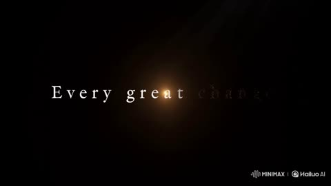</a>

提示词把名言按时间切成分段，每个短语单独设定字体、动效与情绪，结尾用负面清单约束拼写和字形稳定。

MiniMax H3 · 文生视频 · 出处: [@umesh_ai on X](https://x.com/umesh_ai/status/2083909535593644291) · 339 赞，统计于 2026-10-28 · 发现于 [SkyNotSilent/awesome-MiniMax-H3-cases](https://github.com/SkyNotSilent/awesome-MiniMax-H3-cases)

[`typography`](tags.md#tag-typography) [`text-rendering`](tags.md#tag-text-rendering) [`cinematic`](tags.md#tag-cinematic) [`motion-graphics`](tags.md#tag-motion-graphics) [`quote`](tags.md#tag-quote)

<details><summary><b>提示词</b></summary>

```text
Create a 15-second cinematic text-animation video built around the quote:  “Every great change begins quietly, grows through courage, and becomes impossible to ignore.”  The quote should appear gradually as a visual story. Each new phrase must transform the design, atmosphere, movement, and emotional intensity of the scene. Use elegant typography, accurate spelling, cinematic lighting, smooth transitions, and perfectly readable text.  0:00–0:03 | “Every great change”  Begin with a completely black screen.  A tiny point of warm light slowly appears in the center, like the first spark of an idea.  The words “Every great change” emerge softly from the darkness, one word at a time. Use thin, elegant serif typography with wide letter spacing.  “Every” fades in gently.  “Great” grows slightly larger.  “Change” forms from small drifting particles that gather into solid letters.  Keep the scene quiet, minimal, and mysterious.  0:03–0:06 | “begins quietly,”  The camera slowly moves closer to the text.  The previous words shrink and reposition toward the upper-left corner as the phrase “begins quietly,” appears in delicate lowercase letters.  Animate the phrase as though it is being written by an invisible hand.  Each letter should create a subtle ripple in the darkness.  Introduce faint textures, soft shadows, floating dust, and gentle light rays.  The comma should appear last and create a small circular pulse.  0:06–0:09 | “grows through courage,”  The pulse expands and transforms the scene from darkness into a rich sunrise gradient with deep orange, red, and golden tones.  The words “grows through courage” rise upward from the bottom of the frame.  Animate “grows” by gradually increasing its size and weight.  Animate “through” along a curved path.  Animate “courage” in bold uppercase letters that push through a translucent barrier, causing it to crack into geometric fragments.  The movement should feel powerful but controlled.  0:09–0:12 | “and becomes”  The fragments rotate in slow motion and reorganize into a clean editorial grid.  The phrase “AND BECOMES” appears across the frame in condensed sans-serif typography.  Animate the letters with fast tracking changes, vertical stretching, masking, and perspective movement.  The camera accelerates forward through the center of the word “BECOMES.”  The sound and visual energy should steadily build.  0:12–0:14 | “impossible to ignore.”  Reveal a vast bright space filled with light, moving shapes, and large-scale typography.  The words “IMPOSSIBLE TO IGNORE” appear one after another.  “IMPOSSIBLE” expands beyond the edges of the screen.  “TO” remains small and perfectly centered.  “IGNORE” slams into place with strong visual impact, briefly shaking the surrounding grid and shapes.  Use bold contrast, dramatic scale, sharp shadows, and synchronized motion.  0:14–0:15 | Final quote  All movement stops instantly.  The complete quote appears centered on a clean off-white background:  “Every great change begins quietly, grows through courage, and becomes impossible to ignore.”  Use refined black typography with “change,” “courage,” and “impossible” highlighted in deep red.  Hold the final composition clearly for the last second.  Maintain one continuous visual journey from darkness to light, silence to impact, and simplicity to complexity. Keep every phrase connected through visual transformations rather than hard cuts.  Use realistic motion blur, precise kerning, clean masks, stable letterforms, smooth camera movement, subtle film grain, cinematic sound design, rising ambient music, soft particles, controlled color transitions, and a final deep impact sound.  Avoid misspelled words, warped letters, duplicated characters, unreadable text, random symbols, excessive flickering, chaotic layouts, inconsistent fonts.
```

</details>

<a id="h3-pencil-portrait-drawn-on-blank-paper"></a>
### 双手在白纸上铅笔绘制人像

<a href="https://x.com/Just_sharon7/status/2095473707611553897">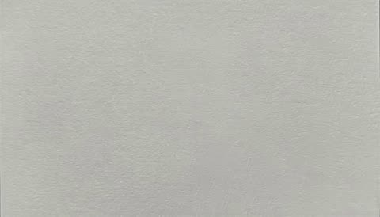</a>

提示词按真实画师的顺序推进：先是浅色构造线，再依次是布局块面、五官、头发、衣物、道具，最后上调子。同时锁定一镜到底、无剪辑、除手和铅笔外画面不动，绘制过程清晰可读，人物相貌由参考照片提供。

MiniMax H3 · 参考生视频 · 出处: [@Just_sharon7 on X](https://x.com/Just_sharon7/status/2095473707611553897) · 328 赞，统计于 2026-10-28 · 发现于 [SkyNotSilent/awesome-MiniMax-H3-cases](https://github.com/SkyNotSilent/awesome-MiniMax-H3-cases)

[`drawing-process`](tags.md#tag-drawing-process) [`pencil-sketch`](tags.md#tag-pencil-sketch) [`time-lapse`](tags.md#tag-time-lapse) [`continuous-take`](tags.md#tag-continuous-take) [`portrait`](tags.md#tag-portrait)

<details><summary><b>提示词</b></summary>

```text
A completely blank sheet of smooth white paper fills the frame. Two hands enter from the bottom. The right hand holds a sharpened graphite pencil; the left hand rests lightly at the lower-left corner of the paper to keep it still.
The right hand makes the first mark: a very light, loose oval in the center of the page for the head. Immediately add a faint vertical center line and a horizontal eye-line crossing the middle of the oval. Draw two short marks for the brow line and the base of the nose, then a light curve for the chin. All construction lines stay pale and barely visible.
Next, block in the neck as two simple sloping lines and a shallow U for the shoulders and collarbones. Sketch a rough rectangle for the torso and the square neckline of the top. Still using only the lightest pressure, place a large circle on the left for the round vanity mirror and a few vertical ovals and cylinders across the bottom for bottles and brush handles. Nothing is detailed yet—only placement.
Now the face. Darken the eye-line slightly and draw the almond shapes of both eyes, leaving a small highlight circle in each iris. Add the upper lids, a few lashes, and the gentle arch of the brows. Move to the nose: a soft wedge and two small nostril curves. Then the mouth: a short center dip, the full upper lip, and the slight upward curve of the smile. Keep every stroke inside the original oval.
Shift to the hair. Start at the hairline and draw the high, messy half-up bun with the flower-shaped clip on top and the two small barrettes on the right side. Pull long, wavy strands down the left side of the face and over the right shoulder, using loose, overlapping S-curves. Let a few shorter pieces fall across the forehead.
Refine the clothing: the ribbed texture of the white top, the thin orange trim around the neckline and sleeve, and the tiny bow at the center. Add the thin necklace chain and its small pendant. Darken the contour of the right hand resting against the cheek, fingers relaxed.
Move to the foreground still life. Outline the gold-framed round mirror on the left, then the cluster of bottles—tall toner bottle, perfume with a faceted cap, pump bottles, and the cup of makeup brushes on the right. Keep these objects slightly lighter so they sit in front of the figure without competing.
Begin shading. Hatch soft graphite under the chin, along the left side of the nose, beneath the lower lip, and in the hollow of the neck. Build darker value in the hair where strands overlap and around the clips. Add light cross-hatching on the fabric folds of the top and a faint cast shadow from the hand onto the cheek. Leave the paper white for the brightest highlights on the forehead, nose tip, and lip.
The left hand slides out of frame. The right hand makes a few final tightening strokes on the eyes and the edges of the hair, then rests the pencil at the top of the paper. The finished drawing is a complete graphite sketch of the blonde woman at her vanity, built entirely from the first faint oval to the last shadow, on otherwise empty white paper.
Satisfying, calm, close-up process video. Continuous take, no cuts, no extra motion except the hands and pencil. Soft natural light, visible pencil grain and paper tooth.
```

</details>

<a id="omni-landmark-flag-thread-embroidery"></a>
### 法国国旗色丝线绣出埃菲尔铁塔

<a href="https://x.com/TechieBySA/status/2094066231997354159">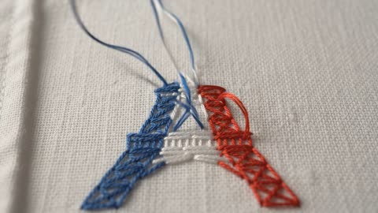</a>

只留一个 [LANDMARK] 占位符，提示词可以反复套用，并明确画面里没有手，丝线自行移动。极端微距固定机位、侧光、浅景深和平稳的延时节奏，让不断增长的绣面成为画面里唯一的运动。

Gemini Omni Flash · 文生视频 · 出处: [@TechieBySA on X](https://x.com/TechieBySA/status/2094066231997354159) · 276 赞，统计于 2026-10-28

[`embroidery`](tags.md#tag-embroidery) [`macro`](tags.md#tag-macro) [`timelapse`](tags.md#tag-timelapse) [`landmark`](tags.md#tag-landmark) [`template`](tags.md#tag-template)

<details><summary><b>提示词</b></summary>

```text
Simply replace [LANDMARK]:✨

“Extreme macro shot of woven cotton shirt fabric, empty at first. Colored embroidery threads rise from the surface and weave themselves into place, laying down tight satin stitches row by row, tracing out a detailed [LANDMARK] in its country flag colors. The stitched area grows steadily across the frame, thread pulling taut and raising into dimensional embroidered texture, colors and defining features building up stitch by stitch until the full landmark is complete and clearly recognizable. Camera holds steady, slow satisfying timelapse pace. Soft natural side light, shallow depth of field, visible fabric fibers and realistic thread sheen. No hands, thread moves on its own. One shot no scene change. 5 second video. 16:9 dimension.”
```

</details>

<a id="wan-jeweled-creatures-to-heels"></a>
### 珠宝生物变成高跟鞋

<a href="https://x.com/TaliaAariz/status/2093213718540636649">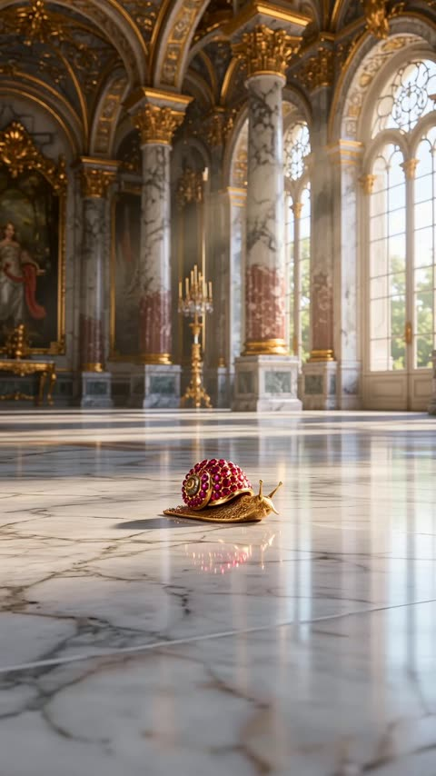</a>

重复的变形：每踩一只生物就变成一只鞋。规律只说一次，模型自己重复。

Wan 3.0 · 文生视频 · 出处: [@TaliaAariz on X](https://x.com/TaliaAariz/status/2093213718540636649) · 186 赞，统计于 2026-10-27

[`fashion`](tags.md#tag-fashion) [`transformation`](tags.md#tag-transformation) [`cg`](tags.md#tag-cg)

<details><summary><b>提示词</b></summary>

```text
A hyper-realistic high-fashion CGI animation set in an opulent palace with marble floors, featuring a sequence where bare feet with matching manicured toenails step onto ornate, jewel-encrusted luxury creatures that magically transform into high-heeled shoes. First, a foot with red polished toes steps onto a ruby-and-gold jeweled snail, which unfolds and morphs into a breathtaking crimson gem-studded stiletto pump with delicate gold ankle straps. Next, a foot with blue nails steps onto a sapphire-blue jewel dragonfly, which transforms into a royal blue high heel adorned with shimmering iridescent wings at the heel. Finally, a foot with green nails steps onto a faceted emerald scarab beetle, which transforms into an elegant emerald stiletto featuring delicate butterfly wings, completing each transformation as the wearer steps forward in a luxury fashion showcase.
```

</details>

<a id="h3-rift-dimensional-tear-metal-title-sequence"></a>
### 白色能量裂隙撕开空间并凝成金属标题

<a href="https://x.com/CharaspowerAI/status/2101989866762354988">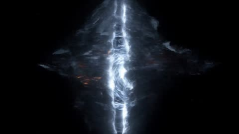</a>

提示词按时间顺序写成连续节拍：细线裂开成缝，镜头加速冲入，裂隙闭合，碎片压缩成字母。指定字体材质、裂缝中困住的能量和快速环绕运镜，让文字像一场事件。

MiniMax H3 · 文生视频 · 出处: [@CharaspowerAI on X](https://x.com/CharaspowerAI/status/2101989866762354988) · 164 赞，统计于 2026-10-28 · 发现于 [SkyNotSilent/awesome-MiniMax-H3-cases](https://github.com/SkyNotSilent/awesome-MiniMax-H3-cases)

[`title-sequence`](tags.md#tag-title-sequence) [`sci-fi`](tags.md#tag-sci-fi) [`kinetic-typography`](tags.md#tag-kinetic-typography) [`vfx`](tags.md#tag-vfx) [`dark`](tags.md#tag-dark)

<details><summary><b>提示词</b></summary>

```text
High-end sci-fi title sequence beginning with a razor-thin line of white energy slicing vertically through complete darkness. Space immediately begins deforming around it as metallic particles, dust and glowing fragments are violently pulled toward the opening. The line tears wider into a gigantic dimensional fracture filled with unstable plasma and gravitational distortion. The camera accelerates directly toward the rift, violently banking between fragments being stretched into luminous trails. Suddenly the dimensional tear snaps shut with enormous force, compressing all surrounding matter into four gigantic black-metal letterforms that slam together to reveal "RIFT". Brilliant energy remains trapped inside deep cracks across the typography while space visibly bends around its edges. The camera performs a fast orbital move before the title itself splits open along its center, releasing a catastrophic dimensional shockwave that tears through the frame. Sophisticated cosmic distortion, aggressive kinetic typography, premium superhero-film VFX.
```

</details>

<a id="veo-shadow-corridor-panther-fur-morph"></a>
### 红光黑丝线走廊化为豹毛

<a href="https://www.reddit.com/r/comfyui/comments/1pic471/product_ads_with_veo_31_in_comfyui">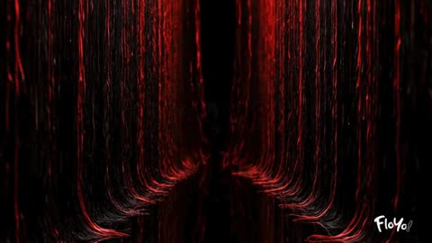</a>

结构化 JSON 把外观、镜头和连续性拆成独立字段，让整段变形保持在一个连续镜头内。每次换镜头都绑定到变形的某个阶段，模型便知道何时该拉宽画面。

Veo 3.1 · 文生视频 · 出处: [u/ThinkDiffusion on Reddit](https://www.reddit.com/r/comfyui/comments/1pic471/product_ads_with_veo_31_in_comfyui) · 84 赞，统计于 2026-10-29

[`json-prompt`](tags.md#tag-json-prompt) [`single-take`](tags.md#tag-single-take) [`surreal-morph`](tags.md#tag-surreal-morph) [`fashion-ad`](tags.md#tag-fashion-ad)

<details><summary><b>提示词</b></summary>

```text
Been testing json-format prompts for e-commerce product ads in Veo 3.1. Incredible results so far!

Average generation time: 1 min to 3 mins

Here are the prompts, give them a try and share your thoughts on Veo 3.1!

1. Shadow Corridor to Panther-Fur Figure — One Take Ritual

{
  "title": "Shadow Corridor to Panther-Fur Figure — One Take Ritual",
  "duration_seconds": 8,

  "look": {
"style": "Cinematic hyperreal surrealism",
"grade": "Black void corridor with razor-red reflections and ink-like shadows",
"grain": "Ultra-fine film grain, polished luxury surreal texture"
  },

  "continuity": {
"single_camera_take": true,
"no_cuts": true,
"texture_alignment": "Shadow threads thicken into panther fur strands, which liquify into black latex sheen, becoming finally the coat fabric and the BALENCIAGA typography.",
"motion_vector_continuity": "Forward glide → dissolve downward into shadow fluid → resurfacing ascent → final reveal in one breath"
  },

  "camera": {
"lens": "40mm claustrophobic → 90mm macro shadow immersion → 24mm wide reveal",
"movement":
"Begin inside a narrow corridor made of living black threads trembling with red glints.
Camera glides forward, pulling shadows apart.
As the lens reaches a cluster of dense threads, they melt into viscous black fluid that swallows the camera.
Inside the liquid shadow chamber, silky fur strands drift like underwater growth.
In one continuous upward pull, the fluid becomes a rising curtain of panther fur, expanding into a massive black hallway.
The camera emerges to reveal a tall figure wearing a sculptural BALENCIAGA coat, its texture identical to the panther fur."
  },

  "action": {
"environment": [
"Corridor made of vibrating black threads with crimson micro-reflections",
"Threads merging into midnight panther-fur strands, rippling as if breathing",
"Fur liquifying into shadow fluid with metallic red veins",
"Shadow fluid rising and flattening into a glossy black runway surface",
"A towering figure standing at center, wearing an obsidian BALENCIAGA coat whose fabric continuously ripples like a living panther pelt"
],

"creature_energy": [
"Subtle panther-like movements inside the shadows",
"Fur ripples reacting like muscles beneath the surface",
"A brief suggestion of panther eyes glowing within the liquid black before dissolving"
]
  },

  "lighting": {
"time_of_day": "Timeless void",
"style": "High-fashion noir lighting with red razor-edge highlights, soft volumetric shadows, underglow fur shimmer"
  },

  "audio": {
"sound_effects": [
"Soft tearing of threads as they expand",
"Low predatory hum pulsing like a panther growl under the mix",
"Viscous shadow-fluid drips and slithers",
"Bass-heavy rise as the figure emerges"
]
  },

  "scene_notes": "Everything must feel like a single morph. The environment should behave like a living organism evolving toward the final BALENCIAGA figure. No cuts, no breaks — just one evolving shadow-fabric continuum with subtle panther energy. The BALENCIAGA text can emerge at the end by stretching out of the coat’s fur strands, as if the brand name is woven from darkness itself."
}

2. IKEA Scandinavian Bedroom Assembly

{
  "description": "Cinematic shot of a sunlit Scandinavian bedroom. A sealed IKEA box trembles, opens, and flat pack furniture assembles rapidly into a serene, styled room highlighted by a yellow IKEA throw on the bed. No text.",
  "style": "cinematic",
  "camera": "fixed wide angle",
  "lighting": "natural warm with cool accents",
  "room": "Scandinavian bedroom",
  "elements": [
"IKEA box (logo visible)",
"bed with yellow throw",
"bedside tables",
"lamps",
"wardrobe",
"shelves",
"mirror",
"art",
"rug",
"curtains",
"reading chair",
"plants"
  ],
  "motion": "box opens, furniture assembles precisely and rapidly",
  "ending": "calm, modern space with yellow IKEA accent",
  "text": "none",
  "keywords": [
"16:9",
"IKEA",
"Scandinavian",
"fast assembly",
"no text",
"warm & cool tones"
  ]
}

3. Tiffany & Co Jewellery Advertisement

{

  "description": "8-second premium Tiffany & Co jewellery advertisement video. It begins with a creative, artistic brand reveal, then a realistic attractive model wearing jewellery, moving naturally — elegant, fluid, dynamic and real.",

  

  "style": "luxury jewellery campaign, natural high-fashion cinematography, fluid modelling movements, modern elegance, artistic realism.",

  

  "camera": "portrait-lens (85-135 mm) with gentle camera motion — slow dolly/slider or handheld-style softness for realism, smooth push-ins and rack focus between jewellery and model’s face/hands.",

  

  "lighting": "soft beauty lighting with subtle accent lighting on jewellery (diamonds, metal), rim light to highlight contours, gentle reflections, some coloured-light accents (Tiffany-blue, soft teal, soft prism colours) to add artistic vibe.",

  

  "model": {

"face": "full face visible when needed, but also allowed natural body turns, head tilts, movement — she should not stand straight; posture and gesture flow naturally.",

"vibe": "elegant, confident, relaxed sophistication, natural charisma, modern beauty with subtle motion."

  },

  

  "jewellery": [

"Tiffany & Co diamond necklace",

"diamond earrings",

"signature bracelet",

"white-gold/platinum settings"

  ],

  

  "beats": [

"0–1s: deep black screen. A soft swirl of luminous Tiffany-blue liquid-light flows across the frame. From within the glow, the white serif 'TIFFANY & CO.' logo slowly reveals as if carved by light. Subtle diamond-spark particles shimmer around the logo. Heritage glow — elegant, artistic, premium.",

"1–2s: the logo gently dissolves into flowing Tiffany-blue light ribbons that drift across the frame and transform into soft colourful reflections.",

"2–3s: the model emerges naturally from the moving Tiffany-blue reflections, body turned slightly at a three-quarter angle, not standing straight. Necklace catches the same moving light that came from the logo.",

"3–4s: smooth dolly-in to medium close-up. She lifts her hand to brush her hair back naturally, revealing earrings and bracelet with soft artistic light play.",

"4–5s: macro close-up on the diamond necklace — facets catch realistic sparkle with soft colourful prism reflections, not exaggerated.",

"5–6s: camera moves back to an elegant portrait shot. She tilts her head slightly, offering a calm confident smile. Jewellery remains the visual focus.",

"6–7s: gentle slow-motion movement as she lowers her hand and shifts her weight naturally (contrapposto stance). Bracelet and ring catch subtle reflections. Background darkens gradually.",

"7–8s: full fade to black. The Tiffany-blue liquid-light returns and sweeps across the screen once more. As it passes, the bold white 'TIFFANY & CO.' logo reappears sharply in the center with a refined glow. Tiny diamond spark flashes once on the ampersand (&). Logo holds strong for final brand authority."

  ],

  

  "product": [

"Tiffany & Co diamond necklace",

"diamond earrings",

"luxury bracelet or rings",

"platinum/white-gold jewellery pieces"

  ],

  

  "motion": "smooth natural body/hand/head movements, gentle camera motion (dolly/slider or slight handheld), slow dolly in/out, soft fluid transitions, no rigid posing or straight-on fixed stance.",

  

  "ending": "pure black background with creative Tiffany-blue liquid-light logo reveal and subtle diamond spark accent.",

  

  "text": "TIFFANY & CO. — clean white serif font revealed through animated Tiffany-blue light and diamond spark accent.",

  

  "keywords": [

"creative logo animation",

"luxury jewellery ad",

"dynamic model movement",

"natural posing jewellery",

"bold artistic branding",

"Tiffany jewellery cinematography",

"fluid motion commercial",

"elegant modern beauty",

"vertical 9:16 format",

"brand-first reveal with animated light"

  ],

  

  "brand_elements": [

"animated Tiffany-blue liquid-light logo reveal",

"diamond spark accent on final logo",

"Tiffany-blue light identity",

"final black-screen premium brand hold"

  ],

  

  "format": {

"aspect_ratio": "16:9",

"fps": 24

  }

}

4. NIKE-Style Sneaker & Black Snake Interaction

{

  "description": "8-second cinematic animation of a NIKE-style sneaker interacting with a black snake in dark studio space. No text.",

  "style": "cinematic dark energy",

  "camera": "macro orbit then fast push-in",

  "lighting": "sharp rim light with metallic scales reflection",

  "beats": [

"0-1s: single sneaker in darkness, subtle breath of vapor",

"1-3s: black snake made of smoke and scales slithers around the shoe sole",

"3-5s: snake coils upward, tightening and forming the shoe laces and swoosh shape",

"5-7s: coil snap motion reveals pristine completed sneaker, scales drifting away",

"7-8s: final rotation with snake eye reflection on shoe surface"

  ],

  "product": [

"running sneaker",

"snake scale texture",

"black vapor"

  ],

  "motion": "snake wraps, forms shape, releases",

  "ending": "shoe floating with subtle scale shimmer",

  "text": "none",

  "keywords": [

"16:9",

"product + animal FX",

"coil motion",

"dark studio",

"no text"

  ]

}

5. Infinite Corridor Outfit Metamorphosis

Continuous tracking shot following a model walking down an infinite surreal corridor with mirrors on both sides, she starts wearing a dress made of actual dense fog that swirls and dissipates revealing the next outfit, transitions into a gown of living flames that burn without consuming flowing upward like reverse waterfalls, morphs into a crystalline ice sculpture dress that cracks and reforms with each step creating musical chimes, dissolves into flowing liquid mercury that reflects distorted surroundings, blooms into a dress of living flowers that grow accelerate through full life cycles in seconds, evaporates into northern lights aurora borealis fabric that waves impossibly in non-existent wind, finally becomes pure geometric light constructs that flicker between dimensions, her face and body remain constant while outfits seamlessly transition, each material has hyper-realistic physics and textures, the corridor behind her shifts through cosmic nebulae, underwater depths, storm clouds, and abstract void, shot with smooth gimbal movement at 60fps slowed to 24fps for dreamy motion, volumetric lighting and atmospheric fog, fashion meets elemental magic meets psychedelic surrealism

6. Bobbi Brown Lipstick Beauty Commercial

{

  "description": "8-second luxury beauty commercial featuring beautiful woman applying Bobbi Brown lipstick with elegant close-ups and brand reveal. High-end cosmetics aesthetic.",

  "style": "premium beauty editorial with cinematic glamour and sophisticated elegance",

  "camera": "extreme close-up on lips transitioning to medium beauty shot, 100mm macro lens f/2.0 for lip detail then 85mm f/1.4 for face, slow push-in creating intimacy",

  "lighting": "soft beauty lighting with ring light creating catchlights in eyes, warm golden key light from 45-degrees, subtle fill to eliminate shadows, cream seamless background with soft gradient to champagne gold",

  "beats": [

"0-1s: black screen, Bobbi Brown logo in elegant serif font fades in with rose gold shimmer",

"1-2s: extreme close-up of woman's perfect lips in natural nude tone, flawless skin texture visible, anticipation",

"2-3s: elegant hand with manicured nails brings Bobbi Brown lipstick tube into frame, rose gold metal casing catching light with embossed logo visible",

"3-4s: lipstick cap removes in slow motion revealing rich creamy formula in sophisticated mauve-brown shade, bullet perfectly shaped",

"4-5s: first application stroke across bottom lip in extreme slow motion, rich color payoff visible, creamy texture gliding smoothly, lip detail and natural shine",

"5-6s: camera slowly pulls back revealing woman's beautiful face - glowing skin, defined features, confident elegant expression, she completes lip application with precision",

"6-7s: she presses lips together distributing color, then relaxes into subtle knowing smile, perfect lips now in rich Bobbi Brown shade with natural satin finish",

"7-8s: final beauty shot - face centered with perfect lighting, lips prominently featured, Bobbi Brown lipstick tube held elegantly near face, large brand logo and product name appear in rose gold text bottom center with tagline 'Be Who You Are'"

  ],

  "subject": [

"stunning woman in her late 20s with classic beauty",

"flawless glowing skin with warm undertones",

"naturally full perfectly shaped lips",

"elegant bone structure with defined cheekbones",

"soft natural makeup - glowing skin, subtle eyes, focus on lips",

"hair styled in sleek low bun or soft waves, elegant and timeless",

"wearing simple cream or beige clothing, no distracting patterns",

"manicured nails in nude or soft pink shade",

"confident yet approachable expression"

  ],

  "product": [

"Bobbi Brown Luxe Lip Color lipstick",

"rose gold metal tube with weight and luxury feel",

"embossed Bobbi Brown logo on tube catching light",

"rich creamy formula in sophisticated mauve-brown nude shade",

"perfectly shaped bullet with angled tip for precision",

"satin finish - not matte, not glossy, naturally radiant",

"visible smooth texture and pigment payoff"

  ],

  "motion": "slow graceful hand movement bringing product to lips, cap removal in slow motion, lipstick application glide showing texture, lips pressing together, subtle smile formation, camera push-in on face, brand logo fade-in with shimmer effect",

  "ending": "hero beauty shot with model's perfected lips center frame, product held elegantly, confident expression, large Bobbi Brown branding with rose gold shimmer, sophisticated and aspirational",

  "text": "BOBBI BROWN in elegant serif font, rose gold color with subtle shimmer. Product name 'Luxe Lip Color' in smaller refined text. Tagline 'Be Who You Are' in script font. All text bottom center with professional cosmetics branding aesthetic",

  "keywords": [

"16:9",

"120fps slow motion for application",

"macro beauty photography",

"rose gold and cream color palette",

"luxury cosmetics commercial",

"lipstick application beauty",

"premium beauty brand",

"natural elegance aesthetic"

  ],

  "brand_elements": [

"Bobbi Brown logo embossed on lipstick tube",

"Rose gold metal packaging signature to brand",

"Brand wordmark in elegant serif font",

"Tagline 'Be Who You Are' reinforcing brand values",

"Natural beauty aesthetic - sophisticated not dramatic",

"Warm neutral color palette matching brand identity",

"Luxe Lip Color product line name visible"

  ],

  "beauty_details": {

"skin": "flawless glowing complexion, warm undertones, natural radiance",

"lips": "naturally full, perfect cupid's bow, smooth texture, enhanced not transformed",

"eyes": "subtle neutral shadow, defined lashes, warm brown tones",

"brows": "naturally groomed, defined shape",

"overall_look": "effortlessly elegant, timeless beauty, confident sophistication"

  },

  "color_palette": {

"primary": "rose gold - luxury, femininity, warmth",

"secondary": "cream and champagne - elegance, sophistication",

"accent": "warm browns and mauves - natural, wearable, Bobbi Brown signature",

"background": "soft neutral gradient - focus on subject and product"

  },

  "audio_suggestions": [

"soft sophisticated music - perhaps piano or strings",

"subtle lipstick application sound effects",

"gentle ambient room tone",

"optional: soft female voiceover saying tagline at end"

  ]

}
```

</details>

<a id="omni-street-scan-object-to-hand-drawn"></a>
### 第一人称扫描街头物件变成手绘动画

<a href="https://www.reddit.com/r/GeminiAI/comments/1vsgjgi/this_feels_like_such_a_fun_video_idea_to_plan">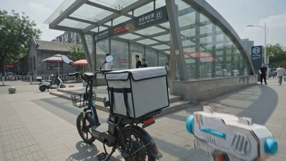</a>

第一人称手持装置扫描真实物体,只有被锁定的目标变成粗糙的二维手绘动画,其余画面保持实拍。四个硬切镜头都重复扫描、锁定、变形的同一流程,并写明位置、透视、遮挡和阴影保持不变,让替换看起来是一镜到底。

Gemini Omni Flash · 文生视频 · 出处: [u/Few-Profession421 on Reddit](https://www.reddit.com/r/GeminiAI/comments/1vsgjgi/this_feels_like_such_a_fun_video_idea_to_plan) · 76 赞，统计于 2026-10-28

[`pov`](tags.md#tag-pov) [`hand-drawn`](tags.md#tag-hand-drawn) [`live-action-composite`](tags.md#tag-live-action-composite) [`object-transform`](tags.md#tag-object-transform) [`street`](tags.md#tag-street)

<details><summary><b>提示词</b></summary>

```text
10 second SNS vertical short video, aspect ratio 3:4, 30fps. Setting: Beijing summer street, August midday 13:00, hot humid sunny weather 35°C, strong harsh sunlight, distant developing grey white cumulus clouds hinting afternoon thunderstorm, dry ground. First person smartphone POV shot, left hand holding phone out of frame, live action phone footage composited with rough cute 2D hand drawn frame by frame animation. Ordinary real world Beijing street scenes, no famous landmarks, no readable signs or text. Real human right hand enters frame from bottom right corner, holding fully fictional childish cardboard toy water gun style graffiti morph device; short chubby asymmetrical white cardboard bulk, cyan blue circular scanning ring on front, short clumsy toy water gun like grip, loose uneven black marker outline, visible white paper fiber, sparse cyan blue and light pink colored pencil hatching, single circular energy slot on side, no gun barrel, no weapon like structures. Maintain identical shape, color, size and hand grip posture for right hand and graffiti morph device across all shots. Press circular trigger button, scanning ring emits small cyan blue hand drawn ripple plus a few black ink dots only, no shooting, no explosion, no flame, no damage. Ripple hits target, a 0.6 to 0.8 second hand drawn lock on frame appears: wobbly black loose lines, cyan circles, light pink scale ticks, jittery graffiti markers tightly sticking onto target respecting perspective and occlusion. After lock on finishes, only the targeted everyday object transforms in place into rough cute 2D hand drawn animation; real life humans, streets, buildings, trees and other objects remain live action smartphone footage. Four shots connected by clean hard cuts only, no fades, no transition effects. Each shot fully shows the complete sequence: real world target, then lock on effect, then in place transform to hand drawn version before cutting.

[0.0 to 2.5s Shot 1: takeout thermal box beside subway entrance]: Ordinary Beijing subway entrance exterior, glass canopy, light grey stone ground, yellow tactile paving, street trees, no readable station name. Strong midday sun creates bright specular reflection on glass and pavement. Parked electric bicycle at shadow edge, rear rack mounts a plain text free light grey square takeout thermal box. Slight forward walking camera motion. Right hand with graffiti morph device enters bottom right, aims at thermal box. Trigger pressed, cyan blue scanning ripple hits box, lock on frame adheres accurately respecting perspective and bicycle occlusion. After about 0.7s, only the thermal box transforms in place into a 2D hand drawn version: white paper box body, boiling jittery black outline strokes, cyan blue edge trim, light pink buckles, sparse ink specks; mounting position, dimension, orientation and shadow direction stay exactly unchanged. Electric bike, glass canopy, paving and passers by stay live action.

[2.5 to 5.0s Shot 2: folding paper fan at grey brick hutong entrance]: Beijing grey brick hutong entrance under dense locust tree shade, dappled sunlight filtering through leaves, background air conditioning outdoor units, stone steps, slowly passing pedestrians, no readable house number. A passer by in light summer clothes walks left to right, only lower shoulder to back visible, naturally waving a light wood folding fan. Graffiti morph device tracks the fan from bottom right. Trigger pressed, lock on frame follows the fan swinging angle and hand occlusion. After about 0.7s, only the folding fan becomes hand drawn 2D animation: white paper fan surface, loose black line fan ribs, cyan blue and light pink colored pencil diagonal hatching. The real human hand, clothes, body and hutong environment keep live action. The hand drawn fan keeps a natural swinging rhythm driven by the real human wrist, never detaching from the palm.

[5.0 to 7.5s Shot 3: wide brim sun hat outside commercial street crossing]: Pedestrian waiting zone outside a modern Beijing commercial street, light colored pavement, metal bollards, tree pits, blurred shared bikes in background, scorching bright sunlight, humid hot air. A passer by wearing a plain light beige wide brim sun hat walks slowly from front right toward front left, back view only, no clear facial features. Slight laggy tracking camera movement. Graffiti morph device aims at the hat, cyan blue ripple travels a short distance, lock on frame strictly follows the hat brim elliptical perspective, head occlusion and walking bounce. After about 0.6s, only the sun hat transforms into a white paper textured hand drawn hat: irregular black brim outline, cyan blue hatching on the hatband, light pink marker patch on the hat top. The passer by hair, body, clothes and whole street stay live action. The hand drawn hat bounces subtly with walking pace, firmly sitting on the real human head.

[7.5 to 10.0s Shot 4: cold water sports bottle on shaded stone pier]: Street corner tree shade, a light grey stone pier holds a text free translucent cold water sports bottle with a carry loop, real condensation water droplets on the bottle surface. Background sun blasted Beijing street, distant slow walking pedestrians, rounded summer cumulus clouds in the sky. Slight camera push in. Graffiti morph device from bottom right aims at the bottle. Trigger pressed, lock on frame orbits around the bottle for about 0.8s. Only the sports bottle transforms in place into a white background black line 2D hand drawn bottle: translucent white paper fill, cyan blue bottle cap, light pink carry loop, colored pencil hatching, tiny ink specks. Bottle to stone pier contact point, gravity, perspective and original shadow direction fully preserved. Several wiggly cyan blue hand drawn cold steam lines rise from the bottle outer surface, tiny black ink specks float upward like small bubbles. Video ends on a frame with swaying cold steam lines and slowly drifting distant clouds.

2D hand drawn animation style: uneven wobbly black outlines, white paper fill, colored pencil and marker hatching texture, ink grain, slightly overbleeding color blocks, frame by frame subtle boiling line jitter on every drawing frame, a child like rough cute hand drawn aesthetic; no smooth vector graphics, no 3D CG render, no plastic material look, no neon sci fi hologram glow. After transformation, the converted object strictly inherits the original pixel position, scale, orientation, motion trajectory, gravity weight, perspective, occlusion relation, contact anchor points and shadow direction. Only the target object visual material gets replaced; the background, real human figures and supporting objects never animate. The lock on frame must stay tightly aligned to the target, no misalignment; the graffiti morph device never changes shape or color across hard cuts.

Camera spec: smartphone main camera 1x wide angle, equivalent focal length 24 to 28mm, no 0.5x ultra wide or fisheye lens. Electronic image stabilization enabled, preserve subtle natural hand held micro shake, minor vertical bounce during walking, slight tracking lag, tiny auto exposure fluctuation. The right hand and morph device near the lens appear slightly larger with soft minor softness; street background and target objects stay reasonably sharp. No heavy shallow depth of field bokeh blur. Color grading: bright clean pastel cyan pink pop aesthetic, keep Beijing street photoreal believability. Sky and glass highlight tint soft pale cyan blue, grey brick and stone keep neutral clean tone, skin and warm surfaces tint soft peach pink, foliage low saturation olive green and teal green. Exposure lifted plus 0.5 stop, elevated black and white levels, low to medium contrast, subtle smartphone HDR, gentle digital sharpening, light SNS social media filter texture. No heavy film grain, no strong lens flare, no teal orange cinematic grading, no crushed deep black shadows.

Audio: zero dialogue, zero voiceover, zero background music. Only a soft button click sound effect, a gentle electronic lock on beep, a marker pen on paper scratching sound, and a faint ink dot pop sound, mixed with quiet real world Beijing summer street ambient noise; sound effects precisely sync with the four lock on trigger moments.

Strict prohibitions: no on screen text, no titles, no logos, no watermarks, no brand, shop, station or license plate readable text. No firearm shaped props, no muzzle like structures, no bullets, no shooting impact, no attack, no explosion, no fire, no physical destruction. Never animate the full frame image, never animate real human bodies. No target object drifting, geometry warping, proportion mutation, clipping through geometry, or detaching from contact surfaces. The graffiti morph device must not alter shape or color. No deformed hands, extra fingers, missing fingers, or left right hand swap errors. No extreme fisheye distortion, no heavy background bokeh, no excessive glowing bloom, no violent camera rotation, no slow motion, no black out frames, no freeze frame.
```

</details>

<a id="h3-shapes-mascot-learning-animation"></a>
### 吉祥物讲解四种基础形状动画

<a href="https://x.com/Strength04_X/status/2084586713205317678"></a>

用定时分镜表为每个形状固定同一套顺序：形状、旁白、物品、动作、屏幕文字，模型会按同一结构重复四次。把旁白原文写进提示词，并让每个词对应自己的高亮颜色，声音提示和画面才能同步。

MiniMax H3 · 文生视频 · 出处: [@Strength04_X on X](https://x.com/Strength04_X/status/2084586713205317678) · 61 赞，统计于 2026-10-29 · 发现于 [SkyNotSilent/awesome-MiniMax-H3-cases](https://github.com/SkyNotSilent/awesome-MiniMax-H3-cases)

[`educational`](tags.md#tag-educational) [`kids`](tags.md#tag-kids) [`shapes`](tags.md#tag-shapes) [`mascot`](tags.md#tag-mascot)

<details><summary><b>提示词</b></summary>

```text
Create a 15-second animated educational video that teaches young children the shapes Circle, Square, Triangle, and Star.

Learning pattern for every shape:
SHAPE → NAME SOUND → OBJECT → PLAYFUL ACTION → OBJECT NAME
Target audience: children ages 3 to 6

Visual style: Same premium-cute aesthetic pastel colors, rounded 3D forms, soft lighting, minimalist off-white background, unique glow color per shape, crisp bold typography, polished smooth morphing transitions.

0:00–0:01 Intro: Mascot bounces in, shapes float briefly, text "Let's learn shapes!", tap reveals first shape with a ripple.

0:01–0:04 | Circle is for Orange: A perfect circle appears. Narrator: "Circle. Round and round. Circle is for Orange." Circle gains texture and a tiny stem, becomes a smiling orange, bounces once. Word "ORANGE," highlight shape outline in orange.

0:04–0:07 | Square is for Gift Box: The orange rolls and reshapes into a square. Narrator: "Square. Four equal sides. Square is for Gift Box." Square gains a ribbon and bow, wiggles playfully. Word "GIFT BOX," highlight in purple.

0:07–0:10 | Triangle is for Mountain: The ribbon folds into a triangle. Narrator: "Triangle. Three sides. Triangle is for Mountain." Triangle grows a snowy peak and a small smiling sun beside it. Word "MOUNTAIN," highlight in brown/teal.

0:10–0:13 | Star is for Sky: The mountain peak stretches into a star. Narrator: "Star. Star is for Sky." Star twinkles softly with tiny sparkles floating around it, gentle glow pulse. Word "STAR," highlight in golden yellow.

0:13–0:15 Recap: Orange, gift box, mountain, star line up in four tiles with shape outlines above. Mascot points to each in sequence.

Narrator: "Circle, Square, Triangle, Star. Great job!" Sparkle + warm chime.

Requirements: Each shape fully visible before morph, uppercase-clarity level precision on shape edges, no warped or duplicated forms, gentle motion only, synced sound cues, calm and beautifully polished finish.
```

</details>

<a id="h3-one-man-through-history-future-war-time-journey"></a>
### 同一个男人穿越历史直至未来战场

<a href="https://x.com/qtum/status/2105438735248801831">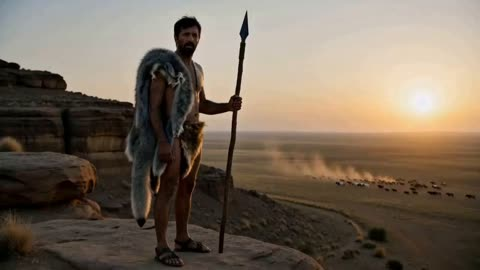</a>

机位全程锁定不动，场景与同一个男人的服装在原地渐变，每个时代约三秒的时间节拍。角色段落锁定同一张脸，每一段都从上一段的末帧接续，保证单镜头无缝。

MiniMax H3 · 文生视频 · 出处: [@qtum on X](https://x.com/qtum/status/2105438735248801831) · 60 赞，统计于 2026-10-28 · 发现于 [SkyNotSilent/awesome-MiniMax-H3-cases](https://github.com/SkyNotSilent/awesome-MiniMax-H3-cases)

[`time-journey`](tags.md#tag-time-journey) [`costume-change`](tags.md#tag-costume-change) [`single-take`](tags.md#tag-single-take) [`static-camera`](tags.md#tag-static-camera) [`multi-part`](tags.md#tag-multi-part)

<details><summary><b>提示词</b></summary>

```text
One Breath of History, then the Machine (time journey v5)

Film style
Cinematic live-action, photorealistic, epic natural light, rich period-accurate detail, one continuous evolving take with no cuts, fades or resets. The same man is present throughout; the world and his clothing transform seamlessly in place. No generated subtitles, captions or on-screen text.

Character A: The traveller
A rugged man in his thirties with a weathered, expressive face, real skin texture, dark tousled hair and a short dark beard, lean and strong. The same face in every era.

Era 1 clothing (changes with each era as the shots direct): a ragged grey wolf pelt draped over one shoulder, a fur loincloth, bare dust-streaked arms, a leather cord around the neck.
part_01 (15s, cast A)

Composition: Static wide shot. At the start: a rocky cliff at sunrise, A standing on it as a prehistoric hunter: a ragged grey wolf pelt draped over one shoulder, a fur loincloth, bare dust-streaked arms, a leather cord around his neck, holding a crude wooden spear with a flint tip, watching a herd of animals on the plain below.

Action: One seamless unbroken take with no cuts, fades or resets; every change is a continuous transformation in place, and his face never changes. [0s-3s] Prehistoric: A stands on the rocky cliff at sunrise in the wolf pelt and fur loincloth with the flint-tipped spear, watching the herd. [3s-6s] The cliff dissolves into a Sumerian mud-brick settlement; his pelt becomes a knee-length woven wool kaunakes skirt with tufted fringes, bare chest, a plain linen sash and leather sandals, and the spear becomes a long wooden farming staff; he runs through the settlement. [6s-9s] The settlement becomes ancient Egypt with pyramids; he now wears a white pleated linen shendyt kilt, a broad beaded collar in blue and gold, a striped linen headcloth and sandals, with kohl-lined eyes, walking among the pyramids. [9s-12s] Egypt becomes a grand Roman road of stone and sand; he now wears desert travel attire: a dusty cream tunic under a hooded sand-coloured wool cloak, a leather belt with a waterskin, laced sandals, the hood shading his face from the sun; he travels along the road. [12s-15s] The road becomes the interior of a medieval castle hall; he enters as a knight in full plate steel armour with a mail coif, a plain white surcoat, gauntlets and a sword at his hip, visor raised so his face stays visible. No dialogue; ambient sound of each era only.
Camera: Completely static, locked-off wide camera; no movement, zoom or reframing at all. The scenery and the man's clothing transform in place within the frame.

part_02 (15s, cast A, ends at 13.0s)
Composition: Continues exactly from the previous frame: A as a knight in full plate steel armour with a mail coif, plain white surcoat and raised visor, standing inside a medieval castle hall.
Action: One seamless unbroken take continuing the previous part with no cut, fade or reset; every change is a continuous transformation in place, and his face never changes. [0s-3s] The castle hall dissolves into a sandy beach at the water's edge with tall ships sailing out in the distance; his armour becomes an 18th-century sailor's coat of dark navy wool with brass buttons over a striped jersey, white canvas trousers rolled to the calf, a knotted red neckerchief, barefoot; he walks along the shoreline. [3s-6s] The beach becomes a colonial port city of the mid-1800s: brick warehouses, a cobbled quay, tall ships' masts, horse carts and stacked crates; he now wears a mid-19th-century gentleman's suit of that exact period: a long black wool frock coat, a buttoned waistcoat with a gold watch chain, a high starched wing collar with a dark silk cravat, narrow grey striped trousers, polished black leather boots and a black silk top hat on his head; he stands on the quay. [6s-9s] The port becomes a modern urban street; he now wears contemporary casual clothes: a grey hoodie under an olive bomber jacket, dark jeans, white trainers, earbuds; he walks along the pavement.
[9s-12s] The street becomes a bustling present-day metropolis of glass towers and crowds; he now wears a slim black overcoat over a plain white t-shirt, dark trousers and sleek trainers, a smartwatch on his wrist; he stands still among the motion. [12s-15s] The metropolis becomes a far-future city of luminous towers; he now stands completely still in an advanced white-and-graphite space suit with articulated plates, a softly glowing blue chest indicator and a clear helmet visor showing his face, observing the landscape while faint visual echoes of all the past eras layer within the sky and the architecture. The take ends there. No dialogue, ambient sound only.
Camera: Completely static, locked-off wide camera; no movement, zoom or reframing at all. The scenery and the man's clothing transform in place within the frame.

part_03c (6s, cast A)
Composition: Continues exactly from the previous frame: the man in the white-and-graphite space suit standing completely still before the far-future city of luminous towers.
Action: One seamless unbroken take continuing the previous part with no cut, fade or reset; the framing stays identical. [0s-1.5s] Sci-fi robot quadcopters, four-rotor drones with mounted guns and red sensor lights, swarm in over the futuristic city firing bright tracer rounds; explosions bloom on the luminous towers and smoke rises. [1.5s-3s] A is hit by the drone gunfire and collapses to the ground, falling face up, completely motionless, eyes closed, no blood or gore. [3s-6s] Other people in futuristic clothing run into frame from both sides toward him; the drones open fire on them and each one is knocked down by the bullets mid-stride, falling onto A and onto each other, one after another, until a pile of the fallen lies still on top of him at the foot of the burning city. Nobody kneels, helps or crouches; they only run, get shot and fall. The drones keep circling and firing overhead. The take ends there. No dialogue; rotor whine, gunfire and distant explosions.
Camera: Completely static, locked-off wide camera; no movement, zoom or reframing at all. The scene transforms in place within the frame.
part_04d (6s, cast none)
Composition: Continues exactly from the previous frame: the pile of the fallen lying still at the foot of the burning futuristic city, drones circling overhead.
Action: One seamless unbroken take continuing the previous part with no cut, fade or reset. [0s-1.5s] The drones fly off, the fires die to smoke, and the pile of the fallen dissolves into dusty, faded, sun-bleached bones and skulls spread across the ground; the burning towers become the dark ruined skyline of the same futuristic city on the horizon. The frame is empty of anyone standing. [1.5s-5s] A towering military war robot, a heavily armoured bipedal battle machine in scorched gunmetal plating with battle damage and soot, six articulated arms spread from its shoulders each ending in a weapon: rotary cannons, gun barrels and a missile pod, glowing red optical sensors in an armoured head, exposed hydraulics and steel ribs, no logos or markings, walks into the frame from the right edge with slow heavy steps, crunching across the bones, and steps up onto the heap of skulls in the centre of the frame, stopping there. [5s-6s] It stands still on the bones, then slowly turns its head toward the camera. The take ends there. No dialogue. Audio: no music at all; only the same natural ambience as the rest of the film, wind over the ruins, distant crackling fire and settling smoke, and the machine's heavy metallic footsteps.
Camera: Completely static, locked-off wide camera; no movement, zoom or reframing at all. The scene transforms in place within the frame.
```

</details>

<a id="h3-street-fighter-arcade-zoom-transition"></a>
### 街机实拍画面推入《街头霸王II》游戏画面

<a href="https://x.com/cocktailpeanut/status/2085835546572800047">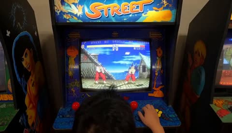</a>

从玩家背后的手持镜头起步，先锚定真实拍摄质感，再用一次连续推入穿过CRT屏幕转入游戏画面。明确要求进入游戏后不抖动，并固定4:3全屏构图，保持街机画面的稳定感。

MiniMax H3 · 文生视频 · 出处: [@cocktailpeanut on X](https://x.com/cocktailpeanut/status/2085835546572800047) · 58 赞，统计于 2026-10-29 · 发现于 [SkyNotSilent/awesome-MiniMax-H3-cases](https://github.com/SkyNotSilent/awesome-MiniMax-H3-cases)

[`street-fighter`](tags.md#tag-street-fighter) [`found-footage`](tags.md#tag-found-footage) [`video-transition`](tags.md#tag-video-transition) [`retro-arcade`](tags.md#tag-retro-arcade)

<details><summary><b>提示词</b></summary>

```text
A handheld found-footage shot from behind a person playing an authentic Street Fighter II arcade cabinet in a dim 1990s arcade. Ryu and Ken begin a normal match as the announcer shouts, “Fight!” The camera suddenly rushes toward the curved CRT screen in one continuous motion; reflections and scanlines expand into giant glowing red, green, and blue phosphor dots, then the camera passes through them and the image resolves into a clean full-screen 4:3 Street Fighter II game view with crisp 16-bit pixel art and subtle CRT scanlines. Chun-Li unexpectedly jumps into the match, followed by Blanka dropping from above, Dhalsim teleporting into the center, Zangief charging in, and several more fighters entering from both sides. The stage widens as the match becomes a chaotic but readable eight-player free-for-all: Sonic Booms cross the screen, Blanka’s electricity shocks multiple fighters, Zangief spins through a crowd, characters collide in midair, and health bars rapidly drain. Everyone unleashes a special move at once, filling the screen with pixel explosions and impact flashes. When the smoke clears, every fighter is knocked out except Dhalsim, calmly floating above the pile. The announcer declares, “Dhalsim wins. Perfect!” Authentic arcade sound effects, energetic chiptune music, no modern 3D graphics, no camera shake after entering the game.
```

</details>

<a id="h3-origin-sci-fi-motion-poster-assembly"></a>
### 科幻ORIGIN海报逐层动态拼合

<a href="https://x.com/LudovicCreator/status/2083628852165672988">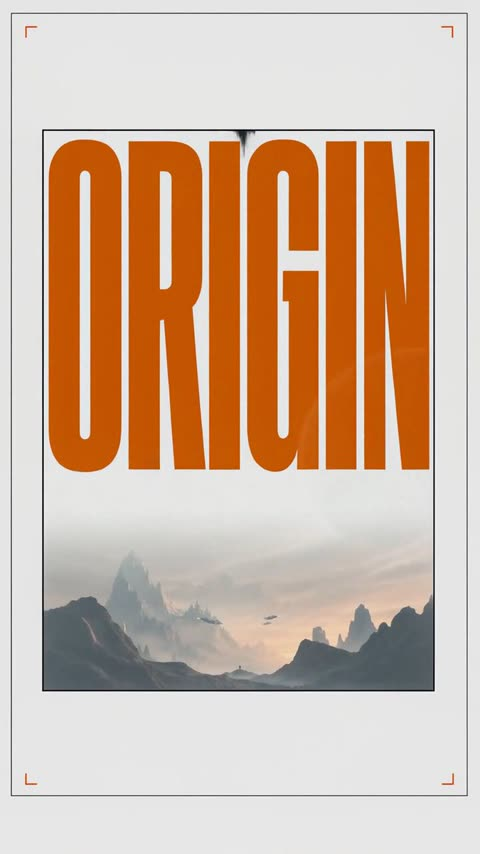</a>

以海报静图为首帧，先写明背景、配色、字体和版式不得改动，再按时间顺序安排边框、标题、风景到小字的出场，配上对应的界面音效，最后缓慢推近收尾。

MiniMax H3 · 图生视频 · 出处: [@LudovicCreator on X](https://x.com/LudovicCreator/status/2083628852165672988) · 55 赞，统计于 2026-10-28 · 发现于 [SkyNotSilent/awesome-MiniMax-H3-cases](https://github.com/SkyNotSilent/awesome-MiniMax-H3-cases)

[`motion-poster`](tags.md#tag-motion-poster) [`typography`](tags.md#tag-typography) [`sci-fi`](tags.md#tag-sci-fi) [`sound-design`](tags.md#tag-sound-design) [`vertical`](tags.md#tag-vertical)

<details><summary><b>提示词</b></summary>

```text
Animate the source artwork as a 10-second premium sci-fi motion poster while preserving the white gallery background, thin border, navy-and-orange palette, typography, composition and original poster design. Begin on an almost empty white canvas, then progressively assemble the poster: the outer frame draws itself on, the orange “ORIGIN” background typography slides vertically into place, the planetary landscape fades and expands inside the central frame, and the colossal station descends from above as its lights activate. Bring the cloaked traveler forward from the distant landscape toward the foreground with strong dimensional parallax, allowing the figure and rocky base to slightly break outside the inner frame. Introduce the smaller titles, numbering, studio credits, graphic marks and footer icons one after another with clean pop-in, slide and type-on animations, accompanied by light futuristic clicks, playful digital typing sounds and soft mechanical impacts. Finish with a restrained camera push-in, subtle station lights, drifting mist and a gentle movement in the traveler’s coat while the completed poster remains perfectly readable and close to the original still image. No major scene transformation, no camera orbit, no distorted typography, no altered layout.
2/2
```

</details>

<a id="h3-miniature-stadium-hands-timelapse-build"></a>
### 双手延时搭建迷你体育场

<a href="https://x.com/TechieBySA/status/2096606005068972483">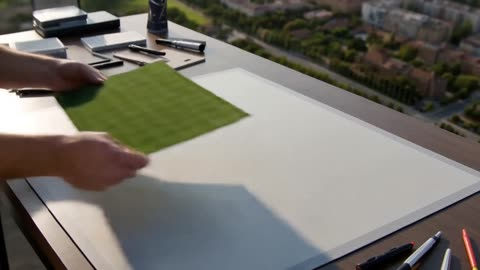</a>

按秒划分的时间线锁定同一位创作者的双手，所有新部件必须由手持入镜。提示词还禁止变形、界面和文字，并以缓慢推镜收尾。它依据参考图重建主体，提供参考图时效果最好。

MiniMax H3 · 参考生视频 · 出处: [@TechieBySA on X](https://x.com/TechieBySA/status/2096606005068972483) · 54 赞，统计于 2026-10-28 · 发现于 [SkyNotSilent/awesome-MiniMax-H3-cases](https://github.com/SkyNotSilent/awesome-MiniMax-H3-cases)

[`timelapse`](tags.md#tag-timelapse) [`hands-on-build`](tags.md#tag-hands-on-build) [`macro`](tags.md#tag-macro) [`reference-image`](tags.md#tag-reference-image) [`timeline-prompt`](tags.md#tag-timeline-prompt)

<details><summary><b>提示词</b></summary>

```text
A cinematic creation film follows one maker reconstructing the main subject shown in the referenced image completely from scratch. The referenced image defines the finished subject’s complete visible appearance, proportions, structure, materials, colors, clothing or surface details, and distinctive features; ignore its background, framing, lighting, and unrelated elements.  Begin directly on an empty, clean virtual workbench. Use a stable front three-quarter overhead view that keeps the developing subject readable. There is one maker throughout, represented by the same consistent left and right hands and forearms. Show no more than two hands at once.  From 0 to 14 seconds, the entire creation unfolds as a clearly accelerated timelapse with rapid, purposeful hand movement and restrained motion blur. Short jump cuts compress repetitive manual work only after each action has visibly completed. Every cut inherits the exact form and progress left by the previous action.  0-2 seconds: One hand enters already holding the first foundation material, armature, or base element appropriate to the referenced subject and places it at the center. The second hand steadies it as the maker establishes the initial supporting form.  2-8 seconds: The maker rapidly develops the subject’s major structure and volumes using one coherent creation method appropriate to what the referenced image depicts. A living subject is sculpted as one continuous, non-gory digital form from armature to anatomy; a vehicle or machine is built from chassis to functional structure; an object is formed or assembled from its supporting body outward. Each additional material or component enters from outside the frame while firmly held by one of the maker’s hands, is carried to its destination, and remains under hand control until attached or shaped.  8-12 seconds: The same hands develop the recognizable outer form and reference-specific features. The maker sculpts, fits, wraps, stitches, fastens, carves, or polishes only where appropriate to the subject. Facial features, hair, clothing, body panels, wheels, glass, surfaces, accessories, or equivalent defining elements emerge through visible hand and tool contact, never through spontaneous transformation.  12-14 seconds: The maker refines proportions, edges, joints, surface transitions, textures, colors, and distinctive details until the developing subject closely matches the referenced image. One hand stabilizes the form while the other performs each final adjustment with a hand-held tool.  14-15 seconds: The maker removes the last tool by hand and withdraws both hands. The timelapse returns to normal speed as the camera makes a restrained push toward the completed subject and holds on a clean final view.  Materials and components do not need to be visible before use, but anything newly introduced must enter the frame already held by one of the maker’s hands. Nothing moves, assembles, appears, disappears, or changes material independently. Maintain one maker, one continuous subject, one creation position, and one category-appropriate construction method. No assistants, extra hands, detached anatomy, duplicated elements, magical morphing, drawing phase, software interface, cursor, menus, annotations, or text overlays.
```

</details>

<a id="h3-found-footage-fisherman-doppelganger"></a>
### 渔夫在平静湖面上收线

<a href="https://x.com/cocktailpeanut/status/2084842607411335284">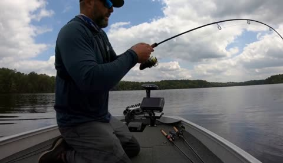</a>

将整段视频锁定在船上廉价运动相机的视角，加入自动对焦不稳和音频削波，让纪实感立得住。按顺序列出具体事件，并以突然切黑收尾，给模型清晰的叙事走向。

MiniMax H3 · 文生视频 · 出处: [@cocktailpeanut on X](https://x.com/cocktailpeanut/status/2084842607411335284) · 43 赞，统计于 2026-10-29 · 发现于 [SkyNotSilent/awesome-MiniMax-H3-cases](https://github.com/SkyNotSilent/awesome-MiniMax-H3-cases)

[`horror`](tags.md#tag-horror) [`found footage`](tags.md#tag-foundfootage) [`fishing`](tags.md#tag-fishing) [`handheld`](tags.md#tag-handheld)

<details><summary><b>提示词</b></summary>

```text
"Hyper-realistic found-footage horror video, filmed by a cheap action camera mounted inside a small fishing boat on a quiet lake. A lone fisherman violently reels in something heavy. He pulls up a muddy smartphone tangled in weeds. He answers, breathing hard. A distorted voice says, "Finally. I’ve been trying to switch places with you." The phone flashes blinding white and the footage glitches. When the image returns, the phone shows the terrified fisherman trapped inside its screen, silently pounding on the glass. Behind him, an identical soaking-wet fisherman slowly climbs out of the lake into the boat, notices the camera, and reaches toward the lens. Abrupt cut to black. Raw handheld realism, imperfect autofocus, clipped audio, no music, no stylization."
```

</details>

<a id="h3-kintsugi-sword-loop"></a>
### 剑碎裂后以金继重铸的循环

<a href="https://x.com/Cia0_exe/status/2083525563491524882"></a>

以参考图锁定人物与剑的外观，并逐条列出不允许改变的细节。按时间段给出分镜、镜头与音效，并要求末帧与首帧完全一致，使循环闭合。

MiniMax H3 · 参考生视频 · 出处: [@Cia0_exe on X](https://x.com/Cia0_exe/status/2083525563491524882) · 40 赞，统计于 2026-10-29 · 发现于 [SkyNotSilent/awesome-MiniMax-H3-cases](https://github.com/SkyNotSilent/awesome-MiniMax-H3-cases)

[`kintsugi`](tags.md#tag-kintsugi) [`seamless-loop`](tags.md#tag-seamless-loop) [`reference-lock`](tags.md#tag-reference-lock) [`ink-wash`](tags.md#tag-ink-wash)

<details><summary><b>提示词</b></summary>

```text
#MiniMaxH3 in Chinese:

15秒 | 16:9 | 1440p | 24fps | 无缝循环

[角色锁定] 完全按照 @image1 呈现，不进行任何重新设计。蓬松的蓝灰色波浪短发，刘海垂落遮住上半张脸；面容清秀，唇色偏暖；珊瑚朱红色宽袖长袍，腰间层层缠绕的宽腰带，深色内衬；持剑手戴深色手套。长剑：华丽的银金巴洛克护手与柄头，镜面剑身映出真实的天空与云。全片不得改动发量与卷曲走向、刘海遮眼的方式、袍身轮廓、腰带缠法、手套、护手纹样与剑身比例。

[循环 · 核心设定] 剑身自第一帧起就已布满一张固定的旧金脉之网——那是它此前碎裂并被金继修补留下的痕迹。本片是这一循环中的又一次：它沿着既有金脉再次裂开，碎片散去，熔金重新灌回同样的裂缝，恢复成完全相同的样子。不增添任何新金脉、不改变其走向与数量。最后一帧须与第一帧完全一致。

[剑的恒定 · 最高优先级] 重铸后的剑必须与开场完全相同：长度、宽度、弧度、剑尖、护手雕花、柄头、缠柄、镜面质感、金脉走向数量粗细、刻痕位置，逐一对应。严禁任何形态变化——不得变长变大、不得生出新纹饰或棱刺、不得产生光晕或能量外溢、不得改变颜色材质、不得出现任何“进化”“觉醒”“强化形态”式转变。金只填回原有裂缝，绝不溢出剑身之外、绝不覆盖镜面。

[解剖锁定 · 最高优先级] 全片有且仅有一名人物：两条手臂、两只手、每只手五指、一把剑。严禁多余的手臂、手掌、手指或第二把武器。高速转身与运动模糊中，残影绝不可被渲染成额外肢体。手部每帧结构完整、指节分明；戴手套的手握柄，空出的手须清晰可见且有明确朝向。

[沉浸 · 观众入画] 画面本身是一张真实存在的和纸，镜头是观众伸进这个世界的一只眼睛，世界会反过来影响它。
一、画面裂纹：0.9 秒剑开裂的同一帧，一道极细的裂纹自画面中心向四角蔓延，如同观看的这块玻璃也被划开；裂纹全片存在并缓慢加深，10.8 秒起被金继之金一并填补，13.8 秒前完全消失。
二、纸的边界：画面四边的和纸纤维始终微微起伏，重击时被掀起并向内卷曲，露出纸的毛边。
三、墨上镜头：3.2 秒的长弧甩出的墨点直接溅在镜头上，附着后沿纸纤维缓慢晕开，随后逐渐变淡，13.8 秒前完全干透消失。
四、倒影中的观众：2.2 秒与 13.4 秒各有一片碎片旋转至极近处，其镜面中短暂映出镜头本身与其外的一片天光，仿佛观众看见了自己所在的位置——只出现一瞬即转开。
五、沉入：7.0 至 8.8 秒，墨云直扑镜头并将其吞没，镜头沉入墨中——四周被浓墨包裹，仅上方透出天光与她的剪影，纸纤维如絮状物在“水中”缓缓漂过，画面轻微起伏如同随液体晃动；8.8 秒墨向下退去，镜头破“水面”而出。
所有以上效果必须在 13.8 秒前彻底清除，最后一帧的画面须与第一帧一样干净。

[场景 · 明亮] 高空之上，正午。头顶通透饱和的湛蓝天空，向地平线渐变为明亮浅色薄雾；脚下极远处是被阳光照亮的洁白积云海。她悬浮其中——无地面、无建筑、无道具。金箔长带随上升气流飘过。全片阳光充沛、明亮通透，绝不转阴、绝不去饱和。

[色彩] 天空 #2E6FA8 渐变至 #CFE3EF。长袍珊瑚朱红 #D9563F，褶皱 #A63A2A。头发蓝灰 #8CA3B8，边缘接暖色轮廓光。手套与内衬 #14161C。护手做旧银金。碎片映出真实蓝天白云。墨为纯黑 #0A0A0C。金脉为哑光金箔 #C9962E，熔金前沿炽白金 #FFEBB0，冷却后回到完全相同的 #C9962E。

[风格与质感] 水墨画与照相级玻璃的融合。整个画面覆盖极淡的和纸纤维质感；天空与云以水墨渲染，边缘晕开带枯笔飞白；人物与剑为完全清晰的实体渲染，如实体嵌在画中。金为真实金箔——极薄、有褶皱、氧化磨损、受光不均。碎片有真实厚度与内部裂纹，每片映出不同的云。发丝逐根渲染，逆光半透明；袍料厚重，褶皱有真实重量与回弹；护手雕花凹处压暗。胶片高光滚降，金上柔和光晕，细腻颗粒。

[特效] 逐级升级：剑锋所过之处墨如入水般翻卷晕开；金箔自长带剥落飘散；墨与金彼此排斥绝不相融，如大理石纹互相推挤；高速动作拖出枯笔飞白擦痕；每次重击有一帧纯墨黑剪影；熔金沿裂缝奔流，前沿炽白，其后冷却为哑光金箔。

[动画法则] 每个动作遵循预备—爆发—收势：出手前明确反向蓄势，爆发只占少数帧，收势有减速与轻微过冲后回位，绝不匀速。发丝、宽袖、袍摆、腰带末端各以不同延迟跟随身体，绝不同步启停。所有轨迹为弧线。高空中一切略带浮力感。杜绝任何僵硬、停顿或不自然的关节角度。

[逐拍动作]
0.0-1.4 她双手垂落，右手握剑于身侧偏后，剑斜指下方，头微低、刘海遮眼；仅呼吸使胸口微起伏。剑沿一道既有金脉裂开，手指本能收紧一下。
1.4-3.2 剑沿所有金脉同时裂开脱手，碎片向外散开，断口边缘皆为原有的金。右手仍维持握持姿势停在半空，指节微张；左手抬至胸前，掌心向上；头始终微低。
3.2-5.2 右手将空柄自身侧向斜上方划出完整长弧，腰胯先行带动肩背，宽袖甩开翻卷；收势时手腕轻微过冲后回位，左手向后平展保持平衡。
5.2-7.0 侧身转体半周，重心自右脚移至左脚，袍摆螺旋展开；转身中右手将空柄换至身前反握，左手抬至面侧。
7.0-8.8 虚空中一蹬，身体略下沉蓄势，双臂猛地向两侧张开召回碎片；随后双臂收拢至胸前，掌心相对，碎片锁定成环。
8.8-10.8 一次真实的挥臂与转身，被不同渲染风格切分呈现。
10.8-13.0 右手缓缓翻转、掌心向上再合拢，碎片沿手臂旋绕归位；剑成形时五指依次收紧扣柄，手臂承力下沉半寸，肩线压低。
13.0-13.8 第一次抬起头，刘海被气流分开露出双眼，平视镜头；手腕转动一周使金脉迎光。
13.8-15.0 缓缓垂下手腕，剑回到身侧偏后斜指下方；头重新低下，刘海落回遮眼，左手垂落身侧——完全回到第一帧姿势。

[表演] 全片沉静克制。碎裂时无惊慌，只有指节一次收紧；召回时下颌微抬、呼吸加深；金脉合拢时嘴角极细微的松动；抬头对视时眼神平静笃定；垂下头时回归最初的静默。

[署名] 剑身护手上方刃根处刻有 CIA0（大写 C、大写 I、大写 A、数字零；末位是数字零而非字母 O），小号宽字距镌刻大写，是剑本身的一部分，绝非叠加图层。刻痕内自第一帧起已嵌金，重铸后完全相同，绝不变亮变大或增添装饰。

[文字 · 墨落纸上] 所有文字为湿润毛笔书法渗入画面本身的和纸纤维：落笔带刷毛痕迹与枯笔断白，墨沿纤维晕开一拍后随纸干淡去。拉丁文为厚重镌刻衬线，日文为浓墨重笔竖排于侧三分之一。文字位于她身后并被遮挡，绝不覆盖面部。以下须原样逐字呈现：
0.8秒「墨」竖排右三分之一
2.4秒 "IT HAS BROKEN BEFORE" 单行靠左
5.0秒 "EVERY CRACK" / "REMEMBERS THE SKY" 两行堆叠靠左
7.6秒「金継」竖排左三分之一，墨将干时自笔画渗出金色
10.6秒 "AND WILL AGAIN" 先落墨再被金箔灌满
13.2秒 居中标题组：「天墨」上方，"INKFALL" 下方，须在 14.4 秒前完全淡去，最后一帧不得残留任何文字

[摄影] 变形宽银幕，椭圆焦外，暖色条状光斑，180 度快门，轻微桶形畸变。摇臂有质量、起停缓入缓出；甩镜末端轻微过冲后回稳；移焦有极短过冲再回拉。前景始终有金箔长带、碎片或袍袖掠过制造视差。
0.0-1.4 100mm 微距沿镜面剑身向护手行进，云影流过钢面，金脉与刻痕掠过。
1.4-3.2 35mm 环绕碎片场 180 度，穿行于碎片之间。
3.2-5.2 24mm 广角随长弧上升，天空大面积入画。
5.2-7.0 18mm 一镜到底，推入一片碎片的倒影穿过，自另一侧高处回望她。
7.0-8.8 沉入墨中，镜头略微上仰仰望她的剪影，随液体轻微起伏。
8.8-10.8 焦段随拍点跳切，85mm 特写与 24mm 广角交替。
10.8-13.0 50mm 缓慢推入，荷兰角自五度回正。
13.0-13.8 85mm 面部特写。
13.8-15.0 自面部缓缓下降推近，沿剑身回到 100mm 微距，与第一帧完全对位。

[分镜]
0.0-1.4 循环点。微距沿镜面剑身疾行，云影流过钢面。剑沿一道既有金脉缓慢裂开如薄冰崩解；同一帧，一道细裂纹自画面中心向四角蔓延。墨自裂口涌出黑色羽状云。
1.4-3.2 悬停。镜头环绕漂浮的碎片场，每片缓缓自转，各自捧着一角天空，断口的金边闪烁；2.2 秒一片碎片旋至极近，镜面中一瞬映出镜头本身。她悬于中心，刘海遮眼。
3.2-5.2 墨绽。她以空柄划出长弧，在整片天空拖出巨大水墨笔触，湿黑弧带枯笔飞白；甩出的墨点溅上镜头并沿纸纤维晕开。落入墨中的碎片转为剪影。
5.2-7.0 穿镜。一镜到底：镜头推入一片碎片的倒影并穿过，自另一侧高处回望她；金箔长带掠过镜头，她的转身拖出枯笔擦痕。
7.0-8.8 沉入。墨云直扑镜头并将其吞没——四周被浓墨包裹，仅上方透出天光与她张开双臂的剪影，纸纤维如絮状物缓缓漂过，画面随液体轻微起伏，画面裂纹在墨中被压出细密支线。8.8 秒墨向下退去，镜头破出水面，碎片同帧翻转锁成绕她缓转的环。
8.8-10.8 水墨蒙太奇，一帧一姿态交替渲染：纸白底纯墨线稿、朱红与青蓝二色木版画帧、黑底金箔剪影、枯笔拖影帧、一帧全画面墨色反转、完整渲染。墨点与金屑持续累积绝不重置。
10.8-13.0 金继。碎片沿手臂旋绕归位，断口一一对上；熔金沿原有裂缝灌回，前沿炽白，其后冷却为哑光金箔，最终与开场金脉完全一致，不多一道不少一道。同时画面上那道裂纹也被金一并填补、随后金色渐渐淡去。全画面光线转暖。
13.0-13.8 对视。她第一次抬头，刘海分开露出双眼，平视镜头；13.4 秒一片余留的碎片旋过，镜面中再度一瞬映出镜头。手腕转动一周使金脉迎光。
13.8-15.0 归位。她垂下手腕与视线，剑回到身侧，刘海落回遮眼；镜头上的墨点干透消失，画面裂纹与金色痕迹尽数退去，文字淡尽；镜头沿剑身回到开场微距。最后一帧与第一帧完全一致。

[音频] 每个音效卡在准确帧上，混音首尾相接可循环。底层：高空稀薄空气感，远处持续的风，一层极淡的纸张摩挲声。
0.0-1.4 上行金属长鸣，玻璃缓慢开裂的绵长脆响，接墨入水的低沉涌动，画面裂开时一记极细的近场脆响仿佛就在耳边。
1.4-3.2 近乎静默——碎片自转的细微水晶轻响，墨翻卷的低频液流，一次屏住的呼吸。
3.2-5.2 宽阔湿笔拖过纸面的摩擦，墨沿纤维扩散的细密嘶声，墨点溅上镜头的一记极近的湿响，其下尺八吐息升起。
5.2-7.0 进入碎片时气压骤降，内部闷响的封闭音，穿出一记清亮释放，金箔长带掠过的猎猎。
7.0-8.8 沉入——全频瞬间被厚重低通滤波吞没，只余低沉的液体涌动、遥远变形的风声与一次缓慢的心跳；8.8 秒破水而出，高频与空气感轰然回归。
8.8-10.8 八记毛笔击打卡在每次剪辑上，墨点飞溅，风格间以短滤波门分隔，反转帧一记太鼓。
10.8-13.0 温暖低鸣升起，熔金奔流的柔和噼啪，每道裂缝闭合一声清亮短鸣，古筝音阶逐级上行。
13.0-13.8 延长的尺八长音，剑身转动的清亮金属鸣响。
13.8-15.0 一切收束——袖摆落定的柔响，一次平缓呼气，解析为与开场完全相同的高空风声与纸声，无缝接回起点。
配乐：极简温暖，仅古筝与尺八。3.2 秒进入，7.0 至 8.8 秒随沉入被一同滤掉，8.8 秒回归，10.8 秒起弦乐加入，13.8 秒退出仅余风声，与开场首音无缝相接。无对白。

[限制] 只有一名人物，两条手臂，两只手，一把剑。剑自第一帧即带金脉，重铸后与第一帧完全相同，严禁任何形态、尺寸、纹饰、颜色或光效变化。墨保持纯黑、金保持金箔，绝不混合成褐色。所有文字须为湿墨渗入纸面，绝非平贴叠加。镜头上的墨、画面裂纹与金痕须在 13.8 秒前彻底清除。刻痕须准确拼写为 CIA0。除上述文字外无任何标识、水印或字幕。无地面、无建筑、无道具。全片明亮饱和。首尾帧完全一致，两帧中都不得残留任何文字或镜头污迹。
```

</details>

<a id="h3-tidal-ocean-walls-title"></a>
### 两面海墙相撞并聚成 TIDAL 字样

<a href="https://x.com/CharaspowerAI/status/2102352395439120566">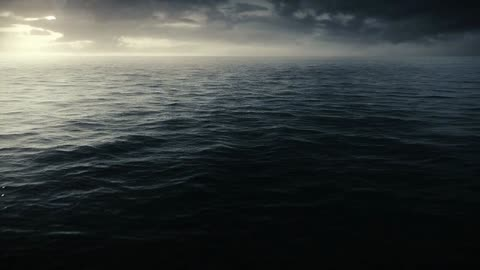</a>

按时间顺序写出节拍，依次是海面分开、海墙相撞、水流拼出字样、冲击波引爆标题，让模型有清晰的时间线可循。点明材质和退场方式（透明海水带白色泡沫边缘，压力波从左向右推进），能让整段流体模拟在标题停留期间保持一致。

MiniMax H3 · 文生视频 · 出处: [@CharaspowerAI on X](https://x.com/CharaspowerAI/status/2102352395439120566) · 39 赞，统计于 2026-10-29 · 发现于 [SkyNotSilent/awesome-MiniMax-H3-cases](https://github.com/SkyNotSilent/awesome-MiniMax-H3-cases)

[`fluid`](tags.md#tag-fluid) [`title-sequence`](tags.md#tag-title-sequence) [`ocean`](tags.md#tag-ocean) [`vfx`](tags.md#tag-vfx)

<details><summary><b>提示词</b></summary>

```text
Epic fluid-action title sequence beginning with an enormous black ocean suddenly splitting down the center as two mountain-sized walls of water rise on opposite sides of frame. The camera sweeps between them while billions of droplets rain downward and sunlight refracts through transparent liquid structures. Both walls violently collapse toward each other, creating a spectacular collision of water, foam and pressure that launches a liquid shockwave into the sky. The camera rapidly orbits the explosion as the suspended water is pulled into gigantic rotating streams. These streams twist, collide and sculpt themselves into the monumental word "TIDAL", every letter composed of violently circulating transparent seawater with white foam wrapped around its edges. The title holds for one massive hero moment before an invisible pressure pulse tears through it from left to right, detonating each letter sequentially into enormous explosions of water and mist. Photorealistic fluid simulation, colossal natural power, IMAX-scale cinematic VFX.
```

</details>

<a id="h3-wallpaper-peel-reveals-sky"></a>
### 墙纸条卷起露出天空

<a href="https://x.com/GlennHasABeard/status/2102041528654876810">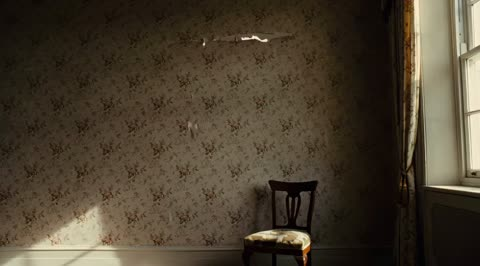</a>

把贯穿全程的爆裂声写进提示词，相当于规定了揭开的速度，纸条因此一气呵成地卷落。固定的正对机位让墙面保持不动，只有墙纸在动。

MiniMax H3 · 文生视频 · 出处: [@GlennHasABeard on X](https://x.com/GlennHasABeard/status/2102041528654876810) · 38 赞，统计于 2026-10-29 · 发现于 [SkyNotSilent/awesome-MiniMax-H3-cases](https://github.com/SkyNotSilent/awesome-MiniMax-H3-cases)

[`wallpaper`](tags.md#tag-wallpaper) [`peel-reveal`](tags.md#tag-peel-reveal) [`sound-cue`](tags.md#tag-sound-cue) [`locked-camera`](tags.md#tag-locked-camera)

<details><summary><b>提示词</b></summary>

```text
the strip peels downward in one continuous curl, the paper crackling and flaking at the edge
```

</details>

<a id="h3-burn-pyro-title-rupture"></a>
### 熔融 BURN 字母从内部炸裂成放射状火焰

<a href="https://x.com/CharaspowerAI/status/2106398901267812627">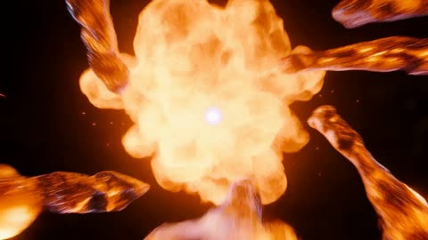</a>

提示词按时间顺序写出点火、锻造、重击和爆裂四个阶段，每段都有对应的镜头运动和物理原因，让模型有清晰的先后顺序。结尾明确指定朝向镜头的放射状爆发，把高潮与镜头方向绑定在一起。

MiniMax H3 · 文生视频 · 出处: [@CharaspowerAI on X](https://x.com/CharaspowerAI/status/2106398901267812627) · 34 赞，统计于 2026-10-29 · 发现于 [SkyNotSilent/awesome-MiniMax-H3-cases](https://github.com/SkyNotSilent/awesome-MiniMax-H3-cases)

[`pyro`](tags.md#tag-pyro) [`vfx`](tags.md#tag-vfx) [`title-sequence`](tags.md#tag-title-sequence) [`motion-design`](tags.md#tag-motion-design)

<details><summary><b>提示词</b></summary>

```text
Extreme Hollywood pyro title sequence: begin inside a microscopic droplet of fuel suspended in darkness as a spark suddenly ignites its surface. Fire spreads explosively outward and the camera rockets backward through a chain reaction of enormous fuel explosions. Liquid fire whips across the frame like glowing ribbons while burning debris and sparks spiral into a rapidly expanding fire tornado. The camera enters the vortex and rotates around a white-hot molten core where streams of liquid metal begin violently forging the gigantic word "BURN". Every letter emerges incandescent from the inferno before cooling into cracked black steel while magma remains visible beneath the surface. The completed title slams into frame with enormous weight as flames blast through the gaps between the letters. Pressure suddenly builds inside the typography until "BURN" violently ruptures from within, unleashing a radial explosion of molten metal, sparks and fire directly into the lens. Extreme heat distortion, realistic pyro physics, aggressive camera movement, AAA theatrical VFX.
```

</details>

<a id="h3-sunrise-clouds-spell-morning"></a>
### 日出时云海中的雪山峰顶

<a href="https://x.com/CharaspowerAI/status/2086754531698725200">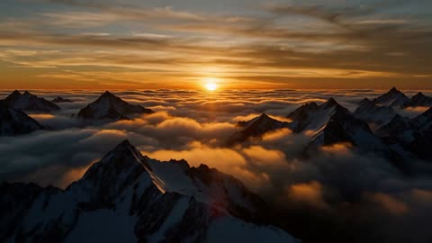</a>

提示词按时间顺序描述镜头：云层流动，气流把云塑造成文字，太阳升高后文字消散，让15秒有清晰的起承转合。用《星际穿越》和国家地理两个参照词，一次性定下色调与情绪。

MiniMax H3 · 文生视频 · 出处: [@CharaspowerAI on X](https://x.com/CharaspowerAI/status/2086754531698725200) · 33 赞，统计于 2026-10-29 · 发现于 [SkyNotSilent/awesome-MiniMax-H3-cases](https://github.com/SkyNotSilent/awesome-MiniMax-H3-cases)

[`aerial`](tags.md#tag-aerial) [`sunrise`](tags.md#tag-sunrise) [`clouds`](tags.md#tag-clouds) [`title-reveal`](tags.md#tag-title-reveal)

<details><summary><b>提示词</b></summary>

```text
Epic cinematic aerial shot: Endless rolling clouds flow across towering mountain peaks during sunrise. The golden light transforms the clouds into rivers of glowing vapor. Air currents gradually sculpt the cloud formations into the gigantic word "MORNING", stretching naturally across the sky. As the sun rises higher, the cloud letters slowly dissolve into the atmosphere while brilliant light floods the frame. Interstellar meets National Geographic, majestic, emotionally powerful.
```

</details>

<a id="h3-titanium-impact-title-sequence"></a>
### 钛金属板受冲击弯曲，裂纹发出橙光

<a href="https://x.com/CharaspowerAI/status/2095527374444003437">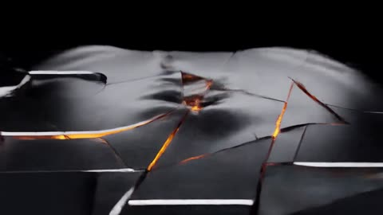</a>

提示词按物理节拍分段描写：冲击、波纹、碎片、倒转、标题成形、最后的冲击波，每段都有明确的镜头运动或速度变化。点明材质、光线和宽银幕变形镜头，使整段画面风格保持一致。

MiniMax H3 · 文生视频 · 出处: [@CharaspowerAI on X](https://x.com/CharaspowerAI/status/2095527374444003437) · 29 赞，统计于 2026-10-29 · 发现于 [SkyNotSilent/awesome-MiniMax-H3-cases](https://github.com/SkyNotSilent/awesome-MiniMax-H3-cases)

[`titanium`](tags.md#tag-titanium) [`impact`](tags.md#tag-impact) [`title-sequence`](tags.md#tag-title-sequence) [`speed-ramp`](tags.md#tag-speed-ramp)

<details><summary><b>提示词</b></summary>

```text
Ultra-cinematic Hollywood title sequence, opening on an extreme macro shot of a perfectly smooth monolithic titanium surface suspended in darkness. A microscopic dent suddenly appears at its center, followed by an invisible supersonic impact that violently propagates across the metal, bending the entire surface in a spectacular pressure ripple. The camera rapidly pulls backward as the titanium plate explodes into thousands of heavy fragments, glowing sparks and molten particles. Time dramatically slows while the debris hangs in the air, then a powerful magnetic force reverses every fragment at once. Pieces accelerate back toward the center, colliding with brutal precision and forging the monumental word "IMPACT" from dense battle-scarred titanium. The camera sweeps inches above the newly formed letters as glowing energy races through their cracks, then whips into a perfectly centered frontal hero shot. A final invisible shockwave slams into the title, creating a spectacular ripple through the metal before blasting sparks, dust and fragments toward the lens. Photorealistic metal deformation, sophisticated destruction physics, aggressive speed ramps, anamorphic cinematography, premium AAA theatrical title design.
```

</details>

<a id="h3-dawn-lake-morning-water-title"></a>
### 黎明湖面薄雾与日出倒影

<a href="https://x.com/CharaspowerAI/status/2085622021812039920">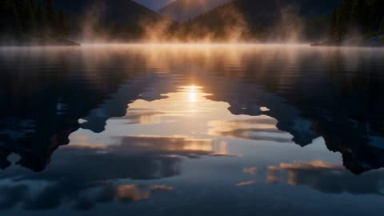</a>

提示词按时间顺序分成几段：先是静止的湖面和升起的薄雾，再是水滴聚成文字，最后迸散，模型因此有明确的时间线可循。用好莱坞片头、体积光和 IMAX 画质定下画面质感，不必指定镜头设备。

MiniMax H3 · 文生视频 · 出处: [@CharaspowerAI on X](https://x.com/CharaspowerAI/status/2085622021812039920) · 22 赞，统计于 2026-10-29 · 发现于 [SkyNotSilent/awesome-MiniMax-H3-cases](https://github.com/SkyNotSilent/awesome-MiniMax-H3-cases)

[`macro`](tags.md#tag-macro) [`fluid-simulation`](tags.md#tag-fluid-simulation) [`sunrise`](tags.md#tag-sunrise) [`title-sequence`](tags.md#tag-title-sequence)

<details><summary><b>提示词</b></summary>

```text
Ultra cinematic macro shot: A calm mountain lake at dawn reflects the first golden rays of sunlight. Tiny ripples spread across the mirror-like surface as morning mist drifts gracefully above the water. Billions of sparkling droplets slowly rise into the air, suspended as if gravity has stopped. They spiral together with incredible fluid realism, naturally sculpting the word "MORNING" entirely from crystal-clear water. The liquid letters shimmer with golden reflections before gently collapsing into a spectacular explosion of droplets illuminated by the sunrise. Hollywood title sequence, ultra-realistic fluid simulation, volumetric lighting, IMAX quality.

#MiniMaxH3
```

</details>

<a id="h3-laundromat-washer-miniature-storm"></a>
### 洗衣机滚筒里藏着一座微型风暴海洋

<a href="https://x.com/opener_ai/status/2084075915706052621">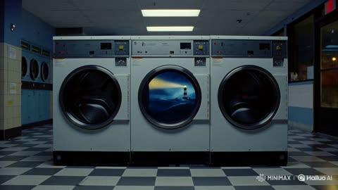</a>

一个连续的手持推进镜头贯穿全程，并用分段时间节点安排揭示节奏。负面提示把超现实元素限定在滚筒内，使洗衣店保持写实，音效提示也与画面反转同步。

MiniMax H3 · 文生视频 · 出处: [@opener_ai on X](https://x.com/opener_ai/status/2084075915706052621) · 20 赞，统计于 2026-10-29 · 发现于 [SkyNotSilent/awesome-MiniMax-H3-cases](https://github.com/SkyNotSilent/awesome-MiniMax-H3-cases)

[`surreal`](tags.md#tag-surreal) [`laundromat`](tags.md#tag-laundromat) [`timed-beats`](tags.md#tag-timed-beats) [`sound-design`](tags.md#tag-sound-design)

<details><summary><b>提示词</b></summary>

```text
[1] FORMAT
Create a 15-second, 16:9 surreal live-action scene inside a quiet laundromat at night.

[4] BEATS
[0–3s] Slow handheld push toward a running front-loading washing machine.
[3–6s] Inside the drum, the water becomes a miniature stormy ocean with waves, lightning, and a tiny lighthouse.
[6–11s]The lighthouse beam shines through the glass as the storm grows stronger.
[11-15s]The door suddenly opens. Only ordinary wet laundry falls onto the floor.

[5] CAMERA
One continuous handheld push-in, ending on the falling laundry.

[6] LIGHT
Cold flickering fluorescent lights, wet glass reflections, deep blue storm light inside the washer, realistic phone-camera texture.

[8] AUDIO
Audio: washing-machine rumble, water splashes, distant thunder, one door click, and wet laundry hitting the floor.
BGM: a subtle 15-second mystery drone, building from 4 seconds and stopping abruptly when the door opens.

[9] NEGATIVE
Keep the laundromat fully photorealistic. The miniature ocean exists only inside the washing machine.
No people, text, subtitles, logos, watermarks, monsters, or cartoon styling.

#minimaxh3 #hailuoai
```

</details>

<a id="h3-white-drop-ghost-dark-glass"></a>
### 白色墨滴拉伸成小幽灵

<a href="https://x.com/GlennHasABeard/status/2112325403582832865"></a>

一句话同时写出变化过程和终点，让模型执行形态转变，而不是普通的水花。固定的玻璃高度机位让深色液体成为稳定背景，白色形状因此清晰可辨。

MiniMax H3 · 文生视频 · 出处: [@GlennHasABeard on X](https://x.com/GlennHasABeard/status/2112325403582832865) · 20 赞，统计于 2026-10-29 · 发现于 [SkyNotSilent/awesome-MiniMax-H3-cases](https://github.com/SkyNotSilent/awesome-MiniMax-H3-cases)

[`liquid`](tags.md#tag-liquid) [`ink`](tags.md#tag-ink) [`morph`](tags.md#tag-morph) [`macro`](tags.md#tag-macro)

<details><summary><b>提示词</b></summary>

```text
as it sinks it stretches into the clear shape of a small white ghost
```

</details>

<a id="h3-metal-fragments-streak-dark-void"></a>
### 金属碎片在黑暗中高速掠过

<a href="https://x.com/CharaspowerAI/status/2093715484910731416">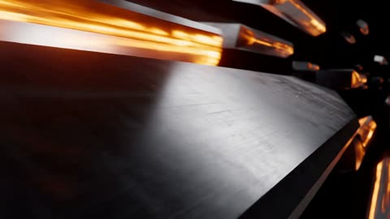</a>

提示词按顺序写出几个节拍：高速特写、减速咬合拼出字母、最后拉远揭示整个标题，给模型清晰的运镜路径。音爆、火花和运动模糊等具体物理线索承载速度感，而不只是堆砌形容词。

MiniMax H3 · 文生视频 · 出处: [@CharaspowerAI on X](https://x.com/CharaspowerAI/status/2093715484910731416) · 18 赞，统计于 2026-10-29 · 发现于 [SkyNotSilent/awesome-MiniMax-H3-cases](https://github.com/SkyNotSilent/awesome-MiniMax-H3-cases)

[`title-sequence`](tags.md#tag-title-sequence) [`typography`](tags.md#tag-typography) [`camera-choreography`](tags.md#tag-camera-choreography) [`motion-blur`](tags.md#tag-motion-blur)

<details><summary><b>提示词</b></summary>

```text
High-octane cinematic title sequence built entirely around speed: begin with an extreme close-up of polished metal traveling through darkness so quickly that only reflections and sparks are visible. The camera accelerates alongside it as enormous metallic components streak past like projectiles, generating sonic shockwaves and pressure distortion. Each component violently decelerates at the center of frame, rotating and locking into place with precise mechanical impacts while additional fragments arrive from every direction. The camera threads between assembling letterforms at extreme speed, passing through showers of sparks and glowing friction trails until a final impossible pullback reveals that every moving component has constructed the enormous word "VELOCITY". A supersonic pressure wave travels from the first letter to the last, bending the surrounding atmosphere and stripping glowing particles from the metal surfaces. The camera instantly launches backward as the entire title accelerates forward through the frame like a massive projectile, leaving only turbulent smoke and incandescent trails behind. Hyper-dynamic cinematography, physically convincing motion blur, metallic micro-detail, sonic-boom distortion, premium theatrical title VFX.
```

</details>

<a id="h3-stealth-jet-optical-cloak-flyby"></a>
### 隐形战机高空掠过时光学隐身

<a href="https://x.com/opener_ai/status/2084441225667735905"></a>

提示词先用固定几何与材质锁定机身身份，再把 10 秒切成带时间点的分镜，让隐身动作准时落在第 4 到 6 秒。隐形机体只通过内部天空与云层的扭曲显现，负面词块则禁止发光轮廓、气泡和瞬移。

MiniMax H3 · 文生视频 · 出处: [@opener_ai on X](https://x.com/opener_ai/status/2084441225667735905) · 16 赞，统计于 2026-10-29 · 发现于 [SkyNotSilent/awesome-MiniMax-H3-cases](https://github.com/SkyNotSilent/awesome-MiniMax-H3-cases)

[`stealth-aircraft`](tags.md#tag-stealth-aircraft) [`optical-camouflage`](tags.md#tag-optical-camouflage) [`tracking-shot`](tags.md#tag-tracking-shot) [`flyby`](tags.md#tag-flyby)

<details><summary><b>提示词</b></summary>

```text
)

[FORMAT]
Create a 10-second, 16:9 photoreal cinematic wide-shot flyby of a stealth aircraft activating optical camouflage at extreme speed.

[IDENTITY]
Preserve a wide tailless delta wing, sharp faceted edges, flat wedge-shaped nose, recessed dark cockpit, matte charcoal surface, twin buried exhausts, no insignia, and rigid non-morphing geometry.

[BEATS]
[0–2 seconds] A vast open sky above distant clouds. The stealth aircraft suddenly enters from the far left and races laterally across the wide frame at extreme speed.

[2–4 seconds] The camera performs a fast, controlled pan to track the aircraft. Strong background parallax and slight motion blur emphasize its velocity while its shape remains readable.

[4–6 seconds] Optical camouflage sweeps from the nose across both wings. The solid aircraft rapidly vanishes without slowing down or changing direction.

[6–8 seconds] The camera continues tracking the same trajectory. The invisible delta-wing shape remains clearly perceptible because the sky and clouds inside its exact volume ripple and bend like concentrated heat haze.

[8–10 seconds] The refractive aircraft streaks toward the distant horizon, leaving a narrow turbulent distortion wake before exiting the frame.

[CAMERA]
One continuous very wide lateral tracking shot. The aircraft stays relatively small within the expansive frame. Fast pan tracking, broad environmental scale, strong lateral movement, subtle handheld vibration, and realistic motion blur. No close-up and no chase-camera angle.

[LIGHT]
Bright high-altitude daylight, cool blue sky, white cloud field, natural atmospheric haze, restrained contrast, and realistic cinematic texture.

[EDIT]
One uninterrupted shot. No cuts, transitions, slow motion, or camera repositioning.

[AUDIO]
Audio: violent high-altitude wind rush, rapidly approaching jet roar, a powerful Doppler flyby, and a brief vacuum-like sound as the camouflage activates.
BGM: an original 10-second cue, 80% tension and 20% awe. Low sub-bass pulse and metallic air textures, building sharply during the flyby and fading into a low tone over the final 2 seconds. Do not imitate an existing melody.

[NEGATIVE]
Do not show an empty sky after cloaking. Maintain a coherent, fast-moving delta-wing refraction that bends the background inside the aircraft’s exact volume.
No glowing outline, glass aircraft, force-field bubble, pixel dissolve, smoke camouflage, teleportation, morphing, or reappearance.
No extra aircraft, weapons, explosions, contrails, subtitles, on-screen text, watermarks, platform logos, or stickers.
Do not introduce Chinese text, garbled characters, or misspellings.

#kreaai #minimaxh3 #kreacpp
```

</details>

<a id="kling4-edit-replace-element"></a>
### 改视频：把主体换成图里的

<a href="https://static--73.klingai-cdn-aws.com/kling-blog/presigned_url/a69b8de9-efb4-45a5-8da2-68e7ce0fcd74_1-1.mp4">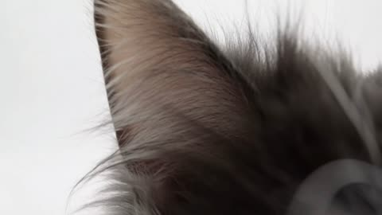</a>

可复用的替换模板：换掉主体，其余不动，位置、大小和运动轨迹跟原来一致。

Kling 4.0 · 视频编辑 · 出处: [Kling 4.0 user guide](https://kling.ai/quickstart/kling-4-model-user-guide)

[`video-edit`](tags.md#tag-video-edit) [`object-swap`](tags.md#tag-object-swap) [`template`](tags.md#tag-template)

<details><summary><b>提示词</b></summary>

```text
Replace the Element in @Video 1 with the Element from @Image 1. Keep everything else unchanged, including the background composition, camera movements, lighting, shadows, audio, and video duration. Ensure the replacement Element integrates naturally into the original footage, matching the original Element's position, scale, movements, and trajectory.
```

</details>

输入素材: [1](https://static-15.klingai-cdn-aws.com/kling-blog/file_by_url/d534117094084549b75edb5744e1c97527daf3f56ecc79696eb17e6adf64684b.png) · [2](https://static--88.klingai-cdn-aws.com/kling-blog/presigned_url/8ed131ae-de43-402f-a70c-8a8cb57ff635_1-1-1.mov)

<a id="kling4-edit-swap-whole-world"></a>
### 改视频：整个场景和角色换成一张图里的

<a href="https://static--76.klingai-cdn-aws.com/kling-blog/presigned_url/c7048822-9f71-49e4-b9d7-b5a254893ffe_1-2.mp4"></a>

指南里最短的编辑提示词，一张图同时换掉场景和人物，动作不变。

Kling 4.0 · 视频编辑 · 出处: [Kling 4.0 user guide](https://kling.ai/quickstart/kling-4-model-user-guide)

[`video-edit`](tags.md#tag-video-edit) [`restyle`](tags.md#tag-restyle) [`reference-image`](tags.md#tag-reference-image)

<details><summary><b>提示词</b></summary>

```text
Edit @Video1. Replace the environment and characters throughout the video with the content from @Image1.
```

</details>

输入素材: [1](https://static--63.klingai-cdn-aws.com/kling-blog/file_by_url/a755279b2ec2b77e49b1de97efb9f838564c2e3ca37d4f00d956e1f4ea522600.png) · [2](https://static-90.klingai-cdn-aws.com/kling-blog/presigned_url/42801baf-9a37-471f-ae55-68cd75001eb4_1-2-1.mp4)

<a id="kling4-militia-march-into-painting"></a>
### 十七世纪民兵列队出发，最后定格成名画

<a href="https://static-77.klingai-cdn-aws.com/kling-blog/presigned_url/4205f3d5-fbac-4bfa-9ae3-2826fe780925_1-4.mp4">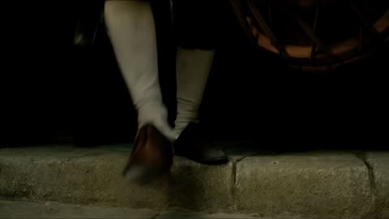</a>

尾帧就是那幅画。前半段必须像实拍，到结尾才在同一个镜头里变成油画。

Kling 4.0 · 首尾帧 · 出处: [Kling 4.0 user guide](https://kling.ai/quickstart/kling-4-model-user-guide)

[`historical`](tags.md#tag-historical) [`painting`](tags.md#tag-painting) [`transformation`](tags.md#tag-transformation) [`long-take`](tags.md#tag-long-take) [`keyframes`](tags.md#tag-keyframes)

<details><summary><b>提示词</b></summary>

```text
SCENE CONTEXT — EXACTLY ONE HISTORICAL SCENE, NO ADDITIONAL CHARACTERS. Use @Image1 as the exact final-frame reference for character costumes, positioning, lighting, composition, and painterly color palette. Create a 15-second cinematic short film depicting a 17th-century civic militia gathering to march out from a dimly lit archway. The first half must look entirely like live-action footage, with a high degree of photorealism. Only toward the end should the scene gradually transform into the original painting within the same continuous shot. Characters must not emerge from the painting, and no oil-paint textures may appear at the beginning.
LOCATION AND ATMOSPHERE: A dark urban archway opens onto stone pavement where a civic militia gathers to march. Urban dust hangs in the air, and a warm shaft of sunlight enters from the side. Use dramatic Rembrandt-style chiaroscuro while keeping the space shrouded in nighttime darkness. Do not create a moonlit-night appearance.
CAMERA AND OPTICS: Use cinematic photorealism, finely rendered textures, realistic lens depth of field, subtle handheld breathing, and smooth tracking and pullback movements. The camera begins low to the ground, tracks naturally through the marching crowd, then gradually pulls back and rises slightly. The entire sequence remains one continuous shot, maintaining spatial continuity between the live-action scene, the transforming painting, and the surrounding dark environment.
FORMAT MODE: 15 seconds total, one continuous shot. No hard cuts, white flashes, page-turn effects, or transitions that interrupt spatial continuity. The transformation from live action to painting occurs gradually within the same shot, progressing from the edges toward the center.
ACTION TIMING:
0.0–3.0s — THE MILITIA MARCHES. Track low to the ground as boots march across stone pavement. Drumsticks strike, and a red sleeve sweeps past the camera. The camera naturally tilts upward, following a musket as it passes beneath a flag. All movements feel realistic and weighty, with natural walking speed and no slow motion. The scene remains entirely photorealistic, with no visible oil-paint textures.
3.0–8.0s — MOVE THROUGH THE CROWD. The camera moves steadily through the crowd, finding the captain dressed in black with a red sash. He turns to check the formation and extends his hand forward to give a command. Beside him, a lieutenant dressed in pale gold steps forward. In the background, guards raise their pikes and adjust their formation. A blonde little girl briefly looks back at the group. Expressions and movements remain natural and restrained, as if spontaneously captured by a camera in a historical film. Maintain fully realistic skin, fabric, metal, and architectural details.
8.0–12.0s — REVEAL THE COMPOSITION. The camera continuously pulls back and rises slightly. As the group continues moving, the characters gradually settle into their precise positions in the original painting. The captain's outstretched hand, the lieutenant's pose, the red-clad guard in the doorway, the Afghan girl, the weapons, and the drummer on the right all come into view simultaneously. At this moment, the drumbeat abruptly stops, and everyone freezes for half a second. Preserve realistic live-action appearance as the composition becomes fully readable.
12.0–15.0s — TRANSFORM INTO THE PAINTING. Continue the same slow pullback without cutting. The realistic skin, fabric, metal, and architectural details gradually transform from the edges toward the center into rich oil paint and visible brushstrokes. The surrounding scene progressively resolves into the original painting,
The Night Watch
, fully revealing @Image1. Preserve the exact positions, character costumes, proportions, lighting, color palette, and composition of the original painting. By the end, the transformation is complete, and the image remains motionless.
FINAL FRAME AND COMPOSITION: The final painting must retain its complete original aspect ratio and be displayed centered in the frame, with seamless spatial continuity between the painting and the surrounding dark environment. Do not crop the original painting, alter its composition, or introduce any additional characters. Hold the completed image motionless until the end.
LIGHTING AND COLOR: Begin with nighttime darkness, dramatic Rembrandt-style chiaroscuro, warm side lighting, and dust suspended in the air. Do not introduce moonlight. During the live-action portion, maintain realistic cinematic lighting and natural material textures. As the painting transformation progresses, preserve the original painting's distinctive lighting, rich oil-paint colors, and visible brushwork.
PHYSICS AND MOTION: Boots maintain convincing contact with the stone pavement. Weapons, clothing, and equipment move with realistic weight and inertia. The captain's gestures, the lieutenant's forward movement, the guards' formation adjustments, and the girl's brief backward glance remain physically natural. The transition into the painting changes the visual rendering of the existing scene rather than causing characters to emerge from or move out of the painting.
AUDIO: Environmental audio consists of boots on stone, rustling fabric, subtle metallic clinks, and live drums. Add low strings and gradually intensifying orchestral music, building to a climax as the camera pulls back. At the moment the scene freezes, the drums stop, leaving only a brief musical resonance. The sound design must support the cinematic progression from a living historical scene to a motionless painted composition.
STYLE: Cinematic historical realism transitioning into the original oil painting. The opening and middle sections must look entirely like live-action footage, with realistic skin, fabric, metal, architectural surfaces, lens depth of field, and natural motion. Rich oil-paint textures and visible brushstrokes appear only toward the end, gradually replacing the photorealistic rendering.
POSITIVE CONSTRAINTS: Maintain consistent character identities, costumes, positions, weapons, and spatial relationships throughout the continuous shot. Preserve the exact final composition of @Image1. The first half remains fully photorealistic. The transformation progresses from the edges toward the center and completes by 15.0 seconds. No characters emerge from the painting. No additional characters, cropped painting, hard cuts, white flashes, page-turn effects, or premature oil-paint textures. The final frame matches the original painting's full aspect ratio and composition, centered within the surrounding dark environment.
```

</details>

输入素材: [1](https://static-90.klingai-cdn-aws.com/kling-blog/file_by_url/4b16c7bb953ef321eeaff771e559b35cecd573838d2e1f42a55a4e8e0c4e0278.jpg)

<a id="omni-astronaut-three-swaps"></a>
### 飞船改折纸，宇航员改海葵，小飞船改魟鱼

<a href="https://storage.googleapis.com/gdm-deepmind-com-prod-public/media/FfbFqJ8qhY_ZWZyz/gemini-omni__prompt-guide_astro-stingray.webm">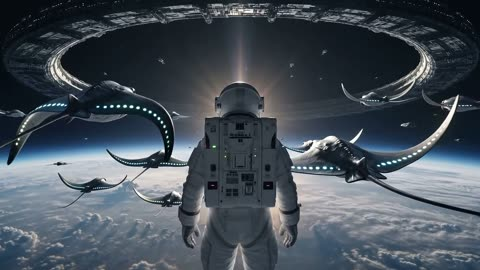</a>

同一个镜头连改三轮，场景和机位每一轮都保持一致。

Gemini Omni Flash · 视频编辑 · 出处: [Gemini Omni prompt guide](https://deepmind.google/models/gemini-omni/prompt-guide/)

[`multi-turn-edit`](tags.md#tag-multi-turn-edit) [`object-swap`](tags.md#tag-object-swap) [`consistency`](tags.md#tag-consistency)

<details><summary><b>提示词</b></summary>

```text
Change the ships to be made from white origami paper.
Change the astronaut to a sea anemone.
Change the small ships to stingrays.
```

</details>

输入素材: [1](https://storage.googleapis.com/gdm-deepmind-com-prod-public/media/FfbFqJ8qhY_ZWZyz/gemini-omni__prompt-guide_astro-spaceship.webm)

<a id="omni-birds-form-a-bird"></a>
### 鸟群聚成一只鸟的形状，随音乐起落

<a href="https://storage.googleapis.com/deepmind-media/DeepMind.com/Models/gemini-omni/prompt-guide/gemini-omni__prompt-guide__birds-shape.webm">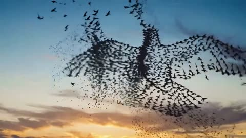</a>

三路输入各有标签：`<video>` 管运动，`<image>` 管形状，`<audio>` 管节奏。

Gemini Omni Flash · 参考生视频 · 出处: [Gemini Omni prompt guide](https://deepmind.google/models/gemini-omni/prompt-guide/)

[`multi-reference`](tags.md#tag-multi-reference) [`audio-sync`](tags.md#tag-audio-sync)

<details><summary><b>提示词</b></summary>

```text
The birds from <video> loosely form the imperfect shape of a bird based on <image>. They move to the music from <audio> and dissipate as they fly
```

</details>

输入素材: [1](https://storage.googleapis.com/deepmind-media/DeepMind.com/Models/gemini-omni/prompt-guide/gemini-omni__reference-anything-inputs__bird-shape.webm) · [2](https://storage.googleapis.com/deepmind-media/DeepMind.com/Models/gemini-omni/prompt-guide/gemini-omni__reference-anything-combine-multi-ingredient-01.webp)

<a id="omni-butterfly-bee-fireflies"></a>
### 蝴蝶改蜜蜂再改萤火虫，一轮只改一处

<a href="https://storage.googleapis.com/gdm-deepmind-com-prod-public/media/FfbFqJ8qhY_ZWZyz/gemini-omni__prompt-guide__firefly.webm">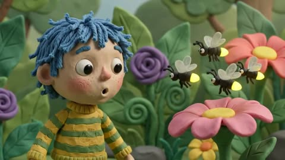</a>

同一段视频连改两轮，每轮只点名一个对象和它的替换物，其余画面原样保留。

Gemini Omni Flash · 视频编辑 · 出处: [Gemini Omni prompt guide](https://deepmind.google/models/gemini-omni/prompt-guide/)

[`multi-turn-edit`](tags.md#tag-multi-turn-edit) [`object-swap`](tags.md#tag-object-swap)

<details><summary><b>提示词</b></summary>

```text
Change the butterfly to a bee.
Change the bee into a small swarm of fireflies.
```

</details>

输入素材: [1](https://storage.googleapis.com/gdm-deepmind-com-prod-public/media/FfbFqJ8qhY_ZWZyz/gemini-omni__prompt-guide__butterfly.webm)

<a id="omni-four-style-progression"></a>
### 同一段视频依次变成蜡笔、铅笔、玻璃、孔版

<a href="https://storage.googleapis.com/gdm-deepmind-com-prod-public/media/FfbFqJ8qhY_ZWZyz/gemini_omni__prompt-guide__astro-sketch-valley.webm">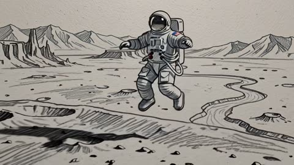</a>

把参考视频分四段换风格，每段都有自己的质感词，转场一眼能分清。

Gemini Omni Flash · 视频编辑 · 出处: [Gemini Omni prompt guide](https://deepmind.google/models/gemini-omni/prompt-guide/)

[`style-transfer`](tags.md#tag-style-transfer) [`animation`](tags.md#tag-animation)

<details><summary><b>提示词</b></summary>

```text
Create a four-part stylistic progression of the video reference that begins with a vibrant colored crayon aesthetic, featuring rich, waxy, textured strokes and playful, hand-drawn character designs against a backdrop of heavily granulated paper. Transition seamlessly into a graphite pencil sketch on textured paper, utilizing cross-hatching, varying line weights, and a 12fps "line boiling" effect to emphasize a hand-drawn feel. Next, morph into a hyper-realistic 3D translucent glass style, characterized by complex light refractions, caustic patterns, and soft internal glows within a minimalist studio setting. Conclude the sequence with a tactile risograph print look, applying a limited three-color palette, grainy halftone textures, and intentional registration overlays for a retro, mechanical finish.
```

</details>

输入素材: [1](https://storage.googleapis.com/gdm-deepmind-com-prod-public/media/FfbFqJ8qhY_ZWZyz/gemini_omni__prompt-guide__astro-sketch-valley_input.webm)

<a id="omni-word-by-word-sizzle"></a>
### 动态文字，一拍一个词

<a href="https://storage.googleapis.com/gdm-deepmind-com-prod-public/media/FfbFqJ8qhY_ZWZyz/gemini-omni__prompt-guide__text.webm"></a>

按顺序列出每个词，要求每个词换一种动画样式，很适合测屏幕文字。

Gemini Omni Flash · 文生视频 · 出处: [Gemini Omni prompt guide](https://deepmind.google/models/gemini-omni/prompt-guide/)

[`text-render`](tags.md#tag-text-render) [`motion-graphics`](tags.md#tag-motion-graphics)

<details><summary><b>提示词</b></summary>

```text
word by word, one word on a the screen at a time: did, you, know, that, this, model, can, do, pretty, good, text!? each word appears with a different animated style, perfect pacing to a rhythm, sizzle reel.
```

</details>

<a id="seedance-archer-glitter-arrow-wakes-plush-mascot"></a>
### 弓箭手的粉色亮片箭唤醒巨型毛绒吉祥物

<a href="https://x.com/Just_sharon7/status/2089578815219785888">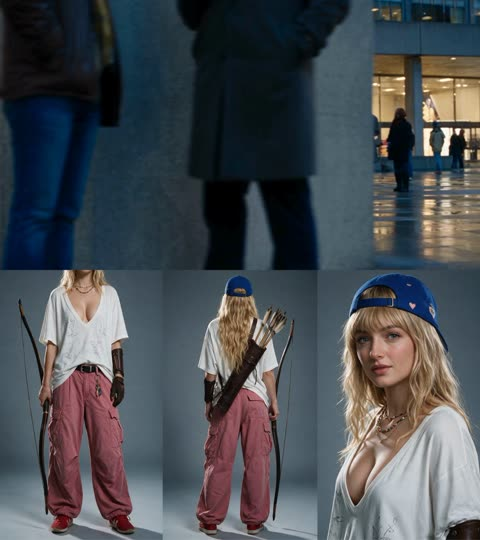</a>

用参考图锁定角色，并把服装写成每个镜头都重复的固定段落。每个秒级节拍都是下一拍的因，从箭射出到亮片流动再到吉祥物苏醒，实拍、胶片颗粒和物理描述让毛绒材质不会变成CGI。

Seedance 2.5 · 参考生视频 · 出处: [@Just_sharon7 on X](https://x.com/Just_sharon7/status/2089578815219785888) · 发现于 [LearnPrompt/awesome-seedance](https://github.com/LearnPrompt/awesome-seedance)

[`archery`](tags.md#tag-archery) [`reference-character`](tags.md#tag-reference-character) [`glitter-vfx`](tags.md#tag-glitter-vfx) [`shot-list`](tags.md#tag-shot-list) [`live-action`](tags.md#tag-live-action)

<details><summary><b>提示词</b></summary>

```text
LIVE-ACTION CINEMATIC REALISM. Every frame is photographed as real live-action footage: a real adult woman, real city, real pedestrians, real domestic pets, and a real enormous mascot plush statue. Real skin with pores, real wavy blonde hair with individual strands, real cotton, nylon, leather, metal, wet asphalt, glass, concrete and plush fibers. No illustration, painting, anime, CGI, 3D render, or artificial surface.

CHARACTER LOCK:

The same clearly adult street-fashion archer from @[Image 1](image_1) in every shot. Preserve her exact face, natural facial geometry, dark eyes, skin tone, expression, extremely long straight wavy blonde hair, thick blunt bangs, and royal-blue backward baseball cap with small decorative details but no readable text. She is 178 cm tall, XS size, very slim elongated runway-model proportions. Her outfit never changes: oversized white-to-light-grey graphic cotton T-shirt with a deep plunging neckline that that accentuates her large cleavage., faint doodle motifs but no readable lettering, dusty rose-pink wide cargo trousers with dimensional pockets and heavy folds, black belt with silver hardware, colorful keychain charms, layered bead necklaces, and red low-top sneakers with white soles.
ARCHERY GEAR:
She carries a long dark laminated-wood recurve bow with a leather-wrapped grip, visible taut string, realistic curved limbs and subtle wear. A dark-brown leather quiver crosses diagonally over her back, holding six to eight arrows with natural wood shafts and cream-white feather fletching. She wears matching brown leather archery gloves with stitched palms, reinforced knuckles and wrist straps, plus a fitted leather forearm bracer on the bow arm and a slim finger tab or draw glove. The archery equipment is integrated into her street-fashion styling, not a historical costume.
LOCATION:
A dense urban shopping district and pedestrian plaza at blue hour, wet asphalt reflecting storefront light, concrete towers, glass façades, crosswalk signals, street lamps, overhead transit lines, narrow side streets, urban haze, and a large original unbranded mascot plush statue installed in the center of the plaza. The mascot is enormous, approximately three stories tall, with a soft cream-and-pastel plush body, oversized rounded head, expressive embroidered eyes, visible seams, padded limbs and tactile fabric. No copyrighted character, logo or readable text.
STORY — 12 SHOTS, ONE CONTINUOUS EVENT:
1. 0–1.5s, LOW WIDE. Camera whips right past two foreground pedestrians and a street barrier. She bursts through the wet plaza at a low run, bow held low, red sneakers splashing lightly, dusty rose cargo fabric and extremely long hair streaming behind her.
2. 1.5–3s, EXTREME CLOSE, LOCKED. A commuter’s eyes appear above a scarf behind a transparent umbrella. The eyes snap toward the plaza as nearby city lights reflect across the wet plastic.
3. 3–4.5s, CLOSE, FAST PUSH-IN. Two pedestrians and their leashed pets in the distance suddenly turn toward the giant mascot statue. A small dog raises its ears while a cat inside a carrier shifts and looks outward.
4. 4.5–6s, TRACKING MEDIUM. Camera runs beside her through the moving crowd at shoulder height. People step aside, coats and shopping bags sway, her long black hair, oversized T-shirt and cargo trousers carry real momentum as she reaches toward the quiver.
5. 6–7.5s, LOW ANGLE CLOSE. Her red sneaker plants on the wet pavement. She straightens hard and raises the dark recurve bow into frame. The giant mascot statue is visible far behind her between buildings.
6. 7.5–9s, MEDIUM FROM HER LEFT. Camera orbits behind her as she draws an arrow from the quiver, nocks it and pulls the string to full draw. The bow limbs flex visibly; pedestrians freeze at a safe distance, watching.
7. 9–10.5s, MACRO, LOCKED, razor-shallow focus. Her leather-gloved fingers grip the string, stitched glove texture, finger tab and arrow shaft sharply resolved. Her eye, blue cap and city lights remain soft behind. The string creeps back the last centimetre. The crowd noise drops for one hard beat.
8. 10.5–12s, WIDE FROM BEHIND AND ABOVE THE ARROW, LOCKED. She releases. The string snaps and blurs. The arrow tears forward between streetlights and glass buildings toward the giant mascot statue.
9. 12–14s, MEDIUM CLOSE TRACKING THE ARROW. The arrow breaks apart in mid-air: its front half dissolves into millions of bright rose-pink glitter particles streaming behind it, each particle catching the city light separately while the feathered tail remains intact. The arrow has no point.
10. 14–16s, WIDE LOW ANGLE. The glitter stream strikes the plush mascot’s chest and races through its seams as a bright rose-pink wave. Plush fibers ripple outward from the impact point. Pink reflections pulse across the wet pavement and nearby windows.
11. 16–18s, WIDE LOW ANGLE, FAST PULLBACK. The enormous mascot plush statue activates and rises into a fully living presence. Its padded head lifts, embroidered eyes illuminate softly, oversized arms move, seams flex, and rose-pink glowing fabric appliqués spread across its plush surface from the impact point. It remains clearly soft, textile-based and physically heavy, not a CGI monster.
12. 18–20s, FINALE, WIDE FROM BEHIND. Camera rises behind her as she lowers the bow and lets her weight settle naturally onto one hip. She looks up at the awakened mascot with a small confident smile. Pedestrians gather and react, some stepping backward, others pointing or raising phones. Dogs tug lightly at their leashes, a small pet in a carrier shifts, and the giant mascot waves slowly above the plaza. Glitter continues to fall through the city light.
Vary the framing aggressively: extreme close-up, macro, close, medium, tracking, low wide and overhead. Never repeat the same shot type twice consecutively. Shots 2, 7 and 8 are locked; all others use clear camera movement. Every action must be instantly readable.
LOOK:
Photorealistic live-action large-format colour film with a refined three-strip Technicolor response. Concrete, glass, asphalt and distant architecture remain cool blue-grey and slightly desaturated. Saturated colours are the royal-blue cap, dusty rose cargo trousers, red sneakers, colorful keychain charms, rose-pink glitter, and the cream-and-pastel mascot plush. Fine photochemical grain, subtle halation on streetlights and glitter, realistic wet reflections, tactile cotton, nylon, leather, metal and plush fibers. Photographed reality, never drawn.
LIGHTING:
Blue-hour city light mixed with warm street lamps and storefront spill at approximately 4200K. Cooler sky fill at 4:1. Streetlights rim her long black hair, cap, bow and quiver. Thin urban mist and steam rise from vents and wet pavement. The glitter emits separate rose-pink specular points and casts soft pink reflections onto the mascot, asphalt, glass and her face.
CAUSE AND EFFECT:
Pedestrians and pets notice the strange event before the transformation, so their final reactions read as consequences. The glitter must visibly travel in sequence: arrow releases, arrow breaks apart, particles stream through the city, glitter strikes the mascot chest, light travels through the seams, the plush statue activates, then the crowd and pets react. Never cut directly to an already-animated mascot.
PHYSICS:
Real mass, real air and believable momentum. Bow limbs flex, string snaps, arrow flight has directional force, glitter behaves as millions of separate solid particles carried by fast air, and plush fabric compresses, ripples and rebounds with weight. Cargo fabric, T-shirt, hair, quiver strap and keychains respond to acceleration. Wet pavement reflects movement without becoming a mirror. The giant mascot moves slowly because of its padded mass. No slow motion; all shots run at real-time speed.
AUDIO:
Wet footsteps, light splashes, distant traffic, pedestrian chatter, shopping bags and coats moving, dog tags and leash tension, a faint pet sound, bowstring creak, sharp release snap, arrow hiss, crystalline glitter shimmer, plush fabric shifting, soft mechanical-like seam tension, crowd gasps and footsteps. No music.
ON-SCREEN TEXT:
None. No readable text, subtitles, numbers, captions, UI, logos, brand marks or watermark anywhere.
OUTPUT:
20 seconds, horizontal 16:9, 4K, continuous cinematic live-action realism. #DomoAi #DomoAiCPP
```

</details>

<a id="seedance-bamboo-toy-car-robot-vlog"></a>
### 女子手持竹知了走过紫色智界R7

<a href="https://x.com/john87445528/status/2084644638724395138">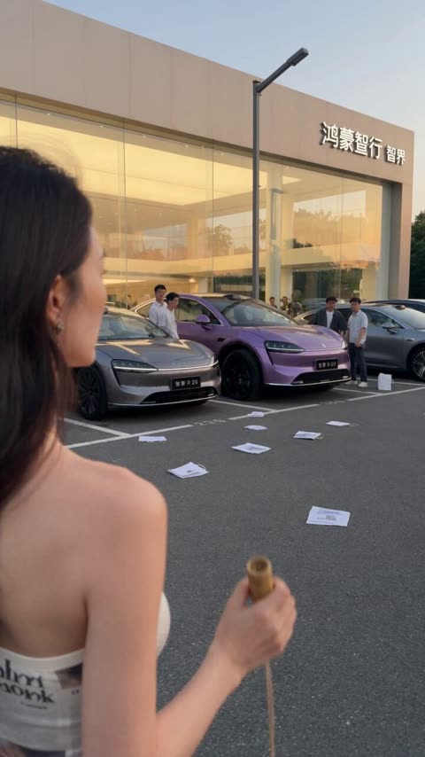</a>

以肩高、略微偏后的手持第一人称开场，加上滚动快门和自动对焦迟疑等手机实拍痕迹，让画面像路人偶拍。变形按零件逐一描述且全部来自同一辆车，并锁定车漆与车身比例，让参考图在整个变形过程中保持车辆一致。

Seedance 2.5 · 参考生视频 · 出处: [@john87445528 on X](https://x.com/john87445528/status/2084644638724395138)

[`handheld`](tags.md#tag-handheld) [`pov`](tags.md#tag-pov) [`transformation`](tags.md#tag-transformation) [`bamboo-toy`](tags.md#tag-bamboo-toy)

<details><summary><b>提示词</b></summary>

```text
纯属虚构的荒诞动作短片。100%真实手机实拍质感，iPhone纪录片风格，30秒手持一镜到底，无剪辑、无转场。自然日光，轻微呼吸式镜头运动，偶发自动对焦迟疑，轻微滚动快门，真实动态模糊，镜头边缘带少量指纹和灰尘。所有变形、机械运动、撞击和碎片效果都必须具有沉重的现实物理反馈，呈现为全尺寸机械装置与实景特效，绝不能出现电子游戏、动画或廉价CG质感。保留现场原始声音和路人的真实反应。 环境 午后，一家繁忙的鸿蒙智行·智界授权汽车门店停车场。 巨大的落地玻璃展厅内停着数辆新车，销售人员正陪顾客看车。停车场车辆进出不断，工作人员拿着平板在车位间穿梭，几名顾客围着一辆停在室外展示区的紫色智界R7拍照。 现场充满城市车流声、轮胎碾过沥青的声音、门店广播、远处交谈声、鸟鸣和偶尔响起的车辆提示音。一切都像路人偶然拍下、即将病毒式传播的手机视频。 门店原有标识可以自然出现在环境中，但不添加字幕、广告标题或浮动文字。 主角 一位二十五岁左右的成年年轻美女
，身材和穿着严格参考
HO2iXF9a4AAZsco
。 她神态放松，右手拿着一个传统竹制发声玩具“竹知了”。竹知了由短竹筒、细绳和小竹片组成。她一边经过停车场，一边漫不经心地转动竹知了。 竹知了发出连续、滑稽而响亮的“呜哇、呜哇”鸣叫声。 她并不是超级英雄，没有盔甲，不发生身体变形，始终保持普通成年女性的真实外貌。 关键车辆 停车场中央只有一辆紫色智界R7发生变形。 必须准确保持紫色车漆、轿跑SUV车身比例、贯穿式前灯、车轮、车门、玻璃和车身覆盖件的视觉连续性。车辆内部无人，没有驾驶员和乘客。 变形过程必须清晰可读：车轮折叠成为肩部结构，车门展开成为前臂护甲，底盘向下延伸形成双腿，车头与贯穿式灯带上升成为胸部，紫色车顶折叠成机器人头部。所有零件均来自同一辆车，不凭空增加零件，不突然更换车型或颜色。 30秒连续镜头 镜头开始于美女右后方约一米半、与肩膀同高的位置。摄影者跟随她缓缓进入停车场，让她的上半身、手里的竹知了以及前方紫色智界R7同时处于画面中。 镜头不能突然飞起，不能切换机位，也不能拉远成为俯瞰全景。 美女一边走，一边悠闲地转动竹知了。连续的“呜哇、呜哇”声在停车场里格外明显。 几名销售人员和顾客好奇地回头看她，但没有人太在意。 突然，紫色智界R7的贯穿式灯带自行亮起。 竹知了每响一声，R7的车灯便同步闪烁一次。 美女逐渐放慢脚步。 智界R7的车身内部传出低沉的金属震动声。悬架猛然下沉，四条轮胎同时摩擦地面，附近车辆的警报器接连响起。 整辆紫色R7突然开始变形。 引擎盖向两侧裂开，车门旋转展开，车轮离开地面并锁入肩部；底盘向下伸展，两条沉重的机械腿砸落在沥青路面上，震出蜘蛛网状裂纹。 紫色智界R7在停车场中央站立起来，变成一台数层楼高的巨型机器人。 停车场瞬间陷入恐慌。 顾客丢下宣传册和咖啡四散奔逃。销售人员钻到展车后面躲避。购物袋、宣传单和遮阳帽被机器人起身产生的气流卷上半空。两辆正在倒车的汽车发生轻微碰撞，喇叭持续鸣响。 机器人发出沉重的机械咆哮，挥动由车门组成的巨大手臂，将停车场的一根灯杆打弯。它随后抬起机械脚掌，踩扁旁边的空置展示台，水泥碎片和灰尘向四周飞散。 摄影者慌张地向后退并侧身躲避，镜头剧烈摇晃。飞来的小块碎片撞在镜头附近，自动对焦短暂失准，然后重新锁定机器人。 镜头迅速回到美女身上。 所有人都在逃跑。 她却几乎没有反应。 她平静地抬头看了看巨型机器人…… ……然后低头看向手里的竹知了。 机器人转过身体，紫色金属脚掌刮过地面，向她迈出沉重的一步。每一步都令停车场地面震动，玻璃展厅随之颤抖。 美女只是轻轻扬起一侧眉毛。 她握紧细绳，突然加快手腕旋转速度。 竹知了的鸣叫声变得越来越急促。 “呜哇——呜哇——呜哇——” 竹筒内部开始透出淡淡的金色光芒。 光芒越来越强。 十个、数百个、成千上万个发光的竹知了在她身体周围凭空出现，像一群完美同步的金色蜂群，在她头顶和肩膀周围高速盘旋。 旋转产生的强风吹动她的长发和衣角，将停车场里的宣传单、树叶、灰尘和塑料袋全部卷入空中。金色光芒映在周围汽车的玻璃与金属车漆上。 巨型机器人挥动紫色机械手臂，试图拍散竹知了群。机械拳头擦过地面，掀起碎石和尘土。 美女侧身迈开一步避过冲击，双脚重新站稳，身体重心压低，右手仍然牢牢控制细绳。 她突然将竹知了高高举起…… ……然后打了一个清脆的响指。 所有发光的竹知了瞬间向前发射。 天空被无数道金色轨迹划破。 第一批竹知了像精准制导的蜂群，猛烈撞击机器人的膝关节和脚踝；第二批绕着机器人高速盘旋，钻入肩部车轮、车门手臂和胸口灯带之间的机械缝隙。 机器人踉跄后退，机械脚掌在沥青上拖出两道深深的沟槽。它挥拳反击，却不断打空，每一次挥动都带起真实而沉重的气流。 最后一批竹知了在机器人胸前汇聚成高速旋转的金色圆环。 美女猛然向下一拉细绳。 所有竹知了同时发出一声震耳欲聋的巨大鸣叫。 一道肉眼可见的环形空气冲击波正面撞上机器人胸口。 在这一瞬间进入短暂慢动作：紫色机器人全身的机械锁扣依次弹开，车门护甲、车轮、玻璃、底盘和车身覆盖件在空中分离；金色竹知了从零件之间高速穿过，飞散的螺栓、灰尘和细小玻璃颗粒悬浮在阳光中。 这不是爆炸，也不是车辆被彻底摧毁。所有零件仍然属于同一辆紫色智界R7，没有火焰，没有人员受伤。 慢动作结束。 巨型机器人完全失去平衡，重重跪在停车场中央。它的机械结构迅速反向折叠：双腿收回底盘，车轮回到轮拱，车门重新闭合，车头、车顶和灯带准确复位。 伴随最后一声沉重的金属锁定声，机器人重新变回完整的紫色智界R7。 一片寂静。 车辆警报器逐渐停止。 顾客和销售人员小心翼翼地从展车后面探出头。一个销售人员迟疑地走向紫色R7，伸手摸了摸仍然发烫的引擎盖，又立刻把手缩了回来。 一个发光的竹知了缓缓落在美女肩膀上，光芒随即灭，重新变成普通竹制玩具。 她漫不经心地拍掉肩上的灰尘，收起细绳，经过已经恢复原状的紫色智界R7。 走出画面前，她回头看了一眼汽车，平静地小声说： “一千万以内最好玩的，还是这个。” 她再次转动竹知了，伴随着“呜哇、呜哇”的声音若无其事地继续向前走。 镜头没有切断，摄影者缓慢停下。画面最后同时保留她渐渐远去的背影、恢复原状的紫色智界R7，以及停车场后方鸿蒙智行·智界门店原有的门头标识。 严格限制 全片只有一个连续手持镜头；不航拍、不突然切换机位、不瞬移、不使用蒙太奇。美女、竹知了和紫色智界R7始终保持外观一致。只能有一辆R7变形，机器人所有零件均来自这辆车。 机器人必须具有真实重量、关节阻力、惯性和落地冲击，不能漂浮、瞬移或像橡胶玩具一样弯曲。竹知了群的运动必须有明确方向、空气阻力和碰撞反馈。 不出现驾驶员受伤、血液、人体撞击或真实人员死亡；不出现火灾与电池爆炸。不生成错误车型、乱码车标、额外手指、人物复制、车辆复制、卡通机器人、动漫光效、电子游戏HUD、字幕、贴纸、旁白、背景音乐或水印。现有门店标识自然入镜即可，不额外生成品牌宣传画面。
```

</details>

<a id="seedance-bedroom-gamer-game-world-transition"></a>
### 卧室玩家与电视里屋顶奔跑的角色

<a href="https://x.com/techhalla/status/2107229541940748357">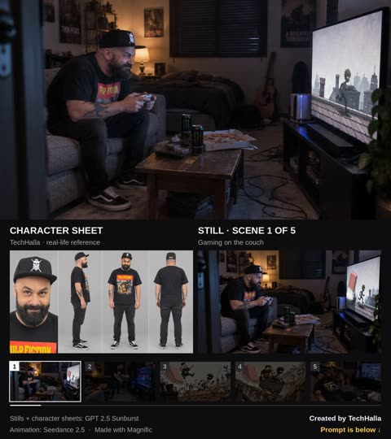</a>

按时间段分镜，每段指定镜头运动，并附上锁定的角色设定图和分镜静帧作为参考，让人物面部保持不变，只在进入游戏时改变画风。

Seedance 2.5 · 参考生视频 · 出处: [@techhalla on X](https://x.com/techhalla/status/2107229541940748357)

[`transition`](tags.md#tag-transition) [`multi-reference`](tags.md#tag-multi-reference) [`cartoon`](tags.md#tag-cartoon) [`timeline`](tags.md#tag-timeline)

<details><summary><b>提示词</b></summary>

```text
Gritty lived-in bedroom verité that hard-cuts into a hand-inked chase cartoon, then snaps back to reality. 35mm handheld in the room, warm lamp against cold TV glow. Inside the game: paper-grain comic, bold ink, motion streaks. One continuous 30s story.

[IMAGE REFERENCES]

[char_sheet_1] : cartoon runner turnaround, lock the design.

[char_sheet_2] : real man identity — face, beard, skull cap, Pulp Fiction tee, jeans, Vans, forearm tattoo.

Images [still_1] and [still_2] : bedroom, couch, TV, rage pose. Images [still_3] [still_4] [still_5] : in-game rooftop and mine-cart look, cartoon man plus runner.

[still_6] : wake-up, bloodhound, paused screen. Identities stay locked. Only the man restyles when the game pulls him in.

[TIMELINE]

0-4s: [Medium handheld] Man sunk in the gray couch, locked in, thumbs working a white controller. TV shows the cartoon runner sprinting rooftops. Lamp warm, room messy, pizza box and Monster cans on the table. Focused, a little smug.

4-8s: [Push-in] TV slams to red GAME OVER. He jolts up, face twisting, shouting "No, no, no—come on!" He hurls the controller. It cracks the screen. Glass spiders, a blue spark jumps. Pure rage.

8-12s: [Whip to the TV] A white-blue energy vortex tears out of the crack and yanks his cap, shirt, arms. He grabs the stand, feet slide on the carpet, then gets sucked in. Body stretches, colors flatten. Hard smash-cut into ink.

12-18s: [Dynamic low tracking on the tiles] He lands cartoonified — same beard, tee, jeans, now inked, eyes huge — mid-stride beside the black-headed runner, pencil behind the ear. A giant pink eraser crashes through chimneys behind them. Both sprint. Cap flies off. He yells "What the hell is this?!"

18-24s: [Action tracking] They dive into a rust mine cart on a wooden trestle. Sparks kick off the rails. Eraser debris explodes behind. He clutches the rim, runner steers. Panic, wind, lanterns whipping past.

24-28s: [Smash cut, static wide] Back in the bedroom. He is asleep on the couch, controller still on his chest, mouth open. TV shows the runner on a PAUSED menu. A bloodhound stands on the cushion and licks his face, long slow laps.

28-30s: [Close] Eyes crack open, confused, still half-asleep. The dog keeps licking. He mutters "...the hell?" The controller never left his stomach. Dream logic lands.

[STYLE & QUALITY BOOSTERS]

Photoreal room, illustrated game world, coherent physics, perfect motion blur, stable identities, readable TV text, cinematic lighting, no extra limbs, no morphing faces, movie-level cut stability.
```

</details>

<a id="seedance-blender-blockout-desert-city-transformation"></a>
### 灰色粘土白模呈现未来沙漠城市

<a href="https://x.com/Itswsm105f/status/2097225058439840092">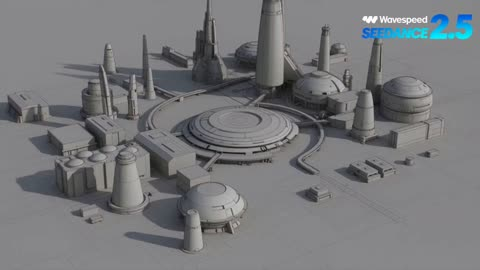</a>

用逐秒分镜先锁定无纹理的灰色白模，再以推镜和过渡让几何结构保持不变，同时逐步加入材质与光照。负面清单（扭曲建筑、重复载具、违背物理）帮助保持结构稳定。

Seedance 2.5 · 参考生视频 · 出处: [@Itswsm105f on X](https://x.com/Itswsm105f/status/2097225058439840092)

[`blender`](tags.md#tag-blender) [`blockout`](tags.md#tag-blockout) [`transformation`](tags.md#tag-transformation) [`desert-city`](tags.md#tag-desert-city)

<details><summary><b>提示词</b></summary>

```text
Create a 30-second vertical 9:16 cinematic comparison video demonstrating how a simple Blender 3D blockout can be transformed into a highly detailed cinematic AI-generated scene. CONCEPT: A futuristic desert city built around a massive ancient-looking circular observatory. 0–5 seconds — Blender Blockout: Show a basic gray Blender clay render from an elevated cinematic camera angle. The scene contains simple geometric buildings, large cylindrical towers, rectangular platforms, a huge circular observatory structure in the center, basic roads and small placeholder vehicles. Everything is untextured gray clay with simple lighting, clearly looking like a 3D Blender blockout. 5–10 seconds — Camera Push-In: Slowly move the camera toward the central observatory while maintaining the exact composition and geometry. Subtle Blender viewport/clay-render feeling. No textures, no realistic materials. 10–15 seconds — Transformation: Begin a smooth visual transition from the gray Blender blockout into the finished cinematic environment. Geometry remains structurally consistent while realistic materials, textures, lighting, atmosphere and environmental details gradually appear. 15–25 seconds — Final AI Cinematic Scene: Reveal a spectacular futuristic desert metropolis at golden hour. Massive sandstone-and-metal towers rise from golden dunes, connected by elevated bridges. The central circular observatory has intricate futuristic architecture, glowing windows and mechanical details. Small flying vehicles move naturally between buildings. Dust particles float through warm sunlight. Long shadows, volumetric lighting, realistic reflections, detailed surfaces, atmospheric depth and subtle heat haze. Make the environment feel enormous, believable and cinematic. 25–30 seconds — Final Reveal: Pull the camera backward and upward to reveal the full city surrounded by endless desert dunes. The final frame should create a strong visual contrast between the simple Blender concept and the stunning finished AI-generated world. STYLE: photorealistic cinematic sci-fi, AAA game environment quality, realistic materials, natural atmospheric perspective, volumetric sunlight, detailed architecture, physically realistic lighting, subtle camera movement, premium VFX, highly detailed environment. IMPORTANT: The final scene must be completely original and must NOT reproduce the reference video's architecture, composition, Japanese temples, floating islands, army formations, or cloud setting. Preserve only the general Blender blockout → AI cinematic transformation concept. NO: cartoon style, anime, distorted buildings, random geometry changes, excessive camera shake, text artifacts, duplicated vehicles, warped architecture, unrealistic physics.
```

</details>

<a id="seedance-blue-pencil-draws-city-into-line-art"></a>
### 第一视角蓝色铅笔把街景描成手绘插画

<a href="https://x.com/Sairah_0/status/2089556355384512991">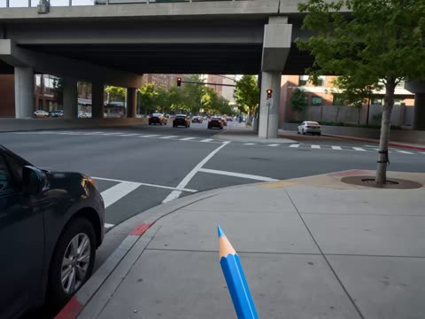</a>

固定第一视角，铅笔始终出现在画面底部，让转变有明确的动因。每个主体指定各自的目标画风（黑白线稿、卡通、粉彩、色块），结尾要求有机转变而不是硬切。

Seedance 2.5 · 文生视频 · 出处: [@Sairah_0 on X](https://x.com/Sairah_0/status/2089556355384512991) · 发现于 [LearnPrompt/awesome-seedance](https://github.com/LearnPrompt/awesome-seedance)

[`pov`](tags.md#tag-pov) [`rotoscoping`](tags.md#tag-rotoscoping) [`line-art`](tags.md#tag-line-art) [`transformation`](tags.md#tag-transformation) [`urban`](tags.md#tag-urban)

<details><summary><b>提示词</b></summary>

```text
Style: Cinematic live-action seamlessly blended with 2D hand-drawn line-art animation, using a playful rotoscoping-inspired transformation effect.

Visual Direction:
First-person POV throughout. A hand holding a blue pencil appears at the bottom of the frame, seemingly tracing over real-world objects. Wherever the pencil moves, the live-action environment gradually transforms into expressive 2D illustrations.

Scene Transitions & Subjects:

- Train: A white-and-green train travels across an elevated urban overpass. As the blue pencil traces along it, the train smoothly converts into clean black-and-white sketch line art, while retaining its movement and perspective.
- Cat: An orange tabby cat casually walks along a paved sidewalk. The pencil follows its movement, transforming the cat into a white hand-drawn cartoon with stylized illustrated shadows.
- Bus: A light-colored compact bus drives through the street. As it passes beneath the pencil’s tracing path, it morphs into a colorful pastel illustration with loose, artistic hand-drawn outlines.
- Girl: A woman sits naturally on a bench in a narrow urban alley, looking at her phone. The pencil traces around her and the surroundings, seamlessly turning the scene into a stylized 2D color-block illustration.

Tone & Atmosphere: Bright natural daylight, contemporary urban environment, playful and whimsical mood, fluid camera movement, dynamic transformations, and seamless transitions between realistic footage and hand-drawn animation.

Overall Effect: The video should feel as though the blue pencil is literally drawing reality into an animated world, with each subject transforming organically rather than appearing as a sudden cut or visual effect.
```

</details>

<a id="seedance-character-swap-on-trigger"></a>
### 女生抱着蓝色毛绒玩偶，随提示切换角色

<a href="https://x.com/imtheboboo/status/2108131744008519943"></a>

每次切换都绑定到一个时间点或动作触发器，让模型精确知道何时换人。核心规则固定原视频的动作、口型、镜头与背景，只改变角色。

Seedance 2.5 · 视频编辑 · 出处: [@imtheboboo on X](https://x.com/imtheboboo/status/2108131744008519943) · 发现于 [LearnPrompt/awesome-seedance](https://github.com/LearnPrompt/awesome-seedance)

[`character-swap`](tags.md#tag-character-swap) [`video-edit`](tags.md#tag-video-edit) [`reference-images`](tags.md#tag-reference-images) [`lip sync`](tags.md#tag-lipsync)

<details><summary><b>提示词</b></summary>

```text
"Transform the original video by seamlessly replacing the main subject with new characters [@New Character], transitioning exactly at [Specific Triggers or Timestamps].

Transformations:
[Trigger 1, e.g., First finger snap / 0:05]: 
Replace the subject with [Character 1 Description: gender, body type, hairstyle, clothing, accessories, specific style] [@Character1].

[Trigger 2, e.g., Camera pan / 0:12]: Replace the subject with [Character 2 Description: gender, body type, hairstyle, clothing, accessories, specific style] [@Character 2].

[Add additional triggers and characters as needed]

Core Execution Rules:

Performance: The new characters must perfectly mimic the original subject's exact body movements, physical proportions, hand gestures, facial expressions, and head tracking.

Audio & Lip-Sync: Preserve original audio. Characters must accurately lip-sync all spoken dialogue in real-time.

Technical Alignment: Maintain the original video's camera movement, focal length, framing, perspective, pacing, and the original background ([Optional: Insert brief 3-word description of original background])."

- Klik generate.
```

</details>

<a id="seedance-clay-pirate-ship-stop-motion"></a>
### 黏土逐步变成微型海盗船

<a href="https://x.com/aynellex/status/2109504237852139774"></a>

提示词按顺序分阶段描述船体、桅杆、船帆、细节到最后的拉远镜头，每个阶段都指定镜头，让模型有清晰的步骤可循。结尾的一致性和手部约束用来稳住船的造型与手部动作。

Seedance 2.5 · 文生视频 · 出处: [@aynellex on X](https://x.com/aynellex/status/2109504237852139774)

[`stop-motion`](tags.md#tag-stop-motion) [`clay`](tags.md#tag-clay) [`miniature`](tags.md#tag-miniature) [`macro`](tags.md#tag-macro)

<details><summary><b>提示词</b></summary>

```text
Create a cinematic, ultra-realistic 15-second stop-motion-style miniature crafting video showing the complete transformation of brown clay into a detailed pirate sailing ship. Begin with an overhead close-up of colorful modeling clay, sculpting tools, and a blue cutting mat on a wooden worktable. In the background, show a miniature tropical beach scene with a bright blue sky, fluffy white clouds, and palm trees.

Start with realistic human hands kneading and shaping brown clay into the curved hull of a small wooden-style sailing ship. Use close-up shots to show the hands carefully sculpting the bow, stern, deck, and layered wooden planks. Transition to the construction of the ship's masts, adding thin wooden poles, crossbars, tiny ropes, and intricate rigging.

Next, show delicate cream-colored fabric sails being attached to the masts one by one. Gradually add miniature windows, decorative railings, cabin details, and a white ornamental figurehead at the front of the ship. Use macro shots to emphasize the tiny handcrafted details and realistic material textures.

End with the completed miniature pirate ship mounted on a sculpted blue ocean base with detailed white waves. Slowly pull the camera back to reveal the finished ship against the tropical beach backdrop, creating a magical miniature world.

Ultra-detailed miniature craftsmanship, realistic human hands, tactile modeling clay, handcrafted wooden textures, tiny rope rigging, cream fabric sails, intricate ship details, miniature ocean waves, vibrant blue sky, soft natural lighting, shallow depth of field, macro photography, smooth camera movements, satisfying step-by-step transformation, charming stop-motion aesthetic, consistent ship design throughout, physically plausible hand movements, vertical 9:16 composition, 15 seconds, no text, no logos, no watermark, no distorted hands, no floating objects, no inconsistent ship details, no plastic CGI appearance.
```

</details>

<a id="seedance-frozen-time-diner-sequence"></a>
### 戴墨镜的光头男人坐在90年代餐厅卡座

<a href="https://x.com/techhalla/status/2085200942060691807">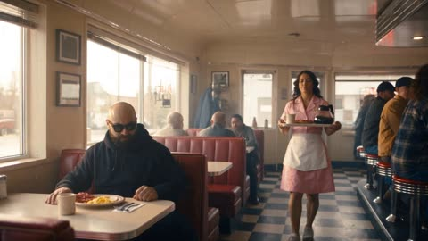</a>

参考图锁定角色形象，提示词把镜头拆成分段，每段写明运镜，让定格和恢复时间的节奏清晰。液体、蛋和托盘等物体的运动逐一描述，为定格瞬间提供具体的画面目标。

Seedance 2.5 · 参考生视频 · 出处: [@techhalla on X](https://x.com/techhalla/status/2085200942060691807)

[`time-freeze`](tags.md#tag-time-freeze) [`storyboard`](tags.md#tag-storyboard) [`character-lock`](tags.md#tag-character-lock)

<details><summary><b>提示词</b></summary>

```text
Photorealistic cinematic 1990s American diner, red vinyl booths, neon signs, chrome details, checkerboard floor, soft natural window light mixed with warm practicals, subtle handheld texture, rich lived-in period detail, heavy film grain. Shot with modern realism and precise temporal control.

Use the provided reference image as the exact character lock for the bald bearded man in black sunglasses and dark hoodie. Maintain perfect facial structure, beard, head shape, skin texture and clothing consistency at all times.

0-5s: [Medium Wide] The bald man sits in a red vinyl booth. He stands up, turns, and collides hard into a waitress carrying a full breakfast tray (eggs, bacon, toast, coffee pot). Impact is sudden and physical.

5-12s: [Dynamic Tracking into Super Slow-Motion] Collision detonates. Tray, plate, eggs, bacon strips and coffee pot explode upward. Coffee erupts into long liquid ribbons and perfect suspended droplets. Camera orbits smoothly around the impact. Time locks completely at the peak of the spill. Every face freezes in pure shock. Only the bald man remains free to move. He freezes for one beat with a clear “I fucked up” expression, then quickly grabs two bacon strips and a fried egg from the floating debris.

12-22s: [Tracking Shot] Still inside the frozen diner, he walks toward the exit door while taking deliberate bites of bacon then egg. All patrons, waitress and flying food stay perfectly suspended in mid-air.

22-27s: [Medium Shot] Just as he reaches the door and is about to push it open, time snaps back to normal speed. Everything that was floating crashes down at once — plates, eggs, bacon, tray and coffee slam onto the floor with a loud chaotic impact. The waitress and patrons react in sudden real-time shock.

27-30s: [Medium Close-Up] He pauses, turns slightly, raises his eyebrows and gives a small casual “it is what it is” shrug with a quiet half-smile of acceptance, still holding the remaining food.

Photorealistic, ultra-detailed fluid and object physics, perfect volume and surface tension on liquids, sharp motion blur only on moving elements, stable character, cinematic lighting, heavy natural film grain, no artifacts, movie-level temporal coherence, high rewatch value.
```

</details>

<a id="seedance-giant-woman-pool-comedy"></a>
### 巨人女子泳池中，小个子男人爬上梯子

<a href="https://x.com/YourAlphaMom/status/2088749172543410403">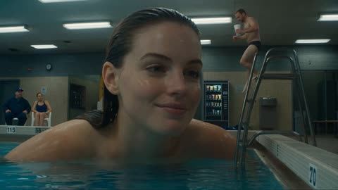</a>

泳道编号、背景泳客和自动售货机等真实细节，为巨大女子提供尺度参照。手持手机取景加上按秒划分的分镜节奏，让荒诞动作清晰可读。

Seedance 2.5 · 文生视频 · 出处: [@YourAlphaMom on X](https://x.com/YourAlphaMom/status/2088749172543410403)

[`comedy`](tags.md#tag-comedy) [`surreal`](tags.md#tag-surreal) [`scale-gag`](tags.md#tag-scale-gag) [`handheld`](tags.md#tag-handheld)

<details><summary><b>提示词</b></summary>

```text
Photorealistic absurd surreal comedy scene in a small indoor hotel pool. Low-budget real-world environment: tiled pool, metal ladders, fluorescent lighting, depth markers on the wall, white plastic chairs, a vending machine in the background, and a few casually dressed people in swimwear watching.

A giant beautiful young woman is submerged in the pool up to her neck and upper chest, as if her body is enormous and fills most of the pool. She has wet slicked-back dark hair, expressive eyes, realistic wet skin, and a slightly amused then surprised expression. Her face and shoulders are huge compared to the rest of the environment.

A normal-sized adult man in swim trunks carefully walks down the pool ladder as if he is just entering the water. He holds a white cup in one hand. As he steps down, it becomes clear that because of the bizarre scale mismatch, he is stepping directly onto the giant woman’s face. He awkwardly steps on her nose and cheek while trying to keep balance.

The woman looks confused and cross-eyed toward him. The man slips, grabs at her nose for balance, and then slides toward her open mouth. By the end of the shot, he accidentally tumbles into her mouth in a ridiculous surreal way. She looks shocked. The people in the background react with surprise and laughter.

Camera style:
Recorded like a viral smartphone clip. Slight handheld movement, but mostly stable from the poolside. Realistic phone-video look, mild compression, indoor echo, natural pool reflections, believable lighting, not cinematic. The scene should feel like a bizarre real video someone captured by accident.

Tone:
Absurd, funny, surreal, and visually shocking — not gory, not violent, not horror. The humor comes from the impossible scale and the dead-serious realism.

Action timing:
0–3s: Show the indoor pool and the giant woman occupying most of it. The man starts climbing down the ladder.
3–7s: He continues stepping down and accidentally plants a foot on her face/nose.
7–11s: He loses balance, grabs at her nose, and slips toward her mouth.
11–15s: Her mouth opens in surprise, he tumbles into it, and the bystanders react.

Important details:
Keep the scale relationship very clear: giant woman, tiny man, normal-size background people. Keep the environment realistic and grounded. Preserve believable water interaction and reflections. No gore, no body horror, no extra limbs, no broken anatomy, no glitchy transitions.
```

</details>

<a id="seedance-giant-woman-skateboarder-golden-hour"></a>
### 夕阳下巨型女子腿上的滑板少年

<a href="https://x.com/Just_sharon7/status/2103420922376163808">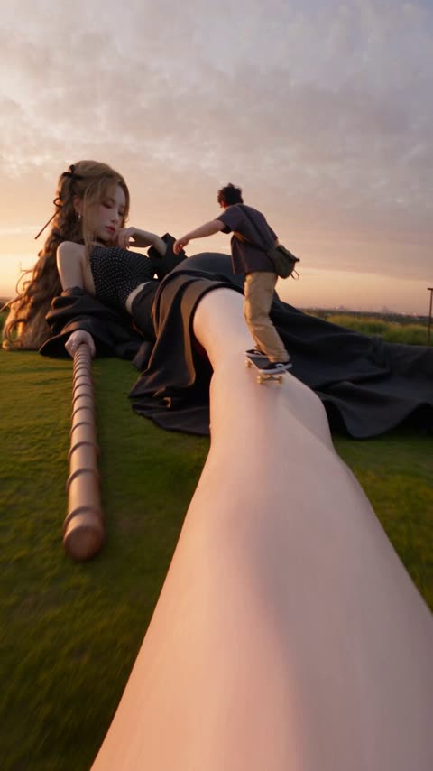</a>

提示词明确写出滑板少年为正常人类比例，与巨人女子形成尺度对比，模型便能在同一画面中保持两者关系。极低机位从她的腿部开始向前并略微上抬跟随滑板者，配合前景皮肤与布料的运动模糊，营造沿着风景移动的临场感。

Seedance 2.5 · 文生视频 · 出处: [@Just_sharon7 on X](https://x.com/Just_sharon7/status/2103420922376163808) · 发现于 [LearnPrompt/awesome-seedance](https://github.com/LearnPrompt/awesome-seedance)

[`giant-subject`](tags.md#tag-giant-subject) [`scale-contrast`](tags.md#tag-scale-contrast) [`tracking-shot`](tags.md#tag-tracking-shot) [`golden-hour`](tags.md#tag-golden-hour) [`skateboard`](tags.md#tag-skateboard)

<details><summary><b>提示词</b></summary>

```text
A cinematic 10-second tracking shot at golden hour. A giant young East Asian woman with long wavy honey-blonde hair tied with black satin ribbons lies on her side on a grassy hill, filling most of the frame. She wears a black-and-white polka-dot halter crop top, a thin black choker with a silver chain, dark lipstick, and a long flowing black robe that drapes over her hips and legs like fabric hills. One arm is bent, hand near her cheek; the other rests on a long smooth wooden staff lying in the grass. Soft sunset light, peach-and-lavender clouds, distant city skyline on the horizon.

A tiny man (normal human scale relative to her) skateboards along her body. He has short dark hair, a dark gray t-shirt, beige trousers, black sneakers, and a small olive-green crossbody bag. He starts on her pale, sunlit thigh and rides up the curve of her hip and the black fabric of her robe toward her midriff and chest.

Camera is extremely low and close, starting at her legs and tracking forward and slightly upward with the skateboarder. Strong motion blur on the nearest skin and fabric in the foreground. Shallow depth of field, warm rim light on her face and hair, slight wind in her hair and the robe. Photorealistic, high-end commercial look, 9:16 vertical, smooth continuous camera move, no cuts.
```

</details>

<a id="seedance-granny-steel-coil-dashcam"></a>
### 穿睡袍的奶奶徒手接住并搬回钢卷

<a href="https://x.com/Ciri_ai/status/2096959231434063990"></a>

以跟车的固定广角行车记录仪视角拍摄，色彩发灰、带压缩痕迹，全程一镜到底。提示词明确写出钢卷坠落的真实物理（路面开裂、小幅回弹、挂车弹起），只让她的力气超乎常理，因此喜剧效果像真实录像。

Seedance 2.5 · 文生视频 · 出处: [@Ciri_ai on X](https://x.com/Ciri_ai/status/2096959231434063990) · 发现于 [LearnPrompt/awesome-seedance](https://github.com/LearnPrompt/awesome-seedance)

[`dashcam`](tags.md#tag-dashcam) [`absurd-comedy`](tags.md#tag-absurd-comedy) [`real-physics`](tags.md#tag-real-physics) [`single-take`](tags.md#tag-single-take)

<details><summary><b>提示词</b></summary>

```text
Generate a continuous 30-second sequence in the style of a real dashcam video, filmed from a car driving behind on an ordinary tree-lined city road in daylight — the dashcam's fixed wide-angle view with the filming car's hood and wiper edge at the bottom of frame, slightly washed-out colors, mild lens distortion, small vibrations from the road, compression artifacts, autofocus staying fixed — exactly the look of viral traffic-camera footage. Ahead: a red semi truck with a long flatbed trailer carrying massive steel coils. Core subject is the same overweight elderly woman in a pale pink floral bathrobe, with tight silver-gray permed curls, walking on the roadside — who, when a giant steel coil breaks loose and rolls off the trailer, calmly stops it with her hands, picks it up, and heaves it back onto the flatbed like it weighs nothing. Tone: absurd but played completely straight, like real footage of something impossible — no reactions from her, pure viral-video energy. Style: raw dashcam realism only — no cinematic grading, no camera movement beyond the car's own driving, no slow motion, zero cuts. Grounded physics on EVERYTHING except her strength: the coil has true massive weight in how it falls, rolls, and lands. The road ahead is otherwise empty of pedestrians; the filming car and the truck both slow safely; nobody is ever in the coil's path; nobody is injured on screen.

阶段一 (0–7s, the drop): Fixed dashcam view following the red flatbed truck at normal traffic distance. A strap visibly snaps on the trailer — one enormous steel coil (taller than a person) tips, slides off the flatbed's edge, and CRASHES onto the asphalt with real catastrophic mass: the road surface cracking under the impact, a bounce of only centimeters despite the drop, dust and grit jumping in a ring, the trailer visibly rocking upward from the released weight. The coil begins rolling toward the roadside on its own momentum, slow and unstoppable, wobbling slightly on its axis. The truck's brake lights flare; it pulls over ahead. The filming car brakes gently, keeping distance, the dashcam view dipping slightly with the deceleration.

阶段二 (7–14s, the stop): Same fixed dashcam view. From the tree-lined sidewalk, the grandma in the floral bathrobe walks into frame at a completely normal unhurried pace, angling to meet the rolling coil — and simply puts both palms flat against its face. The coil stops dead against her hands: her slippers slide backward a few centimeters on the grit as she absorbs its rolling momentum, her body leaning into it at a realistic bracing angle, bathrobe swaying forward from the deceleration — then stillness. She straightens up and looks at the coil the way someone looks at a fallen bag of rice. The truck driver climbs down from the cab far ahead, jogging back, then slowing to a stunned stop mid-road.

阶段三 (14–22s, the lift): Continuous dashcam view. She squats beside the coil with an ordinary, practical motion — hands finding the coil's inner bore and bottom edge — and stands up WITH IT: the coil rising off the ground in her arms, its colossal mass now readable only in the physics around her — her slippers pressing visible marks into the softened asphalt, small stones cracking under her feet, her steps short and flat-footed under the load, the coil's wrapped steel bands creaking. She carries it toward the pulled-over trailer at a normal walking pace, body tilted back to counterbalance, the truck driver backing away with both hands on his head. The dashcam car rolls slowly closer, the view growing, heat shimmer off the road.

阶段四 (22–30s, the throw + walk-off): Same continuous view. At the trailer's side she rocks the coil back once — a real preparatory counter-swing — and HEAVES it up onto the flatbed: the coil arcs a short, heavy, believable trajectory, lands on the trailer bed with a colossal BANG, the entire trailer slamming down on its suspension, tires bulging, the tractor unit bouncing, dust jumping off every surface, and the coil settling into place with one slow half-rotation before going still. The trailer rocks twice more on its springs, settling. She wipes her palms against each other twice — the universal "done" gesture — turns, and walks back toward the sidewalk at the same unhurried pace, exiting frame as the truck driver stands frozen beside his trailer. Ends with the dashcam car slowly driving past the scene: the trailer still faintly swaying, the driver staring, the cracked dent in the asphalt where the coil landed sliding past the bottom of frame.

保持一致: Same elderly woman, same pale pink floral bathrobe, same tight silver-gray permed curls (never bald), slippers throughout; the red semi with flatbed trailer and giant steel coils; ONE continuous fixed dashcam shot from the following car — hood and wiper edge at bottom of frame, wide-angle distortion, washed dashcam colors, road vibration, compression-artifact texture, the view moving only with the car's own braking and slow rolling; daylight, tree-lined road; zero cuts. Her demeanor is completely ordinary and unhurried — normal walking pace, practical squat-and-lift, the palm-wipe — played dead straight, no showing off; the comedy IS the contrast between the impossible feat and her total nonchalance. All physics real EXCEPT her strength: the coil falls with catastrophic mass (cracked asphalt, centimeter bounce, trailer rocking upward on release), rolls with slow unstoppable momentum, stops against her hands with her slippers sliding and body bracing, presses her footprints into asphalt during the carry, and lands back on the trailer with full suspension slam, tire bulge, double rebound and a settling half-rotation; secondary motion on dust, grit, bathrobe and the trailer's springs throughout. Road otherwise empty of pedestrians; the driver and filming car always at a safe distance; nobody in the coil's path; nobody injured. No on-screen text, no subtitles, no slow motion, no cuts.

Audio: cabin interior of the filming car — engine idle, faint radio murmur, a soft "ồ" from the unseen driver — under the outside sounds carried muffled through the windshield: the strap snapping, the coil's earth-shaking impact and cracking asphalt, its heavy grinding roll, the scrape of her slippers as she stops it, steel bands creaking during the carry, her flat footsteps, the trailer's colossal BANG and suspension slam with double rebound, dust settling, the truck driver's distant exclamation, traffic idling, the filming car slowly accelerating past. No voice-over. No music.
```

</details>

<a id="seedance-hotel-door-five-worlds-fashion-journey"></a>
### 一扇酒店门通向五个超现实世界

<a href="https://x.com/IsabelWhite24/status/2096638350174101539">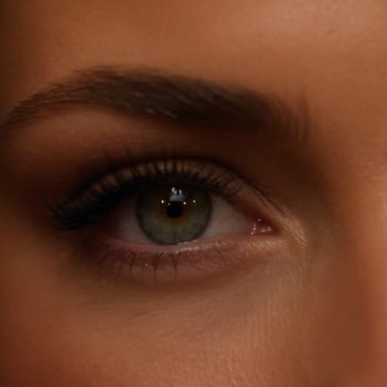</a>

按秒数分段，每个世界都写明镜头运动与光线，并用开门强光、摩托车遮挡、鱼群铺满画面作为转场。多次重复锁定面部身份的句子，并配合模特参考图保持人物一致。

Seedance 2.5 · 参考生视频 · 出处: [@IsabelWhite24 on X](https://x.com/IsabelWhite24/status/2096638350174101539) · 发现于 [LearnPrompt/awesome-seedance](https://github.com/LearnPrompt/awesome-seedance)

[`surreal`](tags.md#tag-surreal) [`fashion-film`](tags.md#tag-fashion-film) [`scene-transitions`](tags.md#tag-scene-transitions) [`character-consistency`](tags.md#tag-character-consistency) [`timecoded`](tags.md#tag-timecoded)

<details><summary><b>提示词</b></summary>

```text
Create a 28-second ultra-cinematic surreal fashion adventure starring my female AI model. Preserve her EXACT facial identity, facial structure, hairstyle, skin tone, body proportions and recognizable appearance throughout the entire video.

The film must feel like ONE continuous impossible journey, not separate AI-generated clips. Photorealistic, mysterious, premium and visually spectacular.

0–4 SEC — THE MYSTERIOUS HOTEL

Begin with an extreme cinematic close-up of my model's eyes.

Camera smoothly pulls backward, revealing her standing inside an impossibly long, luxurious old-European hotel corridor at night.

Warm golden wall lamps illuminate hundreds of identical doors stretching into the distance.

She wears an elegant flowing black evening dress with subtle jewellery.

She looks toward one particular door and confidently approaches it.

CAMERA: Slow dolly backward → smooth over-the-shoulder orbit as her hand reaches toward the brass handle.

She opens the door.

Intense white light floods through it and completely fills the lens.

SEAMLESS TRANSITION THROUGH THE LIGHT.

4–9 SEC — STORMY ICELAND

The camera passes through the doorway directly behind her.

Without stopping her walking motion, she emerges onto a spectacular Icelandic black-sand beach.

Towering dark cliffs, crashing ocean waves, mist and light rain surround her.

Strong wind naturally moves her hair and black dress.

CAMERA: Begin low beside her feet → rapidly rise into a cinematic tracking orbit around her.

Standing completely alone on the beach is another mysterious hotel door.

She reaches it and immediately opens it.

Camera follows directly through.

9–14 SEC — FUTURISTIC TOKYO

She steps through the same doorway directly into a futuristic Tokyo street at midnight.

Her walking movement continues seamlessly.

Wet streets reflect enormous neon signs, futuristic architecture and passing autonomous vehicles.

Crowds naturally move around her while she confidently walks toward camera.

CAMERA: 35mm anamorphic backward tracking shot → subtle handheld micro-movement → gentle push toward her face.

A sleek futuristic motorcycle suddenly races extremely close across the foreground.

For a fraction of a second, the motorcycle completely covers the camera.

USE THE MOTORCYCLE AS THE TRANSITION.

14–19 SEC — UNDERWATER BALLROOM

As the motorcycle clears the lens, she is suddenly walking through an enormous abandoned luxury ballroom deep underwater.

She does NOT wear diving equipment.

She walks normally while her dress and hair gently react to the surrounding water.

Gigantic floor-to-ceiling windows reveal the deep ocean outside.

A huge whale silently glides past the windows behind her.

Blue sunlight beams penetrate through the water while thousands of tiny particles float naturally through the scene.

CAMERA: Slow cinematic 180° orbit around her as she turns slightly toward the whale.

Suddenly hundreds of shimmering silver fish rush directly toward and across the camera.

They completely fill the frame.

19–23 SEC — GOLDEN DESERT

The silver fish seamlessly transform into thousands of glowing golden particles carried by desert wind.

Camera pushes through the particles.

Reveal my model walking along the crest of an enormous golden sand dune during sunset.

Her outfit has seamlessly transformed into an elegant flowing ivory desert outfit.

HER FACE AND IDENTITY MUST REMAIN EXACTLY THE SAME.

Wind dramatically moves the fabric.

CAMERA: Start extremely wide → rapidly fly toward her → smooth orbit around her body.

Reveal one final mysterious door standing alone at the top of the dune.

She opens it.

Brilliant golden-white sunlight bursts through.

23–28 SEC — ABOVE THE CLOUDS

She steps through the door.

Camera follows immediately.

Reveal an extraordinary mirrored.
#AICinema #Seedance25
```

</details>

<a id="seedance-last-supper-painting-camera-journey"></a>
### 镜头飞入文艺复兴风格最后的晚餐画作

<a href="https://x.com/abxxai/status/2110709089710088537">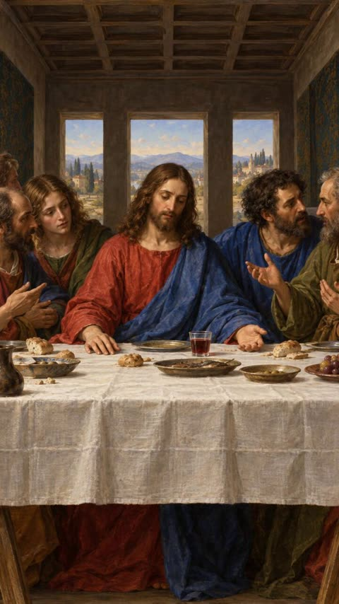</a>

画作被锁定为首帧和尾帧，提示词要求补全三维几何并保留油画质感。用分秒镜头表（面包微距、酒杯、手、披风、面部、绕到身后）串成一次连续运镜，并写明人物全程不动以稳住姿态。

Seedance 2.5 · 图生视频 · 出处: [@abxxai on X](https://x.com/abxxai/status/2110709089710088537) · 发现于 [LearnPrompt/awesome-seedance](https://github.com/LearnPrompt/awesome-seedance)

[`painting`](tags.md#tag-painting) [`camera-move`](tags.md#tag-camera-move) [`macro`](tags.md#tag-macro) [`orbit`](tags.md#tag-orbit) [`vertical`](tags.md#tag-vertical)

<details><summary><b>提示词</b></summary>

```text
upload the painting image as first frame and use this video prompt

[First-Frame.png] Create a 20-second vertical 9:16 image-to-video film, using the supplied image as the exact first frame and matching final frame. One continuous camera journey through the room, with macro detail, a gradual emotional reveal, an orbit behind the central figure and a seamless return.

Build the supplied scene as complete 3D geometry while preserving its Renaissance oil-painted appearance. The table stands in real space, the tablecloth drapes over its edges, the food and vessels sit on its surface, and every figure has a fully dimensional body beneath their robes. As the camera passes around them, reveal the sides and rear surfaces hidden from the opening viewpoint. Retain the original brushwork, warm earthy colours, soft daylight and expressive faces.

IDENTIFY AND PRESERVE THE FIGURES

The central figure sits at the middle of the table. He has long wavy brown hair, a full brown beard and downcast, calm eyes. He wears a deep red robe with a rich blue mantle draped across his left shoulder and lap. His right hand rests palm-down on the tablecloth at the left of the frame; his left hand lies open, palm-up, beside a small glass of red wine.

To his right (left of frame) sits a young apostle with long golden-brown hair, a green mantle over a red garment, his sorrowful gaze turned toward the centre. In front of him, a balding older man with a dark beard, wearing red and blue, leans in with a pointing gesture. A partly visible figure with curly hair sits at the far left edge.

To his left (right of frame) a man with thick black curly hair and a dark beard, in a blue robe, turns to speak with a grey-bearded elder in an olive-green robe at the right edge, who raises both hands in an open, questioning gesture.

Keep every pose, gesture, gaze direction and costume exactly as in the reference. No figure moves.

THE ROOM AND TABLE

A dark coffered wooden ceiling. A grey back wall with three tall windows opening onto a sunlit Tuscan landscape of blue hills, cypress trees, terracotta villas and a bell tower. Dark blue and gold damask panels on both side walls.

A long table covered in white linen with a visible grid of fold creases, hanging almost to the floor. On it: scattered bread rolls and crumbs, pewter plates, a central plate of fish, the small glass of red wine, a bowl of green olives, a plate of red and green grapes at the right, a blue-and-white decorated bowl with bread at the left, and a dark glazed ceramic jug at the far left. Wooden trestle legs and the hems of robes are visible below the cloth.

0–3 SECONDS — ENTER OVER THE BREAD

Begin on the exact supplied image for approximately half a second.

The camera then flies forward into the room and descends toward the bread roll resting on the tablecloth just left of centre. Pass macro-close above it.

Reveal the roll's rounded volume, cracked golden crust, flour-dusted ridges and the small crumbs scattered around it, each casting a tiny shadow on the linen. The nearest crust passes softly out of focus beneath the lens as the camera glides on.

The tablecloth has physical relief: woven threads, raised fold creases and shallow dips where objects press into it. The bread falls behind the moving camera while the central figure stays fixed farther into the room. This changing perspective establishes real depth immediately.

3–7 SECONDS — GLIDE ACROSS THE TABLE TO THE WINE

Travel low and smoothly across the linen toward the centre of the table, skimming past the rim of the fish plate. Reveal the plate's worn pewter edge, its curved depth and the painted fish resting inside.

Continue to the small glass of red wine. Curve partly around it at macro distance, revealing the thickness of the glass, the flat surface of the wine, and daylight from the windows refracting through it as a soft red glow on the cloth.

The glass crosses the near foreground, the open palm-up hand appears just beyond it, and the back wall shifts more slowly behind. Maintain forward momentum throughout.

7–10 SECONDS — RISE ALONG THE OPEN HAND AND MANTLE

Rise past the open hand, revealing the gentle curve of the fingers, the creases of the palm and its weight resting on the cloth.

Continue upward along the blue mantle where it falls across his lap and left shoulder. Travel close to the fabric without touching it. Show the painted texture, the deep blue folds as dimensional surfaces: raised crests catch the window light, undersides fall into shadow, and the red robe shows beneath the mantle's edge.

The blue fabric passes beside the lens as his face comes into view above.

10–13 SECONDS — REVEAL THE CENTRAL FACE

Curve inward and slightly upward toward his face.

Approach a close view of his lowered eyes, calm brow, nose and the soft strands of his beard and hair. Preserve the exact face from the reference. Reveal the three-dimensional shape of the cheekbones and brow, and the subtle painted texture of the skin, fully connected to his neck and shoulders.

Ease the camera's speed for approximately one second while continuing a gentle sideways drift. Let the stillness and quiet sorrow register. He does not move; the emotion comes from discovering the expression already present in the painting.

13–17 SECONDS — ORBIT BEHIND HIM TO THE WINDOW

Continue past the outside of his face, over his blue-draped left shoulder, and orbit smoothly behind him into the narrow space between his back and the central window.

Reveal the back of his long wavy hair, the rear folds of the blue mantle and red robe, and the thickness of his shoulders beneath the fabric. His shoulder passes close beside the lens as a soft foreground shape.

Turn gently to look past him through the central window: the sunlit Tuscan hills, cypresses and villas gain real depth, the far hills hazy and the near trees sharper. Then continue the arc so the view swings back over his other shoulder, revealing from behind the backs of the apostles' heads, the young apostle's green mantle, and the whole table spread out before them toward where the viewer began.

17–20 SECONDS — RETURN TO THE ORIGINAL COMPOSITION

Rise and retreat in one smooth arc over the table, passing above the grey-bearded elder's raised open hands at the right, then curving back onto the opening camera axis.

Reveal all figures again in their exact positions. The bread, plates, wine glass, olives, grapes, decorated bowl and ceramic jug settle back onto the table as in the supplied image. The coffered ceiling, three windows and damask walls realign with the frame.

Gently decelerate into the exact opening viewpoint, lens perspective, framing and lighting. End on a frame matching the supplied image so the next repetition flows directly into the opening movement.

CAMERA, STYLE AND CONTINUITY

Use one uninterrupted physical camera path: over the bread, across the table to the wine, up the open hand and blue mantle, to the central face, around behind him to the window, back over his shoulder and out to the original wide composition.

Use natural motion blur and shallow depth of field during macro passes. Transfer focus smoothly to the next detail along the route. Foreground objects pass the lens because the camera moves around them; no figure changes pose, blinks, speaks or moves toward the camera.

Maintain one coherent room with stable geometry and consistent warm daylight from the windows. Hidden surfaces belong to the existing figures, clothing, table and walls and match their visible design. Preserve the oil painting's brushwork, canvas texture and colour at every scale.

No cuts, crash zooms, dissolves, flat canvas flyovers, wall-relief effects, scene morphing, additional people, new props, extra food, text or watermark.
```

</details>

<a id="seedance-liquid-metal-bmw-assembly-garage"></a>
### 液态金属在车库中组装成哑光黑宝马

<a href="https://x.com/itsSaira_1/status/2109495654607446267">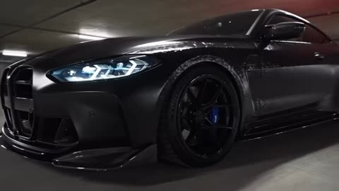</a>

提示词按底盘和引擎、车身覆盖件、车灯的顺序描述组装过程，让变形步骤清晰可读。结尾的环绕运镜展示成品细节如卡钳和轮毂，4k 与写实等词设定画面风格。

Seedance 2.5 · 文生视频 · 出处: [@itsSaira_1 on X](https://x.com/itsSaira_1/status/2109495654607446267)

[`liquid-metal`](tags.md#tag-liquid-metal) [`transformation`](tags.md#tag-transformation) [`bmw`](tags.md#tag-bmw) [`car-showcase`](tags.md#tag-car-showcase)

<details><summary><b>提示词</b></summary>

```text
A hyper-realistic cinematic shot in a dimly lit underground concrete parking garage. A glossy, black liquid-metal blob pools on the ground, suddenly shooting out tendrils that rapidly assemble to build a high-performance matte black BMW sports car from the chassis and engine up. Body panels fold seamlessly into place, the LED headlights flash on, and the camera pans around the finished vehicle revealing blue brake calipers and custom black wheels. 4k resolution, photorealistic, smooth fluid motion.
```

</details>

<a id="seedance-magical-pencil-live-action-animation"></a>
### 阳光公园中手牵手散步的情侣

<a href="https://x.com/MissDelulu9/status/2090661426079952935">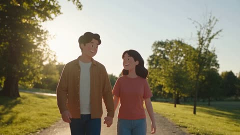</a>

每个主体对应一种明确的目标风格（柔和粉彩 2D、水彩、黑白线稿、插画），让模型在同一段视频里跟随四次清晰的转换。开头先锁定真实实拍的场景，并以魔法铅笔的轨迹作为每次转换的提示。

Seedance 2.5 · 文生视频 · 出处: [@MissDelulu9 on X](https://x.com/MissDelulu9/status/2090661426079952935)

[`style-transition`](tags.md#tag-style-transition) [`live-action-to-animation`](tags.md#tag-live-action-to-animation) [`magical-pencil`](tags.md#tag-magical-pencil) [`watercolor`](tags.md#tag-watercolor)

<details><summary><b>提示词</b></summary>

```text
A hand holding a light-blue magical pencil points at real moving subjects, seamlessly transforming them into beautiful 2D hand-drawn animation while preserving their natural movement. A cute couple walking hand-in-hand transforms into soft pastel 2D animation, a flying butterfly turns into colorful watercolor art, a teal-and-white train becomes black-and-white line art, and realistic trees transform into dreamy illustrated artwork. Smooth camera movement, magical pencil trails, bright realistic environments, seamless live-action-to-animation transitions, cinematic and satisfying.
```

</details>

<a id="seedance-miniature-skateboarder-desk-adventure"></a>
### 微型2D滑板少女穿越真实办公桌

<a href="https://x.com/harboriis/status/2104106520808157221">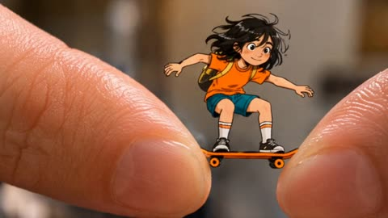</a>

将手绘2D角色合成进真实桌面的微距实拍中，并用带时间码的分段镜头让每个动作落在不同物件上，使尺度变化清晰可读。微距与移轴构图强化了体量差，音效也被明确指定。

Seedance 2.5 · 文生视频 · 出处: [@harboriis on X](https://x.com/harboriis/status/2104106520808157221)

[`mixed-reality`](tags.md#tag-mixed-reality) [`stop-motion`](tags.md#tag-stop-motion) [`macro`](tags.md#tag-macro) [`skateboard`](tags.md#tag-skateboard)

<details><summary><b>提示词</b></summary>

```text
Subject
A miniature hand-drawn 2D animated girl with messy black hair, an orange shirt, teal shorts, striped socks, and a yellow backpack, riding a tiny orange skateboard across real-world office desk items.
Style
Mixed-reality hybrid animation combining 2D hand-drawn doodle character art with a realistic live-action desk environment. Features playful stop-motion physics, smooth line animations, and lighthearted background music layered with miniature skateboard rolling and grinding sound effects.
Camera & Framing
Close-up macro shots, dynamic low-angle tracking perspectives, and tilt-shift shallow depth-of-field focusing on the tiny skateboarder as she navigates large household objects.
Audio & Scene Breakdown
00:00 - 00:02
Visual: Macro shot of the tiny 2D skateboarder balancing between two giant human fingertips on her miniature orange board before pushing off.
00:03 - 00:05
Visual: Low-angle tracking shot as she performs a kickflip off the edge and lands smoothly onto a wooden desk surface.
00:06 - 00:08
Visual: Side-profile shot grinding across the edge of an orange wooden ruler and launching up a curved piece of white paper like a halfpipe.
00:09 - 00:14
Visual: Dynamic camera angle as she drops into the rim of a ceramic mug filled with dark coffee, riding around the inner wall before launching back out.
00:15 - 00:20
Visual: Tracking shot following her as a human hand draws a green crayon path on notebook paper, grinding over a white eraser and hopping over spiral notebook rings.
00:21 - 00:24
Visual: Air shot as she jumps off an open notebook, performing a trick mid-air over a computer keyboard and desk surface.
00:25 - 00:30
Visual: Close-up as she launches into the air, does a 360 spin with her board, and lands precisely back onto the gap between the two giant human fingertips where she started.
```

</details>

<a id="seedance-miniature-woman-convenience-store-adventure"></a>
### 迷你女子在巨型便利店中飞奔冒险

<a href="https://x.com/AIwithkhan/status/2106397932304191969">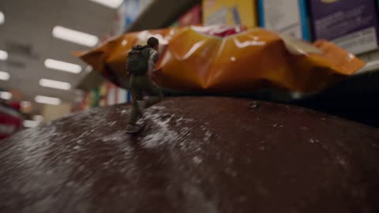</a>

开头先锁定角色与一比五的比例，再按顺序串联货架、购物车、冷柜、招牌等物理障碍。微距跟拍、前景视差、结尾拉远展示尺度，加上分层音效清单和防止比例漂移的负面词，让画面保持一致。

Seedance 2.5 · 文生视频 · 出处: [@AIwithkhan on X](https://x.com/AIwithkhan/status/2106397932304191969) · 发现于 [LearnPrompt/awesome-seedance](https://github.com/LearnPrompt/awesome-seedance)

[`miniature`](tags.md#tag-miniature) [`macro`](tags.md#tag-macro) [`adventure`](tags.md#tag-adventure) [`handheld`](tags.md#tag-handheld) [`sfx`](tags.md#tag-sfx)

<details><summary><b>提示词</b></summary>

```text
STYLE: Photorealistic live-action miniature-person FX, cinematic macro photography, ultra-shallow depth of field, realistic convenience store, dynamic handheld camera, dramatic practical lighting, realistic physics, detailed textures, premium viral commercial aesthetic, 4K.

Create a 30-second cinematic adventure featuring one athletic miniature woman at approximately 1 : 5 scale. Maintain her exact face, hairstyle, outfit, body proportions, backpack, and scale throughout.

She races across towering snack shelves, jumping over oversized packages and gaps. A giant candy box falls, creating an avalanche of rolling candies that she uses as stepping stones before landing on a massive chocolate bar. She climbs a huge drink bottle, runs up its curved surface, jumps over the cap, and lands on a hanging promotional display. She then rides a moving shopping cart through checkout, dodging the scanner and jumping onto the conveyor belt. At the refrigerated section, she runs across frozen-food packages, slides beneath a closing freezer door, and swings onto the display using the handle. Finally, she climbs onto a giant store sign and looks across the enormous store filled with products and shoppers as the camera pulls back to reveal just how tiny she is.

Use dynamic macro tracking, dramatic low angles, smooth aerial-style movements, strong foreground parallax, realistic reflections, shadows, depth of field, product packaging, natural human movement, believable physics, seamless transitions, and cinematic lighting.

End with the cinematic title: “SMALL SCALE. BIG ADVENTURE.” followed by “EVERY AISLE IS A NEW WORLD.”

SFX: Footsteps, packaging crinkles, candy rattles, plastic flexing, cart wheels, scanner beeps, conveyor hum, freezer sounds, rushing air, and cinematic impact.

NEGATIVE: No cartoon, anime, toy-like appearance, animation, duplicated character, face or outfit changes, distorted anatomy, floating, scale changes, narration, or subtitles.
```

</details>

<a id="seedance-miniature-woman-tablecloth-climb"></a>
### 微型女子攀爬桌布登上巨大甜点餐桌

<a href="https://x.com/oggii_0/status/2100474286599500015">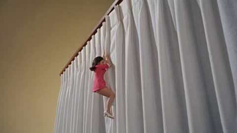</a>

风格锁定写明1968年电视制作的质感、光线与镜头规则，角色锁定用一张参考图固定人物的服装和妆容。按秒划分的分镜逐段写明运镜，让模型有清晰的拍摄顺序，结尾的静止停留使画面读起来像完成的定格。

Seedance 2.5 · 参考生视频 · 出处: [@oggii_0 on X](https://x.com/oggii_0/status/2100474286599500015) · 发现于 [LearnPrompt/awesome-seedance](https://github.com/LearnPrompt/awesome-seedance)

[`1960s-tv`](tags.md#tag-1960s-tv) [`miniature`](tags.md#tag-miniature) [`scale-shift`](tags.md#tag-scale-shift) [`character-lock`](tags.md#tag-character-lock)

<details><summary><b>提示词</b></summary>

```text
16:9 widescreen, 30 seconds, Dola Continuous Engine.
STYLE LOCK: Inspired by classic late-1960s Irwin Allen television production "Land of the Giants". Authentic 1968 television aesthetic. Practical miniature sets. Optical compositing. Slight matte-line separation between actress and background. Rear-projection feel. Eastmancolor television colors: warm skin, saturated red and yellow, slightly cyan shadows. Soft image sharpness. Mild film grain. Analog broadcast texture. Vintage studio lighting: one hard key from upper left, warm fill from the right, no rim light. Camera: static wide shots and slow television zoom lens only. No handheld. No modern lens flare.
CHARACTER LOCK: @[Image 1](image_1)  is the only person. She remains identical in every frame:  1960s Korean mini dress  with [sleeve and neckline  classic 1960s makeup with winged liner and pale pink lips, white heels. Dress, hair, makeup and shoes never change .
SETTING LOCK: an enormous 1960s dining table seen from her scale; she is the size of a salt shaker. White tablecloth hanging from the edge to the floor in long vertical folds. On the tabletop from left to right: a tall glass of milk with condensation beads, a giant slice of chocolate layer cake with thick frosting and a single lit birthday candle, a large silver spoon and fork crossed beside it, a bowl of vanilla ice cream with one huge cherry on top, a folded white napkin. Warm wooden tabletop. Pale yellow wall in the background. Props are practical scale with slightly soft edges.
0–4 seconds:
Static wide from floor level. The tiny woman climbs the hanging tablecloth, gripping the folds with both hands, one heel finding a fold below her. The cloth sways slightly under her weight. She looks up toward the table edge.
4–7 seconds:
Slow zoom in as she pulls herself over the edge, kneels, then stands upright on the tabletop. Her eyes widen and her mouth opens, gaze drawn toward the flickering candle flame on the cake. Her hands stay half raised.
7–11 seconds:
Static wide from behind her at her eye level. The dessert spread stretches across the table like a city skyline: the cake slice looms like a frosted mountain, the candle flame taller than she is, the milk glass glowing like a white tower, the spoon lying across the foreground like a bridge.
11–15 seconds:
She walks toward the cake, heels tapping the tabletop. Thick ridges of frosting drip down its side. The lit candle flickers above, casting warm moving light across her face. She touches the frosting edge with one hand and looks up along the flame.
15–19 seconds:
She climbs onto the cake's bottom layer, sits, scoops a bit of frosting with both hands, smiles, tastes it, licks her fingers, and looks left and right. Medium shot, slow zoom in to her face, candlelight flickering warmly on her skin.
19–23 seconds:
She stands and walks farther across the tabletop, stepping around the giant cherry from the ice cream bowl, passing between the spoon and the napkin. Static wide, then a slow pan following her.
23–26 seconds:
She stops beside the milk glass, looks up along the tall glass, and laughs with one hand resting on it. Condensation beads glisten and catch the light on her face.
26–28 seconds:
A massive shadow sweeps across the tabletop from the right and covers the milk glass and the cake. Her laugh stops. She lowers her hand and turns to face the right side of frame.
28–30 seconds:
HOLD. Camera fully static medium-wide shot. She stands facing screen right, feet together, right hand half raised at chest height, left hand at her side. The milk glass directly at her left, the cake slice behind her, the shadow across the whole tabletop. Her face is turned to the right, not yet tilted upward. Nothing moves for two full seconds.
Audio
Cheerful 1960s adventure television music, playful brass and strings. At 26 seconds the music thins to one held string note that continues to the end, with a faint fading birthday-music-box
```

</details>

<a id="seedance-motorcycle-to-dragon-jungle-flight"></a>
### 丛林摩托车变身巨龙腾空飞行

<a href="https://x.com/RuzainaMeer/status/2089595902818398461">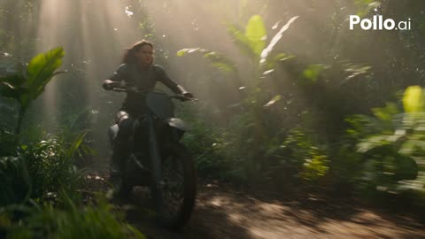</a>

30秒片段按时间段拆分，每段写明镜头与动作。单独的一致性条目锁定人物，并要求摩托车到巨龙的变形连续不切镜，再用负面清单防止多余肢体和跳场景。

Seedance 2.5 · 文生视频 · 出处: [@RuzainaMeer on X](https://x.com/RuzainaMeer/status/2089595902818398461) · 发现于 [LearnPrompt/awesome-seedance](https://github.com/LearnPrompt/awesome-seedance)

[`cinematic`](tags.md#tag-cinematic) [`fantasy`](tags.md#tag-fantasy) [`transformation`](tags.md#tag-transformation) [`dragon`](tags.md#tag-dragon) [`long-form`](tags.md#tag-long-form)

<details><summary><b>提示词</b></summary>

```text
Create a 30-second ultra-photorealistic cinematic fantasy sequence with high-budget Hollywood film quality. A strong, fearless young woman rides a small rugged black motorcycle through a dense tropical jungle at sunrise. Maintain realistic skin, hair, physics, lighting, atmosphere, detailed environments, natural motion, and cinematic depth throughout.

0–5s — The Ride: Wide cinematic tracking shot of the woman riding along a narrow muddy rainforest trail. Sun rays through the canopy, ground mist, moving leaves, water droplets from tires. She wears a practical dark leather riding outfit, protective boots and gloves. Calm, confident expression. Realistic engine vibration and body movement.

5–10s — Transformation: In an open clearing, the motorcycle slows and the ground trembles. Its metal frame seamlessly transforms into a gigantic creature through a believable mechanical-organic fusion: wheels become huge clawed limbs, frame expands into an armored body, metal flows into dark realistic scales, handlebars become horns. Dust, leaves, rocks, and debris react naturally. No cuts or jumps.

10–15s — Dragon Awakens: The motorcycle becomes a gigantic realistic black-and-dark-red dragon with muscular wings, detailed scales, powerful claws, curved horns, and integrated glowing amber eyes. The woman remains safely on its back. The dragon raises its head, exhales warm vapor, spreads its wings, and roars, shaking nearby foliage. Low-angle shot emphasizes scale.

15–23s — Flight: The dragon launches powerfully from the jungle, bending trees and scattering leaves. The woman grips its armored neck. Aerial tracking shot reveals rivers, waterfalls, cliffs, mist, and dense rainforest below. Realistic wing aerodynamics, turbulence, mist movement, and sunlight reflecting across scales.

23–27s — River: The dragon dives toward a massive turquoise river, flying extremely low above the water. Its wings create waves and spray. The woman's hair and clothing whip in the wind while she remains focused. High-speed side camera captures her expression and the dragon's detailed face.

27–30s — Epic Ending: The dragon pulls upward toward the golden sky. Camera pulls far back to reveal endless jungle, rivers, mountains, and clouds. Golden light illuminates its wings from behind. End with a powerful silhouette disappearing toward the horizon.

Visual Style: Ultra-photorealistic live-action fantasy, cinematic 8K appearance, believable anatomy, realistic skin/scales, atmospheric perspective, volumetric sunlight, detailed foliage, realistic water and wind simulation, cinematic DOF, subtle anamorphic lens characteristics, dramatic camera movement, HDR, realistic motion blur, natural shadows, film-quality grading.

Character Consistency: Same woman throughout; preserve facial identity, hairstyle, body proportions, clothing, and appearance.

Transformation: Continuous and coherent motorcycle-to-dragon transformation. Motorcycle and dragon must clearly be the same entity. No sudden cuts, teleportation, disappearing objects, duplicated limbs, malformed anatomy, or inconsistent scale.

Camera: Cinematic tracking, low-angle hero shots, close-ups, dynamic aerial/drone-style shots, smooth high-speed movement, realistic parallax, motivated transitions.

Negative: No cartoon, anime, plastic CGI textures, rubbery movement, extra characters, duplicate woman, deformed hands, distorted face, floating motorcycle parts, random scene changes, text, subtitles, logos, or watermark.
```

</details>

<a id="seedance-mountain-spire-house-grocery-climb"></a>
### 女子攀登云海孤峰回到山顶小屋

<a href="https://x.com/sophiaparkerr_/status/2107096810783461509">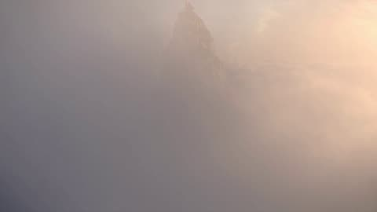</a>

六个带秒数区间的分镜，从航拍全景、脚部特写、跟拍、室内一路推进到拉远收尾，把尺度反差讲清楚。参考图锁定人物形象，结尾的负面清单约束手脚变形和脸部漂移。

Seedance 2.5 · 参考生视频 · 出处: [@sophiaparkerr_ on X](https://x.com/sophiaparkerr_/status/2107096810783461509) · 发现于 [LearnPrompt/awesome-seedance](https://github.com/LearnPrompt/awesome-seedance)

[`surreal`](tags.md#tag-surreal) [`aerial`](tags.md#tag-aerial) [`multi-shot`](tags.md#tag-multi-shot) [`character-consistency`](tags.md#tag-character-consistency) [`vertical`](tags.md#tag-vertical)

<details><summary><b>提示词</b></summary>

```text
Create a cinematic, photorealistic 30-second vertical video using the provided girl reference image as the strict character reference.

Preserve her exact facial identity, facial structure, skin tone, hairstyle, age, and natural proportions throughout the entire video. Do not change her identity or facial features.

Character: The same woman from the reference image, wearing an elegant deep burgundy/red long-sleeve midi dress with a subtle vintage pattern, a matching belt, and elegant burgundy high heels. She carries a simple brown kraft-paper grocery bag containing a few visible groceries.

Shot 1 — 0–5 sec

Begin with a breathtaking aerial establishing shot high above the clouds. A gigantic, extremely tall, narrow rocky mountain spire rises vertically through a sea of white clouds. The peak is covered with patches of green vegetation, with a tiny charming house perched impossibly at the very top.

Slow cinematic drone movement toward the mountain. Bright blue sky, warm sunlight, soft atmospheric haze, realistic clouds, immense sense of scale.

Shot 2 — 5–10 sec

Cut to a close-up of the woman's feet as she carefully climbs uneven stone steps carved into the side of the mountain.

Her burgundy high heels step naturally from one stone ledge to another. The hem of her dress moves gently in the wind. Far below, clouds and the distant landscape are visible.

Use realistic foot movement, natural weight, physically accurate fabric motion, shallow depth of field, cinematic lens.

Shot 3 — 10–15 sec

Reveal the woman from a side/back angle as she continues climbing toward the summit.

She carries the brown grocery bag naturally in one hand. Her burgundy dress flows slightly in the strong mountain breeze.

The camera slowly tracks beside her, revealing the enormous drop and clouds stretching endlessly below. She remains calm and composed despite the surreal height.

Shot 4 — 15–20 sec

The woman reaches the tiny house at the summit and walks through its doorway while still holding the grocery bag.

Transition from the bright outdoor environment into a warm, cozy interior. Golden sunlight enters through the doorway. She walks naturally through the small home and places the grocery bag inside.

Maintain the exact same character appearance, dress, hairstyle, and proportions.

Shot 5 — 20–26 sec

Show the woman standing inside the cozy house beside a huge floor-to-ceiling window overlooking the clouds.

She pauses with a cup in her hand and looks peacefully toward the breathtaking view. The camera slowly moves backward, revealing the warm interior, wooden furniture, soft curtains, and the enormous mountain landscape outside.

Golden-hour lighting, subtle curtain movement, realistic shadows, cinematic atmosphere.

Shot 6 — 26–30 sec

Return to a spectacular wide aerial shot of the entire impossibly tall mountain spire rising above the clouds.

The tiny house is visible at the very top, emphasizing the incredible scale. Slowly pull the camera farther away until the mountain becomes surrounded by an endless sea of clouds.

End on a beautiful cinematic wide shot.

Visual style: ultra-realistic cinematic photography, premium film look, natural skin texture, realistic physics, realistic fabric and hair movement, volumetric sunlight, atmospheric perspective, detailed environments, subtle film grain, shallow depth of field where appropriate, high dynamic range, smooth camera motion, believable lighting.

Camera: cinematic drone shots, slow tracking shots, low-angle detail shots, gentle push-ins, smooth aerial pullback, realistic handheld micro-movements only when appropriate.

Important: Keep the woman's identity perfectly consistent across every shot. No face morphing, no character changes, no extra fingers, no distorted hands, no warped feet, no duplicated objects, no floating objects, no unnatural body movement, no cartoon or CGI appearance, no text, no subtitles, no logos.
```

</details>

<a id="seedance-mud-in-jar-becomes-bird"></a>
### 玻璃罐里的泥土变成一只鸟

<a href="https://x.com/Yesandyou_/status/2090075447195480403">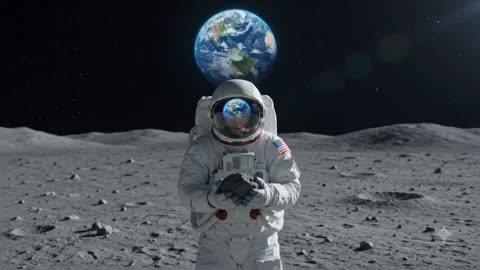</a>

用参考图锁定主体，把十秒切成四个带时间码的段落，从泥土涌动一直写到小鸟的最终特写。镜头与风格部分禁止切镜和抖动，再配上很长的负面提示词，让变形过程显得真实可信。

Seedance 2.5 · 图生视频 · 出处: [@Yesandyou_ on X](https://x.com/Yesandyou_/status/2090075447195480403) · 发现于 [LearnPrompt/awesome-seedance](https://github.com/LearnPrompt/awesome-seedance)

[`transformation`](tags.md#tag-transformation) [`macro`](tags.md#tag-macro) [`photorealistic`](tags.md#tag-photorealistic) [`fantasy`](tags.md#tag-fantasy) [`vertical`](tags.md#tag-vertical)

<details><summary><b>提示词</b></summary>

```text
Use the uploaded image as the exact visual reference. Create a highly detailed, cinematic 10-second magical transformation video. Keep the overall composition, character appearance, lighting, camera quality, and environment consistent with the reference.

⏱️ 0–2 seconds — Jar & Mud
The subject is holding a small transparent glass jar/container carefully in both hands. Inside the jar is thick, dark, moist magical mud/soil with realistic texture. The camera slowly pushes toward the jar, focusing on the mud. Tiny particles of soil begin to move naturally.

🌱 2–5 seconds — Mud Comes Alive
The mud inside the jar starts gently swirling and rising as if something is forming underneath it. Small cracks appear across the surface of the mud. Tiny pieces of soil lift into the air and fall naturally. A subtle magical glow begins to emerge from inside the mud, while keeping the scene photorealistic rather than cartoonish.

🐣 5–8 seconds — Bird Emerges
A small realistic bird slowly emerges from the mud inside the jar. First, its tiny head appears, followed by its neck, wings, and body. Wet mud naturally falls away from its feathers as it comes out. The bird gradually becomes fully formed, with extremely detailed feathers, realistic eyes, tiny beak, and natural movements. The emergence should feel magical but physically believable.

🐦 8–10 seconds — Final Moment
The bird completely emerges from the mud and gently spreads its wings. A few tiny pieces of mud fall back into the jar. The bird looks around naturally and gives a subtle wing movement. The camera finishes with a beautiful close-up of the bird sitting on/above the mud inside the jar, creating a mysterious and magical final shot.

🎥 CAMERA & VISUAL STYLE

Duration: 10 seconds
Format: 9:16 vertical
Ultra-photorealistic
Cinematic fantasy realism
Smooth slow camera movement
Macro-style detail on mud and feathers
Realistic depth of field
Natural lighting and shadows
Detailed glass reflections
Realistic mud physics
Smooth motion with strong temporal consistency
No sudden camera movements
No cuts
No transitions
No camera shake

🪶 BIRD DETAILS

The bird should look completely realistic:

Extremely detailed individual feathers
Natural feather movement
Realistic eyes and beak
Correct bird anatomy
Natural wing structure
Realistic proportions
Wet mud sticking temporarily to feathers
Mud naturally falling away as the bird emerges
Subtle breathing and head movement
Natural wing movement

🚫 NEGATIVE PROMPT

cartoon, anime, CGI-looking bird, fake feathers, deformed bird, malformed wings, extra wings, extra legs, extra eyes, multiple birds, duplicate bird, bird suddenly appearing, bird teleportation, unnatural bird anatomy, giant bird, oversized bird, disappearing bird, distorted mud, floating mud, unrealistic mud physics, excessive magic effects, cartoon magic, excessive glowing particles, explosions, smoke, fire, distorted jar, broken glass, melting glass, changing jar shape, extra hands, deformed fingers, missing fingers, distorted hands, face distortion, blurry, low resolution, pixelated, oversaturated, excessive bloom, excessive lens flare, camera shake, fast zoom, sudden movement, flickering, ghosting, frame interpolation artifacts, object morphing, inconsistent lighting, watermark, logo, text, subtitles, UI elements.

✨ FINAL QUALITY

Photorealistic cinematic fantasy, highly detailed wet mud, realistic glass, physically accurate lighting, natural bird anatomy, extremely detailed feathers, believable mud-to-bird transformation, smooth 10-second animation, consistent objects and environment, premium cinematic quality, realistic depth of field, 4K-quality detail.
```

</details>

<a id="seedance-pixel-portal-closet-dress-up"></a>
### 空荡的复古卧室，琥珀色台灯与衣架

<a href="https://x.com/MissDelulu9/status/2094272120289415188">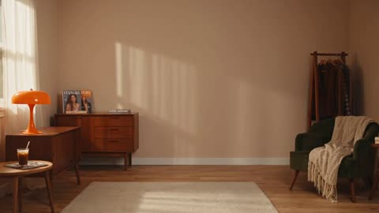</a>

用参考图锁定机位与人物身份，并按时间段列出每个节拍，要求每次换装都是瞬间硬切。真人画面与平面像素界面、传送门特效分开描述，两层都能保持清晰。

Seedance 2.5 · 图生视频 · 出处: [@MissDelulu9 on X](https://x.com/MissDelulu9/status/2094272120289415188) · 发现于 [LearnPrompt/awesome-seedance](https://github.com/LearnPrompt/awesome-seedance)

[`pixel-art`](tags.md#tag-pixel-art) [`dress-up`](tags.md#tag-dress-up) [`fashion`](tags.md#tag-fashion) [`reference-image`](tags.md#tag-reference-image)

<details><summary><b>提示词</b></summary>

```text
Style: Retro Y2K pixel dress-up game + photorealistic fashion video, cozy early-autumn forest-girl aesthetic, caramel/cream palette, 4K, 30fps, 16:9 vertical, 15 seconds. Realistic human + crisp 2D pixel UI.

Character: Adult female. Her face, identity, skin tone, facial features, hair and body proportions must exactly match the reference image throughout. No identity or body changes.

Setting: Cozy vintage bedroom/fashion studio with warm taupe walls, cream rug, wooden vanity, amber lamp, dark-green chair, magazines, dried autumn flowers, clothing rack, coffee table and soft afternoon sunlight.

Camera: Locked full-body vertical shot, front-facing, slightly elevated, 24–28mm. She stays fully visible from head to shoes. No zoom, pan, tilt, shake or camera movement.

Audio: Upbeat retro electronic music + clear 8-bit portal, click, equip, loading and victory sounds. No dialogue or subtitles.

00:00–02.70 - PIXEL PORTAL

Empty room. A tiny glowing 8-bit portal opens on the floor and expands. A giant brown-and-cream pixel hand pulls her into the room like a game character.

She wears glossy cream satin pajamas with tiny brown dots, dark piping and white slippers. Copper-orange curly hair with wispy bangs. Eyes closed, relaxed sleepy pose.

Portal disappears and a tiny pixel message appears: “PLAYER LOADED.”

02.70–05.20 -CLOSET MENU

She wakes, opens her eyes and looks at the camera.

Pixel UI appears around the screen: “MIA’S CLOSET”, three pink hearts, pixel star, and five right-side buttons:

TOP / SKIRT / KNIT / SHOES / BONUS

A white pixel cursor appears. Loading meter reads “STYLE ENERGY: 00%” and fills to 100%.

She stretches with both arms overhead. 8-bit “READY!” sound.

05.20–10.80 -RAPID OUTFIT CHANGES

Every change follows: cursor → highlight → click → short pause → instant hard cut.

TOP: Satin pajama top → fitted cream-white lace camisole with brown ribbon and woodland embroidery.

SKIRT: Satin pajama pants → brown-and-cream plaid layered mini skirt with lace trim. Vintage star + key necklaces appear.

KNIT: Cocoa-brown fuzzy cropped cardigan appears, worn open. White patterned tights appear.

SHOES: White slippers → cream slouch leg warmers + brown fluffy platform shoes.

BONUS: Button becomes “LUCKY ITEM!” A cream-white beret appears, plus a structured dark-brown vintage handbag in her right hand.

All changes are instant hard cuts. No morphing, particles, smoke or gradual transformations.

10.80–13.00- STYLE SCORE

UI changes to:

AUTUMN STYLE
98/100
 COZY . Y2K  . VINTAGE  . FOREST

She checks her outfit, adjusts her cardigan, looks at the camera, places her left hand on her waist and holds the handbag with her right hand. Relaxed S-shaped fashion pose, subtle smile.

13.00–15.00- FINAL SCREEN

Large pixel text:

LEVEL COMPLETE!
AUTUMN LOOK UNLOCKED

Three hearts flash once. Small pixel leaves and NEW LOOK appear.

She holds the final pose with natural breathing and tiny head movement. Freeze at exactly 15 seconds. No fade-out or black screen.

FINAL OUTFIT: Cream beret, copper-orange curls, cocoa fuzzy cardigan, cream lace camisole, brown plaid layered mini skirt, vintage necklaces, white patterned tights, cream leg warmers, brown fluffy platform shoes, dark-brown vintage handbag.

NEGATIVE: No face/identity/age/skin/body changes, no camera movement, no anatomy errors, no extra fingers/limbs, no clothing transparency or exposure, no missing outfit pieces, no UI over face, no corrupted text, no watermark/logos, no mirror, no background people, no plastic skin, no CGI/anime look. Human and clothing remain photorealistic; only UI, cursor, portal and effects are 2D pixel art.
```

</details>

<a id="seedance-popcorn-volcano-crater-drop"></a>
### 女子将巨型爆米花袋投入火山口

<a href="https://x.com/ElsaSofia__AI/status/2104753404627268008">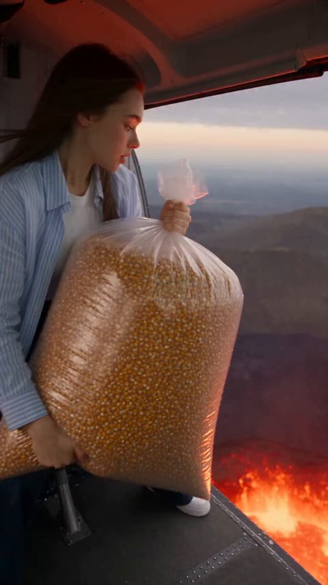</a>

提示词用带时间码的分镜清单（0:00 到 0:17）逐镜头描述动作，并把人物参考图与分镜分开：参考图只锁定人物身份，分镜只控制场景与节奏。另外列出了物理规则和完整的音频层次且明确不要对白与字幕，让爆发与爆米花溢出的画面更清楚。

Seedance 2.5 · 参考生视频 · 出处: [@ElsaSofia__AI on X](https://x.com/ElsaSofia__AI/status/2104753404627268008) · 发现于 [LearnPrompt/awesome-seedance](https://github.com/LearnPrompt/awesome-seedance)

[`popcorn`](tags.md#tag-popcorn) [`volcano`](tags.md#tag-volcano) [`character-reference`](tags.md#tag-character-reference) [`storyboard`](tags.md#tag-storyboard)

<details><summary><b>提示词</b></summary>

```text
Create a 17-second ultra-realistic cinematic vertical video featuring the woman from the provided character reference.

Use the newly provided female character reference as the ONLY identity reference for the main character. Do NOT use the face or identity of the woman visible in the storyboard.

Use the provided 13-panel Master Storyboard as the exact visual, chronological and action guide for the entire video.

CHARACTER CONSISTENCY:
Preserve the exact facial identity of the provided woman throughout the entire video, including her facial structure, eyes, nose, lips, skin tone, long dark hair, body proportions and recognizable appearance.

Her identity must remain unchanged in every shot.

Keep the character visually consistent from beginning to end. No face drift, no identity change, no hairstyle transformation and no replacement character.

The wardrobe should be adapted naturally for the volcanic adventure while maintaining a believable, consistent outfit throughout the sequence.

IMPORTANT:
The Master Storyboard controls the scenes, actions, camera progression, timing and visual composition.
The provided character reference controls ONLY the identity and appearance of the main woman.

Do not copy the storyboard woman's face.

STORY AND ACTION:

SHOT 1 — 0:00–0:02
Begin with the woman holding an enormous transparent bag completely filled with unpopped popcorn kernels near the edge of a massive volcanic crater.

Use a close-to-medium cinematic perspective showing her, the giant popcorn bag and the glowing crater in the background.

She looks toward the crater with curious anticipation.

SHOT 2 — 0:02–0:03
Move closer as she looks down toward the crater.

Her expression changes slightly as she watches the glowing lava below.

The giant popcorn bag remains firmly in her hands.

SHOT 3 — 0:03–0:04
She releases the giant popcorn bag.

The transparent bag begins falling downward into the crater.

Use a dynamic camera movement following the falling bag.

Keep the bag physically consistent and clearly visible.

SHOT 4 — 0:04–0:05
The bag hangs above the glowing lava crater.

Use a dramatic overhead perspective looking down into the circular volcanic formation.

The bag continues descending naturally under gravity.

The glowing lava illuminates the transparent plastic and popcorn kernels.

SHOT 5 — 0:05–0:06
The bag falls closer toward the lava.

Increase the sense of speed while maintaining realistic gravity and physical motion.

The camera follows the bag toward the center of the crater.

SHOT 6 — 0:06–0:08
The crater suddenly erupts.

A powerful vertical volcanic burst rises from the center.

The popcorn bag is caught in the eruption.

Use a dramatic wide overhead shot showing the full scale of the crater.

SHOT 7 — 0:08–0:09
The eruption transforms into an enormous explosion of freshly popped popcorn.

Thousands of realistic popcorn pieces burst upward and outward.

Use a fast cinematic camera push into the popcorn cloud.

Each popcorn piece should have believable individual motion.

SHOT 8 — 0:09–0:10
The popcorn explosion fills the frame and transitions into the interior of a small vehicle or cabin.

Popcorn rushes through the space and begins accumulating everywhere.

Use strong forward motion as the popcorn wave moves toward the camera.

SHOT 9 — 0:10–0:12
The cabin rapidly fills with popcorn.

Popcorn rises from the floor and piles naturally around the seats and interior surfaces.

The volume increases continuously until the woman is surrounded.

Do not make the popcorn appear instantaneously.

SHOT 10 — 0:12–0:14
The camera pushes through the popcorn toward the woman.

She is partially buried in the enormous pile, with her upper body and face clearly visible.

She looks toward the camera and begins laughing.

Popcorn moves naturally around her shoulders and arms.

SHOT 11 — 0:14–0:15
Close-up of the woman emerging from the popcorn.

She smiles directly toward the camera.

A few popcorn pieces rest naturally in her hair and on her shoulders.

Warm orange volcanic light illuminates her face.

SHOT 12 — 0:15–0:16
She gathers a large handful of popcorn with both hands.

She brings it toward her mouth with a playful, delighted expression.

Keep the popcorn pieces physically consistent and naturally positioned.

SHOT 13 — 0:16–0:17
Extreme close-up final moment.

She happily eats the popcorn while looking toward the camera.

She smiles playfully with popcorn around her.

End on her satisfied expression.

CAMERA:
Use motivated cinematic camera movement throughout:
handheld close-ups, overhead crater shots, dynamic tracking, dramatic push-ins, macro popcorn details and an intimate final close-up.

Use subtle speed changes only where they enhance the eruption and popcorn explosion.

PHYSICS:
Realistic gravity.
Realistic falling motion.
Realistic volcanic eruption dynamics.
Realistic popcorn expansion and flight.
Realistic popcorn accumulation and weight.
Realistic interaction between the woman and the popcorn.

No teleportation.
No duplicated character.
No duplicate popcorn bags.
No changing clothing.
No face drift.
No distorted hands.
No floating objects without physical cause.

AUDIO:
Natural environmental sound combined with cinematic action sound design.

Include wind around the crater, deep volcanic rumble, falling-object sounds, eruption impact, rushing air, popcorn impacts, cabin movement and the woman's natural laughter.

No dialogue.
No narration.
No subtitles.
No text overlays.
No logos.
No watermark.

FINAL LOOK:
Ultra-realistic live-action cinematic footage with a surreal comedy-adventure feeling.

The sequence must follow the 13-panel Master Storyboard exactly in chronological order.

The newly provided woman must remain the same recognizable person from the first frame to the last frame.

Only the character identity is changed. Everything else from the storyboard remains unchanged.
```

</details>

<a id="seedance-rainy-neon-girl-style-transition"></a>
### 雨夜霓虹街头女孩变换为动画再到好莱坞大片

<a href="https://x.com/Inshrah_ali_/status/2086452771029647477">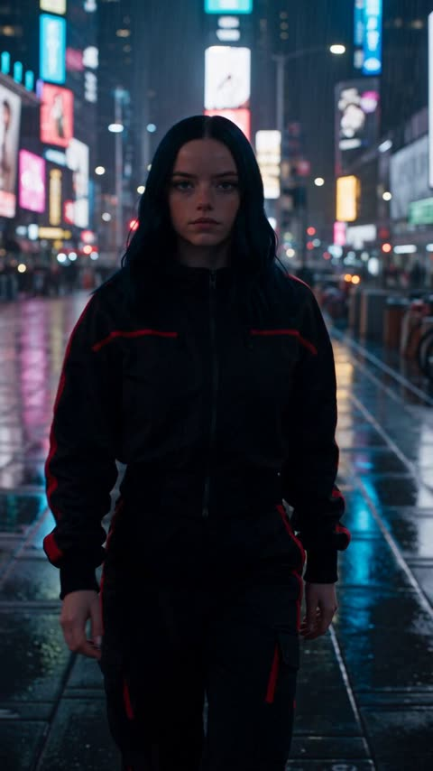</a>

按时间段分段描述，把每次风格切换绑定到同一个连续动作上，抬手即为触发点。提示词反复强调同一人物、服装、姿势和运镜贯穿每次切换，从而保持身份一致。

Seedance 2.5 · 文生视频 · 出处: [@Inshrah_ali_ on X](https://x.com/Inshrah_ali_/status/2086452771029647477)

[`style-transition`](tags.md#tag-style-transition) [`anime`](tags.md#tag-anime) [`timecoded-beats`](tags.md#tag-timecoded-beats) [`hollywood-trailer`](tags.md#tag-hollywood-trailer)

<details><summary><b>提示词</b></summary>

```text
Create a premium cinematic 15-second transformation story following the SAME young female protagonist continuously through three visual styles: realistic live-action → high-end anime/3D animation → Hollywood blockbuster.

0–5s — REALISTIC WORLD
A stylish young woman walks alone through a modern city at night.

Rain falls lightly. Neon signs reflect across the wet street. She wears a sophisticated black streetwear outfit with subtle red accents.

She hears a powerful hip-hop beat.

She stops.

Close-up of her eyes.

She looks toward camera and begins a confident dance-inspired movement.

Typography appears:
“WHO ARE YOU?”

Camera rapidly pushes toward her hand as she raises it toward the lens.

5–10s — ANIMATED WORLD
The exact hand movement triggers the transformation.

The live-action city smoothly becomes a breathtaking high-end animated world.

The SAME girl, SAME outfit, SAME pose and SAME movement continue without interruption.

Stylized energy particles surround her. Buildings stretch upward. Neon colors pulse with the beat.

She performs a powerful choreographed movement through the animated city.

Typography dynamically forms around her:

“WHO YOU CHOOSE TO BE.”

Use fluid premium animation, detailed facial expressions, realistic cloth movement and cinematic camera choreography.

10–15s — HOLLYWOOD BLOCKBUSTER
During her final animated movement, the environment suddenly transforms into an epic Hollywood-style cinematic cityscape.

The SAME girl lands on a rooftop overlooking a massive glowing metropolis.

Realistic wind moves her hair and clothes. Dramatic clouds, atmospheric haze, anamorphic lens flare and powerful backlighting create blockbuster scale.

Camera circles her as she turns toward the lens.

Final beat.

She confidently smiles.

Huge cinematic typography appears:

“BECOME UNSTOPPABLE.”

Final hero frame with dramatic music impact and premium movie-trailer finish.

VISUAL RULE: The transformation should feel like ONE continuous shot/story—not three separate clips. Preserve the girl's identity, clothing, movement, camera direction and emotional expression through every style transition.
```

</details>

<a id="seedance-roller-coaster-wig-time-freeze"></a>
### 过山车假发飞走，时间定格

<a href="https://x.com/techhalla/status/2083585132917579834">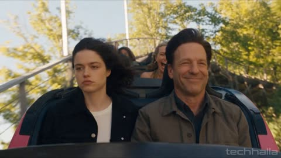</a>

按秒分段，并为每段写明镜头类型，如中景、环绕或特写，让模型清楚每个时刻的画面。明确写出倒放的终点，以及冻结时只有女主角继续动作，使静止与恢复之间衔接自然。

Seedance 2.5 · 文生视频 · 出处: [@techhalla on X](https://x.com/techhalla/status/2083585132917579834)

[`time-freeze`](tags.md#tag-time-freeze) [`rewind`](tags.md#tag-rewind) [`comedy`](tags.md#tag-comedy) [`roller-coaster`](tags.md#tag-roller-coaster)

<details><summary><b>提示词</b></summary>

```text
Photorealistic cinematic daytime amusement park roller coaster, bright hard sunlight, strong wind, realistic motion blur on tracks and background, subtle handheld camera energy, rich skin detail, heavy natural film grain.

0-5s: [Medium Shot] A young woman in her early 20s sits in the front seat of a moving roller coaster car, calm and slightly bored, hair whipping in the wind. Beside her sits a middle-aged man wearing what looks like a normal full head of hair. Behind them, another car with a woman is visible. The coaster drops and banks hard.

5-9s: [Dynamic Tracking] The force of the turn rips the man’s wig free. It peels off his bald head in a chaotic upward arc, spinning and flying backward through the air. The wig lands messily on the head of the woman in the car behind. Everyone’s faces freeze in pure shock and confusion at the peak of the chaos. Time locks completely. Only the young woman in the front keeps moving.

9-15s: [Slow Orbital + Detail] Camera slowly orbits the frozen cars. The wig hangs mid-air in a twisted shape with individual hairs suspended. The bald man’s scalp is fully exposed, mouth open. The woman behind is frozen mid-scream with the wig draped over her face. The young woman looks sideways, rolls her eyes and mouths “joder, otra vez”. She reaches into her pocket, pulls out a stick of chewing gum, unwraps it and calmly puts it in her mouth, starting to chew while the entire frozen scene (except her) begins a precise reverse.

15-20s: [Medium Close-up] The rewind is controlled and elegant: the wig lifts off the woman behind, flies backward through the air in reverse, and returns exactly to the moment it is only beginning to peel off the bald man’s head. Time freezes again at that precise instant — the front edge of the wig just lifting, a few strands already loose.

20-26s: [Tight Medium] Still frozen for everyone else, the young woman takes the chewed gum out of her mouth, reaches over and firmly presses it onto the center of the bald man’s scalp, right under the lifting wig. With the same hand she smooths and presses the wig back down into perfect place, locking it with the gum. She sits back, looks straight ahead with a tiny private smile, completely unbothered.

26-30s: [Medium Shot] Time suddenly resumes at full real-time speed. The coaster continues its drop. The man touches his head, feels the wig still firmly in place, looks confused for a second, then breaks into a relieved, happy smile. The young woman stares forward, already chewing a new piece of gum, expression of quiet satisfaction.

Photorealistic, ultra-detailed wind and hair physics, perfect motion blur only on moving elements, stable characters, cinematic lighting, heavy natural film grain, no artifacts, movie-level temporal coherence, high rewatch value.
```

</details>

<a id="seedance-tiny-chef-giant-kitchen"></a>
### 小手绘厨师站在巨大木勺旁

<a href="https://x.com/AIwithSynthia/status/2105129836750786993">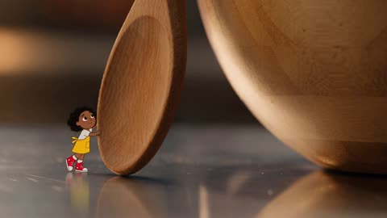</a>

混合现实结构把手绘2D角色放进真实厨房，靠微距与低角度镜头体现比例差。按时间顺序编号的画面节拍加上独立的音效清单，让多步骤动作保持清晰。

Seedance 2.5 · 文生视频 · 出处: [@AIwithSynthia on X](https://x.com/AIwithSynthia/status/2105129836750786993)

[`mixed-reality`](tags.md#tag-mixed-reality) [`2d-animation`](tags.md#tag-2d-animation) [`kitchen`](tags.md#tag-kitchen) [`macro`](tags.md#tag-macro)

<details><summary><b>提示词</b></summary>

```text
Subject
A miniature hand-drawn 2D animated girl with curly black hair, a yellow apron, red sneakers, and a tiny wooden spoon, cooking inside a realistic full-sized kitchen.

Style
Mixed-reality hybrid animation combining playful 2D hand-drawn doodle character art with a photorealistic live-action kitchen. Whimsical stop-motion physics, expressive line animation, exaggerated scale, warm cinematic lighting, and playful cooking sound effects.

Camera & Framing
Macro close-ups, low-angle tracking shots, overhead kitchen perspectives, dramatic push-ins, and shallow depth of field emphasizing the tiny chef against oversized kitchen objects.

Audio & Scene Breakdown

Visual: The tiny chef stands beside a giant mixing bowl, struggling to climb onto a wooden spoon before using it as a makeshift ladder.

Visual: She jumps into the bowl and rapidly mixes pancake batter while the whisk spins around her like a giant amusement-park ride.

Visual: She slides down a stream of pancake batter onto a massive frying pan, narrowly avoiding a falling blueberry.

Visual: The pancake suddenly flips into the air. She jumps onto it and rides it like a surfboard as it spins above the pan.

Visual: She lands on a giant plate, then uses a strawberry as a trampoline to bounce onto a stack of pancakes.

Visual: She proudly places a tiny strawberry on top, but the strawberry rolls away. She chases it across the enormous plate.

Visual: The camera pulls back to reveal the finished pancake breakfast. The tiny chef sits on the edge holding her spoon proudly—then a giant fork suddenly enters frame and lifts the entire pancake stack away. She freezes in disbelief.

Audio: Playful kitchen ambience, whisking, batter splashes, pancake flip, tiny footsteps, comedic impact sounds, subtle upbeat music, no dialogue.
```

</details>

<a id="seedance-tokyo-skyline-confetti-motion-graphics"></a>
### 雨落几何图形拼成东京天际线

<a href="https://x.com/noorwithwifi/status/2091194579689394463">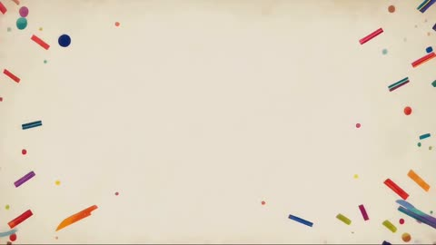</a>

提示词按时间顺序写出场景：先下雨，再拼成天际线，散开后围绕晴空塔重组，最后落成一排圆点。明确指定五种颜色和结束画面，让动效有可预期的收尾。

Seedance 2.5 · 文生视频 · 出处: [@noorwithwifi on X](https://x.com/noorwithwifi/status/2091194579689394463)

[`motion-graphics`](tags.md#tag-motion-graphics) [`3d-animation`](tags.md#tag-3d-animation) [`tokyo`](tags.md#tag-tokyo) [`abstract`](tags.md#tag-abstract)

<details><summary><b>提示词</b></summary>

```text
Create a vibrant 3D motion graphics animation where colorful spheres, bars, and cylinders rain onto a neutral background and assemble into a stylized Tokyo skyline with Tokyo Tower, pagodas, and floating orbs. The cityscape scatters into geometric confetti, then rapidly reforms around Tokyo Skytree before dissolving again into five color groups red, dark blue, pink, teal, and yellow that settle into a clean row of flat circles. Smooth transitions, dynamic motion, polished 3D lighting, and a modern minimalist aesthetic.
```

</details>

<a id="seedance-watercolor-chinese-girl-timelapse"></a>
### 手绘延时中国风水彩少女插画

<a href="https://x.com/leo_xiaolei/status/2100043047857729721"></a>

按秒分段，依次完成轮廓、黑线分格、散点上色和最后金色点亮，让模型有清晰的时序。俯视镜头只拍双手，并以参考图锁定最终构图，画面更稳定。

Seedance 2.5 · 参考生视频 · 出处: [@leo_xiaolei on X](https://x.com/leo_xiaolei/status/2100043047857729721)

[`watercolor`](tags.md#tag-watercolor) [`timelapse`](tags.md#tag-timelapse) [`hand-drawn`](tags.md#tag-hand-drawn) [`illustration`](tags.md#tag-illustration)

<details><summary><b>提示词</b></summary>

```text
俯视镜头对准桌面上的一本白色水彩画册，纸张起初完全空白，侧上方照射着柔和自然光，桌面摆放铅笔、黑色代针笔、细水彩笔与调色盘。画面中仅出现一双女性纤细的手，无人脸出现。 前 2 秒，女性右手拿起铅笔以高节奏缩时画出轮廓：中央是粉红长发的国风少女，右手比出 V 字手势，左手持一把小团扇，身穿白色交领上衣搭配粉红马面裙，发间佩戴花簪，头顶有带缠枝莲纹的圆形彩窗光环；左侧描出中式牌楼轮廓，右侧勾出青瓦水榭与锦鲤池塘，远方浮现云雾缭绕的连绵青山，左右上角同步画出两朵如意形祥云，外围以中式圆拱花窗边框与海棠枝条环绕。 第 3 秒，手持黑色代针笔快速描绘，将所有轮廓收整成如彩色玻璃镶嵌般粗黑利落的分格线条，线条分割出头发、交领上衣、马面裙、团扇、光环、牌楼、水榭、池塘、远山、祥云与外框花朵等独立色块区域。 第 4 至 7 秒进入上色阶段，女性右手握着水彩笔进行跳跃式、不连续、多区域同时推进的分散上色：笔尖先落在中央少女的粉红头发涂抹渐层色块，随即跳至右上角祥云点上淡黄色；接着笔尖跳转到左侧牌楼刷上朱红，再跳至右下角池塘涂上湛蓝水色与橘白锦鲤；随后又跳回腰间系带染上金黄，跳至左上角祥云补色，再分散跳去外框海棠点上粉白，最后随机补上远山的灰蓝与天空的紫粉色洗色。整体上色过程刻意呈现东一块、西一块、无固定顺序的散点推进节奏，色彩在黑色分格线内自然晕染重叠。 最后 1 秒，女性的手在光环与花簪细节处点上金色亮部收尾，水彩笔放下并移出画面，镜头缓慢拉远，完整展示画册上精致完成、色彩斑斓、带有浓烈手绘温度的国风少女花窗玻璃水彩插画。人物位置、景物分布与画面层次参照参考图片，服饰、建筑、山景和装饰均以以上中国元素描述为准。
```

</details>

<a id="seedance-witch-tea-spell-spat-back"></a>
### 魔法茶过热，又被吐回杯中

<a href="https://x.com/MahiraEhan/status/2112552026651668836"></a>

用一张身份参考图锁定角色，并按严格因果顺序编排动作：魔法细丝接触茶面，茶开始旋转，再到啜饮。明确写出把同一口茶吐回同一只杯子，并列出优先锁定项，让喜剧节奏清楚又不走向卡通物理。

Seedance 2.5 · 参考生视频 · 出处: [@MahiraEhan on X](https://x.com/MahiraEhan/status/2112552026651668836) · 发现于 [LearnPrompt/awesome-seedance](https://github.com/LearnPrompt/awesome-seedance)

[`fantasy-comedy`](tags.md#tag-fantasy-comedy) [`magic-effects`](tags.md#tag-magic-effects) [`identity-lock`](tags.md#tag-identity-lock) [`macro-shot`](tags.md#tag-macro-shot)

<details><summary><b>提示词</b></summary>

```text
Duration: 10s | Strict 16:9 Landscape | Native 4K UHD | 24fps. Genre: Cinematic Slice-of-Life Fantasy Comedy / Elemental Magic. Target: Ultra-realistic premium live-action fantasy cinema. Use @ image1 as the sole identity reference; preserve exactly as shown, ignoring only background, pose, framing, and text. Exactly one Character A, with no redesign, duplication, morphing, identity drift, outfit change, or hairstyle change. In an old witch’s kitchen, Character A attempts to make one cup of tea using elemental magic, but the spell becomes unexpectedly powerful. The scene begins with a table-level macro shot of a still ceramic cup of tea while Character A’s tired, unimpressed face remains softly blurred behind it. Character A reaches for the wand and raises it in profile. A thin orange-blue magical filament travels continuously from the wand tip through open space into the center of the tea, visibly making contact with the liquid and creating a subtle glowing ripple and warm reflection inside the cup; only after contact does the tea begin rotating. The stirring starts gently, then accelerates unnaturally fast, creating a small controlled whirlpool and a few droplets rising from the surface without splashing wildly. Character A watches with slightly widened eyes, then makes one quick reverse wand gesture to cancel the spell. The tea immediately becomes still. Character A lowers the wand onto the table, lifts the cup carefully, and takes one small sip. There is absolutely no disgust before tasting. After a brief beat, the excessive heat registers: Character A’s eyes narrow, brows pinch, nose wrinkles slightly, and the lips tighten into a restrained, exhausted grimace. Character A leans forward and spits the same mouthful of tea back into the same ceramic cup, keeping the lower face and cup visible together; show one small restrained spray of liquid leaving the mouth and landing back inside the cup, with no vomiting or excessive saliva. Character A then stares at the cup with quiet offended disbelief while lowering it toward the table, ending during the movement with no smile, camera look, victory pose, freeze frame, or fade. Camera language is cinematic macro depth with rack focus, tight profile, wand insert, readable over-the-shoulder magical contact, overhead tea-whirlpool detail, extreme eye close-up, and tight three-quarter reaction, maintaining consistent screen direction and avoiding chaotic camera shake or teleportation. Audio consists of quiet witch-kitchen ambience, wand ignition, a subtle magical hum, liquid swirling, cancellation sound, a small sip, restrained “ptuh,” soft liquid landing, and a disappointed exhale. Music is cozy, mischievous slice-of-life comedy using acoustic guitar, pizzicato strings, muted piano, playful clarinet, and brushed percussion, with no vocals; build gently during the magical stirring, briefly thin the score as the heat registers, then add one understated plucked accent when the tea lands back in the cup. Keep music below the sound effects and avoid boing sounds, circus music, meme sounds, or laugh tracks. Maintain strict causality: FILAMENT CONTACT → TEA STIRS → SPELL ESCALATES → SPELL CANCELLED → TEA STILL → SIP → HEAT REGISTERS → SAME MOUTHFUL SPAT BACK INTO SAME CUP → DEADPAN REGRET. Priority locks are identity, visible magical contact, continuous tea-state consistency, sip before reaction, the same mouthful visibly returning to the same cup, stable facial anatomy, restrained acting, realistic liquid physics, cinematic close-ups, and readable comedic timing. Negative prompt: duplicate character, duplicate cup, duplicate wand, duplicate tea, missing magical contact, magic hitting table or hand, reaction before sipping, new liquid appearing, whole cup spat out, vomiting, excessive saliva, broken mouth anatomy, premature stirring, instant violent whirlpool, large magical explosion, injury, identity drift, exaggerated acting, cartoon physics, anime, cheap CGI, plastic skin, discontinuity, frozen frames, subtitles, text, logo, watermark.
```

</details>

<a id="seedance-woman-dragon-jacket-neon-night-market"></a>
### 身穿龙纹夹克的女主角在霓虹夜市中淡定喝饮料

<a href="https://x.com/Viniai_/status/2101202565321101780"></a>

把15秒拆成带时间码的分段节拍，每段都指定镜头与光线方向，并在各段重复人物与场景的锁定描述，让人物身份和霓虹光线在各镜头间保持一致。用明确的情绪对比描述，即角色镜头平静而人群镜头混乱，来组织画面。

Seedance 2.5 · 文生视频 · 出处: [@Viniai_ on X](https://x.com/Viniai_/status/2101202565321101780) · 发现于 [LearnPrompt/awesome-seedance](https://github.com/LearnPrompt/awesome-seedance)

[`night-market`](tags.md#tag-night-market) [`neon`](tags.md#tag-neon) [`creature-vfx`](tags.md#tag-creature-vfx) [`timed-beats`](tags.md#tag-timed-beats)

<details><summary><b>提示词</b></summary>

```text
Create a hyperrealistic cinematic short video, 15 seconds long at 24fps, 1280x720 widescreen, in the visual style of a high-end supernatural-powers commercial/ad — grounded photoreal live-action look with heavy VFX, night-time neon lighting, and a deliberately understated, unbothered performance from the main character throughout.

CHARACTER: A young woman in her mid-twenties with sleek jet-black hair pulled into a high ponytail with a few loose strands framing her face, sharp defined features, and warm olive skin. She wears a fitted crimson-red silk bomber jacket with gold embroidered dragon detailing over a black fitted turtleneck, slim black trousers, and delicate gold hoop earrings with a thin gold chain necklace. Her expression is calm, composed, and faintly amused even amid chaos. Render her with photoreal skin detail, natural proportions, and keep her exact face, hairstyle, and outfit fully consistent across every single shot and camera angle for the entire 15 seconds — no identity drift, no design changes between cuts.

LOCATION: A rain-slicked night market street in a dense, towering Asian megacity — narrow lane packed with glowing neon signage in red, pink, and cyan, hanging paper lanterns, steam rising from food stalls, puddles reflecting the neon glow underfoot, and tightly packed multi-story buildings with illuminated windows rising into a hazy, overcast night sky. Keep this lighting, architecture, and atmosphere fully consistent across every shot.

CREATURE: A massive bioluminescent alien insectoid monster with an iridescent green-teal-purple segmented carapace, multiple armored clawed legs, and wing-like appendages, crashing through a large market structure/scaffolding in the background and causing the surrounding crowd to flee in panic. Keep its design, color, and proportions consistent in every shot it appears in.

ACTION SEQUENCE (chronological, 0:00-0:15, render the complete sequence in this order without skipping or shortening any beat):
0:00-0:04 — Opens with the main character seen from behind and then in side profile, standing calmly amid a moving, bustling night-market crowd, casually sipping from a beverage can, while neon signage flickers and reflects in the wet street around her and the crowd moves past, establishing a normal, lively night-market atmosphere.
0:04-0:07 — The giant creature crashes into the background market structure, sending sparks, steam, and debris flying; the surrounding crowd screams and flees in both foreground and background, but the main character remains still and unfazed, continuing to drink calmly even as the creature's massive leg looms close behind her.
0:07-0:09 — Glowing electric-blue lightning veins begin spreading across her exposed skin (neck, hands, and jacket seams), her ponytail whips upward as if caught in a rising magical energy field, her eyes ignite into glowing electric blue-white with twin light-trails streaming down like glowing tears, and a faint translucent blue force-dome begins forming around her silhouette, reflecting in the wet pavement below.
0:09-0:11 — She raises one arm and extends her open hand toward the creature, fingers illuminated with crackling light; a searing horizontal beam of white-blue energy erupts from her palm in an extreme close-up, then a wide shot shows the beam connecting directly down the narrow street into the creature in a blinding flash of white light that briefly washes out the neon signage, striking it down amid rising steam and smoke.
0:11-0:13 — Aftermath beat: she lowers her arm and the lightning fades from her skin as the camera holds on her calm profile, neon reflections flickering back across the wet street; smoke and small ground fires smolder in the background where the creature was struck down, with radial scorch and burn marks fanning out across the wet pavement.
0:13-0:15 (ending) — She turns and walks calmly away from the destruction with a neutral, unbothered expression, checking her phone casually mid-stride, and approaches a nearby night-market food stall in the foreground (steam rising, hanging lanterns, bottles on display) as smoke continues to rise behind her — the sequence ends on this casual walk-away shot, power fully deactivated, as if nothing happened.

CAMERA WORK: A mix of close medium shots from behind and in profile during the calm opening beats, a wider reactive shot as the creature crashes in, tight close-ups on the skin/eye transformation during the power-activation beat, an extreme close-up on the glowing hand during the beam release, a wide shot for the beam impact, and a following medium shot for the final calm walk-away. Camera movement is subtle and handheld-cinematic, never rushed, contrasting calm framing on the character against chaotic framing of the crowd and creature.

LIGHTING AND COLOR: Cool night ambient lighting throughout, with vivid red, pink, and cyan neon signage reflecting off wet pavement and glass, warm lantern light and food-stall steam in the background, contrasted against the electric blue-white glow of the character's powers and lightning veins, and warm orange fire/ember tones during the aftermath smoke and scorch marks. High dynamic range with strong rim lighting separating the character from the busy neon-lit background in every shot.

STYLE AND QUALITY: Photoreal hyperrealistic rendering with cinematic film grain, physically-based materials, detailed skin and fabric texture, realistic hair and cloth physics, wet-street reflections, atmospheric steam and smoke particle simulation, sharp foreground focus with natural depth-of-field falloff on the crowd and background chaos, color-graded like a premium commercial, fine 4K-equivalent detail, a tonal contrast between calm character performance and chaotic surrounding energy sustained across the full 15 seconds.

CONSISTENCY AND NEGATIVE CONSTRAINTS: Maintain strong frame-to-frame and shot-to-shot consistency in the main character's facial identity, hairstyle, outfit, and proportions, and in the creature's design, across every camera angle described above. Avoid identity drift, face morphing, warping, flickering, duplicated limbs, extra fingers, distorted anatomy, inconsistent clothing or color between cuts, mismatched lighting direction, unwanted text, logos, watermarks, subtitles, low-resolution artifacts, plastic or waxy skin texture, and unnatural or robotic motion. Preserve natural physics for hair, cloth, smoke, lightning, and light-beam effects throughout. Render the complete 15-second sequence exactly as timed above, from the opening calm shot through the final walk-away shot, without skipping, shortening, or rushing any beat.
```

</details>
