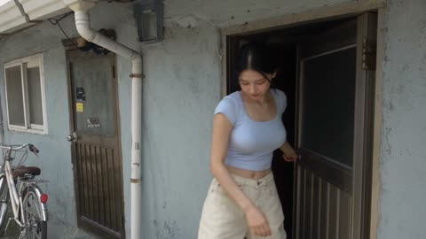
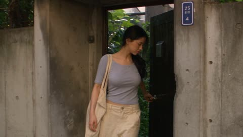
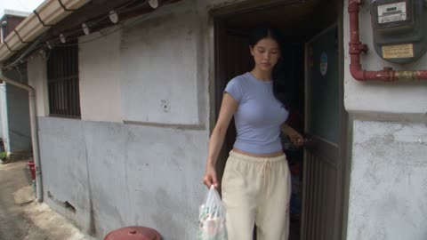
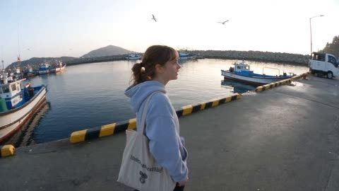
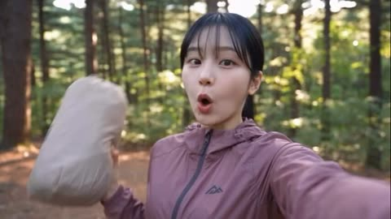
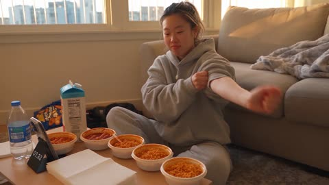
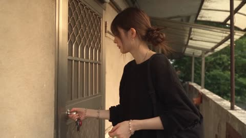

# 手机实拍与 Vlog

[返回目录](../../README_zh.md) · 全部 186 条 · [1](video-vlog.md) · [2](video-vlog-2.md) · **3**

<a id="seedance-seoul-summer-gum-home-video"></a>
### 身穿淡蓝上衣的韩国女子走出家门

<a href="https://x.com/AIwithkhan/status/2116387431289344020"></a>

以朋友随手拍的 DV 摄像机口吻设定画面，叠加手持抖动、自动对焦跳动和曝光变化，同时锁定人物脸部、发型与服装。按段落逐步描述动作，如吹泡泡和踢球，让每个事件具体、可执行。

Seedance 2.5 · 文生视频 · 出处: [@AIwithkhan on X](https://x.com/AIwithkhan/status/2116387431289344020) · 发现于 [LearnPrompt/awesome-seedance](https://github.com/LearnPrompt/awesome-seedance)

[`korean`](tags.md#tag-korean) [`home-video`](tags.md#tag-home-video) [`daily-life`](tags.md#tag-daily-life) [`handheld`](tags.md#tag-handheld)

<details><summary><b>提示词</b></summary>

```text
Create a 30-second, 1080p ultra-realistic personal home-video showing an ordinary summer afternoon in the life of a young Korean woman. 

MAIN SUBJECT

Young Korean woman in her early 20s, naturally pretty, realistic skin texture, minimal makeup, relaxed and confident personality.

Long black hair loosely tied into a messy side ponytail with a few loose strands around her face. Wearing a fitted pastel-blue crop top, loose cream-colored jeans, black sneakers, and a simple silver necklace.

Maintain the same face, hairstyle, clothing, body proportions, and overall appearance throughout the entire video.

SETTING

A quiet older Seoul residential neighborhood during a warm summer afternoon. Narrow concrete lanes, small houses, old walls, potted plants, parked bicycles, utility poles, overhead wires, laundry hanging outside homes, a small convenience store, and children playing football in the street.

Everything should feel lived-in, ordinary, and peaceful.

CAMERA / VISUAL AESTHETIC

Raw personal footage casually recorded by a friend on an early-2000s consumer DV camcorder.

Strong handheld shake, imperfect framing, autofocus hunting, exposure shifts, occasional motion blur, faded colors, soft digital detail, mild noise, accidental zooms, and natural camera imperfections.

No stabilization, drone footage, gimbal movement, dramatic lighting, or polished commercial cinematography.

— LEAVING HOME

She steps outside her house, closes the door, and adjusts her messy side ponytail.

A gentle summer breeze naturally moves her loose hair and a few strands fall across her face. She smiles at the camera, brushes the strands away, and starts walking down the narrow neighborhood lane.

The camera casually follows her from a few steps behind.

— STOPPING AT THE STORE

She reaches a tiny neighborhood convenience store and walks inside.

She casually browses the shelves, picks up a colorful pack of bubble gum, and pays at the counter.

She opens the packet, takes one piece, puts it in her mouth, and slips the remaining gum into her pocket.

She walks back outside, chewing happily and smiling at the camera.

— THE BUBBLE GUM MOMENT

While walking down the street, she starts blowing a bubble with her gum.

The bubble slowly grows larger until it suddenly pops against her lips.

She freezes for a second, looks at the camera, and bursts into genuine laughter.

She wipes the little pieces of gum away, laughs again, and continues walking.

Keep the bubble formation and popping physically realistic.

— DRINKING WATER

She reaches a small public water tap beside an old residential wall.

She turns the tap, cups her hands beneath the flowing water, and drinks a little.

She splashes some water onto her face, shakes the droplets from her fingers, fixes her loose hair, and smiles toward the camera.

The water flows naturally from the tap and remains consistent.

— THE FOOTBALL MOMENT

A few meters ahead, several neighborhood children are playing football in the street.

Suddenly, the football rolls toward her and stops directly beside her sneakers.

She looks down at it, then toward the children.

One child calls out:

“Noona! Kick it!”

She smiles, positions herself beside the ball, and gently kicks it back toward the children.

The ball rolls naturally along the concrete. The children excitedly chase after it, cheering and laughing.

She waves at them and continues walking.

The football stays with the children and does not disappear, duplicate, or return to her.

She reaches the corner of the neighborhood and pauses.

The camera moves closer as she turns toward it with a cheerful smile. A gentle breeze moves her ponytail again.

She raises one hand, gives a casual wave, and says clearly:

“Happy weekend!”

She laughs softly, turns around, and continues walking down the lane.

The camera follows her for a few seconds before the recording abruptly cuts to Black
```

</details>

<a id="seedance-seoul-summer-walk-candies-cat"></a>
### 韩国女子走过首尔街道，喂孩子糖果并抚摸猫咪

<a href="https://x.com/AIwithkhan/status/2099849272347021541"></a>

用参考图锁定人物形象，并重复列出服装细节，使30秒的连续镜头中外观保持一致。DV摄像机质感（手持抖动、自动对焦摇摆、曝光变化）加上只有环境音、没有音乐的声音描述，让画面像真实的家庭录像。

Seedance 2.5 · 参考生视频 · 出处: [@AIwithkhan on X](https://x.com/AIwithkhan/status/2099849272347021541) · 发现于 [LearnPrompt/awesome-seedance](https://github.com/LearnPrompt/awesome-seedance)

[`seoul`](tags.md#tag-seoul) [`dv-camera`](tags.md#tag-dv-camera) [`slice-of-life`](tags.md#tag-slice-of-life) [`reference-image`](tags.md#tag-reference-image)

<details><summary><b>提示词</b></summary>

```text
Create a 30-second ultra-realistic personal home-video of a young Korean woman during a warm summer evening in an older Seoul residential neighborhood. Use the attached image as the character reference and keep her face, long black messy side ponytail, pastel-blue fitted top, loose cream pants, black sneakers, and silver necklace consistent.

She walks out of her home carrying a simple canvas tote bag, locks the door, adjusts her ponytail, and starts walking casually down the quiet street.

She notices a small group of schoolchildren walking home from school and warmly smiles at them. She opens her tote bag, takes out a few individually wrapped candies, and happily offers them to the children. They thank her with cheerful smiles before continuing home.

A few steps later, she notices a friendly neighborhood cat sitting beside a wall. She crouches down, gently pets the cat and scratches it behind the ears, smiling warmly before standing up.

She continues walking, casually adjusts her messy ponytail, and fixes a few loose strands around her face.

She then spots a small roadside drink cart and stops to buy a fresh coconut drink. She takes the drink with a straw and walks home slowly while sipping it through the straw, looking relaxed and happy.

Use raw early-2000s consumer DV-camera footage: handheld shake, imperfect framing, autofocus hunting, exposure shifts, soft detail, mild noise, natural motion blur and occasional awkward zooms.

Natural Seoul neighborhood ambience only — footsteps, children chatting, bicycle bells, summer insects, distant traffic, cart sounds and leaves moving in the breeze. No music, no narration, no dramatic events, no polished commercial cinematography.
```

</details>

<a id="seedance-seoul-sunday-dv-home-video"></a>
### 首尔小巷里提着购物袋的女子

<a href="https://x.com/AIwithkhan/status/2096424933366931946"></a>

摄像机风格段落（自动对焦反复、曝光跳动、意外变焦）营造DV质感，连续性段落则明确每个物品归谁，防止交接的气球和购物袋出现漂移。音频只写分层环境声且不加音乐，让片段读起来像原始家庭录像。

Seedance 2.5 · 文生视频 · 出处: [@AIwithkhan on X](https://x.com/AIwithkhan/status/2096424933366931946)

[`dv-look`](tags.md#tag-dv-look) [`handheld`](tags.md#tag-handheld) [`continuity`](tags.md#tag-continuity) [`ambient-audio`](tags.md#tag-ambient-audio)

<details><summary><b>提示词</b></summary>

```text
Create a 30-second, 1080p ultra-realistic early-2000s DV home video of a young Korean woman spending a quiet Sunday afternoon in an older Seoul neighborhood. Young Korean woman, early 20s, natural beauty, realistic skin, minimal makeup, black wavy hair in a messy side ponytail, fitted pastel-blue short top, loose cream pajama-style pants, black sneakers and simple silver necklace. Keep her identity, outfit, hairstyle and proportions perfectly consistent. She walks through a quiet residential lane carrying a small reusable shopping bag. She passes a neighborhood playground where a little girl's balloon is stuck in a low tree branch. She notices the girl struggling, walks over and gently frees the balloon from the branch. The balloon visibly comes into her hand, then she clearly hands it to the girl. The girl keeps holding it afterward. The girl smiles and says, “Thank you!” She replies, “You're welcome.” She continues walking home, smiling as a light breeze moves her hair and leaves around the street. She reaches her house, turns toward the camera and says: “Pretty nice Sunday.” She walks inside and the camera cuts to black. Camera: Raw handheld early-2000s DV camcorder, shaky footage, autofocus hunting, faded colors, exposure shifts, motion blur, soft digital detail, accidental zooms. No polished cinematography. Audio: Natural neighborhood ambience, birds, children, bicycles, footsteps, wind and distant traffic. No music. Continuity: No disappearing or duplicated objects. Balloon stays with the girl after being handed over. Shopping bag remains with the woman. Smooth realistic movements and transitions. Negative: CGI look, plastic skin, identity drift, outfit changes, teleporting objects, distorted hands, extra fingers, subtitles, watermark.
```

</details>

<a id="seedance-smartphone-japanese-dojo-vlog"></a>
### 日式道场里初学者的自拍vlog

<a href="https://x.com/SimplyAnnisa/status/2093978574692679983"></a>

提示词用明确的负面约束锁定人物身份、服装和手持手机的拍摄风格（不要云台、不要滤镜、不要电影感镜头），并把20秒拆成带时间码的段落，韩语台词原文写出，便于控制口型同步。音频部分只指定环境声，保证声音真实。

Seedance 2.5 · 文生视频 · 出处: [@SimplyAnnisa on X](https://x.com/SimplyAnnisa/status/2093978574692679983)

[`smartphone-vlog`](tags.md#tag-smartphone-vlog) [`martial-arts`](tags.md#tag-martial-arts) [`japan`](tags.md#tag-japan) [`selfie`](tags.md#tag-selfie) [`korean-dialogue`](tags.md#tag-korean-dialogue)

<details><summary><b>提示词</b></summary>

```text
Create a 20-second ultra-realistic casual smartphone travel vlog featuring the same Korean woman in her early 20s throughout. She has a petite oval face, brown eyes, natural coral lips, fair realistic skin and long straight black hair. Maintain identical facial identity, hairstyle, body proportions and appearance with no morphing or identity drift.

TRAVEL OUTFIT: Cream oversized knit sweater, dark blue straight-leg jeans, white low-top sneakers and small crossbody bag. Hair in a loose low ponytail with natural strands.

TRAINING OUTFIT: Off-white cotton keikogi-style jacket, matching white training pants and plain dark navy beginner belt. No logos, text or patterns. Keep this outfit identical throughout training.

STYLE: Genuine handheld smartphone footage, imperfect framing, subtle camera shake, autofocus shifts, natural exposure, slight motion blur, realistic skin, blinking and body movement. No cinematic shots, drones, gimbals, beauty filters or commercial look.

LOCATION: Quiet Japanese countryside neighborhood and a small authentic wooden dojo with traditional architecture, wooden floors and natural daylight. No famous landmarks.

0:00–0:04: She walks toward the dojo while filming herself, excited and curious. She says naturally in Korean:
“오늘은 일본 무술을 직접 배워볼게요!”
She briefly shows the dojo entrance, then returns to selfie mode.

0:04–0:07: Inside the dojo, she is now wearing the training uniform. She adjusts her sleeves. A friendly instructor bows respectfully; she bows back slightly awkwardly and smiles.

0:07–0:11: Instructor demonstrates a simple beginner stance and controlled hand movement. She copies it awkwardly, places one foot incorrectly, then tries again after the instructor calmly corrects her posture.

0:11–0:15: She attempts a slow beginner stance transition with controlled defensive arm movement, briefly loses balance, regains footing and laughs naturally. Instructor smiles encouragingly. Keep movements safe and beginner-friendly.

0:15–0:18: Natural jump cut. Same woman and identical outfit/appearance. She repeats the sequence with noticeably better balance but still looks like a beginner. She smiles proudly.

0:18–0:20: Outside the dojo in soft late-afternoon light, she films herself, slightly out of breath and smiling. She says:
“생각보다 어렵지만 정말 재미있어요!”
She gives a small wave and lowers the phone.

AUDIO: Natural Korean female voice with accurate lip-sync. Footsteps, fabric movement, dojo ambience, distant neighborhood sounds and light wind. No music or dramatic effects.

FINAL RULES: Photorealistic, authentic smartphone vlog, believable physics and beginner-level martial arts. No fighting, exaggerated movements, action choreography, famous landmarks, logos, brands, subtitles, text, watermarks or visual effects.
```

</details>

<a id="seedance-snowy-morning-campus-vlog"></a>
### 女生用手机记录突如其来的雪天上学路

<a href="https://x.com/nawalsehar/status/2107345257495138416"></a>

用明确的人物身份句锁定同一个人、服装和背包，并通过手抖、自动对焦呼吸、卷帘快门等具名瑕疵让手机画面更真实。写明 30 秒时长、24fps 以及逐项列出的现场声音，让片段结构清楚，音轨也更贴近real场景。

Seedance 2.5 · 文生视频 · 出处: [@nawalsehar on X](https://x.com/nawalsehar/status/2107345257495138416) · 发现于 [LearnPrompt/awesome-seedance](https://github.com/LearnPrompt/awesome-seedance)

[`vlog`](tags.md#tag-vlog) [`snow`](tags.md#tag-snow) [`winter`](tags.md#tag-winter) [`smartphone`](tags.md#tag-smartphone)

<details><summary><b>提示词</b></summary>

```text
Create an exactly 30-second, 16:9, 24fps, 4K ultra-photorealistic live-action university vlog following the same European brunette woman in her mid-20s through an unexpected snowy morning.

She wakes expecting rain, opens the curtains, and discovers the entire city covered in heavy fresh snow. She quickly dresses in a cream thermal sweater, dark jeans, charcoal coat, beige scarf, gloves, boots and dark university backpack. She prepares hot chocolate, takes a quick sip, then steps outside into the snowfall.

Show realistic snow compression and footprints, visible breath, steam from the hot chocolate, natural wind movement in her hair and scarf, backpack inertia, careful walking on slippery snow, realistic slush and traffic, and snow naturally accumulating on cars, trees, buildings and clothing.

She walks through the snow-covered city while filming herself with an authentic handheld smartphone. Include natural side-tracking and environmental angles showing snowy streets, cafés, pedestrians, cars and the university campus. She arrives at university, enters the warm hallway and quietly says:

“Okay… this is actually the best morning ever.”

Cut naturally to black at exactly 30 seconds.

Use authentic smartphone imperfections: subtle hand shake, autofocus breathing, exposure adjustment, rolling-shutter artifacts, realistic motion blur and imperfect framing. Maintain identical face, hair, body proportions, wardrobe and backpack throughout.

Natural diegetic audio only: alarm, bedsheets, curtains, clothing, milk pouring, spoon, mug, steam, door, wind, snow crunch, traffic, slush, footsteps and university ambience. No music or narration.

Negative prompt: CGI appearance, animation, fantasy snow, glowing snow, impossible physics, floating objects, teleportation, weather changes, unrealistic sliding, distorted hands, extra fingers, face drift, body distortion, wardrobe changes, duplicated people or objects, fake snow particles, impossible reflections, excessive slow motion, subtitles, captions, logos, watermark, background music.
```

</details>

<a id="seedance-sokcho-fish-market-flip-camera-vlog"></a>
### 束草鱼市清晨翻盖相机旅行视频

<a href="https://x.com/oggii_0/status/2095029762070900919"></a>

先用参考图锁定人物身份，再列出抖动、对焦漂移、高光过曝等刻意瑕疵，让画面像朋友随手拍的真实记录。七个带时间码的段落各含一个动作和一句台词，音频只保留现场自然声。

Seedance 2.5 · 参考生视频 · 出处: [@oggii_0 on X](https://x.com/oggii_0/status/2095029762070900919) · 发现于 [LearnPrompt/awesome-seedance](https://github.com/LearnPrompt/awesome-seedance)

[`vlog`](tags.md#tag-vlog) [`handheld`](tags.md#tag-handheld) [`lo-fi`](tags.md#tag-lo-fi) [`travel`](tags.md#tag-travel) [`dialogue`](tags.md#tag-dialogue)

<details><summary><b>提示词</b></summary>

```text
FORMAT: 30 seconds | 16:9 | Ultra-photorealistic live-action | Continuous handheld vacation vlog

Preserve the exact face, hairstyle, identity, skin tone, facial features, and body proportions from <<<image_1>>> throughout the entire video. The same woman must appear consistently in every shot.

VISUAL STYLE: Authentic late-2000s personal vacation vlog recorded on a cheap handheld flip camera. Extremely raw and imperfect footage. Heavy natural camera shake, awkward handheld framing, occasional partial face crops, sudden reframing, autofocus hunting, exposure fluctuations, blown highlights, slightly soft image quality, warm faded colors, mild digital noise, compression artifacts, and subtle motion blur. No cinematic camera movements, no gimbal stabilization, no polished composition, no modern color grading, no beauty filter, no artificial sharpness.

Outfit: oversized grey hooded sweatshirt, black leggings, worn white running shoes, hair pulled back into a low messy ponytail, small silver stud earrings, a canvas tote bag slung over one shoulder. The entire video must feel like one genuine recording captured by a friend on an early-morning trip through a fishing village in Sokcho, South Korea, not a staged commercial or cinematic recreation.

00:00–00:04 — EARLY MORNING ARRIVAL
The woman walks along a quiet harbor path as the sun rises, fishing boats bobbing gently in the water behind her, seagulls circling overhead.
The camera shakes slightly as it follows her from the side.
She says:
"It's so early, but I really wanted to see the fish market before it gets busy."

00:04–00:08 — THE FISH MARKET
She steps into a covered harbor market filled with tanks of live fish, crabs, and squid, fishermen unloading crates from small boats nearby.
The camera zooms unsteadily on a tank of wriggling crabs, focus hunting before snapping back to her face.
She reacts with a mix of fascination and mild alarm.

00:08–00:12 — TALKING WITH A FISHERMAN
An older fisherman hoists a large fish onto a table for her to see up close.
She leans in curiously, asks a question, and he answers while gesturing with his hands.
She laughs and says to the camera:
"He says this one was caught just an hour ago!"

00:12–00:16 — TRYING RAW SQUID
A nearby stall vendor offers her a small plate of freshly sliced raw squid with dipping sauce.
She hesitates for a second, then takes a bite, chewing slowly with a surprised expression.
She turns to the camera and says:
"Okay wow, that's way fresher than I expected."

00:16–00:20 — HELPING SORT THE CATCH
A fisherwoman nearby is sorting fish into baskets and waves her over to help.
She kneels down and awkwardly tries to sort a few fish, nearly dropping one, laughing at herself.
The fisherwoman laughs too and pats her on the back encouragingly.

00:20–00:24 — WALKING THE HARBOR
She walks along the docks past rows of moored fishing boats, ropes coiled on the ground, nets drying in the morning sun.
A couple of fishermen nod and greet her; she waves back cheerfully.
The camera briefly swings toward the boats before swinging back to her.

00:24–00:27 — QUIET MOMENT
She stops at the edge of the harbor, looking out over the calm water as the sun fully rises over the horizon.
For a moment there's no dialogue — just waves lapping, distant gulls, and the creak of boats.
She smiles softly and says:
"Mornings like this make the early wake-up worth it."

00:27–00:30 — NATURAL ENDING
She turns back toward the camera, gives a small wave, and says:
"Okay, harbor adventure done. See you next time!"
She laughs, turns, and walks off along the dock.
The camera lingers a moment before the footage naturally ends with a slight shake and imperfect cut.

AUDIO
Natural location sound only:
- waves lapping against the dock
- seagulls calling
- boat engines idling in the distance
- fishermen calling out to each other
- crates being unloaded
- water splashing in fish tanks
- footsteps on wet pavement
- light morning breeze
```

</details>

<a id="seedance-solo-camping-vlog-pine-forest"></a>
### 松林中单人露营自拍 vlog

<a href="https://x.com/ZorviaLux/status/2105892094032404502"></a>

把片子按时间拆成五个场景，每段都有自己的镜头和光线提示，模型就有了分镜可循。结尾的一致性说明锁定人物、服装和帐篷，单独的音频段落则排除音乐和字幕，让五个镜头始终保持统一。

Seedance 2.5 · 文生视频 · 出处: [@ZorviaLux on X](https://x.com/ZorviaLux/status/2105892094032404502) · 发现于 [LearnPrompt/awesome-seedance](https://github.com/LearnPrompt/awesome-seedance)

[`camping`](tags.md#tag-camping) [`vlog`](tags.md#tag-vlog) [`selfie`](tags.md#tag-selfie) [`campfire`](tags.md#tag-campfire) [`timed-scenes`](tags.md#tag-timed-scenes)

<details><summary><b>提示词</b></summary>

```text
Create a 20-second ultra-realistic cinematic camping vlog featuring a young Japanese woman with straight black hair and bangs, wearing a dusty pink outdoor jacket.

Scene 1 (0–4 sec): Selfie-style vlog in a beautiful pine forest during golden hour. She smiles at the camera while holding a beige tent bag and excitedly introduces her solo camping adventure. Natural handheld camera movement, realistic facial expressions.

Scene 2 (4–7 sec): Wide cinematic shot of her setting up a beige camping tent among tall pine trees. She happily raises both hands to celebrate after pitching the tent. Warm sunlight filters through the forest.

Scene 3 (7–12 sec): Nighttime campfire scene. She sits on a folding camping chair, roasting a marshmallow on a stick. Close-up of her gently blowing on the toasted marshmallow, with realistic firelight illuminating her face.

Scene 4 (12–16 sec): She sits beside the campfire holding a glowing marshmallow, enjoying the peaceful night in the forest. Natural expressions, cozy atmosphere, realistic shadows and warm orange lighting.

Scene 5 (16–20 sec): Inside her illuminated tent at night, she smiles at the camera while holding a camping lantern. Suddenly, she hears a mysterious noise outside, opens her eyes wide, and pulls her sleeping bag up to her nose with a cute, surprised expression.

Visual style: Photorealistic live-action, 4K, cinematic depth of field, natural skin texture, realistic lighting, smooth camera transitions, authentic outdoor atmosphere, detailed facial expressions, cozy solo camping aesthetic.

Audio: Natural forest ambience, birds chirping, gentle wind, crackling campfire, subtle fabric sounds, and soft nighttime forest ambience. No background music, no subtitles, no text, no watermark.

Consistency: Maintain exactly the same woman, hairstyle, outfit, facial features, and tent throughout all scenes.
```

</details>

<a id="seedance-spicy-challenge-meltdown-korean-vlog"></a>
### 韩国女生挑战辣面，很快彻底破防

<a href="https://x.com/oggii_0/status/2094267751477232053"></a>

用带时间码的分镜把情绪从自信逐步推向崩溃，并写明每句台词和画外音。手持手机拍摄、自动对焦跳动和只要环境声的音频设定，让画面像真实的群聊视频。

Seedance 2.5 · 文生视频 · 出处: [@oggii_0 on X](https://x.com/oggii_0/status/2094267751477232053) · 发现于 [LearnPrompt/awesome-seedance](https://github.com/LearnPrompt/awesome-seedance)

[`korean`](tags.md#tag-korean) [`spicy-food`](tags.md#tag-spicy-food) [`handheld`](tags.md#tag-handheld) [`comedy`](tags.md#tag-comedy)

<details><summary><b>提示词</b></summary>

```text
Create a 30-second, 1080p ultra-realistic personal home-video of a young Korean woman confidently accepting a spicy food challenge from her friend, only to completely unravel as the heat kicks in. No reference image.
MAIN SUBJECT
Young Korean woman in her early 20s, casual and playful energy, natural makeup, expressive face that shifts from smug confidence to genuine distress.
Hair tied back in a high ponytail to "keep it out of the way," a few loose strands already escaping, small stud earrings.
Wearing an oversized gray hoodie with sleeves pushed up, loose sweatpants, sitting cross-legged on the floor like she's settling in for battle.
Maintain the same face, hairstyle, clothing, body proportions, and appearance throughout the entire video.
SETTING
A cozy, lived-in living room floor setup, late afternoon light coming through the window.
A low coffee table covered with a spread of increasingly spicy tteokbokki/ramen bowls lined up in a row, a stack of napkins, a carton of milk and a glass of water nearby "just in case," a phone propped against a water bottle timing things, a half-eaten snack bag pushed aside, and a blanket tossed on the couch behind her. Ordinary, slightly messy, very real.
CAMERA / VISUAL AESTHETIC
Raw personal footage filmed by her friend on a phone, strong handheld vlog shake throughout.
Camera bounces slightly with the friend shifting position to get better angles of her face. Autofocus hunts between the steaming bowls and her face. Mild motion blur when she reaches for water in a panic. Exposure shifts slightly as the afternoon light changes. Visible digital noise, slightly warm color cast from the window light.
No stabilization, no cinematic polish — it should feel like a real video shot for a group chat dare.
00:00–00:05 — THE CONFIDENT SETUP
She rolls up her sleeves theatrically, cracking her knuckles over the bowls like she's about to do something serious.
She looks into the camera, completely unbothered, smug smile.
"This is nothing. I grew up eating spicy."
00:05–00:10 — FIRST BITE
She picks up the first, mildest bowl and takes a confident bite, chewing casually, nodding like it's easy.
"See? Nothing."
The camera stays steady, her friend clearly unimpressed off-camera: "That one's basically ketchup, keep going."
00:10–00:15 — THE SHIFT
She moves to the second, spicier bowl. A few bites in, her nodding slows. Her eyes start to water slightly, and she reaches for the water glass "just to wash it down," still trying to act casual.
Her voice comes out slightly strained: "It's — it's fine, it's just warm."
The camera pushes in slightly, catching the sweat starting to form on her forehead.
00:15–00:20 — LOSING COMPOSURE
She hits the hottest bowl. One bite in, her whole face changes — eyes wide, fanning her open mouth with her hand, grabbing for the milk carton and drinking straight from it.
She sets it down hard, breathing fast, pointing at the bowl accusingly.
"Okay — okay that one's not normal, that's not — "
The camera shakes as her friend bursts out laughing off-camera.
00:20–00:25 — FULL MELTDOWN
She grabs a napkin, fanning her tongue with her hand while making a pained noise, rocking slightly where she sits.
She reaches for the water again, chugs it, immediately regrets that too and grabs the milk back.
Her friend, off-camera, barely able to film straight from laughing: "You said you grew up eating spicy?!"
She shoots a watery-eyed glare at the camera without being able to respond, still fanning her mouth.
00:25–00:30 — FINAL MOMENT
She slumps back against the couch, defeated, milk carton clutched to her chest, face flushed and eyes still watering.
She looks at the camera, voice hoarse and pathetic.
"...I don't grow up eating spicy. I lied."
She weakly gives a thumbs down as the frame shakes with her friend's laughter, and the footage cuts abruptly to black.
AUDIO
Natural location sound only:
Chewing, sniffling, exaggerated exhales and gasps, milk carton opening and gulping sounds, napkin rustling, her friend's genuine off-camera laughter throughout, glass clinking against the table, and handheld camera noise.
No music. No narration. No artificial sound effects.
Spoken lines: "This is nothing. I grew up eating spicy." / "See? Nothing." / "That one's basically ketchup, keep going." (friend) / "It's — it's fine, it's just warm." / "Okay — okay that one's not normal, that's not —" / "You said you grew up eating spicy?!" (friend) / "...I don't grow up eating spicy. I lied."
FINAL FEEL
Genuine, escalating physical comedy built entirely on real reactions to real heat — confident denial collapsing into full surrender. Funny, relatable, unscripted-feeling, the kind of video that gets sent straight to a group chat with "lmaooo."
No exaggerated acting beyond real spice reactions. No fake toughing-it-out — the comedy comes from how fast and how completely her composure breaks.
```

</details>

<a id="seedance-taipei-alley-door-keys-dv"></a>
### 女子在台北巷弄开门

<a href="https://x.com/harboriis/status/2097564633242779830"></a>

按五秒一段的时间线分镜，并明确锁定脸部、服装和配饰的一致性，让角色在各镜头间保持稳定。手持抖动、自动对焦摇摆和褪色色调等消费级DV特征营造2000年代的怀旧感，声音清单也排除了配乐。

Seedance 2.5 · 文生视频 · 出处: [@harboriis on X](https://x.com/harboriis/status/2097564633242779830) · 发现于 [LearnPrompt/awesome-seedance](https://github.com/LearnPrompt/awesome-seedance)

[`taipei`](tags.md#tag-taipei) [`home-video`](tags.md#tag-home-video) [`handheld`](tags.md#tag-handheld) [`vlog`](tags.md#tag-vlog)

<details><summary><b>提示词</b></summary>

```text
Create a 30-second, 1080p, 16:9 ultra-realistic 2000s-style home video recording style video, featuring an ordinary Taiwanese summer evening.

Main subject: The entire video is shot from the perspective of a young Taiwanese woman in her early 20s, with natural, realistic skin tone, light makeup, dark brown long hair styled in a low bun, with a few strands of hair. She is wearing a soft black long-sleeved knitted top, wide-leg light gray shorts, white vintage sneakers, carrying a dark black backpack, and wearing a silver bracelet. Please ensure that the face, hairstyle, clothing, proportions, and accessories remain completely consistent.

Setting: A quiet old residential alley in Taipei, with small apartments, potted plants, bicycles, old walls, power poles, and a small snack shop, a water dispenser, and potted plants. Full of life, peaceful, and real; no brands, advertisements, tourist attractions, or elaborate commercial activities.

Photography: The original consumer DV shooting style from the early 2000s, intense hand-held shaking, imperfect composition, search for autofocus, exposure changes, dynamic blur, faded colors, soft digital details, slight noise, and unexpected zoom. Stabilizer, sky lanterns, drones, cinematic lenses.

Timeline:
00:00-00:05: Take out an eco-friendly shopping bag, lock the door, check the keys, tidy up hair, smile at the camera, and walk down the alley.

00:05-00:10: Buy a small bag of green grapes from a small grocery store. Take a bite, react to the sour taste, make a funny face, laugh, and hand the fruit to the camera.

00:10-00:15: Walk and eat the fruit. A little dog notices her and wags its tail, she crouches down to let it smell her hand. The dog follows her for a short distance before leaving.

00:15-00:20: The dry leaves on the tree fall on her shoulders and hair. She looks up, shakes off the leaves, and the camera zooms in and gets close to her face. She says: Here it comes again?

00:20-00:25: Sit briefly on the low wall, finish eating the fruit, and a taxi passes by. The neighbor is watering the flowers. The wind blows her hair and clothes; she wipes her hands and adjusts her bag.

00:25-00:30: Walk to the end of the alley, turn around with a playful smile, say: Let's go. Turn the corner; the camera follows; suddenly switches to black screen.

Sound: Only natural ambient sounds, bird songs, insect sounds, footsteps, bicycle bells, distant motorcycle sounds, tree leaves, store sounds, dog movements, neighborhood sounds, and the noise of operating a camera. No music, voiceover, subtitles, titles, logos, watermarks, or special effects.

Continuity: Real dogs and environmental actions. No repeated characters, distorted faces, deformed hands, extra fingers, instant movements, or clothing changes. Warm, leisurely, feminine, playful, intimate, with a nostalgic feeling of forgotten summer memories.
```

</details>

<a id="seedance-teacher-school-day-vlog"></a>
### 教师从居家到教室的完整一天

<a href="https://x.com/ElsaSofia__AI/status/2092569909859647951"></a>

六张标注好的参考图通过 @IMG 标签对应到各个时间段，固定的身份与服装锁定句让同一位教师贯穿所有场景。每个四秒分镜都写明动作列表和独立机位，读起来像一份逐镜头的分镜脚本。

Seedance 2.5 · 参考生视频 · 出处: [@ElsaSofia__AI on X](https://x.com/ElsaSofia__AI/status/2092569909859647951) · 发现于 [LearnPrompt/awesome-seedance](https://github.com/LearnPrompt/awesome-seedance)

[`reference-images`](tags.md#tag-reference-images) [`character-consistency`](tags.md#tag-character-consistency) [`lifestyle`](tags.md#tag-lifestyle) [`shot-timeline`](tags.md#tag-shot-timeline)

<details><summary><b>提示词</b></summary>

```text
DURATION: 30 seconds
ASPECT RATIO: 16:9

DURATION: 30 SECONDS

Create an ultra-photorealistic cinematic professional female teacher lifestyle vlog.

REFERENCE PRIORITY:

@IMG1 = MAIN FEMALE TEACHER
@IMG2 = SCHOOL EXTERIOR
@IMG3 = CLASSROOM
@IMG4 = TEACHING ACTION
@IMG5 = NOTEBOOK CHECKING
@IMG6 = SCHOOL EXIT

CHARACTER CONSISTENCY:

The EXACT SAME woman from @IMG1 must appear throughout the entire video.

Preserve her exact face, facial features, hairstyle, skin tone, body proportions, age appearance and overall identity.

She remains the SAME teacher throughout every scene.

Keep her professional teacher outfit consistent after she gets dressed.

--------------------------------------------------

0–4 SECONDS — LEAVING HOME

The teacher prepares for her school day at home.

She picks up her professional tote bag containing notebooks and teaching materials.

She checks her phone briefly.

She puts on her shoes, picks up her bag and leaves home.

CAMERA:
Quick cinematic morning lifestyle shots.

Close-up of the bag and notebooks.

Medium shot as she walks out the door.

Natural morning light.

--------------------------------------------------

4–8 SECONDS — SCHOOL ARRIVAL

Use @IMG2.

The teacher arrives at the school.

She walks through the main entrance carrying her tote bag.

She walks across the school courtyard toward the building.

She enters the school.

CAMERA:
Wide establishing shot of the school exterior.

Smooth tracking shot following her toward the entrance.

--------------------------------------------------

8–12 SECONDS — CLASSROOM PREPARATION

Use @IMG3.

The teacher enters her classroom.

She places her tote bag on the teacher's desk.

She organizes her notebooks and teaching materials.

She picks up a marker.

She briefly checks the whiteboard and prepares the lesson.

Students gradually settle into their desks.

CAMERA:
Medium classroom shot.

Brief close-ups of notebooks, marker and teaching materials.

--------------------------------------------------

12–20 SECONDS — TEACHING

Use @IMG4.

The teacher stands at the front of the classroom.

She writes a simple lesson heading or diagram on the whiteboard.

She turns toward the students.

She explains the lesson using natural hand gestures.

She points toward the board.

One student raises a hand.

The teacher acknowledges the student and responds with a natural smile.

Students remain attentive.

CAMERA:
Wide classroom shot.

Medium shot of teacher.

Brief close-up of her writing.

Over-the-shoulder shot from the students' perspective.

Natural classroom interaction.

--------------------------------------------------

20–25 SECONDS — NOTEBOOK CHECKING

Use @IMG5.

The lesson has finished.

The teacher sits at her desk.

She picks up a student's notebook.

She reads the work.

She turns a page.

She makes a few simple corrections with a pen.

She sees a well-completed answer and gives a small approving smile.

She places the notebook on a neat stack of checked work.

CAMERA:
Medium shot.

Brief close-up of notebook and hand.

Close-up of her satisfied expression.

--------------------------------------------------

25–30 SECONDS — SCHOOL EXIT

Use @IMG6.

The school day is finished.

The teacher organizes her papers into her tote bag.

She leaves the classroom.

She walks through the school corridor toward the main entrance.

She exits the school building.

The camera follows her from behind as she walks away.

Finish with a wide cinematic shot of the school exterior and the teacher walking toward the exit.

She gives a subtle relaxed smile.

CUT TO BLACK.

--------------------------------------------------

CAMERA STYLE:

Premium cinematic educational lifestyle vlog.

Smooth professional tracking.

Natural handheld feel.

Wide establishing shots.

Medium lifestyle shots.

Close-ups for important details.

Over-the-shoulder classroom shots.

Gentle cinematic pull-back at the ending.

No excessive camera shake.

No unnecessary fast camera movement.

--------------------------------------------------

REALISM:

Natural walking.

Natural classroom interaction.

Realistic writing.

Realistic notebook handling.

Realistic teacher gestures.

Natural student reactions.

Realistic school environment.

Natural facial expressions.

Realistic hands and fingers.

No exaggerated acting.

No distorted hands.

No extra fingers.

No face morphing.

No identity changes.

--------------------------------------------------

CONTINUITY:

Same female teacher throughout.

Same face.

Same hairstyle.

Same professional outfit.

Same school environment.

Same classroom.

Same teaching materials.

No different teacher.

No random outfit changes.

No cartoon.

No anime.

No futuristic school.

No text overlays.

No logos.

No watermark.

FINAL FEELING:

A realistic cinematic glimpse into a professional teacher's normal school day.

HOME → SCHOOL → CLASSROOM PREPARATION → TEACHING → NOTEBOOK CHECKING → SCHOOL EXIT.
```

</details>

<a id="seedance-three-besties-safari-vlog"></a>
### 三位朋友在吉普车上自拍

<a href="https://x.com/AIwithWania/status/2106971093592691077"></a>

参考图锁定主角的长相，三人各自固定不同的服装和帽子，使各镜头中的人物始终易于区分。按秒划分的分镜加上台词和手持自拍镜头，营造出真实旅行 vlog 的感觉。

Seedance 2.5 · 参考生视频 · 出处: [@AIwithWania on X](https://x.com/AIwithWania/status/2106971093592691077) · 发现于 [LearnPrompt/awesome-seedance](https://github.com/LearnPrompt/awesome-seedance)

[`safari`](tags.md#tag-safari) [`vlog`](tags.md#tag-vlog) [`reference-character`](tags.md#tag-reference-character) [`dialogue`](tags.md#tag-dialogue)

<details><summary><b>提示词</b></summary>

```text
Three besties, documenting a very unserious safari. 

Made with Seedance 2.5.

FORMAT: 16:9 landscape, ultra-realistic live-action, premium wildlife documentary + natural travel-vlog style.
REFERENCE IMAGE & MAIN CHARACTER:
Use the uploaded reference image as the primary character reference for the main girl. The main girl must remain exactly the same person throughout the entire video. Preserve her exact facial identity, facial features, skin tone, hairstyle, body proportions and overall appearance. Do not change or redesign her face.
Her overall outfit and styling should be inspired by the uploaded reference image, including the casual cap and youthful outdoor look. A slightly edgy/rock-inspired casual touch is acceptable while still looking natural and suitable for a wildlife trip.
👭 THREE FRIENDS
There are exactly three girls throughout the video: the main girl + two female friends.
All three girls must remain clearly visible and recognizable in multiple shots.
Their outfits must NOT be identical or matching. Each girl should have her own distinct outfit, colors and styling:
Main girl: outfit based on the uploaded reference image, casual outdoor/safari vibe, her own cap.
Friend 1: completely different casual outfit, different colors and styling, different cap.
Friend 2: another distinct casual outdoor outfit, different colors and details, different cap.
They can all wear caps because they are on an outdoor wildlife adventure, but the cap colors/styles should also be different. They should look like three real friends who chose their own clothes—not a coordinated uniform.
Keep each girl's outfit, hairstyle and appearance consistent from beginning to end.
 SHOT 1 — ARRIVAL | 0–4 SEC
The three friends arrive at a beautiful wildlife park in a safari vehicle.
The main girl briefly holds the camera for a natural selfie-style opening while both friends are clearly visible beside/behind her.
They look excited and genuinely happy.
Main girl:
“Okay, we’re finally here!”
Friend:
“I can’t wait to see them!”
Natural laughter, handheld travel-vlog movement, spontaneous expressions.
 SHOT 2 — ENTERING THE PARK | 4–7 SEC
Quick cinematic wide shot of all three girls walking through the wildlife park entrance together.
Their different outfits and caps are clearly visible.
They look around excitedly as they enter.
Friend:
“Where do we go first?”
Main girl:
“Let’s find the elephants!”
Natural walking and casual conversation, not staged.
SHOT 3 — ELEPHANTS | 7–11 SEC
Cut to the three girls safely observing elephants from a designated viewing area.
All three react naturally and excitedly.
Main girl:
“Whoa… look at that!”
Friend:
“They’re huge!”
Show realistic elephant movement, natural sunlight and authentic wildlife behavior.
 SHOT 4 — GIRAFFE | 11–14 SEC
The three girls are together at a giraffe viewing area.
One friend gently feeds the giraffe with approved food while the other two watch excitedly.
The giraffe naturally approaches.
Friend:
“It’s actually coming!”
Main girl:
“Oh my God, look!”
Keep all three girls visible and expressive.
 SHOT 5 — DEER | 14–17 SEC
Quick intimate wildlife moment.
The three friends are together near a friendly deer. One friend safely feeds it while the other two laugh and react.
Main girl:
“Aww, you’re so cute!”
Natural laughter and genuine reactions.
SHOT 6 — FINAL SELFIE | 17–20 SEC
Golden-hour ending.
The three girls stand close together after their wildlife adventure and take a fun selfie.
They are smiling, laughing and slightly tired but happy.
Friend:
“Best day ever!”
Main girl:
“We need to come back!”
End with their natural laughter and selfie pose.

VISUAL & CAMERA STYLE
Ultra-realistic live-action wildlife documentary aesthetic combined with an authentic friends' travel vlog.
Natural daylight, realistic skin texture, real-world wildlife park environment, authentic animal movements, cinematic wide shots mixed with handheld selfie footage, subtle natural camera shake, realistic depth of field, natural shadows, realistic clothing movement, and environmental details.
The video should feel like three real friends spontaneously documenting their wildlife adventure, not actors performing a scripted commercial.
🚫 NEGATIVE PROMPT
No CGI look, no 3D rendering, no cartoon animals, no fantasy environment, no artificial-looking faces, no face morphing, no identity drift, no character swapping, no duplicate girls, no extra friends, no identical outfits, no matching uniforms, no outfit changes between shots, no unrealistic animal behavior, no exaggerated acting, no excessive slow motion, no artificial beauty filter, no plastic skin, no futuristic elements.
16:9 landscape • Exactly 20 seconds • 3 girls • 3 different outfits • consistent main character • elephants + giraffe + deer • natural dialogue • cinematic wildlife adventure • realistic live-action.
```

</details>

<a id="seedance-three-city-phone-vlog"></a>
### 韩国女子伦敦巴黎莫斯科手机自拍视频

<a href="https://x.com/HustleXR/status/2092492677384437909"></a>

用纸张撕开的转场遮住每次城市切换，服装只在转场时变化，同一人物得以延续。按时间码分段的写法加上 REALISM LOCK 约束条款，让身份、服装和动作在三座城市之间保持一致。

Seedance 2.5 · 文生视频 · 出处: [@HustleXR on X](https://x.com/HustleXR/status/2092492677384437909) · 发现于 [LearnPrompt/awesome-seedance](https://github.com/LearnPrompt/awesome-seedance)

[`phone-footage`](tags.md#tag-phone-footage) [`travel-vlog`](tags.md#tag-travel-vlog) [`paper-transition`](tags.md#tag-paper-transition) [`multi-city`](tags.md#tag-multi-city)

<details><summary><b>提示词</b></summary>

```text
ULTRA-REALISTIC PHONE FOOTAGE

One adult Korean woman, same recognizable face, skin tone, body proportions and gold hoop earrings throughout. Real skin pores, natural blinking, believable expressions and consistent identity. She personally films herself with a smartphone. No beauty filter, CGI, plastic skin or cinematic over-processing.

CAMERA: authentic handheld phone footage, slight arm movement, natural walking shake, autofocus shifts, exposure changes, realistic phone HDR and mild compression. Fast but understandable editing. Every city must be immediately recognizable.

00:00–00:05 — LONDON 🇬🇧

0:00–0:02.5 — Rainy Soho street. Selfie shot. She walks under a clear umbrella wearing a dark olive raincoat, grey knit, burgundy scarf, black skirt, tights and burgundy boots. Wet pavement, red double-decker bus and classic London architecture behind her. She smiles:

“London is freezing today!”

0:02.5–0:05 — She quickly turns the phone away from herself. A clean upward tilt reveals Big Ben and Westminster through the rain. She briefly points toward it. A torn blue-grey paper sheet naturally sweeps across the lens.

00:05–00:10 — PARIS 🇫🇷

0:05–0:07.5 — The paper tear reveals nighttime Paris. She is now wearing a beige open trench coat, cream knit, silk scarf, black trousers and burgundy ankle boots, hair in a high messy bun. She walks past warm cafés carrying a fresh crêpe, takes one bite and smiles:

“Paris at night… wow.”

0:07.5–0:10 — She immediately turns the phone upward, revealing the Eiffel Tower fully illuminated against the night sky. The tower lights sparkle naturally. A navy paper sheet quickly peels across the frame.

00:10–00:15 — MOSCOW 🇷🇺

0:10–0:12.5 — The paper opens onto a snowy Moscow street. She now wears a cream faux-fur coat, burgundy turtleneck, brown trousers and dark brown boots, with loose wavy hair. Snow lands naturally on her coat and hair. She holds a steaming blini, takes one bite and smiles:

“Okay… this is beautiful.”

0:12.5–0:15 — She turns the phone upward while snow falls, revealing Saint Basil’s Cathedral with its colorful domes. She raises her gloved hand toward the camera, laughing softly. Her hand naturally covers the lens as the recording ends.

REALISM LOCK: Every transition must preserve the same woman. City-specific clothing and hairstyles change only during the paper transition. Realistic weather, food, crowds, architecture, lighting and physical movement. No duplicated people, distorted hands, floating objects, fake faces, subtitles, logos, watermarks or artificial CGI appearance.

AUDIO: authentic rain, footsteps, traffic, café ambience, food-stall sounds, wind, distant voices and snowfall ambience. No background music.
```

</details>

<a id="seedance-toddler-body-parts-nursery"></a>
### 幼儿在托儿室教身体部位英文单词

<a href="https://x.com/Zarnab_with_Ai/status/2107066879038857330"></a>

固定的外观和服装描述让整段视频中的角色保持一致。编号的分镜列表把每个屏幕单词与一个具体手势配对，使文字和动作的时间点保持紧凑。

Seedance 2.5 · 文生视频 · 出处: [@Zarnab_with_Ai on X](https://x.com/Zarnab_with_Ai/status/2107066879038857330) · 发现于 [LearnPrompt/awesome-seedance](https://github.com/LearnPrompt/awesome-seedance)

[`toddler`](tags.md#tag-toddler) [`educational`](tags.md#tag-educational) [`3d-animation`](tags.md#tag-3d-animation) [`text-overlay`](tags.md#tag-text-overlay) [`nursery`](tags.md#tag-nursery)

<details><summary><b>提示词</b></summary>

```text
Create a cute, colorful, highly detailed 3D animated educational video featuring an adorable toddler boy with big expressive eyes, soft curly brown hair, rosy cheeks, and a sweet innocent expression.

The toddler wears a cream-colored long-sleeve shirt underneath blue denim overalls and white socks. Keep the character's appearance consistent throughout the entire video.

Set the video inside a bright, playful children's nursery/classroom filled with colorful toys, alphabet blocks, bookshelves, soft pastel walls, rainbows, balloons, stars, clouds, bunting decorations, and a colorful puzzle mat. Use a cheerful pastel color palette with soft cinematic lighting.

The child stands in the center of the frame and happily teaches basic body-part names through simple gestures. He looks directly at the camera, points to or touches each body part when its name appears on screen, and uses cute natural movements and facial expressions.

Show different body parts one by one, including:
HEAD, NOSE, CHIN, EYEBROW, PALM, WRIST, WAIST, STOMACH, and SOLE.

For every body part, display a large, bold, colorful English word near the child, synchronized with his gesture. Use playful children's educational typography with bright colors, a dark outline, and a fun cartoon-style pop-in animation.

Scene progression:

1. The toddler waves and raises both hands toward the camera.
2. He points to his NOSE.
3. He smiles and gestures toward his CHIN.
4. He points to his EYEBROW.
5. He opens his hand and shows his PALM.
6. He points toward his WRIST.
7. He gestures around his WAIST.
8. He touches his STOMACH.
9. He sits down and shows the bottom of his foot while introducing SOLE.
10. End with the toddler happily waving at the camera.

Camera style: vertical 9:16 composition, medium full-body framing, smooth gentle camera movement, occasional subtle push-ins, centered character, eye-level perspective.

Visual style: high-quality 3D children's animation, adorable Pixar-inspired aesthetic, soft rounded features, realistic fabric textures, expressive eyes, smooth character animation, vibrant pastel colors, soft global illumination, shallow depth of field, polished cinematic rendering.

Mood: cheerful, wholesome, educational, playful, and engaging for young children.

Keep the character's face, hairstyle, clothing, proportions, nursery environment, lighting, and overall visual style consistent across every scene.

Add a final educational message:
“LEARN BODY PARTS NAMES!”
“FOLLOW FOR MORE!”

Format: 9:16 vertical, high resolution, smooth animation, clean composition, no watermark.
```

</details>

<a id="seedance-tokyo-helicopter-night-selfie-tour"></a>
### 东京夜间直升机游览自拍

<a href="https://x.com/noorlewisx/status/2093567063357088065"></a>

每个场景编号并写明机位（自拍、驾驶舱、航拍、第一人称）和地标，模型拿到的是分镜表而不是笼统的氛围描述。每段台词按场景写出，结尾的风格说明再加一条无字幕无标志的限制，让画面保持干净。

Seedance 2.5 · 文生视频 · 出处: [@noorlewisx on X](https://x.com/noorlewisx/status/2093567063357088065) · 发现于 [LearnPrompt/awesome-seedance](https://github.com/LearnPrompt/awesome-seedance)

[`helicopter`](tags.md#tag-helicopter) [`tokyo`](tags.md#tag-tokyo) [`selfie`](tags.md#tag-selfie) [`night-city`](tags.md#tag-night-city) [`multi-scene`](tags.md#tag-multi-scene)

<details><summary><b>提示词</b></summary>

```text
A cinematic first-person and selfie-style night video of a beautiful young East Asian woman with long dark hair in a ponytail, wearing a maroon ribbed halter top, cream wide-leg pants, and black slide sandals. She is taking a helicopter night tour over Tokyo. No watermark, no logo, no text overlay, no brand names.
Scene 1: On a green-lit rooftop helipad at night. She smiles at the camera holding it selfie-style. A white Robinson-style helicopter is behind her with spinning blades. Tokyo city lights and water in the background. She says she is getting on a helicopter in Tokyo.
Scene 2: Inside the helicopter cockpit. She wears a green aviation headset with boom mic and a black 4-point harness. A small fuzzy lavalier mic is clipped to her top. She looks at the camera, slightly nervous then smiling, adjusting her seatbelt. Night city lights visible through the open side.
Scene 3: Helicopter lifts off from the helipad. Wide view of Tokyo Bay at night, Tokyo Tower glowing orange on the left, Rainbow Bridge lit up on the right, dark water below.
Scene 4: Open-door helicopter flight. Strong wind blows her hair. She laughs excitedly, eyes squinting, mouth open in joy, saying there is no door at all. Below: a cargo ship on the water and glittering city skyline.
Scene 5: POV looking down between her legs — cream pants and black sandals dangling over a dense sea of Tokyo skyscrapers and streets glowing at night.
Scene 6: Close selfie next to the brightly lit orange Tokyo Tower. She looks at camera and says “That’s Tokyo Tower.”
Scene 7: Aerial shot flying over Tokyo Skytree glowing purple and white, her feet visible at the bottom of frame, highways and dense city lights below.
Scene 8: Flying low along Rainbow Bridge at night — white cables, cars with headlights, city skyline behind.
Scene 9: After landing, she steps off the white helicopter onto the green helipad, walking toward camera holding the headset in one hand, wearing the same outfit.
Scene 10: She is now standing in crowded Shibuya Crossing at night, neon signs everywhere, yellow taxi and people crossing behind her. She smiles at the camera, waves, and says “Alright everyone, bye!” then “Bye!”
Style: realistic handheld selfie + aerial footage, night city lights, slight wind, natural skin, warm street lighting mixed with cool night sky. Smooth cuts, 30-second duration, vertical or 16:9 cinematic look. Photorealistic, no text, no watermark, no logo anywhere.

#polloai
```

</details>

<a id="seedance-tokyo-smartphone-dessert-cafe-vlog"></a>
### 东京小巷发现隐秘甜品店的手机vlog

<a href="https://x.com/saniaspeaks_/status/2088605003112235033"></a>

提示词用第一人称手机拍摄的设定加上30秒内的分段时间节点来锚定画面，并列出自动对焦跳动、曝光变化和手持抖动等真实感细节。同时明确禁止推拉摇移、无人机和慢动作等电影化手法，使画面保持纪实风格。

Seedance 2.5 · 文生视频 · 出处: [@saniaspeaks_ on X](https://x.com/saniaspeaks_/status/2088605003112235033)

[`food-vlog`](tags.md#tag-food-vlog) [`smartphone-footage`](tags.md#tag-smartphone-footage) [`handheld`](tags.md#tag-handheld) [`tokyo`](tags.md#tag-tokyo)

<details><summary><b>提示词</b></summary>

```text
Ultra-realistic smartphone food vlog set in a charming neighborhood in Tokyo, Japan. The entire video must look like it was genuinely recorded on a modern flagship smartphone by a real female creator, not like a cinematic production or AI-generated video. 0–5 seconds: A young Japanese woman walks through a narrow Tokyo side street in the early evening, holding her smartphone at arm’s length and casually talking to the camera. Traditional Japanese shopfronts, vending machines, bicycles, small signs, utility wires, pedestrians and warm storefront lights create an authentic neighborhood atmosphere. Natural handheld movement and slight framing imperfections. 5–10 seconds: She notices a tiny hidden dessert café and turns the camera toward its entrance with an excited reaction. She walks inside while continuing the vlog. The camera naturally adjusts exposure from the bright street to the warmer interior. 10–16 seconds: Show the staff preparing a fresh strawberry cream dessert. Realistic strawberries, whipped cream, soft cake layers and small details of the preparation. The creator moves the phone closer for a natural food close-up while autofocus subtly shifts between the dessert and her hand. 16–22 seconds: She receives the dessert, holds it directly toward the phone camera, then takes a spoonful and tastes it. Her reaction should be spontaneous and believable, with subtle facial expressions rather than exaggerated acting. 22–27 seconds: She smiles, takes another small bite and turns the camera slightly to show the cozy café interior, Japanese customers naturally sitting in the background and warm practical lighting. 27–30 seconds: She walks back outside onto the Japanese street, looks directly into the phone camera and naturally says, “Okay, this place was actually so good!” She smiles and ends the recording casually. Authentic Japanese environment, realistic human behavior, natural walking physics, real-looking food textures, accurate skin texture, natural hair movement, realistic reflections, imperfect smartphone framing, subtle autofocus hunting, automatic exposure adjustments, slight handheld shake, natural motion blur, realistic low-light smartphone noise, true-to-life colors, detailed background activity, genuine vlog energy, high-resolution smartphone footage, photorealistic, documentary realism, no cinematic camera moves, no drone shots, no artificial slow motion, no CGI appearance, no text, no subtitles.
```

</details>

<a id="seedance-travel-vlog-old-town-woman"></a>
### 时尚女子在欧洲老城边走边讲解旅行vlog

<a href="https://x.com/CaliraVal/status/2097184908250845406"></a>

提示词把视频拆成带时间顺序的分镜，每个分镜配一句台词，让口型和配音有固定的节拍可以对齐。手持 vlog 镜头、黄金时段光线和具体的服装描述，保证各个镜头中的人物形象一致。

Seedance 2.5 · 文生视频 · 出处: [@CaliraVal on X](https://x.com/CaliraVal/status/2097184908250845406) · 发现于 [LearnPrompt/awesome-seedance](https://github.com/LearnPrompt/awesome-seedance)

[`vlog`](tags.md#tag-vlog) [`lip-sync`](tags.md#tag-lip-sync) [`voiceover`](tags.md#tag-voiceover) [`golden-hour`](tags.md#tag-golden-hour) [`travel`](tags.md#tag-travel)

<details><summary><b>提示词</b></summary>

```text
A cinematic AI travel vlog of a stylish young woman exploring a vibrant European old town at sunset. She has long flowing dark hair and wears a white cropped top, lightweight oversized jacket and beige shorts. She walks confidently through narrow cobblestone streets surrounded by colorful historic buildings, cozy cafés, local shops and warm glowing street lights.

She looks naturally into the camera and speaks directly to the audience with a friendly, energetic personality. Add a natural young female English voiceover with clear pronunciation, realistic conversational tone and subtle emotion. Make her speech perfectly synchronized with her lip movements.

Voiceover dialogue:
“Hey everyone! I’m exploring this beautiful city today, and honestly, every street feels like a movie. The atmosphere here is incredible, and I can’t wait to show you what I find!”

Cut to her buying a local pastry from a small street bakery. She smiles and says:
“This looks absolutely delicious. I had to try it!”

Then she sits at an outdoor café enjoying coffee while watching people pass by:
“Sometimes the best part of traveling is simply slowing down and enjoying the moment.”

Final shot: she walks toward a beautiful viewpoint overlooking the city as the sun sets. She turns toward the camera and says:
“Okay, this view is definitely the highlight of my day. Would you come here?”

Natural facial expressions, accurate lip-sync, realistic female English voice, subtle breathing and pauses, natural hand gestures, realistic skin texture, subtle hair movement, authentic handheld vlog camera, smooth camera tracking, shallow depth of field, realistic background people, cinematic golden-hour lighting, soft lens flare, photorealistic, 4K, highly detailed, natural motion, premium travel-film aesthetic.
```

</details>

<a id="seedance-tuscan-peasant-dv-camcorder-30s"></a>
### DV摄像机拍摄的1800年代托斯卡纳农妇日常

<a href="https://x.com/Goodmanprotocol/status/2107530733212590250"></a>

五个六秒时间段把一镜到底拆成清晰的动作序列。用对焦游移、曝光起伏、压缩噪点等具体缺陷锁定2000年代初DV质感，并在音频部分限定只有自然环境声。

Seedance 2.5 · 文生视频 · 出处: [@Goodmanprotocol on X](https://x.com/Goodmanprotocol/status/2107530733212590250) · 发现于 [LearnPrompt/awesome-seedance](https://github.com/LearnPrompt/awesome-seedance)

[`documentary`](tags.md#tag-documentary) [`dv-camcorder`](tags.md#tag-dv-camcorder) [`historical`](tags.md#tag-historical) [`handheld`](tags.md#tag-handheld) [`timestamped`](tags.md#tag-timestamped)

<details><summary><b>提示词</b></summary>

```text
30-second ultra-realistic documentary slice-of-life video, early-2000s consumer DV camcorder aesthetic. A young Italian peasant woman in her early 20s, sun-weathered olive skin with freckles, dark brown wavy hair loosely tied with a faded scarf, worn off-white linen blouse, earth-brown patched wool skirt, faded floral apron and muddy leather boots. Rural Tuscany in the late 1800s. Golden wheat fields, olive trees, stone farmhouse, cypress trees, stone walls, chickens, donkey and old stone well. No modern objects or machinery.

[0–6s]
Handheld camera follows her naturally along a dirt path through golden wheat fields. She carries a woven basket on her hip and brushes her free hand across the wheat. Wind moves the stalks and her loose hair.

[6–12s]
She reaches a wooden fence, sets down the basket and feeds scraps to several chickens gathered around her boots. The camera stays close and imperfect, briefly adjusting focus as she moves.

[12–18s]
She continues toward an old stone well. She lowers a wooden bucket on a rope, pulls it up with effort, then drinks fresh water from a small ladle. Water runs down her chin and she wipes it away with her sleeve.

[18–24s]
A donkey approaches. She smiles softly, pats its muzzle, then picks a small wildflower from the field and tucks it behind her ear. She lifts the basket and walks toward the farmhouse.

[24–30s]
Near the heavy wooden doorway, she notices the person filming. She gives a tired but warm smile and a small wave, then opens the door. She looks back once before stepping inside. The camera remains outside as the door slowly closes.

STYLE: photorealistic historical documentary, authentic 1800s Tuscany, early-2000s consumer DV look, handheld shake, imperfect framing, autofocus hunting, slight exposure pumping, faded colors, soft contrast, mild digital compression and sensor noise. No stabilization, no cinematic camera moves, no modern color grading. One continuous fluid shot, no cuts, no captions, no music.

AUDIO: natural ambience only -wind through wheat, birds, chickens, footsteps on dry earth, rope and wooden bucket creaking, water splashing, donkey sounds, distant countryside atmosphere and the wooden door closing.
```

</details>

<a id="seedance-ugc-burger-selfie-vlog"></a>
### 举着汉堡盒自拍的开心女生

<a href="https://x.com/oggii_0/status/2088500493308084326"></a>

提示词把上传的汉堡照片设为唯一产品参考，并在每个镜头中重复面包、肉饼、芝士和酱汁的细节，使食物在切换镜头后保持稳定。角色参考图锁定人物外观，自动对焦呼吸、手持抖动和快速跳切等手机拍摄线索，加上排除棚拍光和 CGI 食物的负面提示，共同营造真实 UGC 的质感。

Seedance 2.5 · 参考生视频 · 出处: [@oggii_0 on X](https://x.com/oggii_0/status/2088500493308084326)

[`ugc`](tags.md#tag-ugc) [`selfie-vlog`](tags.md#tag-selfie-vlog) [`product-reference`](tags.md#tag-product-reference) [`food`](tags.md#tag-food)

<details><summary><b>提示词</b></summary>

```text
Duration: 15 seconds | Aspect Ratio: 16:9 | Style: Authentic UGC / iPhone selfie-vlog, handheld, natural light, TikTok/Reels aesthetic. Product Reference: Use the uploaded gourmet burger image as the only product reference. Preserve the bun shape, patty thickness, cheese melt, lettuce, tomato, sauces, and proportions exactly in every shot. Character Description Name: Hana A young Japanese woman @ Image 1 in her early 20s with natural beauty, long dark hair in a loose ponytail, oversized cream sweatshirt, minimal makeup, bright smile, friendly lifestyle-vlogger personality. Shot Breakdown SHOT 1 (0–2s) — Selfie showing the burger box. Dialogue: "Burger night!" SHOT 2 (2–4s) — Opens the box. SHOT 3 (2–4s) — Quick zoom on the burger. SHOT 4 (6–8s) — Hands lifting the burger with cheese stretching naturally. SHOT 5 (8–10s) — Bite reaction. Dialogue: "Okay... that's incredible." SHOT 6 (10–12s) — Casual close-up b-roll while reaching for fries. SHOT 7 (12–14s) — Toasting the burger toward the camera. Dialogue: "You need this." SHOT 8 (14–15s) — Freeze frame with overlay: "burger cravings = solved 🍔" Look & Feel Warm apartment lighting, genuine phone footage, slight grain, natural autofocus breathing, handheld imperfections, fast jump cuts. Negative Prompt cinematic grading, commercial production, CGI burger, fake cheese, distorted hands, warped food, perfect stabilization, studio lighting, text glitches, logo distortion.
```

</details>

<a id="seedance-woman-day-in-the-life-vlog"></a>
### 年轻女子在白色床单上安睡

<a href="https://x.com/ZorviaLux/status/2101900075647778976"></a>

用编号的七个场景按时间顺序排列，给模型清晰的节拍顺序；结尾的风格句（35mm 镜头、景深、柔和调色）让各镜头保持统一质感。以入睡收尾，让片子有自然的结束。

Seedance 2.5 · 文生视频 · 出处: [@ZorviaLux on X](https://x.com/ZorviaLux/status/2101900075647778976) · 发现于 [LearnPrompt/awesome-seedance](https://github.com/LearnPrompt/awesome-seedance)

[`lifestyle`](tags.md#tag-lifestyle) [`vlog`](tags.md#tag-vlog) [`day-in-the-life`](tags.md#tag-day-in-the-life) [`cinematic`](tags.md#tag-cinematic)

<details><summary><b>提示词</b></summary>

```text
A cinematic "Day in the Life" montage of an aesthetic young East Asian woman, 4K resolution, soft natural lighting, realistic cinematic colors, and film grain. 

Scenes Sequence:
1. Waking up in a bright, cozy bed with white linens, soft morning sunlight.
2. Drinking warm coffee from a takeaway paper cup outdoors.
3. Splashing water on her face in a clean bathroom, then applying mascara in front of a mirror.
4. Stepping out of a classic building wearing an oversized brown blazer, walking down a tree-lined city boulevard.
5. Strolling through busy city streets while looking at her smartphone, wearing a leather jacket.
6. Sitting peacefully in a warm, brick-walled cafe reading a book next to a latte, then enjoying a healthy salad bowl.
7. Returning home, taking off her jacket, washing her face, and finally getting into bed under soft white blankets, falling asleep peacefully.

Style: Cinematic film style, depth of field, subtle motion, cozy lifestyle vlog, 35mm lens shot, soft color grading.
```

</details>

<a id="seedance-woman-market-to-kitchen"></a>
### 女子购买蔬菜并回家备餐

<a href="https://x.com/CaliraVal/status/2100087681283924449"></a>

按秒分段的分镜加上统一的人物锁定句，让同一人物的脸、发型和眼镜在多个镜头中保持一致。逐秒写明每个动作相当于给模型一份镜头清单，结尾的镜头与写实词决定画面质感。

Seedance 2.5 · 文生视频 · 出处: [@CaliraVal on X](https://x.com/CaliraVal/status/2100087681283924449) · 发现于 [LearnPrompt/awesome-seedance](https://github.com/LearnPrompt/awesome-seedance)

[`multi-shot`](tags.md#tag-multi-shot) [`identity-lock`](tags.md#tag-identity-lock) [`daily-life`](tags.md#tag-daily-life) [`photorealistic`](tags.md#tag-photorealistic)

<details><summary><b>提示词</b></summary>

```text
Keep the same young South Asian woman, same face, hairstyle and clear stylish glasses throughout. 0–2 sec: She leaves her home wearing clear glasses and walks toward the local vegetable market. 2–5 sec: Quick cinematic shots of her entering the busy market, selecting fresh tomatoes, potatoes, onions, green chilies and coriander, then paying the vendor. 5–7 sec: She walks back home carrying a small vegetable bag. 7–9 sec: She enters her kitchen, places the vegetables on the counter and removes them from the bag. 9–11 sec: She washes the vegetables under running water. 11–15 sec: She puts the vegetables on a wooden cutting board and naturally cuts them with a kitchen knife. Fast but smooth transitions, realistic hand movements, authentic Pakistani environment, natural daylight, detailed vegetables, realistic physics, cinematic camera movement, photorealistic, 4K quality.
#Flovaai #Flovacpp @Flovaai_Japan
```

</details>

<a id="seedance-woman-morning-routine-balcony-sunset"></a>
### 居家晨间日常，结束于日落阳台

<a href="https://x.com/Zyrellix/status/2105899978396987489"></a>

提示词按顺序写成多个镜头节拍，每个节拍只有一个动作和一种取景，并在每次场景切换处明确写出切镜。每个场景都写明服装和光源（卧室晨光、日落阳台），让角色和光线在切镜之间保持一致。

Seedance 2.5 · 文生视频 · 出处: [@Zyrellix on X](https://x.com/Zyrellix/status/2105899978396987489) · 发现于 [LearnPrompt/awesome-seedance](https://github.com/LearnPrompt/awesome-seedance)

[`morning-routine`](tags.md#tag-morning-routine) [`day-in-the-life`](tags.md#tag-day-in-the-life) [`sunlight`](tags.md#tag-sunlight) [`multi-shot`](tags.md#tag-multi-shot)

<details><summary><b>提示词</b></summary>

```text
A young woman with long dark brown hair and a beauty mark on her cheek wakes in white bedding, eyes closed, then opens them and smiles. She sits up in cream silk pajamas and stretches both arms overhead, eyes closed, sun cutting across the room and casting her shadow on the wall. She walks away from camera through a bright bedroom toward floor-to-ceiling glass doors, sheer curtains, ocean and palms outside, now in a white crop tank and beige wide-leg trousers. She slides the door open, profile in the light, hair lifting. Cut to a kitchen: she pours steaming coffee from a steel kettle into a speckled ceramic cup on marble, then cups the mug with both hands and sips, eyes lowered. She waters lush houseplants barefoot in a soft yellow midi dress, sunlight through big windows. Close-up of water droplets on a green leaf. She leans in and smells a small white flower, smiling. She steps onto a balcony at sunset, back to camera, city and palms below, then turns in profile holding the steaming cup on the rail, eyes closed, content. Wide shot: she stands at the railing in the yellow dress, garden and skyline (including a tall spire) glowing behind her.
```

</details>

[1](video-vlog.md) · [2](video-vlog-2.md) · **3**
