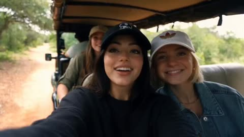
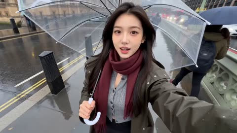
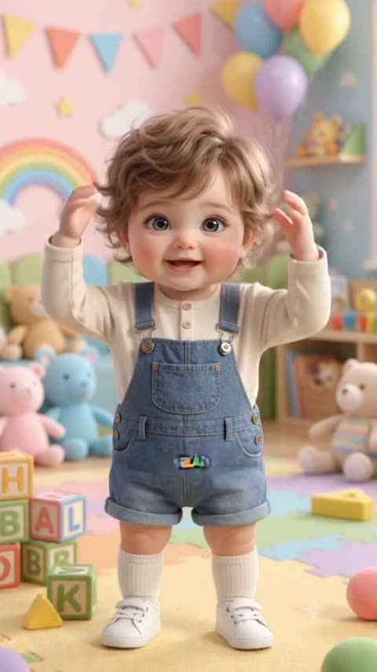
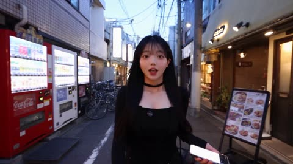
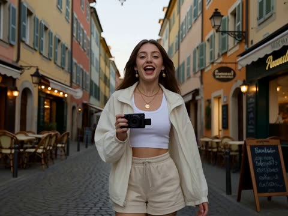
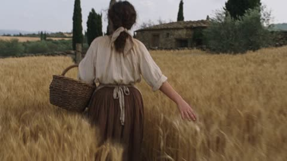
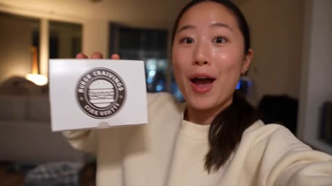
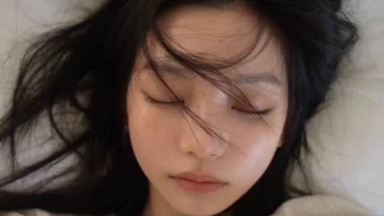
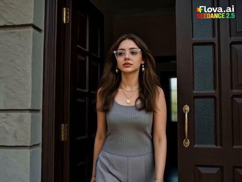

# 手机实拍与 Vlog

[返回目录](../../README_zh.md) · 全部 174 条 · [1](video-vlog.md) · [2](video-vlog-2.md) · **3**

<a id="seedance-three-besties-safari-vlog"></a>
### 三位朋友在吉普车上自拍

<a href="https://x.com/AIwithWania/status/2106971093592691077"></a>

参考图锁定主角的长相，三人各自固定不同的服装和帽子，使各镜头中的人物始终易于区分。按秒划分的分镜加上台词和手持自拍镜头，营造出真实旅行 vlog 的感觉。

Seedance 2.5 · 参考生视频 · 出处: [@AIwithWania on X](https://x.com/AIwithWania/status/2106971093592691077) · 发现于 [LearnPrompt/awesome-seedance](https://github.com/LearnPrompt/awesome-seedance)

[`safari`](tags.md#tag-safari) [`vlog`](tags.md#tag-vlog) [`reference-character`](tags.md#tag-reference-character) [`dialogue`](tags.md#tag-dialogue)

<details><summary><b>提示词</b></summary>

```text
Three besties, documenting a very unserious safari. 

Made with Seedance 2.5.

FORMAT: 16:9 landscape, ultra-realistic live-action, premium wildlife documentary + natural travel-vlog style.
REFERENCE IMAGE & MAIN CHARACTER:
Use the uploaded reference image as the primary character reference for the main girl. The main girl must remain exactly the same person throughout the entire video. Preserve her exact facial identity, facial features, skin tone, hairstyle, body proportions and overall appearance. Do not change or redesign her face.
Her overall outfit and styling should be inspired by the uploaded reference image, including the casual cap and youthful outdoor look. A slightly edgy/rock-inspired casual touch is acceptable while still looking natural and suitable for a wildlife trip.
👭 THREE FRIENDS
There are exactly three girls throughout the video: the main girl + two female friends.
All three girls must remain clearly visible and recognizable in multiple shots.
Their outfits must NOT be identical or matching. Each girl should have her own distinct outfit, colors and styling:
Main girl: outfit based on the uploaded reference image, casual outdoor/safari vibe, her own cap.
Friend 1: completely different casual outfit, different colors and styling, different cap.
Friend 2: another distinct casual outdoor outfit, different colors and details, different cap.
They can all wear caps because they are on an outdoor wildlife adventure, but the cap colors/styles should also be different. They should look like three real friends who chose their own clothes—not a coordinated uniform.
Keep each girl's outfit, hairstyle and appearance consistent from beginning to end.
 SHOT 1 — ARRIVAL | 0–4 SEC
The three friends arrive at a beautiful wildlife park in a safari vehicle.
The main girl briefly holds the camera for a natural selfie-style opening while both friends are clearly visible beside/behind her.
They look excited and genuinely happy.
Main girl:
“Okay, we’re finally here!”
Friend:
“I can’t wait to see them!”
Natural laughter, handheld travel-vlog movement, spontaneous expressions.
 SHOT 2 — ENTERING THE PARK | 4–7 SEC
Quick cinematic wide shot of all three girls walking through the wildlife park entrance together.
Their different outfits and caps are clearly visible.
They look around excitedly as they enter.
Friend:
“Where do we go first?”
Main girl:
“Let’s find the elephants!”
Natural walking and casual conversation, not staged.
SHOT 3 — ELEPHANTS | 7–11 SEC
Cut to the three girls safely observing elephants from a designated viewing area.
All three react naturally and excitedly.
Main girl:
“Whoa… look at that!”
Friend:
“They’re huge!”
Show realistic elephant movement, natural sunlight and authentic wildlife behavior.
 SHOT 4 — GIRAFFE | 11–14 SEC
The three girls are together at a giraffe viewing area.
One friend gently feeds the giraffe with approved food while the other two watch excitedly.
The giraffe naturally approaches.
Friend:
“It’s actually coming!”
Main girl:
“Oh my God, look!”
Keep all three girls visible and expressive.
 SHOT 5 — DEER | 14–17 SEC
Quick intimate wildlife moment.
The three friends are together near a friendly deer. One friend safely feeds it while the other two laugh and react.
Main girl:
“Aww, you’re so cute!”
Natural laughter and genuine reactions.
SHOT 6 — FINAL SELFIE | 17–20 SEC
Golden-hour ending.
The three girls stand close together after their wildlife adventure and take a fun selfie.
They are smiling, laughing and slightly tired but happy.
Friend:
“Best day ever!”
Main girl:
“We need to come back!”
End with their natural laughter and selfie pose.

VISUAL & CAMERA STYLE
Ultra-realistic live-action wildlife documentary aesthetic combined with an authentic friends' travel vlog.
Natural daylight, realistic skin texture, real-world wildlife park environment, authentic animal movements, cinematic wide shots mixed with handheld selfie footage, subtle natural camera shake, realistic depth of field, natural shadows, realistic clothing movement, and environmental details.
The video should feel like three real friends spontaneously documenting their wildlife adventure, not actors performing a scripted commercial.
🚫 NEGATIVE PROMPT
No CGI look, no 3D rendering, no cartoon animals, no fantasy environment, no artificial-looking faces, no face morphing, no identity drift, no character swapping, no duplicate girls, no extra friends, no identical outfits, no matching uniforms, no outfit changes between shots, no unrealistic animal behavior, no exaggerated acting, no excessive slow motion, no artificial beauty filter, no plastic skin, no futuristic elements.
16:9 landscape • Exactly 20 seconds • 3 girls • 3 different outfits • consistent main character • elephants + giraffe + deer • natural dialogue • cinematic wildlife adventure • realistic live-action.
```

</details>

<a id="seedance-three-city-phone-vlog"></a>
### 韩国女子伦敦巴黎莫斯科手机自拍视频

<a href="https://x.com/HustleXR/status/2092492677384437909"></a>

用纸张撕开的转场遮住每次城市切换，服装只在转场时变化，同一人物得以延续。按时间码分段的写法加上 REALISM LOCK 约束条款，让身份、服装和动作在三座城市之间保持一致。

Seedance 2.5 · 文生视频 · 出处: [@HustleXR on X](https://x.com/HustleXR/status/2092492677384437909) · 发现于 [LearnPrompt/awesome-seedance](https://github.com/LearnPrompt/awesome-seedance)

[`phone-footage`](tags.md#tag-phone-footage) [`travel-vlog`](tags.md#tag-travel-vlog) [`paper-transition`](tags.md#tag-paper-transition) [`multi-city`](tags.md#tag-multi-city)

<details><summary><b>提示词</b></summary>

```text
ULTRA-REALISTIC PHONE FOOTAGE

One adult Korean woman, same recognizable face, skin tone, body proportions and gold hoop earrings throughout. Real skin pores, natural blinking, believable expressions and consistent identity. She personally films herself with a smartphone. No beauty filter, CGI, plastic skin or cinematic over-processing.

CAMERA: authentic handheld phone footage, slight arm movement, natural walking shake, autofocus shifts, exposure changes, realistic phone HDR and mild compression. Fast but understandable editing. Every city must be immediately recognizable.

00:00–00:05 — LONDON 🇬🇧

0:00–0:02.5 — Rainy Soho street. Selfie shot. She walks under a clear umbrella wearing a dark olive raincoat, grey knit, burgundy scarf, black skirt, tights and burgundy boots. Wet pavement, red double-decker bus and classic London architecture behind her. She smiles:

“London is freezing today!”

0:02.5–0:05 — She quickly turns the phone away from herself. A clean upward tilt reveals Big Ben and Westminster through the rain. She briefly points toward it. A torn blue-grey paper sheet naturally sweeps across the lens.

00:05–00:10 — PARIS 🇫🇷

0:05–0:07.5 — The paper tear reveals nighttime Paris. She is now wearing a beige open trench coat, cream knit, silk scarf, black trousers and burgundy ankle boots, hair in a high messy bun. She walks past warm cafés carrying a fresh crêpe, takes one bite and smiles:

“Paris at night… wow.”

0:07.5–0:10 — She immediately turns the phone upward, revealing the Eiffel Tower fully illuminated against the night sky. The tower lights sparkle naturally. A navy paper sheet quickly peels across the frame.

00:10–00:15 — MOSCOW 🇷🇺

0:10–0:12.5 — The paper opens onto a snowy Moscow street. She now wears a cream faux-fur coat, burgundy turtleneck, brown trousers and dark brown boots, with loose wavy hair. Snow lands naturally on her coat and hair. She holds a steaming blini, takes one bite and smiles:

“Okay… this is beautiful.”

0:12.5–0:15 — She turns the phone upward while snow falls, revealing Saint Basil’s Cathedral with its colorful domes. She raises her gloved hand toward the camera, laughing softly. Her hand naturally covers the lens as the recording ends.

REALISM LOCK: Every transition must preserve the same woman. City-specific clothing and hairstyles change only during the paper transition. Realistic weather, food, crowds, architecture, lighting and physical movement. No duplicated people, distorted hands, floating objects, fake faces, subtitles, logos, watermarks or artificial CGI appearance.

AUDIO: authentic rain, footsteps, traffic, café ambience, food-stall sounds, wind, distant voices and snowfall ambience. No background music.
```

</details>

<a id="seedance-toddler-body-parts-nursery"></a>
### 幼儿在托儿室教身体部位英文单词

<a href="https://x.com/Zarnab_with_Ai/status/2107066879038857330"></a>

固定的外观和服装描述让整段视频中的角色保持一致。编号的分镜列表把每个屏幕单词与一个具体手势配对，使文字和动作的时间点保持紧凑。

Seedance 2.5 · 文生视频 · 出处: [@Zarnab_with_Ai on X](https://x.com/Zarnab_with_Ai/status/2107066879038857330) · 发现于 [LearnPrompt/awesome-seedance](https://github.com/LearnPrompt/awesome-seedance)

[`toddler`](tags.md#tag-toddler) [`educational`](tags.md#tag-educational) [`3d-animation`](tags.md#tag-3d-animation) [`text-overlay`](tags.md#tag-text-overlay) [`nursery`](tags.md#tag-nursery)

<details><summary><b>提示词</b></summary>

```text
Create a cute, colorful, highly detailed 3D animated educational video featuring an adorable toddler boy with big expressive eyes, soft curly brown hair, rosy cheeks, and a sweet innocent expression.

The toddler wears a cream-colored long-sleeve shirt underneath blue denim overalls and white socks. Keep the character's appearance consistent throughout the entire video.

Set the video inside a bright, playful children's nursery/classroom filled with colorful toys, alphabet blocks, bookshelves, soft pastel walls, rainbows, balloons, stars, clouds, bunting decorations, and a colorful puzzle mat. Use a cheerful pastel color palette with soft cinematic lighting.

The child stands in the center of the frame and happily teaches basic body-part names through simple gestures. He looks directly at the camera, points to or touches each body part when its name appears on screen, and uses cute natural movements and facial expressions.

Show different body parts one by one, including:
HEAD, NOSE, CHIN, EYEBROW, PALM, WRIST, WAIST, STOMACH, and SOLE.

For every body part, display a large, bold, colorful English word near the child, synchronized with his gesture. Use playful children's educational typography with bright colors, a dark outline, and a fun cartoon-style pop-in animation.

Scene progression:

1. The toddler waves and raises both hands toward the camera.
2. He points to his NOSE.
3. He smiles and gestures toward his CHIN.
4. He points to his EYEBROW.
5. He opens his hand and shows his PALM.
6. He points toward his WRIST.
7. He gestures around his WAIST.
8. He touches his STOMACH.
9. He sits down and shows the bottom of his foot while introducing SOLE.
10. End with the toddler happily waving at the camera.

Camera style: vertical 9:16 composition, medium full-body framing, smooth gentle camera movement, occasional subtle push-ins, centered character, eye-level perspective.

Visual style: high-quality 3D children's animation, adorable Pixar-inspired aesthetic, soft rounded features, realistic fabric textures, expressive eyes, smooth character animation, vibrant pastel colors, soft global illumination, shallow depth of field, polished cinematic rendering.

Mood: cheerful, wholesome, educational, playful, and engaging for young children.

Keep the character's face, hairstyle, clothing, proportions, nursery environment, lighting, and overall visual style consistent across every scene.

Add a final educational message:
“LEARN BODY PARTS NAMES!”
“FOLLOW FOR MORE!”

Format: 9:16 vertical, high resolution, smooth animation, clean composition, no watermark.
```

</details>

<a id="seedance-tokyo-helicopter-night-selfie-tour"></a>
### 东京夜间直升机游览自拍

<a href="https://x.com/noorlewisx/status/2093567063357088065"></a>

每个场景编号并写明机位（自拍、驾驶舱、航拍、第一人称）和地标，模型拿到的是分镜表而不是笼统的氛围描述。每段台词按场景写出，结尾的风格说明再加一条无字幕无标志的限制，让画面保持干净。

Seedance 2.5 · 文生视频 · 出处: [@noorlewisx on X](https://x.com/noorlewisx/status/2093567063357088065) · 发现于 [LearnPrompt/awesome-seedance](https://github.com/LearnPrompt/awesome-seedance)

[`helicopter`](tags.md#tag-helicopter) [`tokyo`](tags.md#tag-tokyo) [`selfie`](tags.md#tag-selfie) [`night-city`](tags.md#tag-night-city) [`multi-scene`](tags.md#tag-multi-scene)

<details><summary><b>提示词</b></summary>

```text
A cinematic first-person and selfie-style night video of a beautiful young East Asian woman with long dark hair in a ponytail, wearing a maroon ribbed halter top, cream wide-leg pants, and black slide sandals. She is taking a helicopter night tour over Tokyo. No watermark, no logo, no text overlay, no brand names.
Scene 1: On a green-lit rooftop helipad at night. She smiles at the camera holding it selfie-style. A white Robinson-style helicopter is behind her with spinning blades. Tokyo city lights and water in the background. She says she is getting on a helicopter in Tokyo.
Scene 2: Inside the helicopter cockpit. She wears a green aviation headset with boom mic and a black 4-point harness. A small fuzzy lavalier mic is clipped to her top. She looks at the camera, slightly nervous then smiling, adjusting her seatbelt. Night city lights visible through the open side.
Scene 3: Helicopter lifts off from the helipad. Wide view of Tokyo Bay at night, Tokyo Tower glowing orange on the left, Rainbow Bridge lit up on the right, dark water below.
Scene 4: Open-door helicopter flight. Strong wind blows her hair. She laughs excitedly, eyes squinting, mouth open in joy, saying there is no door at all. Below: a cargo ship on the water and glittering city skyline.
Scene 5: POV looking down between her legs — cream pants and black sandals dangling over a dense sea of Tokyo skyscrapers and streets glowing at night.
Scene 6: Close selfie next to the brightly lit orange Tokyo Tower. She looks at camera and says “That’s Tokyo Tower.”
Scene 7: Aerial shot flying over Tokyo Skytree glowing purple and white, her feet visible at the bottom of frame, highways and dense city lights below.
Scene 8: Flying low along Rainbow Bridge at night — white cables, cars with headlights, city skyline behind.
Scene 9: After landing, she steps off the white helicopter onto the green helipad, walking toward camera holding the headset in one hand, wearing the same outfit.
Scene 10: She is now standing in crowded Shibuya Crossing at night, neon signs everywhere, yellow taxi and people crossing behind her. She smiles at the camera, waves, and says “Alright everyone, bye!” then “Bye!”
Style: realistic handheld selfie + aerial footage, night city lights, slight wind, natural skin, warm street lighting mixed with cool night sky. Smooth cuts, 30-second duration, vertical or 16:9 cinematic look. Photorealistic, no text, no watermark, no logo anywhere.

#polloai
```

</details>

<a id="seedance-tokyo-smartphone-dessert-cafe-vlog"></a>
### 东京小巷发现隐秘甜品店的手机vlog

<a href="https://x.com/saniaspeaks_/status/2088605003112235033"></a>

提示词用第一人称手机拍摄的设定加上30秒内的分段时间节点来锚定画面，并列出自动对焦跳动、曝光变化和手持抖动等真实感细节。同时明确禁止推拉摇移、无人机和慢动作等电影化手法，使画面保持纪实风格。

Seedance 2.5 · 文生视频 · 出处: [@saniaspeaks_ on X](https://x.com/saniaspeaks_/status/2088605003112235033)

[`food-vlog`](tags.md#tag-food-vlog) [`smartphone-footage`](tags.md#tag-smartphone-footage) [`handheld`](tags.md#tag-handheld) [`tokyo`](tags.md#tag-tokyo)

<details><summary><b>提示词</b></summary>

```text
Ultra-realistic smartphone food vlog set in a charming neighborhood in Tokyo, Japan. The entire video must look like it was genuinely recorded on a modern flagship smartphone by a real female creator, not like a cinematic production or AI-generated video. 0–5 seconds: A young Japanese woman walks through a narrow Tokyo side street in the early evening, holding her smartphone at arm’s length and casually talking to the camera. Traditional Japanese shopfronts, vending machines, bicycles, small signs, utility wires, pedestrians and warm storefront lights create an authentic neighborhood atmosphere. Natural handheld movement and slight framing imperfections. 5–10 seconds: She notices a tiny hidden dessert café and turns the camera toward its entrance with an excited reaction. She walks inside while continuing the vlog. The camera naturally adjusts exposure from the bright street to the warmer interior. 10–16 seconds: Show the staff preparing a fresh strawberry cream dessert. Realistic strawberries, whipped cream, soft cake layers and small details of the preparation. The creator moves the phone closer for a natural food close-up while autofocus subtly shifts between the dessert and her hand. 16–22 seconds: She receives the dessert, holds it directly toward the phone camera, then takes a spoonful and tastes it. Her reaction should be spontaneous and believable, with subtle facial expressions rather than exaggerated acting. 22–27 seconds: She smiles, takes another small bite and turns the camera slightly to show the cozy café interior, Japanese customers naturally sitting in the background and warm practical lighting. 27–30 seconds: She walks back outside onto the Japanese street, looks directly into the phone camera and naturally says, “Okay, this place was actually so good!” She smiles and ends the recording casually. Authentic Japanese environment, realistic human behavior, natural walking physics, real-looking food textures, accurate skin texture, natural hair movement, realistic reflections, imperfect smartphone framing, subtle autofocus hunting, automatic exposure adjustments, slight handheld shake, natural motion blur, realistic low-light smartphone noise, true-to-life colors, detailed background activity, genuine vlog energy, high-resolution smartphone footage, photorealistic, documentary realism, no cinematic camera moves, no drone shots, no artificial slow motion, no CGI appearance, no text, no subtitles.
```

</details>

<a id="seedance-travel-vlog-old-town-woman"></a>
### 时尚女子在欧洲老城边走边讲解旅行vlog

<a href="https://x.com/CaliraVal/status/2097184908250845406"></a>

提示词把视频拆成带时间顺序的分镜，每个分镜配一句台词，让口型和配音有固定的节拍可以对齐。手持 vlog 镜头、黄金时段光线和具体的服装描述，保证各个镜头中的人物形象一致。

Seedance 2.5 · 文生视频 · 出处: [@CaliraVal on X](https://x.com/CaliraVal/status/2097184908250845406) · 发现于 [LearnPrompt/awesome-seedance](https://github.com/LearnPrompt/awesome-seedance)

[`vlog`](tags.md#tag-vlog) [`lip-sync`](tags.md#tag-lip-sync) [`voiceover`](tags.md#tag-voiceover) [`golden-hour`](tags.md#tag-golden-hour) [`travel`](tags.md#tag-travel)

<details><summary><b>提示词</b></summary>

```text
A cinematic AI travel vlog of a stylish young woman exploring a vibrant European old town at sunset. She has long flowing dark hair and wears a white cropped top, lightweight oversized jacket and beige shorts. She walks confidently through narrow cobblestone streets surrounded by colorful historic buildings, cozy cafés, local shops and warm glowing street lights.

She looks naturally into the camera and speaks directly to the audience with a friendly, energetic personality. Add a natural young female English voiceover with clear pronunciation, realistic conversational tone and subtle emotion. Make her speech perfectly synchronized with her lip movements.

Voiceover dialogue:
“Hey everyone! I’m exploring this beautiful city today, and honestly, every street feels like a movie. The atmosphere here is incredible, and I can’t wait to show you what I find!”

Cut to her buying a local pastry from a small street bakery. She smiles and says:
“This looks absolutely delicious. I had to try it!”

Then she sits at an outdoor café enjoying coffee while watching people pass by:
“Sometimes the best part of traveling is simply slowing down and enjoying the moment.”

Final shot: she walks toward a beautiful viewpoint overlooking the city as the sun sets. She turns toward the camera and says:
“Okay, this view is definitely the highlight of my day. Would you come here?”

Natural facial expressions, accurate lip-sync, realistic female English voice, subtle breathing and pauses, natural hand gestures, realistic skin texture, subtle hair movement, authentic handheld vlog camera, smooth camera tracking, shallow depth of field, realistic background people, cinematic golden-hour lighting, soft lens flare, photorealistic, 4K, highly detailed, natural motion, premium travel-film aesthetic.
```

</details>

<a id="seedance-tuscan-peasant-dv-camcorder-30s"></a>
### DV摄像机拍摄的1800年代托斯卡纳农妇日常

<a href="https://x.com/Goodmanprotocol/status/2107530733212590250"></a>

五个六秒时间段把一镜到底拆成清晰的动作序列。用对焦游移、曝光起伏、压缩噪点等具体缺陷锁定2000年代初DV质感，并在音频部分限定只有自然环境声。

Seedance 2.5 · 文生视频 · 出处: [@Goodmanprotocol on X](https://x.com/Goodmanprotocol/status/2107530733212590250) · 发现于 [LearnPrompt/awesome-seedance](https://github.com/LearnPrompt/awesome-seedance)

[`documentary`](tags.md#tag-documentary) [`dv-camcorder`](tags.md#tag-dv-camcorder) [`historical`](tags.md#tag-historical) [`handheld`](tags.md#tag-handheld) [`timestamped`](tags.md#tag-timestamped)

<details><summary><b>提示词</b></summary>

```text
30-second ultra-realistic documentary slice-of-life video, early-2000s consumer DV camcorder aesthetic. A young Italian peasant woman in her early 20s, sun-weathered olive skin with freckles, dark brown wavy hair loosely tied with a faded scarf, worn off-white linen blouse, earth-brown patched wool skirt, faded floral apron and muddy leather boots. Rural Tuscany in the late 1800s. Golden wheat fields, olive trees, stone farmhouse, cypress trees, stone walls, chickens, donkey and old stone well. No modern objects or machinery.

[0–6s]
Handheld camera follows her naturally along a dirt path through golden wheat fields. She carries a woven basket on her hip and brushes her free hand across the wheat. Wind moves the stalks and her loose hair.

[6–12s]
She reaches a wooden fence, sets down the basket and feeds scraps to several chickens gathered around her boots. The camera stays close and imperfect, briefly adjusting focus as she moves.

[12–18s]
She continues toward an old stone well. She lowers a wooden bucket on a rope, pulls it up with effort, then drinks fresh water from a small ladle. Water runs down her chin and she wipes it away with her sleeve.

[18–24s]
A donkey approaches. She smiles softly, pats its muzzle, then picks a small wildflower from the field and tucks it behind her ear. She lifts the basket and walks toward the farmhouse.

[24–30s]
Near the heavy wooden doorway, she notices the person filming. She gives a tired but warm smile and a small wave, then opens the door. She looks back once before stepping inside. The camera remains outside as the door slowly closes.

STYLE: photorealistic historical documentary, authentic 1800s Tuscany, early-2000s consumer DV look, handheld shake, imperfect framing, autofocus hunting, slight exposure pumping, faded colors, soft contrast, mild digital compression and sensor noise. No stabilization, no cinematic camera moves, no modern color grading. One continuous fluid shot, no cuts, no captions, no music.

AUDIO: natural ambience only -wind through wheat, birds, chickens, footsteps on dry earth, rope and wooden bucket creaking, water splashing, donkey sounds, distant countryside atmosphere and the wooden door closing.
```

</details>

<a id="seedance-ugc-burger-selfie-vlog"></a>
### 举着汉堡盒自拍的开心女生

<a href="https://x.com/oggii_0/status/2088500493308084326"></a>

提示词把上传的汉堡照片设为唯一产品参考，并在每个镜头中重复面包、肉饼、芝士和酱汁的细节，使食物在切换镜头后保持稳定。角色参考图锁定人物外观，自动对焦呼吸、手持抖动和快速跳切等手机拍摄线索，加上排除棚拍光和 CGI 食物的负面提示，共同营造真实 UGC 的质感。

Seedance 2.5 · 参考生视频 · 出处: [@oggii_0 on X](https://x.com/oggii_0/status/2088500493308084326)

[`ugc`](tags.md#tag-ugc) [`selfie-vlog`](tags.md#tag-selfie-vlog) [`product-reference`](tags.md#tag-product-reference) [`food`](tags.md#tag-food)

<details><summary><b>提示词</b></summary>

```text
Duration: 15 seconds | Aspect Ratio: 16:9 | Style: Authentic UGC / iPhone selfie-vlog, handheld, natural light, TikTok/Reels aesthetic. Product Reference: Use the uploaded gourmet burger image as the only product reference. Preserve the bun shape, patty thickness, cheese melt, lettuce, tomato, sauces, and proportions exactly in every shot. Character Description Name: Hana A young Japanese woman @ Image 1 in her early 20s with natural beauty, long dark hair in a loose ponytail, oversized cream sweatshirt, minimal makeup, bright smile, friendly lifestyle-vlogger personality. Shot Breakdown SHOT 1 (0–2s) — Selfie showing the burger box. Dialogue: "Burger night!" SHOT 2 (2–4s) — Opens the box. SHOT 3 (2–4s) — Quick zoom on the burger. SHOT 4 (6–8s) — Hands lifting the burger with cheese stretching naturally. SHOT 5 (8–10s) — Bite reaction. Dialogue: "Okay... that's incredible." SHOT 6 (10–12s) — Casual close-up b-roll while reaching for fries. SHOT 7 (12–14s) — Toasting the burger toward the camera. Dialogue: "You need this." SHOT 8 (14–15s) — Freeze frame with overlay: "burger cravings = solved 🍔" Look & Feel Warm apartment lighting, genuine phone footage, slight grain, natural autofocus breathing, handheld imperfections, fast jump cuts. Negative Prompt cinematic grading, commercial production, CGI burger, fake cheese, distorted hands, warped food, perfect stabilization, studio lighting, text glitches, logo distortion.
```

</details>

<a id="seedance-woman-day-in-the-life-vlog"></a>
### 年轻女子在白色床单上安睡

<a href="https://x.com/ZorviaLux/status/2101900075647778976"></a>

用编号的七个场景按时间顺序排列，给模型清晰的节拍顺序；结尾的风格句（35mm 镜头、景深、柔和调色）让各镜头保持统一质感。以入睡收尾，让片子有自然的结束。

Seedance 2.5 · 文生视频 · 出处: [@ZorviaLux on X](https://x.com/ZorviaLux/status/2101900075647778976) · 发现于 [LearnPrompt/awesome-seedance](https://github.com/LearnPrompt/awesome-seedance)

[`lifestyle`](tags.md#tag-lifestyle) [`vlog`](tags.md#tag-vlog) [`day-in-the-life`](tags.md#tag-day-in-the-life) [`cinematic`](tags.md#tag-cinematic)

<details><summary><b>提示词</b></summary>

```text
A cinematic "Day in the Life" montage of an aesthetic young East Asian woman, 4K resolution, soft natural lighting, realistic cinematic colors, and film grain. 

Scenes Sequence:
1. Waking up in a bright, cozy bed with white linens, soft morning sunlight.
2. Drinking warm coffee from a takeaway paper cup outdoors.
3. Splashing water on her face in a clean bathroom, then applying mascara in front of a mirror.
4. Stepping out of a classic building wearing an oversized brown blazer, walking down a tree-lined city boulevard.
5. Strolling through busy city streets while looking at her smartphone, wearing a leather jacket.
6. Sitting peacefully in a warm, brick-walled cafe reading a book next to a latte, then enjoying a healthy salad bowl.
7. Returning home, taking off her jacket, washing her face, and finally getting into bed under soft white blankets, falling asleep peacefully.

Style: Cinematic film style, depth of field, subtle motion, cozy lifestyle vlog, 35mm lens shot, soft color grading.
```

</details>

<a id="seedance-woman-market-to-kitchen"></a>
### 女子购买蔬菜并回家备餐

<a href="https://x.com/CaliraVal/status/2100087681283924449"></a>

按秒分段的分镜加上统一的人物锁定句，让同一人物的脸、发型和眼镜在多个镜头中保持一致。逐秒写明每个动作相当于给模型一份镜头清单，结尾的镜头与写实词决定画面质感。

Seedance 2.5 · 文生视频 · 出处: [@CaliraVal on X](https://x.com/CaliraVal/status/2100087681283924449) · 发现于 [LearnPrompt/awesome-seedance](https://github.com/LearnPrompt/awesome-seedance)

[`multi-shot`](tags.md#tag-multi-shot) [`identity-lock`](tags.md#tag-identity-lock) [`daily-life`](tags.md#tag-daily-life) [`photorealistic`](tags.md#tag-photorealistic)

<details><summary><b>提示词</b></summary>

```text
Keep the same young South Asian woman, same face, hairstyle and clear stylish glasses throughout. 0–2 sec: She leaves her home wearing clear glasses and walks toward the local vegetable market. 2–5 sec: Quick cinematic shots of her entering the busy market, selecting fresh tomatoes, potatoes, onions, green chilies and coriander, then paying the vendor. 5–7 sec: She walks back home carrying a small vegetable bag. 7–9 sec: She enters her kitchen, places the vegetables on the counter and removes them from the bag. 9–11 sec: She washes the vegetables under running water. 11–15 sec: She puts the vegetables on a wooden cutting board and naturally cuts them with a kitchen knife. Fast but smooth transitions, realistic hand movements, authentic Pakistani environment, natural daylight, detailed vegetables, realistic physics, cinematic camera movement, photorealistic, 4K quality.
#Flovaai #Flovacpp @Flovaai_Japan
```

</details>

<a id="seedance-woman-morning-routine-balcony-sunset"></a>
### 居家晨间日常，结束于日落阳台

<a href="https://x.com/Zyrellix/status/2105899978396987489"></a>

提示词按顺序写成多个镜头节拍，每个节拍只有一个动作和一种取景，并在每次场景切换处明确写出切镜。每个场景都写明服装和光源（卧室晨光、日落阳台），让角色和光线在切镜之间保持一致。

Seedance 2.5 · 文生视频 · 出处: [@Zyrellix on X](https://x.com/Zyrellix/status/2105899978396987489) · 发现于 [LearnPrompt/awesome-seedance](https://github.com/LearnPrompt/awesome-seedance)

[`morning-routine`](tags.md#tag-morning-routine) [`day-in-the-life`](tags.md#tag-day-in-the-life) [`sunlight`](tags.md#tag-sunlight) [`multi-shot`](tags.md#tag-multi-shot)

<details><summary><b>提示词</b></summary>

```text
A young woman with long dark brown hair and a beauty mark on her cheek wakes in white bedding, eyes closed, then opens them and smiles. She sits up in cream silk pajamas and stretches both arms overhead, eyes closed, sun cutting across the room and casting her shadow on the wall. She walks away from camera through a bright bedroom toward floor-to-ceiling glass doors, sheer curtains, ocean and palms outside, now in a white crop tank and beige wide-leg trousers. She slides the door open, profile in the light, hair lifting. Cut to a kitchen: she pours steaming coffee from a steel kettle into a speckled ceramic cup on marble, then cups the mug with both hands and sips, eyes lowered. She waters lush houseplants barefoot in a soft yellow midi dress, sunlight through big windows. Close-up of water droplets on a green leaf. She leans in and smells a small white flower, smiling. She steps onto a balcony at sunset, back to camera, city and palms below, then turns in profile holding the steaming cup on the rail, eyes closed, content. Wide shot: she stands at the railing in the yellow dress, garden and skyline (including a tall spire) glowing behind her.
```

</details>

[1](video-vlog.md) · [2](video-vlog-2.md) · **3**
