# 手机实拍与 Vlog

[返回目录](../../README_zh.md) · 全部 144 条 · **1** · [2](video-vlog-2.md)

<a id="seedance-seoul-summer-evening-vlog"></a>
### 首尔夏夜，家庭录像质感

<a href="https://x.com/AIwithkhan/status/2092971211169100048"></a>

纯文字，没有参考图。真实感来自要求小意外和不完美的手持摄像。

Seedance 2.5 · 文生视频 · 出处: [@AIwithkhan on X](https://x.com/AIwithkhan/status/2092971211169100048) · 6,187 赞，统计于 2026-10-27

[`vlog`](tags.md#tag-vlog) [`ugc`](tags.md#tag-ugc) [`realism`](tags.md#tag-realism) [`home-video`](tags.md#tag-home-video)

<details><summary><b>提示词</b></summary>

```text
Create a 30-second, 1080p ultra-realistic personal home-video showing an ordinary summer evening in the life of a young Korean woman. No reference image.

MAIN SUBJECT

Young Korean woman in her early 20s, naturally pretty, realistic skin texture, minimal makeup, relaxed and approachable personality.

Long black hair loosely tied into a messy side ponytail with a few loose strands around her face. Wearing a fitted pastel-blue short top, loose cream pajama-style pants, black sneakers and a simple silver necklace.

Maintain the same face, hairstyle, clothing, body proportions and overall appearance throughout the entire video.

SETTING

A quiet older Seoul residential neighborhood during a warm summer evening. Narrow concrete lanes, small houses, potted plants, bicycles, old walls, utility poles, overhead wires, a tiny neighborhood bakery, a public water tap and large leafy trees casting shadows across the street.

Everything should feel lived-in, ordinary and peaceful. No tourist attractions, advertisements, recognizable brands or commercial activity.

CAMERA / VISUAL AESTHETIC

Raw personal footage casually recorded by a friend on an early-2000s consumer DV camcorder.

Strong handheld shake, imperfect framing, autofocus hunting, exposure shifts, occasional motion blur, faded colors, soft digital detail, mild noise, accidental zooms and natural camera imperfections.

No stabilization, drone footage, gimbal movement, dramatic lighting or polished commercial cinematography.

 — OUTSIDE THE HOUSE

She steps outside carrying a small reusable shopping bag. She locks the door, adjusts her messy ponytail and looks toward the camera with a relaxed smile.

A light summer breeze moves her hair as she starts walking down the lane.

 — BAKERY STOP

She reaches a tiny neighborhood bakery and buys a warm pastry.

She steps outside, takes her first bite and immediately smiles because it tastes good.

She notices her friend filming and holds the pastry toward the camera playfully before taking another bite.

— WALKING HOME

She continues down the narrow street while eating.

A neighborhood cat follows her for a few steps. She notices it, crouches down and gently pets it.

The cat walks away and she laughs before continuing.

 — SMALL ACCIDENT

She walks beneath a large tree when a few leaves fall onto her hair.

She stops, looks confused, then realizes what happened and laughs.

She brushes the leaves away while her friend zooms awkwardly toward her face.

She looks directly into the camera and says:

"Seriously?"

 — QUIET MOMENT

She reaches a low concrete wall beside the street and sits down for a moment.

She finishes the pastry while watching bicycles and neighbors passing through the lane.

A gentle breeze moves her hair. She casually fixes her ponytail and looks around peacefully.

 — FINAL MOMENT

She stands up and continues walking home.

After a few steps, she turns back toward the camera with a small playful smile and says:

"Come on."

She keeps walking down the sunny lane while the camera follows behind.

She disappears around the corner and the recording abruptly cuts to black.

AUDIO

Natural location sound only: birds, summer insects, footsteps, bicycle bells, distant scooters, leaves moving in the breeze, bakery sounds, neighborhood conversations and subtle camera-handling noise.

No music. No narration. No artificial sound effects.

Only the two spoken lines specified above.

FINAL FEEL

The entire video should feel like a forgotten summer recording from the early 2000s.

Warm, feminine, casual, slightly playful, intimate and nostalgic.

No dramatic events, no exaggerated acting, no model poses and no polished cinematic shots.

The realism should come from ordinary surroundings, natural expressions, small accidents, realistic environmental movement and imperfect camcorder operation.
```

</details>

<a id="seedance-rainy-morning-university-vlog"></a>
### 雨天早晨，咖啡，走去学校

<a href="https://x.com/nawalsehar/status/2103337966416621703"></a>

30 秒只用不到 1000 字：一条紧凑的日常流程，加一小串要避免的毛病。

Seedance 2.5 · 文生视频 · 出处: [@nawalsehar on X](https://x.com/nawalsehar/status/2103337966416621703) · 4,181 赞，统计于 2026-10-27

[`vlog`](tags.md#tag-vlog) [`realism`](tags.md#tag-realism) [`morning-routine`](tags.md#tag-morning-routine)

<details><summary><b>提示词</b></summary>

```text
Create a 30-second ultra-photorealistic live-action university vlog of a European brunette in her mid-20s waking to a rainy morning, making coffee, getting ready, grabbing her umbrella, walking through a wet city, and arriving at university just before class.

Modern smartphone vlog style: natural handheld movement, subtle shake, autofocus changes, realistic rain, puddles, reflections, traffic, umbrellas, wet clothing, natural expressions and believable human movement.

Dialogue: “Good morning… apparently, it’s raining.” → “First coffee. Then lecture.” → “Two minutes early. I’m impressed.” → “Okay, made it.”

Natural diegetic audio only. No music, narration, CGI look, artificial rain, face changes, distorted anatomy, impossible physics, subtitles, logos or watermark.

16:9 • 24fps • 4K • Ultra-photorealistic live action
```

</details>

<a id="seedance-ugc-night-yacht"></a>
### 朋友用手机拍的夜游

<a href="https://x.com/mightyking/status/2089299068514148655"></a>

开头先交代谁在拍（跟着大家走的朋友），晃动和构图都由此而来。

Seedance 2.5 · 文生视频 · 出处: [@mightyking on X](https://x.com/mightyking/status/2089299068514148655) · 2,038 赞，统计于 2026-10-27

[`ugc`](tags.md#tag-ugc) [`vertical`](tags.md#tag-vertical) [`realism`](tags.md#tag-realism) [`handheld`](tags.md#tag-handheld)

<details><summary><b>提示词</b></summary>

```text
Raw vertical phone video (UGC), handheld throughout, filmed by a friend who walks with the group, casual sway, natural night lighting, wide-angle lens, deep focus.

Characters: The hero is a young woman with long dark hair in a deep-purple one-shoulder dress with a small shoulder bag. Her three friends: one in a dark brown dress, a blonde in a black wrap dress, a blonde in a white mini dress — party dresses and sandals. Laughing, spontaneous night-out energy.

Setting: A luxury marina at night — a stone quay along a narrow water slip flanked on both sides by large moored luxury yachts, big white hulls rising on either side, masts and rigging above, fenders on the hulls. Warm orange street lamps, palm trees, distant city lights. The yachts glow with blue-turquoise underwater LED lights spilling into the water; a yellow mooring line runs to the stone.

[0.0s–4.0s] — Wide tracking shot, eye level, camera moving backward. The camera walks backward ahead of the four women as they stroll toward it down the marina promenade, framed head-to-toe, laughing and chatting in French; warm lamplight and palm trees behind, slight handheld bob.

[4.0s–6.0s] — Medium shot, eye level, backward track + quick left pan. The woman in the purple dress surges ahead of the group toward the lens, one arm raised, hair flying; the camera, on their left, keeps tracking back and pans to hold her.

[6.0s–8.0s] — Medium-wide, camera tilts down-left to follow, whip motion. She reaches the quay edge between the moored luxury yachts and launches headfirst over the edge; the handheld camera whips left and tilts down to chase her off the stone.

[8.0s–10.0s] — High-angle wide, looking down at the water, slight jolt. From up on the quay the camera looks down as she plunges headfirst into the blue-turquoise water in the slip between the big yacht hulls — a big splash, the underwater lights glowing around the impact; the handheld frame jolts slightly with the motion.

[10.0s–13.0s] — High-angle medium, looking down, small handheld drift. She surfaces in the teal water, gasping and laughing up at the camera, hair slicked back, treading water.

[13.0s–16.0s] — Handheld tilt up and back down, slight zoom. The camera lifts off the water and tilts up to a person leaning on the deck railing of one of the moored luxury yachts, watching her in the water, then tilts back down and zooms slightly in on her still treading and laughing.

[16.0s–20.0s] — High-angle medium, tilting to follow her up. She swims to the stone quay wall, reaches up and grabs a thick dark mooring pole, and hauls herself out; the camera tilts upward with her as she rises from the water, legs braced on the stone.

[20.0s–23.0s] — Low/close medium at the quay edge, static handheld. She climbs onto the stone lip, rolls onto her side, soaked dress clinging, then pushes up to her feet; the camera holds close, catching the water running off her.

[23.0s–27.0s] — Medium shot, eye level, loose handheld reframe. Back on the promenade, dripping wet, she flips her long wet hair forward and wrings it out, laughing, as her friends and passing pedestrians move behind her.

[27.0s–30.0s] — Medium shot, eye level, camera settles. Still dripping, she straightens up and strikes a confident, playful pose for the camera — hand on hip, tossing her wet hair back with a big smile — her friends laughing around her; the camera holds on the pose to end.

Audio: Live sync sound — friends laughing and shouting excitedly in French, a scream at the leap, a big water splash, water sloshing against the yacht hulls, wet footsteps on stone, ambient night marina sounds. No music.

Style: Raw amateur vertical phone footage, natural night lighting, warm street lamps mixing with the turquoise underwater yacht glow, authentic handheld motion.
```

</details>

<a id="wan-marina-night-out-quay-leap"></a>
### 夜晚码头闺蜜同游与跳水

<a href="https://x.com/mightyking/status/2091842964054212842"></a>

先写风格、角色和场景,再用带时间戳的分镜表,每个片段单独指定运镜,如倒退跟拍、甩镜下摇和俯拍。单独的音频段要求现场同期声且无音乐,强化手机随拍的真实感。

Wan 3.0 · 文生视频 · 出处: [@mightyking on X](https://x.com/mightyking/status/2091842964054212842) · 1,353 赞，统计于 2026-10-27

[`ugc`](tags.md#tag-ugc) [`handheld`](tags.md#tag-handheld) [`night`](tags.md#tag-night) [`shot-list`](tags.md#tag-shot-list) [`sync-sound`](tags.md#tag-sync-sound)

<details><summary><b>提示词</b></summary>

```text
Raw vertical phone video (UGC), handheld throughout, filmed by a friend who walks with the group, casual sway, natural night lighting, wide-angle lens, deep focus.

Characters

The hero is a young woman with long dark hair in a deep-purple one-shoulder dress with a small shoulder bag.

Her three friends: one in a dark brown dress, a blonde in a black wrap dress, a blonde in a white mini dress — party dresses and sandals.

Laughing, spontaneous night-out energy.

Setting

A luxury marina at night — a stone quay along a narrow water slip flanked on both sides by large moored luxury yachts, big white hulls rising on either side, masts and rigging above, fenders on the hulls.

Warm orange street lamps, palm trees, distant city lights.

The yachts glow with blue-turquoise underwater LED lights spilling into the water; a yellow mooring line runs to the stone.

Shot list

0.0s–4.0s — Wide tracking shot, eye level, camera moving backward
The camera walks backward ahead of the four women as they stroll toward it down the marina promenade, framed head-to-toe, laughing and chatting in French; warm lamplight and palm trees behind, slight handheld bob.

4.0s–6.0s — Medium shot, eye level, backward track + quick left pan
The woman in the purple dress surges ahead of the group toward the lens, one arm raised, hair flying; the camera, on their left, keeps tracking back and pans to hold her.

6.0s–8.0s — Medium-wide, camera tilts down-left to follow, whip motion
She reaches the quay edge between the moored luxury yachts and launches headfirst over the edge; the handheld camera whips left and tilts down to chase her off the stone.

8.0s–10.0s — High-angle wide, looking down at the water, slight jolt
From up on the quay the camera looks down as she plunges headfirst into the blue-turquoise water in the slip between the big yacht hulls — a big splash, the underwater lights glowing around the impact; the handheld frame jolts slightly with the motion.

10.0s–13.0s — High-angle medium, looking down, small handheld drift
She surfaces in the teal water, gasping and laughing up at the camera, hair slicked back, treading water.

13.0s–16.0s — Handheld tilt up and back down, slight zoom
The camera lifts off the water and tilts up to a person leaning on the deck railing of one of the moored luxury yachts, watching her in the water, then tilts back down and zooms slightly in on her still treading and laughing.

16.0s–20.0s — High-angle medium, tilting to follow her up
She swims to the stone quay wall, reaches up and grabs a thick dark mooring pole, and hauls herself out; the camera tilts upward with her as she rises from the water, legs braced on the stone.

20.0s–23.0s — Low/close medium at the quay edge, static handheld
She climbs onto the stone lip, rolls onto her side, soaked dress clinging, then pushes up to her feet; the camera holds close, catching the water running off her.

23.0s–27.0s — Medium shot, eye level, loose handheld reframe
Back on the promenade, dripping wet, she flips her long wet hair forward and wrings it out, laughing, as her friends and passing pedestrians move behind her.

27.0s–30.0s — Medium shot, eye level, camera settles
Still dripping, she straightens up and strikes a confident, playful pose for the camera — hand on hip, tossing her wet hair back with a big smile — her friends laughing around her; the camera holds on the pose to end.

Audio

Live sync sound — friends laughing and shouting excitedly in French, a scream at the leap, a big water splash, water sloshing against the yacht hulls, wet footsteps on stone, ambient night marina sounds.
No music.

Style

Raw amateur vertical phone footage, natural night lighting, warm street lamps mixing with the turquoise underwater yacht glow, authentic handheld motion.
```

</details>

<a id="seedance-friday-morning-seoul"></a>
### 首尔老街区的周五早晨

<a href="https://x.com/AIwithkhan/status/2103329257149898940"></a>

人物来自参考图。结尾一串禁止项（美颜、换装）让她 30 秒都不走样。

Seedance 2.5 · 参考生视频 · 出处: [@AIwithkhan on X](https://x.com/AIwithkhan/status/2103329257149898940) · 1,124 赞，统计于 2026-10-27

[`vlog`](tags.md#tag-vlog) [`character-consistency`](tags.md#tag-character-consistency) [`reference-images`](tags.md#tag-reference-images)

<details><summary><b>提示词</b></summary>

```text
Create a 30-second ultra-realistic personal home-video of a young Korean woman enjoying a relaxed Friday morning in an older Seoul residential neighborhood. Use the attached image as the character reference and keep her face, long black messy side ponytail, pastel-blue fitted top, loose cream pants, black sneakers, silver necklace, and overall appearance perfectly consistent.

She leaves her home with a cheerful expression and walks casually through the quiet neighborhood. She reaches a nearby outdoor water tap, stops, splashes cool water onto her face, wipes her face with her hands, smiles and continues walking.

She arrives at a small neighborhood shop and buys a colorful lollipop for herself. She unwraps it immediately, puts it in her mouth and happily enjoys the candy while walking through the street.

A few school children pass by carrying their backpacks. She smiles, waves at them and casually says, “Hello!” as they walk past.

She then approaches a newspaper seller outside a small local shop, picks up a newspaper, gives him a few coins, thanks him with a smile and starts walking back toward home while holding the newspaper.

Near the end, she looks toward the camera with a happy smile, still enjoying her lollipop, and says, “Happy Friday!” before continuing home.

Use raw early-2000s consumer DV-camera footage: handheld shake, imperfect framing, autofocus hunting, exposure shifts, soft digital detail, mild digital noise, natural motion blur, occasional awkward zooms and authentic home-video imperfections. Natural Seoul neighborhood ambience only — footsteps, running water, children talking, shop sounds, newspaper rustling, distant traffic, birds and summer insects. No music, no narration, no subtitles, no polished commercial cinematography, no beauty-filter skin, no CGI look, no duplicate characters, no changing face, hairstyle or outfit.
```

</details>

<a id="seedance-2000s-birthday-dv"></a>
### 2000 年代初的韩国生日，DV 摄像机

<a href="https://x.com/saniaspeaks_/status/2105146792681832481"></a>

用设备定年代感。场景编号，并要求严格按顺序出现。

Seedance 2.5 · 文生视频 · 出处: [@saniaspeaks_ on X](https://x.com/saniaspeaks_/status/2105146792681832481) · 918 赞，统计于 2026-10-27

[`home-video`](tags.md#tag-home-video) [`period`](tags.md#tag-period) [`dv-camcorder`](tags.md#tag-dv-camcorder)

<details><summary><b>提示词</b></summary>

```text
Create a 30-second ultra-realistic Korean birthday vlog set in South Korea in the early 2000s, filmed casually by a friend on an authentic consumer DV camcorder. It must feel like genuine home-video footage, not a modern video with a retro filter.

EXACT ORDER — 7 SCENES:

0–4s — GETTING READY: The same young Korean birthday girl gets ready in her early-2000s bedroom, fixes her hair, adjusts makeup, picks up her handbag and smiles toward the camera.

4–8s — MEETING FRIENDS: She walks through an authentic Korean neighborhood, meets the same 2–3 friends, they congratulate her and walk together toward a bakery.

8–11s — BAKERY: They enter a small early-2000s Korean bakery, browse cakes and choose one birthday cake.

11–14s — BUYING CAKE: A friend pays with cash. The worker puts the cake into a box and hands it over. The same cake box remains visible as they walk to the café.

14–23s — CAFÉ CELEBRATION: They sit in a cozy early-2000s café. The cake is opened, a candle is lit, everyone sings Happy Birthday, the girl makes a wish and blows it out. They clap and laugh. She then cuts the cake, places pieces on plates, personally gives a piece to each friend, watches them eat, then takes a piece herself. Keep the entire sequence clearly visible and in order.

23–26s — PHOTOS: After eating, they take group photos using a small early-2000s disposable film camera. No smartphones or modern digital cameras. They pose, the shutter clicks and they laugh afterward.

26–30s — EVENING WALK: They leave the café and walk through the same neighborhood as it becomes evening. The girl carries her handbag, a friend carries the empty cake box/bag, and they chat and laugh while the camera follows from behind.

CONTINUITY: Same girl, friends, outfits, hairstyles, handbag and cake throughout. No teleporting, identity drift, outfit changes, disappearing props or reordered actions.

ERA: Everything must look authentically early 2000s Korean—fashion, hair, bakery, café, cars, signs, furniture, cake packaging and technology. No smartphones, AirPods, modern cars, LED screens or contemporary interiors.

CAMERA: Raw consumer DV footage with subtle handheld shake, imperfect framing, autofocus hunting, exposure shifts, soft digital detail, mild CCD/DV noise, motion blur, compression and occasional awkward zooms. Natural candid behavior, realistic skin and movement. No cinematic stabilization, 4K sharpness, beauty filters, VHS effects or professional filmmaking.

FINAL FEEL: A genuine Korean birthday memory from the early 2000s, with every scene and action clearly shown in the exact requested order.
```

</details>

<a id="seedance-mini-dv-coffee-asmr"></a>
### Mini DV 咖啡 ASMR 小片

<a href="https://x.com/Strength04_X/status/2083094742682787939"></a>

按标签分块写（`CAMERA / LOOK`、主体、动作、声音），拿来当模板很方便。

Seedance 2.5 · 文生视频 · 出处: [@Strength04_X on X](https://x.com/Strength04_X/status/2083094742682787939) · 833 赞，统计于 2026-10-27

[`asmr`](tags.md#tag-asmr) [`vlog`](tags.md#tag-vlog) [`dv-camcorder`](tags.md#tag-dv-camcorder)

<details><summary><b>提示词</b></summary>

```text
CAMERA / LOOK: Handheld mini DV camcorder footage filmed by the subject herself. Slight hand shake, occasional focus hunting, imperfect framing, natural zoom adjustments, soft tape-like image quality, subtle grain, realistic auto-exposure shifts from bright kitchen morning light. Natural skin tones, mild motion blur, authentic consumer camcorder aesthetic.
STYLE: Cozy coffee-prep vlog with gentle ASMR elements. Relaxed pacing, minimal dialogue, candid moments. Focus on satisfying sounds: bean grinder whirring, portafilter tamping, steam wand hissing, cup clinking, milk frothing.
SUBJECT: Young man in his mid-20s, plain t-shirt, hair slightly tousled, minimal accessories. Calm, focused energy while making his morning coffee.
SETTING: Small kitchen counter with an espresso machine on a bright morning. Natural daylight, coffee beans and a mug nearby, quiet atmosphere.
STORYBOARD:
→ (3s, propped medium shot) Places camera on the counter, switches on the machine. "Morning coffee, the proper way."
→ (3s, overhead shot) Grinds fresh coffee beans, fine grounds falling into the portafilter.
→ (3s, close-up) Tamps the grounds down firmly and evenly.
→ (3s, handheld shot) Locks the portafilter into the machine. "Here we go."
→ (3s, detail shot) Espresso streams slowly into a small cup. No dialogue.
→ (3s, medium shot) Pours cold milk into a small steel pitcher. "Time for the milk."
→ (3s, macro shot) Steam wand hissing as it froths the milk.
→ (3s, propped shot) Pours frothed milk carefully over the espresso, forming light layers.
→ (3s, warm ending shot) Holds the finished cup, takes a small sip, satisfied smile. "That's exactly what I needed."
→ (3s, final shot) Reaches toward camera, still holding the cup. "See you later." Hand covers lens as recording ends.
AUDIO NOTES: Natural kitchen ambience — grinder whirring, tamping, steam hissing, milk pouring should be clearly audible. Dialogue quiet and casual.
REALISM NOTES: Authentic body language, natural blinking, genuine focused smiles, occasional careful pauses while pouring, imperfect framing, focus breathing, bright morning light shifts. Should resemble a genuine personal coffee vlog on a consumer camcorder, not a commercial or AI-generated production.
```

</details>

<a id="h3-nostalgic-theme-park-montage"></a>
### 主题公园好友欢聚的怀旧图形拼贴

<a href="https://x.com/magnific/status/2083217899540586917"></a>

提示词只点明形式（不同片段的蒙太奇）和版式语言（动态图形排版），再给出主体与场景。镜头选择、胶片颗粒和分格排布都交给模型，所以短提示词也能得到多画面的丰富结果。

MiniMax H3 · 文生视频 · 出处: [@magnific on X](https://x.com/magnific/status/2083217899540586917) · 508 赞，统计于 2026-10-28 · 发现于 [SkyNotSilent/awesome-MiniMax-H3-cases](https://github.com/SkyNotSilent/awesome-MiniMax-H3-cases)

[`montage`](tags.md#tag-montage) [`nostalgic`](tags.md#tag-nostalgic) [`motion-graphics`](tags.md#tag-motion-graphics) [`theme-park`](tags.md#tag-theme-park) [`short-prompt`](tags.md#tag-short-prompt)

<details><summary><b>提示词</b></summary>

```text
Nostalgic montage of different clips. Graphic motion layouts of friends having fun in a theme park.
```

</details>

<a id="kling-billiard-ball-pov-pocket"></a>
### 台球视角滚入底袋

<a href="https://x.com/higgsfield_ai/status/2019253167662534748"></a>

提示词把镜头设定为球本身，并把画面拆成击球、滚动、落袋三个节拍。低机位、边缘动态模糊、灯光拉出光束以及台边和背景人物的视差，让第一视角的运动显得真实。

Kling 3.0 · 文生视频 · 出处: [@higgsfield_ai on X](https://x.com/higgsfield_ai/status/2019253167662534748) · 449 赞，统计于 2026-10-27

[`pov`](tags.md#tag-pov) [`billiards`](tags.md#tag-billiards) [`tracking-shot`](tags.md#tag-tracking-shot) [`physics-motion`](tags.md#tag-physics-motion) [`ambient-sound`](tags.md#tag-ambient-sound)

<details><summary><b>提示词</b></summary>

```text
POV video from the perspective of a billiard ball on a pool table inside a dim, smoky billiard club. A focused male player leans in and strikes the ball with a cue. At the moment of impact, the camera becomes the ball, rolling straight toward a corner pocket across the green felt. Realistic rolling motion with subtle vibration and spin, low table-level angle, natural edge motion blur. Warm overhead lamps stretch into soft light streaks as the camera advances. Strong parallax as table rails and background players slide past. The pocket rapidly fills the frame — then the ball drops into the pocket, brief darkness, soft impact, and muffled ambient sound implied.
```

</details>

<a id="wan-tokyo-travel-vlog"></a>
### 东京旅行 vlog，一秒一个节拍

<a href="https://x.com/joshesye/status/2094723798679400808"></a>

中文描述配日语台词。每一秒都写清地点、动作、台词和到下一秒的转场。

Wan 3.0 · 文生视频 · 出处: [@joshesye on X](https://x.com/joshesye/status/2094723798679400808) · 421 赞，统计于 2026-10-27

[`vlog`](tags.md#tag-vlog) [`travel`](tags.md#tag-travel) [`japanese-dialogue`](tags.md#tag-japanese-dialogue) [`timed-beats`](tags.md#tag-timed-beats)

<details><summary><b>提示词</b></summary>

```text
一位20岁出头的年轻韩国偶像风格女性。长发直顺，黑色，自然蓬松，肤如凝脂，大而明亮的灵动的眼睛，精致的V形脸，小巧的鼻子，自然光泽的嘴唇，清新的淡妆，毫不费力地可爱又平易近人的表情。休闲日式街头穿搭（白色连帽衫 / 深色宽松连帽衫 / 宽大夹克）。26mm手机镜头，深景深，真实肤质，轻度HDR，中性iPhone色彩风格，未经编辑的抓拍，无电影级调色，无影棚灯光，无光轨，无动态模糊效果。

(0:00–0:01) —— 行走镜头，东京塔亮相自拍，低角度。塔在她身后，天空过曝。自然微笑。中性自然光，深景深。台词：「ついに東京に来た……！」 过渡：硬切 / 节奏重拍

(0:01–0:02) —— 涩谷十字路口，步入人群中间。转头看向镜头。身后霓虹灯牌清晰锐利。真实夜景曝光。过渡：节奏快切

(0:02–0:03) —— 便利店，将饭团举向镜头，挑眉。室内荧光灯强烈。冷白光，真实肤质。过渡：节奏闪切

(0:03–0:04) —— 代代木公园，坐姿，视线移向别处。斑驳光影，镜头可见污渍。音乐重拍落下——风、鸟鸣——随即切回。过渡：自然动作剪接

(0:04–0:06) —— 章鱼烧反应，咬下一口，瞪大眼睛，后仰大笑。温暖的实际灯笼光。琥珀色光下的真实肤质。台词：「アツッ！めっちゃ美味しい！」 过渡：笑声结束时剪接

(0:06–0:07) —— 自动售货机夜景，站在发光的售货机前。混合LED灯光映在脸上。微微坏笑。无光效处理。过渡：单拍剪接

(0:07–0:08) —— 电车车窗，面部倒映在车窗上。窗外城市自然模糊。她向外看，不看镜头。过渡：闪切

(0:08–0:09) —— 鸟居，低角度。走向并穿过神社大门。大门占据画面上方。自然日光。过渡：闪切

(0:09–0:11) —— 数字灯光展 ★ 标志性镜头 缓缓抬头。蓝、紫、金色投影映在脸上。焦点转移——面部清晰，灯光柔和散射。只有投影打在皮肤上，无眩光。速度：约60%慢动作 过渡：在抬头过程中柔化剪接

(0:11–0:12) —— 高达亮相，面部→镜头上摇→完整雕像入画。小小的赞赏微笑。广角，自然日光。过渡：微笑后锐利剪接

(0:12–0:13) —— 灯笼小巷，跟随跟拍。灯笼暖色，阴影暗部。自然低光。她回头瞥了一眼。过渡：向前运动时剪接

(0:13–0:14) —— 屋顶天际线，近距自拍→手臂伸远→天际线显现。风吹动发丝。自然夜景手机曝光。台词：「こんな夜景、初めて見た。」 过渡：最后一句台词处硬切

(0:14–0:15) —— 奈良鹿公园，她蹲下，递出鹿仙贝。鹿向她鞠躬——她突然大笑。另一只鹿从背后轻顶她，她几乎站不稳。手持拍摄，略有晃动。全部真实拍摄。台词：「ちょっと！本当にお辞儀した！」 过渡：淡出至黑屏
```

</details>

<a id="veo-live-streamer-neon-desk"></a>
### 霓虹游戏桌前兴奋反应的女主播

<a href="https://x.com/HBCoop_/status/1995206291120087487"></a>

提示词用中近景、脉动霓虹光和手持微晃营造直播的实时感，并逐项列出环境声、键盘声、麦克风底噪和远处游戏音效。Midjourney 角色参考加 Nano Banana Pro 首帧，让人物保持一致。

Veo 3.1 · 图生视频 · 出处: [@HBCoop_ on X](https://x.com/HBCoop_/status/1995206291120087487) · 366 赞，统计于 2026-10-28

[`streamer`](tags.md#tag-streamer) [`neon-lighting`](tags.md#tag-neon-lighting) [`handheld-camera`](tags.md#tag-handheld-camera) [`native-audio`](tags.md#tag-native-audio) [`character-reference`](tags.md#tag-character-reference)

<details><summary><b>提示词</b></summary>

```text
Nano Banana Pro -> Veo 3.1 on
@FlowbyGoogle


Character reference: Midjourney

Video prompt: A medium close-up shot of a young woman streaming live at her gaming desk, bathed in neon pink-blue LED lighting that pulses subtly in the background. She reacts with wide-eyed excitement, leaning closer to the camera while gripping her controller, her plaid shirt shifting naturally with the movement. The camera performs a gentle handheld micro-sway to match the high-energy, real-time feel of a live stream. Her chat monitor glows off-screen, casting soft highlights on her face as her expression shifts between shock and joy. Audio includes soft room ambience, quiet keyboard clicks, a faint microphone hum, and the distant echoes of gameplay sound effects.
```

</details>

<a id="h3-seaside-morning-vlog-bedroom-to-terrace"></a>
### 从卧室醒来到海边露台的晨间旅行vlog

<a href="https://x.com/ayzalnooor24521/status/2086671141998059973"></a>

开头先锁定人物身份和服装，再把15秒拆成每秒一个镜头，各自写明景别和动作。明确规定她在vlog开始前不拿手机，让画面在指定时间点从电影感镜头切换为手持自拍，台词逐句写出以配合原生音频。

MiniMax H3 · 文生视频 · 出处: [@ayzalnooor24521 on X](https://x.com/ayzalnooor24521/status/2086671141998059973) · 278 赞，统计于 2026-10-28 · 发现于 [SkyNotSilent/awesome-MiniMax-H3-cases](https://github.com/SkyNotSilent/awesome-MiniMax-H3-cases)

[`vlog`](tags.md#tag-vlog) [`lifestyle`](tags.md#tag-lifestyle) [`seaside`](tags.md#tag-seaside) [`timestamped-shots`](tags.md#tag-timestamped-shots) [`dialogue`](tags.md#tag-dialogue)

<details><summary><b>提示词</b></summary>

```text
Create a 15-second ultra-realistic cinematic lifestyle vlog video, vertical 9:16, featuring the same young woman throughout the entire video. Preserve her facial identity, facial proportions, hairstyle, skin tone and overall appearance consistently in every shot. She wears the same outfit throughout: fitted white V-neck T-shirt with a small subtle logo, blue denim jeans, natural makeup, long softly wavy brown hair.

0:00–0:01 — Wake-up:
Close-up inside a beautiful bright bedroom. The woman is lying comfortably on the bed, slowly wakes up, stretches naturally and opens her eyes. She is NOT filming a vlog yet and does not hold a phone or camera. Soft morning sunlight enters through the curtains.

0:01–0:02 — Gets up:
Medium shot. She sits up on the bed, smiles softly, fixes her hair and gets ready to start her morning. Natural, effortless movement.

0:02–0:03 — Walks to window:
She walks toward the large glass balcony door/window. Camera follows her naturally from behind/side.

0:03–0:04 — Seaside reveal:
She opens the curtains/door and looks outside. Reveal a breathtaking blue ocean, coastal hills, flowers, balcony and beautiful morning sunlight. She smiles happily while taking in the view.

0:04–0:05 — Steps outside:
She walks out onto the seaside terrace. Gentle ocean breeze moves her hair naturally. Wide cinematic shot showing the beautiful surroundings.

0:05–0:06 — VLOG START:
Only now she starts filming herself in handheld selfie-vlog style. She looks into the camera with a bright natural smile and says:
“Good morning!”

0:06–0:07 — Show the view:
She turns the camera away from herself and slowly pans across the stunning ocean, coastal mountains, flowers and terrace. Smooth handheld vlog movement.

0:07–0:08 — Back to selfie:
Selfie shot. She looks into the camera and happily says:
“This place is just perfect!”

0:08–0:09 — Location reveal:
Wide cinematic shot of the cozy seaside terrace with wooden table, chairs, plants and flowers overlooking the ocean.

0:09–0:10 — Walk to table:
Medium tracking shot as she walks toward the table, enjoying the view. Her hair and T-shirt move gently in the sea breeze.

0:10–0:11 — Sit and relax:
She sits at the seaside table, smiling peacefully and enjoying the ocean view. A refreshing orange-colored juice is placed on the table.

0:11–0:12 — Juice close-up:
Cinematic close-up of her hand picking up the glass of fresh orange juice. Beautiful ocean bokeh in the background, natural sunlight reflecting through the glass.

0:12–0:13 — Vlog toast:
Selfie shot. She raises the juice toward the camera with a cheerful smile and says:
“Cheers to good days!”

0:13–0:14 — Happy close-up:
Beautiful close-up of her smiling naturally at the camera, ocean and warm sunlight softly blurred behind her.

0:14–0:15 — Ending:
Camera moves from her toward the sparkling ocean and peaceful coastal landscape. Warm sunlight, gentle waves and a relaxing cinematic ending.

Overall Style

Ultra-realistic, cinematic travel vlog, natural handheld camera movement, realistic human motion, smooth transitions, soft morning sunlight, realistic ocean waves, gentle wind in hair and clothes, beautiful coastal atmosphere, premium lifestyle aesthetic, natural expressions, authentic vlog feeling, shallow depth of field, cinematic composition, realistic skin texture, high detail, 4K quality.
```

</details>

<a id="kling4-ugc-brunch-pancake-thief"></a>
### 早午餐手机视频，妹妹偷吃一口松饼

<a href="https://x.com/minchoi/status/2111471573395755295"></a>

30 秒一镜到底，像没剪过的手机视频：自动曝光忽明忽暗，9 秒时服务员碰到桌子，画外有对白和咖啡馆噪音。

Kling 4.0 · 文生视频 · 出处: [@minchoi on X](https://x.com/minchoi/status/2111471573395755295) · 268 赞，统计于 2026-10-28

[`ugc`](tags.md#tag-ugc) [`vertical`](tags.md#tag-vertical) [`one-take`](tags.md#tag-one-take) [`dialogue`](tags.md#tag-dialogue) [`food`](tags.md#tag-food) [`phone-footage`](tags.md#tag-phone-footage)

<details><summary><b>提示词</b></summary>

```text
Raw vertical 9:16 video recorded on a phone's front camera (not on screen), one continuous 30-second take with no cuts. It looks like an ordinary unedited phone clip, not a film: slightly soft image, a little digital noise and compression, deep focus with the café behind her as sharp as her face, auto-exposure brightening and dimming as people pass the sunny window behind her, no colour grading. The phone sits close and a little low, looking slightly up at her; around 9 s a waiter's arm bumps the table, the phone slides and tilts, and she catches it and props it back up. Sadie, a young woman in her early 20s with long honey-blonde waves, light natural makeup, small gold hoop earrings and a cropped cream knit top, sits at a small marble table by a big sunny window in a busy brunch café. Her sister sits across from her, out of frame except for her arm and a hand with a silver ring. Behind Sadie: other tables of people talking, a counter with a glass pastry case, plants, staff moving about, chalkboards too far away to read. Around 9 s a waiter sets down two plates, a lemon ricotta pancakes and a plate of eggs on toast, plus two iced coffees in plain glasses. Around 15 s she turns the pancake plate toward the camera; around 20 s she cuts a bite, eats it and closes her eyes; around 26 s her sister's hand reaches in with a fork and steals a piece of pancake, and Sadie swats at it, laughing. [Sadie: casual young woman's voice, warm and a bit giggly, recorded on the phone's built-in mic from half a metre away]: "Okay, I promised I'd show you what we get. ... We get the same thing every single time. ... Oh, here it is! Thank you! ... Look at this. Lemon ricotta pancakes. ... Mmm. Okay. Yeah. Still the best. ... Hey! Get your own!" [Her sister, off camera: a young woman's voice, dry and amused]: "That's the tax." [Sadie, laughing]: "She does this every time." Audio as captured by the phone mic in a busy café, not studio clean: her voice close but with the room around it, the hiss and grind of an espresso machine, cups and cutlery clinking, overlapping chatter and laughter from other tables, a door bell jingling, a chair scraping, faint music in the background. No subtitles, no captions, no on-screen text.
```

</details>

<a id="wan-towel-turban-kitchen-cooking-vlog"></a>
### 头戴毛巾的女子在夜间厨房煎鸡胸肉

<a href="https://x.com/mightyking/status/2092560921113547253">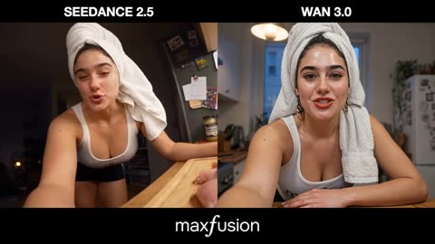</a>

将手持自拍镜头与固定外部机位用跳切衔接，镜头本身不出现在画面中。通过持续性规则固定毛巾、服装和单向烹饪顺序，并明确写出镜头起雾、油溅等物理细节。

Wan 3.0 · 参考生视频 · 出处: [@mightyking on X](https://x.com/mightyking/status/2092560921113547253) · 242 赞，统计于 2026-10-29

[`vlog`](tags.md#tag-vlog) [`handheld`](tags.md#tag-handheld) [`jump-cut`](tags.md#tag-jump-cut) [`cooking`](tags.md#tag-cooking)

<details><summary><b>提示词</b></summary>

```text
Handheld digital camcorder aesthetic, landscape framing.

A gorgeous fitness and food influencer films herself by hand in selfie-cam and first-person style while cooking a late-night high-protein meal after training and a shower.

Keep realistic hand shake, slightly crooked framing, autofocus briefly hunting between her face and the food, awkward zoom-ins onto the pan, occasional motion blur, brief lens steam-up over the hot pan that clears naturally, and small framing mistakes where her face or the pan edge slips out of frame.

Mix handheld selfie footage with a few fixed external shots.

Important: never show her placing, adjusting, or setting up a camera.

When switching from handheld footage to a fixed external angle, use a clean jump cut as if the camera had already been positioned before the shot began.

The camera itself must never appear on screen or in the window reflection.

LOOK:
Warm late-night kitchen light.
A single warm pendant over the counter, cool blue night visible through the window behind her, under-cabinet strip light glowing on the backsplash.

Slight camcorder softness, faint noise in the shadows, mild bloom on the pendant.

Food realism is the core of the look: real sizzle with fine oil spatter, steam rising and curling from the pan, honest food textures with sear marks and glistening surfaces, knife cuts that separate cleanly, droplets on rinsed vegetables.

Realistic skin texture, fresh-from-the-shower glow, clean dewy skin, realistic skin tones.

STYLE:
A realistic late-night what-I-eat-after-training vlog.
The tone is relaxed, hungry, funny, quietly confident, and natural, talking to the lens like a friend while her hands keep working.

She is clearly attractive and charismatic, but the video must feel like a believable self-recorded kitchen vlog, not a food commercial.

Fast clean jump cuts, strong continuity, natural body language, real kitchen sounds, sizzle, chopping, no awkward dead moments.

CHARACTER:
The woman in the reference image. Her face, features, skin tone, body, and clothing must match the reference image exactly in every shot — she wears exactly what she is wearing in the reference image. Do not restyle, beautify, or alter her in any way beyond the reference.

The one addition: a soft white towel wrapped around her head like a turban, as if she just stepped out of the shower. The towel stays neatly wrapped for the whole video. A few small damp strands of hair may peek out at the hairline and neck.

Minimal or no makeup, fresh clean post-shower look.
A small kitchen towel over one shoulder for most of the video.

SETTING:
A small warm real apartment kitchen at night.
Wooden counter with knife marks, a gas hob with one cast-iron pan, a cutting board with chicken breast and vegetables, a bowl of cooked rice, a bottle of olive oil, salt in a small dish, a fridge with magnets and photos, dishes drying on a rack, dark window over the sink reflecting the warm kitchen.

Lived-in and slightly cluttered.
No other people, no pets.

IMPORTANT CONTINUITY RULES:
The same woman from the reference image must remain fully consistent in every shot.

No face changes, no outfit changes, no body changes.
The head towel stays wrapped in the same position in every shot — it never unwraps, falls, changes color, or disappears.

The meal progresses in one direction only: raw ingredients, then chopping, then searing, then plating, then eating, and never reverses or regenerates.
Food already cooked never becomes raw again.

Hands and knife are the top priority: five fingers always, correct knife grip with curled guiding fingers, clean cuts, the knife never bends and never passes through her hand.

The pan, board, oil bottle and rice bowl stay in the same positions.

Steam and sizzle must behave with real physics.
No extra people, including in the dark window reflection, and the reflection never shows a camera.

No duplicated limbs.
No camera visible.
No camera setup shown.
Keep her matching the reference image, warm, and photogenic in every shot.

STORYBOARD:
30 seconds total, 10 cuts.

(~3s, arm's-length selfie)
She leans on the counter, towel wrapped on her head, clearly fresh from the shower after training, and grins tiredly at the lens.
Dialogue:
"Trained late. Showered. Starving. Let's cook."

(~3s, handheld pan across the counter and back to her)
The camera drifts across the board with raw chicken and vegetables, the pan, the rice bowl, then back up to her face.
Dialogue:
"Ten minute meal. Watch."

(~3s, fixed external medium shot from across the counter)
Jump cut.
She is already chopping a red pepper with quick confident cuts, guiding fingers curled, pieces falling evenly.
No camera setup shown.
No dialogue, just the knife on the board.

(~3s, same fixed shot)
She slices the chicken breast into strips, seasons it from the salt dish with a high pinch, and rubs it in with her fingertips.
Dialogue:
"Protein first. Always."

(~3s, tight handheld first-person shot over the pan)
Oil shimmering, she lays the chicken strips in one by one and they hit with a loud real sizzle, fine spatter, steam rising into the lens which fogs for a beat and clears.
No dialogue, just the sizzle.

(~3s, handheld selfie while the pan sizzles behind her)
She turns the camera on herself, fanning steam away from her face, laughing, one hand briefly steadying the head towel.
Dialogue:
"The smell. You have no idea."

(~3s, tight handheld close-up of the pan)
She flips the strips with tongs, showing deep golden sear marks, tosses in the peppers, and shakes the pan once so everything jumps and resettles.
Dialogue:
"That colour? That's the whole point."

(~3s, fixed external shot)
Jump cut.
She plates it: rice pressed from the bowl, chicken and peppers over the top, a last drizzle of olive oil in a thin ribbon, and she wipes the plate rim with the towel like a chef, then smirks at her own seriousness.
Dialogue:
"Yes, I wiped the rim. Let me live."

(~3s, tight handheld close-up)
First fork bite, steam still coming off it, she chews, closes her eyes for a beat and nods slowly.
Dialogue:
"Ten minutes. That's it. Ridiculous."

(~3s, arm's-length selfie ending)
Plate in one hand, camera in the other, she backs out of the kitchen toward the sofa, flicking the kitchen light off with her elbow.
Dialogue:
"Okay. Eating. Good night."

FINAL INSTRUCTION:
The result must feel like a real self-recorded late-night cooking vlog by an athlete who actually cooks, filmed right after her shower.

The highest priorities are matching the reference image exactly, correct hands and knife work at close range, one-directional cooking progression that never reverses, real sizzle, steam and food texture, the head towel staying consistently wrapped, honest warm kitchen light against the dark window, and subtle imperfection.

Keep it warm, hungry, and real.
Not a food commercial, not overhead recipe content, not stiff.
```

</details>

<a id="h3-seoul-cherry-blossom-travel-vlog"></a>
### 樱花、宫殿屋顶与N首尔塔

<a href="https://x.com/aiwithaayat/status/2115382877638836664">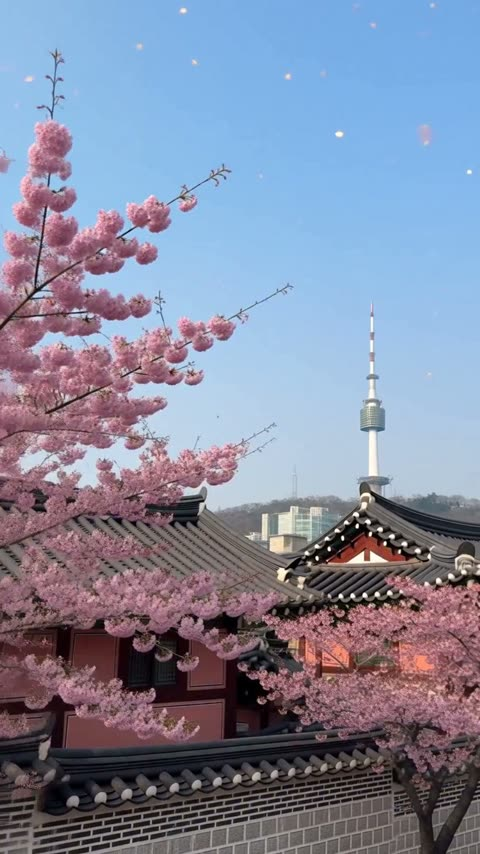</a>

提示词按时间戳拆成八段，每段写明镜头运动（慢摇、手持跟拍、仰拍），并在每段重复同一套人物描述（发型、开衫、包），保证跨镜头的人物一致。

MiniMax H3 · 文生视频 · 出处: [@aiwithaayat on X](https://x.com/aiwithaayat/status/2115382877638836664) · 241 赞，统计于 2026-10-29

[`seoul`](tags.md#tag-seoul) [`cherry-blossom`](tags.md#tag-cherry-blossom) [`travel-vlog`](tags.md#tag-travel-vlog) [`multi-shot`](tags.md#tag-multi-shot)

<details><summary><b>提示词</b></summary>

```text
Create a 15-second ultra-realistic cinematic Korean travel vlog in vertical 9:16 format. The video follows a beautiful young adult Korean woman exploring Seoul during cherry blossom season. She has natural Korean facial features, long dark brown hair, soft natural makeup, realistic skin texture, and wears a cream-colored knit cardigan, a light pastel outfit, and a small beige shoulder bag.

Scene 1 (0–2 seconds) — Beautiful Seoul Introduction:
Start with a wide cinematic establishing shot of Seoul, South Korea, during spring. Show beautiful pink cherry blossom trees, traditional Korean architecture, distant N Seoul Tower, and a clear blue sky. The camera slowly pans across the scenery, with delicate cherry blossom petals floating gently in the breeze. Natural daylight, realistic colors, peaceful travel atmosphere.

Scene 2 (2–4 seconds) — Walking Vlog:
Cut to the Korean girl walking along a beautiful cherry blossom street. She turns her head toward the camera, smiles naturally, and continues walking. Her long hair moves gently in the breeze. Use a handheld travel-vlog camera style with subtle natural camera movement and realistic walking motion.

Scene 3 (4–6 seconds) — Cute Selfie Moment:
Show a close-up selfie shot of the same girl. She looks directly into the camera, smiles warmly, and makes a peace sign with her fingers. Cherry blossoms fill the softly blurred background. Capture natural blinking, realistic facial expressions, subtle head movement, and authentic vlog energy.

Scene 4 (6–8 seconds) — Cherry Blossom Walk:
Show the girl from behind as she walks down a scenic path surrounded by blooming pink cherry blossom trees. Her cream cardigan and beige bag remain consistent. The camera smoothly follows her from behind as petals drift across the path. Soft sunlight filters through the branches, creating a dreamy but photorealistic spring atmosphere.

Scene 5 (8–10 seconds) — Korean Street Food:
Cut to a cozy Korean street food stall in Seoul. The girl holds a freshly prepared Korean street snack on a wooden skewer, takes a small bite, and reacts with a delighted smile. Warm market lights, authentic Korean food-stall details, shallow depth of field, realistic food textures, and natural expressions.

Scene 6 (10–12 seconds) — Scenic City View:
Show the girl standing at a scenic viewpoint overlooking Seoul, the Han River, and the distant city skyline with N Seoul Tower. The camera gently moves from her side toward the landscape. Warm golden-hour sunlight creates a beautiful cinematic glow. She looks at the view with a peaceful, happy expression.

Scene 7 (12–14 seconds) — Friendly Goodbye:
Return to a medium close-up of the same girl standing beneath cherry blossoms. She looks into the camera, waves goodbye with one hand, and smiles naturally. A few petals float past her face. The shot feels personal, warm, spontaneous, and like the ending of a real travel vlog.

Scene 8 (14–15 seconds) — Final Cinematic Shot:
Finish with a beautiful upward view of pink cherry blossom branches against a clear blue sky. A few petals gently drift through the frame. Leave the final frame clean and visually pleasing, with no unnecessary text or logos.

Visual Style and Quality:
Ultra-photorealistic live-action footage, premium Korean travel-vlog aesthetic, natural human movement, realistic skin pores, detailed hair strands, physically accurate lighting, soft cinematic color grading, gentle depth of field, smooth camera transitions, realistic environmental details, and natural spring atmosphere. Use a consistent character identity, face, hairstyle, clothing, and accessories throughout all scenes.

Camera and Motion:
Mix wide establishing shots, medium tracking shots, close-up selfies, and scenic detail shots. Use smooth handheld camera movement, natural motion blur, realistic perspective, and seamless cuts between scenes. Every shot must feel like genuine footage captured during a real trip to Seoul.
```

</details>

<a id="wan-workstation-makeover-14-looks"></a>
### 工位女孩在14次硬切中换造型

<a href="https://x.com/johnAGI168/status/2092858002193707473">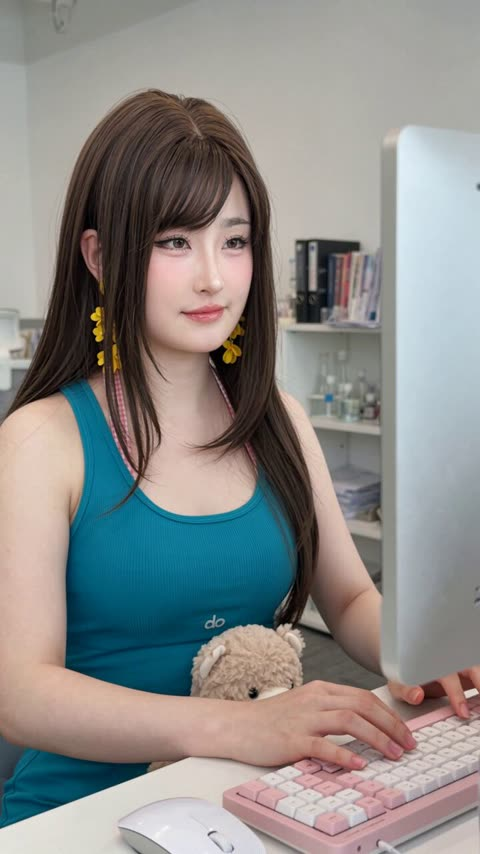</a>

固定中近景配合每次切换时的击键或移鼠标动作隐藏剪辑点。人物角色卡把脸部锁定在单张参考图上，切换时只改变发型、眼镜、耳饰和服装。

Wan 3.0 · 参考生视频 · 出处: [@johnAGI168 on X](https://x.com/johnAGI168/status/2092858002193707473) · 224 赞，统计于 2026-10-29

[`character-consistency`](tags.md#tag-character-consistency) [`match-cut`](tags.md#tag-match-cut) [`outfit-change`](tags.md#tag-outfit-change) [`workstation`](tags.md#tag-workstation) [`montage`](tags.md#tag-montage)

<details><summary><b>提示词</b></summary>

```text
【人物角色卡】
@  ​→ 命名为“林澄”，全片唯一人物。后文所有“林澄”均指同一人，不再重复调用参考图。
身份锁定：全程严格保持参考图中的同一张脸、五官比例、脸部骨相、肤色和年龄感。
允许变化：发型、眼镜、妆面、耳饰、服装、耳机及手腕配饰只能在剪辑点瞬间改变。
禁止变化：不换脸、不改变脸型、不生成相似但不同的人物，不因换发型或戴眼镜改变眼睛、鼻子、嘴巴和下颌轮廓。

【风格】写实工位卡点变装短视频（Workstation Makeover Montage），固定机位匹配剪辑（Locked-off Match Cut），快速跳切（Rapid Jump Cut），真实手机摄影质感，4K清晰度，自然皮肤纹理，轻微柔光，无磨皮塑料感
【时长】19秒
【画幅】9:16竖屏
【人物数量】仅林澄一人
【对白】无对白、无口型表演、无字幕
【音乐】轻快密集的时尚电子节拍；每次变装必须准确落在强拍上，叠加轻微键盘敲击声和鼠标点击声

【固定场景】
现代高科技工作室工位。林澄坐在灰色网布办公椅上，面前是白色办公桌；画面右侧被一台大型白色显示器占据，桌面放机械键盘和鼠标；后方是白色开放式置物架，摆放书本、文件、纸张和实验室杂物，远处可见另一张办公椅。环境结构、桌椅位置、显示器位置、背景物品和光线方向全程保持一致。

【固定摄影规则】
摄影机放在林澄正面偏左约30度，固定中近景，从胸口附近拍到头顶，林澄始终保持朝画面右侧显示器工作的三分之二侧面姿态。等效35—50mm镜头，固定三脚架，不推拉、不环绕、不手持晃动；只允许不同造型之间出现极轻微的构图偏移。
所有变装均使用干净利落的硬切（Clean Hard Cut），不使用闪光、烟雾、粒子、旋转、遮镜、身体融化或渐变换装。每次切换前后，林澄的头部角度、肩膀位置、手臂位置和视线方向基本吻合，利用正在进行的击键、伸手移鼠标或查看笔记动作隐藏剪辑点。

[00:00-00:01.8] 造型01：开场钩子（Locked Medium Close-up）
林澄以长直发自然披下、轻薄刘海、无眼镜的状态坐在工位，佩戴醒目的黄色花朵垂坠耳环，穿青绿色修身吊带上衣，领口带少量粉色格纹装饰；妆面为清晰上扬眼线、粉色腮红和水润玫红唇。
她怀里靠着一只浅棕色毛绒玩偶，左手在粉白色机械键盘上连续敲击，右手伸向鼠标，眼睛始终盯着右侧屏幕。开场第一帧便已经进入快速工作的状态，不做环境铺垫。

[00:01.8-00:02.8] 造型02：白色研究服感造型（Keystroke Match Cut）
在左手按下按键的一瞬间直接硬切。
林澄变为盘发，保留轻薄刘海与两缕脸侧碎发；戴细银色椭圆框眼镜、白色无线耳机和大型银色圆片垂坠耳环，换成宽松白色连帽风衣，妆面变为柔和粉调。
她的脸、坐姿和手部位置与上一帧连续，继续盯着屏幕操作鼠标。毛绒玩偶仍靠在怀里，桌面前景短暂出现一个白色甜甜圈形小物件。

[00:02.8-00:03.8] 造型03：蓝白学院造型（Typing Match Cut）
下一次击键时瞬间切换。
头发改为整齐圆形盘发，后侧扎着大型白色荷叶边发饰，刘海与脸侧发丝自然垂下；摘掉眼镜，佩戴白色无线耳机及粉白色蝴蝶花朵耳环。
服装变成海军蓝泡泡袖上衣，搭配蓝白格纹荷叶边前襟、宽大翻领和黑色细蝴蝶结。林澄两手持续打字，嘴唇微微分开，双眼专注看屏幕，不做夸张表情。

[00:03.8-00:04.8] 造型04：双麻花辫爱心造型（Beat Jump Cut）
在右手从键盘移向鼠标时硬切。
头发变成两条长而厚实的麻花辫，保留轻薄刘海和自然卷曲的脸侧发丝；无眼镜，佩戴白色耳机和大型粉色爱心耳环。服装换成印有细小红色爱心图案的白色短袖上衣。
毛绒玩偶重新出现在怀里。林澄先快速抬眼查看屏幕右上方，随后把视线落回屏幕中央，手指继续敲击键盘。

[00:04.8-00:06.3] 造型05：奶油色针织造型（Matched Typing）
击键落在音乐强拍上，造型瞬间改变。
林澄换成长而蓬松的自然波浪发和空气刘海，戴细窄深色矩形眼镜、红色耳钉连接的黄色椭圆耳环，穿奶油白色无袖高领针织上衣；妆面为低饱和粉棕色。
她身体保持不动，双手快速打字，眼睛隔着镜片持续阅读屏幕内容，神态安静而认真。

[00:06.3-00:07.3] 造型06：白衬衫花朵耳环（Mouse-click Match Cut）
林澄右手离开键盘、向右侧鼠标伸出的过程中完成硬切。
头发仍为长波浪发和空气刘海，但摘掉眼镜；佩戴白色无线耳机和两层亮洋红色花朵耳环，穿带小翻领和竖向装饰前襟的白色短袖衬衫。
右手在鼠标位置轻点一下，脸略微抬起，视线追随屏幕内容，动作不能停顿。

[00:07.3-00:09.3] 造型07：棕色针织背心造型（Continuous Reach Match Cut）
保持右臂伸向鼠标的姿势直接切换。
头发变得更顺直，做成半扎发，后侧固定一只大型蓬松白色蝴蝶结；保留空气刘海和两缕长脸侧发丝。无眼镜，佩戴毛绒质感的白色椭圆耳环和白色耳机。
穿白色贴身长袖上衣，外搭棕色针织背心裙。林澄右手持续操作鼠标，左手停在键盘前方，头部逐渐向右转动并略微抬高，像在认真核对屏幕上的资料。

[00:09.3-00:10.8] 造型08：爱心上衣与手写笔记（Prop Match Cut）
延续右手伸向鼠标的动作硬切，左手同时自然接入一张写满笔记的纸。
头发恢复为松散长波浪发，空气刘海，无眼镜；佩戴由银色圆环、螺旋和小型垂坠物组成的长款耳环。妆面稍微加深为粉紫调眼妆和豆沙唇。
穿白色红爱心短袖上衣和白色分层荷叶边半裙。林澄左手拿着笔记纸，目光在纸张与显示器之间迅速来回核对，右手继续使用鼠标。

[00:10.8-00:11.8] 造型09：灰色荷叶领造型（Keyboard Match Cut）
林澄把注意力重新移向键盘，在手指落下时完成硬切。
头发变成长直发，配轻薄刘海；无眼镜，双耳戴白色无线耳机，并佩戴银色水钻垂坠耳环。
服装变为灰色泡泡袖上衣，胸前是宽大的白色蕾丝荷叶边围兜领，领口系黑色细缎带；右手腕增加淡蓝色、红色包边的荷叶边发圈。
她放下笔记，两手重新打字，浅色毛绒玩偶靠在腿上，目光固定在显示器中央。

[00:11.8-00:12.8] 造型10：白色薄纱叠穿（Matched Hand Position）
保持左手压在键盘、右手前伸的位置硬切。
头发换成松散波浪发和空气刘海，无眼镜、无耳机，佩戴白色花朵垂坠耳环。
穿带红色线条图案的白色T恤，外搭半透明白色长袖薄纱衬衫；右手腕佩戴浅粉色欧根纱发圈。桌面键盘短暂变成白色机械键盘，局部带黑白棋盘格按键。
林澄一边读屏幕一边缓慢敲击两次键盘，动作克制、真实。

[00:12.8-00:14.3] 造型11：蓝白条纹大蝴蝶结（Alert Look Match Cut）
在右手再次伸向鼠标时瞬间硬切。
头发变成更蓬松的大波浪发和分开的轻薄刘海，无眼镜、无耳机；穿浅蓝白色细条纹短袖上衣，搭配宽大的水手式翻领和同色大蝴蝶结，领边与蝴蝶结边缘均带白色扇形蕾丝，袖面点缀少量深色小图案；右手腕换成浅蓝白蕾丝荷叶边手饰。
林澄双眼略微睁大，先快速扫视屏幕，然后自然眨眼一次，左手仍停在键盘上，右手继续操作鼠标。

[00:14.3-00:15.3] 造型12：蓝色蕾丝拼接造型（Clean Beat Cut）
在眨眼结束、手指重新击键时硬切。
林澄保持松散亮泽波浪发和空气刘海，戴银灰色圆角方框眼镜、长款银色几何环形耳环和白色有线耳机。
穿亮矢车菊蓝色短袖罗纹上衣，布面带细小浅色圆点；胸前拼接白色镂空蕾丝，并垂下两条白色细长系带。粉白色键盘重新出现。
她隔着眼镜专注看屏幕，左手打字，右手伸向鼠标，耳机线自然垂到桌面。

[00:15.3-00:16.8] 造型13：白紫运动造型（Mouse Movement Match Cut）
沿用右手移动鼠标的动作切换，不加入任何变身特效。
头发变成两条长麻花辫，辫尾用粉色小发圈固定；保留轻薄刘海和脸侧碎发。戴粗框玳瑁棕色椭圆猫眼眼镜、白色无线耳机及大型银色椭圆耳环。
穿白色短袖立领拉链运动上衣，衣服带紫色弧形包边，胸口仅有少量不可辨认的小型装饰符号，不生成清晰品牌文字。
林澄保持同一坐姿，一边移动鼠标一边轻敲键盘，视线稍微向屏幕上方移动。

[00:16.8-00:19.0] 造型14：黄色无袖收尾造型（Final Match Cut and Hold）
最后一次击键落在音乐最强节拍上，瞬间硬切为最终造型。
头发恢复为非常长的松散波浪发和轻薄刘海，摘掉眼镜；佩戴大型黄色花簇耳环，穿淡柠檬黄色无袖罗纹高领针织上衣。妆面为清晰上扬眼线、长睫毛、粉色腮红和玫瑰红唇。
毛绒玩偶仍在腿边。林澄先睁大眼睛专注查看屏幕，嘴唇轻微分开，随后双手继续敲击键盘；最后0.5秒视线稍微下移，手指停在按键上，保持最终造型和稳定人脸直到画面结束，不再变装，不淡出。

【表演连续性】
林澄全程不是面对镜头展示服装，而是真实地专注工作；主要动作只有打字、移鼠标、抬眼看显示器、核对笔记和自然眨眼。每次切换前后保持动作惯性：旧造型的手指开始下压，新造型的手指完成击键；旧造型的手臂开始伸向鼠标，新造型继续完成伸手。神态以安静、专注、略带疲惫的工位状态为主，不看镜头、不摆拍、不微笑营业。

【换装与人脸锁定】
14套造型必须是同一位林澄。每次硬切后先保证参考脸完全一致，再改变发型、眼镜、耳饰、妆面和服装。眼镜必须正确贴合鼻梁与耳侧，不能改变眼睛大小；刘海可以遮挡额头，但不能导致眉眼重绘；耳环和耳机只能在剪辑点出现或消失；头发、服装和配饰不得在两个造型之间渐变融合。
```

</details>

<a id="h3-japanese-woman-laundry-day-continuous-action"></a>
### 女子端着洗衣篮穿过卧室

<a href="https://x.com/aiwithaly/status/2091749172361978149"></a>

提示词把分拣、洗涤、晾晒、折叠写成一条连续的动作链，让模型保持同一人物和场景。结尾用手持镜头、布料物理等写实词和禁止瞬移、悬浮物等否定项约束动作，使画面可信。

MiniMax H3 · 文生视频 · 出处: [@aiwithaly on X](https://x.com/aiwithaly/status/2091749172361978149) · 217 赞，统计于 2026-10-28 · 发现于 [SkyNotSilent/awesome-MiniMax-H3-cases](https://github.com/SkyNotSilent/awesome-MiniMax-H3-cases)

[`lifestyle`](tags.md#tag-lifestyle) [`photorealistic`](tags.md#tag-photorealistic) [`handheld`](tags.md#tag-handheld) [`continuous-action`](tags.md#tag-continuous-action) [`japanese`](tags.md#tag-japanese)

<details><summary><b>提示词</b></summary>

```text
A young Japanese woman carries a full laundry basket from her bedroom to a small laundry area, kneels down, and actively sorts white and dark clothes into separate piles. She then picks up the laundry, walks several steps to the washing machine, loads the clothes one by one, closes the door, and starts the machine. The scene transitions to her walking onto the balcony with freshly washed laundry, placing the basket down, shaking out a wet white shirt, putting it on a hanger, and hanging it on the drying rack as a gentle breeze moves the clothes naturally. After the clothes dry, she walks back inside carrying a stack of laundry, places it on a table, and actively folds a T-shirt by shaking it open, folding the sleeves inward, folding it in half, and placing it onto the stack before starting the next garment. Photorealistic Japanese lifestyle video, natural handheld camera, realistic household physics, authentic walking and body movement, natural fabric behavior, realistic washing-machine motion, subtle wind, continuous action, neutral morning daylight, consistent character and environment, seamless transitions, no static posing, no teleportation, no floating objects, no distorted hands, no CGI appearance, no text overlays, logos, or watermarks.
```

</details>

<a id="h3-bangkok-street-food-pad-thai-travel-vlog"></a>
### 曼谷街头市场泰式炒河粉旅行vlog

<a href="https://x.com/nawalsehar/status/2085233880353915217"></a>

提示词把15秒vlog拆成一串镜头节拍：逛市场、大厨烹饪、食物特写、试吃反应。再加上手持真实感、电影机质感、自然对口型和街头环境音，并以不要文字、不要标志收尾。

MiniMax H3 · 文生视频 · 出处: [@nawalsehar on X](https://x.com/nawalsehar/status/2085233880353915217) · 198 赞，统计于 2026-10-28 · 发现于 [SkyNotSilent/awesome-MiniMax-H3-cases](https://github.com/SkyNotSilent/awesome-MiniMax-H3-cases)

[`travel-vlog`](tags.md#tag-travel-vlog) [`street-food`](tags.md#tag-street-food) [`handheld`](tags.md#tag-handheld) [`lip-sync`](tags.md#tag-lip-sync) [`photorealistic`](tags.md#tag-photorealistic)

<details><summary><b>提示词</b></summary>

```text
A cinematic 15-second ultra-realistic travel vlog following a young female creator exploring Bangkok's vibrant street food scene. She walks through a lively daytime market, introduces the legendary Pad Thai, watches a skilled street chef prepare the dish with fresh ingredients, and captures detailed close-ups of sizzling noodles, colorful toppings, and authentic cooking moments. She tastes the freshly made Pad Thai and shares her genuine reaction while surrounded by the energy of local vendors and travelers. Handheld vlog realism, natural lip-sync, expressive emotions, cinematic food close-ups, realistic market atmosphere, bright tropical daylight, ARRI Alexa 35 aesthetic, HDR, immersive street sounds, premium travel documentary style, 4K photorealistic quality, seamless character consistency, no text, no logos.
```

</details>

<a id="kling-mirror-selfie-dialogue-finger-heart"></a>
### 镜中自拍女子 对白与比心手势

<a href="https://www.reddit.com/r/klingO1/comments/1qw80hp/how_to_create_a_realistic_mirror_selfie_test_with"></a>

提示词按三个分镜编写(中景、特写、中景),每句台词都附带音色描述(低沉、轻微气泡音、气声),让语音和动作同时受控。在各镜头中重复固定的发型、束腰上衣和耳环等细节,有助于人物在切换镜头后保持一致。

Kling 3.0 · 文生视频 · 出处: [u/GearOkBjork on Reddit](https://www.reddit.com/r/klingO1/comments/1qw80hp/how_to_create_a_realistic_mirror_selfie_test_with) · 195 赞，统计于 2026-10-29

[`mirror-selfie`](tags.md#tag-mirror-selfie) [`dialogue`](tags.md#tag-dialogue) [`voice-direction`](tags.md#tag-voice-direction) [`character-consistency`](tags.md#tag-character-consistency)

<details><summary><b>提示词</b></summary>

```text
Upload the image you want to animate

Click Generate and get your animated video

Prompt:

"A medium shot of Groklyn, a Korean-American woman with platinum blonde bangs and a black floral corset, standing in a white dressing room holding a phone. She looks into the mirror, waves her hand casually, and speaks to the camera. She says: "Ahn-young. It’s Groklyn. Just testing the new Kling V3." The voice is cool, low-pitched, and has a slight vocal fry. A close-up of Groklyn's face. She tucks a strand of blonde hair behind her ear to show her silver hoop earring and turns her head slightly to admire the details. She speaks softly: "The motion is honestly... day-baak. Just look at these details." Her tone is impressed and breathy. A medium shot of Groklyn posing in the mirror. She lifts her hand to make a Korean finger-heart gesture near her cheek, holds the pose, and then winks at the camera. She asks confidently: "Does this look real to you guys? Let me know. Bye."

This clip features Groklyn, a Korean-American woman in a white dressing room, filmed as a mirror-style selfie. The goal was to test three things specifically:

Natural hand gestures and facial motion

Subtle head turns, hair movement, and micro-expressions

Realistic dialogue delivery with tone and vocal texture

Scene breakdown:

Medium mirror shot: casual wave, relaxed posture, natural intro dialogue

Close-up: hair tuck behind the ear, earring detail, soft impressed tone

Final mirror pose: Korean finger-heart gesture, wink, confident outro

What really surprised me was how smooth the transitions and motion continuity felt, especially in the close-up. The facial details, timing of gestures, and voice expression came out way more natural than I expected.

So yeah — does this look real to you?
Curious how others are using Kling 3.0 for dialogue-driven, selfie-style content. Let me know what you think in the comment section!
```

</details>

<a id="h3-lakeside-selfie-vlog-golden-hour"></a>
### 黄金时刻湖畔小镇的自拍 vlog

<a href="https://x.com/Aiwithmaha/status/2115374973250592920">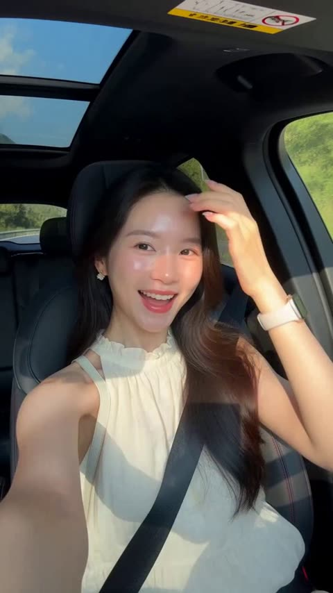</a>

提示词把 15 秒拆成几个节拍（进车、石板路、咖啡馆、湖景全景、日落），每段都写明机位。反复固定服装、包和发型等细节，能让主角在各镜头中保持一致，手持自拍的机位描述则带出 vlog 质感。

MiniMax H3 · 文生视频 · 出处: [@Aiwithmaha on X](https://x.com/Aiwithmaha/status/2115374973250592920) · 183 赞，统计于 2026-10-29

[`travel`](tags.md#tag-travel) [`selfie`](tags.md#tag-selfie) [`lakeside`](tags.md#tag-lakeside) [`golden-hour`](tags.md#tag-golden-hour)

<details><summary><b>提示词</b></summary>

```text
Create a 15-second ultra-realistic cinematic travel vlog featuring a beautiful girl with long, straight black hair wearing an elegant sleeveless cream-colored dress and carrying a small white shoulder bag. The video begins with the girl sitting inside a modern car with a panoramic sunroof, smiling at the camera as she arrives at a breathtaking lakeside destination surrounded by lush green mountains and sparkling blue water. She gently adjusts her hair while recording herself in selfie-vlog style. Next, she walks along a charming stone pathway surrounded by traditional European houses decorated with colorful flowers, turning toward the camera with a warm smile and a gentle wave as the camera smoothly follows her movements. She then arrives at a beautiful outdoor lakeside café with wooden tables, cream-colored umbrellas, and flower decorations, where she sits down and enjoys a cold iced coffee while admiring the peaceful scenery. She records another selfie, smiles naturally, and turns the camera to capture the panoramic view of the crystal-clear lake, green mountains, and elegant café terrace. In the final moments, she stands beside a wooden lakeside railing during golden hour, smiling at the camera before gently turning toward the sunset reflecting on the water, ending with a breathtaking cinematic view. Use realistic facial expressions, natural skin texture, consistent facial features and clothing, gentle hair movement, smooth camera transitions, authentic handheld vlog angles, beautiful European scenery, warm cinematic lighting, and premium 4K quality. Vertical 9:16 format, exactly 15 seconds long, with no subtitles, no text overlays, and no watermarks.
```

</details>

<a id="h3-street-photographer-candid-old-man-dog"></a>
### 街头摄影师抓拍老人与小狗并展示照片

<a href="https://x.com/aiwithaly/status/2087102541146522089"></a>

提示词把动作写成一条连续节拍：发现、构图、按快门、转向镜头、说一句短台词、继续前行。结尾用一串写实关键词，约束手持运动、手部动作、狗的行为和城市环境音。

MiniMax H3 · 文生视频 · 出处: [@aiwithaly on X](https://x.com/aiwithaly/status/2087102541146522089) · 183 赞，统计于 2026-10-28 · 发现于 [SkyNotSilent/awesome-MiniMax-H3-cases](https://github.com/SkyNotSilent/awesome-MiniMax-H3-cases)

[`street-photography`](tags.md#tag-street-photography) [`documentary`](tags.md#tag-documentary) [`photorealistic`](tags.md#tag-photorealistic) [`handheld`](tags.md#tag-handheld) [`dialogue`](tags.md#tag-dialogue)

<details><summary><b>提示词</b></summary>

```text
A young Western female street photographer walks through a lively downtown street and notices an elderly man sitting outside a café with his small dog. She carefully composes the candid moment through her camera, captures the photo, then turns the camera toward the viewer to proudly show the shot she just took. She smiles, says “Look at that,” then continues walking through the city. Ultra-photorealistic visuals, natural handheld documentary movement, realistic camera interaction, authentic facial expressions, accurate hand movements, realistic dog behavior, natural daylight, cinematic depth of field, continuous character consistency, immersive city ambience, premium documentary realism.
```

</details>

<a id="wan-mumbai-pav-bhaji-vlog"></a>
### 英国游客在孟买街头吃 pav bhaji

<a href="https://x.com/AITalesNBH/status/2092352446676845016">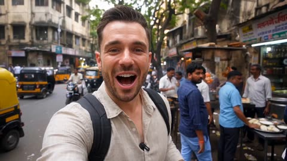</a>

为两位人物分别写固定的外形设定，保证各镜头中脸和服装一致；每个时间段都把机位、对白和声音提示写在一起。单独的音频部分与避免清单约束口型同步、环境声并禁止字幕。

Wan 3.0 · 文生视频 · 出处: [@AITalesNBH on X](https://x.com/AITalesNBH/status/2092352446676845016) · 163 赞，统计于 2026-10-29

[`vlog`](tags.md#tag-vlog) [`food`](tags.md#tag-food) [`dialogue`](tags.md#tag-dialogue) [`street-scene`](tags.md#tag-street-scene) [`mumbai`](tags.md#tag-mumbai)

<details><summary><b>提示词</b></summary>

```text
Create a 30-second cinematic travel-food vlog set in Mumbai, India, filmed documentary-style with a handheld camera. Warm, crowded, lively and spontaneous atmosphere. Natural daylight, humid Mumbai air, subtle handheld movement, occasional autofocus shifts, realistic traffic, pedestrians, vendors and cooking sounds. No background music during conversations.

This prompt is designed as a reusable universal template. The tourist, language, location and food can be changed independently while preserving the same structure, pacing and cinematic style.

Maintain strict character consistency:

The vlogger is a friendly British man in his early thirties, wearing a light linen shirt, dark trousers and a small backpack.

The vendor is a friendly Mumbai street-food cook in his fifties, with a moustache, simple shirt and apron.

Dialogue is in English. The vendor speaks clear English with a natural Indian accent—authentic and never exaggerated.

00:00–00:04 — MUMBAI STREET

Handheld selfie shot as the British tourist walks through a bustling Mumbai street with small shops, food stalls, pedestrians, taxis and auto-rickshaws.

He notices a street stall where pav bhaji is being prepared on a large iron griddle, steam rising into the humid air.

BRITISH MAN:
“I’ve just found this street-food stall in Mumbai. That smells incredible!”

He approaches the vendor.

00:04–00:09 — THE VENDOR

Medium handheld shot beside the sizzling tawa. The vendor rapidly mixes vegetables, tomatoes, spices and butter with a metal spatula.

BRITISH MAN:
“What are you making?”

VENDOR:
“Pav bhaji! Very famous Mumbai food.”

BRITISH MAN:
“Can I try it?”

VENDOR:
“Of course! Welcome to Mumbai!”

00:09–00:16 — PREPARATION

Fast cinematic food-vlog montage.

Extreme close-up: butter melts across the hot tawa. The vendor adds tomatoes, onions, peppers, potatoes, vegetables and aromatic spices, vigorously crushing and mixing everything with two metal spatulas.

CLACK—CLACK—CLACK.

Steam rises toward the lens. Close-up of rich red-orange bhaji bubbling as fresh coriander is scattered over it.

Soft pav bread rolls are sliced, buttered and toasted until golden.

Capture melting butter, sizzling vegetables, toasted bread, steam and skilled hand movements.

00:16–00:21 — SERVING

The British man sits on a simple stool beside the stall.

The vendor serves steaming pav bhaji topped with butter and coriander, with toasted pav, chopped onion and lime.

VENDOR:
“Try it with the pav—and squeeze some lime.”

The tourist squeezes lime over the bhaji.

00:21–00:27 — TASTING

Close handheld shot. The British man tears off warm pav, dips it into the bhaji and takes a bite.

He pauses, pleasantly surprised, then smiles at the vendor.

BRITISH MAN:
“Oh, wow! Spicy, buttery… absolutely delicious!”

The vendor laughs proudly as Mumbai street life continues behind them.

00:27–00:30 — ENDING

Selfie framing with the vendor beside him and the steaming stall behind them.

BRITISH MAN:
“Proper Mumbai street food. You have to try this!”

VENDOR:
“Welcome to Mumbai!”

They laugh. The camera swings toward the sizzling tawa as the vendor drops another piece of butter onto it.

SSSSSSHHHH!

Steam rises toward the camera.

CUT TO BLACK.

VISUAL & AUDIO DIRECTION

Photorealistic, spontaneous Mumbai travel vlog. Authentic crowded streets, weathered shopfronts, pedestrians, black-and-yellow taxis, auto-rickshaws and dense Indian architecture. Handheld selfie footage, intimate vendor interactions, macro food photography, shallow depth of field and rapid, coherent editing.

Authentic Mumbai soundscape: horns, traffic, pedestrians, vendors, metal spatulas striking the tawa, sizzling butter and utensils. Dialogue must be clear and precisely lip-synchronized.

Avoid: subtitles, captions, logos, watermarks, distorted hands, duplicated people, changing faces or clothing, exaggerated accents, stereotypes, excessive camera shake, artificial-looking food, luxury settings or incorrect lip synchronization.
```

</details>

<a id="h3-sequin-backstage-selfie-vlog-hallway"></a>
### 身着亮片上衣的女孩后台自拍vlog

<a href="https://x.com/Zyrellix/status/2105132975641735258">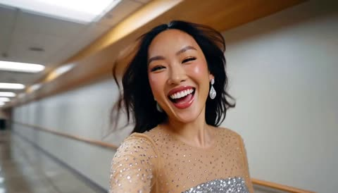</a>

每个节拍都有带时间戳的分镜和引号内的台词，让模型有清晰的顺序并能对上口型。手持自拍取景以及从走廊切到化妆间的镜头，保持了vlog质感和人物在各镜头间的一致性。

MiniMax H3 · 文生视频 · 出处: [@Zyrellix on X](https://x.com/Zyrellix/status/2105132975641735258) · 149 赞，统计于 2026-10-29

[`selfie-vlog`](tags.md#tag-selfie-vlog) [`handheld`](tags.md#tag-handheld) [`dialogue`](tags.md#tag-dialogue) [`shot-list`](tags.md#tag-shot-list)

<details><summary><b>提示词</b></summary>

```text
A glamorous young East Asian woman with long dark wavy hair, dewy glowing skin, winged eyeliner, glossy pink-red lips, and large sparkling teardrop crystal earrings. She wears a nude sheer mesh long-sleeve top densely covered in small silver rhinestones over a tight silver sequin bandeau crop top. Later she is seen in the full look: the same top plus a short black tulle tutu skirt and sparkly silver heels. Handheld selfie-style vlog, energetic, laughing, talking to camera.
0–2s: Tight smiling close-up in a backstage hallway. She laughs and says “Hey guys, we’re backstage right now.” Camera slightly moves, revealing wooden doors and a long corridor.
2–4s: She turns, showing the long institutional hallway with wooden handrails, fluorescent lights, people in the distance, and glowing red and green EXIT signs. She says “Look how long this hallway is.”
4–6s: Close-up of a rectangular brushed stainless-steel wall plaque engraved “ZYRELLIX”. Her manicured finger with long nude-pink nails points at the letters. She says “That’s me. That’s my name. Here.”
6–7s: Full-body shot of her walking confidently down the center of the long empty hallway toward camera, black tulle skirt bouncing, smiling.
7–9s: She stands in a brightly lit dressing-room vanity with tall vertical LED light strips and a large mirror. In front of her is a stainless chafing dish filled with colorful candy packets. She adjusts her sequin top, puts hands on hips, smiles big and says “Okay, outfit check. How do I look?”
9–11s: Back in the hallway, she holds a bright pink/yellow candy packet (like Skittles or similar), opens it, takes a piece, eats it, looks at camera and says “Snack table. Don’t mind if I do.”
11–14s: She suddenly looks to the side, points with her finger, eyes widen, and says “Wait, wait, wait. That’s my cue. See you guys after the stage.” Then she turns and runs away down the long hallway, long hair swinging.
Cinematic but casual concert-backstage vlog look, bright even lighting, sparkling fabrics, warm skin tones, slightly handheld camera. No extra text, no watermark, 15 seconds.
```

</details>

<a id="h3-suburban-backyard-sky-falls-handheld-phone-video"></a>
### 郊区后院里天空整片坠落

<a href="https://x.com/cocktailpeanut/status/2086879654116495564"></a>

提示词前半段先用手机手持的日常画面和环境音铺垫，再用一声开裂声触发唯一的不可能事件。明确要求不要电影化铺垫、不要超现实风格，让画面保持真实家庭录像的质感，最后以镜头摔落收尾。

MiniMax H3 · 文生视频 · 出处: [@cocktailpeanut on X](https://x.com/cocktailpeanut/status/2086879654116495564) · 113 赞，统计于 2026-10-28 · 发现于 [SkyNotSilent/awesome-MiniMax-H3-cases](https://github.com/SkyNotSilent/awesome-MiniMax-H3-cases)

[`handheld`](tags.md#tag-handheld) [`disaster`](tags.md#tag-disaster) [`realistic`](tags.md#tag-realistic) [`sound-design`](tags.md#tag-sound-design) [`single-shot`](tags.md#tag-single-shot)

<details><summary><b>提示词</b></summary>

```text
A hyper-realistic handheld phone video of a quiet suburban backyard on a bright normal afternoon. A person casually waters plants near a fence while birds chirp, distant traffic hums, and everything feels completely ordinary and mundane. The camera drifts naturally like a real home video, capturing the lawn, patio furniture, and blue sky with soft white clouds. After several seconds of normal peaceful activity, a deep cracking sound suddenly comes from above. Without warning, the entire sky begins dropping straight downward like a gigantic solid ceiling, with the blue sky and clouds moving as one physical surface descending toward the yard. The person looks up in shock just as the sky rapidly fills the frame, swallowing the scene in a terrifying instant. The camera jerks and falls to the ground at the last moment. No cinematic buildup, no surreal visual style, it should feel like a totally normal real-life recording interrupted by one sudden impossible and visceral event.
```

</details>

<a id="h3-korean-market-rainy-alley-walk"></a>
### 韩国市场购物女子走入雨中小巷

<a href="https://x.com/aiwithaly/status/2094643685338300751">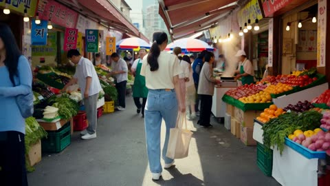</a>

提示词按时间顺序列出动作节拍（挑选蔬果、试吃、付钱、下雨），并在开头固定服装和发型描述，让角色在各个节拍中保持一致。结尾列出要避免的问题，如 CGI 人脸、瞬移、漂浮的袋子和慢动作，用来约束物理效果和镜头。

MiniMax H3 · 文生视频 · 出处: [@aiwithaly on X](https://x.com/aiwithaly/status/2094643685338300751) · 111 赞，统计于 2026-10-29

[`korean-market`](tags.md#tag-korean-market) [`rainy-alley`](tags.md#tag-rainy-alley) [`lifestyle`](tags.md#tag-lifestyle) [`handheld`](tags.md#tag-handheld)

<details><summary><b>提示词</b></summary>

```text
Ultra-photorealistic cinematic 15-second Korean lifestyle film following a young Korean woman with long dark hair in a low ponytail, wearing a cream T-shirt, loose light-blue jeans, white sneakers, and carrying a beige reusable shopping bag. Maintain consistent face, hairstyle, clothing, proportions, and accessories throughout.

She enters a lively traditional Korean market, walking naturally between crowded stalls while vendors call to customers and shoppers move around her. She stops at a produce stall, gently inspects peaches and tomatoes, selects fresh produce, and places them into her reusable bag. The bag swings naturally with her movement and becomes slightly heavier.

She approaches a hot-food stall where a vendor stirs sizzling food in a metal pan. Steam rises naturally from the heat. The vendor offers her a small sample on a wooden pick. She tastes it and reacts with a subtle, genuine smile.

She then pays the vendor with several coins, creating a soft metallic sound, secures her shopping bag, and walks toward the market exit.

Transition into a narrow traditional Korean residential alley. As she walks beneath tiled rooftops, light rain begins to fall. The pavement gradually becomes wet, small ripples form in shallow puddles, and subtle reflections appear on the ground. She looks upward, smiles, pulls the shopping bag closer, and continues walking as the rain gently increases.

End with a cinematic rear tracking shot as she disappears deeper into the peaceful rainy alley.

100% photorealistic live-action, authentic Korean market atmosphere, natural human acting, realistic food preparation, physically accurate object interaction, believable gravity, momentum, friction, weight, steam convection, rain dynamics, wet pavement, natural hair and clothing movement, documentary-style handheld camera, realistic skin texture, cinematic depth of field, natural lighting, restrained color grading, smooth transitions, authentic ambient market and street sounds.

No CGI look, no artificial faces, no robotic movement, no teleportation, no floating objects, no duplicated people, no changing face, clothing, or hairstyle, no unrealistic steam or rain, no weightless shopping bag, no fantasy physics, no excessive camera shake, no slow motion, no text, subtitles, logos, or watermark.
```

</details>

<a id="h3-tokyo-night-selfie-train-vlog"></a>
### 女生夜晚东京赶火车的手机vlog

<a href="https://x.com/codewithhajra/status/2093896492000166116">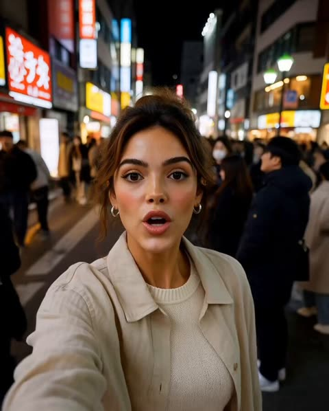</a>

用参考图锁定角色，并在每个时间段重复服装与五官约束，让人物在各个镜头之间保持一致。按秒分段写分镜、手持机位和台词，并列出环境音与列车提示音，让画面和声音节奏统一。

MiniMax H3 · 参考生视频 · 出处: [@codewithhajra on X](https://x.com/codewithhajra/status/2093896492000166116) · 108 赞，统计于 2026-10-29

[`tokyo`](tags.md#tag-tokyo) [`night-street`](tags.md#tag-night-street) [`character-lock`](tags.md#tag-character-lock) [`phone-vlog`](tags.md#tag-phone-vlog)

<details><summary><b>提示词</b></summary>

```text
FORMAT: 15 seconds | 9:16 vertical | Ultra-photorealistic smartphone vlog | Real-world Tokyo at night

CHARACTER LOCK
Use the attached girl as the exact character and identity reference throughout the entire video. Preserve her recognizable facial features, face shape, warm skin tone, brown eyes, natural makeup, soft features, and dark brown hair styled in a messy high bun with loose strands framing her face.
She is an adult woman with a natural, approachable travel-vlogger appearance.

OUTFIT LOCK

Match the outfit shown in the storyboard:

Cream-colored knit top

Light beige lightweight jacket, worn open

Charcoal/dark gray straight-leg trousers

Clean white sneakers
Small silver hoop earrings
Simple silver wristwatch
Minimal accessories
Natural, understated makeup
The hairstyle, face, outfit, accessories and overall appearance must remain identical across all six storyboard scenes.
00–04s — RUNNING FOR IT
Handheld selfie footage on a crowded Tokyo street at night.

The girl from the attached reference walks quickly toward the camera, slightly out of breath. Her beige jacket moves naturally as she walks.

Bright Tokyo signs, storefronts, pedestrians and traffic create an authentic nighttime city background.

She looks directly into the phone camera and laughs:

“Wait—my train leaves in two minutes!”

She quickly turns the phone forward and starts jogging toward the station.

04–08s — THE STATION

Handheld camera follows her from behind and slightly beside her as she rushes down the station stairs.

Her messy brown bun and beige jacket remain clearly recognizable.

She reaches the ticket gate, taps her transit card and quickly passes through.

The phone camera shakes naturally from her movement and briefly loses autofocus.

08–12s — MADE IT

She reaches the platform just as the train arrives.

The camera captures the approaching train headlights before returning to her face.

She steps inside, turns the phone toward herself and smiles while catching her breath.

She says:

“I actually made it!”

The train doors close behind her.

12–15s — TOKYO THROUGH THE WINDOW

Inside the train, she turns the phone toward the window.

Tokyo's illuminated buildings and streets naturally blur past as the train accelerates.

Her face appears softly reflected in the glass.

She looks toward the city and quietly says:

“Okay… Tokyo at night hits different.”

Natural cut.

REALISM & CHARACTER CONSISTENCY

Same attached girl in every shot. No character changes.

Maintain the exact:

Facial identity

Brown eyes

Dark brown messy high bun

Loose face-framing hair strands
Skin tone
Facial proportions
Cream knit top
Beige jacket
Charcoal trousers
White sneakers
Silver earrings
Wristwatch
Natural skin texture, realistic hair strands, authentic blinking, subtle facial expressions and believable body movement.
No outfit changes, no hairstyle changes, no different woman, no face morphing, no beauty-filter effect.

VISUAL STYLE
Authentic handheld smartphone footage rather than a polished movie.

Natural motion blur, autofocus hunting, slight exposure shifts, realistic low-light phone noise, imperfect framing, natural Tokyo crowds and physically accurate movement.

No cinematic transitions, no fantasy effects, no exaggerated neon, no artificial-looking skin, no duplicated people, no impossible camera movement.

AUDIO
Natural Tokyo ambience, footsteps, station announcements, crowd noise, train brakes, door chime and her real voice.

No background music, no subtitles, no watermark.
```

</details>

<a id="h3-backyard-hammock-afternoon-nap-dv-camcorder"></a>
### 后院吊床上的慵懒午后小憩

<a href="https://x.com/Strength04_X/status/2085009719371190553"></a>

提示词按主体、场景、风格、镜头、时间线、音频分块，时间线拆成十个三秒节拍，每拍只放一个小动作。千禧年代DV摄像机质感、带英文翻译的韩语台词，以及明确不要配乐的音效清单，让30秒画面保持自然真实。

MiniMax H3 · 文生视频 · 出处: [@Strength04_X on X](https://x.com/Strength04_X/status/2085009719371190553) · 103 赞，统计于 2026-10-28 · 发现于 [SkyNotSilent/awesome-MiniMax-H3-cases](https://github.com/SkyNotSilent/awesome-MiniMax-H3-cases)

[`hammock`](tags.md#tag-hammock) [`dv-camcorder`](tags.md#tag-dv-camcorder) [`documentary-realism`](tags.md#tag-documentary-realism) [`timeline-prompt`](tags.md#tag-timeline-prompt) [`korean-dialogue`](tags.md#tag-korean-dialogue)

<details><summary><b>提示词</b></summary>

```text
Main Subject:
Young Korean woman, early 20s, oversized soft cardigan over shorts, hair loose and slightly messy, relaxed sleepy expression, natural unguarded energy.
Location:
Small backyard with a hammock strung between two trees, early afternoon. Dappled sunlight through leaves, a small side table with a book, quiet garden sounds. No modern clutter.
Visual Style:
Ultra-realistic documentary realism, intimate candid feeling, soft warm afternoon light.
Camera Style:
Early 2000s DV camcorder, handheld gentle drift, autofocus adjusting slowly to shifting light through leaves, warm faded color cast, soft grain. No stabilization.
Timeline (30 sec):
00:00–00:03 → She climbs into the hammock carefully, adjusting her position.
00:03–00:06 → She picks up a book from the side table, flipping to her page.
00:06–00:09 → She reads quietly for a moment, then yawns softly.
00:09–00:12 → She sets the book on her stomach, then closes her eyes briefly.
00:12–00:15 → A breeze sways the hammock gently; she smiles without opening her eyes.
00:15–00:18 → She peeks one eye open at camera saying "여기 진짜 시원하다" ("It's really cool here").
00:18–00:21 → She stretches one arm lazily, then lets it dangle off the hammock.
00:21–00:24 → Dappled light shifts across her face as leaves move overhead.
00:24–00:27 → She murmurs sleepily, then closes her eyes again, fully relaxed.
00:27–00:30 → She whispers to camera "나 좀 잘게..." ("I'm going to sleep a bit..."), drifting off as it fades.
Audio:
Leaves rustling, hammock creaking softly, distant birds, faint wind. Her dialogue as noted above. No music.
Goal: A calm, drowsy afternoon rest moment intimate, soft, deeply believable.
```

</details>

<a id="h3-burger-night-ugc-selfie-vlog"></a>
### 自拍视频博主开箱美味汉堡

<a href="https://x.com/oggii_0/status/2083436822085165289"></a>

用产品参考图锁定汉堡外观，贯穿八个带时间码的分镜，并用命名人物设定保持博主一致。每个镜头配对白，加入自动对焦呼吸和手持抖动等手机质感描述，再用负面提示排除商业质感，保证真实 UGC 感。

MiniMax H3 · 参考生视频 · 出处: [@oggii_0 on X](https://x.com/oggii_0/status/2083436822085165289) · 94 赞，统计于 2026-10-28 · 发现于 [SkyNotSilent/awesome-MiniMax-H3-cases](https://github.com/SkyNotSilent/awesome-MiniMax-H3-cases)

[`ugc`](tags.md#tag-ugc) [`selfie-vlog`](tags.md#tag-selfie-vlog) [`food`](tags.md#tag-food) [`product-reference`](tags.md#tag-product-reference) [`dialogue`](tags.md#tag-dialogue)

<details><summary><b>提示词</b></summary>

```text
Duration: 15 seconds | Aspect Ratio: 16:9 | Style: Authentic UGC / iPhone selfie-vlog, handheld, natural light, TikTok/Reels aesthetic.
Product Reference: Use the uploaded gourmet burger image as the only product reference. Preserve the bun shape, patty thickness, cheese melt, lettuce, tomato, sauces, and proportions exactly in every shot.
Character Description
Name: Hana
A young Japanese woman in her early 20s with natural beauty, long dark hair in a loose ponytail, oversized cream sweatshirt, minimal makeup, bright smile, friendly lifestyle-vlogger personality.
Shot Breakdown
SHOT 1 (0–2s) — Selfie showing the burger box.
Dialogue: "Burger night!"
SHOT 2 (2–4s) — Opens the box.
SHOT 3 (4–6s) — Quick zoom on the burger.
SHOT 4 (6–8s) — Hands lifting the burger with cheese stretching naturally.
SHOT 5 (8–10s) — Bite reaction.
Dialogue: "Okay... that's incredible."
SHOT 6 (10–12s) — Casual close-up b-roll while reaching for fries.
SHOT 7 (12–14s) — Toasting the burger toward the camera.
Dialogue: "You need this."
SHOT 8 (14–15s) — Freeze frame with overlay: "burger cravings = solved 🍔"
Look & Feel
Warm apartment lighting, genuine phone footage, slight grain, natural autofocus breathing, handheld imperfections, fast jump cuts.
Negative Prompt
cinematic grading, commercial production, CGI burger, fake cheese, distorted hands, warped food, perfect stabilization, studio lighting, text glitches, logo distortion.
```

</details>

<a id="h3-rural-bus-stop-night-camcorder-korean-woman"></a>
### 疲惫女子在乡间夜晚公交站等车

<a href="https://x.com/Strength04_X/status/2096578562866463197"></a>

用场景、镜头感、分段动作和声音等标签块组织 15 秒镜头，三脚架加轻微手持晃动与磁带底噪营造摄像机质感。韩语台词后附英文释义，用来驱动对白音频。

MiniMax H3 · 文生视频 · 出处: [@Strength04_X on X](https://x.com/Strength04_X/status/2096578562866463197) · 84 赞，统计于 2026-10-28 · 发现于 [SkyNotSilent/awesome-MiniMax-H3-cases](https://github.com/SkyNotSilent/awesome-MiniMax-H3-cases)

[`night`](tags.md#tag-night) [`camcorder`](tags.md#tag-camcorder) [`dialogue`](tags.md#tag-dialogue) [`korean`](tags.md#tag-korean) [`lo-fi`](tags.md#tag-lo-fi)

<details><summary><b>提示词</b></summary>

```text
A young Korean woman, early 20s, tired after a long day, oversized coat swallowing her frame, hair escaping a loose braid, stands alone at a rural bus stop long after the sun has set.
Setting: A single flickering streetlamp, an empty road disappearing into darkness, rice paddies barely visible on either side, insects buzzing somewhere in the black.
Camera feel: Static tripod shot with occasional handheld nudges, like whoever's filming keeps almost forgetting they're recording — heavy grain, the lamp's orange glow bleeding into the frame, tape hiss audible under everything.
What happens (15 sec total):
She leans against the bus stop sign, checking her phone, then pocketing it with a tired sigh.
She mutters to camera, almost to herself, "버스 왜 안 와..." ("Why isn't the bus coming..."), kicking a small pebble.
Headlights appear far down the road she straightens up, relief crossing her face.
As the bus approaches, she looks back at the camera one last time saying "드디어" ("Finally"), stepping toward the curb as the tape cuts.
Sound: Crickets, distant engine growing louder, gravel underfoot, wind.
Mood: Quiet exhaustion giving way to small relief nothing dramatic, just real.
```

</details>

<a id="h3-bedroom-three-outfit-transformation-vlog"></a>
### 卧室博主视频中的三次无缝换装

<a href="https://x.com/codewithhajra/status/2090276653012287567"></a>

按时间段把每次换装拆成三秒一幕，并用抛向镜头的外套和旋转动作遮住转场。参考图锁定人物形象，结尾的一致性清单禁止跳切、衣物变形和房间布局变化。

MiniMax H3 · 参考生视频 · 出处: [@codewithhajra on X](https://x.com/codewithhajra/status/2090276653012287567) · 83 赞，统计于 2026-10-28 · 发现于 [SkyNotSilent/awesome-MiniMax-H3-cases](https://github.com/SkyNotSilent/awesome-MiniMax-H3-cases)

[`fashion`](tags.md#tag-fashion) [`outfit-change`](tags.md#tag-outfit-change) [`vlog`](tags.md#tag-vlog) [`transition`](tags.md#tag-transition) [`lipsync`](tags.md#tag-lipsync)

<details><summary><b>提示词</b></summary>

```text
Format: 15 seconds | 16:9 | 4K HDR | 24fps | photorealistic cinematic vlog

Character: Use the girl from the uploaded reference image as the exact character reference. Preserve her facial identity, eye color, skin tone, hairstyle, body proportions, and overall appearance consistently throughout every shot. No face changes or identity drift.

Scene & Story:
0–3 sec — The Mystery Package
The video opens with a handheld creator-vlog shot in her cozy bedroom during late afternoon. She walks into frame holding a stylish garment bag, looking genuinely curious. She places it on the bed and looks directly into the camera with a playful expression.

She says naturally: “Okay… I found something for tonight, but I have absolutely no clue if I can pull it off.”

She unzips the garment bag, revealing only a glimpse of the outfit.

3–6 sec — First Reveal
She quickly steps behind a nearby room divider. The camera follows with a fast handheld whip-pan.

She emerges wearing a chic fitted top, tailored trousers, and elegant heels. She looks at herself in the mirror, slightly surprised by how good it looks.

She turns toward the camera and says: “Wait… this might actually work.”

She gives a small confident pose.

6–9 sec — The Unexpected Switch
Instead of snapping her fingers, she grabs a jacket hanging beside her and dramatically throws it toward the camera.

As the jacket briefly covers the lens, the outfit seamlessly transforms underneath it.

When she pulls the jacket away, she is wearing a completely different fashion-forward look: a stylish mini dress with statement shoes and subtle accessories.

She looks down, raises one eyebrow, then laughs.

9–12 sec — The Wild Card
She walks toward the mirror while the camera circles around her. She notices a third outfit hanging on the wardrobe door.

Suddenly, she steps backward and spins.

During the spin, her outfit naturally morphs into a glamorous evening look with a sophisticated silhouette, elegant heels, and refined accessories.

The transformation happens continuously during the movement with realistic fabric motion — no jump cut.

12–15 sec — Final Decision
She walks toward the camera with confident energy, then stops very close to the lens.

She looks at the camera, points toward herself, then gestures toward the three outfits visible behind her.

With a playful smile, she says:

“Okay… you’re choosing. Which one?”

The camera quickly pushes in toward her face as she laughs, ending on a natural freeze-like moment.

Visual Direction:
Ultra-realistic fashion creator vlog, authentic handheld camera movement, natural body language, expressive facial reactions, realistic fabric physics, seamless outfit transitions, natural hair movement, subtle mirror reflections, cinematic depth of field, realistic skin texture, soft late-afternoon daylight mixed with warm practical bedroom lighting, detailed wardrobe and bedroom environment, premium fashion-film aesthetic while maintaining casual YouTube-vlog energy.

Camera:
Handheld selfie framing, medium shots, quick whip-pans, subtle camera shake, smooth tracking movements, one controlled orbit around the character, final slow push-in.

Audio:
Natural bedroom ambience, fabric and wardrobe sounds, footsteps, garment movement, subtle mirror-room reverb, upbeat modern fashion-vlog background music, natural spoken dialogue, soft whoosh effects during the outfit transitions. No subtitles, no logos, no watermark.

Consistency & Quality:
No jump cuts during transformations. No duplicated character. No distorted hands or fingers. No warped clothing. No inconsistent room layout. No facial identity changes. No unnatural skin smoothing. Keep the same character, bedroom, lighting logic, and visual realism throughout.
```

</details>

<a id="seedance-amazon-canoe-selfie-guide"></a>
### 游客自拍，向导同乘独木舟行驶在亚马逊河上

<a href="https://x.com/Diplomeme/status/2085961080883618249">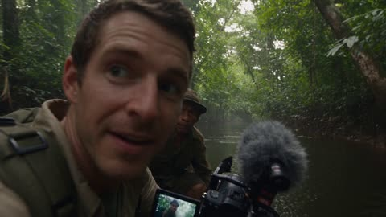</a>

用定时分镜、固定的格式模块和连续性清单，让独木舟、向导和器材在每个镜头中保持一致。自拍取景、遮挡画面的植被和禁止电影式稳定的要求营造手持纪实感，同时禁止接触和刻板服装，让远处的人保持距离和尊重。

Seedance 2.5 · 文生视频 · 出处: [@Diplomeme on X](https://x.com/Diplomeme/status/2085961080883618249) · 75 赞，统计于 2026-10-29

[`handheld-vlog`](tags.md#tag-handheld-vlog) [`documentary`](tags.md#tag-documentary) [`amazon`](tags.md#tag-amazon) [`storyboard`](tags.md#tag-storyboard)

<details><summary><b>提示词</b></summary>

```text
THE PEOPLE WHO DON'T WANT TO BE FOUND

FORMAT
30 seconds | 16:9 | live-action adventure vlog / documentary
Fictional dramatization. Fictionalized Indigenous community. Not a recreation of any specific real isolated tribe.
Authentic handheld travel-vlog realism with cinematic documentary cinematography.

CORE CONCEPT
A young travel vlogger and an experienced local Amazon guide travel deep into the rainforest by small wooden boat, hoping to document signs of a remote, isolated Indigenous community. They unexpectedly notice distant human figures across the river. The guide immediately signals them to stop and leave. The encounter remains distant and observational; the visitors never approach, communicate with, or enter the community's territory.

CHARACTERS

VLOGGER
Young adult travel filmmaker, practical expedition clothing, weathered backpack, compact handheld camera, small microphone, natural appearance.
Curious and energetic at the beginning, gradually becoming quiet and cautious.

LOCAL GUIDE
Experienced Amazonian river guide, practical field clothing, calm and observant, familiar with the river and rainforest.
He communicates primarily through subtle gestures and brief whispered instructions.

Maintain identical faces, clothing, backpacks, camera equipment and physical characteristics throughout the entire sequence.

ENVIRONMENT

Deep Amazon rainforest during humid late afternoon.
Dense layered vegetation, enormous trees, vines, broad leaves, muddy riverbanks, dark water reflecting the canopy, floating vegetation, insects, distant birds and constantly moving foliage.

Heavy humidity visible through moisture on skin, wet clothing and condensation on camera equipment.

No tourist infrastructure, roads, buildings or modern development visible in the deep rainforest.

STORYBOARD

00–04s — COLD OPEN

Begin with authentic handheld selfie footage from inside a narrow wooden canoe moving through a remote Amazon river.

The vlogger quietly addresses the camera while holding it close to his face.

He looks excited but slightly nervous.

He suddenly turns the camera toward the guide.

The guide has stopped paddling and is staring toward dense vegetation on the riverbank.

The guide raises one finger to his lips, signaling silence.

Natural boat rocking, water movement and imperfect handheld framing.

04–08s — INTO THE UNKNOWN

Cut to a forward-facing handheld view from inside the moving canoe.

The boat glides deeper into an increasingly narrow section of river surrounded by dense vegetation.

The vlogger whispers to the camera while keeping his voice low.

The guide carefully scans both banks.

A strange human-sized movement briefly disappears behind vegetation far ahead.

The camera attempts to follow it but loses the subject naturally behind leaves.

Do not reveal the community yet.

08–12s — DISCOVERY

The guide suddenly stops the canoe.

The camera moves toward him as he quietly points toward the opposite riverbank.

On the muddy shoreline are fresh human footprints and several simple recently used objects partially concealed beneath vegetation.

The vlogger's expression changes from excitement to uncertainty.

He slowly lowers the camera.

Nobody speaks for a moment.

12–16s — THE SIGHTING

Longer observational shot across the river.

Through multiple layers of dense foliage, several distant human figures briefly become visible on the far bank.

They remain very small in frame and partially obscured by vegetation.

They do not approach the camera.

The vlogger instinctively raises the camera to record but the guide immediately places a hand on his arm and signals him to stop filming.

The camera lowers slightly, creating an imperfect partially obstructed view.

16–20s — REALIZATION

Close handheld shot of the vlogger looking toward the guide.

The guide whispers quietly that they need to leave.

The vlogger looks back toward the distant riverbank.

Another figure briefly appears between the trees before disappearing.

No dialogue explaining the tribe.
The audience understands the significance through the characters' reactions.

20–24s — RETREAT

The guide slowly turns the canoe around without sudden movement.

The wooden boat pivots naturally in the narrow river.

The vlogger looks backward over his shoulder while keeping the camera low.

The distant figures remain barely visible through vegetation for a moment before disappearing completely.

The camera shakes subtly with the boat's movement.

24–27s — DISTANCE

The canoe moves away downstream.

The vlogger looks directly into the camera.

He is no longer excited; he is visibly processing what just happened.

He quietly says:

"We should leave them alone."

Keep the delivery natural, understated and unscripted rather than dramatic.

27–30s — FINAL IMAGE

Long observational shot from inside the departing canoe.

The camera looks back toward the distant rainforest.

For a brief moment, one indistinct human figure stands between the trees on the riverbank.

The figure remains far away and partially concealed.

The canoe continues downstream until vegetation completely blocks the view.

Cut to black.

No victory moment.
No chase.
No confrontation.
No direct contact.

CAMERA SYSTEM

Authentic modern travel-vlog camera language.

Primary camera:
handheld mirrorless / compact cinema camera operated by the vlogger.

Mix:
selfie-vlog framing
handheld observational shots
over-the-shoulder views
long-lens distant observation
low camera position inside the canoe
brief environmental wides

Camera should feel physically operated by a real person sitting inside a moving canoe.

Natural hand movement.
Small framing corrections.
Occasional imperfect focus.
Subtle autofocus adjustments.
Natural motion blur.
Minor camera shake caused by the moving boat.

Do not use impossible drone transitions.

Do not create perfectly stabilized cinematic movements.

The camera should sometimes struggle to see through foliage.

ENVIRONMENTAL PHYSICS

The canoe has believable weight and displacement.

Water reacts naturally to the paddle and hull.

Small waves move around the canoe.

Vegetation moves independently in the humid breeze.

Leaves brush naturally against the canoe.

Clothing responds to humidity and wind.

Wet surfaces remain visibly wet.

Water droplets occasionally accumulate on the camera lens.

Insects move naturally through foreground and background.

No floating objects without physical cause.

HUMAN PERFORMANCE

The vlogger begins naturally enthusiastic and curious.

His behavior gradually changes when the guide signals him to stop.

Use subtle eye movements, lowered voice, controlled breathing and hesitation.

The guide remains calm and experienced rather than frightened.

The guide's decision to leave is immediate but restrained.

No screaming.
No exaggerated fear.
No heroic behavior.
No theatrical reactions.

VISUAL REALISM

Photorealistic live-action footage.

Authentic Amazon rainforest density.

Natural skin texture.

Real wet fabric.

Real mud and water interaction.

Subtle sweat and humidity on skin.

Natural imperfections in clothing and equipment.

Realistic depth separation through foliage.

Natural atmospheric haze.

Subtle digital sensor noise.

Organic motion blur.

Natural color reproduction.

Avoid excessive HDR.

Avoid oversaturated tropical greens.

Avoid fantasy-jungle aesthetics.

AUDIO

Synchronized production audio.

Constant Amazon rainforest ambience:
insects
birds
distant animal calls
moving water
wind through leaves
paddle entering water
wooden canoe creaking
clothing movement
quiet breathing

Vlogger's voice recorded naturally close to the camera.

Dialogue should sound spontaneous and quiet.

At the sighting, environmental sound becomes the dominant element.

No dramatic musical swell during the discovery.

No oversized Hollywood trailer effects.

No artificial cinematic bass hits.

LIGHTING

Natural late-afternoon rainforest lighting.

Soft sunlight filters through the canopy.

Strong variations between bright patches and deep green shadow.

Natural reflections on the river.

Realistic exposure changes as the camera turns from the bright river toward darker vegetation.

Occasional sun flare caused naturally by the lens.

No artificial rim lighting.

No studio lighting.

CONTINUITY

The same vlogger, guide, canoe, backpacks, clothing and camera equipment remain consistent throughout.

The canoe's physical position, direction of travel and orientation must remain coherent.

The river geography remains consistent.

The same rainforest density, weather and lighting conditions continue throughout.

The distant community remains geographically across the same riverbank.

The figures must never suddenly appear close to the camera.

Every shot begins from the physical state established by the previous shot.

The final shot must clearly feel like the same continuous expedition recorded moments earlier.

NEGATIVE CONSTRAINTS

Do not depict a specific real isolated tribe.

Do not use recognizable cultural identifiers from a real Indigenous community.

Do not portray the Indigenous people as primitive, savage, threatening or supernatural.

Do not show direct contact.

Do not show the vlogger entering their settlement.

Do not show confrontation or pursuit.

Do not create weapons or threatening gestures.

Do not use stereotypical costumes.

Do not create fantasy or adventure-movie jungle imagery.

No CGI appearance.
No video-game aesthetics.
No excessive HDR.
No oversaturated colors.
No impossible camera movements.
No artificial slow motion.
No perfectly choreographed movement.
No beauty-filter faces.
No subtitles or watermarks.

OVERALL CREATIVE DIRECTION

The film should feel like genuine expedition footage that unexpectedly becomes extraordinary.

The first half feels like an adventurous travel vlog.

The middle shifts into quiet uncertainty.

The final seconds become observational and respectful.

The emotional payoff is not "we found a tribe."

The emotional payoff is realizing that the people being observed have their own world and choosing to leave it undisturbed.
```

</details>

<a id="h3-purikura-sticker-capsule-toy-iphone-vlog"></a>
### 大头贴贴纸与扭蛋机的手机随拍日常

<a href="https://x.com/itxabdullaa/status/2085656146363249079"></a>

用参考图锁定人脸，再按每3秒一段写五段时间线，每段只有一个动作和一句台词。镜头和风格部分要求未经剪辑的旧iPhone质感，包括1x镜头、对焦抖动和偏粉的白平衡，声音部分列出了环境声层次。

MiniMax H3 · 参考生视频 · 出处: [@itxabdullaa on X](https://x.com/itxabdullaa/status/2085656146363249079) · 74 赞，统计于 2026-10-28 · 发现于 [SkyNotSilent/awesome-MiniMax-H3-cases](https://github.com/SkyNotSilent/awesome-MiniMax-H3-cases)

[`ugc`](tags.md#tag-ugc) [`handheld`](tags.md#tag-handheld) [`phone-look`](tags.md#tag-phone-look) [`timeline`](tags.md#tag-timeline) [`ambient-sound`](tags.md#tag-ambient-sound)

<details><summary><b>提示词</b></summary>

```text
Subject: Person from Image1. Face and hairstyle must match Image1 completely; do not transform into a different person. Outfit: same casual everyday streetwear as Part 1. Ignore the outfit, background, pose, and bottom text from Image. Even if image quality is rough, facial features must remain clearly defined. 16:9 horizontal. Entire video has an old iPhone low-quality everyday-video look. Constant heavy noise and compression artifacts throughout.
Setting: Same convenience store or arcade corner immediately after leaving the purikura booth. Sticker printer beside the booth, capsule toy machines, snack shelves, and bright fluorescent store lighting mixed with colorful purikura lights. Booth curtain still visible in the background. Any visible signs, packaging, and screen text remain completely illegible.
Timeline:
0–3s: Holds up the phone with the newly attached sticker, smiling proudly. Notices a tiny bonus sticker still attached to the backing sheet and laughs softly. "Wait... there's another one?"
3–6s: Peels off the tiny sticker and sticks it onto a reusable drink bottle or wallet. While pressing it down, a nearby capsule toy machine suddenly dispenses a capsule by itself with a loud clunk, making them jump in surprise.
6–9s: Picks up the unexpected capsule, shakes it curiously, opens it, and finds a tiny cute keychain inside. Holds it next to the purikura sticker, laughing. "No way... perfect timing!"
9–12s: Hooks the keychain onto their bag or phone strap, admires both the sticker and keychain together, then catches their reflection in the booth window and gives themselves an amused grin.
12–15s: Looks directly at the camera, holds up the phone and the new keychain together, gives a playful wink and thumbs-up while saying, "Best random stop ever." Freeze on the final frame.
Camera: Loose 1–1.5s cuts. Old iPhone, vertical, standard 1x lens (no distortion, standard field of view), handheld with slight natural shake while walking and reacting, steadier during close-up sticker and capsule moments. Slight autofocus hunting during close-ups. Mixed fluorescent and colorful booth lighting creates inconsistent white balance with a subtle magenta/pink cast. Natural exposure fluctuations throughout.
Sound: No BGM. Ambient convenience store and arcade background noise (faint chatter, vending machines, capsule toy machine sounds, footsteps), sticker peeling sound, plastic capsule opening, small keychain clink, natural laughter, close slightly muffled voice, subtle booth echo, phone handling sounds.
Style: Unedited low-quality phone video look. No color grading, no film look, no cinematic look, no beauty filter, no CG texture. No fisheye/ultra-wide (0.5x)/action-cam look, no barrel distortion, no vignette, no black lens-round at frame edges—flat standard field of view, frame filled edge to edge. Real skin texture maintained (pores, flyaway hairs, natural oil sheen). No cut consolidation, no scene skipping. No on-screen text (all store signs, product labels, booth screens, capsule contents, and sticker graphics/text remain illegible).
```

</details>

<a id="h3-backyard-herb-garden-basil-dv-camcorder"></a>
### 后院香草园采摘罗勒，DV摄像机质感

<a href="https://x.com/Strength04_X/status/2085786048521757074"></a>

五段时间轴，每个3秒槽位压缩两个动作，韩语台词附括号翻译。2000年代初DV摄像机风格、自动对焦游移和无防抖带来真实随拍感，音频只写环境声，不加音乐。

MiniMax H3 · 文生视频 · 出处: [@Strength04_X on X](https://x.com/Strength04_X/status/2085786048521757074) · 73 赞，统计于 2026-10-28 · 发现于 [SkyNotSilent/awesome-MiniMax-H3-cases](https://github.com/SkyNotSilent/awesome-MiniMax-H3-cases)

[`documentary`](tags.md#tag-documentary) [`dv-camcorder`](tags.md#tag-dv-camcorder) [`timeline`](tags.md#tag-timeline) [`dialogue`](tags.md#tag-dialogue) [`ambient-audio`](tags.md#tag-ambient-audio)

<details><summary><b>提示词</b></summary>

```text
Main Subject:
Young Korean woman, early 20s, loose linen shirt over shorts, hair tied back with a cloth, dirt-smudged fingers, gentle focused expression.
Location:
Small backyard herb garden beside the house, late morning. Wooden planter boxes, scattered gardening tools, soft natural sunlight, a low fence. No modern structures.
Visual Style:
Ultra-realistic documentary realism, candid hands-on feeling, bright natural daylight.
Camera Style:
Early 2000s DV camcorder, handheld close framing, autofocus adjusting between her hands and the plants, warm faded tones, soft grain. No stabilization.
Timeline (15 sec, each slot = 2 compressed beats):
00:00–00:03 → She kneels by the planter box, then snips a few basil leaves carefully.
00:03–00:06 → She smells the leaves, then says to camera "향 진짜 좋다" ("The smell is really nice"), smiling.
00:06–00:09 → She moves to another box, then pulls a small weed from the soil.
00:09–00:12 → She wipes her hands on her shirt, then gathers the herbs into a small basket.
00:12–00:15 → She looks at camera saying "오늘 저녁에 쓸 거야" ("I'll use these for dinner tonight"), standing up as it fades.
Audio:
Leaves rustling, soil shifting, faint birds, distant wind. Her dialogue as noted above. No music.
Goal: A small, grounded gardening moment warm, patient, authentic.
```

</details>

<a id="h3-woman-kitchen-dachshund-living-room"></a>
### 女子走过厨房进入客厅

<a href="https://x.com/EndFolding79421/status/2110497810554536216">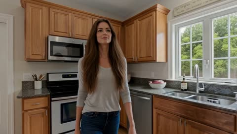</a>

一段短视频参考锁定整个房间布局，两张图分别固定女子和小狗的外观。明确禁止镜像、移动家具或增加人物，使转身后露出的区域与参考保持一致。

MiniMax H3 · 参考生视频 · 出处: [@EndFolding79421 on X](https://x.com/EndFolding79421/status/2110497810554536216) · 73 赞，统计于 2026-10-29

[`video-reference`](tags.md#tag-video-reference) [`interior`](tags.md#tag-interior) [`pet`](tags.md#tag-pet) [`continuity`](tags.md#tag-continuity)

<details><summary><b>提示词</b></summary>

```text
MiniMax H3 — Another Video Reference Test, But This Time for Locations!

This time, instead of using a video reference for a character, I'm testing whether we can use one to keep an entire scene consistent. In this case, the inside of a home.

I started with a still image and used Seedance to generate an 8-second video (video included) showing more of the room. But you could use just about any AI video generator, or even grab your cellphone and record a clip yourself.

One of the biggest problems I've run into when making AI videos is keeping the environment consistent from shot to shot.

Before this, I relied on AI-generated images, screenshots, or sometimes even DAZ Studio renders to establish a location.

The problem is that when the camera starts looking around, AI tends to invent things to fill in the gaps. A chair might be there in one shot and gone in the next, furniture changes color, or the room layout suddenly looks completely different.

So I wanted to test something. What if H3 had a video reference showing more of the actual room instead of just a single image? Would that help it maintain the environment more consistently?

Now, here's a little tip I discovered while testing.

Originally, generating a 10-second H3 clip using the video reference took around 36 minutes.

So I went back into Camtasia and used its Add Clip Speed feature to speed up the original 8-second reference video and cut it to just 4 seconds (video included).

Then I reduced the reference resolution from 1280×720 to 640×360. I might even try going lower, perhaps 540p or 480p, to see how far I can push it.

The result?

Original render: approximately 36 minutes
Optimized reference render: 19 minutes, 17 seconds

That's nearly half the rendering time.

Now, this is only my first test, and there's still more experimenting to do. I also can't say yet how much of that improvement came from shortening the video versus lowering its resolution.

But overall, I'm not unhappy with the results.

Prompt:...r34l1sm

For the target video, reference <Video 1> for the complete interior environment, <Picture 1> for the woman's appearance, and <Picture 2> for the dog's appearance.

subject_definitions:

<Subject 1> is the adult woman from <Picture 1>. Preserve her exact facial identity, long brown hair, natural body proportions, clothing, blue jeans, and appearance. There is exactly ONE woman.

<Subject 2> is the small dachshund from <Picture 2>. Preserve its exact breed, black-and-tan coloring, long body, short legs, floppy ears, and natural proportions. There is exactly ONE dog.

<Subject 3> is the house interior from <Video 1>. This video is the MASTER ENVIRONMENT REFERENCE. Preserve the exact kitchen, dining area, living room, furniture arrangement, walls, windows, doorways, flooring, cabinets, and spatial relationships. The reference video establishes the real layout of the house, including areas revealed as the camera moves. Do not redesign, rearrange, or invent rooms or furniture.

integrated_multimodal_description:

[Shot 1 — 00:00–00:04]
Photorealistic cinematic live-action. Natural daytime interior lighting matching <Video 1>.

The woman stands in the kitchen, clearly visible in a medium-wide shot. She begins walking naturally along the kitchen toward the adjoining living room.

The camera smoothly tracks alongside and slightly behind her, maintaining the correct kitchen background and architectural layout established by <Video 1>.

[Shot 2 — 00:04–00:07]
Continue the same uninterrupted camera movement.

As the woman reaches the living room entrance, she turns RIGHT.

The camera follows her turn with a smooth, natural pan, revealing the living room from the corresponding angle in <Video 1>.

The sofa, chairs, windows, walls, and other furniture remain in their original reference positions.

A small dachshund is standing on the floor directly in front of a living room chair, looking up toward the approaching woman.

[Shot 3 — 00:07–00:10]
The woman notices the dachshund and stops walking.

The camera settles into a natural medium-wide composition showing both the woman and the dog, with the living room clearly visible behind them.

The dachshund remains standing in front of the chair, tilting its head slightly while looking up at her.

The woman looks down at the dog and smiles warmly.

End with both subjects clearly visible and the surrounding room recognizable from <Video 1>.

CAMERA AND CONTINUITY RULES:
One continuous 10-second shot.
No cuts, teleportation, or sudden camera jumps.
Smooth tracking and natural rightward camera rotation.
Maintain consistent architectural geometry throughout.
Preserve the exact environment shown in <Video 1>, including previously hidden areas revealed by camera movement.
Do not mirror or reverse the room.
No changing furniture positions.
No additional people or animals.
Realistic walking, natural body mechanics, accurate anatomy.
No artificial cinematic lighting changes.
No dialogue.

overall_soundscape:
Quiet natural household ambience. Soft footsteps on the floor, subtle clothing movement, faint room tone, and a gentle sound of the dog's paws shifting on the floor. No barking.

non_diegetic_music:
None.
```

</details>

<a id="h3-woman-koi-splash-japanese-canal-vlog"></a>
### 女子被巨型锦鲤溅水后大笑

<a href="https://x.com/Just_Anika_Here/status/2109495486138999114">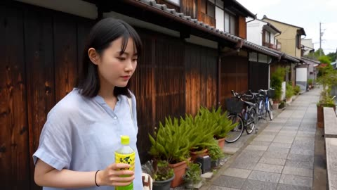</a>

按时间段列出的分镜表让每个时刻只有一个明确动作，手持手机的晃动、自动对焦跳动和列出的环境音效则让画面保持随意感。参考图只用于锁定人物身份，使她的面容和发型在整段视频中保持一致。

MiniMax H3 · 参考生视频 · 出处: [@Just_Anika_Here on X](https://x.com/Just_Anika_Here/status/2109495486138999114) · 69 赞，统计于 2026-10-29

[`handheld`](tags.md#tag-handheld) [`timed-beats`](tags.md#tag-timed-beats) [`reference-identity`](tags.md#tag-reference-identity) [`koi`](tags.md#tag-koi)

<details><summary><b>提示词</b></summary>

```text
Create ultra-realistic spontaneous vertical iPhone footage during a sunny summer afternoon in a small Japanese riverside town.

Use the provided reference image ONLY as the identity reference for the main woman. Keep her facial identity, hairstyle, skin tone, proportions, and overall appearance perfectly consistent throughout the video.

The video should feel like a friend casually recording an unplanned travel adventure. Natural handheld smartphone movement, imperfect framing, occasional autofocus hunting, realistic sunlight and exposure changes, authentic environmental audio, and spontaneous human reactions. No staged acting or cinematic presentation.

0–3s
The woman walks along a narrow stone path beside a clear Japanese canal, holding a cold bottled drink. Traditional wooden houses, small bridges, green plants, and bicycles line the quiet street. She notices several enormous colorful koi fish gathering near the water's edge and leans forward curiously to get a better look.

3–6s
As she crouches slightly to film the fish, one giant koi suddenly splashes its tail near the edge, sending water droplets onto her arm and the camera lens. She instantly pulls back in surprise, almost dropping her drink, while the person filming lets out a spontaneous laugh.

6–9s
She starts laughing at her own reaction and points toward the unusually large fish. Another koi swims rapidly to the surface, creating ripples and splashes. The camera hurriedly tilts down to capture the fish before swinging back to her amused expression.

9–12s
A local elderly man standing nearby gently tosses a little fish food into the canal. Several koi rush toward the surface together, creating a sudden burst of colorful movement in the water. The woman steps closer to watch, visibly delighted, while trying to keep her drink away from the splashes.

12–15s
She turns toward the camera with a wide, disbelieving smile and gestures excitedly toward the fish, as if telling her friend to look at them. A cyclist unexpectedly passes close behind her, making the camera shift sideways to avoid the bicycle. The footage ends abruptly in the middle of her laughter.

Visual style: Bright natural afternoon sunshine, realistic reflections on water, authentic Japanese countryside architecture, lush green plants, subtle summer humidity, natural skin texture, realistic koi movement, ordinary vacation atmosphere, genuine reactions, raw handheld smartphone footage.

Audio: Running water, birds chirping, bicycle bell, distant footsteps, koi splashing, quiet neighborhood ambience, and spontaneous laughter. No background music, no narration, no scripted dialogue.

Avoid: Festival scenes, parades, fireworks, staged performances, cinematic camera movements, slow motion, commercial aesthetics, beauty filters, exaggerated acting, duplicated fish, distorted hands, unrealistic water physics, artificial skin, changing character identity, and AI visual artifacts.
```

</details>

<a id="h3-cafe-woman-notices-first-snow"></a>
### 年轻女子在咖啡馆发现初雪

<a href="https://x.com/iamrealsnow/status/2091093399084708112">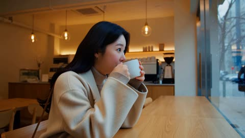</a>

按时间顺序写出一连串动作：在咖啡馆喝饮品、拿出手机、走到户外、雪花落在袖子上、抬头微笑，15秒内节奏清楚。明确写出手持 vlog 拍摄风格，并对比温暖室内与冷蓝户外的色调，让运镜和调色有明确方向；结尾加上不要字幕，避免画面出现文字。

MiniMax H3 · 文生视频 · 出处: [@iamrealsnow on X](https://x.com/iamrealsnow/status/2091093399084708112) · 64 赞，统计于 2026-10-29

[`vlog`](tags.md#tag-vlog) [`winter`](tags.md#tag-winter) [`snow-physics`](tags.md#tag-snow-physics) [`handheld`](tags.md#tag-handheld)

<details><summary><b>提示词</b></summary>

```text
Create a dreamy 15-second Korean winter vlog. A young woman sits inside a minimalist café holding a hot drink when she notices the first snow beginning outside. She excitedly grabs her phone, walks outside, catches a snowflake on her sleeve, and looks up smiling. Soft Korean winter atmosphere, warm café interior contrasting with cold blue outdoors, realistic snow physics, handheld vlog footage, cinematic and natural, no text.
```

</details>

<a id="wan-ugc-viral-restaurant-food-review"></a>
### 自拍博主试吃爆红餐厅的招牌菜

<a href="https://x.com/Diplomeme/status/2092662950633123914">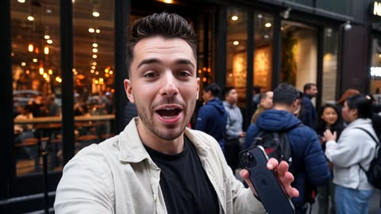</a>

提示词用手机前置自拍的真实感描述（手持抖动、自动对焦来回切换、曝光随明暗变化），并明确禁止电影化运镜和配乐，让画面像真实博主的素材。连续性条款固定人物外观和菜品形态，使各镜头之间保持一致。

Wan 3.0 · 文生视频 · 出处: [@Diplomeme on X](https://x.com/Diplomeme/status/2092662950633123914) · 61 赞，统计于 2026-10-29

[`ugc`](tags.md#tag-ugc) [`food-review`](tags.md#tag-food-review) [`selfie`](tags.md#tag-selfie) [`smartphone`](tags.md#tag-smartphone) [`dialogue`](tags.md#tag-dialogue)

<details><summary><b>提示词</b></summary>

```text
They call it AI slop, but i dont think Food influencers will have a peaceful future now

Generated with Wan 3.0 1080P

Try it with prompt : WAN 3.0 — UGC: I TRIED THE VIRAL RESTAURANT **OUTPUT** Authentic vertical UGC food-review video, 16:9 smartphone footage, approximately 30 seconds. The entire sequence feels like a real creator spontaneously documenting their visit to a viral restaurant for TikTok or Instagram Reels. One continuous visit with natural temporal progression, not a polished commercial. **SUBJECT** A young male food creator in his mid-20s, casual black T-shirt, light overshirt, short dark hair and light stubble. He holds a modern smartphone at arm's length while filming himself. His personality is curious and energetic but not exaggerated. Maintain consistent face, hairstyle, clothing and physical appearance throughout. **WORLD** A massively viral contemporary restaurant in a busy upscale city neighborhood during dinner time. A long queue extends outside the entrance, groups of young customers are filming their food, warm interior lighting spills onto the sidewalk, staff move quickly between tables and the dining room is visibly crowded. Inside, the restaurant has modern industrial interiors, stainless-steel cooking equipment, warm wood tables and an open kitchen. **ACTION** The creator begins outside the restaurant, holding the phone toward himself and speaking naturally: “Okay, I finally tried the restaurant that’s literally everywhere on my feed.” He turns the phone toward the long queue and crowded entrance. Cut naturally to him seated inside. He shows the menu, then flips the camera toward the kitchen as the staff prepare the restaurant's viral signature dish. The dish arrives dramatically, steaming and freshly plated. He brings the phone closer for a handheld food close-up, then takes one bite. There is a brief pause as he processes the flavor. His expression changes from skeptical to genuinely surprised. He looks directly into the camera and says: “Wait… this is actually insane.” He takes another bite, laughs naturally and finishes with: “Okay, I get the hype.” **CAMERA** Modern smartphone camera, vertical 9:16 framing. Primarily handheld front-facing selfie footage with occasional rear-camera POV. Natural arm movement, imperfect framing and subtle hand shake. Autofocus briefly hunts when the phone moves from the creator's face to the food, then locks onto the dish. Automatic exposure adjusts naturally when moving between the bright entrance and warmer interior. Occasional slight cropping of the creator's face and spontaneous reframing. Food close-ups are handheld rather than professionally staged. No gimbal movement, crane shots or cinematic camera choreography. **LOOK** Authentic contemporary smartphone image quality: realistic skin texture, natural dynamic range, subtle computational sharpening, believable smartphone HDR, mild motion blur and light social-media compression. Warm practical restaurant lighting mixed with cooler ambient light from outside. Realistic reflections on plates, glassware and stainless steel. The food looks appetizing but physically real, with visible steam, sauce movement and natural texture. No commercial food photography aesthetic. **SOUND** Direct smartphone microphone recording. Natural creator dialogue with spontaneous pauses and slight background bleed. Busy restaurant ambience, conversations, cutlery, plates, kitchen activity, sizzling food and distant staff voices. Food sounds remain subtle and realistic. No background music, cinematic sound design or artificial voice-over. **CONTINUITY / CONSTRAINTS** Preserve the same creator, clothing, restaurant layout, table position and food appearance throughout. The viral dish must remain geometrically consistent between shots. Maintain realistic smartphone perspective and handheld behavior. No professional camera movements, no studio lighting, no beauty-filter appearance, no excessive color grading, no exaggerated facial reactions, no duplicated customers, no changing restaurant architecture, no warped hands or utensils, no disappearing food, no impossible object movement and no artificial slow motion.
```

</details>

<a id="wan-elderly-moroccan-man-golden-hour-home-video"></a>
### 傍晚村庄水井旁的老人

<a href="https://x.com/Strength04_X/status/2092549618500546628">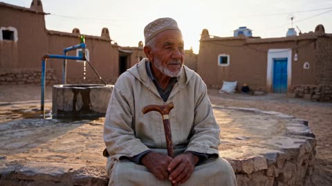</a>

按时间拆分的短动作分镜让画面始终围绕同一人物，镜头描述写明不要稳定器、自动对焦在逆光中反复调整、暖色数码噪点等瑕疵，使成片像家庭录像而不是电影。主体外观在提示中完整重复，有助于各段保持面部和服装一致。

Wan 3.0 · 文生视频 · 出处: [@Strength04_X on X](https://x.com/Strength04_X/status/2092549618500546628) · 59 赞，统计于 2026-10-29

[`home-video`](tags.md#tag-home-video) [`documentary`](tags.md#tag-documentary) [`golden-hour`](tags.md#tag-golden-hour) [`handheld`](tags.md#tag-handheld) [`character-consistency`](tags.md#tag-character-consistency)

<details><summary><b>提示词</b></summary>

```text
Wan 3.0 on
@openart_ai


Prompt b- Create a 30-second, 1080p ultra-realistic documentary-style personal home video showing an ordinary golden-hour evening in the life of an elderly Moroccan man. The footage should feel spontaneous, intimate, imperfect, and genuinely observed rather than performed.
MAIN SUBJECT
The same elderly man in his early 70s throughout the entire video.
Deeply sun-weathered skin, kind and weary eyes, short white beard, calm dignified expression.
He wears a light sand-colored djellaba, worn leather sandals, and a simple woven cap.
Keep his face, identity, body proportions, and clothing completely consistent from beginning to end.
LOCATION
A small desert-edge village during golden hour. Mudbrick houses, narrow sandy alleys, a few palm trees, a well, tethered goats, low stone benches, and long dramatic shadows from the low sun.
The village should feel authentic and lived-in. No crowds, tourist attractions, advertisements, or commercial branding.
CAMERA / VISUAL STYLE
Authentic casual personal-video footage from an older consumer digital camera, handheld by a grandchild walking nearby.
Natural camera shake, imperfect framing, autofocus adjusting to strong backlight, soft detail, mild motion blur, warm-toned digital noise, imperfect white balance, occasional lens flare from the low sun.
No stabilization, gimbal movement, drone shots, cinematic lighting, slow motion, or polished color grading.
00:00–00:05 — SITTING BY THE WELL
He sits on a low stone bench near the village well, resting both hands on a wooden cane.
He looks toward the setting sun, eyes narrowing slightly against the light.
He notices the camera and gives a slow, warm nod.
00:05–00:10 — WALKING THROUGH THE ALLEY
He rises slowly and walks through a narrow sandy alley, cane tapping the ground with each step.
The camera follows a few steps behind, dust faintly visible in the golden light.
00:10–00:14 — SMALL EVERYDAY MOMENT
He stops to pet a tethered goat, speaking softly to it, not clearly audible.
The goat nudges his hand and he chuckles quietly.
00:14–00:19 — GREETING A NEIGHBOR
He passes a younger man carrying firewood and exchanges a brief warm greeting, hands touching chest in respect.
The camera catches only part of the exchange before drifting slightly off-frame.
00:19–00:23 — WIND AND SAND
A gentle desert wind kicks up fine sand around his feet.
He shields his eyes briefly with one hand and continues walking, unbothered.
00:23–00:27 — QUIET MOMENT
He reaches a low wall overlooking the open desert and stops, watching the sun sink lower.
He turns partway toward the camera and gives a small, genuine smile.
00:27–00:30 — WALKING HOME
He turns and walks slowly back toward the village, cane tapping steadily.
The camera lingers on his figure against the golden horizon.
At approximately 00:29, the recording abruptly cuts to black mid-motion. No fade-out.
PHYSICAL REALISM
Maintain believable physics for the cane, sand, goat, fabric of the djellaba, and his footing throughout. No distorted anatomy, floating objects, or sudden transformations.
AUDIO
Natural environmental audio only: cane tapping, wind, distant goats, faint voices, sand shifting underfoot. No music, no narration, no artificial sound effects.
FINAL FEEL
Quiet, dignified, weathered, nostalgic, warm, and deeply human a forgotten personal recording of an ordinary golden-hour evening in the desert.
```

</details>

<a id="wan-japanese-street-candid-glance"></a>
### 黑长发女生在日本街头回望镜头

<a href="https://x.com/Pengchenop/status/2109467882153480285"></a>

参考图锁定人脸，提示词按顺序安排动作节拍：先低头看手机，街边声音带动抬头，最后视线与镜头相遇。手持运镜和日系胶片色调让画面像随手抓拍的街头照片。

Wan 3.0 · 参考生视频 · 出处: [@Pengchenop on X](https://x.com/Pengchenop/status/2109467882153480285) · 58 赞，统计于 2026-10-29

[`reference-image`](tags.md#tag-reference-image) [`japanese-street`](tags.md#tag-japanese-street) [`handheld-camera`](tags.md#tag-handheld-camera)

<details><summary><b>提示词</b></summary>

```text
Based on the provided character reference image, maintain the character's original facial features, proportions of facial features, and overall temperament, and generate a segment of ultra-high-definition, cinematic realistic style Japanese street life short film.

The scene is set on a sunny and bright morning, on a Japanese street full of life. Both sides of the street are lined with various small shops, with signs and buildings staggered in an orderly manner. In the distance, pedestrians riding bicycles and slowly passing vehicles appear from time to time, creating an authentic and natural urban daily atmosphere.

The character stands in a safe area by the roadside, with soft black long hair naturally cascading down. A gentle breeze lightly blows the hair tips, with a few strands of hair brushing across the cheeks with the wind. Warm morning light spills from the front side, illuminating the character's facial contours and hair strands, forming a soft and translucent natural glow.

The character has delicate and harmonious facial features, a straight nose bridge, and naturally delicate skin, exuding an overall pure and gentle, slightly lazy senior sister temperament. She carries a black high-end textured leather bag over one shoulder, holds her phone casually in both hands, and her body posture is relaxed and at ease.

The camera slowly approaches in a handheld street photography style, accompanied by slight natural shakes. The character first looks down at her phone, then is drawn by the sounds from the street side, gently raises her head, and her gaze inadvertently meets the lens, revealing a naturally relaxed expression. The entire process has no deliberate posing feel.

A breeze blows through the street, and a few sycamore leaves slowly drift down. In the background, pedestrians, vehicles, and tree shadows move naturally, with realistic and delicate light and shadow changes on the building surfaces.

The footage adopts a fresh Japanese film snapshot color tone, bright and translucent, with soft colors, retaining authentic skin textures and natural light levels. The composition has a slightly casual and irregular feel, simulating a life moment accidentally captured by a photographer on the street.

4K ultra-high-definition quality, 24fps, realistic physical lighting, natural depth of field, delicate dynamic performance, highly consistent character facial features, smooth and coherent movements, no obvious AI generation traces.

Negative prompt: excessive skin smoothing, plastic skin, exaggerated beautification, facial feature distortion, character face swap, deformed fingers, limb twisting, hair clipping, background flickering, vehicle deformation, stiff movements, severe lens shake, over-sharpening, fake light and shadow, cartoon texture, CG rendering feel.
```

</details>

<a id="h3-crab-steals-phone-harbor"></a>
### 巨蟹在渔港抢走女生手机

<a href="https://x.com/Just_Anika_Here/status/2110229530019500523"></a>

以朋友手持拍摄的 vlog 视角来写，按每 3 秒分段描述动作，并为每个事件指定明确的声音提示。对白与环境音分开，揭晓前留出静默，让音频保持清晰。

MiniMax H3 · 参考生视频 · 出处: [@Just_Anika_Here on X](https://x.com/Just_Anika_Here/status/2110229530019500523) · 44 赞，统计于 2026-10-29 · 发现于 [SkyNotSilent/awesome-MiniMax-H3-cases](https://github.com/SkyNotSilent/awesome-MiniMax-H3-cases)

[`vlog`](tags.md#tag-vlog) [`dialogue`](tags.md#tag-dialogue) [`animal`](tags.md#tag-animal) [`japan`](tags.md#tag-japan) [`reference-image`](tags.md#tag-reference-image)

<details><summary><b>提示词</b></summary>

```text
Create an ultra-realistic 15-second  video during a lively summer afternoon at a small Japanese fishing harbor. Use the provided reference image only to preserve the main woman's identity and appearance.

The video must feel like a real spontaneous travel vlog, recorded by her friend. Natural handheld smartphone footage, fast reactions, continuous movement, realistic expressions, authentic Japanese harbor details, and clear close-ups. The story must contain multiple connected actions, audible dialogue, distinctive environmental sounds, and a genuinely surprising ending.

0–3 seconds:
The woman stands beside a seafood stall, filming an enormous live Japanese spider crab displayed in a shallow tank. Suddenly, the crab stretches one long leg over the tank's edge and knocks her phone out of her hand. The phone lands safely on a nearby pile of fishing nets. She gasps, shouting, "Oh my God! Did you see that?!" The friend filming immediately exclaims, "Yo! It stole your shot!"
3–6 seconds:
The crab crawls sideways toward the nets while the woman quickly retrieves her phone. A fisherman rushes over, calling out in Japanese, "Abunai! Abunai!" A metal bucket clatters onto the ground, startling a flock of seagulls into flight. The camera swings rapidly between the escaping crab, the startled woman, and the fisherman.

6–9 seconds:
The crab unexpectedly grabs the loose end of a bright red fishing rope with one claw. As it moves, the rope pulls a small stack of empty plastic baskets across the wet pavement. The woman jumps aside and shouts, "Wait, wait! It's taking everything!" The fisherman laughs in disbelief and calls for someone to help.
9–12 seconds:
A sudden tug pulls a lightweight fishing net off a wooden crate. The net drops over the crab like a messy tent. Everyone freezes for a moment. The fisherman carefully lifts one corner, revealing the crab sitting beside a tiny hidden kitten that had been sheltering behind the crate. The kitten meows loudly and climbs onto the fisherman's rubber boot.

12–15 seconds:
Just as the woman bends down to film the kitten, the giant crab raises both claws behind her. The fisherman suddenly shouts, "Look out!" She spins around in shock, but the crab is simply holding her bright red phone strap between its claws. The woman stares at the camera in disbelief and says, "It actually wanted my phone!" End with the fisherman laughing and the crab releasing the strap.
Audio must be carefully designed and clearly audible: lively harbor ambience, waves against the dock, seagulls squawking, water splashing, metal bucket clattering, plastic baskets scraping across wet pavement, the crab tapping against the tank, realistic footsteps, a loud surprised gasp, spontaneous English dialogue, the fisherman's Japanese warning, a clear kitten meow, and natural overlapping reactions.

Use distinct sound events synchronized exactly with the visible actions. Keep dialogue crisp and intelligible, with the environmental sounds slightly quieter whenever someone speaks. The woman's voice should sound surprised and expressive, not continuously laughing. Include moments of silence and suspense before the final reveal.
Visual style: realistic smartphone exposure, natural summer sunlight, authentic Japanese fishing harbor, believable animal movement, consistent character appearance, clear medium shots and close-ups, natural camera shake, and realistic physical interactions.

Avoid constant laughter, silent characters, generic background noise, music overpowering dialogue, robotic voices, random sound effects, cinematic transitions, slow motion, cartoon behavior, impossible animal actions, distorted hands, duplicated animals, and blurry faces.
```

</details>

<a id="h3-cruise-cabin-black-hole-window"></a>
### 游客在游轮客房拍摄黑洞

<a href="https://x.com/ivanfioravanti/status/2086553101029290296"></a>

手持业余视角的取景，加上玻璃窗上清晰的倒影，让窗户看起来像真实的表面。中途关灯给了观看窗外的理由，简短台词则为画面加入了出镜人物的声音。

MiniMax H3 · 文生视频 · 出处: [@ivanfioravanti on X](https://x.com/ivanfioravanti/status/2086553101029290296) · 43 赞，统计于 2026-10-29 · 发现于 [SkyNotSilent/awesome-MiniMax-H3-cases](https://github.com/SkyNotSilent/awesome-MiniMax-H3-cases)

[`black-hole`](tags.md#tag-black-hole) [`space-cruise`](tags.md#tag-space-cruise) [`handheld-pov`](tags.md#tag-handheld-pov) [`reflection`](tags.md#tag-reflection)

<details><summary><b>提示词</b></summary>

```text
amateur handheld pov footage of a tourist in their plush and comfortable room of a space cruise, carpeted floor and comfy bed, large window shows a view of Gargantua blackhole, you can see their reflection in the window, they turn off the light half way through so we can see outside better and say: "Wow look at that!", then they show back the room
```

</details>

<a id="h3-japan-bus-vlog-somen-stream"></a>
### 女子乘坐青绿色巴士穿越日本乡村田野

<a href="https://x.com/harboriis/status/2092469535844733357"></a>

提示词按镜头规格、主体与环境设定、带时间码的分镜和英文台词分段书写，每个节拍都有独立的镜头和口型台词。用35mm镜头和f/1.8光圈加上光线与虚化描述，固定电影感的画面风格。

MiniMax H3 · 文生视频 · 出处: [@harboriis on X](https://x.com/harboriis/status/2092469535844733357) · 38 赞，统计于 2026-10-29

[`vlog`](tags.md#tag-vlog) [`japan`](tags.md#tag-japan) [`lip-sync`](tags.md#tag-lip-sync) [`multi-scene`](tags.md#tag-multi-scene)

<details><summary><b>提示词</b></summary>

```text
A tranquil 15 second cinematic vlog shot in 8k on a 35mm lens at f/1.8. A young East Asian woman with long brown hair, wearing a white shirt and light blue scarf, rides a vintage teal bus through lush Japanese countryside. She steps off into the crisp air, sits on the wooden veranda of a traditional house, dips her bare feet into a clear running stream, and eats cold somen noodles from a bowl with chopsticks. Natural sun dappled lighting, green rice paddies, swaying wind chimes, soft bokeh, serene atmosphere, with clear English lip sync and dialogue.
Subject and Environment Specs
Subject: Young East Asian female, long brown hair, natural makeup, dressed in a casual white t shirt and light blue scarf.
Environment: Rural Japanese countryside, vintage teal bus, expansive green rice fields, traditional wooden porch engawa, clear stream, glass wind chime furin.
Scene Breakdown and English Dialogue
Scene 1: The Countryside Bus Ride 0:00 to 0:03
Visuals: Medium shot of the woman looking out a vintage bus window at green fields, followed by an aerial tracking shot of the teal bus driving along a rural road.
Scene 2: Arrival 0:04 to 0:05
Visuals: Close up of her stepping off the bus into the open countryside, closing her eyes and breathing in the fresh air.
English Lip Sync: "So peaceful..."
Scene 3: Noodles by the Stream 0:06 to 0:11
Visuals: Wide shot sitting on a wooden porch, dangling bare feet into a cool, clear stream while eating cold somen noodles from a black bowl with wooden chopsticks.
English Lip Sync: "The air tastes so fresh here... these cold noodles are perfect."
Scene 4: Wind Chime and Farewell 0:12 to 0:14
Visuals: A glass wind chime sways gently under the eaves. Cuts to a close up of her looking directly at the camera with a warm, relaxed smile in golden sunlight.
English Lip Sync: "Truly delicious."
```

</details>

<a id="h3-ramen-selfie-vlog-kitchen"></a>
### 厨房自拍视频展示拉面碗

<a href="https://x.com/Taaruk_/status/2083461207919612348"></a>

用具体的手机机型、自动对焦抖动和手持晃动来描述镜头，让画面更像真实的 UGC 而非广告大片。上传参考碗图锁定八个镜头中的碗型与配料，按秒标注分镜并写入台词，节奏更紧凑。

MiniMax H3 · 参考生视频 · 出处: [@Taaruk_ on X](https://x.com/Taaruk_/status/2083461207919612348) · 35 赞，统计于 2026-10-29 · 发现于 [SkyNotSilent/awesome-MiniMax-H3-cases](https://github.com/SkyNotSilent/awesome-MiniMax-H3-cases)

[`ugc`](tags.md#tag-ugc) [`selfie-vlog`](tags.md#tag-selfie-vlog) [`food`](tags.md#tag-food) [`product-reference`](tags.md#tag-product-reference) [`dialogue`](tags.md#tag-dialogue)

<details><summary><b>提示词</b></summary>

```text
Duration: 15 seconds | Aspect Ratio: 16:9 | Style: Authentic UGC / iPhone selfie-vlog, handheld, natural light, slight motion blur, TikTok/Reels energy — NOT cinematic.
Product Reference: Use the uploaded ramen bowl image as the only product reference. Keep the broth color, noodle thickness, toppings, egg placement, chashu slices, and bowl appearance identical throughout every shot.
Camera: iPhone 15 Pro handheld with front/back camera switching, realistic autofocus hunting, natural handheld movement, slight exposure shifts, warm apartment lighting.
Character Description
Name: Yuna
A young Japanese woman in her early 20s with soft natural beauty, shoulder-length dark hair tied loosely, subtle makeup, oversized gray hoodie, cheerful personality, filming casually inside a cozy apartment kitchen.
Shot Breakdown
SHOT 1 (0–2s) — Selfie holding the ramen bowl.
Dialogue: "Late-night ramen again."
SHOT 2 (2–4s) — Overhead reveal with steam rising.
SHOT 3 (4–6s) — Close-up autofocus on noodles and broth.
SHOT 4 (6–8s) — Chopsticks lifting noodles with a natural noodle stretch.
SHOT 5 (8–10s) — Selfie bite reaction.
Dialogue: "That's insanely good."
SHOT 6 (10–12s) — Casual b-roll of the bowl while she reaches for another bite.
SHOT 7 (12–14s) — Selfie holding noodles toward camera.
Dialogue: "Worth every bite."
SHOT 8 (14–15s) — Freeze frame with handwritten overlay: "ramen fix 🍜"
Look & Feel
Warm lighting, natural phone quality, authentic UGC pacing, jump cuts, realistic handheld movement.
Negative Prompt
cinematic look, luxury commercial, perfect framing, CGI noodles, unrealistic steam, plastic food, distorted chopsticks, extra fingers, warped hands, overprocessed HDR, text artifacts.
```

</details>

<a id="wan-fitness-vlog-gym-workout-selfie"></a>
### 健身 Vlog 女生完成一组训练动作

<a href="https://x.com/ImaStudio_ai/status/2092197772082504133">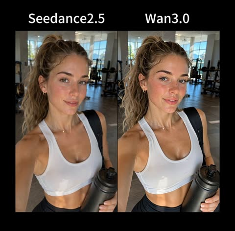</a>

提示词把视频写成带时间段的分镜，每段指定机位，例如手机支架固定、朋友手持跟拍或镜子自拍。通过逐段递进的出汗和泛红设定，加上禁止美颜和塑料皮肤的约束，保证全程人物一致且质感真实。

Wan 3.0 · 文生视频 · 出处: [@ImaStudio_ai on X](https://x.com/ImaStudio_ai/status/2092197772082504133) · 29 赞，统计于 2026-10-29

[`fitness`](tags.md#tag-fitness) [`vlog`](tags.md#tag-vlog) [`selfie`](tags.md#tag-selfie) [`gym`](tags.md#tag-gym) [`ugc`](tags.md#tag-ugc)

<details><summary><b>提示词</b></summary>

```text
Generate a 30-second, 9:16 vertical, ultra-realistic smartphone-shot fitness Vlog featuring a beautiful Western woman. The overall feel should be like a beautiful, stylish young Western fitness blogger casually documenting her daily workout with an iPhone, realistic, natural, relaxed, sophisticated, and full of everyday life. Not a professional fitness advertisement, not a sports brand promotional video, not cinematic photography, and do not use overly polished commercial lighting. The footage should look like a high-quality personal fitness Vlog genuinely posted on TikTok / Instagram Reels.

【Character Setting】
Throughout the entire video, strictly maintain the same young adult white woman, approximately 23–27 years old, very beautiful but with a realistic human appearance. White female facial features, naturally long light brown hair with a slightly golden tone, tied into a voluminous natural high ponytail, with a few messy flyaways gradually appearing during the workout. Light-colored eyes, beautiful natural eyebrows, refined nose bridge, naturally full lips, smooth and sophisticated facial structure. Overall, she should look like an elegant, timelessly attractive Western beauty, not an exaggerated influencer face, and not a plastic-looking AI beauty.

The woman has a tall, balanced, healthy, toned physique, with natural muscle definition developed through long-term fitness, a tight waist and abdomen, and attractive shoulder, neck, and leg lines, but do not exaggerate bodybuilding muscles or create extreme waist-to-hip proportions that do not conform to human anatomy.

The character must retain realistic skin texture throughout: clearly visible tiny pores, skin texture, fine facial hair, slight unevenness in skin tone, and a small amount of natural imperfections. No skin smoothing and no beauty filters. Makeup is extremely light, natural, sophisticated clean girl makeup.

Because of the gym temperature and sustained exercise, as the workout progresses, her cheeks and the tip of her nose gradually develop a natural light pink flush, like the healthy warmth caused by real exercise, not blush, and do not make her face excessively red. Tiny realistic beads of sweat gradually appear on her forehead, nose tip, temples, neck, and collarbones, with some flyaway strands of hair becoming slightly stuck to the sides of her face from sweat.

No headphones, no over-ear headphones, no in-ear earphones, no hat, and no sunglasses at any point.

Wear a sophisticated minimalist fitness outfit: clean white fitted athletic tank top or sports bra top + black high-waisted athletic shorts + white mid-calf athletic socks + simple white training shoes. No obvious brand logos on the clothing. Use realistic athletic fabric, with visible stretch texture, seams, natural wrinkles, and subtle changes from sweat after exercise. Keep the outfit consistent throughout.

【0–4s｜Entering the Gym】
Realistic iPhone front-camera selfie video.

The woman has just walked into a bright, modern, spacious, upscale gym. She holds the phone in one hand for a selfie, naturally carrying a black gym bag over her shoulder, while holding a black water bottle in the other hand.

As she walks, she looks toward the phone camera and gives a natural, beautiful slight smile. Do not deliberately pose; it should feel like she has just opened her phone and casually started recording.

The phone has slight realistic movement from walking, and the woman is occasionally not perfectly centered in the frame. Large windows, workout benches, dumbbell racks, and real gym equipment can be seen in the background.

She naturally looks at the camera and says:
“Quick workout before I start my day.”

The delivery should be relaxed and casual, like a real Vlogger speaking, with no advertising voice-over feel.

【4–7s｜Pre-Workout Preparation】
Natural hard cut.

The woman casually props the phone against a workout bench or piece of gym equipment, creating a slightly imperfect stationary phone angle.

She stands in front of a mirror and reties her high ponytail, raising both hands to adjust her hair, with her beautiful natural face visible through the mirror.

She then casually rolls her shoulders, moves her arms and legs, lightly stretches her body, and bends down to tighten her shoelaces.

Do not look at the camera and pose; all movements should feel like natural preparation before a real workout.

【7–12s｜Dumbbell Romanian Deadlift】
Cut to the feeling of a friend casually filming with a phone.

The woman holds two black dumbbells of a reasonable weight and performs Romanian deadlifts.

Use a normal smartphone medium shot or full-body composition, naturally filmed from a front-side angle. The movement must follow realistic human biomechanics: back stable, knees naturally bent, hips moving backward, then standing up through the strength of the legs and core.

Do not deliberately film her buttocks or chest; focus on the complete exercise movement, overall body proportions, and natural sense of strength.

The phone camera has slight handheld movement and occasionally refocuses automatically. The clothing stretches and wrinkles naturally with her movements.

After completing the final repetition, she naturally sets the dumbbells down, stands up, takes a deep breath, and uses her hand to brush a strand of hair away from the side of her face.

At this point, her cheeks begin to show a very subtle natural pink flush.

【12–16s｜Dumbbell Squats】
Quick natural cut.

The woman holds the dumbbells in front of her body and performs squats.

The phone films the complete movement from normal human height, without an exaggerated low angle.

She trains seriously and does not constantly look at the camera. The descent, brief pause, and rise are natural and fluid, with realistic activation of the legs, arms, and core visible.

During the final two repetitions, she is clearly beginning to feel tired, with heavier breathing.

After completing the final repetition, she stands up, clearly exhales, and gives a slight smile.

Her cheeks are slightly more flushed than before, and a small amount of fine sweat begins to appear on her forehead.

【16–20s｜Lat Pulldown】
Cut to the lat pulldown machine.

The woman sits on the machine and performs a set of lat pulldowns.

The phone is positioned approximately 45 degrees from the side-back or side-front of the subject, with a friend lightly holding the phone while filming.

She grips the bar with both hands, pulls it steadily downward, then slowly returns it to the top. Her shoulders, back, and arm muscles naturally tighten with the movement, but the muscles should not be exaggerated.

The final repetition is clearly more difficult.

After finishing, she releases the machine, leans back in the seat and catches her breath for two seconds, then turns toward the phone camera and gives a very natural, beautiful smile that looks slightly tired.

She softly says:
“That was way harder than it looked.”

Then she gives a small laugh.

【20–23s｜Rest and Drink Water】
The phone is positioned close to the subject for a very realistic workout-break close-up.

The woman sits at the edge of a workout bench, gently wipes the sweat from her forehead, side of her face, and neck with a white towel, then picks up the black water bottle and takes several consecutive sips of water.

This shot should focus on her beautiful but realistic post-workout state.

Because of exercise and body heat, her cheeks and nose tip have a very natural light pink flush, like healthy post-workout color rather than makeup blush.

Very tiny realistic beads of sweat can be seen on her forehead, nose tip, temples, shoulders, and collarbones.

A few light brown flyaway strands are slightly damp from sweat and stick to her forehead and the side of her face.

The phone is relatively close to her face, clearly showing pores, skin texture, a small amount of freckles or very subtle natural imperfections.

Do not smooth the skin.

Do not use beauty filters.

After drinking, she looks toward the camera, slightly raises an eyebrow, then gives a relaxed, natural smile.

【23–27s｜Dumbbell Lunges】
Cut to a bright training area near large floor-to-ceiling windows.

Natural daylight enters through the windows.

The woman holds two dumbbells and performs alternating lunges.

A friend uses a phone to lightly follow her from approximately waist-to-chest height, keeping her full movement in frame.

During the final repetitions, she is clearly somewhat fatigued, breathing faster, with her cheeks naturally more flushed, but her movements remain stable.

After finishing, she sets the dumbbells down, places both hands on her knees, and catches her breath for two seconds.

Then she raises her head toward the camera, her beautiful face naturally flushed from exercise, and smiles while lightly shaking her head.

Do not act or perform for the camera.

【27–30s｜Post-Workout Mirror Selfie】
Finally, cut to a realistic gym mirror selfie.

The woman stands in front of a large mirror, holding the phone in one hand and the black water bottle in the other, with the gym bag over her shoulder.

Her post-workout state must remain realistically continuous.

Her high ponytail is now slightly messy, with several flyaway strands around the sides of her face, her cheeks and nose tip naturally flushed, and tiny beads of sweat on her forehead and collarbones, with a healthy natural post-workout glow to her skin.

Do not suddenly restore a perfect makeup look.

She looks at herself through the phone in the mirror and gives a relaxed, beautiful smile.

Then she naturally says:
“Done. Best way to start the day.”

After saying it, she gives a small laugh and picks up her gym bag, preparing to leave.

The phone naturally lowers with her movement, and the video ends.

【Filming Quality—Extremely Important】
The entire video must look like it was genuinely shot on a real iPhone, not like a cinema camera simulating a smartphone aesthetic.

Real smartphone front and rear camera quality.
Real smartphone wide-angle perspective.
Slight handheld movement.
Slight motion blur.
Realistic autofocus.
Natural automatic exposure changes.
Some shots with the phone placed stationary.
Some shots filmed casually by a friend.
Occasionally allow imperfect framing.
Not every shot should look like a professional photograph.
Do not use gimbal-smooth camera movement.
Do not use excessive shallow depth of field.
Do not use cinematic background blur.
Do not use professional commercial lighting.

The gym should be bright, airy, modern, upscale but realistic, primarily featuring black, gray, white, and natural wood tones, with large windows providing real natural daylight.

Image colors must be clean and natural.

No yellow filter.
No orange filter.
No dark or gloomy image.
No teal-and-orange cinematic color grading.
No excessive saturation.
Keep skin tones realistic and natural.

Editing should follow the authentic TikTok / Instagram Reels fitness Vlog rhythm, primarily using natural hard cuts and slight Jump Cuts. Preserve realistic everyday details such as picking up dumbbells, putting dumbbells down, catching her breath, wiping sweat, drinking water, adjusting her hair, and so on.

Include natural gym ambience: slight dumbbell clanking, machine sounds, shoe friction against the floor, breathing, drinking water sounds, and softly blurred distant gym ambience.

Background music should be upbeat, rhythmic, sophisticated but not overly intense Western Workout Lifestyle music, with the music volume lower than the woman's speech and the real environmental sounds.

【Character Consistency—Highest Priority】
The same beautiful white woman must be strictly maintained throughout the entire 30 seconds.
Same face.
Same facial features.
Same light brown hair with a slightly golden tone.
Same high ponytail.
Same white athletic top.
Same black high-waisted athletic shorts.
Same body proportions.
Same gym environment.

As the workout progresses, her condition must change naturally:
Clean, natural skin at the beginning → lightly sweating after exercise → cheeks gradually becoming slightly flushed → finally showing realistic post-workout sweat, healthy redness, and slight messiness.

NO HEADPHONES.
NO EARPHONES.
NO TEXT.
NO SUBTITLES.
NO CAPTIONS.
NO LOGO.
NO WATERMARK.
NO BEAUTY FILTER.
NO PLASTIC SKIN.
NO AIRBRUSHED SKIN.
NO PERFECT AI FACE.
NO HEAVY MAKEUP.
NO EXCESSIVE BLUSH.
NO COMMERCIAL FITNESS AD LOOK.
NO CINEMATIC CAMERA LOOK.
NO EXTREME SHALLOW DEPTH OF FIELD.
NO EXCESSIVE SLOW MOTION.
NO SEXUALIZED CAMERA ANGLES.
NO EXAGGERATED BODY PROPORTIONS.
NO EXTREME HOURGLASS BODY.
NO UNNATURAL MUSCLES.
NO DISTORTED HANDS.
NO EXTRA FINGERS.
NO EXTRA LIMBS.
NO DUPLICATED LIMBS.
```

</details>

<a id="h3-chef-dumpling-dough-cleaver"></a>
### 厨师在面粉中用刀压饺子面团

<a href="https://x.com/cocktailpeanut/status/2092363865619317172"></a>

提示词采用编号分段的分镜写法，每段只写一个动作并给出明确结尾，使多段连续生成保持连贯。明确列出声音细节并禁止人声和音乐，让音轨只保留厨房环境声。

MiniMax H3 · 文生视频 · 出处: [@cocktailpeanut on X](https://x.com/cocktailpeanut/status/2092363865619317172) · 16 赞，统计于 2026-10-29 · 发现于 [SkyNotSilent/awesome-MiniMax-H3-cases](https://github.com/SkyNotSilent/awesome-MiniMax-H3-cases)

[`food`](tags.md#tag-food) [`cooking`](tags.md#tag-cooking) [`dumplings`](tags.md#tag-dumplings) [`sound-design`](tags.md#tag-sound-design)

<details><summary><b>提示词</b></summary>

```text
The chef prepares a supple dumpling dough, rolls it into a very large thin circular wrapper on a lightly floured wooden board, then mixes seasoned pork filling with cubes of chilled gelatinized stock, showing convincing close-ups of the ingredients, hands, textures, flour, moisture, and utensils.
A generous mound of filling is placed in the center, then the chef slowly lifts and pleats the enormous wrapper around it, creating dozens of small folds while rotating the dumpling by hand until the top closes into a neat twisted knot and the whole dumpling visibly sags with realistic weight.
The giant dumpling is transferred carefully into a wide bamboo steamer lined with cabbage leaves, the lid closes, steam escapes naturally around the rim, then after cooking the lid is lifted and dense steam reveals the now-translucent, glossy dumpling sitting intact inside.
The chef slides it into a shallow serving bowl, places ginger and black vinegar beside it, then punctures the top gently with chopsticks so a large amount of hot golden broth visibly pours from inside the dumpling into the bowl while the delicate skin remains mostly intact.
Finish with a close-up of the chef opening the dumpling further and spooning up the broth, pork filling, and thin wrapper together, emphasizing realistic steam, liquid movement, chopstick sounds, bamboo creaks, ceramic clinks, and kitchen ambience, with absolutely no spoken language or music.
```

</details>

<a id="kling4-ugc-car-confession"></a>
### 在车里录视频吐槽：朝陌生人挥手认错了人

<a href="https://x.com/minchoi/status/2111471592601534511"></a>

30 秒手机一镜到底的搞笑独白，车顶有雨声，窗外停车场的声音隔着玻璃传进来。

Kling 4.0 · 文生视频 · 出处: [@minchoi on X](https://x.com/minchoi/status/2111471592601534511)

[`ugc`](tags.md#tag-ugc) [`vlog`](tags.md#tag-vlog) [`vertical`](tags.md#tag-vertical) [`comedy`](tags.md#tag-comedy) [`dialogue`](tags.md#tag-dialogue) [`rain`](tags.md#tag-rain)

<details><summary><b>提示词</b></summary>

```text
Raw vertical 9:16 video recorded on a phone's front camera, one continuous 30-second take with no cuts. It looks like an ordinary unedited phone clip, not a film: slightly soft image, digital noise and compression, flat grey daylight through rain-streaked windows, no colour grading. the picture wobbles whenever she moves and jolts when she pulls the door shut. Sadie, a young woman in her early 20s with long honey-blonde hair in a messy bun with loose strands, no makeup, small gold hoop earrings and an oversized sage-green hoodie with no print, sits in the driver's seat of a small, slightly messy hatchback parked in a supermarket car park on a rainy afternoon. Rain streaks every window; through the rear window, blurred parked cars and a trolley bay. At the start she drops into the seat and pulls the door shut. She tells the story with her hands. Around 18 s she covers her face with both hands. Around 26 s a trolley rattles past her window and she slides down low in the seat as if hiding, laughing. [Sadie: casual young woman's voice, a bit breathless and mortified, recorded on the phone's built-in mic in a small car]: "Okay. I need to tell someone this immediately. ... So I'm in the cereal aisle, and this guy waves at me. Like, a big wave. So I wave back. Big wave. ... He was waving at his wife. Who was right behind me. ... And then I saw them again at the checkout. ... I'm never going back in there. I live in the car now. This is my home." Audio as captured by the phone mic inside a closed car, not studio clean: rain drumming on the roof and windscreen, her voice close and boxy in the small space, the door's heavy thud, fabric rustling against the seat, and outside, muffled through the glass, a trolley rattling past, a car door slamming and an engine starting. No subtitles, no captions, no on-screen text.
```

</details>

<a id="seedance-16mm-analog-morning-vlog"></a>
### 女子带金毛犬的胶片质感晨间vlog

<a href="https://x.com/maxxmalist/status/2085422370362110168"></a>

提示词先写定自拍视角，再按顺序排列每句台词，让全程保持手持第一人称感。胶片质感与手持瑕疵分开成独立的镜头和画面段落，并在长椅上切换到远景。

Seedance 2.5 · 文生视频 · 出处: [@maxxmalist on X](https://x.com/maxxmalist/status/2085422370362110168)

[`vlog`](tags.md#tag-vlog) [`handheld`](tags.md#tag-handheld) [`film-grain`](tags.md#tag-film-grain) [`dialogue`](tags.md#tag-dialogue)

<details><summary><b>提示词</b></summary>

```text
CAMERA: Handheld DV 16mm daily vlog footage. The video MUST begin with her holding the camera at arm's length in selfie mode while stepping outside her apartment building with her dog. The first 20–30 seconds are entirely handheld. Later she occasionally places the camera on a park bench, low stone wall, picnic table, or the ground for wider shots. Keep subtle handheld shake, drifting composition, autofocus hunting, rushed reframing, uneven zooms, exposure breathing, brief accidental face cropping, and imperfect framing throughout. The camera itself is never visible.

LOOK: Warm analog tape texture with gentle film grain, slightly softened sharpness, subtle halation around sunlight, realistic skin tones, low contrast, tiny exposure shifts, and natural motion blur. It should feel like authentic footage from someone's everyday life rather than a polished commercial.

STYLE: A relaxed morning lifestyle vlog. Quiet, cozy, and spontaneous. She occasionally laughs at her dog, pauses to look around, adjusts the leash, brushes hair away from her face, and speaks naturally in short sentences with comfortable pauses.

CHARACTER: EMMA — a beautiful white woman in her mid-20s. Long light brown hair in a messy ponytail, green eyes, minimal makeup, oversized gray hoodie, black biker shorts, white sneakers, and a small crossbody bag. She is walking a happy golden retriever.

SETTING: A peaceful suburban neighborhood on a sunny morning. Tree-lined sidewalks, quiet residential streets, birds singing, a small park with benches, green grass, and soft golden morning light. Very few people are around.

SCENES:

The vlog opens in selfie mode. Emma holds the camera while leaving her apartment building with the golden retriever excitedly pulling on the leash.
"Good morning."
She smiles.
"Someone couldn't wait."
The dog eagerly sniffs everything as they walk down the sidewalk.
She laughs quietly.
"He has to inspect every single tree."
Still holding the camera, she walks into a small neighborhood park.
The dog suddenly stops and stares at a squirrel.
"Oh... there we go."
She smiles and gently shakes her head.
She places the camera on a nearby bench for a wider angle while throwing a tennis ball.
The dog happily chases after it.
"Worth waking up early."
She picks the camera back up.
Walking slowly through the park, she looks up at the trees for a moment.
"It's actually really peaceful out here."
The dog returns with the ball but drops it halfway.
She laughs.
"Close enough."
She sits on the bench while the dog lies beside her.
She scratches behind his ears.
"I think he's happier than I am."
She stands up and continues walking.
The camera stays in selfie mode as they head toward home.
"Coffee is definitely next."
She smiles into the lens.
"See you later."
She gives a small wave and ends the recording.
```

</details>

<a id="seedance-2000s-camcorder-school-day"></a>
### 2000年录像机画面中模糊的孩子脸部

<a href="https://x.com/Diplomeme/status/2112745556644946344"></a>

明确写出MiniDV格式、柔焦、颗粒、色彩渗色和橙色时间戳来确定画面质感，再用统一的第一人称规则，让同样的手部和服装贯穿六个定时分镜保持连贯。单独的镜头和声音规则保留了手持感和分层环境音。

Seedance 2.5 · 文生视频 · 出处: [@Diplomeme on X](https://x.com/Diplomeme/status/2112745556644946344) · 发现于 [LearnPrompt/awesome-seedance](https://github.com/LearnPrompt/awesome-seedance)

[`first-person`](tags.md#tag-first-person) [`camcorder`](tags.md#tag-camcorder) [`retro`](tags.md#tag-retro) [`multi-shot`](tags.md#tag-multi-shot)

<details><summary><b>提示词</b></summary>

```text
STYLE RULE: First-person POV throughout, shot like a 2000 home camcorder (MiniDV): soft focus, slight color bleed, warm grain, 4:3 feel, orange timestamp "OCT 21 2000" in the corner. Our hands are always visible: a kid's hands, baggy hoodie sleeves, a cheap digital watch. Same hands and clothes in every shot. No celebrities, no logos, no brand names.

[0-5s] SHOT 1, MORNING AT HOME: POV waking up in a small bedroom with posters on the wall and a CRT TV in the corner. Hand slaps a wind-up alarm clock. Walk down the hallway past a wall-mounted landline phone with a curly cord. Sit at the kitchen table with a bowl of cereal while cartoons play on a small TV. Dad reads a newspaper, Mom calls "Hurry up, the bus is coming!" Camera: handheld, slightly shaky, warm morning window light.

[5-10s] SHOT 2, WALK AND SCHOOL BUS: POV grabbing a heavy backpack and running out the door. A friend waves from across the street and joins the walk. Board a yellow school bus, sit by the window, friends trade stickers and a folded note. Outside: quiet suburban street, soft sun flare. Camera: handheld, glancing between friend and window.

[10-15s] SHOT 3, CLASSROOM: POV at a wooden desk with gel pens and a pencil case. Teacher writes on a green chalkboard, an overhead projector hums. Secretly pass a note folded into a triangle to a friend, who passes one back. Beige computer in the corner of the room. Camera: slow pan across the class, then close on the note.

[15-20s] SHOT 4, LUNCH AND PLAYGROUND: POV in the loud cafeteria with a tray, pizza and chocolate milk, friends laughing. Cut to the playground: trade cards and stickers on the ground, chase friends, hopscotch and tag. Camera: wide, turning left and right, bright overcast daylight.

[20-25s] SHOT 5, AFTER SCHOOL: POV riding a bike down the street with friends, scooters and rollerblades beside us, golden hour light. Stop at a corner shop, buy candy with coins. Later at a friend's house: sit on carpet in front of a CRT TV playing a 90s console game, controllers in hand, snacks everywhere, friends shouting and bumping shoulders. Camera: handheld, intimate, tilting to the screen.

[25-30s] SHOT 6, EVENING: POV at the family dinner table, parents and siblings passing plates. Sit on the couch, family sitcom on the one living-room TV. Then at the shared family computer: dial-up screeches, a chat window pops up with a friend. Mom calls "Time for bed!" Fade to a dark room lit only by the monitor glow. Camera: slow push-in to the screen.

CAMERA RULE: Handheld first-person only, no third-person angles, shallow depth, warm lens flare, subtle VHS tracking glitch at each cut.

SOUND RULE: Layered ambient audio: alarm bell, cartoon TV, bus chatter, chalkboard scratch, cafeteria roar, bike wheels, console sounds, dial-up modem screech. Soft nostalgic instrumental music in the background. Only short kid voices and parents calling, no narration.
```

</details>

<a id="seedance-2011-selfie-vlog-seoul-shopping-street"></a>
### 2011年手机自拍风首尔购物街vlog

<a href="https://x.com/Just_sharon7/status/2109218767620444331"></a>

按镜头、画质、角色、场景、风格和音频分块,再用带时间码的分镜列表,每段配一句台词。写明旧手机型号、480p压缩瑕疵和手抖来保持业余感,末尾的规则块锁定角色一致、竖屏9:16并禁用美颜滤镜。

Seedance 2.5 · 文生视频 · 出处: [@Just_sharon7 on X](https://x.com/Just_sharon7/status/2109218767620444331) · 发现于 [LearnPrompt/awesome-seedance](https://github.com/LearnPrompt/awesome-seedance)

[`selfie-vlog`](tags.md#tag-selfie-vlog) [`retro-camcorder`](tags.md#tag-retro-camcorder) [`street`](tags.md#tag-street) [`dialogue`](tags.md#tag-dialogue) [`shot-list`](tags.md#tag-shot-list)

<details><summary><b>提示词</b></summary>

```text
CAMERA:
Early-2010s smartphone front-camera selfie vlog, filmed on an old iPhone 4 or Samsung Galaxy S2. The girl holds the phone at arm's length, occasionally switching to the rear camera to show her surroundings. Natural hand tremors, awkward framing, accidental finger covering the lens, shaky walking footage, imperfect autofocus, and sudden camera tilts. No professional camera movements.
VIDEO QUALITY:
Authentic 2010–2012 smartphone footage, 480p resolution, low dynamic range, washed-out colors, visible digital noise, blocky compression artifacts, slightly blurry moving subjects, rolling-shutter wobble, overexposed skies, and automatic white-balance shifts. Looks like a forgotten YouTube vlog uploaded in 2011.

CHARACTER:
MILA — a cheerful 22-year-old East Asian girl with a Korean-Chinese appearance, long straight black hair with side-swept bangs, naturally fair skin, soft pink lip tint, minimal makeup, and expressive dark-brown eyes. Wearing a loose pastel-yellow cardigan over a white graphic T-shirt, a short denim skirt, white sneakers, and a small brown leather shoulder bag. Her appearance, hairstyle, outfit, and facial features remain identical throughout.
LOCATION:
A lively Seoul shopping neighborhood on a sunny afternoon. Narrow pedestrian streets, colorful Korean storefronts, clothing racks outside shops, stationery stores, photo booths, flower stands, parked scooters, and pedestrians walking naturally in the background.

STYLE:
Spontaneous, playful, slightly chaotic 2011 YouTube lifestyle vlog. Casual conversations directly into the phone, unscripted facial expressions, awkward pauses, spontaneous laughter, and quick amateur cuts.
SHOT-BY-SHOT SEQUENCE

0–2.5s — The Flower Shop
Front-camera selfie. MILA walks past a tiny flower shop, notices a beautiful bouquet, and suddenly stops.

Dialogue: "Wait, these flowers are literally so pretty!"
She turns the phone toward the flowers, briefly losing focus.

2.5–5s — The Photo Booth

Quick shaky cut. MILA squeezes inside a tiny Korean photo booth. The camera is held too close to her face. She makes an exaggerated silly expression and flashes a peace sign as the booth flashes.

Dialogue: "Oh my gosh, why do I look like that?!"

She bursts into laughter.

5–7.5s — The Claw Machine

MILA stands in front of a small arcade claw machine, filming herself and the machine alternately. She presses the button, the claw grabs a tiny plush bunny but drops it at the last second.

Dialogue: "Nooo! I almost got it!"

She dramatically pouts at the camera.

7.5–10s — The Sunglasses

Quick cut to a sidewalk accessories stand. MILA tries on oversized heart-shaped pink sunglasses, turns the front camera toward herself, and tilts her head.

Dialogue: "Okay, wait... kinda iconic!"

She laughs and adjusts the glasses.

10–12.5s — The Unexpected Wind

Walking down the street, a sudden breeze blows her bangs across her face. She tries to fix her hair while still holding the phone. The frame tilts awkwardly.

Dialogue: "Ahh! My hair! Seriously?!"

She giggles, brushing her bangs away.

12.5–15s — Goodbye

MILA stops beside a colorful storefront, holds up her photo-booth pictures, smiles brightly, and gives a little wave.

Dialogue: "Best random day ever! Byeee!"

She reaches toward the phone screen. Her finger partially covers the lens, followed by an abrupt cut to black.

AUDIO

Authentic low-quality smartphone microphone. Distant Korean street conversations, footsteps, shop music, arcade machine beeps, camera shutter, occasional wind hitting the microphone, and slight distortion when MILA laughs. Her voice is cheerful, spontaneous, conversational, and slightly muffled.

IMPORTANT GENERATION RULES

Exactly 15 seconds, vertical 9:16.

Same character identity and outfit in every shot.

Natural selfie perspective, never cinematic third-person footage.
Realistic hand movements and physically plausible phone handling.

Natural dialogue timing and accurate lip synchronization.
No beauty filters, artificial skin smoothing, or cinematic color grading.
No subtitles, text overlays, logos, or modern smartphone aesthetics.
Preserve the authentic, imperfect, nostalgic feeling of an amateur 2011 street vlog. #DomoAI #DomoAICPP
```

</details>

<a id="seedance-airplane-aisle-travel-vlog"></a>
### 女子走过客机过道并落座

<a href="https://x.com/Goodmanprotocol/status/2103533820263944679"></a>

提示词将30秒拆成带时间戳的分段，每段只写一个动作和一个镜头运动，模型更容易逐段执行。结尾的负面列表针对CGI质感、磨皮和人物身份漂移，让画面保持真实。

Seedance 2.5 · 文生视频 · 出处: [@Goodmanprotocol on X](https://x.com/Goodmanprotocol/status/2103533820263944679) · 发现于 [LearnPrompt/awesome-seedance](https://github.com/LearnPrompt/awesome-seedance)

[`travel-vlog`](tags.md#tag-travel-vlog) [`handheld`](tags.md#tag-handheld) [`airplane`](tags.md#tag-airplane) [`timestamped-shots`](tags.md#tag-timestamped-shots)

<details><summary><b>提示词</b></summary>

```text
Create a 30-second ultra-photorealistic cinematic travel-vlog video.

SUBJECT:
A beautiful young adult woman with long, layered brown hair with subtle natural highlights, wearing a white crop top, loose blue jeans, and carrying a brown shoulder bag.

SCENE & ACTION:
0–7s: She naturally walks down the aisle of a modern commercial airplane. Use a medium close-up tracking shot from slightly in front and to the side. Her hair moves naturally as she walks. Passengers, overhead compartments, seats, windows, and realistic cabin details remain visible in the background.

7–13s: She reaches her seat and stops naturally. The camera gently pans with her movement as she places her brown shoulder bag underneath the seat in front of her. Show realistic hand movement and accurate interaction between the bag, seat, and floor.

13–19s: She stands up and casually adjusts her layered hair with one hand. The camera performs a subtle tilt and gentle push-in while maintaining a natural medium close-up. Her expression remains relaxed and authentic.

19–26s: She turns and smoothly sits in her seat. Capture realistic body mechanics, natural clothing folds, hair movement, and believable weight distribution. Background passengers continue subtle natural movements.

26–30s: She settles comfortably into the seat and looks toward the airplane window, then briefly toward the camera with a relaxed travel-vlog expression. The camera gently stabilizes while retaining subtle handheld realism.

CAMERA:
Handheld cinematic camera, medium close-up, smooth tracking, gentle panning and tilting, subtle natural camera shake, realistic depth of field, natural motion blur, occasional slight focus adjustment, no abrupt camera movements.

LIGHTING:
Bright natural-looking airplane cabin lighting mixed with soft daylight coming through the windows. Realistic skin illumination, soft shadows, accurate reflections, natural exposure.

VISUAL STYLE:
Ultra-realistic live-action footage, premium travel vlog aesthetic, authentic commercial airplane interior, realistic skin texture, individual hair strands, physically accurate fabric, realistic materials, natural color grading, cinematic 4K detail, believable background activity, true-to-life proportions and perspective.

MOTION & PHYSICS:
Natural human walking, realistic hair physics, accurate hand-object interaction, believable sitting motion, realistic fabric movement, physically correct shadows and reflections.

NEGATIVE:
No CGI appearance, no cartoon look, no plastic skin, no beauty-filter effect, no exaggerated expressions, no unnatural body movements, no warped anatomy, no extra fingers or limbs, no deformed hands, no flickering, no object morphing, no duplicated passengers, no unstable background, no sudden cuts, no unrealistic camera movement, no identity changes.

OVERALL:
Make the entire 30-second sequence feel like authentic footage captured inside a real airplane by a professional travel vlogger, with seamless continuity between every action and highly realistic human and environmental motion.
```

</details>

<a id="seedance-airport-boarding-travel-vlog"></a>
### 时尚女子手持登机牌穿过机场航站楼

<a href="https://x.com/CaliraVal/status/2097601187734561047"></a>

提示词按顺序列出镜头节点并写明切换方式，使人物从航站楼、登机桥到机舱始终保持同一主体。明确写出柔和日光、浅景深和竖屏 4K 画幅，有助于稳定写实的旅拍质感。

Seedance 2.5 · 文生视频 · 出处: [@CaliraVal on X](https://x.com/CaliraVal/status/2097601187734561047) · 发现于 [LearnPrompt/awesome-seedance](https://github.com/LearnPrompt/awesome-seedance)

[`travel-vlog`](tags.md#tag-travel-vlog) [`airport`](tags.md#tag-airport) [`photorealistic`](tags.md#tag-photorealistic) [`vertical`](tags.md#tag-vertical)

<details><summary><b>提示词</b></summary>

```text
Create a cinematic photorealistic travel video of a stylish young woman arriving at an international airport and boarding her flight. She walks through the modern airport terminal while pulling a cream-colored rolling suitcase and carrying a brown leather handbag. Show her checking her boarding pass, walking toward the departure gate, then entering the jet bridge and boarding a commercial airplane. Cut to her finding her window seat inside the aircraft, placing her handbag in the overhead compartment, sitting comfortably, and looking out the window as the plane prepares for takeoff. Realistic airport and airplane details, natural human movement, smooth cinematic camera transitions, soft daylight, shallow depth of field, premium travel-vlog aesthetic, photorealistic, 4K, vertical .
```

</details>

<a id="seedance-alpine-winter-vlog-montage"></a>
### 穿羽绒服的女子走出木屋

<a href="https://x.com/eshal__ai/status/2097564912851759244"></a>

八个带时间段的镜头，每段都写明机位和台词，模型可以按分镜顺序逐段执行。统一的人物外观描述加上参考图，让同一位女性贯穿所有切换。

Seedance 2.5 · 参考生视频 · 出处: [@eshal__ai on X](https://x.com/eshal__ai/status/2097564912851759244) · 发现于 [LearnPrompt/awesome-seedance](https://github.com/LearnPrompt/awesome-seedance)

[`vlog`](tags.md#tag-vlog) [`winter`](tags.md#tag-winter) [`travel`](tags.md#tag-travel) [`character-consistency`](tags.md#tag-character-consistency)

<details><summary><b>提示词</b></summary>

```text
A cinematic 30-second alpine winter vlog montage featuring the same young woman exploring a snow-covered mountain village during a cozy winter getaway. Shot like an authentic luxury travel diary with handheld camera movement, candid moments, soft overcast daylight transitioning to warm firelight, dreamy 35mm film aesthetics, cool-toned color grading with warm amber accents, shallow depth of field, natural skin texture, atmospheric lighting, and cinematic storytelling. Maintain the same woman throughout every scene: dark hair, youthful appearance, natural makeup, relaxed happy expression — identity locked to the reference image. Format: 4K cinematic video, 24fps, 35mm film grain, realistic handheld camera, soft focus, cool-warm contrast palette, travel documentary style.

Scene 1 (0-4s) — Arrival at the Chalet Village: A crisp winter morning, light snow falling. She steps out of a wooden chalet doorway wearing a cream cable-knit sweater, faux-fur-trimmed parka, and a knit beanie, breath visible in the cold air. Camera trails her from behind down a snowy cobblestone lane lined with timber cottages, then swings into a close-up as she turns and smiles, saying softly, "Okay, this already feels like a movie."

Scene 2 (4-8s) — First Ski Run: She glides down a gentle beginner slope, snow spraying softly at her skis, pine trees blurred past on either side. Low chase shots from behind, then a front-facing GoPro-style angle catching her laughing as she wobbles slightly and steadies herself.

Scene 3 (8-12s) — Snow-Covered Pine Forest Walk: A worm's-eye view looking up through frosted pine branches, pale sunlight filtering through with soft lens flares on ice crystals. Cut to a close-up of her walking through untouched snow, mittened hand trailing along a low branch, murmuring, "It's so quiet here it feels unreal."

Scene 4 (12-16s) — Cozy Café Break: She sits by a frosted window inside a small timber café, wrapped hands around a steaming mug of hot chocolate topped with whipped cream. Warm interior light contrasts the blue-white world outside. Close-up on the marshmallows melting, her contented half-smile as she watches snow drift past the glass.

Scene 5 (16-20s) — Sledding Adventure: She sits on a wooden sled at the top of a gentle hill, pushes off, and speeds down laughing, hair flying loose from under her beanie. Camera tracks alongside at sled height. She tumbles softly into a snowbank at the bottom, laughing, and calls toward the camera, "Don't film this part — okay, keep filming it."

Scene 6 (20-24s) — Christmas Market Exploration: A glowing evening market strung with warm fairy lights, snow settling on wooden stalls, the smell of roasted chestnuts implied through steam rising from vendor carts. She weaves through the crowd sampling mulled cider and gingerbread, face lit by string lights and lantern glow. Cinematic close-ups of her eyes widening at the taste, lights blurred into soft bokeh behind her.

Scene 7 (24-27s) — Golden Sunset Over the Peaks: A wide silhouette shot of her standing on a snowy overlook as the sun dips behind the mountain range, sky shifting from pale gold to soft violet, her scarf drifting in the wind. She tilts her face toward the fading light, one hand holding her beanie in place.

Scene 8 (27-30s) — Fireside Night Reflection: A cabin interior at night, fireplace glowing, snow visible through a frosted window behind her. She sits curled up on a wool blanket, mug in hand, firelight flickering across her face. Final intimate close-up as she looks directly into the lens with a soft, warm smile, saying, "Goodnight from the mountains."

Camera Style: Authentic travel vlog cinematography, handheld camera shake, smooth cinematic transitions, slow push-ins, natural drifting movement, occasional POV shots, realistic autofocus hunting, subtle motion blur.

Visual Style: Cozy alpine winter film, boutique travel-brand aesthetic, soft diffused daylight with warm firelight interiors, realistic skin texture, cinematic shallow depth of field, nostalgic 35mm film look, cool-warm contrast tones, natural unscripted expressions, emotional storytelling.

Avoid: cartoon style, CGI look, plastic skin, unrealistic face, inconsistent character appearance, changing hairstyle, extra fingers, distorted body, artificial lighting, oversaturated colors, blurry face, unnatural movements, duplicate people.
```

</details>

<a id="seedance-apartment-afternoon-vlog-face-yoga-nails"></a>
### 温馨公寓午后日常vlog：面部瑜伽与涂指甲

<a href="https://x.com/doctorwasif/status/2107824210899055039"></a>

用参考图锁定人物形象与服装，再把五个约七秒的时间段串成一个30秒的家居日常长镜头。手持感关键词（轻微抖动、不完美构图、真实对焦）加上限定环境音且不要音乐，让画面更像真实拍摄。

Seedance 2.5 · 图生视频 · 出处: [@doctorwasif on X](https://x.com/doctorwasif/status/2107824210899055039) · 发现于 [LearnPrompt/awesome-seedance](https://github.com/LearnPrompt/awesome-seedance)

[`vlog`](tags.md#tag-vlog) [`handheld`](tags.md#tag-handheld) [`lifestyle`](tags.md#tag-lifestyle) [`ambient-sound`](tags.md#tag-ambient-sound) [`timed-shots`](tags.md#tag-timed-shots)

<details><summary><b>提示词</b></summary>

```text
image = Main Subject. Preserve her exact identity, face, hairstyle, skin tone, proportions, and reference outfit throughout.

Authentic Korean woman in a cozy, modern Korean apartment. RAW handheld vlog realism, natural afternoon light, subtle camera shake, imperfect framing, realistic autofocus, and natural colors.

00:00–00:07: In front of a mirror, she makes exaggerated face yoga expressions, notices her reflection, and laughs shyly.

00:07–00:13: She mists windowsill plants, gently inspecting a leaf with a satisfied smile.

00:13–00:20: Sitting cross-legged on the living room floor, she folds laundry beside a basket, briefly reacting to a TV show.

00:20–00:27: At a desk by the window, she carefully paints her nails, then blows on them to dry.

00:27–00:30: She admires her freshly painted nails in sunlight, turns her hand, and smiles softly at the camera.

Natural movements and ambient sounds only: spray bottle, distant TV, fabric, nail polish, and breathing. No music. 16:9.
```

</details>

<a id="seedance-autumn-city-day-seven-shot-vlog"></a>
### 秋日城市一天的七镜头 vlog

<a href="https://x.com/Chaemate_/status/2100103235566797039"></a>

用参考图锁定人物脸部和服装，并按指定秒数硬切，把 30 秒分成七个镜头。每个镜头单独设定焦段、机位运动、光线和声音，对白镜头与无声的随拍空镜穿插。

Seedance 2.5 · 参考生视频 · 出处: [@Chaemate_ on X](https://x.com/Chaemate_/status/2100103235566797039) · 发现于 [LearnPrompt/awesome-seedance](https://github.com/LearnPrompt/awesome-seedance)

[`vlog`](tags.md#tag-vlog) [`autumn`](tags.md#tag-autumn) [`multishot`](tags.md#tag-multishot) [`day-in-the-life`](tags.md#tag-day-in-the-life) [`character-consistency`](tags.md#tag-character-consistency)

<details><summary><b>提示词</b></summary>

```text
SCENE CONTEXT
A 20-year-old East Asian woman spends an autumn day moving through a big city — leaving her apartment, riding the subway, grabbing coffee from a cart, cutting through a park in falling leaves, browsing a bookstore, catching golden hour on a rooftop, and riding home at night — filmed as a candid, mixed-format day-in-the-city vlog, 30 seconds total.

ACTIVE REFERENCES
@image1: 20-year-old East Asian woman, soft round face, warm ivory skin, dark brown hair in a loose high bun with face-framing strands, natural dewy makeup, gentle expressive eyes, wearing a wine-burgundy ribbed knit off-shoulder sweater and a small silver flower pendant necklace. 100% matches the reference throughout every shot.

FORMAT MODE
Timed multishot. HARD CUTs only at the stated seconds; camera does not cut on its own between them. Mixed scene styles — not every shot has dialogue; some are silent candid b-roll.

0.0s–4.0s — HARD CUT
4.0s–8.0s — HARD CUT
8.0s–12.0s — HARD CUT
12.0s–17.0s — HARD CUT
17.0s–21.0s — HARD CUT
21.0s–26.0s — HARD CUT
26.0s–30.0s — end

OPTICS
Shot 1: 63° wide, POV-adjacent handheld. Shot 2: 47° neutral, static-ish lean. Shot 3: 29° portrait-compression, quick transactional. Shot 4: 18° natural-portrait, slow-mo detail. Shot 5: 29° portrait-compression, candid unaware angle. Shot 6: 47° neutral, two-shot-adjacent solo toast. Shot 7: 18° natural-portrait, close reflective. No drift mid-segment.

CAMERA
Handheld throughout with natural 1–2cm tremor. Shot 1: phone-height POV-style, walking at 4 km/h. Shot 2: camera rests low against a pole, minimal movement, observational. Shot 3: quick whip from hand to face and back. Shot 4: slowed to half real-time, camera drifts sideways at 1 km/h following falling leaves. Shot 5: camera appears to catch her off-guard, slight delay before she notices it. Shot 6: static-ish, propped, she moves into frame. Shot 7: static through car window glass, reflections passing over her face.

ACTION
0.0s–4.0s: She steps out of an apartment building onto a leaf-scattered sidewalk, adjusting her bag strap, glancing at her phone, morning light low and warm through bare branches. She looks up at the camera briefly, half-smiles: "Okay — let's do this."

4.0s–8.0s: Inside a subway car, she leans against a pole, earbuds in, watching the platform lights blur past the window, city sounds muffled and rhythmic. No dialogue — just her quiet, unbothered expression, occasional sway with the train's motion.

8.0s–12.0s: At a small street coffee cart, steam rising from the machine, she hands over cash, receives a paper cup, wraps both hands around it immediately for warmth. Brief exchange, she says only: "Thanks, you're the best."

12.0s–17.0s: Slow-motion through a park path thick with falling amber leaves, she tips her head back mid-step and turns once, leaves catching in her hair and sweater, genuine unguarded laugh, no spoken line — just breath and laughter audible.

17.0s–21.0s: Inside a small bookstore, she runs a finger along a shelf, pulls a book halfway out, flips a few pages, unaware of the camera, soft window light across her face, ambient store quiet. No dialogue.

21.0s–26.0s: On a rooftop at golden hour, city skyline hazy behind her, she raises a takeaway coffee cup slightly toward the lens like a small toast, warm low sun rim-lighting her hair, says only: "To days like this."

26.0s–30.0s: Inside a taxi at night, warm amber streetlights sliding across the window glass and over her face in soft passing bands, she rests her head against the seat, tired contented smile, looks toward the lens and says: "Best day, hands down."

PERFORMANCE
Restrained, natural reactions — no performed excitement. Shots 2 and 5 specifically read as candid/unaware of the camera. Living eyes with catch-light in every close shot, visible breath in shot 1, natural skin and fabric texture throughout.

PHYSICS
Leaves fall and scatter with real weight and drift, catching briefly in hair and sweater fibers before falling away. Coffee steam rises and dissipates naturally. Streetlight bands move across her face and the window glass with correct parallax as the car moves. Train sway shifts her weight subtly and believably.

LIGHTING
Shot 1: low warm morning sun through bare branches, soft shadow lines. Shot 2: cool fluorescent subway light with warm practicals flickering past outside. Shot 3: overcast daylight, soft even key. Shot 4: dappled warm sun through park canopy, backlit leaf edges. Shot 5: soft window-diffused daylight, low contrast. Shot 6: warm low-angle golden hour key, strong rim light, soft haze. Shot 7: warm amber sodium streetlight passing bands only, otherwise dark interior.

COLOR GRADE
Warm autumn palette — amber, rust, and soft gold tones with muted city grays. Warm amber streetlight at night, never neon or saturated colored signage anywhere in frame. No cool-cyan or magenta tint.

WARDROBE
Wine-burgundy ribbed knit off-shoulder sweater and silver flower pendant necklace, unchanged and clearly visible in every shot. A loosely draped scarf or open coat may sit over it in the subway and taxi shots without covering it.

AUDIO
Shot 1: quiet street ambience, rustling leaves. Shot 2: muffled train rumble, distant announcement, no dialogue. Shot 3: espresso machine hiss, brief exchange. Shot 4: crunch of leaves, natural laughter, no line. Shot 5: quiet store ambience, page-turning, no dialogue. Shot 6: distant city hum, wind. Shot 7: engine hum, soft radio murmur under her line.

STYLE
Authentic day-in-the-life vlog cinematography, dreamy 35mm film aesthetic, fine natural grain, realistic autofocus hunting, mix of talking and silent candid shots for a lived-in, unscripted feel.

OUTPUT SETTINGS
4K, 24fps, 35mm grain, real-time except shot 4 (half real-time slow motion), realistic handheld motion, no neon or saturated signage in the color palette anywhere.

POSITIVE LOCKS
Same woman's face and build in every shot, matching @image1 exactly. Wine-burgundy sweater and silver necklace stay visible in every shot. Hair stays in the same loose high bun throughout. Cuts only at stated seconds, camera does not cut on its own. Shots 2 and 5 stay dialogue-free and candid. Warm amber tones hold throughout — no neon, no cool-cyan tint anywhere.
```

</details>

<a id="seedance-bali-travel-vlog-eight-scene-montage"></a>
### 巴厘岛八场景旅行 vlog 短片

<a href="https://x.com/eshal__ai/status/2096840505355370629"></a>

把 30 秒拆成八个带时间码的场景，每个场景写明地点、运镜和一句台词。固定的人物描述、统一的胶片风格段落和避免项清单让人物在转场间保持一致。

Seedance 2.5 · 文生视频 · 出处: [@eshal__ai on X](https://x.com/eshal__ai/status/2096840505355370629) · 发现于 [LearnPrompt/awesome-seedance](https://github.com/LearnPrompt/awesome-seedance)

[`travel-vlog`](tags.md#tag-travel-vlog) [`multi-scene`](tags.md#tag-multi-scene) [`golden-hour`](tags.md#tag-golden-hour) [`35mm-film`](tags.md#tag-35mm-film) [`dialogue`](tags.md#tag-dialogue)

<details><summary><b>提示词</b></summary>

```text
A cinematic 30-second tropical travel vlog montage featuring a beautiful 20-year-old East Asian woman with dark hair exploring Bali during a dreamy summer getaway. Shot like an authentic luxury travel diary with handheld camera movement, candid moments, soft golden-hour sunlight, dreamy 35mm film aesthetics, warm vintage color grading, shallow depth of field, natural skin texture, atmospheric lighting, and cinematic storytelling. Maintain the same woman throughout every scene: dark hair, youthful appearance, natural makeup, elegant summer outfits, relaxed happy expression. Format: 4K cinematic video, 24fps, 35mm film grain, realistic handheld camera, soft focus, warm color palette, travel documentary style.

Scene 1 (0-4s) — Arrival & Village Street: A warm Balinese morning. The woman strolls down a narrow street lined with frangipani trees and stone shrines, wearing a linen wrap dress, sunglasses pushed up into her hair. Motorbikes pass softly blurred in the background, incense smoke drifts from a doorway offering. Camera trails her from behind, then swings into a close-up as she glances back over her shoulder and laughs, saying softly, "Okay, I think I already love it here."

Scene 2 (4-8s) — Cliffside Beach Discovery: She descends stone steps onto a narrow cliffside beach, turquoise water crashing against limestone cliffs behind her. She walks barefoot at the tideline, dress hem lifted slightly, waves curling over her feet. Low-angle shots of her footprints filling with foam, sunlight scattering across the water, jagged cliffs framing the horizon.

Scene 3 (8-12s) — Rice Terrace & Jungle Moments: A worm's-eye view looking up through banana leaves and bamboo, sunlight cutting through in warm shafts with soft lens flares. Cut to a close-up of her standing at the edge of an emerald rice terrace, wind lifting loose strands of hair as she looks out, quietly murmuring, "It's so green it doesn't look real."

Scene 4 (12-16s) — Warung Cafe & Slow Living: She sits alone at a small open-air warung overlooking the jungle, sipping fresh coconut water through a paper straw. Sunlight filters through woven bamboo shades. Close-up shots of her hands wrapped around the coconut, condensation beading on the shell, her contented half-smile as she watches the trees sway.

Scene 5 (16-20s) — Ocean Adventure: She paddles a wooden longboard through a calm turquoise lagoon, sunlight sparkling across the surface. Camera circles her at water level, capturing gentle ripples and distant green cliffs. She loses balance slightly, laughs out loud, and calls toward the camera, "Don't film this part — actually, keep filming it."

Scene 6 (20-24s) — Night Market Exploration: A glowing Balinese night market strung with paper lanterns, satay smoke curling into the air, vendors calling out prices. She weaves through the crowd sampling grilled skewers and mango sticky rice, her face lit by warm string lights and passing motorbike headlights. Cinematic close-ups of her eyes widening at the taste, lanterns blurred into soft bokeh behind her.

Scene 7 (24-27s) — Golden Sunset Ending: A wide silhouette shot of her standing at the shoreline as the sun sinks into the sea, sky burning orange and violet, reflections rippling across the wet sand. Waves wash gently around her ankles as she tilts her face toward the last light, one hand shielding her eyes.

Scene 8 (27-30s) — Hotel Night Reflection: A rooftop pool bar overlooking a glittering coastal skyline at night. She leans against the railing in a simple white dress, curtain of hair moving in the breeze, city lights reflected in her eyes. Final intimate close-up of her curled up on the hotel bed, propped on one elbow, looking directly into the lens with a soft, warm smile as she says, "Goodnight from Bali."

Camera Style: Authentic travel vlog cinematography, handheld camera shake, smooth cinematic transitions, slow push-ins, natural drifting movement, occasional POV shots, realistic autofocus hunting, subtle motion blur.

Visual Style: Dreamy Bali vacation film, boutique travel-brand aesthetic, soft golden sunlight, realistic skin texture, cinematic shallow depth of field, nostalgic 35mm film look, warm atmospheric tones, natural unscripted expressions, emotional storytelling.

Avoid: cartoon style, CGI look, plastic skin, unrealistic face, inconsistent character appearance, changing hairstyle, extra fingers, distorted body, artificial lighting, oversaturated colors, blurry face, unnatural movements, duplicate people.
```

</details>

<a id="seedance-berlin-street-life-1989"></a>
### 柏林行人经过一辆棕褐色奔驰W123

<a href="https://x.com/oggii_0/status/2097563915354063328"></a>

提示词写明具体年代车型（奔驰W123、Trabant、Wartburg），并列出需要排除的现代元素，相当于给模型一份检查清单。禁止无人机、云台式平滑运镜和电影式镜头，让画面保持手持档案录像的质感。

Seedance 2.5 · 文生视频 · 出处: [@oggii_0 on X](https://x.com/oggii_0/status/2097563915354063328) · 发现于 [LearnPrompt/awesome-seedance](https://github.com/LearnPrompt/awesome-seedance)

[`berlin`](tags.md#tag-berlin) [`1989`](tags.md#tag-1989) [`street-life`](tags.md#tag-street-life) [`archival`](tags.md#tag-archival)

<details><summary><b>提示词</b></summary>

```text
Create a 30-second, 16:9, 1080p ultra-photorealistic archival video of everyday Berlin street life in 1989.

The entire video must look like genuine footage recorded in 1989 with an unusually good professional video camera. It should feel like a real archival recording that has been digitized in HD, not a modern recreation, not a movie, and not an AI-generated vintage filter.

**MAIN FOCUS:**
The video is primarily about ordinary daily life on the streets of West Berlin in 1989. Crowded sidewalks, people walking in different directions, period-correct taxis (Mercedes W123s), Trabants and Wartburgs passing through traffic, buses, storefronts, street vendors, newspaper kiosks, and the constant movement of the city. The camera should feel like someone documenting the everyday routine of Berlin, not showcasing its architecture or politics.

**SCENE SEQUENCE:**
- **0–5s:** Street-level view from a busy West Berlin sidewalk (e.g. near Kurfürstendamm). A crowd of pedestrians walks past the camera in both directions. Mercedes taxis, Trabants, and older European cars move through the street. Natural handheld camera movement.
- **5–10s:** A crowded avenue intersection. People wait at the crosswalk, then begin crossing. Buses, taxis, and traffic move through the frame. The camera slowly pans with the street activity.
- **10–15s:** A closer street-level view of everyday pedestrians, storefronts with German signage, newspaper kiosks, and passing cars. People carry shopping bags, talk to each other, and go about their normal routines. Natural, unscripted-looking movement.
- **15–20s:** A slightly wider street view showing a busy Berlin avenue filled with pedestrians and traffic. Buildings are visible only as part of the background. A section of the Berlin Wall or period signage may appear naturally in the distance, but the street activity remains the focus.
- **20–25s:** Another crowded sidewalk and intersection. Trabants, taxis, buses, pedestrians, and storefronts create a constantly moving urban scene. The camera gently follows the flow of people.
- **25–30s:** Final street-level view of a busy avenue, with pedestrians crossing, cars passing, and traffic continuing naturally. End like a real archival recording, without a dramatic cinematic conclusion.

**CAMERA & CINEMATOGRAPHY:**
Real 1989 professional video-camera footage. Mostly street-level, eye-level, and slightly elevated sidewalk viewpoints. Natural handheld and vehicle-mounted camera movement, slow pans, gentle zooms, slight camera vibration, occasional imperfect framing, and realistic motion blur. The camera should feel operated by a real person filming the city, with small imperfections and natural timing. No modern drone footage, no gimbal-smooth movement, no impossible camera angles, and no dramatic cinematic camera moves.

**IMAGE QUALITY:**
Surprisingly sharp and detailed for 1989, with clear pedestrians, cars, storefronts, and street details. Slightly soft image edges, natural lens rendering, mild analog video noise, subtle highlight bloom, gentle chromatic aberration, and a very subtle late-1980s video texture. The footage should look like an unusually good archival camera recording, not degraded VHS.

**COLOR & LIGHTING:**
Overcast or soft natural daylight typical of Berlin, realistic diffuse sunlight, slightly muted highlights, natural shadows, and authentic 1989 color reproduction. Colors should be realistic and slightly desaturated compared with modern digital footage, but still natural. No modern cinematic teal-and-orange grading, no excessive contrast, no fake film look, and no heavy retro effects.

**HISTORICAL AUTHENTICITY:**
Everything must look correct for West Berlin in 1989: period-correct Mercedes taxis, Trabants, Wartburgs, buses, storefronts, German-language advertisements and signage, period clothing, and architecture of the era. No modern vehicles, smartphones, LED billboards, contemporary advertisements, or post-reunification skyline elements.

**REALISM:**
Natural traffic movement, believable pedestrians, realistic reflections, accurate building geometry, and physically correct lighting. People should move naturally and independently, with varied walking speeds, gestures, and directions. Cars must have realistic proportions, wheels, reflections, and motion, including the distinct boxy shape and two-stroke-engine character of Trabants. Buildings must remain stable and geometrically accurate.

**EDITING:**
Use several connected street-level shots with natural archival-video pacing. Most shots should be crowded sidewalks, intersections, and busy avenues. Keep building, Wall, and skyline shots to a minimum. Buildings should mainly appear as background elements behind the people and traffic. Use simple cuts between shots, like genuine archival footage from one recording session. No flashy editing, no music-video style, no artificial cinematic transitions, and no text or subtitles.

**FINAL RESULT:**
The viewer should genuinely feel that they are watching real Berlin footage filmed in 1989 with an unusually good HD camera. It should feel like an ordinary day in the city, full of people, cars, traffic, and natural street activity. The realism of the pedestrians, cars, lighting, and camera behavior is more important than cinematic beauty.

**NEGATIVE PROMPT:**
AI-generated appearance, CGI, modern Berlin, post-reunification skyline, modern cars, smartphones, LED screens, contemporary clothing, non-period signage, fake vintage filter, excessive film grain, VHS scanlines, heavy VHS distortion, oversaturated colors, teal-orange grading, cinematic movie look, drone footage, gimbal smoothness, impossible camera movement, empty streets, deserted sidewalks, excessive building shots, architectural showcase, warped buildings, duplicated pedestrians, distorted cars, flickering architecture, text, subtitles, logos, watermarks.
```

</details>

<a id="seedance-busan-coastal-street-travel-vlog"></a>
### 釜山海边街道上的女孩,电车与比心

<a href="https://x.com/MissDelulu9/status/2113151262103621812"></a>

开头一句定好时长、画幅、分辨率和帧率,再用固定的发型与服装描述锁定人物。四个各 2.5 秒的分镜,每段只写一个动作,镜头逐步靠近。

Seedance 2.5 · 文生视频 · 出处: [@MissDelulu9 on X](https://x.com/MissDelulu9/status/2113151262103621812) · 发现于 [LearnPrompt/awesome-seedance](https://github.com/LearnPrompt/awesome-seedance)

[`travel-vlog`](tags.md#tag-travel-vlog) [`timed-scenes`](tags.md#tag-timed-scenes) [`character-consistency`](tags.md#tag-character-consistency) [`busan`](tags.md#tag-busan) [`realistic`](tags.md#tag-realistic)

<details><summary><b>提示词</b></summary>

```text
Create a 10-second ultra-realistic 4K video, 16:9 landscape, 60 FPS. A cute adult woman with long silky dark-brown hair, soft bangs, almond-shaped brown eyes, and natural skin texture. She wears a pastel pink cardigan, white top, ivory pleated mini skirt, white sneakers, a cream shoulder bag, and a pink hair clip.

Scene 1 (0–2.5s): On a sloping coastal street in Busan, she smiles, points at the blue ocean, and invites her boyfriend to follow.

Scene 2 (2.5–5s): A yellow-green tourist tram passes behind her. She waves excitedly from the safe sidewalk.

Scene 3 (5–7.5s): With the turquoise ocean behind her, she makes a tiny finger heart, then giggles shyly as the camera approaches.

Scene 4 (7.5–10s): She playfully reaches for the camera, laughs, and ends with a cute smile while pointing at the ocean.
```

</details>

<a id="seedance-campus-rain-umbrella-cafe-romance"></a>
### 校园暴雨伞下相遇到咖啡馆的恋爱短片

<a href="https://x.com/nawalsehar/status/2096832969453543579"></a>

提示词把故事拆成按顺序的段落（暴雨、共伞、咖啡馆、雨后放晴），让30秒的片子有清晰的起承转合。雨伞物理、湿发、水洼倒影等细节加上手持手机镜头，再用结尾的排除清单，让画面保持写实。

Seedance 2.5 · 文生视频 · 出处: [@nawalsehar on X](https://x.com/nawalsehar/status/2096832969453543579) · 发现于 [LearnPrompt/awesome-seedance](https://github.com/LearnPrompt/awesome-seedance)

[`romance`](tags.md#tag-romance) [`vlog`](tags.md#tag-vlog) [`rain`](tags.md#tag-rain) [`handheld`](tags.md#tag-handheld) [`dialogue`](tags.md#tag-dialogue)

<details><summary><b>提示词</b></summary>

```text
Create a 30-second photorealistic live-action American university romance vlog set during a sudden afternoon rainstorm. A young female student gets caught in heavy rain without an umbrella, until a male student kindly shares his black umbrella. They walk together through a realistic U.S. college campus, joking and slowly becoming comfortable with each other.

They escape to a cozy campus café, share hot coffee beside a rain-covered window, and have a subtle moment of connection. As the rain stops, golden sunlight breaks through the clouds and they walk together across the wet campus.

Modern 2026 cinematic coming-of-age style, natural American English dialogue, realistic rain, wet hair and clothing, umbrella physics, puddle reflections, authentic student behavior, handheld smartphone-style camera, natural expressions and subtle romance. No exaggerated acting, CGI, animation, subtitles, music or watermark.
```

</details>

<a id="seedance-casablanca-rooftop-radio"></a>
### 女子在卡萨布兰卡屋顶修理老式收音机

<a href="https://x.com/ChillaiKalan__/status/2099707127267049912"></a>

提示词把30秒拆成按时间段排列的镜头，每段只有一个具体动作，并把咔哒声、杂音和收音机旋律作为声音设计单独列出。自动对焦摇摆、朝向落日的曝光变化、无防抖等镜头规则，加上针对CGI和人脸漂移的负面提示，让画面像家用摄像机拍摄的素材。

Seedance 2.5 · 文生视频 · 出处: [@ChillaiKalan__ on X](https://x.com/ChillaiKalan__/status/2099707127267049912) · 发现于 [LearnPrompt/awesome-seedance](https://github.com/LearnPrompt/awesome-seedance)

[`handheld`](tags.md#tag-handheld) [`rooftop`](tags.md#tag-rooftop) [`slice-of-life`](tags.md#tag-slice-of-life) [`ambient-audio`](tags.md#tag-ambient-audio)

<details><summary><b>提示词</b></summary>

```text
CONCEPT:
Create a 30-second ultra-realistic slice-of-life video about a young woman spending a quiet evening on an apartment rooftop, trying to get an old battery-powered radio working before sunset.

The entire story happens in one location. No shopping, no café, no market, no journey, and no walking-home sequence.

The charm comes from tiny realistic actions, environmental sounds, and her reaction when the radio suddenly works.

FORMAT:
30 seconds • 16:9 • 1080p • photorealistic live-action • authentic handheld consumer-camera footage

MAIN CHARACTER

A young Moroccan woman in her early 20s with naturally curly dark hair tied loosely with a fabric band.

She wears a faded mustard sweatshirt, relaxed dark jeans, white canvas sneakers, and a thin silver necklace.

Keep her face, hair, clothing, necklace, age, body proportions, and identity completely consistent.

LOCATION

An ordinary apartment rooftop in Casablanca, Morocco, shortly before sunset.

The rooftop contains:

- Concrete walls
- Old plastic chairs
- Several potted plants
- Water tanks
- Laundry lines
- A small wooden table
- A dusty portable radio
- Neighboring apartment buildings
- Satellite dishes
- Laundry moving gently in the breeze

Warm late-afternoon sunlight gradually changes as the scene progresses.

No famous landmarks or recognizable brands.

CAMERA STYLE

Recorded by a friend using an older consumer camcorder.

The camera should feel physically present on the rooftop.

- Handheld movement
- Slight natural shake
- Imperfect framing
- Occasional autofocus hunting
- Exposure shifts when pointed toward the sunset
- Mild digital noise
- Slight compression
- Natural motion blur
- Ordinary color reproduction
- No stabilization
- No artificial bokeh
- No commercial cinematography

SHOT BREAKDOWN

0–5 SECONDS — THE RADIO

Start with a close shot of an old dusty portable radio sitting on a small wooden table.

The woman enters the frame and picks it up.

She turns the power knob.

Nothing happens.

She taps the side of the radio.

She looks at the camera.

“Come on…”

---

5–10 SECONDS — TRYING AGAIN

She opens the battery compartment.

The camera moves closer over her shoulder.

She removes the batteries and checks them.

One battery is slightly loose.

She adjusts it and puts everything back together.

A small click.

Still nothing.

She gives the radio an annoyed look.

---

10–15 SECONDS — THE ANTENNA

She pulls the antenna upward.

The antenna makes a tiny metallic clicking sound.

She rotates the radio toward different directions.

The camera follows her movement.

Suddenly, a burst of static comes through the speaker.

She immediately stops moving.

---

15–21 SECONDS — FOUND IT

She slowly turns the tuning dial.

Static.

More static.

Then a faint, completely original radio melody comes through.

Her expression changes into a genuine smile.

She looks toward the camera.

“There.”

---

21–26 SECONDS — SUNSET

She places the radio on the table.

She pulls a plastic chair closer and sits down.

The camera slowly shifts away from her toward the rooftop horizon.

The radio continues playing softly.

Wind moves the laundry behind her.

She quietly listens.

---

26–30 SECONDS — LITTLE ENDING

She suddenly reaches over and lowers the radio volume.

She looks at the sunset.

The camera moves slightly closer from behind.

She doesn't say anything.

The shot ends naturally on her sitting beside the radio as the sunlight fades.

AUDIO

Authentic rooftop ambience only:

- Wind
- Distant traffic
- Birds
- Laundry fabric moving
- Radio static
- Dial clicks
- Battery compartment clicks
- Plastic chair scraping concrete
- Quiet original radio melody
- Natural breathing

NO ADDED BACKGROUND MUSIC.

The radio melody must be original and not imitate a recognizable copyrighted song.

REALISM / PHYSICS

The radio must behave like a real old battery-powered device.

The tuning dial should physically rotate.

The antenna should extend realistically.

The static should change naturally as the radio is rotated.

The laundry should respond subtly to the wind.

The chair should scrape slightly when moved.

Sunlight and shadows should remain physically consistent throughout.

Hands must interact naturally with the radio and battery compartment.

NEGATIVE PROMPT

CGI, 3D render, animation, plastic skin, beauty filter, artificial face, face morphing, identity drift, extra fingers, malformed hands, duplicated people, floating objects, impossible radio mechanics, fake static, unrealistic antenna movement, teleportation, object duplication, excessive HDR, oversaturated colors, heavy cinematic grading, artificial bokeh, fake film grain, studio lighting, perfect stabilization, drone footage, commercial advertisement aesthetic, exaggerated acting, subtitles, captions, logos, watermarks, recognizable brands, copyrighted music, wardrobe changes, hairstyle changes, continuity errors.

FINAL LOOK

The final footage should feel like someone casually filmed a quiet evening on a rooftop and happened to capture a small moment that felt worth remembering.

Don't force emotion.

Don't make the sunset overly dramatic.

Keep the imperfect camera movement, ordinary rooftop clutter, realistic wind, slight autofocus mistakes, and natural pauses.

Simple moment. Real environment. Genuine reaction.
```

</details>

<a id="seedance-city-woman-day-waking-to-sleep"></a>
### 女性在暖阳中醒来，躺在白色床品上

<a href="https://x.com/noorlewisx/status/2102628377463275651"></a>

@image1 角色参考图在七个按顺序列出的场景中锁定同一张脸，统一的风格段落为每个镜头设定镜头、光线与日常vlog质感。负面提示则排除身份漂移和CGI感。

Seedance 2.5 · 参考生视频 · 出处: [@noorlewisx on X](https://x.com/noorlewisx/status/2102628377463275651) · 发现于 [LearnPrompt/awesome-seedance](https://github.com/LearnPrompt/awesome-seedance)

[`character-reference`](tags.md#tag-character-reference) [`lifestyle-vlog`](tags.md#tag-lifestyle-vlog) [`multi-scene`](tags.md#tag-multi-scene) [`daily-routine`](tags.md#tag-daily-routine)

<details><summary><b>提示词</b></summary>

```text
CHARACTER REFERENCE: @image1 = main character identity. Preserve exact face, eyes, nose, lips, skin tone, hairstyle, and body proportions across all scenes. Cinematic 4K, 35mm lens, soft natural lighting, realistic skin texture, subtle film grain.

SCENES SEQUENCE:
1. MORNING: @image1 opens eyes under soft white bed linens in warm sunlight.
2. COFFEE: @image1 walks outside sipping coffee, blurred street background.
3. GETTING READY: @image1 splashes water on face and applies mascara in bathroom mirror.
4. LEAVING HOME: @image1 steps out of classic building in oversized brown blazer, walks down tree-lined street.
5. CITY WALK: @image1 walks busy street in a leather jacket while checking smartphone.
6. CAFE: @image1 reads a book beside a latte, then eats a fresh salad in a brick-walled cafe.
7. EVENING: @image1 returns home, takes off jacket, washes face, dries with towel, gets into bed, and falls asleep.

STYLE: photorealistic, shallow depth of field, gentle tracking camera, lifestyle vlog aesthetic.
NEGATIVE: character identity drift, different woman, generic face, 3D, CGI, anime, beauty filter. --ar 9:16
```

</details>

<a id="seedance-couple-pov-bedroom-teasing-pinch"></a>
### 男友第一人称卧室拌嘴捏脸憋笑

<a href="https://x.com/QtImVCr6WK56152/status/2106252278940541142"></a>

整段用一个连续手持第一人称长镜头，逐句写明台词、停顿和微表情，笑点靠节奏而不是切镜。同时写死手的进入、接触、撤回路径，并要求侧放的镜子不能映出拍摄一侧。

Seedance 2.5 · 参考生视频 · 出处: [@QtImVCr6WK56152 on X](https://x.com/QtImVCr6WK56152/status/2106252278940541142) · 发现于 [LearnPrompt/awesome-seedance](https://github.com/LearnPrompt/awesome-seedance)

[`couple`](tags.md#tag-couple) [`pov`](tags.md#tag-pov) [`long-take`](tags.md#tag-long-take) [`dialogue`](tags.md#tag-dialogue) [`photoreal`](tags.md#tag-photoreal)

<details><summary><b>提示词</b></summary>

```text
使用上传的角色参考图像作为唯一女主角参考，女主为年轻成年女性，全程严格保持同一人物身份，高度锁定参考图中人物原本的脸型、五官比例、眉型、眼型、眼睛大小与间距、鼻型、嘴型、唇形、下颌线、面部骨相、白皙自然肤色、年龄感、黑色长直发、自然齐刘海、发际线以及整体人物辨识度，不换脸、不漂移、不重新设计五官、不突然改变妆容、不改变年龄，不生成统一韩系AI网红脸；皮肤保持白皙、细腻、透亮但必须有真实真人皮肤质感，保留自然毛孔、鼻翼阴影、轻微唇纹、细小碎发和真实光影，不要塑料磨皮；发型从第一帧到最后一帧始终保持参考图中的黑色长直发与齐刘海结构，长度、发量、刘海位置不能突然变化；服装严格参考中女生原本穿搭，保持浅米白色自然V领短袖上衣与黑色短裤，颜色、材质、领口、袖型和整体穿着比例稳定一致，进入卧室以后去掉豹纹包、鞋子等外出配件，只保留自然居家穿着状态，全程不换衣服。生成一段约30秒、16:9横版、真人实拍质感、真实生活流、甜蜜轻喜剧情侣互动视频，两个人已经是关系非常亲密、非常熟悉的年轻情侣，不是暧昧初期，也不是刚认识，不需要通过夸张的拥抱、接吻或者表白证明感情，女主性格俏皮、可爱、开朗、爱笑，情绪很容易写在脸上，喜欢抓住男朋友一句普通的话故意曲解，偶尔会假装生气、嘴硬、撇嘴，但从来不是真正发脾气，她其实很喜欢看男朋友被自己问住的样子；男主性格平时偏高冷、内向、话少、不太会表达，也完全不擅长哄人，面对女主时会明显变柔软，但依旧不会说很多漂亮话，他的好笑来自一本正经、反应稍微慢半拍、不会哄却总能莫名其妙把女主逗笑；两个人之间不是刻意调情，而是已经非常熟悉以后形成的自然情侣状态，整段视频必须有一种“本来只是晚上躺在房间里随口聊天，女生突然抓住男朋友一句话故意找茬，男朋友越解释越不会说，最后又用很笨的方式把她逗笑”的感觉，不要偶像剧式表演，不要霸总式男友，不要刻意深情凝视，不要每一句都像情话，不要演成短剧，不要像演员背台词，要像真正情侣卧室里偶然被记录下来的一小段，甜感来自两个人的熟悉、停顿、眼神、嘴硬、轻轻捏脸、低头憋笑和最后破功，而不是刻意卖甜。场景是一间真实、普通、干净、有生活感的住宅卧室，夜晚，房间保持床、浅色或白色被褥、枕头、木质床头、窗户、窗帘、简单家居陈设以及侧放落地镜等元素，床铺不要像酒店一样完全整理平整，被褥可以有自然皱褶和真实使用痕迹，窗外已经变暗，室内主要由柔和床头灯与一点非常微弱的窗边夜间环境光照明，床头灯是柔和暖白而不是浓烈橙黄色，同时保留一点轻微偏冷的夜间窗口环境光，让人物肤色自然、白皙、干净，不要整个画面变黄，不要强烈轮廓光，不要硬阴影，不要豪华酒店感，不要摄影棚感，不要样板房感，不要蜡烛、玫瑰、爱心灯等刻意浪漫元素，浪漫全部来自两个人互动；特别注意卧室中的镜子，镜面保持偏侧角度，不正对摄影方向，只允许反射窗帘、床侧或房间环境，镜子里绝对不能出现男主的脸、完整身体、摄影设备、摄影人员、第三个人或者任何不合理人体。全程主要采用男朋友第一人称视角 / 近距离情侣POV，镜头本身就是男朋友所在的位置，男主绝对不露脸，也不能出现完整身体，最多只允许偶尔出现男主的一只右手、少量前臂或者非常模糊的肩部边缘，除此之外不要出现男主人体，女主实际上始终是在与自己的男朋友交流，因此她看向镜头就是看向男朋友，而不是在面对观众自拍；摄影距离保持在真实情侣坐在床上聊天时的私人距离，前半段保持自然中近景，可以看到女主完整脸部、肩膀、上半身以及一部分床铺和卧室环境，不要一开始就一直怼脸，后半段随着两个人互动越来越甜，镜头才可以非常轻微、缓慢地靠近一点；全程轻微自然手持呼吸感，像男朋友本人手拿手机拍摄，只允许极小幅度的手腕漂移和呼吸起伏，不剧烈晃动，不旋转镜头，不快速推拉，不频繁切镜，整段优先采用一个连续POV长镜头完成，最多允许一次非常自然、几乎感觉不到的重新构图，不要一句对白切一次镜头；镜头始终重点捕捉女主的眼睛、嘴角、脸颊、轻轻眯眼、撇嘴、抿嘴、忍笑、低头憋笑、重新抬眼、突然笑出来、细微呼吸以及头发的小动作，女主不能从头到尾一直直勾勾盯镜头，眼神必须自然变化，看男友、短暂移开、偷偷看回来、低头、看男主伸来的手、假装不高兴地转开、忍笑、重新对视，最后才完全笑开。视频开头女主自然坐在床上或靠坐在床边，身体非常放松，一边随手整理垂在胸前的黑色长发，一边和男朋友随意聊天，她原本心情很好，脸上始终带着很轻松、很自然的笑，男主在画外用非常随意、平静、略微低沉、话不多的语气说：“你今天话还挺多啊。”女主不要马上反应，先保持原本的笑大约半秒，像突然捕捉到“话还挺多”这几个字，整理头发的动作慢下来，眼睛停一下，再慢慢抬眼看向男朋友，嘴角原本的笑意一点一点收回来，但绝对不是真的生气，而是明显意识到自己好像抓到了一个可以逗他的点，眼睛轻轻眯一下，下巴微微抬起，带着一点“你刚刚是不是说错话了”的感觉说：“嫌我烦啊？”男主明显愣一下，马上意识到情况不对，语气稍微有一点慌但依旧内向、克制：“啊？没有没有，我不是那意思。”女主几乎立刻接上，不给他太多缓冲，身体仍然很放松，但是眼神盯着他，故意追问：“那你什么意思。”说完以后她表面一本正经等他的答案，实际上嘴角已经有一点点想笑，她自己意识到以后轻轻抿一下嘴，把笑压回去；男主明显不知道这种问题应该怎么处理，不要立刻回答，镜头安静看着女主，保留大约半秒到一秒真实思考的停顿，他先迟疑地说：“就是……”再停顿一下，像是真的在想一个最安全的答案，然后非常认真、略显笨拙地说：“感觉你今天特别可爱。”这一句男主绝对不要用成熟撩人的语气，不要突然温柔深情，不要像情话高手，而应该像被追问以后情急之下说出了自己真实想法；女主听完以后先停一下，眼神明显有一点被夸到，但她马上意识到自己不能这么快被哄好，于是故意把脸轻轻偏向一边，嘴角努力压住，带着一点不信又有一点想笑的感觉说：“油嘴滑舌，我才不信！”这里不是真嫌弃，语气里藏着明显笑意，说完以后她故意把视线移开，不马上看男朋友，嘴巴轻轻抿着，让人感觉她其实已经开心了一点，只是还想继续装；男主看到她还是不理自己，安静一秒，明显不知道还能怎么哄，不要马上继续说话，随后男主的一只右手从镜头侧前方自然进入画面，必须是一只结构真实稳定的成年男性右手，正常五根手指，手掌、手腕、前臂比例自然，动作缓慢，先完整向女主一侧脸颊靠近，再由拇指和食指非常轻地捏一下她一侧脸颊，只持续约一秒，这是已经很熟的情侣之间非常自然的小动作，不是用力掐脸，不是拉扯，不要让整张脸发生夸张变形，手指不能穿过皮肤，不能多出手指，不能出现第二只多余男性手，也不能突然从女主脸旁凭空生成一只手；女主完全没想到男朋友会突然这样，先明显愣半秒，眼睛轻轻放大一点，随后皱起一点眉毛，被捏的一侧脸颊微微鼓起来，嘴巴很自然地撇下来，非常可爱又有一点无语地重新看向男朋友，不要夸张嘟嘴，不要演成表情包，随后她可以用自己的一只手轻轻碰一下或者推开男主的手，两只手必须发生真实接触，不能穿透，男主的手随后沿原来的方向自然撤回画面，不能凭空消失；女主带着真实意外和一点假生气说：“哎你捏我脸干嘛？”男主依旧非常平静、非常认真地回答：“哄你啊。”女主更加无语地盯着他，嘴巴仍然微微撇着：“你管这叫哄人？”男主再次卡住，先短暂停顿，像第一次认真思考“哄人到底应该怎么哄”，然后有一点没底气、甚至略微迟疑地说：“那…那不然怎么哄啊，我也没经验啊。”说完以后再稍微停一下，男主重新恢复一本正经的状态，继续非常认真地补一句：“脸软乎乎的，捏捏气就消了吧应该。”这一句是整段最关键的喜剧点，男主自己绝对不要笑，也不能故意用搞笑语气，他是真的认真觉得“脸软，所以捏一下可能气就消了”，越认真越好笑；女主听完先愣住，眼睛重新抬起来看男朋友，原本还想维持自己的生气表情，但是嘴角已经开始明显失控，她立刻意识到自己快笑出来，于是低一下头，把视线移开，轻轻抿住嘴，肩膀非常轻地动一下，从鼻子或者嘴里漏出一点很轻的憋笑气音，不要马上大笑，她必须努力重新控制表情，再慢慢抬头，故意继续装凶，用一种“怎么会有这么笨的人”的眼神看着男朋友说：“你可真够笨的。”这句话表面是在嫌弃，语气实际上已经明显变软，嘴角也已经藏不住一点笑；男主注意到她刚刚低头憋笑，停顿半秒，非常自然地指出：“哎，你笑了。”女主瞬间重新抿嘴，眼睛看回来，非常嘴硬、非常自然地否认：“我没有。”但说这句话的时候嘴角其实还在偷偷往上翘；男主没有被她骗到，声音依旧平静，只多一点终于抓到证据的感觉：“得了吧，嘴角都翘起来了还装。”女主听完以后终于彻底绷不住，不要突然夸张哈哈大笑，正确反应是先愣一下，然后眼睛最先弯起来，接着嘴角彻底失去控制，再真正笑出来，笑容明亮、自然、甜，但不是营业式标准笑，她可以低一下头笑，再重新抬头看男朋友，身体非常自然地朝镜头靠近一点，眼睛里已经完全没有刚才所谓的“生气”，只剩下被抓包以后又好气又好笑的感觉，最后她伸出一只手朝镜头靠近，手掌自然挡住一部分画面，笑着说：“闭嘴。”说完以后自己又忍不住笑一下，不要立刻黑屏，最后停留短短一瞬，让最后可见的画面是她靠近男朋友、眼睛已经笑弯、嘴角完全藏不住、伸手挡镜头之前仍然看着男朋友的状态，然后自然结束。整个视频最大的表演核心是“憋不住”，女主从来不是真的发火，她知道男朋友说“话还挺多”并不是嫌自己烦，她所谓的生气其实是故意曲解、看他紧张、继续追问、看他会怎么哄自己，所以完整情绪必须表现为：一开始自然笑着聊天，听见“话还挺多”后动作停顿，突然意识到可以抓这句话做文章，轻轻眯眼问“嫌我烦啊”，看到男朋友慌了以后其实已经有一点得逞，听见“感觉你今天特别可爱”以后明显被哄到，却嘴硬说“不信”，故意把脸转开，突然被捏脸以后短暂意外，再可爱地撇嘴问“你管这叫哄人”，听男朋友认真解释，听到“脸软乎乎的，捏捏气就消了吧应该”以后瞬间觉得他真的很笨，嘴角开始失控，低头憋笑，重新装严肃，被男朋友发现以后立刻否认，最后再次被拆穿才彻底笑出来；不要每一句话都配一个大动作，不要演成小品，不要频繁眨眼，不要夸张鼓腮，不要故意瞪大眼睛，不要高频撒娇，不要从头到尾不停摸头发，真正的可爱来自反应慢半拍、眼睛先变化、嘴角藏不住、自己发现以后再努力压住。男主虽然全程不露脸，但必须通过停顿、说话节奏、语气、偶尔的迟疑以及唯一一次捏脸动作形成明确存在感，他不是情圣，不是油腻男，不是霸总，也不是特别会谈恋爱的男生，说“感觉你今天特别可爱”时也不要像成熟情话，而像情急之下说出的真实想法，说“那…那不然怎么哄啊，我也没经验啊”时需要真的有一点不知道该怎么办，说“脸软乎乎的，捏捏气就消了吧应该”时必须完全一本正经，他的笑点来自他本人根本不知道自己很好笑；男主不能一直讲话，必须经常出现不知道怎么回答、安静、想一下、再开口的真实节奏。女主声音年轻、自然、明亮，是成年年轻女性自然声线，带一点轻微笑意，不要幼态声音，不要夹子音，不要刻意撒娇腔，不要所有尾音都上扬，“嫌我烦啊？”要像突然抓住男朋友一个语言漏洞，“那你什么意思”要稍微快一点像立刻追问，“油嘴滑舌，我才不信！”是明明被夸开心却故意嘴硬，“哎你捏我脸干嘛？”必须先有真实意外再说话，“你管这叫哄人？”是无语而不是真生气，“你可真够笨的”说的时候已经明显带一点笑，“我没有”一定要嘴硬而且嘴角最好正在偷偷翘，“闭嘴”必须笑着说。整段视频的人物位置必须连续，女主不能上一秒坐在床左侧下一秒突然变到右侧，床铺不能突然改变，房间结构不能跳变，灯光方向不能突然变化，黑色长直发与齐刘海、发量、头发长度始终一致，浅米白色短袖和黑色短裤始终一致，领口和袖子不能突然变化；男主捏脸之前画面里不能提前出现任何多余男性手，男主全片只有一只右手参与捏脸动作，完整物理路径必须明确表现为手从合理方向进入、向脸颊靠近、真实接触、轻轻捏约一秒、女主产生反应、女主轻轻推开、男主手自然撤回，不能手指穿脸，不能脸穿过手，不能两只手穿透，不能突然增加肢体；女主最后伸手挡镜头时同样必须从她真实手臂所在位置自然延伸出来，不能凭空出现。声音设计没有背景音乐、没有字幕、没有文字、没有旁白、没有额外音效，只保留非常真实的夜晚卧室环境声音，包括轻微空调声、低弱房间底噪、被褥自然摩擦、衣服轻微摩擦、头发移动声、自然呼吸声、女主低头憋笑时极轻的气音和真实人物对白；对白绝对不要连续高速念完，每一次追问、迟疑、被逗到、憋笑之间必须有真实短暂停顿，如果30秒内完整对白和自然表演节奏发生冲突，优先保证停顿、微表情、人物反应和情侣聊天的真实节奏，可以自然压缩次要空白，但绝对不要通过明显加快说话速度把所有台词硬塞完。整体风格必须是：真实情侣日常、男友第一人称POV、夜晚卧室生活感、年轻情侣自然拌嘴、女生故意抓字眼、嘴硬假生气、男朋友不太会哄人、轻轻捏脸、一本正经笨蛋逻辑、低头憋笑、嘴角失控、被抓包以后继续嘴硬、最后彻底笑出来、自然打情骂俏、甜而不腻、有梗但不演段子、真实微表情、自然眼神交流、柔和住宅夜景、白皙真实皮肤、黑色长直发齐刘海、轻微手持摄影、近距离亲密感、没有戏剧化冲突、没有霸总感、没有土味情话、没有偶像剧感、没有网红营业自拍感、没有AI磨皮感；最终效果必须像两个已经非常熟的情侣晚上坐在卧室里随便聊天，男朋友一句“你今天话还挺多啊”无意中把自己送进坑里，女生故意抓住不放，男朋友先笨拙地夸她可爱，又完全不知道怎么哄，只能伸手轻轻捏她的脸，还一本正经地觉得“脸软乎乎的，捏捏气就消了”，女生嘴上一直嫌他笨，实际上早就快憋不住笑，最后又被男朋友发现嘴角已经翘起来，只能笑着让他闭嘴，不是演出来的甜，而是那种只有关系非常熟的情侣之间才会出现的自然、幼稚、好笑又很亲密的小瞬间。
```

</details>

<a id="seedance-dv-gym-vlog-workout"></a>
### DV 磁带质感的健身 vlog，拉伸与弯举

<a href="https://x.com/AIwithWania/status/2105198136905933154"></a>

提示词把镜头设定为主角自己拿着或架在地上的摄像机，磁带噪点、高光泛白和曝光闪烁因此成为画面的一部分，而非后期滤镜。参考图加上锁定脸部、发型、服装和场景的固定段落，让同一角色贯穿八个定时镜头；每个镜头配一个动作和一句台词，用来带动口型与节奏。

Seedance 2.5 · 参考生视频 · 出处: [@AIwithWania on X](https://x.com/AIwithWania/status/2105198136905933154) · 发现于 [LearnPrompt/awesome-seedance](https://github.com/LearnPrompt/awesome-seedance)

[`dv-look`](tags.md#tag-dv-look) [`gym-vlog`](tags.md#tag-gym-vlog) [`character-consistency`](tags.md#tag-character-consistency) [`handheld-pov`](tags.md#tag-handheld-pov)

<details><summary><b>提示词</b></summary>

```text
-
CAMERA:
DV 16mm tape camcorder handheld feel. POV of CHASE holding the camera herself, occasionally propping it on the gym floor or mat for hands-free workout shots. Natural hand shake, imperfect framing, delayed focus pulls, clumsy little zooms, occasional face cut-off framing, imperfect shots. Camcorder never appears on screen.

LOOK:
Soft, slightly blurry tape quality, faint tape noise, bloomed highlights under gym lighting, subtle flickering auto-exposure, muted contrast, realistic skin tones, natural sweat sheen, authentic nostalgic DV texture.

STYLE:
Confident, playful, slightly cheeky gym-vlog energy. Genuine workout effort mixed with humor and personality. The movements must clearly look like real gym stretching and exercises, never sexualized or suggestive. Quick handheld cuts, natural breathing, realistic body movement, expressive facial reactions, casual spontaneous dialogue.

REFERENCE IMAGE / CHARACTER:
Use the provided reference image as the exact visual reference for CHASE. Preserve her exact face, identity, facial features, skin tone, body proportions, and recognizable appearance throughout the entire video. Do not change or redesign her face. The same girl must appear consistently in every shot. Keep her long black hair in a high ponytail throughout the video. Slim athletic build, expressive eyes, natural glowing skin with a light sweat sheen.

OUTFIT:
Stylish fitted gym outfit with a slightly bold but appropriately covered look: a fitted athletic crop-style training top with secure chest coverage and visible shoulders and arms, paired with high-waisted opaque fitted leggings. Use a striking color combination such as a deep burgundy/wine top with dark charcoal leggings. Premium athletic fabric, realistic fit, fashionable but practical for working out. No jacket, no long sleeves, no jewelry, no distracting accessories. Keep the exact same outfit throughout.

SETTING:
Modern gym in the evening, gym mat area near a mirror wall, soft overhead lighting, water bottle beside the mat, dumbbells and other gym equipment naturally visible in the background, realistic gym atmosphere.

STORYBOARD — 30 SECONDS, 8 CUTS:

1. (~4s, propped camera, medium shot)
CHASE stands on the mat and immediately starts a proper warm-up. She raises both arms overhead for a controlled stretch, reaches through her sides, then brings one arm across her chest for a shoulder stretch. She rolls her shoulders back and looks at the camera with a confident playful expression.
CHASE: "Alright… let's wake these muscles up."

2. (~3s, handheld medium shot)
She performs controlled side stretches, one arm reaching overhead while leaning gently to the opposite side, then switches sides. Natural athletic movement and relaxed breathing.
CHASE: "We're warming up… but we're not playing today."

3. (~4s, low propped camera, seated stretch)
CHASE sits on the mat, extends one leg straight while keeping the other comfortably bent, and reaches toward her extended foot. She switches sides naturally, keeping proper stretching form.
CHASE: "Okay, legs… don't betray me now."

4. (~3s, medium shot)
She moves into a comfortable seated wide-leg stretch, leaning forward slightly and then sitting upright. She looks directly at the camera with a playful smirk.
CHASE: "Okay… we're getting serious now."

5. (~3s, handheld transition)
CHASE stands up, walks toward a pair of moderate dumbbells, picks them up, adjusts her grip, checks herself briefly in the mirror, then looks toward the camera confidently.
CHASE: "Enough stretching. Let's make it burn."

6. (~4s, medium handheld shot)
She performs controlled dumbbell curls with proper gym form. Her arms show natural workout tension as she completes several repetitions. She glances at the camera while continuing the exercise.
CHASE: "Okay… now we're talking."

7. (~6s, propped camera, core workout)
CHASE puts the dumbbells down and transitions onto the mat. She starts controlled crunches, then moves into slow leg raises. Close-up insert of her hands gripping the mat while her core works. Her breathing becomes heavier and her expression shows genuine effort. She finishes the final leg raise and drops back onto the mat with a laugh.
CHASE: "Yeah… that burn is getting dangerously good."

8. (~3s, arm's-length selfie finish)
Still lying on the mat, slightly sweaty and breathing naturally, CHASE lifts the camera above her face. Her long black high ponytail rests naturally around her head. She gives the camera a tired but confident smile.
CHASE: "Cute warm-up. Serious workout."

IMPORTANT:
Keep every movement realistic and clearly recognizable as gym training. No repetitive shaking, hip thrusting, pelvic movements, suggestive bouncing, or sexualized posing. Maintain consistent face, identity, hairstyle, outfit, body proportions, lighting, and visual style throughout all eight cuts. Natural lip-sync, realistic breathing, authentic gym ambience, playful facial expressions, and imperfect DV camcorder footage throughout.
```

</details>

<a id="seedance-dv-seoul-alley-errands"></a>
### 年轻韩国女子在首尔老巷步行，DV 摄像机画面

<a href="https://x.com/aiwithaly/status/2106238790666989717"></a>

提示词用具体的录像瑕疵（手持抖动、自动对焦摇摆、隔行扫描）锁定 DV 质感，并只保留现场声音。一致性要求加上逐段列出的购物动作，让同一人物的脸和服装在整段行程中保持不变。

Seedance 2.5 · 文生视频 · 出处: [@aiwithaly on X](https://x.com/aiwithaly/status/2106238790666989717) · 发现于 [LearnPrompt/awesome-seedance](https://github.com/LearnPrompt/awesome-seedance)

[`dv-camcorder`](tags.md#tag-dv-camcorder) [`seoul`](tags.md#tag-seoul) [`handheld`](tags.md#tag-handheld) [`day-in-the-life`](tags.md#tag-day-in-the-life)

<details><summary><b>提示词</b></summary>

```text
Create a 30-second ultra-photorealistic early-2000s Korean DV-camcorder home video of a young Korean woman spending a quiet afternoon exploring an older Seoul residential neighborhood. Keep her face, hairstyle, body proportions, outfit, and overall appearance perfectly consistent throughout.

She leaves home, locks the door, and walks through narrow lived-in streets with old apartments, small houses, bicycles, utility poles and potted plants. She greets an elderly neighbor, browses a tiny stationery shop and buys a cute notebook. She notices a stray cat beside a scooter, crouches and softly says “Hello,” then visits a neighborhood bakery, buys a red-bean bun and eats it while walking.

She pauses beside an old public phone booth, then reaches a quiet crossroads. She looks at the camera and says, “It was a nice day,” gives a small wave, and walks home.

Authentic early-2000s consumer DV footage: handheld shake, imperfect framing, autofocus hunting, exposure shifts, soft digital detail, mild digital noise, natural motion blur, subtle interlacing, awkward zooms and genuine low-resolution camcorder character. Realistic physics, natural blinking, walking and subtle expressions.

Natural diegetic audio only. No music, narration, subtitles, CGI, beauty filters, cinematic grading, slow motion or polished camera movement.

Negative prompt: inconsistent face, changing outfit, morphing, distorted hands, extra fingers, duplicated people, unnatural movement, plastic skin, CGI look, modern cinematic camera, excessive stabilization, teleportation, floating objects, logos, watermark.
```

</details>

<a id="seedance-dv-tape-gym-core-vlog"></a>
### 手持DV磁带风格健身房核心训练vlog

<a href="https://x.com/doctorwasif/status/2103476205760774263"></a>

摄像机第一人称视角加上磁带噪点、手抖、延迟对焦和笨拙变焦，营造家用录像的真实感。分镜标注秒数并写明每个镜头的对白，保证节奏和喜剧语气；明确写出摄像机不入画，让视角保持干净。

Seedance 2.5 · 文生视频 · 出处: [@doctorwasif on X](https://x.com/doctorwasif/status/2103476205760774263) · 发现于 [LearnPrompt/awesome-seedance](https://github.com/LearnPrompt/awesome-seedance)

[`fitness`](tags.md#tag-fitness) [`vlog`](tags.md#tag-vlog) [`handheld`](tags.md#tag-handheld) [`tape-look`](tags.md#tag-tape-look)

<details><summary><b>提示词</b></summary>

```text
**CAMERA:**
DV 16mm tape camcorder handheld feel. POV of CHASE holding the camera herself, occasionally propping it on the floor or a mat for hands-free core shots. Hand shake, misaligned framing, delayed focus pulls, clumsy zooms, occasional face cut-off framing, imperfect shots. Camcorder never appears on screen.

**LOOK:**
Soft, slightly blurry tape quality, faint tape noise, bloomed highlights under gym lighting, flickering auto-exposure, muted contrast, realistic skin tones.

**STYLE:**
Playful, self-deprecating gym-vlog tone — genuine strain mixed with humor, complaining about core work while still pushing through it. Quick handheld cuts, energy staying light and funny throughout rather than fully exhausted.

**Character**

CHASE — Korean idol, 20s. Long black hair in a high ponytail, glowing skin with a light sweat sheen, big expressive eyes. Slim athletic build. Modest long-sleeve athletic top, loose joggers or fitted leggings (arms and torso fully covered), sneakers off or socks, no jewelry.

**Setting**

A gym mat area in the evening — mirror wall nearby, water bottle on the floor, soft overhead lighting, other equipment visible in the background.

**Storyboard (15s, 6 cuts)**

1. *(~2.5s, propped camera, medium shot)* She lies down on the mat, propping up on her elbows, already sighing dramatically. CHASE: "Okay, core day — my least favorite day."

2. *(~2.5s, propped camera, plank position)* She holds a plank, arms shaking slightly, talking through gritted teeth. CHASE (strained): "Why does this get harder every single time—"

3. *(~2.5s, medium propped shot, crunches)* She moves into a set of crunches, breathing hard, complaining between reps. CHASE: "Nobody warns you how much this actually burns."

4. *(~2s, macro insert, shallow DOF)* Close-up on her hands gripping the mat edges during a leg raise, abs visibly working. No dialogue — ambient gym sound only.

5. *(~2.5s, handheld, leg raises)* She finishes a slow leg raise set, flopping back onto the mat immediately after, laughing at herself. CHASE (breathless): "Okay— that's it, I'm done—"

6. *(~3s, arm's-length selfie finish)* Still lying on the mat, she lifts the camera above her face, grinning tiredly. CHASE: "Core day never gets easier — see you guys tomorrow, hopefully."
```

</details>

<a id="seedance-europe-old-town-selfie-vlog"></a>
### 欧洲老城街头自拍旅行 vlog

<a href="https://x.com/SyntheSarah/status/2087737206459044262"></a>

提示词按时间轴逐镜头写明运镜，并固定同一人物的面部与服装，让自拍、摇镜、第一人称和咖啡馆镜头保持一致。要求保留皮肤纹理、手持抖动和自然曝光变化，同时排除美颜滤镜与 CGI 质感，使画面接近真实手机实拍。

Seedance 2.5 · 文生视频 · 出处: [@SyntheSarah on X](https://x.com/SyntheSarah/status/2087737206459044262)

[`vlog`](tags.md#tag-vlog) [`selfie`](tags.md#tag-selfie) [`handheld`](tags.md#tag-handheld) [`travel`](tags.md#tag-travel) [`timeline`](tags.md#tag-timeline)

<details><summary><b>提示词</b></summary>

```text
Create a 15-second ultra-photorealistic travel vlog featuring the SAME young European woman throughout the entire video. She has natural skin texture, subtle facial imperfections, realistic hair movement, authentic body proportions, and completely natural expressions. The video must look like genuine footage recorded by a real travel creator, NOT AI-generated or cinematic CGI.

SHOT 1 — 0–3 seconds:
Selfie-style handheld footage. The woman walks naturally down a beautiful European old-town street in the morning. She holds a small vlog camera at arm's length, looks directly into the lens and gives a subtle genuine smile. Natural walking bounce, slight handheld shake, realistic breathing and hair movement. Background includes pedestrians casually walking, parked bicycles, small cafés, textured historic buildings and soft morning sunlight.

SHOT 2 — 3–6 seconds:
She turns the camera away from herself toward the street. A natural handheld pan reveals detailed European architecture, outdoor café tables, people having coffee, bicycles passing and a small bakery. The camera movement is imperfect and human, with slight exposure adjustment as it moves from shadow into sunlight.

SHOT 3 — 6–9 seconds:
Cut naturally back to selfie footage. She continues walking and briefly says something casually to the camera with natural lip movement and relaxed facial expressions. A light breeze moves a few strands of her hair. People pass behind her naturally without looking at the camera. Realistic depth, authentic street ambience and subtle camera shake.

SHOT 4 — 9–12 seconds:
POV-style footage from her camera as she enters a small local café. The camera moves naturally through the doorway toward a wooden table with a freshly prepared coffee and a small pastry. Realistic reflections on glass, steam rising subtly from the coffee, natural indoor lighting, background conversations and realistic movement.

SHOT 5 — 12–15 seconds:
She sits outside the café and turns the camera back toward herself. She takes a small sip of coffee, looks into the lens and smiles naturally. The camera remains handheld and slightly imperfect. Background pedestrians, bicycles and café activity continue moving naturally. End with a subtle realistic focus shift from her face toward the street behind her.

VISUAL REQUIREMENTS:
Absolute photorealism, real-world physics, realistic human motion, authentic handheld smartphone/vlog camera behavior, natural skin pores and texture, realistic eyes and hair, physically accurate lighting and shadows, natural exposure changes, realistic reflections, detailed European environment, believable background pedestrians, consistent face and clothing across every shot.

Avoid overly smooth camera movements, artificial beauty filters, plastic skin, exaggerated expressions, perfect symmetry, CGI appearance, dramatic movie-style transitions, unrealistic background motion
```

</details>

<a id="seedance-european-old-town-selfie-vlog"></a>
### 女子在老城街道自拍拍摄旅行vlog

<a href="https://x.com/ChillaiKalan__/status/2094280707422191705"></a>

先用角色锁定段落规定每个镜头中必须保持不变的人物细节，再写明手持抖动、曝光变化和自动对焦等不完美之处，让画面接近真实拍摄。环境音和一句口播台词的描述也让声音保持随意的街头感。

Seedance 2.5 · 文生视频 · 出处: [@ChillaiKalan__ on X](https://x.com/ChillaiKalan__/status/2094280707422191705) · 发现于 [LearnPrompt/awesome-seedance](https://github.com/LearnPrompt/awesome-seedance)

[`vlog`](tags.md#tag-vlog) [`selfie`](tags.md#tag-selfie) [`travel`](tags.md#tag-travel) [`handheld`](tags.md#tag-handheld) [`photorealistic`](tags.md#tag-photorealistic)

<details><summary><b>提示词</b></summary>

```text
Seedance 2.5-30-Second Ultra-Photorealistic Travel Vlog Prompt

Create a 30-second ultra-photorealistic travel vlog that looks exactly like genuine footage spontaneously recorded by a real European travel creator on a high-quality handheld vlog camera. The same young European woman must remain visually identical throughout the entire video: identical face, facial proportions, hairstyle, hair color, skin tone, body proportions, age, wardrobe, accessories, and overall appearance. Maintain strict character consistency across every shot and camera angle.

The woman should have natural skin pores, subtle facial imperfections, realistic eyes, individual hair strands, authentic hair movement, natural body proportions, realistic hands, and spontaneous human expressions. No beauty filter, no plastic skin, no excessive makeup, no perfect symmetry.

The entire video must feel like real documentary/travel-vlog footage, not a commercial, music video, cinematic film, 3D render, or AI-generated sequence.

CONTINUITY / CHARACTER LOCK

Same woman in every shot. Young European woman, approximately mid-20s, naturally attractive but completely realistic. Natural complexion with visible pores and tiny imperfections, realistic eyes and eyelashes, natural eyebrows, slightly imperfect hair strands moving independently in the breeze. Same hairstyle and clothing throughout. Authentic posture and walking rhythm. No facial identity drift, no changes in age, hairstyle, clothing, accessories, body shape, or skin tone.

She carries a small compact vlog camera, held naturally at arm's length during selfie shots. Her grip, fingers, hands, and camera position must remain anatomically realistic.

LOCATION / ATMOSPHERE

A beautiful European historic old-town district in the morning. Narrow stone-paved street, textured centuries-old buildings, colorful but realistic façades, wooden shutters, small cafés, outdoor tables, bicycles, bakery storefront, pedestrians, subtle street activity.

Soft morning sunlight with realistic shadows. Natural atmospheric perspective. Authentic European street ambience. Background people behave independently and naturally, without staring at the camera. No duplicated pedestrians or repeated background characters.

SHOT 1 — 0–5 SECONDS

Selfie-style handheld vlog footage.

The woman walks naturally down the old-town street while holding a small vlog camera at arm's length. She looks directly into the lens with a subtle, genuine smile.

Camera has realistic handheld movement: slight walking bounce, tiny wrist movements, occasional micro-shake, natural framing imperfections, subtle breathing-related movement. Do NOT stabilize the footage perfectly.

Her hair moves naturally as she walks through a light morning breeze. Her expression remains relaxed and spontaneous. She occasionally blinks naturally.

Behind her: pedestrians walking casually, parked bicycles, café entrances, historic textured buildings and morning activity.

Natural sunlight falls across her face as she moves between partial shade and sunlight. Preserve realistic exposure and skin tones.

SHOT 2 — 5–10 SECONDS

She naturally turns the camera away from herself toward the street.

Create an imperfect handheld pan, as if a real travel creator casually redirected their vlog camera.

Reveal:

- detailed historic European architecture
- stone façades and windows
- outdoor café tables
- people drinking coffee
- bicycles moving through the street
- a small neighborhood bakery
- subtle morning street activity

The pan should NOT be perfectly smooth. Include realistic wrist acceleration, tiny framing corrections and slight motion blur.

As the camera moves from a darker section of the street into direct morning sunlight, produce a subtle automatic exposure adjustment. Highlights and shadows react naturally like a real camera sensor.

No cinematic transition. No artificial camera glide.

SHOT 3 — 10–15 SECONDS

Cut naturally back to selfie footage.

The same woman continues walking toward the café. She briefly says something casual and conversational to the camera, such as:

“This little street is so beautiful.”

Her lip movement must synchronize naturally with the words. Facial expressions are relaxed and understated. No exaggerated acting.

She briefly glances toward something in the street and then back at the lens. She blinks naturally. A light breeze moves several individual strands of hair.

Pedestrians pass naturally in the background without acknowledging the camera.

Maintain realistic handheld shake, authentic walking bounce, natural breathing, realistic depth of field and believable street ambience.

SHOT 4 — 15–21 SECONDS

Transition naturally into POV footage from her camera.

She approaches and enters a small independent local café.

The camera moves through the doorway at normal human walking speed. Slight vertical bounce and subtle wrist movement remain visible.

Inside:

- warm natural café lighting
- wooden tables
- textured walls
- realistic glass reflections
- small background conversations
- customers moving naturally
- barista activity in the distance
- subtle environmental shadows

The camera approaches a wooden table containing a freshly prepared coffee and a small pastry.

Show subtle realistic steam rising from the coffee. Reflections on the cup and nearby glass should obey real-world lighting.

No exaggerated steam. No floating objects. No artificial-looking food.

SHOT 5 — 21–26 SECONDS

Cut back to selfie footage.

The same woman is now sitting outside the café at a small table.

She naturally picks up the coffee, takes a small casual sip, lowers the cup and looks into the camera.

Her expression changes into a subtle authentic smile. Avoid influencer-style posing or exaggerated happiness.

Maintain exact facial identity and wardrobe continuity.

Background remains alive:
pedestrians walking, bicycles passing, café customers talking, subtle movement of chairs and clothing in the breeze.

Camera remains handheld and slightly imperfect, with realistic micro-shake.

SHOT 6 — 26–30 SECONDS

Continue the selfie shot for a natural ending.

She keeps a relaxed smile for a moment, then her attention subtly shifts toward the street.

The camera performs a small natural focus shift from her face toward the street behind her.

Her face gradually becomes slightly softer while the background becomes clearer, like realistic autofocus behavior from a modern vlog camera.

End spontaneously rather than dramatically.

No cinematic fade, no artificial transition, no title card.

CAMERA / PHYSICS

Authentic handheld vlog-camera behavior throughout.

Use:

- realistic walking bounce
- subtle wrist shake
- natural micro-jitter
- imperfect framing
- physically accurate motion blur
- realistic autofocus behavior
- realistic exposure adaptation
- natural depth of field
- physically correct reflections
- realistic shadows
- natural skin response to sunlight
- believable hair physics
- realistic fabric movement
- authentic pedestrian movement

Camera should occasionally make tiny human corrections rather than moving perfectly smoothly.

AUDIO / AMBIENCE

Natural location sound only.

Include subtle:

- footsteps on stone pavement
- distant conversations
- café chatter
- bicycle movement
- light street noise
- birds in the distance
- door opening
- subtle café interior ambience
- faint cup movement
- natural breathing

Her spoken sentence should sound like a real casual vlog recording, with natural voice volume and slight environmental background noise.

No dramatic soundtrack. No cinematic sound effects.

ABSOLUTE REALISM REQUIREMENTS

Prioritize photographic realism over visual perfection.

The footage should contain the tiny imperfections normally found in genuine handheld travel footage.

Avoid:

- CGI appearance
- AI-generated look
- plastic skin
- beauty filters
- excessive skin smoothing
- perfect facial symmetry
- exaggerated expressions
- overly cinematic lighting
- perfect gimbal movement
- impossible camera movement
- warped hands
- malformed fingers
- distorted faces
- inconsistent facial identity
- changing clothing
- changing hairstyle
- duplicated pedestrians
- frozen background people
- unnatural walking
- floating objects
- impossible reflections
- incorrect shadows
- artificial depth-of-field
- excessive bokeh
- oversaturated colors
- hyper-sharp artificial textures
- dramatic transitions
- commercial/ad-style posing

Final target: The finished 30-second video must be indistinguishable from a genuine, spontaneously filmed European travel vlog captured by a real person on a premium handheld vlog camera. Every person, object, reflection, shadow, movement, facial expression, hair strand, exposure change and camera motion should obey real-world physics.
```

</details>

<a id="seedance-fox-mountain-stream-selfie-vlog"></a>
### 拟人狐狸在山间溪流边的自拍 vlog

<a href="https://x.com/MrDasOnX/status/2089969922617266257"></a>

固定第一人称手持视角加递进的时间戳，保证一镜到底；30 秒按时间段把动作和台词一一对应。角色、场景和光线先写清，自拍质感才稳定。

Seedance 2.5 · 文生视频 · 出处: [@MrDasOnX on X](https://x.com/MrDasOnX/status/2089969922617266257) · 发现于 [LearnPrompt/awesome-seedance](https://github.com/LearnPrompt/awesome-seedance)

[`vlog`](tags.md#tag-vlog) [`selfie`](tags.md#tag-selfie) [`anthropomorphic`](tags.md#tag-anthropomorphic) [`nature`](tags.md#tag-nature) [`dialogue`](tags.md#tag-dialogue)

<details><summary><b>提示词</b></summary>

```text
Create a single continuous self-filmed vlog recorded on a handheld action camera in 16:9 aspect ratio. The camera is always held by the anthropomorphic fox, creating a natural first-person selfie perspective with light wind-induced shake, occasional soft lens flares from sunlight filtering through trees, realistic focus pulls, and dynamic walking/leaning motion. No cuts, transitions, or cinematic effects. Include a subtle realistic digital timestamp in the bottom-right corner that progresses naturally throughout the video.
Visual Style: Bright modern 4K digital look with vibrant yet soft natural colors, warm late-afternoon golden sunlight mixed with dappled shade, gentle water reflections and soft mist rising from the stream, subtle water droplets or mist on the lens near the water, and crisp details on fur and leaves. Slight handheld energy but smooth enough for casual vlogging. Widescreen 16:9 framing.
Character: Ember, a 24-year-old anthropomorphic red fox (bipedal, human-like proportions) with soft fluffy reddish-orange fur, white chest and muzzle, bright amber eyes, pointed ears, and a long bushy tail that sways naturally. He wears a simple light denim jacket with rolled sleeves over a soft cream t-shirt and comfortable cargo shorts. Personality: curious, warm, slightly playful and soft-spoken.
Location: Starts on a wooden footbridge over a clear mountain stream in a lush temperate forest, surrounded by mossy rocks, ferns, wildflowers, and overhanging maple and pine branches. Soft green and golden foliage, clear water with gentle ripples and small fish darting below.
Sequence (exactly 30 seconds, continuous take with timestamps):
0:00 – 0:05
Ember lifts the camera, smiles softly at the lens with his ears perking up, and says in a warm, slightly raspy voice:
“Hey friends… you won’t believe this spot I found.”
0:05 – 0:13
He walks slowly along the wooden bridge, lowering the camera slightly to show the clear stream and small fish swimming just below the surface while continuing:
“The water is so clear… I can see every little fish moving around.”
0:13 – 0:20
He crouches carefully at the edge, reaches one paw toward the water without touching it, and watches the fish dart past, laughing lightly:
“They’re swimming right up to me. Hi little guys.”
0:20 – 0:26
He turns the camera to capture both his face and the stream, then sits on a flat mossy rock at the water’s edge, letting his tail curl beside him. He gazes at the water for a few seconds and says quietly:
“Moments like this make everything feel peaceful.”
0:26 – 0:30
He stands up, waves one paw at the camera with a gentle smile, and says:
“Thanks for exploring with me. See you next time.”
The camera naturally lowers a little as he walks further along the path beside the stream.
```

</details>

<a id="seedance-front-row-girl-concert-phone"></a>
### 红光演唱会前排粉丝自拍并拍摄歌手

<a href="https://x.com/Diplomeme/status/2102613869365772296"></a>

整段写成原始手机素材，自拍与后置镜头的切换由人物手部动作驱动。按时间段列出的镜头、曝光和音频提示，让 30 秒的多镜头画面保持连贯。

Seedance 2.5 · 文生视频 · 出处: [@Diplomeme on X](https://x.com/Diplomeme/status/2102613869365772296) · 发现于 [LearnPrompt/awesome-seedance](https://github.com/LearnPrompt/awesome-seedance)

[`smartphone-footage`](tags.md#tag-smartphone-footage) [`concert`](tags.md#tag-concert) [`multishot`](tags.md#tag-multishot) [`selfie-camera`](tags.md#tag-selfie-camera)

<details><summary><b>提示词</b></summary>

```text
“FRONT ROW GIRL”
30 SECONDS | 9:16 | PHOTOREALISTIC SMARTPHONE CONCERT VIDEO | SEEDANCE 2.5 | MULTISHOT
CAMERA
The entire video is captured on a modern smartphone by a beautiful young adult woman standing directly against the front-row barricade at a massive sold-out concert featuring a fictional male singer.
It feels like authentic personal phone footage uploaded immediately after the concert.
Front-facing selfie camera mixed with quick flips to the rear camera.
Natural arm movement.
Handheld shake.
Imperfect framing.
Occasional face cropping.
Autofocus hunting.
Exposure pumping from intense stage lights.
Digital sharpening.
High-ISO noise in dark areas.
Rolling-shutter distortion during fast movement.
Accidental fingers near the lens.
No professional camera.
No cinematic gimbal.
No drone.
No polished concert-film cinematography.
CHARACTER
YOUNG WOMAN:
Beautiful adult woman in her 20s.
Long dark hair.
Natural attractive facial features.
Minimal glamorous concert makeup.
Gold hoop earrings.
Simple necklace.
Fitted black concert outfit with a stylish leather jacket.
She looks like a real concertgoer, not a professional model.
Natural skin texture.
Slight perspiration from the heat and crowd.
Her hair becomes increasingly messy as she moves and dances.
She is genuinely excited to be seeing the fictional headliner from the front row.
FICTIONAL HEADLINER:
Original male singer in his late 20s.
Dark curly hair.
Short beard.
Black layered stage outfit.
Distinctive but completely original appearance.
Handheld microphone.
Confident live-performance presence.
He performs directly toward the front-row audience.
Do not resemble any real-world singer or celebrity.
SETTING
Massive sold-out stadium concert at night.
She is standing directly against the barricade.
The stage is only a few meters away.
The fictional singer is performing directly in front of her.
Thousands of fans behind her.
Hands and smartphones constantly entering the frame.
Security personnel between the barricade and stage.
Huge LED screens.
Deep red stage lighting.
White spotlights.
Heavy atmospheric haze.
Smoke drifting through the stage lights.
The entire environment feels loud, crowded and physically overwhelming.
STORY
00:00–00:02.5 — SELFIE
Front-facing smartphone camera.
She is already in the front row, smiling directly into the camera.
Her hair moves from the crowd and stage fans.
She raises one arm and screams excitedly:
“I’M SO CLOSE!”
The stage is visible behind her.

00:02.5–00:05 — THE SINGER APPEARS
She quickly flips the camera to the rear camera.
The fictional singer walks toward the front of the stage.
Massive red lights illuminate him.
The phone struggles to expose the scene.
Her hand shakes from excitement.
Several fans’ phones appear in front of the lens.

00:05–00:07.5 — CLOSE
She digitally zooms toward the fictional singer.
He approaches the edge of the stage.
The camera briefly loses focus.
It locks back onto him.
He is only a few meters away.
The woman screams off-camera.

00:07.5–00:10 — BACK TO SELFIE
The phone flips back to her face.
She is laughing and screaming.
Her eyes are wide with excitement.
The crowd behind her is jumping.
She turns the camera slightly sideways, trying to fit herself and the stage into the same frame.

00:10–00:12.5 — THE PERFORMANCE
Rear camera again.
The fictional singer performs directly toward the front row.
He holds the microphone toward the audience.
The crowd sings along.
The phone shakes heavily as she jumps.
A raised arm briefly blocks the entire frame.

00:12.5–00:15 — EYE CONTACT
She moves the phone around the obstruction.
The fictional singer becomes visible again.
He looks directly toward the front-row section.
For a brief moment, he appears to make eye contact with her.
The phone becomes surprisingly steady.
She freezes for half a second.
Then screams.

00:15–00:17.5 — CHAOS
Front-facing camera.
She turns the camera back toward herself.
She is laughing uncontrollably.
Her hair is messy.
Red stage light illuminates one side of her face.
She shouts:
“NO WAY!”
The camera shakes violently.

00:17.5–00:20 — LIGHTS OUT
Rear camera.
The stage suddenly goes dark.
Thousands of phone flashlights appear throughout the stadium.
The camera slowly moves across the audience.
Fans are singing together.
Her breathing and laughter are audible close to the microphone.

00:20–00:22.5 — LIGHT EXPLOSION
The stage suddenly erupts in intense red and white light.
The fictional singer appears at the front of the stage.
The crowd explodes.
She raises her phone higher.
The image briefly becomes overexposed.

00:22.5–00:25 — FRONT ROW
The fictional singer walks directly along the edge of the stage.
The camera follows him.
Fans reach toward him.
Security is visible below.
Her phone struggles to focus between hands, phones and the performer.
Natural motion blur.

00:25–00:27.5 — SELFIE REACTION
The phone flips back to her.
She is completely overwhelmed, laughing and shouting while trying to catch her breath.
Her friends are visible behind her.
Everyone is screaming.
The stage remains visible over her shoulder.

00:27.5–00:30 — FINAL RECORDING
Rear camera.
The fictional singer stands beneath enormous red lights.
Thousands of phones glow behind the barricade.
The woman holds her phone as high as possible.
The frame is tilted.
Hands partially block the performer.
The crowd screams.
The phone suddenly drops slightly as she jumps.
The recording ends abruptly.
LIGHTING
Authentic live-concert lighting.
Deep red dominant lighting.
White spotlights.
Dark shadows.
LED screen illumination.
Strong backlighting.
Stage haze.
Occasional lens flare.
Bright lights causing temporary smartphone exposure clipping.
Natural skin tones whenever lighting allows.
No beauty lighting.
HUMAN PERFORMANCE
The woman must behave like a genuine excited fan.
She laughs.
She screams.
She dances.
She loses her framing.
She forgets the camera is recording.
She reacts naturally to the fictional singer.
She does not constantly pose.
She does not behave like an influencer filming an advertisement.
The surrounding crowd behaves independently.
AUDIO
RAW SMARTPHONE AUDIO.
Massive crowd screaming.
Fans singing.
The fictional singer’s amplified voice.
Heavy bass distortion.
Microphone clipping.
Nearby fans shouting.
The woman’s laughter and screaming close to the microphone.
Occasional muffled audio when the phone moves against clothing or another person.
No studio-quality vocals.
No added soundtrack.
No cinematic sound design.
VISUAL CHARACTER
Photorealistic modern smartphone footage.
Natural smartphone HDR.
High-ISO noise.
Digital sharpening.
Subtle compression artifacts.
Rolling-shutter distortion.
Autofocus hunting.
Exposure pumping.
Natural motion blur.
Occasional blown highlights.
Realistic skin texture.
Realistic hair movement.
No beauty-filter smoothing.
No plastic skin.
No perfect framing.
No professional camera look.
The footage should look indistinguishable from a real fan’s concert video.
CONTINUITY
Same woman throughout.
Same hairstyle.
Same outfit.
Same jewelry.
Same concert.
Same front-row position.
The phone remains the only recording device.
The fictional singer remains consistent.
Selfie camera and rear camera transitions must feel physically motivated by the woman flipping her phone.
The crowd becomes progressively more chaotic as the performance intensifies.
The woman’s hair and clothing become naturally more disheveled from dancing and crowd movement.
NO MUSIC VIDEO.
NO PROFESSIONAL CONCERT FILM.
NO MODEL POSES.
NO STAGED REACTIONS.
NO PERFECT CAMERA MOVEMENT.
NO AI-SLOP.
```

</details>

<a id="seedance-giant-hand-doll-dress-up-grwm"></a>
### 奶油色睡衣人物，巨手从两侧伸入画面

<a href="https://x.com/johnAGI168/status/2087432258693001579"></a>

按时间段拆分换装动作，每段只写一个动作，让30秒内的顺序清楚可控；用参考图锁定角色形象，并以僵硬的关节动作和第一人称巨手视角表现人偶感。

Seedance 2.5 · 参考生视频 · 出处: [@johnAGI168 on X](https://x.com/johnAGI168/status/2087432258693001579)

[`doll`](tags.md#tag-doll) [`get-ready-with-me`](tags.md#tag-get-ready-with-me) [`fashion`](tags.md#tag-fashion) [`pov`](tags.md#tag-pov)

<details><summary><b>提示词</b></summary>

```text
时长：30秒
画幅：9:16竖屏
风格：真人娃娃换装 GRWM（Get Ready With Me），暖米色调，明亮柔光室内，第一人称巨人视角

一间明亮的奶油色调客厅，白色薄纱窗帘透进柔和自然光，深色木地板，背景有一扇中式水墨图案的折叠屏风、一盆绿植、一面浅灰色墙壁。画面中央放着一个浅驼色方形展示台。

角色锁定：主角@图片1 全程保持"真人娃娃"状态——动作僵硬机械、关节转动带有顿挫感、面部表情夸张但略带塑料感，像一个被拆封的精致人偶。画面上方和两侧不时伸入一双巨大的女性手（占画面约1/3大小，指甲做了裸粉色美甲，手指戴着金色戒指和叠戴戒指），以第一人称巨人视角操作"娃娃"。

[00:00-00:04] 开箱展示：睡衣状态（Unbox the Doll）
主角穿着一套奶白色丝缎睡衣套装（宽松短袖上衣+缎面短裤），脚踩米色拖鞋，站在展示台上，双臂微微张开呈T字形，像刚从包装盒里被取出来的娃娃。巨大的双手从画面上方伸入，五指张开托住她的两侧肩膀，像在检查一个新买的人偶——左右微微转动她的身体展示。主角配合地做出机械转身，脸上带着空洞但精致的微笑。

[00:04-00:07] 脱掉睡衣（Undress Pajama Top）
巨手从上方捏住睡衣上衣的肩部，缓缓向上提起——主角配合地举起双臂呈万岁姿势，睡衣被整件从头上脱掉。露出里面穿着的一件米杏色抹胸背心。巨手把脱下的睡衣随手向画面左侧一丢。主角双臂保持举起姿势一秒，然后机械地缓缓放下。

[00:07-00:10] 穿裙子（Put on Skirt）
巨手从画面下方伸入，双手捧着一条米杏色波点薄纱中长裙。手指撑开裙腰口，从主角脚下往上套——裙子沿着双腿缓缓上移，巨手在腰部整理裙腰、拉平褶皱，随后松手。裙摆自然垂落到小腿中部，轻轻晃了一下。主角低头用机械的角度看了一眼裙子，表情从空白变成轻微惊喜的"哦！"嘴型。

[00:10-00:13] 换鞋 + 戴帽子（Boots & Hat）
巨手从画面底部伸入放下一双奶白色短筒西部靴在主角脚边，主角机械地抬脚一左一右踩进去。紧接着巨手从画面顶部垂下来，手指捏着一顶米色编织草帽的帽檐，对准主角头顶缓缓放下——帽子精准落座，微微歪了一点点角度。主角的头随着帽子落下轻轻点了一下，像被按下去一样。

[00:13-00:16] 挎包 + 全身亮相（Bag & Full Reveal）
巨手从画面右侧伸入，手指捏着一只奶白色小巧褶皱手提包的提手，递到主角右手边。主角机械地伸出右手接住，手腕僵硬地弯成固定角度提着包。她缓缓双臂微张，做出一个展示全身穿搭的"T字pose"，像橱窗里的模特。镜头从全身慢慢推近到半身。

[00:16-00:20] 化妆：刷腮红 + 涂口红（Makeup Application）
镜头推近到面部特写。巨手从画面右上方伸入，手持一把超大号粉色腮红刷（相对主角脸部几乎有半张脸那么大），在她左脸颊上轻轻刷了两下。主角配合地微微侧脸、闭上眼睛，嘴角保持塑料微笑。随后巨手换拿一支口红，另一只手的指尖轻轻托住主角下巴固定，口红在她嘴唇上缓缓涂抹。主角嘟起嘴唇配合，涂完后"啵"一声抿嘴，嘴唇变成柔和的豆沙粉色。

[00:20-00:24] 戴配饰：项链 + 戒指（Accessories）
巨手从画面两侧同时伸入，双手捧着一组金色项链和棕色蕾丝choker。两只手在主角脖子后方扣上choker，再一层层挂上金色长链和短链。主角机械地仰头露出脖颈配合，戴好后低头看——表情从空白切换成夸张的惊喜圆嘴"哇！"，双手机械地举到脸颊两侧做出"好美"的娃娃式反应。紧接着巨手抓起主角的右手，逐个手指套上金色戒指和叠戴戒指，再在手腕扣上一圈叠戴金手镯。主角把戴满配饰的双手举到脸旁展示，十指僵硬地张开。

[00:24-00:27] 全身展示走秀（Full Look Reveal）
镜头拉回全身。主角穿着完整搭配——草帽、抹胸上衣、波点薄纱中长裙、西部短靴、手提包、全套金色配饰——在展示台上做娃娃式定格走秀：先面向镜头站定一秒，然后机械地向右转90度定格一秒，再转回正面，每次转身关节都带有顿挫停顿感。裙摆随转身轻轻飘起。

[00:27-00:30] 收尾：巨手互动（Final Touch）
巨手从画面左上方伸下来，伸出一根食指轻轻勾住主角举起的右手食指——像巨人和娃娃牵手。主角抬头仰望巨手方向（看向画面左上角），脸上露出精致的塑料微笑，微微歪头。画面定格在这个"巨人与娃娃"的互动瞬间。
```

</details>

<a id="seedance-grwm-bedroom-routine-red-reveal"></a>
### 女子在卧室录制准备出门的妆容视频

<a href="https://x.com/CaliraVal/status/2105534258932781142"></a>

用参考图锁定人物身份，并在每个镜头中重复同样的一致性要求。编号分镜加上开场休闲造型与红色穿搭结尾，让模型按清晰的顺序生成多镜头画面。

Seedance 2.5 · 参考生视频 · 出处: [@CaliraVal on X](https://x.com/CaliraVal/status/2105534258932781142) · 发现于 [LearnPrompt/awesome-seedance](https://github.com/LearnPrompt/awesome-seedance)

[`get-ready-with-me`](tags.md#tag-get-ready-with-me) [`beauty`](tags.md#tag-beauty) [`consistent-character`](tags.md#tag-consistent-character) [`vlog-style`](tags.md#tag-vlog-style)

<details><summary><b>提示词</b></summary>

```text
A young woman matching the exact facial features, hairstyle, and identity of the reference image (consistent character throughout all shots) is filming a "Get Ready With Me" style video in a softly lit, modern bedroom with a vanity mirror and warm ambient lighting.

Opening scene (casual look):

She is wearing comfortable knee-length fitted shorts (extending just over the knees) and a simple sleeveless crop top. Natural look, no makeup. She smiles at the camera and casually greets, creating a relaxed, vlog-style tone.

Sequence of shots (fast-paced, smooth cuts, ~10–15 shots total):

Close-up of her tying her hair into a loose bun

Applying face wash at the sink, soft water splashes, natural lighting

Gently patting her face dry with a towel

Skincare routine (serum, moisturizer) in front of mirror

Sitting at vanity applying makeup step-by-step (foundation, eyeliner, lipstick)

She occasionally looks into the camera and subtly explains each step (natural lip movement, expressive gestures)

Insert aesthetic close-ups: makeup brushes, mirror reflections, soft bokeh lighting

Tone & style:

Cinematic but vlog-inspired, smooth camera motion, shallow depth of field, soft highlights, natural skin texture, realistic lighting. Maintain facial consistency across all shots.

Transition:

Quick montage with rhythmic cuts as she completes her look.

Final reveal scene:

She steps back into frame fully dressed in an attractive yet modest red outfit (elegant, tasteful, non-revealing, flattering silhouette). Hair styled neatly, confident posture.

She does a subtle twirl or pose, smiles warmly at the camera, and gives a final confident look.

Ending shot:

Soft close-up with warm lighting, slight camera push-in, she looks directly into the lens with a satisfied expression.

Technical tags:

1080p, cinematic lighting, consistent character identity, smooth transitions, natural motion, realistic skin tones, high detail, depth of field, vlog + cinematic hybrid style.
```

</details>

<a id="seedance-gym-day-selfie-vlog-60-seconds"></a>
### 六十秒健身日自拍日常vlog

<a href="https://x.com/ZaraIrahh/status/2089569072526823464"></a>

提示词把六十秒拆成带时间码的场景，每段写明动作、台词和现场环境声。固定的手持自拍视角、手机画质瑕疵，以及禁用音乐和字幕的要求，让画面真实、人脸前后一致。

Seedance 2.5 · 文生视频 · 出处: [@ZaraIrahh on X](https://x.com/ZaraIrahh/status/2089569072526823464) · 发现于 [LearnPrompt/awesome-seedance](https://github.com/LearnPrompt/awesome-seedance)

[`vlog`](tags.md#tag-vlog) [`selfie`](tags.md#tag-selfie) [`day-in-the-life`](tags.md#tag-day-in-the-life) [`timed-scenes`](tags.md#tag-timed-scenes) [`diegetic-sound`](tags.md#tag-diegetic-sound)

<details><summary><b>提示词</b></summary>

```text
Create a 60-second realistic day-in-the-life gym vlog following the same young Korean woman in her early twenties from waking up at home, getting ready, going to the gym, working out, and returning home.

Overall visual style

One continuous handheld front-facing smartphone selfie vlog perspective. She always films herself with the phone in her own hand at arm’s length. No third-person camera, tripod, cinematic camera movements, drones, or external filming.

Make everything look like authentic modern smartphone footage:

- Natural handheld shake and small framing imperfections
- Realistic walking movement and occasional autofocus hunting
- Minor exposure changes
- Natural front-camera lens distortion
- Soft natural morning light indoors and outdoors
- Realistic, unfiltered smartphone colors
- No beauty filter, skin smoothing, or cinematic color grading
- Same face and hair throughout the entire vlog
- Natural expressions, movements, and body language
- No subtitles, captions, logos, watermarks, or on-screen text
- No background music; use only natural diegetic sound

0–10 sec — Waking up

She wakes up in her cozy bedroom wearing a cute, loose casual night suit. She grabs her phone from beside the bed and immediately starts filming herself selfie-style. She looks sleepy, messy-haired, and slightly tired, gives a small yawn, stretches, and smiles at the camera.

She quietly says:

“Good morning… I really don’t feel like going to the gym today.”

She gets out of bed and walks toward the bathroom while holding the phone herself.

10–18 sec — Brushing teeth

In the bathroom, she films herself in the mirror/selfie view while brushing her teeth. Keep it casual and imperfect, with realistic bathroom ambience and running-water sounds.

She briefly looks into the camera with a sleepy expression, then rinses her mouth and smiles.

She says:

“But I promised myself I’d go, so… let’s do it.”

18–27 sec — Getting ready

Quick natural transition back to her bedroom. She changes from her night suit into a stylish but realistic gym outfit: fitted athletic top, high-waisted leggings or comfortable athletic bottoms, clean sneakers, and minimal accessories.

Show short selfie moments of her fixing her hair, adjusting her gym outfit, grabbing a water bottle and gym bag.

She looks into the phone and says:

“Okay, now I actually look ready.”

27–35 sec — Going to the gym

She leaves home with the phone in her hand. Film brief selfie moments while walking outside and naturally bouncing with her steps. Show quick glimpses of the street, morning traffic, buildings, and her gym bag.

She arrives at the gym and turns the phone slightly to show the entrance before bringing it back to her face.

Natural street and gym ambience only.

35–52 sec — Workout

Inside the gym, she starts with a short warm-up on a treadmill, then moves through a few exercises such as light strength training, squats, dumbbell exercises, and stretching.

Keep the camera mostly front-facing and handheld, occasionally tilting naturally toward the equipment before returning to her face.

She becomes slightly sweaty and out of breath but stays cheerful. She laughs and says:

“Okay… this is harder than I remembered.”

She takes a quick drink of water, catches her breath, then gives the camera a satisfied smile and continues her workout.

Include realistic sounds of footsteps, treadmill movement, weights clanking, machines, distant conversations, and gym room tone.

52–60 sec — Returning home

After finishing her workout, she leaves the gym and walks home. She looks pleasantly exhausted but happy.

Cut naturally to her back at home, still holding the phone. She drops her gym bag down, takes a drink of water, relaxes on the couch or bed, and looks into the camera with a tired smile.

She gives a small wave and says:

“Workout done. I’m exhausted… but I’m glad I went.”

She smiles, gives one final sleepy wave, and lowers the phone for a natural ending.

Final requirements

Keep the entire vlog fast, spontaneous, cozy, and realistic, with natural transitions between locations. The woman must remain visually consistent throughout: same facial identity, same hair, and realistic appearance. Her outfit changes only once, from the casual night suit to the gym outfit.

All dialogue must be naturally spoken with visible lip movement. Use only diegetic audio—bedroom ambience, bathroom sounds, footsteps, street noise, gym sounds, water bottle sounds, and home ambience. No music, captions, subtitles, logos, watermarks, or cinematic effects.
#Flovaai #Flovacpp
```

</details>

<a id="seedance-gym-day-selfie-vlog"></a>
### 健身房日常自拍 vlog,带口播台词

<a href="https://x.com/ZaraIrahh/status/2089195912119943367"></a>

全程锁定手持前置自拍视角,并列出手机真实瑕疵,如抖动、对焦漂移和曝光变化,避免电影感。场景按时间节拍推进并写入台词,音频只保留健身房环境声,不加配乐。

Seedance 2.5 · 文生视频 · 出处: [@ZaraIrahh on X](https://x.com/ZaraIrahh/status/2089195912119943367) · 发现于 [LearnPrompt/awesome-seedance](https://github.com/LearnPrompt/awesome-seedance)

[`vlog`](tags.md#tag-vlog) [`selfie`](tags.md#tag-selfie) [`gym`](tags.md#tag-gym) [`dialogue`](tags.md#tag-dialogue) [`handheld`](tags.md#tag-handheld)

<details><summary><b>提示词</b></summary>

```text
Create a 30-second casual gym vlog featuring the same young woman in her early twenties. She has natural everyday beauty, and her face and hair remain identical throughout the entire video.

Camera & visual style

One continuous handheld front-facing smartphone selfie vlog, always filmed from her own point of view with the phone held in her own hand at arm’s length. No third-person camera, external camera, tripod, cinematic camera movement, or professional filming.

Make it look like a real modern smartphone recording:

- Mild handheld shake and natural walking bounce
- Occasional autofocus hunting
- Small exposure shifts and minor framing imperfections
- Natural front-camera lens distortion
- Soft warm natural daylight transitioning toward early evening
- Natural, uncorrected smartphone color
- No color grading, beauty filter, or skin smoothing
- Same woman, same face and hair throughout
- She holds the phone herself in every shot
- No subtitles, captions, logos, watermarks, or on-screen text
- No brand or character names
- Never show a reference sheet or duplicate subject

Outfit

She is wearing a cute, trendy, realistic gym outfit appropriate for a casual workout vlog: fitted athletic top, comfortable high-waisted leggings or shorts, clean sneakers, and minimal accessories. The styling should feel fashionable but natural and practical for the gym.

Scene

She is spending a casual day at the gym and filming herself throughout her workout.

She enters the gym while holding her phone at arm’s length, smiling into the front camera. She briefly sweeps the phone toward the workout area, showing treadmills, weights, machines, and other gym-goers in the background, then brings it back to her face. She grins and says upbeat:

“Okay, gym day! Let’s get this workout started!”

She walks toward the workout area, naturally bouncing the phone with her steps. She glances at the equipment, smiles at the camera, and starts a light warm-up. Keep the movements natural and unscripted, with brief moments of her adjusting her hair, checking her form, and laughing at herself.

She moves into a short workout sequence while still filming herself handheld: a few casual gym exercises, light cardio, and a quick strength-training moment. Keep the camera mostly selfie-facing, occasionally tilting naturally toward the equipment before returning to her face. She looks slightly out of breath but happy and says with a playful laugh:

“Why did I think this was gonna be easy?”

She takes a quick water break, holding her bottle near the selfie camera before taking a sip. She smiles and catches her breath while natural gym ambience continues around her.

Later, after finishing the workout, she walks toward the gym exit with the phone still in her hand. Her hair is slightly messier and she looks pleasantly tired. She gives the camera a satisfied smile, lightly wipes her forehead, and says:

“Okay… I’m actually proud of myself.”

She gives a small tired laugh, waves at the camera, and lowers the phone slightly for a relaxed ending.

Audio

Diegetic sound only, no background music. Include realistic gym ambience: treadmill hum, weights clanking, machine sounds, footsteps, distant conversations, subtle ventilation, water bottle sounds, and natural room tone. Every spoken line should be delivered frontally with clearly visible lip movement and natural timing.

Keep the entire sequence fast, casual, spontaneous, and realistic, with natural transitions and enough brief visual moments to fill approximately 30 seconds without making the dialogue feel rushed. The final result should feel like an authentic personal gym vlog recorded casually on a modern smartphone.
```

</details>

<a id="seedance-gym-locker-room-mirror-routine"></a>
### 健身房更衣室镜前整理后出门

<a href="https://x.com/QAiStudio/status/2093565477192917480"></a>

用短时段的时间线配合固定的手机支架机位，让片段看起来像普通手持拍摄。明确指定老款 iPhone 1x 画质、噪点与压缩痕迹，并加入不要美颜的要求以保留真实皮肤质感，参考图只用于锁定脸部与发型。

Seedance 2.5 · 参考生视频 · 出处: [@QAiStudio on X](https://x.com/QAiStudio/status/2093565477192917480) · 发现于 [LearnPrompt/awesome-seedance](https://github.com/LearnPrompt/awesome-seedance)

[`timestamped-timeline`](tags.md#tag-timestamped-timeline) [`handheld-realism`](tags.md#tag-handheld-realism) [`reference-identity`](tags.md#tag-reference-identity) [`gym`](tags.md#tag-gym)

<details><summary><b>提示词</b></summary>

```text
Subject: Person from Image1. Face and hairstyle must match Image1 completely; do not transform into a different person. Ignore Image1’s outfit, background, pose, and bottom text. Casual black gym outfit: fitted tank + leggings/shorts, hair tied back. Keep facial features sharp even with low image quality. 16:9 horizontal.

Setting: Gym locker room with full-length mirror, lockers, and gym bag on bench. No legible text, signage, locker numbers, or branding.

Timeline:

- 0–4s: Walks to mirror, props phone against locker/bag, checks reflection, adjusts tank straps.
- 4–8s: Sits, ties and double-knots shoelaces, stands and lightly bounces to test shoes.
- 8–11s: Takes earbuds from bag, inserts and adjusts them.
- 11–14s: Faces mirror, rolls shoulders, nods at reflection and quietly says, “okay... let’s get it.”
- 14–17s: Arm swings/stretching, briefly glances at camera.
- 17–19s: Picks up phone, turns toward door and walks off confidently; freeze mid-stride.

Camera/Style: Old iPhone everyday-video look, standard 1x lens, static/propped angle, loose 1–1.5s cuts. Harsh fluorescent locker-room lighting, slightly cool/green tint, faint mirror glare. Heavy noise and compression artifacts throughout. Natural skin texture, pores, flyaways, and oil sheen. No grading, cinematic/film look, beauty filter, CG texture, fisheye, 0.5x, barrel distortion, vignette, or lens edges. No scene skipping or consolidated cuts.

Sound: No BGM. Locker-room echo, distant locker clanks, shoelace tightening, earbud-case click, faint gym noise outside, and close/muffled natural voice.
```

</details>

<a id="seedance-gym-morning-dv-camcorder-vlog"></a>
### 千禧年初家用摄像机拍摄的晨间健身

<a href="https://x.com/sipteaandcoffee/status/2104887547243774358"></a>

按时间码分段，用参考图锁定人物，每段都有台词，并写明固定的服装。朋友在镜头外跟拍，画面里有突然推近和手遮镜头的反应，真实感来自这些细节。

Seedance 2.5 · 参考生视频 · 出处: [@sipteaandcoffee on X](https://x.com/sipteaandcoffee/status/2104887547243774358) · 发现于 [LearnPrompt/awesome-seedance](https://github.com/LearnPrompt/awesome-seedance)

[`dv-camcorder`](tags.md#tag-dv-camcorder) [`vlog`](tags.md#tag-vlog) [`timecoded`](tags.md#tag-timecoded) [`dialogue`](tags.md#tag-dialogue) [`character-reference`](tags.md#tag-character-reference)

<details><summary><b>提示词</b></summary>

```text
Create a **45-second ultra-realistic personal home-video** of a young Korean woman going to a small neighborhood gym for a casual morning workout. Use the **attached image as the absolute character reference** and keep her face, facial features, hairstyle, body proportions and overall appearance consistent throughout.

The video should feel like a friend casually followed her to the gym with an **early-2000s consumer DV camcorder**. It should feel spontaneous, slightly awkward, playful and real — **not like a fitness advertisement or influencer workout video**.

Camera Settings: shot on 35mm film, anamorphic 2x squeeze, 2.39:1, oval bokeh, heavy grain,
halation on the bulbs. Focal length: 35mm. Aperture: f/2.0.
 
### CHARACTER & OUTFIT

She begins with her **long blonde hair worn loose**.

For the walk to the gym, she wears a casual oversized zip-up hoodie over her workout clothes and carries a small dark gym bag.

Inside the gym, she removes the hoodie and ties her hair into a **slightly messy high ponytail**.

Her workout outfit is:

- muted sage-green fitted short-sleeve athletic top
- loose black athletic track pants with a comfortable straight-leg fit
- gray-and-white training sneakers
- simple black fitness watch
- no jewelry
- minimal natural makeup

Keep this exact workout outfit consistent throughout the gym sequence.

She carries:

- dark gym bag
- translucent reusable water bottle
- small light-gray workout towel

### 00:00–00:06 — WALKING TO THE GYM

Open outside her home in soft morning daylight.

She steps through the door carrying her gym bag and starts walking through a quiet residential neighborhood.

The friend filming walks slightly behind her.

The camera shakes naturally with every step.

She turns around while walking backward for a moment and smiles at the camera.

**WOMAN, laughing:**
“Why are you filming already?”

The person behind the camera quietly laughs.

She shakes her head, turns around and keeps walking.

Cut to her approaching a modest neighborhood gym.

Before entering, she puts her bag down for a second and ties her long black hair into a messy high ponytail.

She looks at the camera.

**WOMAN:**
“Okay. Now I’m ready.”

She immediately laughs at herself.

### 00:06–00:12 — WARM-UP

Inside the gym, she removes her hoodie, revealing the **sage-green athletic top and loose black workout pants**.

She places her gym bag beside a bench, sets down her water bottle and towel and begins warming up.

Instead of ordinary stretching, show:

- shoulder rotations
- arm swings
- standing torso twists
- alternating knee raises

The camera awkwardly zooms toward her face.

She notices.

**WOMAN:**
“Don’t zoom in!”

She laughs and briefly covers the lens with her hand.

The camera pulls back.

### 00:12–00:20 — KETTLEBELL & STEP-UPS

She picks up a **light kettlebell** and performs slow, controlled kettlebell deadlifts.

Show realistic posture, grip, weight and breathing.

Cut to her performing **alternating step-ups onto a low padded exercise box**.

Her ponytail bounces naturally.

After several repetitions, she stops with her hands on her hips and exhales.

**WOMAN:**
“Why is this harder than it looks?”

She smiles breathlessly.

Small beads of sweat are beginning to appear around her forehead and hairline.

### 00:20–00:27 — RESISTANCE BAND

She places a resistance band around her thighs and performs **controlled lateral band walks** across the gym floor.

The friend filming follows her sideways.

She looks toward the camera while continuing.

**WOMAN:**
“My legs are already complaining.”

She laughs, loses her rhythm for a second, then continues.
```

</details>

<a id="seedance-gym-vlog-leg-day-dv-camcorder"></a>
### 健身房 vlog 中腿练完的疲惫女孩

<a href="https://x.com/QAiStudio/status/2102992059938587000"></a>

提示词按 CAMERA、LOOK、STYLE 分段，再加上带时长和台词的分镜表。把镜头设定为角色本人的第一视角，并刻意加入抖动、迟滞对焦和切头构图，营造自拍式 DV 质感；同时禁止镜头入画，保持沉浸感。

Seedance 2.5 · 文生视频 · 出处: [@QAiStudio on X](https://x.com/QAiStudio/status/2102992059938587000) · 发现于 [LearnPrompt/awesome-seedance](https://github.com/LearnPrompt/awesome-seedance)

[`dv-tape-look`](tags.md#tag-dv-tape-look) [`handheld-pov`](tags.md#tag-handheld-pov) [`gym-vlog`](tags.md#tag-gym-vlog) [`dialogue-storyboard`](tags.md#tag-dialogue-storyboard)

<details><summary><b>提示词</b></summary>

```text
**CAMERA:**
DV 16mm tape camcorder handheld feel. POV of CHASE holding the camera herself, occasionally propping it on a rack or bench. Hand shake, misaligned framing, delayed focus pulls, clumsy zooms, occasional face cut-off framing, imperfect shots. Camcorder never appears on screen.

**LOOK:**
Soft, slightly blurry tape quality, faint tape noise, bloomed highlights under gym lighting, flickering auto-exposure, muted contrast, realistic skin tones.

**STYLE:**
Playful, self-deprecating gym-vlog tone — exaggerated complaining, genuine laughs, exhausted-but-amused energy. Quick handheld cuts, slightly wobbly camera movement matching her shaky legs.

**Character**

CHASE — Korean idol in her 20s. Long black hair in a high ponytail, glowing skin with a heavy post-workout sheen, big expressive eyes. Slim athletic build. Modest long-sleeve athletic top, loose joggers/leggings (arms and torso fully covered), sneakers, towel around neck, no jewelry.

**Setting**

A gym in the evening — squat rack, leg press machine, a water fountain across the room, mirror wall, soft overhead lighting.

**Storyboard**

1. *(~2s, propped camera at squat rack, medium shot)* She stands, hands on hips, catching her breath, dramatic exhale. CHASE: "Okay... leg day is not it today."

2. *(~2s, handheld, close on her face)* She winces, shaking out one leg, laughing at herself. CHASE: "Why did I do that many reps—"

3. *(~2s, medium propped shot, leg press machine)* She sits down, pushes through a rep, face straining, then flops back with a groan. CHASE: "Okay that's it, I'm done, I'm so done."

4. *(~1.5s, macro insert, shallow DOF)* Close-up on her hand gripping the machine handle, knuckles slightly tense. No dialogue — ambient gym sound only.

5. *(~2s, handheld, walking, camera wobbling)* She stands up and immediately wobbles, grabbing the rack for balance, bursting into laughter. CHASE: "Wait— okay my legs are literally shaking—"

6. *(~2s, handheld, unsteady walk)* She takes exaggerated, wobbly steps toward the water fountain, camera bouncing with her uneven gait. CHASE (laughing): "This is so embarrassing, someone help me—"

7. *(~1.5s, close handheld, at the fountain)* She leans down for a sip of water, sighs in relief, wipes her mouth with the back of her hand. CHASE: "Okay... water is life right now."

8. *(~2s, arm's-length selfie finish)* She leans against the wall, still catching her breath, grinning tiredly at the lens. CHASE: "Never doing legs again — see you guys, I'm going to go lie down somewhere."
```

</details>

<a id="seedance-hammock-motorcycle-wash-dv-home-video"></a>
### 千禧年初家用DV：吊床小憩与洗摩托车

<a href="https://x.com/doctorwasif/status/2099836703729172540"></a>

用参考图锁定人物与服装，再用九段三到四秒的时间轴逐段安排动作。风格靠消费级DV质感加禁用清单（无防抖、无美颜、无电影调色）来压住，声音只保留环境音。

Seedance 2.5 · 参考生视频 · 出处: [@doctorwasif on X](https://x.com/doctorwasif/status/2099836703729172540) · 发现于 [LearnPrompt/awesome-seedance](https://github.com/LearnPrompt/awesome-seedance)

[`dv-home-video`](tags.md#tag-dv-home-video) [`timeline`](tags.md#tag-timeline) [`handheld`](tags.md#tag-handheld) [`lo-fi`](tags.md#tag-lo-fi) [`ambient-audio`](tags.md#tag-ambient-audio)

<details><summary><b>提示词</b></summary>

```text
Subject: “<<<image_1>>>” — preserve exact identity, face, skin tone, body proportions, hair, and outfit. Southeast Asian appearance with subtle Korean styling: olive-green faded sleeveless crop top, loose high-waist light-blue jeans, black canvas sneakers, black cord necklace, black wavy hair, side-swept bangs, messy ponytail.

Setting: Quiet early-2000s Southeast Asian residential neighborhood—concrete alley, simple homes, terraces, trees, plants, parked motorcycles, tangled overhead cables. No shops.

Style: Raw early-2000s consumer DV/home-video footage. Heavy handheld shake, imperfect framing, autofocus hunting, lens breathing, exposure shifts, rolling shutter, natural motion blur, faded low-contrast colors, washed highlights, digital noise/compression. No stabilization, beauty filters, cinematic grading, glamour, or posing.

Timeline:

- 00–03: Relaxing in a hammock between trees, dappled sunlight.
- 03–07: Uses an old Nokia phone, presses keypad, subtle smile; focus hunts.
- 07–10: Lazily stretches in hammock, phone on stomach, looks at canopy.
- 10–13: Gets up, pockets phone, walks across yard.
- 13–16: Crouches beside motorcycle, picks up soapy water and rag.
- 16–20: Slowly cleans helmet; water drips onto concrete.
- 20–24: Cleans motorcycle seat, briefly smiles at camera.
- 24–27: Rinses and wrings rag over bucket.
- 27–30: Wipes hands on jeans, looks at camera and softly smiles; abrupt cut to black.

Audio: Natural ambience only—birds, breeze, distant motorcycles, chatter, hammock creaks, Nokia keypad clicks, leaves, water, and rag sounds. No music or cinematic effects.

Format: 16:9.
```

</details>

<a id="seedance-hawaii-crochet-vlog-montage"></a>
### 身穿钩织上衣的女子走过热带夏威夷街道

<a href="https://x.com/ZaraIrahh/status/2097191553991328162"></a>

按时间拆分每个场景，并在每个分镜重复相同的服装和发型，让人物在切换镜头后保持一致。参考图锁定外观，每段都写明运镜，负面提示词则排除塑料感皮肤和变形的脸。

Seedance 2.5 · 参考生视频 · 出处: [@ZaraIrahh on X](https://x.com/ZaraIrahh/status/2097191553991328162) · 发现于 [LearnPrompt/awesome-seedance](https://github.com/LearnPrompt/awesome-seedance)

[`travel-vlog`](tags.md#tag-travel-vlog) [`character-consistency`](tags.md#tag-character-consistency) [`hawaii`](tags.md#tag-hawaii) [`fashion`](tags.md#tag-fashion)

<details><summary><b>提示词</b></summary>

```text
Create a photorealistic 30-second cinematic tropical travel vlog montage set in Hawaii, featuring the SAME beautiful 20-year-old adult East Asian-American woman throughout the entire video. Use the uploaded reference image as the primary visual reference for her overall appearance, hairstyle, styling, outfit, and proportions. Preserve strong character consistency from beginning to end: same face, dark hair, natural skin texture, facial proportions, body proportions, hairstyle, and recognizable appearance. Do not change her identity or appearance between scenes.

CHARACTER & STYLE:
A beautiful 20-year-old adult woman with a youthful but clearly adult appearance, dark black-brown hair, natural makeup, soft expressive features, relaxed confident personality, and an effortless American vacation aesthetic. She has a fashionable, feminine, slightly bold tropical-resort style. Her expressions should feel candid and natural rather than posed.

WARDROBE — KEEP CONSISTENT:
 She wears a cream/beige open-knit crochet off-the-shoulder beach top, loosely draped over a simple white fitted camisole/bikini-style top, paired with high-waisted white distressed denim shorts. The crochet top is airy, oversized, and slightly sheer as naturally created by open-knit fabric, with tasteful resort styling. She wears minimal delicate accessories.

HAIRSTYLE:
Dark hair gathered into a low, slightly messy bun, with loose strands naturally framing her face. Two small tropical flowers, one white and one pink, are tucked into the bun. Keep the hairstyle and flower placement consistent throughout the daytime scenes. Natural wind movement in her hair.

IMPORTANT CONSISTENCY:
The woman must remain the exact same person in every shot. Maintain identical facial features, skin tone, hairstyle, flower placement, body proportions, and overall appearance. Keep the same cream crochet top, white underlayer, and white denim shorts throughout the daytime scenes. Do not randomly change her clothing, hairstyle, age, face, or body shape. Natural realistic anatomy and realistic hands.

VIDEO FORMAT:
4K photorealistic cinematic video, 24fps, 30 seconds, 35mm film aesthetic, subtle authentic film grain, realistic handheld travel-vlog cinematography, natural autofocus adjustments, shallow depth of field, realistic motion blur, soft highlights, natural skin texture, warm vintage color grading, atmospheric lighting, cinematic composition, documentary-style realism.

OVERALL VISUAL MOOD:
Dreamy luxury Hawaii summer vacation, warm tropical atmosphere, authentic travel diary, feminine and fashionable, relaxed confidence, natural candid moments, beautiful ocean scenery, golden sunlight, nostalgic 35mm film look. Avoid looking like a commercial with overly perfect poses; make it feel like an expensive but authentic personal travel vlog.

SCENE 1 — HAWAII ARRIVAL & TROPICAL CITY WALK — 0–4 SECONDS:
Beautiful Hawaiian morning. The woman walks casually through a bright tropical street wearing the exact reference outfit: cream crochet off-the-shoulder top, white fitted underlayer, high-waisted white distressed denim shorts, and tropical flowers in her low bun. Palm trees, tropical plants, colorful architecture, small cafes, and casually walking people in the background. Camera begins behind her at waist level, following naturally as she walks, then smoothly moves around to a three-quarter front angle. She turns slightly toward the camera and gives a genuine relaxed smile. Warm sunlight catches the edges of her hair. Natural breeze moves the crochet fabric and loose hair strands.

SCENE 2 — BEACH DISCOVERY — 4–8 SECONDS:
She arrives at a wide beautiful Hawaiian beach. She walks barefoot along the shoreline in the same outfit, carrying her sandals casually in one hand. Crystal-blue ocean waves gently reach her feet. Capture cinematic low-angle shots of her bare feet stepping through wet sand, water reflections, and small waves. Cut to a medium-wide shot of her walking toward the ocean with distant volcanic mountains behind her. She looks happy and relaxed, enjoying the moment. Realistic ocean movement, natural sunlight, subtle lens flare.

SCENE 3 — PALM TREES & OCEAN CLIFF — 8–12 SECONDS:
Start with a cinematic worm's-eye view looking upward through tall tropical palm trees. Golden sunlight streams through the leaves with subtle natural lens flares. Smooth transition to the woman standing near a safe rocky ocean viewpoint, still wearing the exact same reference outfit and flower-decorated bun. Wind gently moves her hair and crochet top. She looks toward the Pacific Ocean with a peaceful expression. Camera slowly pushes in from behind her shoulder into a cinematic side profile.

SCENE 4 — BEACHFRONT CAFE — 12–16 SECONDS:
She sits at a cozy stylish beachfront cafe beside a large open window. Same outfit and hairstyle. A fresh tropical drink sits on the table beside her sunglasses and small personal accessories. She casually takes a sip while looking outside at the ocean. Capture intimate cinematic close-ups of her hand holding the drink, condensation on the glass, tropical fruit, sunlight across the table, ocean waves outside, and her relaxed thoughtful expression. Warm sunlight creates soft highlights on her face. Authentic candid travel-diary feeling.

SCENE 5 — OCEAN ADVENTURE — 16–20 SECONDS:
She is now enjoying calm turquoise Hawaiian water on a small surfboard, wearing the same tasteful white underlayer with the cream crochet top removed for practical water activity while keeping the same overall styling and character appearance. Keep the white high-waisted shorts only if physically realistic for the water activity; otherwise use tasteful coordinated white resort swimwear. Do NOT alter her face, hairstyle, or body proportions. Camera moves at water level around her as gentle waves pass by. Sunlight sparkles across the turquoise ocean. Tropical coastline and mountains appear in the background. She laughs naturally toward the camera, creating an authentic vacation moment.

SCENE 6 — HAWAIIAN NIGHT MARKET — 20–24 SECONDS:
Transition into a vibrant Hawaiian night market filled with warm hanging lights, tropical decorations, food stalls, lanterns, colorful signs, and natural crowds. For this evening scene, she changes into a simple elegant white resort dress while maintaining the exact same face, hairstyle, and recognizable appearance. She walks through the market, samples tropical fruit and local street food, and reacts with a genuine delighted smile. Cinematic close-ups of tropical fruit, food preparation, glowing lanterns, her expression, and colorful nighttime bokeh. Realistic handheld camera movement.

SCENE 7 — GOLDEN SUNSET — 24–27 SECONDS:
Wide cinematic shot of the SAME woman standing barefoot at the ocean shoreline during golden sunset. She wears a flowing lightweight white resort dress. Orange, pink, and golden colors fill the sky and reflect across the water. Gentle waves move around her feet. She stands peacefully looking toward the horizon. Camera slowly pulls backward, creating an emotional cinematic travel-film ending. Natural wind moves the dress and her hair.

SCENE 8 — HOTEL NIGHT REFLECTION — 27–30 SECONDS:
Nighttime luxury high-rise hotel room and balcony overlooking sparkling Hawaiian city lights. The same woman wears an elegant simple white resort outfit. Warm interior lighting contrasts with the cool tropical night outside. She stands on the balcony while sheer curtains move gently in the warm breeze. Cut to a final intimate close-up of her relaxing on the hotel bed, looking warmly into the camera with a peaceful, confident smile. End with a subtle cinematic focus pull from her eyes to the sparkling city lights beyond the balcony.

CAMERA:
Authentic handheld travel-vlog cinematography, subtle natural camera shake, smooth gimbal-like movement when appropriate, slow push-ins, gentle tracking shots, occasional POV shots, realistic autofocus breathing, natural rack focus, shallow depth of field, cinematic close-ups, wide establishing shots, low-angle beach shots, water-level camera movement, subtle motion blur, realistic lens characteristics.

LIGHTING:
Natural Hawaiian sunlight, soft morning light, warm golden-hour sunlight, realistic tropical reflections, subtle lens flares, atmospheric evening lighting, warm cafe lighting, realistic nighttime bokeh. No artificial-looking studio lighting.

COLOR & TEXTURE:
Warm nostalgic 35mm film color grading, soft tropical highlights, realistic skin tones, subtle film grain, natural contrast, gentle vintage character, cinematic depth of field, realistic fabric texture, realistic ocean reflections, detailed tropical vegetation.

REALISM:
Photorealistic live-action appearance. Realistic human anatomy, realistic hands and fingers, realistic hair strands, realistic fabric physics, realistic water physics, natural walking and body movement, believable facial expressions, natural blinking and breathing. Make the footage feel like it was captured by a professional travel filmmaker on a real Hawaiian vacation.

NEGATIVE PROMPT:
No cartoon, no animation, no CGI appearance, no plastic skin, no artificial beauty filter, no overly airbrushed skin, no distorted face, no changing identity, no inconsistent facial features, no changing ethnicity, no changing age, no body distortion, no exaggerated body proportions, no unnatural anatomy, no extra fingers, no missing fingers, no malformed hands, no duplicate person, no duplicate limbs, no warped clothing, no floating objects, no unnatural hair, no hairstyle changes without the specified outfit transition, no flickering face, no facial morphing, no blurry face, no unnatural expressions, no stiff movements, no robotic motion, no oversaturated colors, no excessive lens flare, no unrealistic lighting, no fake-looking ocean, no text, no watermark, no logo.

FINAL PRIORITY:
Character consistency and photorealism are the highest priorities. The uploaded reference image should strongly guide the woman's appearance and daytime outfit. Preserve her recognizable appearance across every scene while creating a seamless, dreamy, authentic Hawaii luxury travel vlog.
```

</details>

<a id="seedance-hawaii-travel-vlog-montage"></a>
### 身穿碎花裙的女子走在夏威夷街道上

<a href="https://x.com/im_shahid7/status/2086677274217381905"></a>

按时间划分的四段结构（0至4秒、4至8秒等）配合统一的风格段落和重复的人物锁定描述（同一张脸、发型和体型），让女主角在各镜头间保持一致。开场从背后跟拍，是旅行 vlog 的常见手法，为后面转身微笑的特写做铺垫。

Seedance 2.5 · 文生视频 · 出处: [@im_shahid7 on X](https://x.com/im_shahid7/status/2086677274217381905)

[`hawaii`](tags.md#tag-hawaii) [`travel-vlog`](tags.md#tag-travel-vlog) [`character-consistency`](tags.md#tag-character-consistency) [`golden-hour`](tags.md#tag-golden-hour) [`film-look`](tags.md#tag-film-look)

<details><summary><b>提示词</b></summary>

```text
15-Second Cinematic Hawaii Travel Vlog
A cinematic 15-second tropical travel vlog montage featuring the same beautiful 20-year-old East Asian woman with dark hair enjoying a dreamy summer vacation in Hawaii. Maintain perfect character consistency throughout every shot: same face, dark hairstyle, youthful appearance, natural makeup, realistic skin texture, elegant summer styling, and relaxed happy expressions.
Visual style: authentic luxury travel diary, realistic handheld camera movement, candid moments, soft golden-hour sunlight, dreamy 35mm film aesthetic, warm vintage color grading, shallow depth of field, natural atmospheric lighting, subtle film grain, realistic autofocus, natural motion blur, cinematic storytelling. 4K, 24fps, 35mm lens, photorealistic, travel documentary aesthetic.
Scene 1 — Arrival & Beach Walk (0–4s)
Bright Hawaiian morning. The woman walks through a colorful tropical street lined with palm trees, wearing a flowing floral summer dress and sunglasses. Camera follows her from behind, then smoothly moves to a close-up as she turns and smiles naturally. Wind gently moves her dark hair. Quick transition toward the ocean.
Scene 2 — Beach & Tropical Nature (4–8s)
She walks barefoot along a wide sandy beach as crystal-blue waves touch her feet. Low-angle shot of her footsteps in wet sand, followed by a cinematic shot of her near a rocky ocean cliff looking peacefully toward the sea. Palm trees sway in golden sunlight, with subtle lens flare and distant volcanic mountains.
Scene 3 — Ocean Adventure & Cafe Moment (8–12s)
She laughs naturally while floating on a surfboard in calm turquoise water. Water-level camera circles around her, sunlight sparkling across the ocean and tropical mountains in the distance. Cut smoothly to her sitting at a cozy beachfront cafe, holding a tropical drink while watching the waves.
Scene 4 — Golden Sunset Ending (12–15s)
Emotional cinematic ending. Wide silhouette of the woman standing barefoot at the shoreline during a glowing orange-pink sunset. Waves gently move around her feet. Camera slowly pushes in as she looks toward the horizon, then briefly turns toward the camera with a peaceful smile. End with a soft filmic fade.
Camera: authentic travel vlog cinematography, handheld movement, smooth transitions, slow push-ins, occasional POV shots, realistic autofocus adjustments, subtle motion blur.
Keep the woman identical in every scene: same facial features, same dark hair, same youthful appearance, same body proportions, realistic skin texture and natural expressions. No character morphing or hairstyle changes.
Avoid: cartoon/CGI appearance, plastic skin, unrealistic face, inconsistent character, changing hairstyle, extra fingers, distorted anatomy, artificial movements, oversaturated colors, excessive sharpening, blurry face, duplicate people, unnatural lighting.
```

</details>

<a id="seedance-ice-cream-cart-chase-home-video"></a>
### 年轻女子追冰淇淋车的手持家庭录像

<a href="https://x.com/aiwithaly/status/2104428091476988236"></a>

提示词先定下业余摄像机质感，包括不完美构图、对焦漂移和无电影感，再按时间顺序写清30秒内的情节节拍。固定的服装清单、物理细节、只含自然声的音频清单和较长的负面提示，共同保证人物和动作前后一致。

Seedance 2.5 · 文生视频 · 出处: [@aiwithaly on X](https://x.com/aiwithaly/status/2104428091476988236) · 发现于 [LearnPrompt/awesome-seedance](https://github.com/LearnPrompt/awesome-seedance)

[`slice-of-life`](tags.md#tag-slice-of-life) [`japanese`](tags.md#tag-japanese) [`handheld`](tags.md#tag-handheld) [`home-video`](tags.md#tag-home-video) [`natural-audio`](tags.md#tag-natural-audio)

<details><summary><b>提示词</b></summary>

```text
Create a 30-second ultra-photorealistic Japanese slice-of-life home-video following an adorable Japanese woman in her early 20s who hears the distant ice-cream cart bell while relaxing at home. She grabs her wallet, slips on her sneakers, rushes outside, and runs through a quiet neighborhood to catch the cart.

Show authentic handheld consumer-camera footage with imperfect framing, subtle shake, autofocus shifts, natural daylight, realistic motion blur and no commercial cinematic look.

She catches the cart just in time, buys a vanilla-strawberry cone, then meets neighborhood children playing with a ball. She joins them briefly before walking home through the warm late-afternoon street, happily finishing her ice cream.

Maintain consistent face, ponytail, pale-blue blouse, beige skirt, white sneakers, cream shoulder bag and natural expressions throughout. Use realistic physics for running, balance, bag and hair movement, bicycle momentum, ball motion, melting ice cream, shadows and material interaction.

Natural audio only: bicycle bell, footsteps, breathing, children laughing, ball, vendor dialogue, neighborhood ambience and light wind. No music or narration.

Negative prompt: No anime, CGI, plastic skin, beauty filters, robotic movement, impossible physics, floating objects, teleportation, distorted hands, extra fingers, duplicated children, face/outfit changes, excessive camera movement, commercial look, subtitles, logos or watermark.
```

</details>

<a id="seedance-indonesian-alley-dv-camcorder-day"></a>
### 仿千禧年初家用摄像机的印尼小巷日常

<a href="https://x.com/RishuaVR/status/2089204108175741157"></a>

先固定人物外貌与服装，并列出场地禁用元素来保持一致。明确写出自动对焦迷失、曝光起伏等摄像机瑕疵，配合四段分秒镜头与只有拟音的细致音频设计。

Seedance 2.5 · 文生视频 · 出处: [@RishuaVR on X](https://x.com/RishuaVR/status/2089204108175741157) · 发现于 [LearnPrompt/awesome-seedance](https://github.com/LearnPrompt/awesome-seedance)

[`documentary`](tags.md#tag-documentary) [`camcorder`](tags.md#tag-camcorder) [`handheld`](tags.md#tag-handheld) [`asmr-audio`](tags.md#tag-asmr-audio) [`slice-of-life`](tags.md#tag-slice-of-life)

<details><summary><b>提示词</b></summary>

```text
Main subject: young Indonesian woman, early 20s, natural everyday appearance, faded mustard-yellow oversized cotton t-shirt, brown high-waisted linen wrap skirt reaching just below the knee, simple brown leather slide sandals, thin gold stud earrings, dark wavy hair in a messy low bun with loose wispy strands framing her face. Realistic warm brown skin texture, minimal natural makeup, warm and approachable demeanor. Maintain consistent identity, clothing, hairstyle, and appearance throughout the entire video.

Location: Authentic Indonesian residential neighborhood (gang) during a calm late morning. Narrow paved alleys, low-rise houses with open front terraces, terracotta roof tiles, potted frangipani and bougainvillea, laundry on bamboo drying racks, parked motorbikes along plastered walls, overhead utility wires, banana and coconut trees casting dappled moving shadows, quiet tropical residential atmosphere. No modern stores, billboards, cafés, or crowds.

Visual Style: Ultra-realistic documentary realism. Genuine candid behavior. Natural body language. Unscripted slice-of-life feeling. Strong environmental authenticity. Rich real-world details and believable human motion.

Camera Style: Early-2000s consumer DV camcorder aesthetic. Friend casually recording everyday moments. Heavy handheld shake, imperfect framing, frequent autofocus hunting, lens breathing, exposure pumping when moving between harsh tropical sun and deep alley shade, occasional motion blur, subtle rolling shutter, mild digital compression artifacts, warm faded colors, soft contrast, slight sensor noise. No stabilization. No cinematic camera moves. No modern color grading.

00:00–00:02
Outside a small house entrance with an open terrace. She sits on the low terrace step adjusting her loose hair bun with both hands raised. A light warm breeze moves loose strands of hair. She smiles naturally while the camera struggles to lock focus.

00:02–00:05
The camera follows her into a narrow alley lined with potted plants and plastered walls. She notices a neighborhood cat resting on a warm concrete ledge, crouches down, and gently pets it. Framing drifts off-center as the operator tries to keep up. Morning sunlight flickers through banana leaves overhead.

00:05–00:08
Small front terrace with a glass of sweet iced tea on a wooden stool. She sits relaxed on a plastic chair watching the quiet gang, casually brushing hair behind her ear. A motorbike passes slowly in the distant background. Handheld side angle with natural camera drift.

00:08–00:10
She turns toward the camera with a warm, genuine smile, gives a gentle nod of acknowledgement, then turns to walk down the tree-lined alley holding her iced tea. Recording cuts abruptly to black mid-motion as if the camcorder was switched off.

Audio: Hyper-detailed environmental ASMR binaural audio — crisp micro-sounds captured up close with high sensitivity. Crisp rustle of cotton fabric and linen as she moves, deep rhythmic cat purring vibrating close to the microphone, ice cubes gently clinking against the glass condensation, soft scuff of leather sandals on textured concrete pavement, dry banana leaves brushing together in the warm breeze, rhythmic faint sound of a sapu lidi broom sweeping fallen leaves nearby, water dripping into a terracotta gentong, distant gentle crowing rooster, faint muffled low-frequency hum of a passing motorbike down the alley. Pure natural foley textures, zero music, zero studio effects, zero narration, zero speech.

Goal: Authentic Indonesian neighborhood life captured like a forgotten home video from the early 2000s — candid, imperfect, realistic, warm, and deeply believable, with immersive environmental ASMR soundscape.
```

</details>

<a id="seedance-indonesian-dog-chase-comedy"></a>
### 女孩在住宅街上散步，狗跟在身后

<a href="https://x.com/MissDelulu9/status/2092578120591446348"></a>

按时间码分镜并写明精确台词来控制节奏和笑点，再加上单手手机拍摄、自动对焦漂移、自动曝光、运动模糊和轻微压缩的真实感段落，让画面更像手机家庭录像而不是电影。

Seedance 2.5 · 文生视频 · 出处: [@MissDelulu9 on X](https://x.com/MissDelulu9/status/2092578120591446348) · 发现于 [LearnPrompt/awesome-seedance](https://github.com/LearnPrompt/awesome-seedance)

[`comedy`](tags.md#tag-comedy) [`handheld-phone`](tags.md#tag-handheld-phone) [`dialogue`](tags.md#tag-dialogue) [`street-scene`](tags.md#tag-street-scene)

<details><summary><b>提示词</b></summary>

```text
Create a 15-second realistic smartphone video in 16:9 aspect ratio.

Style: authentic Gen-Z Indonesian comedy, spontaneous iPhone home-video footage, natural daylight.

SHOT 1- 0:00–0:02
A girl casually walks along a small Indonesian residential street. She suddenly notices a medium-sized pet dog ahead and stops. Her relaxed expression instantly turns nervous.

SHOT 2-0:02–0:04
Quick handheld pan from the girl to the dog and back. She slowly steps backward and says: “Uh... don't come closer, okay...” The dog looks curious and harmless.

SHOT 3-0:04–0:06
The dog playfully runs a few steps toward her. She panics: “AAAAA RUN!” The camera operator reacts and moves backward.

SHOT 4-0:06–0:08
She suddenly runs away, looking back over her shoulder. The iPhone camera follows while running, creating natural shaky footage. Her white fitted T-shirt, light-blue short denim shorts, and white low-profile slippers move naturally.

SHOT 5-0:08–0:10
Side close-up while she runs. She looks back and screams: “BRO, IT'S FOLLOWING ME!” The camera shakes as the friend behind the camera laughs.

SHOT 6-0:10–0:13
The camera widens as she runs toward her friend, waving her hands: “DON'T LAUGH! HELP ME, BRO!” The dog follows playfully without attacking, biting, or touching her.

SHOT 7- 0:13–0:15
She reaches a safe spot, bends over briefly to catch her breath, then looks at the camera with an annoyed and embarrassed expression: “I was literally just passing by, why did that turn into cardio?!” The friend bursts out laughing. Abrupt cut.

CAMERA & REALISM

Amateur one-handed iPhone recording. Natural handheld shake, imperfect framing, slight tilt, occasional autofocus shifts, automatic exposure changes, realistic motion blur, natural smartphone colors, subtle digital sharpening and compression. Environmental details remain visible. No cinematic look.
```

</details>

<a id="seedance-indonesian-village-coconut-vlog"></a>
### 女子走在棕榈树夹道的村庄小路上

<a href="https://x.com/saniaspeaks_/status/2084969852171939875"></a>

带时间戳的分镜表和引号内的台词把片段拆成多个镜头，参考图锁定人脸与服装。明确写出的镜头瑕疵（抖动、对焦跳动、不稳定）以及只保留环境音的声音列表，让画面保持业余 home video 质感，而不是精致的旅游宣传片。

Seedance 2.5 · 参考生视频 · 出处: [@saniaspeaks_ on X](https://x.com/saniaspeaks_/status/2084969852171939875)

[`vlog`](tags.md#tag-vlog) [`handheld`](tags.md#tag-handheld) [`tropical-village`](tags.md#tag-tropical-village) [`retro-2000s`](tags.md#tag-retro-2000s)

<details><summary><b>提示词</b></summary>

```text
Preserve the exact face, hairstyle, identity, skin tone, and body proportions from @ image1 throughout. Outfit: oversized terracotta linen shirt, dusty burgundy wide-leg trousers, brown leather sandals, small gold hoop earrings, loose natural wavy hair. Authentic Indonesian woman. Late-2000s personal vlog aesthetic. Extremely raw handheld flip-camera footage with heavy camera shake, natural reframing, partial face crops, focus hunting, exposure shifts, warm faded colors, mild digital noise, and authentic home-video imperfections. No posing, no cinematic glamour, no stabilization, no modern color grading.

00:00–00:04 Walking through a peaceful tropical village lined with coconut trees, smiling into the camera. "Today we're hunting for fresh coconuts!"

00:04–00:08 Stops at a small roadside coconut stall where a friendly local vendor expertly chops open a fresh green coconut. She watches with an excited reaction.

00:08–00:12 Takes her first sip of fresh coconut water, smiles brightly, and says, "This is so refreshing!"

00:12–00:16 Sits with local villagers on a wooden bench, chatting, laughing, and enjoying the relaxed atmosphere while holding the coconut.

00:16–00:20 Tries opening another coconut herself using simple tools, struggles playfully, laughs, and the locals cheer and laugh with her.

00:20–00:24 Scoops out the soft coconut flesh with a spoon, tastes it, and gives a happy thumbs-up to the camera.

00:24–00:27 Walks slowly through the village, waving to children and locals while carrying the empty coconut shell.

00:27–00:30 Stops beneath tall coconut trees, turns back toward the camera with a warm smile, waves, and says, "See you in my next adventure. Bye!" before naturally ending the recording.

Natural ambience only: birds, palm leaves rustling, village conversations, coconut chopping sounds, footsteps, breeze, insects, and distant laughter. No background music, subtitles, logos, or watermarks. The footage should feel exactly like a genuine late-2000s handheld flip-camera vacation vlog with authentic human movement and realistic interactions.
```

</details>

**1** · [2](video-vlog-2.md)
