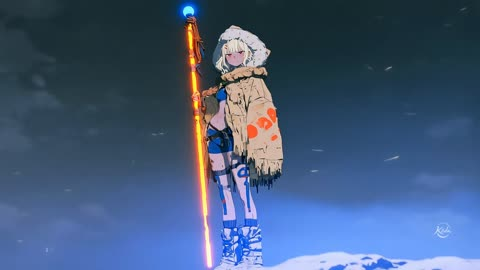
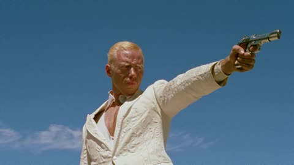
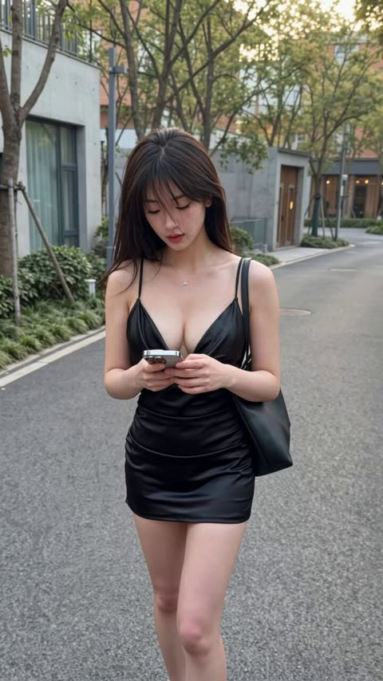
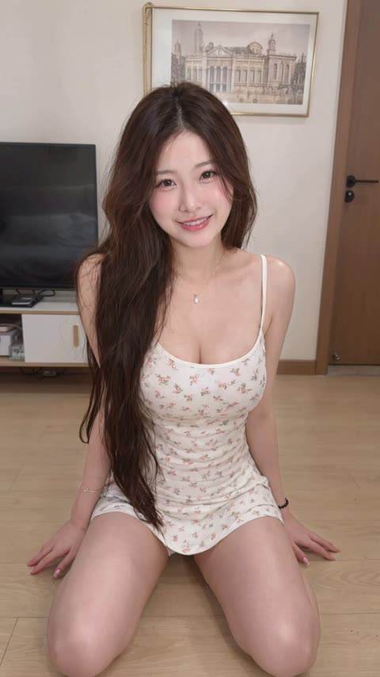
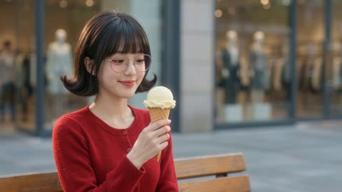
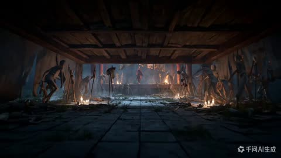
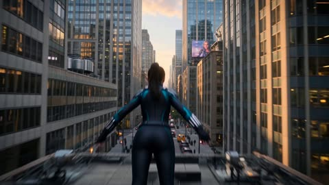
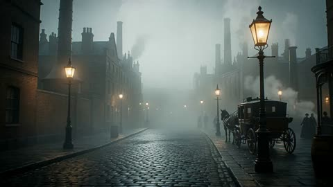
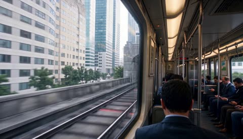
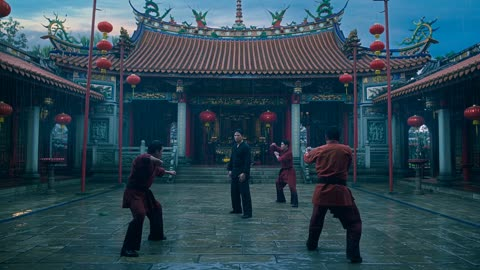

# Wan 3.0

[返回目录](../../README_zh.md) · 全部 17 条

<a id="wan-fashion-face-closeup-flash-orbit"></a>
### 带抓拍闪光的超近景时尚人像

<a href="https://x.com/leaf_sanren/status/2105645639703183753"></a>

提示词把15秒拆成五个时间段，每段写明运镜、眼神和闪光时机。同时列出真实的皮肤瑕疵并禁止塑料感，让人脸保持摄影质感。

Wan 3.0 · 文生视频 · 出处: [@leaf_sanren on X](https://x.com/leaf_sanren/status/2105645639703183753) · 1,439 赞，统计于 2026-10-27

[`portrait`](tags.md#tag-portrait) [`fashion`](tags.md#tag-fashion) [`close-up`](tags.md#tag-close-up) [`skin-texture`](tags.md#tag-skin-texture) [`vertical`](tags.md#tag-vertical)

<details><summary><b>提示词</b></summary>

```text
Generate this video: Create a 15-second, 9:16 vertical screen, ultra-high-definition 4K, 30fps, cinematic realistic portrait quality fashion portrait short film.

The main subject of the frame is a young Asian woman around 20-25 years old, with a high-end face—cool with a touch of youthful greenness, delicate features but not overly perfect, smooth facial contours, natural nose bridge, full lips, eyes with depth, overall vibe like a car model or a close-up candid shot by a photographer at a fashion event.
No influencer vibe, no exaggerated plastic surgery face, no plastic skin, no excessive skin smoothing, no overly heavy fake lashes, no exaggerated highlights, no anime feel.
The character's skin must be realistic: clearly visible pores, subtle skin texture, light foundation caking, faint acne marks, very shallow pockmarks, under-eye fine lines, natural contours on nose wings and cheeks, lip lines, a few stray hairs and hair edge wisps. Makeup is refined but imperfect high-end subtle look: base slightly adherent but not flawless, clean eye makeup, naturally realistic lashes, lips with a subtle sheen.
Hair is black or dark brown straight long hair, with natural stray strands and a slight messy feel, not too deliberate.

Scene and Atmosphere

Scene is a high-end fashion event venue / auto show activity area / luxury brand launch event close-up portrait atmosphere, but the background must be blurred, not highlighting specific brands or text. Background can include soft exhibition hall lighting, minimal out-of-focus neon reflections, blurred crowds, blurred car body highlight reflections or metallic texture backgrounds, overall atmosphere high-end, restrained, fashionable.
No subtitles, no stickers, no watermarks, no readable text, no exaggerated effects, no illogical flashy lights.

Lighting Requirements

Lighting must conform to real-world logic, like a real photographer shooting close-up at the event site.
Main light is soft but directional facial key light, coming from slightly off to the front upper side, creating natural facial light and shadow layers.
Fill light is very subtle, retaining some shadows to enhance facial dimensionality.
Environment can include soft cool-toned rim light or auto show site reflection light to make the face more three-dimensional.
Throughout, allow 2 to 3 brief flash occurrences; flashes must feel like natural on-site photography flashes, quickly lighting up only in certain moments, causing temporary enhancement of facial highlights, more obvious pupil catchlights, brighter skin reflections, but no constant strobing, no illogical flashing.
When flashes occur, it should feel like a photographer's candid shot: lights up once and done, realistic light ratios, face not overexposed, skin details still visible.

Camera and Movement (Top-Tier Cinematography)

Overall, use ultra-close portrait movement, with the lens always orbiting the face to highlight eyes, nose bridge, lips, cheeks, hair strands, and skin texture.
Cinematography language is high-end, fluid, restrained, with a fashion ad and backstage photography candid feel.
No heavy shaky cam, no disorienting motion, no exaggerated AI camera moves, no sudden pull-backs.
Movement must feel natural, like a high-end photographer using a handheld gimbal or slight handheld shooting:

0-3 seconds

Lens starts with an ultra-close side-front face push-in, focus on eyes and nose bridge area, subject slightly lifts gaze to lens, natural breathing feel, lips subtly relaxed.
Lens does an extremely subtle slow push-in, with very light lateral sliding, showcasing cheeks, under-eye texture, and hair strands.
This segment should make viewers feel the face's high-end realism right from the first glance.

3-6 seconds

Lens slides along the face from eyes to nose tip, then to near the lips, in an extremely steady micro-arc orbit, close-up observation of features.
Subject's gaze subtly shifts, no exaggerated acting—just gently looks toward lens edge, then slowly back to lens.
First flash can occur here, briefly lighting up to enhance skin texture and lip highlights.

6-9 seconds

Lens slowly turns from front-left to front-right, still maintaining face-push distance, emphasizing cheek skin texture, nose wing details, lower eyelid fine lines, lashes, and pupil reflections.
Subject lightly brushes a bit of hair, or a stray strand naturally falls to the side of the face.
Lens has a subtle breathing-like float for real photography feel, not rigid.

9-12 seconds

Lens subtly shifts down to highlight lips, jawline, and cheeks, then slowly back to eyes.
Subject's expression stays cool, restrained, with a touch of high-end aloofness, like a car model caught close-up by a photographer, occasionally a gentle blink, corners of mouth with extremely subtle relaxation.
Second flash occurs here, natural and instantaneous like on-site candid, returning to normal light after.
Post-flash, catchlights in eyes more prominent, giving the frame more fashion editorial vibe.

12-15 seconds

Lens does one of the most beautiful ultra-close light arc closes, subtly orbiting the face and lightly pushing in, finally settling on an ideal composition of eyes + nose bridge + half lips.
Subject gently lifts gaze to straight-on lens in the last second, eyes clean, calm, captivating.
Ending can have a third very subtle flash or environmental highlight sweep, but must feel natural, not overdone.
Finally holds on a high-end face-push frame perfect for a thumbnail cover.

Frame Style

Overall style is:
Real cinematic fashion portrait, close-up commercial photography, auto show model face-close candid, high-end magazine feel, natural skin texture, non-studio fake-face sense.
Include real lens bokeh, natural depth of field, fine skin quality, subtle on-site feel, restrained high-end vibe.
Not influencer selfie, not live stream, not Korean-style skin smoothing, not low-quality AI face.

Key Emphases

Face must be real, not fake

Skin can't be overly perfect, retain subtle imperfections

Features stable, no distortion

Eyes can't wander, lips can't move randomly

Hair strands must be real, with stray hairs

Flashes must follow real candid logic

Lighting must be real, no random strobing

Camera must be high-end, smooth, cinematic, fashion photography feel

Whole piece centers on "high-end face close-up showcase," no plot, no big movements

Negative Restrictions (Suggest Adding Together)

Negative prompts:
Cartoonish feel, CG feel, plastic skin, excessive smoothing, over-beautification, feature distortion, eye misalignment, skin wax figure feel, overexposure, illogical flash strobing, face shake, low clarity, low-quality hair strands, exaggerated filters, influencer face, overly heavy fake lashes, heavy makeup, shaky lens, limb distortion, cluttered background, readable text, subtitles, stickers, watermarks,
```

</details>

<a id="wan-marina-night-out-quay-leap"></a>
### 夜晚码头闺蜜同游与跳水

<a href="https://x.com/mightyking/status/2091842964054212842"></a>

先写风格、角色和场景,再用带时间戳的分镜表,每个片段单独指定运镜,如倒退跟拍、甩镜下摇和俯拍。单独的音频段要求现场同期声且无音乐,强化手机随拍的真实感。

Wan 3.0 · 文生视频 · 出处: [@mightyking on X](https://x.com/mightyking/status/2091842964054212842) · 1,353 赞，统计于 2026-10-27

[`ugc`](tags.md#tag-ugc) [`handheld`](tags.md#tag-handheld) [`night`](tags.md#tag-night) [`shot-list`](tags.md#tag-shot-list) [`sync-sound`](tags.md#tag-sync-sound)

<details><summary><b>提示词</b></summary>

```text
Raw vertical phone video (UGC), handheld throughout, filmed by a friend who walks with the group, casual sway, natural night lighting, wide-angle lens, deep focus.

Characters

The hero is a young woman with long dark hair in a deep-purple one-shoulder dress with a small shoulder bag.

Her three friends: one in a dark brown dress, a blonde in a black wrap dress, a blonde in a white mini dress — party dresses and sandals.

Laughing, spontaneous night-out energy.

Setting

A luxury marina at night — a stone quay along a narrow water slip flanked on both sides by large moored luxury yachts, big white hulls rising on either side, masts and rigging above, fenders on the hulls.

Warm orange street lamps, palm trees, distant city lights.

The yachts glow with blue-turquoise underwater LED lights spilling into the water; a yellow mooring line runs to the stone.

Shot list

0.0s–4.0s — Wide tracking shot, eye level, camera moving backward
The camera walks backward ahead of the four women as they stroll toward it down the marina promenade, framed head-to-toe, laughing and chatting in French; warm lamplight and palm trees behind, slight handheld bob.

4.0s–6.0s — Medium shot, eye level, backward track + quick left pan
The woman in the purple dress surges ahead of the group toward the lens, one arm raised, hair flying; the camera, on their left, keeps tracking back and pans to hold her.

6.0s–8.0s — Medium-wide, camera tilts down-left to follow, whip motion
She reaches the quay edge between the moored luxury yachts and launches headfirst over the edge; the handheld camera whips left and tilts down to chase her off the stone.

8.0s–10.0s — High-angle wide, looking down at the water, slight jolt
From up on the quay the camera looks down as she plunges headfirst into the blue-turquoise water in the slip between the big yacht hulls — a big splash, the underwater lights glowing around the impact; the handheld frame jolts slightly with the motion.

10.0s–13.0s — High-angle medium, looking down, small handheld drift
She surfaces in the teal water, gasping and laughing up at the camera, hair slicked back, treading water.

13.0s–16.0s — Handheld tilt up and back down, slight zoom
The camera lifts off the water and tilts up to a person leaning on the deck railing of one of the moored luxury yachts, watching her in the water, then tilts back down and zooms slightly in on her still treading and laughing.

16.0s–20.0s — High-angle medium, tilting to follow her up
She swims to the stone quay wall, reaches up and grabs a thick dark mooring pole, and hauls herself out; the camera tilts upward with her as she rises from the water, legs braced on the stone.

20.0s–23.0s — Low/close medium at the quay edge, static handheld
She climbs onto the stone lip, rolls onto her side, soaked dress clinging, then pushes up to her feet; the camera holds close, catching the water running off her.

23.0s–27.0s — Medium shot, eye level, loose handheld reframe
Back on the promenade, dripping wet, she flips her long wet hair forward and wrings it out, laughing, as her friends and passing pedestrians move behind her.

27.0s–30.0s — Medium shot, eye level, camera settles
Still dripping, she straightens up and strikes a confident, playful pose for the camera — hand on hip, tossing her wet hair back with a big smile — her friends laughing around her; the camera holds on the pose to end.

Audio

Live sync sound — friends laughing and shouting excitedly in French, a scream at the leap, a big water splash, water sloshing against the yacht hulls, wet footsteps on stone, ambient night marina sounds.
No music.

Style

Raw amateur vertical phone footage, natural night lighting, warm street lamps mixing with the turquoise underwater yacht glow, authentic handheld motion.
```

</details>

<a id="wan-camera-angle-swap"></a>
### 动作不变，换机位重拍你的视频

<a href="https://x.com/Framer_X/status/2101324357108658433"></a>

上传一段连续镜头作动作参考，Wan 从新角度重拍；某个镜头跑偏就重生成。

Wan 3.0 · 视频编辑 · 出处: [@Framer_X on X](https://x.com/Framer_X/status/2101324357108658433) · 1,170 赞，统计于 2026-10-27

[`camera-angle`](tags.md#tag-camera-angle) [`video-reference`](tags.md#tag-video-reference) [`workflow`](tags.md#tag-workflow)

<details><summary><b>提示词</b></summary>

```text
STEP 1: Upload your video (must be continuous one shot) to any platform that supports WAN 3.0

STEP 2: Use the prompt below (adjust it to your video):

"Use the original video @ TAG ORIGINAL VIDEO as the exact action reference

0–1s: Camera stays exactly as in the original video as the wolf walks toward the scooter.

1–3s: Hard cut to a tight front close-up as the wolf continues walking toward and reaches the scooter.

3–5s: Hard cut to a high angle above as the wolf as he gets onto the scooter and starts riding.

5–7s: Hard cut to a full shot as the wolf rides the scooter down the street.

7–9s: Hard cut to a side tracking shot as he keeps riding down the street.

9-10s: Hard cut to an over the shoulder shot as he rides forward and notices the banana peel in his path.

10–12s: hard cut to a birds eye view shot as the fallen wolf is rolling over the asphalt.

12-13s : hard cut to an insert shot of his fist as wolf slams it into the asphalt.

Only the camera angle and framing change. Make sure every action, movement, timing and performance exactly identical to the original video @ TAG ORIGINAL VIDEO. The action continues seamlessly across every cut."

NOTE: If some scenes didn't work (action was different than original video) simply regenerate the video, that usually fixes the problem.
```

</details>

<a id="wan-cafe-camel-coat-character-sheet"></a>
### 咖啡馆柜台前身穿驼色大衣的男人

<a href="https://x.com/ivanka_humeniuk/status/2113582628024566084"></a>

先用一张参考图生成三视图角色设定板，左侧为正面和背面全身，右侧为一张细致的头像。正面全身的脸被有意虚化，让头像成为唯一的面部参考，同时写清服装、面料和胶片质感，让角色在多个场景中保持一致。

Wan 3.0 · 参考生视频 · 出处: [@ivanka_humeniuk on X](https://x.com/ivanka_humeniuk/status/2113582628024566084) · 878 赞，统计于 2026-10-27

[`character-consistency`](tags.md#tag-character-consistency) [`reference-sheet`](tags.md#tag-reference-sheet) [`cafe`](tags.md#tag-cafe) [`film-look`](tags.md#tag-film-look) [`romance`](tags.md#tag-romance)

<details><summary><b>提示词</b></summary>

```text
Create a three-panel character reference sheet of the woman in
@image1
 in a single wide 16:9 image.
Preserve her exact facial identity, blue eyes, dark espresso-brown hair color, skin tone and natural facial
proportions from
@image1
.
The left half contains two full-body views side by side: front and back, identical in scale, with both figures
completely visible from above the bun to below the shoes. The right half contains one large
head-and-shoulders portrait, facing directly into the camera. All three views share one continuous neutral
mid-grey studio backdrop, matching soft lighting and the same warm film color treatment.
In the full-body front view, replace the facial features with a smooth, softly blurred skin-toned oval. Keep the
hairstyle and head silhouette intact. The large portrait on the right is the only detailed face reference.
Restyle her exceptionally long, thick hair into a high, generously sized, loosely sculpted bun at the crown.
Preserve the fullness of her hair, with lifted roots and soft volume around the head. Two delicate curved
tendrils fall beside her temples toward her jaw, framing the outer edges of her face. Her eyebrows, blue eyes
and cheekbones remain clearly visible. The back view shows the gathered hair and the substantial rounded
shape of the bun. The hairstyle feels elegant and practical, like a beautiful café waitress in a romantic film
from around 2000.
Dress her in a fitted ivory fine-knit top with short sleeves and a modest scoop neckline, tucked into a
high-waisted black tailored pencil skirt ending at the knees. The skirt has a small functional back vent. Over it,
she wears a short deep-burgundy cotton waist apron, extending from the waist to mid-thigh, with two discreet
rectangular front pockets. Narrow apron ties wrap around her waist and form a neat bow at the center of her
back, clearly visible in the rear view. Her shoes are simple black leather ballet flats with gently rounded toes
and low flat heels. Small plain gold stud earrings complete the outfit.
Her figure is tall and slender, with a defined narrow waist, long legs and a graceful neck. The clothing follows
her natural proportions, with realistic knit texture, tailored seams and soft cotton folds around the apron ties.
02
The same outfit, fit, hem lengths and hairstyle appear in all three views.
In the front view she stands upright, square to the camera, shoulders level, weight evenly balanced, arms
relaxed at her sides and hands empty. The back view shows the identical stance turned fully away. In the
portrait her head is upright, chin level and both eyes look directly into the lens. Her lips are gently closed with
a faint, relaxed smile. Preserve the recognizable face from
@image1
, with natural skin texture, visible pores
and fine facial hairs.
Soft frontal studio lighting keeps her features and clothing clearly readable, with gentle shading under the
chin and soft contact shadows beneath the shoes. The grey backdrop remains plain throughout the image.
The composition consists entirely of the three views and the seamless backdrop.
Maintain a glamorous late-1990s to early-2000s 35mm film publicity look: warm natural skin, creamy ivory
fabric, rich burgundy cotton, deep readable blacks, fine organic grain and restrained highlight glow. Her face,
blue eyes, hair strands and garment details remain clearly resolved. Clean presentation with uninterrupted
backdrop between the views.

📌 PROMPT 2 (Guy map):
Create a three-panel character reference sheet of the man in
@image1
 in one wide 16:9 image. Preserve his
exact face, eye color, skin tone, facial proportions and hairstyle from the reference, including the natural
swept-back waves and the loose strand near his forehead.
The left half of the image contains two full-body figures side by side: a straight-on front view and a complete
back view, identical in scale, both visible from above the hair to below the shoes. The right half contains one
large head-and-shoulders portrait looking directly into the camera, with his entire hairstyle inside the frame.
All three views share one continuous neutral mid-grey studio backdrop.
On the full-body front figure, replace the facial features with a smooth, softly blurred skin-toned oval,
retaining the head silhouette and hair. The large portrait on the right is the single detailed face reference.
He is tall, approximately 188 cm, with broad shoulders, a lean athletic build, a defined waist and long legs. His
proportions remain natural and identical across all three views.
Dress him in an elegant camel-colored wool-and-cashmere overcoat reaching just below the knees. The coat
has broad notched lapels, softly structured shoulders, a single-breasted three-button front, discreet welt
pockets and a single center-back vent. He wears it fully unbuttoned, its front panels hanging naturally to
reveal the clothing underneath. The fabric is substantial, softly brushed and richly textured, with realistic
weight and long vertical folds.
Under the overcoat, he wears a dark chocolate-brown tailored wool blazer with a two-button front, worn
unbuttoned, over a pale-blue cotton shirt with a pointed collar and the top button undone. The shirt is tucked
neatly into high-waisted charcoal-grey wool trousers with a single pleat on each side, a relaxed straight leg
and a slight break over the shoes. A dark-brown leather belt with a small brushed-metal buckle completes the
waist.
His shoes are polished dark-brown leather penny loafers with matching dark socks. A slim rectangular gold
wristwatch on a dark-brown leather strap sits on his left wrist, partly visible beneath the cuff. The styling has
04
the understated elegance of a wealthy young man in a romantic film set around 2000.
In both full-body views, he stands upright with shoulders level, weight evenly balanced and arms relaxed
slightly away from his sides so the coat silhouette remains readable. His hands are empty. The back view
shows the coat's full length, center seam, vent and natural drape.
In the large portrait, his face is strictly frontal, head upright, chin level and both eyes directed into the lens.
His lips are relaxed and closed. Preserve the exact facial structure, subtle beard shadow and natural skin
texture visible in
@image1
. The portrait includes the camel coat lapels, brown blazer and pale-blue shirt
collar.
Soft, even studio lighting keeps his face and all clothing details clearly readable, with gentle facial shading,
broad highlights on the wool and soft contact shadows beneath both pairs of shoes. The backdrop is plain and
continuous, with clean empty space separating the three views.
Maintain warm late-1990s to early-2000s 35mm film color: natural warm skin, rich camel wool, deep
chocolate tailoring, soft pale-blue cotton and readable charcoal shadows. Fine organic film grain and
restrained highlight glow give the image a tactile cinematic finish while the face, hair and garment
construction remain clearly resolved.

📌 PROMPT 3 (Cake box map):

A photorealistic pastry packaging reference sheet on a uniform medium-grey seamless studio background, horizontal 16:9 composition, divided into two equal side-by-side views. The surface beneath both boxes and the background are the same neutral grey.

On the left, a closed rectangular ivory cardboard pastry box with a fitted hinged lid, viewed from a slightly elevated three-quarter angle. Matte cardboard, subtle paper texture, clean folded edges and a plain unprinted surface.

On the right, exactly the same box at the same scale, with its hinged lid fully raised behind it. A higher three-quarter viewing angle clearly reveals the contents: six individual chocolate mousse pastries arranged in two rows of three, each on a small gold pastry board. Comfortable spacing makes every pastry’s complete silhouette visible.

Each pastry has a playful, stylized penis shape: a smooth rounded elongated form with two rounded lobes at the base, recognisable as a humorous bachelorette-party confection. All six share the same shape and size, with glossy milk-chocolate mirror glaze and a tiny touch of edible gold leaf. Smooth moulded chocolate surfaces and appetising highlights give them the appearance of carefully crafted patisserie desserts.

The box dimensions, ivory colour and construction are identical in both views. Neatly fitted ivory food-safe paper lines the interior. Both boxes are fully visible with comfortable grey space around them.

Soft studio lighting, gentle contact shadows, clear high-resolution detail and natural optical sharpness with restrained sharpening. Subtle fine film grain and softly warm highlights, consistent with late-1990s cinematic photography. The entire surrounding background remains solid neutral medium grey.

📌 PROMPT 4 (Cafe map):

Create a cinematic location reference photograph of an intimate, elegant neighbourhood café in the year 2000, shortly before closing on an autumn evening. One wide horizontal 16:9 image showing a single coherent interior, photographed at eye level from the customer side, looking diagonally toward the service counter. A natural 28mm lens perspective with straight architectural lines and clearly readable room geography.

A long service counter occupies the right half of the composition, running from the foreground toward the back wall. It has a polished dark walnut front with recessed wooden panels and a warm ivory stone countertop. The central serving section is a broad, clear, uninterrupted surface, ready for a pastry box and a conversation between a standing customer and the waitress behind the counter. This section of the counter is bare, with the stone surface fully visible.

Behind the counter is a comfortable working aisle. The rear service wall contains dark wooden shelves, neatly arranged porcelain dishes, a stainless-steel espresso machine and a small period-appropriate cash register at the far end. A wooden doorway in the back wall leads to the kitchen. A small glass pastry display stands at the far end of the counter, leaving the main serving area open.

On the left side of the room, three small dark wooden tables stand beside burgundy leather banquette seating along the wall. Each table has two bentwood chairs and a small glass sugar dispenser. Above the banquette hang framed botanical prints and warm brass wall sconces with ivory shades. The walls are painted creamy butter yellow above dark wooden wainscoting. The floor is laid with small cream and muted terracotta tiles.

At the far left, tall street-facing windows and a glazed wooden entrance door reveal a quiet city street at dusk. Soft, cool evening light enters through the windows, balanced by warm pools of light from the wall sconces and three opal-glass pendant lamps above the counter. The entrance, seating area, service counter and kitchen doorway are all clearly visible within the same spatially consistent room.

The café feels established, lovingly maintained and slightly worn: subtle patina on brass fittings, gentle wear on the leather seats, fine scratches in the wooden furniture and realistic texture in the plaster walls. The tables are neatly reset for the end of the evening. The room is unoccupied so its layout and furnishings are fully visible.

The visual atmosphere is a romantic feature film from 1999–2000, captured on 35mm film: warm amber practical lighting, creamy highlights, rich walnut brown, muted burgundy and natural shadow detail. Fine film grain, subtle halation around glowing lamps and soft highlight roll-off. Maintain enough depth of field to clearly describe the counter, seating and rear service wall. Photorealistic materials, believable proportions and an inviting, lived-in atmosphere. A clean cinematic location photograph filling the entire frame.

📌 PROMPT 5 (Animation prompt):
SCENE CONTEXT A 30-second scene in a neighbourhood café in the year 2000, near closing time. A headstrong waitress packs her handmade pastries. A wealthy customer approaches to pay, interrupts her work with questions, tastes a sample and asks her to pose as his girlfriend at dinner.  Play this as a lively romantic dramedy with friction, humour and unexpected attraction. She wants to finish her work and refuses to entertain his casual charm. He wants to keep her attention and finds himself having to earn it. Their reactions evolve naturally as they listen to each other.  ACTIVE REFERENCES
@image1
 — the waitress. Use the detailed portrait for her exact face and the full-body views for her work outfit and high loose bun.
@image2
 — the customer. Preserve his exact face, hair and clothing, including the unbuttoned camel overcoat.
@image3
 — the café architecture, counter, furnishings and dusk outside.
@image4
 — one ivory pastry box and its six chocolate novelty pastries. Preserve their shapes, chocolate glaze, gold decoration and individual gold boards. The panels show two states of the same box.  SPACE AND PROPS She stands behind the counter; he approaches on the customer side. In shared shots he is screen-left, she is screen-right. Keep the camera on the same side of their dialogue axis, maintaining matching eyelines.  The box begins open with five pastries inside. She is placing the sixth into the remaining space, holding its gold board. Beside the box is a small ivory plate with an additional matching dessert cut into two portions and a dessert fork. He samples this separate dessert; the six boxed pastries remain whole.  He carries a folded banknote in his left hand, ready to pay. His right hand is free. The central serving surface contains the box and tasting plate. Cups stay on the background shelves.  CAMERA AND EDITING 16:9, 30 seconds, real-time action. Film coverage with foreground depth, deliberate camera movement, expressive changes in shot size and motivated focus pulls. Hard cuts at the listed boundaries. Stable focal length within each shot. Let performances flow inside the shots, with natural listening and gestures overlapping speech.  0.0–3.0 SECONDS 63° FOV. A short lateral tracking shot moves along the customer side of the counter with the approaching man, revealing the waitress already at work beyond him. The polished counter creates a strong diagonal into the frame. She places the final pastry into the box. He stops opposite her, notices the contents and suppresses a laugh. She remains occupied with packing.  HARD CUT — 3.0–5.5 SECONDS 47° FOV. Low oblique view across the open box: the pastries are sharp in the foreground, his face visible beyond them. Pull focus from the chocolate shapes to his amused expression as he looks up at her. MAN: “Is this the new menu?” He is teasing, expecting an easy smile in return.  HARD CUT — 5.5–10.5 SECONDS 47° FOV. Side-on medium shot of the waitress, her face and hands visible, his coat softly framing one edge. WOMAN: “Test batch for a bachelorette party. My coworkers approved.” She answers with dry impatience while straightening the paper inside the box. She gives him a pointed look on “approved,” then slides the tasting plate toward him with a brisk, controlled gesture: he can taste it and let her finish. The plate stops within his reach. Her delivery has bite and personality; her attention moves naturally between him and her work.  HARD CUT — 10.5–14.5 SECONDS 47° FOV. Counter-height three-quarter medium shot of the man, showing his face and right hand, with the box edge in the foreground. He takes a small forkful from the cut dessert. As he tastes, his teasing manner gives way to spontaneous appreciation. He finishes the bite and lowers the fork onto the plate. She is visible at the edge of frame, briefly watching to see whether he likes it before returning to her work. The banknote remains in his left hand.  HARD CUT — 14.5–20.5 SECONDS 47° FOV. A layered two-shot looking diagonally along the counter, both faces readable. The camera makes a gentle lateral move that settles as their eyes meet. MAN: “You make these yourself?” His interest is genuine now. WOMAN: “After my shifts. I'm saving for my own bakery.” She answers firmly, with pride beneath the impatience. For a moment she engages fully because her bakery matters to her. Then she returns her attention to the box. He watches her and considers his next words.  HARD CUT — 20.5–24.0 SECONDS 29° FOV. Medium close-up of the man from beside her shoulder. A slow, restrained dolly inward makes the conversation feel more personal. MAN: “Have dinner with me tonight?” He attempts an easy invitation, but there is a real question in his eyes. Allow a short listening beat after the line.  HARD CUT — 24.0–30.0 SECONDS 29° FOV. Close-up of the waitress from his eyeline, her face in three-quarter view and his blurred shoulder at the edge. Begin with a very slight forward camera move. She looks up from her work and gives him a brief, sceptical half-smile, amused by his nerve. MAN, naturally offscreen: “With my family. As my girlfriend.” His voice hesitates briefly between the two phrases.  Stay on her throughout his clarification so the audience sees it land. Her half-smile disappears; she stops what she is doing and looks directly at him with an immediate, incredulous reaction. She lets out a short disbelieving breath and settles her right palm on the counter. The camera settles with her. Hold the final moment as she silently sizes him up, ready to challenge him. End after the hand movement is complete, on her living reaction.  ACTING Give the actors room for spontaneous conversational behaviour. She is spirited, quick and proud, with dry humour and a short tolerance for being patronised. Her annoyance changes with the conversation: she dismisses his teasing, briefly cares about his response to her baking, defends her ambition and finally reacts to the audacity of his request.  He starts charming and self-assured, adjusts when she gives him little encouragement, becomes genuinely impressed by the dessert and risks the invitation. His confidence becomes less certain as he waits for her response.  Use connected reactions, natural breaths, shifts of attention and expressive vocal rhythm. Each person listens while the other speaks. Movements arise from packing, tasting and trying to hold or end the conversation. Keep their faces recognisable and their physical behaviour grounded.  LIGHTING AND COLOUR Preserve the café's amber pendant lamps, brass sconces and cool dusk windows. Soft directional side lighting shapes their faces, with darker shadow cheeks and gentle reflected fill preserving their eyes. Photograph from the shadow side. Loose hair, camel wool and chocolate glaze catch warm highlights.  Fixed 4000K white balance. Rich walnut browns, burgundy leather, creamy practical highlights and deep textured shadows. Natural skin colour beneath the warm light. Consistent lighting across all angles.  AUDIO — FIXED CHARACTER VOICES WOMAN VOICE: Adult woman in her mid-twenties; medium pitch, warm clear mezzo speaking voice with a lightly husky lower register, neutral General American accent, natural conversational rhythm, crisp intelligible consonants and restrained expressive inflection. MAN VOICE: Adult man in his early thirties; medium-low pitch, warm resonant baritone with a subtle dry rasp, neutral General American accent, measured conversational rhythm, clear articulation and understated playful inflection.  Preserve these vocal identities. Her delivery is dry, spirited and impatient, becoming firm when discussing her bakery. His delivery moves from playful confidence to sincere curiosity and slightly hesitant persuasion.  Use the written English dialogue exactly. Clear turn-taking and accurate lip synchronisation for visible speakers. His final clarification is heard offscreen while the camera stays on her reaction.  Quiet café room tone, distant traffic, paper rustle, a soft plate scrape, the fork touching porcelain and her final palm contact. Keep dialogue clear and foregrounded.  FILM LOOK Late-1990s theatrical romantic dramedy captured on visibly textured 35mm film. Organic moving grain is clearly perceptible across midtones, skin and shadows at normal playback size. Warm halation surrounds the glowing lamps; bright reflections bloom gently. Rich film-print contrast, creamy highlight roll-off and natural optical sharpness with restrained edge enhancement. Preserve readable eyes, realistic skin and fabric detail beneath the film texture. Natural motion blur and 24 fps cinematic cadence.  CONTINUITY After packing, all six boxed pastries remain whole and in place. The separate tasting dessert retains its missing bite. The box stays open on the same section of counter. After the slide, the tasting plate and fork remain on his side. His banknote stays in his left hand. Maintain exact faces, hair, clothing, screen direction, café geometry and dusk throughout. Reference sheets guide appearance; the output is full-frame cinematic footage.
```

</details>

<a id="wan-anime-monster-fight"></a>
### 手绘动画风，对战巨型怪物

<a href="https://x.com/aimikoda/status/2103790524637528348"></a>

两个带标签的参考（主角、怪物），要求保留手绘线条。Wan 的动画有自己的味道。

Wan 3.0 · 参考生视频 · 出处: [@aimikoda on X](https://x.com/aimikoda/status/2103790524637528348) · 502 赞，统计于 2026-10-27

[`anime`](tags.md#tag-anime) [`action`](tags.md#tag-action) [`reference-images`](tags.md#tag-reference-images)

<details><summary><b>提示词</b></summary>

```text
Use @[character ref] for the hero's exact identity and appearance; @[monster ref] for the monster's anatomy, scale, pale body, black projections and luminous horns. Preserve their angular hand-drawn contours, sparse sketch lines, matte cel-shadows, muted lavender and ash gray, blue-black shadows, peach rim light and fine grain. City and effects share this 2D anime style. References bind appearance, not framing or poses.

Five epic shots: the monster destroys the city as it charges toward the rooftop hero. ONE sudden, thick white line bursts from his index fingertip and instantly punches through it, leaving one enormous hole.

The hero stays at one skyscraper's avenue-facing edge, level with the monster's upper torso. The monster approaches directly IN FRONT OF him along the avenue. All cameras stay on one side of their shared axis: hero and tower screen-left, monster screen-right advancing left. The hero faces right. In his profile close-ups, the monster remains ahead, offscreen right, never behind his head or shoulders. No axis-crossing angles or orbits.

Shot 1. Low lateral wide tracking beside the monster charging right-to-left. Its shoulder tears through a building; the facade folds into the street as its next footfall buckles the roadway, hurling rubble forward. Debris whips past the lens through lavender dust. Widen and tilt upward to reveal the target tower ahead on screen-left, the tiny hero at its edge facing the approaching monster on screen-right. Keep the gap between them readable.

Shot 2. Right-side profile of the hero facing screen-right toward the offscreen monster. Face and right hand share the frame against sky and rooftop. Wind pulls his hair and coat; he stays relaxed. With a knowing smile, he extends his right arm toward the target: index straight, thumb raised, other fingers curled. Cut as the finger aligns with the target; no charging glow, gathering energy or held aiming pause.

Shot 3. Steady rear three-quarter view outside the hero's right shoulder, on the established side. Keep a clear gap between his fingertip screen-left and the monster's upper torso screen-right. It reaches for the rooftop directly ahead. Immediately on the cut, ONE thick, straight, brilliant-white line snaps from the index fingertip through the upper torso, below the neck between the shoulders. Its entire length appears instantly, connecting finger, target and the space beyond. Release and penetration happen together: no projectile travel, growing beam or drilling. One tiny finger recoil coincides with a building-sized circular section being punched through the body. The white line switches off immediately, leaving an enormous EMPTY opening, its broken dark rim framing the skyline. The torso jolts and tips sideways at once, the reaching arm knocked off course. Read the hole during the uninterrupted fall. No charging, stunned pause, slow motion or hit-stop. No sphere, pressure ring or full-screen whiteout obscures the contact. One abrupt discharge, never a sustained beam or repeated pulse.

Shot 4. Cut as that sideways tilt begins, keeping the same viewing direction and matching the ALREADY OPEN hole on the first frame. The monster's arm drops short of the roof; its weight carries it diagonally sideways into the blocks beside the avenue before reaching the tower, still in front of the hero. Track downward with the chest exposed: no edge-on turn or face-down roll. The SAME hole stays fixed below the neck between the shoulders, with the same physical diameter, broken rim and missing volume. Its outline foreshortens naturally as the torso tilts; background buildings slide visibly through the opening. Keep dust below the chest and clear of the aperture. Follow the fall through contact with the ruins and briefly show the fallen torso with its hole still open. The rim does not regrow, the opening does not fill, and the torso never returns to its intact state.

Shot 5. Return to the hero's right-side profile, facing screen-right, face and right hand together against sky and rooftop. The fallen monster remains OFFSCREEN ahead to the right. He bends his right elbow and brings the SAME extended index fingertip just in front of his lips. Only after it arrives, he gently purses his lips and visibly blows across it. A fine white wisp bends away in his breath. He lowers the hand slightly with a satisfied smile. Collapse thunder rolls in from ahead and a gust lifts his coat. Hold his effortless composure.

One instantaneous fingertip discharge, one impact, one permanent through-hole carried through the uninterrupted fall and landing. The hero keeps the same hand and facing. Sound: masonry and heavy footfalls, one dry electrical crack and a deep impact report together at the instant of contact, then the intimate breath against distant collapse. No dialogue or subtitles.
```

</details>

<a id="wan-tokyo-travel-vlog"></a>
### 东京旅行 vlog，一秒一个节拍

<a href="https://x.com/joshesye/status/2094723798679400808"></a>

中文描述配日语台词。每一秒都写清地点、动作、台词和到下一秒的转场。

Wan 3.0 · 文生视频 · 出处: [@joshesye on X](https://x.com/joshesye/status/2094723798679400808) · 421 赞，统计于 2026-10-27

[`vlog`](tags.md#tag-vlog) [`travel`](tags.md#tag-travel) [`japanese-dialogue`](tags.md#tag-japanese-dialogue) [`timed-beats`](tags.md#tag-timed-beats)

<details><summary><b>提示词</b></summary>

```text
一位20岁出头的年轻韩国偶像风格女性。长发直顺，黑色，自然蓬松，肤如凝脂，大而明亮的灵动的眼睛，精致的V形脸，小巧的鼻子，自然光泽的嘴唇，清新的淡妆，毫不费力地可爱又平易近人的表情。休闲日式街头穿搭（白色连帽衫 / 深色宽松连帽衫 / 宽大夹克）。26mm手机镜头，深景深，真实肤质，轻度HDR，中性iPhone色彩风格，未经编辑的抓拍，无电影级调色，无影棚灯光，无光轨，无动态模糊效果。

(0:00–0:01) —— 行走镜头，东京塔亮相自拍，低角度。塔在她身后，天空过曝。自然微笑。中性自然光，深景深。台词：「ついに東京に来た……！」 过渡：硬切 / 节奏重拍

(0:01–0:02) —— 涩谷十字路口，步入人群中间。转头看向镜头。身后霓虹灯牌清晰锐利。真实夜景曝光。过渡：节奏快切

(0:02–0:03) —— 便利店，将饭团举向镜头，挑眉。室内荧光灯强烈。冷白光，真实肤质。过渡：节奏闪切

(0:03–0:04) —— 代代木公园，坐姿，视线移向别处。斑驳光影，镜头可见污渍。音乐重拍落下——风、鸟鸣——随即切回。过渡：自然动作剪接

(0:04–0:06) —— 章鱼烧反应，咬下一口，瞪大眼睛，后仰大笑。温暖的实际灯笼光。琥珀色光下的真实肤质。台词：「アツッ！めっちゃ美味しい！」 过渡：笑声结束时剪接

(0:06–0:07) —— 自动售货机夜景，站在发光的售货机前。混合LED灯光映在脸上。微微坏笑。无光效处理。过渡：单拍剪接

(0:07–0:08) —— 电车车窗，面部倒映在车窗上。窗外城市自然模糊。她向外看，不看镜头。过渡：闪切

(0:08–0:09) —— 鸟居，低角度。走向并穿过神社大门。大门占据画面上方。自然日光。过渡：闪切

(0:09–0:11) —— 数字灯光展 ★ 标志性镜头 缓缓抬头。蓝、紫、金色投影映在脸上。焦点转移——面部清晰，灯光柔和散射。只有投影打在皮肤上，无眩光。速度：约60%慢动作 过渡：在抬头过程中柔化剪接

(0:11–0:12) —— 高达亮相，面部→镜头上摇→完整雕像入画。小小的赞赏微笑。广角，自然日光。过渡：微笑后锐利剪接

(0:12–0:13) —— 灯笼小巷，跟随跟拍。灯笼暖色，阴影暗部。自然低光。她回头瞥了一眼。过渡：向前运动时剪接

(0:13–0:14) —— 屋顶天际线，近距自拍→手臂伸远→天际线显现。风吹动发丝。自然夜景手机曝光。台词：「こんな夜景、初めて見た。」 过渡：最后一句台词处硬切

(0:14–0:15) —— 奈良鹿公园，她蹲下，递出鹿仙贝。鹿向她鞠躬——她突然大笑。另一只鹿从背后轻顶她，她几乎站不稳。手持拍摄，略有晃动。全部真实拍摄。台词：「ちょっと！本当にお辞儀した！」 过渡：淡出至黑屏
```

</details>

<a id="wan-anime-staff-ritual-portal-spaceship"></a>
### 动漫法师召唤飞船穿越云端传送门

<a href="https://x.com/aimikoda/status/2099278002534101053"></a>

直接把创意按先后顺序写成一段连贯的事件，比扩写的长提示词更有效。用图1参考锁定角色，并描述能量为流动起伏的形态，避免变成细激光线。

Wan 3.0 · 参考生视频 · 出处: [@aimikoda on X](https://x.com/aimikoda/status/2099278002534101053) · 273 赞，统计于 2026-10-28

[`anime`](tags.md#tag-anime) [`fantasy`](tags.md#tag-fantasy) [`magic-effects`](tags.md#tag-magic-effects) [`character-reference`](tags.md#tag-character-reference) [`sci-fi`](tags.md#tag-sci-fi)

<details><summary><b>提示词</b></summary>

```text
Testing Wan 3.0 Anime

I hadn't had much luck with Wan 3.0 anime before but seeing the incredible work below made me want to give it another shot.

I usually use a skill to turn my ideas into prompts but that approach hadn't worked too well for me with this model. This time, I just used the idea itself as the prompt. I'm happy with the result and might experiment with it some more.

*Used a character reference.

Prompt was: Start with the character from Image 1 performing a ritual-like dance on top of a tower. She raises her staff and sends a wave of energy into the clouds, not as a thin laser line but as something more fluid and undulating. In the clouds, a magic circle appears and expands. The surrounding clouds are pulled toward it and begin swirling around it. A portal opens at the center, and a giant spaceship emerges from it and descends to Earth.
```

</details>

<a id="wan-four-gunmen-standoff"></a>
### 四个持枪男人的无声对峙

<a href="https://x.com/VictorInFocus/status/2088029679341261198"></a>

按编号节拍写，表演克制，在有人开枪前一刻切断。

Wan 3.0 · 文生视频 · 出处: [@VictorInFocus on X](https://x.com/VictorInFocus/status/2088029679341261198) · 261 赞，统计于 2026-10-27

[`thriller`](tags.md#tag-thriller) [`beats`](tags.md#tag-beats) [`tension`](tags.md#tag-tension)

<details><summary><b>提示词</b></summary>

```text
All four men are armed. Performances are restrained, dry and quietly tense, with subtle micro-expressions.

BEAT 1
Quick individual shots of each man holding his gun and staring at someone just outside frame.  Small eye movements, tightened jaws, slow blinks, controlled breathing. Each man is trying to look completely unfazed.

Cut between them, gradually suggesting they are all aiming at one another.

BEAT 2
Cut wide to reveal all four men several metres apart in a loose circle, each pointing his gun at another man in a four-way standoff.  Hold the wide shot. Wind lightly moves their suits. Nobody lowers their weapon.

The man in the cream suit glances around the circle.  CREAM SUIT, completely calm in a British accent:

“Anyone care to explain how we got here?”

A brief silence.  The older man in pink barely shifts his expression.  OLDER MAN IN PINK, dry in an American accent:

“Bad manners, mostly.”

BEAT 3
Hold on the group.  A tiny smirk. A raised eyebrow. Eyes flick between faces and guns. One man subtly adjusts his grip.

Slow, almost imperceptible push toward the group as the silence becomes uncomfortable.  Nobody fires.  Cut just as it feels like someone is about to.
```

</details>

<a id="wan-street-photographer-cold-face"></a>
### 嘴上说不要，照片却笑得很甜

<a href="https://x.com/johnAGI168/status/2093342672605913225"></a>

中文分块提示词。笑点在冷脸视频和甜笑写真之间的硬切，规则明确禁止渐变过渡。

Wan 3.0 · 参考生视频 · 出处: [@johnAGI168 on X](https://x.com/johnAGI168/status/2093342672605913225) · 240 赞，统计于 2026-10-27

[`chinese-dialogue`](tags.md#tag-chinese-dialogue) [`comedy`](tags.md#tag-comedy) [`vertical`](tags.md#tag-vertical) [`reference-images`](tags.md#tag-reference-images)

<details><summary><b>提示词</b></summary>

```text
【时长】18秒
【画幅】9:16竖屏
【风格】真人街头摄影短视频，手机纪实影像与专业写真照片交替剪辑，傍晚黄金时刻，真实皮肤质感，长焦浅景深，时尚街拍氛围，轻喜剧反差
【语言】中文对白，无字幕
【人物数量】画面中始终只有女主一人；摄影师只出现画外男声，不能实体出镜

【人物角色卡】
  @ 命名“方圆”，街头偶遇摄影师的女生。人物脸部、身形、发型、妆容、服装及原有配饰完全继承参考图。增加一部手机和一只单肩托特包作为剧情道具。

【核心情绪反差】

动态视频状态：
方圆表现得冷淡、拽、有距离感。下巴微抬，嘴唇轻抿，眉毛略微压低，眼神像是在审视镜头。说话时不撒娇、不害羞、不甜笑，拒绝动作干脆从容。

写真照片状态：
只要硬切进入写真，方圆的表情瞬间改变。眉眼完全舒展开，眼睛弯起，脸颊抬高，露出明亮、自然、毫无防备的甜美笑容。笑容必须明显比动态视频更温柔、更亲近、更有感染力。

情绪切换不能渐变：

动态冷脸 → 快门声与硬切 → 写真甜笑；
写真甜笑 → 硬切回视频 → 笑容立即消失，恢复冷淡。

这条“冷脸视频与甜笑照片”的反差是全片最重要的喜剧效果。

[00:00-00:04.20] 镜头1｜第一次冷脸拒绝

方圆站在现代创意园区的林荫道路旁，肩背托特包，低头看手机。

手持摄影机从侧前方缓慢靠近，由中远景推进到胸部近景。

00:00-00:00.80
方圆低头操作手机，完全没有注意镜头。右手拿手机，另一只手轻点屏幕，嘴唇闭合，表情平静冷淡。

00:00.80-00:02.40
听见陌生人搭话，她的手指先停下来。

她没有立刻抬头，而是停顿半拍，先把眼睛从手机屏幕移向镜头，随后才缓慢抬起头。

下巴微微上扬，眉毛轻压，眼神带有明显的审视感，脸上没有笑容。

【画外年轻男声】
“哎，你好，我是一名街头摄影师，可以邀请你拍两张照片吗？”

男声礼貌、自然，带一点试探感。

00:02.40-00:03.90
方圆先冷冷看着镜头，停顿约0.2秒，再开口：

【方圆】
“不要拿镜头对着我。”

语气平静、直接、有距离感，不能带娇嗔语气。

说“不要”时，她才抬起空闲的左手。

说“拿镜头”时，左手五指逐渐打开，掌心朝向摄影机。

说“对着我”时，左掌从容地靠近镜头，遮挡大半画面。右手始终拿着手机。

她从手掌旁边继续冷冷盯着镜头，嘴角不笑，也不害羞躲闪。

00:03.90-00:04.20
方圆收回手掌，干脆转身离开。肩膀先转，头部随后转动，头发产生真实甩动惯性。

[00:04.20-00:07.80] 镜头2｜第一组甜笑写真

在方圆冷脸转身之后，伴随清脆快门声，画面突然硬切成专业写真。

照片中的她不再冷漠，而是立即露出非常甜美、明亮的笑容。

照片一｜00:04.20-00:05.10
半身逆光回眸写真。

方圆身体朝前，脸回转看向镜头，露出灿烂的露齿甜笑。脸颊明显抬起，眼睛弯成柔和月牙形，整个人突然变得亲近温柔。

人物、发丝和背景完全静止。

照片二｜00:05.10-00:06.00
林荫道路全身写真。

方圆保持交叉迈步的优雅走姿，低头露出自然甜笑，像是被摄影师逗笑。笑容柔软放松，没有任何冷漠感。

照片三｜00:06.00-00:06.85
黄金逆光中近景写真。

一只手放在头顶发间，另一条手臂扶住托特包。方圆直视镜头，露出明亮甜美的露齿笑，眼尾弯起，脸颊饱满上扬。

照片四｜00:06.85-00:07.80
面部与上胸特写写真。

方圆头部轻轻侧歪，双眼温柔看向镜头，露出整组照片中最甜、最有感染力的笑容。牙齿自然露出，眼睛弯起，背景形成金色散景。

四张照片全部是真正静止的写真成片，不眨眼、不呼吸、不飘发。相邻照片通过快门声和硬切切换，不使用大面积白闪。

[00:07.80-00:10.30] 镜头3｜切回视频，笑容立即消失

硬切回手机动态视频。

切回的第一帧，方圆脸上的甜美笑容必须完全消失，重新恢复冷淡、拽、不耐烦的状态。

00:07.80-00:08.50
摄影机从侧后方跟拍。

方圆背对镜头继续向前走，手机拿在胸腰之间，托特包随脚步轻微晃动。

【画外年轻男声】
“很快很快，就两张。”

听见摄影师继续央求，方圆没有马上停下。

她先用眼角向后看，再缓慢转动头部和肩膀。她的眼神冷淡，下巴微抬，嘴唇轻抿，像是觉得摄影师很烦。

00:08.50-00:10.00
方圆一边走一边看向镜头：

【方圆】
“我没有配合你的义务。”

语气平静、坚定、带明显边界感，不能微笑。

说“我没有”时，她直视镜头，眉毛轻轻压低。

说“配合你的”时，空闲手从胸前抬起，五指逐渐打开。

说“义务”时，掌心正对摄影机并向前靠近，形成明确的“停止拍摄”手势。

她嘴上拒绝得很冷，但肩膀已经自然打开，腰部形成漂亮侧转，头部角度和手掌位置都非常适合拍照。

00:10.00-00:10.30
她放下手掌，冷淡地转回前方继续走。整个过程中不能出现甜笑。

[00:10.30-00:13.50] 镜头4｜第二组甜笑写真

就在方圆冷着脸转身离开时，快门声响起，画面再次硬切成甜美写真。

照片五｜00:10.30-00:11.10
大腿以上中景写真。

方圆双手在腰前拿着手机，身体微侧，脸转向镜头，突然露出放松明亮的露齿甜笑。眼睛弯起，肩膀柔和，与上一秒的冷脸形成强烈反差。

照片六｜00:11.10-00:11.90
道路边全身写真。

方圆一只手叉腰，另一只手抓住托特包肩带，髋部自然侧移。虽然姿势利落时尚，但表情非常甜，嘴角明显上扬，露出自然牙齿，眼神温柔亲近。

照片七｜00:11.90-00:12.70
林荫道路全身回眸写真。

身体保持向前迈步，后脚脚跟抬起，头和上胸向后回转。方圆回头看镜头时露出灿烂笑容，脸颊抬起，像是在开心地回应摄影师。

照片八｜00:12.70-00:13.50
胸腰以上近景写真。

方圆双手拿着手机，头部轻轻侧歪，双眼直视镜头，露出温柔甜美的笑容。笑意同时出现在嘴角和眼睛里，不能只是机械地咧嘴。

四张写真全部完全冻结，不能出现眨眼、呼吸、头发移动或背景运动。

[00:13.50-00:15.20] 镜头5｜再次切回冷脸动态视频

硬切回动态视频的第一帧，甜笑再次立即消失。

摄影机位于方圆侧后方，以腰胸以上中近景跟拍。

【画外年轻男声】
“就两分钟，两分钟，真的，就两……”

男声带一点执着和央求感，最后一句没有说完。

方圆没有台词，不跟随画外声音张嘴。

00:13.50-00:14.00
她回头冷冷看摄影机一眼。嘴唇闭合，眉毛略压，下巴微抬，表情像在说：“你怎么还在拍？”

00:14.00-00:14.50
她把脸转回前方，背对镜头继续走。长发自然覆盖背部，托特包随脚步轻轻晃动。

00:14.50-00:15.20
她借着下一步突然向镜头方向回身。

肩膀先转，头部随后转回，大束头发因惯性向外甩开，形成真实流畅的发丝弧线。

她的脸仍然保持冷淡，不能在甩发过程中提前微笑。

[00:15.20-00:18.00] 镜头6｜冷着脸却已经摆好Pose

摄影机由侧后方绕到侧前方，并缓慢推进至胸部近景。

00:15.20-00:15.80
方圆完成回身，左手抬到后脑和头顶发根，手肘自然向外打开。

眼睛准确找到镜头，目光稳定直接；嘴唇轻抿，下巴微抬，依然是一副不愿意配合的冷淡表情。

00:15.80-00:16.40
左手沿头发外侧向下滑动，把甩到脸前的发束拨开。

头发依靠真实惯性继续向一侧飘动。与此同时，她的肩膀自然打开，身体逐渐转成三分之二侧身。

00:16.40-00:17.10
左手落到托特包上缘，把包轻轻抱稳在身体侧面。

她把重心放到一条腿上，腰部轻微侧移，一侧肩膀向后打开，已经形成完整的专业模特Pose。

她的脸仍然冷淡，不能出现与写真相同的甜笑。

00:17.10-00:18.00
摄影机缓慢推进至近景。

方圆保持侧身抱包姿势，下巴先微抬，再缓慢压低一点；双眼从略低的眉骨位置直视镜头，嘴唇维持冷淡的闭合状态。

最后0.4秒，她只让一侧嘴角出现极其轻微、几乎看不出来的得意弧度，像是在说：

“我没有答应拍照，只是刚好会摆Pose。”

结尾仍是动态视频，保留轻微呼吸与发丝余动，不能变成甜笑写真。

【声音设计】
使用节奏利落的时尚流行音乐。

动态视频段保留脚步声、手机握持声、衣料摩擦声、托特包摆动声和甩发声。

每次从冷脸动态视频切入甜笑写真时，必须加入清脆机械快门声，并与画面硬切和音乐重拍同步。

摄影师始终为镜头后的画外男声。只有方圆说两句拒绝台词时产生口型。

【主要约束】
动态视频中的方圆必须冷淡、拽、不甜笑；
写真照片中的方圆必须笑得明亮、自然、甜美；
冷脸和甜笑只能通过硬切瞬间切换，禁止缓慢渐变；
写真段必须完全静止，动态段保持真实连续运动；
禁止换脸、人物外观漂移、口型错位、额外人物、字幕、Logo和水印。
```

</details>

<a id="wan-finger-dance-one-take"></a>
### 固定机位一镜到底的手指舞

<a href="https://x.com/johnAGI168/status/2092625479521931699"></a>

人物只命名一次（`粉宝`），后文都用名字指代，连哪只手做哪个动作都写清。

Wan 3.0 · 参考生视频 · 出处: [@johnAGI168 on X](https://x.com/johnAGI168/status/2092625479521931699) · 194 赞，统计于 2026-10-27

[`dance`](tags.md#tag-dance) [`long-take`](tags.md#tag-long-take) [`vertical`](tags.md#tag-vertical) [`reference-images`](tags.md#tag-reference-images)

<details><summary><b>提示词</b></summary>

```text
【人物角色卡】
@   ​→ 命名为“粉宝”，全片唯一人物。后文所有“粉宝”均指同一人，不再重复调用参考图。
粉宝的脸部身份、五官比例、发型、妆容、服装和配饰全部沿用参考图，不重新描述、不擅自改造。
全程严格保持同一张脸，不换脸、不改变年龄感、脸型、肤色和五官比例。

【风格】真人竖屏手指舞短视频（Finger Dance Performance），固定机位一镜到底（Locked-off One Take），轻快甜美、自然手机摄影质感，4K清晰度，真实皮肤纹理
【时长】15秒
【画幅】9:16
【人物】仅粉宝一人
【对白形式】粉宝本人面对镜头进行中文节奏念唱，必须准确对口型
【字幕】无字幕、无贴纸文字、无水印
【转场】全片不剪辑、不变装、不使用特效转场

【场景】
温暖整洁的居家房间，浅色墙壁和木地板；画面左侧是一台关闭的黑色电视和简洁矮柜，右侧是一扇关闭的棕色木门。背景装饰尽量简化，不摆放动物玩偶或动物照片。
前景保持完全空旷，只出现粉宝一个生命主体。画面中绝对不出现狗、其他动物、动物尾巴、动物毛发或动物影子。

【摄影机】
竖屏固定手机机位，摄影机位于粉宝正前方、约胸口高度，等效35mm镜头。中全景构图，从头顶拍到大腿上部，保留双手向左右和头顶伸展的空间。
摄影机全程锁定，不推拉、不摇移、不变焦、不跟随；手指伸向镜头时产生自然的近大远小（Forced Perspective），但镜头本身不能移动。

【表演内核】
粉宝像在和镜头另一端的人玩方向游戏：先认真介绍左边和右边，再把两边说成“可爱的两边”，随后从指方向逐渐变成指向观众，最后用爱心动作完成“我在你的心里面”。
情绪递进：俏皮示范 → 笑意增加 → 主动逗观众 → 甜蜜直球。
不要从第一帧就保持最大笑容；笑容随着手势逐步变亮，最强的笑容和眼神只留给最后一句。

[00:00-00:03.80] 镜头1：左边与右边（Locked Medium Full Shot）

[00:00-00:00.50]
粉宝跪坐在画面中央，身体正对镜头。右手从身体右侧向外轻快扫出，再弯曲手肘，将右手食指竖起；左手自然垂在左侧大腿旁。
头部随着右手轻轻晃动，先露出张嘴的明亮笑容，再迅速收成小幅度微笑。目光始终看镜头。
此段没有台词，嘴巴不能提前念词。

[00:00.50-00:01.40]
右手食指从竖直状态向内划出一小段弧线，落到人物自身右侧脸颊，也就是观众看到的画面左侧脸颊；其余四指自然收拢。
【台词】“这是左边。”
【口型】“这”字嘴唇短促向前；“左”字下颌稍微打开；“边”字嘴角向两侧收紧后闭合。
【微表情】说“这”时眉毛轻抬、眼睛睁开；说到“左边”时头部向指尖稍微倾斜，眼尾收窄，右侧脸颊被食指轻轻点出一个小凹陷，句尾变成带牙齿的小笑容。
【声音】清亮、俏皮、中等偏快语速，“左”字稍微加重，句尾轻轻上扬。

[00:01.40-00:02.00]
右手食指离开脸颊，两条手臂短暂向左右打开，肩膀和上半身跟随节拍轻轻摆动。嘴唇闭合成笑，不发出新台词。

[00:02.00-00:03.05]
左手抬起，左手食指点向人物自身左侧脸颊，也就是观众看到的画面右侧脸颊；右手自然落到右侧大腿旁。
【台词】“这是右边。”
【口型】每个字完整清楚，不能吞掉“右”字；“边”字结束后嘴唇自然闭合。
【微表情】头部向左手指尖方向倾斜；眼睛先看镜头，再短暂形成玩笑式单眼轻眯，双颊抬起，嘴角由小幅度微笑逐渐扩大。
【声音】保持与上一句相同的旋律和速度，“右”字落在重拍，句尾同样轻微上扬。

[00:03.05-00:03.80]
左手食指在脸颊旁做一次极小的离开—点回动作，然后双臂向外松开，为下一组双手动作蓄力。粉宝闭唇笑一下，眼睛轻眯，不说话。

[00:03.80-00:07.05] 镜头2：可爱的两边（Symmetrical Cheek Gesture）

[00:03.80-00:06.08]
两只手同时抬到脸部两侧，左右食指分别指向对应脸颊，其余手指自然弯曲，双肘向外展开，形成完全对称的双脸颊动作。
【台词】“这是可爱的两边。”
【动作同步】
“这是”——两根食指刚刚到达脸颊旁，头部保持居中；
“可爱”——两根食指同时轻点脸颊一次，头部向一侧小幅倾斜；
“的两边”——两根食指继续指住脸颊，上半身随节拍向另一侧轻摆，最后回到中央。
【口型】“可爱”必须清楚形成两个分开的音节；“两边”不能连成模糊笑声。句尾“边”字结束后嘴唇闭合半拍。
【微表情】“这是”时眼睛明亮直视镜头；“可爱”时眼尾压成弯月、双颊明显抬起；“两边”时露出整齐牙齿，最后加入一次快速俏皮眨眼。不能全程眯眼，也不能从开头就保持最大笑容。
【声音】童谣式轻快念唱，“可爱”略微拉长，“两边”落在节拍重音上。

[00:06.08-00:07.05]
双手从脸颊释放。右臂先向下外侧划开，左手食指在脸侧短暂停留；粉宝做一次清楚但自然的单眼眨眼，然后两只手都降至腰部附近。
嘴巴从笑容收成闭唇状态，准备下一句，不能在间奏中继续乱动口型。

[00:07.05-00:11.03] 镜头3：前面与后面（Direct-to-Camera Point）

[00:07.05-00:08.55]
左手食指重新竖起，手臂迅速向摄影机方向伸展。开始时食指朝上，伸近镜头后手腕向下旋转，使食指准确指向镜头中央；其余手指收拢，拇指自然搭在弯曲手指旁。
手掌靠近镜头后产生明显近大远小，粉宝的脸仍在后方保持清晰可辨。

【台词】“这是指前面。”
【口型】“指”字短促，“前面”两个音节要清楚分开；“前”字略加重。
【微表情】伸手前眉毛轻抬，像突然想到一个答案；指尖对准镜头时眼神沿着手指直接锁定观众，眼睛微微收窄，嘴角形成带一点得意的小笑容。
【声音】比前两句更有直接交流感，“前面”句尾下降，不拖音。

[00:08.55-00:10.07]
左手食指继续对准镜头保持半拍，然后缓慢收回。收回过程中手腕向侧面转动，食指从指向观众变为指向自己左肩后方；头部同步向该方向轻轻转动，视线先跟随指尖扫向肩后，再迅速回看镜头。

【台词】“这是指后面。”
【口型】“后”字嘴唇先收圆再放开，“面”字结束后闭唇。
【微表情】说“后面”时眉梢轻轻抬高，眼神短暂朝肩后看；回看镜头时眼睛弯起，像故意和观众开玩笑。笑容不能遮挡口型。
【声音】“后”字加重，语气带一点调皮的提示感，句尾轻轻落下。

[00:10.07-00:11.03]
左手落到腰侧。右手食指短暂指向右肩或胸口上方，左手沿原视频中的低位运动轨迹自然落在左侧大腿上。
原视频此处存在抚摸狗背的动作，重制时必须改成左手轻落大腿：不要抚摸空气、不要看向地面、不要生成任何动物。
粉宝闭唇笑，肩膀跟随节拍轻轻弹动一次。

[00:11.03-00:15.00] 镜头4：指向你与心里面（Finger Heart to Overhead Heart）

[00:11.03-00:12.55]
右手从肩侧向镜头伸出。先短暂握成面向镜头的小拳头，再缓慢松开，将拇指与弯曲的食指交叠，组成清晰的韩式手指爱心；中指、无名指和小指保持收拢。手指爱心位于镜头前方，不能挡住粉宝的双眼。

【台词】“这是指你。”
【口型】“你”字必须清楚，嘴角先收窄再上扬；不能念成“地”或其他字。
【微表情】小拳头伸出时目光直接、眉毛微抬；手指爱心成形的一瞬间，眼尾轻轻收窄，嘴角变成带牙齿的顽皮笑容，头部向一侧小幅倾斜。
【声音】“你”字加重并略微拉长，像直接点名镜头前的人，语气甜但不嗲。

[00:12.55-00:14.80]
右手爱心释放，两条手臂同时向左右展开，再沿大弧线举过头顶。双臂形成宽大的心形轮廓，两只手在头顶上方弯曲，左右指尖轻轻接触，组成完整的头顶爱心。
爱心完成后，粉宝保持手臂形状，身体先向一侧轻摆，再回到中央。

【台词】“我在你的心里面。”
【动作与台词同步】
“我在”——双臂向左右打开；
“你的”——双臂向上形成宽阔V形；
“心里”——两臂在头顶弯曲，双手指尖合拢成爱心；
“面”——爱心完全闭合并保持，头部位于心形正中央。

【口型】“我在你的”保持连贯但不能抢拍；“心里面”四个音节清晰，“心”字加重，“面”字稍微延长至动作完成。
【微表情】双臂打开时眼睛明亮、嘴角逐渐扩大；听到“心”字时双颊明显抬起、眼尾变弯；“里面”结束时呈现全片最明亮的笑容，牙齿自然露出，眼神牢牢看向镜头。不要提前达到最大笑容。
【声音】前半句轻快，念到“心”时音高略微上升，“里面”温柔落下，保持清晰中文发音。

[00:14.80-00:15.00]
头顶爱心的指尖向两侧分开，两条手臂顺势向下外侧打开；粉宝略微向摄影机靠近，维持明亮笑容和直接眼神，在动作仍有轻微惯性的状态下结束。
最后一帧不说新台词、不突然恢复中性表情、不淡出。

【完整台词】
“这是左边。
这是右边。
这是可爱的两边。
这是指前面，这是指后面。
这是指你，我在你的心里面。”

【声音控制】
同一位女性声线完成全部念唱，普通话清晰，甜美轻快但不过度夹嗓。每句“这是”使用相近节奏，左右、两边、前面、后面分别与对应手势严格同步。
只保留轻快的低音量节拍伴奏，不增加第二个人声、合唱、旁白、笑声音效或额外台词。

【动作连续性】
全片是一镜到底，所有动作必须由上一个动作自然过渡到下一个动作。手臂有真实惯性，手指先伸展再定型、先释放再移动；不能在相邻帧中突然瞬移。
人物自身左右手不能交换：右手负责第一段画面左侧脸颊，左手负责第二段画面右侧脸颊及指向镜头；右手负责最后的手指爱心，两只手共同组成头顶爱心。
```

</details>

<a id="wan-photo-editor-chase-comedy"></a>
### 修图工具变成实物的街头追逐

<a href="https://x.com/johnAGI168/status/2106723741602546165"></a>

光标、选框、变换框作为实物出现在街上，有投影有遮挡；长长的禁止项防止画面卡通化。

Wan 3.0 · 文生视频 · 出处: [@johnAGI168 on X](https://x.com/johnAGI168/status/2106723741602546165) · 189 赞，统计于 2026-10-27

[`comedy`](tags.md#tag-comedy) [`vfx`](tags.md#tag-vfx) [`chase`](tags.md#tag-chase) [`multi-shot`](tags.md#tag-multi-shot)

<details><summary><b>提示词</b></summary>

```text
Duration：30秒

Aspect ratio：16:9横屏

Overall style：电影实拍质感的都市白天喜剧。真人演员，真实街道，手持跟拍的能量感。图像编辑软件的工具和界面元素以实物形态出现在真实街道上，包括光标、虚线选框、变换框、白色方形把手和灰白透明格子，它们有透视、有遮挡，地面上有淡淡的投影。所有编辑都瞬间完成，干净利落，滑稽无害。动作物理动量连续，严禁静止发呆，严禁塑料CG感。

SUBJECT / 角色与道具绑定：

图片1 命名为【Iaro】，容貌、发型、服装、配饰全部以参考图为准，全片保持一致；

（@只在此处声明一次，正文严禁再出现@）

道具【光标】：巨型电脑光标，带细黑描边的白色哑光实物，常态高约1.2米，悬浮在离地1到1.8米之间，地面上有淡灰色投影。光标有三种形态，切换时"啪"地瞬间变形：

- 箭头形态：经典左上指向的白色箭头；

- 油漆桶形态：白色倾斜的小桶图标，桶口朝下；

- 橡皮擦形态：白色长方体橡皮块，长约1米。

每次"点击"时，光标整体向前点约10厘米，伴随清脆的咔哒声。性格固执又狡猾。

路人与动物：

【遛狗姑娘】年轻女性，浅蓝色卫衣，手牵红色狗绳；

【小白】白色小型卷毛狗，常态肩高约25厘米，被放大后肩高约1.5米，性格欢快，见到会动的东西就想追。

ENVIRONMENT / 空间轴线：

现代城市商业街，晴朗白天。自然阳光从画面右上方45度照下，色温约5600K，阴影清晰柔和。人行道上有木质长椅、路边停着一辆白色厢式货车，有一面红砖墙，街角有一条两侧是砖墙、尽头被墙堵死的窄巷。追逐方向全片统一：Iaro始终从画面右侧往左侧逃，光标始终从画面右侧追来。所有招牌、车身、墙面上都没有任何文字、数字或Logo。

AUDIO / 声音位置，严格按时间（全片无台词，无人声）：

① 0.0s起：城市环境声（远处车流、鸟鸣、路人脚步），原创轻快放克配乐（贝斯加军鼓，无人声），低电平进入；

② 1.2s–2.4s：四声连续的"啵、啵、啵、啵"，冰淇淋球被复制出来；

③ 4.0s"咔哒"；5.6s第二声"咔哒"，长椅被复制，"咚"一声落地；6.2s四个冰淇淋球摔在地上，"啪嗒"；

④ 9.4s"咔哒"，接一声弹性拉伸的"啵——"；10.2s巨犬欢快地低沉吠叫"汪！"；

⑤ 13.2s油漆倾泻的"哗——"；16.2s橡皮摩擦的"擦擦擦"；

⑥ 19.0s光标放大，低频上扬"呜——"；20.0s巨犬吠叫，接着"嗷呜"一口，然后是撕咬玩具的"吱吱"声；

⑦ 23.5s甩水声"噗噜噜"；

⑧ 25.5s配乐戛然而止，只剩环境声；25.8s"咔哒"；26.0s爆炸头弹开，"嘭"的一声；26.8s拍头时头发的弹簧声"啵嘤"；

⑨ 28.0s–30.0s安静，光标晃动时两声俏皮的电子音"嘀嘀"，巨犬尾巴拍地"啪、啪、啪"。

--------------------------------------------------------------------------------

SHOT 1（0.0s–3.5s）｜【冰淇淋复制】

Subject：Iaro，光标

Action：Iaro坐在木质长椅中间，右手握一支单球香草冰淇淋甜筒，正伸舌头要舔。0.6s，箭头光标从画面右侧滑入，停在冰淇淋上方30厘米处。1.0s，一个小号虚线选框框住冰淇淋球。1.2s起，"咔哒"四连击，每0.3秒在顶上复制出一个完全一样的冰淇淋球，摞成5个球、约40厘米高的冰淇淋塔，微微摇晃。2.6s，Iaro眼睛睁大，嘴张开，抬头看光标，咧嘴笑，对光标点了点头。

Environment：长椅背后是人行道和店铺，有零星路人走过。

Camera：35mm，平视中景，Iaro在画面左三分之一处，光标在右三分之一处。1.2s起镜头轻微上摇，跟住长高的冰淇淋塔。

Style：冰淇淋表面有真实的奶油质感和阳光高光，球与球接触处轻微压扁。

Performance：从准备舔，到发愣，再到惊喜，要一气呵成。

Constraints：禁止冰淇淋球悬空分离，每个球必须压在下一个上面。禁止光标碰到Iaro。

SHOT 2（3.5s–7.5s）｜【目标换成Iaro】

Subject：Iaro，光标

Action：3.5s，光标慢慢把箭头转向Iaro。4.0s"咔哒"，一个黑白虚线矩形选框"啪"地合拢，把坐着的Iaro连同身下的长椅一起框住，虚线沿边缘流动。4.3s，Iaro的笑容收住，眼睛往下瞟虚线，再瞟回光标。4.8s，Iaro保持右手举着冰淇淋塔不动，屁股贴着椅面向画面左侧一点点平移，左脚先落地，身体侧滑出选框。选框留在原地。5.6s第二声"咔哒"：选框里的长椅被复制，一张一模一样的长椅"咚"地出现在原长椅右边，紧挨着。5.8s，落地震动让冰淇淋塔剧烈摇晃。6.2s，上面4个球依次滑落，"啪嗒"砸在人行道上，只剩最底下1个。6.6s，Iaro低头看剩下的1个球，再抬头看光标，嘴角下拉。7.0s，Iaro转身向画面左侧起跑，右脚蹬地，身体前倾。

Environment：两张长椅紧挨着并排，掉落的冰淇淋在地上摊开。

Camera：35mm，平视中景，与SHOT 1同轴线。7.0s镜头向左甩，跟住起跑。

Style：选框虚线约3厘米粗，在人身上和长椅上投下极淡的虚线影子。

Performance：侧滑时动作慢而小心，像怕吵醒什么，和后面的爆发起跑形成反差。

Constraints：长椅复制必须在5.6s瞬间完成，不得渐变。Iaro的外观不得发生任何变化。

SHOT 3（7.5s–12.0s）｜【小白变巨犬】

Subject：Iaro，光标，遛狗姑娘，小白

Action：Iaro在人行道上全速向画面左侧冲刺，双臂大幅摆动，光标在Iaro右后方2米处追赶。8.4s，前方遛狗姑娘牵着小白迎面走来。8.8s，Iaro右脚起跳，双膝收起，从小白头顶跃过，左脚先落地，继续跑。9.0s，光标的选框套向Iaro，Iaro已经跳过去，选框落在小白身上。9.4s"咔哒"：小白身上出现带8个白色方形把手的变换框，四角的把手同时向外拉，小白在0.5秒内被等比放大到肩高1.5米，像一匹小马。狗绳仍握在遛狗姑娘手里，姑娘的手臂被一下拉到头顶。10.2s，巨犬欢快地"汪"一声，尾巴猛摇，脑袋跟着光标转来转去，眼睛死死盯着光标，前爪在地上跃跃欲试。11.0s，Iaro边跑边回头，看到巨犬，瞪大眼睛，又回头看第二眼。

Environment：路人纷纷后退给巨犬让出空间，巨犬的卷毛逐根清晰，在阳光下发亮。

Camera：24mm，横移跟拍，机位在Iaro右侧3米处，与Iaro同速向左平移，腰部高度，轻微手持颠簸。

Style：放大后的狗毛质感真实，脚掌接地有重量感。

Performance：巨犬全程开心，不凶，像看见一个大号玩具球。

Constraints：禁止狗变形或变丑，只能等比放大。禁止遛狗姑娘摔倒。禁止Iaro碰到小白。

SHOT 4（12.0s–15.0s）｜【油漆桶：货车染紫】

Subject：Iaro，光标

Action：12.0s，Iaro冲到一辆停在路边的白色厢式货车旁，后背和双手掌心紧贴车身侧面，憋住呼吸，屏息躲藏。12.6s，光标"啪"地变成油漆桶形态，悬停在货车车尾上方。13.0s"咔哒"，桶口点在车尾，鲜艳的亮紫色从点击处向车头方向扩散，像水波一样漫过白色车身，0.6秒内覆盖整辆车。13.3s，Iaro瞥见紫色从右侧涌来，在紫色到达后背前0.2秒，双手一推车身，向画面左侧弹开半米。13.8s，整辆货车变成纯亮紫色，Iaro站在旁边，低头看自己的双手，确认没被染色，长出一口气，继续跑。

Environment：紫色只停在车身漆面上，车窗、轮胎、车灯都保持原样。

Camera：35mm，平视中景，侧面拍货车和Iaro，货车占画面右三分之二，Iaro在画面左侧边缘。

Style：紫色漆面在阳光下有真实的车漆反光。

Performance：贴车躲藏时双眼圆睁，嘴唇紧抿。

Constraints：Iaro身上不得沾到任何紫色。禁止油漆液体溅出车身之外，变色只发生在车身表面。

SHOT 5（15.0s–18.0s）｜【橡皮擦：墙上擦出透明格子】

Subject：Iaro，光标

Action：Iaro沿红砖墙向画面左侧奔跑。15.5s，光标"啪"地变成橡皮擦形态，从Iaro右后方追上来，在头部高度从右向左横扫过来。15.9s，Iaro双膝一弯，上身前折，向下滑铲，橡皮擦从Iaro头顶上方擦过，扫在砖墙上。16.2s，"擦擦擦"三下来回摩擦，砖墙被擦掉一块约1米见方的区域。缺口里不是墙洞，而是一块平整的灰白相间的棋盘格透明背景图案，边缘干净。16.8s，Iaro从滑铲中站起，停下回头，把脸凑近那块棋盘格，用右手食指轻戳一下，指尖碰到的是一个平面，Iaro的眉毛挑起。17.4s，橡皮擦又扫过来，Iaro转身拔腿就跑。

Environment：棋盘格每格约5厘米，灰白两色，平铺在墙面上，周围砖块完好。

Camera：35mm，跟拍转为静止中景。16.8s镜头轻推，Iaro的侧脸和棋盘格同时在画面里。

Style：棋盘格像墙面的一部分，同样被阳光照亮，有砖墙一致的透视。

Performance：戳棋盘格时的好奇和怀疑，是这段的笑点。

Constraints：禁止橡皮擦碰到Iaro。棋盘格禁止发光，禁止出现文字或数字。

SHOT 6（18.0s–22.5s）｜【死胡同：巨犬救场】

Subject：Iaro，光标，小白

Action：18.0s，Iaro拐进窄巷，跑到尽头，被墙堵住，转身背贴墙面，双手摊在墙上。18.5s，光标变回箭头形态，飘到巷口，周身出现变换框，从1.2米膨胀到3米高，堵住整个巷口。19.4s，光标拖出一个虚线矩形选框，框住整条巷子和Iaro。Iaro闭上眼，脸扭向一边。20.0s，巨犬从光标身后的巷口跃起，前爪腾空，一口咬住光标的尾端，叼在嘴里，落地后左右猛甩脑袋，像甩玩具一样。光标的变换框和选框同时闪两下消失，光标在狗嘴里缩回1.2米，被甩得左右乱晃。21.0s，巨犬叼着光标趴下，前爪按住，开心地啃咬，尾巴拍地。21.5s，Iaro睁开一只眼，再睁开另一只，背贴着墙慢慢滑坐到地上，喘着气笑出来。

Environment：窄巷两侧是红砖墙，地面有一些积水，巨犬落地时溅起水花。

Camera：18.0s–19.4s，24mm低机位，从Iaro身后、贴近墙角处拍出去，光标在巷口逆光。20.0s切35mm侧面中景，拍巨犬跃起叼住光标的完整动作弧线。

Style：光标在狗嘴里被咬出真实的压痕，有弹性。

Performance：巨犬全程是玩耍，不是攻击。

Constraints：禁止狗撕碎光标。禁止Iaro在本镜头被选中编辑。禁止出现文字。

SHOT 7（22.5s–25.5s）｜【以为结束了】

Subject：Iaro，光标，小白

Action：22.5s，Iaro站起来，拍了拍裤子，走到巨犬面前，伸手挠它的下巴，脸上是得意的笑。23.0s，巨犬张嘴吐舌头哈气，光标从嘴里滑出，湿漉漉、皱巴巴地掉在地上。23.5s，光标晃晃悠悠浮起，飘到Iaro后脑后方1米处，像狗一样抖身，"噗噜噜"甩出一圈水珠，皱褶瞬间恢复平整。Iaro背对着光标，正在摸狗，毫无察觉。

Environment：甩出的水珠在阳光下闪亮，落在地上。

Camera：35mm，平视中景，Iaro和巨犬在画面左侧，光标在画面右侧Iaro的身后升起，镜头静止。

Style：浅景深，Iaro和光标都清晰。

Performance：Iaro完全放松，甚至有点得意，和下一镜形成反差。

Constraints：Iaro不得回头。光标抖水时不得碰到Iaro。

SHOT 8（25.5s–28.0s）｜【红色爆炸头】

Subject：Iaro，光标

Action：25.8s"咔哒"，一个虚线矩形选框"啪"地合拢，只框住Iaro的头部。26.0s，无论Iaro原本是什么发型，都在0.4秒内"嘭"地膨胀成一个巨大的鲜红色爆炸头：直径约60厘米，正圆形，由紧密的小卷组成，整颗都是同一种正红色，比Iaro的肩膀还宽。26.4s，选框消失。26.6s，Iaro整个人僵住，手还停在狗下巴上。Iaro的右手慢慢抬起来，拍了一下头顶，爆炸头像弹簧一样上下弹了两下。

Environment：爆炸头的边缘在阳光下透出红色的光晕。

Camera：35mm，从Iaro侧后方的中景开始，26.0s起缓慢推近，让爆炸头的体积和形状一目了然。

Style：发卷逐根清晰，有真实的蓬松度和弹性，绝不能是一块头套或一颗毛球。

Performance：从僵住到拍头，脸上没有表情，只有手在动。

Constraints：发型变化只能发生在26.0s–26.4s之间。只有发型改变，Iaro的脸、服装、配饰必须与参考图完全一致。爆炸头禁止出现红色以外的颜色。

SHOT 9（28.0s–30.0s）｜【"真的假的？"】

Subject：Iaro，光标，小白

Action：28.0s，Iaro慢慢转身，用0.8秒转过来面向光标，爆炸头随转身轻微颤动。28.8s，Iaro停住，面无表情地瞪着光标，眉毛压低，嘴角下拉，长长地从鼻子呼出一口气。29.0s，光标在画面右侧左右轻快地摇摆两下，一副无辜的样子。29.3s，画面左下角，巨犬的眼睛盯住了这颗又圆又弹的红色爆炸头，脑袋一歪，尾巴越摇越快，前爪压低身体，摆出扑球前的预备姿势。29.6s，Iaro的眼珠慢慢斜向巨犬。30.0s定格。

Environment：巷子里的阳光打在爆炸头上，背景微虚。

Camera：50mm近景，Iaro在画面中央，胸部以上加爆炸头完整入画，光标在右侧边缘，巨犬的脑袋从左下角入画。镜头静止。

Style：喜剧节奏靠最后的停顿和眼神来出效果。

Performance："真的假的？"只靠表情：先是无语，再是警惕，绝不开口。

Constraints：禁止Iaro说话或张口。巨犬禁止真的扑上去，停在预备姿势。禁止出现字幕或文字。

--------------------------------------------------------------------------------

NEGATIVE / 全片负面约束：

禁止任何文字、字母、数字、Logo、水印、字幕，禁止软件界面的文字菜单和工具栏。禁止对白和人声。禁止开场静止发呆。禁止Iaro的脸、服装、配饰偏离参考图或在镜头间漂移（只有SHOT 8的发型变化例外）。禁止假发套感的头发、塑料皮肤、浮肿卧蚕、CG蜡像脸。禁止变形带有恐怖、血腥或伤害感，巨犬禁止凶狠。禁止光标穿过人体，光标漂浮时必须有投影。禁止追逐方向反转。禁止物体悬空。禁止画面卡通化，所有编辑元素都必须像实物一样嵌在真实光线里。
```

</details>

<a id="wan-jeweled-creatures-to-heels"></a>
### 珠宝生物变成高跟鞋

<a href="https://x.com/TaliaAariz/status/2093213718540636649"></a>

重复的变形：每踩一只生物就变成一只鞋。规律只说一次，模型自己重复。

Wan 3.0 · 文生视频 · 出处: [@TaliaAariz on X](https://x.com/TaliaAariz/status/2093213718540636649) · 186 赞，统计于 2026-10-27

[`fashion`](tags.md#tag-fashion) [`transformation`](tags.md#tag-transformation) [`cg`](tags.md#tag-cg)

<details><summary><b>提示词</b></summary>

```text
A hyper-realistic high-fashion CGI animation set in an opulent palace with marble floors, featuring a sequence where bare feet with matching manicured toenails step onto ornate, jewel-encrusted luxury creatures that magically transform into high-heeled shoes. First, a foot with red polished toes steps onto a ruby-and-gold jeweled snail, which unfolds and morphs into a breathtaking crimson gem-studded stiletto pump with delicate gold ankle straps. Next, a foot with blue nails steps onto a sapphire-blue jewel dragonfly, which transforms into a royal blue high heel adorned with shimmering iridescent wings at the heel. Finally, a foot with green nails steps onto a faceted emerald scarab beetle, which transforms into an elegant emerald stiletto featuring delicate butterfly wings, completing each transformation as the wearer steps forward in a luxury fashion showcase.
```

</details>

<a id="wan-shadow-puppet-battle"></a>
### 皮影戏台上，一把剪刀对阵百名刺客

<a href="https://x.com/FellMentKE/status/2092617578338504970"></a>

先写风格块（CG、光照、渲染术语），再写打斗，最后两条禁令：不要配乐，不要字幕。

Wan 3.0 · 文生视频 · 出处: [@FellMentKE on X](https://x.com/FellMentKE/status/2092617578338504970) · 184 赞，统计于 2026-10-27

[`action`](tags.md#tag-action) [`martial-arts`](tags.md#tag-martial-arts) [`cg`](tags.md#tag-cg)

<details><summary><b>提示词</b></summary>

```text
Style
Hyper-realistic CG cinematography with detailed facial features, realistic skin and hair, cinematic lighting, soft shadows, physically accurate reflections, SSS, global illumination, RTX ray tracing, 4K HDR quality, and realistic cloth and rigid-body physics.

Scene

An ancient theater stage illuminated by flickering candlelight, surrounded by translucent shadow-puppet screens and hundreds of faceless wooden assassins.

The female hero, based on Image 2, wears a dark-red opera costume with copper bells and oversized flowing sleeves. She remains elegant, cold, and completely composed throughout the battle.

Shot 1 — 0–3s

Low-angle FPV fly-through

The camera moves beneath the theater stage as hundreds of wooden puppet assassins close in.

The heroine calmly draws a tiny pair of black iron scissors from her sleeve, holding them delicately between her fingertips.

Shot 2 — 3–5s

Extreme close-up

She gently blows cold air onto the scissors, creating visible white mist.

The tiny scissors rapidly expand into enormous black iron shears.

She says:

“The performance is over. Time to take the final bow.”

Shot 3 — 5–9s

Rapid 180-degree orbit

She launches into an elegant, theatrical combat sequence inspired by shadow puppetry.

Each movement of the giant shears releases razor-sharp black energy blades that slice through the wooden assassins like paper puppets.

Shot 4 — 9–13s

Fast tracking shot

She moves between the wooden pillars, using the environment to propel herself forward.

The giant shears crack the floor and pillars while wood splinters and debris fill the air.

Her flowing sleeves, hair, and copper bells react naturally to every movement.

Shot 5 — 13–15s

Low-angle wide shot · Dutch-angle dolly-in

She lands and rests the giant shears on her shoulder.

Behind her, the motionless assassins stand covered in precise cuts.

With a small flick of her wrist, the entire theater cracks apart and collapses.

Smoke, fire, and black ash fill the background as the image freezes on her cold, confident expression and fades to black.

Audio

Diegetic and action sounds only: wooden boards, copper bells, cold wind, breath, metallic transformation, weapon impacts, energy whooshes, splintering wood, and collapsing debris.

No background music. No subtitles.
```

</details>

<a id="wan-web-swing-heroine-taxi-crash"></a>
### 蒙面女侠蛛丝摆荡撞上出租车

<a href="https://x.com/ariaxawan/status/2112176287750259004"></a>

五个两秒分镜用硬切衔接，每镜指定独立机位，并锁定街谷布局与左到右的运动方向，动作保持连贯。音效写到具体秒数，配合140 BPM配乐，并要求恰好在撞击瞬间收尾。

Wan 3.0 · 文生视频 · 出处: [@ariaxawan on X](https://x.com/ariaxawan/status/2112176287750259004) · 183 赞，统计于 2026-10-28

[`action`](tags.md#tag-action) [`cinematic`](tags.md#tag-cinematic) [`multi-shot`](tags.md#tag-multi-shot) [`anamorphic`](tags.md#tag-anamorphic) [`audio-timing`](tags.md#tag-audio-timing)

<details><summary><b>提示词</b></summary>

```text
10-second cinematic action sequence, composed for an ultra-wide 2.39:1 anamorphic cinema frame throughout, crop nothing from a different shape. No title card, intro, establishing shot, fade-in, text, subtitles, dialogue, or speech. Open mid-swing and end exactly at impact, with no aftermath or resolution. Five consecutive 2-second sections, hard cuts on motion, no gaps or overlaps. Original adult woman, athletic slim build, fair skin, black high ponytail, fitted matte charcoal bodysuit with electric-teal side and shoulder panels, dark half-mask over nose and above with mouth and chin visible, fingerless black gloves, compact silver-and-teal wrist launchers, grey grip boots. Not an existing character, no emblem, no red or blue costume. A taut, pale white-silver silk web-line connects wrist launcher to anchor, supports her weight. Yellow sedan taxi, black blank roof sign. Dense downtown street canyon between two glass-and-concrete towers, orange dusk reflections, rooftop gantries, tanks and antennae, traffic far below. Keep the same canyon and spatial geography in all shots. Fixed low golden sun from screen-left, soft sky fill, white-gold rim from far facade, warm street lamps, gold highlights, teal-blue shadows, natural skin, mild grain, spherical lens, subtle vignette, sun flare only. Handheld shake throughout, rising at impact, maintain focus and coherent screen direction left-to-right. Shot 1 (0–2s): side-tracking medium-wide view, she is already airborne with line taut, swings smoothly downward through the lowest point, legs tucked, body nearly horizontal, ponytail streaming. Shot 2 (2–4s): low street-level wide-angle looking up, she rises past camera, releases at the apex, performs one fast forward rotation and fires a second line toward the far tower's billboard gantry. Shot 3 (4–6s): close follow from behind, line catches and pulls tight, she swings into the glass facade, boots scrape along it with tiny reflected sparks, then pushes off and turns to face the street. Shot 4 (6–8s): controlled orbit around her, she swings down the tower, line frays against a ledge and snaps, she releases into a head-first dive. Shot 5 (8–10s): compressed side-tracking descent, she fires a final line toward a streetlamp, swings low across the junction as the yellow taxi crosses her path, she twists, but her left shoulder and hip strike the taxi roof edge exactly at 10.0s. Show the roof denting and side window spider-cracking, ponytail whipping forward, car lurching sideways, everyone remains uninjured, no blood or gore. End on the instant of impact, all still moving. Physics-led pendulum motion, believable momentum and anatomy, no impossible body bends. Audio: sharp web-launch thwips at 0.0s, 3.4s, 8.6s, taut-line hum, rising wind rush, cloth flutter, glass scrape, line snap, distant traffic and horns, taxi horn, tire screech, sharp metal-and-glass impact. Fast orchestral score with driving drums and pulsing synth bass at 140 BPM, already playing at 0.0s, open-air sound with short glass-canyon echo. Hard cut audio at 10.0s. No voice.
```

</details>

<a id="wan-steampunk-detective-montage"></a>
### 蒸汽朋克侦探，五个地点快剪

<a href="https://x.com/socialwithaayan/status/2092581849650593830"></a>

从动作中途切入，每个镜头底下都垫同一条大提琴，把快剪串成一体。

Wan 3.0 · 文生视频 · 出处: [@socialwithaayan on X](https://x.com/socialwithaayan/status/2092581849650593830) · 152 赞，统计于 2026-10-27

[`montage`](tags.md#tag-montage) [`fast-cut`](tags.md#tag-fast-cut) [`steampunk`](tags.md#tag-steampunk) [`score`](tags.md#tag-score)

<details><summary><b>提示词</b></summary>

```text
A cinematic, fast cutting steampunk detective montage in high fidelity live action, set in a fog choked industrial city at night. Open mid motion on a detective in a soot stained long coat crouched at the edge of a canal, gloved fingers pulling a cracked pocket watch from the water, gaslight smearing through the mist behind him. The camera pushes in hard on the watch face, second hand stuttering, then whip pans into a railway station where steam floods the platform and a torn ticket spins down onto wet cobbles. Cut to a low angle inside the clock tower, brass gears the size of wagon wheels turning past the lens while dust hangs in a single shaft of moonlight. Cut to the boiler room, orange furnace light raking across riveted pipes, water dripping off every surface, the detective's shoes ringing on the iron catwalk. Sudden zoom onto a brass plate bolted to a laboratory door, etched Qwen Create, condensation running down between the letters, his glove wiping it clean. Cut inside to the secret laboratory, copper coils throwing electric sparks that light one half of a face in the dark. Finish on the detective's eyes in tight close up as recognition hits, breath fogging, jaw setting.

Keep the same fog density and gaslight warmth in every shot. Colour lives in the materials: wet black stone, green oxidised copper, worn brass, deep burgundy velvet, white steam.

Handheld throughout, urgent but readable, one snap zoom per location and nothing else fancy.

Diegetic sound only, no score: clock ticking, steam venting, a far off train whistle, leather soles on cobblestone, one low cello note under it all.

Final frame holds two seconds on black, then clean white lettering fades up centre frame reading Qwen Create, and under it
http://
create.qwen.com. No other text or subtitles anywhere in the film.
```

</details>

<a id="wan-time-space-train"></a>
### 时空列车，30 秒一镜到底

<a href="https://x.com/johnAGI168/status/2092180177690194162"></a>

开头是参数表（时长、比例、形式、风格），后面列出场景必须遵守的物理规则，比如乘客不能瞬移。

Wan 3.0 · 文生视频 · 出处: [@johnAGI168 on X](https://x.com/johnAGI168/status/2092180177690194162) · 129 赞，统计于 2026-10-27

[`long-take`](tags.md#tag-long-take) [`sci-fi`](tags.md#tag-sci-fi) [`world-building`](tags.md#tag-world-building)

<details><summary><b>提示词</b></summary>

```text
Duration: 30 seconds
Aspect Ratio: 16:9 Landscape
Format: A truly continuous, uncut, no-frame-jump cinematic long take
Overall Style: Hollywood sci-fi adventure blockbuster, hyper-realistic, epic scale, authentic physical motion, cinematic lighting and depth of field, delicate film grain, high dynamic range, cold-to-warm color shifts layer by layer.

Subject:
A modern and realistic urban train with an entire massive curved panoramic glass window. The shot is positioned at the rear of the carriage, capturing the front of the carriage with a 24mm wide-angle oblique angle: the left two-thirds is the panoramic window, the right one-third is handrails, hanging straps, and ordinary passengers. Passengers wear modern dark commuter attire, initially quiet and heads down on their phones. The train, carriage structure, seats, passenger positions, clothing, camera height, and focal length remain completely consistent throughout the 30 seconds. All time-space changes occur only outside the window.

ONE CONTINUOUS TAKE (0-30 seconds):

0-4 seconds:
The train speeds through the edge of a modern city under overcast skies, with buildings, rivers, and utility poles outside the window creating realistic lateral motion blur. Carriage lights are steady, passengers heads down on phones. The shot maintains an oblique wide-angle composition, with only subtle realistic train vibrations. A calm female voice comes over the broadcast: "The time-space train is about to activate. Please remain seated."

4-6 seconds:
The train enters a dim tunnel, the city replaced by concrete walls, overhead lights quickly sweeping across the glass. The carriage gradually darkens. The tunnel walls continuously transform into rough, damp natural rock faces, using rocks close to the glass for a natural occlusion transition, with absolutely no cuts.

6-12 seconds — Dinosaur Era:
The rock cave suddenly opens, revealing sunlight piercing through mist outside the window: a prehistoric rainforest and vast Jurassic valley. Herds of Parasaurolophus run alongside the train, massive Apatosauruses slowly cross distant woodlands, Pteranodons soar across the sky. Foreground plants create fast motion blur, midground dinosaurs are sharp, distant volcanoes shrouded in mist form strong depth and parallax.
At 10 seconds, a massive Tyrannosaurus Rex bursts from the woods, briefly paralleling the train, roaring thunderously close to the glass. Passengers simultaneously look up and turn toward the window, but without exaggerated scrambling. Golden sunlight and forest greens realistically project into the carriage.

12-19 seconds — Volcanic Apocalypse:
The T-Rex's enormous body sweeps across the frame, creating a natural occlusion. After the occlusion clears, the same prehistoric world has transformed into a volcanic wasteland in the midst of destruction. A super-volcano erupts violently in the distance, black volcanic clouds roiling upward, red-hot lava cascading from cliffs, ground fissures extending all the way to the train.
The train races through a lava canyon at high speed, volcanic bombs streaking across the sky but not striking the carriage, a scorching shockwave chasing from behind. The glass reflects real firelight, the carriage shifting from golden to intense red-orange, passengers gripping handrails tightly, staring in shock out the window. Maintain realistic gravity, smoke, dust, and volcanic debris motion.

19-22 seconds — Time-Space Submersion:
The train plunges into a massive wall of volcanic steam, thick smoke, and white water vapor, the frame naturally obscured but the shot never interrupts. Red firelight rapidly shifts to deep blue, steam condensing into water droplets streaking across the glass. The train seamlessly crosses the time-space boundary into the deep sea; the carriage interior remains dry and intact, with no seawater intrusion.

22-28 seconds — Undersea World:
The white water vapor clears, revealing a vast, clear, profound blue ocean outside the window. Sunbeams pierce from the surface, colorful corals, seagrasses, schools of fish, sea turtles, and manta rays pass by at varying depths, creating spectacular parallax. A massive blue whale glides slowly overhead, its belly nearly covering the entire panoramic window, the scale utterly breathtaking. Cool blue rippling light flows naturally across the carriage and passengers' faces, all passengers gazing upward in quiet awe.

28-30 seconds — Ultimate Reveal:
The blue whale's tail fluke sweeps across the glass, forming the final natural occlusion. As the tail fluke departs, a grand lost civilization spanning the underwater canyon suddenly appears outside the window: glowing crystal spires, massive domes, ancient temples, and suspended tracks extending to the deep-sea horizon, countless manta rays weaving through the city skies. The train continues toward the brightly glowing time-space gate at the city's center.
The shot maintains the original carriage composition, ending amid the silhouetted shocked gazes of all passengers, no fade-out, no cuts.

Camera:
Throughout: 24mm cinematic wide-angle, eye-level height, fixed two-thirds composition from the rear of the carriage obliquely forward; stabilizer texture combined with subtle train vibrations; realistic depth of field, glass reflections, foreground motion blur, and multi-layered parallax. The camera never leaves the carriage, never changes axis, never suddenly pushes in, rotates, or drifts.

Sound:
Continuous unified train track sounds as the audio anchor; tunnel echoes, dinosaur low-frequency footsteps and roars, volcanic explosions and lava rumbles, steam impact sounds, deep-sea submersion into low underwater ambience, whale songs. Sounds transition smoothly with scenes, cinematic surround sound, no background music, no excess dialogue.

Continuity Constraints:
The same train, same carriage, same group of passengers, same clothing, same seating layout, same window structure, same camera position throughout 30 seconds; scenes can only transition continuously via the train's forward motion, rock wall occlusions, smoke, steam, darkness, or large creatures passing by. The carriage does not deform, passengers do not teleport, creatures outside the window never enter the carriage.
```

</details>

<a id="wan-temple-kung-fu"></a>
### 黄昏寺院庭院的功夫对决

<a href="https://x.com/LudovicCreator/status/2091103231753457853"></a>

用方括号分节（`[PROJECT TYPE]`、`[Global Setting]` 等），结尾列出打戏必须呈现的要点。

Wan 3.0 · 文生视频 · 出处: [@LudovicCreator on X](https://x.com/LudovicCreator/status/2091103231753457853) · 114 赞，统计于 2026-10-27

[`martial-arts`](tags.md#tag-martial-arts) [`action`](tags.md#tag-action) [`structured-prompt`](tags.md#tag-structured-prompt)

<details><summary><b>提示词</b></summary>

```text
[PROJECT TYPE] Text-to-video. 30-second cinematic action sequence. Intense kung
fu battle.

[Global Setting] Traditional Chinese temple courtyard at dusk. Stone ground, red
lanterns, ancient pillars. Dramatic atmospheric lighting. Gritty realistic combat
cinematography.

[Character 1  Master Martial Artist] Age 35-40, lean muscular build, traditional
black kung fu gi, intense focused eyes, weathered face. Precise controlled
movements. Absolute master of combat.

[Character 2  Multiple Opponents] 3-4 trained fighters in red/dark gi attacking
simultaneously. Skilled but facing a master. Brutal choreography.

[Scene Description]

[Opening, 0–3s] Wide shot of temple courtyard. Master stands alone, perfectly
still, centered. Opponents circle him from all angles. Tension building. Rain
begins falling. The master's breathing is calm and controlled. Opponents tense,
ready. Silence before the storm.

[First Exchange, 3–9s] FIRST OPPONENT ATTACKS  fast combination of kicks and
punches. Master sidesteps with minimal movement, pure efficiency. Counter-strike
master's hand snaps out HARD, opponent staggers backward violently. Second
opponent presses in from different angle. Master blocks incoming kick with
explosive impact (sparks from boot contact on stone). Sweeping kick from master
opponent flies backward, crashes into pillar. HARD impacts, no mercy. Fast-cut
action, realistic combat sounds.

[Escalation, 9–18s] Multiple opponents attack SIMULTANEOUSLY now  coordinated
assault. Master becomes ABSOLUTE WARRIOR. Rapid-fire strikes and blocks. Every
movement is purpose-driven and brutal. One opponent launches spinning kick  master
catches the leg mid-spin and THROWS them across the courtyard (hard slam on
ground). Another attacks  master's palm strike connects with chest , opponent
drops gasping. Third opponent attempts combo master weaves through each strike
with minimal energy expenditure, then delivers devastating elbow strike to the
face. Blood. Gritty realistic impacts. Master is untouched, breathing controlled.
Opponents are outmatched completely.

[SLOW-MOTION PEAK, 18–24s] Final standing opponent makes last desperate attempt
launching powerful overhead strike. Time slows to 40% speed. Master's hand rises
in perfect defensive position. Slow-motion shows the IMPACT  the sound echoes,
slow and resonant. Master's muscles tense absorbing the strike. Master's face
shows absolute concentration. Then master's OTHER hand moves in slow-motion
palm strike aimed at opponent's chest in devastating counter. Slow-motion shows
the movement trajectory, the focus, the power building. Impact happens in slow
opponent's body recoils violently. Return to normal speed.

[Final Moment, 24–30s] Last opponent flies backward, crashes hard against stone
wall, crumples to ground. All opponents are down. Master stands in center of
courtyard, completely untouched, breathing steady. Rain falling on his face. His
expression is calm but intense. He takes one slow controlled breath. Stone ground
is marked with impact points. Red lanterns flicker in wind. Master's presence is
absolute and undeniable. Final frame: master looking directly forward, absolute
confidence and skill.

[Audio] Rain falling. Tense atmospheric buildup. Master's controlled breathing.
Opponent footsteps and positioning. HARD impact sounds (realistic, meaty, brutal
— not cartoonish). Bone-on-bone cracks. Heavy breathing from opponents. Master's
breathing calm throughout. During slow-motion: all sounds deepen and stretch
(impact becomes resonant). Final moment: just rain and master's steady breathing.

[Visual Style]
— Cinematic realistic martial arts
— Dynamic camera angles (tracking, close-ups, wide shots)
— Slow-motion on key impacts
— Rain and atmospheric lighting
— Blood and gritty realism
— Precise choreography showing skill
— Temple setting cinematic framing
— Master dominates completely

[Tone] Serious, brutal, masterful. This is a display of absolute martial skill.
Respect for the combat but no mercy. Dark and gritty. The master is unstoppable.

[Consistency]
— One master throughout (untouched, calm)
— Multiple opponents (becoming increasingly desperate)
— Temple courtyard location
— Rain constant
— Action escalates then peaks
— Master's superiority clear
— Realistic brutal combat
```

</details>
